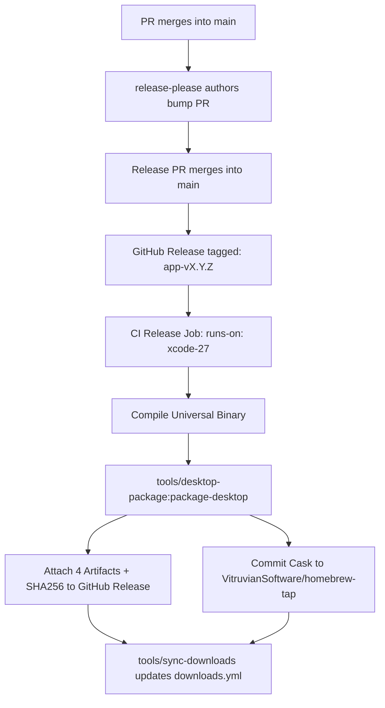

# Desktop Applications Agent Guide (`apps/desktop/`)

This guide is the single authoritative reference for developing, packaging, and releasing native macOS desktop and menu-bar applications in `apps/desktop/` (including [HomeSpeaker](file:///Users/james/Workspace/gh/application/vitruvian/vitruvian-core/apps/desktop/home-speaker), [Vitruvian](file:///Users/james/Workspace/gh/application/vitruvian/vitruvian-core/apps/desktop/vitruvian), [NexusAgent](file:///Users/james/Workspace/gh/application/vitruvian/vitruvian-core/apps/desktop/nexus-agent), and future desktop apps).

All desktop applications adhere to a **standardized 6-point release artifact contract** so that coding agents and human contributors have a uniform, predictable distribution pattern across the monorepo.

---

## 1. The 6-Point Release Artifact Contract

Every desktop application release produces and publishes the following six canonical deliverables:

| # | Artifact | Format / Target | Purpose |
|---|---|---|---|
| **1** | **Universal DMG** | `<App>-<version>-universal.dmg` | Primary distributable disk image containing universal Apple Silicon + Intel Mach-O binary. (Also copied to `<App>-<version>.dmg` for backwards compatibility). |
| **2** | **Apple Silicon DMG** | `<App>-<version>-arm64.dmg` | Optimized disk image thinned specifically for Apple Silicon (M1/M2/M3/M4) Macs; smaller download footprint. |
| **3** | **Intel x86_64 DMG** | `<App>-<version>-x86_64.dmg` | Disk image thinned specifically for legacy Intel x86_64 Macs. |
| **4** | **Universal ZIP** | `<App>-<version>-universal.zip` | Standalone compressed application bundle for direct extraction or scripting. |
| **5** | **Homebrew Cask** | `Casks/<app>.rb` in `VitruvianSoftware/homebrew-tap` | Official Homebrew Cask formula, referencing the Universal DMG and its SHA-256 checksum. |
| **6** | **Downloads Catalog Sync** | `apps/web/vitruviansoftware-dev/_data/downloads.yml` | Synchronized downloads catalog entry on `vitruviansoftware.dev` via `//tools/sync-downloads`. |

Every DMG and ZIP artifact MUST be accompanied by a SHA-256 sidecar file (`<artifact>.sha256`).

---

## 2. Shared Packaging Tooling (`//tools/desktop-package`)

To avoid duplicating 100+ lines of `lipo` thinning, codesigning, DMG staging, checksum generation, and Homebrew tap automation in each app directory, use the shared packaging tool:

```bash
# Package from an assembled .app bundle:
bazel run //tools/desktop-package:package-desktop -- \
  --app-path dist/MyApp.app \
  --version 1.0.0 \
  --dist-dir dist

# Package from a Bazel-built ZIP archive (macos_application target):
bazel run //tools/desktop-package:package-desktop -- \
  --archive bazel-bin/apps/desktop/myapp/MyApp.zip \
  --version 1.0.0 \
  --dist-dir apps/desktop/myapp/dist
```

### Dry-Run Validation

Before opening a release PR or publishing, verify the packaging flow locally:

```bash
bazel run //tools/desktop-package:package-desktop -- \
  --app-path dist/MyApp.app \
  --version 1.0.0 \
  --dry-run
```

This builds all DMGs, universal ZIP, checksums, and prints the Homebrew Cask formula without making network requests or modifying external git repositories.

---

## 3. Architecture & Build Pipelines

Desktop applications in `apps/desktop/` are built using either:
- **Bazel rules_apple (`macos_application`)**: e.g. [Vitruvian](file:///Users/james/Workspace/gh/application/vitruvian/vitruvian-core/apps/desktop/vitruvian/BUILD).
  - Built with `bazel build --config=macos-app --macos_cpus=arm64,x86_64 //apps/desktop/<app>:<App>`.
  - Produces a universal `.zip` containing `<App>.app`.
- **Swift Package Manager (SwiftPM)**: e.g. [HomeSpeaker](file:///Users/james/Workspace/gh/application/vitruvian/vitruvian-core/apps/desktop/home-speaker).
  - Built with `swift build -c release --arch arm64 --arch x86_64`.
  - Bundled into `<App>.app` with app resources, icons, and `Info.plist`.

### Binary Thinning

`//tools/desktop-package:package-desktop` automatically handles `lipo` thinning:
- Traverses all Mach-O binaries in `Contents/MacOS/`, `Contents/Helpers/`, `Contents/Frameworks/`, and `Contents/Library/LaunchServices/`.
- Executes `lipo "$bin" -thin arm64 -output "$bin"` for Apple Silicon packages.
- Executes `lipo "$bin" -thin x86_64 -output "$bin"` for Intel packages.
- Re-codesigns thinned bundles before creating the disk images.

---

## 4. Code Signing & Notarization

### Code Signing Posture

- **CI runners (`runs-on: xcode-27`)**: An Apple Developer ID Application certificate is imported into a temporary keychain via secrets (`SIGNING_CERT_P12`, `SIGNING_CERT_PASSWORD`).
- **Local development / CI without certificates**: If no Developer ID is present, `package-desktop` cleanly falls back to ad-hoc signing (`codesign --force --sign -`).
- **Signing sequence**: Nested frameworks and launch helpers must always be signed before the outer `.app` bundle, with strict verification (`codesign --verify --deep --strict`).

### Notarization

When Apple Notary credentials (`NOTARY_KEY_ID`, `NOTARY_ISSUER_ID`, and `NOTARY_API_KEY_P8`) are present in the environment:
- The `.app` bundle and each `.dmg` image are submitted to Apple Notary Service via `xcrun notarytool submit --wait`.
- The notarization ticket is stapled using `xcrun stapler staple`.
- If credentials are not present, notarization is skipped cleanly without failing the build.

---

## 5. Release & Promotion Workflows

Release orchestration follows the repository's delivery pipeline patterns:



1. **Versioning**: Managed via Google `release-please` with component config in `apps/desktop/<app>/release-please-config.json` and `.release-please-manifest.json`.
2. **Release Trigger**: Merging the release PR creates the release tag (`<app>-v<version>`).
3. **Artifact Publishing**: The publish job (in `.github/workflows/<app>-release.yaml` or `delivery-<app>.yaml`):
   - Mints a GitHub App token for `VitruvianSoftware/homebrew-tap` (`HOMEBREW_TAP_TOKEN`).
   - Runs the packaging script.
   - Uploads all 4 artifacts + checksums to the release.
   - Pushes the cask formula to `homebrew-tap`.
4. **Downloads Catalog**: Run `bazel run //tools/sync-downloads:sync_downloads` to update `apps/web/vitruviansoftware-dev/_data/downloads.yml` with the newly published release.

---

## 6. Onboarding a New Desktop App

When adding a new desktop app `apps/desktop/<app-name>`:

1. **Governance & Metadata**:
   - Provide `LICENSE` (MIT `(c) 2026 VitruvianSoftware`), `README.md`, and `catalog-info.yaml`.
   - **Exception: apps that embed copyleft code use a compatible licence instead of MIT.** `vitruvian` is GPL-3.0-or-later because it is an imported fork, and `courier` is AGPL-3.0-or-later because it embeds the AGPL mautrix bridges. Put that licence in `LICENSE` and give the sources an `SPDX-License-Identifier` header for it (never run `//tools/license:add`, which writes the MIT one). Such an app is exempt from the MIT-header content check in `tools/license/verify.sh`: add its directory to the exclusion list there, as `apps/desktop/vitruvian/` and `apps/desktop/courier/` already are. `//tools/license:check` still requires a header on every file.
   - Add a `release-please-config.json` and `.release-please-manifest.json`.
2. **Packaging Script**:
   - Create `apps/desktop/<app-name>/scripts/publish.sh` (or `publish.sh`) that builds the universal binary/bundle and invokes `//tools/desktop-package:package-desktop`.
   - It runs under the Mac's bash 3.2: read "Writing a script that calls this tool" in `tools/desktop-package/README.md` first, and give it a test like `apps/desktop/home-speaker/scripts/publish_test.sh`.
3. **Release Workflow**:
   - Add `.github/workflows/<app-name>-release.yaml` (or declare delivery unit in `tools/delivery/defs.bzl`).
   - End the publishing job with a `package-desktop.sh --verify-only` step, so a release with missing files fails the job.
4. **Homebrew Tap**:
   - Ensure the cask identifier matches `<app-name>` in `VitruvianSoftware/homebrew-tap/Casks/<app-name>.rb`.
5. **Downloads Catalog**:
   - Add entry under `categories.desktop.items` in `apps/web/vitruviansoftware-dev/_data/downloads.yml`.
   - Add a discovery block to `sync_catalog` in `tools/sync-downloads/src/sync.rs`; the daily
     `.github/workflows/site-sync-downloads.yaml` runs it.
6. **Validation**:
   - Run `bazel test //...`
   - Run `bazel run //tools/conformance:check`
   - Run `bazel run //tools/license:check`
   - Run `bazel run //:tidy`
