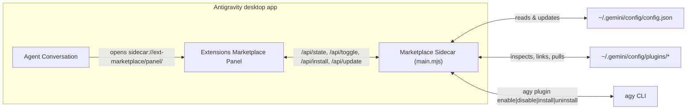

# ext-marketplace

An Antigravity desktop plugin providing a unified Extensions Marketplace catalog and installed plugin manager sidecar. See the [README](../README.md) for installation and use.

## How it fits together

## First-Party Marketplace Catalog

| Extension | Category | Description |
| --- | --- | --- |
| `gh-watch` | CI & GitHub | Watches pull requests and wakes the owning conversation when CI fails |
| `worktree-band` | Git & Workspaces | Live worktree status band, branch hygiene, and quick pruning |
| `ralph-loop` | Autonomous Loops | Iterative self-correcting verification loop until completion criteria pass |
| `hookify` | Guardrails & Hooks | Declarative PreToolUse and PostToolUse hook rule builder and tester |
| `security-guidance` | Security | Real-time security advisory, secret guard, and risky pattern inspector |
| `receipts-report` | Telemetry & Audit | Session receipts, tool audit ledger, and PR delivery verification report |
| `live-context` | Context & Memory | Dynamic workspace context, active rules, and MCP server health inspector |
| `savvy-fleet` | Subagents | Tiered orchestrator-worker flow (`savvy-flow`) and subagent fleet telemetry |
| `ext-marketplace` | Extensions | Unified Extensions Marketplace catalog and installed plugin manager |
