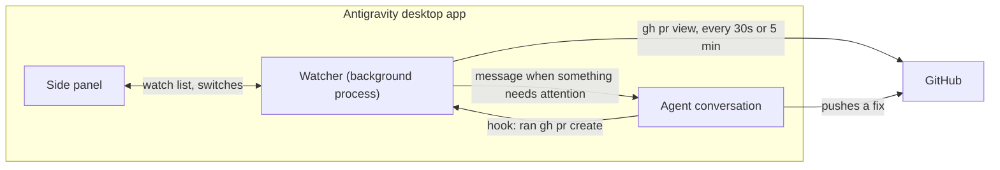

# gh-watch

An Antigravity desktop plugin that watches pull requests and wakes the
conversation that owns one when its CI starts failing. See the
[README](../README.md) for installation and use.

## How it fits together



Antigravity starts the watcher when the plugin is enabled and keeps it running,
so it polls whether or not the panel is open. It stops when the app quits.

## How often it checks

| Situation | Pace |
| --- | --- |
| The panel is open | Fast (30 s by default) |
| A check on any watched pull request is still running | Fast |
| A pull request was just added and has not been read | Fast |
| Every watched pull request has settled | Slow (5 min by default) |
| The panel is opened after being closed | Checks at once, unless a pass ran in the last 10 s |

Both intervals are settings. A settled pull request that gets a new push is
noticed at the slow pace, after which its running checks put it back on the
fast pace.

## When it wakes the conversation

The rules follow what Claude Code's desktop auto-fix does.

| Situation | What happens |
| --- | --- |
| A check fails for the first time on a commit | One message naming the failing checks |
| The same check is still failing on the same commit | Nothing |
| A different check fails later on the same commit | One message for that check only |
| A new commit is pushed and a check fails | Reported again; each commit starts fresh |
| A check fails while others in its workflow are still running | Waits up to 5 minutes, then reports them together |
| The message could not be delivered | Tried again on the next pass |
| The pull request is merged or closed | Wake-ups stop; it is removed from the list after 24 hours (a setting) |
| It is reopened before being removed | Noticed at the slow pace, then watched as before |
| GitHub cannot be read | Retried less and less often, down to every 16th pass |

Merge conflicts and review comments follow the same idea:

| Situation | What happens |
| --- | --- |
| The pull request starts conflicting with its base | One message asking the agent to merge the base in |
| It still conflicts on the same commit | Up to three reminders, after 30, 60 and 120 minutes |
| A push leaves the conflict in place | Told again, once GitHub says so on two reads in a row |
| GitHub has not worked out mergeability yet | Nothing changes |
| A collaborator or bot leaves a new comment or review | Passed on, quoted, if the pull request's review-comments switch is on (off by default) |
| A comment from you, or from someone outside the repository | Never passed on |
| Comments that existed before watching began | Not passed on |

Everything that needs attention on one pass goes into one message.

## After the checks pass

| Situation | What happens |
| --- | --- |
| Every check has finished and none failed | One message: checks passed (once per commit) |
| The pull request enters the merge queue | Shown in the panel with its position; no message |
| It leaves the merge queue without merging | One message |
| It merges | One message; the base branch's checks on the merge commit are then followed |
| Those checks pass | One message: landed cleanly |
| One of them fails | One message at once, naming it |
| Nothing runs on the merge commit for 10 minutes, or it takes over 2 hours | Following stops quietly |
| It is closed without merging | One message |
| It was already green, merged or closed when watching began | Nothing: old news is not announced |

"Landed" is only believed 90 seconds after the merge. With a merge queue the
merge commit already carries the queue's own passed checks at that moment,
before the base branch's workflows have started.

## Flaky checks

A check counts as having flaked when it was seen failing on a commit and is
later seen passing on that same commit: a re-run, with no code change. A fix
pushed as a new commit does not count. Two sightings inside 30 days make a
check "known flaky" for that repository. The agent is still woken when it
fails, because it might be a real failure this time, but the message marks
it and says to re-run it first. The memory is per machine, in the plugin's
data folder.

## Waiting on you

Two things in the panel are about what is waiting on a person, not an agent:

- **Waiting on your review** lists open, non-draft pull requests anywhere on
  GitHub where your review has been asked. It is read only while the panel
  is open, at most every two minutes, and up to 100 at a time. Each
  repository in the list has a tick box; untick one to leave it out. The
  choice is remembered, and a repository that asks for your review for the
  first time is listed until you untick it.
- **Ready to merge** marks a watched pull request that is green and
  mergeable, but is not in the merge queue and has no auto-merge set, so it
  will sit there until someone merges it.

## Automatic sign-up

Antigravity runs `hooks/note-pr-create.sh` after every shell command an
agent runs. For anything but `gh pr create` and the sign-up command below it
does nothing. For `gh pr create`
it leaves a note in a fixed folder (`~/.gemini/antigravity/gh-watch-inbox`); the watcher looks up the pull
request for the branch in the folder the command ran in, and starts watching
it for the conversation that ran the command. It never takes over a pull
request that is already watched. The hook only ever answers `{}`, so it
cannot allow, block or change a command.

The message arrives in the conversation as a system notice, not as something
the user typed. It says it comes from gh-watch, lists the failing checks with
links, and asks the agent to fix the cause on the branch or to say so if the
failure is not caused by the pull request.

### Pull requests opened by a subagent

The hook only sees commands Antigravity runs. When an agent hands work to
something else, such as a subagent, `claude -p`, `agy -p` or a script, and
that opens the pull request, the `gh pr create` happens out of sight and
nothing is watched.

For those, the plugin carries a standing instruction (`rules/AGENTS.md`,
always on while the plugin is enabled). It tells the agent to sign the pull
request up itself, once, with:

```sh
GH_WATCH=1 gh pr view <number or URL> --json url --jq .url
```

This is an ordinary `gh pr view`, so it needs nothing installed and prints the
link back. The `GH_WATCH=1` prefix is what the hook looks for; a plain
`gh pr view` is left alone. Several can be chained with `&&`. A pull request
added this way shows "added by the agent" in the panel. Like any automatic
sign-up it is skipped when "Watch pull requests automatically" is off, and it
never takes over a pull request that is already watched.

This relies on the agent following the instruction. A pull request it forgets
can still be added from the panel.

## Limits

- Desktop app only, and only while it is running.
- One conversation per pull request: watching it again from another
  conversation moves the wake-ups there.
- It reads GitHub with your `gh` login, one request per watched pull request
  per pass.
- Auto-merge is GitHub's feature: the switch only turns it on or off.
