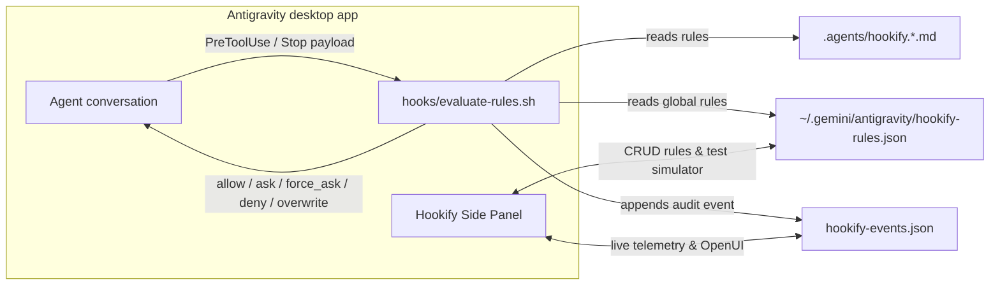

# hookify

An Antigravity desktop plugin that evaluates declarative rules defined in
`.agents/hookify.*.md` or `~/.gemini/antigravity/hookify-rules.json` on
`PreToolUse` and `Stop` hooks. See the [README](../README.md) for installation
and usage.

## Architecture

## Supported Operators

| Operator | Behaviour |
| --- | --- |
| `regex_match` | Tests the extracted field value against a regular expression |
| `contains` | Checks whether the field contains the pattern substring |
| `not_contains` | Checks that the field does not contain the pattern substring |
| `equals` | Checks exact string equality |
| `starts_with` | Checks whether the field starts with the pattern |
| `ends_with` | Checks whether the field ends with the pattern |

## Supported Actions

| Action | Hook Phase | Outcome |
| --- | --- | --- |
| `allow` | `PreToolUse` | Explicitly permits the tool call |
| `warn` / `ask` | `PreToolUse` | Prompts the user for confirmation with the rule's message |
| `force_ask` | `PreToolUse` | Forces explicit user confirmation even in auto-approve modes |
| `block` / `deny` | `PreToolUse` | Blocks the tool call and returns the rule's reason to the agent |
| `overwrite` | `PreToolUse` | Rewrites tool arguments (`updatedInput`) before execution |
| `block` / `deny` | `Stop` | Prevents the agent from stopping (`continue: false`) until conditions pass |
