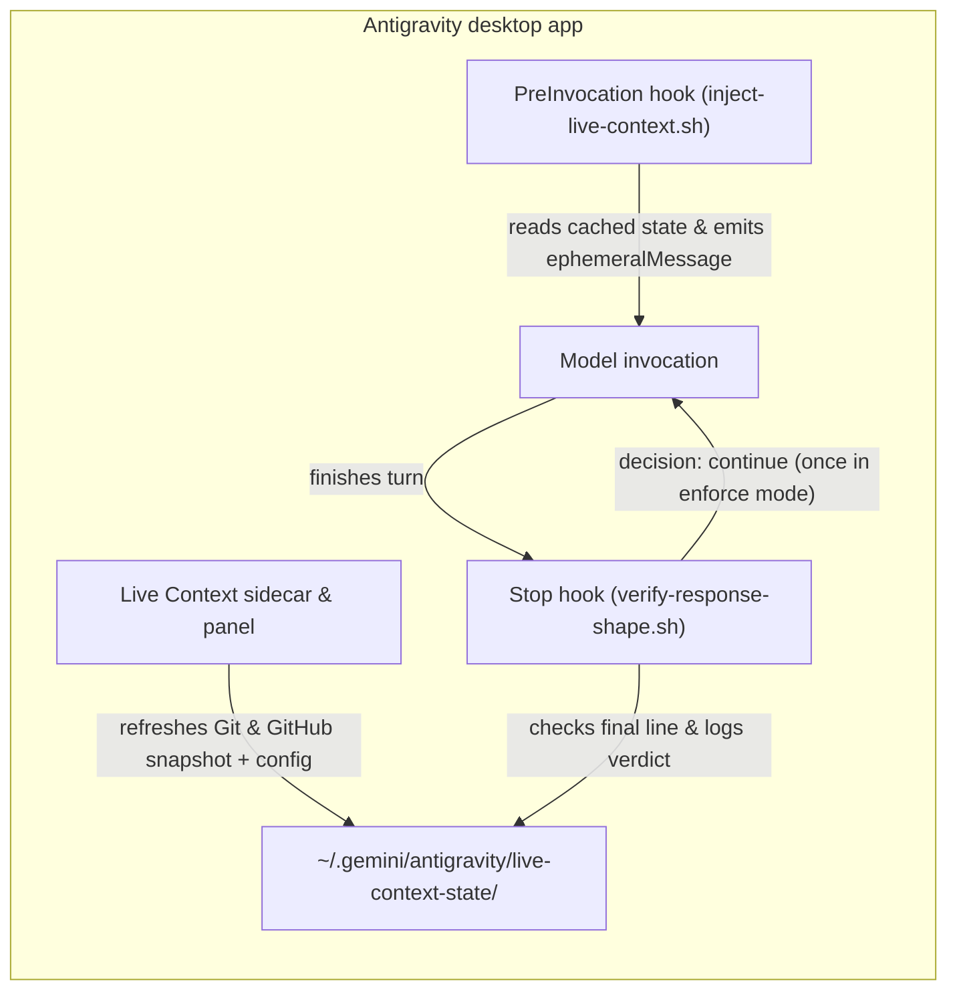

# live-context

An Antigravity desktop plugin that injects live repository state (current git
branch, dirty files, open and recently merged GitHub pull requests, and open
issue count) plus your response contract as a transient `ephemeralMessage`
before every model invocation, and validates the assistant's closing shape on
`Stop`. See the [README](../README.md) for installation and use.

## How it fits together

## Lifecycle Contracts

| Hook Event | Script | Output Contract | Behavior |
| --- | --- | --- | --- |
| `PreInvocation` | `hooks/inject-live-context.sh` | `{ "injectSteps": [{ "ephemeralMessage": "..." }] }` | Injects live Git status, open/merged PRs, and active response contract rules without bloating persistent history |
| `Stop` | `hooks/verify-response-shape.sh` | `{ "decision": "allow" \| "continue", "reason": "..." }` | Checks the assistant's final line for empty filler endings (such as `"Nothing needed from you."`); bounces at most once per turn in `enforce` mode |
