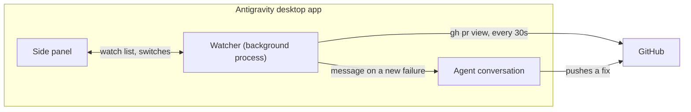

# pr-watch

An Antigravity desktop plugin that watches pull requests and wakes the
conversation that owns one when its CI starts failing. See the
[README](../README.md) for installation and use.

## How it fits together

Antigravity starts the watcher when the plugin is enabled and keeps it running,
so it polls whether or not the panel is open. It stops when the app quits.

## When it wakes the conversation

The rules follow what Claude Code's desktop auto-fix does.

| Situation | What happens |
| --- | --- |
| A check fails for the first time on a commit | One message naming the failing checks |
| The same check is still failing on the same commit | Nothing |
| A different check fails later on the same commit | One message for that check only |
| A new commit is pushed and a check fails | Reported again; each commit starts fresh |
| A check fails while others in its workflow are still running | Waits up to 5 minutes, then reports them together |
| The message could not be delivered | Tried again on the next pass |
| The pull request is merged or closed | Watching stops |
| GitHub cannot be read | Retried less and less often, down to every 16th pass |

The message arrives in the conversation as a system notice, not as something
the user typed. It says it comes from pr-watch, lists the failing checks with
links, and asks the agent to fix the cause on the branch or to say so if the
failure is not caused by the pull request.

## Limits

- Desktop app only, and only while it is running.
- One conversation per pull request: watching it again from another
  conversation moves the wake-ups there.
- It reads GitHub with your `gh` login, one request per watched pull request
  per pass.
