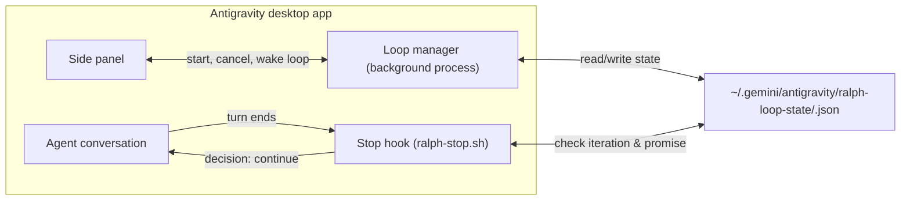

# ralph-loop

An Antigravity desktop plugin that runs self-referential iterative development
loops in a conversation until the agent emits a completion promise
(`<promise>...</promise>`) or reaches the configured iteration cap. See the
[README](../README.md) for installation and use.

## How it fits together

## Stop hook lifecycle

When an agent turn finishes, Antigravity invokes `hooks/ralph-stop.sh` with the
conversation's `conversationId` and `transcriptPath`:

| Condition | Result |
| --- | --- |
| No loop state file or `active: false` | Outputs `{}` (normal stop) |
| Last assistant message contains `<promise>${completionPromise}</promise>` | Marks loop `completed`, outputs `{}` |
| `iteration >= maxIterations` | Marks loop `max_iterations`, outputs `{}` |
| Active and `iteration < maxIterations` and promise not yet emitted | Increments `iteration` and outputs `{"decision": "continue", "reason": "Ralph Loop (iteration N/M): ..."}` |
