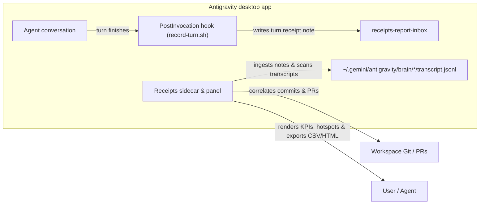

# receipts-report

An Antigravity desktop plugin that parses `.system_generated/logs/transcript.jsonl`
files across `~/.gemini/antigravity/brain`, correlates agent turns with project
commits and pull requests, detects context-bloat and error hotspots, and
exports standalone HTML or CSV impact receipts. See the [README](../README.md)
for installation and use.

## How it fits together

## What it measures

| Metric | Source | Purpose |
| --- | --- | --- |
| Conversations & Prompts | `USER_INPUT` steps in `transcript.jsonl` | Counts active sessions and user turns per workspace |
| Planner Turns & Tool Calls | `PLANNER_RESPONSE` steps & `tool_calls` array | Tracks execution depth and tool distribution |
| Subagent Dispatches | `invoke_subagent` tool calls | Surfaces parallel agent fan-out |
| Truncations & Errors | `truncated_fields` & `status == "ERROR"` | Pinpoints turns where tool outputs overflowed or failed |
| Shipped Commits & PRs | Extracted from git/PR tool calls or supplied metadata | Connects agent effort to concrete engineering deliverables |
