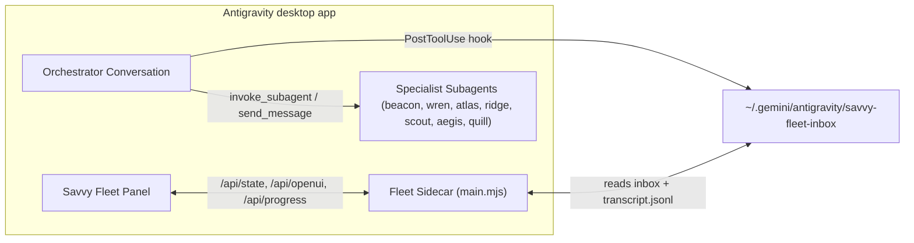

# savvy-fleet

An Antigravity desktop plugin providing tiered orchestrator-worker subagent flow (`savvy-flow`), live subagent fleet telemetry, and estimated token/cost tracking. See the [README](../README.md) for installation and use.

## How it fits together

## Tiered Orchestration (`savvy-flow`)

| Phase | Purpose |
| --- | --- |
| `plan` | Decompose the request into numbered worker tasks with explicit dependencies (`after`) and complexity tiers |
| `design` | Validate interfaces, schemas, and cross-workspace boundaries before spawning workers |
| `delegate` | Dispatch tasks to specialist subagents (`beacon`, `wren`, `atlas`, `ridge`, `scout`, `aegis`, `quill`) matched to tiers (`fable`, `heavy`, `careful`, `medium`, `light`) |
| `review` | Perform adversarial verification (`bazel test`, diff inspection, security and conformance checks) |
| `close` | Verify landing, clean up worktrees, and mark the flow finished |

## Complexity Tiers

| Tier | Profile | Typical Specialist |
| --- | --- | --- |
| `fable` | Deep architectural synthesis, multi-system invariants | `beacon`, `compass` |
| `heavy` | Complex multi-file refactors, tricky concurrency or IaC | `beacon`, `atlas`, `wren` |
| `careful` | Security-critical, RBAC, production GitOps, careful migrations | `aegis`, `ridge`, `atlas` |
| `medium` | Standard feature implementation, unit & integration tests | `wren`, `scout` |
| `light` | Fast mechanical checks, CI polling, docs, formatting | `scout`, `quill`, `pace` |
