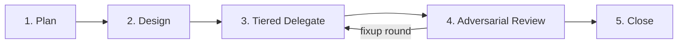

# Savvy Flow (`savvy-flow`)

`savvy-flow` is a structured 5-phase orchestrator-worker workflow designed to keep the primary conversation focused on architecture, task decomposition, and adversarial review while delegating bounded implementation and verification tasks to right-sized subagents via `invoke_subagent`.

Open the live fleet telemetry sidecar at any time with `[Savvy Fleet](sidecar://savvy-fleet/panel/)`.

## The 5 Phases

### Phase 1: Plan (`plan`)
1. Read only the entrypoints, manifests, and interfaces needed to scope the problem.
2. Decompose the work into numbered, non-overlapping tasks (`1..N`).
3. For each task, declare:
   - **`title`**: Short 3–6 word title (reused verbatim in `invoke_subagent`'s `Role` parameter so the Savvy Fleet panel matches runs to planned tasks).
   - **`tier`**: Complexity tier (`fable`, `heavy`, `careful`, `medium`, `light`).
   - **`specialist`**: Target Antigravity subagent (`beacon`, `wren`, `atlas`, `ridge`, `scout`, `aegis`, `quill`, `compass`, `pace`).
   - **`after`**: Array of prerequisite task numbers (`[]` if ready immediately).

### Phase 2: Design (`design`)
1. Lock down shared contracts, file paths, function signatures, and test expectations before launching parallel workers.
2. Verify there are no overlapping write targets between tasks scheduled in the same wave.

### Phase 3: Tiered Delegate (`delegate`)
Dispatch ready tasks (whose `after` dependencies are satisfied) in parallel using `invoke_subagent`:

| Tier | Model / Effort | When to Use | Antigravity Subagents |
| --- | --- | --- | --- |
| **`fable`** | `pro` / high | Deep cross-cutting architecture, subtle invariant design, multi-system synthesis | `beacon`, `compass` |
| **`heavy`** | `pro` / high | Complex multi-file refactors, Pulumi IaC topology, non-trivial state machines | `beacon`, `atlas`, `wren` |
| **`careful`** | `inherit` / high | Security audits, RBAC/NetworkPolicies, production GitOps, data migrations | `aegis`, `ridge`, `atlas` |
| **`medium`** | `inherit` / medium | Standard feature development, bug fixes, authoring unit and integration tests | `wren`, `scout` |
| **`light`** | `flash` / low | Mechanical validation, CI check monitoring, documentation updates, formatting | `scout`, `quill`, `pace` |

When calling `invoke_subagent`, prefix or include the tier in `Role` (e.g., `Role: "[medium] Implement OpenUI renderer"` or `Role: "wren: Implement OpenUI renderer"`) and provide a self-contained `Prompt` with:
- Exact file paths to create or modify (and paths that are off-limits).
- Concrete verification commands (`node --test ...`, `bazel test ...`).
- Expected return summary format.

### Phase 4: Adversarial Review (`review`)
Never trust a subagent's self-report without verification:
1. Inspect the actual diff and file contents produced by each worker.
2. Run the verification suite (`bazel test`, `aspect lint`, conformance checks) or dispatch `scout` / `aegis` for independent verification.
3. If a worker's output has gaps, message the existing subagent via `send_message` with specific remediation instructions (tracked as `round 2+` in Savvy Fleet).

### Phase 5: Close (`close`)
1. Confirm all planned tasks are accepted (`done === total`).
2. Verify PR checks, landing status, and worktree hygiene (`bazel run //tools/worktree -- --prune`).
3. Present a concise final summary to the user.
