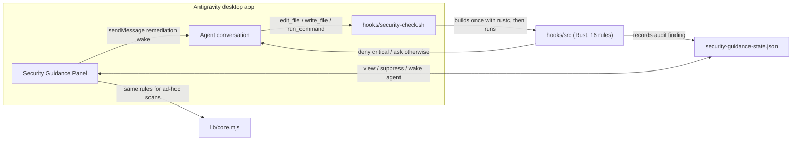

# security-guidance

An Antigravity desktop plugin that scans `edit_file`, `write_file`, and
`run_command` tool calls for 16 classes of
security vulnerabilities and hardcoded secrets. See the [README](../README.md)
for installation and usage.

## Architecture

## Built-in Vulnerability Classes

| Rule ID | Severity | CWE | Description |
| --- | --- | --- | --- |
| `hardcoded-private-key` | critical | CWE-798 | Private key PEM block in source |
| `aws-access-key` | critical | CWE-798 | Hardcoded AWS Access Key ID (`AKIA...`) |
| `gcp-api-key` | high | CWE-798 | Hardcoded Google Cloud API key (`AIza...`) |
| `github-pat` | critical | CWE-798 | Hardcoded GitHub Personal Access Token (`ghp_...`, `github_pat_...`) |
| `command-injection-curl-sh` | critical | CWE-78 | Piping remote `curl`/`wget` output directly into `sh`/`bash` |
| `js-eval` | high | CWE-95 | Dynamic code execution via `eval()` or `new Function()` |
| `dom-xss-innerhtml` | high | CWE-79 | Unsanitized assignment to `.innerHTML` or `dangerouslySetInnerHTML` |
| `python-pickle-loads` | high | CWE-502 | Unsafe deserialization with `pickle.loads` / `cPickle` |
| `python-yaml-unsafe-load` | high | CWE-502 | `yaml.load()` without `SafeLoader` |
| `pytorch-unsafe-load` | high | CWE-502 | `torch.load()` without `weights_only=True` |
| `python-subprocess-shell` | high | CWE-78 | `subprocess.Popen`/`run`/`call` with `shell=True` or `os.system` |
| `node-child-process-exec` | medium | CWE-78 | `child_process.exec` / `execSync` with interpolated command strings |
| `sql-string-concat` | high | CWE-89 | SQL query built via string concatenation or template interpolation |
| `path-traversal` | medium | CWE-22 | Unsanitized `../` traversal in file paths |
| `ssrf-metadata-ip` | high | CWE-918 | Direct access to cloud instance metadata (`169.254.169.254`) |
| `github-actions-script-injection` | high | CWE-94 | Untrusted `${{ github.event.* }}` interpolated inside `run:` shell |
