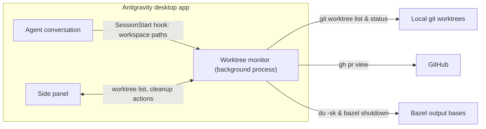

# worktree-band

An Antigravity desktop plugin that tracks git worktrees, pull request status,
and Bazel output-base disk usage, with safe post-merge cleanup. See the
[README](../README.md) for installation and use.

## How it fits together

## What it tracks

| Item | Description |
| --- | --- |
| **Branch & Worktree** | Linked feature worktree path, branch name, HEAD commit, and default branch |
| **Pull Request** | PR number, state (`OPEN`, `MERGED`, `CLOSED`), draft flag, and CI check rollup counts |
| **Disk Usage** | Worktree directory size (`treeKb`) plus isolated Bazel output-base folders (`caches`) |
| **Cleanup Verdict** | Whether the worktree is `ready` to remove, `blocked` (and why), or `none` |

## Safe cleanup rules

A worktree is only marked `ready` for cleanup when:

1. Cleanup mode is not `off`.
2. Its pull request state is `MERGED`.
3. The pull request merged into the repository's default branch (`main`).
4. The worktree is a linked worktree (`isLinked: true`), never the main checkout.
5. `git status --porcelain` is clean (no uncommitted or untracked files).
6. Local `HEAD` matches the pull request's `headRefOid` (no unpushed local commits).

And a Bazel cache folder is only removable (`isRemovable`) when:

- It resides strictly inside `$HOME` without `..` path traversal.
- Its path contains `/bazel/`.
- It is deeper than the shared Bazel user root (`~/Library/Caches/bazel/_bazel_<user>` or `~/.cache/bazel/_bazel_<user>`).
- It is not the shared `cache` or `install` directory.
