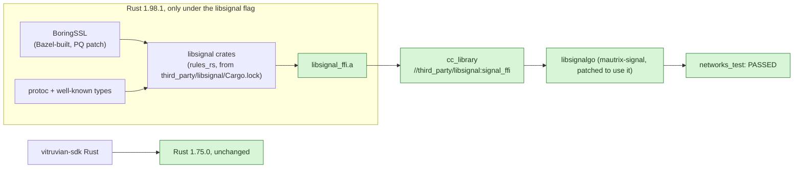

<!--
Copyright 2026 VitruvianSoftware
SPDX-License-Identifier: AGPL-3.0-or-later
-->

# Milestone 2: building Signal's library (`libsignal_ffi`)

**Decision: Option A. Bazel builds Signal's Rust library from source.**
Nothing prebuilt is downloaded, no release asset is published, and no `cargo`
is needed to build. Option B (a prebuilt archive published to GitHub) was not
needed and was not started.

## Why this mattered

The Signal bridge (mautrix-signal) is Go, but it does Signal's encryption by
calling Signal's own Rust library through cgo. Without that library the bridge
cannot even link. It was the riskiest build step in milestone 2, so it went
first, time-boxed: stop after three unsolved blockers or about two hours.

## Result

The link test passed on arm64 13 minutes after the first build attempt, well
inside the two-hour box. The x86_64 build, the CI-safety fixes and the
security-gate fixes took about 20 minutes more; the whole spike, including the
investigation and this write-up, took about 45 minutes. Every blocker hit was
solved; none is open.

Green means built or passing on this machine on 2026-10-16.

| Check | Result |
|---|---|
| `bazel test //apps/desktop/courier/engine/internal/networks:networks_test` (arm64) | PASSED, with and without `--config=macos-app` |
| `bazel build //third_party/libsignal:signal_ffi_rust_1_98_1 --platforms=@apple_support//platforms:darwin_x86_64` | builds; `lipo` says x86_64 |
| The test binary for x86_64 | links; not run (this Mac has no Rosetta) |
| Rust the library is built with | 1.98.1 (`rustc version 1.98.1` inside the archive) |
| Rust the SDK is built with | 1.75.0; its Rust tests pass |
| `osv-scanner` on the new lock files | clean after the changes below |

## How it works, in short

- A tiny Cargo workspace (`third_party/libsignal/Cargo.toml`) depends on
  libsignal's crates at the pinned commit, so the existing Rust crate tool
  (rules_rs) treats them like any other downloaded crate and generates their
  build targets. Its lock file is libsignal's own, so the crate versions match
  what Signal ships.
- A second Rust toolchain, 1.98.1, is registered but only chosen when a flag
  is on. Only the libsignal library turns the flag on, so the SDK's Rust
  keeps 1.75.0.
- Signal's crypto layer (BoringSSL) normally builds with CMake from a git
  submodule. Instead Bazel compiles it with BoringSSL's own Bazel rules, with
  the same post-quantum patch Signal's build applies, and hands the result to
  Signal's build script.
- A small patch to mautrix-signal makes its Go package link this library
  instead of searching for a prebuilt `libsignal_ffi.a`.

`third_party/libsignal/README.md` has the detail and the steps for moving the
pin.

## Blockers hit, and how each was solved

1. **rules_rs could not find four libsignal crates in Signal's repo.** It
   locates a crate through the repo's top-level dependency table, and four
   are not in it. Solved with one `strip_prefix` annotation each.
2. **Paths given to build scripts were wrong.** Bazel needed `$$` escaping,
   and then the paths came out doubled, because rules_rust already makes
   `$(execpath)` absolute. Solved by passing plain `$(execpath ...)`.
3. **protoc was not found, then could not find its standard imports.**
   Several crates generate code from `.proto` files. Two different code
   generators look for protoc in two different ways ($PROTOC and $PATH), and
   both need protobuf's well-known types. Solved with a small rule that lays
   out protoc with its `include/` directory, which protoc picks up by itself.
   Setting `$PROTOC_INCLUDE` was tried and rejected: it breaks one crate's
   relative proto paths.
4. **`ring` (a crypto crate) failed to compile its C code.** The repo's C
   toolchain flags include paths relative to Bazel's working root, but the
   build script compiles from a different directory. Solved with a two-line
   compiler wrapper that changes to the right directory first.
5. **x86_64 only: `curve25519-dalek` lost a dependency.** Its build script
   turns on a setting that decides whether a helper crate is needed, but
   rules_rs decides dependencies before build scripts run. Solved by adding
   the helper back explicitly.
6. **Gazelle deleted the `signal_ffi` target** (a C++ library with no sources
   of its own looks empty to it). Solved by telling gazelle to leave that one
   BUILD file alone.
7. **mautrix-signal's link flags assume a non-Bazel setup.** It links
   `-lsignal_ffi` from the library search path and `-lstdc++`, which the macOS
   SDK does not ship. Solved with a patch, as milestone 1 did for webp.
8. **The security gate would have gone red.** The new lock file brought four
   rustls advisories (fixable) and three "unmaintained crate" notices (no fix
   exists). rustls was moved to the fixed patch release; the three notices are
   recorded as permanent, explained entries in `osv-scanner.toml`.
9. **`bazel build //...` would have built the library with the wrong Rust.**
   Built directly, without the flag, it would use 1.75.0 and fail. Those
   targets are now marked incompatible unless the flag is on, so wide builds
   skip them instead.

## Versions checked

- rules_rust: 0.68.1 declared, 0.69.0 actually resolved by the module graph
  (a pre-existing state); latest is 0.74.0. Neither 0.68 nor 0.69 ships
  checksums for Rust 1.98.1, so they are pinned in `MODULE.bazel`.
- rules_rs: 0.0.26; latest is 0.1.0. Not upgraded: 0.0.26 did everything
  needed, and upgrading would touch the SDK's crate graph too.
- Rust: 1.98.1, exactly what libsignal's `rust-toolchain` asks for.
- BoringSSL: the commit Signal's fork pins, not the newer BoringSSL module
  grpc already pulls in.

## Costs and limits

- **First build is heavy.** Roughly 2,000 to 2,700 build actions and a 257 MB debug
  archive. Later builds hit the cache.
- **Apple silicon only, macOS only.** The 1.98.1 toolchain is registered for
  arm64 hosts building macOS arm64 or x86_64. Linux builds skip it. An Intel
  Mac or Linux bridge would need more toolchain entries.
- **One machine path.** Signal's bindgen step reads the macOS 26 SDK through
  `_MACOS_SDK` in `MODULE.bazel`, the same constant `llvm.sysroot` pins, so
  the two move together. Removing the pin means removing
  `BORING_BSSL_SYSROOT` too (the comment there says so).
- **Annotations are tied to this libsignal version.** Each one is commented.
  A future libsignal can add or drop crates with build scripts; the first
  build after a re-pin will say which.
- **Not in CI yet.** No presubmit lane runs the courier engine's tests today.
  The test is ready for one; it needs a macOS (xcode-27) lane.

## What it would cost to switch to Option B later

Only if this build ever becomes a burden. A manually run GitHub workflow
would check out libsignal at the pinned commit, `cargo build` it for both CPU
types on a free macOS runner, combine them with `lipo`, and publish
`libsignal-ffi-<commit>-universal.tar.gz` with its sha256 as a release asset.
`MODULE.bazel` would then fetch it by checksum, and `:signal_ffi` would wrap
the archive. That is simpler to maintain, but it is not built from source in
the Bazel graph, and publishing a release asset needs James's go-ahead.
