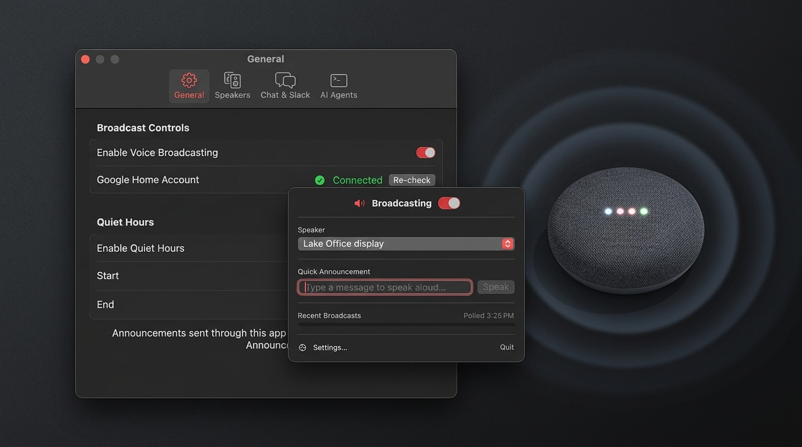
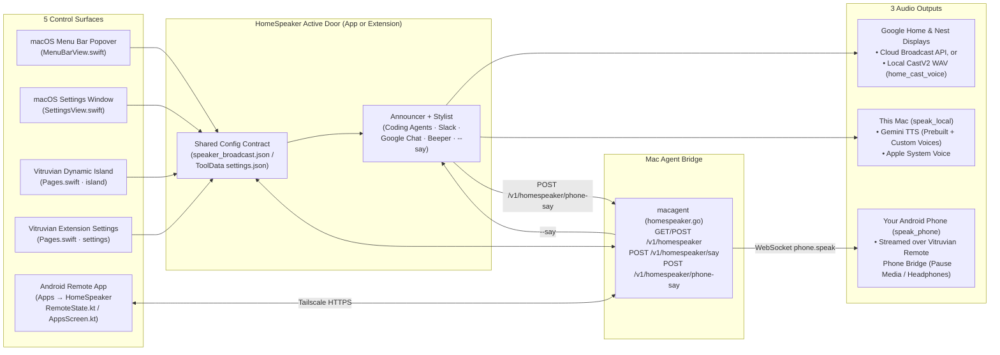
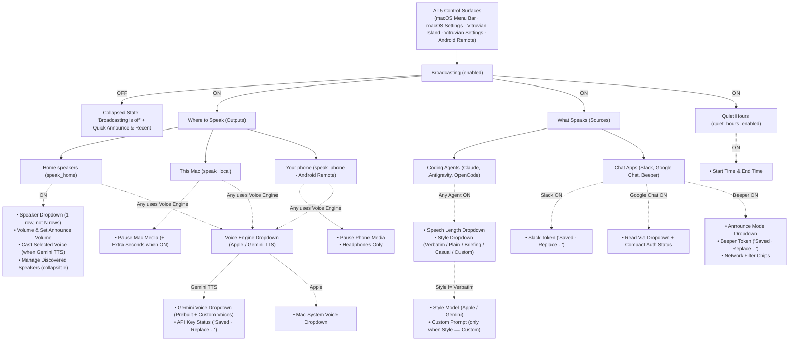

# HomeSpeaker

<p align="center">
  
</p>

A macOS menu bar app (and Vitruvian extension) that reads things aloud across
your **Google Home speakers and Nest displays**, **this Mac**, and **your
paired Android phone**: a spoken summary of each coding agent reply (Claude
Code, Antigravity, OpenCode), new Slack, Google Chat or Beeper messages, or
anything you type into the Quick Announcement box.

It lives in the menu bar (no Dock icon), talks straight to Google's hosted
Home API over HTTPS (or casts synthesized Gemini/custom-voice audio directly
to local Chromecast speakers on your LAN), and needs nothing else installed.

---

## How it works at a glance

### 1. Control Surfaces, Mac Agent & Audio Outputs (Including Android Remote)

HomeSpeaker can be controlled from **five UI surfaces**—two in the standalone
macOS app, two in the Vitruvian desktop extension, and **from your phone via
[Vitruvian Remote (`android-remote`)](../../mobile/android-remote/README.md)**—and
can speak across **three independent audio outputs** (Google Home speakers, this
Mac, and your paired Android phone):



### 2. Progressive-Disclosure Configuration Hierarchy

Across all five surfaces (macOS menu-bar popover, macOS Settings window,
Vitruvian Dynamic Island, Vitruvian Extension Settings, and **Android Remote**),
settings follow a single **progressive-disclosure hierarchy**—every dashed
branch stays hidden until its parent toggle is switched on, and single-select
lists render as compact dropdown selectors:



---

## Two ways to run HomeSpeaker

You can use HomeSpeaker as this menu bar app, as a Vitruvian extension, or
both installed, though only one of them speaks.

| | The app | The Vitruvian extension |
|---|---|---|
| What you see | A menu bar icon and a Settings window | A mark on Vitruvian's closed island, and pages in its island and Settings |
| Needs the other one installed | No | No. It runs on its own and does not use the app's files, except to copy them when you ask |
| Keeps its files in | `~/.gemini/` and `~/Library/Application Support/HomeSpeaker/` | The extension's own data folder (see [What's stored where](#whats-stored-where)) |

With only one installed, nothing changes. With both installed, both ask which
one to use, and nothing is announced twice. Until you answer, the app keeps
working as before and the extension waits. (The app only starts asking once
the updated extension has run once.)

- **Use the extension:** you see both sides and can copy your settings and
  sign-ins across. The app is then quit, and you are offered to turn off its
  Open at Login and to move it to the Trash.
- **Use the app:** the extension goes quiet by itself. The app cannot remove
  an extension, so it tells you how, in Vitruvian's Settings › Extensions.

Once you have chosen, only that one speaks on its own, reads chat and answers
the Claude Code hook. You can change your mind from either one's *Which
HomeSpeaker* row in Settings.

---

## Before you start

You need all three of these. The app cannot work without them.

| Requirement | Why |
|---|---|
| **macOS 14 (Sonoma) or newer**, Apple Silicon or Intel | The app is a universal binary. |
| **A Google Home with at least one speaker or display**, and a **Google Home Premium Advanced** subscription (US, English) | Google gates the Home API behind this plan. Without it the sign-in succeeds but the speaker list comes back empty. |
| **A Google Cloud project of your own** with the Home API enabled (and the Chat API, if you want chat announcements) — or an existing Antigravity login | Google requires every app that touches your home to identify itself, and the app is built so that identity is yours, not a shared one. See [Signing in](#signing-in). |

Optional, only for the features you turn on:

- **Claude Code, Antigravity or OpenCode** — for spoken summaries of each reply.
- **A Slack user token** with the `search:read` scope — for Slack announcements.
- **Google Chat access** — for Google Chat announcements. Either a second Google sign-in from the app (Google refuses to grant Home and Chat in one consent, so they are separate logins), or the `gws` CLI already installed and signed in.
- **Beeper Desktop**, running on the same Mac with its Desktop API on — for WhatsApp, Signal, Telegram, Google Messages and the other chats Beeper bridges. Make an access token in Beeper Desktop under *Settings → Integrations*, with **+** next to *Approved connections*.

---

## From your phone (Vitruvian Remote on Android)

If you also run [Vitruvian Remote](../../mobile/android-remote/README.md), its
**HomeSpeaker** module (`Apps → HomeSpeaker`) is a first-class remote control
and audio endpoint for HomeSpeaker through the paired Mac agent
([`macagent/homespeaker.go`](../../mobile/android-remote/macagent/homespeaker.go)):

- **Full remote configuration with dropdowns & progressive disclosure**: toggle
  master `Broadcasting`, switch outputs (`Home speakers`, `This Mac`, `Your
  phone`), toggle `Cast selected voice` (`home_cast_voice`), pick the default
  speaker from a single dropdown, choose `Local voice engine` (`Apple` or
  `Gemini TTS`), select any prebuilt or custom cloned `Gemini voice`, pick
  `How much to say` and `Announcement style` (`Verbatim`, `Plain`, `Briefing`,
  `Casual`, `Custom`) + `Style model`, control speaker/announce volume, toggle
  per-agent and per-chat sources (including Beeper network filters), and send or
  replay announcements.
- **Phone as an audio output (`speak_phone`)**: when **Your phone** is turned
  on, HomeSpeaker streams synthesized audio (or text fallback) through
  `POST /v1/homespeaker/phone-say` over the active phone bridge so your Android
  phone speaks announcements aloud—with optional **Pause media on your phone**
  and **Only with headphones on** controls.
- **Zero-lag file sync**: `macagent` reads and atomically rewrites the active
  door's config (`~/.gemini/speaker_broadcast.json` or the Vitruvian extension's
  `ToolData/dev.vitruvian.homespeaker/settings.json`), and HomeSpeaker watches
  that file, so changes made on the phone appear in the Mac menu bar / Dynamic
  Island within a second.

---

## Speaker volume

The menu bar shows the selected speaker's volume, with a slider and a mute
button. Google reports a new level a few seconds after it changes, so the
slider waits for the speaker to confirm before settling.

**Announce at a set volume** (*Settings → General*, off by default) sets the
speaker to one level for each announcement and puts it back afterwards —
useful when a speaker is left at 10 % overnight, or loud from music. It only
puts the volume back if nobody changed it during the announcement, and it only
changes the volume at all while the menu bar app is running, since that is
what puts it back.

Not every speaker offers volume control through Google Home, and "Whole Home"
has no single volume; the menu says so rather than showing a number. An offline
speaker shows as offline, not with its last known level.

From a script: `HomeSpeaker --volume`, `--set-volume 0-100`, `--mute` and
`--unmute` print the default speaker's volume as JSON.

---

## Pause media while announcing

Optional, off by default: *Settings → General → Pause media while announcing*.
When HomeSpeaker is about to speak, it pauses whatever this Mac is playing —
YouTube in a browser, Music, Spotify, QuickTime — and resumes it once the
speaker has finished. Only what was actually playing is paused, and only that
is resumed; a video you restart by hand in the meantime is left alone.

- **Browsers need one setting**, because they only accept this through page
  scripts: Chrome, Brave, Edge, Arc and Vivaldi — *View → Developer → Allow
  JavaScript from Apple Events*; Safari — *Settings → Advanced → Show features
  for web developers*, then *Develop → Allow JavaScript from Apple Events*.
- **macOS asks once per app** ("HomeSpeaker wants to control Google Chrome").
  The *Test* button next to the setting pauses whatever is playing for three
  seconds, so you can answer those prompts before a real announcement.
- **Only sound counts.** A muted or silent video (the autoplay previews on
  GitHub, X, Reddit or YouTube's home page) is never paused; HomeSpeaker
  looks past it, in the tab in front and in background tabs, for what is
  actually playing.
- **Resume time is an estimate.** Google reports when it accepted an
  announcement, not when the speaker stopped talking, so HomeSpeaker allows
  for the chime and the speech, counted from the moment Google accepts it,
  and adds the *Resume N s after* margin. Raise it if media comes back before
  the speaker is done.
- Works for every announcement — Claude Code replies, Slack and Google Chat
  messages, Quick Announce and `HomeSpeaker --say` (so `speaker-broadcast`).
  `--say` hands the pause to whichever HomeSpeaker is in use, the app or the
  Vitruvian extension; with neither running, it pauses and resumes the media
  itself and returns once the media is back.

---

## Speaking on this Mac

HomeSpeaker can read announcements aloud on this Mac too, or instead of the
Google speakers: *Settings → Speakers → Where to speak* has two switches,
**Home speakers** and **This Mac**, and a voice picker with a *Preview* button.
The menu bar shows where announcements go ("Speaking on Lake Office + This Mac").

- Off by default. An older config keeps behaving exactly as before: home
  speakers only.
- Both on: both start together, and one failing never stops the other. Quiet
  hours and *Pause media* cover both; media resumes after whichever finishes
  last. *Announce at a set volume* is for the home speakers only — the Mac
  speaks at its own volume.
- If the chosen voice is not installed, the best installed US English voice is
  used instead. More voices: *System Settings → Accessibility → Spoken Content
  → System Voice → Manage Voices*.
- `HomeSpeaker --say` waits until the Mac has finished speaking before it exits.

The settings, the rules and the phone side are in
[docs/local-speech.md](docs/local-speech.md).

---

## Install

HomeSpeaker is **not notarized** — there is no paid Apple Developer ID behind
it — so macOS blocks a normal browser download on first launch. Use the
install script, which downloads the release, checks its published SHA-256,
and clears the quarantine flag:

```bash
curl -fsSL https://raw.githubusercontent.com/VitruvianSoftware/vitruvian-core/main/apps/desktop/home-speaker/scripts/install.sh | bash
```

Prefer to do it by hand? Download `HomeSpeaker-x.y.z-macOS.zip` from the
[Releases page](https://github.com/VitruvianSoftware/vitruvian-core/releases?q=home-speaker),
unzip it, drag `HomeSpeaker.app` to Applications, then **either**:

- open the app once, dismiss the warning, and click **Open Anyway** under
  *System Settings → Privacy & Security*; **or**
- run `/usr/bin/xattr -dr com.apple.quarantine /Applications/HomeSpeaker.app`
  (the full path matters: the `xattr` Python package shadows the system one
  and does not support `-r`).

You only do this once per install. Verify a download with
`shasum -a 256 -c HomeSpeaker-x.y.z-macOS.zip.sha256`.

---

## First run

Click the speaker icon in the menu bar. The popup walks you through two steps:

1. **Sign in to Google Home** — opens your browser; approve access; come back.
2. **Find speakers** — loads every speaker and display in your home.

That's it. Pick a default speaker, type something in *Quick Announcement*,
press Return.

### Signing in

HomeSpeaker talks to Google as *you*, through an OAuth client you control.
That is deliberate: a shared client would make one project the gatekeeper for
everyone's home, cap it at 100 users until Google verifies it, and put every
user's consent on someone else's screen. So the normal path is your own
Google Cloud project. It is a few minutes, once, and *Settings → Google Cloud*
walks through it:

1. **Create or pick a project** at console.cloud.google.com, on the Google
   account that owns your home.
2. **Enable the Home API** (APIs & Services → Library). Enable the **Google
   Chat API** too if you want chat announcements.
3. **Consent screen → External → Publish.** Left on *Testing*, Google expires
   the login every **7 days** — the app will tell you if that is what is
   happening.
4. **Create an OAuth client.** *Desktop app* needs nothing else. *Web
   application* must list every callback the app can use:
   `http://127.0.0.1:8765/callback` through `:8768/callback`.
5. **Paste the client ID and secret** into *Settings → Google Cloud*, then
   press **Sign In** under *General*.

Two shortcuts, when they apply:

- **Reuse an Antigravity login.** If the Antigravity Google Home connector is
  already signed in on this Mac, *Settings → General → Import Antigravity
  login* copies that session — and the OAuth client behind it — into
  HomeSpeaker's own owner-only secrets file. Nothing else is needed; the
  login refreshes on its own. (That client was registered with Antigravity's
  callback, so the in-app **Sign In** and Chat **Grant…** buttons will be
  refused until you add the loopback callbacks above to it.)
- **A release with a bundled client.** If a build ships one, Sign In works
  out of the box. Your own client, when saved, always takes precedence.

Sign out any time from *Settings → General*; it also revokes the token with
Google.

---

## Features

- **Speaker switching** — one click in the menu bar; *Whole Home* broadcasts everywhere.
- **Master switch + quiet hours** — automated announcements are held during quiet hours; things you type yourself still play.
- **Coding agents (Claude Code, Antigravity, OpenCode)** — each agent has its own switch under *Broadcasting*. For Claude Code, *Settings → AI Agents → Install Hook* adds one `Stop` hook to `~/.claude/settings.json` that runs `HomeSpeaker --claude-stop-hook` (existing hooks are left alone; the entry is updated automatically if you move the app). For Antigravity, *Install Hook* writes a `home-speaker` plugin to `~/.gemini/config/plugins/home-speaker/` (`plugin.json` plus a `hooks.json` whose `Stop` hook runs `HomeSpeaker --antigravity-hook`). For OpenCode, it writes `~/.config/opencode/plugins/home-speaker.ts`, which runs `HomeSpeaker --opencode-hook` when a session goes idle. *Remove* deletes only the plugin HomeSpeaker wrote. Every hook skips a turn that already announced itself (`speaker-broadcast` or `HomeSpeaker --say`), and the same words are never spoken twice within 10 seconds.
- **Slack / Google Chat** — off by default. Turn on under *Settings → Chats*; polling runs inside the app. Google Chat can be read through the app's own Google login (a separate "Grant" from Home — Google will not combine the two) or, if you already have it, the `gws` command-line tool; *Automatic* picks whichever is ready.
- **Beeper** — off by default, under the same tab. HomeSpeaker asks Beeper Desktop on this Mac (`http://localhost:23373`, read only) for new messages each poll and speaks direct messages and messages that mention you ("WhatsApp message from Alice: …"), or every message if you pick *Every message*. Muted and low-priority chats, reactions and your own messages are left out, and each Beeper network (WhatsApp, Signal, …) can be muted on its own with its switch under *Announce*, on the island, in *Settings → Chats* and in the Mac app's Settings. So nothing is said twice, Beeper's Slack chats for the workspace HomeSpeaker's own Slack token reads are skipped while the Slack switch is on (every Beeper Slack account, if that workspace is not known yet), and Beeper's Google Chat while the Google Chat switch is on; Google Messages (texts) is never skipped. If Beeper Desktop is not running the monitor says so and picks it up when it is. Each poll reads up to 200 new messages; if more arrive at once (after the Mac sleeps, say), Settings says some may have been missed, and muting busy chats in Beeper keeps them off the count.
- **Open at Login** — a standard macOS login item, toggled under *Settings → General*.
- **Command line** — `HomeSpeaker --say "dinner is ready"` announces from a script (exit 1 on failure); `HomeSpeaker --discover` lists what the signed-in account can see, for troubleshooting an empty speaker list; `HomeSpeaker --chat-monitor start|stop` asks the running app to start or stop reading chat. The binary is at `/Applications/HomeSpeaker.app/Contents/MacOS/HomeSpeaker`.

---

## What's stored where

| File | Contents |
|---|---|
| `~/.gemini/speaker_broadcast.json` | The app's non-secret settings: speakers, default target, quiet hours, monitor toggles (the extension keeps its own, below). Shared with the `speaker-broadcast` CLI and Gemini/Antigravity skills. |
| `~/Library/Application Support/HomeSpeaker/secrets.json` | Google tokens, Slack token, Beeper token, OAuth client override. Mode `0600`. |
| `~/.gemini/speaker_history.json` | The last 30 announcements shown in the menu. |
| `~/.gemini/speaker_door.json` | Which of the two, app or extension, you chose to use, and where the extension keeps its files. The one file both read. |
| `~/.gemini/speaker_monitor_status.json` | What the app's chat monitor is doing (running, last poll, last error, Slack identity, Google Chat reader, the Beeper networks read and skipped, the app's pid), written by the app. The extension writes its own, below, and its Vitruvian tool reads that one. Not settings: a crashed app leaves it saying "running", so a reader checks the app is up. |

The extension keeps the same four things in its own data folder instead,
`~/Library/Application Support/com.vitruviansoftware.vitruvian/ToolData/dev.vitruvian.homespeaker/`:
`settings.json`, `secrets.json` (mode `0600`), `history.json` and
`speaker_monitor_status.json`. The formats are the same as the app's. To
move settings or sign-ins between the two, use the copy offered in the
choice (or *Copy settings from…* in Settings), not a hand copy: it follows
rules a plain file copy does not.

To put the Slack token on this Mac from Bitwarden, run
`bazel run //apps/desktop/home-speaker:sync-secrets` for the app, or add
`-- --extension` for the extension. `--extension` finds the extension's folder
in `speaker_door.json`, and stops without writing anything if the extension
has not recorded itself there yet. Add `--beeper` (with or without
`--extension`) to put the Beeper token there instead, from the Bitwarden item
"Beeper Desktop API" (its custom field `token`, or its password).

Nothing leaves your Mac except requests to Google (Home API, OAuth, Chat API
if enabled) and Slack (if enabled). Beeper is read on this Mac only: the
token is sent to `localhost` and nowhere else. The app has no telemetry.

Why a file and not the Keychain: an app without a Developer ID has no stable
code identity, so Keychain items would trigger an "allow access?" prompt after
every update. An owner-only file is what `gcloud` and `gh` do.

---

## Building from source

```bash
cd apps/desktop/home-speaker

# Tests (wraps `swift test` with the swift-testing plugin path the
# Command Line Tools toolchain needs; plain `swift test` fails without Xcode)
./scripts/test.sh

# Debug build, run directly
swift build && .build/debug/HomeSpeaker

# Release package exactly as CI produces it (universal .app + zip + sha256)
./scripts/publish.sh --dry-run

# Bazel (monorepo)
bazel build //apps/desktop/home-speaker:HomeSpeaker
```

To embed an OAuth client in a package you build yourself, set
`HOMESPEAKER_GOOGLE_CLIENT_ID` and `HOMESPEAKER_GOOGLE_CLIENT_SECRET` before
running `publish.sh`; CI reads them from repository secrets of the same name.

Releases are cut by release-please from conventional commits under this
directory (tag `home-speaker-vX.Y.Z`). The version is stamped into
`Sources/HomeSpeakerCore/Version.swift` and `Resources/Info.plist` together;
a test fails if they drift.

---

## Known limitations

- **Not notarized.** First launch needs the one-time step above. Fixing this
  requires a paid Apple Developer ID.
- **No auto-update.** Re-run the install script to upgrade.
- **Google Home Premium Advanced is required** by Google for the Home API;
  this is not something the app can work around.

---

## License

Copyright (c) 2026 VitruvianSoftware. MIT Licensed.
