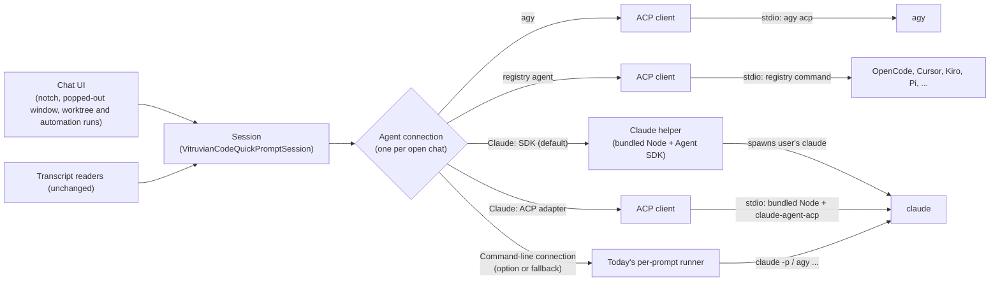

# Vitruvian Code: live agent connections (ACP and the Claude Agent SDK)

*   **Author:** James Nguyen (drafted with Claude)
*   **Status:** Proposed
*   **Date:** 2026-11-11

--------------------------------------------------------------------------------

## Overview

Vitruvian Code (formerly Nexus Agent, `apps/desktop/vitruvian-code/`) is a
macOS app that runs coding agents such as Claude Code and Antigravity (agy).
It ships in two forms:

*   **The standalone app.**
*   **The Vitruvian extension:** the same code, installed through the Vitruvian
    desktop app's extension catalog.

You chat with an agent in the **notch chat**, a panel that drops from the
MacBook notch. You can also pop the chat out into its own window. The app
also runs agents unattended:

*   **Worktree runs:** an agent works in its own git worktree, or several
    agents race on the same task.
*   **Automation runs:** an agent runs on a schedule or a trigger.

Today the app starts a new command-line process for every prompt and reads its
output. Each agent prints in its own format, so the app has one reader per
agent.

This design keeps one connection open for the whole chat instead:

*   **agy** connects through the [Agent Client Protocol](https://agentclientprotocol.com)
    (ACP). ACP is a shared standard for apps to talk to coding agents. The app
    starts it with `agy acp`.
*   **Claude** connects through Anthropic's [Claude Agent SDK](https://code.claude.com/docs/en/agent-sdk/overview)
    by default. The SDK runs in a helper process on Node that ships inside the
    app. It uses the login the user already has in Claude Code. Two other
    Claude connections stay selectable: the `@agentclientprotocol/claude-agent-acp`
    adapter, and today's command line.
*   **Other agents that support ACP** connect through one shared ACP path. The
    [ACP registry](https://agentclientprotocol.com/get-started/agents) lists
    which agents exist.

**T3 Code is the model.** [T3 Code](https://github.com/pingdotgg/t3code) is
an open-source desktop app (Electron) that drives many coding agents. Its
developers work with the AI labs on ACP support. Where T3 Code has already
answered a question, this design copies its answer.

T3 Code file paths below are relative to its repository root, at commit
`d6e5f2e0` (read on 2026-11-11).

## The Problem

What the app cannot do today depends on the agent.

**Claude** runs through the **command-line connection**. The app runs
`claude -p` once per prompt.

*   **Approvals already work, except in YOLO.** In the standard and
    accept-edits modes, the app starts Claude with
    `--input-format stream-json --permission-prompt-tool stdio`. It answers
    Claude's approval requests mid-turn (`VitruvianCodeSupport.swift`,
    `VitruvianCodeApprovalCardView`). Only YOLO, the default mode, skips
    approvals.
*   **One process per prompt.** Each turn starts Claude again and reloads the
    session from disk.
*   **Stopping kills the process.** There is no clean "stop this turn".
*   **No changes mid-chat.** The user can't switch the model or the thinking
    level while chatting.
*   **Events are guessed.** Tool steps, plans and subagents are read out of the
    printed output.

**agy** is worse off:

*   **No approvals at all.** The app always starts agy with
    `--dangerously-skip-permissions`.
*   **Events come from transcripts.** Subagents and turn results are inferred
    from agy's transcript files. The stuck subagent list fixed in
    [PR #4538](https://github.com/VitruvianSoftware/vitruvian-core/pull/4538)
    was caused by this: the app had to work out from transcript text that
    subagents had been killed.

**Every agent** needs its own output reader in
`VitruvianCodeFleetAndCatalog.swift` and `VitruvianCodeSupport.swift`. That
covers Claude stream-json, agy, Codex JSONL, Gemini, Qwen, Amp, Cursor and
OpenCode. A new agent, or a format change in an existing one, means new
parsing code and new tests.

ACP and the Agent SDK both fix this. They keep a connection open and send
typed events: text, tool call, plan, approval request, turn finished. The app
can answer the agent while it works.

## Goals

*   **A live connection per chat.** agy uses ACP and Claude uses the Agent SDK
    by default. That means one process for the conversation, not one per
    prompt.
*   **Answer the agent mid-turn, for every agent.** The user can:
    *   approve or deny an action;
    *   answer a question;
    *   stop a turn without ending the session.
*   **Approval modes, per chat, as in T3 Code:**
    *   full access (the default);
    *   auto-accept edits;
    *   approval required;
    *   auto, only where the agent has a distinct auto mode.

    A separate **plan** switch sits beside the mode. Today's settings carry
    over (see Section 8).
*   **Claude keeps working on the user's existing Claude Code login,** with no
    API key needed. An API key or another endpoint is optional. It's set
    through a Claude config folder and environment variables, as in T3 Code.
*   **Three Claude connections the user can pick from:**
    *   the Agent SDK (default);
    *   the `@agentclientprotocol/claude-agent-acp` adapter;
    *   the command line.
*   **One ACP path for every other ACP agent,** so adding an agent from the ACP
    registry needs no new parsing code.
*   **Every stable ACP feature, per agent, as T3 Code offers it.** "What ACP
    gives us" lists them. Nothing T3 Code offers to an agent is held back. What
    T3 Code deliberately turns off for an agent stays off.
*   **No loss of what works today:**
    *   following outside sessions and saved session history;
    *   the subagent list, the timeline and the diff review;
    *   worktree and automation runs;
    *   the notch chat;
    *   plan mode;
    *   the Telegram bot's shared approval setting.
*   **A safe fallback.** If a live connection fails to start, the chat uses the
    command-line connection, but only when that can honour the chat's approval
    mode (Section 5).

## Non-Goals

*   **Gemini CLI.** It's deprecated in favour of agy. It gets no live
    connection, and its current support isn't extended.
*   **Removing the transcript readers.** They stay the way the app follows
    sessions it didn't start.
*   **Removing the command-line connection.** It stays as a Claude option and
    as the fallback.
*   **Codex's own app-server protocol.** T3 Code uses it for Codex, but Codex
    isn't one of the app's supported agents today. If Codex supports ACP, it
    uses the shared ACP path.
*   **Signing users in to Claude.** The app never handles Claude credentials.
    Sign-in stays in Claude Code's own `claude auth login`.
*   **Anthropic approval for subscription use.** This work doesn't seek it
    (see Risks & Mitigations).
*   **Mobile, remote or multi-machine use** of these connections.

## What ACP gives us (all in scope)

The point is to use what a live connection makes possible, not to swap one way
of running agents for another. Each row is something the app either can't do
today, or does only for one agent, or by hand.

*   **Columns:** the ACP feature, what agy gets, and what Claude gets through
    the Agent SDK.
*   **Registry agents** get every ACP feature they advertise, under the client
    policy in Section 2.
*   **Sources:** the Claude column was checked against what T3 Code's
    `apps/server/src/orchestration-v2/Adapters/ClaudeAdapterV2.ts` imports and
    calls. The agy column was checked against
    `apps/server/src/provider/acp/AntigravityAcpSupport.ts`.

| What the user gets | ACP feature | agy (ACP) | Claude (SDK) | Today |
|---|---|---|---|---|
| **Stop a turn** and keep the session | `session/cancel` | Yes | `interrupt()` | Kills the process |
| **Approve or deny one action** mid-turn | `session/request_permission` | Yes, new | `canUseTool` | Claude only, outside YOLO |
| **Answer an agent's question** in a form in the chat | `elicitation/create` | Questions arrive inside `request_permission` (T3 Code `extractAntigravityUserInputQuestion`) | `AskUserQuestion` via `canUseTool`; `onElicitation` for MCP servers | Claude only |
| **Approval mode per chat**, plus a plan switch | Session config option | The app answers approvals itself (Section 8) | `permissionMode`, `setPermissionMode()` | One global setting |
| **Pick model, thinking level and other settings** from the agent's own live list | `configOptions`, `session/set_config_option`, `config_option_update` | Yes | `setModel()`, effort and thinking options | Hard-coded in settings |
| **The agent's own slash commands** in a menu, kept current | `available_commands_update` | Yes | Claude's skills and commands read from disk (T3 Code `apps/server/src/provider/Drivers/ClaudeSkills.ts`) | Read from Claude's output; hand-kept list for others |
| **Live plan** with each step's status | `plan` updates | Yes | TodoWrite tool events | Guessed from text |
| **Tool cards:** kind (read, edit, run…), status, and file locations you can click | `tool_call`, `tool_call_update`, `locations` | Yes | Tool use and tool result messages | Parsed per agent |
| **Diffs as the agent edits**, in the chat and the diff review | Tool content `diff` | Yes, from agy's own edits | Edit and Write tool inputs | Parsed after the fact |
| **App-hosted terminals:** live output in the chat and a Stop button per command | `terminal/*`; tool content `terminal` | Not offered: T3 Code turns them off for agy | Bash tool output (Claude runs its own commands) | No |
| **Agent reads and writes files through the app**, limited to the session's folders | `fs/read_text_file`, `fs/write_text_file` | Reads only, and only on agy releases T3 Code hasn't qualified. No writes: offering writes replaces agy's diff edits with whole-file writes | Edit and Write tool events | No |
| **Attach images and files**; an @-mention embeds the file | Prompt content `image`, `resource`, `resource_link` | Where agy advertises them | Image and document content | Claude only |
| **Context-window meter and cost** | `usage_update` | Yes | Usage in result messages | Parsed per agent |
| **Compaction shown as it happens** | `compaction_update`, `compaction_summary_chunk` | Not supported by agy | Compact boundary messages | Not shown |
| **Agent notices** (warnings, rate limits) as banners, not chat text | `notice` | Yes | System and status messages | Not shown |
| **Subagents from typed events** | — | Start from agy's child-work reports. Finish at the end of the turn, as T3 Code does. Kills from tool results. Agy reports no child session IDs, so the PR #4538 rules stay | Task and subagent messages | Inferred from transcripts |
| **Session history from the agent itself:** list, reopen without replay, close, live titles | `session/list`, `session/resume`, `session/load`, `session/close`, `session_info_update` | Yes, plus T3 Code's session-log watch, which catches turns that ended on an upstream error | `resume`, `forkSession`, `getSessionMessages`, `getSubagentMessages` | Transcript files only |
| **Give any agent the user's MCP servers** when a chat starts | `mcpServers` on `session/new` | Yes | `mcpServers`, `mcpServerStatus()` | Each agent set up separately |
| **Extra folders** in a chat's workspace | `additionalDirectories` | Yes | `additionalDirectories` | No |
| **App instructions added to the agent's system prompt** (for example, how to link PRs, as T3 Code does) | `systemPrompt` (append) | Sent again on every new, reopened or resumed session, as agy needs | `systemPrompt` with append | No |
| **Sign in to an agent from the app** | `authMethods`, `authenticate`, terminal auth, `logout` | Yes (`oauth-personal`) | Uses Claude Code's own login | Done in a terminal |
| **New agents with no new code** | ACP registry | — | — | One parser per agent |

### Limited or not used, and why

*   **Session modes** (`session/set_mode`): ACP has deprecated them in favour
    of config options. They're read only for agents that offer modes and no
    config options.
*   **SSE MCP transport:** deprecated by the MCP spec. The app uses stdio and
    HTTP.
*   **Audio prompts:** sent only if an agent advertises
    `promptCapabilities.audio`. None of the target agents do today.
*   **ACP v2 draft and open proposals** (session fork, subagent sessions and
    others): not stable yet. The app adopts them once they're stable, as T3
    Code does.

Each feature is used only when the agent advertises it in `initialize`, and
only when the per-agent client policy offers it. The UI hides any control an
agent doesn't support.

## Technical Plan (Architecture)

### 0. What changes, in one picture

Every connection turns what its agent sends into the same set of events,
listed in Section 1. The session and the UI work only with those events, so
they don't depend on which connection is underneath.

### 1. One connection interface

A new Swift protocol, `AgentConnection`, lives in `VitruvianCodeCore`. Each open
chat owns one. In summary, it can:

*   start or reopen a session;
*   send a prompt;
*   cancel the turn;
*   answer an approval or a question;
*   change a setting;
*   stop.

It sends out one stream of `AgentEvent`. Step 1 of the implementation plan
has the full method list.

`AgentEvent` is the shared vocabulary:

*   text chunk;
*   thinking chunk;
*   tool call started, updated or finished (with file paths and diff);
*   plan updated;
*   subagent started or finished;
*   approval requested;
*   question asked;
*   settings list replaced;
*   commands replaced;
*   usage updated;
*   compaction;
*   notice;
*   turn finished (with stop reason);
*   connection failed.

The existing approval card (`VitruvianCodeApprovalCardView`) and the session's
approval handling (`decideApproval`, "allow for this session") serve every
connection. Nothing new replaces them.

### 2. ACP client (Swift)

One Swift ACP client serves agy, registry agents and the Claude ACP adapter
option. ACP is JSON-RPC 2.0, with one JSON message per line, over the agent
process's standard input and output. The client:

*   sends `initialize`, then `session/new` to start a session;
*   reopens a session with `session/resume` when the agent offers it, and
    otherwise with `session/load`, which replays the whole history;
*   sends `session/prompt` for each turn and `session/cancel` to stop;
*   turns `session/update` notifications into `AgentEvent`s;
*   answers `session/request_permission` either itself (Section 8) or through
    the approval card;
*   implements the other features in "What ACP gives us", which is above this
    section.

**Client policy per agent.** What the app offers an agent (file reads and
writes, terminals, forms) is set per agent. It copies T3 Code's settings in
`packages/provider-acp/src/server/AcpSessionRuntime.ts` (off by default) and
in each agent's support file (on where T3 Code turns it on). For agy, T3 Code's
`apps/server/src/provider/acp/AntigravityAcpSupport.ts` sets three things:

*   no file writes;
*   no terminals;
*   file reads only on agy releases it hasn't qualified.

**agy layer.** agy-specific behaviour sits in a layer on top of the client,
copied from T3 Code's `apps/server/src/provider/acp/Antigravity*.ts`. It covers:

*   sign-in through `oauth-personal`;
*   reopening with `session/resume`;
*   a cancel that waits for the prompt's result;
*   the system prompt sent again on every new, reopened or resumed session;
*   child-work reports turned into subagent events;
*   questions arriving inside `request_permission`;
*   the session-log watch, using agy's own session files, as T3 Code's
    `AntigravitySessionFiles.ts` does.

**Registry agents.** Registry agents use the same client. Some need a small
per-agent file of quirks. T3 Code keeps these in
`packages/provider-acp-registry/src/server/` (for example `claudeAcp.ts` and
`copilotAcp.ts`), and the app does the same. The registry lists the agents.
The app installs them from npm or uv using the bundled Node, as T3 Code's
`packages/provider-acp-registry/src/server/AcpRegistrySupport.ts`, `driver.ts`
and `probe.ts` do. OpenCode uses this path when its ACP mode is available.

### 3. Claude helper (bundled Node + Agent SDK)

The helper is a Node program shipped inside the app. The app starts it with
the bundled Node and talks to it over standard input and output, one JSON
message per line. The messages are a written contract: a JSON Schema file
that both sides test against. The helper:

*   calls the Agent SDK's `query()` with `pathToClaudeCodeExecutable` set to
    the user's own `claude`, so Claude Code's own login and settings apply;
*   passes through an optional `CLAUDE_CONFIG_DIR` and extra environment
    variables (for an API key or another endpoint), as T3 Code's Claude
    instances do (`docs/user/providers-claude.md`);
*   forwards each SDK permission check (`canUseTool`) to the app;
*   reopens a saved conversation with the SDK's `resume` option;
*   takes MCP server secrets over standard input, never as process arguments
    or environment variables, as T3 Code does.

The helper never reads, stores or handles Claude credentials.

**Ollama (claude)** uses this same connection, with Ollama's endpoint set
through environment variables. That's how T3 Code handles router connections.

### 4. Claude through the ACP adapter (option)

The bundled Node runs `@agentclientprotocol/claude-agent-acp`. The app talks to
it with the ACP client from Section 2, the same way it talks to agy. It drives
the user's own `claude`, so it uses the same login.

### 5. Command-line connection (option and fallback)

Today's per-prompt runner, including Claude's stream-json approval path, is
wrapped as an `AgentConnection`. How it works doesn't change. It's used:

*   when the user picks it for Claude;
*   for agents with no live connection;
*   as the fallback.

**Fallback rules:**

*   **What "fails to start" means:** the process won't launch, `initialize`
    fails, or there's no session within 30 seconds. A crash after the session
    has started is handled by Section 7 (restart and resume), not by the
    fallback.
*   **The fallback is automatic, and the chat says so.**
*   **It never weakens the chat's approval mode.** If the command-line
    connection can't honour the mode, the chat shows the error and offers a
    retry instead. One example is agy in "approval required", because agy's
    command line only runs with `--dangerously-skip-permissions`.

### 6. Bundled Node and helper packaging

T3 Code runs its server on Electron's own built-in Node
(`apps/desktop/src/backend/DesktopBackendConfiguration.ts`, `ELECTRON_RUN_AS_NODE`).
This Swift app has no built-in Node, so the equivalent is to ship one Node
binary for each architecture (arm64 and x86_64). Bazel builds and signs it
with the app. Alongside it go the helper's JavaScript and its locked
dependencies (`@anthropic-ai/claude-agent-sdk`,
`@agentclientprotocol/claude-agent-acp`). The costs are listed in Risks &
Mitigations.

The optional Telegram bot keeps using the user's own Node, as it does today.

### 7. Session lifecycle

*   **One connection per open chat.** Opening a chat starts its connection.
    Closing the chat or quitting the app stops it. A notch chat counts as open
    while its session is loaded, even when the panel is hidden.
*   **Process groups.** Each connection owns its process group. `stop()` ends
    the whole group: the helper, `claude`, subagents and MCP servers. It allows
    a grace period, then forces the kill, as T3 Code's `AcpSessionRuntime.ts`
    does.
*   **Idle shutdown.** A chat idle for 30 minutes stops its connection and
    reopens the session on the next prompt.
*   **Crash recovery.** If the process exits during a session:
    *   a turn that was running ends as "interrupted";
    *   pending approvals are cancelled;
    *   the next prompt restarts the process and reopens the session
        (`session/resume` for agy, SDK `resume` for Claude);
    *   a helper crash and a `claude` crash are reported separately;
    *   after 3 failed restarts in a row, the chat shows the error.
*   **No duplicate events.** For chats the app started, the UI uses the
    connection's events, and the transcript follower doesn't run for those
    chats. **Transcript readers** read agy's and Claude's saved session files.
    The **transcript follower** is the part that watches a running session
    the app didn't start.
*   **Worktree mode.** The app creates the worktree itself
    (`VitruvianCodeWorktreeEngine`) and starts the connection inside it. On the
    live connections this replaces Claude's `-w` flag.

### 8. Approvals

Each chat has an approval mode and a separate plan switch, as in T3 Code
(`packages/contracts/src/providerPolicy.ts`; plan is its own
`interactionMode` in `ClaudeAdapterV2.ts`).

| Mode | Behaviour | Claude (SDK) | agy (ACP) |
|---|---|---|---|
| **Full access** (default) | No approvals | `bypassPermissions` | The app allows every request |
| **Auto-accept edits** | File edits go through; everything else asks | `acceptEdits` | The app allows edits and asks about the rest |
| **Approval required** | Every guarded action asks | `default` | Every request is shown |
| **Auto** (Claude only) | Claude's own automatic judgement of what is safe to run | `auto` | Hidden: agy has no distinct auto mode |
| **Plan switch** | The agent plans and doesn't act | `plan` | agy's plan mode where it offers one |

**agy over ACP.** agy over ACP always runs in agy's `default` mode, and the app
answers each request according to the chat's mode. agy isn't started with
`--dangerously-skip-permissions`, and the app never asks agy for its `yolo` or
`auto_edit` modes. T3 Code does the same, because the agy CLI rejects those
modes (`antigravityCliSessionMode` in `AntigravityAcpSupport.ts`). Doing it
this way has two benefits:

*   every action is visible to the app;
*   a mode change takes effect on the next turn, with no restart.

The command-line connection keeps today's flags.

**Today's settings carry over:**

| Today (`VitruvianCodeApprovalMode`) | New mode |
|---|---|
| `yolo` | Full access |
| `acceptEdits` | Auto-accept edits |
| `standard` | Approval required |
| `plan` | Approval required, with the plan switch on |

**Who owns the setting.** Each chat has its own mode, as T3 Code has one per
thread. New chats start from the global default. That default stays in
`.env` (`AGY_APPROVAL_MODE`), and the Telegram bot keeps reading it
unchanged.

**Unattended runs.** Claude can still ask for approval even in full access:

*   some checks and settings rules always ask;
*   Claude's settings can switch bypass off (`disableBypassPermissionsMode`);
*   Claude refuses bypass when running as root.

When bypass is switched off, the app drops to the next mode Claude allows and
shows a notice, as T3 Code does. In a worktree or automation run, an approval
request raises a system notification and waits. After 15 minutes without an
answer, it's denied and the run is marked "needs attention". That's T3 Code's
inactivity timeout for agy.

### 9. Settings

The provider settings gain a **Connection** choice per agent:

*   **agy:** ACP (default) or command line.
*   **Claude:** Agent SDK (default), ACP adapter or command line, plus an
    optional Claude config folder and environment variables.
*   **Ollama (claude):** Agent SDK, with Ollama's endpoint.
*   **OpenCode and registry agents:** ACP when available, otherwise command
    line.

**MCP servers.** The app keeps its own MCP server list. On first use it
imports the user's Claude Code MCP configuration. The editable command
templates stay for the command-line connection.

## Alternatives Considered

### Keep today's per-prompt method and improve the parsers

Keep one process per prompt and keep fixing each agent's reader.

*   **Rejected because** it fixes none of the main problems. agy still can't
    ask for approval. No agent can be stopped cleanly or changed mid-chat. The
    app still guesses events such as killed subagents from text (PR #4538).
    Every new agent still needs a new reader.

### ACP for every agent, Claude included, with no other path

Run every agent through ACP. Claude would go only through the
`claude-agent-acp` adapter, and the command templates would go away.

*   **Rejected because** Claude has no built-in ACP mode, so it would depend on
    one third-party adapter keeping up with Claude Code. Dropping the command
    templates would also break any agent without ACP. T3 Code doesn't do this
    either: it uses the Agent SDK for Claude and its own server protocol for
    Codex. The adapter stays as an option.

### Only agents with built-in ACP; Claude stays on the command line

Move agy to ACP and keep Claude on `claude -p`.

*   **Rejected because** Claude is one of the app's two main agents. On the
    command line it keeps one process per prompt, has no clean stop and no
    settings changes mid-chat, and its events are still guessed. The
    command-line connection stays as an option, not as Claude's only path.

### Keep Claude's stream-json path from Swift as the default

Make today's Claude path, the two-way stream-json mode with
`--permission-prompt-tool stdio`, the main Claude connection, and skip the SDK
and Node.

*   **Rejected because** it's still one process per prompt, and the
    stream-json control protocol isn't Anthropic's documented interface. The
    Agent SDK is the documented one, and it drives that protocol for you. It
    also departs from T3 Code, which uses the SDK. This path stays as the
    command-line option and the fallback.

### Why not move everything to ACP?

Two limits apply whichever path is chosen:

*   **Sessions started outside the app.** ACP and the SDK only cover sessions
    the app itself starts. Following a session the user runs in a terminal, or
    showing saved sessions, still needs the transcript readers.
*   **Claude has no built-in ACP mode** (Claude Code 2.1.318). Its ACP option
    is a third-party adapter, which is itself built on the Agent SDK.

### Use the user's own Node for the helper

Reuse the app's existing Node lookup (`VitruvianCodeSupport.locateNode`:
Homebrew, the official installer, `~/.local/bin`), as the Telegram bot does,
and fall back to the command line when no Node is found.

*   **Rejected because** macOS ships no Node, so the default Claude connection
    would quietly not work for anyone who hasn't installed Node. T3 Code never
    relies on the user's Node on macOS.

### Compile the helper into one standalone program

Build the helper with Node's single-executable feature or Bun's compiler.

*   **Rejected for now:**
    *   the Agent SDK and the ACP adapter load files at run time that these
        compilers may miss;
    *   it needs new Bazel toolchain work;
    *   shipping Node next to plain JavaScript avoids both.

    T3 Code does use a single program for its WSL runtime. If the size and
    signing costs of bundled Node (see Risks) prove too high, this is the
    fallback option.

## Risks & Mitigations

| Risk | Mitigation |
|---|---|
| **Anthropic's terms for the SDK default.** [Anthropic's Agent SDK page](https://code.claude.com/docs/en/agent-sdk/overview) says third-party products should not "offer claude.ai login … including agents built on the Claude Agent SDK". The [legal page](https://code.claude.com/docs/en/legal-and-compliance) allows a user's own subscription in the unmodified `claude` when sign-in goes through Anthropic's own flow. | Accepted. T3 Code ships the SDK on the user's own login, and this design does the same: the app never handles credentials. If Anthropic objects, the command-line connection stays available. |
| **Unattended runs waiting forever** on an approval nobody sees. | Section 8: a system notification, then an automatic deny after 15 minutes and a "needs attention" mark. If bypass is switched off, the app shows a notice. |
| **Too many processes.** Each live chat holds a helper, `claude`, subagents and MCP servers, and worktree races multiply that. | Process-group ownership and clean shutdown (Section 7), and idle shutdown after 30 minutes. Memory per connection is measured in step 2 and recorded in this design. |
| **The fallback weakening a stricter approval mode.** | Section 5: the fallback runs only if the command line can honour the mode. Otherwise the chat shows an error. |
| **Security of full access.** Full access stays the default, as in T3 Code. | App file writes and terminals are offered only where T3 Code offers them, and always limited to the session's folders. In full access, agy's approvals pass through the app, so every action is visible. |
| **Bundled Node costs:** larger bundle, signing, and patching. | One Node binary per architecture, signed with the app. It needs the signing entitlements that let Node's JIT compiler run under Apple's hardened runtime. Node is pinned in `//:.nvmrc`, and Node security releases follow the repo's dependency updates. Size is measured in step 3. A single-program helper is the fallback (see Alternatives). |
| **The Agent SDK drifting from the user's `claude` version.** | Pin the SDK, read the `claude` version at start-up, and show a warning if they don't match, as T3 Code's `apps/server/src/provider/Drivers/ClaudeExecutable.ts` does. |
| **agy behaving differently over ACP than T3 Code expects.** | Recorded replay tests from a real `agy acp` session (step 2). The facts below are checked before anything depends on them. |

## Facts to verify

These don't need a decision. They're checked during implementation.

*   **Whether `agy acp` still writes agy's transcript files.** T3 Code reads
    agy's session logs (`AntigravitySessionFiles.ts`), so this design expects
    them. The first change in step 2 confirms it.
*   **Memory per live connection,** measured in step 2 and recorded here.

## Decisions

Settled with the owner while drafting. For anything not listed here, the rule
is: where T3 Code has solved the same question, copy T3 Code.

| Question | Decision | T3 Code reference |
|---|---|---|
| Scope | Live connections wherever the agent supports them; the command line for the rest | Per-provider adapters plus one ACP registry adapter |
| agy | ACP, started with `agy acp` in `default` mode; the app answers approvals itself | `apps/server/src/orchestration-v2/Adapters/AntigravityAdapterV2.ts`, `apps/server/src/provider/acp/AntigravityAcpSupport.ts` |
| Claude default | Claude Agent SDK on the user's existing Claude Code login; API key optional | `ClaudeAdapterV2.ts`, `docs/user/providers-claude.md` |
| Claude options | Also selectable: `@agentclientprotocol/claude-agent-acp`, and the command line | `packages/provider-acp-registry/src/server/claudeAcp.ts` |
| Other ACP agents | One shared ACP connection, using the ACP registry | `packages/provider-acp-registry/src/server/AcpRegistrySupport.ts`, `driver.ts`, `probe.ts` |
| Node for the helper | Node ships inside the app; users never install Node | T3 Code reuses Electron's own Node (`apps/desktop/src/backend/DesktopBackendConfiguration.ts`) |
| Approval modes | Per chat: full access (default), auto-accept edits, approval required, auto where offered, and a plan switch | `DEFAULT_RUNTIME_MODE = "full-access"` (`packages/contracts/src/providerPolicy.ts`) |
| Client features per agent | Off by default, on where T3 Code turns them on; agy gets no writes and no terminals | `AcpSessionRuntime.ts`, `AntigravityAcpSupport.ts` |
| Reopening agy sessions | `session/resume`, not `session/load` (load replays every tool call) | `resumeMethod: "resume"` in `AntigravityAcpSupport.ts` |
| Claude terms risk | Accepted; see Risks & Mitigations | `docs/user/providers-claude.md` |
| Gemini CLI | Out of scope (deprecated in favour of agy) | — |

## References

*   T3 Code: <https://github.com/pingdotgg/t3code>, commit `d6e5f2e06faf45eb46ee5999ab1363daaea4e1c2`
*   Agent Client Protocol, v1: <https://agentclientprotocol.com/protocol/overview>
*   ACP registry: <https://agentclientprotocol.com/get-started/agents>
*   Claude Agent SDK: <https://code.claude.com/docs/en/agent-sdk/overview>
*   Claude Code legal and compliance: <https://code.claude.com/docs/en/legal-and-compliance>
*   PR #4538 (stuck subagent list): <https://github.com/VitruvianSoftware/vitruvian-core/pull/4538>

## Detailed Implementation

Paths are relative to `apps/desktop/vitruvian-code/` unless they start with
`//` (repo root). No code here; types and methods are named so the work can be
done without further design decisions. Where a behaviour is not spelled out,
copy the named T3 Code file.

### Delivery order

Each step is its own pull request, ships behind the per-agent **Connection**
setting (default unchanged until step 6), and leaves the app working.

1.  Connection interface and today's runner wrapped behind it (no behaviour change).
2.  Swift ACP client and agy over ACP.
3.  Claude helper (bundled Node + Agent SDK) and the Claude ACP adapter option.
4.  Chat UI for the new events (approvals, forms, plan, terminals, settings pickers, usage, notices).
5.  Registry agents, MCP servers, extra folders, sign-in.
6.  Defaults switched: agy → ACP, Claude → Agent SDK; docs and release notes.

### Files

#### Step 1: connection interface

| File | Change | Why |
|---|---|---|
| `macos/Sources/VitruvianCodeCore/AgentConnection.swift` (new) | `protocol AgentConnection` with `start(workingDirectory:additionalDirectories:resumeSessionID:mcpServers:systemPromptAppend:)`, `prompt(_ blocks: [PromptBlock])`, `cancel()`, `answer(requestID:with:)`, `setConfigOption(id:value:)`, `stop()`, `events: AsyncStream<AgentEvent>`, and `capabilities: AgentCapabilities` | One interface the session uses for every agent |
| `macos/Sources/VitruvianCodeCore/AgentEvent.swift` (new) | `enum AgentEvent`: message chunk (with message ID), thought chunk, tool call started / updated (kind, status, title, locations, diff, terminal ID, raw input/output), plan replaced, approval requested (options with kind), form requested (flat schema), form completed, config options replaced, commands replaced, usage updated (used, size, cost), compaction started / chunk / finished, notice, subagent started / finished, session info updated, turn finished (stop reason), connection failed. `enum PromptBlock`: text, image, embedded file, file link, audio. `struct AgentCapabilities` mirrors ACP agent capabilities | The common vocabulary from "What ACP gives us" |
| `macos/Sources/VitruvianCodeCore/CommandLineConnection.swift` (new) | Wraps the existing per-prompt runner and parsers as an `AgentConnection`; `cancel()` kills the process as today; reports no approval, form, terminal or config capabilities | Today's method becomes one selectable connection and the fallback |
| `macos/Sources/VitruvianCodeCore/VitruvianCodeQuickPromptSession.swift` | Session talks only to `AgentConnection`; one connection per open chat; does not run the transcript follower for chats with a live connection; restarts and resumes on `connection failed` at the next prompt | Section 7 lifecycle; no duplicate events |
| `macos/Sources/VitruvianCodeCore/VitruvianCodeEngine.swift` | Moves process launching for chat turns out to the connections; keeps transcript reading for outside sessions and history | Engine stops owning per-prompt launches |
| `macos/Sources/VitruvianCodeCore/VitruvianCodeFleetAndCatalog.swift` | Existing normalized event type extended to carry `AgentEvent`; parsers unchanged but only used by `CommandLineConnection`; Gemini CLI entry marked deprecated, not removed | Timeline, subagent list and diff review read one event source |
| `macos/Sources/VitruvianCodeCore/VitruvianCodeStoredProviders.swift` | Per-agent `connection` field (`acp`, `claudeSDK`, `claudeACP`, `commandLine`), `approvalMode`, optional Claude config folder and environment variables; migration keeps existing users on `commandLine` until step 6 | Settings in section 9 |
| `macos/Tests/AgentConnectionTests.swift` (new) | `CommandLineConnection` produces the same events as today for the existing stream fixtures | Proves step 1 changes nothing |
| `macos/Tests/StreamParityTests.swift`, `macos/Tests/EngineHostTests.swift` | Run through `CommandLineConnection` | Existing coverage keeps guarding the old path |

#### Step 2: ACP client and agy

| File | Change | Why |
|---|---|---|
| `macos/Sources/VitruvianCodeCore/ACP/ACPTransport.swift` (new) | Starts the agent process, newline-delimited JSON-RPC 2.0 over stdin/stdout, request IDs, `$/cancel_request`, stderr captured to the chat's log; secrets redacted before logging (T3 Code `AcpSessionRuntime.ts`) | ACP transport |
| `macos/Sources/VitruvianCodeCore/ACP/ACPSchema.swift` (new) | Codable types for ACP v1: initialize, auth, session new / load / resume / list / close / delete, prompt and content blocks, all `session/update` kinds, permission, elicitation, fs, terminal, config options, errors (-32000, -32002, -32601, -32602, -32800) | Typed protocol |
| `macos/Sources/VitruvianCodeCore/ACP/ACPConnection.swift` (new) | `AgentConnection` over ACP: advertises fs read/write, terminal, elicitation form and url, boolean config options, compaction, notices; checks agent capabilities before each call; maps updates to `AgentEvent`; `session/resume` when offered, else `session/load`; `session/close` on stop | The shared ACP path |
| `macos/Sources/VitruvianCodeCore/ACP/ACPClientFiles.swift` (new) | `fs/read_text_file` (line, limit) and `fs/write_text_file`; refuses paths outside the session's folders; writes raise a tool event so the diff shows | ACP file features, scoped to the workspace |
| `macos/Sources/VitruvianCodeCore/ACP/ACPClientTerminals.swift` (new) | `terminal/create`, `output`, `wait_for_exit`, `kill`, `release`; `cwd` must be inside the session's folders; output byte limit honoured (T3 Code `clientTerminals.ts`) | App-hosted terminals |
| `macos/Sources/VitruvianCodeCore/ACP/ACPElicitation.swift` (new) | Validates the flat form schema, defaults, accept / decline / cancel; url mode shows the full URL and host and opens it only after consent (T3 Code `elicitationForm.ts`) | Forms in the chat |
| `macos/Sources/VitruvianCodeCore/ACP/ACPSessionConfig.swift` (new) | Config options: select and boolean, categories (mode, model, model_config, thought_level), `set_config_option`; falls back to session modes only when no config options (T3 Code `sessionConfig.ts`) | Model, thinking and approval pickers |
| `macos/Sources/VitruvianCodeCore/ACP/AntigravityACP.swift` (new) | agy specifics copied from T3 Code `provider/acp/AntigravityAcpSupport.ts`, `AntigravityProtocol.ts`, `AntigravityChildWork.ts`, `AntigravityTurnOutcome.ts`: start `agy acp`, auth method `oauth-personal`, resume via `session/resume`, cancel waits for the prompt result, approval mode to agy mode (`yolo`, `auto_edit`, `default`), system prompt append sent on every activation, child work to subagent events | agy behaves as in T3 Code |
| `macos/Tests/ACP/ACPTransportTests.swift` (new) | Framing, partial lines, out-of-order responses, cancellation | Transport correctness |
| `macos/Tests/ACP/ACPConnectionTests.swift` (new) | Replay fixtures from a recorded `agy acp` session drive every `AgentEvent` kind; capability gating hides unsupported features | Event mapping |
| `macos/Tests/ACP/ACPClientFilesAndTerminalsTests.swift` (new) | Path refusal outside session folders; terminal lifecycle | Safety of the client features |
| `macos/Tests/ACP/Fixtures/agy-*.ndjson` (new) | Recorded with a script modelled on T3 Code `apps/server/scripts/record-*-acp-replay-fixture.ts` | Repeatable tests without a live agent |
| `macos/scripts/record-acp-fixture` (new) | Records an ACP exchange to ndjson | Produces the fixtures above |

The first change in step 2 checks whether `agy acp` still writes agy's
transcript files (the remaining fact in Open Questions) and records the answer
in this design.

#### Step 3: Claude helper and Claude ACP option

| File | Change | Why |
|---|---|---|
| `macos/claude-helper/package.json` (new) | Pinned `@anthropic-ai/claude-agent-sdk` and `@agentclientprotocol/claude-agent-acp`; in the pnpm workspace (`//pnpm-workspace.yaml`) and `//pnpm-lock.yaml` | Locked dependencies |
| `macos/claude-helper/src/main.ts` (new) | Line-delimited JSON over stdio speaking `AgentEvent` / commands; calls `query()` with `pathToClaudeCodeExecutable` (the user's `claude`), `resume`, `permissionMode`, `canUseTool` (forwards approvals and `AskUserQuestion`), `onElicitation`, `mcpServers`, `additionalDirectories`, `systemPrompt` append, `includePartialMessages`; handles `interrupt`, `setModel`, `setPermissionMode`, `mcpServerStatus`, `forkSession`, `getSessionMessages`, `getSubagentMessages`; maps SDK messages to events as T3 Code `ClaudeAdapterV2.ts` does | The default Claude connection |
| `macos/claude-helper/src/skills.ts` (new) | Reads Claude's skills and commands from disk for the slash menu (T3 Code `Drivers/ClaudeSkills.ts`) | Claude slash commands |
| `macos/claude-helper/BUILD` (new) | `js_binary` / bundle target with aspect_rules_js; output is the helper JavaScript plus node_modules | Built by Bazel |
| `macos/claude-helper/test/*.test.ts` (new) | Message mapping from recorded SDK streams; approval round-trip | Helper correctness |
| `macos/Sources/VitruvianCodeCore/ClaudeSDKConnection.swift` (new) | `AgentConnection` that starts the bundled Node with the helper and speaks its protocol; passes `CLAUDE_CONFIG_DIR` and the user's extra environment variables | App side of the helper |
| `macos/Sources/VitruvianCodeCore/ClaudeACPConnection.swift` (new) | `ACPConnection` whose process is the bundled Node running `claude-agent-acp` | The Claude ACP option |
| `macos/Sources/VitruvianCodeCore/BundledNode.swift` (new) | Locates the Node runtime and helper inside the app or extension bundle; never the user's Node | Node ships with the app (T3 Code approach) |
| `macos/BUILD` | Adds a pinned Node runtime for arm64 and x86_64 (from the repo's `rules_nodejs` toolchain, pinned by `//:.nvmrc`), the helper bundle and the adapter to the app's Resources and to `tool-folder` (`built/vitruvian-code/bin/node`, `bin/claude-helper/`), signed with the rest of the bundle | Packaging |
| `macos/tool/vitruvian-tool.json` | Description updated to say what the extension does now (agents, not only the Telegram bot) | Accurate listing |
| `macos/Tests/ClaudeSDKConnectionTests.swift` (new) | Starts the real bundled helper with a fake `claude` that replays a recorded stream | End-to-end app ↔ helper |

#### Step 4: chat UI

| File | Change | Why |
|---|---|---|
| `macos/Sources/VitruvianCodeUI/AgentApprovalCard.swift` (new) | Action, file or command, and the agent's options with kind icons | Approvals |
| `macos/Sources/VitruvianCodeUI/AgentFormCard.swift` (new) | Renders the flat form; review before send; url-mode consent | Forms |
| `macos/Sources/VitruvianCodeUI/AgentPlanView.swift` (new) | Live plan with step status | Plans |
| `macos/Sources/VitruvianCodeUI/AgentTerminalView.swift` (new) | Live terminal output in a tool card, Stop button, output kept after release | Terminals |
| `macos/Sources/VitruvianCodeUI/AgentSettingsBar.swift` (new) | Pickers for config options (model, thinking level, approval mode, booleans) from the agent's live list | Settings from the agent |
| `macos/Sources/VitruvianCodeUI/VitruvianCodeToolStepViews.swift` | Tool cards use kind, status, locations (click to open), diffs as they arrive | Rich tool cards |
| `macos/Sources/VitruvianCodeUI/VitruvianCodeComposerPopovers.swift` | Slash menu from the agent's command list; @-mention embeds files; image paste and drop | Commands and attachments |
| `macos/Sources/VitruvianCodeUI/VitruvianCodeChatView.swift`, `VitruvianCodeChatControls.swift` | Stop uses `cancel()`; usage meter (context and cost); notice banners; compaction entry in the timeline | Usage, notices, compaction |
| `macos/Sources/VitruvianCodeUI/VitruvianCodeChatStrings.swift` | Strings for every new view | Localisation |
| `macos/Sources/VitruvianCodeUI/VitruvianCodeTimelineScrubber.swift`, `VitruvianCodeDiffReviewAndDesignViews.swift` | Read tool, plan and diff events from `AgentEvent` | One event source |
| `macos/Tests/BubbleSnapshotTests.swift`, `macos/Tests/TimelineSnapshotTests.swift`, `macos/Tests/AgentCardSnapshotTests.swift` (new) | Snapshots of each new view, light and dark | Visual checks |
| `macos/Tests/BidirectionalApprovalTests.swift`, `PermissionArgumentsTests.swift` | Cover the four approval modes per connection | Approval behaviour |

#### Step 5: registry agents, MCP, folders, sign-in

| File | Change | Why |
|---|---|---|
| `macos/Sources/VitruvianCodeCore/ACP/ACPRegistry.swift` (new) | Reads the ACP registry, keeps agents whose command is installed, starts them with `ACPConnection` (T3 Code `AcpRegistrySessions.ts`) | New agents with no new code |
| `macos/Sources/VitruvianCodeCore/ACP/ACPAuth.swift` (new) | Shows `authMethods`; `authenticate` for agent methods; terminal methods run in a separate interactive process, then reconnect; `logout` when offered | Sign in and out from the app |
| `macos/Sources/VitruvianCodeCore/AgentMCPServers.swift` (new) | Reads the user's MCP server list once and passes it to every connection at session start; stdio servers from workspace files need the user's approval first (T3 Code `mcpOverAcpBridge.ts`) | MCP servers for any agent |
| `macos/Sources/VitruvianCodeCore/AgentSessionHistory.swift` (new) | Uses `session/list`, `session/delete` and `session_info_update` when an agent offers them; otherwise the transcript readers | History from the agent |
| `macos/Sources/VitruvianCode/SettingsView.swift`, `ConfigManager.swift` | Per-agent Connection and approval mode; Claude config folder and environment variables; registry agents list; MCP servers; extra folders per project | Settings in section 9 |
| `macos/Tests/ACP/ACPRegistryTests.swift`, `ACPAuthTests.swift` (new) | Registry filtering; auth flows | Coverage |

#### Step 6: defaults and docs

| File | Change | Why |
|---|---|---|
| `macos/Sources/VitruvianCodeCore/VitruvianCodeStoredProviders.swift` | Default connection: agy → ACP, Claude → Agent SDK; a user's explicit choice is kept | Switch the default once everything works |
| `README.md`, `docs/index.md`, `macos/README.md`, `macos/Sources/VitruvianCodeCore/README.md`, `macos/Sources/VitruvianCodeUI/README.md` | How connections, approval modes, Claude login and API keys, registry agents and MCP servers work | User and contributor docs |
| `docs/designs/vitruvian-code-acp.md` (new) | This design, final version | Design of record |
| `AGENTS.md` (`apps/desktop/AGENTS.md` scope) | Where the ACP client, helper and fixtures live; how to record fixtures | Guidance for agents working here |
| `THIRD_PARTY_NOTICES.md` | Node, Agent SDK, claude-agent-acp licences | Licence compliance |

### Verification

*   `bazel test //apps/desktop/vitruvian-code/...` green at every step.
*   Step 1: existing stream fixtures produce identical events through
    `CommandLineConnection`.
*   Steps 2–3: replay fixtures exercise every `AgentEvent` kind; each fixture
    test is shown to fail when its mapping is removed.
*   Step 4: snapshot tests for each new view; a live click-through in the
    isolated test copy (`com.vitruviansoftware.nexusagent.uitest` recipe) of:
    stop mid-turn, approve and deny, answer a form, switch model, slash
    command, plan, terminal with Stop, image attach, usage meter, subagent
    start and finish, reopen a session.
*   Step 6: one release through the catalog, then the same click-through in
    the installed extension.
