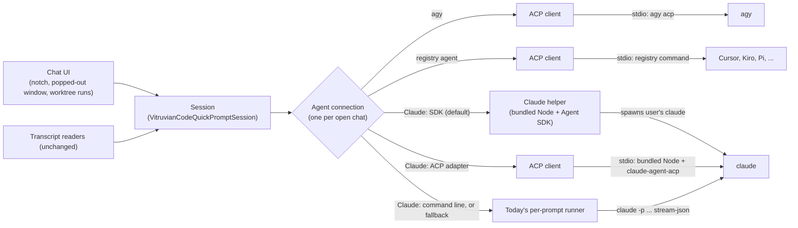

# Vitruvian Code: live agent connections (ACP and the Claude Agent SDK)

*   **Author:** James Nguyen (drafted with Claude)
*   **Status:** Proposed
*   **Date:** 2026-11-11

--------------------------------------------------------------------------------

## Overview

Vitruvian Code (formerly Nexus Agent, `apps/desktop/vitruvian-code/`) is the
macOS chat app and Vitruvian extension that runs coding agents such as Claude
Code and Antigravity (agy). Today it starts a fresh command-line process for
every prompt and reads that process's output. Each agent prints its output in
its own format, so the app carries one reader per agent.

This design moves the app to a live connection that stays open for the whole
conversation:

*   **agy** connects through the Agent Client Protocol (ACP), a shared standard
    for apps to talk to coding agents, by starting `agy acp`.
*   **Claude** connects by default through Anthropic's Claude Agent SDK, run
    inside a small Node helper process, using the login the user already has
    in Claude Code. Two other Claude connections remain selectable: the
    `@agentclientprotocol/claude-agent-acp` adapter, and today's method.
*   **Other agents that support ACP** connect through one shared ACP path,
    driven by the ACP registry of known agents.

Where T3 Code (`pingdotgg/t3code`) has already solved a question, this design
follows T3 Code's approach. T3 Code uses ACP for agy and for registry agents,
and the Agent SDK for Claude, and it relies on the user's own Claude Code login.

## The Problem

The current approach has four costs.

1.  **No live control of a running turn.** Each prompt is a separate process
    that runs to completion. The app cannot answer an agent's question in the
    middle of a turn, cannot approve or deny one action, and can only stop a
    turn by killing the process.
2.  **Permission checks are switched off.** Because there is no way to answer
    an approval request, every agent is started with its permission checks
    disabled (`--dangerously-skip-permissions` for agy,
    `--permission-mode bypassPermissions` for Claude). The agent can edit files
    and run commands without asking.
3.  **One output reader per agent.** The app parses Claude stream-json, Gemini
    and Qwen stream-json, Codex JSONL, Amp, Cursor and others separately
    (`VitruvianCodeFleetAndCatalog.swift`). Each new agent, and each format
    change in an existing agent, needs new parsing code and new tests.
4.  **Structured events are guessed from text.** Tool calls, plans, subagent
    starts and stops, and turn results are pulled out of each agent's own
    output or transcript. The recent stuck subagent list (PR #4538) came from
    exactly this: the app had to infer from transcript text that subagents had
    been killed.

ACP and the Agent SDK both give the app typed events (text, tool call, plan,
permission request, turn finished) over a connection that stays open, so the
app can answer the agent while it works.

**Why not move everything to ACP?** Two limits stay in place regardless:

*   **Sessions started outside the app.** ACP and the SDK only cover sessions
    the app itself starts. Following a session the user runs in a terminal, and
    showing saved sessions, still needs the transcript readers. Those readers
    stay.
*   **Claude has no built-in ACP mode** (Claude Code 2.1.318). Its ACP option is
    a third-party adapter, which is itself built on the Agent SDK.

## Goals

*   **A live connection per chat** for agy (ACP) and Claude (Agent SDK by
    default): one process for the conversation, not one per prompt.
*   **Answer the agent mid-turn:** approve or deny an action, answer a
    question, and cancel a turn without killing the process.
*   **Approval modes per chat,** as in T3 Code: full access (the default, no
    approvals, as today), auto-accept edits, auto, and approval required. In
    the stricter modes, approvals are shown and answered in the chat.
*   **Claude keeps working on the user's existing Claude Code login,** with no
    API key required. An API key or other endpoint stays optional, set through
    a Claude config folder and environment variables, as in T3 Code.
*   **Three selectable Claude connections:** Agent SDK (default), the
    `@agentclientprotocol/claude-agent-acp` adapter, and today's `claude -p`
    method.
*   **One ACP path for every other ACP agent,** so adding an agent from the ACP
    registry needs no new parsing code.
*   **Use every stable ACP feature,** listed in "What ACP gives us", with the
    matching Agent SDK feature for Claude. Nothing in that table is deferred.
*   **No loss of what works today:** following outside sessions, saved session
    history, the subagent list, the timeline, worktree runs and the notch chat
    all keep working.
*   **A safe fallback:** if a live connection fails to start, the chat can use
    today's method and says so.

## Non-Goals

*   **Gemini CLI.** It is deprecated in favour of agy. Its live connection is
    not built; its current support is not extended.
*   **Removing the transcript readers.** They remain the way the app follows
    sessions it did not start.
*   **Removing today's per-prompt method.** It stays as a selectable Claude
    connection and as the fallback.
*   **Codex's own app-server protocol.** T3 Code uses it for Codex; this design
    does not add it. Codex can use the shared ACP path if it supports ACP.
*   **Signing users in to Claude.** The app never handles Claude credentials;
    sign-in stays in Claude Code's own `claude auth login`.
*   **Anthropic approval for subscription use.** Not pursued in this work (see
    Open Questions).
*   **Mobile, remote, or multi-machine use** of these connections.

## Open Questions

None. Every question raised so far is settled by the rule "follow T3 Code"
(see Decisions). Two facts are checked during implementation, not decided:

*   **agy transcript files under ACP.** T3 Code reopens agy sessions with ACP
    `session/resume` and never reads agy's transcript files. Whether `agy acp`
    still writes them only matters for listing app-started agy chats in saved
    history; the first implementation step checks it.
*   **Anthropic's terms for the SDK default (accepted risk).** Anthropic's Agent
    SDK page says third-party products should not "offer claude.ai login …
    including agents built on the Claude Agent SDK"; its legal page allows a
    user's own subscription in the unmodified `claude`, signed in through
    Anthropic's own flow. T3 Code ships the SDK on the user's own login, so
    this design does the same. If Anthropic objects, the command-line option
    stays available.

## Decisions

Decided with the owner during drafting. Rule for anything not listed: where
T3 Code (`pingdotgg/t3code`) has solved the same question, follow T3 Code.

| Question | Decision | T3 Code reference |
|---|---|---|
| Scope | Live connections where the agent supports them; today's method stays for the rest | Per-provider adapters plus one ACP registry adapter |
| agy | ACP, by starting `agy acp` | `AntigravityAdapterV2.ts`, `provider/acp/Antigravity*.ts` |
| Claude default | Claude Agent SDK, using the user's existing Claude Code login; API key optional | `ClaudeAdapterV2.ts` (`@anthropic-ai/claude-agent-sdk`), `docs/user/providers-claude.md` |
| Claude options | Also selectable: `@agentclientprotocol/claude-agent-acp`, and today's `claude -p` method | T3 Code has a Claude ACP entry too (`provider-acp-registry/src/server/claudeAcp.ts`) |
| Other ACP agents | One shared ACP connection, using the ACP registry | `AcpRegistrySessions.ts`, `AcpRegistryAdapterV2` |
| Node for the helper | Ship a pinned Node runtime inside the app; users never install Node | Desktop app runs its server on its own bundled runtime (`process.execPath` with `ELECTRON_RUN_AS_NODE=1`, `DesktopBackendConfiguration.ts`) |
| Approval modes | Per chat: full access (default), auto-accept edits, auto, approval required | `DEFAULT_RUNTIME_MODE = "full-access"` (`packages/contracts/src/providerPolicy.ts`); agy mapping in `antigravityPermissionMode` (`AntigravityAcpSupport.ts`) |
| Reopening agy sessions | ACP `session/resume`, not `session/load` (load replays every tool call) | `resumeMethod: "resume"` in `AntigravityAcpSupport.ts` |
| Claude terms risk | Accepted: same login model as T3 Code | `docs/user/providers-claude.md` |
| Gemini CLI | Out of scope (deprecated in favour of agy) | — |

## What ACP gives us (all in scope)

The point of this work is to use what a live connection makes possible, not
to swap one plumbing for another. Every row below is something the app cannot
do today and will do after this work. "Claude (SDK)" shows the Agent SDK
feature that gives Claude the same result, checked against what T3 Code's
`ClaudeAdapterV2.ts` imports and calls; ACP rows apply to agy, registry agents
and the Claude ACP option.

| What the user gets | ACP feature | Claude (SDK) | Today |
|---|---|---|---|
| **Stop a turn** without killing the agent, keeping the session | `session/cancel` | `interrupt()` | Kill the process |
| **Approve or deny one action** mid-turn, with Allow once / Always / Deny | `session/request_permission` | `canUseTool` | Not possible; checks switched off |
| **Answer an agent's question** in a form in the chat (choices, text, multi-select) | `elicitation/create` (form), `elicitation/complete` | `AskUserQuestion` tool via `canUseTool`; `onElicitation` for MCP servers | Not possible |
| **Approval mode per chat** (full access, auto-accept edits, auto, approval required) | session config option / mode | `permissionMode`, `setPermissionMode()` | One fixed flag |
| **Pick model, thinking level and other agent settings** from the chat, from the agent's own live list | `configOptions`, `session/set_config_option`, `config_option_update` | `setModel()`, effort and thinking options | Hard-coded in settings |
| **Agent's own slash commands** in a menu, kept current | `available_commands_update` | Claude's skills and commands read from disk (T3 Code `Drivers/ClaudeSkills.ts`) | Hand-maintained list |
| **Live plan** with each step's status | `plan` updates | TodoWrite tool events | Guessed from text |
| **Tool cards** with kind (read, edit, run…), status, and file locations to jump to | `tool_call`, `tool_call_update`, `locations` | tool use / result messages | Parsed per agent |
| **Diffs as the agent edits**, shown in the chat and diff review | tool content `diff` | Edit / Write tool inputs | Parsed after the fact |
| **Agent runs commands in app-hosted terminals**: live output in the chat, a Stop button per command | `terminal/create`, `output`, `wait_for_exit`, `kill`, `release`; tool content `terminal` | Bash tool output stream | Not possible |
| **Agent reads and writes files through the app**, so every write is visible and checked against the session's folders | `fs/read_text_file`, `fs/write_text_file` | Edit / Write tool events | Not possible |
| **Attach images and files** (@-mention embeds the file) | prompt content `image`, `resource`, `resource_link` | image and document content | Text only, per agent |
| **Context-window meter and cost** for the chat | `usage_update` | usage in result messages | Parsed per agent |
| **Compaction shown as it happens** | `compaction_update`, `compaction_summary_chunk` | compact boundary messages | Not shown |
| **Agent notices** (warnings, rate limits) as banners, not chat text | `notice` | system / status messages | Not shown |
| **Subagents as real events** (start, finish, killed), not transcript guesses | agy child work over ACP (T3 Code `AntigravityChildWork.ts`) | Task / subagent messages | Inferred from transcripts (PR #4538) |
| **Session history from the agent itself**: list, reopen without replay, close, delete, live titles | `session/list`, `session/resume`, `session/load`, `session/close`, `session/delete`, `session_info_update` | `resume`, `forkSession`, `getSessionMessages`, `getSubagentMessages` | Transcript files only |
| **Give any agent the user's MCP servers** when a chat starts | `mcpServers` on `session/new` (T3 Code `mcpOverAcpBridge.ts`) | `mcpServers` option, `mcpServerStatus()` | Each agent configured separately |
| **Extra folders** in a chat's workspace | `additionalDirectories` | `additionalDirectories` | Not possible |
| **App instructions added to the agent's system prompt** (for example how to link PRs, as T3 Code does) | `systemPrompt` (append) | `systemPrompt` with append | Not possible |
| **Sign in and out of an agent from the app** | `authMethods`, `authenticate`, terminal auth, `logout` | uses Claude Code's own login | Done in a terminal |
| **New agents with no new code**: any agent in the ACP registry appears when installed | ACP registry (`AcpRegistrySessions.ts`) | — | One parser per agent |

**Not used, and why:**

*   **Session modes** (`session/set_mode`): deprecated in ACP in favour of
    config options, which the table already uses. Read only as a fallback for
    agents that offer modes but no config options.
*   **SSE MCP transport:** deprecated by the MCP spec; stdio and HTTP are used.
*   **Audio prompts:** used only if an agent advertises `promptCapabilities.audio`;
    none of the target agents do today. Supported in the client so it works
    when one does.
*   **ACP v2 draft and open proposals** (session fork, subagent sessions and
    others): not stable yet. Adopted when they are stabilised, as T3 Code does.

Each agent only gets the features it advertises in `initialize`; the UI hides
what an agent does not support rather than showing a broken control.

## Technical Plan (Architecture)

### What changes, in one picture

Every connection turns what the agent sends into the same small set of events.
The session and the UI only ever see those events, so they do not care which
connection is underneath.

### 1. One connection interface

A new Swift protocol, `AgentConnection`, in `VitruvianCodeCore`. Each open
chat owns one. It has five operations and one stream:

*   `start(workingDirectory, resumeSessionID?)`: start the process and open or
    reopen a session. Returns the agent's session ID.
*   `prompt(text, attachments)`: begin a turn.
*   `cancel()`: stop the current turn without ending the process.
*   `answer(requestID, choice)`: reply to an approval or a question.
*   `stop()`: end the process.
*   `events`: an async stream of `AgentEvent`.

`AgentEvent` is the common vocabulary: text chunk, thinking chunk, tool call
started / updated / finished (with file paths and diff when the agent sends
them), plan updated, subagent started / finished, approval requested, question
asked, usage updated, turn finished (with stop reason), and connection failed.
The existing normalized event type in `VitruvianCodeFleetAndCatalog.swift` is
extended to carry these, so the timeline, subagent list and diff review keep
working from one source.

### 2. ACP client (Swift)

One Swift ACP client, used by agy, by registry agents, and by the Claude ACP
adapter option. ACP is JSON-RPC 2.0, one JSON message per line, over the
agent process's standard input and output. The client:

*   sends `initialize`, then `session/new` or `session/load`, then
    `session/prompt` per turn, and `session/cancel`;
*   turns `session/update` notifications into `AgentEvent`s;
*   answers `session/request_permission` by raising an approval event and
    waiting for `answer(...)`;
*   implements every client-side feature in "What ACP gives us" below,
    including file reads and writes, app-hosted terminals, forms
    (elicitation), session config options, slash commands, session list and
    resume, MCP servers, usage, notices and compaction. What each agent is
    offered is set per agent, as T3 Code does (`clientCapabilities` in
    `packages/provider-acp/src/server/AcpSessionRuntime.ts`).

agy-specific behaviour (sign-in detection, its thinking setting, how it
reports child work such as subagents, and slash commands) sits in a thin layer
on top, mirroring T3 Code's `provider/acp/Antigravity*.ts` files.

Registry agents use the same client with no extra layer. The list of agents
and their start commands comes from the ACP registry, as T3 Code's
`AcpRegistrySessions.ts` does; an agent appears only if its command is found
on the machine.

### 3. Claude helper (bundled Node + Agent SDK)

A small Node program shipped inside the app. The app starts it with the
bundled Node and talks to it over standard input and output using the same
event shape as `AgentEvent`, one JSON message per line. The helper:

*   calls the Agent SDK's `query()` with `pathToClaudeCodeExecutable` set to the
    user's own `claude`, so Claude Code's own login and settings are used;
*   passes through an optional `CLAUDE_CONFIG_DIR` and extra environment
    variables (for an API key or another endpoint), as T3 Code's Claude
    instances do;
*   forwards each SDK permission check (`canUseTool`) to the app as an approval
    event and waits for the answer;
*   resumes a saved conversation with the SDK's `resume` option.

The helper never reads, stores or handles Claude credentials.

### 4. Claude through the ACP adapter (option)

The bundled Node runs `@agentclientprotocol/claude-agent-acp`, pinned and
shipped inside the app (no download at run time). The app talks to it with
the ACP client from section 2, exactly as it talks to agy.

### 5. Today's method (option and fallback)

The current per-prompt runner is wrapped behind `AgentConnection` without
changing how it works. It is used when the user picks it for Claude, for
agents with no live connection, and as the fallback when a live connection
fails to start. When the fallback is used, the chat says so and why.

### 6. Bundled Node and helper packaging

A pinned Node runtime for arm64 and x86_64 is added to the app and extension
bundle, alongside the helper's JavaScript and its locked dependencies
(`@anthropic-ai/claude-agent-sdk`, `@agentclientprotocol/claude-agent-acp`).
They are built and signed by Bazel with the rest of the bundle. The existing
optional Telegram bot keeps finding the user's own Node as it does today;
moving it onto the bundled Node is not part of this work.

### 7. Session lifecycle

*   **One process per open chat.** Starting a chat starts its connection;
    closing the chat or quitting the app stops it.
*   **Crash recovery.** If the process exits during a session, the connection
    reports it, and the next prompt restarts the process and reopens the same
    session (ACP `session/resume` for agy, SDK `resume` for Claude), as T3 Code's
    `ProviderRuntimeRecoveryService.ts` does.
*   **Live events drive the chat.** For sessions the app started, the UI uses
    the connection's events. The transcript follower is not run for those
    sessions, so events are not shown twice. The transcript readers keep
    serving sessions started elsewhere and saved history.

### 8. Approvals

Each chat has an approval mode, as in T3 Code:

| Mode | Behaviour | agy ACP mode |
|---|---|---|
| Full access (default) | No approvals, as today | `yolo` |
| Auto-accept edits | File edits go through; other actions ask | `auto_edit` |
| Auto | The agent's own automatic judgement | `default` |
| Approval required | Every guarded action asks | `default` |

For Claude, the modes map to the Agent SDK's permission modes. When an action
needs approval, the chat shows the action, the file or command, and the
options the agent offers (for example Allow once, Always allow, Deny).
Worktree and automation runs use the chat's mode like any other chat; with
the default of full access they never wait for an answer.

### 9. Settings

The provider settings gain, per agent, a **Connection** choice:

*   agy: ACP (default) or command line;
*   Claude: Agent SDK (default), ACP adapter, or command line, plus optional
    Claude config folder and environment variables;
*   registry agents: shown when installed, ACP only.

The existing editable command templates remain for the command-line choice.

## Alternatives Considered

### Keep today's per-prompt method and improve the parsers

Leave the one-process-per-prompt design and keep fixing each agent's reader.

*   **Rejected because** it fixes none of the main problems: the app still
    cannot answer an agent mid-turn, cannot cancel cleanly, and has to guess
    events such as killed subagents from transcript text (the cause of the
    stuck subagent list fixed in PR #4538). Every new agent still needs a new
    parser.

### ACP for every agent, Claude included, with no other path

Run every agent through ACP. Claude would go only through the
`@agentclientprotocol/claude-agent-acp` adapter, and the command templates
would be removed.

*   **Rejected because** Claude has no built-in ACP mode, so Claude would
    depend on one third-party adapter keeping up with Claude Code releases.
    It also drops the editable command templates, so any agent without ACP
    would stop working. T3 Code does not do this either: it uses the Agent SDK
    for Claude and its own server protocol for Codex. The adapter stays as a
    selectable option.

### Only agents with built-in ACP; Claude stays on today's method

Move agy to ACP and leave Claude on `claude -p` with no live connection.

*   **Rejected because** Claude is one of the two main agents, so most chats
    would get no benefit: no mid-turn answers, no clean cancel, no approval
    modes. Today's method stays available as an option, not as the only Claude
    path.

### Drive Claude's two-way stream-json protocol directly from Swift

Skip the Agent SDK and Node; start the user's `claude` in its two-way
stream-json mode and speak that protocol from Swift.

*   **Rejected because** that protocol is what the Agent SDK uses internally,
    not Anthropic's supported interface, so it can change without notice. It
    also departs from T3 Code, which uses the SDK. Its one advantage, no Node,
    is covered by shipping Node inside the app.

### Use the user's own Node for the helper

Reuse the app's existing Node lookup (`VitruvianCodeSupport.locateNode`:
Homebrew, the official installer, `~/.local/bin`), as the optional Telegram bot
does, and fall back to `claude -p` when none is found.

*   **Rejected because** macOS ships no Node, so the default Claude
    connection would silently not work for many users. T3 Code never relies on
    the user's Node on macOS; it runs its server on the runtime bundled in the
    app.

### Compile the helper into one standalone executable

Build the helper with Node's single-executable feature or Bun's compiler, so
no separate Node binary ships.

*   **Rejected because** the Agent SDK and the ACP adapter load files at run
    time that such compilers may not pick up, and it needs new Bazel toolchain
    work. Shipping a pinned Node next to plain JavaScript is closer to T3 Code
    and has fewer unknowns.

### Codex's own app-server protocol

Add Codex through `codex app-server`, as T3 Code does.

*   **Not included** (a non-goal): Codex is not installed on this machine and
    is not one of the app's main agents today. If Codex supports ACP it uses
    the shared ACP path; a dedicated Codex connection can follow later using
    the same `AgentConnection` interface.

## Detailed Implementation

Paths are relative to `apps/desktop/vitruvian-code/` unless they start with
`//` (repo root). No code here; types and methods are named so the work can be
done without further design decisions. Where a behaviour is not spelled out,
copy the named T3 Code file.

### Delivery order

Each step is its own pull request, ships behind the per-agent **Connection**
setting (default unchanged until step 6), and leaves the app working.

1.  Connection interface and today's runner wrapped behind it (no behaviour change).
2.  Swift ACP client and agy over ACP.
3.  Claude helper (bundled Node + Agent SDK) and the Claude ACP adapter option.
4.  Chat UI for the new events (approvals, forms, plan, terminals, settings pickers, usage, notices).
5.  Registry agents, MCP servers, extra folders, sign-in.
6.  Defaults switched: agy → ACP, Claude → Agent SDK; docs and release notes.

### Files

#### Step 1: connection interface

| File | Change | Why |
|---|---|---|
| `macos/Sources/VitruvianCodeCore/AgentConnection.swift` (new) | `protocol AgentConnection` with `start(workingDirectory:additionalDirectories:resumeSessionID:mcpServers:systemPromptAppend:)`, `prompt(_ blocks: [PromptBlock])`, `cancel()`, `answer(requestID:with:)`, `setConfigOption(id:value:)`, `stop()`, `events: AsyncStream<AgentEvent>`, and `capabilities: AgentCapabilities` | One interface the session uses for every agent |
| `macos/Sources/VitruvianCodeCore/AgentEvent.swift` (new) | `enum AgentEvent`: message chunk (with message ID), thought chunk, tool call started / updated (kind, status, title, locations, diff, terminal ID, raw input/output), plan replaced, approval requested (options with kind), form requested (flat schema), form completed, config options replaced, commands replaced, usage updated (used, size, cost), compaction started / chunk / finished, notice, subagent started / finished, session info updated, turn finished (stop reason), connection failed. `enum PromptBlock`: text, image, embedded file, file link, audio. `struct AgentCapabilities` mirrors ACP agent capabilities | The common vocabulary from "What ACP gives us" |
| `macos/Sources/VitruvianCodeCore/CommandLineConnection.swift` (new) | Wraps the existing per-prompt runner and parsers as an `AgentConnection`; `cancel()` kills the process as today; reports no approval, form, terminal or config capabilities | Today's method becomes one selectable connection and the fallback |
| `macos/Sources/VitruvianCodeCore/VitruvianCodeQuickPromptSession.swift` | Session talks only to `AgentConnection`; one connection per open chat; does not run the transcript follower for chats with a live connection; restarts and resumes on `connection failed` at the next prompt | Section 7 lifecycle; no duplicate events |
| `macos/Sources/VitruvianCodeCore/VitruvianCodeEngine.swift` | Moves process launching for chat turns out to the connections; keeps transcript reading for outside sessions and history | Engine stops owning per-prompt launches |
| `macos/Sources/VitruvianCodeCore/VitruvianCodeFleetAndCatalog.swift` | Existing normalized event type extended to carry `AgentEvent`; parsers unchanged but only used by `CommandLineConnection`; Gemini CLI entry marked deprecated, not removed | Timeline, subagent list and diff review read one event source |
| `macos/Sources/VitruvianCodeCore/VitruvianCodeStoredProviders.swift` | Per-agent `connection` field (`acp`, `claudeSDK`, `claudeACP`, `commandLine`), `approvalMode`, optional Claude config folder and environment variables; migration keeps existing users on `commandLine` until step 6 | Settings in section 9 |
| `macos/Tests/AgentConnectionTests.swift` (new) | `CommandLineConnection` produces the same events as today for the existing stream fixtures | Proves step 1 changes nothing |
| `macos/Tests/StreamParityTests.swift`, `macos/Tests/EngineHostTests.swift` | Run through `CommandLineConnection` | Existing coverage keeps guarding the old path |

#### Step 2: ACP client and agy

| File | Change | Why |
|---|---|---|
| `macos/Sources/VitruvianCodeCore/ACP/ACPTransport.swift` (new) | Starts the agent process, newline-delimited JSON-RPC 2.0 over stdin/stdout, request IDs, `$/cancel_request`, stderr captured to the chat's log; secrets redacted before logging (T3 Code `AcpSessionRuntime.ts`) | ACP transport |
| `macos/Sources/VitruvianCodeCore/ACP/ACPSchema.swift` (new) | Codable types for ACP v1: initialize, auth, session new / load / resume / list / close / delete, prompt and content blocks, all `session/update` kinds, permission, elicitation, fs, terminal, config options, errors (-32000, -32002, -32601, -32602, -32800) | Typed protocol |
| `macos/Sources/VitruvianCodeCore/ACP/ACPConnection.swift` (new) | `AgentConnection` over ACP: advertises fs read/write, terminal, elicitation form and url, boolean config options, compaction, notices; checks agent capabilities before each call; maps updates to `AgentEvent`; `session/resume` when offered, else `session/load`; `session/close` on stop | The shared ACP path |
| `macos/Sources/VitruvianCodeCore/ACP/ACPClientFiles.swift` (new) | `fs/read_text_file` (line, limit) and `fs/write_text_file`; refuses paths outside the session's folders; writes raise a tool event so the diff shows | ACP file features, scoped to the workspace |
| `macos/Sources/VitruvianCodeCore/ACP/ACPClientTerminals.swift` (new) | `terminal/create`, `output`, `wait_for_exit`, `kill`, `release`; `cwd` must be inside the session's folders; output byte limit honoured (T3 Code `clientTerminals.ts`) | App-hosted terminals |
| `macos/Sources/VitruvianCodeCore/ACP/ACPElicitation.swift` (new) | Validates the flat form schema, defaults, accept / decline / cancel; url mode shows the full URL and host and opens it only after consent (T3 Code `elicitationForm.ts`) | Forms in the chat |
| `macos/Sources/VitruvianCodeCore/ACP/ACPSessionConfig.swift` (new) | Config options: select and boolean, categories (mode, model, model_config, thought_level), `set_config_option`; falls back to session modes only when no config options (T3 Code `sessionConfig.ts`) | Model, thinking and approval pickers |
| `macos/Sources/VitruvianCodeCore/ACP/AntigravityACP.swift` (new) | agy specifics copied from T3 Code `provider/acp/AntigravityAcpSupport.ts`, `AntigravityProtocol.ts`, `AntigravityChildWork.ts`, `AntigravityTurnOutcome.ts`: start `agy acp`, auth method `oauth-personal`, resume via `session/resume`, cancel waits for the prompt result, approval mode to agy mode (`yolo`, `auto_edit`, `default`), system prompt append sent on every activation, child work to subagent events | agy behaves as in T3 Code |
| `macos/Tests/ACP/ACPTransportTests.swift` (new) | Framing, partial lines, out-of-order responses, cancellation | Transport correctness |
| `macos/Tests/ACP/ACPConnectionTests.swift` (new) | Replay fixtures from a recorded `agy acp` session drive every `AgentEvent` kind; capability gating hides unsupported features | Event mapping |
| `macos/Tests/ACP/ACPClientFilesAndTerminalsTests.swift` (new) | Path refusal outside session folders; terminal lifecycle | Safety of the client features |
| `macos/Tests/ACP/Fixtures/agy-*.ndjson` (new) | Recorded with a script modelled on T3 Code `apps/server/scripts/record-*-acp-replay-fixture.ts` | Repeatable tests without a live agent |
| `macos/scripts/record-acp-fixture` (new) | Records an ACP exchange to ndjson | Produces the fixtures above |

The first change in step 2 checks whether `agy acp` still writes agy's
transcript files (the remaining fact in Open Questions) and records the answer
in this design.

#### Step 3: Claude helper and Claude ACP option

| File | Change | Why |
|---|---|---|
| `macos/claude-helper/package.json` (new) | Pinned `@anthropic-ai/claude-agent-sdk` and `@agentclientprotocol/claude-agent-acp`; in the pnpm workspace (`//pnpm-workspace.yaml`) and `//pnpm-lock.yaml` | Locked dependencies |
| `macos/claude-helper/src/main.ts` (new) | Line-delimited JSON over stdio speaking `AgentEvent` / commands; calls `query()` with `pathToClaudeCodeExecutable` (the user's `claude`), `resume`, `permissionMode`, `canUseTool` (forwards approvals and `AskUserQuestion`), `onElicitation`, `mcpServers`, `additionalDirectories`, `systemPrompt` append, `includePartialMessages`; handles `interrupt`, `setModel`, `setPermissionMode`, `mcpServerStatus`, `forkSession`, `getSessionMessages`, `getSubagentMessages`; maps SDK messages to events as T3 Code `ClaudeAdapterV2.ts` does | The default Claude connection |
| `macos/claude-helper/src/skills.ts` (new) | Reads Claude's skills and commands from disk for the slash menu (T3 Code `Drivers/ClaudeSkills.ts`) | Claude slash commands |
| `macos/claude-helper/BUILD` (new) | `js_binary` / bundle target with aspect_rules_js; output is the helper JavaScript plus node_modules | Built by Bazel |
| `macos/claude-helper/test/*.test.ts` (new) | Message mapping from recorded SDK streams; approval round-trip | Helper correctness |
| `macos/Sources/VitruvianCodeCore/ClaudeSDKConnection.swift` (new) | `AgentConnection` that starts the bundled Node with the helper and speaks its protocol; passes `CLAUDE_CONFIG_DIR` and the user's extra environment variables | App side of the helper |
| `macos/Sources/VitruvianCodeCore/ClaudeACPConnection.swift` (new) | `ACPConnection` whose process is the bundled Node running `claude-agent-acp` | The Claude ACP option |
| `macos/Sources/VitruvianCodeCore/BundledNode.swift` (new) | Locates the Node runtime and helper inside the app or extension bundle; never the user's Node | Node ships with the app (T3 Code approach) |
| `macos/BUILD` | Adds a pinned Node runtime for arm64 and x86_64 (from the repo's `rules_nodejs` toolchain, pinned by `//:.nvmrc`), the helper bundle and the adapter to the app's Resources and to `tool-folder` (`built/vitruvian-code/bin/node`, `bin/claude-helper/`), signed with the rest of the bundle | Packaging |
| `macos/tool/vitruvian-tool.json` | Description updated to say what the extension does now (agents, not only the Telegram bot) | Accurate listing |
| `macos/Tests/ClaudeSDKConnectionTests.swift` (new) | Starts the real bundled helper with a fake `claude` that replays a recorded stream | End-to-end app ↔ helper |

#### Step 4: chat UI

| File | Change | Why |
|---|---|---|
| `macos/Sources/VitruvianCodeUI/AgentApprovalCard.swift` (new) | Action, file or command, and the agent's options with kind icons | Approvals |
| `macos/Sources/VitruvianCodeUI/AgentFormCard.swift` (new) | Renders the flat form; review before send; url-mode consent | Forms |
| `macos/Sources/VitruvianCodeUI/AgentPlanView.swift` (new) | Live plan with step status | Plans |
| `macos/Sources/VitruvianCodeUI/AgentTerminalView.swift` (new) | Live terminal output in a tool card, Stop button, output kept after release | Terminals |
| `macos/Sources/VitruvianCodeUI/AgentSettingsBar.swift` (new) | Pickers for config options (model, thinking level, approval mode, booleans) from the agent's live list | Settings from the agent |
| `macos/Sources/VitruvianCodeUI/VitruvianCodeToolStepViews.swift` | Tool cards use kind, status, locations (click to open), diffs as they arrive | Rich tool cards |
| `macos/Sources/VitruvianCodeUI/VitruvianCodeComposerPopovers.swift` | Slash menu from the agent's command list; @-mention embeds files; image paste and drop | Commands and attachments |
| `macos/Sources/VitruvianCodeUI/VitruvianCodeChatView.swift`, `VitruvianCodeChatControls.swift` | Stop uses `cancel()`; usage meter (context and cost); notice banners; compaction entry in the timeline | Usage, notices, compaction |
| `macos/Sources/VitruvianCodeUI/VitruvianCodeChatStrings.swift` | Strings for every new view | Localisation |
| `macos/Sources/VitruvianCodeUI/VitruvianCodeTimelineScrubber.swift`, `VitruvianCodeDiffReviewAndDesignViews.swift` | Read tool, plan and diff events from `AgentEvent` | One event source |
| `macos/Tests/BubbleSnapshotTests.swift`, `macos/Tests/TimelineSnapshotTests.swift`, `macos/Tests/AgentCardSnapshotTests.swift` (new) | Snapshots of each new view, light and dark | Visual checks |
| `macos/Tests/BidirectionalApprovalTests.swift`, `PermissionArgumentsTests.swift` | Cover the four approval modes per connection | Approval behaviour |

#### Step 5: registry agents, MCP, folders, sign-in

| File | Change | Why |
|---|---|---|
| `macos/Sources/VitruvianCodeCore/ACP/ACPRegistry.swift` (new) | Reads the ACP registry, keeps agents whose command is installed, starts them with `ACPConnection` (T3 Code `AcpRegistrySessions.ts`) | New agents with no new code |
| `macos/Sources/VitruvianCodeCore/ACP/ACPAuth.swift` (new) | Shows `authMethods`; `authenticate` for agent methods; terminal methods run in a separate interactive process, then reconnect; `logout` when offered | Sign in and out from the app |
| `macos/Sources/VitruvianCodeCore/AgentMCPServers.swift` (new) | Reads the user's MCP server list once and passes it to every connection at session start; stdio servers from workspace files need the user's approval first (T3 Code `mcpOverAcpBridge.ts`) | MCP servers for any agent |
| `macos/Sources/VitruvianCodeCore/AgentSessionHistory.swift` (new) | Uses `session/list`, `session/delete` and `session_info_update` when an agent offers them; otherwise the transcript readers | History from the agent |
| `macos/Sources/VitruvianCode/SettingsView.swift`, `ConfigManager.swift` | Per-agent Connection and approval mode; Claude config folder and environment variables; registry agents list; MCP servers; extra folders per project | Settings in section 9 |
| `macos/Tests/ACP/ACPRegistryTests.swift`, `ACPAuthTests.swift` (new) | Registry filtering; auth flows | Coverage |

#### Step 6: defaults and docs

| File | Change | Why |
|---|---|---|
| `macos/Sources/VitruvianCodeCore/VitruvianCodeStoredProviders.swift` | Default connection: agy → ACP, Claude → Agent SDK; a user's explicit choice is kept | Switch the default once everything works |
| `README.md`, `docs/index.md`, `macos/README.md`, `macos/Sources/VitruvianCodeCore/README.md`, `macos/Sources/VitruvianCodeUI/README.md` | How connections, approval modes, Claude login and API keys, registry agents and MCP servers work | User and contributor docs |
| `docs/designs/vitruvian-code-acp.md` (new) | This design, final version | Design of record |
| `AGENTS.md` (`apps/desktop/AGENTS.md` scope) | Where the ACP client, helper and fixtures live; how to record fixtures | Guidance for agents working here |
| `THIRD_PARTY_NOTICES.md` | Node, Agent SDK, claude-agent-acp licences | Licence compliance |

### Verification

*   `bazel test //apps/desktop/vitruvian-code/...` green at every step.
*   Step 1: existing stream fixtures produce identical events through
    `CommandLineConnection`.
*   Steps 2–3: replay fixtures exercise every `AgentEvent` kind; each fixture
    test is shown to fail when its mapping is removed.
*   Step 4: snapshot tests for each new view; a live click-through in the
    isolated test copy (`com.vitruviansoftware.nexusagent.uitest` recipe) of:
    stop mid-turn, approve and deny, answer a form, switch model, slash
    command, plan, terminal with Stop, image attach, usage meter, subagent
    start and finish, reopen a session.
*   Step 6: one release through the catalog, then the same click-through in
    the installed extension.
