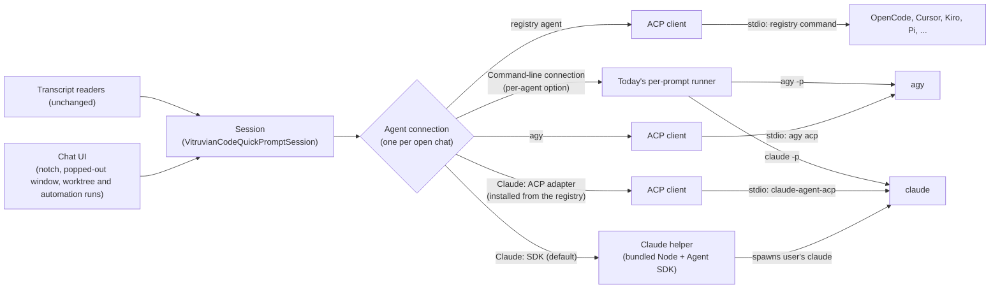

# Vitruvian Code: live agent connections (ACP and the Claude Agent SDK)

*   **Author:** James Nguyen (drafted with Claude)
*   **Status:** Proposed
*   **Date:** 2026-11-11

--------------------------------------------------------------------------------

## Overview

Vitruvian Code (`apps/desktop/vitruvian-code/`) is a
macOS app that runs coding agents such as Claude Code and Antigravity (agy).
It ships in two forms:

*   **The standalone app.**
*   **The Vitruvian extension:** the same code, installed through the Vitruvian
    desktop app's extension catalog.

You chat with an agent in the **notch chat**, a panel that drops from the
MacBook notch. You can also pop the chat out into its own window. The app
also runs agents unattended:

*   **Worktree runs:** an agent works in its own git worktree, or several
    agents race on the same task.
*   **Automation runs:** an agent runs on a schedule or a trigger.

Today the app starts a new command-line process for every prompt and reads its
output. Each agent prints in its own format, so the app has one reader per
agent.

This design keeps one connection open for the whole chat instead:

*   **agy** connects through the [Agent Client Protocol](https://agentclientprotocol.com)
    (ACP). ACP is a shared standard for apps to talk to coding agents. The app
    starts it with `agy acp`.
*   **Claude** connects through Anthropic's [Claude Agent SDK](https://code.claude.com/docs/en/agent-sdk/overview)
    by default. The SDK runs in a helper process on Node that ships inside the
    app. It uses the login the user already has in Claude Code. Two other
    Claude connections stay selectable: the `@agentclientprotocol/claude-agent-acp`
    adapter, and today's command line.
*   **Other agents that support ACP** connect through one shared ACP path. The
    [ACP registry](https://agentclientprotocol.com/get-started/agents) lists
    which agents exist.

**T3 Code is the reference design.** [T3 Code](https://github.com/pingdotgg/t3code)
is an open-source desktop app (Electron) that drives many coding agents over
these same connections. Where T3 Code has already answered a question, this
design copies its answer.

**Terms used below:**

*   **Command-line connection:** today's way of running an agent. The app runs
    one command per prompt and reads its output. The command comes from an
    editable **command template** in settings.
*   **Transcript readers:** the code that reads agy's and Claude's saved session
    files, for session history.
*   **Transcript follower:** the part of the readers that watches a running
    session's files and turns them into chat events.
*   **YOLO:** today's name for the mode that skips all approvals. It is the
    default.

T3 Code file paths below are relative to its repository root, at commit
`d6e5f2e0` (read on 2026-11-11).

## The Problem

What the app cannot do today depends on the agent.

**Claude** runs through the **command-line connection**. The app runs
`claude -p` once per prompt.

*   **Approvals already work, except in YOLO.** In the standard and
    accept-edits modes, the app answers Claude's approval requests mid-turn
    and shows them in `VitruvianCodeApprovalCardView`. To do that it starts
    Claude with `--input-format stream-json --permission-prompt-tool stdio`
    (`VitruvianCodeSupport.swift`). YOLO skips approvals.
*   **One process per prompt.** Each turn starts Claude again and reloads the
    session from disk.
*   **Stopping kills the process.** There is no clean "stop this turn".
*   **No changes mid-chat.** The user can't switch the model or the thinking
    level while chatting.
*   **Events are guessed.** Tool steps, plans and subagents are read out of the
    printed output.

**agy** has larger gaps:

*   **It can't ask anything mid-turn.** The app passes flags by mode
    (`VitruvianCodeApprovalMode.agyArguments`): `--dangerously-skip-permissions`
    for YOLO, `--mode accept-edits`, `--mode plan`, or nothing for standard.
    The default command templates hard-code the YOLO flag. Either way, agy
    can't ask the user to approve an action or answer a question while it
    works.
*   **Events come from transcripts.** Subagents and turn results are inferred
    from agy's transcript files. The stuck subagent list fixed in
    [PR #4538](https://github.com/VitruvianSoftware/vitruvian-core/pull/4538)
    was caused by this: the app had to work out from transcript text that
    subagents had been killed.

**Every agent** needs its own output reader in
`VitruvianCodeFleetAndCatalog.swift` and `VitruvianCodeSupport.swift`. That
covers Claude stream-json, agy, Codex JSONL, Gemini, Qwen, Amp, Cursor and
OpenCode. A new agent, or a format change in an existing one, means new
parsing code and new tests.

For sessions the app starts, ACP and the Agent SDK replace this text parsing
with typed events: text, tool call, plan, approval request, turn finished. They
keep the connection open, so the app can answer the agent while it works.
Sessions started elsewhere still need the transcript readers.

## Goals

*   **A live connection per chat.** agy uses ACP and Claude uses the Agent SDK
    by default. That means one process for the conversation, not one per
    prompt.
*   **Answer the agent mid-turn, for every agent.** The user can:
    *   approve or deny an action;
    *   answer a question;
    *   stop a turn without ending the session.
*   **Approval modes, per chat, as in T3 Code:**
    *   full access (the default);
    *   auto-accept edits;
    *   approval required;
    *   auto, only where the agent has a distinct auto mode.

    A separate **plan** switch sits beside the mode. Today's settings carry
    over (Technical Plan, section 8).
*   **Claude keeps working on the user's existing Claude Code login,** with no
    API key needed. An API key or another endpoint is optional. It's set
    through a Claude config folder and environment variables, as in T3 Code.
*   **Three Claude connections the user can pick from:**
    *   the Agent SDK (default);
    *   the `@agentclientprotocol/claude-agent-acp` adapter;
    *   the command line.
*   **One ACP path for every other ACP agent,** so adding an agent from the ACP
    registry needs no new parsing code.
*   **Each agent gets exactly the ACP features T3 Code enables for it,** listed
    in "What ACP gives us".
*   **No loss of what works today:**
    *   following outside sessions and saved session history;
    *   the subagent list, the timeline and the diff review;
    *   worktree and automation runs;
    *   the notch chat;
    *   plan mode;
    *   the Telegram bot's shared approval setting.
*   **Clear failure handling.** If a live connection fails to start, the chat
    shows the error with **Retry** and **Use command line for this chat**, as
    T3 Code shows the error. It never switches on its own (Technical Plan,
    section 5).

## Non-Goals

*   **Gemini CLI.** It's deprecated in favour of agy. It gets no live
    connection, and its current support isn't extended.
*   **Removing the transcript readers.** They stay the way the app follows
    sessions it didn't start.
*   **Removing the command-line connection.** It stays as a per-agent option
    and as the user's choice when a live connection fails.
*   **Following sessions started outside the app over ACP or the SDK.** Those
    only cover sessions the app starts. Sessions run in a terminal, and saved
    history, still come from the transcript readers.
*   **Codex's own app-server protocol.** T3 Code uses it for Codex, but Codex
    isn't one of the app's supported agents today. If Codex supports ACP, it
    uses the shared ACP path.
*   **Signing users in to Claude.** The app never handles Claude credentials.
    Sign-in stays in Claude Code's own `claude auth login`.
*   **Anthropic approval for subscription use.** This work doesn't seek it
    (see Risks & Mitigations).
*   **Mobile, remote or multi-machine use** of these connections.

## What ACP gives us

The point is to use what a live connection makes possible, not to swap one way
of running agents for another. Each row is something the app either can't do
today, or does only for one agent, or by hand.

**How to read the table:**

*   **The agy, Claude (SDK) and Claude (ACP adapter) columns** say what that
    connection gets. Detail lives in the Technical Plan section named in the cell.
*   **Registry agents** get every ACP feature they advertise, under the client
    policy in Technical Plan, section 2.
*   **A feature is used only when** the agent advertises it in `initialize` and
    the per-agent client policy offers it. The UI hides any control an agent
    doesn't support.
*   **Sources:** the agy column follows T3 Code's
    `apps/server/src/provider/acp/AntigravityAcpSupport.ts`. The Claude (SDK)
    column follows what `apps/server/src/orchestration-v2/Adapters/ClaudeAdapterV2.ts`
    imports and calls. The Claude (ACP adapter) column follows
    `packages/provider-acp-registry/src/server/claudeAcp.ts`.

| What the user gets | ACP feature | agy (ACP) | Claude (SDK) | Claude (ACP adapter) | Today |
|---|---|---|---|---|---|
| **Stop a turn** and keep the session | `session/cancel` | Yes | `interrupt()` | Yes | Kills the process |
| **Approve or deny one action** mid-turn | `session/request_permission` | Yes, new | `canUseTool` | Yes | Claude only, outside YOLO |
| **Answer an agent's question** in a form | `elicitation/create` | Yes; agy sends questions inside `request_permission` (section 2) | `AskUserQuestion`; `onElicitation` for MCP servers | Yes | Claude only |
| **Approval mode per chat**, plus a plan switch | Session config option | The app decides (section 8) | `permissionMode`, `setPermissionMode()` | Yes | One global setting |
| **Pick model, thinking level and other settings** from the agent's live list | `configOptions`, `session/set_config_option` | Yes (section 2, version gates) | `setModel()`, effort and thinking | Yes | Hard-coded in settings |
| **The agent's own slash commands**, kept current | `available_commands_update` | Yes | Skills and commands read from disk (T3 Code `ClaudeSkills.ts`) | Yes | From Claude's output; hand-kept for others |
| **Live plan** with step status | `plan` updates | Yes | TodoWrite events; the helper sets `CLAUDE_CODE_ENABLE_TODO_TOOLS=1` | Yes | Guessed from text |
| **Tool cards:** kind, status, clickable file locations | `tool_call`, `tool_call_update`, `locations` | Yes | Tool use and result messages | Yes | Parsed per agent |
| **Diffs as the agent edits** | Tool content `diff` | Yes, from agy's own edits | Edit and Write tool inputs | Yes | Parsed after the fact |
| **App-hosted terminals** with a Stop button per command | `terminal/*` | Not offered (section 2) | Not used: Claude runs its own commands | Not offered | No |
| **Agent reads and writes files through the app** | `fs/read_text_file`, `fs/write_text_file` | Reads on some releases; no writes (section 2) | Not used | Not offered | No |
| **Attach images and files**; @-mention embeds a file | Prompt content `image`, `resource`, `resource_link` | Where agy advertises them | Image and document content | Yes | Claude only |
| **Context-window meter and cost** | `usage_update` | Where agy reports it (section 2) | Usage in result messages | Yes | Parsed per agent |
| **Usage-limit wait:** when a plan limit is hit, wait for the reset and resume | — | — | Rate-limit messages (T3 Code `claudeUsageLimits.ts`) | — | No |
| **Compaction** as it happens, an "auto-compact after" threshold, and a Compact/Keep chip on idle chats | `compaction_update` | Not supported by agy | Compact messages and settings (T3 Code `docs/user/providers-claude.md`) | Where offered | Not shown |
| **Agent notices** as banners | `notice` | Yes | System and status messages | Yes | Not shown |
| **Subagents from typed events** | — | Start from child-work reports, finish at end of turn (section 2) | Task and subagent messages | `subagent_update` and `session_message`, with child session IDs | Inferred from transcripts |
| **Session history from the agent:** list, reopen without replay, close, live titles, fork | `session/list`, `session/resume`, `session/load`, `session/close`, `session_info_update` | Yes, plus the session-log watch (section 2) | `resume`, `forkSession`, `getSessionMessages` | Yes | Transcript files; fork through `--fork` |
| **The user's MCP servers** for any agent | `mcpServers` on `session/new` | Yes | `mcpServers`, `mcpServerStatus()` | Yes | Each agent set up separately |
| **Extra folders** in a chat's workspace | `additionalDirectories` | Yes | `additionalDirectories` | Yes | No |
| **App instructions added to the system prompt** (for example, how to link PRs) | `systemPrompt` (append) | Only on agy releases that support it (section 2) | `systemPrompt` with append | Yes | No |
| **Sign in to an agent from the app** | `authMethods`, `authenticate` | Yes (`oauth-personal`, section 5) | Claude Code's own login | Claude Code's own login | Done in a terminal |
| **New agents with no new code** | ACP registry | — | — | — | One parser per agent |

### Limited or not used, and why

*   **Session modes** (`session/set_mode`): ACP has deprecated them in favour
    of config options. They're read only for agents that offer modes and no
    config options.
*   **SSE MCP transport:** deprecated by the MCP spec. The app uses stdio and
    HTTP.
*   **Audio prompts:** sent only if an agent advertises
    `promptCapabilities.audio`. None of the target agents do today.
*   **ACP v2 draft and open proposals** (session fork, subagent sessions and
    others): not stable yet. The app adopts them once they're stable, as T3
    Code does.

## Technical Plan (Architecture)

### 0. What changes, in one picture



Every connection turns what its agent sends into the same set of events,
listed in section 1. The session and the UI work only with those events, so
they don't depend on which connection is underneath.

### 1. One connection interface

A new Swift protocol, `AgentConnection`, lives in `VitruvianCodeCore`. Each open
chat owns one. It can:

*   start or reopen a session;
*   send a prompt;
*   cancel the turn;
*   answer an approval or a question;
*   change a setting;
*   stop.

It sends out one stream of events. The full method list is in Detailed
Implementation, Delivery order, step 1.

**One event type.** The session already reads `VitruvianCodeStreamEvent`
(`VitruvianCodeSupport.swift`). It already covers approvals, tool steps,
context usage, slash commands, thinking and turn finished. That type is
renamed `AgentEvent` and extended. It stays the only event type the session,
the timeline, the subagent list and the diff review read. The per-agent
parsers keep producing it for the command-line connection.

After the extension, `AgentEvent` covers:

*   text chunk;
*   thinking chunk;
*   tool call started, updated or finished (with file paths and diff);
*   plan updated;
*   subagent started or finished;
*   approval requested;
*   question asked;
*   settings list replaced;
*   commands replaced;
*   usage updated;
*   compaction;
*   notice;
*   turn finished (with stop reason);
*   connection failed.

The existing approval card (`VitruvianCodeApprovalCardView`) and the session's
approval handling (`decideApproval`, "allow for this session") serve every
connection.

### 2. ACP client (Swift)

One Swift ACP client serves agy, registry agents and the Claude ACP adapter
option. ACP is JSON-RPC 2.0, with one JSON message per line, over the agent
process's standard input and output. The client:

*   sends `initialize`, then `session/new` to start a session;
*   reopens a session with `session/resume` when the agent offers it, and
    otherwise with `session/load`, which replays the whole history;
*   sends `session/prompt` for each turn and `session/cancel` to stop;
*   turns `session/update` notifications into `AgentEvent`s;
*   answers `session/request_permission` either itself (section 8) or through
    the approval card;
*   implements the other features in "What ACP gives us".

**Client policy per agent.** What the app offers an agent (file reads and
writes, terminals, forms) is set per agent. It copies T3 Code's settings in
`packages/provider-acp/src/server/AcpSessionRuntime.ts` (off by default) and
in each agent's support file (on where T3 Code turns it on). For agy, T3 Code's
`apps/server/src/provider/acp/AntigravityAcpSupport.ts` sets three things:

*   **No file writes.** Offering writes makes agy send whole-file writes
    instead of its own diff edits.
*   **No terminals.**
*   **File reads only for older agy releases.** T3 Code serves reads only to
    agy releases it hasn't marked as "qualified" (`isQualifiedAntigravityRelease`,
    currently 1.4.5). Qualified releases read files themselves.

**agy layer.** agy-specific behaviour sits in a layer on top of the client,
copied from T3 Code's `apps/server/src/provider/acp/Antigravity*.ts`. It covers:

*   sign-in through `oauth-personal`, started as soon as the session opens
    (section 5);
*   reopening with `session/resume`;
*   a cancel that waits for the prompt's result;
*   **child-work reports.** These are agy's messages saying it started work in
    a child agent. The app turns them into subagent-started events. A subagent
    is marked finished when the turn ends, as T3 Code does. agy reports no
    child session IDs, so the subagent rules from PR #4538 stay;
*   questions, which agy sends inside `request_permission`, not as
    `elicitation/create`;
*   **the session-log watch.** The app reads agy's own session log files, as
    T3 Code's `AntigravitySessionFiles.ts` does, only to learn whether a turn
    ended on an upstream error. It sends no chat events, so nothing is shown
    twice;
*   **a silent-prompt timeout.** A prompt that sends nothing for a long time
    is stopped and marked failed. The timer pauses while a tool runs or an
    approval waits (T3 Code `promptInactivityTimeout`).

**agy version rules.** The layer reads agy's version from `initialize` and
applies T3 Code's per-release rules and timeouts from `AntigravityAcpSupport.ts`
and `AntigravityAdapterV2.ts`. Those cover which models are listed, whether
the system prompt can be appended, whether per-turn usage is reported, read
repair, and the attachments folder. The values live in code and tests, not in
this design, because they follow T3 Code. One rule is named because the user
would notice it: on the agy releases T3 Code lists, the `run_workflow` tool is
disabled. Otherwise it writes a skills file into the user's repository.

**Registry agents.** Registry agents use the same client. Some need a small
per-agent file of quirks. T3 Code keeps these in
`packages/provider-acp-registry/src/server/` (for example `claudeAcp.ts` and
`copilotAcp.ts`), and the app does the same. The registry lists the agents.
Installing follows T3 Code's
`packages/provider-acp-registry/src/server/AcpRegistrySupport.ts`, `driver.ts`
and `probe.ts`:

*   a package installs only when the user adds that agent in settings;
*   it must name an exact version, and it installs into a folder the app
    manages. npm packages use the bundled Node. uv packages need the user's
    own `uv`; without it, the agent is listed as needing `uv`;
*   it updates only when the user picks a new version;
*   an install that takes more than 20 minutes is stopped;
*   the user's MCP servers are passed to a registry agent only after the user
    turns that on for that agent.

OpenCode uses this path when its ACP mode is available. So does the Claude
ACP adapter (section 4).

### 3. Claude helper (bundled Node + Agent SDK)

The helper is a Node program shipped inside the app. The app starts it with
the bundled Node and talks to it over standard input and output, one JSON
message per line. The helper speaks ACP itself, with a few `_vitruvian/`
extension methods for SDK features ACP has no method for (usage limits, fork,
MCP status, passing secrets). So the app talks to Claude with the same ACP
client it uses for agy. The messages are a written contract: a JSON Schema and
a folder of example messages that both sides test against (Detailed
Implementation, Interfaces). The helper:

*   calls the Agent SDK's `query()` with `pathToClaudeCodeExecutable` set to
    the user's own `claude`, so Claude Code's own login and settings apply;
*   passes through an optional `CLAUDE_CONFIG_DIR` and extra environment
    variables (for an API key or another endpoint), as T3 Code's Claude
    instances do (`docs/user/providers-claude.md`);
*   forwards each SDK permission check (`canUseTool`) to the app;
*   reopens a saved conversation with the SDK's `resume` option;
*   takes MCP server and environment secrets in its first message, never as
    process arguments or environment variables, as T3 Code keeps them out of
    argv;
*   sets `CLAUDE_CODE_ENABLE_TODO_TOOLS=1`, so Claude's task list (the live
    plan) appears, as T3 Code's docs require.

**Credentials.** The app never handles Claude *login* credentials. Sign-in
stays in `claude auth login`. Optional API keys or tokens that the user enters
as environment values are marked sensitive. The app stores them in a private
file only the user can read (mode 0600), shows them masked, and hands them to
the helper in its first message. The app doesn't use the Keychain yet: with
today's ad-hoc signing, macOS would ask for Keychain access again after every
update, which is why `vitruvian-speaker` avoids it too. Moving to the Keychain
follows once Developer ID signing (PR #4589) has shipped.

**Ollama (claude)** is today's setting that runs Claude Code against a local
Ollama server. It uses this same connection, with Ollama's address set through
environment variables, which is how T3 Code points Claude at another endpoint.

**Version check.** At start-up the app runs `claude --version`. It hides
models that version doesn't support and asks the user to upgrade when it is
too old, as T3 Code's `apps/server/src/provider/ClaudeProvider.ts` does.

### 4. Claude through the ACP adapter (option)

The adapter, `@agentclientprotocol/claude-agent-acp`, is installed through
the registry path in section 2 when the user picks it, as T3 Code does. It
isn't shipped inside the app. The app talks to it with the ACP client from
section 2, the same way it talks to agy. It drives
the user's own `claude`, so it uses the same login. Its quirks (Agent and Task
subagents, background subagents, `subagent_update` and `session_message`) live
in one file, copied from T3 Code's
`packages/provider-acp-registry/src/server/claudeAcp.ts`.

### 5. Command-line connection, and when a live connection fails

Today's per-prompt runner, including Claude's stream-json approval path, is
wrapped as an `AgentConnection`. How it works doesn't change. It's used when
the user picks it for an agent, and for agents with no live connection.

**When a live connection fails to start,** the chat shows the error with
**Retry** and **Use command line for this chat**, as T3 Code shows the error.
The app never switches on its own. The user's choice applies to that chat
only. The command line then uses the chat's approval mode with today's flags.
A crash after the session started is handled by section 7.

**Sign-in.** If the agent needs the user to sign in, the chat shows the
sign-in link (`onAuthorizationUrl`) and waits, as T3 Code does. That isn't a
failure.

### 6. Bundled Node and helper packaging

T3 Code runs its server on Electron's own built-in Node
(`apps/desktop/src/backend/DesktopBackendConfiguration.ts`, `ELECTRON_RUN_AS_NODE`).
This Swift app has no built-in Node, so the equivalent is to ship one Node
binary per architecture. The per-architecture apps carry their own
architecture's Node. The universal app and the extension carry both, joined
with `lipo`, as the release already does for the app itself. Releases are
built by the standalone repository's release workflow (Detailed
Implementation, "How this app is built, shipped and tested"), so that is where
Node is added and signed. Alongside it go the helper's JavaScript and its locked
dependency, `@anthropic-ai/claude-agent-sdk`. The costs are listed in Risks &
Mitigations.

The optional Telegram bot keeps using the user's own Node, as it does today.

### 7. Session lifecycle

*   **One connection per open chat.** Opening a chat starts its connection.
    Closing the chat or quitting the app stops it. A notch chat counts as open
    while its session is loaded, even when the panel is hidden.
*   **Process groups.** Each connection owns its process group. `stop()` ends
    the whole group: the helper, `claude`, subagents and MCP servers. It allows
    a grace period, then forces the kill, as T3 Code's `AcpSessionRuntime.ts`
    does.
*   **Idle shutdown.** An idle chat stops its connection and reopens the
    session on the next prompt, using T3 Code's idle limits
    (`apps/server/src/orchestration-v2/ProviderSessionManager.ts`). Like T3
    Code, there is no cap on how many chats can be live at once.
*   **Resource estimate.** A Claude chat on the SDK adds the Node helper to
    the user's `claude` process. As a planning estimate, not a measurement,
    that's roughly 60–100 MB per chat. The real figure is measured in Detailed
    Implementation, Delivery order, step 2.
*   **Crash recovery.** If the process exits during a session:
    *   a turn that was running ends as "interrupted";
    *   pending approvals are cancelled;
    *   the next prompt restarts the process and reopens the session
        (`session/resume` for agy, SDK `resume` for Claude);
    *   a helper crash and a `claude` crash are reported separately;
    *   after 3 failed restarts in a row, the chat shows the error.
*   **No duplicate events.** For chats the app started, the transcript
    follower is off, and the UI uses the connection's events.
*   **Worktree mode.** The app creates the worktree itself
    (`VitruvianCodeWorktreeEngine`) and starts the connection inside it. On the
    live connections this replaces Claude's `-w` flag.

### 8. Approvals

Each chat has an approval mode and a separate plan switch, as in T3 Code
(`packages/contracts/src/providerPolicy.ts`; plan is its own
`interactionMode` in `ClaudeAdapterV2.ts`).

| Mode | Behaviour | Claude (SDK) | agy (ACP), decided by the app |
|---|---|---|---|
| **Full access** (default) | No approvals | `bypassPermissions` | Allow every request |
| **Auto-accept edits** | Edits go through; everything else asks | `acceptEdits` | Allow edit, delete and move; ask about the rest |
| **Approval required** | Guarded actions ask | `default` | Allow reads, searches and thinking; ask about the rest |
| **Auto** (Claude only) | Claude decides for itself what is safe to run | `auto` | Hidden: agy has no separate auto mode |
| **Plan switch** | The agent plans and doesn't act | `plan` | agy's `plan` mode, passed through |

The agy column is T3 Code's client policy
(`packages/provider-acp/src/server/clientPolicy.ts`: "Reads never ask"; edit,
delete and move count as edits).

**How agy runs.** The app never asks agy for its `yolo` or `auto_edit` modes
and never starts it with `--dangerously-skip-permissions`. agy stays in its
`default` mode (or `plan` when the plan switch is on), and the app answers each
request by the table above. T3 Code does the same, because the agy CLI rejects
those two modes (`antigravityCliSessionMode` in `AntigravityAcpSupport.ts`).
This has two benefits:

*   every action is visible to the app;
*   a mode change takes effect on the next turn, with no restart.

The command-line connection keeps today's flags.

**Today's settings carry over:**

| Today (`VitruvianCodeApprovalMode`) | New mode |
|---|---|
| `yolo` | Full access |
| `acceptEdits` | Auto-accept edits |
| `standard` | Approval required |
| `plan` | Approval required, with the plan switch on |

**Who owns the setting.** Each chat has its own mode, as T3 Code has one per
thread. New chats start from the global default. That default stays in
`.env` (`AGY_APPROVAL_MODE`), and the Telegram bot keeps reading it
unchanged. "Auto" can be chosen per chat but not as the global default, so the
bot's four values stay as they are.

**When full access is blocked.** Claude can still ask in full access:

*   some safety checks and settings rules always ask;
*   Claude's settings can switch bypass off (`disableBypassPermissionsMode`);
*   Claude refuses bypass when running as root.

If bypass is switched off, the app uses auto-accept edits, or approval
required if that is also blocked, and shows a notice, as T3 Code does.

**Unattended runs** (worktree and automation runs). An approval request
raises a system notification and waits for the user, as in T3 Code. Nothing
is denied automatically. A prompt that goes silent is caught by the agy
silent-prompt timeout (section 2).

### 9. Settings

The provider settings gain a **Connection** choice per agent:

*   **agy:** ACP (default) or command line.
*   **Claude:** Agent SDK (default), ACP adapter or command line, plus an
    optional Claude config folder and environment variables.
*   **Ollama (claude):** Agent SDK, with Ollama's endpoint.
*   **OpenCode and registry agents:** ACP when available, otherwise command
    line.

**MCP servers.** The app keeps its own MCP server list. On first use it
imports the user's Claude Code MCP configuration. The editable command
templates stay for the command-line connection.

## Alternatives Considered

### Keep today's per-prompt method and improve the parsers

Keep one process per prompt and keep fixing each agent's reader.

*   **Rejected because** it fixes none of the main problems. agy still can't
    ask for approval. No agent can be stopped cleanly or changed mid-chat. The
    app still guesses events such as killed subagents from text (PR #4538).
    Every new agent still needs a new reader.

### ACP for every agent, Claude included, with no other path

Run every agent through ACP. Claude would go only through the
`claude-agent-acp` adapter, and the command templates would go away.

*   **Rejected because** Claude has no built-in ACP mode, so it would depend on
    one third-party adapter keeping up with Claude Code. Dropping the command
    templates would also break any agent without ACP. T3 Code doesn't do this
    either: it uses the Agent SDK for Claude and its own server protocol for
    Codex. The adapter stays as an option.

### Only agents with built-in ACP; Claude stays on the command line

Move agy to ACP and keep Claude on `claude -p`.

*   **Rejected because** Claude is one of the app's two main agents. On the
    command line it keeps one process per prompt, has no clean stop and no
    settings changes mid-chat, and its events are still guessed. The
    command-line connection stays as an option, not as Claude's only path.

### Keep Claude's stream-json path from Swift as the default

Make today's Claude path, the two-way stream-json mode with
`--permission-prompt-tool stdio`, the main Claude connection, and skip the SDK
and Node.

*   **Rejected because** it's still one process per prompt, and the
    stream-json control protocol isn't Anthropic's documented interface. The
    Agent SDK is the documented one, and it drives that protocol for you. This
    path also departs from T3 Code, which uses the SDK. This path stays as the
    command-line option and the fallback.

### Use the user's own Node for the helper

Reuse the app's existing Node lookup (`VitruvianCodeSupport.locateNode`:
Homebrew, the official installer, `~/.local/bin`), as the Telegram bot does,
and fall back to the command line when no Node is found.

*   **Rejected because** macOS ships no Node, so the default Claude connection
    would quietly not work for anyone who hasn't installed Node. T3 Code never
    relies on the user's Node on macOS.

### Compile the helper into one standalone program

Build the helper with Node's single-executable feature or Bun's compiler.

*   **Rejected because (for now):**
    *   the Agent SDK and the ACP adapter load files at run time that these
        compilers may miss;
    *   it needs new Bazel toolchain work;
    *   shipping Node next to plain JavaScript avoids both.

    T3 Code does use a single program for its WSL runtime. If the size and
    signing costs of bundled Node (see Risks) prove too high, this is the
    fallback option.

## Risks & Mitigations

| Risk | Mitigation |
|---|---|
| **Anthropic's terms for the SDK default.** [Anthropic's Agent SDK page](https://code.claude.com/docs/en/agent-sdk/overview) says third-party products should not "offer claude.ai login … including agents built on the Claude Agent SDK". The [legal page](https://code.claude.com/docs/en/legal-and-compliance) allows a user's own subscription in the unmodified `claude` when sign-in goes through Anthropic's own flow. | Accepted. T3 Code ships the SDK on the user's own login, and this design does the same: the app never handles credentials. If Anthropic objects, the command-line connection stays available. |
| **Unattended runs waiting** on an approval nobody sees. | A system notification, as in T3 Code; the run shows it is waiting. A silent agy prompt is stopped after 15 minutes (Technical Plan, sections 2 and 8). |
| **Many live processes.** Each live chat holds a helper, `claude`, subagents and MCP servers, and worktree races multiply that. | Process-group shutdown and T3 Code's idle limits (section 7). Memory is measured in Detailed Implementation, Delivery order, step 2. |
| **A failed live connection hiding a weaker mode.** | The app never switches to the command line on its own; the user chooses it per chat (Technical Plan, section 5). |
| **An agent acting with full access**, the default, as in T3 Code. | App file writes and terminals are offered only where T3 Code offers them, and only inside the session's folders. agy's approvals pass through the app, so every action is visible. |
| **agy writing a file into the user's repository** (`run_workflow` on agy 1.4.2–1.4.5). | The agy version gates disable that tool (section 2). |
| **API keys entered in the app.** | Stored in a private 0600 file, shown masked, passed to the helper in its first message, never in argv or the environment (section 3). Keychain once Developer ID signing ships. |
| **Registry agents run third-party code** with the user's rights. | Installed only when the user adds them, at an exact version, into an app-managed folder; MCP servers only with the user's consent (section 2). |
| **Bundled Node costs:** larger downloads, signing, and patching. Node is large, and the universal app and the extension carry two architectures. | Per-architecture apps carry one Node. Node is pinned in `//:.nvmrc` and updated with the repo's dependencies. When Developer ID signing ships (PR #4589), Node is signed inside-out with the hardened runtime and the entitlements Node's JIT compiler needs (`com.apple.security.cs.allow-jit`, `com.apple.security.cs.allow-unsigned-executable-memory`). The size added is measured in step 3. A single-program helper is the fallback (see Alternatives). |
| **The user's `claude` too old for the SDK or a model.** | The version check in section 3, as in T3 Code's `ClaudeProvider.ts`. |
| **agy behaving differently over ACP than T3 Code expects.** | Recorded replay tests from a real `agy acp` session (Detailed Implementation, Delivery order, step 2), and the checks in Facts to verify. |

## Facts to verify

These don't need a decision. They're checked during implementation.

*   **Whether `agy acp` still writes agy's transcript files.** T3 Code reads
    agy's session logs (`AntigravitySessionFiles.ts`), so this design expects
    them. The first change in Detailed Implementation, Delivery order, step 2 confirms it.
*   **Memory per live connection,** measured in Detailed Implementation, Delivery order, step 2, and recorded here.

## Decisions

Settled with the owner while drafting. For anything not listed here, the rule
is: where T3 Code has solved the same question, copy T3 Code.

| Question | Decision | T3 Code reference |
|---|---|---|
| Scope | Live connections wherever the agent supports them; the command line for the rest | Per-provider adapters plus one ACP registry adapter |
| agy | ACP, started with `agy acp` in `default` mode; the app answers approvals itself | `apps/server/src/orchestration-v2/Adapters/AntigravityAdapterV2.ts`, `apps/server/src/provider/acp/AntigravityAcpSupport.ts` |
| Claude default | Claude Agent SDK on the user's existing Claude Code login; API key optional | `ClaudeAdapterV2.ts`, `docs/user/providers-claude.md` |
| Claude options | Also selectable: `@agentclientprotocol/claude-agent-acp` (installed from the registry), and the command line | `packages/provider-acp-registry/src/server/claudeAcp.ts` |
| When a live connection fails | Show the error with Retry and "Use command line for this chat"; never switch automatically | T3 Code shows the error; it has no automatic fallback |
| Other ACP agents | One shared ACP connection, using the ACP registry | `packages/provider-acp-registry/src/server/AcpRegistrySupport.ts`, `driver.ts`, `probe.ts` |
| Claude helper protocol | The helper speaks ACP plus `_vitruvian/` extension methods, so one ACP client serves every live connection | — (T3 Code runs the SDK in-process, so it has no equivalent) |
| Node for the helper | Node ships inside the app; users never install Node | T3 Code reuses Electron's own Node (`apps/desktop/src/backend/DesktopBackendConfiguration.ts`) |
| Approval modes | Per chat: full access (default), auto-accept edits, approval required, auto where offered, and a plan switch | `DEFAULT_RUNTIME_MODE = "full-access"` (`packages/contracts/src/providerPolicy.ts`) |
| Client features per agent | Off by default, on where T3 Code turns them on; agy gets no writes and no terminals | `AcpSessionRuntime.ts`, `AntigravityAcpSupport.ts` |
| Reopening agy sessions | `session/resume`, not `session/load` (load replays every tool call) | `resumeMethod: "resume"` in `AntigravityAcpSupport.ts` |
| Claude terms risk | Accepted; see Risks & Mitigations | `docs/user/providers-claude.md` |
| Gemini CLI | Out of scope (deprecated in favour of agy) | — |

## References

*   T3 Code: <https://github.com/pingdotgg/t3code>, commit `d6e5f2e06faf45eb46ee5999ab1363daaea4e1c2`
*   Agent Client Protocol, v1: <https://agentclientprotocol.com/protocol/overview>
*   ACP registry: <https://agentclientprotocol.com/get-started/agents>
*   Claude Agent SDK: <https://code.claude.com/docs/en/agent-sdk/overview>
*   Claude Code legal and compliance: <https://code.claude.com/docs/en/legal-and-compliance>
*   PR #4538 (stuck subagent list): <https://github.com/VitruvianSoftware/vitruvian-core/pull/4538>

## Detailed Implementation

Paths are relative to `apps/desktop/vitruvian-code/` unless they start with
`//`, which means the repository root. This section names types, messages and
behaviour, not code. Where a behaviour follows T3 Code, the T3 Code file named
in the Technical Plan describes what to do; the Swift is written fresh.

### How this app is built, shipped and tested

The plan has to fit how this app is really built, so these four facts come
first:

*   **Two builds.** Bazel (`macos/BUILD`) builds the app in this repository.
    SwiftPM (`macos/Package.swift`) builds the exported standalone
    repository, `VitruvianSoftware/vitruvian-code`. Every target added to
    `macos/BUILD` must also be added to `Package.swift` in the same change.
*   **Releases come from the mirror.** The mirror's
    `.github/workflows/release.yml` builds each architecture with
    `swift build`. It joins the arm64 and x86_64 builds into one universal
    build with `lipo`, makes the `.app` with `macos/scripts/src/bin/bundle.rs`,
    zips the extension folder (`bin/tool`) by hand, and checks the result with
    `check_packaged_app.rs`. Releases are signed ad hoc today. Open PR #4589
    adds Developer ID signing and notarisation.
*   **Swift tests are tagged `manual`.** The Swift tests in `macos/BUILD` are
    tagged `manual`, so `//...` wildcards skip them. CI runs the targets listed
    in each `pipeline_unit`.
*   **Shared code is guarded by tests.** `EngineHostTests` fails any shared
    (Core) source that uses `UserDefaults` or an app settings key. All saved
    state therefore goes through `VitruvianCodeHost`.

### Delivery order

Each step is its own pull request and leaves the app working. Each new path
can be switched on by hand from step 1 onwards. The default changes only in
step 6.

1.  **The connection interface and one event type.** Today's runner moves
    behind them with no change in behaviour. This step also adds the hidden
    **Connection** setting.
2.  **The Swift ACP client and agy over ACP,** including the approval card
    and the form card for agy's questions.
3.  **The Claude helper and bundled Node,** in both builds and both release
    shapes.
4.  **The rest of the chat UI:** plan view, terminals, the settings bar,
    usage, compaction and notices.
5.  **Registry agents** (including the Claude ACP adapter and OpenCode), MCP
    servers, extra folders and sign-in.
6.  **The defaults switch** to agy over ACP and Claude on the Agent SDK. The
    Connection setting is no longer hidden. Docs follow.

### Interfaces

These are settled here, so the implementer doesn't need to design them.

**`AgentConnection`** (Swift, `@MainActor`):

| Member | Shape |
|---|---|
| `capabilities` | `AgentCapabilities`: `loadSession`, `resumeSession`, `listSessions`, `closeSession`, `images`, `audio`, `embeddedContext`, `mcpHTTP`, `configOptions`, `authMethods` |
| `events` | `AsyncStream<AgentEvent>` |
| `start(_:)` | `start(_ request: AgentSessionRequest) async throws -> String`. The request carries the working folder, extra folders, MCP servers, system-prompt text and an optional session ID to resume. It returns the session ID |
| `prompt(_:)` | `prompt(_ blocks: [PromptBlock]) async throws -> AgentStopReason` |
| `cancel()` | `cancel() async` |
| `answer(_:_:)` | `answer(_ requestID: String, _ choice: AgentAnswer) async throws`. `AgentAnswer` is a chosen option ID, form values, or cancelled |
| `setConfigOption(_:_:)` | `setConfigOption(_ id: String, _ value: AgentConfigValue) async throws -> [AgentConfigOption]` |
| `stop()` | `stop() async`. Ends the process group (section 7) |

**`AgentEvent`** is today's `VitruvianCodeStreamEvent` renamed. A
`typealias VitruvianCodeStreamEvent = AgentEvent` stays for one release.

*   **Cases kept as they are:** the existing `.approval`, `.toolStep`,
    `.toolStepResult`, `.contextUsage` (which already carries cost),
    `.slashCommands`, `.thinking` and `.finished`.
*   **New cases:**
    *   `.planReplaced([PlanEntry])`;
    *   `.subagent(VitruvianCodeActiveSubagent, started: Bool)`, which reuses
        the existing subagent type;
    *   `.question(AgentQuestion)`;
    *   `.configOptions([AgentConfigOption])`;
    *   `.compaction(id, status, summary)`;
    *   `.notice(severity, title, detail)`;
    *   `.sessionInfo(title, updatedAt)`;
    *   `.usageLimit(resetsAt)`;
    *   `.connectionFailed(AgentFailure)`.
*   **Changed types:**
    *   `VitruvianCodeApprovalRequest` gains `options: [AgentPermissionOption]`,
        each with an ID, a name and a kind (`allowOnce`, `allowAlways`,
        `rejectOnce`, `rejectAlways`).
    *   `VitruvianCodeChatMessage` gains fields for a plan, a question form and
        a terminal.

**The Claude helper's messages.** The helper speaks ACP. It uses the same
newline-delimited JSON-RPC 2.0 framing, the same method names and the same
`session/update` kinds. On the Swift side, the Claude SDK connection is
therefore the ACP client from step 2, started with the bundled Node and the
helper instead of an agent command. SDK features with no ACP method use ACP's
own extension convention (methods whose names start with `_vitruvian/`):

| Method | Direction | Purpose |
|---|---|---|
| `_vitruvian/usageLimit` | helper → app (notification) | A plan limit was hit, with its reset time |
| `_vitruvian/fork` | app → helper (request) | Fork the session, using the SDK's `forkSession` |
| `_vitruvian/mcpStatus` | app → helper (request) | Each MCP server's status, from the SDK's `mcpServerStatus` |
| `_vitruvian/secrets` | app → helper (request, first message after `initialize`) | MCP and environment secrets, kept out of argv and the environment |

*   **Versioning.** `initialize` carries `protocolVersion: 1` and
    `clientInfo`. The helper replies with its own version and the version of
    the `claude` it found.
*   **Errors** use the standard JSON-RPC error object.
*   **The contract file.** It lives in `macos/claude-helper/protocol/`: a
    JSON Schema plus an `examples/` folder of real messages. Both sides test
    against the examples, the way `packages/vitruvian-sdk/protocol/` and its
    examples test work today. Swift has no JSON Schema validator, so the
    Swift side decodes every example and fails on anything left over.

**Process launching.** `VitruvianCodeEngine.Environment` gains
`makeConnection: (AgentConnectionSpec) -> AgentConnection`. Tests replace it,
the way they replace `launchAgent` today.

*   **Real connections** start their process with `posix_spawn` and
    `POSIX_SPAWN_SETPGROUP`, so the process gets its own group. Foundation's
    `Process` can't do that.
*   **The input handling** (`AgentInput`, `F_SETNOSIGPIPE`) is moved out of
    `launchAgentProcess` and reused.

**ACP transport.** The transport is a new type in Core,
`ACPTransport.swift`. It reads newline-delimited JSON with a 64 MiB line
limit, because session history replay and images exceed the 1 MiB limit of
`packages/vitruvian-sdk`'s `LineFraming`. It stays in Core because Core has no
dependencies.

*   **Malformed lines.** A malformed line is logged and skipped. Three in a
    row raise `.connectionFailed`.
*   **Timeouts.** Requests to set up a session time out after T3 Code's
    session-load timeout. `session/prompt` has no request timeout; the agy
    silent-prompt timer covers it.
*   **Choosing reopen and close.** Resume or load is chosen from the agent's
    capabilities, not from an error. `session/close` is sent only when the
    agent advertises it.
*   **Redaction.** stderr is redacted before logging. Every value the user
    marked sensitive, and every MCP secret, is replaced with `***`.
*   **Where logs go.** Logs are written to a per-chat file in the app's state
    folder: `logs/chat-<session-id>.log`.

**Approval modes and the client policy.** Each mode maps to T3 Code's runtime
mode and sandbox setting. The app's agy decisions then use the same inputs as
`clientPolicy.ts`:

| App mode | T3 runtime mode | Sandbox |
|---|---|---|
| Full access | `full-access` | `danger-full-access` |
| Auto-accept edits | `auto-accept-edits` | `workspace-write` |
| Approval required | `approval-required` | none, which T3 Code reads as read-only |

*   **Path checks** are symlink-aware and fail closed, following
    `acpCanonicalPathForContainment`.
*   **Where the mode is saved.** The mode and the plan switch are saved per
    chat, with the chat's saved state, through `VitruvianCodeHost`. A new chat
    starts from the global default (`AGY_APPROVAL_MODE`) and from
    `host.planMode`.
*   **Choices the global picker offers.** `.auto` is never offered as a
    global choice, in either the standalone settings or the extension's
    `Pages.swift`.

**Secrets.** Sensitive environment values are stored in a private 0600 file
through `Environment.writePrivateFile`, which already stores the bot's secrets
this way. That also matches why `vitruvian-speaker`'s `SecretStore` avoids the
Keychain: with ad-hoc signing, macOS asks for Keychain access again after
every update. Moving to the Keychain is a follow-up once PR #4589's Developer
ID signing has shipped.

**Transcript follower in live chats.** For agy chats on ACP, the follower
runs in subagent-only mode. It keeps filling the subagent list from agy's
transcript, because agy sends no child session IDs, and it adds no chat
events. For Claude chats on the SDK, the follower is off.

**Bundled Node.**

*   **Which Node ships where.**
    *   **Per-architecture app** (`-arm64`, `-x86_64`): that architecture's
        Node only.
    *   **Universal app and extension zip:** both architectures joined with
        `lipo`, as `release.yml` already does for the app binary.
*   **Where it goes.**
    *   **App:** `Contents/Resources/node` and
        `Contents/Resources/claude-helper/`.
    *   **Extension folder:** `bin/node` and `bin/claude-helper/`.
*   **How it's found.** `BundledNode` searches the app's Resources first, then
    the SwiftPM resource bundle, then the folder beside the executable. That's
    the same search `VitruvianCodeMermaidPage.scriptDirectories(for:)` does
    today. It moves from UI to Core so both can share it.

### Files

#### Step 1: connection interface, one event type, hidden setting

| File | Change | Why |
|---|---|---|
| `macos/Sources/VitruvianCodeCore/AgentConnection.swift` (new) | Adds `AgentConnection`, `AgentCapabilities`, `AgentSessionRequest`, `AgentAnswer` and `AgentConnectionSpec`, as listed in Interfaces | One interface for every agent |
| `macos/Sources/VitruvianCodeCore/VitruvianCodeSupport.swift` | Renames `VitruvianCodeStreamEvent` to `AgentEvent` and adds the typealias and the new cases. Extends `VitruvianCodeApprovalRequest`. Adds the optional `connection: AgentConnectionKind?` field to `VitruvianCodeCLIProvider`. Makes `available(saved:)` copy `connection` from saved built-ins. Adds `.auto` to `VitruvianCodeApprovalMode` without changing its four `.env` values | One event type; a connection choice that survives reloads |
| `macos/Sources/VitruvianCodeCore/VitruvianCodeStoredProviders.swift` | `storedLists(saving:over:)` carries `connection` forward. The field is optional, so decoding older saved data still works | Saved settings aren't lost |
| `macos/Sources/VitruvianCodeCore/CommandLineConnection.swift` (new) | Wraps today's runner as an `AgentConnection`, reusing `launchAgentProcess` and `AgentInput` | The command-line connection |
| `macos/Sources/VitruvianCodeCore/VitruvianCodeEngine.swift` | Adds `Environment.makeConnection`. Moves `AgentInput` out of `launchAgentProcess` so connections can reuse it. Adds the `posix_spawn` helper that starts a process in its own group | Testable launching; clean shutdown |
| `macos/Sources/VitruvianCodeCore/VitruvianCodeQuickPromptSession.swift` | Talks only to `AgentConnection`, one per open chat. Adds the per-chat mode and plan switch, taking their starting values from the global default and `host.planMode`. Adds the follower's subagent-only mode. Adds idle shutdown with T3 Code's limits. Handles crash recovery: an interrupted turn, cancelled approvals, and at most 3 restarts in a row | Lifecycle (section 7), approvals (section 8) |
| `macos/Sources/VitruvianCodeCore/VitruvianCodeHost.swift`, `macos/Sources/VitruvianCode/StandaloneHost.swift`, `macos/Sources/VitruvianCodeToolCore/ToolSettings.swift` | New host properties: per-chat mode, live connections switched on (hidden), and later the MCP list, registry agents and Claude config folder. All saved state goes through the host | The shared-code guard tests stay green |
| `macos/Sources/VitruvianCode/SettingsView.swift`, `macos/Sources/VitruvianCodeToolCore/Pages.swift` | A hidden **Connection** picker for each agent, shown when the user holds Option in Settings. The global approval picker leaves out `.auto` | Paths can be tried by hand from step 1 |
| `macos/Sources/VitruvianCodeUI/VitruvianCodeMermaidPage.swift` → `macos/Sources/VitruvianCodeCore/BundleResources.swift` (moved) | `scriptDirectories(for:)` moves to Core | Shared by Mermaid and `BundledNode` |
| `macos/Sources/VitruvianCode/App.swift` | Adds a `--state-dir <path>` launch argument that moves the bot folder, the state folder and the logs | An isolated test copy for click-throughs |
| `macos/Tests/AgentConnectionTests.swift` (new) | `CommandLineConnection` produces the same events as today for the existing stream fixtures | Proves step 1 changes nothing |
| `macos/Tests/StreamParityTests.swift`, `EngineHostTests.swift`, `PortedRulesTests.swift`, `ContextUsageTests.swift`, `BidirectionalApprovalTests.swift`, `PermissionArgumentsTests.swift` | Run through `CommandLineConnection` and the renamed type. `testPlanModeIsTheHosts` becomes "a new chat starts from the host's plan mode". `PermissionArgumentsTests` covers `.auto` | Existing coverage keeps guarding the old path |
| `macos/Tests/SharedCasesTests.swift` | Adds a carry-over test: each value in `testdata/approval-modes.json` maps to the mode in section 8. Saving the global mode still never changes the bot | Settings carry over |
| `macos/Tests/ProcessGroupTests.swift` (new) | `stop()` ends a child and its grandchild. Crash recovery gives up after 3 restarts. Idle shutdown applies | Lifecycle rules |

#### Step 2: ACP client and agy

| File | Change | Why |
|---|---|---|
| `macos/Sources/VitruvianCodeCore/ACP/ACPTransport.swift` (new) | The transport described in Interfaces | ACP framing |
| `macos/Sources/VitruvianCodeCore/ACP/ACPSchema.swift` (new) | Codable types for the ACP v1 messages in "What ACP gives us" | Typed protocol |
| `macos/Sources/VitruvianCodeCore/ACP/ACPConnection.swift` (new) | `AgentConnection` over ACP. It offers no client features unless the agent's `ACPClientPolicy` allows them, and maps each update to an `AgentEvent` | The shared ACP path |
| `macos/Sources/VitruvianCodeCore/ACP/ACPClientPolicy.swift` (new) | Which features each agent gets, and the approval decision for each mode and tool kind, using the mode table in Interfaces | Client policy and approvals |
| `macos/Sources/VitruvianCodeCore/ACP/ACPClientFiles.swift`, `ACPClientTerminals.swift` (new) | File reads and writes, and terminals. Only used where the policy allows. Paths must be inside the session's folders, checked with symlink-aware paths | Workspace safety |
| `macos/Sources/VitruvianCodeCore/ACP/ACPElicitation.swift`, `ACPSessionConfig.swift` (new) | Forms (URL mode only after consent). Config options, falling back to session modes only when an agent has no config options | Forms and pickers |
| `macos/Sources/VitruvianCodeCore/ACP/AntigravityACP.swift` (new) | The agy layer:<ul><li>starts `agy acp`;</li><li>keeps agy in `default` or `plan`;</li><li>signs in when the connection starts;</li><li>reopens with `session/resume`;</li><li>waits for the prompt result on cancel;</li><li>turns child-work reports into subagent events;</li><li>reads questions from `request_permission`;</li><li>runs the session-log watch;</li><li>applies the silent-prompt timer;</li><li>applies T3 Code's per-release rules, including disabling `run_workflow`.</li></ul> | agy behaves as it does in T3 Code |
| `macos/Sources/VitruvianCodeUI/VitruvianCodeMessageBubble.swift` | `VitruvianCodeApprovalCardView` shows the agent's own options, using `checkmark.circle`, `checkmark.circle.fill`, `xmark.circle` and `xmark.circle.fill` for the four kinds | One approval card for every connection |
| `macos/Sources/VitruvianCodeUI/AgentFormCard.swift` (new) | Shows a question form; the user reviews the answers before sending | agy's questions work in step 2 |
| `macos/Sources/VitruvianCodeUI/VitruvianCodeChatStrings.swift`, `macos/Sources/VitruvianCodeToolCore/Words.swift`, `macos/Sources/VitruvianCodeTool/ToolWindowController.swift` | New strings, in all 15 extension languages | `WordsTests` and `testEveryDefaultTextIsFilledIn` |
| `macos/Tests/ACPTransportTests.swift`, `ACPConnectionTests.swift`, `ACPClientPolicyTests.swift`, `ACPElicitationTests.swift`, `ACPSessionConfigTests.swift`, `AntigravityACPTests.swift` (new) | Framing, partial and malformed lines, cancellation. Every `AgentEvent` kind agy sends, from replay. Each mode against each tool kind, compared with `clientPolicy.ts`. Path refusal, including through symlinks. Forms and URL consent. Config fallback. agy version gates, the silent-prompt timer and its pause, and the wait on cancel. agy is never sent `yolo` or `auto_edit` | Coverage of every new rule |
| `testdata/acp/agy-*.ndjson` (new), `//apps/desktop/vitruvian-code/BUILD` (`testdata_files`), `macos/Package.swift` (test resources) | Fixtures, available to both builds | Fixtures ship with the tests |
| `macos/scripts/src/bin/record_acp_fixture.rs` (new) and its `rust_binary` in `macos/BUILD` | Records an ACP exchange to ndjson | Produces the fixtures |

At the start of step 2, the developer runs `agy acp` once and records two
facts in Facts to verify: whether it still writes agy's transcript files, and
the peak resident memory of one connection.

#### Step 3: Claude helper and bundled Node

| File | Change | Why |
|---|---|---|
| `macos/claude-helper/package.json` (new) | Pins `@anthropic-ai/claude-agent-sdk`. Added to the repository's pnpm workspace. The mirror gets its own lockfile through Copybara's `standalone_only` | Locked dependency in both repositories |
| `macos/claude-helper/protocol/` (new) | The helper's JSON Schema and `examples/` | The written contract |
| `macos/claude-helper/src/main.ts` (new) | Runs the Agent SDK on the user's `claude` and speaks ACP to the app. It:<ul><li>maps SDK messages to ACP updates, following T3 Code's `ClaudeAdapterV2.ts`;</li><li>forwards approvals and `AskUserQuestion` as `request_permission` and elicitation;</li><li>handles cancel, model and mode changes, and the `_vitruvian/*` methods;</li><li>sets `CLAUDE_CODE_ENABLE_TODO_TOOLS=1`;</li><li>reads secrets from `_vitruvian/secrets`.</li></ul> | The default Claude connection |
| `macos/claude-helper/src/skills.ts`, `src/usageLimits.ts` (new) | The slash menu from Claude's skills and commands on disk, and usage-limit detection, following T3 Code | Claude slash commands; the usage-limit wait |
| `macos/claude-helper/BUILD` (new) | `npm_link_all_packages`, `ts_project` and `jest_test`, following `packages/vitruvian-sdk/kits/typescript/BUILD`. Adds the test to the app's `pipeline_unit` | Built and tested by Bazel and CI |
| `macos/claude-helper/test/*.test.ts` (new) | Every `examples/` message validates against the schema. SDK streams map correctly. Approvals and questions make the full round trip. Skills and usage limits are detected | Helper side of the contract |
| `//MODULE.bazel` | `use_repo` for the darwin arm64 and amd64 Node repositories from the existing `node` extension | Node binaries for packaging |
| `macos/BUILD` | Puts Node and the helper in the app's Resources and adds `bin/node` and `bin/claude-helper/` to `:tool-folder`'s outputs. `VitruvianCodeTests` gains them as `data` | Bazel build |
| `macos/Sources/VitruvianCodeCore/BundledNode.swift` (new) | Finds Node and the helper, never the user's Node | Node ships with the app |
| `macos/Sources/VitruvianCodeCore/ClaudeSDKConnection.swift` (new) | An `ACPConnection` started with the bundled Node and the helper. Passes `CLAUDE_CONFIG_DIR`, sends secrets through `_vitruvian/secrets`, and runs the `claude --version` check. The check hides models the installed `claude` doesn't support and asks the user to upgrade, as `ClaudeProvider.ts` does | App side of the helper |
| `macos/Sources/VitruvianCodeCore/AgentSecrets.swift` (new) | Saves sensitive environment values to a 0600 file through `writePrivateFile` | API keys never stored in plain settings |
| `.github/workflows/release.yml` (mirror copy in this folder) | Fetches the pinned Node for each architecture, the version given in `//.nvmrc`. Joins the two with `lipo` for the universal app and the extension zip. Builds the helper with `pnpm install --frozen-lockfile` and copies it in. Adds both to the extension zip | Releases ship Node and the helper |
| `macos/scripts/src/bin/bundle.rs`, `macos/scripts/src/lib.rs` | Copies `node` and `claude-helper/` into `Contents/Resources` | The `.app` holds them |
| `macos/scripts/src/bin/check_packaged_app.rs` | Fails if Node or the helper is missing, has the wrong architecture, or isn't signed | The release check catches gaps |
| `macos/scripts/src/mirror_build_test.rs`, `macos/Package.swift` | The mirror build includes the helper's resources. `ClaudeSDKConnectionTests` skips under SwiftPM when no bundled Node is present | The mirror keeps building |
| `macos/Tests/ClaudeSDKConnectionTests.swift`, `BundledNodeTests.swift`, `AgentSecretsTests.swift` (new) | The real helper runs with a fake `claude` that replays a recorded stream, and every message matches `examples/`. `BundledNode` never picks the user's Node. Secrets land in a 0600 file and never in argv or the environment | Coverage |

#### Step 4: rest of the chat UI

| File | Change | Why |
|---|---|---|
| `macos/Sources/VitruvianCodeUI/AgentPlanView.swift`, `AgentTerminalView.swift`, `AgentSettingsBar.swift` (new) | Live plan. Terminal output with a Stop button, shown only where the policy offers terminals. Pickers from the agent's list, plus the mode and the plan switch | Plans, terminals, settings |
| `macos/Sources/VitruvianCodeUI/VitruvianCodeToolStepViews.swift`, `VitruvianCodeComposerPopovers.swift` | Tool kind, status, clickable locations and live diffs. The agent's slash menu, @-mention embeds, and image paste and drop | Tool cards, commands, attachments |
| `macos/Sources/VitruvianCodeUI/VitruvianCodeChatView.swift`, `VitruvianCodeChatControls.swift` | Stop calls `cancel()`. Adds the usage meter, notice banners, compaction and the Compact/Keep chip, the usage-limit wait, the error card with **Retry** and **Use command line for this chat**, and the notification for a waiting unattended run (through `macos/Sources/VitruvianCode/BackgroundNotifications.swift`) | The remaining rows of "What ACP gives us" |
| `macos/Sources/VitruvianCodeCore/VitruvianCodeWorktreeEngine.swift`, `VitruvianCodeOrchestrationAndAutomation.swift` | Worktree and automation runs create the worktree and start an `AgentConnection` in it, replacing `-w` on live connections | Worktree mode (section 7) |
| `macos/Sources/VitruvianCodeUI/VitruvianCodeTimelineScrubber.swift`, `VitruvianCodeDiffReviewAndDesignViews.swift` | Read plans, tools and diffs from `AgentEvent` | One event type |
| Strings files from step 2 | Strings for every new view | Translations |
| `macos/Tests/AgentCardSnapshotTests.swift` (new), `BubbleSnapshotTests.swift`, `TimelineSnapshotTests.swift`, `WorktreeLiveConnectionTests.swift` (new) | Snapshots of each view, light and dark. A worktree run starts a connection in its worktree | Visual and behaviour checks |

#### Step 5: registry agents, MCP, folders, sign-in

| File | Change | Why |
|---|---|---|
| `macos/Sources/VitruvianCodeCore/ACP/ACPRegistry.swift` (new) | Installs as T3 Code's `AcpRegistrySupport.ts` does:<ul><li>only when the user adds an agent;</li><li>at an exact version;</li><li>into `<state>/agents/<id>/<version>/`;</li><li>npm through the bundled Node;</li><li>uv through the user's `uv`, with the agent flagged when `uv` is missing;</li><li>stops after T3 Code's install timeout.</li></ul> | Registry agents |
| `macos/Sources/VitruvianCodeCore/ACP/RegistryAgents/ClaudeACPAdapter.swift` (new) | Maps `subagent_update` and `session_message` to subagent events for Agent, Task and background subagents, following `claudeAcp.ts` | The Claude ACP option |
| `macos/Sources/VitruvianCodeCore/ACP/ACPAuth.swift` (new) | Shows the agent's sign-in methods. Agent methods use `authenticate`. Terminal methods run as a child process whose output is shown in a sheet. Exit code 0 counts as success, and the app then reconnects, as the ACP spec says | Sign-in from the app |
| `macos/Sources/VitruvianCodeCore/AgentMCPServers.swift` (new) | The app's MCP list, kept through the host. On first use it imports `mcpServers` from `~/.claude.json`. At session start it adds the project's `.mcp.json`, which wins on name clashes, as Claude Code does. agy and Claude get it automatically. A registry agent gets it only after the user enables MCP servers for that agent | MCP servers |
| `macos/Sources/VitruvianCodeCore/AgentSessionHistory.swift` (new) | Uses `session/list` and `session_info_update` where offered, otherwise the transcript readers | History from the agent |
| `macos/Sources/VitruvianCodeCore/OllamaClaude.swift` (new) | For Ollama (claude) on the SDK: `ANTHROPIC_BASE_URL` points at the Ollama server, `ANTHROPIC_AUTH_TOKEN` is set to `ollama`, and the chosen model is passed as the SDK `model`. The existing model lookup is reused. **Check in step 3:** that Ollama's Anthropic-compatible endpoint accepts these | Ollama on the live path |
| `macos/Sources/VitruvianCode/SettingsView.swift`, `ConfigManager.swift`, `macos/Sources/VitruvianCodeToolCore/Pages.swift` | Adds the registry agent list (add, choose version, remove), the MCP servers with a switch for each registry agent, extra folders per project, the Claude config folder, and sensitive environment values | Settings (section 9) |
| `macos/Tests/ACPRegistryTests.swift`, `ACPAuthTests.swift`, `AgentMCPServersTests.swift`, `AgentSessionHistoryTests.swift`, `ClaudeACPAdapterTests.swift`, `OllamaClaudeTests.swift` (new), and the Ollama cases in `EngineHostTests.swift` | Checks that an install needs an exact version and the user's action, and that a missing `uv` is flagged. Checks that terminal sign-in reconnects on exit 0. Checks that MCP import merges correctly and secrets never appear in argv or the environment. Checks the history fallback. Checks the adapter's subagent events. Checks the Ollama variables | Coverage, including safety rules |

#### Step 6: defaults and docs

| File | Change | Why |
|---|---|---|
| `macos/Sources/VitruvianCodeCore/VitruvianCodeSupport.swift` | When `connection` is nil, agy uses ACP and Claude uses the Agent SDK. A saved choice is kept. The Connection picker is no longer hidden | Switch the default once step 4's click-through passes |
| `README.md`, `docs/index.md`, `macos/README.md`, `macos/Sources/VitruvianCodeCore/README.md`, `macos/Sources/VitruvianCodeUI/README.md` | Connections, approval modes and the plan switch, Claude login and API keys, registry agents, MCP servers | User and contributor docs |
| `docs/designs/vitruvian-code-acp.md` | Status changes to Implemented | Design of record |
| `//apps/desktop/AGENTS.md` | Where the ACP client, helper, protocol examples and fixtures live, and how to record a fixture | Guidance for agents |
| `THIRD_PARTY_NOTICES.md` | Node, the Agent SDK, and every npm package the helper ships. Confirms each licence allows redistribution | Licence compliance |

The extension catalog entry (`//catalog/tools.json`) needs no hand edit. The
existing catalog-bump workflow updates its size and checksum on the next
release.

### Verification

*   **Every step:** run these, which must pass:

    ```
    bazel test --config=macos-app //apps/desktop/vitruvian-code/macos:VitruvianCodeTests //apps/desktop/vitruvian-code/macos:VitruvianCodeToolTests //apps/desktop/vitruvian-code/macos:mirror_build_test
    bazel test //apps/desktop/vitruvian-code/...
    ```

    From step 3 on, also run the helper's `jest_test`. Every new target is
    added to the app's `pipeline_unit`, so CI runs it.
*   **Step 1:** the existing stream fixtures produce identical events through
    `CommandLineConnection`.
*   **Steps 2 and 3:** every replay fixture and every helper `examples/`
    message passes. Each mapping test fails when its mapping is removed.
*   **Step 3:** `check_packaged_app` passes on all three app shapes and on the
    extension zip, from a release dry run on the mirror.
*   **Step 4:** a click-through in a test copy started with
    `--state-dir <temp folder>` and its own bundle ID. Each check has an
    expected result:

    | Action | Pass when |
    |---|---|
    | Stop mid-turn | The turn ends, the composer works, and the next prompt continues the same session |
    | Approve, then deny, in each mode | Each mode asks exactly as in the section 8 table |
    | Answer a form | The agent receives the answer and continues |
    | Switch model | The next turn uses the new model |
    | Run a slash command | The agent's command runs |
    | Watch a plan | Steps update as the agent works |
    | Attach an image | The agent describes it |
    | Read the usage meter | It updates after each turn |
    | Start and finish a subagent | The subagent list shows it, then clears it |
    | Reopen a session | It reopens without replaying, and history is intact |
    | Force a failed start | The error card shows **Retry** and **Use command line for this chat** |
    | Compaction | It shows in the timeline |
    | A notice | It shows as a banner |
    | Hit a usage limit | The wait is shown |
    | A terminal, for an agent that offers one | Output streams and Stop ends the command |
    | Worktree run that needs approval | A system notification appears |

*   **Step 6:** one mirror release through the catalog, then the same
    click-through in the installed extension.
