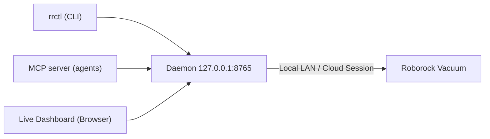

# vitruvian-roborock


> **Autonomous agent control and real-time telemetry for Roborock vacuums.**
> Check on and control your vacuum from a terminal (`rrctl`), from an AI agent (**Antigravity** and **Claude Code**), or from a live map in your browser.

---

## Architecture

One lightweight local process, the **daemon**, manages the single authenticated session with the vacuum (over local LAN or cloud MQTT), protecting device connection quotas. The CLI, MCP tools, and live dashboard communicate securely with the daemon over local loopback.



---

## Quick Installation

`rrctl` is one self-contained binary: the daemon, the CLI and the MCP server.
The plugins start it as `rrctl mcp`, so put `rrctl` on your `PATH` first, one of
these ways:

- **Download it** from the
  [latest release](https://github.com/VitruvianSoftware/mcp-roborock/releases/latest)
  (macOS universal, Linux x86_64), check it against its `.sha256`, and put
  `rrctl` in a directory on your `PATH`, such as `~/.local/bin`.
- **Build it** with Rust installed:
  `cargo install --locked --git https://github.com/VitruvianSoftware/mcp-roborock`
- **In the vitruvian-core monorepo:** `bazel build //apps/mcp/roborock:rrctl`,
  then copy `bazel-bin/apps/mcp/roborock/rrctl` onto your `PATH`.

Claude Code:

```bash
claude plugin marketplace add VitruvianSoftware/mcp-roborock
claude plugin install vitruvian-roborock
```

Antigravity:

```bash
agy plugin install https://github.com/VitruvianSoftware/mcp-roborock
```

Just the CLI, without an agent: install `rrctl` as above and you are done.

---

## Quick Start

```bash
rrctl setup        # Log in with your Roborock account (email verification code)
rrctl status       # Display live vacuum state, battery, and rooms
rrctl dashboard    # Open the real-time visual map in your browser
```

---

## Command Reference

| Command | Description |
|---|---|
| `rrctl setup` | Log in with an emailed Roborock verification code |
| `rrctl status [--json]` | View state, battery, room layout, and cleaning history |
| `rrctl map [-o file.png]` | Save the current floor plan map as a high-res PNG |
| `rrctl pause` / `resume` / `dock` | Control cleaning runs |
| `rrctl daemon [status\|start\|stop]` | Manage the background connection daemon |
| `rrctl dashboard [--no-open]` | Launch the live web dashboard |
| `rrctl mcp` | Start the MCP server over stdio |

---

## Agent Capabilities & Skills

When installed as a plugin, your AI agent automatically gains two specialized skills and seven MCP tools:

- **Skills**:
  - `roborock-control`: Natural language cleaning, targeted room dispatch, docking, and mop washing.
  - `roborock-setup`: First-time authentication flow directly inside the conversation.
- **MCP Tools**:
  - `get_status`: Live status, battery, active errors, and room names.
  - `start_clean`: Start cleaning (full floor plan).
  - `control`: Pause, resume, stop, or find the vacuum.
  - `return_to_dock`: Return to the Ultra dock.
  - `wash_mop`: Trigger automatic mop washing on Ultra docks.
  - `get_map`: Fetch real-time rendered floor map with vacuum trajectory.
  - `setup_login`: Authenticate with Roborock cloud.

---

## Documentation

- [Detailed Installation & User Guide](https://github.com/VitruvianSoftware/vitruvian-core/blob/main/apps/mcp/roborock/docs/installation.md)
- [Architecture & Security Model](https://github.com/VitruvianSoftware/vitruvian-core/blob/main/apps/mcp/roborock/docs/index.md)
