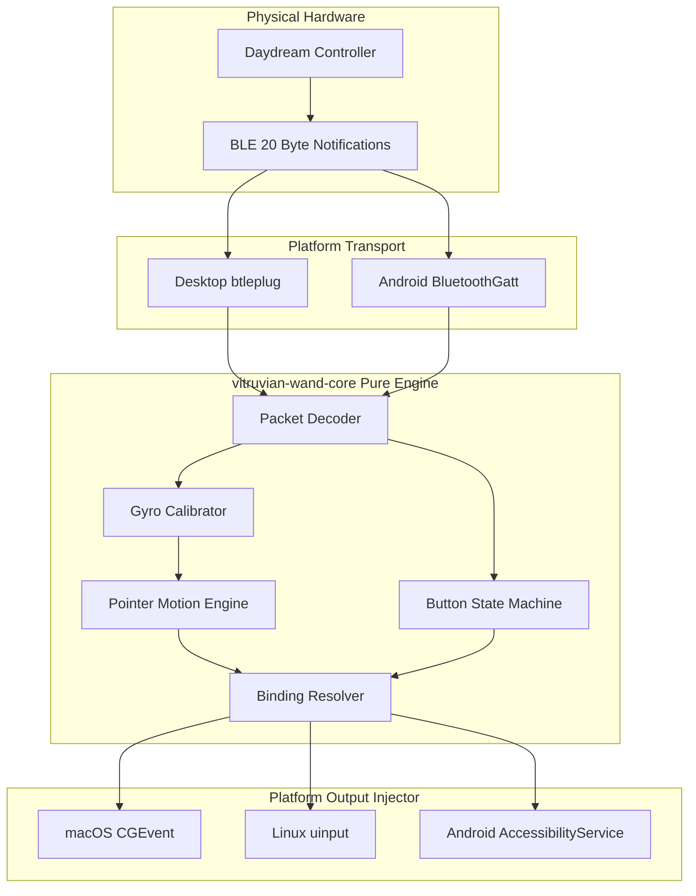

# Vitruvian Wand Architecture & Data Pipeline

Vitruvian Wand translates physical motions and button presses from a Google Daydream controller into native operating system input events.

This document describes the end-to-end data pipeline from physical Bluetooth packets to screen actions.

---

## The Event Pipeline

---

## Architectural Stages

### 1. Hardware and Wire Format
The Google Daydream controller communicates over Bluetooth Low Energy (BLE). It broadcasts as `Daydream controller` with primary service `0000fe55-0000-1000-8000-00805f9b34fb`.

Every packet is exactly 20 bytes long and contains packed bitfields for:
- Touchpad touch state and coordinates (X and Y normalized from 0.0 to 1.0).
- Digital button states (Touchpad click, App button, Home button, Volume Up, Volume Down).
- 3-axis accelerometer readings.
- 3-axis gyroscope angular velocity (radians per second).
- 3-axis magnetometer orientation.
- Packet sequence number and relative time.

Battery level is read separately through the standard Bluetooth Battery Service (`0x180F`).

### 2. Transport Layer (Platform-Specific)
The transport layer receives raw BLE notifications and forwards packet bytes to `vitruvian-wand-core`:
- **Desktop (macOS and Linux)**: Uses `btleplug` to manage device discovery, connection maintenance, automatic reconnection, and characteristic subscription.
- **Android (Phone and TV)**: Uses Kotlin `BluetoothGatt` to manage connections via the Android BLE stack, forwarding incoming byte buffers to Rust through JNI.

### 3. Pure Engine Layer (`vitruvian-wand-core`)
`vitruvian-wand-core` is written in pure Rust. It contains no operating system calls, no threading, no system clocks, and no I/O. Given a timestamp and 20 raw bytes, it deterministically outputs a list of platform-independent `Action` commands:

- **Decoder**: Unpacks bitfields into structured samples.
- **Calibrator**: Calculates gyroscope bias from stationary samples on flat surfaces.
- **Pointer Engine**:
  - *Touch Mode*: Computes displacement deltas from touchpad finger motion, skipping initial touch-down spikes and enforcing a configurable deadzone.
  - *Gyro Mode*: Computes cursor velocity from bias-corrected angular velocity, applying an exponential acceleration curve (`v' = sign(v) * |v|^curve`) and exponential moving average (EMA) smoothing.
- **Button State Machine**: Tracks presses, releases, and time deltas to detect short, long, and double presses. Supports trigger behaviors: fire once, hold while pressed, or toggle state.
- **Radial Menu Engine**: Converts cursor polar displacement into one of 8 radial sector selections.
- **Binding Resolver**: Maps detected button events and motion deltas to high-level actions according to user configuration profiles.

### 4. Output Injection Layer (Platform-Specific)
Platform-specific adapters translate `Action` commands into native system events:
- **macOS**: Posts native mouse and keyboard events using `CGEventPost` (`core-graphics`). Dispatches system media and brightness shortcuts as `NSSystemDefined` events.
- **Linux**: Creates a virtual mouse and keyboard through the kernel's `/dev/uinput` interface, providing unified support for both X11 and Wayland sessions.
- **Android**: Executes gesture strokes (taps, drags, flings) and global navigation actions (Back, Home, Recents, Notifications) through an `AccessibilityService`. On Android TV, translates touchpad swipes into `AccessibilityNodeInfo` D-pad focus steps.
