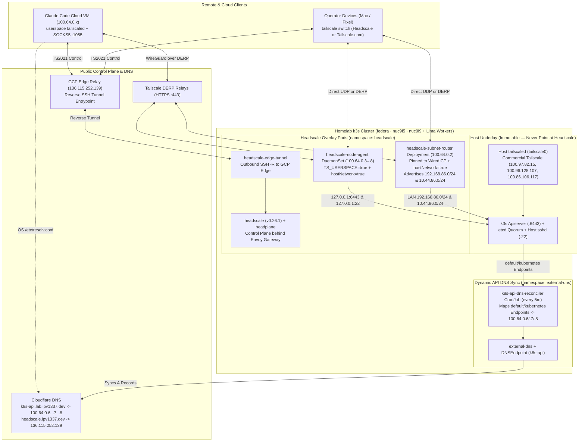

# Headscale and Commercial Tailscale Coexistence & Failover Runbook

## 1. Architectural Overview & The Circular Dependency Rule

The homelab k3s cluster relies on Tailscale for internal cluster communication, etcd peer quorum, and remote administrative access. Headscale runs as a containerized workload **inside** the k3s cluster in the `headscale` namespace.

> [!CAUTION]
> **The Circular Dependency Hazard**:
> Never migrate or reconfigure the host `tailscale0` interface on k3s control-plane nodes (`fedora`, `nuc9i5`, `nuc9i9`) to point to Headscale.
> If host `tailscale0` relies on Headscale:
> 1. A cold restart or networking disruption takes down k3s.
> 2. etcd nodes cannot communicate without Tailscale IPs.
> 3. Headscale cannot start because k3s cannot reach quorum.
> 4. The cluster enters an unrecoverable deadlock.

**Core Rule**: Commercial Tailscale (`tailscale0`) remains the immutable cluster underlay and break-glass network. Headscale is deployed strictly as an overlay mesh alongside it.



---

## 2. Dynamic Node Discovery (`k8s-api.lab.ipv1337.dev`)

The Kubernetes API endpoint `k8s-api.lab.ipv1337.dev` dynamically discovers control-plane node IPs:
1. k3s registers each control plane's `--node-ip` (`100.97.82.15`, `100.96.128.107`, `100.86.106.117`) into the `kubernetes` Endpoints in the `default` namespace.
2. The CronJob `k8s-api-dns-reconciler` in `external-dns` runs every 5 minutes, maps each healthy control-plane node's underlay IP to its Headscale tailnet IP (`100.64.0.6`, `100.64.0.7`, `100.64.0.8`), and updates the `k8s-api` `DNSEndpoint` custom resource so ExternalDNS syncs Cloudflare A records.
3. CoreDNS on all nodes maintains static resolution in `/etc/coredns/NodeHosts`.

---

## 3. Dual-Mesh Architecture: How Nodes Join Headscale Safely

### Layer 1: In-Cluster Subnet Router (`headscale-subnet-router`)
External and mobile clients on cellular data access the homelab LAN via the in-cluster subnet router:
- **Deployment**: `gitops/argocd/platform/headscale/deployment-subnet-router.yaml` in namespace `headscale`.
- **Networking**: Runs in userspace (`TS_USERSPACE=true`, `hostNetwork=true`, `TS_STATE_DIR=/var/tmp/headscale-subnet-router`) pinned to wired control-plane nodes (`node.ipv1337.dev/link: wired`, `node-role.kubernetes.io/control-plane: "true"`).
- **Advertised Routes**: `192.168.86.0/24`, `10.44.86.0/24`.
- Clients connected to Headscale can reach any homelab node or service via its LAN IP (`192.168.86.x` or `10.44.86.x`) without modifying host node daemons.

### Layer 2: Automatic Per-Node Headscale Presence (`headscale-node-agent`)
Every k3s cluster node (`fedora`, `nuc9i5`, `nuc9i9`, `james-macbook-pro`, `james-mbp`, `james-mbp16`, `james-mbp32`) also joins Headscale directly via an unprivileged userspace DaemonSet:
- **DaemonSet**: `gitops/argocd/platform/headscale/daemonset-node-agent.yaml` in namespace `headscale` (`hostNetwork=true`, `TS_USERSPACE=true`, `TS_STATE_DIR=/var/tmp/headscale-node-agent`).
- Each pod registers with `--hostname=$(NODE_NAME)` using the sealed pre-auth key `headscale-subnet-router-auth`, giving every node its own persistent `100.64.0.x` IP and `<node>.mesh.ipv1337.dev` MagicDNS name in Headscale and Headplane (forwarding incoming TCP `:22` and `:6443` via userspace `netstack` to host `127.0.0.1`) while leaving the host `tailscale0` daemon on commercial Tailscale untouched.

### Layer 3: Operator Multi-Profile Switching (`tailscale switch`)
Tailscale supports multiple control-plane profiles simultaneously on macOS, Linux, and Android:

1. **Add the Headscale Profile (One-Time)**:
   ```bash
   tailscale login --login-server=https://headscale.ipv1337.dev --accept-routes
   ```
2. **List Saved Profiles**:
   ```bash
   tailscale switch --list
   ```
3. **Switch to Headscale (`headscale.ipv1337.dev`)**:
   ```bash
   tailscale switch <headscale-profile-id>
   ```
4. **Instant Failback to Commercial Tailscale (`tailscale.com`)**:
   ```bash
   tailscale switch <tailscale-com-profile-id>
   ```
   On Android / iOS, tap the account avatar in the top-right corner of the Tailscale app and select either `headscale.ipv1337.dev` or your `tailscale.com` account.

---

## 4. Break-Glass & Incident Response Procedures

### Scenario 1: Headscale or GCP Edge Relay Is Unreachable
**Impact**: Overlay routing via `headscale.ipv1337.dev` is unavailable; commercial Tailscale (`tailscale0`) and direct cluster access remain 100% online.
**Remediation**:
1. Switch your laptop or phone back to commercial Tailscale:
   ```bash
   tailscale switch <tailscale-com-profile-id>
   ```
2. Verify direct access to the k3s cluster control plane over the commercial Tailscale underlay:
   ```bash
   kubectl --context=homelab get nodes
   ```
3. Inspect Headscale and edge-tunnel pods in the `headscale` namespace:
   ```bash
   kubectl --context=homelab -n headscale get pods
   kubectl --context=homelab -n headscale logs deploy/headscale
   kubectl --context=homelab -n headscale logs deploy/headscale-edge-tunnel
   ```
4. Once `headscale` and `headscale-edge-tunnel` are healthy, switch back to Headscale:
   ```bash
   tailscale switch <headscale-profile-id>
   ```

### Scenario 2: Approving Subnet Routes After Subnet Router Re-Registration
If `headscale-subnet-router` is recreated and gets a new node ID in Headscale:
1. List nodes and routes in Headscale:
   ```bash
   KUBECONFIG=~/.kube/config KUBE_CONTEXT=homelab bazel run //tools/gitops:headscale-node-list
   KUBECONFIG=~/.kube/config KUBE_CONTEXT=homelab bazel run //tools/gitops:headscale -- nodes list-routes
   ```
2. Approve the advertised `192.168.86.0/24` and `10.44.86.0/24` routes for the `homelab-subnet-router` node ID:
   ```bash
   KUBECONFIG=~/.kube/config KUBE_CONTEXT=homelab bazel run //tools/gitops:headscale -- nodes approve-routes --identifier <node-id> --routes 192.168.86.0/24,10.44.86.0/24
   ```

### Scenario 3: Cold Boot Disaster Recovery
If the homelab loses power and boots from cold:
1. Control-plane nodes (`fedora`, `nuc9i5`, `nuc9i9`) boot and start host `tailscaled` (`tailscale0`) connected to commercial Tailscale.
2. k3s etcd establishes quorum over `100.97.82.15`, `100.96.128.107`, and `100.86.106.117`.
3. k3s schedules `headscale`, `headscale-edge-tunnel`, `headscale-subnet-router`, and `headscale-node-agent`.
4. `headscale-edge-tunnel` establishes the outbound reverse SSH tunnel to the GCP Edge Relay (`136.115.252.139`), automatically restoring external cellular and remote connectivity to `headscale.ipv1337.dev`.
