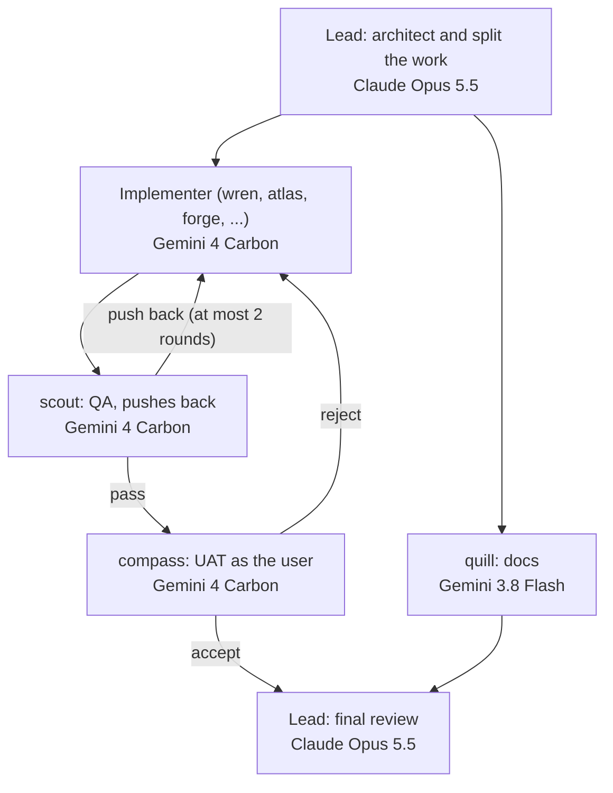

# How the agent team works

One lead plans and reviews. Specialists do the work. Only the lead thinks on Claude Opus; every
specialist's work runs on Gemini, through Antigravity. That keeps Claude tokens for the part where
judgement matters most: designing the change and checking it.

## Who does what

| Role | Who | What they do |
|---|---|---|
| Architect | the lead | Reads the request, designs the change, splits it into tasks, writes one self-contained brief per task. |
| Implement | the specialist that owns the area: `wren` (app code), `atlas` (infrastructure), `forge` (build), `ridge` (cluster), `aegis` (security) | Makes the change and runs its tests. |
| QA | `scout` | Runs after the implementer. Reads the real diff against the brief, tests edge cases, adds missing tests, and sends back a defect list when something is wrong. |
| UAT | `compass` (technical product owner) | Runs after QA passes. Uses the change the way the person who asked for it would, against acceptance criteria the lead wrote at the start, and says for each one whether it is met. Catches "works, but not what was asked". Skipped only for purely internal changes, with the reason stated. |
| Docs | `quill` | Updates READMEs, `docs/`, `AGENTS.md` and runbooks when behaviour or setup changes. Runs alongside the implementer. |
| Others | `pace` | Joins when the work touches release sequencing. |
| Final review | the lead | Reviews the whole change after QA and UAT pass, re-runs the checks, and accepts it or sends it back. |

When a reviewer and the implementer disagree, the lead decides. After two rounds from either
reviewer the lead stops the loop and decides what to do next.

## Which model each one uses

| | Claude Code | OpenCode | Antigravity |
|---|---|---|---|
| Lead (and `beacon`) | Claude Opus 5.5 | Claude Opus 5.5 | Antigravity's `pro` model (there is no Opus in Antigravity) |
| `deep` specialists: wren, scout, atlas, forge, aegis, ridge, compass | Gemini 4 Carbon, through a Haiku driver | Gemini 4 Carbon, through a Haiku driver | Antigravity's `pro` model, natively |
| `light` specialists: quill, pace | Gemini 3.8 Flash, through a Haiku driver | Gemini 3.8 Flash, through a Haiku driver | Gemini 3.8 Flash, natively |

### What a "driver" is

Claude Code and OpenCode can only run subagents on Claude models. So in those two tools each
specialist is a small, cheap Claude Haiku agent whose only job is to pass the work to Gemini:

1. It writes the lead's brief, plus the specialist's role, to a file.
2. It runs `agy-delegate` with the specialist's Gemini model, so Gemini does the actual work in the repository.
3. It checks what Gemini did: the diff, the changed files, and the brief's test commands, run again by the driver itself. Gemini has been seen claiming passes it did not get.
4. It sends Gemini at most two correction rounds, then reports to the lead: done, needs work, or blocked.

The driver cannot edit files: its tool list leaves out the editing tools. That stops a cheap model
quietly doing the work itself.

In Antigravity there is no driver: the specialists already run on Gemini.

### When Gemini is unavailable

If Gemini is out of quota, logged out, timing out, or fails twice, the driver stops and reports
"blocked". The lead retries once. If it is still blocked, the lead runs that one task on Claude
Sonnet with the same brief, and says so in its final report. Specialist work never moves to Opus.

## What you see in the panel

The orchestrator panel lists each specialist run. For a driver it shows both models, for example
`claude-haiku-5-5 → gemini-4-carbon-high`. The dollar estimate covers only the Haiku driver's
Claude usage. Gemini work is listed as "delegated to Gemini" with a run count and no price, because
the panel has no Gemini prices.

## Changing the team

Everything above is generated from one roster, so change it there and nowhere else:

- `.agents/roster/tiers.tsv`: the model for each tier in each tool. A tier with a `gemini` row does
  its work on that Gemini model; that row is what turns its agents into drivers in Claude Code and OpenCode.
- `.agents/roster/agents.tsv`: each agent's tier and one-line description, which the lead uses to pick it.
- `.agents/roster/prompts/<name>.md`: each agent's role.
- `.agents/roster/skills/orchestrate/<tool>.md`: the lead's instructions, including the team flow above.

Then run `bazel run //tools/agent-roster -- --write`. CI's Tidy Check fails if the generated files
drift from the roster. The generator's rules are in [`tools/agent-roster`](../../tools/agent-roster/README.md).
