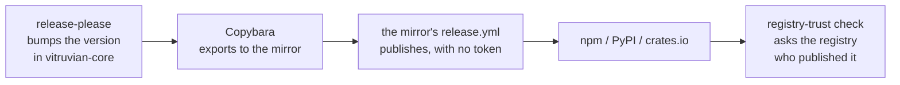

# Registry trust: who may publish, and proof of who did

Nothing we publish is published by hand. This page says how a version gets to
npm, PyPI and crates.io, the one step a brand-new package still needs from a
person, and how we check that every other version came from the workflow.

## The path a release takes



1. **release-please** opens a release pull request. Merging it writes the new
   version into the package files.
2. **Copybara** copies the package's folder to its mirror repository.
3. The mirror's **`release.yml`** sees a version the registry does not have and
   publishes it. It holds no token. GitHub gives the job a short-lived identity,
   and the registry accepts it because the registry was told to trust that
   repository, that workflow file and that environment. This is "trusted
   publishing".
4. Once a day, **`registry-trust`** asks each registry, in public, whether every
   version really came from that workflow.

Step 3 only works after each registry has been told whom to trust. That is
what the setup command does.

## Where the list of packages comes from

There is no list to keep. `bazel run //tools/registry-trust:inventory` reads:

- every `release-please-config.json`, for what is released;
- the package files (`package.json`, `pyproject.toml`, `Cargo.toml`), for the
  name and whether it is public (`"private": true` and `publish = false` mean
  it is not);
- `tools/copybara/copy.bara.sky`, for which mirror carries it;
- the mirror's own workflows, for the job that publishes it and that job's
  `environment:`.

Add a package to release-please and it is covered. Nothing here needs an edit.
`-- --all` also lists what was left out and why.

## Set up trust on the registries

```sh
bazel run //tools/registry-trust:setup -- --dry-run   # says what it would do
bazel run //tools/registry-trust:setup                # does it
bazel run //tools/registry-trust:setup -- --only crates
```

It is safe to run again: what is already set is skipped.

| Registry | What the command does |
|---|---|
| **crates.io** | Lists each crate's trusted publishers and creates the missing one. It needs a crates.io token on your machine: run `cargo login` first. The token is read when needed, sent only to crates.io, and never printed. `--dry-run` does not read it. |
| **npm** | Hands the packages to `//tools/npm-trusted-publisher:setup`, which uses `npm trust`. You approve one two-factor prompt in the browser. See [npm trusted publishing](npm-trusted-publishing.md). |
| **PyPI** | **Not automated.** PyPI has no API for trusted publishers, only a web page. The command prints the page and the exact values to type (owner, repository, workflow, environment). It cannot tell whether you have already entered them. |

## A brand-new package: the one-time first publish

npm and crates.io refuse to attach a trusted publisher to a package that does
not exist yet. So the very first version of a new package has to be published
once by a person. The setup command tells you which packages are in this
state: it says "not yet on the registry".

Publish from a clone of the **mirror**, at the released commit, never from
vitruvian-core.

**npm**

```sh
git clone https://github.com/VitruvianSoftware/<mirror> && cd <mirror>/<package folder>
npm install --no-package-lock && npm run build && npm test
npm login
npm publish --access public
```

For the Pulumi library's packages there is a command that does this safely:
`bazel run //tools/npm-trusted-publisher:bootstrap`.

**crates.io**

```sh
git clone https://github.com/VitruvianSoftware/<mirror> && cd <mirror>/<crate folder>
cargo login
cargo publish
```

**PyPI** needs no first publish by hand. Enter the values the setup command
prints as a *pending* publisher, and the workflow makes the first publish
itself.

Then, in one pull request:

1. Add the package's row to `tools/registry-trust/bootstrap.tsv`: registry,
   package, version, date, and why.
2. Run `bazel run //tools/registry-trust:setup`.
3. Run `bazel run //tools/registry-trust:check`. It must exit 0.

From the next release on, the workflow publishes and no person does.

## Check that the workflow published every version

```sh
bazel run //tools/registry-trust:check
```

It reads only public pages and needs no token. It exits 1 and names each
package and version that the registry does not show as the workflow's.

| Registry | How it tells |
|---|---|
| **npm** | A workflow's version carries a trusted-publisher mark and a signed attestation. A person's carries their login and neither. |
| **crates.io** | A workflow's version names the repository that published it. A person's names the person. |
| **PyPI** | A file the workflow attested has a public provenance record that names the repository and workflow. A file without one has **nothing public** saying who uploaded it. |

**The one exception** is a row of `bootstrap.tsv`. It names the last version of
a package published before the workflow could prove itself. That version and
anything older is history. Everything newer must be the workflow's. A package
gets one row at most, and the check refuses a row that names a version the
registry does not have, or one the workflow published.

### What "not publicly verifiable" means for PyPI

The Python kit's first three versions (up to 1.1.0) were published by the
workflow, but without attestations. PyPI shows no provenance for them, so
nothing public proves who uploaded them. The check reports them as **not
publicly verifiable**. It never counts them as verified.

The mirror's workflow now attests the files before uploading them. From the
next release, PyPI will name the workflow, and the check will fail on any newer
version that has no provenance.

## Where the check runs

`.github/workflows/registry-trust.yaml` runs it every day, on demand, and on a
push to `main` that changes a release-please file or this tool. It uses no
secret. A red scheduled run opens one issue, or comments on the open one. A red
push run is sent to ntfy by `notify-ci-issues`, like any other failed push.

It is not a presubmit test, because it needs the network. Its rules are tested
with recorded registry answers in `//tools/registry-trust:check_test`.

## If the check is red

- **A version was published by a person.** Find out who and why. If it was a
  real first publish, add the row (see above). If not, treat the version as
  untrusted: yank or deprecate it and release again through the workflow.
- **A registry could not be read** (exit 2). Run it again. The log names the
  registry and the answer it gave.
