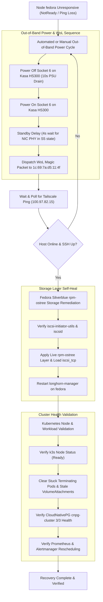

# Fedora Node Recovery Runbook (Out-of-Band Power Cycle, Wake-on-LAN & Workload Recovery)

> **Audience:** Homelab operators and SRE agents responding to an unresponsive or frozen `fedora` node.
> **Related Incident:** [2026-06-21 — fedora node freeze cluster cascade](incidents/2026-06-21-fedora-freeze-cluster-cascade.md).
> **Automated Tool:** `power-cycle-fedora` (`/Users/james/bin/power-cycle-fedora`).

---

## 1. Overview & Hardware Mapping

The `fedora` node is an Intel NUC 12 Extreme serving critical multi-tenant duties in the homelab k3s cluster:
- **Control-plane voter:** Active etcd quorum member (`3-node HA control plane`).
- **GPU worker node:** Sole NVIDIA CUDA/GPU node (`node.ipv1337.dev/link=wired`).
- **Stateful host:** Hosts local-path storage for Postgres replicas and Longhorn volumes.

Because Alder Lake (Core i9-12900) deep C-states can occasionally induce ring-bus or interrupt controller lockups that prevent the internal software/hardware watchdog (`intel_oc_wdt`) from biting, recovery requires **out-of-band power cycle automation via a smart PDU strip followed by Wake-on-LAN (WoL)**.

### Hardware & Network Specification

| Attribute | Specification |
|---|---|
| **Hostname** | `fedora` |
| **Chassis / Motherboard** | Intel NUC 12 Extreme (`NUC12EDBi9`) |
| **Processor** | 12th-Gen Intel Core i9-12900 (Alder Lake) |
| **Role in Cluster** | Control-plane / etcd voter, CUDA/GPU worker |
| **Tailscale IP** | `100.97.82.15` |
| **Local LAN IP** | `192.168.86.64` |
| **Local Subnet** | `192.168.86.0/24` (Subnet mask: `255.255.255.0`, Broadcast: `192.168.86.255`) |
| **Smart Power Strip** | TP-Link Kasa HS300 Smart Power Strip (`192.168.86.48`) |
| **PDU Outlet** | Socket 6 (Alias: `NUC12I9`) |
| **Network Interface** | Intel I225-LM 2.5GbE Ethernet (`enp110s0`) |
| **MAC Address** | `1c:69:7a:d5:11:4f` |
| **Wake-on-LAN (WoL)** | Supported: `pg`, Configured: `g` (MagicPacket enabled in ACPI S5) |
| **Operating System** | Fedora Silverblue (rpm-ostree immutable root) |

---

## 2. Recovery Workflow Diagram



---

## 3. Automated Recovery (`power-cycle-fedora`)

An automated recovery CLI script is installed at `/Users/james/bin/power-cycle-fedora`.

### Executing the Automated Script

Run from any authorized workstation on the local network (`192.168.86.0/24`) or via SOCKS proxy / Tailscale node:

```bash
power-cycle-fedora
```

### What the Automated Script Does

The script executes the following four-phase recovery cycle autonomously:

1. **Power Cut (Socket 6):** Connects to the TP-Link Kasa HS300 strip at `192.168.86.48` using `python-kasa` (in `~/.kasa-venv/bin/python3`), locates Socket 6 (`NUC12I9`), and powers it off. It sleeps for **10 seconds** to allow the NUC power delivery capacitors and motherboard standby rails to fully discharge.
2. **Power Restoration:** Powers Socket 6 back on. The chassis enters the ACPI S5 standby power state.
3. **Standby PHY Stabilization:** Waits **4 seconds** for the Intel I225-LM 2.5GbE PHY to negotiate a link speed (10/100/1000 Mbps standby link) and initialize its WoL magic-packet reception buffer.
4. **Wake-on-LAN Magic Packet Dispatch:** Sends an Ethernet Wake-on-LAN magic packet containing 16 repetitions of MAC `1c:69:7a:d5:11:4f` broadcast to `192.168.86.255` using `/opt/homebrew/bin/wakeonlan`.
5. **Rejoin Polling:** Iterates up to 45 times (90 seconds maximum) polling `tailscale ping -c 1 fedora`.
6. **Kubernetes Verification:** Queries `kubectl get node fedora -o wide` to verify that the node rejoins the k3s cluster.

---

## 4. Manual Step-by-Step Procedure

If the automated script is unavailable or you need to troubleshoot individual stages, execute the manual procedure below.

### Step 1: Power Cycle Socket 6 on Kasa HS300

Using the dedicated Python virtual environment:

```bash
~/.kasa-venv/bin/python3 -c "
import asyncio
from kasa import Discover, Credentials

async def main():
    creds = Credentials('kasa@nocentre.net', 'D3l3t3m3n0t!')
    strip = await Discover.discover_single('192.168.86.48', credentials=creds)
    await strip.update()
    socket = [c for c in strip.children if c.alias == 'NUC12I9'][0]
    print(f'Powering OFF {socket.alias}...')
    await socket.turn_off()
    await asyncio.sleep(10)
    print(f'Powering ON {socket.alias}...')
    await socket.turn_on()

asyncio.run(main())
"
```

> [!NOTE]
> Alternatively, open the **TP-Link Kasa** mobile app, locate the **HS300 Power Strip**, and toggle **Socket 6 (NUC12I9)** off for 10 seconds, then back on.

---

### Step 2: Standby Delay & Wake-on-LAN Dispatch

Wait 4-5 seconds after power is restored before sending the WoL packet. The Intel I225-LM controller requires this interval to complete its internal self-test and bring up auxiliary standby link power.

Broadcast the WoL packet to the local subnet broadcast address (`192.168.86.255`):

```bash
wakeonlan -i 192.168.86.255 1c:69:7a:d5:11:4f
```

*(If running on a host without broadcast override, `wakeonlan 1c:69:7a:d5:11:4f` defaults to global broadcast `255.255.255.255`)*.

---

### Step 3: Verification of Host Reachability

Monitor Tailscale network connectivity:

```bash
# Test Tailscale ping
tailscale ping -c 2 fedora

# Test direct SSH uptime (passwordless sudo key)
ssh james@100.97.82.15 uptime
```

Expected output:
```text
pong from fedora (100.97.82.15) via [LAN_IP]:41641 in 1ms
 05:12:01 up 1 min,  0 users,  load average: 0.85, 0.23, 0.08
```

---

### Step 4: Fedora Silverblue (rpm-ostree) Storage & Daemon Remediation

Fedora Silverblue uses an immutable `/usr` filesystem managed by `rpm-ostree`. Following an unexpected reboot or kernel deployment switch, layered packages such as `iscsi-initiator-utils` and the kernel module `iscsi_tcp` may fail to load, which causes `longhorn-manager` to crashloop (`iscsiadm: No such file or directory`).

1. **Verify and Re-layer iSCSI Utilities:**

   Run the idempotent live-layer command via SSH:

   ```bash
   ssh james@100.97.82.15 'sudo rpm-ostree install --idempotent iscsi-initiator-utils && \
     sudo rpm-ostree apply-live --allow-replacement && \
     sudo modprobe iscsi_tcp && \
     echo iscsi_tcp | sudo tee /etc/modules-load.d/iscsi.conf && \
     sudo systemctl enable --now iscsid'
   ```

2. **Restart `longhorn-manager` on `fedora`:**

   Force-restart the node's Longhorn manager daemon pod so it picks up the active `iscsid` daemon:

   ```bash
   kubectl -n longhorn-system delete pod -l app=longhorn-manager --field-selector spec.nodeName=fedora --force --grace-period=0
   ```

3. **Verify Longhorn Manager Pod Health:**

   ```bash
   kubectl -n longhorn-system get pods -l app=longhorn-manager -o wide
   ```
   Ensure the pod on `fedora` reaches `Running` (`1/1 Ready`).

---

### Step 5: Kubernetes Node & Workload Health Validation

1. **Verify Kubernetes Node Status:**

   ```bash
   NO_PROXY='*' kubectl get node fedora -o wide
   ```
   Confirm `STATUS` is `Ready` and roles show `control-plane,etcd` (or master).

2. **Clean Up Stuck `Terminating` Pods & Stale `VolumeAttachment`s:**

   If stateful workloads were displaced during the freeze, check for stuck pods or stale CSI volume attachments:

   ```bash
   # Check for terminating pods
   kubectl get pods -A | grep Terminating

   # Force-delete stuck terminating pod if necessary
   kubectl delete pod <pod-name> -n <namespace> --force --grace-period=0

   # Check for orphaned Longhorn volume attachments
   kubectl get volumeattachment | grep fedora
   ```

   If a volume attachment is stuck attaching to the old instance:
   ```bash
   kubectl delete volumeattachment <volumeattachment-name>
   ```

3. **Verify CloudNativePG Cluster Health:**

   Check that the primary and standby Postgres replicas are streaming with zero lag:

   ```bash
   kubectl cnpg status cnpg-cluster -n cnpg-system
   ```

   Confirm:
   - Primary and replicas report `3/3 Ready` or `Cluster in healthy state`.
   - Hostname anti-affinity has kept replicas distributed across separate physical hosts.

4. **Verify Prometheus & Alertmanager Workloads:**

   ```bash
   kubectl get pods -n monitoring -l app.kubernetes.io/name=prometheus
   kubectl get pods -n monitoring -l app.kubernetes.io/name=alertmanager
   ```
   Confirm all monitoring pods have bound their volumes and are in `Running` state.

---

## 5. Troubleshooting & Edge Cases

### WoL Magic Packet Does Not Wake Host

- **Cause:** Power cycle off-duration was too short (< 4s), leaving the motherboard in a hung state, or WoL packet was sent before the 2.5GbE PHY initialized.
- **Remedy:** Re-run `power-cycle-fedora`. Ensure the full 10-second power-off delay and 4-second standby delay are observed.
- **Network Subnet Mismatch:** Wake-on-LAN magic packets are layer 2 Ethernet broadcasts. If triggering from a machine outside `192.168.86.0/24`, the directed broadcast `192.168.86.255` must be routed through a router/bridge that permits directed broadcast forwarding.

### `rpm-ostree apply-live` Fails With Dependency Conflicts

- If a pending rpm-ostree transaction is blocked:
  ```bash
  ssh james@100.97.82.15 'sudo rpm-ostree cancel'
  ```
  Then re-run the layer command in Step 4.

### Longhorn Volumes Remain in `Degraded` State

- Check Longhorn replica rebuild progress:
  ```bash
  kubectl -n longhorn-system get replicas -o wide
  ```
  Allow Longhorn 3-5 minutes to rebuild replicas across the newly restored node.

---

## 6. October 2026 Freeze Incident & Remediation

### Root Cause & Symptoms
Following the BIOS update to version `0067` on October 6, `intel_idle.max_cstate=1` was added to kernel arguments. The host subsequently hard-froze on October 9 at ~14:44 PDT and October 10 at ~14:16 PDT:
- Both freezes left the host completely unreachable, required a double-power-cycle to complete POST, and neither watchdog successfully recovered the system to an OS booted state.
- In addition, `intel_idle.max_cstate=1` was forcing CPU cores into continuous `POLL` spinning at idle, keeping temperatures elevated at 65–78°C.

### Completed Remediation Steps on Host (2026-10-11)

1. **Reverted `intel_idle.max_cstate=1`**:
   - Removed from `rpm-ostree` kernel arguments:
     ```bash
     sudo rpm-ostree kargs --delete-if-present=intel_idle.max_cstate=1
     ```
   - An ostree deployment has been staged and committed, queued for activation on the next reboot. This restores normal core C-states and normal idle temperatures.

2. **Configured Kernel Lockup Panics**:
   - Added `/etc/sysctl.d/99-panic-lockup.conf`:
     ```ini
     kernel.hardlockup_panic = 1
     kernel.softlockup_panic = 1
     kernel.panic_on_io_nmi = 1
     kernel.panic = 10
     ```
   - Applied immediately via `sudo sysctl -p /etc/sysctl.d/99-panic-lockup.conf`. Future soft/hard lockups or IO NMIs will now dump panic diagnostics and trigger a clean 10-second automatic reboot instead of wedging silently.

3. **Resolved Watchdog Contention**:
   - Identified dual-watchdog race: `/dev/watchdog0` (`intel_oc_wdt`, used by systemd) vs `/dev/watchdog1` (`wdat_wdt`, used by `fedora-health-watchdog.py`).
   - Created `/etc/modprobe.d/blacklist-intel_oc_wdt.conf` with `blacklist intel_oc_wdt` to eliminate driver conflict and known Intel OC watchdog bugs on Alder Lake.
   - Disabled `fedora-health-watchdog.service` for future boots:
     ```bash
     sudo systemctl disable fedora-health-watchdog.service
     ```
     allowing systemd to cleanly fall back to ACPI WDAT (`wdat_wdt`).
   - Hardened `/usr/local/bin/fedora-health-watchdog.py` with multi-device fallback and updated service unit to `Restart=on-failure`.

### Physical / BIOS Checklist (Next Maintenance Window)
- **Fast Boot**: Disable Fast Boot in BIOS (`Boot > Fast Boot`). Fast Boot can cause POST failure following ungraceful freezes or watchdog resets, requiring a double power cycle.
- **Primary Display**: Set to IGD (Intel Integrated Graphics) in BIOS (`Devices > Video > Primary Display`) so headless boot with `nomodeset` does not stall waiting for display init on the dGPU (RTX 2060).
- **NIC Fallback**: If network lockups recur on the Aquantia AQC113C (`enp110s0`, `atlantic`), move connection to the onboard Intel I225-LM 2.5GbE NIC (`enp109s0`, `igc`).

---

## 7. October 12, 2026 Incident: Why Previous Fixes Were Incomplete & Permanent Resolution

### Why Previous Remediations Failed
On October 11, remediations were attempted but contained two critical flaws:

1. **Reverting C-States Re-Enabled Deep Sleep Hangs**:
   - Because `intel_idle.max_cstate=1` kept the CPU spinning in `POLL` at 65–78°C, it was completely removed on Oct 11, resetting `max_cstate` to `9`.
   - This re-enabled `state3` (`C8`) and `state4` (`C10`), where the Alder Lake i9-12900 spends >80% of its idle time.
   - At ~17:16 PDT on Oct 12 (~29h after boot), waking from C10 stalled the ring bus and APIC clock generator again.
   - **Difference Now**: We do *not* revert to C1 (`POLL` spinning) nor leave C8/C10 enabled. We permit `state2` (`C6`)—which lets individual cores power down and drop voltage cleanly (~27.8°C–59°C)—while strictly disabling `state3` (`C8`) and `state4` (`C10`) via persistent unit `/etc/systemd/system/disable-deep-cstates.service` and `intel_idle.max_cstate=2`.

2. **Watchdog Blacklist Failed Silently in Initramfs**:
   - On Oct 11, `blacklist intel_oc_wdt` was added to `/etc/modprobe.d/blacklist-intel_oc_wdt.conf`.
   - However, on Fedora Silverblue, `intel_oc_wdt` is bundled in the early `initramfs` (dracut), which loads *before* `/etc/modprobe.d/` is parsed.
   - `intel_oc_wdt` still claimed `/dev/watchdog0`. Systemd bound to `/dev/watchdog0`, leaving the true motherboard ACPI WDAT watchdog (`/dev/watchdog1`) unmanaged.
   - Because `intel_oc_wdt` requires CPU interrupts to tick, it was helpless when the CPU ring bus hung.
   - **Difference Now**:
     - Hardened modprobe with `install intel_oc_wdt /bin/true`.
     - Staged `module_blacklist=intel_oc_wdt` into `rpm-ostree kargs`.
     - Explicitly configured systemd to bind to `/dev/watchdog1` (`WatchdogDevice=/dev/watchdog1`, `RuntimeWatchdogSec=30s`) in `/etc/systemd/system.conf.d/10-watchdog.conf`.
     - Verified live via `systemctl daemon-reexec` that systemd is actively driving `wdat_wdt` with a 30s hardware timeout.

3. **Wake-on-LAN Subnet Routing**:
   - `wakeonlan` was broadcasting to `255.255.255.255`, which got swallowed by Tailscale tunnel interfaces on macOS.
   - Updated `/Users/james/bin/power-cycle-fedora` to explicitly broadcast to `192.168.86.255`.


