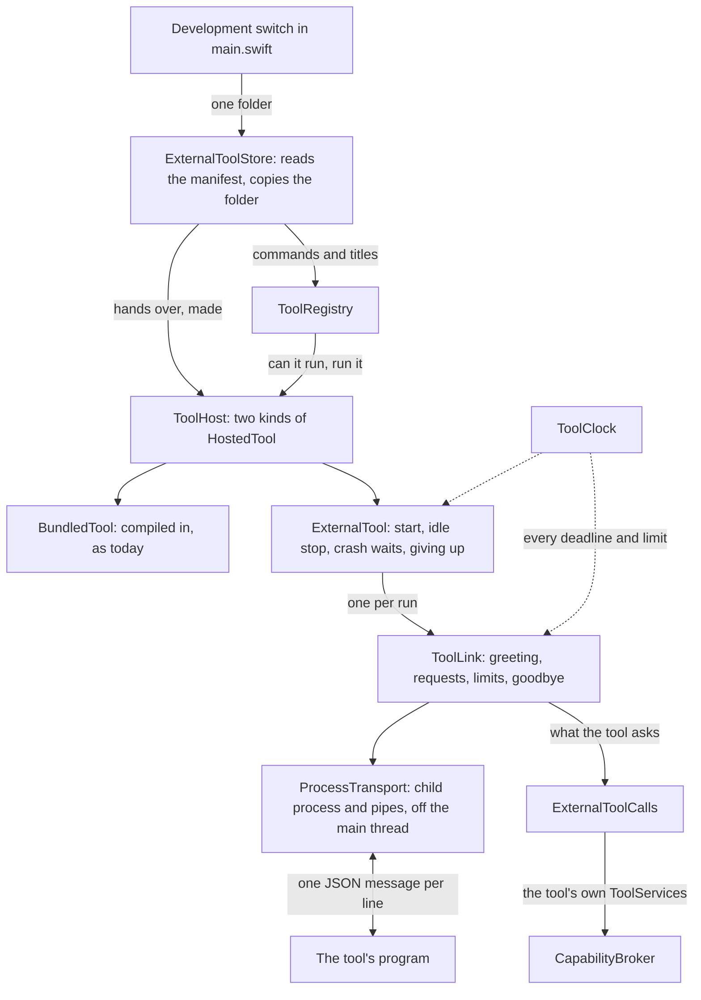
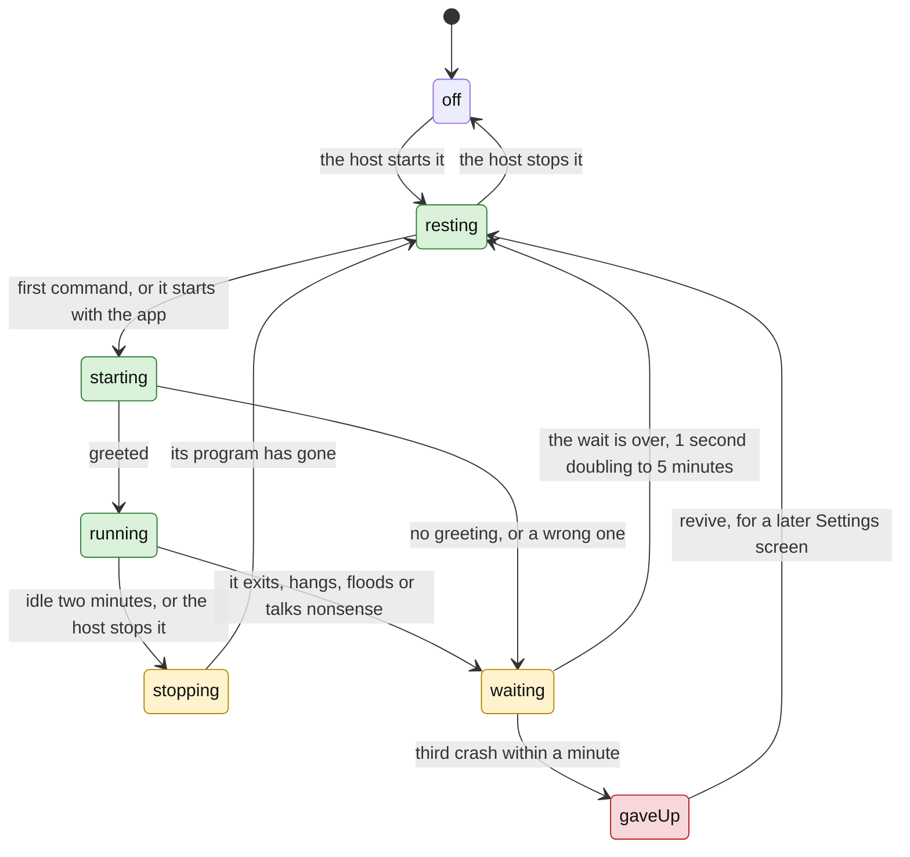
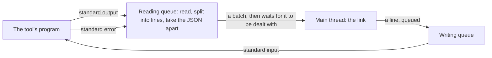
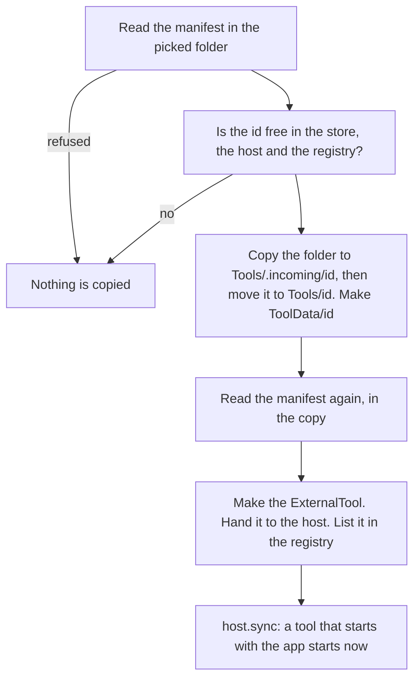

# Vitruvian external tools (stage B: the runtime) Implementation Plan

> **For agentic workers:** REQUIRED SUB-SKILL: Use superpowers:subagent-driven-development (recommended) or superpowers:executing-plans to implement this plan task-by-task. Steps use checkbox (`- [ ]`) syntax for tracking.

**Goal:** Teach the app to start a tool that is a separate program, talk to it, hold it in check and stop it. After this stage a development build can add one tool from a folder and run its commands from every surface; a build a person installs has no way to add one and behaves as it does today.

**Architecture:** Everything new is under `Services/Platform/External/`. A **transport** carries bytes to one run of a program: a child process and its three pipes, read and written off the main thread. A **link** above it speaks the protocol for that one run: the greeting, requests in both directions with deadlines, the limits, the goodbye. An **external tool** owns the program from one run to the next: it starts it on the first command, stops it when idle, holds it back after a crash and gives up on one that keeps crashing. It is the tool host's second kind of tool, beside the ones compiled into the app. What a tool asks of the app goes through the capability broker, by the tool's own `ToolServices`, and comes back as a value or as one of the protocol's refusal codes. A small **store** holds what is installed, for this run of the app only, and copies a tool's folder into the app's support folder. Every deadline, wait and limit is counted on an injected clock.



How one outside tool stands, from the host's first `start` on. Green is working, amber is waiting, red is stopped for good.



**What a person sees:** nothing. No new string, command, tile, row or setting. A release build compiles the runtime and calls none of it.

**Tech Stack:** Swift 6 (strict concurrency), Foundation `Process` and Dispatch, the app's own `TestSuite` harness, `VitruvianToolProtocol` from `packages/vitruvian-sdk` (linked, not changed), Bazel with `--config=macos-app`.

**Spec:** `docs/superpowers/specs/2026-10-10-vitruvian-external-tools-design.md` (approved 2026-10-10). This is stage B of its section 15. Stage A's plan is `docs/superpowers/plans/2026-10-10-vitruvian-external-tools-stage-a.md`; the broker and the host this stage extends are in `docs/superpowers/specs/2026-10-09-vitruvian-broker-and-bundled-tools-design.md`.

Paths that start with `Sources/`, `Tests/`, `Tools/`, `bazel/` or name `BUILD`, `AGENTS.md`, `README.md` or `UPSTREAM.md` alone are relative to `apps/desktop/vitruvian/`. Every other path is from the repository root. Every task works in `apps/desktop/vitruvian/` unless it says otherwise.

## Decisions this plan makes

The spec's twelve decisions stand, and so do stage A's twenty-three. These are the ones the spec leaves open, or that the code forced. Each says whether it follows the spec, adds to it, or differs from it. Where the spec and the code disagree, the row says so in those words. Task 10 records them in the spec's stage table; it does not rewrite the spec's sections.

| # | Decision | Why |
|---|---|---|
| 1 | **Nothing under `packages/vitruvian-sdk/Sources` changes.** The app turns a message's name into its Swift types with one `switch` of its own, in `ExternalToolCalls`, exhaustive over `ToolMethod`. Stage A left this open. | The other choice, a protocol in the package, is what stage D's tool kit wants and should be designed with it. With no package change there is no pin to move in this stage. A message added to the protocol later does not compile in the app until the `switch` says what the app does. |
| 2 | **The line splitter gets no `finish()`. A last line with no line break is dropped when a tool's output ends.** Follows the protocol. | `protocol/README.md` says such a line is never delivered. When a tool's output ends, its link ends with it, so there is nobody to deliver to. |
| 3 | **Where the code runs.** `ToolLink`, `ExternalTool`, `ExternalToolStore` and `ToolHost` are on the main actor, and while the app runs they never wait (decision 18 is the one wait, at quit). Only `ProcessTransport` touches a pipe, on two queues of its own: one reads and takes lines apart, one writes. The reading queue hands the main thread a batch and waits until it has dealt with it. **Adds to the spec.** | The platform's types are main-actor types. Taking JSON apart off the main thread is what makes a flood cheap. The reader waiting for the main thread, never the reverse, is what makes a tool that writes faster than the app reads wait on its own pipe. |
| 4 | **At most 2,000 lines a second reach the main thread** (`ToolLimits.linesHandedPerSecond`). Past that the reading queue waits. And past 200 lines in one second, what a tool asks is answered -32004 and nothing is done. **Adds to the spec.** | The spec's flood rule needs five seconds to see a flood. Without a ceiling those five seconds could take the whole main thread. 2,000 is ten times the flood threshold, so a flood is still seen as one. |
| 5 | **Time is handed in.** `ToolClock` gives the time and sets timers. The app's is the Mac's uptime, which does not count sleep. A test's is moved by hand. | No test waits for a deadline, and no deadline runs out because the lid was shut. |
| 6 | **A tool that does not greet within 10 seconds is stopped at once.** The spec says a request with no answer fails, and three in a row stop the tool. For `initialize` this plan does not wait for three: there is no link without it. **Adds to the spec.** | Nothing else may be sent before the greeting, so there is no second request to miss. |
| 7 | **What counts as nonsense.** A line that is not a message, an answer to nothing the app asked, and a notice the app knows with params it cannot read are each dropped and counted toward the twenty a minute. An answer that arrives after its deadline is late, not nonsense, and is not counted. A notice the app does not know is ignored. A request it does not know is answered -32601. A request under an id still being answered is answered -32600. **Adds to the spec.** | The spec counts "something that is not a message". A slow tool must not be stopped for answering late, and a later protocol must be able to add a notice. |
| 8 | **A tool the app stops for what it did gets no goodbye.** Its input is closed and it is asked to end at once, then killed a second later. A tool the app stops for any other reason gets the spec's sequence: goodbye, input closed, two seconds, asked to end, one more, killed. **Adds to the spec.** | A tool that floods or hangs is not reading. |
| 9 | **A link is over one second after its program was killed, whether or not the system reported the end.** **Adds to the spec.** | So that nothing in the app can wait for ever on a process. |
| 10 | **Any end the app did not ask for is a crash**, a clean exit with status 0 included. Follows the spec ("it exits or crashes"). | A tool that leaves by itself has left its commands with nothing behind them. |
| 11 | **After a crash.** The tool's commands cannot run during the wait. When the wait is over they can, and the next command starts the program; a tool that starts with the app is started again by the app. The wait goes back to one second after a run that stayed up for a minute. After three crashes within a minute it stays stopped. **Differs from the spec in one place:** the spec says "until the person starts it from Settings". There is no Settings screen in this stage, so in a development build it stays stopped until the app is started again. `ExternalTool.revive()` is the call stage C's button makes. | The spec gives the waits and the count. It does not say when the wait resets. |
| 12 | **"The person is told once" is a line in the system log in this stage**, and the hook `ExternalToolStore.Parts.stoppedWorking`. It fires at a tool's first crash in a run of the app, not when the tool is given up on. **Differs from the spec**, which wants one sentence on screen. | The sentence needs fifteen translations, and this stage adds no string. Stage C writes it and calls it from the same hook. |
| 13 | **Idle means nothing asked in either direction.** A command from the app, and a request from the tool, each start the two minutes again. A notice does not. The spec says "nothing asked of it". **Adds to the spec.** | A tool half way through its work, asking the app for things, is not idle. A tool that only logs is. |
| 14 | **Until a run of the program says which commands can run, all of them can**, and each new run starts from that. Up to 16 commands wait for a program that is still starting. | The spec says "until the first one, all can". A list from a run that has ended says nothing about the next. |
| 15 | **A command that does not run beeps**, through the broker's own beep, whether or not the tool lists `notify`. Follows the spec's decision 4. | It is the app's beep for the app's own surface, not a service the tool called. |
| 16 | **The host's run rule is asked for an outside tool, and comes down to "installed".** It has no switch yet and is never held back for a macOS grant (stage A's decision 3). For such a tool `start()` means "you may run": a program is started only by a first command, or at once for a tool that starts with the app. Stage A left this open. | One rule for both kinds. Stage C's switch then needs no new path. |
| 17 | **The host holds its two kinds behind `HostedTool`.** A compiled-in tool is listed by type and built on first use, as today. An outside tool is handed over already made, with its manifest (`ToolHost.add`). `BundledTool` refines `HostedTool`. Follows the spec, section 10. | No call site of `ToolHost.shared.tool(SomeService.self)` changes. |
| 18 | **At quit the app waits for outside tools, without turning the run loop, for at most three seconds in all.** Two seconds, then each is asked to end, one more, then each is killed. All tools share the three seconds. With no outside tool running it does not wait. Follows the spec, section 7. | `applicationWillTerminate` is the last code that runs, so no timer set there fires. A tool that leaves on goodbye costs a few milliseconds. |
| 19 | **`storage` reads and writes by key.** `StorageAccess` gains `value(for:)` and `set(_:for:)`. A preference is saved in the app's own preferences under `<tool id>/<preference id>`, as stage A decided. A key the manifest does not declare, and a value of another kind than the preference's default, are answered -32602 and nothing is read or written. | Stage A asked whether a key with a slash survives `UserDefaults`, settings backup and a full uninstall. It does: a full uninstall removes the app's whole preferences domain and its support folder. A settings backup does not carry a tool's preferences, because it exports a fixed list of the app's own keys. |
| 20 | **How a refusal reaches a tool.** Not listed in `uses` is -32001 with `data.service`. Not installed is -32002. A macOS permission missing is -32003 with `data.permission`, the permission's name in the app (`accessibility`). Not available is -32004. Params the app cannot read are -32602. `open/url` wants a link with a scheme. `processes/terminate` with a process id that is not running is -32602; a process the app protects, or the Kill process feature switched off, is -32004. **Adds to the spec.** | The first four are the spec's. The rest are the app's existing checks, said in the protocol's codes. |
| 21 | **The spec says nothing of it; the code shows a development build stops when a tool uses a capability it did not declare** (`assertionFailure` in `CapabilityBroker.Environment.live`). This plan keeps that for an id with no dot and drops it for an id with one. | It is the right alarm for our own code and the wrong one for a stranger's manifest. The request is refused either way. |
| 22 | **The spec gives "installed?" to the tool store and puts the tool store in stage C; the broker needs the answer in stage B.** This plan builds the store's core now: `ExternalToolStore` holds what was added, for this run of the app only. Stage C makes it last, records the agreement, and adds the switch. The `?? true` for an id that names nothing becomes `false`, as the spec says. | Nothing relied on the `true`: no manifest can hold an id with no dot that is not a feature (`ToolDescriptor` refuses it). |
| 23 | **Two folders, with these rules.** `Tools/<id>/` and `ToolData/<id>/` under the app's support folder. Only an id with a dot has them. The copy is made in `Tools/.incoming/<id>` and moved in whole, so a copy that fails leaves the old one. Adding again replaces the copy and keeps what the tool saved. The data folder is the person's alone (mode 0700). A folder inside the app's own tool folders is refused. The manifest is read twice: in the picked folder, then in the copy, which is what runs. **Adds to the spec.** | The spec gives the two paths. `.incoming` cannot be a tool's id: an id never starts with a dot. |
| 24 | **The spec says a tool starts "with the person's environment"; a menu-bar app has the environment macOS gave it at login, with a short `PATH` and nothing from the shell's profile.** This plan passes on exactly what the app has. It does not read the login shell. | It is what `Process` does by default and what the music adapter gets. A tool whose first line is `#!/usr/bin/env node` will not find a Homebrew `node`. Stage D's documentation must say so, or stage C must decide otherwise. |
| 25 | **The spec says the real child process in the tests is "the Python sample"; this plan uses a small Swift program, `tool_fixture`, that Bazel builds.** | A test of the app has no Python it can rely on: `/usr/bin/python3` is a stub that works only once the command-line tools are installed, and Bazel's own Python is not on the app test's path. The fixture is written with nothing but Foundation and shares no code with the app, so it still checks what the app writes from the other side. The Python reference tool stays covered by `conformance_test`. |
| 26 | **The development switch is a build define and a hidden preference together.** `--define=vitruvian_external_tools=true` compiles a few lines of `main.swift`, as `vitruvian_sample_tool` does. Those lines read a folder from the preference `developmentToolFolder` and add that one tool. With the preference not set they do nothing. | The define is what keeps the path out of a release build: the lines are not there. The preference names a folder without a rebuild, and can be given for one launch as `-developmentToolFolder <path>`. |
| 27 | **What a release build does, exactly.** It compiles the runtime, because the runtime is in `VitruvianServices`. It runs none of it: `main.swift` names the store only inside `#if VITRUVIAN_EXTERNAL_TOOLS`, nothing else adds a tool, and a new source rule, `a_release_build_adds_no_outside_tool`, fails if anything does. The broker's `live` environment asks the store only about an id with a dot, and no built-in tool has one. | Stage C deletes the rule when it adds the screen that asks. |
| 28 | **CI compiles the switch in the target that already compiles the sample tool** (`VitruvianLibWithSampleTool`, which keeps its name). The app's `pipeline_unit` is not edited. | A second copy of that module would be compiled on every pull request for one call. |
| 29 | **The tests are a new suite, `tool-runtime`.** `platform` keeps its 766 checks. A full run reports `TESTS OK (49 suites)`. | The suite starts real processes. It is selectable by itself, and a mutation check of the runtime need not run the platform's 766. |
| 30 | **Not in stage B:** keeping installed tools from one launch to the next; the agreement; a switch per tool; any sentence a person reads; telling a running tool that the language or a preference changed (the link can send both notices; nothing calls them yet); the message for a quarantined download; deleting a tool's files; anything in `packages/vitruvian-sdk`. | Stages C and D. |

## Global Constraints

- **Everything in this plan was built and run before it was written down.** The tree at `b09cbc054` was exported to a scratch folder, each task was applied in order, and after each one `bazel test --config=macos-app //apps/desktop/vitruvian:unit_tests --test_arg=--suite=tool-runtime --test_arg=--suite=platform` and `bazel test //apps/desktop/vitruvian:source_lints_test //apps/desktop/vitruvian:sources_in_sync_test` were run there, on macOS 27.0 with Xcode 27 and Swift 6.4. The check counts in each task are from those runs. Every mutation listed was applied and seen to fail its test. At the last task a full run of the unit tests reported `TESTS OK (49 suites)`; `selftest` passed without the switch and with it; both builds of the app, the licence gate, `//:tidy` and the workflow generator were run. The `tool-runtime` suite was then run fourteen times in a row, six of them with every core busy, with no failure. Three things were not run. Nothing ran on a CI runner. The checks under "By hand" were not done. And the compiler's exact words in each "write the failing tests" step are what Swift says for a name it cannot find, not a recording; Task 3's five failed checks are a recording. If `main` has moved and a listing no longer fits, make the smallest change that keeps its meaning and record it as a deviation.
- **How to read a listing.** A block that starts with `// SPDX-License-Identifier` is a whole file. A block that starts with `--- a/` is a change to a file that exists, as `git diff` prints it: its first two lines name the file, a line that starts with `-` goes, a line that starts with `+` comes in, and the others are there to find the place. Save the block to a file and run `git apply <file>` from the repository root, or make the change by hand. Each is a change from the state the task before left, and the line numbers are those of `b09cbc054` with the earlier tasks applied. The whole plan was checked this way: every listing and every change in it was taken out of this document by a script and applied in order to a clean tree, and the result compared with the tree the tests ran on.
- **Licences.** Everything this stage adds is under `apps/desktop/vitruvian/` and is GPL-3.0-or-later. Every new file starts with exactly:
  ```swift
  // SPDX-License-Identifier: GPL-3.0-or-later
  // Copyright (C) 2026 VitruvianSoftware
  ```
  Never edit an existing `Copyright (C) 2026 Vorssaint` header. Nothing under `packages/vitruvian-sdk/` is edited before Task 10, and Task 10 edits one `README.md` there. Never copy code between the app's folder and the package: the package is MIT, the app is GPL, and the dependency runs one way, MIT into GPL. `Tools/ToolFixture.swift` is the app's and links nothing of the package.
- **`UPSTREAM.md`.** Every change to a file whose header says `Copyright (C) 2026 Vorssaint` is named under "Modifications" in the same commit. Two such files change in this stage: `Tests/mutation_checks.py` (Tasks 1 to 9) and `Sources/Vitruvian/main.swift` (Task 9). Task 1 adds the stage's entry as the first of the list; each later task adds one line to that entry. The exact text is in each task. Check the header of every file you change; do not trust this list.
- **Nothing a person can see changes.** No new string. No new command, tile, row or setting. Bundled tools keep working untouched: `ToolPlatformTests`, `ToolBrokerTests` and `ExternalToolManifestTests` keep every expectation, and `platform` reports 766 checks after every task.
- **No task edits the app's `pipeline_unit`.** If you ever do, keep round brackets out of that call's comments: the presubmit planner reads the call up to the first closing one.
- **Layers and access.** `Core <- Design <- Services <- UI <- App`, all in Swift 6 mode. What another module or the tests use is `package`. A `package` type that a test builds needs a `package` initializer written out: the compiler says `initializer is inaccessible due to 'internal' protection level` when it is missing. A file that names a type of the protocol imports `VitruvianToolProtocol` by name.
- **Concurrency.** The runtime's types are `@MainActor` and never wait. Only `ProcessTransport.swift` may read or write a pipe, and never on the main thread. Do not add `Task { }` anywhere in this stage: the runtime uses Dispatch queues and main-actor closures. In particular, a `Task { }` in top-level code or in `@main`'s `main()` inherits the main actor, and a program that then waits for it on the main thread never ends; `Tools/ToolFixture.swift` is top-level code and starts none.
- **Tests.** The app's test module defaults to the main actor. A test is a synchronous `static func run(_ suite: TestSuite)` reached from `Tests/TestGroups.swift`. Five rules apply:
  - A type declared in a test is not named like a system type or a top-level type of the app (`test_types_do_not_shadow_real_ones`). A nested `Timer` fails it.
  - No test reads a source file as text.
  - No test waits for a limit. Every deadline is on `ManualToolClock`, which only `advance(by:)` moves.
  - A test that starts a real process waits only through `ToolRuntimeSupport.wait`, which turns the run loop and gives up after twenty seconds. It kills the process and sees it gone before it returns. The fixture ends itself after two minutes whatever happens.
  - A test bench that hands `[unowned self]` closures to the code under test is kept in a local for as long as that code runs.
- **Build and test through Bazel only**, from the repository root, one command at a time. A full run of the unit tests needs the display awake: start it with `(caffeinate -u -d -t 900 &);` or 17 scroll checks fail. One suite does not need that:
  ```sh
  bazel test --config=macos-app //apps/desktop/vitruvian:unit_tests --test_arg=--suite=tool-runtime --test_arg=--suite=platform --test_output=errors
  grep -aE "^(platform|tool-runtime): |TESTS" bazel-testlogs/apps/desktop/vitruvian/unit_tests/test.log
  bazel test //apps/desktop/vitruvian:source_lints_test //apps/desktop/vitruvian:sources_in_sync_test
  ```
  A passing run prints nothing with `--test_output=errors`; the `grep` shows each suite's line. After a change to a `package` signature the build recompiles `VitruvianUI` and the tests, about four minutes; after a change to a body, seconds.
- **Mutations.** `Tests/mutation_checks.py` quotes source lines exactly. Each task gives its entries. For each: apply it by hand, run the `tool-runtime` suite, confirm it fails with the sixth field among the messages, undo it by hand, and confirm `git diff --stat -- <file>` shows only the task's own change. If a mutation is not caught, stop and report; do not adjust a test to fit.
- **Formatting and gates.** After editing a `.py` or `BUILD` file run `bazel run //tools/format -- <path>`. Task 10 runs `bazel run //tools/license:check`, `bazel run //tools/license:verify` and `bazel run //:tidy`. On this base `//:tidy` may add one unrelated line, `Cryptodome: pycryptodomex`, to `gazelle_python.yaml`: do not commit it.
- **Git.** Never `git stash`, `git reset` or `git restore`; undo an edit by hand. Commits are authored as the `wren` agent, one per task, with identity and commit in one command. In a worktree the keys are in the main checkout:
  ```sh
  export AGENT_KEY_DIR=/Users/james/Workspace/gh/application/vitruvian/vitruvian-core/tools/sync-env-secrets/agent-keys; eval "$(bazel run //tools/agent-app -- env wren 2>/dev/null)"; git add <files> && git commit -m "<title>"
  ```
- **Commit titles** are `refactor(desktop): ...` for every task: each touches the app. `refactor` cuts no release of the app, and no release configuration covers the package. `main` takes squash merges, so the pull request's title is the one that counts; it is a `refactor(desktop)` too.
- **Signing.** The app is signed ad hoc, as today. Nothing in this stage signs, notarizes or changes how the app is signed.

## Review Focus

Where a mistake costs most. Each has a test in the task named.

1. **A hang.** Nothing in the app may wait on a tool without a limit. Every wait in the link is a timer on the clock, and a link is over within four seconds of being told to stop, even when the system never reports the program's end (Task 2). At quit the wait is three seconds at most, for all tools together (Task 6). In the tests, every wait for a real process gives up after twenty seconds (Task 4).
2. **A process left behind.** Every real child is killed and seen gone, by `kill(pid, 0)` failing with `ESRCH`, before its test returns (Tasks 4 and 8). A tool that ignores goodbye and being asked to end is killed, also when nothing holds the tool any more (Tasks 2, 4, 5 and 6).
3. **The app slowed or blocked by a tool, or a limit that is off by one.** No pipe is read or written on the main thread. "Can it run?" sends nothing (Task 5). The reader waits for the main thread and never the reverse, and hands it at most 2,000 lines a second (Task 4). Each limit is tested on both sides on the hand-moved clock: 200 lines and 201; four busy seconds and five; nineteen bad lines and twenty; 1.9 seconds and 2; two crashes and three (Tasks 2, 3 and 5).
4. **A refusal that is not the protocol's.** Every request a tool can make is tried from a tool that does not list its service. Each is answered -32001 naming the service, with nothing done (Task 7). The four codes come from the broker's four refusals through one function.
5. **A release build that can add a tool.** The switch is one call inside `#if VITRUVIAN_EXTERNAL_TOOLS`. A source rule fails if a tool is added anywhere else. `platform` is unchanged, and `selftest` passes without the define and with it (Task 9).
6. **The licence boundary.** No file of the package changes before Task 10's README. The fixture tool is the app's, and links nothing of the package.

---

### Task 1: The lines a tool writes, a clock, a log, and the limits

**Files:**
- Create: `Sources/Vitruvian/Services/Platform/External/ToolLimits.swift`, `ToolClock.swift`, `ToolLineReader.swift`, `ToolLog.swift` (same folder)
- Create: `Tests/ToolRuntimeSupport.swift`, `Tests/ToolRuntimeTests.swift`
- Modify: `BUILD` (one dependency), `Tests/TestGroups.swift` (a new suite), `bazel/source_lints.py` (one rule covers one more folder)
- Modify: `Tests/mutation_checks.py`, `UPSTREAM.md`

**Interfaces:**
- Consumes: `VitruvianToolProtocol` (`LineSplitter`, `LineFraming.message(from:)`, `WireLimits.maxLineBytes`, `RPCMessage`).
- Produces:
  - `ToolLimits` (every number of spec section 7, as `package var`s with the spec's values; `ToolLimits.standard`)
  - `ToolTimer` (`cancel()`), `ToolClock` (`now`, `after(_:_:)`), `SystemToolClock` (`shared`)
  - `ToolInbound` (`message(RPCMessage)`, `notAMessage`, `tooLong`), `ToolLineReader` (`init(limit:)`, `read(_:)`)
  - `ToolLog` (`init(limit:)`, `add(_:from:)`, `entries`, `text`; `Source`: `standardError`, `message`, `runtime`; `Entry`)
  - In the tests: `ManualToolClock` (`now`, `after`, `advance(by:)`, `waiting`), `ToolRuntimeSupport.wait(upTo:until:)`, `ToolRuntimeSupport.line(_:)`
  - The test suite `tool-runtime`

The four parts everything else stands on. None of them starts a process or knows what a tool is. `ToolLineReader` is a plain value so that Task 4 can run it off the main thread. `ToolLog` drops its oldest lines by moving an index, so a tool that logs a great many short lines costs the same for each.

- [ ] **Step 1: Let Services use the protocol's types**

In `BUILD`, in `VitruvianServices`:

```diff
--- a/apps/desktop/vitruvian/BUILD
+++ b/apps/desktop/vitruvian/BUILD
@@ -161,6 +161,9 @@ swift_library(
         ":VMStatisticsCompat",
         ":VitruvianCore",
         ":VitruvianDesign",
+        # The tool protocol's types, for the runtime under Services/Platform/
+        # External that talks to a tool running as its own program.
+        "//packages/vitruvian-sdk:VitruvianToolProtocol",
     ],
 )
 
```

Run: `bazel build --config=macos-app //apps/desktop/vitruvian:VitruvianServices`
Expected: it builds. Nothing imports the module from `Services` yet.

- [ ] **Step 2: Write the failing tests**

Create `Tests/ToolRuntimeSupport.swift`:

```swift
// SPDX-License-Identifier: GPL-3.0-or-later
// Copyright (C) 2026 VitruvianSoftware

import Foundation
import VitruvianCore
import VitruvianServices
import VitruvianToolProtocol

/// A clock a test moves by hand. Nothing on it happens until `advance`.
final class ManualToolClock: ToolClock {
    private final class Due: ToolTimer {
        let due: TimeInterval
        let order: Int
        var work: (@MainActor () -> Void)?

        init(due: TimeInterval, order: Int, work: @escaping @MainActor () -> Void) {
            self.due = due
            self.order = order
            self.work = work
        }

        func cancel() {
            work = nil
        }
    }

    private(set) var now: TimeInterval = 1_000
    private var timers: [Due] = []
    private var made = 0

    /// How many timers have still to run.
    var waiting: Int { timers.filter { $0.work != nil }.count }

    func after(_ delay: TimeInterval, _ work: @escaping @MainActor () -> Void) -> any ToolTimer {
        made += 1
        let timer = Due(due: now + max(0, delay), order: made, work: work)
        timers.append(timer)
        return timer
    }

    /// Moves time on by `seconds`. Each timer runs when its moment comes, the
    /// earliest first, and one that a timer sets runs too when it falls due.
    func advance(by seconds: TimeInterval) {
        let end = now + seconds
        while let next = timers.filter({ $0.work != nil && $0.due <= end })
            .min(by: { ($0.due, $0.order) < ($1.due, $1.order) }) {
            now = max(now, next.due)
            let work = next.work
            next.work = nil
            work?()
        }
        timers.removeAll { $0.work == nil }
        now = end
    }
}

enum ToolRuntimeSupport {
    /// Turns the run loop until `done` says so, for at most `seconds` of
    /// real time. True when it did. Only what starts a real program or
    /// reads the Mac's own clock needs this; everything else is moved by
    /// hand and never waits.
    @discardableResult
    static func wait(upTo seconds: TimeInterval = 20, until done: () -> Bool) -> Bool {
        let deadline = Date(timeIntervalSinceNow: seconds)
        while !done(), Date() < deadline {
            _ = RunLoop.main.run(mode: .default, before: Date(timeIntervalSinceNow: 0.005))
        }
        return done()
    }

    /// One line of JSON, as the bytes a tool would write.
    static func line(_ json: String) -> Data {
        Data((json + "\n").utf8)
    }
}
```

Create `Tests/ToolRuntimeTests.swift`:

```swift
// SPDX-License-Identifier: GPL-3.0-or-later
// Copyright (C) 2026 VitruvianSoftware

import Foundation
import VitruvianCore
import VitruvianServices
import VitruvianToolProtocol

/// The parts the tool runtime is built from: the lines a tool writes, the
/// clock every limit is counted on, the log, and the limits themselves.
enum ToolRuntimeTests {
    static func run(_ suite: TestSuite) {
        lines(suite)
        clocks(suite)
        log(suite)
        limits(suite)
    }

    static func lines(_ suite: TestSuite) {
        let state = #"{"jsonrpc":"2.0","method":"commands/state","params":{"runnable":["hello"]}}"#
        let done = #"{"jsonrpc":"2.0","id":2,"result":{}}"#
        var reader = ToolLineReader()
        suite.expect(reader.read(Data((state + "\n" + done + "\n").utf8))
                         == [.message(.notice(method: "commands/state",
                                              params: .object(["runnable": .array([.string("hello")])]))),
                             .message(.result(id: .number(2), value: .object([:])))],
                     "two lines read at once are two messages, in order")

        let accented = Array(#"{"jsonrpc":"2.0","method":"log","params":{"message":"déjà"}}"#.utf8) + [0x0A]
        let cut = accented.firstIndex(of: 0xC3)! + 1
        suite.expect(reader.read(Data(accented[..<cut])).isEmpty
                         && reader.read(Data(accented[cut...]))
                         == [.message(.notice(method: "log", params: .object(["message": .string("déjà")])))],
                     "a line cut in the middle of a character is one message once the rest arrives")

        suite.expect(reader.read(Data("\n  \n\t\n".utf8)).isEmpty, "a blank line is nothing")
        suite.expect(reader.read(Data("hello\n[]\n{\"jsonrpc\":\"1.0\",\"method\":\"log\"}\n".utf8))
                         == [.notAMessage, .notAMessage, .notAMessage],
                     "text, JSON that is no object, and another JSON-RPC are each a line that is not a message")
        suite.expect(reader.read(Data((done + "\r\n").utf8)) == [.message(.result(id: .number(2), value: .object([:])))],
                     "a carriage return before the line break does not spoil a message")

        suite.expect(reader.read(Data(done.utf8)).isEmpty && reader.read(Data()).isEmpty,
                     "a last line with no line break is never given out")
        suite.expect(reader.read(Data("\n".utf8)) == [.message(.result(id: .number(2), value: .object([:])))],
                     "until its line break comes")

        var small = ToolLineReader(limit: 48)
        let long = #"{"jsonrpc":"2.0","method":"log","params":{"message":"0123456789"}}"#
        suite.expect(small.read(Data(long.utf8)) == [.tooLong] && small.read(Data((long + long + "\n").utf8)).isEmpty,
                     "a line over the limit is reported once, as soon as it is known, and the rest of it is dropped")
        suite.expect(small.read(Data((done + "\n").utf8)) == [.message(.result(id: .number(2), value: .object([:])))],
                     "and the line after it is read as usual")
        suite.expect(WireLimits.maxLineBytes == 1_048_576, "a line may be 1 MB")
    }

    static func clocks(_ suite: TestSuite) {
        let clock = ManualToolClock()
        let start = clock.now
        var ran: [String] = []
        _ = clock.after(2) { ran.append("two") }
        let never = clock.after(1) { ran.append("never") }
        _ = clock.after(1) {
            ran.append("one")
            _ = clock.after(0.5) { ran.append("one and a half") }
            _ = clock.after(5) { ran.append("six") }
        }
        never.cancel()
        clock.advance(by: 0.5)
        suite.expect(ran.isEmpty && clock.waiting == 2, "nothing on a hand-moved clock runs before its moment")
        clock.advance(by: 2)
        suite.expect(ran == ["one", "one and a half", "two"] && clock.now == start + 2.5 && clock.waiting == 1,
                     "timers run in the order they fall due, one set on the way runs too, and a cancelled one never")

        let system = SystemToolClock()
        var fired = 0
        var onMain = false
        let before = system.now
        _ = system.after(0.01) {
            fired += 1
            onMain = Thread.isMainThread
        }
        let called = system.after(0.01) { fired += 100 }
        called.cancel()
        called.cancel()
        var later = false
        _ = system.after(0.05) { later = true }
        suite.expect(ToolRuntimeSupport.wait(until: { later }) && fired == 1 && onMain && system.now > before,
                     "the Mac's clock runs a timer once, on the main thread, and never one that was called off")
    }

    static func log(_ suite: TestSuite) {
        let log = ToolLog(limit: 16)
        log.add("one", from: .standardError)
        log.add("two", from: .message)
        suite.expect(log.entries == [.init(source: .standardError, text: "one"), .init(source: .message, text: "two")]
                         && log.text == "one\ntwo",
                     "the log keeps what a tool said, in order, and where each line came from")
        log.add("0123456789", from: .runtime)
        suite.expect(log.entries.map(\.text) == ["two", "0123456789"], "past its size the oldest lines go first")
        log.add("abcdefghijklmnopqrstuvwxyz", from: .message)
        suite.expect(log.entries.map(\.text) == ["klmnopqrstuvwxyz"],
                     "one line longer than the whole log keeps its end")

        let busy = ToolLog(limit: 64)
        for index in 0..<20_000 { busy.add(index.isMultiple(of: 2) ? "" : "x", from: .message) }
        suite.expect(busy.entries.count <= 64 && busy.entries.last?.text == "x",
                     "a great many short lines are still held to the size, empty ones too")
    }

    static func limits(_ suite: TestSuite) {
        let limits = ToolLimits.standard
        suite.expect(limits.firstAnswer == 10 && limits.answer == 2 && limits.unansweredInARow == 3,
                     "a tool has 10 seconds for its first answer and 2 for the rest; three misses in a row stop it")
        suite.expect(limits.messagesPerSecond == 200 && limits.floodSeconds == 5,
                     "more than 200 messages a second for 5 seconds is a flood")
        suite.expect(limits.junkLines == 20 && limits.junkWindow == 60,
                     "twenty lines that are not messages within a minute stop a tool")
        suite.expect(limits.logBytes == 262_144, "256 KB of a tool's log is kept")
        suite.expect(limits.goodbyeWait == 2 && limits.endWait == 1,
                     "a tool has 2 seconds after goodbye before it is ended, and 1 more before it is killed")
        suite.expect(limits.idleStop == 120, "a tool started by a command is stopped after two idle minutes")
        suite.expect(limits.firstRestartWait == 1 && limits.longestRestartWait == 300
                         && limits.crashesBeforeGivingUp == 3 && limits.crashWindow == 60,
                     "after a crash the wait doubles from 1 second to 5 minutes; three in a minute and it stays stopped")
    }
}
```

In `Tests/TestGroups.swift`, name the suite and run it:

```diff
--- a/apps/desktop/vitruvian/Tests/TestGroups.swift
+++ b/apps/desktop/vitruvian/Tests/TestGroups.swift
@@ -37,6 +37,7 @@ enum TestGroups {
         "agents",
         "features",
         "platform",
+        "tool-runtime",
         "utilities",
         "settings",
         "display-restoration",
@@ -171,6 +172,7 @@ enum TestGroups {
                 ToolBrokerTests.run(suite)
                 ExternalToolManifestTests.run(suite)
             }),
+            ("tool-runtime", { ToolRuntimeTests.run(suite) }),
             ("utilities", {
                 UtilitiesFeatureTests.run(suite)
                 PortManagerRefreshTests.run(suite)
```

Run: `bazel test --config=macos-app //apps/desktop/vitruvian:unit_tests --test_arg=--suite=tool-runtime --test_output=errors`
Expected: the build fails. Among the errors: `cannot find type 'ToolClock' in scope` and `cannot find 'ToolLineReader' in scope`.

- [ ] **Step 3: Write the four parts**

Create `Sources/Vitruvian/Services/Platform/External/ToolLimits.swift`:

```swift
// SPDX-License-Identifier: GPL-3.0-or-later
// Copyright (C) 2026 VitruvianSoftware

import Foundation

/// The numbers that keep a tool that misbehaves from costing the app its
/// responsiveness. They are the ones in the design, section 7. They protect
/// the app, not the person's data: a tool is trusted like an app.
///
/// Every time here is in seconds. A test hands in its own.
package struct ToolLimits: Equatable, Sendable {
    /// How long a tool has to answer `initialize`.
    package var firstAnswer: TimeInterval = 10
    /// How long it has to answer anything after that.
    package var answer: TimeInterval = 2
    /// This many requests in a row with no answer, and the tool is stopped.
    package var unansweredInARow = 3
    /// More lines than this in one second is too many.
    package var messagesPerSecond = 200
    /// This many such seconds in a row is a flood.
    package var floodSeconds = 5
    /// This many lines that are not messages, within `junkWindow`, and the
    /// tool is stopped.
    package var junkLines = 20
    package var junkWindow: TimeInterval = 60
    /// How much of what a tool logs is kept, in bytes.
    package var logBytes = 256 * 1024
    /// After the app says goodbye and closes the tool's input: how long
    /// before the tool is asked to end.
    package var goodbyeWait: TimeInterval = 2
    /// After that: how long before it is killed.
    package var endWait: TimeInterval = 1
    /// A tool that starts on a command is stopped after this long with
    /// nothing asked of it.
    package var idleStop: TimeInterval = 120
    /// After a crash the tool is not started again for this long. The wait
    /// doubles with each crash, up to `longestRestartWait`.
    package var firstRestartWait: TimeInterval = 1
    package var longestRestartWait: TimeInterval = 300
    /// This many crashes within `crashWindow`, and the tool stays stopped.
    package var crashesBeforeGivingUp = 3
    package var crashWindow: TimeInterval = 60
    /// How many commands may wait for a tool that is still starting.
    package var commandsHeld = 16
    /// How much the app may have written that the tool has not read yet, in
    /// bytes. Past it, the tool is not reading.
    package var unreadBytes = 4 * 1_048_576
    /// How many lines of a tool's output reach the main thread in one
    /// second, at most. A tool that writes faster waits on its pipe. It is
    /// well over `messagesPerSecond`, so a flood is still seen as one.
    package var linesHandedPerSecond = 2_000

    package init() {}

    package static let standard = ToolLimits()
}
```

Create `Sources/Vitruvian/Services/Platform/External/ToolClock.swift`:

```swift
// SPDX-License-Identifier: GPL-3.0-or-later
// Copyright (C) 2026 VitruvianSoftware

import Foundation

/// Something a clock will do later, unless it is called off first.
@MainActor
package protocol ToolTimer: AnyObject {
    /// Calls it off. Safe to call twice, and after it has run.
    func cancel()
}

/// Time, as the tool runtime sees it. Every deadline, wait and limit of the
/// runtime is counted on one of these, so a test moves time by hand and
/// never waits for it.
@MainActor
package protocol ToolClock: AnyObject {
    /// Seconds on a clock that only goes forward.
    var now: TimeInterval { get }
    /// Runs `work` once, on the main actor, `delay` seconds from now.
    func after(_ delay: TimeInterval, _ work: @escaping @MainActor () -> Void) -> any ToolTimer
}

/// The Mac's own clock: seconds since it started, which do not count while
/// it sleeps. A deadline therefore never runs out because the lid was shut.
@MainActor
package final class SystemToolClock: ToolClock {
    package static let shared = SystemToolClock()

    private final class Scheduled: ToolTimer {
        private var work: (@MainActor () -> Void)?

        init(_ work: @escaping @MainActor () -> Void) {
            self.work = work
        }

        func fire() {
            let work = self.work
            self.work = nil
            work?()
        }

        func cancel() {
            work = nil
        }
    }

    package init() {}

    package var now: TimeInterval { ProcessInfo.processInfo.systemUptime }

    package func after(_ delay: TimeInterval, _ work: @escaping @MainActor () -> Void) -> any ToolTimer {
        let timer = Scheduled(work)
        DispatchQueue.main.asyncAfter(deadline: .now() + max(0, delay)) {
            MainActor.assumeIsolated { timer.fire() }
        }
        return timer
    }
}
```

Create `Sources/Vitruvian/Services/Platform/External/ToolLineReader.swift`:

```swift
// SPDX-License-Identifier: GPL-3.0-or-later
// Copyright (C) 2026 VitruvianSoftware

import Foundation
import VitruvianToolProtocol

/// One thing a tool wrote on its standard output.
package enum ToolInbound: Equatable, Sendable {
    case message(RPCMessage)
    /// A line that is not a JSON-RPC 2.0 message.
    case notAMessage
    /// A line longer than the protocol allows. Given once for that line;
    /// the rest of the line is never held.
    case tooLong
}

/// Turns the bytes a tool writes into messages.
///
/// It is a plain value that belongs to no actor. Whoever reads the tool's
/// output runs it where the bytes arrive, off the main thread, so that
/// taking a message apart costs the main thread nothing.
///
/// A last line with no line break is never given out: the protocol says a
/// message ends with one, and when a tool's output ends its link is over
/// anyway. So there is nothing to flush, and no `finish`.
package struct ToolLineReader: Sendable {
    private var splitter: LineSplitter

    package init(limit: Int = WireLimits.maxLineBytes) {
        splitter = LineSplitter(limit: limit)
    }

    /// What `bytes` completes, in order. Bytes after the last line break
    /// are kept for the next call.
    package mutating func read(_ bytes: Data) -> [ToolInbound] {
        splitter.append(bytes).map { piece in
            switch piece {
            case .oversized:
                return .tooLong
            case .line(let line):
                guard let message = try? LineFraming.message(from: line) else { return .notAMessage }
                return .message(message)
            }
        }
    }
}
```

Create `Sources/Vitruvian/Services/Platform/External/ToolLog.swift`:

```swift
// SPDX-License-Identifier: GPL-3.0-or-later
// Copyright (C) 2026 VitruvianSoftware

import Foundation

/// What a tool said for its author to read: its standard error, its `log`
/// messages, and what the runtime noted about it. The newest is kept, up to
/// a number of bytes; the oldest goes first. Nothing here is ever shown to
/// the person as a message.
@MainActor
package final class ToolLog {
    package enum Source: Equatable, Sendable {
        /// The tool's standard error.
        case standardError
        /// A `log` message.
        case message
        /// The runtime: the tool started, stopped, or was stopped.
        case runtime
    }

    package struct Entry: Equatable, Sendable {
        package let source: Source
        package let text: String

        package init(source: Source, text: String) {
            self.source = source
            self.text = text
        }
    }

    private let limit: Int
    private var kept: [Entry] = []
    /// Entries before this one are dropped. Dropping moves it instead of
    /// the array, so a tool that logs a great many short lines costs the
    /// same for each.
    private var first = 0
    private var bytes = 0

    package init(limit: Int) {
        self.limit = max(0, limit)
    }

    package var entries: [Entry] { Array(kept[first...]) }

    /// Each entry on a line of its own.
    package var text: String { kept[first...].map(\.text).joined(separator: "\n") }

    package func add(_ text: String, from source: Source) {
        // One entry longer than everything the log may hold keeps its end.
        let text = text.utf8.count > limit ? String(decoding: Array(text.utf8.suffix(limit)), as: UTF8.self) : text
        kept.append(Entry(source: source, text: text))
        bytes += Self.cost(text)
        while bytes > limit, first < kept.count - 1 {
            bytes -= Self.cost(kept[first].text)
            first += 1
        }
        if first > 512, first > kept.count / 2 {
            kept.removeFirst(first)
            first = 0
        }
    }

    /// An entry costs its bytes and one more, so that empty ones still add up.
    private static func cost(_ text: String) -> Int { text.utf8.count + 1 }
}
```

- [ ] **Step 4: Hold the runtime's folder to the broker's rule**

The spec, section 10: the rule that the broker names no tool also covers the runtime. In `bazel/source_lints.py`:

```diff
--- a/apps/desktop/vitruvian/bazel/source_lints.py
+++ b/apps/desktop/vitruvian/bazel/source_lints.py
@@ -2284,6 +2284,9 @@ BROKERED = [
 TOOL_FILE_SINGLETONS = {"ToolHost", "L10n", "SettingsRouter", "PanelInteractionState"}
 
 BROKER_PREFIX = APP_PREFIX + "Services/Platform/Broker/"
+# The runtime for tools that run as their own programs. Like the broker, it
+# serves whatever tool it is handed and knows none.
+RUNTIME_PREFIX = APP_PREFIX + "Services/Platform/External/"
 
 _STRING_LITERAL = re.compile(r'"(?:\\.|[^"\\])*"')
 _SINGLETON = re.compile(r"\b([A-Z]\w*)\.shared\b")
@@ -2487,7 +2490,8 @@ def tool_types_named(path, text, types):
 def the_broker_names_no_tool(repo):
     """No file of the broker names a tool's type. The broker decides from the
     manifest it is handed, so the next tool needs no change to it, and a tool
-    cannot be given a door of its own."""
+    cannot be given a door of its own. The same holds for the runtime that
+    starts tools from outside: it is handed a manifest too."""
     problems = []
     sample = "\n".join(
         [
@@ -2502,14 +2506,15 @@ def the_broker_names_no_tool(repo):
     ]:
         problems.append("the scan finds a tool type named in code, and not prose")
     types = [name for row in MIGRATED_TOOLS.values() for name in row["types"]]
-    paths = [p for p in repo.app_sources() if p.startswith(BROKER_PREFIX)]
-    if not paths:
-        problems.append(
-            f"no Swift file was found under {BROKER_PREFIX}: the scan no "
-            "longer matches the code"
-        )
-    for path in paths:
-        problems.extend(tool_types_named(path, repo.source(path), types))
+    for prefix in (BROKER_PREFIX, RUNTIME_PREFIX):
+        paths = [p for p in repo.app_sources() if p.startswith(prefix)]
+        if not paths:
+            problems.append(
+                f"no Swift file was found under {prefix}: the scan no "
+                "longer matches the code"
+            )
+        for path in paths:
+            problems.extend(tool_types_named(path, repo.source(path), types))
     return problems
 
 
```

Run: `bazel run //tools/format -- apps/desktop/vitruvian/bazel/source_lints.py apps/desktop/vitruvian/BUILD`

- [ ] **Step 5: Run the tests**

```sh
bazel test --config=macos-app //apps/desktop/vitruvian:unit_tests --test_arg=--suite=tool-runtime --test_arg=--suite=platform --test_output=errors
grep -aE "^(platform|tool-runtime): |TESTS" bazel-testlogs/apps/desktop/vitruvian/unit_tests/test.log
```

Expected:

```
tool-runtime: OK (24 checks, …)
platform: OK (766 checks, …)
TESTS OK (2 suites)
```

Run: `bazel test //apps/desktop/vitruvian:source_lints_test //apps/desktop/vitruvian:sources_in_sync_test`
Expected: PASS, both. `Services/` is a glob in `BUILD`, so `bazel/sources.bzl` needs no change, in this task or any later one.

- [ ] **Step 6: Plant two regressions the tests must catch**

In `Tests/mutation_checks.py`, add to the end of `MUTATIONS` (each entry is name, test group, file, text before, text after, the failing expectation's message):

```python
    ("a tool's log grows without end", "tool-runtime",
     "Sources/Vitruvian/Services/Platform/External/ToolLog.swift",
     "        while bytes > limit, first < kept.count - 1 {\n            bytes -= Self.cost(kept[first].text)\n            first += 1\n        }\n",
     "",
     "past its size the oldest lines go first"),
    ("a line over the limit is taken for one that is not a message", "tool-runtime",
     "Sources/Vitruvian/Services/Platform/External/ToolLineReader.swift",
     "                return .tooLong\n",
     "                return .notAMessage\n",
     "a line over the limit is reported once, as soon as it is known, and the rest of it is dropped"),
```

Check each as "Mutations" in Global Constraints says. `bazel run //tools/format -- apps/desktop/vitruvian/Tests/mutation_checks.py` leaves the entries as they are.

- [ ] **Step 7: Log it, and commit**

In `UPSTREAM.md`, under "## Modifications", add as the first entry of the list, above the stage A entry. `<date>` is the day of the commit, written as `2026-10-10` is elsewhere in the log:

```markdown
- **<date>**: Tool platform, tools that run as their own programs, stage B (`docs/superpowers/plans/2026-10-10-vitruvian-external-tools-stage-b.md`): the runtime that starts such a tool, talks to it and stops it. Every file it adds was written by VitruvianSoftware and has no upstream header. No build a person installs behaves differently: only a build made with `--define=vitruvian_external_tools=true` can add a tool.
  - New under `Services/Platform/External/`: `ToolLimits.swift`, `ToolClock.swift`, `ToolLineReader.swift` and `ToolLog.swift` (the numbers that hold a tool in check, the clock they are counted on, a tool's output read into messages, and its log), with `Tests/ToolRuntimeTests.swift` and `Tests/ToolRuntimeSupport.swift`. `BUILD`: `VitruvianServices` depends on `VitruvianToolProtocol`. `Tests/TestGroups.swift`: a new suite, `tool-runtime`. `bazel/source_lints.py`: `the_broker_names_no_tool` also covers `Services/Platform/External/`. `Tests/mutation_checks.py`: two mutations (a log that grows without end; a line over the limit taken for one that is not a message).
```

```bash
git add apps/desktop/vitruvian/BUILD apps/desktop/vitruvian/bazel/source_lints.py apps/desktop/vitruvian/Sources/Vitruvian/Services/Platform/External apps/desktop/vitruvian/Tests/ToolRuntimeSupport.swift apps/desktop/vitruvian/Tests/ToolRuntimeTests.swift apps/desktop/vitruvian/Tests/TestGroups.swift apps/desktop/vitruvian/Tests/mutation_checks.py apps/desktop/vitruvian/UPSTREAM.md
git commit -m "refactor(desktop): the lines a tool writes, a clock and the limits for the tool runtime"
```

---

### Task 2: A link to a tool: the greeting, requests both ways, the goodbye

**Files:**
- Create: `Sources/Vitruvian/Services/Platform/External/ToolTransport.swift`, `ToolLink.swift` (same folder)
- Create: `Tests/ToolLinkTests.swift`
- Modify: `Tests/ToolRuntimeSupport.swift` (the fake tool), `Tests/TestGroups.swift`, `Tests/mutation_checks.py`, `UPSTREAM.md`

**Interfaces:**
- Consumes: `ToolClock`, `ToolTimer`, `ToolLimits`, `ToolInbound`, `ToolLineReader`, `ToolLog.Source`; from the protocol `RPCMessage`, `RPCID`, `RPCErrorObject`, `RPCErrorCode`, `LineFraming.line(for:)`, `ToolMethod`, `InitializeParams`, `InitializeResult`, `CommandRunParams`, `CommandsStateParams`, `LogParams`, `PreferencesChangedParams`, `LanguageChangedParams`, `JSONValue`.
- Produces:
  - `ToolTransport` (`start(onItems:onErrorOutput:onExit:)`, `send(_:)`, `closeInput()`, `terminate()`, `kill()`, `isRunning`)
  - `ToolLink` (`init(transport:clock:limits:hello:serve:events:)`, `start()`, `run(_:then:)`, `preferencesChanged(_:)`, `languageChanged(_:)`, `shutdown()`, `escalate()`, `hasEnded`, `state`, `toolVersion`, `dropped`, `fault`; `State`, `Fault`, `End`, `Failure`, `Reply`, `Serve`, `Events`)
  - In the tests: `FakeTool`, a `ToolTransport` that is no process

One link is one run of one program. It is used once. The table says who may speak when:

| State | The app may send | The tool may send |
|---|---|---|
| `starting` | `initialize`, once | its answer, and nothing else |
| `ready` | `command/run`, the two notices, answers | requests, `commands/state`, `log`, answers |
| `stopping` | nothing more | anything; it is ignored |
| `ended` | nothing | nothing is heard |

The fake tool goes where a process and its pipes will. A test says what the tool writes, as the bytes of a line, and sees every message the app wrote. Lines that are not messages are dropped and counted here; what they cost a tool comes in Task 3.

- [ ] **Step 1: Write the failing tests**

In `Tests/ToolRuntimeSupport.swift`, add the fake tool above `enum ToolRuntimeSupport`:

```diff
--- a/apps/desktop/vitruvian/Tests/ToolRuntimeSupport.swift
+++ b/apps/desktop/vitruvian/Tests/ToolRuntimeSupport.swift
@@ -54,6 +54,115 @@ final class ManualToolClock: ToolClock {
     }
 }
 
+/// A tool that is no program: a test says what it writes and sees what it
+/// was sent. It goes where a process and its pipes would, so everything
+/// above the transport runs as it does for a real tool.
+final class FakeTool: ToolTransport {
+    /// False for a program that cannot be started.
+    var starts = true
+    /// False for a tool that has stopped reading its input.
+    var reads = true
+    /// The status it exits with when its input closes, when asked to end,
+    /// and when killed. Nil for a tool that does not.
+    var exitsOnClose: Int32?
+    var exitsOnTerminate: Int32?
+    var exitsOnKill: Int32?
+
+    private(set) var started = 0
+    /// Every message the app wrote, in order.
+    private(set) var sent: [RPCMessage] = []
+    private(set) var inputClosed = false
+    /// "terminate" and "kill", as each was sent.
+    private(set) var signals: [String] = []
+    private(set) var isRunning = false
+
+    private var reader = ToolLineReader()
+    private var onItems: (@MainActor ([ToolInbound]) -> Void)?
+    private var onErrorOutput: (@MainActor (Data) -> Void)?
+    private var onExit: (@MainActor (Int32) -> Void)?
+
+    func start(onItems: @escaping @MainActor ([ToolInbound]) -> Void,
+               onErrorOutput: @escaping @MainActor (Data) -> Void,
+               onExit: @escaping @MainActor (Int32) -> Void) -> Bool {
+        started += 1
+        guard starts else { return false }
+        self.onItems = onItems
+        self.onErrorOutput = onErrorOutput
+        self.onExit = onExit
+        isRunning = true
+        return true
+    }
+
+    func send(_ line: Data) -> Bool {
+        guard reads, !inputClosed, line.last == 0x0A,
+              let message = try? LineFraming.message(from: line.dropLast()) else { return false }
+        sent.append(message)
+        return true
+    }
+
+    func closeInput() {
+        inputClosed = true
+        if let status = exitsOnClose { ends(status) }
+    }
+
+    func terminate() {
+        signals.append("terminate")
+        if let status = exitsOnTerminate { ends(status) }
+    }
+
+    func kill() {
+        signals.append("kill")
+        if let status = exitsOnKill { ends(status) }
+    }
+
+    // MARK: The tool's side
+
+    /// The tool writes one line.
+    func says(_ json: String) {
+        writes(ToolRuntimeSupport.line(json))
+    }
+
+    func writes(_ bytes: Data) {
+        guard isRunning else { return }
+        onItems?(reader.read(bytes))
+    }
+
+    /// The tool writes to its standard error.
+    func complains(_ text: String) {
+        onErrorOutput?(Data(text.utf8))
+    }
+
+    /// The tool's program ends.
+    func ends(_ status: Int32) {
+        guard isRunning else { return }
+        isRunning = false
+        onExit?(status)
+    }
+
+    /// Answers `initialize` as a tool should.
+    func greets(protocolVersion: String = "1") {
+        says(#"{"jsonrpc":"2.0","id":1,"result":{"protocolVersion":"\#(protocolVersion)","toolVersion":"0.1.0"}}"#)
+    }
+
+    /// Answers the app's request `id` with a result.
+    func answers(_ id: Int, _ result: String = "{}") {
+        says(#"{"jsonrpc":"2.0","id":\#(id),"result":\#(result)}"#)
+    }
+
+    /// Answers the app's request `id` with a failure.
+    func refuses(_ id: Int, code: Int = RefusalCode.commandRefused.rawValue) {
+        says(#"{"jsonrpc":"2.0","id":\#(id),"error":{"code":\#(code),"message":"no"}}"#)
+    }
+
+    /// The id of the last request the app sent, as a number.
+    var lastRequest: Int? {
+        for message in sent.reversed() {
+            if case .request(.number(let id), _, _) = message { return id }
+        }
+        return nil
+    }
+}
+
 enum ToolRuntimeSupport {
     /// Turns the run loop until `done` says so, for at most `seconds` of
     /// real time. True when it did. Only what starts a real program or
```

Create `Tests/ToolLinkTests.swift`:

```swift
// SPDX-License-Identifier: GPL-3.0-or-later
// Copyright (C) 2026 VitruvianSoftware

import Foundation
import VitruvianCore
import VitruvianServices
import VitruvianToolProtocol

/// One link to a tool, against a tool that is no program and a clock moved
/// by hand: nothing here starts a process or waits.
enum ToolLinkTests {
    static func run(_ suite: TestSuite) {
        greeting(suite)
        badGreetings(suite)
        commands(suite)
        deadlines(suite)
        whatAToolAsks(suite)
        notices(suite)
        goodbye(suite)
        endings(suite)
    }

    /// A link, its tool and its clock, and everything the link reported.
    final class Bench {
        let tool = FakeTool()
        let clock = ManualToolClock()
        var states: [ToolLink.State] = []
        var ends: [ToolLink.End] = []
        var runnable: [[String]] = []
        var logged: [ToolLog.Entry] = []
        var asked = 0
        /// What the tool asked of the app, and the way to answer each.
        var served: [(method: ToolMethod, params: JSONValue?, reply: ToolLink.Reply)] = []
        private(set) var link: ToolLink!

        init(limits: ToolLimits = .standard) {
            link = ToolLink(
                transport: tool, clock: clock, limits: limits,
                hello: InitializeParams(protocolVersions: ["1"], language: "fr", dataFolder: "/data"),
                serve: { [unowned self] method, params, reply in served.append((method, params, reply)) },
                events: .init(onChange: { [unowned self] in states.append(link.state) },
                              onRunnable: { [unowned self] in runnable.append($0) },
                              onLog: { [unowned self] in logged.append(.init(source: $1, text: $0)) },
                              onAsked: { [unowned self] in asked += 1 },
                              onEnd: { [unowned self] in ends.append($0) }))
        }

        /// A link that has started and been greeted.
        static func ready(limits: ToolLimits = .standard) -> Bench {
            let bench = Bench(limits: limits)
            bench.link.start()
            bench.tool.greets()
            return bench
        }

        /// Runs a command and gives back what the link said of it, when it
        /// has said anything.
        func run(_ command: String = "hello") -> () -> Result<Void, ToolLink.Failure>? {
            var outcome: Result<Void, ToolLink.Failure>?
            var times = 0
            link.run(command) {
                outcome = $0
                times += 1
            }
            return { times > 1 ? .failure(.notReady) : outcome }
        }
    }

    static func ok(_ outcome: Result<Void, ToolLink.Failure>?) -> Bool {
        if case .success? = outcome { return true }
        return false
    }

    static func failure(_ outcome: Result<Void, ToolLink.Failure>?) -> ToolLink.Failure? {
        if case .failure(let failure)? = outcome { return failure }
        return nil
    }

    static func error(_ code: Int, _ message: String) -> RPCErrorObject {
        RPCErrorObject(code: code, message: message)
    }

    static func greeting(_ suite: TestSuite) {
        let bench = Bench()
        suite.expect(bench.link.state == .idle && bench.tool.started == 0, "a link starts nothing until it is started")
        bench.link.start()
        bench.link.start()
        let hello = JSONValue.object(["protocolVersions": .array([.string("1")]), "language": .string("fr"),
                                      "dataFolder": .string("/data")])
        suite.expect(bench.tool.started == 1 && bench.link.state == .starting
                         && bench.tool.sent == [.request(id: .number(1), method: "initialize", params: hello)],
                     "starting a link starts the program once and greets it: versions, language, data folder")
        bench.tool.greets()
        suite.expect(bench.link.state == .ready && bench.link.toolVersion == "0.1.0"
                         && bench.states == [.starting, .ready] && bench.ends.isEmpty,
                     "a tool that picks an offered version is ready, and its own version is kept")
        bench.clock.advance(by: 60)
        suite.expect(bench.link.state == .ready && bench.tool.signals.isEmpty,
                     "a greeting that came in time is not timed out later")

        let unstartable = Bench()
        unstartable.tool.starts = false
        unstartable.link.start()
        suite.expect(unstartable.link.state == .ended && unstartable.ends == [.exited(nil)]
                         && unstartable.tool.sent.isEmpty,
                     "a program that cannot be started ends the link at once, with no status")
    }

    static func badGreetings(_ suite: TestSuite) {
        let cases: [(String, (Bench) -> Void, ToolLink.Fault)] = [
            ("a tool that picks a version the app did not offer is stopped",
             { $0.tool.greets(protocolVersion: "2") }, .badHandshake),
            ("a tool that refuses the greeting is stopped", { $0.tool.refuses(1, code: -32602) }, .badHandshake),
            ("a tool whose greeting is not a greeting is stopped", { $0.tool.answers(1, #"{"ok":true}"#) },
             .badHandshake),
            ("a tool that says something before its greeting is stopped",
             { $0.tool.says(#"{"jsonrpc":"2.0","method":"commands/state","params":{"runnable":[]}}"#) },
             .badHandshake),
            ("a tool that asks something before its greeting is stopped",
             { $0.tool.says(#"{"jsonrpc":"2.0","id":1,"method":"notify/beep"}"#) }, .badHandshake),
            ("a tool that does not greet within ten seconds is stopped", { $0.clock.advance(by: 10) }, .silent),
        ]
        for (message, misbehave, fault) in cases {
            let bench = Bench()
            bench.tool.exitsOnTerminate = 15
            bench.link.start()
            bench.clock.advance(by: 9.5)
            let before = bench.link.state
            misbehave(bench)
            suite.expect(before == .starting && bench.ends == [.misbehaved(fault)] && bench.link.state == .ended
                             && bench.tool.inputClosed && bench.tool.signals == ["terminate"]
                             && bench.served.isEmpty && bench.tool.sent.count == 1,
                         message)
        }
    }

    static func commands(_ suite: TestSuite) {
        let early = Bench()
        early.link.start()
        suite.expect(failure(early.run()()) == .notReady && early.tool.sent.count == 1,
                     "a command is not sent before the greeting is done")

        let bench = Bench.ready()
        let first = bench.run("copyLatest")
        suite.expect(bench.tool.sent.last == .request(id: .number(2), method: "command/run",
                                                      params: .object(["command": .string("copyLatest")]))
                         && first() == nil,
                     "a command is sent by its bare id, under the next request id")
        bench.tool.answers(2)
        suite.expect(ok(first()), "a command the tool answers is done")

        let second = bench.run()
        bench.tool.refuses(3)
        suite.expect(failure(second()) == .refused(error(-32010, "no")),
                     "a command the tool will not run fails with the tool's reason")

        let third = bench.run()
        let fourth = bench.run()
        bench.tool.answers(5)
        bench.tool.answers(4)
        suite.expect(ok(third()) && ok(fourth()) && bench.link.dropped == 0,
                     "answers are matched to requests by id, in whatever order they come")
        bench.tool.answers(4)
        suite.expect(bench.link.dropped == 1, "an answer to nothing the app asked is dropped and counted")

        bench.link.preferencesChanged(["project": .string("web")])
        bench.link.languageChanged("pt-BR")
        suite.expect(bench.tool.sent.suffix(2)
                         == [.notice(method: "preferences/changed",
                                     params: .object(["values": .object(["project": .string("web")])])),
                             .notice(method: "language/changed", params: .object(["language": .string("pt-BR")]))],
                     "new preference values and a new language are sent as notices")
        let quiet = Bench()
        quiet.link.start()
        quiet.link.languageChanged("fr")
        suite.expect(quiet.tool.sent.count == 1, "and not before the greeting is done")
    }

    static func deadlines(_ suite: TestSuite) {
        let bench = Bench.ready()
        let slow = bench.run()
        bench.clock.advance(by: 1.9)
        suite.expect(slow() == nil, "a command has two seconds to be answered")
        bench.clock.advance(by: 0.1)
        suite.expect(failure(slow()) == .noAnswer && bench.link.state == .ready,
                     "a command with no answer in time fails, and the link carries on")
        bench.tool.answers(2)
        suite.expect(failure(slow()) == .noAnswer && bench.link.dropped == 0,
                     "an answer that comes late changes nothing, and is not counted as nonsense")

        _ = bench.run()
        bench.clock.advance(by: 2)
        let answered = bench.run()
        bench.tool.answers(4)
        suite.expect(ok(answered()) && bench.link.state == .ready, "an answer in time clears the count of misses")
        for _ in 0..<2 {
            _ = bench.run()
            bench.clock.advance(by: 2)
        }
        suite.expect(bench.link.state == .ready && bench.ends.isEmpty, "two misses in a row are put up with")
        let last = bench.run()
        bench.tool.exitsOnTerminate = 15
        bench.clock.advance(by: 2)
        suite.expect(failure(last()) == .noAnswer && bench.ends == [.misbehaved(.silent)]
                         && bench.tool.signals == ["terminate"],
                     "three requests in a row with no answer: the tool has hung, and is stopped")
    }

    static func whatAToolAsks(_ suite: TestSuite) {
        let bench = Bench.ready()
        bench.tool.says(#"{"jsonrpc":"2.0","id":7,"method":"notify/hud","params":{"icon":"link","message":"Copied"}}"#)
        suite.expect(bench.served.count == 1 && bench.served[0].method == .notifyHUD
                         && bench.served[0].params == .object(["icon": .string("link"), "message": .string("Copied")])
                         && bench.asked == 1 && bench.tool.sent.count == 1,
                     "what a tool asks is handed on, with its params, and is not answered until the app has an answer")
        bench.served[0].reply(.success(.object([:])))
        bench.served[0].reply(.success(.object(["again": .bool(true)])))
        suite.expect(bench.tool.sent.dropFirst() == [.result(id: .number(7), value: .object([:]))],
                     "the answer goes back under the tool's id, once")

        bench.tool.says(#"{"jsonrpc":"2.0","id":"a","method":"clipboard/readText"}"#)
        bench.served[1].reply(.failure(RefusalCode.notInUses.error(service: .clipboardRead)))
        suite.expect(bench.tool.sent.last
                         == .failure(id: .string("a"),
                                     error: RPCErrorObject(code: -32001, message: "not listed in uses",
                                                           data: .object(["service": .string("clipboard.read")]))),
                     "a refusal goes back as a failure with its code and what it names; an id may be text")

        let before = bench.served.count
        for (line, why) in [
            (#"{"jsonrpc":"2.0","id":8,"method":"island/show"}"#, "a request the app does not know"),
            (#"{"jsonrpc":"2.0","id":8,"method":"command/run","params":{"command":"x"}}"#,
             "a request only the app makes"),
            (#"{"jsonrpc":"2.0","id":8,"method":"log","params":{"message":"x"}}"#, "a notice sent as a request"),
        ] {
            bench.tool.says(line)
            suite.expect(bench.tool.sent.last == .failure(id: .number(8), error: error(-32601, "unknown method"))
                             && bench.served.count == before,
                         "\(why) is answered with method not found, and nothing is done")
        }

        bench.tool.says(#"{"jsonrpc":"2.0","id":9,"method":"notify/beep"}"#)
        bench.tool.says(#"{"jsonrpc":"2.0","id":9,"method":"notify/beep"}"#)
        suite.expect(bench.served.count == before + 1
                         && bench.tool.sent.last
                         == .failure(id: .number(9), error: error(-32600, "this id is still being answered")),
                     "a second request under an id still being answered is refused, and the first stands")
        bench.served[before].reply(.success(.object([:])))
        suite.expect(bench.tool.sent.last == .result(id: .number(9), value: .object([:])), "which is then answered")

        bench.tool.says(#"{"jsonrpc":"2.0","id":10,"method":"clipboard/readText"}"#)
        let sent = bench.tool.sent.count
        bench.served[before + 1].reply(.success(.object(["text": .string(String(repeating: "x", count: 1_100_000))])))
        suite.expect(bench.tool.sent.count == sent + 1
                         && bench.tool.sent.last
                         == .failure(id: .number(10), error: error(-32603, "the answer is too long to send")),
                     "an answer over 1 MB is not sent; the tool is told it failed")

        bench.tool.says(#"{"jsonrpc":"2.0","id":11,"method":"notify/beep"}"#)
        bench.link.shutdown()
        let afterGoodbye = bench.tool.sent.count
        bench.served[before + 2].reply(.success(.object([:])))
        suite.expect(bench.tool.sent.count == afterGoodbye, "an answer that is ready after goodbye is not sent")
    }

    static func notices(_ suite: TestSuite) {
        let bench = Bench.ready()
        bench.tool.says(#"{"jsonrpc":"2.0","method":"commands/state","params":{"runnable":["hello","other"]}}"#)
        bench.tool.says(#"{"jsonrpc":"2.0","method":"commands/state","params":{"runnable":[]}}"#)
        suite.expect(bench.runnable == [["hello", "other"], []],
                     "a tool says which of its commands can run now, the whole list each time")
        bench.tool.says(#"{"jsonrpc":"2.0","method":"log","params":{"message":"started"}}"#)
        bench.tool.complains("warning: slow disk\n")
        suite.expect(bench.logged == [.init(source: .message, text: "started"),
                                      .init(source: .standardError, text: "warning: slow disk\n")],
                     "a log message and the tool's standard error both go to its log")
        bench.tool.says(#"{"jsonrpc":"2.0","method":"island/notice","params":{"text":"later"}}"#)
        suite.expect(bench.link.dropped == 0 && bench.link.state == .ready && bench.asked == 0,
                     "a notice the app does not know is ignored: a later protocol may add one")
        bench.tool.says(#"{"jsonrpc":"2.0","method":"commands/state","params":{"runnable":"all"}}"#)
        bench.tool.says(#"{"jsonrpc":"2.0","method":"log"}"#)
        suite.expect(bench.link.dropped == 2 && bench.runnable.count == 2 && bench.logged.count == 2,
                     "a notice the app knows, with params it cannot read, is dropped and counted")
    }

    static func goodbye(_ suite: TestSuite) {
        let bench = Bench.ready()
        let pending = bench.run()
        bench.tool.exitsOnClose = 0
        bench.link.shutdown()
        suite.expect(bench.tool.sent.last == .notice(method: "shutdown", params: nil) && bench.tool.inputClosed
                         && failure(pending()) == .notReady,
                     "stopping says goodbye and closes the tool's input, and a command still waiting fails")
        suite.expect(bench.ends == [.stopped] && bench.states == [.starting, .ready, .stopping, .ended]
                         && bench.tool.signals.isEmpty && bench.clock.waiting == 0,
                     "a tool that then exits was stopped, with no signal sent and no timer left")

        let stubborn = Bench.ready()
        stubborn.link.shutdown()
        stubborn.link.shutdown()
        stubborn.clock.advance(by: 1.9)
        suite.expect(stubborn.tool.signals.isEmpty && stubborn.link.state == .stopping,
                     "a tool has two seconds to leave after goodbye")
        stubborn.clock.advance(by: 0.1)
        suite.expect(stubborn.tool.signals == ["terminate"], "then it is asked to end")
        stubborn.clock.advance(by: 1)
        suite.expect(stubborn.tool.signals == ["terminate", "kill"] && stubborn.ends.isEmpty,
                     "and one second later it is killed")
        stubborn.clock.advance(by: 1)
        suite.expect(stubborn.ends == [.stopped] && stubborn.link.state == .ended && stubborn.clock.waiting == 0,
                     "a link whose program never reports its end is over all the same, a second after the kill")
        stubborn.tool.ends(9)
        suite.expect(stubborn.ends == [.stopped], "and ends once")

        let quitting = Bench.ready()
        quitting.link.shutdown()
        suite.expect(!quitting.link.hasEnded, "at quit a tool that is still running has not ended")
        quitting.link.escalate()
        suite.expect(quitting.tool.signals == ["terminate"], "the host can take the next step itself: ask it to end")
        quitting.tool.exitsOnKill = 9
        quitting.link.escalate()
        suite.expect(quitting.tool.signals == ["terminate", "kill"] && quitting.link.hasEnded
                         && quitting.ends == [.stopped],
                     "and the step after: kill it, after which it has ended")

        let unstarted = Bench()
        unstarted.link.shutdown()
        suite.expect(unstarted.ends == [.stopped] && unstarted.tool.started == 0 && unstarted.link.hasEnded,
                     "stopping a link that never started starts nothing")
    }

    static func endings(_ suite: TestSuite) {
        let bench = Bench.ready()
        let pending = bench.run()
        bench.tool.ends(3)
        suite.expect(bench.ends == [.exited(3)] && bench.link.state == .ended && failure(pending()) == .notReady
                         && bench.clock.waiting == 0,
                     "a tool that exits by itself ends the link with its status, and what was waiting fails")
        bench.tool.says(#"{"jsonrpc":"2.0","id":7,"method":"notify/beep"}"#)
        suite.expect(bench.served.isEmpty && failure(bench.run()()) == .notReady,
                     "a link that has ended hears nothing and sends nothing")

        let deaf = Bench.ready()
        deaf.tool.reads = false
        deaf.tool.exitsOnTerminate = 15
        let unsent = deaf.run()
        suite.expect(failure(unsent()) == .notReady && deaf.ends == [.misbehaved(.notReading)]
                         && deaf.tool.signals == ["terminate"],
                     "a tool that does not read what the app writes is stopped")

        let asked = Bench.ready()
        asked.tool.reads = false
        asked.link.shutdown()
        asked.tool.ends(0)
        suite.expect(asked.ends == [.stopped], "a tool the app asked to stop was stopped, whatever else it did")
    }
}
```

In `Tests/TestGroups.swift`:

```diff
--- a/apps/desktop/vitruvian/Tests/TestGroups.swift
+++ b/apps/desktop/vitruvian/Tests/TestGroups.swift
@@ -172,7 +172,10 @@ enum TestGroups {
                 ToolBrokerTests.run(suite)
                 ExternalToolManifestTests.run(suite)
             }),
-            ("tool-runtime", { ToolRuntimeTests.run(suite) }),
+            ("tool-runtime", {
+                ToolRuntimeTests.run(suite)
+                ToolLinkTests.run(suite)
+            }),
             ("utilities", {
                 UtilitiesFeatureTests.run(suite)
                 PortManagerRefreshTests.run(suite)
```

Run: `bazel test --config=macos-app //apps/desktop/vitruvian:unit_tests --test_arg=--suite=tool-runtime --test_output=errors`
Expected: the build fails. Among the errors: `cannot find type 'ToolTransport' in scope` and `cannot find type 'ToolLink' in scope`.

- [ ] **Step 2: Write what carries bytes**

Create `Sources/Vitruvian/Services/Platform/External/ToolTransport.swift`:

```swift
// SPDX-License-Identifier: GPL-3.0-or-later
// Copyright (C) 2026 VitruvianSoftware

import Foundation

/// What carries bytes between the app and one run of a tool's program. The
/// link above it knows the protocol; this knows a process and its pipes. A
/// test puts a stand-in here and no process is started.
///
/// Nothing here waits. Bytes the tool writes are read where they arrive and
/// handed to the main actor already taken apart; bytes for the tool are
/// queued and written elsewhere.
@MainActor
package protocol ToolTransport: AnyObject {
    /// Starts the program. False when it could not be started; nothing is
    /// delivered then, and `onExit` is never called.
    ///
    /// `onItems` hears what the tool wrote on its standard output, in order.
    /// `onErrorOutput` hears its standard error. `onExit` is called once,
    /// with the program's exit status, after which nothing more arrives.
    func start(onItems: @escaping @MainActor ([ToolInbound]) -> Void,
               onErrorOutput: @escaping @MainActor (Data) -> Void,
               onExit: @escaping @MainActor (Int32) -> Void) -> Bool

    /// Queues one line for the tool's standard input. False when the tool
    /// is not reading: too much is already waiting, or its input is closed.
    func send(_ line: Data) -> Bool

    /// Closes the tool's standard input, once what is queued is written.
    func closeInput()

    /// Asks the program to end.
    func terminate()

    /// Ends the program.
    func kill()

    /// True from a start that worked until the program is gone. Asked of
    /// the system at that moment: at quit nothing is delivered any more.
    var isRunning: Bool { get }
}
```

- [ ] **Step 3: Write the link**

Create `Sources/Vitruvian/Services/Platform/External/ToolLink.swift`:

```swift
// SPDX-License-Identifier: GPL-3.0-or-later
// Copyright (C) 2026 VitruvianSoftware

import Foundation
import VitruvianToolProtocol

/// One run of one tool's program, from its start to its end: the greeting,
/// requests in both directions with their deadlines, and the goodbye.
///
/// It lives on the main actor and never waits. Everything that takes time
/// is a timer on its clock, so a tool that hangs costs the app a timer.
/// A link is used once: when it has ended, whoever wants the tool again
/// makes another.
@MainActor
package final class ToolLink {
    package enum State: Equatable, Sendable {
        /// Not started yet.
        case idle
        /// The program runs and has not answered `initialize`.
        case starting
        case ready
        /// The program is being ended.
        case stopping
        case ended
    }

    /// What a tool did that the app will not put up with.
    package enum Fault: Equatable, Sendable {
        /// It answered `initialize` wrongly, or said something before it.
        case badHandshake
        /// It did not answer in time: its first message, or several in a row.
        case silent
        case flood
        case lineTooLong
        /// Too many lines that are not messages.
        case notMessages
        /// It does not read what the app writes.
        case notReading
    }

    /// How a link ended.
    package enum End: Equatable, Sendable {
        /// The app asked it to stop.
        case stopped
        /// The program ended by itself, with this status; nil when it could
        /// not be started at all.
        case exited(Int32?)
        /// The app stopped it for what it did.
        case misbehaved(Fault)
    }

    /// Why a request the app made was not done.
    package enum Failure: Error, Equatable, Sendable {
        /// The link is not ready, or is over.
        case notReady
        /// The tool answered with a failure.
        case refused(RPCErrorObject)
        /// The tool did not answer in time.
        case noAnswer
    }

    /// Answers one request a tool made. Called once.
    package typealias Reply = @MainActor (Result<JSONValue, RPCErrorObject>) -> Void
    /// Does what a tool asked of the app, and answers through `Reply`,
    /// at once or later.
    package typealias Serve = @MainActor (ToolMethod, JSONValue?, @escaping Reply) -> Void

    package struct Events {
        /// `state` changed.
        package var onChange: @MainActor () -> Void
        /// The tool said which of its commands can run now.
        package var onRunnable: @MainActor ([String]) -> Void
        package var onLog: @MainActor (String, ToolLog.Source) -> Void
        /// The tool asked something of the app.
        package var onAsked: @MainActor () -> Void
        /// The link is over. Called once, last.
        package var onEnd: @MainActor (End) -> Void

        package init(onChange: @escaping @MainActor () -> Void = {},
                     onRunnable: @escaping @MainActor ([String]) -> Void = { _ in },
                     onLog: @escaping @MainActor (String, ToolLog.Source) -> Void = { _, _ in },
                     onAsked: @escaping @MainActor () -> Void = {},
                     onEnd: @escaping @MainActor (End) -> Void = { _ in }) {
            self.onChange = onChange
            self.onRunnable = onRunnable
            self.onLog = onLog
            self.onAsked = onAsked
            self.onEnd = onEnd
        }
    }

    private struct Waiting {
        let timer: any ToolTimer
        let then: @MainActor (Result<JSONValue, Failure>) -> Void
    }

    private let transport: any ToolTransport
    private let clock: any ToolClock
    private let limits: ToolLimits
    private let hello: InitializeParams
    private let serve: Serve
    private let events: Events

    package private(set) var state: State = .idle
    /// The version the tool gave of itself in its greeting.
    package private(set) var toolVersion: String?
    /// Lines and answers that were dropped because they made no sense.
    package private(set) var dropped = 0

    private var lastID = 0
    /// The app's requests the tool has not answered yet.
    private var waiting: [RPCID: Waiting] = [:]
    /// Requests that ran out of time. An answer that still comes is late,
    /// not nonsense.
    private var late: Set<RPCID> = []
    /// The tool's requests the app has not answered yet.
    private var serving: Set<RPCID> = []
    private var unansweredInARow = 0
    /// What the tool did that made the app stop it, once it has.
    package private(set) var fault: Fault?
    private var askedToStop = false
    /// How far ending the program has gone: 0 its input is closed, 1 it was
    /// asked to end, 2 it was killed.
    private var step = 0
    private var stepTimer: (any ToolTimer)?

    package init(transport: any ToolTransport, clock: any ToolClock, limits: ToolLimits = .standard,
                 hello: InitializeParams, serve: @escaping Serve, events: Events) {
        self.transport = transport
        self.clock = clock
        self.limits = limits
        self.hello = hello
        self.serve = serve
        self.events = events
    }

    // MARK: - Starting

    /// Starts the program and greets it. Does nothing the second time.
    package func start() {
        guard state == .idle else { return }
        state = .starting
        let started = transport.start(
            onItems: { [weak self] items in self?.receive(items) },
            onErrorOutput: { [weak self] bytes in
                self?.events.onLog(String(decoding: bytes, as: UTF8.self), .standardError)
            },
            onExit: { [weak self] status in self?.exited(status) })
        guard started else {
            finish(.exited(nil))
            return
        }
        events.onChange()
        ask(.initialize, hello, within: limits.firstAnswer) { [weak self] answer in self?.greeted(answer) }
    }

    private func greeted(_ answer: Result<JSONValue, Failure>) {
        guard state == .starting else { return }
        switch answer {
        case .success(let value):
            // A version the app did not offer is one it cannot speak.
            guard let result = try? value.decode(InitializeResult.self),
                  hello.protocolVersions.contains(result.protocolVersion) else {
                fail(.badHandshake)
                return
            }
            toolVersion = result.toolVersion
            state = .ready
            events.onChange()
        case .failure(.refused):
            fail(.badHandshake)
        case .failure(.noAnswer), .failure(.notReady):
            // `unanswered` and `finish` have dealt with these.
            break
        }
    }

    // MARK: - What the app asks

    /// Has the tool run one of its commands. `then` hears how it went, once.
    package func run(_ command: String, then: @escaping @MainActor (Result<Void, Failure>) -> Void) {
        guard state == .ready else {
            then(.failure(.notReady))
            return
        }
        ask(.commandRun, CommandRunParams(command: command), within: limits.answer) { answer in
            then(answer.map { _ in })
        }
    }

    /// Tells the tool that preferences of its own have new values.
    package func preferencesChanged(_ values: [String: JSONValue]) {
        tell(.preferencesChanged, PreferencesChangedParams(values: values))
    }

    /// Tells the tool the person changed the app's language.
    package func languageChanged(_ language: String) {
        tell(.languageChanged, LanguageChangedParams(language: language))
    }

    private func tell<Params: Encodable>(_ method: ToolMethod, _ params: Params) {
        guard state == .ready else { return }
        write(.notice(method: method.rawValue, params: try? JSONValue(encoding: params)))
    }

    private func ask<Params: Encodable>(_ method: ToolMethod, _ params: Params, within seconds: TimeInterval,
                                        then: @escaping @MainActor (Result<JSONValue, Failure>) -> Void) {
        lastID += 1
        let id = RPCID.number(lastID)
        let timer = clock.after(seconds) { [weak self] in self?.unanswered(id) }
        waiting[id] = Waiting(timer: timer, then: then)
        write(.request(id: id, method: method.rawValue, params: try? JSONValue(encoding: params)))
    }

    private func unanswered(_ id: RPCID) {
        guard let request = waiting.removeValue(forKey: id) else { return }
        late.insert(id)
        unansweredInARow += 1
        request.then(.failure(.noAnswer))
        // With no greeting there is no link; after it, a few misses in a
        // row mean the tool has hung.
        if state == .starting || unansweredInARow >= limits.unansweredInARow { fail(.silent) }
    }

    // MARK: - What the tool says

    private func receive(_ items: [ToolInbound]) {
        for item in items {
            guard state == .starting || state == .ready else { return }
            switch item {
            case .tooLong, .notAMessage:
                // Dropped and counted. What each costs a tool comes with
                // the limits.
                drop()
            case .message(.result(let id, let value)):
                answered(id, .success(value))
            case .message(.failure(let id, let error)):
                if let id { answered(id, .failure(.refused(error))) } else { drop() }
            case .message(.request(let id, let method, let params)):
                asked(id, method, params)
            case .message(.notice(let method, let params)):
                told(method, params)
            }
        }
    }

    private func answered(_ id: RPCID, _ answer: Result<JSONValue, Failure>) {
        if let request = waiting.removeValue(forKey: id) {
            request.timer.cancel()
            unansweredInARow = 0
            request.then(answer)
        } else if late.remove(id) == nil {
            // An answer to nothing the app asked.
            drop()
        }
    }

    private func asked(_ id: RPCID, _ name: String, _ params: JSONValue?) {
        // Until the greeting is done, neither side says anything else.
        guard state == .ready else {
            fail(.badHandshake)
            return
        }
        guard let method = ToolMethod(rawValue: name), method.sender == .tool, method.isAnswered else {
            write(.failure(id: id, error: RPCErrorObject(code: RPCErrorCode.methodNotFound,
                                                         message: "unknown method")))
            return
        }
        guard !serving.contains(id) else {
            write(.failure(id: id, error: RPCErrorObject(code: RPCErrorCode.invalidRequest,
                                                         message: "this id is still being answered")))
            return
        }
        serving.insert(id)
        events.onAsked()
        serve(method, params) { [weak self] answer in self?.reply(id, answer) }
    }

    private func reply(_ id: RPCID, _ answer: Result<JSONValue, RPCErrorObject>) {
        // Once: and not at all when the link has moved on.
        guard serving.remove(id) != nil, state == .ready else { return }
        switch answer {
        case .success(let value):
            // An answer too long to send is still an answer: a failure.
            if !write(.result(id: id, value: value)), state == .ready {
                write(.failure(id: id, error: RPCErrorObject(code: RPCErrorCode.internalError,
                                                             message: "the answer is too long to send")))
            }
        case .failure(let error):
            write(.failure(id: id, error: error))
        }
    }

    private func told(_ name: String, _ params: JSONValue?) {
        guard state == .ready else {
            fail(.badHandshake)
            return
        }
        switch ToolMethod(rawValue: name) {
        case .commandsState?:
            guard let told = try? params?.decode(CommandsStateParams.self) else { return drop() }
            events.onRunnable(told.runnable)
        case .log?:
            guard let line = try? params?.decode(LogParams.self) else { return drop() }
            events.onLog(line.message, .message)
        default:
            // A notice the app does not know is ignored: a later protocol
            // may add one.
            break
        }
    }

    // MARK: - Counting

    /// Drops something that made no sense, and counts it.
    private func drop() {
        dropped += 1
    }

    // MARK: - Writing

    /// Sends one message. False when it was not sent: it is too long, or
    /// the tool is not reading, which ends the link.
    @discardableResult
    private func write(_ message: RPCMessage) -> Bool {
        guard let line = try? LineFraming.line(for: message) else { return false }
        guard transport.send(line) else {
            fail(.notReading)
            return false
        }
        return true
    }

    // MARK: - Ending

    /// Says goodbye and ends the program: its input is closed, then it is
    /// asked to end, then it is killed, each after its wait.
    package func shutdown() {
        switch state {
        case .idle:
            finish(.stopped)
        case .starting, .ready:
            askedToStop = true
            if let goodbye = try? LineFraming.line(for: .notice(method: ToolMethod.shutdown.rawValue, params: nil)) {
                _ = transport.send(goodbye)
            }
            windDown(after: limits.goodbyeWait)
        case .stopping:
            askedToStop = true
        case .ended:
            break
        }
    }

    /// Takes the next step in ending the program, now. The link takes each
    /// step by itself on its clock; at quit, when no timer will run again,
    /// the host calls this.
    package func escalate() {
        guard state == .stopping else { return }
        stepTimer?.cancel()
        switch step {
        case 0:
            step = 1
            transport.terminate()
        case 1:
            step = 2
            transport.kill()
        default:
            // Killed, and still no word that it ended: it is over as far
            // as the app can tell.
            finish(ending)
            return
        }
        guard state == .stopping else { return }
        // Held strongly, here and in `windDown`: a link nobody else holds
        // any more still sees its program out.
        stepTimer = clock.after(limits.endWait) { [self] in escalate() }
    }

    /// True when nothing of the program is left running.
    package var hasEnded: Bool {
        state == .idle || state == .ended || !transport.isRunning
    }

    private func fail(_ fault: Fault) {
        guard state == .starting || state == .ready else { return }
        self.fault = fault
        // Nothing is said to a tool that misbehaves: it is ended.
        windDown(after: nil)
    }

    private func windDown(after grace: TimeInterval?) {
        state = .stopping
        abandon()
        events.onChange()
        transport.closeInput()
        // A program may be gone the moment its input closes.
        guard state == .stopping else { return }
        if let grace {
            stepTimer = clock.after(grace) { [self] in escalate() }
        } else {
            escalate()
        }
    }

    private func exited(_ status: Int32) {
        guard state != .ended else { return }
        finish(state == .stopping ? ending : .exited(status))
    }

    /// How a link that was being stopped ended.
    private var ending: End {
        if askedToStop { return .stopped }
        return fault.map(End.misbehaved) ?? .stopped
    }

    /// Fails every request still waiting, and forgets the tool's own.
    private func abandon() {
        let requests = waiting.values
        waiting = [:]
        serving = []
        for request in requests {
            request.timer.cancel()
            request.then(.failure(.notReady))
        }
    }

    private func finish(_ end: End) {
        guard state != .ended else { return }
        stepTimer?.cancel()
        stepTimer = nil
        state = .ended
        abandon()
        events.onChange()
        events.onEnd(end)
    }
}
```

Three things in it are easy to get wrong, and each has a check:

- **A transport may call back before the call that caused it returns.** A program can be gone the moment its input closes. So after `closeInput()`, `terminate()` and `kill()` the link looks at its state again before it sets a timer. "A tool that then exits was stopped, with no signal sent and no timer left" is the check.
- **An answer is sent once.** `serving` holds the ids the app has not answered. A reply for an id that is not there is dropped, which also covers a reply that is ready after the link moved on.
- **A link always ends.** `escalate()` goes from asked-to-end to killed to over, a second apart, whether or not the transport ever reports an exit.

- [ ] **Step 4: Run the tests**

```sh
bazel test --config=macos-app //apps/desktop/vitruvian:unit_tests --test_arg=--suite=tool-runtime --test_arg=--suite=platform --test_output=errors
grep -aE "^(platform|tool-runtime): |TESTS" bazel-testlogs/apps/desktop/vitruvian/unit_tests/test.log
```

Expected: `tool-runtime: OK (78 checks, …)`, `platform: OK (766 checks, …)`, `TESTS OK (2 suites)`.

Run: `bazel test //apps/desktop/vitruvian:source_lints_test`
Expected: PASS.

- [ ] **Step 5: Plant three regressions the tests must catch**

In `Tests/mutation_checks.py`, add to the end of `MUTATIONS`:

```python
    ("a tool speaks a protocol version the app did not offer", "tool-runtime",
     "Sources/Vitruvian/Services/Platform/External/ToolLink.swift",
     "            guard let result = try? value.decode(InitializeResult.self),\n                  hello.protocolVersions.contains(result.protocolVersion) else {\n",
     "            guard let result = try? value.decode(InitializeResult.self) else {\n",
     "a tool that picks a version the app did not offer is stopped"),
    ("a tool's request is answered twice", "tool-runtime",
     "Sources/Vitruvian/Services/Platform/External/ToolLink.swift",
     "        guard serving.remove(id) != nil, state == .ready else { return }\n",
     "        guard state == .ready else { return }\n",
     "the answer goes back under the tool's id, once"),
    ("a tool that ignores being asked to end is never killed", "tool-runtime",
     "Sources/Vitruvian/Services/Platform/External/ToolLink.swift",
     "            transport.kill()\n",
     "",
     "and one second later it is killed"),
```

- [ ] **Step 6: Log it, and commit**

In `UPSTREAM.md`, add as the last line of the stage B entry:

```markdown
  - New: `Services/Platform/External/ToolTransport.swift` and `ToolLink.swift` (one run of a tool's program: the greeting, requests both ways with their deadlines, the goodbye), with `Tests/ToolLinkTests.swift`. `Tests/mutation_checks.py`: three mutations (a protocol version the app did not offer; a request answered twice; a tool that is never killed).
```

```bash
git add apps/desktop/vitruvian/Sources/Vitruvian/Services/Platform/External/ToolTransport.swift apps/desktop/vitruvian/Sources/Vitruvian/Services/Platform/External/ToolLink.swift apps/desktop/vitruvian/Tests/ToolRuntimeSupport.swift apps/desktop/vitruvian/Tests/ToolLinkTests.swift apps/desktop/vitruvian/Tests/TestGroups.swift apps/desktop/vitruvian/Tests/mutation_checks.py apps/desktop/vitruvian/UPSTREAM.md
git commit -m "refactor(desktop): a link to a tool, with its greeting, its requests and its goodbye"
```

---

### Task 3: The limits on what a tool writes

**Files:**
- Modify: `Sources/Vitruvian/Services/Platform/External/ToolLink.swift`
- Modify: `Tests/ToolLinkTests.swift`, `Tests/mutation_checks.py`, `UPSTREAM.md`

**Interfaces:**
- Consumes: `ToolLimits.messagesPerSecond`, `.floodSeconds`, `.junkLines`, `.junkWindow`; `RefusalCode.unavailable`.
- Produces: no new name. `ToolLink` now ends with `.misbehaved(.lineTooLong)`, `.misbehaved(.notMessages)` and `.misbehaved(.flood)`.

The rules of spec section 7 for what a tool writes, each counted on the link's clock:

| What a tool does | What the link does |
|---|---|
| Writes a line over 1 MB | Stops it, as soon as the line is known to be too long. |
| Writes twenty things within a minute that make no sense | Stops it at the twentieth. Each one before that is dropped. |
| Writes more than 200 lines in a second | For the rest of that second, each thing it asks is answered -32004 and not done. |
| Does that for five seconds in a row | Stops it, at line 201 of the fifth second. A second with nothing in it breaks the run. |

A second is counted from the link's start, not from the clock's face. The count is looked at when a line arrives, so a tool that goes quiet costs nothing.

- [ ] **Step 1: Write the failing tests**

In `Tests/ToolLinkTests.swift`:

```diff
--- a/apps/desktop/vitruvian/Tests/ToolLinkTests.swift
+++ b/apps/desktop/vitruvian/Tests/ToolLinkTests.swift
@@ -18,6 +18,7 @@ enum ToolLinkTests {
         notices(suite)
         goodbye(suite)
         endings(suite)
+        limits(suite)
     }
 
     /// A link, its tool and its clock, and everything the link reported.
@@ -354,4 +355,66 @@ enum ToolLinkTests {
         asked.tool.ends(0)
         suite.expect(asked.ends == [.stopped], "a tool the app asked to stop was stopped, whatever else it did")
     }
+
+    static func limits(_ suite: TestSuite) {
+        let long = Bench.ready()
+        long.tool.exitsOnTerminate = 15
+        long.tool.writes(Data(repeating: 0x78, count: WireLimits.maxLineBytes + 1))
+        suite.expect(long.ends == [.misbehaved(.lineTooLong)] && long.tool.inputClosed
+                         && long.tool.signals == ["terminate"],
+                     "a line over 1 MB stops the tool, before its line break ever comes")
+
+        let junk = Bench.ready()
+        junk.tool.exitsOnTerminate = 15
+        for _ in 0..<19 { junk.tool.says("not a message") }
+        suite.expect(junk.link.state == .ready && junk.link.dropped == 19,
+                     "a line that is not a message is dropped and counted, and the link carries on")
+        junk.tool.says("not a message")
+        suite.expect(junk.ends == [.misbehaved(.notMessages)], "twenty of them within a minute stop the tool")
+
+        let slow = Bench.ready()
+        for _ in 0..<19 { slow.tool.says("not a message") }
+        slow.clock.advance(by: 60)
+        for _ in 0..<19 { slow.tool.says(#"{"jsonrpc":"2.0","id":99,"result":{}}"#) }
+        suite.expect(slow.link.state == .ready && slow.link.dropped == 38,
+                     "nineteen a minute, lines or answers to nothing, is put up with for as long as it lasts")
+
+        let note = #"{"jsonrpc":"2.0","method":"log","params":{"message":"x"}}"#
+        let flood = Bench.ready()
+        flood.tool.exitsOnTerminate = 15
+        for _ in 0..<4 {
+            for _ in 0..<201 { flood.tool.says(note) }
+            flood.clock.advance(by: 1)
+        }
+        for _ in 0..<200 { flood.tool.says(note) }
+        suite.expect(flood.link.state == .ready && flood.ends.isEmpty,
+                     "four seconds of more than 200 messages, and a fifth of exactly 200, are put up with")
+        flood.tool.says(note)
+        suite.expect(flood.ends == [.misbehaved(.flood)] && flood.tool.signals == ["terminate"],
+                     "more than 200 messages a second for five seconds in a row is a flood, and stops the tool")
+
+        let bursty = Bench.ready()
+        for _ in 0..<3 {
+            for _ in 0..<4 {
+                for _ in 0..<201 { bursty.tool.says(note) }
+                bursty.clock.advance(by: 1)
+            }
+            bursty.clock.advance(by: 1)
+        }
+        suite.expect(bursty.link.state == .ready && bursty.ends.isEmpty,
+                     "a quiet second breaks the run: bursts of four busy seconds are not a flood")
+
+        var few = ToolLimits()
+        few.messagesPerSecond = 10
+        let greedy = Bench.ready(limits: few)
+        greedy.clock.advance(by: 1)
+        for id in 0..<15 { greedy.tool.says(#"{"jsonrpc":"2.0","id":\#(id),"method":"notify/beep"}"#) }
+        suite.expect(greedy.served.count == 10
+                         && greedy.tool.sent.suffix(5)
+                         == (10..<15).map { .failure(id: .number($0), error: error(-32004, "not available right now")) },
+                     "past the limit for a second, what a tool asks is refused as not available and nothing is done")
+        greedy.clock.advance(by: 1)
+        greedy.tool.says(#"{"jsonrpc":"2.0","id":15,"method":"notify/beep"}"#)
+        suite.expect(greedy.served.count == 11, "the next second starts afresh")
+    }
 }
```

Run: `bazel test --config=macos-app //apps/desktop/vitruvian:unit_tests --test_arg=--suite=tool-runtime --test_output=errors`
Expected: `tool-runtime: FAILED (87 checks, …)` with these five among the failed checks:

```
a line over 1 MB stops the tool, before its line break ever comes
twenty of them within a minute stop the tool
more than 200 messages a second for five seconds in a row is a flood, and stops the tool
past the limit for a second, what a tool asks is refused as not available and nothing is done
the next second starts afresh
```

- [ ] **Step 2: Give each its rule**

In `Sources/Vitruvian/Services/Platform/External/ToolLink.swift`:

```diff
--- a/apps/desktop/vitruvian/Sources/Vitruvian/Services/Platform/External/ToolLink.swift
+++ b/apps/desktop/vitruvian/Sources/Vitruvian/Services/Platform/External/ToolLink.swift
@@ -124,6 +124,14 @@ package final class ToolLink {
     private var step = 0
     private var stepTimer: (any ToolTimer)?
 
+    // The second being counted, how many lines it has had, and how many
+    // seconds before it, in a row, had too many.
+    private var secondStart: TimeInterval = 0
+    private var linesThisSecond = 0
+    private var busySeconds = 0
+    /// When each recent line that was not a message arrived.
+    private var junk: [TimeInterval] = []
+
     package init(transport: any ToolTransport, clock: any ToolClock, limits: ToolLimits = .standard,
                  hello: InitializeParams, serve: @escaping Serve, events: Events) {
         self.transport = transport
@@ -140,6 +148,7 @@ package final class ToolLink {
     package func start() {
         guard state == .idle else { return }
         state = .starting
+        secondStart = clock.now
         let started = transport.start(
             onItems: { [weak self] items in self?.receive(items) },
             onErrorOutput: { [weak self] bytes in
@@ -226,18 +235,20 @@ package final class ToolLink {
 
     private func receive(_ items: [ToolInbound]) {
         for item in items {
+            guard state == .starting || state == .ready else { return }
+            let tooMany = countLine()
             guard state == .starting || state == .ready else { return }
             switch item {
-            case .tooLong, .notAMessage:
-                // Dropped and counted. What each costs a tool comes with
-                // the limits.
+            case .tooLong:
+                fail(.lineTooLong)
+            case .notAMessage:
                 drop()
             case .message(.result(let id, let value)):
                 answered(id, .success(value))
             case .message(.failure(let id, let error)):
                 if let id { answered(id, .failure(.refused(error))) } else { drop() }
             case .message(.request(let id, let method, let params)):
-                asked(id, method, params)
+                asked(id, method, params, tooMany: tooMany)
             case .message(.notice(let method, let params)):
                 told(method, params)
             }
@@ -255,7 +266,7 @@ package final class ToolLink {
         }
     }
 
-    private func asked(_ id: RPCID, _ name: String, _ params: JSONValue?) {
+    private func asked(_ id: RPCID, _ name: String, _ params: JSONValue?, tooMany: Bool) {
         // Until the greeting is done, neither side says anything else.
         guard state == .ready else {
             fail(.badHandshake)
@@ -271,6 +282,12 @@ package final class ToolLink {
                                                          message: "this id is still being answered")))
             return
         }
+        // Over the limit for this second: the tool is answered, and the app
+        // does no work for it.
+        guard !tooMany else {
+            write(.failure(id: id, error: RefusalCode.unavailable.error()))
+            return
+        }
         serving.insert(id)
         events.onAsked()
         serve(method, params) { [weak self] answer in self?.reply(id, answer) }
@@ -310,11 +327,33 @@ package final class ToolLink {
         }
     }
 
-    // MARK: - Counting
+    // MARK: - Limits
+
+    /// Counts one line against the second it arrived in. True when that
+    /// second has had too many. Enough such seconds in a row is a flood.
+    private func countLine() -> Bool {
+        let now = clock.now
+        let elapsed = now - secondStart
+        if elapsed >= 1 {
+            // The second that just closed was busy or not; a second with
+            // nothing in it breaks the run.
+            let wasBusy = linesThisSecond > limits.messagesPerSecond
+            busySeconds = wasBusy && elapsed < 2 ? busySeconds + 1 : 0
+            secondStart = elapsed < 2 ? secondStart + 1 : now
+            linesThisSecond = 0
+        }
+        linesThisSecond += 1
+        guard linesThisSecond > limits.messagesPerSecond else { return false }
+        if busySeconds + 1 >= limits.floodSeconds { fail(.flood) }
+        return true
+    }
 
     /// Drops something that made no sense, and counts it.
     private func drop() {
         dropped += 1
+        let now = clock.now
+        junk = junk.filter { now - $0 < limits.junkWindow } + [now]
+        if junk.count >= limits.junkLines { fail(.notMessages) }
     }
 
     // MARK: - Writing
```

The link checks its state twice in the loop on purpose: counting a line can itself stop the tool, and a line that arrived with the one that did must not be acted on.

- [ ] **Step 3: Run the tests**

```sh
bazel test --config=macos-app //apps/desktop/vitruvian:unit_tests --test_arg=--suite=tool-runtime --test_arg=--suite=platform --test_output=errors
grep -aE "^(platform|tool-runtime): |TESTS" bazel-testlogs/apps/desktop/vitruvian/unit_tests/test.log
```

Expected: `tool-runtime: OK (87 checks, …)`, `platform: OK (766 checks, …)`, `TESTS OK (2 suites)`.

- [ ] **Step 4: Plant two regressions the tests must catch**

In `Tests/mutation_checks.py`, add to the end of `MUTATIONS`:

```python
    ("a flood is put up with for ever", "tool-runtime",
     "Sources/Vitruvian/Services/Platform/External/ToolLink.swift",
     "        if busySeconds + 1 >= limits.floodSeconds { fail(.flood) }\n",
     "",
     "more than 200 messages a second for five seconds in a row is a flood, and stops the tool"),
    ("the app works for a tool that is over its limit", "tool-runtime",
     "Sources/Vitruvian/Services/Platform/External/ToolLink.swift",
     "        guard !tooMany else {\n            write(.failure(id: id, error: RefusalCode.unavailable.error()))\n            return\n        }\n",
     "",
     "past the limit for a second, what a tool asks is refused as not available and nothing is done"),
```

- [ ] **Step 5: Log it, and commit**

In `UPSTREAM.md`, add as the last line of the stage B entry:

```markdown
  - `Services/Platform/External/ToolLink.swift`: the limits on what a tool writes (a line too long, lines that are not messages, a flood). `Tests/mutation_checks.py`: two mutations (a flood put up with for ever; work done for a tool over its limit).
```

```bash
git add apps/desktop/vitruvian/Sources/Vitruvian/Services/Platform/External/ToolLink.swift apps/desktop/vitruvian/Tests/ToolLinkTests.swift apps/desktop/vitruvian/Tests/mutation_checks.py apps/desktop/vitruvian/UPSTREAM.md
git commit -m "refactor(desktop): stop a tool that floods, writes nonsense or writes a line too long"
```

---

### Task 4: A real process, and a tool to start in the tests

**Files:**
- Create: `Sources/Vitruvian/Services/Platform/External/ProcessTransport.swift`
- Create: `Tools/ToolFixture.swift`, `Tests/ToolProcessTests.swift`
- Modify: `BUILD` (the fixture, and the unit tests are handed it)
- Modify: `Tests/TestGroups.swift`, `Tests/mutation_checks.py`, `UPSTREAM.md`

**Interfaces:**
- Consumes: `ToolTransport`, `ToolInbound`, `ToolLineReader`, `ToolLimits.unreadBytes`, `.linesHandedPerSecond`, `.logBytes`; `ToolLink` and `ManualToolClock` in the tests.
- Produces:
  - `ProcessTransport` (`init(program:directory:limits:)`, the `ToolTransport` requirements, `processIdentifier`, `exitStatus`)
  - Bazel: `:tool_fixture`, and the environment variable `VITRUVIAN_TOOL_FIXTURE` for `:unit_tests`
  - In the tests: `ToolProcessTests.fixture`

`ProcessTransport.swift` is the only file of the runtime that touches a process or a pipe.



- **Reading.** A Dispatch read source on a queue of the transport's own. It hands the main thread a batch with `DispatchQueue.main.sync` and reads on only when that returns. So a tool that writes faster than the app reads fills its pipe and waits. The main thread never waits for this queue, so the two cannot lock each other.
- **A ceiling.** At most `linesHandedPerSecond` lines reach the main thread in a second. Past it the queue sleeps until the second is over.
- **Standard error** is kept to its newest 256 KB and handed on ten times a second at most.
- **The end.** When the program ends, what it left in its pipes is read first, and then the end is reported, from the same queue. So a tool's last lines and its end reach the link in that order.
- **Writing.** Lines are queued and written on a second queue, which may wait on a full pipe. The transport counts what is queued; past `unreadBytes` the tool is not reading, and `send` says so. The descriptor has `F_SETNOSIGPIPE`, as the Codex server's has: a tool that has gone fails a write and does not end the app.

**What the child is.** `Tools/ToolFixture.swift`, compiled by Bazel into `tool_fixture`. It has a command for each way a tool behaves. It is written with Foundation alone and shares no code with the app, so it reads what the app really writes. It ends itself after two minutes, so a test run that died leaves nothing behind for long.

The deadlines stay on the hand-moved clock even here. A slow runner then cannot make a deadline run out; only the test's own twenty-second waits can fail, and those say what they were waiting for.

- [ ] **Step 1: Build the fixture, and hand it to the tests**

Create `Tools/ToolFixture.swift`:

```swift
// SPDX-License-Identifier: GPL-3.0-or-later
// Copyright (C) 2026 VitruvianSoftware

// A tool for the app's own tests to start as a real child process. It
// speaks the tool protocol with nothing but Foundation, so it checks what
// the app writes with code that shares none of the app's. Each of its
// commands behaves one way a tool can: well, or badly.
//
//   hello     asks the app to show a message, then answers, then logs
//             "hello answered", so a test can tell the answer has arrived
//   quick     answers at once
//   where     logs the folder it runs in and what the greeting told it
//   mutter    writes to standard error, then answers
//   hang      never answers
//   stubborn  never answers, stops reading, and ignores being asked to end
//   flood     writes log lines for as long as it lives
//   crash     exits with status 3
//
// It is a script: top-level code that reads lines until its input ends.
// Nothing here starts a task. A `Task` in top-level code inherits the main
// actor, and a program that then waits for it on the main thread never ends.

import Foundation

// A test run that died must not leave this behind.
alarm(120)

func send(_ message: [String: Any]) {
    guard var line = try? JSONSerialization.data(withJSONObject: message, options: [.withoutEscapingSlashes])
    else { return }
    line.append(0x0A)
    FileHandle.standardOutput.write(line)
}

func answer(_ id: Any, _ result: [String: Any] = [:]) {
    send(["jsonrpc": "2.0", "id": id, "result": result])
}

func refuse(_ id: Any, _ code: Int, _ message: String, data: Any? = nil) {
    var error: [String: Any] = ["code": code, "message": message]
    if let data { error["data"] = data }
    send(["jsonrpc": "2.0", "id": id, "error": error])
}

func log(_ message: String) {
    send(["jsonrpc": "2.0", "method": "log", "params": ["message": message]])
}

let commands = ["hello", "quick", "where", "mutter", "hang", "stubborn", "flood", "crash"]
var greeting: [String: Any] = [:]
/// The `command/run` that waits for the app to answer `notify/hud`.
var waitingRun: Any?

while let line = readLine() {
    guard let message = (try? JSONSerialization.jsonObject(with: Data(line.utf8))) as? [String: Any] else { continue }
    let params = message["params"] as? [String: Any] ?? [:]
    let id = message["id"]
    switch message["method"] as? String {
    case "initialize"?:
        guard let id else { continue }
        guard (params["protocolVersions"] as? [String])?.contains("1") == true else {
            refuse(id, -32602, "this tool speaks protocol 1 only")
            continue
        }
        greeting = params
        answer(id, ["protocolVersion": "1", "toolVersion": "fixture"])
        send(["jsonrpc": "2.0", "method": "commands/state", "params": ["runnable": commands]])
    case "command/run"?:
        guard let id else { continue }
        switch params["command"] as? String {
        case "hello"?:
            waitingRun = id
            send(["jsonrpc": "2.0", "id": "hud", "method": "notify/hud",
                  "params": ["icon": "hand.wave", "message": "Hello from the fixture"]])
        case "quick"?:
            answer(id)
        case "where"?:
            let folder = FileManager.default.currentDirectoryPath
            log("cwd=\(folder) data=\(greeting["dataFolder"] ?? "") language=\(greeting["language"] ?? "")")
            answer(id)
        case "mutter"?:
            FileHandle.standardError.write(Data("fixture: on standard error\n".utf8))
            answer(id)
        case "hang"?:
            break
        case "stubborn"?:
            signal(SIGTERM, SIG_IGN)
            log("stubborn")
            while true { sleep(1) }
        case "flood"?:
            while true { log("flood") }
        case "crash"?:
            exit(3)
        default:
            refuse(id, -32602, "no such command")
        }
    case "shutdown"?:
        exit(0)
    case nil:
        // The app's answer to `notify/hud`: the command it was part of ran,
        // or was refused for the app's reason.
        guard message["id"] as? String == "hud", let run = waitingRun else { continue }
        waitingRun = nil
        if let error = message["error"] {
            refuse(run, -32010, "command refused", data: error)
        } else {
            answer(run)
            log("hello answered")
        }
    default:
        if let id { refuse(id, -32601, "method not found") }
    }
}
```

In `BUILD`:

```diff
--- a/apps/desktop/vitruvian/BUILD
+++ b/apps/desktop/vitruvian/BUILD
@@ -342,6 +342,29 @@ swift_binary(
     target_compatible_with = MACOS_ONLY,
 )
 
+# A tool the unit tests start as a real child process: it speaks the tool
+# protocol and has a command for each way a tool can behave, well or badly
+# (Tools/ToolFixture.swift lists them). A script like MakeIcon, so it is
+# compiled as main.swift the same way. It links nothing of the app.
+genrule(
+    name = "tool_fixture_main",
+    srcs = ["Tools/ToolFixture.swift"],
+    outs = ["tool_fixture_src/main.swift"],
+    cmd = "cp $< $@",
+)
+
+swift_binary(
+    name = "tool_fixture",
+    srcs = [":tool_fixture_main"],
+    copts = [
+        "-default-isolation",
+        "MainActor",
+    ],
+    features = ["swift.enable_v6"],
+    tags = ["manual"],
+    target_compatible_with = MACOS_ONLY,
+)
+
 # Draws the Nexus Agent chat in fixed states and writes each as a PNG, to
 # compare before and after a change that should not alter its look:
 #   bazel run --config=macos-app //apps/desktop/vitruvian:nexus_agent_chat_snapshots -- <output folder>
@@ -590,6 +613,7 @@ sh_test(
     ],
     data = [
         "build.sh",
+        ":tool_fixture",
         ":unit_tests_bin",
     ] + glob([
         "Resources/**",
@@ -597,6 +621,8 @@ sh_test(
         "Tests/**",
         "Tools/**",
     ]),
+    # Where ToolProcessTests finds the tool it starts, below the runfiles.
+    env = {"VITRUVIAN_TOOL_FIXTURE": "$(rootpath :tool_fixture)"},
     # The tests' UserDefaults suites land in the real ~/Library/Preferences;
     # the sandbox would block sweeping them afterwards.
     tags = [
```

Run: `bazel run //tools/format -- apps/desktop/vitruvian/BUILD`
Run: `bazel build --config=macos-app //apps/desktop/vitruvian:tool_fixture`
Expected: it builds. Try it by hand:

```sh
printf '%s\n' '{"jsonrpc":"2.0","id":1,"method":"initialize","params":{"protocolVersions":["1"],"language":"fr","dataFolder":"/tmp/x"}}' '{"jsonrpc":"2.0","id":2,"method":"command/run","params":{"command":"quick"}}' '{"jsonrpc":"2.0","method":"shutdown"}' | bazel-bin/apps/desktop/vitruvian/tool_fixture; echo "status $?"
```

Expected: the greeting's answer, a `commands/state` notice, the answer to request 2, then `status 0`.

`$(rootpath :tool_fixture)` is the fixture's path below the runfiles. `run_unit_tests.sh` changes folder before it starts the tests, so the test joins it to `TEST_SRCDIR` and `TEST_WORKSPACE`, which Bazel sets, and does not rely on the folder it runs in.

- [ ] **Step 2: Write the failing tests**

Create `Tests/ToolProcessTests.swift`:

```swift
// SPDX-License-Identifier: GPL-3.0-or-later
// Copyright (C) 2026 VitruvianSoftware

import Darwin
import Foundation
import VitruvianCore
import VitruvianServices
import VitruvianToolProtocol

/// A link to a tool that is a real child process: the fixture tool
/// (`Tools/ToolFixture.swift`), which Bazel builds and hands to the tests.
///
/// Nothing here can hang the run. Every deadline of the runtime is on a
/// clock the test moves by hand, so none runs out because a runner is slow.
/// Every wait for the child is `ToolRuntimeSupport.wait`, which gives up
/// after twenty seconds. Every child is killed and seen gone before its
/// test returns, and the fixture ends itself after two minutes whatever
/// happens.
enum ToolProcessTests {
    static func run(_ suite: TestSuite) {
        guard let fixture else {
            suite.expect(false, "the fixture tool is built and handed to the tests in VITRUVIAN_TOOL_FIXTURE")
            return
        }
        runsAndStops(suite, fixture)
        diesMidCommand(suite, fixture)
        hangs(suite, fixture)
        ignoresBeingAskedToEnd(suite, fixture)
        doesNotRead(suite, fixture)
        floods(suite, fixture)
        cannotStart(suite)
    }

    /// The fixture tool, below the runfiles Bazel gives the test.
    static var fixture: URL? {
        let environment = ProcessInfo.processInfo.environment
        guard let path = environment["VITRUVIAN_TOOL_FIXTURE"], let runfiles = environment["TEST_SRCDIR"],
              let workspace = environment["TEST_WORKSPACE"] else { return nil }
        let url = URL(fileURLWithPath: "\(runfiles)/\(workspace)/\(path)")
        return FileManager.default.isExecutableFile(atPath: url.path) ? url : nil
    }

    /// A link over a real process, and everything the link reported.
    final class Bench {
        let clock = ManualToolClock()
        let folder: URL
        let transport: ProcessTransport
        var ends: [ToolLink.End] = []
        var runnable: [[String]] = []
        var logged: [ToolLog.Entry] = []
        var served: [(method: ToolMethod, params: JSONValue?)] = []
        private(set) var link: ToolLink!

        init(program: URL) {
            folder = FileManager.default.temporaryDirectory
                .appendingPathComponent("vitruvian-tool-process-\(UUID().uuidString)", isDirectory: true)
            try? FileManager.default.createDirectory(at: folder, withIntermediateDirectories: true)
            transport = ProcessTransport(program: program, directory: folder)
            link = ToolLink(
                transport: transport, clock: clock,
                hello: InitializeParams(protocolVersions: ProtocolVersion.supported, language: "fr",
                                        dataFolder: folder.path),
                serve: { [unowned self] method, params, reply in
                    served.append((method, params))
                    reply(.success(.object([:])))
                },
                events: .init(onRunnable: { [unowned self] in runnable.append($0) },
                              onLog: { [unowned self] in logged.append(.init(source: $1, text: $0)) },
                              onEnd: { [unowned self] in ends.append($0) }))
        }

        /// Starts the tool and waits for its greeting.
        func start() -> Bool {
            link.start()
            return ToolRuntimeSupport.wait { self.link.state == .ready || self.link.state == .ended }
                && link.state == .ready
        }

        func run(_ command: String) -> () -> Result<Void, ToolLink.Failure>? {
            var outcome: Result<Void, ToolLink.Failure>?
            link.run(command) { outcome = $0 }
            return { outcome }
        }

        /// True when the process is gone: ended, and collected by the app.
        var isGone: Bool {
            guard let pid = transport.processIdentifier else { return true }
            return !transport.isRunning && Darwin.kill(pid, 0) == -1 && errno == ESRCH
        }

        /// Ends the process whatever state the test left it in, and says
        /// whether it is gone.
        func close() -> Bool {
            transport.kill()
            let gone = ToolRuntimeSupport.wait { self.isGone }
            try? FileManager.default.removeItem(at: folder)
            return gone
        }
    }

    static func runsAndStops(_ suite: TestSuite, _ fixture: URL) {
        let bench = Bench(program: fixture)
        suite.expect(bench.start() && bench.link.toolVersion == "fixture" && bench.transport.isRunning,
                     "a real tool is started as a child process and greeted")
        suite.expect(ToolRuntimeSupport.wait { !bench.runnable.isEmpty }
                         && bench.runnable.first?.contains("hello") == true,
                     "and says which of its commands can run")

        let hello = bench.run("hello")
        suite.expect(ToolRuntimeSupport.wait { hello() != nil } && ToolLinkTests.ok(hello())
                         && bench.served.count == 1 && bench.served.first?.method == .notifyHUD
                         && bench.served.first?.params
                         == .object(["icon": .string("hand.wave"), "message": .string("Hello from the fixture")]),
                     "its command runs: it asks the app for a message, is answered, and answers the command")

        let place = bench.run("where")
        _ = ToolRuntimeSupport.wait { place() != nil }
        // "cwd=<folder> data=<folder> language=<tag>", the first as macOS
        // names the folder once links are followed.
        let told = bench.logged.last?.text.split(separator: " ").map(String.init) ?? []
        suite.expect(told.count == 3 && told[0].hasPrefix("cwd=")
                         && URL(fileURLWithPath: String(told[0].dropFirst(4))).resolvingSymlinksInPath()
                         == bench.folder.resolvingSymlinksInPath()
                         && told[1] == "data=\(bench.folder.path)" && told[2] == "language=fr",
                     "it runs in its data folder, and was told that folder and the language")

        let mutter = bench.run("mutter")
        suite.expect(ToolRuntimeSupport.wait {
                         mutter() != nil && bench.logged.contains(.init(source: .standardError,
                                                                        text: "fixture: on standard error\n"))
                     }, "what it writes to standard error goes to its log")

        bench.link.shutdown()
        // Not one turn of the run loop: this is what the app can see at quit.
        let deadline = Date(timeIntervalSinceNow: 20)
        while !bench.link.hasEnded, Date() < deadline { usleep(5_000) }
        suite.expect(bench.link.hasEnded, "after goodbye it exits, and the app sees that without its main thread turning")
        suite.expect(ToolRuntimeSupport.wait { !bench.ends.isEmpty } && bench.ends == [.stopped]
                         && bench.transport.exitStatus == 0 && bench.clock.waiting == 0,
                     "it was stopped: it left by itself with status 0, and no signal was needed")
        suite.expect(bench.close(), "and no process is left")
    }

    static func diesMidCommand(_ suite: TestSuite, _ fixture: URL) {
        let bench = Bench(program: fixture)
        guard bench.start(), let pid = bench.transport.processIdentifier else {
            suite.expect(false, "the tool starts, to be killed")
            return
        }
        let hung = bench.run("hang")
        Darwin.kill(pid, SIGKILL)
        suite.expect(ToolRuntimeSupport.wait { !bench.ends.isEmpty } && bench.ends == [.exited(128 + SIGKILL)]
                         && ToolLinkTests.failure(hung()) == .notReady && bench.link.state == .ended,
                     "a tool killed while it runs a command ends its link, and the command fails")
        suite.expect(bench.close(), "and no process is left")

        let crashing = Bench(program: fixture)
        guard crashing.start() else {
            suite.expect(false, "the tool starts, to crash")
            return
        }
        let crash = crashing.run("crash")
        suite.expect(ToolRuntimeSupport.wait { !crashing.ends.isEmpty } && crashing.ends == [.exited(3)]
                         && ToolLinkTests.failure(crash()) == .notReady,
                     "a tool that exits by itself ends its link with its status")
        suite.expect(crashing.close(), "and no process is left")
    }

    static func hangs(_ suite: TestSuite, _ fixture: URL) {
        let bench = Bench(program: fixture)
        guard bench.start() else {
            suite.expect(false, "the tool starts, to hang")
            return
        }
        var outcomes: [() -> Result<Void, ToolLink.Failure>?] = []
        for _ in 0..<3 {
            outcomes.append(bench.run("hang"))
            bench.clock.advance(by: 2)
        }
        suite.expect(outcomes.allSatisfy { ToolLinkTests.failure($0()) == .noAnswer }
                         && bench.link.state == .stopping,
                     "a tool that answers nothing three times in a row is being stopped")
        suite.expect(ToolRuntimeSupport.wait { !bench.ends.isEmpty } && bench.ends == [.misbehaved(.silent)]
                         && bench.transport.exitStatus == 128 + SIGTERM,
                     "it is asked to end at once, with no goodbye, and ends")
        suite.expect(bench.close(), "and no process is left")
    }

    static func ignoresBeingAskedToEnd(_ suite: TestSuite, _ fixture: URL) {
        let bench = Bench(program: fixture)
        guard bench.start() else {
            suite.expect(false, "the tool starts, to be stubborn")
            return
        }
        _ = bench.run("stubborn")
        guard ToolRuntimeSupport.wait(until: { bench.logged.contains(.init(source: .message, text: "stubborn")) }) else {
            suite.expect(false, "the tool says it has stopped listening")
            _ = bench.close()
            return
        }
        bench.link.shutdown()
        bench.clock.advance(by: 2)
        bench.clock.advance(by: 1)
        suite.expect(ToolRuntimeSupport.wait { !bench.ends.isEmpty } && bench.ends == [.stopped]
                         && bench.transport.exitStatus == 128 + SIGKILL,
                     "a tool that ignores goodbye and being asked to end is killed")
        suite.expect(bench.close(), "and no process is left")
    }

    static func doesNotRead(_ suite: TestSuite, _ fixture: URL) {
        let bench = Bench(program: fixture)
        guard bench.start() else {
            suite.expect(false, "the tool starts, to stop reading")
            return
        }
        _ = bench.run("stubborn")
        guard ToolRuntimeSupport.wait(until: { bench.logged.contains(.init(source: .message, text: "stubborn")) }) else {
            suite.expect(false, "the tool says it has stopped listening")
            _ = bench.close()
            return
        }
        // Six notices of 900 KB each, to a tool that takes none of them.
        let large = String(repeating: "x", count: 900_000)
        let started = ProcessInfo.processInfo.systemUptime
        for _ in 0..<6 { bench.link.preferencesChanged(["blob": .string(large)]) }
        suite.expect(bench.link.fault == .notReading && bench.link.state == .stopping
                         && ProcessInfo.processInfo.systemUptime - started < 5,
                     "a tool that takes nothing of what the app writes is stopped once 4 MB waits for it, "
                         + "and the main thread did not wait on its pipe")
        bench.clock.advance(by: 1)
        suite.expect(ToolRuntimeSupport.wait { !bench.ends.isEmpty } && bench.ends == [.misbehaved(.notReading)],
                     "and it is ended like any tool that misbehaves")
        suite.expect(bench.close(), "and no process is left")
    }

    static func floods(_ suite: TestSuite, _ fixture: URL) {
        let bench = Bench(program: fixture)
        guard bench.start() else {
            suite.expect(false, "the tool starts, to flood")
            return
        }
        _ = bench.run("flood")
        // Five seconds on the link's clock, each with more than 200 lines
        // that arrived within it.
        var seen = true
        for _ in 1...5 where seen {
            let before = bench.logged.count
            seen = ToolRuntimeSupport.wait { bench.logged.count > before + 200 || !bench.ends.isEmpty }
            bench.clock.advance(by: 1)
        }
        suite.expect(seen && ToolRuntimeSupport.wait { !bench.ends.isEmpty } && bench.ends == [.misbehaved(.flood)],
                     "a tool that writes without end is stopped as a flood, and the app read it all the while")
        suite.expect(bench.close(), "and no process is left")
    }

    static func cannotStart(_ suite: TestSuite) {
        let missing = Bench(program: URL(fileURLWithPath: "/nonexistent/vitruvian-tool"))
        missing.link.start()
        suite.expect(missing.ends == [.exited(nil)] && !missing.transport.isRunning
                         && missing.transport.processIdentifier == nil,
                     "a program that is not there cannot be started, and its link ends at once")
        suite.expect(missing.close(), "with no process to leave behind")
    }
}
```

In `Tests/TestGroups.swift`:

```diff
--- a/apps/desktop/vitruvian/Tests/TestGroups.swift
+++ b/apps/desktop/vitruvian/Tests/TestGroups.swift
@@ -175,6 +175,7 @@ enum TestGroups {
             ("tool-runtime", {
                 ToolRuntimeTests.run(suite)
                 ToolLinkTests.run(suite)
+                ToolProcessTests.run(suite)
             }),
             ("utilities", {
                 UtilitiesFeatureTests.run(suite)
```

Run: `bazel test --config=macos-app //apps/desktop/vitruvian:unit_tests --test_arg=--suite=tool-runtime --test_output=errors`
Expected: the build fails. Among the errors: `cannot find type 'ProcessTransport' in scope`.

- [ ] **Step 3: Write the transport**

Create `Sources/Vitruvian/Services/Platform/External/ProcessTransport.swift`:

```swift
// SPDX-License-Identifier: GPL-3.0-or-later
// Copyright (C) 2026 VitruvianSoftware

import Darwin
import Foundation
import os

/// A tool's program as an ordinary child process: its standard input and
/// output are the link, its standard error is its log. It is started in
/// the tool's data folder with the environment the app itself has, and so
/// with every macOS permission the app has.
///
/// The main thread never reads or writes a pipe. What the tool writes is
/// read and taken apart on a queue of this transport's own, and handed to
/// the main thread a batch at a time; the queue waits for each batch to be
/// dealt with before it reads on, so a tool that writes faster than the app
/// reads waits on its pipe. What the app writes is queued and written on
/// another queue.
@MainActor
package final class ProcessTransport: ToolTransport {
    private let program: URL
    private let directory: URL
    private let limits: ToolLimits
    private let process = Process()
    private let input = Pipe()
    private let output = Pipe()
    private let errorOutput = Pipe()
    private let writing = DispatchQueue(label: "com.vitruviansoftware.vitruvian.tool-input", qos: .utility)
    /// Bytes queued for the tool that it has not taken yet.
    private let unread = OSAllocatedUnfairLock(initialState: 0)
    private var wasStarted = false
    private var inputOpen = false

    /// `program` is the file to run and `directory` the folder it runs in.
    package init(program: URL, directory: URL, limits: ToolLimits = .standard) {
        self.program = program
        self.directory = directory
        self.limits = limits
    }

    /// The process's id, once it runs. For the log, and for tests.
    package var processIdentifier: pid_t? {
        wasStarted && process.processIdentifier > 0 ? process.processIdentifier : nil
    }

    /// The status the program ended with, once it has: its exit status, or
    /// 128 and the signal that ended it.
    package var exitStatus: Int32? {
        guard wasStarted, !process.isRunning, process.processIdentifier > 0 else { return nil }
        return Self.status(of: process)
    }

    package var isRunning: Bool { wasStarted && process.isRunning }

    package func start(onItems: @escaping @MainActor ([ToolInbound]) -> Void,
                       onErrorOutput: @escaping @MainActor (Data) -> Void,
                       onExit: @escaping @MainActor (Int32) -> Void) -> Bool {
        guard !wasStarted else { return false }
        process.executableURL = program
        process.currentDirectoryURL = directory
        process.standardInput = input
        process.standardOutput = output
        process.standardError = errorOutput
        // A tool that has gone fails a write instead of ending the app.
        guard fcntl(input.fileHandleForWriting.fileDescriptor, F_SETNOSIGPIPE, 1) != -1 else { return false }
        let pump = OutputPump(output: output.fileHandleForReading, errorOutput: errorOutput.fileHandleForReading,
                              linesPerSecond: limits.linesHandedPerSecond, errorBytes: limits.logBytes,
                              onItems: onItems, onErrorOutput: onErrorOutput, onExit: onExit)
        process.terminationHandler = { process in pump.finish(status: Self.status(of: process)) }
        do {
            try process.run()
        } catch {
            process.terminationHandler = nil
            return false
        }
        wasStarted = true
        inputOpen = true
        pump.start()
        return true
    }

    package func send(_ line: Data) -> Bool {
        guard inputOpen else { return false }
        let count = line.count
        let queued = unread.withLock { bytes -> Int in
            bytes += count
            return bytes
        }
        guard queued <= limits.unreadBytes else {
            unread.withLock { $0 -= count }
            return false
        }
        let handle = input.fileHandleForWriting
        writing.async { [unread] in
            // Waits while the pipe is full; fails once the tool has gone.
            try? handle.write(contentsOf: line)
            unread.withLock { $0 -= count }
        }
        return true
    }

    package func closeInput() {
        guard inputOpen else { return }
        inputOpen = false
        let handle = input.fileHandleForWriting
        writing.async { try? handle.close() }
    }

    package func terminate() {
        if isRunning { process.terminate() }
    }

    package func kill() {
        if isRunning { Darwin.kill(process.processIdentifier, SIGKILL) }
    }

    nonisolated private static func status(of process: Process) -> Int32 {
        process.terminationReason == .uncaughtSignal ? 128 + process.terminationStatus : process.terminationStatus
    }
}

/// Reads a tool's standard output and standard error, on a queue of its
/// own. Everything it holds is touched on that queue only.
private final class OutputPump: @unchecked Sendable {
    private let queue = DispatchQueue(label: "com.vitruviansoftware.vitruvian.tool-output", qos: .utility)
    private let output: FileHandle
    private let errorOutput: FileHandle
    private let linesPerSecond: Int
    private let errorBytes: Int
    private let onItems: @MainActor ([ToolInbound]) -> Void
    private let onErrorOutput: @MainActor (Data) -> Void
    private let onExit: @MainActor (Int32) -> Void

    private var reader = ToolLineReader()
    private var outputSource: (any DispatchSourceRead)?
    private var errorSource: (any DispatchSourceRead)?
    /// The second being counted, and how many lines the main thread was
    /// handed in it.
    private var secondStart = DispatchTime.now().uptimeNanoseconds
    private var handed = 0
    /// Standard error not handed on yet: the newest of it.
    private var errorTail = Data()
    private var errorFlushQueued = false
    private var finished = false

    init(output: FileHandle, errorOutput: FileHandle, linesPerSecond: Int, errorBytes: Int,
         onItems: @escaping @MainActor ([ToolInbound]) -> Void,
         onErrorOutput: @escaping @MainActor (Data) -> Void,
         onExit: @escaping @MainActor (Int32) -> Void) {
        self.output = output
        self.errorOutput = errorOutput
        self.linesPerSecond = max(1, linesPerSecond)
        self.errorBytes = max(1, errorBytes)
        self.onItems = onItems
        self.onErrorOutput = onErrorOutput
        self.onExit = onExit
    }

    func start() {
        queue.async { [self] in
            outputSource = watch(output, isError: false)
            errorSource = watch(errorOutput, isError: true)
        }
    }

    /// The program has ended: read what it left, then say so. Its last
    /// lines and its end reach the main thread in that order.
    func finish(status: Int32) {
        queue.async { [self] in
            guard !finished else { return }
            read(output, isError: false, chunks: .max)
            read(errorOutput, isError: true, chunks: .max)
            finished = true
            outputSource?.cancel()
            errorSource?.cancel()
            outputSource = nil
            errorSource = nil
            flushErrors()
            let onExit = self.onExit
            DispatchQueue.main.async { MainActor.assumeIsolated { onExit(status) } }
        }
    }

    private func watch(_ handle: FileHandle, isError: Bool) -> any DispatchSourceRead {
        let descriptor = handle.fileDescriptor
        // A read never waits: it takes what is there.
        _ = fcntl(descriptor, F_SETFL, fcntl(descriptor, F_GETFL) | O_NONBLOCK)
        let source = DispatchSource.makeReadSource(fileDescriptor: descriptor, queue: queue)
        // A few chunks a turn, so one stream cannot keep the other, or the
        // program's end, from being seen.
        source.setEventHandler { [self] in read(handle, isError: isError, chunks: 8) }
        source.resume()
        return source
    }

    private func read(_ handle: FileHandle, isError: Bool, chunks: Int) {
        guard !finished else { return }
        var buffer = [UInt8](repeating: 0, count: 65_536)
        var taken = 0
        while taken < chunks {
            let count = Darwin.read(handle.fileDescriptor, &buffer, buffer.count)
            if count == 0 {
                // The stream is closed. Stop watching it, or it would be
                // reported as readable for ever.
                if isError { errorSource?.cancel() } else { outputSource?.cancel() }
                return
            }
            // Nothing more for now, or an error: either way, not this turn.
            guard count > 0 else { return }
            taken += 1
            let bytes = Data(buffer[0..<count])
            if isError { keep(bytes) } else { hand(reader.read(bytes)) }
        }
    }

    /// Hands lines to the main thread and waits until it has dealt with
    /// them. No more than `linesPerSecond` in a second: past that the
    /// queue waits, and the tool with it.
    private func hand(_ items: [ToolInbound]) {
        var rest = items[...]
        while !rest.isEmpty {
            let now = DispatchTime.now().uptimeNanoseconds
            if now - secondStart >= 1_000_000_000 {
                secondStart = now
                handed = 0
            }
            let room = linesPerSecond - handed
            guard room > 0 else {
                usleep(useconds_t((secondStart + 1_000_000_000 - now) / 1_000) + 1)
                continue
            }
            let batch = Array(rest.prefix(room))
            rest = rest.dropFirst(batch.count)
            handed += batch.count
            let onItems = self.onItems
            DispatchQueue.main.sync { MainActor.assumeIsolated { onItems(batch) } }
        }
    }

    /// Keeps the newest standard error, and hands it on a little later, so
    /// a tool that writes a great deal of it costs the main thread ten
    /// short calls a second and no more.
    private func keep(_ bytes: Data) {
        errorTail.append(bytes)
        if errorTail.count > errorBytes { errorTail = errorTail.suffix(errorBytes) }
        guard !errorFlushQueued else { return }
        errorFlushQueued = true
        queue.asyncAfter(deadline: .now() + 0.1) { [self] in flushErrors() }
    }

    private func flushErrors() {
        errorFlushQueued = false
        guard !errorTail.isEmpty else { return }
        let tail = errorTail
        errorTail = Data()
        let onErrorOutput = self.onErrorOutput
        DispatchQueue.main.async { MainActor.assumeIsolated { onErrorOutput(tail) } }
    }
}
```

- [ ] **Step 4: Run the tests**

```sh
bazel test --config=macos-app //apps/desktop/vitruvian:unit_tests --test_arg=--suite=tool-runtime --test_arg=--suite=platform --test_output=errors
grep -aE "^(platform|tool-runtime): |TESTS" bazel-testlogs/apps/desktop/vitruvian/unit_tests/test.log
```

Expected: `tool-runtime: OK (111 checks, …)` in about three seconds, `platform: OK (766 checks, …)`, `TESTS OK (2 suites)`.

Run the suite five times and see it pass each time, so that a race shows now and not in CI:

```sh
bazel test --config=macos-app //apps/desktop/vitruvian:unit_tests --test_arg=--suite=tool-runtime --runs_per_test=5 --local_test_jobs=1 --nocache_test_results
```

Expected: `PASSED`, with `Stats over 5 runs`. One at a time, because every run of the unit tests uses the same test preferences.

If the suite takes twenty seconds or more, one wait gave up. The failed check's message says which. Two causes are worth knowing:

- "the fixture tool is built and handed to the tests": `VITRUVIAN_TOOL_FIXTURE` did not arrive. Check the `env` and `data` lines of `unit_tests` in `BUILD`.
- "after goodbye it exits, and the app sees that without its main thread turning": `Process.isRunning` did not change while the main thread was busy. It does on macOS 27. If a later system differs, have `ProcessTransport.isRunning` ask `kill(pid, 0)` together with a flag the termination handler sets under a lock, and keep the test.

Then check nothing was left running: `pgrep -fl tool_fixture` prints nothing.

- [ ] **Step 5: Plant two regressions the tests must catch**

In `Tests/mutation_checks.py`, add to the end of `MUTATIONS`:

```python
    ("a tool's program runs in the app's own folder", "tool-runtime",
     "Sources/Vitruvian/Services/Platform/External/ProcessTransport.swift",
     "        process.currentDirectoryURL = directory\n",
     "",
     "it runs in its data folder, and was told that folder and the language"),
    ("the app goes on writing to a tool that does not read", "tool-runtime",
     "Sources/Vitruvian/Services/Platform/External/ProcessTransport.swift",
     "        guard queued <= limits.unreadBytes else {\n            unread.withLock { $0 -= count }\n            return false\n        }\n",
     "",
     "a tool that takes nothing of what the app writes is stopped once 4 MB waits for it"),
    ("a signal that ended a program is taken for its exit status", "tool-runtime",
     "Sources/Vitruvian/Services/Platform/External/ProcessTransport.swift",
     "        process.terminationReason == .uncaughtSignal ? 128 + process.terminationStatus : process.terminationStatus\n",
     "        process.terminationStatus\n",
     "a tool killed while it runs a command ends its link, and the command fails"),
```

- [ ] **Step 6: Log it, and commit**

In `UPSTREAM.md`, add as the last line of the stage B entry:

```markdown
  - New: `Services/Platform/External/ProcessTransport.swift` (a tool's program as a child process, its pipes read and written off the main thread), `Tools/ToolFixture.swift` (a tool the tests start as a real process) and `Tests/ToolProcessTests.swift`. `BUILD`: `tool_fixture`, which `unit_tests` is handed in `VITRUVIAN_TOOL_FIXTURE`. `Tests/mutation_checks.py`: three mutations (a program run in the wrong folder; writing on to a tool that does not read; a signal taken for an exit status).
```

```bash
git add apps/desktop/vitruvian/BUILD apps/desktop/vitruvian/Tools/ToolFixture.swift apps/desktop/vitruvian/Sources/Vitruvian/Services/Platform/External/ProcessTransport.swift apps/desktop/vitruvian/Tests/ToolProcessTests.swift apps/desktop/vitruvian/Tests/TestGroups.swift apps/desktop/vitruvian/Tests/mutation_checks.py apps/desktop/vitruvian/UPSTREAM.md
git commit -m "refactor(desktop): start a tool as a child process, and a fixture tool for the tests"
```

---

### Task 5: One tool, across runs of its program

**Files:**
- Create: `Sources/Vitruvian/Services/Platform/HostedTool.swift`, `Sources/Vitruvian/Services/Platform/External/ExternalTool.swift`
- Create: `Tests/ExternalToolTests.swift`
- Modify: `Sources/Vitruvian/Services/Platform/BundledTool.swift`
- Modify: `Tests/TestGroups.swift`, `Tests/mutation_checks.py`, `UPSTREAM.md`

**Interfaces:**
- Consumes: `ToolLink` (`Events`, `End`, `state`, `fault`, `run`, `shutdown`, `escalate`, `hasEnded`), `ToolClock`, `ToolLimits` (`idleStop`, `firstRestartWait`, `longestRestartWait`, `crashesBeforeGivingUp`, `crashWindow`, `commandsHeld`, `logBytes`), `ToolLog`, `ToolManifest`, `ToolID`, `CommandID`, `Activation.onLaunch`.
- Produces:
  - `HostedTool` (`start()`, `stop()`, `run(_:)`, `canRun(_:)`, `hasEnded`, `escalate()`; the last two have defaults)
  - `BundledTool`, now `: HostedTool`, declaring `manifest` and `init(services:)` only
  - `ExternalTool` (`init(manifest:clock:limits:makeLink:events:)`, the `HostedTool` requirements, `standing`, `revive()`, `preferencesChanged(_:)`, `languageChanged(_:)`, `id`, `log`; `Standing`, `Events`, `MakeLink`)

The second diagram at the top of this plan is this class. The rules, each from spec section 7 or a decision above:

| When | What happens |
|---|---|
| The host calls `start()` | A tool that starts with the app starts its program. Any other starts nothing. |
| A command is run and no program runs | The program is started and the command waits for the greeting. Up to 16 wait. |
| Two minutes with nothing asked either way | Goodbye. Not a crash. Its commands can still run, and the next one starts it again. |
| The program ends without being asked, or the app stops it for what it did | A crash. Commands cannot run. The first wait is 1 second and doubles to 5 minutes. It is said once that the tool stopped working. |
| The wait is over | Commands can run again. A tool that starts with the app is started. |
| A third crash within a minute | It stays stopped until `revive()`. |
| A run stayed up for a minute | The next wait is 1 second again. |
| The host calls `stop()` | Goodbye, and nothing starts until `start()`. A new program is not started beside one that is still leaving. |

"Can it run?" is answered from the last list the tool sent and how the tool stands. It never sends a message.

`BundledTool` loses its four method requirements to `HostedTool` and gains nothing: every conforming type already has them, and no call site changes.

- [ ] **Step 1: Write the failing tests**

Create `Tests/ExternalToolTests.swift`:

```swift
// SPDX-License-Identifier: GPL-3.0-or-later
// Copyright (C) 2026 VitruvianSoftware

import Foundation
import VitruvianCore
import VitruvianServices
import VitruvianToolProtocol

/// One outside tool as the host holds it, across runs of its program:
/// started when needed, stopped when idle, held back after a crash, and
/// given up on. Each run is a tool that is no program, on a clock moved by
/// hand.
enum ExternalToolTests {
    static func run(_ suite: TestSuite) {
        firstCommand(suite)
        whatCanRun(suite)
        commandsThatFail(suite)
        idle(suite)
        crashes(suite)
        waits(suite)
        startsWithTheApp(suite)
        heldCommands(suite)
        stopping(suite)
        quitting(suite)
    }

    static let id = ToolID("com.acme.deploys")!
    static let copy = CommandID(tool: id, name: "copyLatest")!

    /// The tool of the design's example manifest, and each run of its
    /// program, the newest last.
    final class Bench {
        let clock = ManualToolClock()
        var runs: [FakeTool] = []
        /// Sets a run up before it starts.
        var prepare: (FakeTool) -> Void = { _ in }
        var changes = 0
        var stoppedWorking = 0
        var failed = 0
        private(set) var tool: ExternalTool!

        init(activation: String = "onCommand", limits: ToolLimits = .standard) {
            let manifest = ExternalToolManifestTests.tool(#"{"activation": ["\#(activation)"]}"#)!.manifest
            tool = ExternalTool(
                manifest: manifest, clock: clock, limits: limits,
                makeLink: { [unowned self] events in
                    let run = FakeTool()
                    prepare(run)
                    runs.append(run)
                    return ToolLink(transport: run, clock: clock, limits: limits,
                                    hello: InitializeParams(protocolVersions: ["1"], language: "en",
                                                            dataFolder: "/data"),
                                    serve: { _, _, reply in reply(.success(.object([:]))) }, events: events)
                },
                events: .init(onChange: { [unowned self] in changes += 1 },
                              onStoppedWorking: { [unowned self] in stoppedWorking += 1 },
                              onCommandFailed: { [unowned self] in failed += 1 }))
        }

        var current: FakeTool { runs[runs.count - 1] }

        /// Stops the tool and lets go of it, as removing a tool does.
        func forget() {
            tool.stop()
            tool = nil
        }

        /// A tool the host started, whose program runs and has been greeted.
        static func running(activation: String = "onCommand", limits: ToolLimits = .standard) -> Bench {
            let bench = Bench(activation: activation, limits: limits)
            bench.tool.start()
            if activation == "onCommand" { bench.tool.run(copy) }
            bench.current.greets()
            return bench
        }

        /// The commands the current run was sent, by name.
        var commandsSent: [String] {
            current.sent.compactMap { message in
                if case .request(_, "command/run", let params) = message { return params?["command"]?.stringValue }
                return nil
            }
        }

        /// Starts a run by a command, greets it, and has it end by itself.
        func crashOnce() {
            tool.run(copy)
            current.greets()
            current.ends(1)
        }
    }

    static func firstCommand(_ suite: TestSuite) {
        let bench = Bench()
        suite.expect(bench.tool.standing == .off && !bench.tool.canRun(copy) && bench.tool.hasEnded,
                     "a tool the host has not started is off, and none of its commands can run")
        bench.tool.run(copy)
        suite.expect(bench.runs.isEmpty && bench.failed == 1, "running a command of a tool that is off fails")

        bench.tool.start()
        bench.tool.start()
        suite.expect(bench.tool.standing == .resting && bench.runs.isEmpty && bench.tool.canRun(copy),
                     "a tool that starts on a command starts no program when the host starts it, and can run")
        bench.tool.run(copy)
        suite.expect(bench.runs.count == 1 && bench.tool.standing == .starting && bench.commandsSent.isEmpty,
                     "its first command starts its program, and waits for the greeting")
        bench.current.greets()
        suite.expect(bench.tool.standing == .running && bench.commandsSent == ["copyLatest"],
                     "once greeted, the command is sent")
        bench.current.answers(2)
        bench.tool.run(copy)
        suite.expect(bench.runs.count == 1 && bench.commandsSent == ["copyLatest", "copyLatest"] && bench.failed == 1,
                     "the next command goes to the program that is already running")
    }

    static func whatCanRun(_ suite: TestSuite) {
        let bench = Bench.running()
        let other = CommandID(tool: id, name: "other")!
        let stranger = CommandID(tool: ToolID("com.acme.other")!, name: "copyLatest")!
        suite.expect(bench.tool.canRun(copy) && !bench.tool.canRun(other) && !bench.tool.canRun(stranger),
                     "until a tool says otherwise every command of its manifest can run, and nothing else")
        let before = bench.changes
        bench.current.says(#"{"jsonrpc":"2.0","method":"commands/state","params":{"runnable":["other"]}}"#)
        suite.expect(!bench.tool.canRun(copy) && !bench.tool.canRun(other) && bench.changes == before + 1,
                     "a command the tool leaves out cannot run, one its manifest lacks never can, "
                         + "and whoever lists them is told to look again")
        let sent = bench.current.sent.count
        bench.tool.run(copy)
        suite.expect(bench.current.sent.count == sent && bench.failed == 1,
                     "asking is answered from the last list: nothing is sent to find out, or to run what cannot")
        bench.current.says(#"{"jsonrpc":"2.0","method":"commands/state","params":{"runnable":["copyLatest"]}}"#)
        suite.expect(bench.tool.canRun(copy), "the tool says when it can run again")
    }

    static func commandsThatFail(_ suite: TestSuite) {
        let bench = Bench.running()
        bench.current.refuses(2)
        suite.expect(bench.failed == 1, "a command the tool will not run is reported as failed")
        bench.tool.run(copy)
        bench.clock.advance(by: 2)
        suite.expect(bench.failed == 2 && bench.tool.standing == .running,
                     "and so is one the tool does not answer in time")
        bench.tool.preferencesChanged(["project": .string("web")])
        bench.tool.languageChanged("fr")
        suite.expect(bench.current.sent.suffix(2).map { message -> String in
                         if case .notice(let method, _) = message { return method }
                         return ""
                     } == ["preferences/changed", "language/changed"],
                     "new preference values and a new language reach a tool that runs")
        bench.current.complains("deploys: slow network\n")
        suite.expect(bench.tool.log.entries.map(\.text) == ["starting", "deploys: slow network\n"],
                     "the tool's log holds what the runtime noted and what the tool wrote")
    }

    static func idle(_ suite: TestSuite) {
        let bench = Bench.running()
        bench.current.answers(2)
        bench.prepare = { $0.exitsOnClose = 0 }
        bench.clock.advance(by: 119)
        suite.expect(bench.tool.standing == .running, "a tool is kept for two minutes after its last command")
        bench.tool.run(copy)
        bench.current.answers(3)
        bench.clock.advance(by: 100)
        bench.current.says(#"{"jsonrpc":"2.0","id":1,"method":"notify/beep"}"#)
        bench.clock.advance(by: 119)
        suite.expect(bench.tool.standing == .running && bench.current.signals.isEmpty,
                     "a command, and anything the tool asks of the app, each start the two minutes again")
        bench.current.exitsOnClose = 0
        bench.clock.advance(by: 1)
        suite.expect(bench.current.sent.last == .notice(method: "shutdown", params: nil) && bench.current.inputClosed
                         && bench.tool.standing == .resting && bench.stoppedWorking == 0,
                     "after two idle minutes it is told goodbye and stopped, which is no crash")
        suite.expect(bench.tool.canRun(copy), "a tool stopped for being idle can still run its commands")
        bench.tool.run(copy)
        suite.expect(bench.runs.count == 2 && bench.tool.standing == .starting,
                     "and the next command starts its program again")
    }

    static func crashes(_ suite: TestSuite) {
        let bench = Bench.running()
        let before = bench.changes
        bench.current.ends(1)
        suite.expect(bench.tool.standing == .waiting && !bench.tool.canRun(copy) && bench.stoppedWorking == 1
                         && bench.failed == 1 && bench.changes > before,
                     "a tool whose program ends by itself is held back: its commands cannot run, the one "
                         + "that was waiting failed, and it is said once that the tool stopped working")
        bench.tool.run(copy)
        suite.expect(bench.runs.count == 1 && bench.failed == 2, "nothing starts it during the wait")
        bench.clock.advance(by: 0.9)
        suite.expect(bench.tool.standing == .waiting, "the first wait is one second")
        bench.clock.advance(by: 0.1)
        suite.expect(bench.tool.standing == .resting && bench.tool.canRun(copy) && bench.runs.count == 1,
                     "after it the commands can run again, and the next need starts the program")

        bench.crashOnce()
        bench.clock.advance(by: 1.9)
        suite.expect(bench.runs.count == 2 && bench.tool.standing == .waiting, "the second wait is two seconds")
        bench.clock.advance(by: 0.1)
        suite.expect(bench.tool.standing == .resting, "and then it may start again")

        bench.crashOnce()
        suite.expect(bench.tool.standing == .gaveUp && !bench.tool.canRun(copy) && bench.clock.waiting == 0,
                     "three crashes within a minute and the tool stays stopped")
        bench.clock.advance(by: 3_600)
        bench.tool.run(copy)
        suite.expect(bench.tool.standing == .gaveUp && bench.runs.count == 3 && bench.stoppedWorking == 1,
                     "for as long as the app runs, and the person was told once, not three times")
        suite.expect(bench.tool.log.entries.last?.text == "crashed 3 times within 60 seconds: not started again",
                     "its log says why")
        bench.tool.revive()
        suite.expect(bench.tool.standing == .resting && bench.tool.canRun(copy),
                     "until it is started again by hand, which forgets the crashes")
        bench.crashOnce()
        suite.expect(bench.tool.standing == .waiting, "so that its next crash is a first one")

        let rude = Bench.running()
        rude.prepare = { $0.exitsOnTerminate = 15 }
        rude.current.exitsOnTerminate = 15
        for _ in 0..<19 { rude.current.says("not a message") }
        suite.expect(rude.tool.canRun(copy), "a tool that misbehaves a little carries on")
        rude.current.exitsOnTerminate = nil
        rude.current.says("not a message")
        suite.expect(rude.tool.standing == .stopping && !rude.tool.canRun(copy),
                     "a tool the app is stopping for what it did cannot run a command from that moment")
        rude.current.ends(15)
        suite.expect(rude.tool.standing == .waiting && rude.stoppedWorking == 1
                         && rude.tool.log.entries.last?.text == "stopped by the app: notMessages",
                     "and being stopped by the app counts as a crash")
    }

    static func waits(_ suite: TestSuite) {
        var patient = ToolLimits()
        patient.crashesBeforeGivingUp = 100
        let bench = Bench(limits: patient)
        bench.tool.start()
        var measured: [TimeInterval] = []
        for _ in 0..<11 {
            bench.crashOnce()
            let crashedAt = bench.clock.now
            while bench.tool.standing == .waiting, bench.clock.now - crashedAt < 1_000 { bench.clock.advance(by: 1) }
            measured.append(bench.clock.now - crashedAt)
        }
        suite.expect(measured == [1, 2, 4, 8, 16, 32, 64, 128, 256, 300, 300],
                     "the wait after a crash doubles from one second and stops growing at five minutes")

        bench.tool.run(copy)
        bench.current.greets()
        bench.current.answers(2)
        bench.clock.advance(by: 60)
        bench.current.ends(1)
        bench.clock.advance(by: 1)
        suite.expect(bench.tool.standing == .resting, "a run that stayed up for a minute earns the short wait back")
    }

    static func startsWithTheApp(_ suite: TestSuite) {
        let bench = Bench(activation: "onLaunch")
        bench.tool.start()
        suite.expect(bench.runs.count == 1 && bench.tool.standing == .starting,
                     "a tool that starts with the app starts its program as soon as the host starts it")
        bench.current.greets()
        bench.clock.advance(by: 3_600)
        suite.expect(bench.tool.standing == .running && !bench.current.inputClosed,
                     "and is kept running however long nothing is asked of it")
        bench.current.ends(1)
        bench.clock.advance(by: 0.9)
        suite.expect(bench.runs.count == 1 && bench.tool.standing == .waiting, "after a crash it waits like any other")
        bench.clock.advance(by: 0.1)
        suite.expect(bench.runs.count == 2 && bench.tool.standing == .starting,
                     "and is then started again without being asked")
    }

    static func heldCommands(_ suite: TestSuite) {
        var limits = ToolLimits()
        limits.commandsHeld = 2
        let bench = Bench(limits: limits)
        bench.tool.start()
        bench.tool.run(copy)
        bench.tool.run(copy)
        suite.expect(bench.runs.count == 1 && bench.failed == 0, "commands asked for while the program starts wait")
        bench.tool.run(copy)
        suite.expect(bench.failed == 1, "up to a number; one more fails at once")
        bench.current.greets()
        suite.expect(bench.commandsSent == ["copyLatest", "copyLatest"], "and are sent once it is greeted")

        let broken = Bench()
        broken.prepare = { $0.starts = false }
        broken.tool.start()
        broken.tool.run(copy)
        suite.expect(broken.runs.count == 1 && broken.failed == 1 && broken.tool.standing == .waiting
                         && broken.stoppedWorking == 1
                         && broken.tool.log.entries.map(\.text) == ["starting", "ended by itself: it could not be started"],
                     "a program that cannot be started fails the command that wanted it, and counts as a crash")
    }

    static func stopping(_ suite: TestSuite) {
        let bench = Bench.running(activation: "onLaunch")
        bench.tool.stop()
        bench.tool.stop()
        suite.expect(bench.current.sent.last == .notice(method: "shutdown", params: nil)
                         && bench.tool.standing == .off && !bench.tool.canRun(copy),
                     "the host stopping a tool says goodbye to its program, and its commands cannot run")
        bench.tool.start()
        suite.expect(bench.runs.count == 1, "started again at once, it does not start a second program beside the first")
        bench.current.ends(0)
        suite.expect(bench.runs.count == 2 && bench.tool.standing == .starting && bench.stoppedWorking == 0,
                     "the new one starts when the old one has gone, and a stop is no crash")

        let removed = Bench.running()
        removed.forget()
        removed.clock.advance(by: 2)
        removed.clock.advance(by: 1)
        suite.expect(removed.current.signals == ["terminate", "kill"],
                     "a tool nobody holds any more still has its program ended, however long it will not leave")

        let crashed = Bench.running()
        crashed.current.ends(1)
        crashed.tool.stop()
        crashed.clock.advance(by: 10)
        crashed.tool.start()
        suite.expect(crashed.tool.standing == .resting && crashed.runs.count == 1 && crashed.clock.waiting == 0,
                     "stopping a tool that was waiting after a crash ends the wait")
    }

    static func quitting(_ suite: TestSuite) {
        let bench = Bench.running()
        suite.expect(!bench.tool.hasEnded, "a tool whose program runs has not ended")
        bench.tool.stop()
        suite.expect(!bench.tool.hasEnded && bench.current.signals.isEmpty, "nor one that was only told goodbye")
        bench.tool.escalate()
        bench.current.exitsOnKill = 9
        bench.tool.escalate()
        suite.expect(bench.current.signals == ["terminate", "kill"] && bench.tool.hasEnded,
                     "at quit the host ends it a step harder each time, until it has")
    }
}
```

In `Tests/TestGroups.swift`:

```diff
--- a/apps/desktop/vitruvian/Tests/TestGroups.swift
+++ b/apps/desktop/vitruvian/Tests/TestGroups.swift
@@ -176,6 +176,7 @@ enum TestGroups {
                 ToolRuntimeTests.run(suite)
                 ToolLinkTests.run(suite)
                 ToolProcessTests.run(suite)
+                ExternalToolTests.run(suite)
             }),
             ("utilities", {
                 UtilitiesFeatureTests.run(suite)
```

Run: `bazel test --config=macos-app //apps/desktop/vitruvian:unit_tests --test_arg=--suite=tool-runtime --test_output=errors`
Expected: the build fails. Among the errors: `cannot find type 'ExternalTool' in scope`.

- [ ] **Step 2: Name what the host holds**

Create `Sources/Vitruvian/Services/Platform/HostedTool.swift`:

```swift
// SPDX-License-Identifier: GPL-3.0-or-later
// Copyright (C) 2026 VitruvianSoftware

import Foundation
import VitruvianCore

/// What the tool host holds: something it can start, stop, run a command on
/// and ask which commands can run. There are two kinds. A tool compiled
/// into the app is a `BundledTool`. A tool that runs as its own program is
/// an `ExternalTool`. The host treats them alike.
@MainActor
package protocol HostedTool: AnyObject {
    /// Begin whatever the tool does in the background. The host calls it
    /// every time it finds the tool installed, switched on and holding its
    /// grants, so it must be safe to call twice.
    func start()
    /// Undo everything `start` did. Safe to call twice.
    func stop()
    /// Run one of the manifest's commands.
    func run(_ command: CommandID)
    /// Whether a command can run right now. Asked while a list is drawn,
    /// so it answers from what the tool already knows and never waits.
    func canRun(_ command: CommandID) -> Bool
    /// At quit, after `stop`: true once nothing of the tool is left
    /// running. A tool compiled into the app has nothing to leave.
    var hasEnded: Bool { get }
    /// At quit, for a tool that has not ended: end it, a step harder each
    /// time this is called.
    func escalate()
}

extension HostedTool {
    package var hasEnded: Bool { true }

    package func escalate() {}
}
```

Replace `Sources/Vitruvian/Services/Platform/BundledTool.swift` with:

```swift
// SPDX-License-Identifier: GPL-3.0-or-later
// Copyright (C) 2026 VitruvianSoftware

import Foundation
import VitruvianCore

/// A tool compiled into the app. It says what it is in `manifest`, is built
/// with the services that manifest allows, and reaches nothing else: no
/// singleton, no system service. It never asks whether it is installed or
/// switched on: the tool host does, and calls `start` and `stop`.
///
/// What the host calls on it once it is built is `HostedTool`.
@MainActor
package protocol BundledTool: HostedTool {
    static var manifest: ToolManifest { get }
    init(services: ToolServices)
}
```

- [ ] **Step 3: Write the external tool**

Create `Sources/Vitruvian/Services/Platform/External/ExternalTool.swift`:

```swift
// SPDX-License-Identifier: GPL-3.0-or-later
// Copyright (C) 2026 VitruvianSoftware

import Foundation
import VitruvianCore
import VitruvianToolProtocol

/// A tool that runs as its own program, as the tool host sees it: the
/// second kind of `HostedTool`. It owns the tool's program from one run to
/// the next. It starts it when it is first needed, stops it when it has
/// been idle, holds it back after a crash, and gives up on one that keeps
/// crashing.
///
/// It answers "can this run?" from what it already knows: the last list
/// the tool sent, and how the tool stands. It never sends a message to
/// find out.
@MainActor
package final class ExternalTool: HostedTool {
    package enum Standing: Equatable, Sendable {
        /// The host has not started it, or has stopped it.
        case off
        /// No program runs. The next need starts one.
        case resting
        /// A program runs and has not been greeted yet.
        case starting
        case running
        /// Its program is being ended.
        case stopping
        /// It crashed, and is held back until its wait is over.
        case waiting
        /// It crashed too often. It stays stopped until `revive`.
        case gaveUp
    }

    package struct Events {
        /// How the tool stands, or what it can run, changed: whoever lists
        /// its commands should look again.
        package var onChange: @MainActor () -> Void
        /// The tool stopped working. Called once for the life of the app.
        package var onStoppedWorking: @MainActor () -> Void
        /// A command was asked for and did not run.
        package var onCommandFailed: @MainActor () -> Void

        package init(onChange: @escaping @MainActor () -> Void = {},
                     onStoppedWorking: @escaping @MainActor () -> Void = {},
                     onCommandFailed: @escaping @MainActor () -> Void = {}) {
            self.onChange = onChange
            self.onStoppedWorking = onStoppedWorking
            self.onCommandFailed = onCommandFailed
        }
    }

    /// Makes the link for one run of the tool's program.
    package typealias MakeLink = @MainActor (ToolLink.Events) -> ToolLink

    package let id: ToolID
    /// What the tool said for its author to read.
    package let log: ToolLog

    private let commands: Set<String>
    private let startsAtLaunch: Bool
    private let clock: any ToolClock
    private let limits: ToolLimits
    private let makeLink: MakeLink
    private let events: Events

    private var allowed = false
    private var gaveUp = false
    private var link: ToolLink?
    /// The commands the tool said can run now; nil until it has said, and
    /// then every command can.
    private var runnable: Set<String>?
    /// Commands asked for while the program was starting.
    private var held: [String] = []
    /// When each recent crash happened.
    private var crashes: [TimeInterval] = []
    private var nextWait: TimeInterval
    private var waitTimer: (any ToolTimer)?
    private var idleTimer: (any ToolTimer)?
    /// When this run of the program was greeted.
    private var readySince: TimeInterval?
    private var toldItStopped = false

    package init(manifest: ToolManifest, clock: any ToolClock, limits: ToolLimits = .standard,
                 makeLink: @escaping MakeLink, events: Events = Events()) {
        id = manifest.id
        log = ToolLog(limit: limits.logBytes)
        commands = Set(manifest.tool.commands.map(\.id.name))
        startsAtLaunch = manifest.activation.contains(.onLaunch)
        self.clock = clock
        self.limits = limits
        self.makeLink = makeLink
        self.events = events
        nextWait = limits.firstRestartWait
    }

    package var standing: Standing {
        guard allowed else { return .off }
        if gaveUp { return .gaveUp }
        if let link {
            switch link.state {
            case .ready: return .running
            case .idle, .starting: return .starting
            case .stopping, .ended: return .stopping
            }
        }
        return waitTimer == nil ? .resting : .waiting
    }

    // MARK: - HostedTool

    /// The host allows the tool to run. A tool that starts with the app
    /// starts now; any other waits for its first command.
    package func start() {
        guard !allowed else { return }
        allowed = true
        settle()
        events.onChange()
    }

    /// Stops the tool's program, with a goodbye, and starts nothing until
    /// `start` is called again.
    package func stop() {
        guard allowed else { return }
        allowed = false
        waitTimer?.cancel()
        waitTimer = nil
        idleTimer?.cancel()
        idleTimer = nil
        dropHeld()
        link?.shutdown()
        events.onChange()
    }

    package func canRun(_ command: CommandID) -> Bool {
        // A tool the app is stopping for what it did cannot run anything,
        // from that moment and not only once its program is gone.
        guard command.tool == id, commands.contains(command.name), allowed, !gaveUp, waitTimer == nil,
              link?.fault == nil else { return false }
        return runnable?.contains(command.name) ?? true
    }

    /// Runs a command, starting the program first when none runs. A
    /// command that cannot run, or that the tool then refuses or does not
    /// answer, is reported through `onCommandFailed`.
    package func run(_ command: CommandID) {
        guard canRun(command) else {
            events.onCommandFailed()
            return
        }
        if let link, link.state == .ready {
            send(command.name, on: link)
        } else if held.count < limits.commandsHeld {
            held.append(command.name)
            settle()
        } else {
            events.onCommandFailed()
        }
    }

    package var hasEnded: Bool { link?.hasEnded ?? true }

    package func escalate() {
        link?.escalate()
    }

    // MARK: - For Settings, later

    /// Lets a tool that gave up try again, as if it had never crashed.
    package func revive() {
        guard gaveUp else { return }
        gaveUp = false
        crashes = []
        nextWait = limits.firstRestartWait
        settle()
        events.onChange()
    }

    /// Passes on new values of the tool's own preferences, when it runs.
    package func preferencesChanged(_ values: [String: JSONValue]) {
        link?.preferencesChanged(values)
    }

    /// Passes on the app's new language, when the tool runs.
    package func languageChanged(_ language: String) {
        link?.languageChanged(language)
    }

    // MARK: - One run

    /// Starts the program when it is wanted and nothing stands in the way,
    /// and fails the commands that were waiting when something does.
    private func settle() {
        guard allowed, !gaveUp, waitTimer == nil else {
            dropHeld()
            return
        }
        guard link == nil, startsAtLaunch || !held.isEmpty else { return }
        runnable = nil
        readySince = nil
        let link = makeLink(ToolLink.Events(
            onChange: { [weak self] in self?.linkChanged() },
            onRunnable: { [weak self] names in
                self?.runnable = Set(names)
                self?.events.onChange()
            },
            onLog: { [weak self] text, source in self?.log.add(text, from: source) },
            onAsked: { [weak self] in self?.restartIdleTimer() },
            onEnd: { [weak self] end in self?.linkEnded(end) }))
        self.link = link
        log.add("starting", from: .runtime)
        link.start()
    }

    private func linkChanged() {
        guard let link else { return }
        if link.state == .ready, readySince == nil {
            readySince = clock.now
            restartIdleTimer()
            let waiting = held
            held = []
            for command in waiting { send(command, on: link) }
        }
        events.onChange()
    }

    private func send(_ command: String, on link: ToolLink) {
        restartIdleTimer()
        link.run(command) { [weak self] outcome in
            if case .failure = outcome { self?.events.onCommandFailed() }
        }
    }

    private func linkEnded(_ end: ToolLink.End) {
        link = nil
        runnable = nil
        idleTimer?.cancel()
        idleTimer = nil
        switch end {
        case .stopped:
            log.add("stopped", from: .runtime)
        case .exited(let status):
            log.add("ended by itself" + (status.map { ", status \($0)" } ?? ": it could not be started"),
                    from: .runtime)
            crashed()
        case .misbehaved(let fault):
            log.add("stopped by the app: \(fault)", from: .runtime)
            crashed()
        }
        settle()
        events.onChange()
    }

    /// The program ended without being asked to. It is held back for a wait
    /// that doubles each time, and given up on when it keeps happening.
    private func crashed() {
        let now = clock.now
        if !toldItStopped {
            toldItStopped = true
            events.onStoppedWorking()
        }
        // A run that stayed up for a whole window earns the short wait back.
        if let readySince, now - readySince >= limits.crashWindow { nextWait = limits.firstRestartWait }
        crashes = crashes.filter { now - $0 < limits.crashWindow } + [now]
        guard crashes.count < limits.crashesBeforeGivingUp else {
            gaveUp = true
            log.add("crashed \(crashes.count) times within \(Int(limits.crashWindow)) seconds: not started again",
                    from: .runtime)
            return
        }
        let wait = nextWait
        nextWait = min(nextWait * 2, limits.longestRestartWait)
        waitTimer = clock.after(wait) { [weak self] in
            guard let self else { return }
            waitTimer = nil
            settle()
            events.onChange()
        }
    }

    /// A tool that starts on a command is stopped once nothing has been
    /// asked of it, or by it, for a while. One that starts with the app
    /// keeps running.
    private func restartIdleTimer() {
        guard !startsAtLaunch else { return }
        idleTimer?.cancel()
        idleTimer = clock.after(limits.idleStop) { [weak self] in
            guard let self else { return }
            idleTimer = nil
            if let link, link.state == .ready { link.shutdown() }
        }
    }

    private func dropHeld() {
        guard !held.isEmpty else { return }
        held = []
        events.onCommandFailed()
    }
}
```

- [ ] **Step 4: Run the tests**

```sh
bazel test --config=macos-app //apps/desktop/vitruvian:unit_tests --test_arg=--suite=tool-runtime --test_arg=--suite=platform --test_output=errors
grep -aE "^(platform|tool-runtime): |TESTS" bazel-testlogs/apps/desktop/vitruvian/unit_tests/test.log
```

Expected: `tool-runtime: OK (162 checks, …)`, `platform: OK (766 checks, …)`, `TESTS OK (2 suites)`. The 766 are the evidence that the three bundled tools did not notice their protocol being split.

Run: `bazel test //apps/desktop/vitruvian:source_lints_test`
Expected: PASS.

- [ ] **Step 5: Plant three regressions the tests must catch**

In `Tests/mutation_checks.py`, add to the end of `MUTATIONS`:

```python
    ("a tool that keeps crashing is started for ever", "tool-runtime",
     "Sources/Vitruvian/Services/Platform/External/ExternalTool.swift",
     "            gaveUp = true\n",
     "",
     "three crashes within a minute and the tool stays stopped"),
    ("a command the tool said cannot run is offered", "tool-runtime",
     "Sources/Vitruvian/Services/Platform/External/ExternalTool.swift",
     "        return runnable?.contains(command.name) ?? true\n",
     "        return true\n",
     "a command the tool leaves out cannot run"),
    ("a tool that starts with the app is stopped for being idle", "tool-runtime",
     "Sources/Vitruvian/Services/Platform/External/ExternalTool.swift",
     "        guard !startsAtLaunch else { return }\n",
     "",
     "and is kept running however long nothing is asked of it"),
    ("a tool that was removed is left running", "tool-runtime",
     "Sources/Vitruvian/Services/Platform/External/ToolLink.swift",
     "            stepTimer = clock.after(grace) { [self] in escalate() }\n",
     "            stepTimer = clock.after(grace) { [weak self] in self?.escalate() }\n",
     "a tool nobody holds any more still has its program ended"),
```

- [ ] **Step 6: Log it, and commit**

In `UPSTREAM.md`, add as the last line of the stage B entry:

```markdown
  - New: `Services/Platform/HostedTool.swift` (what the tool host holds) and `Services/Platform/External/ExternalTool.swift` (a tool from outside across runs of its program: started when needed, stopped when idle, held back after a crash), with `Tests/ExternalToolTests.swift`. `Services/Platform/BundledTool.swift`: `BundledTool` refines `HostedTool`, which now declares `start`, `stop`, `run` and `canRun`; no tool changes. `Tests/mutation_checks.py`: four mutations (a tool that crashes for ever; a command offered that the tool said cannot run; a tool that starts with the app stopped for being idle; a removed tool left running).
```

```bash
git add apps/desktop/vitruvian/Sources/Vitruvian/Services/Platform/HostedTool.swift apps/desktop/vitruvian/Sources/Vitruvian/Services/Platform/BundledTool.swift apps/desktop/vitruvian/Sources/Vitruvian/Services/Platform/External/ExternalTool.swift apps/desktop/vitruvian/Tests/ExternalToolTests.swift apps/desktop/vitruvian/Tests/TestGroups.swift apps/desktop/vitruvian/Tests/mutation_checks.py apps/desktop/vitruvian/UPSTREAM.md
git commit -m "refactor(desktop): a tool from outside is started on need and held back after a crash"
```

---

### Task 6: The host's two kinds, and the registry

**Files:**
- Create: `Sources/Vitruvian/Services/Platform/External/ToolRegistry+ExternalTools.swift`, `Tests/ExternalToolHostTests.swift`
- Modify: `Sources/Vitruvian/Services/Platform/ToolHost.swift`
- Modify: `Tests/TestGroups.swift`, `Tests/mutation_checks.py`, `UPSTREAM.md`

**Interfaces:**
- Consumes: `HostedTool`, `ToolLimits.goodbyeWait`, `.endWait`, `ExternalToolManifest` (`manifest`, `name`, `commandTitles`), `LocalizedText.text(for:)`, `ToolRegistry` (`register`, `setName`, `setHandler`, `Handler`), `AppLanguage.rawValue`.
- Produces:
  - `ToolHost.init(broker:tools:limits:wait:)`, `ToolHost.Wait`, `ToolHost.wait(upTo:until:)`, `ToolHost.add(_:manifest:)`, `ToolHost.remove(_:)`
  - `ToolHost.manifest(for:)`, `sync(_:)`, `canRun(_:)`, `run(_:)`, `suspend(_:)` and `stopAll()` now serve both kinds
  - `ToolRegistry.register(_:host:)` for an `ExternalToolManifest`

What changes in the host, and what does not:

| | A tool compiled into the app | A tool handed over made |
|---|---|---|
| How the host learns of it | its type, in `BundledTools.all` | `add(_:manifest:)` |
| When it is built | on first use, by the host | before it is handed over |
| Its manifest | `Type.manifest` | kept by the host, by id |
| `tool(SomeService.self)` | as today | never: it has no type |
| The run rule, `canRun`, `run`, `suspend` | as today | the same code |
| At quit | `stop()` | `stop()`, then the host waits for its program |

`stopAll()` is the quit path. It runs in `applicationWillTerminate`, after which no timer fires, so the link's own two-second and one-second timers would never run. The host therefore waits itself, looking every five milliseconds without turning the run loop. A tool whose program has gone, and every compiled-in tool, answers `hasEnded` with true, so a run of the app with no outside tool running waits for nothing.

- [ ] **Step 1: Write the failing tests**

Create `Tests/ExternalToolHostTests.swift`:

```swift
// SPDX-License-Identifier: GPL-3.0-or-later
// Copyright (C) 2026 VitruvianSoftware

import Foundation
import VitruvianCore
import VitruvianServices
import VitruvianToolProtocol

/// The tool host holding its second kind of tool, one handed over already
/// made, and the registry listing such a tool's commands.
enum ExternalToolHostTests {
    static func run(_ suite: TestSuite) {
        holding(suite)
        commands(suite)
        runRule(suite)
        quitting(suite)
        listing(suite)
    }

    /// Something the host can hold that only records what it was asked.
    final class StandIn: HostedTool {
        var started = 0
        var stopped = 0
        var ran: [CommandID] = []
        var asked = 0
        var runnable = true
        /// False for a tool whose program is still running.
        var ended = true
        var escalations = 0
        /// How many times it must be escalated before it ends.
        var endsAfter = Int.max

        func start() { started += 1 }
        func stop() { stopped += 1 }
        func run(_ command: CommandID) { ran.append(command) }

        func canRun(_ command: CommandID) -> Bool {
            asked += 1
            return runnable
        }

        var hasEnded: Bool { ended }

        func escalate() {
            escalations += 1
            if escalations >= endsAfter { ended = true }
        }
    }

    /// A host over a broker whose world a test sets, and the waits the
    /// host asked for at quit.
    final class Bench {
        let world = ToolBrokerTests.World()
        var waits: [TimeInterval] = []
        /// What happens during a wait.
        var during: (TimeInterval) -> Void = { _ in }
        private(set) var host: ToolHost!

        init() {
            host = ToolHost(broker: ToolBrokerTests.bench(world: world), wait: { [unowned self] seconds, done in
                waits.append(seconds)
                during(seconds)
                _ = done()
            })
        }
    }

    static let deploys = ExternalToolManifestTests.tool()!
    static let id = ExternalToolTests.id
    static let copy = ExternalToolTests.copy

    static func holding(_ suite: TestSuite) {
        let bench = Bench()
        let tool = StandIn()
        suite.expect(bench.host.manifest(for: id) == nil && !bench.host.canRun(copy),
                     "a host knows nothing of a tool it was not handed")
        suite.expect(bench.host.add(tool, manifest: deploys.manifest) && bench.host.manifest(for: id) == deploys.manifest
                         && bench.host.built == [id] && tool.started == 0,
                     "an outside tool is handed over made, with its manifest, and is not started by that")
        suite.expect(!bench.host.add(StandIn(), manifest: deploys.manifest) && bench.host.built == [id],
                     "a second tool under the same id is refused")
        suite.expect(!bench.host.add(StandIn(), manifest: ToolBrokerTests.manifest([.open]))
                         && bench.host.manifest(for: ToolID("portManager")!) == nil,
                     "a tool under an id with no dot, the form of the app's own, is refused")

        bench.host.sync(id)
        bench.host.remove(id)
        suite.expect(tool.stopped == 1 && bench.host.manifest(for: id) == nil && bench.host.built.isEmpty
                         && bench.host.running.isEmpty && !bench.host.canRun(copy),
                     "removing it stops it and forgets it")
        bench.host.remove(id)
        suite.expect(tool.stopped == 1, "once")
    }

    static func commands(_ suite: TestSuite) {
        let bench = Bench()
        let tool = StandIn()
        bench.host.add(tool, manifest: deploys.manifest)
        suite.expect(bench.host.canRun(copy) && tool.asked == 1 && tool.started == 0,
                     "a command of an outside tool can run when the tool says so, and asking starts nothing")
        suite.expect(!bench.host.canRun(CommandID(tool: id, name: "other")!) && tool.asked == 1,
                     "a command its manifest does not declare cannot, and the tool is not asked")
        bench.host.run(copy)
        suite.expect(tool.ran == [copy], "the host runs a command on the tool")
        tool.runnable = false
        bench.host.run(copy)
        suite.expect(!bench.host.canRun(copy) && tool.ran == [copy], "and not one the tool says cannot run")
        tool.runnable = true
        bench.world.installed = false
        let asked = tool.asked
        bench.host.run(copy)
        suite.expect(!bench.host.canRun(copy) && tool.asked == asked && tool.ran == [copy],
                     "nor any command of a tool that is not installed, whatever the tool says")
    }

    static func runRule(_ suite: TestSuite) {
        let bench = Bench()
        let tool = StandIn()
        let typing = ExternalToolManifestTests.tool(#"{"uses": ["keystrokes"]}"#)!.manifest
        bench.host.add(tool, manifest: typing)
        bench.world.granted = []
        bench.host.sync(id)
        suite.expect(tool.started == 1 && bench.host.running == [id] && bench.host.shouldRun(typing),
                     "an installed outside tool is started, and is not held back for a macOS grant")
        bench.host.sync(id)
        suite.expect(tool.started == 2 && bench.host.running == [id], "the host may start it again; that is safe")
        bench.world.installed = false
        bench.host.sync(id)
        suite.expect(tool.stopped == 1 && bench.host.running.isEmpty, "one that is no longer installed is stopped")
        bench.world.installed = true
        bench.host.sync(id)
        bench.host.suspend(id)
        suite.expect(tool.stopped == 2 && bench.host.running.isEmpty && bench.host.manifest(for: id) != nil,
                     "and it can be stopped at once without being forgotten")
    }

    static func quitting(_ suite: TestSuite) {
        let quiet = Bench()
        let gone = StandIn()
        quiet.host.add(gone, manifest: deploys.manifest)
        quiet.host.sync(id)
        quiet.host.stopAll()
        suite.expect(gone.stopped == 1 && quiet.waits.isEmpty && gone.escalations == 0,
                     "at quit a tool with no program left is stopped, and the host waits for nothing")

        let polite = Bench()
        let leaving = StandIn()
        leaving.ended = false
        polite.host.add(leaving, manifest: deploys.manifest)
        polite.during = { _ in leaving.ended = true }
        polite.host.stopAll()
        suite.expect(leaving.stopped == 1 && polite.waits == [2] && leaving.escalations == 0,
                     "a program still running is given two seconds to leave; one that does is left alone")

        let slow = Bench()
        let lingering = StandIn()
        lingering.ended = false
        lingering.endsAfter = 1
        slow.host.add(lingering, manifest: deploys.manifest)
        slow.host.stopAll()
        suite.expect(slow.waits == [2] && lingering.escalations == 1,
                     "one that has not left is asked to end; when that ends it, the host waits no more")

        let stubborn = Bench()
        let ignoring = StandIn()
        ignoring.ended = false
        stubborn.host.add(ignoring, manifest: deploys.manifest)
        stubborn.host.stopAll()
        suite.expect(stubborn.waits == [2, 1] && ignoring.escalations == 2,
                     "one that ignores that is given one more second, then killed: three seconds at most")

        let started = ProcessInfo.processInfo.systemUptime
        ToolHost.wait(upTo: 30) { true }
        ToolHost.wait(upTo: 0.05) { false }
        let took = ProcessInfo.processInfo.systemUptime - started
        suite.expect(took >= 0.05 && took < 20,
                     "the wait returns as soon as its condition holds, and when its time is up")
    }

    static func listing(_ suite: TestSuite) {
        let bench = Bench()
        let tool = StandIn()
        let registry = ToolRegistry(isAvailable: { _ in true })
        bench.host.add(tool, manifest: deploys.manifest)
        do {
            try registry.register(deploys, host: { bench.host })
        } catch {
            suite.expect(false, "an outside tool is listed in the registry")
        }
        suite.expect(registry.commands(on: .commandBar).map(\.id) == [copy]
                         && registry.commands(on: .radial).map(\.id) == [copy]
                         && registry.commands(on: .shortcut).map(\.id) == [copy]
                         && registry.commands(on: .quickPanel).isEmpty,
                     "its commands are offered on the surfaces its manifest names, and no other")
        suite.expect(registry.name(for: id, language: .fr) == "Déploiements"
                         && registry.name(for: id, language: .ptBR) == "Deploys"
                         && registry.title(for: copy, language: .fr) == "Copy latest deploy",
                     "its name and titles are the author's words in the person's language, English where there are none")
        suite.expect(registry.canRun(copy) && tool.started == 0, "whether a command can run is the host's answer")
        tool.runnable = false
        suite.expect(!registry.canRun(copy) && !registry.run(copy) && tool.ran.isEmpty,
                     "a command the tool says cannot run is not run")
        tool.runnable = true
        suite.expect(registry.run(copy) && tool.ran == [copy], "and one that can is run through the host")
        var refused = false
        do {
            try registry.register(deploys, host: { bench.host })
        } catch {
            refused = error as? ToolRegistry.RegistrationError == .duplicateTool(id)
        }
        suite.expect(refused, "a tool cannot be listed twice")
    }
}
```

In `Tests/TestGroups.swift`:

```diff
--- a/apps/desktop/vitruvian/Tests/TestGroups.swift
+++ b/apps/desktop/vitruvian/Tests/TestGroups.swift
@@ -177,6 +177,7 @@ enum TestGroups {
                 ToolLinkTests.run(suite)
                 ToolProcessTests.run(suite)
                 ExternalToolTests.run(suite)
+                ExternalToolHostTests.run(suite)
             }),
             ("utilities", {
                 UtilitiesFeatureTests.run(suite)
```

Run: `bazel test --config=macos-app //apps/desktop/vitruvian:unit_tests --test_arg=--suite=tool-runtime --test_output=errors`
Expected: the build fails. Among the errors: `value of type 'ToolHost' has no member 'add'`.

- [ ] **Step 2: Let the host hold both kinds**

In `Sources/Vitruvian/Services/Platform/ToolHost.swift`:

```diff
--- a/apps/desktop/vitruvian/Sources/Vitruvian/Services/Platform/ToolHost.swift
+++ b/apps/desktop/vitruvian/Sources/Vitruvian/Services/Platform/ToolHost.swift
@@ -8,25 +8,46 @@ import VitruvianCore
 /// hands the same one to everybody after, starts and stops it as the hub,
 /// its switch and its grants say, runs its commands, and stops them all at
 /// quit. A view gets its tool here.
+///
+/// It holds two kinds of tool behind `HostedTool`. One compiled into the
+/// app is listed by its type and built on first use. One that runs as its
+/// own program is handed over already made, with its manifest (`add`).
 @MainActor
 package final class ToolHost {
     package static let shared = ToolHost(broker: .shared, tools: BundledTools.all)
 
+    /// Waits, for at most so many seconds, until the condition holds.
+    package typealias Wait = @MainActor (TimeInterval, () -> Bool) -> Void
+
     private let broker: CapabilityBroker
+    private let limits: ToolLimits
+    private let wait: Wait
     /// The tools the host may build, by id.
     private var types: [ToolID: any BundledTool.Type] = [:]
-    private var tools: [ToolID: any BundledTool] = [:]
+    /// The manifests of the tools that were handed over made, by id.
+    private var added: [ToolID: ToolManifest] = [:]
+    private var tools: [ToolID: any HostedTool] = [:]
     /// The tools that have been built, in the order they were.
     package private(set) var built: [ToolID] = []
     /// The tools the host started and has not stopped, in the order it
     /// started them.
     package private(set) var running: [ToolID] = []
 
-    package init(broker: CapabilityBroker, tools: [any BundledTool.Type] = []) {
+    package init(broker: CapabilityBroker, tools: [any BundledTool.Type] = [], limits: ToolLimits = .standard,
+                 wait: @escaping Wait = ToolHost.wait) {
         self.broker = broker
+        self.limits = limits
+        self.wait = wait
         for type in tools { types[type.manifest.id] = type }
     }
 
+    /// Looks every few milliseconds, without turning the run loop: at quit
+    /// nothing else will run on the main thread again.
+    package static func wait(upTo seconds: TimeInterval, until done: () -> Bool) {
+        let deadline = ProcessInfo.processInfo.systemUptime + seconds
+        while !done(), ProcessInfo.processInfo.systemUptime < deadline { usleep(5_000) }
+    }
+
     // MARK: - Tools
 
     /// The one instance of `type`, built on first use. Two tool types may
@@ -45,7 +66,29 @@ package final class ToolHost {
 
     /// The manifest of the tool with this id, when the host holds one.
     package func manifest(for id: ToolID) -> ToolManifest? {
-        types[id]?.manifest
+        types[id]?.manifest ?? added[id]
+    }
+
+    /// Takes a tool that runs as its own program, already made. False, and
+    /// nothing changes, when the id has no dot, which is how the app's own
+    /// tools are named, or when the host already holds a tool with it.
+    @discardableResult
+    package func add(_ tool: any HostedTool, manifest: ToolManifest) -> Bool {
+        let id = manifest.id
+        guard !id.isBundledForm, types[id] == nil, added[id] == nil else { return false }
+        added[id] = manifest
+        tools[id] = tool
+        built.append(id)
+        return true
+    }
+
+    /// Stops a tool that was handed over with `add`, and lets go of it. A
+    /// tool compiled into the app is never removed.
+    package func remove(_ id: ToolID) {
+        guard added.removeValue(forKey: id) != nil else { return }
+        tools.removeValue(forKey: id)?.stop()
+        built.removeAll { $0 == id }
+        running.removeAll { $0 == id }
     }
 
     private func build(_ type: any BundledTool.Type) -> any BundledTool {
@@ -86,9 +129,8 @@ package final class ToolHost {
     /// tool, when its switch flips and when a grant changes. A tool that
     /// should not run and was never built is left unbuilt.
     package func sync(_ id: ToolID) {
-        guard let type = types[id] else { return }
-        if shouldRun(type.manifest) {
-            let tool = tools[id] ?? build(type)
+        guard let manifest = manifest(for: id) else { return }
+        if shouldRun(manifest), let tool = tools[id] ?? types[id].map(build) {
             if !running.contains(id) { running.append(id) }
             tool.start()
         } else {
@@ -116,23 +158,36 @@ package final class ToolHost {
 
     /// Stops every built tool, and builds none: first the running ones,
     /// last started first, then the rest, last built first.
+    ///
+    /// This is for quit. A tool that runs as its own program has only been
+    /// told goodbye by `stop`, and no timer of its link will run again. So
+    /// the host waits here, without turning the run loop, for such programs
+    /// to leave: two seconds, then it has each asked to end, one more, then
+    /// it has each killed. With no such tool running it does not wait.
     package func stopAll() {
         let rest = built.reversed().filter { !running.contains($0) }
         for id in Array(running.reversed()) + rest { tools[id]?.stop() }
         running = []
+        var lingering = tools.values.filter { !$0.hasEnded }
+        for seconds in [limits.goodbyeWait, limits.endWait] where !lingering.isEmpty {
+            wait(seconds) { lingering.allSatisfy { $0.hasEnded } }
+            for tool in lingering where !tool.hasEnded { tool.escalate() }
+            lingering = lingering.filter { !$0.hasEnded }
+        }
     }
 
     // MARK: - Commands
 
     /// Whether a command can run now: a manifest the host holds declares
-    /// it, its tool is installed in the hub, and the tool says yes. The
-    /// tool's own switch is not asked: it is for background work. Asking
-    /// builds the tool.
+    /// it, its tool is installed, and the tool says yes. The tool's own
+    /// switch is not asked: it is for background work. Asking builds a
+    /// tool compiled into the app, and never starts a program.
     package func canRun(_ command: CommandID) -> Bool {
-        guard let type = types[command.tool],
-              type.manifest.tool.commands.contains(where: { $0.id == command }),
-              broker.environment.isInstalled(command.tool) else { return false }
-        return (tools[command.tool] ?? build(type)).canRun(command)
+        guard let manifest = manifest(for: command.tool),
+              manifest.tool.commands.contains(where: { $0.id == command }),
+              broker.environment.isInstalled(command.tool),
+              let tool = tools[command.tool] ?? types[command.tool].map(build) else { return false }
+        return tool.canRun(command)
     }
 
     /// Runs a command on its tool, when it can run.
```

One line of this file is quoted by an existing mutation and must stay exactly as it is, once: `        if let on = switchedOn(), !on { return false }`.

- [ ] **Step 3: List an outside tool's commands**

Create `Sources/Vitruvian/Services/Platform/External/ToolRegistry+ExternalTools.swift`:

```swift
// SPDX-License-Identifier: GPL-3.0-or-later
// Copyright (C) 2026 VitruvianSoftware

import Foundation
import VitruvianCore
import VitruvianToolProtocol

extension ToolRegistry {
    /// Lists a tool that runs as its own program: its name and each
    /// command's title in the person's language, as the tool's author
    /// wrote them, with English where the author wrote no other. Its
    /// commands run through the tool host, like those of a feature that has
    /// become a tool, and "can it run?" is the host's answer.
    package func register(_ tool: ExternalToolManifest, host: @escaping @MainActor () -> ToolHost) throws {
        let descriptor = tool.manifest.tool
        try register(descriptor)
        try setName({ language in tool.name.text(for: language.rawValue) ?? descriptor.name }, for: descriptor.id)
        for command in descriptor.commands {
            let titles = tool.commandTitles[command.id]
            try setHandler(.init(title: { language in titles?.text(for: language.rawValue) ?? command.title },
                                 isRunnable: { host().canRun(command.id) },
                                 run: { host().run(command.id) }),
                           for: command.id)
        }
    }
}
```

Nothing else is needed for the surfaces. The command bar, the radial menu, the Quick panel and the shortcut recorder already list whatever the registry holds for their surface (`ToolRegistry.extraCommands(on:)`), which is how the sample tool appears.

- [ ] **Step 4: Run the tests**

```sh
bazel test --config=macos-app //apps/desktop/vitruvian:unit_tests --test_arg=--suite=tool-runtime --test_arg=--suite=platform --test_output=errors
grep -aE "^(platform|tool-runtime): |TESTS" bazel-testlogs/apps/desktop/vitruvian/unit_tests/test.log
```

Expected: `tool-runtime: OK (188 checks, …)`, `platform: OK (766 checks, …)`, `TESTS OK (2 suites)`. `ToolBrokerTests.host`, `.runRule`, `.grants` and `.hostRunsTools` are among the 766 and are the evidence that the host treats compiled-in tools as before.

Run: `bazel test //apps/desktop/vitruvian:source_lints_test`
Expected: PASS.

- [ ] **Step 5: Plant three regressions the tests must catch**

In `Tests/mutation_checks.py`, add to the end of `MUTATIONS`:

```python
    ("the host runs a command of a tool that is not installed", "tool-runtime",
     "Sources/Vitruvian/Services/Platform/ToolHost.swift",
     "              broker.environment.isInstalled(command.tool),\n",
     "",
     "nor any command of a tool that is not installed, whatever the tool says"),
    ("at quit a program that will not leave is left running", "tool-runtime",
     "Sources/Vitruvian/Services/Platform/ToolHost.swift",
     "            for tool in lingering where !tool.hasEnded { tool.escalate() }\n",
     "",
     "one that has not left is asked to end; when that ends it, the host waits no more"),
    ("an outside tool is handed over under one of the app's own ids", "tool-runtime",
     "Sources/Vitruvian/Services/Platform/ToolHost.swift",
     "        guard !id.isBundledForm, types[id] == nil, added[id] == nil else { return false }\n",
     "        guard types[id] == nil, added[id] == nil else { return false }\n",
     "a tool under an id with no dot, the form of the app's own, is refused"),
```

- [ ] **Step 6: Log it, and commit**

In `UPSTREAM.md`, add as the last line of the stage B entry:

```markdown
  - `Services/Platform/ToolHost.swift`: the host also holds tools handed over already made (`add`, `remove`), and at quit waits up to three seconds for their programs to leave. A build with no such tool does not wait and behaves as before. New: `Services/Platform/External/ToolRegistry+ExternalTools.swift`, `Tests/ExternalToolHostTests.swift`. `Tests/mutation_checks.py`: three mutations (a command of a tool that is not installed; a program left running at quit; an outside tool under one of the app's own ids).
```

```bash
git add apps/desktop/vitruvian/Sources/Vitruvian/Services/Platform/ToolHost.swift "apps/desktop/vitruvian/Sources/Vitruvian/Services/Platform/External/ToolRegistry+ExternalTools.swift" apps/desktop/vitruvian/Tests/ExternalToolHostTests.swift apps/desktop/vitruvian/Tests/TestGroups.swift apps/desktop/vitruvian/Tests/mutation_checks.py apps/desktop/vitruvian/UPSTREAM.md
git commit -m "refactor(desktop): the tool host holds a tool that runs as its own program"
```

---

### Task 7: What a tool asks of the app

**Files:**
- Create: `Sources/Vitruvian/Services/Platform/External/ExternalToolCalls.swift`, `Tests/ExternalToolCallsTests.swift`
- Modify: `Sources/Vitruvian/Services/Platform/Broker/StorageAccess.swift`, `Sources/Vitruvian/Services/Platform/ToolServices.swift`, `Sources/Vitruvian/Services/Platform/Broker/CapabilityBroker.swift`
- Modify: `Tests/TestGroups.swift`, `Tests/mutation_checks.py`, `UPSTREAM.md`

**Interfaces:**
- Consumes: `CapabilityBroker.services(for:)`, `ToolServices` (`notify`, `open`, `clipboard`, `keystrokes`, `processes`, `storage`, `manifest`), `BrokerRefusal`, `MenuKeyEquivalent`, `ExternalToolManifest.storageKey(tool:preference:)`, `PreferenceDeclaration.Value`, `ToolLink.Reply`; from the protocol every `...Params` and `...Result` type of a request a tool makes, `KeyEquivalent`, `RefusalCode`, `AppService`, `RPCErrorCode`.
- Produces:
  - `StorageProblem` (`refused(BrokerRefusal)`, `undeclared(String)`, `wrongKind(String)`); `StorageAccess.value(for:)`, `StorageAccess.set(_:for:)`; `StorageAccess.Backing.write`
  - `ExternalToolCalls` (`init(manifest:broker:)`, `serve(_:_:_:)`, `error(for:)`)

Each request, the broker operation that does it, and what goes back:

| Request | Broker operation | Answer |
|---|---|---|
| `notify/hud` | `notify.hud(icon:message:)` | `{}` |
| `notify/beep` | `notify.beep()` | `{}` |
| `open/url` | `open.url(_:)` | `{"opened": true or false}` |
| `clipboard/readText` | `clipboard.readText(completion:)` | `{"text": …}`, or `{}` with none; when the clipboard lane has run |
| `clipboard/writeText` | `clipboard.write(_:completion:)` | `{"written": true or false}`; when the write is done |
| `keystrokes/paste` | `keystrokes.paste(_:)` | `{}` |
| `keystrokes/pressMenuItem` | `keystrokes.pressFrontAppMenuItem(matching:)` | `{"pressed": true or false}` |
| `processes/terminate` | `processes.scanner()`, `.canTerminate`, `.isProtected`, `.terminate` | `{}`, when the process has been dealt with |
| `storage/get` | `storage.value(for:)` | `{"value": …}` |
| `storage/set` | `storage.set(_:for:)` | `{}` |

And each way of being refused:

| The broker says | The tool is sent |
|---|---|
| `.notDeclared(capability)` | -32001, `data.service` the name in `uses` |
| `.notInstalled` | -32002 |
| `.notGranted(permission)` | -32003, `data.permission` the permission's name, such as `accessibility` |
| `.unavailable` | -32004 |
| params the app cannot read; a preference not declared; a value of another kind; a process id that is not running | -32602 |

The three conversions stage A left to the app are here: modifier names become the mask Accessibility reports (shift 1, option 2, control 4); the start time `ProcessesAccess.terminate` wants is looked up from the process id; and a preference's id becomes its saved key.

The broker's `live` environment stops a development build when a tool uses a capability it did not declare. That stays for the app's own tools. For an id with a dot it is dropped: the mistake is in somebody else's manifest, and the request is refused either way.

- [ ] **Step 1: Write the failing tests**

Create `Tests/ExternalToolCallsTests.swift`:

```swift
// SPDX-License-Identifier: GPL-3.0-or-later
// Copyright (C) 2026 VitruvianSoftware

import AppKit
import Foundation
import VitruvianCore
import VitruvianServices
import VitruvianToolProtocol

/// What a tool that runs as its own program may ask of the app: each
/// request of the protocol against a broker whose services only record, and
/// each way it can be refused.
enum ExternalToolCallsTests {
    static func run(_ suite: TestSuite) {
        smallRequests(suite)
        clipboard(suite)
        keystrokes(suite)
        processes(suite)
        storage(suite)
        refusals(suite)
    }

    /// A tool that lists every service a manifest may, with a preference of
    /// each kind; and one that lists none.
    static let everything = ExternalToolManifestTests.tool(#"""
        {"uses": ["notify", "open", "clipboard.read", "clipboard.write", "keystrokes", "processes", "storage"],
         "preferences": [{"id": "project", "type": "string", "default": "web"},
                         {"id": "loud", "type": "boolean", "default": false},
                         {"id": "count", "type": "integer", "default": 3},
                         {"id": "ratio", "type": "number", "default": 0.5}]}
        """#)!.manifest
    static let nothing = ExternalToolManifestTests.tool(#"{"uses": null, "preferences": null}"#)!.manifest

    /// A request with params the app accepts, for each request a tool makes.
    static let requests: [(ToolMethod, String?)] = [
        (.notifyHUD, #"{"icon": "link", "message": "Copied"}"#),
        (.notifyBeep, nil),
        (.openURL, #"{"url": "https://example.com/a"}"#),
        (.clipboardReadText, nil),
        (.clipboardWriteText, #"{"text": "x"}"#),
        (.keystrokesPaste, #"{"text": "Plain"}"#),
        (.keystrokesPressMenuItem, #"{"equivalents": [{"character": "v", "modifiers": ["shift", "option"]}]}"#),
        (.processesTerminate, #"{"pid": 42, "name": "node", "force": true}"#),
        (.storageGet, #"{"key": "project"}"#),
        (.storageSet, #"{"key": "project", "value": "api"}"#),
    ]

    /// A broker whose services record what they were asked, and the world
    /// it is told about.
    final class Bench {
        let world = ToolBrokerTests.World()
        let rig = URLCleanerTests.CleanerRig()
        let box = ToolBrokerTests.PreferenceBox()
        let menu = PastePlainTests.MenuLog()
        var said: [String] = []
        var beeps = 0
        var opened: [URL] = []
        var opens = true
        var written: [String] = []
        var writes = true
        var pastes: [String] = []
        var canEnd = true
        var protected: Set<pid_t> = []
        var ended: [String] = []
        private(set) var broker: CapabilityBroker!

        init() {
            let box = self.box
            let bar = PastePlainTests.editMenu(menu, [PastePlainTests.item("Match", key: PastePlainTests.matchStyle,
                                                                           menu)])
            broker = CapabilityBroker(
                environment: .init(isInstalled: { [unowned self] _ in world.installed },
                                   isGranted: { [unowned self] in world.granted.contains($0) },
                                   allows: { [unowned self] _, _ in world.allowed },
                                   reportUndeclared: { [unowned self] _, capability in
                                       world.undeclared.append(capability)
                                   }),
                backings: .init(
                    notify: .init(beep: { [unowned self] in beeps += 1 },
                                  hud: { [unowned self] in said.append("\($0): \($1)") }),
                    open: .init(open: { [unowned self] in
                        opened.append($0)
                        return opens
                    }),
                    clipboard: .init(write: { [unowned self] text, completion in
                        written.append(text)
                        completion(writes)
                    }, watching: rig.watching),
                    processes: .init(startTime: { $0 == 42 ? 1_000 : nil },
                                     listeningSocketsReport: { (0, "") },
                                     terminationAvailable: { [unowned self] in canEnd },
                                     isProtected: { [unowned self] pid, _ in protected.contains(pid) },
                                     terminate: { [unowned self] pid, name, startedAt, force, completion in
                                         ended.append("\(pid) \(name) \(startedAt) \(force)")
                                         completion()
                                     }),
                    storage: .init(read: { key in
                        box.reads.append(key)
                        return box.values[key]
                    }, write: { box.values[$0] = $1 }),
                    keystrokes: .init(paste: { [unowned self] text, _, _ in pastes.append(text) },
                                      requestGrant: {},
                                      menu: .init(frontmostApp: { 7 }, menuBar: { _ in bar }))))
        }

        /// Makes one request as `tool` and gives back its answer: nil when
        /// it was not answered exactly once.
        func ask(_ method: ToolMethod, _ params: String? = nil,
                 as tool: ToolManifest = everything) -> Result<JSONValue, RPCErrorObject>? {
            var answers: [Result<JSONValue, RPCErrorObject>] = []
            let json = params.flatMap { try? JSONDecoder().decode(JSONValue.self, from: Data($0.utf8)) }
            ExternalToolCalls(manifest: tool, broker: broker).serve(method, json) { answers.append($0) }
            rig.settle()
            return answers.count == 1 ? answers[0] : nil
        }

        func close() {
            rig.close()
        }
    }

    static func result(_ answer: Result<JSONValue, RPCErrorObject>?) -> JSONValue? {
        if case .success(let value)? = answer { return value }
        return nil
    }

    static func error(_ answer: Result<JSONValue, RPCErrorObject>?) -> RPCErrorObject? {
        if case .failure(let error)? = answer { return error }
        return nil
    }

    static func code(_ answer: Result<JSONValue, RPCErrorObject>?) -> Int? {
        error(answer)?.code
    }

    static let done = JSONValue.object([:])

    static func smallRequests(_ suite: TestSuite) {
        let bench = Bench()
        defer { bench.close() }
        suite.expect(result(bench.ask(.notifyHUD, #"{"icon": "link", "message": "Copied"}"#)) == done
                         && bench.said == ["link: Copied"],
                     "notify/hud shows the app's short message, with its symbol")
        suite.expect(result(bench.ask(.notifyBeep)) == done && bench.beeps == 1, "notify/beep is the alert sound")
        suite.expect(result(bench.ask(.openURL, #"{"url": "https://example.com/a"}"#)) == .object(["opened": .bool(true)])
                         && bench.opened == [URL(string: "https://example.com/a")!],
                     "open/url opens a link, and says that it opened")
        bench.opens = false
        suite.expect(result(bench.ask(.openURL, #"{"url": "https://example.com/b"}"#)) == .object(["opened": .bool(false)]),
                     "or that it did not")
        for params in [#"{"url": "no scheme"}"#, #"{"url": ""}"#, #"{"link": "https://example.com"}"#, nil] {
            suite.expect(code(bench.ask(.openURL, params)) == -32602 && bench.opened.count == 2,
                         "open/url with \(params ?? "no params") is answered invalid params, and opens nothing")
        }
        suite.expect(code(bench.ask(.notifyHUD, #"{"icon": "link"}"#)) == -32602 && bench.said.count == 1,
                     "a request with a field missing is answered invalid params, and nothing is done")
        for method in [ToolMethod.initialize, .commandRun, .preferencesChanged, .languageChanged, .shutdown,
                       .commandsState, .log] {
            suite.expect(code(bench.ask(method)) == -32601, "\(method.rawValue) is not a request a tool makes")
        }
    }

    static func clipboard(_ suite: TestSuite) {
        let bench = Bench()
        defer { bench.close() }
        bench.rig.copy("hello")
        suite.expect(result(bench.ask(.clipboardReadText)) == .object(["text": .string("hello")]),
                     "clipboard/readText answers with the clipboard's text, once the clipboard lane has run")
        bench.rig.board.clearContents()
        suite.expect(result(bench.ask(.clipboardReadText)) == done, "and with no text when the clipboard holds none")
        suite.expect(result(bench.ask(.clipboardWriteText, #"{"text": "x"}"#)) == .object(["written": .bool(true)])
                         && bench.written == ["x"],
                     "clipboard/writeText replaces the clipboard, and says that it took")
        bench.writes = false
        suite.expect(result(bench.ask(.clipboardWriteText, #"{"text": "y"}"#)) == .object(["written": .bool(false)]),
                     "or that it did not")
    }

    static func keystrokes(_ suite: TestSuite) {
        let bench = Bench()
        defer { bench.close() }
        suite.expect(result(bench.ask(.keystrokesPaste, #"{"text": "Plain"}"#)) == done && bench.pastes == ["Plain"],
                     "keystrokes/paste hands the text to the app's paste")
        let match = #"{"equivalents": [{"character": "x", "modifiers": []}, "#
            + #"{"character": "v", "modifiers": ["shift", "option"]}]}"#
        suite.expect(result(bench.ask(.keystrokesPressMenuItem, match)) == .object(["pressed": .bool(true)])
                         && bench.menu.pressed == ["Match"],
                     "keystrokes/pressMenuItem presses the item with one of the key equivalents: "
                         + "shift is 1, option is 2 in the mask the menu reports")
        suite.expect(result(bench.ask(.keystrokesPressMenuItem,
                                      #"{"equivalents": [{"character": "v", "modifiers": ["control"]}]}"#))
                         == .object(["pressed": .bool(false)]) && bench.menu.pressed == ["Match"],
                     "and says when no item has them")
        suite.expect(code(bench.ask(.keystrokesPressMenuItem,
                                    #"{"equivalents": [{"character": "v", "modifiers": ["command"]}]}"#)) == -32602,
                     "a modifier the protocol does not name is invalid params")
        bench.world.granted = []
        let refused = error(bench.ask(.keystrokesPaste, #"{"text": "Plain"}"#))
        suite.expect(refused == RPCErrorObject(code: -32003, message: "Vitruvian lacks a macOS permission",
                                               data: .object(["permission": .string("accessibility")]))
                         && bench.pastes == ["Plain"],
                     "without Accessibility a keystroke request is refused with -32003, and names the permission")
        suite.expect(result(bench.ask(.notifyBeep)) == done, "while a service that rides on no permission still works")
    }

    static func processes(_ suite: TestSuite) {
        let bench = Bench()
        defer { bench.close() }
        suite.expect(result(bench.ask(.processesTerminate, #"{"pid": 42, "name": "node", "force": true}"#)) == done
                         && bench.ended == ["42 node 1000 true"],
                     "processes/terminate ends the process, with the start time the app looked up itself")
        for params in [#"{"pid": 7, "name": "gone", "force": false}"#, #"{"pid": 0, "name": "x", "force": false}"#,
                       #"{"pid": -1, "name": "x", "force": false}"#,
                       #"{"pid": 99999999999, "name": "x", "force": false}"#, #"{"pid": 42}"#] {
            suite.expect(code(bench.ask(.processesTerminate, params)) == -32602 && bench.ended.count == 1,
                         "processes/terminate with \(params) is answered invalid params, and ends nothing")
        }
        bench.protected = [42]
        suite.expect(code(bench.ask(.processesTerminate, #"{"pid": 42, "name": "node", "force": true}"#)) == -32004
                         && bench.ended.count == 1,
                     "a process the app protects is not ended: not available")
        bench.protected = []
        bench.canEnd = false
        suite.expect(code(bench.ask(.processesTerminate, #"{"pid": 42, "name": "node", "force": true}"#)) == -32004
                         && bench.ended.count == 1,
                     "nor any process while the app does not offer to end one")
    }

    static func storage(_ suite: TestSuite) {
        let bench = Bench()
        defer { bench.close() }
        let project = "com.acme.deploys/project"
        suite.expect(result(bench.ask(.storageGet, #"{"key": "project"}"#)) == .object(["value": .string("web")])
                         && bench.box.reads == [project],
                     "storage/get reads a preference under the tool's id, and answers its default when none is saved")
        suite.expect(result(bench.ask(.storageSet, #"{"key": "project", "value": "api"}"#)) == done
                         && bench.box.values[project] as? String == "api" && bench.box.values.count == 1,
                     "storage/set saves a value under the tool's id")
        suite.expect(result(bench.ask(.storageGet, #"{"key": "project"}"#)) == .object(["value": .string("api")]),
                     "which storage/get then reads")

        suite.expect(result(bench.ask(.storageSet, #"{"key": "count", "value": 4}"#)) == done
                         && bench.box.values["com.acme.deploys/count"] as? Int == 4
                         && result(bench.ask(.storageSet, #"{"key": "ratio", "value": 2}"#)) == done
                         && bench.box.values["com.acme.deploys/ratio"] as? Double == 2
                         && result(bench.ask(.storageSet, #"{"key": "loud", "value": true}"#)) == done
                         && bench.box.values["com.acme.deploys/loud"] as? Bool == true,
                     "a whole number, a number and a yes or no are each saved as what the preference is")
        suite.expect(result(bench.ask(.storageGet, #"{"key": "count"}"#)) == .object(["value": .number(4)])
                         && result(bench.ask(.storageGet, #"{"key": "loud"}"#)) == .object(["value": .bool(true)]),
                     "and read back as that")
        let saved = bench.box.values.count
        for params in [#"{"key": "count", "value": 2.5}"#, #"{"key": "count", "value": "4"}"#,
                       #"{"key": "loud", "value": 1}"#, #"{"key": "project", "value": true}"#,
                       #"{"key": "other", "value": "x"}"#, #"{"key": "project", "value": null}"#,
                       #"{"key": "project", "value": ["x"]}"#, #"{"key": "project"}"#] {
            suite.expect(code(bench.ask(.storageSet, params)) == -32602 && bench.box.values.count == saved
                             && bench.box.values[project] as? String == "api",
                         "storage/set with \(params) is answered invalid params, and saves nothing")
        }
        let reads = bench.box.reads.count
        suite.expect(code(bench.ask(.storageGet, #"{"key": "other"}"#)) == -32602 && bench.box.reads.count == reads,
                     "a preference the manifest does not declare is not read")
        bench.box.values["com.acme.deploys/count"] = "four"
        suite.expect(result(bench.ask(.storageGet, #"{"key": "count"}"#)) == .object(["value": .number(3)]),
                     "a saved value of another kind reads as the default")
    }

    static func refusals(_ suite: TestSuite) {
        let bench = Bench()
        defer { bench.close() }
        bench.rig.copy("secret")
        for (method, params) in requests {
            let refused = error(bench.ask(method, params, as: nothing))
            suite.expect(refused == RPCErrorObject(code: -32001, message: "not listed in uses",
                                                   data: .object(["service": .string(method.service?.rawValue ?? "")])),
                         "\(method.rawValue) from a tool that does not list its service is refused with -32001, "
                             + "which names the service")
        }
        suite.expect(Set(requests.map(\.0)) == Set(ToolMethod.allCases.filter { $0.sender == .tool && $0.isAnswered })
                         && bench.world.undeclared.count == requests.count,
                     "that is every request a tool can make, and each was reported as the tool's mistake")
        suite.expect(bench.said.isEmpty && bench.beeps == 0 && bench.opened.isEmpty && bench.written.isEmpty
                         && bench.pastes.isEmpty && bench.menu.pressed.isEmpty && bench.ended.isEmpty
                         && bench.box.reads.isEmpty && bench.box.values.isEmpty && bench.rig.lane.isEmpty,
                     "and not one of them did anything")

        bench.world.installed = false
        suite.expect(error(bench.ask(.notifyBeep)) == RPCErrorObject(code: -32002, message: "tool not installed")
                         && bench.beeps == 0,
                     "a tool that is not installed is refused with -32002")
        bench.world.installed = true
        bench.world.allowed = false
        suite.expect(error(bench.ask(.notifyBeep)) == RPCErrorObject(code: -32004, message: "not available right now")
                         && bench.beeps == 0,
                     "a service the app does not offer right now is refused with -32004")
        bench.world.allowed = true
        suite.expect(result(bench.ask(.notifyBeep)) == done && bench.beeps == 1, "and otherwise it is done")

        suite.expect(ExternalToolCalls.error(for: .notDeclared(.hotkey))
                         == RPCErrorObject(code: -32001, message: "not listed in uses"),
                     "a capability the protocol has no name for is refused without one")

        let live = CapabilityBroker.Environment.reading(accessibility: { true }, screenRecording: { true })
        live.reportUndeclared(ExternalToolTests.id, .open)
        suite.expect(true, "an outside tool's undeclared request does not stop a development build of the app")
    }
}
```

In `Tests/TestGroups.swift`:

```diff
--- a/apps/desktop/vitruvian/Tests/TestGroups.swift
+++ b/apps/desktop/vitruvian/Tests/TestGroups.swift
@@ -178,6 +178,7 @@ enum TestGroups {
                 ToolProcessTests.run(suite)
                 ExternalToolTests.run(suite)
                 ExternalToolHostTests.run(suite)
+                ExternalToolCallsTests.run(suite)
             }),
             ("utilities", {
                 UtilitiesFeatureTests.run(suite)
```

Run: `bazel test --config=macos-app //apps/desktop/vitruvian:unit_tests --test_arg=--suite=tool-runtime --test_output=errors`
Expected: the build fails. Among the errors: `cannot find 'ExternalToolCalls' in scope`.

- [ ] **Step 2: Let `storage` read and write by key**

In `Sources/Vitruvian/Services/Platform/Broker/StorageAccess.swift`:

```diff
--- a/apps/desktop/vitruvian/Sources/Vitruvian/Services/Platform/Broker/StorageAccess.swift
+++ b/apps/desktop/vitruvian/Sources/Vitruvian/Services/Platform/Broker/StorageAccess.swift
@@ -26,24 +26,43 @@ package struct StorageReader: Sendable {
     }
 }
 
+/// Why a preference could not be read or written by its key.
+package enum StorageProblem: Error, Equatable, Sendable {
+    case refused(BrokerRefusal)
+    /// The tool's manifest declares no preference with this key.
+    case undeclared(String)
+    /// The value is not of the kind the manifest gives the preference.
+    case wrongKind(String)
+}
+
 /// The `storage` capability: the preferences a tool's manifest declares.
-/// Reading only. A view of the tool binds the same keys with `@AppStorage`.
+///
+/// A tool compiled into the app reads them through a `StorageReader`, by
+/// `Preference`, and a view of the tool binds the same keys with
+/// `@AppStorage`. A tool that runs as its own program has no `Preference`
+/// and no view: it reads and writes by key, with `value(for:)` and
+/// `set(_:for:)`, and only the keys its manifest declares.
 @MainActor
 package struct StorageAccess {
     package struct Backing {
         /// The saved value or the registered default, on any thread.
         package var read: @Sendable (String) -> Any?
+        /// Saves a value under a key.
+        package var write: @Sendable (String, Any) -> Void
         /// Told the key a tool asked for without declaring it.
         package var undeclaredKey: @Sendable (String) -> Void
 
         package init(read: @escaping @Sendable (String) -> Any?,
+                     write: @escaping @Sendable (String, Any) -> Void = { _, _ in },
                      undeclaredKey: @escaping @Sendable (String) -> Void = { _ in }) {
             self.read = read
+            self.write = write
             self.undeclaredKey = undeclaredKey
         }
 
         @MainActor package static let live = Backing(
             read: { UserDefaults.standard.object(forKey: $0) },
+            write: { UserDefaults.standard.set($1, forKey: $0) },
             undeclaredKey: { assertionFailure("a tool read the preference \($0) without declaring it") })
 
         /// Holds nothing. For tests of other capabilities.
@@ -52,6 +71,8 @@ package struct StorageAccess {
 
     let gate: () -> BrokerRefusal?
     let keys: Set<String>
+    /// Each declared preference's default, by its key.
+    let defaults: [String: PreferenceDeclaration.Value]
     let backing: Backing
 
     /// A reader, once the checks pass. Ask each time a piece of work starts.
@@ -59,4 +80,35 @@ package struct StorageAccess {
         if let refusal = gate() { return .failure(refusal) }
         return .success(StorageReader(keys: keys, read: backing.read, undeclared: backing.undeclaredKey))
     }
+
+    /// The saved value of the preference with this key; its default when
+    /// nothing is saved, or what is saved is of another kind. A key the
+    /// manifest does not declare is refused, and nothing is read.
+    package func value(for key: String) -> Result<PreferenceDeclaration.Value, StorageProblem> {
+        if let refusal = gate() { return .failure(.refused(refusal)) }
+        guard let fallback = defaults[key] else { return .failure(.undeclared(key)) }
+        let saved = backing.read(key)
+        switch fallback {
+        case .bool: return .success((saved as? Bool).map(PreferenceDeclaration.Value.bool) ?? fallback)
+        case .string: return .success((saved as? String).map(PreferenceDeclaration.Value.string) ?? fallback)
+        case .int: return .success((saved as? Int).map(PreferenceDeclaration.Value.int) ?? fallback)
+        case .double: return .success((saved as? Double).map(PreferenceDeclaration.Value.double) ?? fallback)
+        }
+    }
+
+    /// Saves `value` as the preference with this key. Refused, with
+    /// nothing written, for a key the manifest does not declare and for a
+    /// value of another kind than the preference's default.
+    @discardableResult
+    package func set(_ value: PreferenceDeclaration.Value, for key: String) -> StorageProblem? {
+        if let refusal = gate() { return .refused(refusal) }
+        guard let fallback = defaults[key] else { return .undeclared(key) }
+        switch (fallback, value) {
+        case (.bool, .bool), (.string, .string), (.int, .int), (.double, .double):
+            backing.write(key, value.defaultsValue)
+            return nil
+        default:
+            return .wrongKind(key)
+        }
+    }
 }
```

In `Sources/Vitruvian/Services/Platform/ToolServices.swift`:

```diff
--- a/apps/desktop/vitruvian/Sources/Vitruvian/Services/Platform/ToolServices.swift
+++ b/apps/desktop/vitruvian/Sources/Vitruvian/Services/Platform/ToolServices.swift
@@ -31,6 +31,8 @@ package struct ToolServices {
 
     package var storage: StorageAccess {
         StorageAccess(gate: gate(.storage), keys: Set(manifest.preferences.map(\.key)),
+                      defaults: Dictionary(manifest.preferences.map { ($0.key, $0.defaultValue) },
+                                           uniquingKeysWith: { first, _ in first }),
                       backing: broker.backings.storage)
     }
 
```

`StorageAccess.Backing.init` gains `write` between `read` and `undeclaredKey`, with a default, so every existing call (`.init(read:undeclaredKey:)`, `Backing(read:)`) compiles unchanged. An existing mutation quotes four lines of `StorageReader.value(for:)` in this file; they are not touched.

- [ ] **Step 3: Keep the alarm for the app's own tools only**

In `Sources/Vitruvian/Services/Platform/Broker/CapabilityBroker.swift`:

```diff
--- a/apps/desktop/vitruvian/Sources/Vitruvian/Services/Platform/Broker/CapabilityBroker.swift
+++ b/apps/desktop/vitruvian/Sources/Vitruvian/Services/Platform/Broker/CapabilityBroker.swift
@@ -79,6 +79,10 @@ package final class CapabilityBroker {
                 },
                 allows: { _, _ in true },
                 reportUndeclared: { id, capability in
+                    // A mistake in one of the app's own tools stops a
+                    // development build. One in a tool from outside is that
+                    // tool's: it is refused, and the app carries on.
+                    guard id.isBundledForm else { return }
                     assertionFailure("\(id) used \(capability.rawValue) without declaring it")
                 })
         }
```

- [ ] **Step 4: Write the calls**

Create `Sources/Vitruvian/Services/Platform/External/ExternalToolCalls.swift`:

```swift
// SPDX-License-Identifier: GPL-3.0-or-later
// Copyright (C) 2026 VitruvianSoftware

import Darwin
import Foundation
import VitruvianCore
import VitruvianToolProtocol

/// What a tool that runs as its own program may ask of the app: each
/// request of the protocol, done through the capability broker and
/// answered with values only.
///
/// It goes through the same door as a tool compiled into the app: the
/// tool's own `ToolServices`. So a service the manifest does not list in
/// `uses` is refused by the broker, as it is for a built-in tool, and the
/// refusal is one of the protocol's four codes.
///
/// The switch below is exhaustive on purpose: a message added to the
/// protocol does not compile here until it says what the app does.
@MainActor
package struct ExternalToolCalls {
    private let tool: ToolID
    private let services: ToolServices

    package init(manifest: ToolManifest, broker: CapabilityBroker) {
        tool = manifest.id
        services = broker.services(for: manifest)
    }

    /// Does what one request asks and answers it, once: at once, or when
    /// the work is done.
    package func serve(_ method: ToolMethod, _ params: JSONValue?, _ reply: @escaping ToolLink.Reply) {
        switch method {
        case .initialize, .commandRun, .preferencesChanged, .languageChanged, .shutdown, .commandsState, .log:
            // The app's own messages, and the two notices: not requests a
            // tool makes. The link answers these itself; this is for a
            // caller that does not.
            reply(.failure(RPCErrorObject(code: RPCErrorCode.methodNotFound, message: "unknown method")))

        case .notifyHUD:
            guard let asked = Self.read(NotifyHUDParams.self, params) else { return reply(Self.badParams) }
            reply(Self.done(services.notify.hud(icon: asked.icon, message: asked.message)))

        case .notifyBeep:
            reply(Self.done(services.notify.beep()))

        case .openURL:
            guard let asked = Self.read(OpenURLParams.self, params), let url = URL(string: asked.url),
                  url.scheme != nil else { return reply(Self.badParams) }
            switch services.open.url(url) {
            case .success(let opened): reply(Self.answer(OpenURLResult(opened: opened)))
            case .failure(let refusal): reply(.failure(Self.error(for: refusal)))
            }

        case .clipboardReadText:
            let refusal = services.clipboard.readText { text in
                reply(Self.answer(ClipboardReadTextResult(text: text)))
            }
            if let refusal { reply(.failure(Self.error(for: refusal))) }

        case .clipboardWriteText:
            guard let asked = Self.read(ClipboardWriteTextParams.self, params) else { return reply(Self.badParams) }
            let refusal = services.clipboard.write(asked.text) { written in
                reply(Self.answer(ClipboardWriteTextResult(written: written)))
            }
            if let refusal { reply(.failure(Self.error(for: refusal))) }

        case .keystrokesPaste:
            guard let asked = Self.read(KeystrokesPasteParams.self, params) else { return reply(Self.badParams) }
            reply(Self.done(services.keystrokes.paste(asked.text)))

        case .keystrokesPressMenuItem:
            guard let asked = Self.read(KeystrokesPressMenuItemParams.self, params) else {
                return reply(Self.badParams)
            }
            switch services.keystrokes.pressFrontAppMenuItem(matching: asked.equivalents.map(Self.menuKey)) {
            case .success(let pressed): reply(Self.answer(KeystrokesPressMenuItemResult(pressed: pressed)))
            case .failure(let refusal): reply(.failure(Self.error(for: refusal)))
            }

        case .processesTerminate:
            guard let asked = Self.read(ProcessesTerminateParams.self, params),
                  let pid = pid_t(exactly: asked.pid), pid > 0 else { return reply(Self.badParams) }
            terminate(pid, name: asked.name, force: asked.force, reply)

        case .storageGet:
            guard let asked = Self.read(StorageGetParams.self, params) else { return reply(Self.badParams) }
            switch services.storage.value(for: key(asked.key)) {
            case .success(let value): reply(Self.answer(StorageGetResult(value: Self.json(value))))
            case .failure(let problem): reply(.failure(Self.error(for: problem)))
            }

        case .storageSet:
            guard let asked = Self.read(StorageSetParams.self, params) else { return reply(Self.badParams) }
            let saved = key(asked.key)
            // The value is read as the kind the manifest gives the
            // preference. One of another kind is left for `set` to refuse.
            let declared = services.manifest.preferences.first { $0.key == saved }?.defaultValue
            let value = declared.flatMap { Self.value(asked.value, like: $0) } ?? Self.value(asked.value)
            guard let value else { return reply(Self.badParams) }
            if let problem = services.storage.set(value, for: saved) {
                reply(.failure(Self.error(for: problem)))
            } else {
                reply(.success(Self.nothing))
            }
        }
    }

    /// Ends a process the way the Port manager does: the app looks up when
    /// it started, so that a process id used again is never the one ended,
    /// and refuses the processes it protects.
    private func terminate(_ pid: pid_t, name: String, force: Bool, _ reply: @escaping ToolLink.Reply) {
        let processes = services.processes
        switch processes.scanner() {
        case .failure(let refusal):
            reply(.failure(Self.error(for: refusal)))
        case .success(let scanner):
            guard processes.canTerminate, !processes.isProtected(pid: pid, name: name) else {
                return reply(.failure(RefusalCode.unavailable.error()))
            }
            guard let startedAt = scanner.startTime(pid) else {
                return reply(.failure(RPCErrorObject(code: RPCErrorCode.invalidParams, message: "no such process")))
            }
            let refusal = processes.terminate(pid: pid, name: name, startedAt: startedAt, force: force) {
                reply(.success(Self.nothing))
            }
            if let refusal { reply(.failure(Self.error(for: refusal))) }
        }
    }

    /// The key a preference of this tool is saved under.
    private func key(_ preference: String) -> String {
        ExternalToolManifest.storageKey(tool: tool, preference: preference)
    }

    // MARK: - Between the protocol's values and the app's

    /// `{}`: the answer to a request that was simply done.
    static let nothing = JSONValue.object([:])

    static let badParams: Result<JSONValue, RPCErrorObject> =
        .failure(RPCErrorObject(code: RPCErrorCode.invalidParams, message: "invalid params"))

    static func read<Params: Decodable>(_ type: Params.Type, _ params: JSONValue?) -> Params? {
        try? (params ?? nothing).decode(type)
    }

    static func answer<Value: Encodable>(_ value: Value) -> Result<JSONValue, RPCErrorObject> {
        guard let json = try? JSONValue(encoding: value) else {
            return .failure(RPCErrorObject(code: RPCErrorCode.internalError, message: "the answer could not be written"))
        }
        return .success(json)
    }

    /// The answer to an operation that says nothing but whether it was
    /// refused.
    static func done(_ refusal: BrokerRefusal?) -> Result<JSONValue, RPCErrorObject> {
        refusal.map { .failure(error(for: $0)) } ?? .success(nothing)
    }

    /// The broker's four refusals, as the protocol's four codes.
    package static func error(for refusal: BrokerRefusal) -> RPCErrorObject {
        switch refusal {
        case .notDeclared(let capability):
            return RefusalCode.notInUses.error(service: AppService(rawValue: capability.rawValue))
        case .notInstalled:
            return RefusalCode.notInstalled.error()
        case .notGranted(let permission):
            return RefusalCode.permissionMissing.error(permission: permission.rawValue)
        case .unavailable:
            return RefusalCode.unavailable.error()
        }
    }

    static func error(for problem: StorageProblem) -> RPCErrorObject {
        switch problem {
        case .refused(let refusal):
            return error(for: refusal)
        case .undeclared:
            return RPCErrorObject(code: RPCErrorCode.invalidParams, message: "not a preference the manifest declares")
        case .wrongKind:
            return RPCErrorObject(code: RPCErrorCode.invalidParams, message: "not the kind of value this preference holds")
        }
    }

    /// A key equivalent as Accessibility counts it: 1 is Shift, 2 is
    /// Option and 4 is Control.
    static func menuKey(_ equivalent: KeyEquivalent) -> MenuKeyEquivalent {
        var mask: UInt32 = 0
        for modifier in equivalent.modifiers {
            switch modifier {
            case .shift: mask |= 1
            case .option: mask |= 2
            case .control: mask |= 4
            }
        }
        return MenuKeyEquivalent(character: equivalent.character, modifierMask: mask)
    }

    static func json(_ value: PreferenceDeclaration.Value) -> JSONValue {
        switch value {
        case .bool(let flag): return .bool(flag)
        case .string(let text): return .string(text)
        case .int(let number): return .number(Double(number))
        case .double(let number): return .number(number)
        }
    }

    /// A value from the wire as the kind of `declared`; nil when it is of
    /// another kind. A whole number is what an integer preference holds.
    static func value(_ json: JSONValue, like declared: PreferenceDeclaration.Value) -> PreferenceDeclaration.Value? {
        switch (declared, json) {
        case (.bool, .bool(let flag)): return .bool(flag)
        case (.string, .string(let text)): return .string(text)
        case (.int, .number(let number)): return Int(exactly: number).map(PreferenceDeclaration.Value.int)
        case (.double, .number(let number)): return .double(number)
        default: return nil
        }
    }

    /// A value from the wire as what it most plainly is; nil for a list, an
    /// object or null, which no preference holds.
    static func value(_ json: JSONValue) -> PreferenceDeclaration.Value? {
        switch json {
        case .bool(let flag): return .bool(flag)
        case .string(let text): return .string(text)
        case .number(let number): return .double(number)
        case .null, .array, .object: return nil
        }
    }
}
```

- [ ] **Step 5: Run the tests**

```sh
bazel test --config=macos-app //apps/desktop/vitruvian:unit_tests --test_arg=--suite=tool-runtime --test_arg=--suite=platform --test_output=errors
grep -aE "^(platform|tool-runtime): |TESTS" bazel-testlogs/apps/desktop/vitruvian/unit_tests/test.log
```

Expected: `tool-runtime: OK (254 checks, …)`, `platform: OK (766 checks, …)`, `TESTS OK (2 suites)`.

Run: `bazel test //apps/desktop/vitruvian:source_lints_test`
Expected: PASS. In particular `the_broker_names_no_tool` and `migrated_tools_reach_services_through_the_broker` hold without an edit.

- [ ] **Step 6: Plant three regressions the tests must catch**

In `Tests/mutation_checks.py`, add to the end of `MUTATIONS`:

```python
    ("an outside tool's preference is saved under a bare key", "tool-runtime",
     "Sources/Vitruvian/Services/Platform/External/ExternalToolCalls.swift",
     "        ExternalToolManifest.storageKey(tool: tool, preference: preference)\n",
     "        preference\n",
     "storage/get reads a preference under the tool's id"),
    ("an outside tool ends a process the app protects", "tool-runtime",
     "Sources/Vitruvian/Services/Platform/External/ExternalToolCalls.swift",
     "            guard processes.canTerminate, !processes.isProtected(pid: pid, name: name) else {\n",
     "            guard processes.canTerminate else {\n",
     "a process the app protects is not ended: not available"),
    ("a preference is saved as another kind of value", "tool-runtime",
     "Sources/Vitruvian/Services/Platform/Broker/StorageAccess.swift",
     "        default:\n            return .wrongKind(key)\n",
     "        default:\n            backing.write(key, value.defaultsValue)\n            return nil\n",
     "is answered invalid params, and saves nothing"),
```

The third fails eight checks that share a message; the field is the part they share.

- [ ] **Step 7: Log it, and commit**

In `UPSTREAM.md`, add as the last line of the stage B entry:

```markdown
  - `Services/Platform/Broker/StorageAccess.swift`: reading and writing a declared preference by its key (`value(for:)`, `set(_:for:)`), for a tool with no `Preference`; `ToolServices.swift` hands it the manifest's defaults. `Broker/CapabilityBroker.swift`: an undeclared capability stops a development build only for one of the app's own tools. New: `Services/Platform/External/ExternalToolCalls.swift` (each request of the protocol done through the broker), `Tests/ExternalToolCallsTests.swift`. `Tests/mutation_checks.py`: three mutations (a preference saved under a bare key; a protected process ended; a preference saved as another kind of value).
```

```bash
git add apps/desktop/vitruvian/Sources/Vitruvian/Services/Platform/Broker/StorageAccess.swift apps/desktop/vitruvian/Sources/Vitruvian/Services/Platform/Broker/CapabilityBroker.swift apps/desktop/vitruvian/Sources/Vitruvian/Services/Platform/ToolServices.swift apps/desktop/vitruvian/Sources/Vitruvian/Services/Platform/External/ExternalToolCalls.swift apps/desktop/vitruvian/Tests/ExternalToolCallsTests.swift apps/desktop/vitruvian/Tests/TestGroups.swift apps/desktop/vitruvian/Tests/mutation_checks.py apps/desktop/vitruvian/UPSTREAM.md
git commit -m "refactor(desktop): what a tool from outside asks of the app goes through the broker"
```

---

### Task 8: Adding a tool: its two folders, and the store

**Files:**
- Create: `Sources/Vitruvian/Services/Platform/External/ToolFolders.swift`, `ExternalToolStore.swift` (same folder), `Tests/ExternalToolStoreTests.swift`
- Modify: `Sources/Vitruvian/Services/Platform/Broker/CapabilityBroker.swift`
- Modify: `Tests/TestGroups.swift`, `Tests/mutation_checks.py`, `UPSTREAM.md`

**Interfaces:**
- Consumes: `ExternalToolManifest.read(folder:)`, `ManifestRefusal`, `PrivateFileStore.containerURL`, `PrivateFileStore.createDirectory(at:container:)`, `ToolHost` (`add`, `remove`, `sync`, `manifest(for:)`), `ToolRegistry` (`register(_:host:)`, `unregister`, `tool`, `noteAvailabilityChanged`), `ExternalTool`, `ToolLink`, `ExternalToolCalls`, `ProcessTransport`, `SystemToolClock`, `L10n.shared.language`, `ProtocolVersion.supported`, `InitializeParams`.
- Produces:
  - `ToolFolders` (`init(root:)`, `live`, `place(for:)`, `install(_:from:fileManager:)`; `Place`, `Problem`)
  - `ExternalToolStore` (`shared`, `init(parts:)`, `install(from:)`, `remove(_:)`, `isInstalled(_:)`, `installed`, `tool(_:)`; `Installed`, `Refusal`, `Parts`, `Parts.live`)
  - `CapabilityBroker.Environment.reading(accessibility:screenRecording:outsideToolIsInstalled:)`

What adding a folder does, in order. A step that fails stops there, and nothing after it has happened:



The second read matters: the copy is what runs, and a link that stayed inside the picked folder can point outside the copy.

The store is the answer to "installed?" for an id with a dot. For an id with no dot the broker asks the hub as before, and an id that names no feature is now not installed, where it used to be.

In this stage the store forgets everything when the app quits. It never deletes a tool's files: `remove` stops the tool and takes it out of the host and the registry, and leaves both folders. Stage C decides what removing deletes, after asking.

The last test is the whole path with a real program: the fixture is added from a folder, run from the registry, killed while it runs a command, started again after its wait, and stopped the way the app stops tools at quit.

- [ ] **Step 1: Write the failing tests**

Create `Tests/ExternalToolStoreTests.swift`:

```swift
// SPDX-License-Identifier: GPL-3.0-or-later
// Copyright (C) 2026 VitruvianSoftware

import Darwin
import Foundation
import VitruvianCore
import VitruvianServices
import VitruvianToolProtocol

/// Adding a tool from a folder: its two folders, the store that holds what
/// is installed, and the whole path from a command in the registry to a
/// program and back. The folders are made under the temporary folder. Only
/// the last test starts a program, the fixture tool.
enum ExternalToolStoreTests {
    static func run(_ suite: TestSuite) {
        folders(suite)
        adding(suite)
        throughTheBroker(suite)
        refusals(suite)
        removing(suite)
        installedOrNot(suite)
        aRealTool(suite)
    }

    static let id = ExternalToolTests.id
    static let copy = ExternalToolTests.copy

    /// A store over a support folder of its own, a host, a registry and a
    /// broker whose services record. Each program it would start is a tool
    /// that is no program, unless `transport` says otherwise.
    final class Bench {
        let root: URL
        let clock = ManualToolClock()
        let registry = ToolRegistry(isAvailable: { _ in true })
        let box = ToolBrokerTests.PreferenceBox()
        var runs: [FakeTool] = []
        /// The file each run was to start, and the folder it was to run in.
        var started: [(program: URL, data: URL)] = []
        var transport: ((URL, URL) -> any ToolTransport)?
        var said: [String] = []
        var beeps = 0
        var stoppedWorking: [ToolID] = []
        private(set) var host: ToolHost!
        private(set) var store: ExternalToolStore!

        init(supportFolder: Bool = true) {
            root = FileManager.default.temporaryDirectory
                .appendingPathComponent("vitruvian-tool-store-\(UUID().uuidString)", isDirectory: true)
            try? FileManager.default.createDirectory(at: root, withIntermediateDirectories: true)
            let box = self.box
            let broker = CapabilityBroker(
                environment: .init(isInstalled: { [unowned self] in store.isInstalled($0) },
                                   isGranted: { _ in true }, allows: { _, _ in true },
                                   reportUndeclared: { _, _ in }),
                backings: .init(notify: .init(beep: { [unowned self] in beeps += 1 },
                                              hud: { [unowned self] in said.append("\($0): \($1)") }),
                                open: .init(open: { _ in true }), clipboard: .init(write: { _, _ in }),
                                processes: .inert,
                                storage: .init(read: { box.values[$0] }, write: { box.values[$0] = $1 })))
            host = ToolHost(broker: broker)
            store = ExternalToolStore(parts: .init(
                folders: supportFolder ? ToolFolders(root: support) : nil,
                host: { [unowned self] in host }, registry: { [unowned self] in registry }, broker: { broker },
                clock: clock,
                makeTransport: { [unowned self] program, data in
                    started.append((program, data))
                    if let transport { return transport(program, data) }
                    let run = FakeTool()
                    runs.append(run)
                    return run
                },
                language: { "fr" },
                stoppedWorking: { [unowned self] in stoppedWorking.append($0) }))
        }

        /// The app's support folder, as the store sees it.
        var support: URL { root.appendingPathComponent("support", isDirectory: true) }
        var files: URL { support.appendingPathComponent("Tools/com.acme.deploys", isDirectory: true) }
        var data: URL { support.appendingPathComponent("ToolData/com.acme.deploys", isDirectory: true) }
        var current: FakeTool { runs[runs.count - 1] }

        /// A folder a person might pick: the manifest, and a program. The
        /// program is `program`'s bytes, or an empty file that is never run.
        func folder(_ name: String = "picked", manifest: Data = ExternalToolManifestTests.file(),
                    exec: String = "bin/deploys", program: URL? = nil) -> URL {
            let folder = root.appendingPathComponent(name, isDirectory: true)
            let file = folder.appendingPathComponent(exec)
            try? FileManager.default.createDirectory(at: file.deletingLastPathComponent(),
                                                     withIntermediateDirectories: true)
            try? manifest.write(to: folder.appendingPathComponent("vitruvian-tool.json"))
            let bytes = program.flatMap { try? Data(contentsOf: $0) } ?? Data()
            FileManager.default.createFile(atPath: file.path, contents: bytes, attributes: [.posixPermissions: 0o755])
            return folder
        }

        func exists(_ url: URL) -> Bool {
            FileManager.default.fileExists(atPath: url.path)
        }

        func close() {
            try? FileManager.default.removeItem(at: root)
        }
    }

    static func refusal(_ result: Result<ExternalToolStore.Installed, ExternalToolStore.Refusal>)
        -> ExternalToolStore.Refusal? {
        if case .failure(let refusal) = result { return refusal }
        return nil
    }

    static func folders(_ suite: TestSuite) {
        let bench = Bench()
        defer { bench.close() }
        let folders = ToolFolders(root: bench.support)
        suite.expect(folders.place(for: id) == .init(files: bench.files, data: bench.data)
                         && folders.place(for: ToolID("portManager")!) == nil,
                     "a tool from outside has two folders under the app's support folder, named by its id; "
                         + "one of the app's own has none")

        let picked = bench.folder()
        try? Data("notes".utf8).write(to: picked.appendingPathComponent("README"))
        guard case .success(let place) = folders.install(id, from: picked) else {
            suite.expect(false, "a tool's folder is copied into the app's own")
            return
        }
        let mode = (try? FileManager.default.attributesOfItem(atPath: bench.data.path))?[.posixPermissions] as? Int
        suite.expect(place == folders.place(for: id) && bench.exists(bench.files.appendingPathComponent("README"))
                         && FileManager.default.isExecutableFile(atPath: bench.files.appendingPathComponent("bin/deploys").path)
                         && bench.exists(picked.appendingPathComponent("README")) && mode == 0o700,
                     "the copy holds every file, the program can still be run, the picked folder is untouched, "
                         + "and the data folder is the person's alone")

        try? Data("kept".utf8).write(to: bench.data.appendingPathComponent("saved"))
        try? FileManager.default.removeItem(at: picked.appendingPathComponent("README"))
        _ = folders.install(id, from: picked)
        suite.expect(!bench.exists(bench.files.appendingPathComponent("README"))
                         && bench.exists(bench.data.appendingPathComponent("saved"))
                         && !bench.exists(bench.support.appendingPathComponent("Tools/.incoming")),
                     "adding it again replaces the copy whole, keeps what the tool saved, and leaves nothing half-made")

        suite.expect(folders.install(id, from: bench.files) == .failure(.insideTheApp)
                         && folders.install(id, from: bench.data) == .failure(.insideTheApp)
                         && bench.exists(bench.files.appendingPathComponent("bin/deploys")),
                     "the app's own copy cannot be added over itself, which would lose it")
        suite.expect(folders.install(id, from: bench.root.appendingPathComponent("missing")) == .failure(.notCopied)
                         && bench.exists(bench.files.appendingPathComponent("bin/deploys")),
                     "a folder that cannot be copied leaves the old copy as it was")
        suite.expect(folders.install(ToolID("portManager")!, from: picked) == .failure(.notAnOutsideTool),
                     "and an id with no dot is given no folder")
    }

    static func adding(_ suite: TestSuite) {
        let bench = Bench()
        defer { bench.close() }
        guard case .success(let installed) = bench.store.install(from: bench.folder()) else {
            suite.expect(false, "the tool of the design's example is added from a folder")
            return
        }
        suite.expect(installed.files == bench.files && installed.data == bench.data
                         && bench.store.installed[id] == installed && bench.store.isInstalled(id)
                         && bench.exists(bench.files.appendingPathComponent("vitruvian-tool.json")),
                     "an added tool is installed, and the store knows where its copy and its data are")
        suite.expect(bench.host.manifest(for: id) == installed.tool.manifest && bench.host.running == [id]
                         && bench.registry.commands(on: .commandBar).map(\.id) == [copy] && bench.registry.canRun(copy)
                         && bench.started.isEmpty,
                     "the host holds it, the registry lists its command as one that can run, and no program has started")

        suite.expect(bench.registry.run(copy) && bench.started.count == 1
                         && bench.started[0].program == bench.files.appendingPathComponent("bin/deploys")
                         && bench.started[0].data == bench.data,
                     "running its command starts the program of the app's copy, in the tool's data folder")
        let hello = JSONValue.object(["protocolVersions": .array([.string("1")]), "language": .string("fr"),
                                      "dataFolder": .string(bench.data.path)])
        suite.expect(bench.current.sent == [.request(id: .number(1), method: "initialize", params: hello)],
                     "it is greeted with the versions the app speaks, the app's language and its data folder")
        bench.current.greets()
        suite.expect(bench.current.sent.last == .request(id: .number(2), method: "command/run",
                                                         params: .object(["command": .string("copyLatest")])),
                     "and then sent the command")
        bench.current.refuses(2)
        suite.expect(bench.beeps == 1, "a command the tool refuses beeps, as a built-in one does")

        let revision = bench.registry.revision
        bench.current.ends(1)
        suite.expect(bench.stoppedWorking == [id] && !bench.registry.canRun(copy) && bench.registry.revision > revision
                         && bench.store.tool(id)?.standing == .waiting,
                     "when its program dies the store is told once, its command greys out, and lists are told to redraw")
    }

    static func throughTheBroker(_ suite: TestSuite) {
        let bench = Bench()
        defer { bench.close() }
        bench.store.install(from: bench.folder())
        bench.registry.run(copy)
        bench.current.greets()
        bench.current.says(#"{"jsonrpc":"2.0","id":1,"method":"notify/hud","params":{"icon":"link","message":"Copied"}}"#)
        suite.expect(bench.said == ["link: Copied"] && bench.current.sent.last == .result(id: .number(1), value: .object([:])),
                     "what an installed tool asks is done by the broker and answered")
        bench.current.says(#"{"jsonrpc":"2.0","id":2,"method":"storage/set","params":{"key":"project","value":"api"}}"#)
        suite.expect(bench.box.values["com.acme.deploys/project"] as? String == "api",
                     "a preference it writes is saved under its id")
        bench.current.says(#"{"jsonrpc":"2.0","id":3,"method":"open/url","params":{"url":"https://example.com"}}"#)
        suite.expect(bench.current.sent.last
                         == .failure(id: .number(3), error: RefusalCode.notInUses.error(service: .open)),
                     "a service its manifest does not list is refused by the broker, with the protocol's code")
        bench.store.remove(id)
        suite.expect(ExternalToolCalls.error(for: .notInstalled).code == -32002
                         && bench.host.manifest(for: id) == nil,
                     "and a tool that was removed is no longer served")
    }

    static func refusals(_ suite: TestSuite) {
        let bench = Bench()
        defer { bench.close() }
        let empty = bench.root.appendingPathComponent("empty", isDirectory: true)
        try? FileManager.default.createDirectory(at: empty, withIntermediateDirectories: true)
        suite.expect(refusal(bench.store.install(from: empty)) == .manifest(.noManifest),
                     "a folder with no manifest is not added")
        let bad = bench.folder("bad", manifest: ExternalToolManifestTests.file(#"{"uses": ["camera"]}"#))
        suite.expect(refusal(bench.store.install(from: bad)) == .manifest(.invalid(.unknownService("camera")))
                         && !bench.exists(bench.support) && bench.store.installed.isEmpty
                         && bench.registry.tool(id) == nil,
                     "a manifest that breaks a rule is refused with what is wrong, and nothing is copied")

        let linked = bench.folder("linked")
        let outside = bench.root.appendingPathComponent("elsewhere")
        FileManager.default.createFile(atPath: outside.path, contents: Data(), attributes: [.posixPermissions: 0o755])
        try? FileManager.default.removeItem(at: linked.appendingPathComponent("bin/deploys"))
        try? FileManager.default.createSymbolicLink(at: linked.appendingPathComponent("bin/deploys"),
                                                    withDestinationURL: outside)
        suite.expect(refusal(bench.store.install(from: linked)) == .manifest(.programOutsideFolder("bin/deploys"))
                         && !bench.exists(bench.support),
                     "a program that is a link out of the folder is refused before anything is copied")

        let homeless = Bench(supportFolder: false)
        defer { homeless.close() }
        suite.expect(refusal(homeless.store.install(from: bench.folder("nowhere"))) == .noSupportFolder
                         && homeless.store.installed.isEmpty,
                     "with no support folder to copy into, nothing is added")

        bench.store.install(from: bench.folder())
        try? Data("in use".utf8).write(to: bench.files.appendingPathComponent("marker"))
        suite.expect(refusal(bench.store.install(from: bench.folder("again"))) == .alreadyInstalled(id)
                         && bench.store.installed.count == 1 && bench.exists(bench.files.appendingPathComponent("marker")),
                     "a tool whose id is installed already is not added a second time, and its copy is left alone")
    }

    static func removing(_ suite: TestSuite) {
        let bench = Bench()
        defer { bench.close() }
        bench.store.install(from: bench.folder())
        bench.registry.run(copy)
        bench.current.greets()
        bench.store.remove(id)
        suite.expect(bench.current.sent.last == .notice(method: "shutdown", params: nil) && bench.current.inputClosed
                         && !bench.store.isInstalled(id) && bench.registry.tool(id) == nil
                         && bench.host.manifest(for: id) == nil && bench.store.tool(id) == nil,
                     "removing a tool stops its program and takes it out of the host and the registry")
        suite.expect(bench.exists(bench.files) && bench.exists(bench.data), "its files, and what it saved, stay")
        bench.store.remove(id)
        bench.current.ends(0)
        if case .success = bench.store.install(from: bench.folder()) {
            suite.expect(bench.registry.canRun(copy), "and it can be added again")
        } else {
            suite.expect(false, "and it can be added again")
        }

        let early = Bench()
        defer { early.close() }
        early.store.install(from: early.folder(manifest: ExternalToolManifestTests.file(#"{"activation": ["onLaunch"]}"#)))
        suite.expect(early.started.count == 1 && early.store.tool(id)?.standing == .starting,
                     "a tool that starts with the app is started as soon as it is added")
    }

    static func installedOrNot(_ suite: TestSuite) {
        var asked: [ToolID] = []
        let live = CapabilityBroker.Environment.reading(accessibility: { true }, screenRecording: { true },
                                                        outsideToolIsInstalled: {
                                                            asked.append($0)
                                                            return $0 == id
                                                        })
        suite.expect(live.isInstalled(id) && !live.isInstalled(ToolID("com.acme.other")!)
                         && asked == [id, ToolID("com.acme.other")!],
                     "whether a tool from outside is installed is the tool store's answer")
        suite.expect(!live.isInstalled(ToolID("nonsense")!) && asked.count == 2,
                     "an id with no dot that names no feature of the app is not installed, and the store is not asked")
        let unasked = CapabilityBroker.Environment.reading(accessibility: { true }, screenRecording: { true })
        suite.expect(!unasked.isInstalled(id), "with no store to ask, no tool from outside is installed")
    }

    /// The whole path with a real program: the fixture tool, added from a
    /// folder, run from the registry, killed, started again, and stopped
    /// as the app stops it at quit.
    static func aRealTool(_ suite: TestSuite) {
        guard let fixture = ToolProcessTests.fixture else {
            suite.expect(false, "the fixture tool is built and handed to the tests in VITRUVIAN_TOOL_FIXTURE")
            return
        }
        let bench = Bench()
        var processes: [ProcessTransport] = []
        bench.transport = { program, data in
            let process = ProcessTransport(program: program, directory: data)
            processes.append(process)
            return process
        }
        defer {
            for process in processes { process.kill() }
            _ = ToolRuntimeSupport.wait { processes.allSatisfy { !$0.isRunning } }
            bench.close()
        }
        let manifest = ExternalToolManifestTests.file(#"""
            {"id": "dev.vitruvian.fixture", "uses": ["notify"],
             "runtime": {"kind": "external", "exec": "bin/fixture"},
             "contributes": {"commands": [
               {"id": "hello", "title": {"en": "Hello"}, "surfaces": ["commandBar"]},
               {"id": "quick", "title": {"en": "Quick"}, "surfaces": ["commandBar"]},
               {"id": "hang", "title": {"en": "Hang"}, "surfaces": ["commandBar"]}]}}
            """#)
        let tool = ToolID("dev.vitruvian.fixture")!
        let hello = CommandID(tool: tool, name: "hello")!
        let quick = CommandID(tool: tool, name: "quick")!
        let hang = CommandID(tool: tool, name: "hang")!
        guard case .success = bench.store.install(from: bench.folder(manifest: manifest, exec: "bin/fixture",
                                                                      program: fixture)) else {
            suite.expect(false, "the fixture tool is added from a folder")
            return
        }

        suite.expect(bench.registry.run(hello)
                         && ToolRuntimeSupport.wait { bench.said == ["hand.wave: Hello from the fixture"] }
                         && processes.count == 1,
                     "a command run from the registry starts the real program, which has the app show its message")
        // The fixture logs this after it has answered the command, on the
        // same pipe, so the answer has arrived when the line has.
        let answered = ToolLog.Entry(source: .message, text: "hello answered")
        suite.expect(ToolRuntimeSupport.wait { bench.store.tool(tool)?.log.entries.contains(answered) == true }
                         && bench.store.tool(tool)?.standing == .running && bench.beeps == 0,
                     "and the command was answered: nothing beeped")

        bench.registry.run(hang)
        if let pid = processes[0].processIdentifier { Darwin.kill(pid, SIGKILL) }
        suite.expect(ToolRuntimeSupport.wait { bench.store.tool(tool)?.standing == .waiting }
                         && !bench.registry.canRun(hello) && bench.stoppedWorking == [tool] && bench.beeps == 1,
                     "killed while it runs a command, the tool is held back, its commands grey out, "
                         + "the command beeps and the store is told")
        bench.clock.advance(by: 1)
        suite.expect(bench.registry.canRun(quick) && bench.registry.run(quick)
                         && ToolRuntimeSupport.wait { bench.store.tool(tool)?.standing == .running }
                         && processes.count == 2 && processes[1].isRunning,
                     "after its wait the next command starts the program again: the app's side recovered")

        bench.host.stopAll()
        suite.expect(processes.allSatisfy { !$0.isRunning } && processes[1].exitStatus == 0,
                     "at quit the host stops it and waits for it without turning the run loop: no process is left")
    }
}
```

In `Tests/TestGroups.swift`:

```diff
--- a/apps/desktop/vitruvian/Tests/TestGroups.swift
+++ b/apps/desktop/vitruvian/Tests/TestGroups.swift
@@ -179,6 +179,7 @@ enum TestGroups {
                 ExternalToolTests.run(suite)
                 ExternalToolHostTests.run(suite)
                 ExternalToolCallsTests.run(suite)
+                ExternalToolStoreTests.run(suite)
             }),
             ("utilities", {
                 UtilitiesFeatureTests.run(suite)
```

Run: `bazel test --config=macos-app //apps/desktop/vitruvian:unit_tests --test_arg=--suite=tool-runtime --test_output=errors`
Expected: the build fails. Among the errors: `cannot find 'ToolFolders' in scope` and `cannot find type 'ExternalToolStore' in scope`.

- [ ] **Step 2: Write the folders**

Create `Sources/Vitruvian/Services/Platform/External/ToolFolders.swift`:

```swift
// SPDX-License-Identifier: GPL-3.0-or-later
// Copyright (C) 2026 VitruvianSoftware

import Foundation
import VitruvianCore

/// Where a tool that runs as its own program lives once it is added: two
/// folders under the app's support folder, each named by the tool's id.
///
///     <support>/Tools/<id>/     the app's copy of the tool's files
///     <support>/ToolData/<id>/  a folder for what the tool saves
///
/// An id is letters, digits, dots, hyphens and underscores, with no dot at
/// either end and no two in a row, so it is always one safe folder name.
/// Only an id with a dot has folders: one with none is the app's own.
///
/// The copy is for stability, not safety: the folder the person picked can
/// move or be deleted. A tool is trusted like an app and can rewrite its
/// copy.
package struct ToolFolders: Equatable, Sendable {
    package enum Problem: Error, Equatable, Sendable {
        /// The id has no dot.
        case notAnOutsideTool
        /// The folder to add is one of the app's own tool folders, or
        /// inside one. Copying it over itself would lose it.
        case insideTheApp
        /// The files could not be copied, or a folder could not be made.
        case notCopied
    }

    /// A tool's two folders.
    package struct Place: Equatable, Sendable {
        package let files: URL
        package let data: URL

        package init(files: URL, data: URL) {
            self.files = files
            self.data = data
        }
    }

    /// The app's support folder.
    package let root: URL

    package init(root: URL) {
        self.root = root
    }

    /// Under the app's own support folder; nil outside a real app bundle.
    package static var live: ToolFolders? { PrivateFileStore.containerURL.map(ToolFolders.init(root:)) }

    /// The tool's two folders; nil for an id with no dot.
    package func place(for id: ToolID) -> Place? {
        guard !id.isBundledForm else { return nil }
        return Place(files: root.appendingPathComponent("Tools", isDirectory: true)
                         .appendingPathComponent(id.rawValue, isDirectory: true),
                     data: root.appendingPathComponent("ToolData", isDirectory: true)
                         .appendingPathComponent(id.rawValue, isDirectory: true))
    }

    /// Copies the folder at `source` to be the app's copy of the tool,
    /// in place of any copy already there, and makes the tool's data
    /// folder when it has none. What the tool saved before is kept.
    ///
    /// The copy is made beside its place and moved in when it is whole, so
    /// a copy that fails leaves the old one as it was.
    package func install(_ id: ToolID, from source: URL,
                         fileManager: FileManager = .default) -> Result<Place, Problem> {
        guard let place = place(for: id) else { return .failure(.notAnOutsideTool) }
        let from = source.resolvingSymlinksInPath().standardizedFileURL.pathComponents
        let home = root.resolvingSymlinksInPath().standardizedFileURL.pathComponents
        for folder in ["Tools", "ToolData"] where Array(from.prefix(home.count + 1)) == home + [folder] {
            return .failure(.insideTheApp)
        }
        // No id can be named this: an id never starts with a dot.
        let incoming = place.files.deletingLastPathComponent()
            .appendingPathComponent(".incoming", isDirectory: true)
        let copy = incoming.appendingPathComponent(id.rawValue, isDirectory: true)
        try? fileManager.removeItem(at: copy)
        defer { try? fileManager.removeItem(at: incoming) }
        guard PrivateFileStore.createDirectory(at: incoming, container: root),
              (try? fileManager.copyItem(at: source, to: copy)) != nil else { return .failure(.notCopied) }
        try? fileManager.removeItem(at: place.files)
        guard (try? fileManager.moveItem(at: copy, to: place.files)) != nil,
              PrivateFileStore.createDirectory(at: place.data, container: root) else { return .failure(.notCopied) }
        return .success(place)
    }
}
```

- [ ] **Step 3: Write the store**

Create `Sources/Vitruvian/Services/Platform/External/ExternalToolStore.swift`:

```swift
// SPDX-License-Identifier: GPL-3.0-or-later
// Copyright (C) 2026 VitruvianSoftware

import Foundation
import os
import VitruvianCore
import VitruvianToolProtocol

/// The tools from outside that are installed, and where their files are.
/// It answers "installed?" for the capability broker.
///
/// For now it holds them for the life of the app only, and nothing but a
/// development build's switch adds one (`installDevelopmentTool`). Keeping
/// them from one launch to the next, and recording that the person agreed,
/// come with the screen that asks.
@MainActor
package final class ExternalToolStore {
    /// Why a folder was not added.
    package enum Refusal: Error, Equatable, Sendable {
        /// The folder is not a tool the app can add.
        case manifest(ManifestRefusal)
        /// The app has no support folder to keep a tool in.
        case noSupportFolder
        /// The tool's files could not be put in the app's folder.
        case files(ToolFolders.Problem)
        /// A tool with this id is there already.
        case alreadyInstalled(ToolID)
    }

    package struct Installed: Equatable, Sendable {
        package let tool: ExternalToolManifest
        /// The app's copy of the tool's folder. The program runs from here.
        package let files: URL
        /// The folder the tool keeps what it saves in, and runs in.
        package let data: URL
    }

    /// Everything the store reaches, so a test can stand in for each.
    package struct Parts {
        package var folders: ToolFolders?
        package var host: @MainActor () -> ToolHost
        package var registry: @MainActor () -> ToolRegistry
        package var broker: @MainActor () -> CapabilityBroker
        package var clock: any ToolClock
        package var limits: ToolLimits
        /// What carries bytes to one run of a program, given the file to
        /// run and the folder to run it in.
        package var makeTransport: @MainActor (_ program: URL, _ dataFolder: URL) -> any ToolTransport
        /// The language the app is in, as a tag such as `en-US`.
        package var language: @MainActor () -> String
        /// Told, once for each tool, that it stopped working.
        package var stoppedWorking: @MainActor (ToolID) -> Void

        package init(folders: ToolFolders?, host: @escaping @MainActor () -> ToolHost,
                     registry: @escaping @MainActor () -> ToolRegistry,
                     broker: @escaping @MainActor () -> CapabilityBroker, clock: any ToolClock,
                     limits: ToolLimits = .standard,
                     makeTransport: @escaping @MainActor (URL, URL) -> any ToolTransport,
                     language: @escaping @MainActor () -> String,
                     stoppedWorking: @escaping @MainActor (ToolID) -> Void) {
            self.folders = folders
            self.host = host
            self.registry = registry
            self.broker = broker
            self.clock = clock
            self.limits = limits
            self.makeTransport = makeTransport
            self.language = language
            self.stoppedWorking = stoppedWorking
        }

        /// The app as it is. The sentence that tells the person a tool
        /// stopped working comes with the screens; until then it is a line
        /// in the system log.
        ///
        /// The type is written out, here and on `shared`: the broker's own
        /// `live` asks this store what is installed, and without it the
        /// compiler goes round in a circle working the types out.
        @MainActor package static let live: Parts = Parts(
            folders: .live, host: { .shared }, registry: { .shared }, broker: { .shared },
            clock: SystemToolClock.shared,
            makeTransport: { program, dataFolder in ProcessTransport(program: program, directory: dataFolder) },
            language: { L10n.shared.language.rawValue },
            stoppedWorking: { id in
                Logger(subsystem: Bundle.main.bundleIdentifier ?? "vitruvian", category: "tools")
                    .error("the tool \(id.rawValue, privacy: .public) stopped working")
            })
    }

    package static let shared: ExternalToolStore = ExternalToolStore(parts: .live)

    private let parts: Parts
    package private(set) var installed: [ToolID: Installed] = [:]
    private var tools: [ToolID: ExternalTool] = [:]

    package init(parts: Parts) {
        self.parts = parts
    }

    package func isInstalled(_ id: ToolID) -> Bool {
        installed[id] != nil
    }

    /// The live tool with this id, for its log and how it stands.
    package func tool(_ id: ToolID) -> ExternalTool? {
        tools[id]
    }

    /// Adds the tool in `folder`: reads its manifest, copies the folder
    /// into the app's own, and hands the tool to the host and the registry.
    /// Its program is started by the host's run rule, or by its first
    /// command. Nothing is copied, and nothing changes, when it is refused.
    @discardableResult
    package func install(from folder: URL) -> Result<Installed, Refusal> {
        let source: ExternalToolManifest
        switch ExternalToolManifest.read(folder: folder) {
        case .success(let tool): source = tool
        case .failure(let refusal): return .failure(.manifest(refusal))
        }
        let id = source.manifest.id
        guard installed[id] == nil, parts.registry().tool(id) == nil, parts.host().manifest(for: id) == nil else {
            return .failure(.alreadyInstalled(id))
        }
        guard let folders = parts.folders else { return .failure(.noSupportFolder) }
        let place: ToolFolders.Place
        switch folders.install(id, from: folder) {
        case .success(let made): place = made
        case .failure(let problem): return .failure(.files(problem))
        }
        // The copy is what runs, so the copy is what is read: a link that
        // pointed inside the picked folder may point outside the copy.
        let tool: ExternalToolManifest
        switch ExternalToolManifest.read(folder: place.files) {
        case .success(let copied) where copied.manifest.id == id: tool = copied
        case .success: return .failure(.manifest(.noManifest))
        case .failure(let refusal): return .failure(.manifest(refusal))
        }

        let entry = Installed(tool: tool, files: place.files, data: place.data)
        let hosted = makeTool(entry)
        guard parts.host().add(hosted, manifest: tool.manifest) else { return .failure(.alreadyInstalled(id)) }
        do {
            try parts.registry().register(tool, host: parts.host)
        } catch {
            parts.host().remove(id)
            parts.registry().unregister(id)
            return .failure(.alreadyInstalled(id))
        }
        installed[id] = entry
        tools[id] = hosted
        parts.host().sync(id)
        return .success(entry)
    }

    /// Stops the tool and takes it out of the host and the registry. Its
    /// files, and what it saved, stay where they are.
    package func remove(_ id: ToolID) {
        guard installed.removeValue(forKey: id) != nil else { return }
        tools[id] = nil
        parts.host().remove(id)
        parts.registry().unregister(id)
    }

    private func makeTool(_ entry: Installed) -> ExternalTool {
        let parts = self.parts
        let manifest = entry.tool.manifest
        let id = manifest.id
        let program = entry.files.appendingPathComponent(entry.tool.program)
        let data = entry.data
        return ExternalTool(
            manifest: manifest, clock: parts.clock, limits: parts.limits,
            makeLink: { events in
                let calls = ExternalToolCalls(manifest: manifest, broker: parts.broker())
                return ToolLink(
                    transport: parts.makeTransport(program, data), clock: parts.clock, limits: parts.limits,
                    hello: InitializeParams(protocolVersions: ProtocolVersion.supported, language: parts.language(),
                                            dataFolder: data.path),
                    serve: { method, params, reply in calls.serve(method, params, reply) },
                    events: events)
            },
            events: .init(
                // Whoever lists its commands looks again.
                onChange: { parts.registry().noteAvailabilityChanged() },
                onStoppedWorking: { parts.stoppedWorking(id) },
                // A command that did not run beeps, as a built-in one does.
                onCommandFailed: { parts.broker().backings.notify.beep() }))
    }
}
```

Keep the two written-out types, `live: Parts` and `shared: ExternalToolStore`. The next step makes the broker's `live` ask this store, and the store's `live` names the broker. With either type left to the compiler the build stops with `error: circular reference`.

- [ ] **Step 4: Let the broker ask the store**

In `Sources/Vitruvian/Services/Platform/Broker/CapabilityBroker.swift`:

```diff
--- a/apps/desktop/vitruvian/Sources/Vitruvian/Services/Platform/Broker/CapabilityBroker.swift
+++ b/apps/desktop/vitruvian/Sources/Vitruvian/Services/Platform/Broker/CapabilityBroker.swift
@@ -51,9 +51,10 @@ package final class CapabilityBroker {
         }
 
         /// The app as it is: a tool with the id of a hub feature follows
-        /// that feature; a compiled-in tool is always allowed; and the two
-        /// macOS grants the app watches are asked of macOS itself, at the
-        /// moment of each call.
+        /// that feature; a tool from outside, whose id has a dot, is
+        /// installed when the tool store says so; a compiled-in tool is
+        /// always allowed; and the two macOS grants the app watches are
+        /// asked of macOS itself, at the moment of each call.
         ///
         /// Not of `Permissions`. It publishes a grant one main-queue hop
         /// after it is first touched, so it reads false all through launch,
@@ -62,14 +63,22 @@ package final class CapabilityBroker {
         /// answered by the state of that instant, as it was before tools.
         @MainActor package static let live = Environment.reading(
             accessibility: { AXIsProcessTrusted() },
-            screenRecording: { CGPreflightScreenCaptureAccess() })
+            screenRecording: { CGPreflightScreenCaptureAccess() },
+            outsideToolIsInstalled: { ExternalToolStore.shared.isInstalled($0) })
 
-        /// `live`, with the two questions it puts to macOS handed in, so a
-        /// test can answer them.
+        /// `live`, with the questions it puts to macOS and to the tool
+        /// store handed in, so a test can answer them.
         @MainActor package static func reading(accessibility: @escaping () -> Bool,
-                                               screenRecording: @escaping () -> Bool) -> Environment {
+                                               screenRecording: @escaping () -> Bool,
+                                               outsideToolIsInstalled: @escaping (ToolID) -> Bool = { _ in false })
+            -> Environment {
             Environment(
-                isInstalled: { id in AppFeature(rawValue: id.rawValue)?.isAvailable ?? true },
+                isInstalled: { id in
+                    guard id.isBundledForm else { return outsideToolIsInstalled(id) }
+                    // An id with no dot that names no feature is no tool
+                    // the app knows.
+                    return AppFeature(rawValue: id.rawValue)?.isAvailable ?? false
+                },
                 isGranted: { permission in
                     switch permission {
                     case .accessibility: return accessibility()
```

`outsideToolIsInstalled` has a default, so the one existing call of `reading(accessibility:screenRecording:)`, in `ToolBrokerTests.grants`, compiles unchanged.

- [ ] **Step 5: Run the tests**

```sh
bazel test --config=macos-app //apps/desktop/vitruvian:unit_tests --test_arg=--suite=tool-runtime --test_arg=--suite=platform --test_output=errors
grep -aE "^(platform|tool-runtime): |TESTS" bazel-testlogs/apps/desktop/vitruvian/unit_tests/test.log
```

Expected: `tool-runtime: OK (288 checks, …)`, `platform: OK (766 checks, …)`, `TESTS OK (2 suites)`.

Run: `bazel test //apps/desktop/vitruvian:source_lints_test`
Expected: PASS.

Then check nothing was left running: `pgrep -fl "bin/fixture|tool_fixture"` prints nothing.

- [ ] **Step 6: Plant three regressions the tests must catch**

In `Tests/mutation_checks.py`, add to the end of `MUTATIONS`:

```python
    ("an id that names nothing counts as installed", "tool-runtime",
     "Sources/Vitruvian/Services/Platform/Broker/CapabilityBroker.swift",
     "                    return AppFeature(rawValue: id.rawValue)?.isAvailable ?? false\n",
     "                    return AppFeature(rawValue: id.rawValue)?.isAvailable ?? true\n",
     "an id with no dot that names no feature of the app is not installed"),
    ("the app's copy of a tool is copied over itself", "tool-runtime",
     "Sources/Vitruvian/Services/Platform/External/ToolFolders.swift",
     "        for folder in [\"Tools\", \"ToolData\"] where Array(from.prefix(home.count + 1)) == home + [folder] {\n            return .failure(.insideTheApp)\n        }\n",
     "",
     "the app's own copy cannot be added over itself, which would lose it"),
    ("a tool is added over one that is installed", "tool-runtime",
     "Sources/Vitruvian/Services/Platform/External/ExternalToolStore.swift",
     "        guard installed[id] == nil, parts.registry().tool(id) == nil, parts.host().manifest(for: id) == nil else {\n            return .failure(.alreadyInstalled(id))\n        }\n",
     "",
     "a tool whose id is installed already is not added a second time, and its copy is left alone"),
```

- [ ] **Step 7: Log it, and commit**

In `UPSTREAM.md`, add as the last line of the stage B entry:

```markdown
  - New: `Services/Platform/External/ToolFolders.swift` (a tool's two folders under the app's support folder) and `ExternalToolStore.swift` (the tools from outside that are installed, held for the life of the app), with `Tests/ExternalToolStoreTests.swift`. `Broker/CapabilityBroker.swift`: whether a tool whose id has a dot is installed is the store's answer, and an id that names nothing is not installed (it was). `Tests/mutation_checks.py`: three mutations (an id that names nothing counted as installed; the app's copy of a tool copied over itself; a tool added over one that is installed).
```

```bash
git add apps/desktop/vitruvian/Sources/Vitruvian/Services/Platform/External/ToolFolders.swift apps/desktop/vitruvian/Sources/Vitruvian/Services/Platform/External/ExternalToolStore.swift apps/desktop/vitruvian/Sources/Vitruvian/Services/Platform/Broker/CapabilityBroker.swift apps/desktop/vitruvian/Tests/ExternalToolStoreTests.swift apps/desktop/vitruvian/Tests/TestGroups.swift apps/desktop/vitruvian/Tests/mutation_checks.py apps/desktop/vitruvian/UPSTREAM.md
git commit -m "refactor(desktop): add a tool from a folder, with its two folders and the store of what is installed"
```

---

### Task 9: The development switch

**Files:**
- Modify: `Sources/Vitruvian/Services/Platform/External/ExternalToolStore.swift`, `Sources/Vitruvian/main.swift`
- Modify: `BUILD`, `bazel/source_lints.py`
- Modify: `Tests/ExternalToolStoreTests.swift`, `Tests/mutation_checks.py`, `UPSTREAM.md`

**Interfaces:**
- Consumes: `ExternalToolStore.install(from:)`, `UserDefaults`.
- Produces:
  - `ExternalToolStore.developmentToolFolderKey` (`"developmentToolFolder"`), `ExternalToolStore.installDevelopmentTool(defaults:)`
  - Bazel: the setting `:external_tools`, switched on with `--define=vitruvian_external_tools=true`, and the compiler flag `VITRUVIAN_EXTERNAL_TOOLS`
  - The source rule `a_release_build_adds_no_outside_tool`

The switch has two halves, and a tool is added only when both are there:

| | Without `--define=vitruvian_external_tools=true` | With it |
|---|---|---|
| `developmentToolFolder` not set | nothing | nothing |
| `developmentToolFolder` names a folder | nothing: the lines that read it are not compiled | that one tool is added at launch, with no screen |

It follows the sample tool: a `config_setting`, a `-D` flag on `VitruvianLib`, and lines of `main.swift` inside `#if`. A release build is made without the define, so it has no line that adds a tool. The new source rule keeps it that way until stage C: it fails when any file outside `Services/Platform/External/` calls `installDevelopmentTool` or `.install(from:` outside `#if VITRUVIAN_EXTERNAL_TOOLS`.

The store forgets its tools at quit, so the switch adds the folder afresh at every launch. That suits a developer: the app's copy is the folder as it is now, and what the tool saved is kept.

- [ ] **Step 1: Write the failing test**

In `Tests/ExternalToolStoreTests.swift`:

```diff
--- a/apps/desktop/vitruvian/Tests/ExternalToolStoreTests.swift
+++ b/apps/desktop/vitruvian/Tests/ExternalToolStoreTests.swift
@@ -19,6 +19,7 @@ enum ExternalToolStoreTests {
         refusals(suite)
         removing(suite)
         installedOrNot(suite)
+        developmentSwitch(suite)
         aRealTool(suite)
     }
 
@@ -288,6 +289,46 @@ enum ExternalToolStoreTests {
         suite.expect(!unasked.isInstalled(id), "with no store to ask, no tool from outside is installed")
     }
 
+    static func developmentSwitch(_ suite: TestSuite) {
+        let bench = Bench()
+        defer { bench.close() }
+        let domain = "com.vitruviansoftware.vitruvian.tests.tool-store"
+        let defaults = UserDefaults(suiteName: domain)!
+        defaults.removePersistentDomain(forName: domain)
+        defer { defaults.removePersistentDomain(forName: domain) }
+        suite.expect(ExternalToolStore.developmentToolFolderKey == "developmentToolFolder"
+                         && bench.store.installDevelopmentTool(defaults: defaults) == nil
+                         && bench.store.installed.isEmpty && !bench.exists(bench.support),
+                     "with the hidden preference not set, the development switch adds nothing and touches nothing")
+
+        let picked = bench.folder()
+        try? Data("one".utf8).write(to: picked.appendingPathComponent("notes"))
+        defaults.set(picked.path, forKey: ExternalToolStore.developmentToolFolderKey)
+        if case .success(let installed)? = bench.store.installDevelopmentTool(defaults: defaults) {
+            suite.expect(installed.tool.manifest.id == id && bench.registry.canRun(copy) && bench.started.isEmpty,
+                         "with it naming a tool's folder, that tool is added with no screen, and starts on its first command")
+        } else {
+            suite.expect(false, "with it naming a tool's folder, that tool is added")
+        }
+
+        // The next launch: the store has forgotten the tool, and the
+        // folder has changed.
+        try? Data("kept".utf8).write(to: bench.data.appendingPathComponent("saved"))
+        try? Data("two".utf8).write(to: picked.appendingPathComponent("notes"))
+        bench.store.remove(id)
+        _ = bench.store.installDevelopmentTool(defaults: defaults)
+        suite.expect((try? String(contentsOf: bench.files.appendingPathComponent("notes"), encoding: .utf8)) == "two"
+                         && bench.exists(bench.data.appendingPathComponent("saved")) && bench.store.isInstalled(id),
+                     "each launch adds the folder afresh: the copy is the folder as it is now, and what the tool saved is kept")
+
+        bench.store.remove(id)
+        defaults.set(bench.root.appendingPathComponent("no such folder").path,
+                     forKey: ExternalToolStore.developmentToolFolderKey)
+        suite.expect(bench.store.installDevelopmentTool(defaults: defaults).flatMap(refusal) == .manifest(.noManifest)
+                         && bench.store.installed.isEmpty,
+                     "a folder that is no tool is refused, and the app carries on without it")
+    }
+
     /// The whole path with a real program: the fixture tool, added from a
     /// folder, run from the registry, killed, started again, and stopped
     /// as the app stops it at quit.
```

The defaults suite's name is under `com.vitruviansoftware.vitruvian.tests.`, which the sweep after the tests removes; `PreferenceNamespaceTests` fails for a name that is not.

Run: `bazel test --config=macos-app //apps/desktop/vitruvian:unit_tests --test_arg=--suite=tool-runtime --test_output=errors`
Expected: the build fails. Among the errors: `type 'ExternalToolStore' has no member 'developmentToolFolderKey'`.

- [ ] **Step 2: Write the switch's first half, in the store**

In `Sources/Vitruvian/Services/Platform/External/ExternalToolStore.swift`, add at the end of the file:

```diff
--- a/apps/desktop/vitruvian/Sources/Vitruvian/Services/Platform/External/ExternalToolStore.swift
+++ b/apps/desktop/vitruvian/Sources/Vitruvian/Services/Platform/External/ExternalToolStore.swift
@@ -186,3 +186,32 @@ package final class ExternalToolStore {
                 onCommandFailed: { parts.broker().backings.notify.beep() }))
     }
 }
+
+extension ExternalToolStore {
+    /// The preference a development build reads a tool's folder from. No
+    /// screen sets it, and a release build never reads it.
+    package static let developmentToolFolderKey = "developmentToolFolder"
+
+    /// The development switch: adds the one tool whose folder the hidden
+    /// preference names, with no screen and no question. `main.swift` calls
+    /// this only in a build made with `--define=vitruvian_external_tools=true`.
+    ///
+    /// The store forgets its tools when the app quits, so this adds the
+    /// folder afresh at each launch: the app's copy is the folder as it is
+    /// now, and what the tool saved is kept. Nil when the preference is not
+    /// set; then nothing happens at all.
+    @discardableResult
+    package func installDevelopmentTool(defaults: UserDefaults = .standard) -> Result<Installed, Refusal>? {
+        guard let path = defaults.string(forKey: Self.developmentToolFolderKey), !path.isEmpty else { return nil }
+        let folder = URL(fileURLWithPath: (path as NSString).expandingTildeInPath, isDirectory: true)
+        let result = install(from: folder)
+        let log = Logger(subsystem: Bundle.main.bundleIdentifier ?? "vitruvian", category: "tools")
+        switch result {
+        case .success(let installed):
+            log.notice("added the development tool \(installed.tool.manifest.id.rawValue, privacy: .public)")
+        case .failure(let refusal):
+            log.error("the development tool at \(folder.path, privacy: .public) was not added: \(String(describing: refusal), privacy: .public)")
+        }
+        return result
+    }
+}
```

Its two log lines are for a developer reading the system log. They are English and are not strings of the app.

- [ ] **Step 3: Write the second half, in `main.swift` and `BUILD`**

In `Sources/Vitruvian/main.swift`, after the sample tool's block:

```diff
--- a/apps/desktop/vitruvian/Sources/Vitruvian/main.swift
+++ b/apps/desktop/vitruvian/Sources/Vitruvian/main.swift
@@ -23,6 +23,13 @@ MainActor.assumeIsolated { BuiltinTools.install() }
 // a build made with --define=vitruvian_sample_tool=true has it.
 MainActor.assumeIsolated { SampleTool.install() }
 #endif
+#if VITRUVIAN_EXTERNAL_TOOLS
+// One tool that runs as its own program, added from the folder a hidden
+// preference names, with no screen. For working on the tool runtime. Only a
+// build made with --define=vitruvian_external_tools=true has these lines: a
+// release build has no way to add such a tool.
+MainActor.assumeIsolated { _ = ExternalToolStore.shared.installDevelopmentTool() }
+#endif
 // The island calls back into the services that follow it through these, so
 // it names none of them. Top-level code runs on the main thread.
 MainActor.assumeIsolated {
```

In `BUILD`:

```diff
--- a/apps/desktop/vitruvian/BUILD
+++ b/apps/desktop/vitruvian/BUILD
@@ -217,6 +217,16 @@ config_setting(
     define_values = {"vitruvian_sample_tool": "true"},
 )
 
+# A development build that adds one tool that runs as its own program, from
+# the folder the hidden preference `developmentToolFolder` names, with no
+# screen (ExternalToolStore.installDevelopmentTool):
+#   --define=vitruvian_external_tools=true
+# Without it the app has no way to add such a tool.
+config_setting(
+    name = "external_tools",
+    define_values = {"vitruvian_external_tools": "true"},
+)
+
 # Everything not yet in a module of its own. main.swift holds top-level code,
 # which rules_swift allows by not passing -parse-as-library when a main.swift
 # is present.
@@ -232,6 +242,9 @@ swift_library(
     copts = select({
         ":sample_tool": ["-DVITRUVIAN_SAMPLE_TOOL"],
         "//conditions:default": [],
+    }) + select({
+        ":external_tools": ["-DVITRUVIAN_EXTERNAL_TOOLS"],
+        "//conditions:default": [],
     }),
     # Swift 6 language mode since REFACTOR.md step 6zzj. Each of its closures
     # that checks for the main thread at run time runs there.
@@ -249,15 +262,20 @@ swift_library(
     ],
 )
 
-# The same module, compiled as a build with the sample tool would compile it.
+# The same module, compiled as a build with both development defines would
+# compile it: the sample tool, and the switch that adds a tool from outside.
 # Nothing links it. It is built in CI (the pipeline unit below lists it), so
-# the lines of main.swift that only a --define=vitruvian_sample_tool=true
-# build compiles cannot stop compiling without anybody noticing.
+# the lines of main.swift that only such a build compiles cannot stop
+# compiling without anybody noticing. It keeps the name it had when the
+# sample tool was the only one.
 swift_library(
     name = "VitruvianLibWithSampleTool",
     package_name = SWIFT_PACKAGE,
     srcs = APP_SRCS,
-    copts = ["-DVITRUVIAN_SAMPLE_TOOL"],
+    copts = [
+        "-DVITRUVIAN_SAMPLE_TOOL",
+        "-DVITRUVIAN_EXTERNAL_TOOLS",
+    ],
     features = ["swift.enable_v6"],
     module_name = "Vitruvian",
     target_compatible_with = MACOS_ONLY,
```

`VitruvianLibWithSampleTool` is already in the pipeline unit, so CI now compiles the new lines of `main.swift` on every pull request, with no edit to the unit.

Run: `bazel run //tools/format -- apps/desktop/vitruvian/BUILD`

- [ ] **Step 4: Hold a release build to it**

In `bazel/source_lints.py`:

```diff
--- a/apps/desktop/vitruvian/bazel/source_lints.py
+++ b/apps/desktop/vitruvian/bazel/source_lints.py
@@ -2518,6 +2518,78 @@ def the_broker_names_no_tool(repo):
     return problems
 
 
+# The define a development build is made with to add a tool from outside
+# (BUILD, `external_tools`), and what adding one looks like in code.
+DEVELOPMENT_SWITCH = "VITRUVIAN_EXTERNAL_TOOLS"
+_ADDS_A_TOOL = re.compile(r"\binstallDevelopmentTool\b|\.install\(from:")
+
+
+def tools_added_outside_the_switch(path, text):
+    """Each line of `text` that adds a tool from outside and is not between
+    `#if VITRUVIAN_EXTERNAL_TOOLS` and its `#endif`."""
+    found = []
+    inside = []
+    for number, line in enumerate(text.split("\n"), start=1):
+        directive = line.strip()
+        if directive.startswith("#if"):
+            inside.append(directive.split()[1:] == [DEVELOPMENT_SWITCH])
+        elif directive.startswith(("#else", "#elseif")) and inside:
+            inside[-1] = False
+        elif directive.startswith("#endif") and inside:
+            inside.pop()
+        elif not any(inside):
+            written, _ = code_and_blanked(line)
+            if _ADDS_A_TOOL.search(written):
+                found.append(f"{path}:{number}")
+    return found
+
+
+def a_release_build_adds_no_outside_tool(repo):
+    """A tool that runs as its own program is added in one place: the
+    development switch in main.swift, which only a build made with
+    --define=vitruvian_external_tools=true compiles. Until the screen that
+    asks the person exists, nothing else may add one, so a release build has
+    no way to. The runtime's own folder is where adding is written, and is
+    not scanned."""
+    problems = []
+    sample = "\n".join(
+        [
+            "ExternalToolStore.shared.install(from: folder)",
+            "#if VITRUVIAN_EXTERNAL_TOOLS",
+            "_ = ExternalToolStore.shared.installDevelopmentTool()",
+            "#else",
+            "store.installDevelopmentTool()",
+            "#endif",
+            "#if !VITRUVIAN_EXTERNAL_TOOLS",
+            "store.install(from: folder)",
+            "#endif",
+            "// store.install(from: folder), in prose",
+            "SampleTool.install()",
+        ]
+    )
+    if tools_added_outside_the_switch("sample", sample) != [
+        "sample:1",
+        "sample:5",
+        "sample:8",
+    ]:
+        problems.append(
+            "the scan finds a tool added outside the switch, in its #else and "
+            "under its negation, and not inside it, in prose or the sample tool"
+        )
+    paths = [p for p in repo.app_sources() if not p.startswith(RUNTIME_PREFIX)]
+    main = APP_PREFIX + "main.swift"
+    if DEVELOPMENT_SWITCH not in repo.source(main):
+        problems.append(f"{main} no longer holds the development switch")
+    found = []
+    for path in paths:
+        found.extend(tools_added_outside_the_switch(path, repo.source(path)))
+    if found:
+        problems.append(
+            f"a tool from outside is added only inside #if {DEVELOPMENT_SWITCH}: {found}"
+        )
+    return problems
+
+
 # UPSTREAM.md's sections, in order. "Modifications" is the dated notice
 # GPL-3.0 section 5(a) asks for.
 UPSTREAM_SECTIONS = [
@@ -2638,6 +2710,7 @@ RULES = [
     hotkey_ids_are_unique,
     migrated_tools_reach_services_through_the_broker,
     the_broker_names_no_tool,
+    a_release_build_adds_no_outside_tool,
     modification_log_is_whole,
 ]
 
```

Run: `bazel run //tools/format -- apps/desktop/vitruvian/bazel/source_lints.py`

- [ ] **Step 5: Run the tests, and build both ways**

```sh
bazel test --config=macos-app //apps/desktop/vitruvian:unit_tests --test_arg=--suite=tool-runtime --test_arg=--suite=platform --test_output=errors
grep -aE "^(platform|tool-runtime): |TESTS" bazel-testlogs/apps/desktop/vitruvian/unit_tests/test.log
```

Expected: `tool-runtime: OK (292 checks, …)`, `platform: OK (766 checks, …)`, `TESTS OK (2 suites)`.

```sh
bazel test //apps/desktop/vitruvian:source_lints_test --test_output=all
```

Expected: PASS, and the line `48 source rules hold across … Swift files`. There were 47.

See the rule fail. In `Sources/Vitruvian/main.swift` delete the line `#if VITRUVIAN_EXTERNAL_TOOLS` and the `#endif` that closes it, run the same command, and expect:

```
a_release_build_adds_no_outside_tool: Sources/Vitruvian/main.swift no longer holds the development switch
a_release_build_adds_no_outside_tool: a tool from outside is added only inside #if VITRUVIAN_EXTERNAL_TOOLS: ['Sources/Vitruvian/main.swift:30']
```

Put the two lines back by hand and confirm `git diff --stat -- apps/desktop/vitruvian/Sources/Vitruvian/main.swift` shows 7 lines added and none removed.

```sh
bazel build --config=macos-app //apps/desktop/vitruvian:Vitruvian //apps/desktop/vitruvian:VitruvianLibWithSampleTool
bazel test --config=macos-app //apps/desktop/vitruvian:selftest
bazel test --config=macos-app --define=vitruvian_external_tools=true //apps/desktop/vitruvian:selftest
```

Expected: both targets build; `selftest` passes without the define and with it. The second is a development build starting with the preference not set, which must add nothing and start as any build does.

- [ ] **Step 6: Prove what a release build can reach**

```sh
git grep -n "ExternalToolStore\|installDevelopmentTool" -- apps/desktop/vitruvian/Sources ':!apps/desktop/vitruvian/Sources/Vitruvian/Services/Platform/External'
```

Expected: two matches. One in `Sources/Vitruvian/main.swift`, inside the `#if`. One in `Services/Platform/Broker/CapabilityBroker.swift`, the `isInstalled` question, which is asked only about an id with a dot. No view, no setting, no menu.

- [ ] **Step 7: Plant a regression the tests must catch**

The rule this task adds is a source rule, and Step 5 planted its regression. The mutation checks run unit tests only, so they get the one thing here a unit test holds. In `Tests/mutation_checks.py`, add to the end of `MUTATIONS`:

```python
    ("the development switch adds a tool nobody named", "tool-runtime",
     "Sources/Vitruvian/Services/Platform/External/ExternalToolStore.swift",
     "        guard let path = defaults.string(forKey: Self.developmentToolFolderKey), !path.isEmpty else { return nil }\n",
     "        let path = defaults.string(forKey: Self.developmentToolFolderKey) ?? \"\"\n",
     "with the hidden preference not set, the development switch adds nothing and touches nothing"),
```

- [ ] **Step 8: Log it, and commit**

In `UPSTREAM.md`, add as the last line of the stage B entry. `main.swift` has an upstream header, which is why this line is needed whatever else is:

```markdown
  - `main.swift`: in a build made with `--define=vitruvian_external_tools=true`, and in no other, adds the one tool whose folder the hidden preference `developmentToolFolder` names (`ExternalToolStore.installDevelopmentTool`). `BUILD`: the `external_tools` setting; `VitruvianLibWithSampleTool` is compiled with it too. `bazel/source_lints.py`: a new rule, `a_release_build_adds_no_outside_tool`. `Tests/mutation_checks.py`: one mutation (the switch adding a tool nobody named).
```

```bash
git add apps/desktop/vitruvian/BUILD apps/desktop/vitruvian/bazel/source_lints.py apps/desktop/vitruvian/Sources/Vitruvian/main.swift apps/desktop/vitruvian/Sources/Vitruvian/Services/Platform/External/ExternalToolStore.swift apps/desktop/vitruvian/Tests/ExternalToolStoreTests.swift apps/desktop/vitruvian/Tests/mutation_checks.py apps/desktop/vitruvian/UPSTREAM.md
git commit -m "refactor(desktop): a development switch that adds one tool from a folder"
```

---

### Task 10: Document, mark the spec, and run everything

**Files:**
- Modify: `AGENTS.md`, `README.md`
- Modify: `packages/vitruvian-sdk/README.md`
- Modify: `docs/superpowers/specs/2026-10-10-vitruvian-external-tools-design.md`

- [ ] **Step 1: Write the rules down for the app**

In `AGENTS.md`, in the section "## Tools that run as their own programs", replace

```markdown
Stage A of that work is built: the protocol, and reading a tool's manifest.
Nothing in the app starts a tool yet, and nothing calls the manifest reader.
```
with
```markdown
Stages A and B of that work are built: the protocol, reading a tool's
manifest, and the runtime that starts a tool, talks to it and stops it. No
screen adds a tool yet. Only a build made with
`--define=vitruvian_external_tools=true` can add one, from the folder the
hidden preference `developmentToolFolder` names (`README.md` says how).
```

and add these to the end of that section's list, directly above "## Porting from upstream":

```markdown
- The runtime is `Services/Platform/External/`. A transport carries bytes to
  one run of a program; a `ToolLink` speaks the protocol for that run; an
  `ExternalTool` owns the program from one run to the next and is the tool
  host's second kind of `HostedTool`; `ExternalToolStore` holds what is
  installed.
- Only `ProcessTransport.swift` reads or writes a pipe, and never on the
  main thread. Everything else there is `@MainActor` and never waits. Do not
  add a `Task`: the runtime uses Dispatch queues and main-actor closures.
- Every deadline, wait and limit is a number in `ToolLimits` counted on a
  `ToolClock`. A test moves a `ManualToolClock` by hand and never waits. A
  new limit goes in `ToolLimits`, with a check on each side of it.
- "Can it run?" for an outside tool is answered from the last
  `commands/state` and how the tool stands. It never sends a message: lists
  ask while they draw.
- What a tool asks of the app is done in `ExternalToolCalls`, through the
  tool's own `ToolServices`, so the broker refuses a service the manifest
  does not list in `uses`. Its `switch` over `ToolMethod` is exhaustive on
  purpose. A refusal is one of the protocol's codes, from
  `ExternalToolCalls.error(for:)`.
- An outside tool reaches the host through `ToolHost.add`, and only
  `ExternalToolStore.install(from:)` calls it. Only the development switch in
  `main.swift` calls that, inside `#if VITRUVIAN_EXTERNAL_TOOLS`; the source
  rule `a_release_build_adds_no_outside_tool` fails for any other caller.
  The stage that adds the screen that asks the person replaces that rule.
- The store forgets its tools when the app quits and never deletes a tool's
  files. `Tools/<id>/` is the app's copy of a tool's folder and
  `ToolData/<id>/` is what the tool saved, both under the app's support
  folder.
- A test of the runtime uses `FakeTool`, which is no process. A test that
  needs a real one starts `tool_fixture` (`Tools/ToolFixture.swift`), waits
  only through `ToolRuntimeSupport.wait`, and kills the process and sees it
  gone before it returns.
- The runtime adds no sentence a person reads. A tool that stops working is
  a line in the system log until the screens exist.
```

- [ ] **Step 2: Say how to use the switch**

In `README.md`, directly after the block that builds with `--define=vitruvian_sample_tool=true`, add:

````markdown
To work on the runtime for tools that run as their own programs, build with
the development switch and name one tool's folder. No release build has the
switch, and no build has a screen for it yet:

```sh
bazel build --config=macos-app --define=vitruvian_external_tools=true //apps/desktop/vitruvian:Vitruvian
defaults write com.vitruviansoftware.vitruvian developmentToolFolder "$PWD/packages/vitruvian-sdk/conformance/reference-tool"
```

At each launch the app copies that folder into
`~/Library/Application Support/com.vitruviansoftware.vitruvian/Tools/<id>/`
and adds the tool's commands to the command bar and the other surfaces the
manifest names. What the tool saves is in `ToolData/<id>/` beside it. The
tool is a separate program with every permission the app has. To stop adding
it, `defaults delete com.vitruviansoftware.vitruvian developmentToolFolder`.
Why a tool was not added, and that one stopped working, are in the system
log: `log stream --predicate 'category == "tools"'`.
````

- [ ] **Step 3: Say where the package stands**

In `packages/vitruvian-sdk/README.md`, replace

```markdown
**The app cannot add or start a tool yet.** This package is being built in
stages, and only the first is done. What is here today:
```
with
```markdown
**Only a development build of the app can add a tool so far**, from a folder,
with no screen (`apps/desktop/vitruvian/README.md` says how). This package is
being built in stages, and the first is done. What is here today:
```

and replace

```markdown
- The app starting a tool, or any screen for adding one.
```
with
```markdown
- Any screen in the app for adding a tool.
```

No file under `Sources/` of the package changes, so the pin does not move.

- [ ] **Step 4: Mark the spec**

In `docs/superpowers/specs/2026-10-10-vitruvian-external-tools-design.md`:

- Section 15, the stage table: start row B's "Builds" cell with `**Built.**`, as row A's does.
- Section 15, after the table "Stage A, as built": add a paragraph headed `**Stage B, as built (<date>).**` and a table with the same three columns. One row for each thing the spec's row B names, marked met only where a command that was run shows it, with the Mac, macOS, Xcode and Swift versions it was run on:

  | What stage B was to deliver | What shows it |
  |---|---|
  | The runtime, tested against the fake tool | `bazel test --config=macos-app //apps/desktop/vitruvian:unit_tests --test_arg=--suite=tool-runtime` passes, with its count of checks |
  | The runtime, tested against a real child process on a Mac runner | the same suite: `ToolProcessTests` and `ExternalToolStoreTests.aRealTool` start `tool_fixture`. Say whether the pull request's `vitruvian-desktop-macos` job ran it on the runner, and give the run |
  | The tool host's two kinds | `ExternalToolHostTests`; `platform` unchanged at 766 checks |
  | The broker's forms for outside tools; `storage` writing and the folder | `ExternalToolCallsTests`, `ExternalToolStoreTests.folders` |
  | A development switch installs one tool from a folder with no screen | `ExternalToolStoreTests.developmentSwitch`; `selftest` with the define; the by-hand checks, with who ran them and on what |
  | A person sees no change without the switch | `selftest` without the define; `source_lints_test` with `a_release_build_adds_no_outside_tool`; `platform` unchanged |

- Under that table, list where stage B differs from the sections above it, in one line each, taken from this plan's decisions 11, 12, 24 and 25: a tool that gave up stays stopped until the app is started again, since there is no Settings screen; "told once" is a line in the system log; a tool gets the app's environment, not the login shell's; the real child process in the tests is a Swift fixture, not the Python sample. Do not rewrite sections 7 and 12: stage C settles the first three, and they should read as open until it does.
- Section 16: add that the stage B plan is `docs/superpowers/plans/2026-10-10-vitruvian-external-tools-stage-b.md` and that its table of decisions lists what it adds.

- [ ] **Step 5: Run everything**

With the display awake and the screen unlocked, from the repository root, one command at a time:

```sh
(caffeinate -u -d -t 900 &); bazel test --config=macos-app //apps/desktop/vitruvian:unit_tests //apps/desktop/vitruvian:selftest //apps/desktop/vitruvian:fan_helper_selftest //apps/desktop/vitruvian:app_holds_mermaid_test
grep -aE "^(platform|tool-runtime): |TESTS" bazel-testlogs/apps/desktop/vitruvian/unit_tests/test.log
bazel test --config=macos-app --define=vitruvian_external_tools=true //apps/desktop/vitruvian:selftest
bazel build --config=macos-app //apps/desktop/vitruvian:Vitruvian //apps/desktop/vitruvian:VitruvianLibWithSampleTool
bazel test //apps/desktop/vitruvian:sources_in_sync_test //apps/desktop/vitruvian:upstream_test //apps/desktop/vitruvian:source_lints_test //apps/desktop/vitruvian:nexus_agent_shared_pin_test //apps/desktop/vitruvian:tool_protocol_pin_test
bazel test --config=macos-app //packages/vitruvian-sdk:VitruvianToolProtocolTests
bazel test //packages/vitruvian-sdk:protocol_examples_test //packages/vitruvian-sdk:conformance_test
bazel run //tools/license:check
bazel run //tools/license:verify
bazel run //:tidy
bazel run //tools/pipeline:gen -- --format=workflow --output-file=.github/workflows/presubmit.yaml
git status --short
pgrep -fl "bin/fixture|tool_fixture"
```

Expected:

- The unit tests end with `tool-runtime: OK (292 checks, …)`, `platform: OK (766 checks, …)` and `TESTS OK (49 suites)`. There were 48.
- Every other test passes. `tool_protocol_pin_test` passes with the pin unmoved: `git diff --stat -- apps/desktop/vitruvian/bazel/tool_protocol.sha256` prints nothing.
- `license-verify: OK`.
- `//:tidy` and the generator change nothing of this stage's. `.github/workflows/presubmit.yaml` is unchanged, because no `pipeline_unit` was edited. If `gazelle_python.yaml` gained a `Cryptodome: pycryptodomex` line, undo that line by hand and do not commit it.
- `git status` shows this task's four files and nothing else.
- `pgrep` prints nothing.

- [ ] **Step 6: Commit, and open the pull request**

```bash
git add apps/desktop/vitruvian/AGENTS.md apps/desktop/vitruvian/README.md packages/vitruvian-sdk/README.md docs/superpowers/specs/2026-10-10-vitruvian-external-tools-design.md
git commit -m "refactor(desktop): document the tool runtime and the development switch"
```

Open one pull request, titled `refactor(desktop): the runtime for tools that run as their own programs`. `main` takes squash merges, so that title is the commit; it cuts no release. Merging it does move the app's rolling beta, as every merge that touches the app's folder does: say in the description that the beta gains the runtime and no way to reach it.

The description states, in plain words: what was run and on which Mac, macOS, Xcode and Swift; that nothing a person can see changed; that the `tool-runtime` suite starts real processes and how long it took on the runner; and what is not checked by any test, which is the list "By hand" below, with each item either done, by whom and on what, or not done.

---

## What stage B leaves for stage C

- **The store forgets.** `ExternalToolStore` holds what was added for one run of the app. Stage C makes it last: the list, that the person agreed, and whether each tool is switched on. At launch it adds each one again and calls `ToolHost.sync`, which is all a tool that starts with the app needs.
- **Nothing asks the person.** `ExternalToolStore.install(from:)` copies and runs with no question. The agreement sheet goes in front of it, and the rule `a_release_build_adds_no_outside_tool` is replaced by one that fits: a tool is added only through the sheet.
- **Choosing a folder again.** The store answers `.alreadyInstalled` for an id it holds. The spec's "shows the old and new version and asks once more" is `remove` and then `install`, with the sheet between; `ToolFolders.install` already replaces the copy and keeps what the tool saved.
- **Removing deletes nothing.** `remove` leaves `Tools/<id>/` and `ToolData/<id>/`. Stage C deletes the first, and the second after asking. A full uninstall already takes both: it removes the app's whole support folder.
- **A tool's preferences are not in a settings backup.** They are saved under `<tool id>/<preference id>` in the app's own preferences, and the backup exports a fixed list of the app's keys. Stage C decides whether they should travel, and whether Remove clears them.
- **A switch per tool.** `ToolManifest.enabledBy` is nil for an outside tool, so the run rule comes down to "installed". Stage C's switch can be the store answering "installed?" with false for a tool that is switched off: the host then stops it and every request is refused with -32002, with no new path.
- **"Start it again" has no button.** `ExternalTool.revive()` is the call. `ExternalTool.standing` says how a tool stands, and `ExternalTool.log` holds what it wrote, what it logged and what the runtime noted, up to 256 KB. `ExternalToolStore.tool(_:)` hands a screen the tool.
- **The sentence.** `ExternalToolStore.Parts.stoppedWorking` is called once per tool per run of the app, at its first crash. Today it writes a line to the system log. Stage C shows the sentence, in fifteen languages, and decides whether "once" should mean the first crash or the moment a tool is given up on.
- **Two notices nobody sends.** `ExternalTool.languageChanged(_:)` and `preferencesChanged(_:)` reach a running tool. Nothing watches the app's language or a tool's preferences yet; the Settings screen that changes either calls them.
- **The environment.** A tool gets the app's environment, which for an app opened from the Finder is short. If tools should get the person's shell environment, that is a decision about reading the login shell, with its own costs, and it belongs with the sheet's wording.
- **A quarantined download.** A program macOS will not run fails to start, which the runtime treats as a crash: three tries and it stays stopped. Stage C says why on the sheet, before anything is copied.
- **The size of a folder.** `ToolFolders.install` copies whatever is in the folder, however large. A limit, or a warning, is the sheet's.
- **Refusals with no words.** `ExternalToolStore.Refusal` and `ToolFolders.Problem` carry values, like `ManifestRefusal`. They need sentences.
- **Stage D.** The conformance script still knows one tool. `tool_fixture` speaks the protocol and could be its second, given a manifest. The kit will want the mapping from a method to its Swift types as a protocol in the package; the app's is the `switch` in `ExternalToolCalls`. The SDK's documentation must say what environment a tool starts with.

## By hand

No agent can do these: the app is a menu-bar app that the automation cannot see, and granting it Accessibility is a security setting only a person changes. This stage has no screen, so the list is short. Record each in the pull request with the Mac and the macOS version, or say it was not done.

1. **A tool runs in the real app.** Build with `--define=vitruvian_external_tools=true`, set `developmentToolFolder` to `packages/vitruvian-sdk/conformance/reference-tool` as `README.md` says, and open the app. Open the command bar and run "Say hello". The app's short message appears: "Hello from the reference tool". This is the only check that the real `ToolHost.shared`, `CapabilityBroker.shared` and `ToolRegistry.shared` are joined up at launch; every test builds its own.
2. **Nothing is left at quit.** With that tool having just run, quit the app. `pgrep -fl reference_tool` prints nothing.
3. **A killed tool comes back.** Run "Say hello" once, then `pkill -f reference_tool`. Within a second or two "Say hello" is offered again, and running it works. `log show --last 2m --predicate 'category == "tools"'` shows one line saying the tool stopped working.
