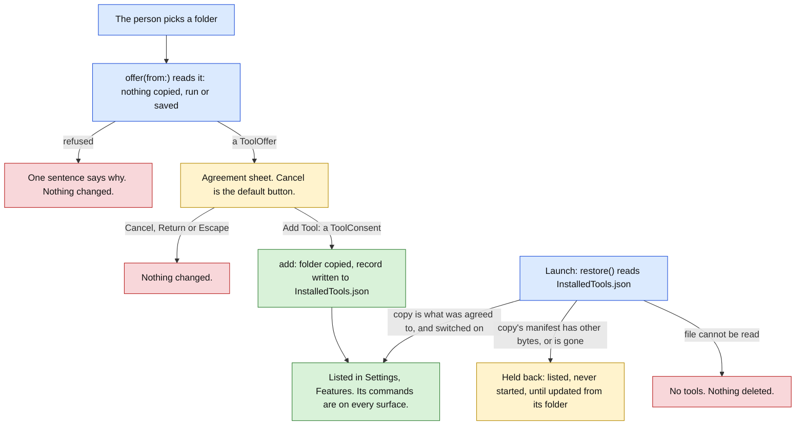

# Vitruvian external tools (stage C: the screens) Implementation Plan

> **For agentic workers:** REQUIRED SUB-SKILL: Use superpowers:subagent-driven-development (recommended) or superpowers:executing-plans to implement this plan task-by-task. Steps use checkbox (`- [ ]`) syntax for tracking.

**Goal:** Let a person add a tool that runs as its own program, see it, switch it off, update it and remove it, from Settings. After this stage any build of the app can add a tool from a folder, once the person has agreed on one sheet that says what adding it means. A build with no tool added shows one new card on the Features page and is otherwise as it is today.

**Architecture:** Adding a tool becomes two steps, and the type system holds them apart. `ExternalToolStore.offer(from:)` reads the folder a person picked and returns a `ToolOffer`. It copies nothing, runs nothing and saves nothing. `ExternalToolStore.add` takes a `ToolConsent` to that offer, and only the agreement sheet may make one. The store then copies the folder, writes a record to `InstalledTools.json` in the app's support folder, and hands the tool to the host and the registry stage B built. At launch `restore()` reads the records back. Each screen is a SwiftUI view over a plain value that holds everything the view shows, so the tests check the value and no test draws a view.



Green is done, amber waits for the person, red is a stop with nothing changed, blue is in progress.

**What a person sees:** a card "Tools from outside" at the end of Settings, Features; the folder picker; one sheet before a tool is added or updated; a row for each tool with a switch; a detail view; a question before a tool is removed; one short on-screen message when a tool stops working; and a new section of `docs/PRIVACY.md`. The mock-ups are `docs/superpowers/specs/2026-10-11-vitruvian-external-tools-stage-c-mockups.html`. Open that page beside each view you write.

**Tech Stack:** Swift 6 (strict concurrency), SwiftUI and AppKit, CryptoKit (SHA-256), the app's own `TestSuite` harness, `VitruvianToolProtocol` from `packages/vitruvian-sdk` (linked, not changed), Bazel with `--config=macos-app`.

**Spec:** `docs/superpowers/specs/2026-10-10-vitruvian-external-tools-design.md` (approved 2026-10-10). This is stage C of its section 15: "The tool store, the agreement sheet, the tools section of Settings, the privacy section. Mock-ups first." Stage B's plan is `docs/superpowers/plans/2026-10-10-vitruvian-external-tools-stage-b.md`. Stage D (the tool kit, the command-line tool, the samples, the documentation) is not in this plan.

**Release:** this stage is the first a person sees. Tasks that add something a person can see are titled `feat(desktop): …`; the others are `refactor(desktop): …`. `main` takes squash merges, so the pull request's title is the one that counts: it is `feat(desktop): add, see and remove tools that run as their own programs`, and merging it cuts a minor release of the app.

Paths that start with `Sources/`, `Tests/`, `Tools/`, `bazel/`, `docs/PRIVACY.md` or name `BUILD`, `AGENTS.md`, `README.md` or `UPSTREAM.md` alone are relative to `apps/desktop/vitruvian/`. Every other path is from the repository root. Every task works in `apps/desktop/vitruvian/` unless it says otherwise.

## Decisions this plan makes

The spec's twelve decisions stand, and so do the decisions of stages A and B. These are the ones the spec leaves open, or that the code forced. Each says whether it follows the spec, adds to it, or differs from it. Where the spec and the code disagree, the row says so in those words. Task 9 records them in the spec's stage table; it does not rewrite the spec's sections.

| # | Decision | Why |
|---|---|---|
| 1 | **Every build can add a tool, behind nothing.** The spec's section 8 puts the section and its button in the Features hub, and its "done when" item 4 asks only that a build with no tool added looks and behaves as today. So there is no flag, no define and no hidden preference in front of it. Follows the spec. | The one thing in front of a tool is the agreement sheet. A second gate would be a second place to get it wrong. |
| 2 | **The development switch is deleted**: `ExternalToolStore.installDevelopmentTool`, `install(from:)`, the preference `developmentToolFolder`, the Bazel setting `:external_tools`, the flag `VITRUVIAN_EXTERNAL_TOOLS`, the lines of `main.swift` and the source rule `a_release_build_adds_no_outside_tool` (Task 3). A new rule, `only_the_agreement_sheet_consents`, takes its place (Task 2). | The switch added a tool nobody agreed to, which is what this stage exists to rule out. A developer adds a tool the way everyone does. It also closes stage B's gap: a release build no longer holds a function that adds a tool with no question. |
| 3 | **The section is the last card of Settings, Features.** The spec says "the Features hub gets a section"; the brief for this stage calls it "Settings, Tools". This plan follows the spec. | A page of its own in the sidebar would need a new `SettingsPage` case, a translated title and an entry in the sidebar's fixed lists, for at most a few rows. |
| 4 | **The sheet lists what the tool says it uses.** The spec says, in section 8 and open question 4, that the sheet shows one statement and no list, because a list reads as a promise. The brief for this stage asks for the list "as information, not as a limit". This plan shows it: under the statement, in plain words, headed "What it says it uses", with the line "This list comes from the tool. It is not a limit on what the tool can do." **Differs from the spec.** | The brief is later than the spec and is specific. The wording and the order are what keep it from reading as a promise. If the spec should win, delete one block of `ToolAgreementSheet.body`; the detail view keeps the list and no string is saved. |
| 5 | **Adding is two calls, and the second needs a value only the sheet makes.** `offer(from:)` returns a `ToolOffer`, which has no initializer another module can call. `add` takes a `ToolConsent`. The rule `only_the_agreement_sheet_consents` fails for any file of the app, other than the sheet's, that makes one. **Adds to the spec.** | "Nothing is added before the person agrees" is then a property of the code's shape, not of everyone remembering. |
| 6 | **What the person agrees to is the manifest file's exact bytes**, named by their SHA-256 (`ToolFingerprint`). `add` reads the picked folder's manifest again and refuses when it is not the one shown, then checks the app's copy the same way. **Adds to the spec.** | The folder can change while the sheet is open. What is added must be what was read. |
| 7 | **"Changed" means one thing: one byte of `vitruvian-tool.json` differs from the bytes agreed to.** Nothing else is compared: not the program, not the other files, not the version number alone. | It is exact and cheap. The spec already says a tool can rewrite its own program and that the app does not pretend otherwise; the sheet's statement covers that. |
| 8 | **Choosing the folder of an added tool always asks again**, whether or not the manifest changed, with the old and new version. When it changed, the sheet says so in one bold line. The update keeps what the tool saved and keeps the tool's switch as it was. Follows the spec, section 8. | The spec says "asks once more". The files may differ even when the manifest does not. |
| 9 | **A copy that is not what was agreed to is held back at launch.** The spec says nothing of it; the code could start whatever is in `Tools/<id>/`. This plan does not: when the copy's manifest has other bytes, cannot be read, is gone, or is reached through a link, the tool is listed as "Changed since you added it" and never started. Only choosing its folder again, and agreeing again, brings it back. **Adds to the spec.** | Otherwise a tool could add commands or services to its own manifest after the person agreed, and the detail view would show a list nobody was asked about. It checks the manifest only. It is not a defence against a hostile tool, and the plan does not call it one. |
| 10 | **The records are one file, `InstalledTools.json`, in the app's support folder**, beside `Tools/` and `ToolData/`, not inside either. Version 1. Each record holds the tool's id, its switch, and what was agreed: when, the name, version and publisher shown, the manifest's fingerprint and the folder it came from. Written whole, atomically, for the person alone (mode 0600). | `InstalledTools.json` is itself a well-formed tool id, so the file cannot live inside `Tools/`. JSON a person can read is easier to mend than a preference. |
| 11 | **The code says every preference takes part in settings backup; the records and a tool's own preferences do not.** This plan leaves both out of the backup, and says so in `docs/PRIVACY.md`. **Differs from `AGENTS.md`'s rule, on purpose.** | A record is not a preference: it says a program is on this Mac and that its owner agreed to it here. Carried to another Mac it would name a tool that is not there. Stage B already left a tool's preferences out. |
| 12 | **A file of records that cannot be read means no tools, and nothing is deleted.** That is a damaged file, one a later version wrote (`version` other than 1), or one naming something that is no tool from outside. The file, every copy and everything a tool saved stay as they are. The first time a tool is added after, the file is moved to `InstalledTools.unreadable.json` and a new one is started. | Fail safe: a tool nobody can prove was agreed to is not started. Moving, not overwriting, keeps what a person could mend. |
| 13 | **A folder may hold 256 MB and 10,000 things** (files, folders and links together): `ToolLimits.folderBytes` and `folderItems`. Over either, it is refused before anything is copied. The spec gives no limit. **Adds to the spec.** | The copy is made on the main thread. The limits are what keep a wrongly picked folder, a home folder or a project with its dependencies, from stalling the app or filling the disk. A compiled tool is a few megabytes; a Python tool with its packages is tens of megabytes and a few thousand files. The walk stops as soon as a limit is passed. |
| 14 | **A picked folder that is a link is followed before anything else.** Stage B copied the link. | The copy must outlive the folder it came from. |
| 15 | **A quarantined folder is found by the `com.apple.quarantine` mark on the tool's program**, and refused with the command that clears it. The app never runs that command. Follows the spec, section 8. | The spec says macOS will not start such a program. That was not checked on a Mac for this plan; if macOS would have started it, the refusal is still the conservative answer. |
| 16 | **Remove always deletes the app's copy and the record. It deletes what the tool saved only when the person picks that button**: `ToolData/<id>/` and the preferences under `<tool id>/`. The folder the tool was added from is never touched. Shortcuts recorded for its commands stay saved and inactive, as saved layouts keep an id they do not know. Follows the spec, open question 6. | Stage B asked whether Remove clears a tool's preferences. They are "what it saved", so they go with the data folder. |
| 17 | **A tool's switch takes it out of the host and the registry.** Switched off, `isInstalled` is false for it: its program is stopped at once, its commands are in no list, and every request is refused. Stage B suggested exactly this. | No new path in the broker or the host. |
| 18 | **The person is told at a tool's first crash, in the app's short on-screen message** (`QuickToolHUD`), once per tool per run of the app, also across an update. Stage B asked whether "once" should mean the first crash or the moment the app gives up. | The first crash is when a command the person ran did nothing. A macOS notification would need the Notifications permission. |
| 19 | **Start Again is offered only once the app has given up** (three crashes within a minute). Before that the app starts the tool again by itself. Settles what stage B left: the spec's "until the person starts it from Settings" is now true. | A button that does nothing is worse than none. |
| 20 | **A tool's preferences have no screen.** The brief asks for them "if it declares any"; the spec's detail view lists commands, log, files and Remove; the manifest gives a preference an id, a type and a default, and no label. This plan shows none. So nothing in the app changes a tool's preference, and `preferences/changed` is still never sent. | There is nothing to show in plain words. A raw id on screen is jargon. |
| 21 | **The link to shortcuts goes to the existing Shortcuts page**, where part 3 of the registry already gives a tool's commands their rows. | No second place to record a shortcut. |
| 22 | **The app's new texts number 42, not the spec's "about 15".** Seven name the services a tool may list, seven say why a folder was refused, and the rest are the sheet, the update, the removal, the rows and the message. Seven more are words the app already has (Cancel, Remove, Close, Copy, Log, Reveal in Finder, Keyboard shortcuts). | The spec's count was a guess "counted at the planning step". The two lists are the price of plain words. Showing service names as the manifest spells them, and one generic refusal, would bring it to 30. |
| 23 | **The other fourteen languages are written in the same file, by whoever writes the English**, as every other string of the app was: there is no translation service, glossary or review step in this repository. The compiler holds that each language has each text; `ExternalToolStringsTests` holds that none is blank, none is the English text, and each format takes what the English one takes; two existing source rules hold the apostrophes and the French punctuation. Nobody who reads these languages has reviewed them. | It is the repository's own way. The plan says plainly what that way does not check. |
| 24 | **Cancel is the default button on the sheet and on the question before removal.** There is no tick box on the sheet. | Return and Escape must never add or remove. A tick box is one more string and one more click for what the bold sentence already asks. |
| 25 | **A screen is a view over a plain value.** `ToolAgreementContent`, `ToolRefusalMessage`, `ExternalToolRow`, `ExternalToolDetail` and `ToolRemovalContent` hold every word and every choice a view shows. The tests check them. No test draws a view. | It is how this app tests `ToolCommandShortcutRow`. How a screen looks is a check by hand. |
| 26 | **A refused manifest names the broken rule in the runtime's own English** (`unknownService("camera")`), after a translated sentence that says to tell whoever made the tool. | Thirty rules would be thirty more texts, for a message only a tool's author can act on. |
| 27 | **A tool still gets the app's environment**, not the login shell's (stage B's decision 24). | Unchanged. Stage D's documentation says so. |
| 28 | **An update stops the old program with a goodbye and may start the new one before the old has left.** | The old one has at most three seconds. Two runs of a tool for that long is what the person asked for by updating a running tool. |
| 29 | **The tests stay in the suite `tool-runtime`**, which grows from 303 checks to 462. `platform` keeps its 766. A full run still reports `TESTS OK (49 suites)`. | The new tests use stage B's bench and fake tool. |
| 30 | **Not in stage C:** a screen for a tool's preferences; telling a running tool that the language or a preference changed; the tool kit, the command-line tool, the samples and the documentation; anything in `packages/vitruvian-sdk` but one paragraph of its README; installing from a Git address; anything on the island. | Stage D and later. |

## Global Constraints

- **Everything in this plan was built and run before it was written down.** The tree at `16b60e5cb` (the head of stage B's branch) was exported to a scratch folder outside the repository, each task was applied in order, and each task's state was built and tested by itself: `bazel test --config=macos-app //apps/desktop/vitruvian:unit_tests --test_arg=--suite=tool-runtime --test_arg=--suite=platform` and `bazel test //apps/desktop/vitruvian:source_lints_test //apps/desktop/vitruvian:sources_in_sync_test`, on a Mac16,5 (Apple M4 Max) with macOS 27.0, Xcode 27.0 and Swift 6.4. The check counts in each task are from those runs. Every mutation listed was applied and seen to fail its test. At the last task a full run of the unit tests, `selftest`, both builds of the app, the licence gate, `//:tidy` and the workflow generator were run; "What was run for this plan" under Task 9 gives each result, including one full run that was not clean and why. Four things were not done. Nothing ran on a CI runner. Nobody opened the app, so nothing about how a screen looks or which button Return presses was seen: the list "By hand" is all of it. The compiler's exact words in each "write the failing tests" step are what Swift says for a name it cannot find, not a recording. And nobody who reads the fourteen other languages has read the translations. If the base has moved and a listing no longer fits, make the smallest change that keeps its meaning and record it as a deviation.
- **How to read a listing.** A block that starts with `// SPDX-License-Identifier` is a whole file. A block that starts with `diff --git` is a change to a file that exists, as `git diff` prints it: a line that starts with `-` goes, a line that starts with `+` comes in, and the others are there to find the place. Save the block to a file and run `git apply <file>` from the repository root, or make the change by hand. Each is a change from the state the task before left, and the line numbers are those of `16b60e5cb` with the earlier tasks applied. Every listing in this plan was taken by a script from the commits the tests ran on, not typed, and the script fails when a file a task changed has no listing in that task. The two exceptions are `Tests/mutation_checks.py` and `UPSTREAM.md`, which each task gives as the entries to add.
- **Licences.** Everything this stage adds is under `apps/desktop/vitruvian/` and is GPL-3.0-or-later. Every new file starts with exactly:
  ```swift
  // SPDX-License-Identifier: GPL-3.0-or-later
  // Copyright (C) 2026 VitruvianSoftware
  ```
  Never edit an existing `Copyright (C) 2026 Vorssaint` header. Nothing under `packages/vitruvian-sdk/Sources` changes, so the pin does not move and `bazel run //apps/desktop/vitruvian:pin_tool_protocol` is not needed; if you do change a file there, run it. Never copy code between the app's folder and the package.
- **`UPSTREAM.md`.** Every change to a file whose header says `Copyright (C) 2026 Vorssaint` is named under "Modifications" in the same commit. Three such files change in this stage: `Tests/mutation_checks.py` (Tasks 1 to 7), `Sources/Vitruvian/main.swift` (Task 3) and `Sources/Vitruvian/UI/Settings/FeatureHubSettings.swift` (Task 7). `docs/PRIVACY.md` has no header and upstream wrote it, so Task 8 logs it too. Task 1 adds the stage's entry as the first of the list; each later task adds one line to that entry. The exact text is in each task. Check the header of every file you change; do not trust this list.
- **What a person can see changes only where a task says so.** Bundled tools keep working untouched: `ToolPlatformTests`, `ToolBrokerTests` and `ExternalToolManifestTests` keep every expectation, and `platform` reports 766 checks after every task.
- **No task edits the app's `pipeline_unit`.** If you ever do, keep round brackets out of that call's comments: the presubmit planner reads the call up to the first closing one.
- **Layers and access.** `Core <- Design <- Services <- UI <- App`, all in Swift 6 mode. What another module or the tests use is `package`. A `package` type that a test builds needs a `package` initializer written out. A `package` view declares `package var body`. A file that names a type of the protocol imports `VitruvianToolProtocol` by name.
- **Concurrency.** The store and the runtime are `@MainActor` and never wait. Do not add a `Task` to them. A view may hop to the next turn of the main queue with `DispatchQueue.main.async`, and Task 7 does once.
- **Strings.** A text a person reads is a field of `ExternalToolStrings`, in all fifteen languages, and in the table under "The strings". Do not write a sentence into a view. A format is filled by a method of the struct, never by `String(format:)` in a view: the source rule about format fields then has nothing to list. Use the typographic apostrophe (’) and the ellipsis character (…), and no em-dash. French puts `\u{00A0}` before `:`, `?`, `!` and `;` and inside « ».
- **Tests.** The app's test module defaults to the main actor. A test is a synchronous `static func run(_ suite: TestSuite)` reached from `Tests/TestGroups.swift`. These rules apply:
  - A type declared in a test is not named like a system type or a top-level type of the app (`test_types_do_not_shadow_real_ones`).
  - No test reads a source file as text, and no test draws a view.
  - Every file a test writes is under `FileManager.default.temporaryDirectory`, in a folder the bench makes and removes. No test touches `~/Library/Application Support/com.vitruviansoftware.vitruvian`.
  - A test that needs preferences uses the domain `com.vitruviansoftware.vitruvian.tests.tool-store` and removes it; `PreferenceNamespaceTests` fails for a name outside `com.vitruviansoftware.vitruvian.tests.`. No test reads or writes the app's real preferences.
  - No test waits for a limit: every deadline is on `ManualToolClock`. A test that starts a real process waits only through `ToolRuntimeSupport.wait`, and kills the process and sees it gone before it returns.
- **Build and test through Bazel only**, from the repository root, one command at a time. A full run of the unit tests needs the display awake and the screen unlocked: start it with `(caffeinate -u -d -t 900 &);` or 17 scroll checks fail. One suite does not need that:
  ```sh
  bazel test --config=macos-app //apps/desktop/vitruvian:unit_tests --test_arg=--suite=tool-runtime --test_arg=--suite=platform --test_output=errors
  grep -aE "^(platform|tool-runtime): |TESTS" bazel-testlogs/apps/desktop/vitruvian/unit_tests/test.log
  bazel test //apps/desktop/vitruvian:source_lints_test //apps/desktop/vitruvian:sources_in_sync_test
  ```
  A passing run prints nothing with `--test_output=errors`; the `grep` shows each suite's line. After a change to a `package` signature the build recompiles `VitruvianUI` and the tests, about four minutes; after a change to a body, seconds. New Swift files need no edit to `BUILD` or `build.sh`: each module's sources are a glob.
- **Do not launch the app from a task**, and do not write to the preferences domain `com.vitruviansoftware.vitruvian` or create anything under the app's real support folder. The checks that need the running app are "By hand", and a person does them.
- **Mutations.** `Tests/mutation_checks.py` quotes source lines exactly. Each task gives its entries. For each: apply it by hand, run the `tool-runtime` suite, confirm it fails with the sixth field among the messages, undo it by hand, and confirm `git diff --stat -- <file>` shows only the task's own change. If a mutation is not caught, stop and report; do not adjust a test to fit.
- **Formatting and gates.** After editing a `.py` or `BUILD` file run `bazel run //tools/format -- <path>`. Task 9 runs `bazel run //tools/license:check`, `bazel run //tools/license:verify` and `bazel run //:tidy`. On this base `//:tidy` adds one unrelated line, `Cryptodome: pycryptodomex`, to `gazelle_python.yaml`: undo it by hand and do not commit it.
- **Git.** Never `git stash`, `git reset` or `git restore`; undo an edit by hand. Commits are authored as the `wren` agent, one per task, with identity and commit in one command. In a worktree the keys are in the main checkout:
  ```sh
  export AGENT_KEY_DIR=/Users/james/Workspace/gh/application/vitruvian/vitruvian-core/tools/sync-env-secrets/agent-keys; eval "$(bazel run //tools/agent-app -- env wren 2>/dev/null)"; git add <files> && git commit -m "<title>"
  ```
- **Signing.** The app is signed ad hoc, as today. Nothing in this stage signs, notarizes or changes how the app is signed, and no step of it needs any signing identity.

## Review Focus

Where a mistake costs most. Each has a test in the task named.

1. **The agreement cannot be skipped, and Return cannot give it.** A tool is added only by `ExternalToolStore.add`, which takes a `ToolConsent`; the source rule `only_the_agreement_sheet_consents` fails for any file of the app but the sheet's that makes one (Task 2), and the development switch is gone (Task 3). The sheet's default button is Cancel, held by `ToolAgreementContent.defaultChoice` and a mutation (Task 6). Read `ToolAgreementSheet.button(_:)` yourself: no test presses a key.
2. **Nothing is copied, started or saved before the person agrees.** After `offer(from:)` the support folder does not exist, the registry and the host hold nothing, no program has started and there is no file of records (Tasks 2 and 3). What is added is the manifest that was shown, byte for byte, in the picked folder and in the copy (Task 2).
3. **Remove deletes that tool's two folders and nothing else.** `ToolFolders.delete` can reach `Tools/<id>` and `ToolData/<id>`; an id is one folder name; with `Tools` a link to another place nothing there is deleted; a copy that is a link is deleted as a link; another tool's folders and the two roots stand; the folder the tool came from is never touched (Task 4).
4. **What is remembered survives a relaunch, and a file that cannot be read fails safe.** A second store over the same folders has the tool back, with what was agreed and its switch (Task 3). A damaged file, a later version's file and a file naming one of the app's own tools each mean no tools, with the file, the copy and what the tool saved untouched; the next add moves the old file aside (Task 3). A copy that is not what was agreed to is never started (Task 3).
5. **Every text in fifteen languages.** A missing language does not compile. `ExternalToolStringsTests` holds the count at 42, that no text is blank or left in English, and that each format is filled as the English one (Task 1). No view holds a sentence of its own: grep the two view files for a quoted capital letter.
6. **Built-in tools untouched.** `platform` reports 766 checks after every task. Nothing under `Services/Platform/Broker/` changes. The only edits outside the new files and `Services/Platform/External/` are five lines of `main.swift`, four of `FeatureHubSettings.swift`, the `BUILD` settings, one source rule, and the documents.

## The strings

The 42 texts this stage adds, each a field of `ExternalToolStrings` (Task 1), with its English text. `%@` is a slot the app fills; `%1$@` and `%2$@` are the first and second slot. The other fourteen languages are in Task 1's listing. The mock-ups use exactly these words.

| # | Key | English |
|---|---|---|
| 1 | `sectionTitle` | Tools from outside |
| 2 | `sectionEmpty` | No tools added. A tool from outside is a separate program that adds commands to Vitruvian. |
| 3 | `addButton` | Add a Tool… |
| 4 | `statusRunning` | Running |
| 5 | `statusStopped` | Stopped working |
| 6 | `startAgain` | Start Again |
| 7 | `statusChanged` | Changed since you added it. Update it to use it again. |
| 8 | `commandsTitle` | Commands |
| 9 | `usesTitle` | What it says it uses |
| 10 | `usesNote` | This list comes from the tool. It is not a limit on what the tool can do. |
| 11 | `useNotify` | Show messages and play the alert sound |
| 12 | `useOpen` | Open links |
| 13 | `useClipboardRead` | Read the clipboard |
| 14 | `useClipboardWrite` | Write to the clipboard |
| 15 | `useKeystrokes` | Paste and press menu commands in other apps |
| 16 | `useProcesses` | End other programs |
| 17 | `useStorage` | Save its own settings |
| 18 | `updateButton` | Update from Folder… |
| 19 | `refusalTitle` | This folder can’t be added |
| 20 | `refusalNoManifest` | It has no vitruvian-tool.json file, so it is not a tool. |
| 21 | `refusalMistakeFormat` | Its vitruvian-tool.json file has a mistake. Tell whoever made the tool: %@ |
| 22 | `refusalNeedsNewerFormat` | It needs something this version of Vitruvian does not have: %@ |
| 23 | `refusalProgramFormat` | Its program, %@, is missing or macOS will not run it. |
| 24 | `refusalQuarantined` | macOS has quarantined this folder because it was downloaded. Vitruvian will not clear that for you. If you trust it, run this in Terminal, then add it again: |
| 25 | `refusalTooBigFormat` | The folder is too large. A tool can hold up to %1$@ and %2$@ files. |
| 26 | `refusalNotAdded` | Vitruvian could not copy the folder, or it changed while you were reading. Nothing was added. |
| 27 | `agreeTitleFormat` | Add “%@” to Vitruvian? |
| 28 | `agreeFromFormat` | From %@ |
| 29 | `agreeOwnWords` | The name, publisher and description are the tool’s own words. Vitruvian has not checked them. |
| 30 | `agreeHeadline` | This tool can do anything Vitruvian can on this Mac. |
| 31 | `agreeDetail` | It is a separate program. It can read the screen, control other apps, read your files and use the network. Vitruvian does not limit or check what it does. Add it only if you trust who made it. |
| 32 | `agreeAdd` | Add Tool |
| 33 | `updateTitleFormat` | Update “%@”? |
| 34 | `updateVersionsFormat` | You have version %1$@. This folder has version %2$@. |
| 35 | `updateChanged` | What the tool says about itself has changed since you agreed. Read it again. |
| 36 | `updateKeepsData` | What the tool saved is kept. |
| 37 | `updateConfirm` | Update Tool |
| 38 | `removeTitleFormat` | Remove “%@”? |
| 39 | `removeMessage` | Vitruvian deletes its copy of the tool. The folder you added it from is not touched. |
| 40 | `removeKeepData` | Remove, Keep What It Saved |
| 41 | `removeDeleteData` | Remove and Delete What It Saved |
| 42 | `stoppedFormat` | “%@” stopped working |

Seven more are words the app already has, used as they are:

| Where | The app's string | English |
|---|---|---|
| The default button of the sheet and of the question before removal | `Strings.uninstallerCancel` | Cancel |
| The detail's button that removes a tool | `Strings.actionRemove` | Remove |
| The detail's default button, and the refusal's | `Strings.menuClose` | Close |
| Beside the command that clears a quarantine | `Strings.menuCopy` | Copy |
| The disclosure over what a tool logged | `Strings.homebrewLogTitle` | Log |
| Beside where a tool's files are | `Strings.cleanerRevealInFinder` | Reveal in Finder |
| The button to the Shortcuts page | `Strings.shortcutsPageTitle` | Keyboard shortcuts |

Shown as the tool wrote them, and never translated by the app: a tool's name, publisher, version, description and command titles. A tool's log and the rule a manifest broke are shown in English, as the runtime wrote them.

---

### Task 1: The words, in fifteen languages

**Files:**
- Create: `Sources/Vitruvian/Core/ExternalToolStrings.swift`
- Create: `Tests/ExternalToolStringsTests.swift`
- Modify: `Tests/TestGroups.swift` (one line)
- Modify: `Tests/mutation_checks.py`, `UPSTREAM.md`

**Interfaces:**
- Consumes: `AppLanguage`, `FeatureStrings`, `Capability`.
- Produces:
  - `ExternalToolStrings` (42 `String` fields; `static let` for each of the fifteen languages)
  - Its methods that fill a format: `agreeTitle(_:)`, `agreeFrom(_:)`, `updateTitle(_:)`, `updateVersions(agreed:offered:)`, `removeTitle(_:)`, `stopped(_:)`, `refusalMistake(_:)`, `refusalNeedsNewer(_:)`, `refusalProgram(_:)`, `refusalTooBig(size:items:)`
  - `use(_ capability: Capability) -> String?`, `all: [(key: String, text: String)]`
  - `FeatureStrings.externalTools(_:)`
  - In the tests: `ExternalToolStringsTests.count` (42)

The words come first because every later task shows one. Nothing shows them yet. The file follows `FeatureHubStrings`: one `static let` per language, in the file, and a `switch` over every `AppLanguage`, so a language that is missing does not compile. Because each French text is in a block that starts `static let fr = `, the source rule `french_punctuation_stays_on_its_line` reads it.

Each format is filled by a method of the struct that names its field bare (`String(format: agreeTitleFormat, …)`). The rule `every_language_fills_a_format_the_same_way` lists only fields reached as `something.field`, so `Tests/SourceNames.swift` needs no new name. The test below holds the formats instead.

- [ ] **Step 1: Write the failing test**

Create `Tests/ExternalToolStringsTests.swift`:

```swift
// SPDX-License-Identifier: GPL-3.0-or-later
// Copyright (C) 2026 VitruvianSoftware

import Foundation
import VitruvianCore

/// The app's own words about tools from outside, in all fifteen languages.
/// A language that is missing does not compile. These checks hold what the
/// compiler cannot: that each text is there, is a translation, and fills its
/// format the way the English one does.
enum ExternalToolStringsTests {
    /// How many texts the screens for tools from outside add. A text added
    /// or taken away changes this number on purpose, with the plan's table.
    static let count = 42

    static func run(_ suite: TestSuite) {
        let english = FeatureStrings.externalTools(.enUS).all
        suite.expect(english.count == count && Set(english.map(\.key)).count == count,
                     "the screens for tools from outside add \(count) texts, each under its own name (\(english.count))")

        for language in AppLanguage.allCases {
            let texts = FeatureStrings.externalTools(language).all
            let blank = texts.filter { $0.text.trimmingCharacters(in: .whitespacesAndNewlines).isEmpty }.map(\.key)
            let dashed = texts.filter { $0.text.contains("\u{2014}") || $0.text.contains("...") }.map(\.key)
            suite.expect(texts.map(\.key) == english.map(\.key) && blank.isEmpty && dashed.isEmpty,
                         "every text about tools from outside is written, with no em-dash and no three periods, "
                             + "in \(language.rawValue) (\((blank + dashed).joined(separator: ", ")))")

            var misfilled: [String] = []
            for (base, mine) in zip(english, texts) where base.key.hasSuffix("Format") {
                let wanted = TestFormat.parse(base.text)
                if wanted == nil || wanted?.arguments.isEmpty == true
                    || wanted?.arguments != TestFormat.parse(mine.text)?.arguments {
                    misfilled.append(mine.key)
                }
            }
            suite.expect(misfilled.isEmpty,
                         "every format about tools from outside is filled the same way in \(language.rawValue) "
                             + "(\(misfilled.joined(separator: ", ")))")
            let stray = texts.filter { !$0.key.hasSuffix("Format") && $0.text.contains("%") }.map(\.key)
            suite.expect(stray.isEmpty,
                         "a text that is no format holds no percent sign in \(language.rawValue) "
                             + "(\(stray.joined(separator: ", ")))")

            guard language != .enUS else { continue }
            let untranslated = zip(english, texts).filter { $0.text == $1.text }.map(\.0.key)
            suite.expect(untranslated.isEmpty,
                         "no text about tools from outside is left in English in \(language.rawValue) "
                             + "(\(untranslated.joined(separator: ", ")))")
        }

        let strings = FeatureStrings.externalTools(.enUS)
        suite.expect(strings.agreeTitle("Deploys") == "Add “Deploys” to Vitruvian?"
                         && strings.updateVersions(agreed: "1.2.0", offered: "1.3.0")
                         == "You have version 1.2.0. This folder has version 1.3.0."
                         && strings.refusalTooBig(size: "256 MB", items: "10,000")
                         == "The folder is too large. A tool can hold up to 256 MB and 10,000 files."
                         && strings.stopped("Deploys") == "“Deploys” stopped working",
                     "a format is filled with what it is handed, in the order the sentence names it")
        let listable: [Capability] = [.notify, .open, .clipboardRead, .clipboardWrite, .keystrokes, .processes, .storage]
        suite.expect(Capability.allCases.filter { strings.use($0) != nil } == Capability.allCases.filter(listable.contains)
                         && Set(listable.compactMap(strings.use)).count == 7
                         && strings.use(.keystrokes) == "Paste and press menu commands in other apps",
                     "each of the seven services a tool from outside may list has its own plain words, and no other has any")
        suite.expect(FeatureStrings.externalTools(.de).removeTitle("Deploys") == "„Deploys“ entfernen?"
                         && FeatureStrings.externalTools(.fr).agreeTitle("Deploys")
                         == "Ajouter «\u{00A0}Deploys\u{00A0}» à Vitruvian\u{00A0}?",
                     "a tool's name is quoted the way each language quotes")
    }
}
```

In `Tests/TestGroups.swift`, in the suite `tool-runtime`:

```diff
diff --git a/apps/desktop/vitruvian/Tests/TestGroups.swift b/apps/desktop/vitruvian/Tests/TestGroups.swift
index 6af3be2..79f2454 100644
--- a/apps/desktop/vitruvian/Tests/TestGroups.swift
+++ b/apps/desktop/vitruvian/Tests/TestGroups.swift
@@ -180,6 +180,7 @@ enum TestGroups {
                 ExternalToolHostTests.run(suite)
                 ExternalToolCallsTests.run(suite)
                 ExternalToolStoreTests.run(suite)
+                ExternalToolStringsTests.run(suite)
             }),
             ("utilities", {
                 UtilitiesFeatureTests.run(suite)
```

Run: `bazel test --config=macos-app //apps/desktop/vitruvian:unit_tests --test_arg=--suite=tool-runtime --test_output=errors`
Expected: the build fails. Among the errors: `type 'FeatureStrings' has no member 'externalTools'`.

- [ ] **Step 2: Write the strings**

Create `Sources/Vitruvian/Core/ExternalToolStrings.swift`. Type it exactly: a changed word changes what a person agrees to.

```swift
// SPDX-License-Identifier: GPL-3.0-or-later
// Copyright (C) 2026 VitruvianSoftware

import Foundation

/// The app's own words about tools that run as their own programs: their
/// section of the Features hub, the sheet that asks before one is added, and
/// the message when one stops working. A tool's name, publisher, description
/// and command titles are never here: they are shown as the tool wrote them.
///
/// Same contract as the other feature string sets: one static per language,
/// all in this file, and `FeatureStrings.externalTools` switches over every
/// language, so a missing one does not compile.
package struct ExternalToolStrings {
    package let sectionTitle: String
    package let sectionEmpty: String
    package let addButton: String
    package let statusRunning: String
    package let statusStopped: String
    package let startAgain: String
    /// A tool whose files are not what the person agreed to. It is not started.
    package let statusChanged: String
    package let commandsTitle: String
    /// Heads the list of app services the tool's manifest names in `uses`.
    package let usesTitle: String
    package let usesNote: String
    package let useNotify: String
    package let useOpen: String
    package let useClipboardRead: String
    package let useClipboardWrite: String
    package let useKeystrokes: String
    package let useProcesses: String
    package let useStorage: String
    package let updateButton: String
    package let refusalTitle: String
    package let refusalNoManifest: String
    /// `%@` is which rule of the manifest was broken, in the runtime's own English.
    package let refusalMistakeFormat: String
    /// `%@` is the name the manifest uses that this app does not have.
    package let refusalNeedsNewerFormat: String
    /// `%@` is the program's path inside the folder, as the manifest gives it.
    package let refusalProgramFormat: String
    /// Shown above the command that clears the quarantine, which is not translated.
    package let refusalQuarantined: String
    /// `%1$@` is the most a tool's folder may weigh, such as "256 MB"; `%2$@` is the most things it may hold.
    package let refusalTooBigFormat: String
    package let refusalNotAdded: String
    /// `%@` is the tool's name, as the tool wrote it.
    package let agreeTitleFormat: String
    /// `%@` is the folder the person picked, with a tilde for their home folder.
    package let agreeFromFormat: String
    package let agreeOwnWords: String
    /// The one sentence the sheet exists to say.
    package let agreeHeadline: String
    package let agreeDetail: String
    package let agreeAdd: String
    /// `%@` is the tool's name, as the tool wrote it.
    package let updateTitleFormat: String
    /// `%1$@` is the version the person agreed to; `%2$@` is the one in the folder.
    package let updateVersionsFormat: String
    /// Shown when the manifest's bytes differ from the ones the person agreed to.
    package let updateChanged: String
    package let updateKeepsData: String
    package let updateConfirm: String
    /// `%@` is the tool's name, as the tool wrote it.
    package let removeTitleFormat: String
    package let removeMessage: String
    package let removeKeepData: String
    package let removeDeleteData: String
    /// The app's short on-screen message. `%@` is the tool's name, as the tool wrote it.
    package let stoppedFormat: String

    package func agreeTitle(_ name: String) -> String {
        String(format: agreeTitleFormat, locale: Locale.current, name)
    }

    package func agreeFrom(_ folder: String) -> String {
        String(format: agreeFromFormat, locale: Locale.current, folder)
    }

    package func updateTitle(_ name: String) -> String {
        String(format: updateTitleFormat, locale: Locale.current, name)
    }

    package func updateVersions(agreed: String, offered: String) -> String {
        String(format: updateVersionsFormat, locale: Locale.current, agreed, offered)
    }

    package func removeTitle(_ name: String) -> String {
        String(format: removeTitleFormat, locale: Locale.current, name)
    }

    package func stopped(_ name: String) -> String {
        String(format: stoppedFormat, locale: Locale.current, name)
    }

    package func refusalMistake(_ detail: String) -> String {
        String(format: refusalMistakeFormat, locale: Locale.current, detail)
    }

    package func refusalNeedsNewer(_ name: String) -> String {
        String(format: refusalNeedsNewerFormat, locale: Locale.current, name)
    }

    package func refusalProgram(_ path: String) -> String {
        String(format: refusalProgramFormat, locale: Locale.current, path)
    }

    package func refusalTooBig(size: String, items: String) -> String {
        String(format: refusalTooBigFormat, locale: Locale.current, size, items)
    }

    /// One of the app's services, in plain words, as a tool's manifest
    /// lists it in `uses`. Nil for the two a tool from outside may not
    /// list.
    package func use(_ capability: Capability) -> String? {
        switch capability {
        case .notify: return useNotify
        case .open: return useOpen
        case .clipboardRead: return useClipboardRead
        case .clipboardWrite: return useClipboardWrite
        case .keystrokes: return useKeystrokes
        case .processes: return useProcesses
        case .storage: return useStorage
        case .clipboardRewrite, .hotkey: return nil
        }
    }

    /// Every text, by its field's name, for a check that reads them all.
    package var all: [(key: String, text: String)] {
        [
            ("sectionTitle", sectionTitle),
            ("sectionEmpty", sectionEmpty),
            ("addButton", addButton),
            ("statusRunning", statusRunning),
            ("statusStopped", statusStopped),
            ("startAgain", startAgain),
            ("statusChanged", statusChanged),
            ("commandsTitle", commandsTitle),
            ("usesTitle", usesTitle),
            ("usesNote", usesNote),
            ("useNotify", useNotify),
            ("useOpen", useOpen),
            ("useClipboardRead", useClipboardRead),
            ("useClipboardWrite", useClipboardWrite),
            ("useKeystrokes", useKeystrokes),
            ("useProcesses", useProcesses),
            ("useStorage", useStorage),
            ("updateButton", updateButton),
            ("refusalTitle", refusalTitle),
            ("refusalNoManifest", refusalNoManifest),
            ("refusalMistakeFormat", refusalMistakeFormat),
            ("refusalNeedsNewerFormat", refusalNeedsNewerFormat),
            ("refusalProgramFormat", refusalProgramFormat),
            ("refusalQuarantined", refusalQuarantined),
            ("refusalTooBigFormat", refusalTooBigFormat),
            ("refusalNotAdded", refusalNotAdded),
            ("agreeTitleFormat", agreeTitleFormat),
            ("agreeFromFormat", agreeFromFormat),
            ("agreeOwnWords", agreeOwnWords),
            ("agreeHeadline", agreeHeadline),
            ("agreeDetail", agreeDetail),
            ("agreeAdd", agreeAdd),
            ("updateTitleFormat", updateTitleFormat),
            ("updateVersionsFormat", updateVersionsFormat),
            ("updateChanged", updateChanged),
            ("updateKeepsData", updateKeepsData),
            ("updateConfirm", updateConfirm),
            ("removeTitleFormat", removeTitleFormat),
            ("removeMessage", removeMessage),
            ("removeKeepData", removeKeepData),
            ("removeDeleteData", removeDeleteData),
            ("stoppedFormat", stoppedFormat),
        ]
    }
}

extension ExternalToolStrings {
    package static let enUS = ExternalToolStrings(
        sectionTitle: "Tools from outside",
        sectionEmpty: "No tools added. A tool from outside is a separate program that adds commands to Vitruvian.",
        addButton: "Add a Tool…",
        statusRunning: "Running",
        statusStopped: "Stopped working",
        startAgain: "Start Again",
        statusChanged: "Changed since you added it. Update it to use it again.",
        commandsTitle: "Commands",
        usesTitle: "What it says it uses",
        usesNote: "This list comes from the tool. It is not a limit on what the tool can do.",
        useNotify: "Show messages and play the alert sound",
        useOpen: "Open links",
        useClipboardRead: "Read the clipboard",
        useClipboardWrite: "Write to the clipboard",
        useKeystrokes: "Paste and press menu commands in other apps",
        useProcesses: "End other programs",
        useStorage: "Save its own settings",
        updateButton: "Update from Folder…",
        refusalTitle: "This folder can’t be added",
        refusalNoManifest: "It has no vitruvian-tool.json file, so it is not a tool.",
        refusalMistakeFormat: "Its vitruvian-tool.json file has a mistake. Tell whoever made the tool: %@",
        refusalNeedsNewerFormat: "It needs something this version of Vitruvian does not have: %@",
        refusalProgramFormat: "Its program, %@, is missing or macOS will not run it.",
        refusalQuarantined: "macOS has quarantined this folder because it was downloaded. Vitruvian will not clear that for you. If you trust it, run this in Terminal, then add it again:",
        refusalTooBigFormat: "The folder is too large. A tool can hold up to %1$@ and %2$@ files.",
        refusalNotAdded: "Vitruvian could not copy the folder, or it changed while you were reading. Nothing was added.",
        agreeTitleFormat: "Add “%@” to Vitruvian?",
        agreeFromFormat: "From %@",
        agreeOwnWords: "The name, publisher and description are the tool’s own words. Vitruvian has not checked them.",
        agreeHeadline: "This tool can do anything Vitruvian can on this Mac.",
        agreeDetail: "It is a separate program. It can read the screen, control other apps, read your files and use the network. Vitruvian does not limit or check what it does. Add it only if you trust who made it.",
        agreeAdd: "Add Tool",
        updateTitleFormat: "Update “%@”?",
        updateVersionsFormat: "You have version %1$@. This folder has version %2$@.",
        updateChanged: "What the tool says about itself has changed since you agreed. Read it again.",
        updateKeepsData: "What the tool saved is kept.",
        updateConfirm: "Update Tool",
        removeTitleFormat: "Remove “%@”?",
        removeMessage: "Vitruvian deletes its copy of the tool. The folder you added it from is not touched.",
        removeKeepData: "Remove, Keep What It Saved",
        removeDeleteData: "Remove and Delete What It Saved",
        stoppedFormat: "“%@” stopped working")

    package static let ptBR = ExternalToolStrings(
        sectionTitle: "Ferramentas de fora",
        sectionEmpty: "Nenhuma ferramenta adicionada. Uma ferramenta de fora é um programa separado que adiciona comandos ao Vitruvian.",
        addButton: "Adicionar ferramenta…",
        statusRunning: "Em execução",
        statusStopped: "Parou de funcionar",
        startAgain: "Iniciar novamente",
        statusChanged: "Mudou desde que você a adicionou. Atualize-a para voltar a usá-la.",
        commandsTitle: "Comandos",
        usesTitle: "O que ela diz que usa",
        usesNote: "Esta lista vem da ferramenta. Ela não limita o que a ferramenta pode fazer.",
        useNotify: "Mostrar mensagens e tocar o som de alerta",
        useOpen: "Abrir links",
        useClipboardRead: "Ler a área de transferência",
        useClipboardWrite: "Escrever na área de transferência",
        useKeystrokes: "Colar e acionar comandos de menu em outros apps",
        useProcesses: "Encerrar outros programas",
        useStorage: "Salvar suas próprias configurações",
        updateButton: "Atualizar a partir de uma pasta…",
        refusalTitle: "Esta pasta não pode ser adicionada",
        refusalNoManifest: "Ela não tem um arquivo vitruvian-tool.json, então não é uma ferramenta.",
        refusalMistakeFormat: "O arquivo vitruvian-tool.json tem um erro. Avise quem fez a ferramenta: %@",
        refusalNeedsNewerFormat: "Ela precisa de algo que esta versão do Vitruvian não tem: %@",
        refusalProgramFormat: "O programa dela, %@, está ausente ou o macOS não o executa.",
        refusalQuarantined: "O macOS colocou esta pasta em quarentena porque ela foi baixada. O Vitruvian não remove isso por você. Se você confia nela, execute isto no Terminal e adicione-a de novo:",
        refusalTooBigFormat: "A pasta é grande demais. Uma ferramenta pode ter até %1$@ e %2$@ arquivos.",
        refusalNotAdded: "O Vitruvian não conseguiu copiar a pasta, ou ela mudou enquanto você lia. Nada foi adicionado.",
        agreeTitleFormat: "Adicionar “%@” ao Vitruvian?",
        agreeFromFormat: "De %@",
        agreeOwnWords: "O nome, o autor e a descrição são palavras da própria ferramenta. O Vitruvian não os verificou.",
        agreeHeadline: "Esta ferramenta pode fazer tudo o que o Vitruvian pode neste Mac.",
        agreeDetail: "É um programa separado. Ela pode ler a tela, controlar outros apps, ler seus arquivos e usar a rede. O Vitruvian não limita nem verifica o que ela faz. Adicione-a somente se você confia em quem a fez.",
        agreeAdd: "Adicionar ferramenta",
        updateTitleFormat: "Atualizar “%@”?",
        updateVersionsFormat: "Você tem a versão %1$@. Esta pasta tem a versão %2$@.",
        updateChanged: "O que a ferramenta diz sobre si mesma mudou desde que você concordou. Leia de novo.",
        updateKeepsData: "O que a ferramenta salvou é mantido.",
        updateConfirm: "Atualizar ferramenta",
        removeTitleFormat: "Remover “%@”?",
        removeMessage: "O Vitruvian apaga a cópia que ele tem da ferramenta. A pasta de onde você a adicionou não é alterada.",
        removeKeepData: "Remover e manter o que ela salvou",
        removeDeleteData: "Remover e apagar o que ela salvou",
        stoppedFormat: "“%@” parou de funcionar")

    package static let tr = ExternalToolStrings(
        sectionTitle: "Dışarıdan araçlar",
        sectionEmpty: "Eklenmiş araç yok. Dışarıdan bir araç, Vitruvian’a komut ekleyen ayrı bir programdır.",
        addButton: "Araç ekle…",
        statusRunning: "Çalışıyor",
        statusStopped: "Çalışmayı durdurdu",
        startAgain: "Yeniden başlat",
        statusChanged: "Eklediğinizden beri değişti. Yeniden kullanmak için güncelleyin.",
        commandsTitle: "Komutlar",
        usesTitle: "Kullandığını söyledikleri",
        usesNote: "Bu liste aracın kendisinden gelir. Aracın yapabileceklerini sınırlamaz.",
        useNotify: "İleti gösterme ve uyarı sesini çalma",
        useOpen: "Bağlantıları açma",
        useClipboardRead: "Panoyu okuma",
        useClipboardWrite: "Panoya yazma",
        useKeystrokes: "Diğer uygulamalarda yapıştırma ve menü komutlarına basma",
        useProcesses: "Diğer programları sonlandırma",
        useStorage: "Kendi ayarlarını kaydetme",
        updateButton: "Klasörden güncelle…",
        refusalTitle: "Bu klasör eklenemiyor",
        refusalNoManifest: "İçinde vitruvian-tool.json dosyası yok, bu yüzden bir araç değil.",
        refusalMistakeFormat: "vitruvian-tool.json dosyasında bir hata var. Aracı yapana bildirin: %@",
        refusalNeedsNewerFormat: "Vitruvian’ın bu sürümünde olmayan bir şeye ihtiyaç duyuyor: %@",
        refusalProgramFormat: "Programı (%@) eksik veya macOS onu çalıştırmıyor.",
        refusalQuarantined: "macOS bu klasörü indirildiği için karantinaya aldı. Vitruvian bunu sizin yerinize kaldırmaz. Güveniyorsanız Terminal’de şunu çalıştırın, sonra yeniden ekleyin:",
        refusalTooBigFormat: "Klasör çok büyük. Bir araç en fazla %1$@ ve %2$@ dosya içerebilir.",
        refusalNotAdded: "Vitruvian klasörü kopyalayamadı veya klasör siz okurken değişti. Hiçbir şey eklenmedi.",
        agreeTitleFormat: "“%@” Vitruvian’a eklensin mi?",
        agreeFromFormat: "Kaynak: %@",
        agreeOwnWords: "Ad, yayıncı ve açıklama aracın kendi sözleridir. Vitruvian bunları doğrulamadı.",
        agreeHeadline: "Bu araç, Vitruvian’ın bu Mac’te yapabildiği her şeyi yapabilir.",
        agreeDetail: "Ayrı bir programdır. Ekranı okuyabilir, diğer uygulamaları denetleyebilir, dosyalarınızı okuyabilir ve ağı kullanabilir. Vitruvian onun yaptıklarını sınırlamaz ve denetlemez. Yalnızca yapana güveniyorsanız ekleyin.",
        agreeAdd: "Aracı ekle",
        updateTitleFormat: "“%@” güncellensin mi?",
        updateVersionsFormat: "Sizde %1$@ sürümü var. Bu klasörde %2$@ sürümü var.",
        updateChanged: "Aracın kendisi hakkında söyledikleri, onay verdiğinizden beri değişti. Yeniden okuyun.",
        updateKeepsData: "Aracın kaydettikleri korunur.",
        updateConfirm: "Aracı güncelle",
        removeTitleFormat: "“%@” kaldırılsın mı?",
        removeMessage: "Vitruvian, aracın kendisindeki kopyasını siler. Aracı eklediğiniz klasöre dokunulmaz.",
        removeKeepData: "Kaldır, kaydettiklerini koru",
        removeDeleteData: "Kaldır ve kaydettiklerini sil",
        stoppedFormat: "“%@” çalışmayı durdurdu")

    package static let ru = ExternalToolStrings(
        sectionTitle: "Сторонние инструменты",
        sectionEmpty: "Инструменты не добавлены. Сторонний инструмент является отдельной программой, которая добавляет команды в Vitruvian.",
        addButton: "Добавить инструмент…",
        statusRunning: "Работает",
        statusStopped: "Перестал работать",
        startAgain: "Запустить снова",
        statusChanged: "Изменился с момента добавления. Обновите его, чтобы снова использовать.",
        commandsTitle: "Команды",
        usesTitle: "Что он, по его словам, использует",
        usesNote: "Этот список предоставлен самим инструментом. Он не ограничивает то, что инструмент может делать.",
        useNotify: "Показывать сообщения и воспроизводить звук предупреждения",
        useOpen: "Открывать ссылки",
        useClipboardRead: "Читать буфер обмена",
        useClipboardWrite: "Записывать в буфер обмена",
        useKeystrokes: "Вставлять текст и нажимать команды меню в других приложениях",
        useProcesses: "Завершать другие программы",
        useStorage: "Сохранять собственные настройки",
        updateButton: "Обновить из папки…",
        refusalTitle: "Эту папку нельзя добавить",
        refusalNoManifest: "В ней нет файла vitruvian-tool.json, поэтому это не инструмент.",
        refusalMistakeFormat: "В файле vitruvian-tool.json есть ошибка. Сообщите автору инструмента: %@",
        refusalNeedsNewerFormat: "Ему нужно то, чего нет в этой версии Vitruvian: %@",
        refusalProgramFormat: "Его программа %@ отсутствует, или macOS не может её запустить.",
        refusalQuarantined: "macOS поместила эту папку в карантин, потому что она была загружена. Vitruvian не снимет его за вас. Если вы ей доверяете, выполните это в Терминале и добавьте её снова:",
        refusalTooBigFormat: "Папка слишком велика. Инструмент может содержать не более %1$@ и %2$@ файлов.",
        refusalNotAdded: "Vitruvian не удалось скопировать папку, или она изменилась, пока вы читали. Ничего не добавлено.",
        agreeTitleFormat: "Добавить «%@» в Vitruvian?",
        agreeFromFormat: "Из папки %@",
        agreeOwnWords: "Название, издатель и описание указаны самим инструментом. Vitruvian их не проверял.",
        agreeHeadline: "Этот инструмент может делать на этом Mac всё, что может Vitruvian.",
        agreeDetail: "Это отдельная программа. Она может читать экран, управлять другими приложениями, читать ваши файлы и использовать сеть. Vitruvian не ограничивает и не проверяет её действия. Добавляйте его, только если доверяете автору.",
        agreeAdd: "Добавить инструмент",
        updateTitleFormat: "Обновить «%@»?",
        updateVersionsFormat: "У вас версия %1$@. В этой папке версия %2$@.",
        updateChanged: "То, что инструмент сообщает о себе, изменилось с момента вашего согласия. Прочитайте ещё раз.",
        updateKeepsData: "Сохранённые инструментом данные останутся.",
        updateConfirm: "Обновить инструмент",
        removeTitleFormat: "Удалить «%@»?",
        removeMessage: "Vitruvian удалит свою копию инструмента. Папка, из которой вы его добавили, не будет затронута.",
        removeKeepData: "Удалить, сохранив его данные",
        removeDeleteData: "Удалить вместе с его данными",
        stoppedFormat: "«%@» перестал работать")

    package static let es = ExternalToolStrings(
        sectionTitle: "Herramientas externas",
        sectionEmpty: "No hay herramientas añadidas. Una herramienta externa es un programa aparte que añade comandos a Vitruvian.",
        addButton: "Añadir herramienta…",
        statusRunning: "En ejecución",
        statusStopped: "Dejó de funcionar",
        startAgain: "Iniciar de nuevo",
        statusChanged: "Ha cambiado desde que la añadiste. Actualízala para volver a usarla.",
        commandsTitle: "Comandos",
        usesTitle: "Lo que dice que usa",
        usesNote: "Esta lista la proporciona la herramienta. No limita lo que la herramienta puede hacer.",
        useNotify: "Mostrar mensajes y reproducir el sonido de alerta",
        useOpen: "Abrir enlaces",
        useClipboardRead: "Leer el portapapeles",
        useClipboardWrite: "Escribir en el portapapeles",
        useKeystrokes: "Pegar y pulsar comandos de menú en otras apps",
        useProcesses: "Cerrar otros programas",
        useStorage: "Guardar sus propios ajustes",
        updateButton: "Actualizar desde una carpeta…",
        refusalTitle: "No se puede añadir esta carpeta",
        refusalNoManifest: "No contiene un archivo vitruvian-tool.json, así que no es una herramienta.",
        refusalMistakeFormat: "Su archivo vitruvian-tool.json tiene un error. Díselo a quien hizo la herramienta: %@",
        refusalNeedsNewerFormat: "Necesita algo que esta versión de Vitruvian no tiene: %@",
        refusalProgramFormat: "Su programa, %@, no está o macOS no lo ejecuta.",
        refusalQuarantined: "macOS ha puesto esta carpeta en cuarentena porque se descargó. Vitruvian no lo quitará por ti. Si confías en ella, ejecuta esto en Terminal y añádela de nuevo:",
        refusalTooBigFormat: "La carpeta es demasiado grande. Una herramienta puede tener hasta %1$@ y %2$@ archivos.",
        refusalNotAdded: "Vitruvian no pudo copiar la carpeta, o cambió mientras leías. No se añadió nada.",
        agreeTitleFormat: "¿Añadir “%@” a Vitruvian?",
        agreeFromFormat: "Desde %@",
        agreeOwnWords: "El nombre, el editor y la descripción son palabras de la propia herramienta. Vitruvian no los ha comprobado.",
        agreeHeadline: "Esta herramienta puede hacer todo lo que Vitruvian puede hacer en este Mac.",
        agreeDetail: "Es un programa aparte. Puede leer la pantalla, controlar otras apps, leer tus archivos y usar la red. Vitruvian no limita ni comprueba lo que hace. Añádela solo si confías en quien la hizo.",
        agreeAdd: "Añadir herramienta",
        updateTitleFormat: "¿Actualizar “%@”?",
        updateVersionsFormat: "Tienes la versión %1$@. Esta carpeta tiene la versión %2$@.",
        updateChanged: "Lo que la herramienta dice de sí misma ha cambiado desde que aceptaste. Léelo de nuevo.",
        updateKeepsData: "Lo que la herramienta guardó se conserva.",
        updateConfirm: "Actualizar herramienta",
        removeTitleFormat: "¿Eliminar “%@”?",
        removeMessage: "Vitruvian borra su copia de la herramienta. La carpeta desde la que la añadiste no se toca.",
        removeKeepData: "Eliminar y conservar lo que guardó",
        removeDeleteData: "Eliminar y borrar lo que guardó",
        stoppedFormat: "“%@” dejó de funcionar")

    package static let sk = ExternalToolStrings(
        sectionTitle: "Nástroje zvonka",
        sectionEmpty: "Žiadne nástroje nie sú pridané. Nástroj zvonka je samostatný program, ktorý pridáva príkazy do aplikácie Vitruvian.",
        addButton: "Pridať nástroj…",
        statusRunning: "Beží",
        statusStopped: "Prestal fungovať",
        startAgain: "Spustiť znova",
        statusChanged: "Od pridania sa zmenil. Aktualizujte ho, aby ste ho mohli znova používať.",
        commandsTitle: "Príkazy",
        usesTitle: "Čo podľa vlastných slov používa",
        usesNote: "Tento zoznam pochádza od nástroja. Neobmedzuje, čo nástroj môže robiť.",
        useNotify: "Zobrazovať správy a prehrať zvuk upozornenia",
        useOpen: "Otvárať odkazy",
        useClipboardRead: "Čítať schránku",
        useClipboardWrite: "Zapisovať do schránky",
        useKeystrokes: "Vkladať a stláčať príkazy ponuky v iných aplikáciách",
        useProcesses: "Ukončovať iné programy",
        useStorage: "Ukladať vlastné nastavenia",
        updateButton: "Aktualizovať z priečinka…",
        refusalTitle: "Tento priečinok sa nedá pridať",
        refusalNoManifest: "Neobsahuje súbor vitruvian-tool.json, takže to nie je nástroj.",
        refusalMistakeFormat: "Súbor vitruvian-tool.json obsahuje chybu. Oznámte to autorovi nástroja: %@",
        refusalNeedsNewerFormat: "Potrebuje niečo, čo táto verzia aplikácie Vitruvian nemá: %@",
        refusalProgramFormat: "Jeho program %@ chýba alebo ho macOS nespustí.",
        refusalQuarantined: "macOS dal tento priečinok do karantény, pretože bol stiahnutý. Vitruvian ju za vás nezruší. Ak mu dôverujete, spustite toto v Termináli a pridajte ho znova:",
        refusalTooBigFormat: "Priečinok je príliš veľký. Nástroj môže mať najviac %1$@ a %2$@ súborov.",
        refusalNotAdded: "Vitruvian nedokázal priečinok skopírovať alebo sa počas čítania zmenil. Nič sa nepridalo.",
        agreeTitleFormat: "Pridať „%@“ do aplikácie Vitruvian?",
        agreeFromFormat: "Z priečinka %@",
        agreeOwnWords: "Názov, vydavateľ a opis sú vlastné slová nástroja. Vitruvian ich neoveril.",
        agreeHeadline: "Tento nástroj môže na tomto Macu robiť všetko, čo môže Vitruvian.",
        agreeDetail: "Je to samostatný program. Môže čítať obrazovku, ovládať iné aplikácie, čítať vaše súbory a používať sieť. Vitruvian neobmedzuje ani nekontroluje, čo robí. Pridajte ho, len ak dôverujete jeho autorovi.",
        agreeAdd: "Pridať nástroj",
        updateTitleFormat: "Aktualizovať „%@“?",
        updateVersionsFormat: "Máte verziu %1$@. V tomto priečinku je verzia %2$@.",
        updateChanged: "To, čo nástroj o sebe uvádza, sa od vášho súhlasu zmenilo. Prečítajte si to znova.",
        updateKeepsData: "To, čo si nástroj uložil, zostane zachované.",
        updateConfirm: "Aktualizovať nástroj",
        removeTitleFormat: "Odstrániť „%@“?",
        removeMessage: "Vitruvian vymaže svoju kópiu nástroja. Priečinok, z ktorého ste ho pridali, zostane nedotknutý.",
        removeKeepData: "Odstrániť a ponechať uložené údaje",
        removeDeleteData: "Odstrániť a vymazať uložené údaje",
        stoppedFormat: "„%@“ prestal fungovať")

    package static let de = ExternalToolStrings(
        sectionTitle: "Werkzeuge von außen",
        sectionEmpty: "Keine Werkzeuge hinzugefügt. Ein Werkzeug von außen ist ein eigenes Programm, das Vitruvian um Befehle erweitert.",
        addButton: "Werkzeug hinzufügen…",
        statusRunning: "Läuft",
        statusStopped: "Funktioniert nicht mehr",
        startAgain: "Erneut starten",
        statusChanged: "Seit dem Hinzufügen geändert. Aktualisiere es, um es wieder zu verwenden.",
        commandsTitle: "Befehle",
        usesTitle: "Was es nach eigenen Angaben nutzt",
        usesNote: "Diese Liste stammt vom Werkzeug. Sie begrenzt nicht, was das Werkzeug tun kann.",
        useNotify: "Meldungen anzeigen und den Warnton abspielen",
        useOpen: "Links öffnen",
        useClipboardRead: "Die Zwischenablage lesen",
        useClipboardWrite: "In die Zwischenablage schreiben",
        useKeystrokes: "In anderen Apps einsetzen und Menübefehle auslösen",
        useProcesses: "Andere Programme beenden",
        useStorage: "Eigene Einstellungen speichern",
        updateButton: "Aus Ordner aktualisieren…",
        refusalTitle: "Dieser Ordner kann nicht hinzugefügt werden",
        refusalNoManifest: "Er enthält keine Datei vitruvian-tool.json und ist daher kein Werkzeug.",
        refusalMistakeFormat: "Die Datei vitruvian-tool.json enthält einen Fehler. Sag es der Person, die das Werkzeug gemacht hat: %@",
        refusalNeedsNewerFormat: "Es braucht etwas, das diese Version von Vitruvian nicht hat: %@",
        refusalProgramFormat: "Sein Programm, %@, fehlt oder macOS führt es nicht aus.",
        refusalQuarantined: "macOS hat diesen Ordner unter Quarantäne gestellt, weil er geladen wurde. Vitruvian hebt das nicht für dich auf. Wenn du ihm vertraust, führe dies im Terminal aus und füge ihn dann erneut hinzu:",
        refusalTooBigFormat: "Der Ordner ist zu groß. Ein Werkzeug darf höchstens %1$@ und %2$@ Dateien enthalten.",
        refusalNotAdded: "Vitruvian konnte den Ordner nicht kopieren, oder er hat sich geändert, während du gelesen hast. Nichts wurde hinzugefügt.",
        agreeTitleFormat: "„%@“ zu Vitruvian hinzufügen?",
        agreeFromFormat: "Aus %@",
        agreeOwnWords: "Name, Herausgeber und Beschreibung sind Angaben des Werkzeugs selbst. Vitruvian hat sie nicht geprüft.",
        agreeHeadline: "Dieses Werkzeug kann auf diesem Mac alles tun, was Vitruvian kann.",
        agreeDetail: "Es ist ein eigenes Programm. Es kann den Bildschirm lesen, andere Apps steuern, deine Dateien lesen und das Netzwerk nutzen. Vitruvian begrenzt und prüft nicht, was es tut. Füge es nur hinzu, wenn du der Person vertraust, die es gemacht hat.",
        agreeAdd: "Werkzeug hinzufügen",
        updateTitleFormat: "„%@“ aktualisieren?",
        updateVersionsFormat: "Du hast Version %1$@. Dieser Ordner enthält Version %2$@.",
        updateChanged: "Was das Werkzeug über sich angibt, hat sich seit deiner Zustimmung geändert. Lies es noch einmal.",
        updateKeepsData: "Was das Werkzeug gespeichert hat, bleibt erhalten.",
        updateConfirm: "Werkzeug aktualisieren",
        removeTitleFormat: "„%@“ entfernen?",
        removeMessage: "Vitruvian löscht seine Kopie des Werkzeugs. Der Ordner, aus dem du es hinzugefügt hast, bleibt unberührt.",
        removeKeepData: "Entfernen, Gespeichertes behalten",
        removeDeleteData: "Entfernen und Gespeichertes löschen",
        stoppedFormat: "„%@“ funktioniert nicht mehr")

    package static let fr = ExternalToolStrings(
        sectionTitle: "Outils externes",
        sectionEmpty: "Aucun outil ajouté. Un outil externe est un programme distinct qui ajoute des commandes à Vitruvian.",
        addButton: "Ajouter un outil…",
        statusRunning: "En cours d’exécution",
        statusStopped: "A cessé de fonctionner",
        startAgain: "Redémarrer",
        statusChanged: "Modifié depuis son ajout. Mettez-le à jour pour l’utiliser de nouveau.",
        commandsTitle: "Commandes",
        usesTitle: "Ce qu’il déclare utiliser",
        usesNote: "Cette liste vient de l’outil. Elle ne limite pas ce que l’outil peut faire.",
        useNotify: "Afficher des messages et émettre le son d’alerte",
        useOpen: "Ouvrir des liens",
        useClipboardRead: "Lire le presse-papiers",
        useClipboardWrite: "Écrire dans le presse-papiers",
        useKeystrokes: "Coller et activer des commandes de menu dans d’autres apps",
        useProcesses: "Arrêter d’autres programmes",
        useStorage: "Enregistrer ses propres réglages",
        updateButton: "Mettre à jour depuis un dossier…",
        refusalTitle: "Impossible d’ajouter ce dossier",
        refusalNoManifest: "Il ne contient pas de fichier vitruvian-tool.json, ce n’est donc pas un outil.",
        refusalMistakeFormat: "Son fichier vitruvian-tool.json contient une erreur. Signalez-la à l’auteur de l’outil\u{00A0}: %@",
        refusalNeedsNewerFormat: "Il a besoin de quelque chose que cette version de Vitruvian n’a pas\u{00A0}: %@",
        refusalProgramFormat: "Son programme, %@, est introuvable ou macOS refuse de l’exécuter.",
        refusalQuarantined: "macOS a placé ce dossier en quarantaine parce qu’il a été téléchargé. Vitruvian ne la lèvera pas à votre place. Si vous lui faites confiance, exécutez ceci dans Terminal, puis ajoutez-le de nouveau\u{00A0}:",
        refusalTooBigFormat: "Le dossier est trop volumineux. Un outil peut contenir jusqu’à %1$@ et %2$@ fichiers.",
        refusalNotAdded: "Vitruvian n’a pas pu copier le dossier, ou il a changé pendant votre lecture. Rien n’a été ajouté.",
        agreeTitleFormat: "Ajouter «\u{00A0}%@\u{00A0}» à Vitruvian\u{00A0}?",
        agreeFromFormat: "Depuis %@",
        agreeOwnWords: "Le nom, l’éditeur et la description sont ceux que l’outil indique lui-même. Vitruvian ne les a pas vérifiés.",
        agreeHeadline: "Cet outil peut faire tout ce que Vitruvian peut faire sur ce Mac.",
        agreeDetail: "C’est un programme distinct. Il peut lire l’écran, contrôler d’autres apps, lire vos fichiers et utiliser le réseau. Vitruvian ne limite ni ne vérifie ce qu’il fait. Ne l’ajoutez que si vous faites confiance à son auteur.",
        agreeAdd: "Ajouter l’outil",
        updateTitleFormat: "Mettre à jour «\u{00A0}%@\u{00A0}»\u{00A0}?",
        updateVersionsFormat: "Vous avez la version %1$@. Ce dossier contient la version %2$@.",
        updateChanged: "Ce que l’outil déclare sur lui-même a changé depuis votre accord. Relisez-le.",
        updateKeepsData: "Ce que l’outil a enregistré est conservé.",
        updateConfirm: "Mettre à jour l’outil",
        removeTitleFormat: "Supprimer «\u{00A0}%@\u{00A0}»\u{00A0}?",
        removeMessage: "Vitruvian supprime sa copie de l’outil. Le dossier depuis lequel vous l’avez ajouté n’est pas touché.",
        removeKeepData: "Supprimer et garder ses données",
        removeDeleteData: "Supprimer et effacer ses données",
        stoppedFormat: "«\u{00A0}%@\u{00A0}» a cessé de fonctionner")

    package static let it = ExternalToolStrings(
        sectionTitle: "Strumenti esterni",
        sectionEmpty: "Nessuno strumento aggiunto. Uno strumento esterno è un programma separato che aggiunge comandi a Vitruvian.",
        addButton: "Aggiungi strumento…",
        statusRunning: "In esecuzione",
        statusStopped: "Ha smesso di funzionare",
        startAgain: "Avvia di nuovo",
        statusChanged: "È cambiato da quando lo hai aggiunto. Aggiornalo per usarlo di nuovo.",
        commandsTitle: "Comandi",
        usesTitle: "Cosa dichiara di usare",
        usesNote: "Questo elenco viene dallo strumento. Non limita ciò che lo strumento può fare.",
        useNotify: "Mostrare messaggi e riprodurre il suono di avviso",
        useOpen: "Aprire link",
        useClipboardRead: "Leggere gli appunti",
        useClipboardWrite: "Scrivere negli appunti",
        useKeystrokes: "Incollare e attivare comandi di menu in altre app",
        useProcesses: "Terminare altri programmi",
        useStorage: "Salvare le proprie impostazioni",
        updateButton: "Aggiorna da una cartella…",
        refusalTitle: "Impossibile aggiungere questa cartella",
        refusalNoManifest: "Non contiene un file vitruvian-tool.json, quindi non è uno strumento.",
        refusalMistakeFormat: "Il file vitruvian-tool.json contiene un errore. Segnalalo a chi ha creato lo strumento: %@",
        refusalNeedsNewerFormat: "Richiede qualcosa che questa versione di Vitruvian non ha: %@",
        refusalProgramFormat: "Il suo programma, %@, manca oppure macOS non lo esegue.",
        refusalQuarantined: "macOS ha messo questa cartella in quarantena perché è stata scaricata. Vitruvian non la rimuoverà al posto tuo. Se ti fidi, esegui questo nel Terminale e poi aggiungila di nuovo:",
        refusalTooBigFormat: "La cartella è troppo grande. Uno strumento può contenere fino a %1$@ e %2$@ file.",
        refusalNotAdded: "Vitruvian non è riuscito a copiare la cartella, oppure è cambiata mentre leggevi. Non è stato aggiunto nulla.",
        agreeTitleFormat: "Aggiungere “%@” a Vitruvian?",
        agreeFromFormat: "Da %@",
        agreeOwnWords: "Nome, autore e descrizione sono parole dello strumento stesso. Vitruvian non li ha verificati.",
        agreeHeadline: "Questo strumento può fare tutto ciò che Vitruvian può fare su questo Mac.",
        agreeDetail: "È un programma separato. Può leggere lo schermo, controllare altre app, leggere i tuoi file e usare la rete. Vitruvian non limita né controlla ciò che fa. Aggiungilo solo se ti fidi di chi lo ha creato.",
        agreeAdd: "Aggiungi strumento",
        updateTitleFormat: "Aggiornare “%@”?",
        updateVersionsFormat: "Hai la versione %1$@. Questa cartella contiene la versione %2$@.",
        updateChanged: "Ciò che lo strumento dichiara di sé è cambiato da quando hai accettato. Rileggilo.",
        updateKeepsData: "Ciò che lo strumento ha salvato viene conservato.",
        updateConfirm: "Aggiorna strumento",
        removeTitleFormat: "Rimuovere “%@”?",
        removeMessage: "Vitruvian elimina la propria copia dello strumento. La cartella da cui lo hai aggiunto non viene toccata.",
        removeKeepData: "Rimuovi e conserva i dati salvati",
        removeDeleteData: "Rimuovi ed elimina i dati salvati",
        stoppedFormat: "“%@” ha smesso di funzionare")

    package static let ja = ExternalToolStrings(
        sectionTitle: "外部ツール",
        sectionEmpty: "ツールは追加されていません。外部ツールは、Vitruvianにコマンドを追加する別のプログラムです。",
        addButton: "ツールを追加…",
        statusRunning: "実行中",
        statusStopped: "動作を停止しました",
        startAgain: "もう一度開始",
        statusChanged: "追加後に変更されました。もう一度使うにはアップデートしてください。",
        commandsTitle: "コマンド",
        usesTitle: "ツールが使うと申告しているもの",
        usesNote: "このリストはツールが申告したものです。ツールにできることを制限するものではありません。",
        useNotify: "メッセージの表示と警告音の再生",
        useOpen: "リンクを開く",
        useClipboardRead: "クリップボードの読み取り",
        useClipboardWrite: "クリップボードへの書き込み",
        useKeystrokes: "ほかのアプリでのペーストとメニューコマンドの実行",
        useProcesses: "ほかのプログラムの終了",
        useStorage: "ツール自身の設定の保存",
        updateButton: "フォルダからアップデート…",
        refusalTitle: "このフォルダは追加できません",
        refusalNoManifest: "vitruvian-tool.jsonファイルがないため、ツールではありません。",
        refusalMistakeFormat: "vitruvian-tool.jsonファイルに誤りがあります。ツールの作者に伝えてください: %@",
        refusalNeedsNewerFormat: "このバージョンのVitruvianにないものが必要です: %@",
        refusalProgramFormat: "プログラム（%@）が見つからないか、macOSが実行できません。",
        refusalQuarantined: "このフォルダはダウンロードされたものなので、macOSによって隔離されています。Vitruvianが代わりに解除することはありません。信頼できる場合は、ターミナルで次を実行してから、もう一度追加してください:",
        refusalTooBigFormat: "フォルダが大きすぎます。ツールに含められるのは最大%1$@、ファイル%2$@個までです。",
        refusalNotAdded: "Vitruvianがフォルダをコピーできなかったか、読んでいる間にフォルダが変更されました。何も追加されていません。",
        agreeTitleFormat: "「%@」をVitruvianに追加しますか？",
        agreeFromFormat: "場所: %@",
        agreeOwnWords: "名前、発行元、説明はツール自身が申告したものです。Vitruvianは確認していません。",
        agreeHeadline: "このツールは、このMacでVitruvianにできることをすべて実行できます。",
        agreeDetail: "これは別のプログラムです。画面の読み取り、ほかのアプリの操作、ファイルの読み取り、ネットワークの使用ができます。Vitruvianはその動作を制限も確認もしません。作者を信頼できる場合にのみ追加してください。",
        agreeAdd: "ツールを追加",
        updateTitleFormat: "「%@」をアップデートしますか？",
        updateVersionsFormat: "現在のバージョンは%1$@です。このフォルダのバージョンは%2$@です。",
        updateChanged: "同意した後、ツールが自身について申告している内容が変わりました。もう一度お読みください。",
        updateKeepsData: "ツールが保存したデータは保持されます。",
        updateConfirm: "ツールをアップデート",
        removeTitleFormat: "「%@」を削除しますか？",
        removeMessage: "Vitruvianが持つツールのコピーを削除します。追加元のフォルダには手を加えません。",
        removeKeepData: "削除して保存データを残す",
        removeDeleteData: "削除して保存データも消去",
        stoppedFormat: "「%@」が動作を停止しました")

    package static let ko = ExternalToolStrings(
        sectionTitle: "외부 도구",
        sectionEmpty: "추가된 도구가 없습니다. 외부 도구는 Vitruvian에 명령을 추가하는 별도의 프로그램입니다.",
        addButton: "도구 추가…",
        statusRunning: "실행 중",
        statusStopped: "작동이 중지됨",
        startAgain: "다시 시작",
        statusChanged: "추가한 뒤 변경되었습니다. 다시 사용하려면 업데이트하세요.",
        commandsTitle: "명령",
        usesTitle: "도구가 사용한다고 밝힌 항목",
        usesNote: "이 목록은 도구가 직접 밝힌 것입니다. 도구가 할 수 있는 일을 제한하지 않습니다.",
        useNotify: "메시지 표시 및 경고음 재생",
        useOpen: "링크 열기",
        useClipboardRead: "클립보드 읽기",
        useClipboardWrite: "클립보드에 쓰기",
        useKeystrokes: "다른 앱에서 붙여넣기 및 메뉴 명령 실행",
        useProcesses: "다른 프로그램 종료",
        useStorage: "도구 자체 설정 저장",
        updateButton: "폴더에서 업데이트…",
        refusalTitle: "이 폴더는 추가할 수 없습니다",
        refusalNoManifest: "vitruvian-tool.json 파일이 없으므로 도구가 아닙니다.",
        refusalMistakeFormat: "vitruvian-tool.json 파일에 오류가 있습니다. 도구를 만든 사람에게 알려 주세요: %@",
        refusalNeedsNewerFormat: "이 버전의 Vitruvian에 없는 기능이 필요합니다: %@",
        refusalProgramFormat: "프로그램(%@)이 없거나 macOS에서 실행할 수 없습니다.",
        refusalQuarantined: "이 폴더는 다운로드된 것이라 macOS가 격리했습니다. Vitruvian은 이를 대신 해제하지 않습니다. 신뢰한다면 터미널에서 다음을 실행한 뒤 다시 추가하세요:",
        refusalTooBigFormat: "폴더가 너무 큽니다. 도구는 최대 %1$@, 파일 %2$@개까지 담을 수 있습니다.",
        refusalNotAdded: "Vitruvian이 폴더를 복사하지 못했거나, 읽는 동안 폴더가 변경되었습니다. 아무것도 추가되지 않았습니다.",
        agreeTitleFormat: "‘%@’을(를) Vitruvian에 추가할까요?",
        agreeFromFormat: "위치: %@",
        agreeOwnWords: "이름, 게시자, 설명은 도구가 직접 밝힌 내용입니다. Vitruvian은 이를 확인하지 않았습니다.",
        agreeHeadline: "이 도구는 이 Mac에서 Vitruvian이 할 수 있는 모든 일을 할 수 있습니다.",
        agreeDetail: "별도의 프로그램입니다. 화면을 읽고, 다른 앱을 제어하고, 파일을 읽고, 네트워크를 사용할 수 있습니다. Vitruvian은 이 도구가 하는 일을 제한하거나 확인하지 않습니다. 만든 사람을 신뢰할 때만 추가하세요.",
        agreeAdd: "도구 추가",
        updateTitleFormat: "‘%@’을(를) 업데이트할까요?",
        updateVersionsFormat: "현재 버전은 %1$@입니다. 이 폴더의 버전은 %2$@입니다.",
        updateChanged: "동의한 뒤 도구가 자신에 대해 밝힌 내용이 바뀌었습니다. 다시 읽어 보세요.",
        updateKeepsData: "도구가 저장한 내용은 유지됩니다.",
        updateConfirm: "도구 업데이트",
        removeTitleFormat: "‘%@’을(를) 제거할까요?",
        removeMessage: "Vitruvian이 가진 도구 사본을 삭제합니다. 도구를 추가한 원래 폴더는 건드리지 않습니다.",
        removeKeepData: "제거하고 저장한 내용 유지",
        removeDeleteData: "제거하고 저장한 내용 삭제",
        stoppedFormat: "‘%@’의 작동이 중지되었습니다")

    package static let uk = ExternalToolStrings(
        sectionTitle: "Сторонні інструменти",
        sectionEmpty: "Інструменти не додано. Сторонній інструмент є окремою програмою, яка додає команди до Vitruvian.",
        addButton: "Додати інструмент…",
        statusRunning: "Працює",
        statusStopped: "Перестав працювати",
        startAgain: "Запустити знову",
        statusChanged: "Змінився з моменту додавання. Оновіть його, щоб знову користуватися.",
        commandsTitle: "Команди",
        usesTitle: "Що він, за його словами, використовує",
        usesNote: "Цей список надано самим інструментом. Він не обмежує те, що інструмент може робити.",
        useNotify: "Показувати повідомлення та відтворювати звук попередження",
        useOpen: "Відкривати посилання",
        useClipboardRead: "Читати буфер обміну",
        useClipboardWrite: "Записувати в буфер обміну",
        useKeystrokes: "Вставляти текст і натискати команди меню в інших програмах",
        useProcesses: "Завершувати інші програми",
        useStorage: "Зберігати власні налаштування",
        updateButton: "Оновити з папки…",
        refusalTitle: "Цю папку не можна додати",
        refusalNoManifest: "У ній немає файлу vitruvian-tool.json, тому це не інструмент.",
        refusalMistakeFormat: "У файлі vitruvian-tool.json є помилка. Повідомте автора інструмента: %@",
        refusalNeedsNewerFormat: "Йому потрібне те, чого немає в цій версії Vitruvian: %@",
        refusalProgramFormat: "Його програма %@ відсутня, або macOS не може її запустити.",
        refusalQuarantined: "macOS помістила цю папку на карантин, бо її було завантажено. Vitruvian не зніме його за вас. Якщо ви їй довіряєте, виконайте це в Терміналі й додайте її знову:",
        refusalTooBigFormat: "Папка завелика. Інструмент може містити щонайбільше %1$@ і %2$@ файлів.",
        refusalNotAdded: "Vitruvian не вдалося скопіювати папку, або вона змінилася, поки ви читали. Нічого не додано.",
        agreeTitleFormat: "Додати «%@» до Vitruvian?",
        agreeFromFormat: "З папки %@",
        agreeOwnWords: "Назву, видавця й опис указано самим інструментом. Vitruvian їх не перевіряв.",
        agreeHeadline: "Цей інструмент може робити на цьому Mac усе, що може Vitruvian.",
        agreeDetail: "Це окрема програма. Вона може читати екран, керувати іншими програмами, читати ваші файли й користуватися мережею. Vitruvian не обмежує і не перевіряє її дії. Додавайте його, лише якщо довіряєте авторові.",
        agreeAdd: "Додати інструмент",
        updateTitleFormat: "Оновити «%@»?",
        updateVersionsFormat: "У вас версія %1$@. У цій папці версія %2$@.",
        updateChanged: "Те, що інструмент повідомляє про себе, змінилося з моменту вашої згоди. Прочитайте ще раз.",
        updateKeepsData: "Збережені інструментом дані залишаться.",
        updateConfirm: "Оновити інструмент",
        removeTitleFormat: "Вилучити «%@»?",
        removeMessage: "Vitruvian видалить свою копію інструмента. Папку, з якої ви його додали, не буде змінено.",
        removeKeepData: "Вилучити, зберігши його дані",
        removeDeleteData: "Вилучити разом з його даними",
        stoppedFormat: "«%@» перестав працювати")

    package static let zhHans = ExternalToolStrings(
        sectionTitle: "外部工具",
        sectionEmpty: "尚未添加工具。外部工具是为 Vitruvian 添加命令的独立程序。",
        addButton: "添加工具…",
        statusRunning: "正在运行",
        statusStopped: "已停止工作",
        startAgain: "重新启动",
        statusChanged: "添加后已发生更改。请更新后再使用。",
        commandsTitle: "命令",
        usesTitle: "它声明会使用的功能",
        usesNote: "此列表由工具自行提供，并不限制工具能做的事。",
        useNotify: "显示消息并播放提示音",
        useOpen: "打开链接",
        useClipboardRead: "读取剪贴板",
        useClipboardWrite: "写入剪贴板",
        useKeystrokes: "在其他 App 中粘贴并触发菜单命令",
        useProcesses: "结束其他程序",
        useStorage: "保存它自己的设置",
        updateButton: "从文件夹更新…",
        refusalTitle: "无法添加此文件夹",
        refusalNoManifest: "其中没有 vitruvian-tool.json 文件，因此它不是工具。",
        refusalMistakeFormat: "它的 vitruvian-tool.json 文件有错误。请告知工具的作者：%@",
        refusalNeedsNewerFormat: "它需要此版本的 Vitruvian 没有的功能：%@",
        refusalProgramFormat: "它的程序 %@ 不存在，或者 macOS 无法运行它。",
        refusalQuarantined: "此文件夹是下载而来的，macOS 已将其隔离。Vitruvian 不会替你解除隔离。如果你信任它，请在“终端”中运行以下命令，然后重新添加：",
        refusalTooBigFormat: "文件夹太大。一个工具最多可包含 %1$@ 和 %2$@ 个文件。",
        refusalNotAdded: "Vitruvian 无法拷贝该文件夹，或者它在你阅读时发生了更改。未添加任何内容。",
        agreeTitleFormat: "将“%@”添加到 Vitruvian？",
        agreeFromFormat: "来自 %@",
        agreeOwnWords: "名称、发布者和描述均由工具自行提供，Vitruvian 并未核实。",
        agreeHeadline: "此工具可以在这台 Mac 上做 Vitruvian 能做的任何事。",
        agreeDetail: "它是一个独立的程序，可以读取屏幕、控制其他 App、读取你的文件并使用网络。Vitruvian 不会限制或检查它的行为。仅在你信任其作者时才添加。",
        agreeAdd: "添加工具",
        updateTitleFormat: "更新“%@”？",
        updateVersionsFormat: "你当前的版本是 %1$@。此文件夹中的版本是 %2$@。",
        updateChanged: "自你同意以来，工具对自身的说明已发生更改。请重新阅读。",
        updateKeepsData: "工具已保存的内容会保留。",
        updateConfirm: "更新工具",
        removeTitleFormat: "移除“%@”？",
        removeMessage: "Vitruvian 会删除它保存的工具副本。你添加工具时所用的文件夹不会受影响。",
        removeKeepData: "移除并保留它保存的内容",
        removeDeleteData: "移除并删除它保存的内容",
        stoppedFormat: "“%@”已停止工作")

    package static let zhTW = ExternalToolStrings(
        sectionTitle: "外部工具",
        sectionEmpty: "尚未加入工具。外部工具是為 Vitruvian 加入指令的獨立程式。",
        addButton: "加入工具…",
        statusRunning: "執行中",
        statusStopped: "已停止運作",
        startAgain: "重新啟動",
        statusChanged: "加入後已變更。請更新後再使用。",
        commandsTitle: "指令",
        usesTitle: "它聲明會使用的功能",
        usesNote: "此列表由工具自行提供，並不限制工具能做的事。",
        useNotify: "顯示訊息並播放提示音",
        useOpen: "打開連結",
        useClipboardRead: "讀取剪貼簿",
        useClipboardWrite: "寫入剪貼簿",
        useKeystrokes: "在其他 App 中貼上並觸發選單指令",
        useProcesses: "結束其他程式",
        useStorage: "儲存它自己的設定",
        updateButton: "從檔案夾更新…",
        refusalTitle: "無法加入此檔案夾",
        refusalNoManifest: "其中沒有 vitruvian-tool.json 檔案，因此它不是工具。",
        refusalMistakeFormat: "它的 vitruvian-tool.json 檔案有錯誤。請告知工具的作者：%@",
        refusalNeedsNewerFormat: "它需要此版本的 Vitruvian 沒有的功能：%@",
        refusalProgramFormat: "它的程式 %@ 不存在，或者 macOS 無法執行它。",
        refusalQuarantined: "此檔案夾是下載而來，macOS 已將其隔離。Vitruvian 不會替你解除隔離。如果你信任它，請在「終端機」中執行以下指令，然後重新加入：",
        refusalTooBigFormat: "檔案夾太大。一個工具最多可包含 %1$@ 和 %2$@ 個檔案。",
        refusalNotAdded: "Vitruvian 無法拷貝該檔案夾，或者它在你閱讀時發生了變更。未加入任何內容。",
        agreeTitleFormat: "將「%@」加入 Vitruvian？",
        agreeFromFormat: "來自 %@",
        agreeOwnWords: "名稱、發佈者和描述均由工具自行提供，Vitruvian 並未核實。",
        agreeHeadline: "此工具可以在這部 Mac 上做 Vitruvian 能做的任何事。",
        agreeDetail: "它是一個獨立的程式，可以讀取螢幕、控制其他 App、讀取你的檔案並使用網路。Vitruvian 不會限制或檢查它的行為。僅在你信任其作者時才加入。",
        agreeAdd: "加入工具",
        updateTitleFormat: "更新「%@」？",
        updateVersionsFormat: "你目前的版本是 %1$@。此檔案夾中的版本是 %2$@。",
        updateChanged: "自你同意以來，工具對自身的說明已經變更。請重新閱讀。",
        updateKeepsData: "工具已儲存的內容會保留。",
        updateConfirm: "更新工具",
        removeTitleFormat: "移除「%@」？",
        removeMessage: "Vitruvian 會刪除它保存的工具副本。你加入工具時所用的檔案夾不會受影響。",
        removeKeepData: "移除並保留它儲存的內容",
        removeDeleteData: "移除並刪除它儲存的內容",
        stoppedFormat: "「%@」已停止運作")

    package static let zhHK = ExternalToolStrings(
        sectionTitle: "外部工具",
        sectionEmpty: "尚未加入工具。外部工具是為 Vitruvian 加入指令的獨立程式。",
        addButton: "加入工具…",
        statusRunning: "執行中",
        statusStopped: "已停止運作",
        startAgain: "重新啟動",
        statusChanged: "加入後已變更。請更新後再使用。",
        commandsTitle: "指令",
        usesTitle: "它聲明會使用的功能",
        usesNote: "此列表由工具自行提供，並不限制工具能做的事。",
        useNotify: "顯示訊息並播放提示音",
        useOpen: "打開連結",
        useClipboardRead: "讀取剪貼板",
        useClipboardWrite: "寫入剪貼板",
        useKeystrokes: "在其他 App 中貼上並觸發選單指令",
        useProcesses: "結束其他程式",
        useStorage: "儲存它自己的設定",
        updateButton: "從資料夾更新…",
        refusalTitle: "無法加入此資料夾",
        refusalNoManifest: "其中沒有 vitruvian-tool.json 檔案，因此它不是工具。",
        refusalMistakeFormat: "它的 vitruvian-tool.json 檔案有錯誤。請告知工具的作者：%@",
        refusalNeedsNewerFormat: "它需要此版本的 Vitruvian 沒有的功能：%@",
        refusalProgramFormat: "它的程式 %@ 不存在，或者 macOS 無法執行它。",
        refusalQuarantined: "此資料夾是下載而來，macOS 已將其隔離。Vitruvian 不會替你解除隔離。如果你信任它，請在「終端機」中執行以下指令，然後重新加入：",
        refusalTooBigFormat: "資料夾太大。一個工具最多可包含 %1$@ 和 %2$@ 個檔案。",
        refusalNotAdded: "Vitruvian 無法拷貝該資料夾，或者它在你閱讀時發生了變更。未加入任何內容。",
        agreeTitleFormat: "將「%@」加入 Vitruvian？",
        agreeFromFormat: "來自 %@",
        agreeOwnWords: "名稱、發佈者和描述均由工具自行提供，Vitruvian 並未核實。",
        agreeHeadline: "此工具可以在這部 Mac 上做 Vitruvian 能做的任何事。",
        agreeDetail: "它是一個獨立的程式，可以讀取螢幕、控制其他 App、讀取你的檔案並使用網絡。Vitruvian 不會限制或檢查它的行為。僅在你信任其作者時才加入。",
        agreeAdd: "加入工具",
        updateTitleFormat: "更新「%@」？",
        updateVersionsFormat: "你目前的版本是 %1$@。此資料夾中的版本是 %2$@。",
        updateChanged: "自你同意以來，工具對自身的說明已經變更。請重新閱讀。",
        updateKeepsData: "工具已儲存的內容會保留。",
        updateConfirm: "更新工具",
        removeTitleFormat: "移除「%@」？",
        removeMessage: "Vitruvian 會刪除它保存的工具副本。你加入工具時所用的資料夾不會受影響。",
        removeKeepData: "移除並保留它儲存的內容",
        removeDeleteData: "移除並刪除它儲存的內容",
        stoppedFormat: "「%@」已停止運作")
}

extension FeatureStrings {
    package static func externalTools(_ language: AppLanguage) -> ExternalToolStrings {
        switch language {
        case .enUS: return .enUS
        case .ptBR: return .ptBR
        case .tr: return .tr
        case .ru: return .ru
        case .es: return .es
        case .sk: return .sk
        case .de: return .de
        case .fr: return .fr
        case .it: return .it
        case .ja: return .ja
        case .ko: return .ko
        case .uk: return .uk
        case .zhHans: return .zhHans
        case .zhTW: return .zhTW
        case .zhHK: return .zhHK
        }
    }
}
```

- [ ] **Step 3: Run the tests and the source rules**

```sh
bazel test --config=macos-app //apps/desktop/vitruvian:unit_tests --test_arg=--suite=tool-runtime --test_arg=--suite=platform --test_output=errors
grep -aE "^(platform|tool-runtime): |TESTS" bazel-testlogs/apps/desktop/vitruvian/unit_tests/test.log
bazel test //apps/desktop/vitruvian:source_lints_test //apps/desktop/vitruvian:sources_in_sync_test
```

Expected: `tool-runtime: OK (366 checks, …)`, `platform: OK (766 checks, …)`, `TESTS OK (2 suites)`, and both source tests pass. There were 303. `source_lints_test` holds two rules about this file: `visible_text_curls_its_apostrophes` and `french_punctuation_stays_on_its_line`.

- [ ] **Step 4: Plant a regression the tests must catch**

In `Tests/mutation_checks.py`, add to the end of `MUTATIONS`:

```python
    ("a sentence about tools from outside left in English", "tool-runtime",
     "Sources/Vitruvian/Core/ExternalToolStrings.swift",
     "        agreeHeadline: \"Dieses Werkzeug kann auf diesem Mac alles tun, was Vitruvian kann.\",\n",
     "        agreeHeadline: \"This tool can do anything Vitruvian can on this Mac.\",\n",
     "no text about tools from outside is left in English in de (agreeHeadline)"),
```

- [ ] **Step 5: Log it, and commit**

In `UPSTREAM.md`, under "## Modifications", add as the first entry of the list, directly above the entry for stage B:

```markdown
- **2026-10-11**: Tool platform, tools that run as their own programs, stage C (`docs/superpowers/plans/2026-10-11-vitruvian-external-tools-stage-c.md`): the screens. A person adds such a tool in Settings, under Features, from a folder, after agreeing on one sheet; the app remembers it, lists it, and can update or remove it. Every new file was written by VitruvianSoftware and has no upstream header. A build with no tool added shows one new card on the Features page and behaves as before in every other way.
  - New: `Core/ExternalToolStrings.swift`, the app's 42 texts about these tools in all fifteen languages, with `Tests/ExternalToolStringsTests.swift`. Nothing shows them yet. `Tests/mutation_checks.py`: one mutation (a sentence left in English).
```

```bash
git add apps/desktop/vitruvian/Sources/Vitruvian/Core/ExternalToolStrings.swift apps/desktop/vitruvian/Tests/ExternalToolStringsTests.swift apps/desktop/vitruvian/Tests/TestGroups.swift apps/desktop/vitruvian/Tests/mutation_checks.py apps/desktop/vitruvian/UPSTREAM.md
git commit -m "refactor(desktop): the words about tools from outside, in fifteen languages"
```

---

### Task 2: Adding in two steps: an offer, then the person's consent

**Files:**
- Create: `Sources/Vitruvian/Services/Platform/External/ToolOffer.swift`
- Modify: `Sources/Vitruvian/Services/Platform/External/ExternalToolStore.swift`, `ToolFolders.swift`, `ToolLimits.swift` (same folder)
- Modify: `bazel/source_lints.py` (a new rule)
- Modify: `Tests/ExternalToolStoreTests.swift`, `Tests/mutation_checks.py`, `UPSTREAM.md`

**Interfaces:**
- Consumes: `ExternalToolManifest.read(folder:)`, `ToolFolders.install`, `ToolManifestFile.fileName`.
- Produces:
  - `ToolOffer` (`folder`, `tool`, `fingerprint`; no initializer outside `VitruvianServices`)
  - `ToolConsent` (`offer`, `date`; `init(to:on:)`)
  - `ToolFingerprint.of(_:)`, `ToolFingerprint.ofManifest(in:)`
  - `ExternalToolStore.offer(from:)`, `ExternalToolStore.add(_:)`
  - `ExternalToolStore.Refusal.tooBig(bytes:items:)`, `.quarantined(URL)`, `.changedSinceOffered`
  - `ToolFolders.Weight`, `ToolFolders.weight(of:within:)`, `ToolFolders.isQuarantined(_:)`, `ToolFolders.holds(_:)`
  - `ToolLimits.folderBytes` (256 MB), `ToolLimits.folderItems` (10,000)
  - The source rule `only_the_agreement_sheet_consents`

Stage B's `install(from:)` read a folder and added the tool in one call. This task cuts it in two, with the person's consent as the value that joins them:

| | Reads the folder | Copies it | Starts or lists anything | Writes anything down |
|---|---|---|---|---|
| `offer(from:)` | yes | no | no | no |
| `add(_ consent:)` | the manifest, once more | yes | yes | from Task 3 |

`offer` is also where the three things stage B left are done: the picked folder is followed if it is a link, its size is counted against two limits, and its program is checked for macOS's quarantine. `install(from:)` stays for this one task, as both steps at once, because the development switch still calls it; Task 3 deletes both.

- [ ] **Step 1: Write the failing tests**

In `Tests/ExternalToolStoreTests.swift`:

```diff
diff --git a/apps/desktop/vitruvian/Tests/ExternalToolStoreTests.swift b/apps/desktop/vitruvian/Tests/ExternalToolStoreTests.swift
index f73a1ba..02878a5 100644
--- a/apps/desktop/vitruvian/Tests/ExternalToolStoreTests.swift
+++ b/apps/desktop/vitruvian/Tests/ExternalToolStoreTests.swift
@@ -15,6 +15,8 @@ enum ExternalToolStoreTests {
     static func run(_ suite: TestSuite) {
         folders(suite)
         links(suite)
+        offering(suite)
+        tooBigOrQuarantined(suite)
         adding(suite)
         throughTheBroker(suite)
         refusals(suite)
@@ -45,7 +47,7 @@ enum ExternalToolStoreTests {
         private(set) var host: ToolHost!
         private(set) var store: ExternalToolStore!
 
-        init(supportFolder: Bool = true) {
+        init(supportFolder: Bool = true, limits: ToolLimits = .standard) {
             root = FileManager.default.temporaryDirectory
                 .appendingPathComponent("vitruvian-tool-store-\(UUID().uuidString)", isDirectory: true)
             try? FileManager.default.createDirectory(at: root, withIntermediateDirectories: true)
@@ -63,7 +65,7 @@ enum ExternalToolStoreTests {
             store = ExternalToolStore(parts: .init(
                 folders: supportFolder ? ToolFolders(root: support) : nil,
                 host: { [unowned self] in host }, registry: { [unowned self] in registry }, broker: { broker },
-                clock: clock,
+                clock: clock, limits: limits,
                 makeTransport: { [unowned self] program, data in
                     started.append((program, data))
                     if let transport { return transport(program, data) }
@@ -104,8 +106,7 @@ enum ExternalToolStoreTests {
         }
     }
 
-    static func refusal(_ result: Result<ExternalToolStore.Installed, ExternalToolStore.Refusal>)
-        -> ExternalToolStore.Refusal? {
+    static func refusal<Added>(_ result: Result<Added, ExternalToolStore.Refusal>) -> ExternalToolStore.Refusal? {
         if case .failure(let refusal) = result { return refusal }
         return nil
     }
@@ -198,6 +199,107 @@ enum ExternalToolStoreTests {
                      "a data folder that is a link to another place is refused before anything is copied or changed")
     }
 
+    /// The first of the two steps: reading a folder, with nothing done.
+    static func offering(_ suite: TestSuite) {
+        let bench = Bench()
+        defer { bench.close() }
+        let picked = bench.folder()
+        let bytes = (try? Data(contentsOf: picked.appendingPathComponent("vitruvian-tool.json"))) ?? Data()
+        guard case .success(let offer) = bench.store.offer(from: picked) else {
+            suite.expect(false, "a tool's folder is read into an offer")
+            return
+        }
+        suite.expect(offer.tool.manifest.id == id && offer.tool.version == "1.2.0"
+                         && offer.folder == picked.resolvingSymlinksInPath().standardizedFileURL
+                         && offer.fingerprint == ToolFingerprint.of(bytes) && offer.fingerprint.count == 64
+                         && ToolFingerprint.of(Data("abc".utf8))
+                         == "ba7816bf8f01cfea414140de5dae2223b00361a396177a9cb410ff61f20015ad",
+                     "an offer says what the folder holds, where it is, and names its manifest's exact bytes")
+        suite.expect(!bench.exists(bench.support) && bench.store.installed.isEmpty && !bench.store.isInstalled(id)
+                         && bench.registry.tool(id) == nil && bench.host.manifest(for: id) == nil
+                         && bench.started.isEmpty,
+                     "making an offer copies nothing, adds nothing and starts nothing: the person has not agreed yet")
+
+        // The folder changes while the person reads the sheet.
+        try? ExternalToolManifestTests.file(#"{"version": "6.6.6"}"#)
+            .write(to: picked.appendingPathComponent("vitruvian-tool.json"))
+        suite.expect(refusal(bench.store.add(ToolConsent(to: offer))) == .changedSinceOffered
+                         && !bench.exists(bench.support) && bench.store.installed.isEmpty,
+                     "a folder whose manifest changed after it was shown is not added: what is added is what was agreed to")
+        try? bytes.write(to: picked.appendingPathComponent("vitruvian-tool.json"))
+        if case .success(let installed) = bench.store.add(ToolConsent(to: offer)) {
+            suite.expect(installed.tool == offer.tool && bench.store.isInstalled(id) && bench.registry.canRun(copy),
+                         "with the person's consent to that offer, the tool is added")
+        } else {
+            suite.expect(false, "with the person's consent to that offer, the tool is added")
+        }
+        suite.expect(refusal(bench.store.offer(from: bench.files)) == .files(.insideTheApp),
+                     "the app's own copy of a tool is not offered: it cannot be added over itself")
+
+        // The person picks a link to the tool's folder.
+        let linked = Bench()
+        defer { linked.close() }
+        let real = linked.folder()
+        let alias = linked.root.appendingPathComponent("alias")
+        try? FileManager.default.createSymbolicLink(at: alias, withDestinationURL: real)
+        guard case .success(let followed) = linked.store.offer(from: alias),
+              case .success = linked.store.add(ToolConsent(to: followed)) else {
+            suite.expect(false, "a link to a tool's folder is followed, and the tool added")
+            return
+        }
+        let kind = (try? FileManager.default.attributesOfItem(atPath: linked.files.path))?[.type] as? FileAttributeType
+        let followedTo = real.resolvingSymlinksInPath().standardizedFileURL
+        try? FileManager.default.removeItem(at: real)
+        suite.expect(followed.folder == followedTo && kind == .typeDirectory
+                         && linked.exists(linked.files.appendingPathComponent("bin/deploys")),
+                     "picking a link to a folder copies the folder, not the link: the copy outlives the folder it came from")
+    }
+
+    /// The two things an offer refuses that the manifest cannot know: a
+    /// folder too large to copy, and a program macOS has quarantined.
+    static func tooBigOrQuarantined(_ suite: TestSuite) {
+        var limits = ToolLimits.standard
+        // The folder a bench makes holds three things: the manifest, `bin`
+        // and the program in it. The manifest is its only bytes.
+        let manifest = ExternalToolManifestTests.file()
+        limits.folderItems = 4
+        limits.folderBytes = manifest.count + 10
+        let bench = Bench(limits: limits)
+        defer { bench.close() }
+        let picked = bench.folder()
+        try? Data(count: 10).write(to: picked.appendingPathComponent("fourth"))
+        suite.expect(ToolFolders.weight(of: picked, within: .init(bytes: .max, items: .max))
+                         == .init(bytes: manifest.count + 10, items: 4)
+                         && refusal(bench.store.offer(from: picked)) == nil,
+                     "a folder that holds exactly as much as a tool's folder may is offered")
+        try? Data(count: 11).write(to: picked.appendingPathComponent("fourth"))
+        suite.expect(refusal(bench.store.offer(from: picked)) == .tooBig(bytes: manifest.count + 10, items: 4),
+                     "one byte more is refused, with the most a folder may hold")
+        try? Data(count: 10).write(to: picked.appendingPathComponent("fourth"))
+        try? FileManager.default.createSymbolicLink(at: picked.appendingPathComponent("fifth"),
+                                                    withDestinationURL: bench.root)
+        suite.expect(refusal(bench.store.offer(from: picked)) == .tooBig(bytes: manifest.count + 10, items: 4)
+                         && !bench.exists(bench.support),
+                     "one thing more is refused too, a link counted as one thing and not followed; nothing is copied")
+        suite.expect(ToolLimits.standard.folderBytes == 256 * 1_048_576 && ToolLimits.standard.folderItems == 10_000,
+                     "the app's own limits are 256 MB and 10,000 things")
+
+        let downloaded = Bench()
+        defer { downloaded.close() }
+        let folder = downloaded.folder()
+        let program = folder.appendingPathComponent("bin/deploys")
+        let mark = Array("0081;00000000;Safari;".utf8)
+        suite.expect(setxattr(program.path, "com.apple.quarantine", mark, mark.count, 0, 0) == 0
+                         && ToolFolders.isQuarantined(program)
+                         && refusal(downloaded.store.offer(from: folder))
+                         == .quarantined(folder.resolvingSymlinksInPath().standardizedFileURL)
+                         && !downloaded.exists(downloaded.support),
+                     "a program macOS has quarantined is refused before anything is copied, with the folder to clear")
+        suite.expect(removexattr(program.path, "com.apple.quarantine", 0) == 0 && !ToolFolders.isQuarantined(program)
+                         && refusal(downloaded.store.offer(from: folder)) == nil,
+                     "once the person has cleared the quarantine themselves, the folder is offered")
+    }
+
     static func adding(_ suite: TestSuite) {
         let bench = Bench()
         defer { bench.close() }
```

The mark `0081;00000000;Safari;` is what macOS writes on a file a browser downloaded. The test sets it on a file in the temporary folder and takes it off again.

Run: `bazel test --config=macos-app //apps/desktop/vitruvian:unit_tests --test_arg=--suite=tool-runtime --test_output=errors`
Expected: the build fails. Among the errors: `value of type 'ExternalToolStore' has no member 'offer'`.

- [ ] **Step 2: Write the two limits**

In `Sources/Vitruvian/Services/Platform/External/ToolLimits.swift`:

```diff
diff --git a/apps/desktop/vitruvian/Sources/Vitruvian/Services/Platform/External/ToolLimits.swift b/apps/desktop/vitruvian/Sources/Vitruvian/Services/Platform/External/ToolLimits.swift
index d2dc0d6..aaa89bf 100644
--- a/apps/desktop/vitruvian/Sources/Vitruvian/Services/Platform/External/ToolLimits.swift
+++ b/apps/desktop/vitruvian/Sources/Vitruvian/Services/Platform/External/ToolLimits.swift
@@ -49,6 +49,13 @@ package struct ToolLimits: Equatable, Sendable {
     /// second, at most. A tool that writes faster waits on its pipe. It is
     /// well over `messagesPerSecond`, so a flood is still seen as one.
     package var linesHandedPerSecond = 2_000
+    /// The most a tool's folder may weigh when it is added, in bytes. The
+    /// folder is copied whole, on the main thread, so this is what keeps
+    /// picking the wrong folder, a home folder or a project with its
+    /// dependencies, from stalling the app or filling the disk.
+    package var folderBytes = 256 * 1_048_576
+    /// The most things it may hold: files, folders and links together.
+    package var folderItems = 10_000
 
     package init() {}
 
```

- [ ] **Step 3: Weigh a folder, and see a quarantine**

In `Sources/Vitruvian/Services/Platform/External/ToolFolders.swift`:

```diff
diff --git a/apps/desktop/vitruvian/Sources/Vitruvian/Services/Platform/External/ToolFolders.swift b/apps/desktop/vitruvian/Sources/Vitruvian/Services/Platform/External/ToolFolders.swift
index 21d67a7..f67793d 100644
--- a/apps/desktop/vitruvian/Sources/Vitruvian/Services/Platform/External/ToolFolders.swift
+++ b/apps/desktop/vitruvian/Sources/Vitruvian/Services/Platform/External/ToolFolders.swift
@@ -1,6 +1,7 @@
 // SPDX-License-Identifier: GPL-3.0-or-later
 // Copyright (C) 2026 VitruvianSoftware
 
+import Darwin
 import Foundation
 import VitruvianCore
 
@@ -43,6 +44,18 @@ package struct ToolFolders: Equatable, Sendable {
         }
     }
 
+    /// How much a folder holds: the bytes of its files, and how many things
+    /// are in it, files, folders and links together.
+    package struct Weight: Equatable, Sendable {
+        package let bytes: Int
+        package let items: Int
+
+        package init(bytes: Int, items: Int) {
+            self.bytes = bytes
+            self.items = items
+        }
+    }
+
     /// The app's support folder.
     package let root: URL
 
@@ -71,11 +84,8 @@ package struct ToolFolders: Equatable, Sendable {
     package func install(_ id: ToolID, from source: URL,
                          fileManager: FileManager = .default) -> Result<Place, Problem> {
         guard let place = place(for: id) else { return .failure(.notAnOutsideTool) }
-        let from = source.resolvingSymlinksInPath().standardizedFileURL.pathComponents
+        guard !holds(source) else { return .failure(.insideTheApp) }
         let home = root.resolvingSymlinksInPath().standardizedFileURL.pathComponents
-        for folder in ["Tools", "ToolData"] where Array(from.prefix(home.count + 1)) == home + [folder] {
-            return .failure(.insideTheApp)
-        }
         // With every link followed, each folder this writes to or deletes
         // from is still where it is said to be, under the support folder.
         for (folder, names) in [(place.files.deletingLastPathComponent(), ["Tools"]),
@@ -98,6 +108,43 @@ package struct ToolFolders: Equatable, Sendable {
         return .success(place)
     }
 
+    /// Whether `folder` is, with every link followed, one of the app's own
+    /// tool folders or inside one.
+    package func holds(_ folder: URL) -> Bool {
+        let from = folder.resolvingSymlinksInPath().standardizedFileURL.pathComponents
+        let home = root.resolvingSymlinksInPath().standardizedFileURL.pathComponents
+        return ["Tools", "ToolData"].contains { Array(from.prefix(home.count + 1)) == home + [$0] }
+    }
+
+    /// Adds up what `folder` holds, and stops as soon as it holds more than
+    /// `limit` in bytes or in things: nil then. A link is counted as one
+    /// thing and never followed, which is also how the folder is copied. A
+    /// folder that cannot be read weighs nothing; copying it fails later.
+    package static func weight(of folder: URL, within limit: Weight,
+                               fileManager: FileManager = .default) -> Weight? {
+        var bytes = 0
+        var items = 0
+        let keys: [URLResourceKey] = [.isRegularFileKey, .fileSizeKey]
+        guard let walk = fileManager.enumerator(at: folder, includingPropertiesForKeys: keys, options: [],
+                                                errorHandler: { _, _ in true }) else {
+            return Weight(bytes: 0, items: 0)
+        }
+        for case let url as URL in walk {
+            items += 1
+            if let values = try? url.resourceValues(forKeys: Set(keys)), values.isRegularFile == true {
+                bytes += values.fileSize ?? 0
+            }
+            if bytes > limit.bytes || items > limit.items { return nil }
+        }
+        return Weight(bytes: bytes, items: items)
+    }
+
+    /// Whether macOS has quarantined the file at `url`, as it does to what
+    /// is downloaded from the web. It will not start such a program.
+    package static func isQuarantined(_ url: URL) -> Bool {
+        getxattr(url.path, "com.apple.quarantine", nil, 0, 0, 0) >= 0
+    }
+
     /// False when something is at `url` and, with every link followed, it
     /// is somewhere other than `components`. Nothing there yet is fine: it
     /// is made as a plain folder.
```

`FileManager`'s walk does not go through a link to a folder, so a link is one thing whatever it points at. That is also how `copyItem` copies it.

- [ ] **Step 4: Write the offer and the consent**

Create `Sources/Vitruvian/Services/Platform/External/ToolOffer.swift`:

```swift
// SPDX-License-Identifier: GPL-3.0-or-later
// Copyright (C) 2026 VitruvianSoftware

import CryptoKit
import Foundation
import VitruvianCore
import VitruvianToolProtocol

/// A tool the person may add: what its folder holds, read and checked. To
/// make one, nothing was copied, nothing was run and nothing was saved.
///
/// Only the tool store makes one (`ExternalToolStore.offer(from:)`), which
/// is why it has no initializer another module can call: a screen cannot
/// invent an offer for a folder nobody read.
package struct ToolOffer: Equatable, Sendable {
    /// The folder the person picked, with every link followed.
    package let folder: URL
    package let tool: ExternalToolManifest
    /// The manifest file's bytes, as `ToolFingerprint` names them. Agreeing
    /// is agreeing to these bytes.
    package let fingerprint: String
}

/// That the person agreed to one offer, and when. Adding a tool takes one
/// (`ExternalToolStore.add`), and only the sheet that asks the person makes
/// one: the source rule `only_the_agreement_sheet_consents` fails for any
/// other file of the app that does.
package struct ToolConsent: Equatable, Sendable {
    package let offer: ToolOffer
    package let date: Date

    package init(to offer: ToolOffer, on date: Date = Date()) {
        self.offer = offer
        self.date = date
    }
}

/// A short name for a manifest file's exact bytes: their SHA-256, in hex.
/// Two manifests have the same one only when they are the same file, byte
/// for byte. A changed space changes it. It says nothing of the tool's
/// program or its other files.
package enum ToolFingerprint {
    package static func of(_ bytes: Data) -> String {
        SHA256.hash(data: bytes).map { byte in
            let hex = String(byte, radix: 16)
            return hex.count == 1 ? "0" + hex : hex
        }.joined()
    }

    /// Of the manifest in `folder`; nil when there is none to read.
    package static func ofManifest(in folder: URL, fileManager: FileManager = .default) -> String? {
        fileManager.contents(atPath: folder.appendingPathComponent(ToolManifestFile.fileName).path).map(of)
    }
}
```

`ToolOffer` has only the initializer Swift gives a struct, which is internal: `VitruvianUI` and the tests cannot make one. `ToolConsent`'s is `package`, because the sheet is in `VitruvianUI`.

- [ ] **Step 5: Cut adding in two**

In `Sources/Vitruvian/Services/Platform/External/ExternalToolStore.swift`:

```diff
diff --git a/apps/desktop/vitruvian/Sources/Vitruvian/Services/Platform/External/ExternalToolStore.swift b/apps/desktop/vitruvian/Sources/Vitruvian/Services/Platform/External/ExternalToolStore.swift
index af831b5..88b576f 100644
--- a/apps/desktop/vitruvian/Sources/Vitruvian/Services/Platform/External/ExternalToolStore.swift
+++ b/apps/desktop/vitruvian/Sources/Vitruvian/Services/Platform/External/ExternalToolStore.swift
@@ -25,6 +25,14 @@ package final class ExternalToolStore {
         case files(ToolFolders.Problem)
         /// A tool with this id is there already.
         case alreadyInstalled(ToolID)
+        /// The folder holds more than a tool's folder may. These are the
+        /// most it may: so many bytes, and so many things.
+        case tooBig(bytes: Int, items: Int)
+        /// macOS has quarantined the tool's program, as it does to what is
+        /// downloaded, and will not start it. The folder is the one picked.
+        case quarantined(URL)
+        /// The folder's manifest is no longer the one the person was shown.
+        case changedSinceOffered
     }
 
     package struct Installed: Equatable, Sendable {
@@ -106,29 +114,60 @@ package final class ExternalToolStore {
         tools[id]
     }
 
-    /// Adds the tool in `folder`: reads its manifest, copies the folder
-    /// into the app's own, and hands the tool to the host and the registry.
-    /// Its program is started by the host's run rule, or by its first
-    /// command. Nothing is copied, and nothing changes, when it is refused.
-    @discardableResult
-    package func install(from folder: URL) -> Result<Installed, Refusal> {
-        let source: ExternalToolManifest
+    /// The first of the two steps of adding a tool: reads the tool in the
+    /// folder the person picked and says what adding it would mean. Nothing
+    /// is copied, nothing is run and nothing is saved. The second step is
+    /// `add`, and it takes the person's consent to what this returns.
+    package func offer(from picked: URL) -> Result<ToolOffer, Refusal> {
+        // A picked folder that is a link is followed first, so that what is
+        // read, shown and copied is the folder, never the link to it.
+        let folder = picked.resolvingSymlinksInPath().standardizedFileURL
+        let tool: ExternalToolManifest
         switch ExternalToolManifest.read(folder: folder) {
-        case .success(let tool): source = tool
+        case .success(let read): tool = read
         case .failure(let refusal): return .failure(.manifest(refusal))
         }
-        let id = source.manifest.id
+        guard let fingerprint = ToolFingerprint.ofManifest(in: folder) else { return .failure(.manifest(.noManifest)) }
+        if let folders = parts.folders, folders.holds(folder) { return .failure(.files(.insideTheApp)) }
+        if ToolFolders.isQuarantined(folder.appendingPathComponent(tool.program)) {
+            return .failure(.quarantined(folder))
+        }
+        let most = ToolFolders.Weight(bytes: parts.limits.folderBytes, items: parts.limits.folderItems)
+        guard ToolFolders.weight(of: folder, within: most) != nil else {
+            return .failure(.tooBig(bytes: most.bytes, items: most.items))
+        }
+        return .success(ToolOffer(folder: folder, tool: tool, fingerprint: fingerprint))
+    }
+
+    /// The second step: the person agreed to an offer, so the tool is
+    /// added. Copies the folder into the app's own and hands the tool to
+    /// the host and the registry. Its program is started by the host's run
+    /// rule, or by its first command. Nothing is copied, and nothing
+    /// changes, when it is refused.
+    @discardableResult
+    package func add(_ consent: ToolConsent) -> Result<Installed, Refusal> {
+        let offer = consent.offer
+        let id = offer.tool.manifest.id
+        // What is added is what was shown. The folder could have changed
+        // while the person read the sheet, so its manifest is read again.
+        guard ToolFingerprint.ofManifest(in: offer.folder) == offer.fingerprint else {
+            return .failure(.changedSinceOffered)
+        }
         guard installed[id] == nil, parts.registry().tool(id) == nil, parts.host().manifest(for: id) == nil else {
             return .failure(.alreadyInstalled(id))
         }
         guard let folders = parts.folders else { return .failure(.noSupportFolder) }
         let place: ToolFolders.Place
-        switch folders.install(id, from: folder) {
+        switch folders.install(id, from: offer.folder) {
         case .success(let made): place = made
         case .failure(let problem): return .failure(.files(problem))
         }
         // The copy is what runs, so the copy is what is read: a link that
-        // pointed inside the picked folder may point outside the copy.
+        // pointed inside the picked folder may point outside the copy. And
+        // the copy's manifest must be the one agreed to, byte for byte.
+        guard ToolFingerprint.ofManifest(in: place.files) == offer.fingerprint else {
+            return .failure(.changedSinceOffered)
+        }
         let tool: ExternalToolManifest
         switch ExternalToolManifest.read(folder: place.files) {
         case .success(let copied) where copied.manifest.id == id: tool = copied
@@ -188,6 +227,13 @@ package final class ExternalToolStore {
 }
 
 extension ExternalToolStore {
+    /// Both steps at once, with no person asked. Only the development
+    /// switch below may use it; the screen that asks replaces both.
+    @discardableResult
+    package func install(from folder: URL) -> Result<Installed, Refusal> {
+        offer(from: folder).flatMap { add(ToolConsent(to: $0)) }
+    }
+
     /// The preference a development build reads a tool's folder from. No
     /// screen sets it, and a release build never reads it.
     package static let developmentToolFolderKey = "developmentToolFolder"
```

- [ ] **Step 6: Hold the whole app to it**

In `bazel/source_lints.py`:

```diff
diff --git a/apps/desktop/vitruvian/bazel/source_lints.py b/apps/desktop/vitruvian/bazel/source_lints.py
index 3ae94f7..096ce53 100644
--- a/apps/desktop/vitruvian/bazel/source_lints.py
+++ b/apps/desktop/vitruvian/bazel/source_lints.py
@@ -2599,6 +2599,58 @@ def a_release_build_adds_no_outside_tool(repo):
     return problems
 
 
+# The one file of the app that may say the person agreed to add a tool: the
+# sheet that asks. Until that sheet exists the development switch says it
+# too, in the tool store, inside the runtime's own folder.
+AGREEMENT_SHEET = APP_PREFIX + "UI/Settings/ExternalToolAgreementSheet.swift"
+CONSENT_MAKERS = [
+    AGREEMENT_SHEET,
+    RUNTIME_PREFIX + "ExternalToolStore.swift",
+]
+_CONSENTS = re.compile(r"\bToolConsent\(")
+
+
+def consents_made(path, text):
+    """Each line of `text` that makes a `ToolConsent` in code."""
+    found = []
+    for number, line in enumerate(text.split("\n"), start=1):
+        _, code = code_and_blanked(line)
+        if _CONSENTS.search(code):
+            found.append(f"{path}:{number}")
+    return found
+
+
+def only_the_agreement_sheet_consents(repo):
+    """Adding a tool from outside takes a `ToolConsent`: that the person
+    agreed to one offer. Only the sheet that asks the person may make one.
+    Any other file that does has found a way to add a tool nobody agreed
+    to."""
+    problems = []
+    sample = "\n".join(
+        [
+            "store.add(ToolConsent(to: offer))",
+            "// ToolConsent(to: offer), in prose",
+            'let text = "ToolConsent(to: offer)"',
+            "func add(_ consent: ToolConsent) {}",
+            "package struct ToolConsent: Equatable {",
+        ]
+    )
+    if consents_made("sample", sample) != ["sample:1"]:
+        problems.append(
+            "the scan finds a consent made in code, and not one in prose, in "
+            "a string, or named as a type"
+        )
+    found = []
+    for path in repo.app_sources():
+        if path not in CONSENT_MAKERS:
+            found.extend(consents_made(path, repo.source(path)))
+    if found:
+        problems.append(
+            f"only the agreement sheet says the person agreed to add a tool: {found}"
+        )
+    return problems
+
+
 # UPSTREAM.md's sections, in order. "Modifications" is the dated notice
 # GPL-3.0 section 5(a) asks for.
 UPSTREAM_SECTIONS = [
@@ -2720,6 +2772,7 @@ RULES = [
     migrated_tools_reach_services_through_the_broker,
     the_broker_names_no_tool,
     a_release_build_adds_no_outside_tool,
+    only_the_agreement_sheet_consents,
     modification_log_is_whole,
 ]
 
```

Run: `bazel run //tools/format -- apps/desktop/vitruvian/bazel/source_lints.py`

- [ ] **Step 7: Run the tests and the source rules**

```sh
bazel test --config=macos-app //apps/desktop/vitruvian:unit_tests --test_arg=--suite=tool-runtime --test_arg=--suite=platform --test_output=errors
grep -aE "^(platform|tool-runtime): |TESTS" bazel-testlogs/apps/desktop/vitruvian/unit_tests/test.log
bazel test //apps/desktop/vitruvian:source_lints_test //apps/desktop/vitruvian:sources_in_sync_test --test_output=all
```

Expected: `tool-runtime: OK (378 checks, …)`, `platform: OK (766 checks, …)`, and the line `49 source rules hold across … Swift files`. There were 48.

See the rule fail. Add the line `let stray = ToolConsent(to: offer)` to the end of `Sources/Vitruvian/Services/Platform/ToolHost.swift`, run `source_lints_test` again, and expect:

```
only_the_agreement_sheet_consents: only the agreement sheet says the person agreed to add a tool: ['Sources/Vitruvian/Services/Platform/ToolHost.swift:199']
```

Take the line out by hand and confirm `git diff --stat -- apps/desktop/vitruvian/Sources/Vitruvian/Services/Platform/ToolHost.swift` prints nothing.

- [ ] **Step 8: Plant the regressions the tests must catch**

In `Tests/mutation_checks.py`, the entry "the app's copy of a tool is copied over itself" quotes lines this task replaced. Replace that entry with:

```python
    ("the app's copy of a tool is copied over itself", "tool-runtime",
     "Sources/Vitruvian/Services/Platform/External/ToolFolders.swift",
     "        guard !holds(source) else { return .failure(.insideTheApp) }\n",
     "",
     "the app's own copy cannot be added over itself, which would lose it"),
```

and add to the end of `MUTATIONS`:

```python
    ("a folder that changed after it was shown is added", "tool-runtime",
     "Sources/Vitruvian/Services/Platform/External/ExternalToolStore.swift",
     "        guard ToolFingerprint.ofManifest(in: offer.folder) == offer.fingerprint else {\n            return .failure(.changedSinceOffered)\n        }\n",
     "",
     "a folder whose manifest changed after it was shown is not added: what is added is what was agreed to"),
    ("a link to a tool's folder is copied as a link", "tool-runtime",
     "Sources/Vitruvian/Services/Platform/External/ExternalToolStore.swift",
     "        let folder = picked.resolvingSymlinksInPath().standardizedFileURL\n",
     "        let folder = picked\n",
     "picking a link to a folder copies the folder, not the link: the copy outlives the folder it came from"),
    ("a folder with too many things in it is added", "tool-runtime",
     "Sources/Vitruvian/Services/Platform/External/ToolFolders.swift",
     "            if bytes > limit.bytes || items > limit.items { return nil }\n",
     "            if bytes > limit.bytes { return nil }\n",
     "one thing more is refused too, a link counted as one thing and not followed; nothing is copied"),
    ("a quarantined program is offered", "tool-runtime",
     "Sources/Vitruvian/Services/Platform/External/ExternalToolStore.swift",
     "        if ToolFolders.isQuarantined(folder.appendingPathComponent(tool.program)) {\n            return .failure(.quarantined(folder))\n        }\n",
     "",
     "a program macOS has quarantined is refused before anything is copied, with the folder to clear"),
```

- [ ] **Step 9: Log it, and commit**

In `UPSTREAM.md`, add as the last line of the stage C entry:

```markdown
  - Adding a tool is two steps: `ExternalToolStore.offer(from:)` reads a folder and changes nothing, and `add` takes the person's consent to that offer (new: `Services/Platform/External/ToolOffer.swift`). A picked folder that is a link is followed before it is read or copied. A folder over 256 MB or 10,000 things, and a program macOS has quarantined, are refused before anything is copied (`ToolLimits.swift`, `ToolFolders.swift`). `bazel/source_lints.py`: a new rule, `only_the_agreement_sheet_consents`. `Tests/mutation_checks.py`: four mutations (a folder that changed after it was shown; a link copied as a link; a folder with too many things; a quarantined program), and the quoted line of one older entry.
```

```bash
git add apps/desktop/vitruvian/Sources/Vitruvian/Services/Platform/External/ToolOffer.swift apps/desktop/vitruvian/Sources/Vitruvian/Services/Platform/External/ExternalToolStore.swift apps/desktop/vitruvian/Sources/Vitruvian/Services/Platform/External/ToolFolders.swift apps/desktop/vitruvian/Sources/Vitruvian/Services/Platform/External/ToolLimits.swift apps/desktop/vitruvian/bazel/source_lints.py apps/desktop/vitruvian/Tests/ExternalToolStoreTests.swift apps/desktop/vitruvian/Tests/mutation_checks.py apps/desktop/vitruvian/UPSTREAM.md
git commit -m "refactor(desktop): add a tool in two steps, an offer and the person's consent to it"
```

---

### Task 3: The store remembers, and the development switch goes

**Files:**
- Create: `Sources/Vitruvian/Services/Platform/External/ToolRecords.swift`
- Replace: `Sources/Vitruvian/Services/Platform/External/ExternalToolStore.swift`
- Modify: `Sources/Vitruvian/Services/Platform/External/ToolOffer.swift`, `ToolFolders.swift` (same folder)
- Modify: `Sources/Vitruvian/main.swift`, `BUILD`, `bazel/source_lints.py`, `AGENTS.md`, `README.md`
- Modify: `Tests/ExternalToolStoreTests.swift`, `Tests/mutation_checks.py`, `UPSTREAM.md`

**Interfaces:**
- Consumes: `ToolOffer`, `ToolConsent`, `ToolFingerprint`, `PrivateFileStore.write`, `PrivateFileStore.createDirectory`.
- Produces:
  - `ToolAgreement` (`date`, `name`, `version`, `publisher`, `fingerprint`, `source`), `ToolRecord` (`id`, `isOn`, `agreement`)
  - `ToolRecords.read(at:)`, `ToolRecords.write(_:to:)`, `ToolRecords.Outcome` (`none`, `records`, `unreadable`), `fileName`, `unreadableFileName`, `version`
  - `ToolFolders.records`, `ToolFolders.existing(_:)`
  - `ToolOffer.replaces`, `ToolOffer.manifestChanged`
  - `ExternalToolStore.restore()`, `listed`, `Listed` (`id`, `record`, `tool`, `isHeld`, `standing`), `setOn(_:_:)`, `Refusal.notRemembered`
  - `ExternalToolStore.remove(_:)` now also forgets the tool
  - In the tests: `Bench.add(_:on:)`, `Bench.relaunched()`, `Bench.recordsFile`, `Bench.records`
- Removes: `ExternalToolStore.install(from:)`, `installDevelopmentTool(defaults:)`, `developmentToolFolderKey`; the Bazel setting `:external_tools` and the flag `VITRUVIAN_EXTERNAL_TOOLS`; the source rule `a_release_build_adds_no_outside_tool`

This is the tool store the spec's section 5 describes: "the list of installed outside tools, where their files are, and that the person agreed". Four things change together, because each needs the others to be testable.

**The file.** `InstalledTools.json`, in the app's support folder:

```json
{
  "tools" : [
    {
      "agreement" : {
        "date" : "2026-10-11T09:30:00Z",
        "fingerprint" : "<the SHA-256 of the manifest file, 64 hex digits>",
        "name" : "Deploys",
        "publisher" : "Acme",
        "source" : "/Users/me/tools/deploys",
        "version" : "1.2.0"
      },
      "id" : "com.acme.deploys",
      "isOn" : true
    }
  ],
  "version" : 1
}
```

**What each tool can be**, from the store's side:

| The record says | The app's copy | In the host and registry | `Listed` |
|---|---|---|---|
| on | its manifest is the bytes agreed to | yes | `isHeld` false, `standing` set |
| off | its manifest is the bytes agreed to | no | `isHeld` false, `standing` nil, `tool` set |
| on or off | other bytes, unreadable, gone, or behind a link | no | `isHeld` true, `tool` nil |

**Choosing a folder again.** `offer(from:)` fills `replaces` with what was agreed before. `add` stops the old program, replaces the copy, keeps what the tool saved and the tool's switch, and writes the new agreement.

**The development switch.** With `restore()` in `main.swift` and a second way to add a tool, the switch would add a tool nobody agreed to, over one the person did. It goes, with its define, its preference and its rule.

- [ ] **Step 1: Write the failing tests**

In `Tests/ExternalToolStoreTests.swift`. The test of the development switch goes; every other `bench.store.install(from:)` becomes `bench.add(…)`, the bench's own two steps with the consent a person would give:

```diff
diff --git a/apps/desktop/vitruvian/Tests/ExternalToolStoreTests.swift b/apps/desktop/vitruvian/Tests/ExternalToolStoreTests.swift
index 02878a5..20b4558 100644
--- a/apps/desktop/vitruvian/Tests/ExternalToolStoreTests.swift
+++ b/apps/desktop/vitruvian/Tests/ExternalToolStoreTests.swift
@@ -22,7 +22,11 @@ enum ExternalToolStoreTests {
         refusals(suite)
         removing(suite)
         installedOrNot(suite)
-        developmentSwitch(suite)
+        remembering(suite)
+        switching(suite)
+        updating(suite)
+        heldBack(suite)
+        unreadableRecords(suite)
         aRealTool(suite)
     }
 
@@ -47,8 +51,13 @@ enum ExternalToolStoreTests {
         private(set) var host: ToolHost!
         private(set) var store: ExternalToolStore!
 
-        init(supportFolder: Bool = true, limits: ToolLimits = .standard) {
-            root = FileManager.default.temporaryDirectory
+        /// A bench over the folders of another, as the app is at its next
+        /// launch: a new store, host and registry, and the same files.
+        private let relaunchOf: Bench?
+
+        init(supportFolder: Bool = true, limits: ToolLimits = .standard, relaunchOf: Bench? = nil) {
+            self.relaunchOf = relaunchOf
+            root = relaunchOf?.root ?? FileManager.default.temporaryDirectory
                 .appendingPathComponent("vitruvian-tool-store-\(UUID().uuidString)", isDirectory: true)
             try? FileManager.default.createDirectory(at: root, withIntermediateDirectories: true)
             let box = self.box
@@ -101,7 +110,29 @@ enum ExternalToolStoreTests {
             FileManager.default.fileExists(atPath: url.path)
         }
 
+        /// Both steps of adding a tool, with the consent a person would
+        /// give on the sheet.
+        @discardableResult
+        func add(_ folder: URL, on date: Date = Date(timeIntervalSince1970: 1_760_000_000))
+            -> Result<ExternalToolStore.Installed, ExternalToolStore.Refusal> {
+            store.offer(from: folder).flatMap { store.add(ToolConsent(to: $0, on: date)) }
+        }
+
+        /// The app, started again over the same files. Its store has read
+        /// nothing yet: `restore` is the caller's to call.
+        func relaunched() -> Bench {
+            Bench(relaunchOf: self)
+        }
+
+        /// The file the store keeps its records in, and what it holds.
+        var recordsFile: URL { support.appendingPathComponent("InstalledTools.json") }
+        var records: [ToolRecord] {
+            if case .records(let records) = ToolRecords.read(at: recordsFile) { return records }
+            return []
+        }
+
         func close() {
+            guard relaunchOf == nil else { return }
             try? FileManager.default.removeItem(at: root)
         }
     }
@@ -303,7 +334,7 @@ enum ExternalToolStoreTests {
     static func adding(_ suite: TestSuite) {
         let bench = Bench()
         defer { bench.close() }
-        guard case .success(let installed) = bench.store.install(from: bench.folder()) else {
+        guard case .success(let installed) = bench.add(bench.folder()) else {
             suite.expect(false, "the tool of the design's example is added from a folder")
             return
         }
@@ -341,7 +372,7 @@ enum ExternalToolStoreTests {
     static func throughTheBroker(_ suite: TestSuite) {
         let bench = Bench()
         defer { bench.close() }
-        bench.store.install(from: bench.folder())
+        bench.add(bench.folder())
         bench.registry.run(copy)
         bench.current.greets()
         bench.current.says(#"{"jsonrpc":"2.0","id":1,"method":"notify/hud","params":{"icon":"link","message":"Copied"}}"#)
@@ -365,10 +396,10 @@ enum ExternalToolStoreTests {
         defer { bench.close() }
         let empty = bench.root.appendingPathComponent("empty", isDirectory: true)
         try? FileManager.default.createDirectory(at: empty, withIntermediateDirectories: true)
-        suite.expect(refusal(bench.store.install(from: empty)) == .manifest(.noManifest),
+        suite.expect(refusal(bench.add(empty)) == .manifest(.noManifest),
                      "a folder with no manifest is not added")
         let bad = bench.folder("bad", manifest: ExternalToolManifestTests.file(#"{"uses": ["camera"]}"#))
-        suite.expect(refusal(bench.store.install(from: bad)) == .manifest(.invalid(.unknownService("camera")))
+        suite.expect(refusal(bench.add(bad)) == .manifest(.invalid(.unknownService("camera")))
                          && !bench.exists(bench.support) && bench.store.installed.isEmpty
                          && bench.registry.tool(id) == nil,
                      "a manifest that breaks a rule is refused with what is wrong, and nothing is copied")
@@ -379,27 +410,29 @@ enum ExternalToolStoreTests {
         try? FileManager.default.removeItem(at: linked.appendingPathComponent("bin/deploys"))
         try? FileManager.default.createSymbolicLink(at: linked.appendingPathComponent("bin/deploys"),
                                                     withDestinationURL: outside)
-        suite.expect(refusal(bench.store.install(from: linked)) == .manifest(.programOutsideFolder("bin/deploys"))
+        suite.expect(refusal(bench.add(linked)) == .manifest(.programOutsideFolder("bin/deploys"))
                          && !bench.exists(bench.support),
                      "a program that is a link out of the folder is refused before anything is copied")
 
         let homeless = Bench(supportFolder: false)
         defer { homeless.close() }
-        suite.expect(refusal(homeless.store.install(from: bench.folder("nowhere"))) == .noSupportFolder
+        suite.expect(refusal(homeless.add(bench.folder("nowhere"))) == .noSupportFolder
                          && homeless.store.installed.isEmpty,
                      "with no support folder to copy into, nothing is added")
 
-        bench.store.install(from: bench.folder())
-        try? Data("in use".utf8).write(to: bench.files.appendingPathComponent("marker"))
-        suite.expect(refusal(bench.store.install(from: bench.folder("again"))) == .alreadyInstalled(id)
-                         && bench.store.installed.count == 1 && bench.exists(bench.files.appendingPathComponent("marker")),
-                     "a tool whose id is installed already is not added a second time, and its copy is left alone")
+        // Something else in the app answers to the id already.
+        let taken = Bench()
+        defer { taken.close() }
+        if let tool = ExternalToolManifestTests.tool() { try? taken.registry.register(tool.manifest.tool) }
+        suite.expect(refusal(taken.add(taken.folder())) == .alreadyInstalled(id) && !taken.exists(taken.support)
+                         && taken.store.listed.isEmpty,
+                     "a tool whose id something else in the app answers to is not added, and nothing is copied")
     }
 
     static func removing(_ suite: TestSuite) {
         let bench = Bench()
         defer { bench.close() }
-        bench.store.install(from: bench.folder())
+        bench.add(bench.folder())
         bench.registry.run(copy)
         bench.current.greets()
         bench.store.remove(id)
@@ -410,7 +443,7 @@ enum ExternalToolStoreTests {
         suite.expect(bench.exists(bench.files) && bench.exists(bench.data), "its files, and what it saved, stay")
         bench.store.remove(id)
         bench.current.ends(0)
-        if case .success = bench.store.install(from: bench.folder()) {
+        if case .success = bench.add(bench.folder()) {
             suite.expect(bench.registry.canRun(copy), "and it can be added again")
         } else {
             suite.expect(false, "and it can be added again")
@@ -418,7 +451,7 @@ enum ExternalToolStoreTests {
 
         let early = Bench()
         defer { early.close() }
-        early.store.install(from: early.folder(manifest: ExternalToolManifestTests.file(#"{"activation": ["onLaunch"]}"#)))
+        early.add(early.folder(manifest: ExternalToolManifestTests.file(#"{"activation": ["onLaunch"]}"#)))
         suite.expect(early.started.count == 1 && early.store.tool(id)?.standing == .starting,
                      "a tool that starts with the app is started as soon as it is added")
     }
@@ -439,44 +472,250 @@ enum ExternalToolStoreTests {
         suite.expect(!unasked.isInstalled(id), "with no store to ask, no tool from outside is installed")
     }
 
-    static func developmentSwitch(_ suite: TestSuite) {
+    /// What the store writes down, and what the next launch does with it.
+    static func remembering(_ suite: TestSuite) {
         let bench = Bench()
         defer { bench.close() }
-        let domain = "com.vitruviansoftware.vitruvian.tests.tool-store"
-        let defaults = UserDefaults(suiteName: domain)!
-        defaults.removePersistentDomain(forName: domain)
-        defer { defaults.removePersistentDomain(forName: domain) }
-        suite.expect(ExternalToolStore.developmentToolFolderKey == "developmentToolFolder"
-                         && bench.store.installDevelopmentTool(defaults: defaults) == nil
-                         && bench.store.installed.isEmpty && !bench.exists(bench.support),
-                     "with the hidden preference not set, the development switch adds nothing and touches nothing")
+        suite.expect(!bench.exists(bench.recordsFile) && bench.store.listed.isEmpty,
+                     "with nothing added there is no file of records, and nothing is listed")
+        bench.store.restore()
+        suite.expect(!bench.exists(bench.support), "a launch with nothing added reads one file that is not there, and makes nothing")
 
         let picked = bench.folder()
-        try? Data("one".utf8).write(to: picked.appendingPathComponent("notes"))
-        defaults.set(picked.path, forKey: ExternalToolStore.developmentToolFolderKey)
-        if case .success(let installed)? = bench.store.installDevelopmentTool(defaults: defaults) {
-            suite.expect(installed.tool.manifest.id == id && bench.registry.canRun(copy) && bench.started.isEmpty,
-                         "with it naming a tool's folder, that tool is added with no screen, and starts on its first command")
-        } else {
-            suite.expect(false, "with it naming a tool's folder, that tool is added")
-        }
+        let bytes = (try? Data(contentsOf: picked.appendingPathComponent("vitruvian-tool.json"))) ?? Data()
+        _ = bench.store.offer(from: picked)
+        suite.expect(!bench.exists(bench.recordsFile), "an offer writes nothing down")
+        let agreedOn = Date(timeIntervalSince1970: 1_760_000_000)
+        bench.add(picked, on: agreedOn)
+        let agreement = ToolAgreement(date: agreedOn, name: "Deploys", version: "1.2.0", publisher: "Acme",
+                                      fingerprint: ToolFingerprint.of(bytes),
+                                      source: picked.resolvingSymlinksInPath().standardizedFileURL.path)
+        let mode = (try? FileManager.default.attributesOfItem(atPath: bench.recordsFile.path))?[.posixPermissions] as? Int
+        let written = (try? String(contentsOf: bench.recordsFile, encoding: .utf8)) ?? ""
+        suite.expect(bench.records == [ToolRecord(id: "com.acme.deploys", isOn: true, agreement: agreement)]
+                         && mode == 0o600 && written.contains(#""version" : 1"#)
+                         && written.contains(#""date" : "2025-10-09T08:53:20Z""#),
+                     "adding a tool writes down, for the person alone, that it is on and what was agreed: "
+                         + "when, the name, version and publisher shown, the manifest's bytes and the folder")
+        suite.expect(bench.store.listed.map(\.id) == [id] && bench.store.listed.first?.record.agreement == agreement
+                         && bench.store.listed.first?.isHeld == false
+                         && bench.store.listed.first?.standing == .resting
+                         && bench.store.listed.first?.tool?.publisher == "Acme",
+                     "and Settings is given the tool, what was agreed, and how its program stands")
+
+        // The next launch.
+        let next = bench.relaunched()
+        suite.expect(!next.store.isInstalled(id) && next.registry.tool(id) == nil && next.store.listed.isEmpty,
+                     "a store that has not read its file yet holds nothing")
+        next.store.restore()
+        suite.expect(next.store.isInstalled(id) && next.registry.canRun(copy) && next.host.running == [id]
+                         && next.store.listed.first?.record.agreement == agreement && next.started.isEmpty,
+                     "at the next launch the tool is back, with what was agreed, and no program has started")
+        suite.expect(next.registry.run(copy) && next.started.count == 1
+                         && next.started[0].program == bench.files.appendingPathComponent("bin/deploys"),
+                     "and its command starts the program of the app's copy, as before")
+        next.store.restore()
+        suite.expect(next.store.listed.count == 1 && next.started.count == 1, "restoring twice changes nothing")
+
+        let early = Bench()
+        defer { early.close() }
+        early.add(early.folder(manifest: ExternalToolManifestTests.file(#"{"activation": ["onLaunch"]}"#)))
+        let again = early.relaunched()
+        again.store.restore()
+        suite.expect(again.started.count == 1 && again.store.tool(id)?.standing == .starting,
+                     "a tool that starts with the app is started when the launch brings it back")
+    }
+
+    /// The tool's switch in Settings.
+    static func switching(_ suite: TestSuite) {
+        let bench = Bench()
+        defer { bench.close() }
+        bench.add(bench.folder())
+        bench.registry.run(copy)
+        bench.current.greets()
+        let revision = bench.registry.revision
+        bench.store.setOn(id, false)
+        suite.expect(bench.current.sent.last == .notice(method: "shutdown", params: nil) && bench.current.inputClosed
+                         && !bench.store.isInstalled(id) && bench.registry.tool(id) == nil
+                         && bench.registry.commands(on: .commandBar).isEmpty && bench.host.manifest(for: id) == nil
+                         && bench.registry.revision > revision,
+                     "switching a tool off stops its program at once and takes its commands out of every list")
+        suite.expect(bench.store.listed.first?.record.isOn == false && bench.store.listed.first?.standing == nil
+                         && bench.store.listed.first?.tool?.manifest.id == id && bench.records.first?.isOn == false
+                         && bench.exists(bench.files) && bench.exists(bench.data),
+                     "it is still listed, by its own name, and written down as off; its files are not touched")
+        bench.current.ends(0)
+
+        let next = bench.relaunched()
+        next.store.restore()
+        suite.expect(!next.store.isInstalled(id) && next.registry.tool(id) == nil
+                         && next.store.listed.first?.record.isOn == false && next.store.listed.first?.isHeld == false,
+                     "a tool that is switched off stays off at the next launch")
+        next.store.setOn(id, true)
+        suite.expect(next.store.isInstalled(id) && next.registry.canRun(copy) && next.records.first?.isOn == true
+                         && next.store.listed.first?.standing == .resting,
+                     "switching it on brings its commands back, with no question asked: the person agreed already")
+        next.store.setOn(ToolID("com.acme.other")!, true)
+        suite.expect(next.store.listed.count == 1 && next.records.count == 1,
+                     "a switch for a tool nobody added changes nothing")
+    }
 
-        // The next launch: the store has forgotten the tool, and the
-        // folder has changed.
+    /// Choosing a tool's folder again.
+    static func updating(_ suite: TestSuite) {
+        let bench = Bench()
+        defer { bench.close() }
+        let picked = bench.folder()
+        bench.add(picked)
         try? Data("kept".utf8).write(to: bench.data.appendingPathComponent("saved"))
-        try? Data("two".utf8).write(to: picked.appendingPathComponent("notes"))
-        bench.store.remove(id)
-        _ = bench.store.installDevelopmentTool(defaults: defaults)
-        suite.expect((try? String(contentsOf: bench.files.appendingPathComponent("notes"), encoding: .utf8)) == "two"
-                         && bench.exists(bench.data.appendingPathComponent("saved")) && bench.store.isInstalled(id),
-                     "each launch adds the folder afresh: the copy is the folder as it is now, and what the tool saved is kept")
+        bench.registry.run(copy)
+        bench.current.greets()
 
-        bench.store.remove(id)
-        defaults.set(bench.root.appendingPathComponent("no such folder").path,
-                     forKey: ExternalToolStore.developmentToolFolderKey)
-        suite.expect(bench.store.installDevelopmentTool(defaults: defaults).flatMap(refusal) == .manifest(.noManifest)
-                         && bench.store.installed.isEmpty,
-                     "a folder that is no tool is refused, and the app carries on without it")
+        guard case .success(let same) = bench.store.offer(from: picked) else {
+            suite.expect(false, "the folder of a tool that is added already is offered again")
+            return
+        }
+        suite.expect(same.replaces == bench.records.first?.agreement && same.replaces?.version == "1.2.0"
+                         && !same.manifestChanged && bench.store.isInstalled(id),
+                     "an offer for a tool that is added says what was agreed before; with the same manifest, "
+                         + "byte for byte, it says nothing changed; and the tool goes on running meanwhile")
+
+        try? ExternalToolManifestTests.file(#"{"version": "1.3.0", "uses": ["notify", "open"]}"#)
+            .write(to: picked.appendingPathComponent("vitruvian-tool.json"))
+        try? Data("new".utf8).write(to: picked.appendingPathComponent("notes"))
+        guard case .success(let newer) = bench.store.offer(from: picked) else {
+            suite.expect(false, "a newer version of an added tool is offered")
+            return
+        }
+        suite.expect(newer.manifestChanged && newer.replaces?.version == "1.2.0" && newer.tool.version == "1.3.0"
+                         && bench.store.installed[id]?.tool.version == "1.2.0"
+                         && !bench.exists(bench.files.appendingPathComponent("notes")),
+                     "a manifest with other bytes counts as changed, and until the person agrees the old tool stands")
+
+        let old = bench.current
+        let later = Date(timeIntervalSince1970: 1_770_000_000)
+        guard case .success = bench.store.add(ToolConsent(to: newer, on: later)) else {
+            suite.expect(false, "with consent to the newer offer, the tool is updated")
+            return
+        }
+        suite.expect(old.sent.last == .notice(method: "shutdown", params: nil)
+                         && bench.store.installed[id]?.tool.version == "1.3.0"
+                         && bench.exists(bench.files.appendingPathComponent("notes"))
+                         && bench.exists(bench.data.appendingPathComponent("saved")),
+                     "updating stops the old program, replaces the app's copy, and keeps what the tool saved")
+        suite.expect(bench.records.count == 1 && bench.records.first?.agreement.version == "1.3.0"
+                         && bench.records.first?.agreement.date == later
+                         && bench.records.first?.agreement.fingerprint == newer.fingerprint
+                         && bench.store.listed.count == 1 && bench.registry.canRun(copy),
+                     "what was agreed is now the newer manifest, and the tool is listed once")
+        old.ends(0)
+        suite.expect(bench.registry.run(copy) && bench.runs.count == 2,
+                     "and the next command starts the new program")
+
+        // An update the person is shown and that then changes.
+        guard case .success(let third) = bench.store.offer(from: picked) else { return }
+        try? ExternalToolManifestTests.file(#"{"version": "9.9.9"}"#)
+            .write(to: picked.appendingPathComponent("vitruvian-tool.json"))
+        suite.expect(refusal(bench.store.add(ToolConsent(to: third))) == .changedSinceOffered
+                         && bench.store.installed[id]?.tool.version == "1.3.0" && bench.registry.canRun(copy)
+                         && bench.records.first?.agreement.version == "1.3.0",
+                     "an update refused before anything is copied leaves the tool as it was, still running")
+
+        // Updated while it is switched off.
+        bench.store.setOn(id, false)
+        try? ExternalToolManifestTests.file(#"{"version": "1.4.0"}"#)
+            .write(to: picked.appendingPathComponent("vitruvian-tool.json"))
+        bench.add(picked)
+        suite.expect(!bench.store.isInstalled(id) && bench.registry.tool(id) == nil
+                         && bench.records.first?.agreement.version == "1.4.0" && bench.records.first?.isOn == false
+                         && bench.store.listed.first?.tool?.version == "1.4.0",
+                     "a tool updated while it is switched off stays off")
+    }
+
+    /// A copy that is not what the person agreed to.
+    static func heldBack(_ suite: TestSuite) {
+        let bench = Bench()
+        defer { bench.close() }
+        let picked = bench.folder()
+        bench.add(picked)
+        // The tool, or anything else, rewrites the manifest of the app's copy.
+        try? ExternalToolManifestTests.file(#"{"uses": ["notify", "keystrokes"]}"#)
+            .write(to: bench.files.appendingPathComponent("vitruvian-tool.json"))
+        let next = bench.relaunched()
+        next.store.restore()
+        suite.expect(!next.store.isInstalled(id) && next.registry.tool(id) == nil && next.host.manifest(for: id) == nil
+                         && next.store.listed.map(\.isHeld) == [true] && next.store.listed.first?.tool == nil
+                         && next.store.listed.first?.record.agreement.name == "Deploys" && next.started.isEmpty,
+                     "a copy whose manifest is not, byte for byte, the one agreed to is held back at launch: "
+                         + "listed by the name agreed to, and never started")
+        next.store.setOn(id, false)
+        next.store.setOn(id, true)
+        suite.expect(!next.store.isInstalled(id) && next.store.listed.first?.isHeld == true
+                         && next.exists(next.files) && next.exists(next.data),
+                     "its switch does not bring it back, and nothing of it is deleted")
+        next.add(picked)
+        suite.expect(next.store.isInstalled(id) && next.store.listed.map(\.isHeld) == [false] && next.registry.canRun(copy),
+                     "choosing its folder again, and agreeing again, does")
+
+        let gone = Bench()
+        defer { gone.close() }
+        gone.add(gone.folder())
+        try? FileManager.default.removeItem(at: gone.files)
+        let after = gone.relaunched()
+        after.store.restore()
+        suite.expect(after.store.listed.map(\.isHeld) == [true] && !after.store.isInstalled(id)
+                         && after.records.count == 1,
+                     "a tool whose copy has gone is held back too, and still remembered")
+
+        let moved = Bench()
+        defer { moved.close() }
+        moved.add(moved.folder())
+        let elsewhere = moved.root.appendingPathComponent("elsewhere", isDirectory: true)
+        try? FileManager.default.moveItem(at: moved.files, to: elsewhere)
+        try? FileManager.default.createSymbolicLink(at: moved.files, withDestinationURL: elsewhere)
+        let linked = moved.relaunched()
+        linked.store.restore()
+        suite.expect(linked.store.listed.map(\.isHeld) == [true] && !linked.store.isInstalled(id),
+                     "and so is one whose copy has become a link to another place: the app runs nothing from there")
+    }
+
+    /// A file of records the app cannot read.
+    static func unreadableRecords(_ suite: TestSuite) {
+        for (what, text) in [("damaged", "{ not json"),
+                             ("from a later version", #"{"version": 2, "tools": []}"#),
+                             ("naming one of the app's own tools",
+                              #"{"version": 1, "tools": [{"id": "portManager", "isOn": true, "agreement": "#
+                                  + #"{"date": "2025-10-09T08:53:20Z", "name": "x", "version": "1", "publisher": "x", "#
+                                  + #""fingerprint": "x", "source": "/x"}}]}"#)] {
+            let bench = Bench()
+            defer { bench.close() }
+            bench.add(bench.folder())
+            try? Data("kept".utf8).write(to: bench.data.appendingPathComponent("saved"))
+            try? Data(text.utf8).write(to: bench.recordsFile)
+            suite.expect(ToolRecords.read(at: bench.recordsFile) == .unreadable,
+                         "a file of records that is \(what) is not read")
+
+            let next = bench.relaunched()
+            next.store.restore()
+            suite.expect(next.store.listed.isEmpty && !next.store.isInstalled(id) && next.registry.tool(id) == nil
+                             && next.started.isEmpty,
+                         "with a file of records that is \(what), no tool from outside is loaded")
+            suite.expect((try? String(contentsOf: next.recordsFile, encoding: .utf8)) == text
+                             && next.exists(next.files.appendingPathComponent("bin/deploys"))
+                             && next.exists(next.data.appendingPathComponent("saved")),
+                         "and nothing is deleted: the file, the tool's copy and what it saved are as they were (\(what))")
+
+            next.add(next.folder("again"))
+            let aside = next.support.appendingPathComponent("InstalledTools.unreadable.json")
+            suite.expect((try? String(contentsOf: aside, encoding: .utf8)) == text && next.records.count == 1
+                             && next.store.isInstalled(id) && next.exists(next.data.appendingPathComponent("saved")),
+                         "adding a tool then puts the old file aside, whole, and starts a new one (\(what))")
+        }
+        suite.expect(ToolRecords.fileName == "InstalledTools.json" && ToolRecords.version == 1
+                         && ToolID("InstalledTools.json")?.isBundledForm == false
+                         && ToolFolders(root: URL(fileURLWithPath: "/s")).records.path == "/s/InstalledTools.json"
+                         && ToolFolders(root: URL(fileURLWithPath: "/s")).place(for: ToolID("InstalledTools.json")!)?.files.path
+                         == "/s/Tools/InstalledTools.json",
+                     "the file is beside the tools' folders, not in one: a tool named like it gets its own folder")
     }
 
     /// The whole path with a real program: the fixture tool, added from a
@@ -511,7 +750,7 @@ enum ExternalToolStoreTests {
         let hello = CommandID(tool: tool, name: "hello")!
         let quick = CommandID(tool: tool, name: "quick")!
         let hang = CommandID(tool: tool, name: "hang")!
-        guard case .success = bench.store.install(from: bench.folder(manifest: manifest, exec: "bin/fixture",
+        guard case .success = bench.add(bench.folder(manifest: manifest, exec: "bin/fixture",
                                                                       program: fixture)) else {
             suite.expect(false, "the fixture tool is added from a folder")
             return
```

`Bench.relaunched()` is the app at its next launch: a new store, host and registry over the same folders. It is how every test here checks what survives a quit.

Run: `bazel test --config=macos-app //apps/desktop/vitruvian:unit_tests --test_arg=--suite=tool-runtime --test_output=errors`
Expected: the build fails. Among the errors: `cannot find 'ToolRecord' in scope`.

- [ ] **Step 2: Write the records and their file**

Create `Sources/Vitruvian/Services/Platform/External/ToolRecords.swift`:

```swift
// SPDX-License-Identifier: GPL-3.0-or-later
// Copyright (C) 2026 VitruvianSoftware

import Foundation
import VitruvianCore

/// What the person agreed to when they added a tool, or last updated it.
/// The name, version and publisher are the tool's own words at that moment.
package struct ToolAgreement: Codable, Equatable, Sendable {
    /// When the person agreed.
    package let date: Date
    package let name: String
    package let version: String
    package let publisher: String
    /// The manifest the person was shown, as `ToolFingerprint` names its
    /// bytes. A copy whose manifest has another one is not what they
    /// agreed to.
    package let fingerprint: String
    /// The folder the tool was added from.
    package let source: String

    package init(date: Date, name: String, version: String, publisher: String, fingerprint: String,
                 source: String) {
        self.date = date
        self.name = name
        self.version = version
        self.publisher = publisher
        self.fingerprint = fingerprint
        self.source = source
    }
}

/// One tool the person added, as the app remembers it from one launch to
/// the next.
package struct ToolRecord: Codable, Equatable, Sendable {
    package let id: String
    /// The tool's switch in Settings.
    package var isOn: Bool
    package var agreement: ToolAgreement

    package init(id: String, isOn: Bool, agreement: ToolAgreement) {
        self.id = id
        self.isOn = isOn
        self.agreement = agreement
    }
}

/// The file the tool store keeps its records in: `InstalledTools.json`, in
/// the app's support folder, beside `Tools/` and `ToolData/`.
///
///     { "version": 1,
///       "tools": [ { "id": "com.acme.deploys", "isOn": true,
///                    "agreement": { "date": "2026-10-11T09:30:00Z", "name": "Deploys",
///                                   "version": "1.2.0", "publisher": "Acme",
///                                   "fingerprint": "<64 hex digits>",
///                                   "source": "/Users/me/tools/deploys" } } ] }
///
/// It is not a preference and is in no settings backup: a tool is a program
/// on this Mac, and agreeing to one is done on the Mac it runs on.
package enum ToolRecords {
    package static let fileName = "InstalledTools.json"
    /// Where a file that could not be read is put before a new one is
    /// written, so that writing never destroys what a person could mend.
    package static let unreadableFileName = "InstalledTools.unreadable.json"
    /// The one version of the file this app reads and writes.
    package static let version = 1

    package enum Outcome: Equatable, Sendable {
        /// There is no file: nothing was ever added.
        case none
        case records([ToolRecord])
        /// There is a file and it is not one this app can read: damaged,
        /// written by a later version, or naming something that is no tool
        /// from outside. It is left exactly as it is.
        case unreadable
    }

    private struct File: Codable {
        var version: Int
        var tools: [ToolRecord]
    }

    package static func read(at url: URL, fileManager: FileManager = .default) -> Outcome {
        guard fileManager.fileExists(atPath: url.path) else { return .none }
        let decoder = JSONDecoder()
        decoder.dateDecodingStrategy = .iso8601
        guard let data = fileManager.contents(atPath: url.path),
              let file = try? decoder.decode(File.self, from: data), file.version == version else {
            return .unreadable
        }
        // Every record names a tool from outside, once. Anything else is
        // not a file this app wrote.
        let ids = file.tools.compactMap { ToolID($0.id) }.filter { !$0.isBundledForm }
        guard ids.count == file.tools.count, Set(ids).count == ids.count else { return .unreadable }
        return .records(file.tools)
    }

    /// Writes the whole file, in place of the one there. For the person
    /// alone, as everything in the app's support folder is.
    @discardableResult
    package static func write(_ records: [ToolRecord], to url: URL) -> Bool {
        let encoder = JSONEncoder()
        encoder.dateEncodingStrategy = .iso8601
        encoder.outputFormatting = [.prettyPrinted, .sortedKeys, .withoutEscapingSlashes]
        guard let data = try? encoder.encode(File(version: version, tools: records)) else { return false }
        return PrivateFileStore.write(data, to: url)
    }
}
```

- [ ] **Step 3: Say what an offer replaces**

In `Sources/Vitruvian/Services/Platform/External/ToolOffer.swift`:

```diff
diff --git a/apps/desktop/vitruvian/Sources/Vitruvian/Services/Platform/External/ToolOffer.swift b/apps/desktop/vitruvian/Sources/Vitruvian/Services/Platform/External/ToolOffer.swift
index e5d6d9d..49718b9 100644
--- a/apps/desktop/vitruvian/Sources/Vitruvian/Services/Platform/External/ToolOffer.swift
+++ b/apps/desktop/vitruvian/Sources/Vitruvian/Services/Platform/External/ToolOffer.swift
@@ -19,6 +19,17 @@ package struct ToolOffer: Equatable, Sendable {
     /// The manifest file's bytes, as `ToolFingerprint` names them. Agreeing
     /// is agreeing to these bytes.
     package let fingerprint: String
+    /// What the person agreed to before, when they have added a tool with
+    /// this id already. Adding the offer then replaces that tool.
+    package let replaces: ToolAgreement?
+
+    /// True when this would replace a tool whose manifest was not these
+    /// bytes when the person agreed to it. That is all "changed" means: one
+    /// byte of the manifest file differs. The program and the other files
+    /// are not compared.
+    package var manifestChanged: Bool {
+        replaces.map { $0.fingerprint != fingerprint } ?? false
+    }
 }
 
 /// That the person agreed to one offer, and when. Adding a tool takes one
```

- [ ] **Step 4: Find a tool's folders again at launch**

In `Sources/Vitruvian/Services/Platform/External/ToolFolders.swift`:

```diff
diff --git a/apps/desktop/vitruvian/Sources/Vitruvian/Services/Platform/External/ToolFolders.swift b/apps/desktop/vitruvian/Sources/Vitruvian/Services/Platform/External/ToolFolders.swift
index f67793d..c4824d2 100644
--- a/apps/desktop/vitruvian/Sources/Vitruvian/Services/Platform/External/ToolFolders.swift
+++ b/apps/desktop/vitruvian/Sources/Vitruvian/Services/Platform/External/ToolFolders.swift
@@ -75,6 +75,26 @@ package struct ToolFolders: Equatable, Sendable {
                          .appendingPathComponent(id.rawValue, isDirectory: true))
     }
 
+    /// The file the tool store keeps its records in.
+    package var records: URL { root.appendingPathComponent(ToolRecords.fileName) }
+
+    /// The tool's two folders, when the app's copy of it is there and each
+    /// folder is still where it is said to be, with every link followed.
+    /// The data folder is made again when it has gone. Nil otherwise: there
+    /// is nothing the app may run.
+    package func existing(_ id: ToolID, fileManager: FileManager = .default) -> Place? {
+        guard let place = place(for: id) else { return nil }
+        let home = root.resolvingSymlinksInPath().standardizedFileURL.pathComponents
+        var isFolder: ObjCBool = false
+        guard fileManager.fileExists(atPath: place.files.path, isDirectory: &isFolder), isFolder.boolValue,
+              stays(place.files.deletingLastPathComponent(), at: home + ["Tools"], fileManager),
+              stays(place.files, at: home + ["Tools", id.rawValue], fileManager),
+              stays(place.data.deletingLastPathComponent(), at: home + ["ToolData"], fileManager),
+              stays(place.data, at: home + ["ToolData", id.rawValue], fileManager),
+              PrivateFileStore.createDirectory(at: place.data, container: root) else { return nil }
+        return place
+    }
+
     /// Copies the folder at `source` to be the app's copy of the tool,
     /// in place of any copy already there, and makes the tool's data
     /// folder when it has none. What the tool saved before is kept.
```

- [ ] **Step 5: Rewrite the store**

Replace the whole of `Sources/Vitruvian/Services/Platform/External/ExternalToolStore.swift` with this. `offer(from:)`, `makeTool` and `Parts` are as Task 2 left them but for `replaces`; the rest is new.

```swift
// SPDX-License-Identifier: GPL-3.0-or-later
// Copyright (C) 2026 VitruvianSoftware

import Foundation
import os
import VitruvianCore
import VitruvianToolProtocol

/// The tools from outside that the person added: which they are, that the
/// person agreed to each, whether each is switched on, and where their
/// files are. It answers "installed?" for the capability broker.
///
/// A tool is added in two steps. `offer(from:)` reads a folder and changes
/// nothing. `add` takes the person's consent to that offer, copies the
/// folder and remembers the tool in a file, so the next launch has it too
/// (`restore`).
@MainActor
package final class ExternalToolStore {
    /// Why a folder was not added.
    package enum Refusal: Error, Equatable, Sendable {
        /// The folder is not a tool the app can add.
        case manifest(ManifestRefusal)
        /// The app has no support folder to keep a tool in.
        case noSupportFolder
        /// The tool's files could not be put in the app's folder.
        case files(ToolFolders.Problem)
        /// Something else in the app already answers to this id.
        case alreadyInstalled(ToolID)
        /// The folder holds more than a tool's folder may. These are the
        /// most it may: so many bytes, and so many things.
        case tooBig(bytes: Int, items: Int)
        /// macOS has quarantined the tool's program, as it does to what is
        /// downloaded, and will not start it. The folder is the one picked.
        case quarantined(URL)
        /// The folder's manifest is no longer the one the person was shown.
        case changedSinceOffered
        /// The tool could not be written to the file of records, so the
        /// next launch would not have it.
        case notRemembered
    }

    package struct Installed: Equatable, Sendable {
        package let tool: ExternalToolManifest
        /// The app's copy of the tool's folder. The program runs from here.
        package let files: URL
        /// The folder the tool keeps what it saves in, and runs in.
        package let data: URL
    }

    /// A tool the person added, as Settings lists it.
    package struct Listed: Equatable, Sendable {
        package let id: ToolID
        /// What the app remembers of it: its switch, and what was agreed.
        package let record: ToolRecord
        /// The tool as the app's copy describes it. Nil for a tool that is
        /// held back.
        package let tool: ExternalToolManifest?
        /// True when the app's copy is not what the person agreed to: its
        /// manifest has other bytes, cannot be read, or is gone. Such a
        /// tool is never started. Updating it from its folder, with the
        /// person's consent, is what brings it back.
        package let isHeld: Bool
        /// How its program stands; nil for a tool that is switched off or
        /// held back.
        package let standing: ExternalTool.Standing?
    }

    /// Everything the store reaches, so a test can stand in for each.
    package struct Parts {
        package var folders: ToolFolders?
        package var host: @MainActor () -> ToolHost
        package var registry: @MainActor () -> ToolRegistry
        package var broker: @MainActor () -> CapabilityBroker
        package var clock: any ToolClock
        package var limits: ToolLimits
        /// What carries bytes to one run of a program, given the file to
        /// run and the folder to run it in.
        package var makeTransport: @MainActor (_ program: URL, _ dataFolder: URL) -> any ToolTransport
        /// The language the app is in, as a tag such as `en-US`.
        package var language: @MainActor () -> String
        /// Told, once for each tool, that it stopped working.
        package var stoppedWorking: @MainActor (ToolID) -> Void

        package init(folders: ToolFolders?, host: @escaping @MainActor () -> ToolHost,
                     registry: @escaping @MainActor () -> ToolRegistry,
                     broker: @escaping @MainActor () -> CapabilityBroker, clock: any ToolClock,
                     limits: ToolLimits = .standard,
                     makeTransport: @escaping @MainActor (URL, URL) -> any ToolTransport,
                     language: @escaping @MainActor () -> String,
                     stoppedWorking: @escaping @MainActor (ToolID) -> Void) {
            self.folders = folders
            self.host = host
            self.registry = registry
            self.broker = broker
            self.clock = clock
            self.limits = limits
            self.makeTransport = makeTransport
            self.language = language
            self.stoppedWorking = stoppedWorking
        }

        /// The app as it is. The sentence that tells the person a tool
        /// stopped working comes with the screens; until then it is a line
        /// in the system log.
        ///
        /// The type is written out, here and on `shared`: the broker's own
        /// `live` asks this store what is installed, and without it the
        /// compiler goes round in a circle working the types out.
        @MainActor package static let live: Parts = Parts(
            folders: .live, host: { .shared }, registry: { .shared }, broker: { .shared },
            clock: SystemToolClock.shared,
            makeTransport: { program, dataFolder in ProcessTransport(program: program, directory: dataFolder) },
            language: { L10n.shared.language.rawValue },
            stoppedWorking: { id in
                Logger(subsystem: Bundle.main.bundleIdentifier ?? "vitruvian", category: "tools")
                    .error("the tool \(id.rawValue, privacy: .public) stopped working")
            })
    }

    package static let shared: ExternalToolStore = ExternalToolStore(parts: .live)

    private let parts: Parts
    /// Every tool the person added, in the order they added them.
    private var records: [ToolRecord] = []
    /// The tools that are switched on and are what the person agreed to:
    /// the ones the host and the registry hold.
    package private(set) var installed: [ToolID: Installed] = [:]
    private var tools: [ToolID: ExternalTool] = [:]
    /// The manifests of the tools that are switched off, so Settings can
    /// still name them and list their commands.
    private var resting: [ToolID: ExternalToolManifest] = [:]
    /// The tools whose copy is not what the person agreed to.
    private var held: Set<ToolID> = []
    /// True when the file of records was there and could not be read. It
    /// is set aside, not written over, the first time a record is saved.
    private var recordsUnreadable = false

    package init(parts: Parts) {
        self.parts = parts
    }

    /// True for a tool that is added, switched on, and what the person
    /// agreed to. A tool that is switched off is refused everything, as
    /// one that was never added is.
    package func isInstalled(_ id: ToolID) -> Bool {
        installed[id] != nil
    }

    /// The live tool with this id, for its log and how it stands.
    package func tool(_ id: ToolID) -> ExternalTool? {
        tools[id]
    }

    /// Every tool the person added, in the order they added them.
    package var listed: [Listed] {
        records.compactMap { record in
            guard let id = ToolID(record.id) else { return nil }
            return Listed(id: id, record: record, tool: installed[id]?.tool ?? resting[id],
                          isHeld: held.contains(id), standing: tools[id]?.standing)
        }
    }

    // MARK: - At launch

    /// Brings back the tools the person added before: reads the file of
    /// records and hands each tool that is switched on to the host and the
    /// registry. Called once, at launch. With no file it does nothing.
    ///
    /// A file that cannot be read means no tools, and nothing is deleted:
    /// the file stays, each tool's copy stays, and what each tool saved
    /// stays.
    package func restore() {
        guard records.isEmpty, let folders = parts.folders else { return }
        switch ToolRecords.read(at: folders.records) {
        case .none:
            return
        case .unreadable:
            recordsUnreadable = true
            Logger(subsystem: Bundle.main.bundleIdentifier ?? "vitruvian", category: "tools")
                .error("the record of added tools could not be read: no tool from outside is loaded")
            return
        case .records(let saved):
            records = saved
        }
        for record in records { load(record) }
        parts.registry().noteAvailabilityChanged()
    }

    /// Hands one remembered tool to the host and the registry, when its
    /// copy is what the person agreed to and its switch is on.
    private func load(_ record: ToolRecord) {
        guard let id = ToolID(record.id) else { return }
        held.remove(id)
        resting[id] = nil
        // The copy is what runs, so the copy is what is checked: its
        // manifest must be, byte for byte, the one the person agreed to.
        guard let place = parts.folders?.existing(id),
              ToolFingerprint.ofManifest(in: place.files) == record.agreement.fingerprint,
              case .success(let tool) = ExternalToolManifest.read(folder: place.files),
              tool.manifest.id == id else {
            held.insert(id)
            return
        }
        guard record.isOn else {
            resting[id] = tool
            return
        }
        if !activate(Installed(tool: tool, files: place.files, data: place.data)) { held.insert(id) }
    }

    // MARK: - Adding

    /// The first of the two steps of adding a tool: reads the tool in the
    /// folder the person picked and says what adding it would mean. Nothing
    /// is copied, nothing is run and nothing is saved. The second step is
    /// `add`, and it takes the person's consent to what this returns.
    package func offer(from picked: URL) -> Result<ToolOffer, Refusal> {
        // A picked folder that is a link is followed first, so that what is
        // read, shown and copied is the folder, never the link to it.
        let folder = picked.resolvingSymlinksInPath().standardizedFileURL
        let tool: ExternalToolManifest
        switch ExternalToolManifest.read(folder: folder) {
        case .success(let read): tool = read
        case .failure(let refusal): return .failure(.manifest(refusal))
        }
        guard let fingerprint = ToolFingerprint.ofManifest(in: folder) else { return .failure(.manifest(.noManifest)) }
        if let folders = parts.folders, folders.holds(folder) { return .failure(.files(.insideTheApp)) }
        if ToolFolders.isQuarantined(folder.appendingPathComponent(tool.program)) {
            return .failure(.quarantined(folder))
        }
        let most = ToolFolders.Weight(bytes: parts.limits.folderBytes, items: parts.limits.folderItems)
        guard ToolFolders.weight(of: folder, within: most) != nil else {
            return .failure(.tooBig(bytes: most.bytes, items: most.items))
        }
        let before = records.first { $0.id == tool.manifest.id.rawValue }?.agreement
        return .success(ToolOffer(folder: folder, tool: tool, fingerprint: fingerprint, replaces: before))
    }

    /// The second step: the person agreed to an offer, so the tool is
    /// added, in place of the one with its id when there is one. Copies the
    /// folder into the app's own, remembers the tool and what was agreed,
    /// and hands it to the host and the registry. Its program is started by
    /// the host's run rule, or by its first command.
    ///
    /// When it is refused before anything is copied, nothing changes: a
    /// tool that was there before is as it was. A copy that turns out not
    /// to be what was agreed to is left in place and held back.
    @discardableResult
    package func add(_ consent: ToolConsent) -> Result<Installed, Refusal> {
        let offer = consent.offer
        let id = offer.tool.manifest.id
        // What is added is what was shown. The folder could have changed
        // while the person read the sheet, so its manifest is read again.
        guard ToolFingerprint.ofManifest(in: offer.folder) == offer.fingerprint else {
            return .failure(.changedSinceOffered)
        }
        let known = records.firstIndex { $0.id == id.rawValue }
        // An id the store does not hold and something else answers to.
        guard installed[id] != nil || (parts.registry().tool(id) == nil && parts.host().manifest(for: id) == nil) else {
            return .failure(.alreadyInstalled(id))
        }
        guard let folders = parts.folders else { return .failure(.noSupportFolder) }
        // The program of the tool this replaces is stopped before its
        // files are.
        deactivate(id)
        func failed(_ refusal: Refusal) -> Result<Installed, Refusal> {
            // Whatever is in the tool's place now is judged afresh against
            // what the person agreed to before.
            if let known { load(records[known]) }
            parts.registry().noteAvailabilityChanged()
            return .failure(refusal)
        }
        let place: ToolFolders.Place
        switch folders.install(id, from: offer.folder) {
        case .success(let made): place = made
        case .failure(let problem): return failed(.files(problem))
        }
        // The copy is what runs, so the copy is what is read: a link that
        // pointed inside the picked folder may point outside the copy. And
        // the copy's manifest must be the one agreed to, byte for byte.
        guard ToolFingerprint.ofManifest(in: place.files) == offer.fingerprint else {
            return failed(.changedSinceOffered)
        }
        let tool: ExternalToolManifest
        switch ExternalToolManifest.read(folder: place.files) {
        case .success(let copied) where copied.manifest.id == id: tool = copied
        case .success: return failed(.manifest(.noManifest))
        case .failure(let refusal): return failed(.manifest(refusal))
        }

        let agreement = ToolAgreement(date: consent.date, name: tool.manifest.tool.name, version: tool.version,
                                      publisher: tool.publisher, fingerprint: offer.fingerprint,
                                      source: offer.folder.path)
        var next = records
        if let known {
            next[known].agreement = agreement
        } else {
            next.append(ToolRecord(id: id.rawValue, isOn: true, agreement: agreement))
        }
        guard save(next) else { return failed(.notRemembered) }
        records = next
        held.remove(id)
        resting[id] = nil
        let entry = Installed(tool: tool, files: place.files, data: place.data)
        let record = records.first { $0.id == id.rawValue }
        if record?.isOn == false {
            // Updated while switched off: it stays off.
            resting[id] = tool
        } else if !activate(entry) {
            held.insert(id)
            parts.registry().noteAvailabilityChanged()
            return .failure(.alreadyInstalled(id))
        }
        parts.registry().noteAvailabilityChanged()
        return .success(entry)
    }

    // MARK: - Switching and removing

    /// The tool's switch in Settings. Off stops its program at once and
    /// takes its commands out of every list; on brings them back. The
    /// tool's files, and what it saved, are not touched either way.
    package func setOn(_ id: ToolID, _ isOn: Bool) {
        guard let known = records.firstIndex(where: { $0.id == id.rawValue }), records[known].isOn != isOn else {
            return
        }
        var next = records
        next[known].isOn = isOn
        guard save(next) else { return }
        records = next
        deactivate(id)
        load(records[known])
        parts.registry().noteAvailabilityChanged()
    }

    /// Stops the tool, takes it out of the host and the registry, and
    /// forgets it. Its files, and what it saved, stay where they are.
    package func remove(_ id: ToolID) {
        guard let known = records.firstIndex(where: { $0.id == id.rawValue }) else { return }
        var next = records
        next.remove(at: known)
        guard save(next) else { return }
        records = next
        deactivate(id)
        held.remove(id)
        resting[id] = nil
        parts.registry().noteAvailabilityChanged()
    }

    // MARK: - The host, the registry and the file

    /// Hands a tool to the host and the registry. False, with nothing
    /// changed, when either already holds something with its id.
    private func activate(_ entry: Installed) -> Bool {
        let manifest = entry.tool.manifest
        let id = manifest.id
        let hosted = makeTool(entry)
        guard parts.host().add(hosted, manifest: manifest) else { return false }
        do {
            try parts.registry().register(entry.tool, host: parts.host)
        } catch {
            parts.host().remove(id)
            parts.registry().unregister(id)
            return false
        }
        installed[id] = entry
        tools[id] = hosted
        parts.host().sync(id)
        return true
    }

    /// Stops a tool's program and takes it out of the host and the
    /// registry. The store still remembers it.
    private func deactivate(_ id: ToolID) {
        guard installed.removeValue(forKey: id) != nil else { return }
        tools[id] = nil
        parts.host().remove(id)
        parts.registry().unregister(id)
    }

    /// Writes the records to their file. A file that could not be read at
    /// launch is moved aside first, never written over.
    private func save(_ next: [ToolRecord]) -> Bool {
        guard let folders = parts.folders,
              PrivateFileStore.createDirectory(at: folders.root, container: folders.root) else { return false }
        if recordsUnreadable {
            let aside = folders.root.appendingPathComponent(ToolRecords.unreadableFileName)
            try? FileManager.default.removeItem(at: aside)
            guard (try? FileManager.default.moveItem(at: folders.records, to: aside)) != nil else { return false }
            recordsUnreadable = false
        }
        return ToolRecords.write(next, to: folders.records)
    }

    private func makeTool(_ entry: Installed) -> ExternalTool {
        let parts = self.parts
        let manifest = entry.tool.manifest
        let id = manifest.id
        let program = entry.files.appendingPathComponent(entry.tool.program)
        let data = entry.data
        return ExternalTool(
            manifest: manifest, clock: parts.clock, limits: parts.limits,
            makeLink: { events in
                let calls = ExternalToolCalls(manifest: manifest, broker: parts.broker())
                return ToolLink(
                    transport: parts.makeTransport(program, data), clock: parts.clock, limits: parts.limits,
                    hello: InitializeParams(protocolVersions: ProtocolVersion.supported, language: parts.language(),
                                            dataFolder: data.path),
                    serve: { method, params, reply in calls.serve(method, params, reply) },
                    events: events)
            },
            events: .init(
                // Whoever lists its commands looks again.
                onChange: { parts.registry().noteAvailabilityChanged() },
                onStoppedWorking: { parts.stoppedWorking(id) },
                // A command that did not run beeps, as a built-in one does.
                onCommandFailed: { parts.broker().backings.notify.beep() }))
    }
}
```

Three things to hold on to when reading it:

- `installed` is only the tools that are live: switched on, and what was agreed to. `records` is every tool the person added. `isInstalled` asks `installed`, so a tool that is switched off or held back is refused everything by the broker with no new path.
- `save` is called before the in-memory state changes, and a change that cannot be saved does not happen. A tool that would be forgotten at the next launch is not added.
- `load` is the one place a remembered tool reaches the host, and it checks the copy's manifest first. `restore`, `setOn` and a failed update all go through it.

- [ ] **Step 6: Restore at launch, and take the switch out**

In `Sources/Vitruvian/main.swift`:

```diff
diff --git a/apps/desktop/vitruvian/Sources/Vitruvian/main.swift b/apps/desktop/vitruvian/Sources/Vitruvian/main.swift
index 5a9053a..a2b6cd9 100644
--- a/apps/desktop/vitruvian/Sources/Vitruvian/main.swift
+++ b/apps/desktop/vitruvian/Sources/Vitruvian/main.swift
@@ -23,13 +23,11 @@ MainActor.assumeIsolated { BuiltinTools.install() }
 // a build made with --define=vitruvian_sample_tool=true has it.
 MainActor.assumeIsolated { SampleTool.install() }
 #endif
-#if VITRUVIAN_EXTERNAL_TOOLS
-// One tool that runs as its own program, added from the folder a hidden
-// preference names, with no screen. For working on the tool runtime. Only a
-// build made with --define=vitruvian_external_tools=true has these lines: a
-// release build has no way to add such a tool.
-MainActor.assumeIsolated { _ = ExternalToolStore.shared.installDevelopmentTool() }
-#endif
+// The tools that run as their own programs, which the person added in
+// Settings and agreed to: back in the registry, as they were at the last
+// quit. With none added this reads one file that is not there. Top-level
+// code runs on the main thread.
+MainActor.assumeIsolated { ExternalToolStore.shared.restore() }
 // The island calls back into the services that follow it through these, so
 // it names none of them. Top-level code runs on the main thread.
 MainActor.assumeIsolated {
```

In `BUILD`:

```diff
diff --git a/apps/desktop/vitruvian/BUILD b/apps/desktop/vitruvian/BUILD
index 11fbf35..167993d 100644
--- a/apps/desktop/vitruvian/BUILD
+++ b/apps/desktop/vitruvian/BUILD
@@ -217,16 +217,6 @@ config_setting(
     define_values = {"vitruvian_sample_tool": "true"},
 )
 
-# A development build that adds one tool that runs as its own program, from
-# the folder the hidden preference `developmentToolFolder` names, with no
-# screen (ExternalToolStore.installDevelopmentTool):
-#   --define=vitruvian_external_tools=true
-# Without it the app has no way to add such a tool.
-config_setting(
-    name = "external_tools",
-    define_values = {"vitruvian_external_tools": "true"},
-)
-
 # Everything not yet in a module of its own. main.swift holds top-level code,
 # which rules_swift allows by not passing -parse-as-library when a main.swift
 # is present.
@@ -242,9 +232,6 @@ swift_library(
     copts = select({
         ":sample_tool": ["-DVITRUVIAN_SAMPLE_TOOL"],
         "//conditions:default": [],
-    }) + select({
-        ":external_tools": ["-DVITRUVIAN_EXTERNAL_TOOLS"],
-        "//conditions:default": [],
     }),
     # Swift 6 language mode since REFACTOR.md step 6zzj. Each of its closures
     # that checks for the main thread at run time runs there.
@@ -262,20 +249,15 @@ swift_library(
     ],
 )
 
-# The same module, compiled as a build with both development defines would
-# compile it: the sample tool, and the switch that adds a tool from outside.
+# The same module, compiled as a build with the sample tool would compile it.
 # Nothing links it. It is built in CI (the pipeline unit below lists it), so
-# the lines of main.swift that only such a build compiles cannot stop
-# compiling without anybody noticing. It keeps the name it had when the
-# sample tool was the only one.
+# the lines of main.swift that only a --define=vitruvian_sample_tool=true
+# build compiles cannot stop compiling without anybody noticing.
 swift_library(
     name = "VitruvianLibWithSampleTool",
     package_name = SWIFT_PACKAGE,
     srcs = APP_SRCS,
-    copts = [
-        "-DVITRUVIAN_SAMPLE_TOOL",
-        "-DVITRUVIAN_EXTERNAL_TOOLS",
-    ],
+    copts = ["-DVITRUVIAN_SAMPLE_TOOL"],
     features = ["swift.enable_v6"],
     module_name = "Vitruvian",
     target_compatible_with = MACOS_ONLY,
```

Run: `bazel run //tools/format -- apps/desktop/vitruvian/BUILD`

In `bazel/source_lints.py`, delete the rule that held a release build to the switch, and let only the sheet make a consent:

```diff
diff --git a/apps/desktop/vitruvian/bazel/source_lints.py b/apps/desktop/vitruvian/bazel/source_lints.py
index 096ce53..cf063f7 100644
--- a/apps/desktop/vitruvian/bazel/source_lints.py
+++ b/apps/desktop/vitruvian/bazel/source_lints.py
@@ -2527,86 +2527,9 @@ def the_broker_names_no_tool(repo):
     return problems
 
 
-# The define a development build is made with to add a tool from outside
-# (BUILD, `external_tools`), and what adding one looks like in code.
-DEVELOPMENT_SWITCH = "VITRUVIAN_EXTERNAL_TOOLS"
-_ADDS_A_TOOL = re.compile(r"\binstallDevelopmentTool\b|\.install\(from:")
-
-
-def tools_added_outside_the_switch(path, text):
-    """Each line of `text` that adds a tool from outside and is not between
-    `#if VITRUVIAN_EXTERNAL_TOOLS` and its `#endif`."""
-    found = []
-    inside = []
-    for number, line in enumerate(text.split("\n"), start=1):
-        directive = line.strip()
-        if directive.startswith("#if"):
-            inside.append(directive.split()[1:] == [DEVELOPMENT_SWITCH])
-        elif directive.startswith(("#else", "#elseif")) and inside:
-            inside[-1] = False
-        elif directive.startswith("#endif") and inside:
-            inside.pop()
-        elif not any(inside):
-            written, _ = code_and_blanked(line)
-            if _ADDS_A_TOOL.search(written):
-                found.append(f"{path}:{number}")
-    return found
-
-
-def a_release_build_adds_no_outside_tool(repo):
-    """A tool that runs as its own program is added in one place: the
-    development switch in main.swift, which only a build made with
-    --define=vitruvian_external_tools=true compiles. Until the screen that
-    asks the person exists, nothing else may add one, so a release build has
-    no way to. The runtime's own folder is where adding is written, and is
-    not scanned."""
-    problems = []
-    sample = "\n".join(
-        [
-            "ExternalToolStore.shared.install(from: folder)",
-            "#if VITRUVIAN_EXTERNAL_TOOLS",
-            "_ = ExternalToolStore.shared.installDevelopmentTool()",
-            "#else",
-            "store.installDevelopmentTool()",
-            "#endif",
-            "#if !VITRUVIAN_EXTERNAL_TOOLS",
-            "store.install(from: folder)",
-            "#endif",
-            "// store.install(from: folder), in prose",
-            "SampleTool.install()",
-        ]
-    )
-    if tools_added_outside_the_switch("sample", sample) != [
-        "sample:1",
-        "sample:5",
-        "sample:8",
-    ]:
-        problems.append(
-            "the scan finds a tool added outside the switch, in its #else and "
-            "under its negation, and not inside it, in prose or the sample tool"
-        )
-    paths = [p for p in repo.app_sources() if not p.startswith(RUNTIME_PREFIX)]
-    main = APP_PREFIX + "main.swift"
-    if DEVELOPMENT_SWITCH not in repo.source(main):
-        problems.append(f"{main} no longer holds the development switch")
-    found = []
-    for path in paths:
-        found.extend(tools_added_outside_the_switch(path, repo.source(path)))
-    if found:
-        problems.append(
-            f"a tool from outside is added only inside #if {DEVELOPMENT_SWITCH}: {found}"
-        )
-    return problems
-
-
 # The one file of the app that may say the person agreed to add a tool: the
-# sheet that asks. Until that sheet exists the development switch says it
-# too, in the tool store, inside the runtime's own folder.
+# sheet that asks.
 AGREEMENT_SHEET = APP_PREFIX + "UI/Settings/ExternalToolAgreementSheet.swift"
-CONSENT_MAKERS = [
-    AGREEMENT_SHEET,
-    RUNTIME_PREFIX + "ExternalToolStore.swift",
-]
 _CONSENTS = re.compile(r"\bToolConsent\(")
 
 
@@ -2642,7 +2565,7 @@ def only_the_agreement_sheet_consents(repo):
         )
     found = []
     for path in repo.app_sources():
-        if path not in CONSENT_MAKERS:
+        if path != AGREEMENT_SHEET:
             found.extend(consents_made(path, repo.source(path)))
     if found:
         problems.append(
@@ -2771,7 +2694,6 @@ RULES = [
     hotkey_ids_are_unique,
     migrated_tools_reach_services_through_the_broker,
     the_broker_names_no_tool,
-    a_release_build_adds_no_outside_tool,
     only_the_agreement_sheet_consents,
     modification_log_is_whole,
 ]
```

Run: `bazel run //tools/format -- apps/desktop/vitruvian/bazel/source_lints.py`

- [ ] **Step 7: Keep the two documents true**

The switch they describe is gone. Task 9 writes the rest. In `AGENTS.md`:

```diff
diff --git a/apps/desktop/vitruvian/AGENTS.md b/apps/desktop/vitruvian/AGENTS.md
index 3f3f116..7be7271 100644
--- a/apps/desktop/vitruvian/AGENTS.md
+++ b/apps/desktop/vitruvian/AGENTS.md
@@ -282,10 +282,10 @@ and this app holds only what is specific to it.
 A tool can be a separate program the app starts and talks to
 (`docs/superpowers/specs/2026-10-10-vitruvian-external-tools-design.md`).
 Stages A and B of that work are built: the protocol, reading a tool's
-manifest, and the runtime that starts a tool, talks to it and stops it. No
-screen adds a tool yet. Only a build made with
-`--define=vitruvian_external_tools=true` can add one, from the folder the
-hidden preference `developmentToolFolder` names (`README.md` says how).
+manifest, and the runtime that starts a tool, talks to it and stops it.
+Stage C, the screens, is being built. Until its sheet exists nothing in the
+app can add a tool: adding takes the person's consent, and only that sheet
+may give it.
 
 - The protocol lives in `packages/vitruvian-sdk`, under MIT: JSON Schema in
   `protocol/`, the same messages as Swift in `Sources/VitruvianToolProtocol`.
@@ -345,16 +345,31 @@ hidden preference `developmentToolFolder` names (`README.md` says how).
 - A preference a tool saves goes to the app's own preferences under
   `<tool id>/<preference id>`. No file is written for it. A saved string has
   no limit of its own: the 1 MB line is the only one.
-- An outside tool reaches the host through `ToolHost.add`, and only
-  `ExternalToolStore.install(from:)` calls it. Only the development switch in
-  `main.swift` calls that, inside `#if VITRUVIAN_EXTERNAL_TOOLS`; the source
-  rule `a_release_build_adds_no_outside_tool` fails for any other caller.
-  The stage that adds the screen that asks the person replaces that rule.
-- A release build still holds the switch's function
-  (`ExternalToolStore.installDevelopmentTool`): it is in `Services`, which
-  has no define, so that the unit tests can run it. Nothing in a release
-  build calls it. Do not read that as "the code is not there".
-- The store forgets its tools when the app quits and never deletes a tool's
+- A tool is added in two steps, and there is no third way.
+  `ExternalToolStore.offer(from:)` reads the folder the person picked and
+  changes nothing: no copy, no program, no file. `ExternalToolStore.add`
+  takes a `ToolConsent` to that offer. Only the agreement sheet may make a
+  `ToolConsent`: the source rule `only_the_agreement_sheet_consents` fails
+  for any other file of the app that does. There is no development switch
+  and no build define for tools from outside: every build adds one the same
+  way.
+- What is added is what was shown. An offer names its manifest's exact
+  bytes (`ToolFingerprint`, their SHA-256). `add` reads the folder again and
+  refuses when they differ, and checks the app's copy the same way. That is
+  also all "changed" means for an update: one byte of the manifest differs.
+  The program and the other files are not compared.
+- The store remembers. `InstalledTools.json`, in the app's support folder,
+  holds each added tool's id, its switch and what was agreed (`ToolRecord`,
+  `ToolAgreement`). `main.swift` calls `restore()` once at launch. A file
+  that cannot be read means no tools and deletes nothing; it is moved aside,
+  never written over, the first time a tool is added after. It is not a
+  preference and is in no settings backup.
+- A copy that is not what the person agreed to is held back
+  (`Listed.isHeld`): never started, still listed. Only choosing its folder
+  again, and agreeing again, brings it back.
+- A tool that is switched off is out of the host and the registry, so
+  `isInstalled` is false for it and every request is refused.
+- The store never deletes a tool's
   files. `Tools/<id>/` is the app's copy of a tool's folder and
   `ToolData/<id>/` is what the tool saved, both under the app's support
   folder. Adding a tool again replaces `Tools/<id>/` whole and keeps
@@ -363,7 +378,9 @@ hidden preference `developmentToolFolder` names (`README.md` says how).
   An id is one folder name: no slash, no two dots in a row, no dot first. A
   `Tools` or `ToolData` folder that is a link to another place is refused
   (`linkedElsewhere`). A link inside the picked folder is copied as a link.
-  The folder's size is not limited.
+  A folder over `ToolLimits.folderBytes` or `folderItems` is refused before
+  anything is copied (`ToolFolders.weight`), and so is one whose program
+  macOS has quarantined. The app never clears a quarantine.
 - Three limits are known and accepted. A tool that closes its output and
   keeps running is noticed only when three requests go unanswered. A tool's
   last line with no line break is dropped. After the last kill at quit the
```

In `README.md`:

````diff
diff --git a/apps/desktop/vitruvian/README.md b/apps/desktop/vitruvian/README.md
index 9a259f8..e4b5db2 100644
--- a/apps/desktop/vitruvian/README.md
+++ b/apps/desktop/vitruvian/README.md
@@ -112,23 +112,13 @@ with the sample tool registered. No release build has it:
 bazel build --config=macos-app --define=vitruvian_sample_tool=true //apps/desktop/vitruvian:Vitruvian
 ```
 
-To work on the runtime for tools that run as their own programs, build with
-the development switch and name one tool's folder. No release build is made
-with the switch, and no build has a screen for it yet:
-
-```sh
-bazel build --config=macos-app --define=vitruvian_external_tools=true //apps/desktop/vitruvian:Vitruvian
-defaults write com.vitruviansoftware.vitruvian developmentToolFolder "$PWD/packages/vitruvian-sdk/conformance/reference-tool"
-```
-
-At each launch the app copies that folder into
-`~/Library/Application Support/com.vitruviansoftware.vitruvian/Tools/<id>/`
-and adds the tool's commands to the command bar and the other surfaces the
-manifest names. What the tool saves is in `ToolData/<id>/` beside it. The
-tool is a separate program with every permission the app has. To stop adding
-it, `defaults delete com.vitruviansoftware.vitruvian developmentToolFolder`.
-Why a tool was not added, and that one stopped working, are in the system
-log: `log stream --predicate 'category == "tools"'`.
+A tool that runs as its own program is added from a folder, with the
+person's consent. There is no development switch and no build define for
+it: every build adds a tool the same way. The app keeps a copy in
+`~/Library/Application Support/com.vitruviansoftware.vitruvian/Tools/<id>/`,
+what the tool saves in `ToolData/<id>/` beside it, and the list of added
+tools in `InstalledTools.json` there. That a tool stopped working is in the
+system log: `log stream --predicate 'category == "tools"'`.
 
 What to expect, since nothing on screen says it:
 
````

- [ ] **Step 8: Run the tests, the source rules, and the app's own start**

```sh
bazel test --config=macos-app //apps/desktop/vitruvian:unit_tests --test_arg=--suite=tool-runtime --test_arg=--suite=platform --test_output=errors
grep -aE "^(platform|tool-runtime): |TESTS" bazel-testlogs/apps/desktop/vitruvian/unit_tests/test.log
bazel test //apps/desktop/vitruvian:source_lints_test //apps/desktop/vitruvian:sources_in_sync_test --test_output=all
bazel build --config=macos-app //apps/desktop/vitruvian:Vitruvian //apps/desktop/vitruvian:VitruvianLibWithSampleTool
bazel test --config=macos-app //apps/desktop/vitruvian:selftest
```

Expected: `tool-runtime: OK (414 checks, …)`, `platform: OK (766 checks, …)`, `48 source rules hold across … Swift files` (one rule went and none came), both targets build, and `selftest` passes. `selftest` runs the app's real `main.swift`, so it is the check that `restore()` at launch, with no file to read, starts as any build does.

Prove nothing else adds a tool:

```sh
git grep -n "ExternalToolStore\|ToolConsent(" -- apps/desktop/vitruvian/Sources ':!apps/desktop/vitruvian/Sources/Vitruvian/Services/Platform/External'
```

Expected: two matches. `Sources/Vitruvian/main.swift`, the call to `restore()`. `Services/Platform/Broker/CapabilityBroker.swift`, the `isInstalled` question. No view yet, and no `ToolConsent(` anywhere.

- [ ] **Step 9: Plant the regressions the tests must catch**

In `Tests/mutation_checks.py`, delete the entry "the development switch adds a tool nobody named": its line is gone. Replace the entry "a tool is added over one that is installed" with:

```python
    ("a tool is added under an id something else answers to", "tool-runtime",
     "Sources/Vitruvian/Services/Platform/External/ExternalToolStore.swift",
     "        guard installed[id] != nil || (parts.registry().tool(id) == nil && parts.host().manifest(for: id) == nil) else {\n            return .failure(.alreadyInstalled(id))\n        }\n",
     "",
     "a tool whose id something else in the app answers to is not added, and nothing is copied"),
```

and add to the end of `MUTATIONS`:

```python
    ("a copy that changed is started at launch", "tool-runtime",
     "Sources/Vitruvian/Services/Platform/External/ExternalToolStore.swift",
     "              ToolFingerprint.ofManifest(in: place.files) == record.agreement.fingerprint,\n",
     "",
     "a copy whose manifest is not, byte for byte, the one agreed to is held back at launch: listed by the name agreed to, and never started"),
    ("a tool that is switched off comes back at launch", "tool-runtime",
     "Sources/Vitruvian/Services/Platform/External/ExternalToolStore.swift",
     "        guard record.isOn else {\n            resting[id] = tool\n            return\n        }\n",
     "",
     "a tool that is switched off stays off at the next launch"),
    ("a file of records that cannot be read is written over", "tool-runtime",
     "Sources/Vitruvian/Services/Platform/External/ExternalToolStore.swift",
     "            recordsUnreadable = true\n",
     "",
     "adding a tool then puts the old file aside, whole, and starts a new one (damaged)"),
    ("a later version's file of records is read", "tool-runtime",
     "Sources/Vitruvian/Services/Platform/External/ToolRecords.swift",
     "              let file = try? decoder.decode(File.self, from: data), file.version == version else {\n",
     "              let file = try? decoder.decode(File.self, from: data) else {\n",
     "a file of records that is from a later version is not read"),
```

- [ ] **Step 10: Log it, and commit**

In `UPSTREAM.md`, add as the last line of the stage C entry. `main.swift` has an upstream header:

```markdown
  - The store remembers: new `Services/Platform/External/ToolRecords.swift` and the file `InstalledTools.json` in the app's support folder, with what the person agreed to. `main.swift`: at launch it brings back the tools the person added (`ExternalToolStore.restore`), in place of the development switch, which is gone with its build define (`BUILD`), its hidden preference and its source rule `a_release_build_adds_no_outside_tool`. A tool has a switch; choosing an added tool's folder again replaces it; a copy that is not what was agreed to is held back. `README.md` and `AGENTS.md` say so. `Tests/mutation_checks.py`: four mutations (a changed copy started at launch; a tool that is off coming back; an unreadable file written over; a later version's file read), one entry reworded, and the development switch's entry removed.
```

```bash
git add apps/desktop/vitruvian/Sources/Vitruvian/Services/Platform/External/ToolRecords.swift apps/desktop/vitruvian/Sources/Vitruvian/Services/Platform/External/ExternalToolStore.swift apps/desktop/vitruvian/Sources/Vitruvian/Services/Platform/External/ToolOffer.swift apps/desktop/vitruvian/Sources/Vitruvian/Services/Platform/External/ToolFolders.swift apps/desktop/vitruvian/Sources/Vitruvian/main.swift apps/desktop/vitruvian/BUILD apps/desktop/vitruvian/bazel/source_lints.py apps/desktop/vitruvian/AGENTS.md apps/desktop/vitruvian/README.md apps/desktop/vitruvian/Tests/ExternalToolStoreTests.swift apps/desktop/vitruvian/Tests/mutation_checks.py apps/desktop/vitruvian/UPSTREAM.md
git commit -m "refactor(desktop): the tool store remembers what was added and agreed to, and the development switch goes"
```

---

### Task 4: Removing a tool, and what it saved

**Files:**
- Modify: `Sources/Vitruvian/Services/Platform/External/ToolFolders.swift`, `ExternalToolStore.swift` (same folder)
- Modify: `Tests/ExternalToolStoreTests.swift`, `Tests/mutation_checks.py`, `UPSTREAM.md`

**Interfaces:**
- Consumes: `ToolFolders.place(for:)`, `ExternalToolManifest.storageKey(tool:preference:)`.
- Produces:
  - `ToolFolders.delete(_:data:)`
  - `ExternalToolStore.remove(_:deletingData:)`, in place of `remove(_:)`
  - `ExternalToolStore.Parts.forgetPreferences`, `ExternalToolStore.forgetPreferences(of:in:)`

Stage B's Remove deleted nothing. This is the spec's: "Remove deletes its files and, after asking, what it saved."

| | The record | `Tools/<id>/` | `ToolData/<id>/` | Preferences under `<id>/` | The folder it came from |
|---|---|---|---|---|---|
| `remove(id, deletingData: false)` | forgotten | deleted | kept | kept | never touched |
| `remove(id, deletingData: true)` | forgotten | deleted | deleted | deleted | never touched |

Kept means that adding the tool again finds it. `ToolFolders.delete` is the second place in the runtime that deletes anything, after the replacement inside `install`, and it is written so that it cannot reach further than a tool's own two folders.

- [ ] **Step 1: Write the failing tests**

In `Tests/ExternalToolStoreTests.swift`:

```diff
diff --git a/apps/desktop/vitruvian/Tests/ExternalToolStoreTests.swift b/apps/desktop/vitruvian/Tests/ExternalToolStoreTests.swift
index 20b4558..2a4ac73 100644
--- a/apps/desktop/vitruvian/Tests/ExternalToolStoreTests.swift
+++ b/apps/desktop/vitruvian/Tests/ExternalToolStoreTests.swift
@@ -20,6 +20,7 @@ enum ExternalToolStoreTests {
         adding(suite)
         throughTheBroker(suite)
         refusals(suite)
+        deleting(suite)
         removing(suite)
         installedOrNot(suite)
         remembering(suite)
@@ -83,7 +84,10 @@ enum ExternalToolStoreTests {
                     return run
                 },
                 language: { "fr" },
-                stoppedWorking: { [unowned self] in stoppedWorking.append($0) }))
+                stoppedWorking: { [unowned self] in stoppedWorking.append($0) },
+                forgetPreferences: { id in
+                    box.values = box.values.filter { !$0.key.hasPrefix(id.rawValue + "/") }
+                }))
         }
 
         /// The app's support folder, as the store sees it.
@@ -385,7 +389,7 @@ enum ExternalToolStoreTests {
         suite.expect(bench.current.sent.last
                          == .failure(id: .number(3), error: RefusalCode.notInUses.error(service: .open)),
                      "a service its manifest does not list is refused by the broker, with the protocol's code")
-        bench.store.remove(id)
+        bench.store.remove(id, deletingData: false)
         suite.expect(ExternalToolCalls.error(for: .notInstalled).code == -32002
                          && bench.host.manifest(for: id) == nil,
                      "and a tool that was removed is no longer served")
@@ -429,25 +433,120 @@ enum ExternalToolStoreTests {
                      "a tool whose id something else in the app answers to is not added, and nothing is copied")
     }
 
+    /// What may be deleted for a tool, and what may not.
+    static func deleting(_ suite: TestSuite) {
+        let bench = Bench()
+        defer { bench.close() }
+        let folders = ToolFolders(root: bench.support)
+        let other = ToolID("com.acme.other")!
+        for tool in [id, other] {
+            _ = folders.install(tool, from: bench.folder("picked-\(tool.rawValue)"))
+            if let place = folders.place(for: tool) { try? Data("kept".utf8).write(to: place.data.appendingPathComponent("saved")) }
+        }
+        let theirs = folders.place(for: other)!
+        suite.expect(folders.delete(id, data: false) && !bench.exists(bench.files)
+                         && bench.exists(bench.data.appendingPathComponent("saved"))
+                         && bench.exists(theirs.files) && bench.exists(theirs.data),
+                     "deleting a tool's copy leaves what it saved, and leaves every other tool alone")
+        suite.expect(folders.delete(id, data: true) && !bench.exists(bench.data)
+                         && bench.exists(theirs.files.appendingPathComponent("bin/deploys"))
+                         && bench.exists(theirs.data.appendingPathComponent("saved"))
+                         && bench.exists(bench.support.appendingPathComponent("Tools"))
+                         && bench.exists(bench.support.appendingPathComponent("ToolData")),
+                     "deleting what it saved too takes its data folder and nothing else: the two roots stand")
+        suite.expect(folders.delete(id, data: true) && !folders.delete(ToolID("portManager")!, data: true)
+                         && bench.exists(theirs.files),
+                     "deleting what is not there is done; one of the app's own tools has nothing to delete")
+
+        // A link where the tool's copy should be.
+        let elsewhere = bench.root.appendingPathComponent("elsewhere", isDirectory: true)
+        try? FileManager.default.createDirectory(at: elsewhere, withIntermediateDirectories: true)
+        try? Data("theirs".utf8).write(to: elsewhere.appendingPathComponent("precious"))
+        try? FileManager.default.createSymbolicLink(at: bench.files, withDestinationURL: elsewhere)
+        suite.expect(folders.delete(id, data: false) && !bench.exists(bench.files)
+                         && bench.exists(elsewhere.appendingPathComponent("precious")),
+                     "a copy that is a link is deleted as a link: what it points at is not touched")
+
+        // A link where `Tools` should be.
+        let tools = bench.support.appendingPathComponent("Tools", isDirectory: true)
+        let away = bench.root.appendingPathComponent("away", isDirectory: true)
+        try? FileManager.default.moveItem(at: tools, to: away)
+        try? FileManager.default.createSymbolicLink(at: tools, withDestinationURL: away)
+        suite.expect(!folders.delete(other, data: false)
+                         && bench.exists(away.appendingPathComponent("com.acme.other/bin/deploys")),
+                     "with Tools a link to another place, nothing there is deleted")
+    }
+
     static func removing(_ suite: TestSuite) {
         let bench = Bench()
         defer { bench.close() }
-        bench.add(bench.folder())
+        let picked = bench.folder()
+        bench.add(picked)
+        try? Data("kept".utf8).write(to: bench.data.appendingPathComponent("saved"))
+        bench.box.values["com.acme.deploys/project"] = "api"
+        bench.box.values["com.acme.deploys2/project"] = "theirs"
+        bench.box.values["project"] = "the app's"
         bench.registry.run(copy)
         bench.current.greets()
-        bench.store.remove(id)
-        suite.expect(bench.current.sent.last == .notice(method: "shutdown", params: nil) && bench.current.inputClosed
+        suite.expect(bench.store.remove(id, deletingData: false)
+                         && bench.current.sent.last == .notice(method: "shutdown", params: nil) && bench.current.inputClosed
                          && !bench.store.isInstalled(id) && bench.registry.tool(id) == nil
                          && bench.host.manifest(for: id) == nil && bench.store.tool(id) == nil,
                      "removing a tool stops its program and takes it out of the host and the registry")
-        suite.expect(bench.exists(bench.files) && bench.exists(bench.data), "its files, and what it saved, stay")
-        bench.store.remove(id)
+        suite.expect(bench.store.listed.isEmpty && bench.records.isEmpty && !bench.exists(bench.files)
+                         && bench.exists(bench.support.appendingPathComponent("Tools")),
+                     "it is forgotten, and the app's copy of its files is deleted")
+        suite.expect(bench.exists(bench.data.appendingPathComponent("saved"))
+                         && bench.box.values["com.acme.deploys/project"] as? String == "api"
+                         && bench.exists(picked.appendingPathComponent("bin/deploys")),
+                     "what it saved is kept when the person says so, and the folder it came from is not touched")
+        suite.expect(!bench.store.remove(id, deletingData: true) && bench.exists(bench.data.appendingPathComponent("saved")),
+                     "removing a tool nobody added does nothing, and deletes nothing")
         bench.current.ends(0)
-        if case .success = bench.add(bench.folder()) {
-            suite.expect(bench.registry.canRun(copy), "and it can be added again")
+
+        if case .success = bench.add(picked) {
+            suite.expect(bench.registry.canRun(copy) && bench.exists(bench.data.appendingPathComponent("saved")),
+                         "it can be added again, and finds what it saved")
         } else {
-            suite.expect(false, "and it can be added again")
+            suite.expect(false, "it can be added again, and finds what it saved")
         }
+        suite.expect(bench.store.remove(id, deletingData: true) && !bench.exists(bench.files) && !bench.exists(bench.data)
+                         && bench.box.values["com.acme.deploys/project"] == nil
+                         && bench.box.values["com.acme.deploys2/project"] as? String == "theirs"
+                         && bench.box.values["project"] as? String == "the app's"
+                         && bench.exists(bench.support.appendingPathComponent("ToolData"))
+                         && bench.exists(picked.appendingPathComponent("bin/deploys")),
+                     "removing it with what it saved deletes its data folder and its own preferences, and no other")
+        let next = bench.relaunched()
+        next.store.restore()
+        suite.expect(next.store.listed.isEmpty && next.registry.tool(id) == nil,
+                     "and the next launch does not bring it back")
+
+        // A tool that is held back can still be removed.
+        let held = Bench()
+        defer { held.close() }
+        held.add(held.folder())
+        try? Data("{}".utf8).write(to: held.files.appendingPathComponent("vitruvian-tool.json"))
+        let after = held.relaunched()
+        after.store.restore()
+        suite.expect(after.store.listed.map(\.isHeld) == [true] && after.store.remove(id, deletingData: true)
+                         && after.store.listed.isEmpty && !after.exists(after.files) && !after.exists(after.data),
+                     "a tool that is held back is removed like any other")
+
+        let domain = "com.vitruviansoftware.vitruvian.tests.tool-store"
+        let defaults = UserDefaults(suiteName: domain)!
+        defaults.removePersistentDomain(forName: domain)
+        defer { defaults.removePersistentDomain(forName: domain) }
+        defaults.set("api", forKey: "com.acme.deploys/project")
+        defaults.set(3, forKey: "com.acme.deploys/count")
+        defaults.set("theirs", forKey: "com.acme.deploys2/project")
+        defaults.set("the app's", forKey: "com.acme.deploys")
+        ExternalToolStore.forgetPreferences(of: id, in: defaults)
+        suite.expect(defaults.object(forKey: "com.acme.deploys/project") == nil
+                         && defaults.object(forKey: "com.acme.deploys/count") == nil
+                         && defaults.string(forKey: "com.acme.deploys2/project") == "theirs"
+                         && defaults.string(forKey: "com.acme.deploys") == "the app's",
+                     "forgetting a tool's preferences deletes the keys under its id and a slash, and no other key")
 
         let early = Bench()
         defer { early.close() }
```

Run: `bazel test --config=macos-app //apps/desktop/vitruvian:unit_tests --test_arg=--suite=tool-runtime --test_output=errors`
Expected: the build fails. Among the errors: `value of type 'ToolFolders' has no member 'delete'`.

- [ ] **Step 2: Delete a tool's folders, and only those**

In `Sources/Vitruvian/Services/Platform/External/ToolFolders.swift`:

```diff
diff --git a/apps/desktop/vitruvian/Sources/Vitruvian/Services/Platform/External/ToolFolders.swift b/apps/desktop/vitruvian/Sources/Vitruvian/Services/Platform/External/ToolFolders.swift
index c4824d2..0c1df52 100644
--- a/apps/desktop/vitruvian/Sources/Vitruvian/Services/Platform/External/ToolFolders.swift
+++ b/apps/desktop/vitruvian/Sources/Vitruvian/Services/Platform/External/ToolFolders.swift
@@ -128,6 +128,32 @@ package struct ToolFolders: Equatable, Sendable {
         return .success(place)
     }
 
+    /// Deletes the app's copy of a tool and, with `data`, the folder of
+    /// what the tool saved. False when something that should have gone is
+    /// still there.
+    ///
+    /// It can delete two things only: `Tools/<id>` and `ToolData/<id>`. An
+    /// id is one folder name, so neither can be `Tools`, `ToolData` or the
+    /// support folder. The folder each is in must be the app's own with
+    /// every link followed, or nothing in it is touched. When `Tools/<id>`
+    /// is itself a link, the link goes and what it points at stays.
+    @discardableResult
+    package func delete(_ id: ToolID, data: Bool, fileManager: FileManager = .default) -> Bool {
+        guard let place = place(for: id) else { return false }
+        let home = root.resolvingSymlinksInPath().standardizedFileURL.pathComponents
+        var gone = true
+        for (folder, parent) in [(place.files, "Tools")] + (data ? [(place.data, "ToolData")] : []) {
+            // Asked of the entry itself, not of what a link points at.
+            guard (try? fileManager.attributesOfItem(atPath: folder.path)) != nil else { continue }
+            guard stays(folder.deletingLastPathComponent(), at: home + [parent], fileManager),
+                  (try? fileManager.removeItem(at: folder)) != nil else {
+                gone = false
+                continue
+            }
+        }
+        return gone
+    }
+
     /// Whether `folder` is, with every link followed, one of the app's own
     /// tool folders or inside one.
     package func holds(_ folder: URL) -> Bool {
```

`attributesOfItem` describes a link, not what it points at, and `removeItem` on a link removes the link. So a `Tools/<id>` that has become a link costs the link, and what it pointed at stays.

- [ ] **Step 3: Remove, in the store**

In `Sources/Vitruvian/Services/Platform/External/ExternalToolStore.swift`:

```diff
diff --git a/apps/desktop/vitruvian/Sources/Vitruvian/Services/Platform/External/ExternalToolStore.swift b/apps/desktop/vitruvian/Sources/Vitruvian/Services/Platform/External/ExternalToolStore.swift
index 48d2254..fca1d42 100644
--- a/apps/desktop/vitruvian/Sources/Vitruvian/Services/Platform/External/ExternalToolStore.swift
+++ b/apps/desktop/vitruvian/Sources/Vitruvian/Services/Platform/External/ExternalToolStore.swift
@@ -80,6 +80,8 @@ package final class ExternalToolStore {
         package var language: @MainActor () -> String
         /// Told, once for each tool, that it stopped working.
         package var stoppedWorking: @MainActor (ToolID) -> Void
+        /// Deletes every preference a tool saved.
+        package var forgetPreferences: @MainActor (ToolID) -> Void
 
         package init(folders: ToolFolders?, host: @escaping @MainActor () -> ToolHost,
                      registry: @escaping @MainActor () -> ToolRegistry,
@@ -87,7 +89,8 @@ package final class ExternalToolStore {
                      limits: ToolLimits = .standard,
                      makeTransport: @escaping @MainActor (URL, URL) -> any ToolTransport,
                      language: @escaping @MainActor () -> String,
-                     stoppedWorking: @escaping @MainActor (ToolID) -> Void) {
+                     stoppedWorking: @escaping @MainActor (ToolID) -> Void,
+                     forgetPreferences: @escaping @MainActor (ToolID) -> Void = { _ in }) {
             self.folders = folders
             self.host = host
             self.registry = registry
@@ -97,6 +100,7 @@ package final class ExternalToolStore {
             self.makeTransport = makeTransport
             self.language = language
             self.stoppedWorking = stoppedWorking
+            self.forgetPreferences = forgetPreferences
         }
 
         /// The app as it is. The sentence that tells the person a tool
@@ -114,7 +118,19 @@ package final class ExternalToolStore {
             stoppedWorking: { id in
                 Logger(subsystem: Bundle.main.bundleIdentifier ?? "vitruvian", category: "tools")
                     .error("the tool \(id.rawValue, privacy: .public) stopped working")
-            })
+            },
+            forgetPreferences: { ExternalToolStore.forgetPreferences(of: $0, in: .standard) })
+    }
+
+    /// Deletes every preference saved under a tool's id: the keys that
+    /// start with the id and a slash (`ExternalToolManifest.storageKey`).
+    /// No preference of the app's own, and none of another tool, has such
+    /// a key: an id holds no slash.
+    package static func forgetPreferences(of id: ToolID, in defaults: UserDefaults) {
+        let prefix = id.rawValue + "/"
+        for key in defaults.dictionaryRepresentation().keys where key.hasPrefix(prefix) {
+            defaults.removeObject(forKey: key)
+        }
     }
 
     package static let shared: ExternalToolStore = ExternalToolStore(parts: .live)
@@ -333,18 +349,31 @@ package final class ExternalToolStore {
         parts.registry().noteAvailabilityChanged()
     }
 
-    /// Stops the tool, takes it out of the host and the registry, and
-    /// forgets it. Its files, and what it saved, stay where they are.
-    package func remove(_ id: ToolID) {
-        guard let known = records.firstIndex(where: { $0.id == id.rawValue }) else { return }
+    /// Removes a tool the person added: stops its program, takes it out of
+    /// the host and the registry, forgets it, and deletes the app's copy of
+    /// its files. With `deletingData`, what the tool saved goes too: its
+    /// data folder, and the preferences saved under its id. Without, both
+    /// stay, and adding the tool again finds them.
+    ///
+    /// The folder the tool was added from is never touched. False, with
+    /// nothing changed, for a tool nobody added.
+    @discardableResult
+    package func remove(_ id: ToolID, deletingData: Bool) -> Bool {
+        guard let known = records.firstIndex(where: { $0.id == id.rawValue }) else { return false }
         var next = records
         next.remove(at: known)
-        guard save(next) else { return }
+        guard save(next) else { return false }
         records = next
         deactivate(id)
         held.remove(id)
         resting[id] = nil
+        if parts.folders?.delete(id, data: deletingData) != true {
+            Logger(subsystem: Bundle.main.bundleIdentifier ?? "vitruvian", category: "tools")
+                .error("some files of the removed tool \(id.rawValue, privacy: .public) could not be deleted")
+        }
+        if deletingData { parts.forgetPreferences(id) }
         parts.registry().noteAvailabilityChanged()
+        return true
     }
 
     // MARK: - The host, the registry and the file
```

- [ ] **Step 4: Run the tests and the source rules**

```sh
bazel test --config=macos-app //apps/desktop/vitruvian:unit_tests --test_arg=--suite=tool-runtime --test_arg=--suite=platform --test_output=errors
grep -aE "^(platform|tool-runtime): |TESTS" bazel-testlogs/apps/desktop/vitruvian/unit_tests/test.log
bazel test //apps/desktop/vitruvian:source_lints_test //apps/desktop/vitruvian:sources_in_sync_test
```

Expected: `tool-runtime: OK (425 checks, …)`, `platform: OK (766 checks, …)`, and both source tests pass.

- [ ] **Step 5: Plant the regressions the tests must catch**

In `Tests/mutation_checks.py`, add to the end of `MUTATIONS`:

```python
    ("removing a tool deletes what it saved when the person kept it", "tool-runtime",
     "Sources/Vitruvian/Services/Platform/External/ToolFolders.swift",
     "        for (folder, parent) in [(place.files, \"Tools\")] + (data ? [(place.data, \"ToolData\")] : []) {\n",
     "        for (folder, parent) in [(place.files, \"Tools\"), (place.data, \"ToolData\")] {\n",
     "deleting a tool's copy leaves what it saved, and leaves every other tool alone"),
    ("a delete reaches through a link out of the app's folder", "tool-runtime",
     "Sources/Vitruvian/Services/Platform/External/ToolFolders.swift",
     "            guard stays(folder.deletingLastPathComponent(), at: home + [parent], fileManager),\n                  (try? fileManager.removeItem(at: folder)) != nil else {\n",
     "            guard (try? fileManager.removeItem(at: folder)) != nil else {\n",
     "with Tools a link to another place, nothing there is deleted"),
    ("a removed tool's preferences outlive what it saved", "tool-runtime",
     "Sources/Vitruvian/Services/Platform/External/ExternalToolStore.swift",
     "        if deletingData { parts.forgetPreferences(id) }\n",
     "",
     "removing it with what it saved deletes its data folder and its own preferences, and no other"),
```

- [ ] **Step 6: Log it, and commit**

In `UPSTREAM.md`, add as the last line of the stage C entry:

```markdown
  - Removing a tool deletes the app's copy of it and, when the person says so, what it saved (`ToolFolders.delete`, `ExternalToolStore.remove(_:deletingData:)`). `Tests/mutation_checks.py`: three mutations (what a tool saved deleted when the person kept it; a delete through a link; preferences that outlive what was saved).
```

```bash
git add apps/desktop/vitruvian/Sources/Vitruvian/Services/Platform/External/ToolFolders.swift apps/desktop/vitruvian/Sources/Vitruvian/Services/Platform/External/ExternalToolStore.swift apps/desktop/vitruvian/Tests/ExternalToolStoreTests.swift apps/desktop/vitruvian/Tests/mutation_checks.py apps/desktop/vitruvian/UPSTREAM.md
git commit -m "refactor(desktop): removing a tool deletes its copy, and what it saved when asked"
```

---

### Task 5: Told once, and started again

**Files:**
- Modify: `Sources/Vitruvian/Services/Platform/External/ExternalToolStore.swift`
- Modify: `Tests/ExternalToolStoreTests.swift`, `Tests/mutation_checks.py`, `UPSTREAM.md`

**Interfaces:**
- Consumes: `ExternalToolStrings.stopped(_:)`, `NotifyAccess.Backing.hud`, `ExternalTool.revive()`.
- Produces:
  - `ExternalToolStore.startAgain(_:)`, `ExternalToolStore.stoppedSymbol`
  - The sentence, shown through the broker's own `notify.hud` backing

Two of stage B's gaps. "The person is told once" was a line in the system log; it is now also one sentence in the app's short on-screen message, in the app's language, naming the tool as the tool names itself in that language. And a tool the app gave up on stayed stopped until relaunch; `startAgain` is what the button in Task 7 calls.

The message goes straight to the broker's `notify` backing, not through the tool's own `ToolServices`: it is the app speaking, so a tool that does not list `notify` is still reported. `ExternalTool` already calls `onStoppedWorking` once for its own life. The store counts again by tool id, so a tool that is updated in the same run of the app is not announced twice.

- [ ] **Step 1: Write the failing test**

In `Tests/ExternalToolStoreTests.swift`:

```diff
diff --git a/apps/desktop/vitruvian/Tests/ExternalToolStoreTests.swift b/apps/desktop/vitruvian/Tests/ExternalToolStoreTests.swift
index 2a4ac73..54764dd 100644
--- a/apps/desktop/vitruvian/Tests/ExternalToolStoreTests.swift
+++ b/apps/desktop/vitruvian/Tests/ExternalToolStoreTests.swift
@@ -28,6 +28,7 @@ enum ExternalToolStoreTests {
         updating(suite)
         heldBack(suite)
         unreadableRecords(suite)
+        toldOnce(suite)
         aRealTool(suite)
     }
 
@@ -817,6 +818,55 @@ enum ExternalToolStoreTests {
                      "the file is beside the tools' folders, not in one: a tool named like it gets its own folder")
     }
 
+    /// The one sentence a person is shown when a tool stops working, and
+    /// the button that starts it again.
+    static func toldOnce(_ suite: TestSuite) {
+        let bench = Bench()
+        defer { bench.close() }
+        let picked = bench.folder(manifest: ExternalToolManifestTests.file(#"{"uses": []}"#))
+        bench.add(picked)
+        bench.registry.run(copy)
+        bench.current.greets()
+        bench.current.ends(1)
+        suite.expect(bench.said == ["exclamationmark.triangle: «\u{00A0}Déploiements\u{00A0}» a cessé de fonctionner"]
+                         && bench.stoppedWorking == [id],
+                     "at a tool's first crash the person is told, in one sentence in the app's language, "
+                         + "by the name the tool gives itself in that language, whatever the tool says it uses")
+        bench.clock.advance(by: 1)
+        bench.registry.run(copy)
+        bench.current.ends(1)
+        suite.expect(bench.said.count == 1 && bench.stoppedWorking == [id],
+                     "a second crash says nothing more: once for each tool, in each run of the app")
+        bench.clock.advance(by: 2)
+        bench.registry.run(copy)
+        bench.current.ends(1)
+        suite.expect(bench.store.listed.first?.standing == .gaveUp && !bench.registry.canRun(copy) && bench.said.count == 1,
+                     "after three crashes within a minute it stays stopped, and Settings is told so")
+
+        let revision = bench.registry.revision
+        bench.store.startAgain(id)
+        suite.expect(bench.store.listed.first?.standing == .resting && bench.registry.canRun(copy)
+                         && bench.registry.revision > revision && bench.registry.run(copy) && bench.runs.count == 4,
+                     "starting it again from Settings lets its commands run, and the next one starts its program")
+        bench.current.greets()
+        bench.store.startAgain(id)
+        suite.expect(bench.store.listed.first?.standing == .running && bench.runs.count == 4,
+                     "starting again a tool that is running does nothing")
+        bench.store.startAgain(ToolID("com.acme.other")!)
+
+        // The same tool, updated in the same run of the app, crashes again.
+        bench.add(picked)
+        bench.registry.run(copy)
+        bench.current.ends(1)
+        suite.expect(bench.said.count == 1, "a tool that was updated is still the same tool: the person was told already")
+
+        let next = bench.relaunched()
+        next.store.restore()
+        next.registry.run(copy)
+        next.current.ends(1)
+        suite.expect(next.said.count == 1, "at the next launch the person is told again, once")
+    }
+
     /// The whole path with a real program: the fixture tool, added from a
     /// folder, run from the registry, killed, started again, and stopped
     /// as the app stops it at quit.
```

The bench's language is French and the design's example names itself "Déploiements" there, so the expected sentence is the French one with the French name.

Run: `bazel test --config=macos-app //apps/desktop/vitruvian:unit_tests --test_arg=--suite=tool-runtime --test_output=errors`
Expected: the build fails. Among the errors: `value of type 'ExternalToolStore' has no member 'startAgain'`.

- [ ] **Step 2: Say it, and start again**

In `Sources/Vitruvian/Services/Platform/External/ExternalToolStore.swift`:

```diff
diff --git a/apps/desktop/vitruvian/Sources/Vitruvian/Services/Platform/External/ExternalToolStore.swift b/apps/desktop/vitruvian/Sources/Vitruvian/Services/Platform/External/ExternalToolStore.swift
index fca1d42..4cdc045 100644
--- a/apps/desktop/vitruvian/Sources/Vitruvian/Services/Platform/External/ExternalToolStore.swift
+++ b/apps/desktop/vitruvian/Sources/Vitruvian/Services/Platform/External/ExternalToolStore.swift
@@ -78,7 +78,8 @@ package final class ExternalToolStore {
         package var makeTransport: @MainActor (_ program: URL, _ dataFolder: URL) -> any ToolTransport
         /// The language the app is in, as a tag such as `en-US`.
         package var language: @MainActor () -> String
-        /// Told, once for each tool, that it stopped working.
+        /// Told, once for each tool, that it stopped working, after the
+        /// person has been.
         package var stoppedWorking: @MainActor (ToolID) -> Void
         /// Deletes every preference a tool saved.
         package var forgetPreferences: @MainActor (ToolID) -> Void
@@ -103,9 +104,8 @@ package final class ExternalToolStore {
             self.forgetPreferences = forgetPreferences
         }
 
-        /// The app as it is. The sentence that tells the person a tool
-        /// stopped working comes with the screens; until then it is a line
-        /// in the system log.
+        /// The app as it is. That a tool stopped working is also a line
+        /// in the system log, for whoever is making the tool.
         ///
         /// The type is written out, here and on `shared`: the broker's own
         /// `live` asks this store what is installed, and without it the
@@ -150,6 +150,9 @@ package final class ExternalToolStore {
     /// True when the file of records was there and could not be read. It
     /// is set aside, not written over, the first time a record is saved.
     private var recordsUnreadable = false
+    /// The tools the person has been told stopped working, in this run of
+    /// the app.
+    private var told: Set<ToolID> = []
 
     package init(parts: Parts) {
         self.parts = parts
@@ -376,6 +379,31 @@ package final class ExternalToolStore {
         return true
     }
 
+    // MARK: - A tool that stopped working
+
+    /// The symbol beside the sentence that says a tool stopped working.
+    package static let stoppedSymbol = "exclamationmark.triangle"
+
+    /// Tells the person, once for each tool in each run of the app, that a
+    /// tool stopped working: one sentence, in the app's short on-screen
+    /// message, at the tool's first crash. The message is the app's own, so
+    /// it does not depend on what the tool's manifest lists in `uses`.
+    private func tellStopped(_ id: ToolID) {
+        guard told.insert(id).inserted else { return }
+        let tag = parts.language()
+        let name = installed[id]?.tool.name.text(for: tag) ?? installed[id]?.tool.manifest.tool.name ?? id.rawValue
+        let strings = FeatureStrings.externalTools(AppLanguage(rawValue: tag) ?? .enUS)
+        parts.broker().backings.notify.hud(Self.stoppedSymbol, strings.stopped(name))
+        parts.stoppedWorking(id)
+    }
+
+    /// Lets a tool that crashed too often try again, as if it had never
+    /// crashed. For the button in Settings beside a tool that stopped
+    /// working. It does nothing for a tool that has not given up.
+    package func startAgain(_ id: ToolID) {
+        tools[id]?.revive()
+    }
+
     // MARK: - The host, the registry and the file
 
     /// Hands a tool to the host and the registry. False, with nothing
@@ -423,6 +451,7 @@ package final class ExternalToolStore {
 
     private func makeTool(_ entry: Installed) -> ExternalTool {
         let parts = self.parts
+        let told: @MainActor (ToolID) -> Void = { [weak self] in self?.tellStopped($0) }
         let manifest = entry.tool.manifest
         let id = manifest.id
         let program = entry.files.appendingPathComponent(entry.tool.program)
@@ -441,7 +470,7 @@ package final class ExternalToolStore {
             events: .init(
                 // Whoever lists its commands looks again.
                 onChange: { parts.registry().noteAvailabilityChanged() },
-                onStoppedWorking: { parts.stoppedWorking(id) },
+                onStoppedWorking: { told(id) },
                 // A command that did not run beeps, as a built-in one does.
                 onCommandFailed: { parts.broker().backings.notify.beep() }))
     }
```

- [ ] **Step 3: Run the tests and the source rules**

```sh
bazel test --config=macos-app //apps/desktop/vitruvian:unit_tests --test_arg=--suite=tool-runtime --test_arg=--suite=platform --test_output=errors
grep -aE "^(platform|tool-runtime): |TESTS" bazel-testlogs/apps/desktop/vitruvian/unit_tests/test.log
bazel test //apps/desktop/vitruvian:source_lints_test //apps/desktop/vitruvian:sources_in_sync_test
```

Expected: `tool-runtime: OK (432 checks, …)`, `platform: OK (766 checks, …)`, and both source tests pass.

- [ ] **Step 4: Plant a regression the tests must catch**

In `Tests/mutation_checks.py`, add to the end of `MUTATIONS`:

```python
    ("the person is told at every crash of a tool", "tool-runtime",
     "Sources/Vitruvian/Services/Platform/External/ExternalToolStore.swift",
     "        guard told.insert(id).inserted else { return }\n",
     "        told.insert(id)\n",
     "a tool that was updated is still the same tool: the person was told already"),
```

- [ ] **Step 5: Log it, and commit**

In `UPSTREAM.md`, add as the last line of the stage C entry:

```markdown
  - The person is told once per tool, per run of the app, that a tool stopped working, in the app's short on-screen message, and a tool the app gave up on can be started again (`ExternalToolStore.startAgain`). `Tests/mutation_checks.py`: one mutation (told at every crash).
```

```bash
git add apps/desktop/vitruvian/Sources/Vitruvian/Services/Platform/External/ExternalToolStore.swift apps/desktop/vitruvian/Tests/ExternalToolStoreTests.swift apps/desktop/vitruvian/Tests/mutation_checks.py apps/desktop/vitruvian/UPSTREAM.md
git commit -m "refactor(desktop): say once that a tool stopped working, and let it be started again"
```

---

### Task 6: The agreement sheet

**Files:**
- Create: `Sources/Vitruvian/UI/Settings/ExternalToolAgreementSheet.swift`
- Create: `Tests/ExternalToolScreensTests.swift`
- Modify: `BUILD` (one dependency), `Tests/TestGroups.swift` (one line)
- Modify: `Tests/mutation_checks.py`, `UPSTREAM.md`

**Interfaces:**
- Consumes: `ToolOffer`, `ToolConsent`, `ExternalToolStore.Refusal`, `ExternalToolStrings`, `ExternalToolManifest.defaultSymbol`, `AppLanguage.formattingLocale()`.
- Produces:
  - `ToolAgreementContent` (every word and choice of the sheet; `Choice`; `defaultChoice`; `abbreviated(_:home:)`)
  - `ToolRefusalMessage` (`title`, `message`, `command`; `quoted(_:)`)
  - `ToolAgreementSheet` (the view; `init(offer:content:onAgree:onCancel:)`)

The one safety moment, mock-ups (e) and (f). The view is thin: `ToolAgreementContent` decides every word, and the view lays them out in the app's own shapes. Nothing presents the sheet until Task 7, so nothing a person can reach changes in this task.

What the sheet must do, and where each is held:

| It must | Held by |
|---|---|
| Name the tool, its publisher and version as the tool wrote them, and the folder | `title`, `byline`, `from`; the test `agreement` |
| Say the tool's words are the tool's | `ownWords` |
| Say, in the app's words, that the tool can do anything the app can, also for a tool that lists nothing | `headline`, `detail`; the test's "a tool that says it uses nothing gets the same statement" |
| List what the tool says it uses, as what the tool says | `uses`, `usesNote` |
| Never add on Return | `defaultChoice == .cancel`, the mutation "Return adds the tool", and by hand |
| Be the only place that says the person agreed | `ToolConsent(to:)` appears once, in `button(_:)`; the rule `only_the_agreement_sheet_consents` |

- [ ] **Step 1: Let the views use the protocol's types**

In `BUILD`, in `VitruvianUI`:

```diff
diff --git a/apps/desktop/vitruvian/BUILD b/apps/desktop/vitruvian/BUILD
index 167993d..8a30191 100644
--- a/apps/desktop/vitruvian/BUILD
+++ b/apps/desktop/vitruvian/BUILD
@@ -185,6 +185,9 @@ swift_library(
         ":VitruvianCore",
         ":VitruvianDesign",
         ":VitruvianServices",
+        # The tool protocol's types: the agreement sheet shows a tool's own
+        # words, which its manifest file carries in several languages.
+        "//packages/vitruvian-sdk:VitruvianToolProtocol",
         # The Nexus Agent chat view, shared with the standalone app. Only this
         # module may depend on it: it is SwiftUI, and the layers below are not
         # all views.
```

Run: `bazel run //tools/format -- apps/desktop/vitruvian/BUILD`

- [ ] **Step 2: Write the failing tests**

Create `Tests/ExternalToolScreensTests.swift`:

```swift
// SPDX-License-Identifier: GPL-3.0-or-later
// Copyright (C) 2026 VitruvianSoftware

import Foundation
import VitruvianCore
import VitruvianServices
import VitruvianToolProtocol
import VitruvianUI

/// What the screens for tools from outside say, checked as the plain values
/// the views show. No view is drawn: how a screen looks in the app is a
/// check a person makes by hand.
enum ExternalToolScreensTests {
    static func run(_ suite: TestSuite) {
        agreement(suite)
        anUpdate(suite)
        refusalWords(suite)
    }

    static let id = ExternalToolTests.id
    static let english = FeatureStrings.externalTools(.enUS)

    static func content(_ offer: ToolOffer, _ language: AppLanguage = .enUS, home: String = "/Users/me",
                        hasSymbol: @escaping (String) -> Bool = { _ in true }) -> ToolAgreementContent {
        ToolAgreementContent(offer: offer, language: language, strings: FeatureStrings.externalTools(language),
                             cancel: "Cancel", home: home, hasSymbol: hasSymbol)
    }

    /// The sheet for a tool nobody has added yet.
    static func agreement(_ suite: TestSuite) {
        let bench = ExternalToolStoreTests.Bench()
        defer { bench.close() }
        guard case .success(let offer) = bench.store.offer(from: bench.folder()) else {
            suite.expect(false, "the design's example is offered")
            return
        }
        let sheet = content(offer, home: bench.root.resolvingSymlinksInPath().path)
        suite.expect(sheet.title == "Add “Deploys” to Vitruvian?" && sheet.byline == "Acme · 1.2.0"
                         && sheet.summary == "Copies the address of your latest deploy."
                         && sheet.from == "From ~/picked" && sheet.symbol == "shippingbox" && !sheet.isUpdate,
                     "the sheet names the tool, its publisher and version as the tool wrote them, "
                         + "and the folder it would be added from")
        suite.expect(sheet.headline == "This tool can do anything Vitruvian can on this Mac."
                         && sheet.detail.contains("Vitruvian does not limit or check what it does.")
                         && sheet.detail.contains("Add it only if you trust who made it.")
                         && sheet.ownWords == english.agreeOwnWords,
                     "it says, in the app's own words, that the tool can do anything the app can, "
                         + "and that the tool's words are the tool's")
        suite.expect(sheet.commands == ["Copy latest deploy"] && sheet.commandsTitle == "Commands"
                         && sheet.uses == ["Write to the clipboard", "Show messages and play the alert sound",
                                           "Save its own settings"]
                         && sheet.usesTitle == "What it says it uses"
                         && sheet.usesNote == "This list comes from the tool. It is not a limit on what the tool can do.",
                     "it lists the commands the tool adds, and what the tool says it uses, in the manifest's order, "
                         + "as what the tool says and not as a limit")
        suite.expect(ToolAgreementContent.defaultChoice == .cancel && sheet.agree == "Add Tool" && sheet.cancel == "Cancel"
                         && sheet.versions == nil && sheet.changed == nil && sheet.keepsData == nil,
                     "Return presses Cancel, never the button that adds the tool")

        let french = content(offer, .fr, home: "/nowhere")
        suite.expect(french.title == "Ajouter «\u{00A0}Déploiements\u{00A0}» à Vitruvian\u{00A0}?"
                         && french.from == "Depuis " + offer.folder.path
                         && french.headline == FeatureStrings.externalTools(.fr).agreeHeadline
                         && french.commands == ["Copy latest deploy"],
                     "the app's words are in the person's language; the tool's are as the tool wrote them, "
                         + "in that language where it wrote one and in English where it did not")
        suite.expect(content(offer, hasSymbol: { _ in false }).symbol == "puzzlepiece.extension",
                     "an icon this Mac does not have draws as the plain puzzle piece")
        suite.expect(ToolAgreementContent.abbreviated("/Users/me", home: "/Users/me") == "~"
                         && ToolAgreementContent.abbreviated("/Users/me/tools/x", home: "/Users/me") == "~/tools/x"
                         && ToolAgreementContent.abbreviated("/Users/meme/x", home: "/Users/me") == "/Users/meme/x"
                         && ToolAgreementContent.abbreviated("/opt/x", home: "") == "/opt/x",
                     "the folder is shown with the home folder as a tilde, and no other folder shortened")

        let silent = ExternalToolStoreTests.Bench()
        defer { silent.close() }
        let bare = ExternalToolManifestTests.file(#"{"uses": null, "contributes": null, "description": null}"#)
        guard case .success(let little) = silent.store.offer(from: silent.folder(manifest: bare)) else {
            suite.expect(false, "a tool that lists no service and no command is offered")
            return
        }
        let plain = content(little)
        suite.expect(plain.uses.isEmpty && plain.commands.isEmpty && plain.summary == nil
                         && plain.headline == sheet.headline && plain.detail == sheet.detail,
                     "a tool that says it uses nothing gets the same statement: the list is not what makes it true")
        suite.expect(!silent.exists(silent.support) && silent.store.listed.isEmpty,
                     "and building what the sheet says adds nothing")
    }

    /// The sheet for a tool that is added already.
    static func anUpdate(_ suite: TestSuite) {
        let bench = ExternalToolStoreTests.Bench()
        defer { bench.close() }
        let picked = bench.folder()
        bench.add(picked)
        guard case .success(let same) = bench.store.offer(from: picked) else { return }
        let unchanged = content(same)
        suite.expect(unchanged.isUpdate && unchanged.title == "Update “Deploys”?" && unchanged.agree == "Update Tool"
                         && unchanged.versions == "You have version 1.2.0. This folder has version 1.2.0."
                         && unchanged.changed == nil && unchanged.keepsData == "What the tool saved is kept."
                         && unchanged.headline == english.agreeHeadline && unchanged.detail == english.agreeDetail,
                     "choosing an added tool's folder again asks again, with both versions and the same statement")

        try? ExternalToolManifestTests.file(#"{"version": "1.3.0", "uses": ["notify", "keystrokes"]}"#)
            .write(to: picked.appendingPathComponent("vitruvian-tool.json"))
        guard case .success(let newer) = bench.store.offer(from: picked) else { return }
        let changed = content(newer)
        suite.expect(changed.versions == "You have version 1.2.0. This folder has version 1.3.0."
                         && changed.changed == "What the tool says about itself has changed since you agreed. Read it again."
                         && changed.uses == ["Show messages and play the alert sound",
                                             "Paste and press menu commands in other apps"]
                         && ToolAgreementContent.defaultChoice == .cancel,
                     "when the manifest is not the one agreed to, the sheet says so and shows what it says now")
    }

    /// Each reason a folder is not added, as the sentence a person reads.
    static func refusalWords(_ suite: TestSuite) {
        func message(_ refusal: ExternalToolStore.Refusal, _ language: AppLanguage = .enUS,
                     numbers: String = "en_US") -> ToolRefusalMessage {
            ToolRefusalMessage(refusal, language: language, strings: FeatureStrings.externalTools(language),
                               numbers: Locale(identifier: numbers))
        }
        suite.expect(message(.manifest(.noManifest)).title == "This folder can’t be added"
                         && message(.manifest(.noManifest)).message == "It has no vitruvian-tool.json file, so it is not a tool."
                         && message(.manifest(.noManifest)).command == nil,
                     "a folder that is no tool is refused in one plain sentence")
        suite.expect(message(.manifest(.invalid(.unknownService("camera")))).message
                         == #"Its vitruvian-tool.json file has a mistake. Tell whoever made the tool: unknownService("camera")"#
                         && message(.manifest(.notOfferedHere("island"))).message
                         == "It needs something this version of Vitruvian does not have: island",
                     "a manifest that breaks a rule names the rule, for whoever made the tool")
        let program = "Its program, bin/deploys, is missing or macOS will not run it."
        suite.expect(message(.manifest(.programMissing("bin/deploys"))).message == program
                         && message(.manifest(.programOutsideFolder("bin/deploys"))).message == program
                         && message(.manifest(.programNotExecutable("bin/deploys"))).message == program,
                     "a program that cannot be started is named by its path")
        let quarantined = message(.quarantined(URL(fileURLWithPath: "/Users/me/Down loads/it's")))
        suite.expect(quarantined.message.hasPrefix("macOS has quarantined this folder because it was downloaded. "
                                                       + "Vitruvian will not clear that for you.")
                         && quarantined.command == #"xattr -dr com.apple.quarantine '/Users/me/Down loads/it'\''s'"#,
                     "a quarantined folder says the app will not clear it, and gives the command for the person to run")
        suite.expect(message(.tooBig(bytes: 256 * 1_048_576, items: 10_000)).message
                         == "The folder is too large. A tool can hold up to 256 MB and 10,000 files."
                         && message(.tooBig(bytes: 256 * 1_048_576, items: 10_000), .de, numbers: "de_DE").message
                         == "Der Ordner ist zu groß. Ein Werkzeug darf höchstens 256 MB und 10.000 Dateien enthalten.",
                     "a folder that is too large says the most a tool may hold, the count written the region's way")
        let rest: [ExternalToolStore.Refusal] = [.noSupportFolder, .files(.notCopied), .files(.insideTheApp),
                                                 .files(.linkedElsewhere), .alreadyInstalled(id),
                                                 .changedSinceOffered, .notRemembered]
        suite.expect(rest.allSatisfy { message($0).message == english.refusalNotAdded && message($0).command == nil },
                     "everything else says that nothing was added")
    }
}
```

In `Tests/TestGroups.swift`:

```diff
diff --git a/apps/desktop/vitruvian/Tests/TestGroups.swift b/apps/desktop/vitruvian/Tests/TestGroups.swift
index 79f2454..d65d72c 100644
--- a/apps/desktop/vitruvian/Tests/TestGroups.swift
+++ b/apps/desktop/vitruvian/Tests/TestGroups.swift
@@ -181,6 +181,7 @@ enum TestGroups {
                 ExternalToolCallsTests.run(suite)
                 ExternalToolStoreTests.run(suite)
                 ExternalToolStringsTests.run(suite)
+                ExternalToolScreensTests.run(suite)
             }),
             ("utilities", {
                 UtilitiesFeatureTests.run(suite)
```

Run: `bazel test --config=macos-app //apps/desktop/vitruvian:unit_tests --test_arg=--suite=tool-runtime --test_output=errors`
Expected: the build fails. Among the errors: `cannot find 'ToolAgreementContent' in scope`.

- [ ] **Step 3: Write what the sheet says, and the sheet**

Create `Sources/Vitruvian/UI/Settings/ExternalToolAgreementSheet.swift`:

```swift
// SPDX-License-Identifier: GPL-3.0-or-later
// Copyright (C) 2026 VitruvianSoftware

import AppKit
import SwiftUI
import VitruvianCore
import VitruvianDesign
import VitruvianServices
import VitruvianToolProtocol

/// Everything the agreement sheet says about one offer, as plain values, so
/// that what a person is asked to agree to can be checked without drawing
/// anything. The view below shows these and adds no word of its own.
///
/// The sheet is the one safety moment for a tool from outside: the tool
/// will have everything the app has. So it names the tool and the folder it
/// came from, says that one thing in the app's words, and lists what the
/// tool says it uses as what the tool says, never as a limit.
package struct ToolAgreementContent: Equatable {
    package enum Choice: Equatable, Sendable {
        case agree
        case cancel
    }

    /// The button Return presses. It is never the one that adds the tool:
    /// agreeing takes a deliberate click.
    package static let defaultChoice: Choice = .cancel

    /// True when a tool with this id is added already, so that agreeing
    /// replaces it.
    package let isUpdate: Bool
    package let title: String
    /// The tool's icon, when this Mac has it, else the plain puzzle piece.
    package let symbol: String
    /// The publisher and the version, as the tool wrote them.
    package let byline: String
    /// The tool's own sentence about itself, in the person's language.
    package let summary: String?
    /// The folder the person picked.
    package let from: String
    /// That the name, publisher and description are the tool's own words.
    package let ownWords: String
    /// For an update: the version agreed to before, and this one.
    package let versions: String?
    /// For an update whose manifest is not the bytes agreed to before.
    package let changed: String?
    /// For an update: that what the tool saved is kept.
    package let keepsData: String?
    /// The one sentence the sheet exists to say.
    package let headline: String
    package let detail: String
    package let commandsTitle: String
    /// Each command the tool adds, by its title in the person's language.
    package let commands: [String]
    package let usesTitle: String
    /// Each of the app's services the tool says it uses, in plain words.
    package let uses: [String]
    /// That the list above is the tool's, and no limit.
    package let usesNote: String
    package let agree: String
    package let cancel: String

    /// `cancel` is the app's existing word for Cancel. `hasSymbol` says
    /// whether this Mac has a symbol of that name.
    package init(offer: ToolOffer, language: AppLanguage, strings: ExternalToolStrings, cancel: String,
                 home: String = NSHomeDirectory(),
                 hasSymbol: (String) -> Bool = { NSImage(systemSymbolName: $0, accessibilityDescription: nil) != nil }) {
        let tool = offer.tool
        let tag = language.rawValue
        let name = tool.name.text(for: tag) ?? tool.manifest.tool.name
        isUpdate = offer.replaces != nil
        title = isUpdate ? strings.updateTitle(name) : strings.agreeTitle(name)
        symbol = hasSymbol(tool.manifest.tool.symbol) ? tool.manifest.tool.symbol : ExternalToolManifest.defaultSymbol
        byline = "\(tool.publisher) · \(tool.version)"
        summary = tool.summary?.text(for: tag)
        from = strings.agreeFrom(Self.abbreviated(offer.folder.path, home: home))
        ownWords = strings.agreeOwnWords
        versions = offer.replaces.map { strings.updateVersions(agreed: $0.version, offered: tool.version) }
        changed = offer.manifestChanged ? strings.updateChanged : nil
        keepsData = isUpdate ? strings.updateKeepsData : nil
        headline = strings.agreeHeadline
        detail = strings.agreeDetail
        commandsTitle = strings.commandsTitle
        commands = tool.manifest.tool.commands.map { tool.commandTitles[$0.id]?.text(for: tag) ?? $0.title }
        usesTitle = strings.usesTitle
        uses = tool.manifest.capabilities.compactMap { strings.use($0.capability) }
        usesNote = strings.usesNote
        agree = isUpdate ? strings.updateConfirm : strings.agreeAdd
        self.cancel = cancel
    }

    /// A path with the person's home folder written as a tilde.
    package static func abbreviated(_ path: String, home: String) -> String {
        guard !home.isEmpty, home != "/" else { return path }
        if path == home { return "~" }
        return path.hasPrefix(home + "/") ? "~" + path.dropFirst(home.count) : path
    }
}

/// Why a folder was not added, in the app's words.
package struct ToolRefusalMessage: Equatable {
    package let title: String
    package let message: String
    /// For a folder macOS has quarantined: the command that clears it, for
    /// the person to run themselves. The app never runs it.
    package let command: String?

    /// `numbers` is how a count is written; left out, it is the person's
    /// own region's way, as everywhere in the app.
    package init(_ refusal: ExternalToolStore.Refusal, language: AppLanguage, strings: ExternalToolStrings,
                 numbers: Locale? = nil) {
        title = strings.refusalTitle
        var command: String?
        switch refusal {
        case .manifest(.noManifest):
            message = strings.refusalNoManifest
        case .manifest(.invalid(let problem)):
            message = strings.refusalMistake(String(describing: problem))
        case .manifest(.notOfferedHere(let name)):
            message = strings.refusalNeedsNewer(name)
        case .manifest(.programMissing(let program)), .manifest(.programOutsideFolder(let program)),
             .manifest(.programNotExecutable(let program)):
            message = strings.refusalProgram(program)
        case .quarantined(let folder):
            message = strings.refusalQuarantined
            command = "xattr -dr com.apple.quarantine " + Self.quoted(folder.path)
        case .tooBig(let bytes, let items):
            let number = NumberFormatter()
            number.numberStyle = .decimal
            number.locale = numbers ?? language.formattingLocale()
            message = strings.refusalTooBig(size: "\(bytes / 1_048_576) MB",
                                            items: number.string(from: NSNumber(value: items)) ?? "\(items)")
        case .noSupportFolder, .files, .alreadyInstalled, .changedSinceOffered, .notRemembered:
            message = strings.refusalNotAdded
        }
        self.command = command
    }

    /// A path as one word of a shell command, whatever it holds.
    package static func quoted(_ path: String) -> String {
        "'" + path.replacingOccurrences(of: "'", with: "'\\''") + "'"
    }
}

/// The sheet that asks before a tool from outside is added or updated. It
/// is the only place in the app that says the person agreed: the Add button
/// makes the `ToolConsent`, and nothing else may
/// (`only_the_agreement_sheet_consents`).
package struct ToolAgreementSheet: View {
    private let offer: ToolOffer
    private let content: ToolAgreementContent
    private let onAgree: (ToolConsent) -> Void
    private let onCancel: () -> Void

    package init(offer: ToolOffer, content: ToolAgreementContent, onAgree: @escaping (ToolConsent) -> Void,
                 onCancel: @escaping () -> Void) {
        self.offer = offer
        self.content = content
        self.onAgree = onAgree
        self.onCancel = onCancel
    }

    package var body: some View {
        VStack(alignment: .leading, spacing: 16) {
            header
            if content.isUpdate { update }
            statement
            if !content.commands.isEmpty { list(content.commandsTitle, content.commands, symbol: "command") }
            if !content.uses.isEmpty {
                VStack(alignment: .leading, spacing: 6) {
                    list(content.usesTitle, content.uses, symbol: "circle.fill")
                    Text(content.usesNote)
                        .font(.caption)
                        .foregroundStyle(.secondary)
                        .fixedSize(horizontal: false, vertical: true)
                }
            }
            buttons
        }
        .padding(22)
        .frame(width: 480)
        .onExitCommand(perform: onCancel)
    }

    private var header: some View {
        HStack(alignment: .top, spacing: 14) {
            Image(systemName: content.symbol)
                .font(.system(size: 18, weight: .semibold))
                .foregroundStyle(Color.accentColor)
                .frame(width: 40, height: 40)
                .background(Color.accentColor.opacity(0.12),
                            in: RoundedRectangle(cornerRadius: 10, style: .continuous))
                .accessibilityHidden(true)
            VStack(alignment: .leading, spacing: 3) {
                Text(content.title).font(.title3.bold()).fixedSize(horizontal: false, vertical: true)
                Text(content.byline).font(.callout).foregroundStyle(.secondary)
                if let summary = content.summary {
                    Text(summary).font(.callout).fixedSize(horizontal: false, vertical: true)
                }
                Text(content.from)
                    .font(.caption)
                    .foregroundStyle(.secondary)
                    .textSelection(.enabled)
                    .fixedSize(horizontal: false, vertical: true)
                Text(content.ownWords)
                    .font(.caption)
                    .foregroundStyle(.secondary)
                    .fixedSize(horizontal: false, vertical: true)
            }
        }
    }

    private var update: some View {
        VStack(alignment: .leading, spacing: 4) {
            if let versions = content.versions { Text(versions) }
            if let changed = content.changed {
                Text(changed).fontWeight(.semibold)
            }
            if let keepsData = content.keepsData {
                Text(keepsData).foregroundStyle(.secondary)
            }
        }
        .font(.callout)
        .fixedSize(horizontal: false, vertical: true)
    }

    /// The one thing the sheet must say, set apart so it cannot be read
    /// past: a plain tinted panel, no effect.
    private var statement: some View {
        HStack(alignment: .top, spacing: 10) {
            Image(systemName: "exclamationmark.triangle.fill")
                .foregroundStyle(.orange)
                .accessibilityHidden(true)
            VStack(alignment: .leading, spacing: 4) {
                Text(content.headline).font(.headline)
                Text(content.detail).font(.callout)
            }
            .fixedSize(horizontal: false, vertical: true)
        }
        .padding(12)
        .frame(maxWidth: .infinity, alignment: .leading)
        .background(Color.orange.opacity(0.14), in: RoundedRectangle(cornerRadius: 10, style: .continuous))
    }

    private func list(_ title: String, _ items: [String], symbol: String) -> some View {
        VStack(alignment: .leading, spacing: 5) {
            Text(title).font(.subheadline.weight(.semibold))
            ForEach(Array(items.enumerated()), id: \.offset) { item in
                HStack(alignment: .firstTextBaseline, spacing: 8) {
                    Image(systemName: symbol)
                        .font(.system(size: symbol == "circle.fill" ? 4 : 9))
                        .foregroundStyle(.secondary)
                        .frame(width: 12)
                        .accessibilityHidden(true)
                    Text(item.element).font(.callout).fixedSize(horizontal: false, vertical: true)
                }
            }
        }
    }

    /// Cancel is the default button, so Return and Escape both leave with
    /// nothing added. The button that agrees has no key at all.
    private var buttons: some View {
        HStack(spacing: 10) {
            Spacer()
            button(.agree)
            button(.cancel)
        }
    }

    @ViewBuilder
    private func button(_ choice: ToolAgreementContent.Choice) -> some View {
        let plain = Button(choice == .agree ? content.agree : content.cancel) {
            switch choice {
            case .agree: onAgree(ToolConsent(to: offer))
            case .cancel: onCancel()
            }
        }
        if choice == ToolAgreementContent.defaultChoice {
            plain.keyboardShortcut(.defaultAction)
        } else {
            plain
        }
    }
}
```

The shapes are the app's own: the icon tile of `SettingsRow` at sheet size, `Color.orange.opacity(0.14)` as the hub's "experimental" badge uses, text styles and no fixed colours, and no material or glass. The statement is a tinted panel so it cannot be read past. There is no symbol in this file that `Tests/SourceNames.swift` does not already list.

Two things in this file compile and were never seen on screen:

- `keyboardShortcut(.defaultAction)` on Cancel. If, by hand, Return does not press Cancel: take the shortcut off both buttons and add `.onSubmit(onCancel)` to the outer stack, so that no button is the default and Return cancels. If Return ever presses the button that agrees, that is a release blocker.
- `onExitCommand` for Escape. If Escape does nothing, give Cancel `.keyboardShortcut(.cancelAction)` and take `.defaultAction` off it; Return then presses nothing, which is also acceptable.

- [ ] **Step 4: Run the tests and the source rules**

```sh
bazel test --config=macos-app //apps/desktop/vitruvian:unit_tests --test_arg=--suite=tool-runtime --test_arg=--suite=platform --test_output=errors
grep -aE "^(platform|tool-runtime): |TESTS" bazel-testlogs/apps/desktop/vitruvian/unit_tests/test.log
bazel test //apps/desktop/vitruvian:source_lints_test //apps/desktop/vitruvian:sources_in_sync_test
```

Expected: `tool-runtime: OK (449 checks, …)`, `platform: OK (766 checks, …)`, and both source tests pass. `only_the_agreement_sheet_consents` now has its one allowed file.

- [ ] **Step 5: Plant the regressions the tests must catch**

In `Tests/mutation_checks.py`, add to the end of `MUTATIONS`:

```python
    ("Return adds the tool", "tool-runtime",
     "Sources/Vitruvian/UI/Settings/ExternalToolAgreementSheet.swift",
     "    package static let defaultChoice: Choice = .cancel\n",
     "    package static let defaultChoice: Choice = .agree\n",
     "Return presses Cancel, never the button that adds the tool"),
    ("the command that clears a quarantine breaks on a quote", "tool-runtime",
     "Sources/Vitruvian/UI/Settings/ExternalToolAgreementSheet.swift",
     "        \"'\" + path.replacingOccurrences(of: \"'\", with: \"'\\\\''\") + \"'\"\n",
     "        \"'\" + path + \"'\"\n",
     "a quarantined folder says the app will not clear it, and gives the command for the person to run"),
```

- [ ] **Step 6: Log it, and commit**

In `UPSTREAM.md`, add as the last line of the stage C entry:

```markdown
  - New: `UI/Settings/ExternalToolAgreementSheet.swift`, the sheet that asks before a tool is added or updated, what it says as plain values, and each refusal as a sentence; `Tests/ExternalToolScreensTests.swift`. `BUILD`: `VitruvianUI` depends on `VitruvianToolProtocol`. Nothing presents the sheet yet. `Tests/mutation_checks.py`: two mutations (Return adding the tool; the quarantine command breaking on a quote).
```

```bash
git add apps/desktop/vitruvian/Sources/Vitruvian/UI/Settings/ExternalToolAgreementSheet.swift apps/desktop/vitruvian/Tests/ExternalToolScreensTests.swift apps/desktop/vitruvian/Tests/TestGroups.swift apps/desktop/vitruvian/BUILD apps/desktop/vitruvian/Tests/mutation_checks.py apps/desktop/vitruvian/UPSTREAM.md
git commit -m "refactor(desktop): the sheet that asks before a tool from outside is added"
```

---

### Task 7: Tools from outside, in Settings

**Files:**
- Create: `Sources/Vitruvian/UI/Settings/ExternalToolsSection.swift`
- Modify: `Sources/Vitruvian/UI/Settings/FeatureHubSettings.swift` (four lines)
- Modify: `Sources/Vitruvian/Services/Platform/External/ExternalToolStore.swift` (one function)
- Modify: `Tests/ExternalToolScreensTests.swift`, `Tests/mutation_checks.py`, `UPSTREAM.md`

**Interfaces:**
- Consumes: `ExternalToolStore.listed`, `offer(from:)`, `add(_:)`, `setOn(_:_:)`, `startAgain(_:)`, `remove(_:deletingData:)`, `tool(_:)`; `ToolAgreementSheet`, `ToolAgreementContent`, `ToolRefusalMessage`; `SettingsCard`; `SettingsRouter`; `ToolRegistry.revision`.
- Produces:
  - `ExternalToolRow` (`id`, `name`, `byline`, `symbol`, `isOn`, `status`, `statusText`; `Status`; `all(store:language:strings:)`)
  - `ExternalToolDetail`, `ToolRemovalContent` (`Choice`, `defaultChoice`)
  - `ExternalToolsSection` (the card)
  - `ExternalToolStore.folder(of:)`

This is the task after which a person can add a tool. Mock-ups (a), (b), (c), (d) and (g). The card is one line in `FeatureHubSettings`; everything else is in the new file.

How a row says a tool stands, from `Listed`:

| `isHeld` | `standing` | The row |
|---|---|---|
| true | any | amber dot, "Changed since you added it. Update it to use it again."; switch disabled |
| false | `starting`, `running` | green dot, "Running" |
| false | `waiting` | red dot, "Stopped working" |
| false | `gaveUp` | red dot, "Stopped working", and the button Start Again |
| false | `off`, `resting`, `stopping`, or nil | nothing |

The dot's colour always sits beside the same status in words.

The card redraws because it observes `ToolRegistry.shared`: the store bumps the registry's revision whenever a tool is added, removed, switched or stands differently.

- [ ] **Step 1: Write the failing tests**

In `Tests/ExternalToolScreensTests.swift`:

```diff
diff --git a/apps/desktop/vitruvian/Tests/ExternalToolScreensTests.swift b/apps/desktop/vitruvian/Tests/ExternalToolScreensTests.swift
index c4215bf..b309c46 100644
--- a/apps/desktop/vitruvian/Tests/ExternalToolScreensTests.swift
+++ b/apps/desktop/vitruvian/Tests/ExternalToolScreensTests.swift
@@ -15,6 +15,8 @@ enum ExternalToolScreensTests {
         agreement(suite)
         anUpdate(suite)
         refusalWords(suite)
+        rows(suite)
+        detailAndRemoval(suite)
     }
 
     static let id = ExternalToolTests.id
@@ -150,4 +152,94 @@ enum ExternalToolScreensTests {
         suite.expect(rest.allSatisfy { message($0).message == english.refusalNotAdded && message($0).command == nil },
                      "everything else says that nothing was added")
     }
+
+    /// The rows of the Features hub's section, one for each added tool.
+    static func rows(_ suite: TestSuite) {
+        let bench = ExternalToolStoreTests.Bench()
+        defer { bench.close() }
+        func rows(_ language: AppLanguage = .enUS) -> [ExternalToolRow] {
+            ExternalToolRow.all(store: bench.store, language: language, strings: FeatureStrings.externalTools(language))
+        }
+        suite.expect(rows().isEmpty, "with no tool added the section has no row: it shows its one quiet line")
+
+        let picked = bench.folder()
+        bench.add(picked)
+        let other = bench.folder("other", manifest: ExternalToolManifestTests.file(
+            #"{"id": "com.acme.other", "name": {"en": "Other"}, "icon": "no.such.symbol"}"#))
+        bench.add(other)
+        suite.expect(rows().map(\.name) == ["Deploys", "Other"] && rows(.fr).map(\.name) == ["Déploiements", "Other"]
+                         && rows()[0].byline == "Acme · 1.2.0" && rows()[0].symbol == "shippingbox"
+                         && rows()[1].symbol == "puzzlepiece.extension"
+                         && rows().allSatisfy { $0.isOn && $0.status == .quiet && $0.statusText == nil },
+                     "each added tool has a row, in the order added, by the name it gives itself in the person's "
+                         + "language; a tool waiting for its first command says nothing about how it stands")
+
+        bench.registry.run(ExternalToolTests.copy)
+        suite.expect(rows()[0].status == .running && rows()[0].statusText == "Running" && rows()[1].status == .quiet,
+                     "a tool whose program is up says Running")
+        bench.current.ends(1)
+        suite.expect(rows()[0].status == .stopped(canStartAgain: false) && rows()[0].statusText == "Stopped working",
+                     "a tool that crashed says so, with no button while the app will start it again by itself")
+        for wait in [1.0, 2.0] {
+            bench.clock.advance(by: wait)
+            bench.registry.run(ExternalToolTests.copy)
+            bench.current.ends(1)
+        }
+        suite.expect(rows()[0].status == .stopped(canStartAgain: true) && rows()[0].statusText == "Stopped working",
+                     "once the app has given up on it, the row offers Start Again")
+        bench.store.startAgain(id)
+        suite.expect(rows()[0].status == .quiet, "and after Start Again it waits for its next command")
+
+        bench.store.setOn(id, false)
+        suite.expect(rows()[0].isOn == false && rows()[0].status == .quiet && rows()[0].name == "Deploys"
+                         && rows().count == 2,
+                     "a tool that is switched off keeps its row, with its switch off")
+
+        try? Data("{}".utf8).write(to: bench.files.appendingPathComponent("vitruvian-tool.json"))
+        let next = bench.relaunched()
+        next.store.restore()
+        let held = ExternalToolRow.all(store: next.store, language: .enUS, strings: english)
+        suite.expect(held[0].status == .changed && held[0].name == "Deploys" && held[0].byline == "Acme · 1.2.0"
+                         && held[0].statusText == "Changed since you added it. Update it to use it again."
+                         && held[1].status == .quiet,
+                     "a tool whose copy is not what was agreed to says so, under the name and version agreed to")
+    }
+
+    /// A tool's detail view, and the question before it is removed.
+    static func detailAndRemoval(_ suite: TestSuite) {
+        let bench = ExternalToolStoreTests.Bench()
+        defer { bench.close() }
+        bench.add(bench.folder())
+        guard let listed = bench.store.listed.first else { return }
+        let home = bench.root.resolvingSymlinksInPath().path
+        let detail = ExternalToolDetail(listed, files: bench.store.folder(of: id), language: .enUS, strings: english,
+                                        home: home)
+        suite.expect(detail.row.name == "Deploys" && detail.summary == "Copies the address of your latest deploy."
+                         && detail.commands == ["Copy latest deploy"] && detail.offersShortcuts
+                         && detail.uses == ["Write to the clipboard", "Show messages and play the alert sound",
+                                            "Save its own settings"]
+                         && detail.usesNote == english.usesNote,
+                     "a tool's detail lists its commands and what it says it uses, with the same note as the sheet, "
+                         + "and offers the Shortcuts page when a command may have a shortcut")
+        suite.expect(detail.files == "~/support/Tools/com.acme.deploys"
+                         && bench.store.folder(of: ToolID("com.acme.other")!) == nil,
+                     "it says where the app's copy of the tool is, and has no folder for a tool nobody added")
+
+        bench.store.setOn(id, false)
+        if let off = bench.store.listed.first {
+            let quiet = ExternalToolDetail(off, files: bench.store.folder(of: id), language: .enUS, strings: english,
+                                           home: home)
+            suite.expect(quiet.commands == ["Copy latest deploy"] && !quiet.offersShortcuts,
+                         "a tool that is switched off still says what it would add, and offers no shortcut: "
+                             + "it has no command to give one")
+        }
+
+        let removal = ToolRemovalContent(name: detail.row.name, strings: english, cancel: "Cancel")
+        suite.expect(removal.title == "Remove “Deploys”?"
+                         && removal.message == "Vitruvian deletes its copy of the tool. The folder you added it from is not touched."
+                         && removal.keepData == "Remove, Keep What It Saved"
+                         && removal.deleteData == "Remove and Delete What It Saved" && removal.cancel == "Cancel",
+                     "removing a tool asks first, says what is deleted and what is not, and offers to keep what it saved")
+        suite.expect(ToolRemovalContent.defaultChoice == .cancel, "Return presses Cancel there too")
+    }
 }
```

Run: `bazel test --config=macos-app //apps/desktop/vitruvian:unit_tests --test_arg=--suite=tool-runtime --test_output=errors`
Expected: the build fails. Among the errors: `cannot find 'ExternalToolRow' in scope`.

- [ ] **Step 2: Say where a tool's copy is**

In `Sources/Vitruvian/Services/Platform/External/ExternalToolStore.swift`:

```diff
diff --git a/apps/desktop/vitruvian/Sources/Vitruvian/Services/Platform/External/ExternalToolStore.swift b/apps/desktop/vitruvian/Sources/Vitruvian/Services/Platform/External/ExternalToolStore.swift
index 4cdc045..63fcc28 100644
--- a/apps/desktop/vitruvian/Sources/Vitruvian/Services/Platform/External/ExternalToolStore.swift
+++ b/apps/desktop/vitruvian/Sources/Vitruvian/Services/Platform/External/ExternalToolStore.swift
@@ -170,6 +170,13 @@ package final class ExternalToolStore {
         tools[id]
     }
 
+    /// The app's copy of an added tool's files, for showing where it is;
+    /// nil for a tool nobody added.
+    package func folder(of id: ToolID) -> URL? {
+        guard records.contains(where: { $0.id == id.rawValue }) else { return nil }
+        return parts.folders?.place(for: id)?.files
+    }
+
     /// Every tool the person added, in the order they added them.
     package var listed: [Listed] {
         records.compactMap { record in
```

- [ ] **Step 3: Write the rows, the detail and the card**

Create `Sources/Vitruvian/UI/Settings/ExternalToolsSection.swift`:

```swift
// SPDX-License-Identifier: GPL-3.0-or-later
// Copyright (C) 2026 VitruvianSoftware

import AppKit
import SwiftUI
import VitruvianCore
import VitruvianDesign
import VitruvianServices
import VitruvianToolProtocol

/// One tool from outside, as its row in the Features hub shows it. Plain
/// values, so the row can be checked without drawing it.
package struct ExternalToolRow: Identifiable, Equatable {
    package enum Status: Equatable, Sendable {
        /// Nothing to say: switched off, or waiting for its first command.
        case quiet
        case running
        /// Its program ended without being asked to. `canStartAgain` once
        /// the app has given up on it, and only the person can start it.
        case stopped(canStartAgain: Bool)
        /// The app's copy is not what the person agreed to. It is not
        /// started, and its switch does nothing.
        case changed
    }

    package let id: ToolID
    /// The tool's name in the person's language, as the tool wrote it. For
    /// a tool that is held back, the name the person agreed to.
    package let name: String
    /// The publisher and the version, as the tool wrote them.
    package let byline: String
    package let symbol: String
    package let isOn: Bool
    package let status: Status
    /// The words beside the row for its status; nil when there are none.
    package let statusText: String?

    package init(_ listed: ExternalToolStore.Listed, language: AppLanguage, strings: ExternalToolStrings,
                 hasSymbol: (String) -> Bool = { NSImage(systemSymbolName: $0, accessibilityDescription: nil) != nil }) {
        let agreed = listed.record.agreement
        id = listed.id
        name = listed.tool?.name.text(for: language.rawValue) ?? agreed.name
        byline = "\(listed.tool?.publisher ?? agreed.publisher) · \(listed.tool?.version ?? agreed.version)"
        let wanted = listed.tool?.manifest.tool.symbol ?? ExternalToolManifest.defaultSymbol
        symbol = hasSymbol(wanted) ? wanted : ExternalToolManifest.defaultSymbol
        isOn = listed.record.isOn
        if listed.isHeld {
            status = .changed
            statusText = strings.statusChanged
        } else {
            switch listed.standing {
            case .starting?, .running?:
                status = .running
                statusText = strings.statusRunning
            case .waiting?:
                status = .stopped(canStartAgain: false)
                statusText = strings.statusStopped
            case .gaveUp?:
                status = .stopped(canStartAgain: true)
                statusText = strings.statusStopped
            case .off?, .resting?, .stopping?, nil:
                status = .quiet
                statusText = nil
            }
        }
    }

    /// A row for each tool the person added, in the order they added them.
    @MainActor package static func all(store: ExternalToolStore, language: AppLanguage,
                                       strings: ExternalToolStrings) -> [ExternalToolRow] {
        store.listed.map { ExternalToolRow($0, language: language, strings: strings) }
    }
}

/// What a tool's detail view says, beyond its row.
package struct ExternalToolDetail: Equatable {
    package let row: ExternalToolRow
    /// The tool's own sentence about itself.
    package let summary: String?
    package let commandsTitle: String
    package let commands: [String]
    package let usesTitle: String
    package let uses: [String]
    package let usesNote: String
    /// Where the app's copy of the tool is, with a tilde for the home
    /// folder; nil when there is none.
    package let files: String?
    /// True when one of its commands may have a shortcut, which the person
    /// records on the Shortcuts page.
    package let offersShortcuts: Bool

    package init(_ listed: ExternalToolStore.Listed, files: URL?, language: AppLanguage,
                 strings: ExternalToolStrings, home: String = NSHomeDirectory(),
                 hasSymbol: (String) -> Bool = { NSImage(systemSymbolName: $0, accessibilityDescription: nil) != nil }) {
        let tag = language.rawValue
        row = ExternalToolRow(listed, language: language, strings: strings, hasSymbol: hasSymbol)
        summary = listed.tool?.summary?.text(for: tag)
        commandsTitle = strings.commandsTitle
        let declared = listed.tool?.manifest.tool.commands ?? []
        commands = declared.map { listed.tool?.commandTitles[$0.id]?.text(for: tag) ?? $0.title }
        usesTitle = strings.usesTitle
        uses = (listed.tool?.manifest.capabilities ?? []).compactMap { strings.use($0.capability) }
        usesNote = strings.usesNote
        self.files = files.map { ToolAgreementContent.abbreviated($0.path, home: home) }
        // A tool that is switched off or held back has no command anywhere.
        offersShortcuts = listed.standing != nil && declared.contains { $0.surfaces.contains(.shortcut) }
    }
}

/// What the question before a tool is removed says.
package struct ToolRemovalContent: Equatable {
    package enum Choice: Equatable, Sendable {
        case keepData
        case deleteData
        case cancel
    }

    /// The button Return presses. Removing takes a deliberate click.
    package static let defaultChoice: Choice = .cancel

    package let title: String
    package let message: String
    package let keepData: String
    package let deleteData: String
    package let cancel: String

    package init(name: String, strings: ExternalToolStrings, cancel: String) {
        title = strings.removeTitle(name)
        message = strings.removeMessage
        keepData = strings.removeKeepData
        deleteData = strings.removeDeleteData
        self.cancel = cancel
    }
}

/// The tools from outside, in the Features hub: one quiet line and a button
/// when there are none, a row for each when there are. Adding one opens a
/// folder picker and then the agreement sheet; nothing is copied or run
/// before the person agrees there.
package struct ExternalToolsSection: View {
    private struct Asked: Identifiable {
        let id = UUID()
        let offer: ToolOffer
    }

    private struct Shown: Identifiable {
        let tool: ToolID
        var id: String { tool.rawValue }
    }

    @ObservedObject private var l10n = L10n.shared
    /// Bumped whenever a tool is added, removed, switched, or stands
    /// differently, so the rows are read again.
    @ObservedObject private var registry = ToolRegistry.shared
    @State private var asked: Asked?
    @State private var refusal: ToolRefusalMessage?
    @State private var shown: Shown?

    package init() {}

    private var text: ExternalToolStrings { FeatureStrings.externalTools(l10n.language) }
    private var store: ExternalToolStore { .shared }

    package var body: some View {
        let rows = ExternalToolRow.all(store: store, language: l10n.language, strings: text)
        SettingsCard {
            HStack(spacing: 10) {
                Image(systemName: ExternalToolManifest.defaultSymbol)
                    .font(.system(size: 12, weight: .semibold))
                    .foregroundStyle(Color.accentColor)
                    .frame(width: 26, height: 26)
                    .background(Color.accentColor.opacity(0.12),
                                in: RoundedRectangle(cornerRadius: 7, style: .continuous))
                    .accessibilityHidden(true)
                Text(text.sectionTitle).font(.headline)
                Spacer(minLength: 12)
                Button(text.addButton) { chooseFolder() }
                    .controlSize(.small)
            }
            if rows.isEmpty {
                Text(text.sectionEmpty)
                    .font(.callout)
                    .foregroundStyle(.secondary)
                    .fixedSize(horizontal: false, vertical: true)
            } else {
                VStack(spacing: 0) {
                    ForEach(rows) { row in
                        ExternalToolRowView(row: row, text: text,
                                            setOn: { store.setOn(row.id, $0) },
                                            startAgain: { store.startAgain(row.id) },
                                            open: { shown = Shown(tool: row.id) })
                        if row.id != rows.last?.id {
                            Divider().padding(.leading, 8)
                        }
                    }
                }
            }
        }
        .sheet(item: $asked) { asked in
            ToolAgreementSheet(
                offer: asked.offer,
                content: ToolAgreementContent(offer: asked.offer, language: l10n.language, strings: text,
                                              cancel: l10n.s.uninstallerCancel),
                onAgree: { consent in
                    self.asked = nil
                    if case .failure(let refused) = store.add(consent) { show(refused) }
                },
                onCancel: { self.asked = nil })
        }
        .background {
            // A second sheet and the alert hang on a view of their own, so
            // neither competes with the agreement sheet for the card.
            Color.clear
                .sheet(item: $shown) { shown in detail(of: shown.tool) }
                .alert(refusal?.title ?? "", isPresented: Binding(get: { refusal != nil },
                                                                 set: { if !$0 { refusal = nil } }),
                       presenting: refusal) { refusal in
                    if let command = refusal.command {
                        Button(l10n.s.menuCopy) {
                            NSPasteboard.general.clearContents()
                            NSPasteboard.general.setString(command, forType: .string)
                        }
                    }
                    Button(l10n.s.menuClose, role: .cancel) {}
                } message: { refusal in
                    Text(refusal.command.map { refusal.message + "\n\n" + $0 } ?? refusal.message)
                }
        }
    }

    @ViewBuilder
    private func detail(of id: ToolID) -> some View {
        if let listed = store.listed.first(where: { $0.id == id }) {
            ExternalToolDetailView(
                detail: ExternalToolDetail(listed, files: store.folder(of: id), language: l10n.language, strings: text),
                log: store.tool(id)?.log.text ?? "",
                removal: ToolRemovalContent(name: ExternalToolRow(listed, language: l10n.language, strings: text).name,
                                            strings: text, cancel: l10n.s.uninstallerCancel),
                text: text,
                startAgain: { store.startAgain(id) },
                reveal: { if let folder = store.folder(of: id) { NSWorkspace.shared.activateFileViewerSelecting([folder]) } },
                openShortcuts: {
                    shown = nil
                    SettingsRouter.shared.page = .shortcuts
                },
                update: {
                    // The detail closes first: the agreement sheet is the
                    // card's, and one sheet shows at a time.
                    shown = nil
                    DispatchQueue.main.async { chooseFolder() }
                },
                remove: { deletingData in
                    shown = nil
                    store.remove(id, deletingData: deletingData)
                },
                close: { shown = nil })
        }
    }

    /// The first step of adding or updating a tool: the person picks its
    /// folder, and the store reads it. Nothing is copied or run here.
    private func chooseFolder() {
        let panel = NSOpenPanel()
        panel.canChooseFiles = false
        panel.canChooseDirectories = true
        panel.allowsMultipleSelection = false
        guard panel.runModal() == .OK, let folder = panel.url else { return }
        switch store.offer(from: folder) {
        case .success(let offer): asked = Asked(offer: offer)
        case .failure(let refused): show(refused)
        }
    }

    private func show(_ refused: ExternalToolStore.Refusal) {
        refusal = ToolRefusalMessage(refused, language: l10n.language, strings: text)
    }
}

/// One tool's row: its icon, name, publisher and version, how it stands, a
/// button when only the person can start it again, its switch, and the way
/// into its detail.
private struct ExternalToolRowView: View {
    let row: ExternalToolRow
    let text: ExternalToolStrings
    let setOn: (Bool) -> Void
    let startAgain: () -> Void
    let open: () -> Void
    @State private var hovering = false

    var body: some View {
        HStack(spacing: 12) {
            Button(action: open) {
                HStack(spacing: 12) {
                    Image(systemName: row.symbol)
                        .font(.system(size: 12, weight: .semibold))
                        .foregroundStyle(Color.accentColor)
                        .frame(width: 26, height: 26)
                        .background(Color.accentColor.opacity(0.12),
                                    in: RoundedRectangle(cornerRadius: 7, style: .continuous))
                        .accessibilityHidden(true)
                    VStack(alignment: .leading, spacing: 2) {
                        Text(row.name)
                            .foregroundStyle(row.isOn ? AnyShapeStyle(.primary) : AnyShapeStyle(.secondary))
                        Text(row.byline).font(.caption).foregroundStyle(.secondary)
                        if let status = row.statusText {
                            ExternalToolStatusLabel(status: row.status, text: status)
                        }
                    }
                    Spacer(minLength: 8)
                    Image(systemName: "chevron.forward")
                        .font(.system(size: 10, weight: .semibold))
                        .foregroundStyle(.tertiary)
                        .accessibilityHidden(true)
                }
                .frame(maxWidth: .infinity, alignment: .leading)
                .contentShape(Rectangle())
            }
            .buttonStyle(.plain)
            .accessibilityElement(children: .combine)
            .accessibilityLabel([row.name, row.byline, row.statusText].compactMap { $0 }.joined(separator: ". "))
            if row.status == .stopped(canStartAgain: true) {
                Button(text.startAgain, action: startAgain).controlSize(.small)
            }
            Toggle(row.name, isOn: Binding(get: { row.isOn }, set: setOn))
                .labelsHidden()
                .toggleStyle(.switch)
                .controlSize(.small)
                .disabled(row.status == .changed)
        }
        .padding(.vertical, 7)
        .padding(.horizontal, 8)
        .background(hovering ? Color.primary.opacity(0.04) : Color.clear,
                    in: RoundedRectangle(cornerRadius: 10, style: .continuous))
        .onHover { hovering = $0 }
    }
}

/// A status in words, with a dot whose colour says the same: green for
/// running, red for stopped, orange for changed.
private struct ExternalToolStatusLabel: View {
    let status: ExternalToolRow.Status
    let text: String

    var body: some View {
        HStack(alignment: .firstTextBaseline, spacing: 5) {
            Image(systemName: "circle.fill")
                .font(.system(size: 6))
                .foregroundStyle(color)
                .accessibilityHidden(true)
            Text(text)
                .font(.caption)
                .foregroundStyle(.secondary)
                .fixedSize(horizontal: false, vertical: true)
        }
    }

    private var color: Color {
        switch status {
        case .running: return .green
        case .stopped: return .red
        case .changed: return .orange
        case .quiet: return .secondary
        }
    }
}

/// One tool's detail: what it adds, what it says it uses, where its files
/// are, what it logged, and the buttons that update or remove it.
private struct ExternalToolDetailView: View {
    @ObservedObject private var l10n = L10n.shared
    let detail: ExternalToolDetail
    let log: String
    let removal: ToolRemovalContent
    let text: ExternalToolStrings
    let startAgain: () -> Void
    let reveal: () -> Void
    let openShortcuts: () -> Void
    let update: () -> Void
    let remove: (_ deletingData: Bool) -> Void
    let close: () -> Void
    @State private var confirmingRemoval = false
    @State private var logExpanded = false

    var body: some View {
        VStack(alignment: .leading, spacing: 16) {
            HStack(alignment: .top, spacing: 14) {
                Image(systemName: detail.row.symbol)
                    .font(.system(size: 18, weight: .semibold))
                    .foregroundStyle(Color.accentColor)
                    .frame(width: 40, height: 40)
                    .background(Color.accentColor.opacity(0.12),
                                in: RoundedRectangle(cornerRadius: 10, style: .continuous))
                    .accessibilityHidden(true)
                VStack(alignment: .leading, spacing: 3) {
                    Text(detail.row.name).font(.title3.bold())
                    Text(detail.row.byline).font(.callout).foregroundStyle(.secondary)
                    if let summary = detail.summary {
                        Text(summary).font(.callout).fixedSize(horizontal: false, vertical: true)
                    }
                    if let status = detail.row.statusText {
                        HStack(spacing: 10) {
                            ExternalToolStatusLabel(status: detail.row.status, text: status)
                            if detail.row.status == .stopped(canStartAgain: true) {
                                Button(text.startAgain, action: startAgain).controlSize(.small)
                            }
                        }
                    }
                }
            }
            if !detail.commands.isEmpty {
                section(detail.commandsTitle) {
                    ForEach(Array(detail.commands.enumerated()), id: \.offset) { Text($0.element).font(.callout) }
                    if detail.offersShortcuts {
                        Button(l10n.s.shortcutsPageTitle, action: openShortcuts).controlSize(.small)
                    }
                }
            }
            if !detail.uses.isEmpty {
                section(detail.usesTitle) {
                    ForEach(Array(detail.uses.enumerated()), id: \.offset) { Text($0.element).font(.callout) }
                    Text(detail.usesNote)
                        .font(.caption)
                        .foregroundStyle(.secondary)
                        .fixedSize(horizontal: false, vertical: true)
                }
            }
            if let files = detail.files {
                HStack(spacing: 10) {
                    Text(files)
                        .font(.caption.monospaced())
                        .foregroundStyle(.secondary)
                        .lineLimit(1)
                        .truncationMode(.middle)
                        .textSelection(.enabled)
                    Spacer(minLength: 8)
                    Button(l10n.s.cleanerRevealInFinder, action: reveal).controlSize(.small)
                }
            }
            if !log.isEmpty {
                DisclosureGroup(l10n.s.homebrewLogTitle, isExpanded: $logExpanded) {
                    ScrollView {
                        Text(log)
                            .font(.caption.monospaced())
                            .textSelection(.enabled)
                            .frame(maxWidth: .infinity, alignment: .leading)
                    }
                    .frame(height: 120)
                }
            }
            HStack(spacing: 10) {
                Button(l10n.s.actionRemove, role: .destructive) { confirmingRemoval = true }
                Button(text.updateButton, action: update)
                Spacer()
                Button(l10n.s.menuClose, action: close).keyboardShortcut(.defaultAction)
            }
        }
        .padding(22)
        .frame(width: 480)
        .onExitCommand(perform: close)
        .alert(removal.title, isPresented: $confirmingRemoval) {
            removalButton(.keepData)
            removalButton(.deleteData)
            removalButton(.cancel)
        } message: {
            Text(removal.message)
        }
    }

    private func section<Content: View>(_ title: String, @ViewBuilder content: () -> Content) -> some View {
        VStack(alignment: .leading, spacing: 5) {
            Text(title).font(.subheadline.weight(.semibold))
            content()
        }
    }

    /// Cancel is the default button: Return removes nothing.
    @ViewBuilder
    private func removalButton(_ choice: ToolRemovalContent.Choice) -> some View {
        let plain: Button<Text> = {
            switch choice {
            case .keepData: return Button(removal.keepData) { remove(false) }
            case .deleteData: return Button(removal.deleteData, role: .destructive) { remove(true) }
            case .cancel: return Button(removal.cancel, role: .cancel) {}
            }
        }()
        if choice == ToolRemovalContent.defaultChoice {
            plain.keyboardShortcut(.defaultAction)
        } else {
            plain
        }
    }
}
```

It is built from what the app has: `SettingsCard`; the hub's group header (a 26 point tile, `.headline`); `FeatureHubRow`'s padding, corner, hover fill and chevron; a small `.switch`; SwiftUI's `.alert`, as the hub's question about the island. `Image(systemName:)` is given `chevron.forward`, `circle.fill` and names held in values; both literals are already in `Tests/SourceNames.swift`.

Three things in this file compile and were never seen on screen. Each has a check under "By hand" and a way out:

- **Two sheets from one card.** The agreement sheet hangs on the card and the detail on a clear background view, so they do not compete. If the detail does not open, move `.sheet(item: $shown)` onto the card and the agreement sheet onto the background.
- **The picker after the detail closes.** Update from Folder… sets `shown = nil` and opens the picker on the next turn of the main queue. If the agreement sheet then fails to appear, present it from inside `ExternalToolDetailView` instead: hand the view `store.offer(from:)`'s result and give it its own `.sheet(item:)`.
- **Cancel as the default button of an alert.** `removalButton(.cancel)` carries `.keyboardShortcut(.defaultAction)`. If Return presses "Remove, Keep What It Saved", show the question with `NonModalAlert` and an `NSAlert` whose first button is Cancel.

- [ ] **Step 4: Put the card on the Features page**

In `Sources/Vitruvian/UI/Settings/FeatureHubSettings.swift`:

```diff
diff --git a/apps/desktop/vitruvian/Sources/Vitruvian/UI/Settings/FeatureHubSettings.swift b/apps/desktop/vitruvian/Sources/Vitruvian/UI/Settings/FeatureHubSettings.swift
index 9a30677..ad2ebd1 100644
--- a/apps/desktop/vitruvian/Sources/Vitruvian/UI/Settings/FeatureHubSettings.swift
+++ b/apps/desktop/vitruvian/Sources/Vitruvian/UI/Settings/FeatureHubSettings.swift
@@ -83,6 +83,10 @@ package struct FeatureHubSettings: View {
                 ForEach(FeatureGroup.allCases.filter { $0 != .dynamicIsland }, id: \.self) { group in
                     groupCard(group)
                 }
+                // Tools that run as their own programs, which the person
+                // adds from a folder. They are no hub feature, so they are
+                // in no group above.
+                ExternalToolsSection()
                 VStack(alignment: .leading, spacing: 4) {
                     Text(hub.footerNote)
                     Text(hub.energyHelp)
```

- [ ] **Step 5: Run the tests and the source rules, and build the app**

```sh
bazel test --config=macos-app //apps/desktop/vitruvian:unit_tests --test_arg=--suite=tool-runtime --test_arg=--suite=platform --test_arg=--suite=features --test_arg=--suite=settings --test_output=errors
grep -aE "^(platform|tool-runtime|features|settings): |TESTS" bazel-testlogs/apps/desktop/vitruvian/unit_tests/test.log
bazel test //apps/desktop/vitruvian:source_lints_test //apps/desktop/vitruvian:sources_in_sync_test
bazel build --config=macos-app //apps/desktop/vitruvian:Vitruvian
bazel test --config=macos-app //apps/desktop/vitruvian:selftest
```

Expected: `tool-runtime: OK (462 checks, …)`, `platform: OK (766 checks, …)`, `features: OK (1179 checks, …)`, `settings: OK (474 checks, …)`, `TESTS OK (4 suites)`, both source tests pass, the app builds, and `selftest` passes.

No view holds a sentence of its own:

```sh
git grep -nE '"[A-Z][a-z]+ [a-z]' -- apps/desktop/vitruvian/Sources/Vitruvian/UI/Settings/ExternalToolsSection.swift apps/desktop/vitruvian/Sources/Vitruvian/UI/Settings/ExternalToolAgreementSheet.swift
```

Expected: nothing.

- [ ] **Step 6: Plant the regressions the tests must catch**

In `Tests/mutation_checks.py`, add to the end of `MUTATIONS`:

```python
    ("a tool the app will restart by itself offers Start Again", "tool-runtime",
     "Sources/Vitruvian/UI/Settings/ExternalToolsSection.swift",
     "                status = .stopped(canStartAgain: false)\n",
     "                status = .stopped(canStartAgain: true)\n",
     "a tool that crashed says so, with no button while the app will start it again by itself"),
    ("Return removes the tool", "tool-runtime",
     "Sources/Vitruvian/UI/Settings/ExternalToolsSection.swift",
     "    package static let defaultChoice: Choice = .cancel\n",
     "    package static let defaultChoice: Choice = .keepData\n",
     "Return presses Cancel there too"),
    ("a tool that is held back looks ready", "tool-runtime",
     "Sources/Vitruvian/UI/Settings/ExternalToolsSection.swift",
     "        if listed.isHeld {\n",
     "        if listed.isHeld, listed.tool != nil {\n",
     "a tool whose copy is not what was agreed to says so, under the name and version agreed to"),
```

- [ ] **Step 7: Log it, and commit**

In `UPSTREAM.md`, add as the last line of the stage C entry. `FeatureHubSettings.swift` has an upstream header:

```markdown
  - `UI/Settings/FeatureHubSettings.swift`: the Features page ends with a new card, "Tools from outside" (new: `UI/Settings/ExternalToolsSection.swift`): a row for each added tool with its switch, its detail, and the buttons that add, update and remove. With no tool added it is one line and one button. `Tests/mutation_checks.py`: three mutations (Start Again offered too early; Return removing the tool; a tool that is held back shown as ready).
```

```bash
git add apps/desktop/vitruvian/Sources/Vitruvian/UI/Settings/ExternalToolsSection.swift apps/desktop/vitruvian/Sources/Vitruvian/UI/Settings/FeatureHubSettings.swift apps/desktop/vitruvian/Sources/Vitruvian/Services/Platform/External/ExternalToolStore.swift apps/desktop/vitruvian/Tests/ExternalToolScreensTests.swift apps/desktop/vitruvian/Tests/mutation_checks.py apps/desktop/vitruvian/UPSTREAM.md
git commit -m "feat(desktop): add, see, switch, update and remove tools from outside in Settings"
```

---

### Task 8: The privacy page

**Files:**
- Modify: `docs/PRIVACY.md`, `UPSTREAM.md`

Mock-up (h). The spec's section 8 gives the content: the app's own promises and its list of network connections stand, and cover the app alone. The app has no privacy screen, so this is a document and adds no string.

- [ ] **Step 1: Write the section**

In `docs/PRIVACY.md`, directly after the list of network connections:

```diff
diff --git a/apps/desktop/vitruvian/docs/PRIVACY.md b/apps/desktop/vitruvian/docs/PRIVACY.md
index 7f9f7e6..fd93583 100644
--- a/apps/desktop/vitruvian/docs/PRIVACY.md
+++ b/apps/desktop/vitruvian/docs/PRIVACY.md
@@ -79,6 +79,18 @@ Feedback is delivered to private support channels visible to the service owner.
 
 That is the entire list. There are no hidden beacons or background uploads.
 
+## Tools you add from outside
+
+Everything above is about Vitruvian itself. A tool from outside is different. It is a separate program, made by someone else, that you chose to add from a folder in Settings under Features. Vitruvian has no store that offers tools, and it adds none without asking you first.
+
+- **A tool can do anything Vitruvian can on your Mac.** macOS treats it as part of Vitruvian. Whatever you have allowed Vitruvian, such as reading the screen or controlling other apps, the tool has too, with no prompt of its own.
+- **It can read your files and use the network.** It runs as you. It makes its own connections, which Vitruvian neither lists nor limits. The list of network connections above covers Vitruvian alone.
+- **Vitruvian does not check what a tool does.** The list a tool gives of what it uses is the tool's own statement. It is not a limit, and macOS does not hold the tool to it.
+- **What Vitruvian keeps about a tool stays on your Mac.** That is a copy of the tool's folder, a folder for what the tool saves, the tool's own settings, and a record of what you agreed to: the tool's name, version and publisher as the tool gave them, the folder you added it from, and when. None of it is uploaded, and none of it is in a settings backup.
+- **Removing a tool deletes Vitruvian's copy of it and that record.** What the tool saved is deleted too if you say so. The folder you added the tool from is never touched. Vitruvian cannot undo what a tool did while it ran.
+
+With no tool added, none of this applies: Vitruvian starts no program of this kind. Add a tool only if you trust who made it.
+
 ## Changes to this document
 
 This page describes how the current version of Vitruvian behaves. If the app's behavior around privacy ever changes, this page changes with it.
```

Read it once against what the code does. Each sentence is a promise: "none of it is in a settings backup" is decision 11; "the folder you added the tool from is never touched" is Task 4's test; "adds none without asking you first" is Review Focus 1.

- [ ] **Step 2: Log it, and commit**

In `UPSTREAM.md`, add as the last line of the stage C entry:

```markdown
  - `docs/PRIVACY.md`: a new section, "Tools you add from outside". The app's promises and its list of network connections cover the app alone.
```

```bash
git add apps/desktop/vitruvian/docs/PRIVACY.md apps/desktop/vitruvian/UPSTREAM.md
git commit -m "feat(desktop): say in the privacy page what a tool from outside can do"
```

---

### Task 9: Document, mark the spec, and run everything

**Files:**
- Modify: `AGENTS.md`, `README.md`
- Modify: `packages/vitruvian-sdk/README.md`
- Modify: `docs/superpowers/specs/2026-10-10-vitruvian-external-tools-design.md`

- [ ] **Step 1: Write the rules down for the app**

In `AGENTS.md`:

```diff
diff --git a/apps/desktop/vitruvian/AGENTS.md b/apps/desktop/vitruvian/AGENTS.md
index 7be7271..6ed44c1 100644
--- a/apps/desktop/vitruvian/AGENTS.md
+++ b/apps/desktop/vitruvian/AGENTS.md
@@ -281,11 +281,11 @@ and this app holds only what is specific to it.
 
 A tool can be a separate program the app starts and talks to
 (`docs/superpowers/specs/2026-10-10-vitruvian-external-tools-design.md`).
-Stages A and B of that work are built: the protocol, reading a tool's
-manifest, and the runtime that starts a tool, talks to it and stops it.
-Stage C, the screens, is being built. Until its sheet exists nothing in the
-app can add a tool: adding takes the person's consent, and only that sheet
-may give it.
+Stages A, B and C of that work are built: the protocol, reading a tool's
+manifest, the runtime that starts a tool, talks to it and stops it, and the
+screens. A person adds a tool in Settings, under Features, in the section
+"Tools from outside": they pick its folder and agree on one sheet. Every
+build has that section. There is no store of tools.
 
 - The protocol lives in `packages/vitruvian-sdk`, under MIT: JSON Schema in
   `protocol/`, the same messages as Swift in `Sources/VitruvianToolProtocol`.
@@ -390,8 +390,29 @@ may give it.
   only through `ToolRuntimeSupport.wait`, and kills the process and sees it
   gone before it returns. A test's folders are under the temporary folder,
   never the app's real support folder.
-- The runtime adds no sentence a person reads. A tool that stops working is
-  a line in the system log until the screens exist.
+- A screen for tools from outside is a view over a plain value that says
+  everything the view shows: `ToolAgreementContent`, `ToolRefusalMessage`,
+  `ExternalToolRow`, `ExternalToolDetail`, `ToolRemovalContent`
+  (`UI/Settings/ExternalToolAgreementSheet.swift` and
+  `ExternalToolsSection.swift`). The tests check the value. No test draws a
+  view, and how a screen looks is checked by hand.
+- The agreement sheet is the one safety moment. It says, in the app's words,
+  that the tool can do anything the app can. It lists what the tool says it
+  uses as the tool's statement, under a note that it is no limit. Its
+  default button is Cancel (`ToolAgreementContent.defaultChoice`): Return
+  must never add a tool. The same holds for removing one.
+- The app's words about these tools are `ExternalToolStrings`
+  (`Core/ExternalToolStrings.swift`), in all fifteen languages. A tool's
+  name, publisher, description and command titles are shown as the tool
+  wrote them and are never translated by the app. A text added there
+  changes `ExternalToolStringsTests.count`.
+- The person is told once per tool, per run of the app, that a tool stopped
+  working: at its first crash, in the app's short on-screen message
+  (`ExternalToolStore.tellStopped`). It is also a line in the system log.
+- `ExternalToolStore.remove(_:deletingData:)` deletes the app's copy of a
+  tool and, when asked, what it saved: `ToolData/<id>/` and the preferences
+  under `<tool id>/`. `ToolFolders.delete` can reach `Tools/<id>` and
+  `ToolData/<id>` and nothing else.
 
 ## Porting from upstream
 
```

- [ ] **Step 2: Say how to add a tool**

In `README.md`:

````diff
diff --git a/apps/desktop/vitruvian/README.md b/apps/desktop/vitruvian/README.md
index e4b5db2..28b3e6c 100644
--- a/apps/desktop/vitruvian/README.md
+++ b/apps/desktop/vitruvian/README.md
@@ -112,9 +112,13 @@ with the sample tool registered. No release build has it:
 bazel build --config=macos-app --define=vitruvian_sample_tool=true //apps/desktop/vitruvian:Vitruvian
 ```
 
-A tool that runs as its own program is added from a folder, with the
-person's consent. There is no development switch and no build define for
-it: every build adds a tool the same way. The app keeps a copy in
+A tool that runs as its own program is added in Settings, under Features,
+in the section "Tools from outside": choose the tool's folder, read the
+sheet, and agree. To try it, choose
+`packages/vitruvian-sdk/conformance/reference-tool`. There is no development
+switch and no build define for it: every build adds a tool the same way. The
+tool is a separate program with every permission the app has. The app keeps
+a copy in
 `~/Library/Application Support/com.vitruviansoftware.vitruvian/Tools/<id>/`,
 what the tool saves in `ToolData/<id>/` beside it, and the list of added
 tools in `InstalledTools.json` there. That a tool stopped working is in the
````

- [ ] **Step 3: Say where the package stands**

In `packages/vitruvian-sdk/README.md`:

```diff
diff --git a/packages/vitruvian-sdk/README.md b/packages/vitruvian-sdk/README.md
index c413aa3..01c4f2e 100644
--- a/packages/vitruvian-sdk/README.md
+++ b/packages/vitruvian-sdk/README.md
@@ -10,9 +10,10 @@ panel, and as shortcuts.
 **A tool is trusted like an app.** It runs as you, with every permission
 Vitruvian has. The app does not limit or check what it does.
 
-**Only a development build of the app can add a tool so far**, from a folder,
-with no screen (`apps/desktop/vitruvian/README.md` says how). This package is
-being built in stages, and the first is done. What is here today:
+**The app adds a tool from a folder**, in Settings, under Features, in the
+section "Tools from outside". The person picks the folder and agrees on one
+sheet. This package is being built in stages, and the first is done. What is
+here today:
 
 | Folder | What it is |
 |---|---|
@@ -22,7 +23,6 @@ being built in stages, and the first is done. What is here today:
 
 Not yet:
 
-- Any screen in the app for adding a tool.
 - A Swift library to write a tool with.
 - A `vitruvian-tool` command.
 - Samples, beyond the one reference tool.
```

No file under `Sources/` of the package changes, so the pin does not move.

- [ ] **Step 4: Mark the spec**

In `docs/superpowers/specs/2026-10-10-vitruvian-external-tools-design.md`:

- Section 15, the stage table: start row C's "Builds" cell with `**Built.**`, as rows A and B do, and change its last cell to "Yes".
- Section 15, after "Where stage B differs from the sections above it" and its list: add a paragraph headed `**Stage C, as built (<date>).**` and a table with the same three columns as stage B's. One row for each thing the spec's row C names, marked met only where a command that was run shows it, with the Mac, macOS, Xcode and Swift versions it was run on:

  | What stage C was to deliver | What shows it |
  |---|---|
  | The tool store | `ExternalToolStoreTests.remembering`, `.switching`, `.updating`, `.heldBack`, `.unreadableRecords`, `.deleting` and `.removing`, in the `tool-runtime` suite, with its count of checks |
  | The agreement sheet | `ExternalToolScreensTests.agreement` and `.anUpdate`; `source_lints_test` with `only_the_agreement_sheet_consents`; the by-hand checks 2 and 3, with who ran them and on what |
  | The tools section of Settings | `ExternalToolScreensTests.rows` and `.detailAndRemoval`; the by-hand checks 1 and 4 to 8 |
  | The privacy section | `docs/PRIVACY.md`, "Tools you add from outside" |
  | Every text in fifteen languages | `ExternalToolStringsTests`: 42 texts. Say that nobody who reads the other fourteen languages has reviewed them, unless somebody has |
  | A build with no tool added is as before, but for one card | `selftest`; `platform` unchanged at 766 checks; the by-hand check 1 |

- Under that table, list where stage C differs from the sections above it, one line each, from this plan's decisions 4, 9, 11, 13, 20 and 22: the sheet lists what a tool says it uses, under a note that it is no limit, where section 8 says no list; a copy whose manifest is not the one agreed to is held back at launch; the records and a tool's preferences are in no settings backup; a folder may hold 256 MB and 10,000 things; a tool's preferences have no screen, and `preferences/changed` and `language/changed` are still never sent; the app's new texts number 42, not about 15.
- In the list "Where stage B differs from the sections above it", the first, second, fifth, sixth and seventh items are settled by this stage. Do not delete them: add to each, in a few words, what stage C did ("Stage C: Start Again, in Settings.").
- Section 8: add one sentence after "about 15 of them, counted at the planning step": "Counted: 42; the stage C plan's table lists them."
- Section 16: add that the stage C plan is `docs/superpowers/plans/2026-10-11-vitruvian-external-tools-stage-c.md`, that its mock-ups are `docs/superpowers/specs/2026-10-11-vitruvian-external-tools-stage-c-mockups.html`, and that its table of decisions lists what it adds and where it differs. Open question 4 gets one more sentence: "Stage C shows the list as the tool's own statement, under the statement; see its decision 4."

- [ ] **Step 5: Run everything**

With the display awake and the screen unlocked, from the repository root, one command at a time:

```sh
(caffeinate -u -d -t 900 &); bazel test --config=macos-app //apps/desktop/vitruvian:unit_tests //apps/desktop/vitruvian:selftest //apps/desktop/vitruvian:fan_helper_selftest //apps/desktop/vitruvian:app_holds_mermaid_test
grep -aE "^(platform|tool-runtime): |TESTS" bazel-testlogs/apps/desktop/vitruvian/unit_tests/test.log
bazel build --config=macos-app //apps/desktop/vitruvian:Vitruvian //apps/desktop/vitruvian:VitruvianLibWithSampleTool
bazel test //apps/desktop/vitruvian:sources_in_sync_test //apps/desktop/vitruvian:upstream_test //apps/desktop/vitruvian:source_lints_test //apps/desktop/vitruvian:nexus_agent_shared_pin_test //apps/desktop/vitruvian:tool_protocol_pin_test
bazel test --config=macos-app //packages/vitruvian-sdk:VitruvianToolProtocolTests
bazel test //packages/vitruvian-sdk:protocol_examples_test //packages/vitruvian-sdk:conformance_test
bazel test --config=macos-app //apps/desktop/vitruvian:unit_tests --test_arg=--suite=tool-runtime --runs_per_test=10 --local_test_jobs=1 --nocache_test_results
bazel run //tools/license:check
bazel run //tools/license:verify
bazel run //:tidy
bazel run //tools/pipeline:gen -- --format=workflow --output-file=.github/workflows/presubmit.yaml
git status --short
pgrep -fl "bin/fixture|tool_fixture"
ls ~/Library/Application\ Support/com.vitruviansoftware.vitruvian/InstalledTools.json
```

Expected:

- The unit tests end with `tool-runtime: OK (462 checks, …)`, `platform: OK (766 checks, …)` and `TESTS OK (49 suites)`. If `notch` and `switcher` fail with 17 checks from `NotchCompactTests.swift:176` and `SwitcherScrollTests.swift:198`, the display was asleep or the screen was locked: unlock it and run again. Do not accept that failure as the result.
- Every other test passes. `source_lints_test` reports 48 source rules. `tool_protocol_pin_test` passes with the pin unmoved: `git diff --stat -- apps/desktop/vitruvian/bazel/tool_protocol.sha256` prints nothing.
- The ten runs of `tool-runtime` all pass.
- `license-verify: OK`.
- `//:tidy` and the generator change nothing of this stage's. `.github/workflows/presubmit.yaml` is unchanged, because no `pipeline_unit` was edited. If `gazelle_python.yaml` gained a `Cryptodome: pycryptodomex` line, undo that line by hand and do not commit it.
- `git status` shows this task's four files and nothing else.
- `pgrep` prints nothing.
- `ls` says there is no such file, unless a person has added a tool to the real app by hand: no test wrote there.

**What was run for this plan**, in the scratch copy, on a Mac16,5 (Apple M4 Max) with macOS 27.0, Xcode 27.0 and Swift 6.4. Use it to tell a difference you caused from one that was already there.

| What | Result |
|---|---|
| Each task's state by itself: `tool-runtime` and `platform`, `source_lints_test`, `sources_in_sync_test` | Pass at every task. `tool-runtime`: 366, 378, 414, 425, 432, 449, 462 checks after Tasks 1 to 7; it was 303. `platform`: 766 every time. Source rules: 48, then 49 after Task 2, then 48 from Task 3 |
| The 20 mutations this plan adds or rewords | Each failed its test with the message given. One, "the person is told at every crash of a tool", was first written with the wrong message; the message in Task 5 is the corrected one, and was run |
| The rule `only_the_agreement_sheet_consents`, with a stray `ToolConsent(` in `ToolHost.swift` | Fails with the line Task 2 gives |
| The full unit tests, `selftest`, `fan_helper_selftest`, `app_holds_mermaid_test` | The three small tests passed. The unit tests were run in full three times. The first run failed with exactly the 17 scroll checks named above, in `notch` and `switcher`; the two after it reported `TESTS OK (49 suites)`, and so did a full run of the unchanged base. Nothing between the runs changed but the state of the display |
| `tool-runtime`, ten times in a row | Ten passes. The `pgrep` for the fixture printed nothing after |
| `:Vitruvian` and `:VitruvianLibWithSampleTool` | Both build |
| `sources_in_sync_test`, `upstream_test`, `source_lints_test`, the two pin tests | Pass. The protocol's pin did not move |
| The three tests of `packages/vitruvian-sdk` | Pass |
| `//tools/license:check`, `//tools/license:verify` | `license-verify: OK` |
| `//:tidy` | Added the one `Cryptodome: pycryptodomex` line, and nothing of this stage's |
| The workflow generator | `.github/workflows/presubmit.yaml` unchanged |
| `~/Library/Application Support/com.vitruviansoftware.vitruvian/InstalledTools.json` | No such file: no test wrote to the real support folder |
| Step 4 of this task, the spec | Not done in the scratch copy. It is prose, and the worker writes it |
| Anything on a CI runner, and anything in the running app | Not done |

- [ ] **Step 6: Commit, and open the pull request**

```bash
git add apps/desktop/vitruvian/AGENTS.md apps/desktop/vitruvian/README.md packages/vitruvian-sdk/README.md docs/superpowers/specs/2026-10-10-vitruvian-external-tools-design.md
git commit -m "refactor(desktop): document the screens for tools from outside"
```

Open one pull request, titled `feat(desktop): add, see and remove tools that run as their own programs`. `main` takes squash merges, so that title is the commit, and it cuts a minor release of the app.

The description states, in plain words: what a person can now do, with the mock-up page's path; what was run and on which Mac, macOS, Xcode and Swift; that the `tool-runtime` suite starts real processes and how long it took on the runner; each item of "By hand" below as done, by whom and on what, or not done; and that the fourteen translations were written with the English and have not been reviewed by readers of those languages, unless they have.

---

## What stage C leaves for stage D

- **A tool's preferences have no screen, and nothing tells a running tool they changed.** A manifest gives a preference an id, a type and a default. A screen needs a label, so the manifest needs one first: that is a change to the protocol, the schema and an example. `ExternalTool.preferencesChanged(_:)` is still the call, and still nobody makes it.
- **Nothing tells a running tool the language changed.** `ExternalTool.languageChanged(_:)` exists. A tool learns the language when its program next starts. Whoever wires it watches `L10n.shared.language` and calls it for each tool in `ExternalToolStore`.
- **The environment.** A tool still gets the app's environment, with the short `PATH` macOS gives an app. The SDK's documentation must say so.
- **A quarantined program was never tried.** The app refuses a tool whose program carries `com.apple.quarantine`. Whether macOS would have started it was not checked. The samples' documentation should say how a downloaded sample is cleared.
- **The translations.** Fourteen languages were written with the English and checked by rule, not by a reader. If stage D's documentation is read by people who know those languages, ask them.
- **`CapabilityBroker.Environment.allows`** still has the comment "a consent screen fills this in when tools from outside arrive". The spec decided against consent per service, so nothing fills it in and it stays true. Correct the comment when that file is next touched.
- **The size of a folder is counted, not shown.** The sheet does not say how large a tool is. If the samples make that worth saying, `ToolFolders.weight` already returns it.
- **The detail's log is read when the detail opens.** It does not follow a running tool. `ToolLog` has no way to tell a view it grew.
- **Stage D's own list, unchanged from stage B.** The conformance script still knows one tool. `tool_fixture` could be its second, given a manifest. The kit will want the mapping from a method to its Swift types as a protocol in the package. The reference tool has still never been started by the app but by hand.

## By hand

No agent can do these: the app is a menu-bar app that the automation cannot see. Each is one action and what to expect. Record each in the pull request with the Mac and the macOS version, or say it was not done. Do them in a build of this branch, in light and in dark appearance, with the mock-up page open beside it.

1. **Open Settings, Features, and scroll to the end.** The last card is "Tools from outside", with one quiet line and the button "Add a Tool…", as mock-up (a). Nothing else on the page moved.
2. **Click "Add a Tool…" and choose `packages/vitruvian-sdk/conformance/reference-tool`.** The sheet of mock-up (e) appears, naming the tool and that folder. Cancel is the highlighted button.
3. **Press Return on that sheet.** It closes. No row appears, and `ls ~/Library/Application\ Support/com.vitruviansoftware.vitruvian/Tools` shows no folder for the tool. Then do step 2 again and press Escape: the same. This is the check for Review Focus 1.
4. **Do step 2 again and click "Add Tool".** A row appears, as mock-up (b). Open the command bar and run "Say hello": the app's short message says "Hello from the reference tool", and the row says "Running".
5. **Quit the app and open it again.** The row is still there. `pgrep -fl reference_tool` printed nothing while the app was closed.
6. **Run "Say hello", then `pkill -f reference_tool`; do that three times within a minute, a few seconds apart.** The first time, the short message says the tool stopped working, once. After the third, the row says "Stopped working" and offers "Start Again". Click it, and "Say hello" works.
7. **Click the row, then "Update from Folder…", and choose the same folder.** The detail of mock-up (c) opens; it closes when the picker opens; then the sheet of mock-up (f) appears, titled as an update, with both versions and without the bold "changed" line.
8. **Switch the row off, then open the command bar.** "Say hello" is not offered. Switch it on: it is.
9. **Open the detail, click Remove, and press Return.** The question of mock-up (g) appears and Return closes it with the tool still there. Click Remove again and choose "Remove and Delete What It Saved": the row goes, and `Tools/` and `ToolData/` under the app's support folder hold nothing for the tool.
10. **Copy the reference tool's folder, run `xattr -w com.apple.quarantine "0081;00000000;Safari;" <copy>/bin/reference_tool.py`, and add the copy.** The alert of mock-up (d) says macOS has quarantined the folder and shows the command; Copy puts it on the clipboard; nothing was added.
11. **Change the app's language to German in Settings, General, and look at the card again.** The app's words are German. The tool's name is as the tool wrote it.
