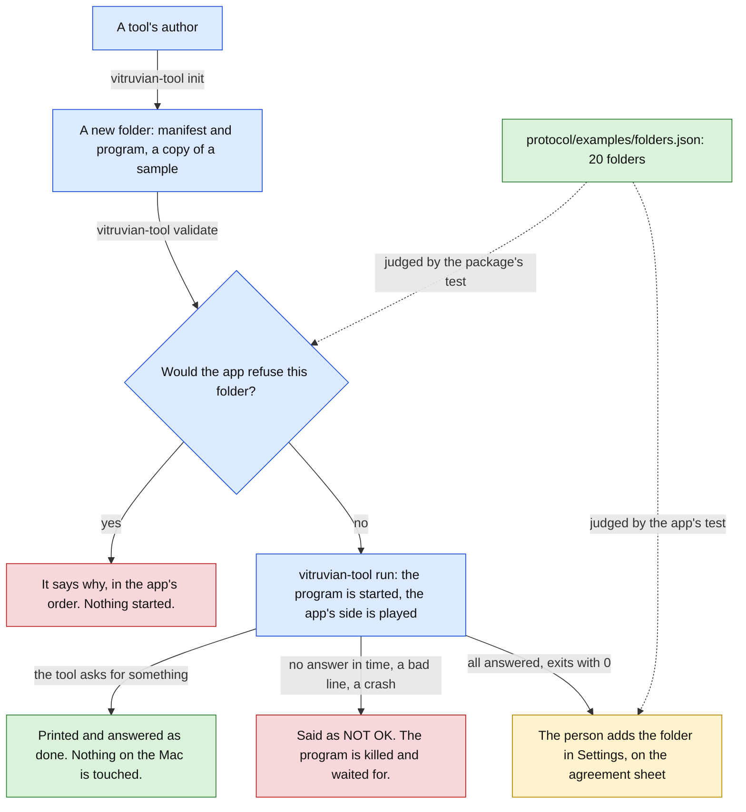

# Vitruvian external tools (stage D: the tool kit, the command-line tool and the samples) Implementation Plan

> **For agentic workers:** REQUIRED SUB-SKILL: Use superpowers:subagent-driven-development (recommended) or superpowers:executing-plans to implement this plan task-by-task. Steps use checkbox (`- [ ]`) syntax for tracking.

**Goal:** Give someone who wants to write a tool everything they need, inside `packages/vitruvian-sdk`: a Swift library to write a tool with, a command that starts, checks and runs a tool without the app, three sample tools, and a guide. This is the last stage of the sub-project, so it also gathers every check that only a person can do into one list.

**Architecture:** Everything new is in the MIT package. `VitruvianToolKit` is a Swift library that reads the link on one thread and never starts another: a command's handler calls the app and gets the answer back on the same thread. `vitruvian-tool` is one command with three verbs. `init` writes a new tool from a copy of a sample. `validate` reads a folder the way the app does before it offers to add a tool. `run` starts the tool's program and plays the app's side in a terminal, answering every request as done and doing nothing on the Mac. The app changes in one way a person cannot see: its tests now judge the same example folders `validate` is tested against, so the two cannot come apart unnoticed.



Green is safe by construction or held by a test, amber waits for the person, red is a stop, blue is in progress.

**What a person sees:** nothing changes in the app. No screen, no text and no behaviour of it changes, and it ships no new string. A tool's author gets a kit, a command-line tool, three samples and a guide.

**Tech Stack:** Swift 6 (strict concurrency) with Foundation only in the kit and the command, `ApplicationServices` in one sample, XCTest, Python 3 with no dependencies for the Python sample and the conformance script, `jsonschema` in the Python tests that read a schema, Bazel with `--config=macos-app`, and `Package.swift` kept in step by hand.

**Spec:** `docs/superpowers/specs/2026-10-10-vitruvian-external-tools-design.md` (approved 2026-10-10). This is stage D of its section 15: "The tool kit, the command-line tool, the three samples, the documentation. The by-hand checks." Section 11 says what each piece is. Stage C's plan is `docs/superpowers/plans/2026-10-11-vitruvian-external-tools-stage-c.md`.

**Release:** none. Seven of the nine tasks change only the package and are titled `chore(vitruvian-sdk): …`. Task 5 changes the app's tests and one comment and is titled `refactor(desktop): …`. Task 9 changes documents only, two of them the app's, and keeps the package's title. `main` takes squash merges, so the pull request's title is the one that counts: it is `chore(vitruvian-sdk): the tool kit, the vitruvian-tool command, three samples and a guide`. A `chore` cuts no release of the app, and the package has no release of its own. Nothing in this stage publishes the package anywhere: no registry, no mirror, no release, no Homebrew formula. Nothing in it sends anything outside the repository.

Paths that start with `Sources/`, `Tests/`, `samples/`, `conformance/`, `protocol/`, `docs/writing-a-tool.md` or `docs/guide_test.py`, or name `BUILD`, `Package.swift` or `README.md` alone, are relative to `packages/vitruvian-sdk/`. Task 5 and part of Task 9 work in `apps/desktop/vitruvian/` and say so. Every other path is from the repository root.

## Decisions this plan makes

The spec's twelve decisions stand, and so do the decisions of stages A, B and C. These are the ones the spec leaves open, or that the code forced. Where the spec and the code disagree, the row says so in those words. Task 9 records them in the spec's stage table; it does not rewrite the spec's sections.

| # | Decision | Why |
|---|---|---|
| 1 | **The kit works on one thread and starts none.** `Tool.run()` reads standard input in a blocking loop on the thread that called it. A handler runs on that thread. A call to the app made inside a handler writes the request and then reads the link, with `poll`, until its answer has come. There is no `async`, no `Task` and no lock in the kit. | A headless Swift program that starts a `Task` from `main` and waits for it on the main thread never ends. With one thread there is nothing for a handler to wait on that could be waiting on it, so the kit cannot deadlock. It also needs no `@unchecked Sendable`: nothing crosses a thread. |
| 2 | **What the app sends while a handler waits is kept, in order, and handled when the handler returns.** A second `command/run`, a changed preference, a changed language. `shutdown`, or the end of the link, ends the wait at once: the call throws `AppUnreachable.linkClosed`. | The app has one answer outstanding per request and does not need them in order. Running a second handler inside the first would let two handlers interleave their calls. |
| 3 | **A call to the app waits ten seconds at most** (`Tool.answerSeconds`), then throws `AppUnreachable.noAnswer`. An answer that comes later is dropped. | The app always answers or goes away. The limit is so that a tool cannot be stuck for ever on an app that hangs. The app's own limit on the command is two seconds; a tool that wants to answer in time sets a smaller number. |
| 4 | **`import VitruvianToolKit` is the only import a tool needs.** The kit re-exports the protocol's types with `@_exported import`. | A handler names `JSONValue` and `KeyEquivalent`. Two imports for one library is a trap for a first tool. The attribute has an underscore and is not a promise of the language; if it goes, the fix is one more `import` in each tool. |
| 5 | **The mapping from a request to its Swift types is a protocol in the kit, `AppRequest`**, not in the protocol module. Stages B and C asked for it "in the package". | It is in the package. Put in `VitruvianToolProtocol` it would change the sources the app pins, for something the app does not use: the app's own mapping is the `switch` in `ExternalToolCalls`. |
| 6 | **No file under `Sources/VitruvianToolProtocol` changes. The pin does not move.** `LineSplitter` gets no `finish()`: a last line with no line break is dropped by the kit and by `run`, as it is by the app. `validate` shares `ToolManifestFile.read` as it is. | The protocol module is what both sides link. Everything this stage needs from it is already `public`. If a task finds it must change a file there, stop: that is a change of the protocol, and it needs `bazel run //apps/desktop/vitruvian:pin_tool_protocol` and a line in the app's `UPSTREAM.md` in the same commit. |
| 7 | **The command is Swift: a library, `VitruvianToolCLI`, and a program of three lines, `vitruvian-tool`.** | It shares the protocol's types and, above all, `ToolManifestFile.read`: `validate` then runs the app's own manifest rules, not a copy. The library is what the tests link, as `packages/peripherals` does with `GravaStarCLI`. |
| 8 | **`validate` judges a manifest with the code the app runs, and a folder with rules written again from the spec's words.** The manifest's 22 named problems are `ToolManifestFile.read`, in the MIT module. Five rules about the folder are in the app's GPL code only (`ExternalToolManifest.read(folder:)`, `ExternalToolStore.offer(from:)`): the program is a file in the folder with every link followed; macOS will run it; macOS has not quarantined it; the folder holds at most 256 MB; it holds at most 10,000 things, a link counted as one and not followed. They are written again in `FolderCheck.swift` from section 6, section 8 and the stage C notes of the spec. **No line of the app is copied.** | The licence runs one way, MIT into GPL. The app may link the package; the package may not hold the app's code. |
| 9 | **One file of example folders is judged by both sides**, `protocol/examples/folders.json`: twenty folders, each with what to make and the verdict. The package's `FolderCheckTests` and the app's new `ToolFolderExamplesTests` each make every folder and ask their own code. Neither is given the other's answer. | It is how the manifest examples already keep the schema and the Swift types together. A folder rule changed on one side only fails one of the two tests. It can only see a difference an example crosses, so a new rule needs a new example. |
| 10 | **`validate` says plainly what it cannot promise.** An older app may not know a service, a surface, a kind of preference or a way of starting that this package knows (`notOfferedHere`). The app refuses an id that something else in it already answers to, and a folder inside its own support folder. And `validate` starts nothing, so it does not know whether the program works. | These depend on the app that is installed, not on the folder. |
| 11 | **`validate` lists everything wrong, and names the first as what the app would say.** It also gives one note that refuses nothing: a program whose first line goes through `env` is told about the app's short `PATH`. | An author fixing a manifest wants all of it at once. The app shows one reason, and the order is the app's. The note is stage B's known limit, said where an author will see it. |
| 12 | **`run` is Swift, on one thread, and every wait in it is a `poll` with a limit**, but one: the wait for the person to type the next command, which also ends when the tool exits or the typing ends. The limits are the app's: ten seconds for `initialize`, two for a command (`--wait` changes it), two after `shutdown`, then a request to end, one second, then a kill. However a run ends, the program is killed if it is still there and waited for, and the folder made for it is deleted. Control-C does the same and exits with 130. | It must never hang and never leave a process. One thread and `poll` is the model of the kit, for the same reason. |
| 13 | **`run` does nothing on the Mac, and no flag changes that.** Each request is printed and answered as done. A message is not shown, a sound not played, a link not opened, nothing pasted or pressed, no process ended. The clipboard it reads and writes is a piece of text it holds, never the person's. A preference is kept for the run and saved nowhere. The brief for this stage allowed a flag that makes the clipboard real. This plan gives none. | The conservative default. A tool that must be seen doing the real thing is added to the app, which is what the agreement sheet is for. A flag that reaches the clipboard is the first step of `run` becoming a second, unreviewed runtime. |
| 14 | **`run` starts only a folder `validate` passes**, and refuses what the app refuses a request for: a service not in `uses`, a preference the manifest does not declare, a value of the wrong kind. `--refuse` refuses every request, as the app may at any time. | A tool that works under `run` and is then refused by the app has wasted its author's afternoon. |
| 15 | **`run` gives the tool the terminal's environment**, unless `--app-path` is given: then `PATH` is the short one an app opened from the Finder has, `/usr/bin:/bin:/usr/sbin:/sbin`. | Stage B's decision stands: the app gives a tool the app's environment. Making that the default would break a first run for anyone whose interpreter is not in those four folders, before they have read why. `validate` says so in its note, and the guide says so twice. |
| 16 | **`run` does not play everything the app does.** It does not stop an idle tool after two minutes, does not start a crashed tool again, and does not count messages a second or bad lines a minute. It says each bad line and each missed answer as `NOT OK`, and what the app does about it. | Those are the app's supervision over many runs. `run` is one run. The app's `tool-runtime` suite tests them. |
| 17 | **Three samples: `hello-python`, `hello-swift` and `front-window`.** The spec says three in section 11 and two in section 1; this plan builds three. The spec says the Python sample "grows from or replaces" `conformance/reference-tool`: it grows from it. The reference tool stays where it is. | The reference tool is what `conformance_test` and both halves of the protocol's drift test read, and it is the smallest tool that passes. The sample does more: two commands, two services, a request made from inside a command. |
| 18 | **A Swift sample's source is `main.swift`, top-level code.** The naming lint flags a `main.swift` as wanting PascalCase, as it flags `packages/peripherals/Sources/gravastar-mouse/main.swift`. It also flags every Swift module's folder (`Sources/VitruvianToolProtocol` today). This plan adds seven findings of those two kinds and no new kind: four module folders and three `main.swift`. No existing target is renamed. New program targets are kebab-case (`vitruvian-tool`, `sync-templates`, `hello-swift`), which the lint wants; new test targets keep the package's underscores (`samples_test`), which it does not flag. | A first tool should read as a script: a `Tool`, its commands, `run()`. The lint is not a gate on the repository: CI runs the lint's own tests. |
| 19 | **Bazel puts a Swift sample's folder together.** `:hello-swift-folder` copies the manifest and the built program to `bazel-bin/packages/vitruvian-sdk/built/hello-swift/`, as `vitruvian-tool.json` and `bin/tool`. `:sample-folders` builds both. That folder is what the app is pointed at. | A tool's folder must hold the program, and a Swift program has to be built. The copies are plain files in a plain folder, not links, so `validate` and the app both take them. |
| 20 | **`front-window` asks macOS through Accessibility, with public API only, and never asks for a prompt.** It asks the system-wide element for the app in front; if that gives nothing it takes the owner of the front window from the window list, which needs no permission for that much. Without Accessibility it refuses its command in plain words. | It is the proof of the spec's decision 1: a tool has what Vitruvian has. A test runner has no Accessibility and nothing here grants it, so the test passes on a refusal too and prints which it saw. Seeing a real title in the real app is a check by hand. |
| 21 | **`init` has two templates, and each is a sample, byte for byte**: `python` (the default) is `hello-python`, `swift` is `hello-swift`. The id, the name and the publisher are replaced in the manifest. The copies are compiled into the command as text by `samples/sync_templates.py`, and `templates_in_sync_test` fails when they are not the samples. | The command is one program with no files beside it. A template that is a tested sample cannot be a tool that does not work. |
| 22 | **`init` writes only inside the folder it is given, and only when that folder is not there or is empty.** `--id`, `--name` and `--publisher` are all needed. The manifest it would write is read with `ToolManifestFile.read` first, so nothing is written when the app would refuse it. | It never writes over anything. |
| 23 | **The Swift template names the kit by a path on disk**, given with `--sdk`, and puts the tool's folder beside the package, in `tool/`. | The kit is published nowhere, and publishing is sub-project 4. A package's build output is far over what a tool's folder may hold, so it must not be in that folder. |
| 24 | **The guide is one file, `docs/writing-a-tool.md`, and the README stays the front page.** Every fenced block in the guide says what it is, and `guide_test` checks each kind: a message against the schema, a manifest against the schema, a piece of code against the sample it is taken from, a command against the verbs, flags and targets that exist. A block of an unknown kind fails. | Eight subjects do not fit a README. Examples nobody runs rot. |
| 25 | **The conformance script now reads what a tool writes on its way out.** After `shutdown`, each line to the end must be a message with its own params. Stage A left this out and stages B and C carried it. | Twenty lines of Python, in the package, with three new broken tools to prove it. |
| 26 | **A tool's preferences still have no screen, and the manifest still gives a preference no label.** Left. | A label is a change of the protocol: the schema, the Swift type, the examples, the pin, the app's reader. The spec does not put it in stage D. It belongs in a later version of the protocol with the screen that needs it. |
| 27 | **The stale comment on `CapabilityBroker.Environment.allows` is corrected** (Task 5). It said a consent screen would fill it in per capability. The spec decided against consent per service. | One comment, in a task that already touches the app. |
| 28 | **Two of stage C's limits are left.** The refusal alert's rule text has no length limit. When a tool's program survives a kill at Remove, its data is kept and nothing tells the person. | The first is a change to a screen. The second needs a sentence in fifteen languages. Neither is this stage's, and neither changes what a tool's author gets. |
| 29 | **The app gets no new string.** If a task finds it needs one, stop and say so: it goes through stage C's table and all fifteen languages. | The app ships fifteen languages. |
| 30 | **No Swift test needs `python3`.** The tests of `run` start small `/bin/sh` scripts they write themselves, and the built Swift sample. The one Python test that starts the Python template through its first line (`init_test`) puts the interpreter running the test first on `PATH`. | `/bin/sh` is on every Mac. Which `python3` a runner has is not ours to assume. |
| 31 | **The tests stay where their code is.** The package gains two Swift test targets and five Python ones. The app's `tool-runtime` suite grows from 502 checks to 523. `platform` keeps its 766, and a full run still reports `TESTS OK (49 suites)`. | The app's 21 new checks are the 20 example folders and their count. |
| 32 | **Not in stage D:** publishing the package anywhere; a TypeScript kit; a documentation website; a label for a preference; a screen for a tool's preferences; telling a running tool that the language or a preference changed; anything on the island. | Sub-project 4 and later. |

## Global Constraints

- **Everything in this plan was built and run before it was written down.** The tree at `633580c7f` (today's `main`, the base of this branch) was exported to a scratch folder outside the repository, each task was applied in order as one commit, and each task's state was built and tested, on a Mac16,5 (Apple M4 Max) with macOS 27.0, Xcode 27.0 and Swift 6.4. The test counts in each task are from those runs. "What was run for this plan", under Task 9, gives each result. Five things were not done. Nothing ran on a CI runner. Nobody opened the app, and nobody added a sample to it. The `front-window` sample was seen to run its command on that Mac, whose terminal has Accessibility; its refusal without Accessibility was not seen. The words in each "write the failing test" step are what Swift, Bazel or Python says for a name or a file that is not there; only Task 3's were recorded from a run. And Task 9's edits to the spec are prose the worker writes. If the base has moved and a listing no longer fits, make the smallest change that keeps its meaning and record it as a deviation.
- **How to read a listing.** A block whose first line is `// MIT-HEADER` or `# MIT-HEADER` (or whose second is, after a `#!` line) is a whole new file: replace that one line with the full MIT header `packages/peripherals` uses, in `//` or `#` comments, exactly as `packages/vitruvian-sdk/Sources/VitruvianToolProtocol/LineFraming.swift` and `packages/vitruvian-sdk/BUILD` start. A block that starts with `// SPDX-License-Identifier` is a whole new file of the app, as it is. A block that starts with `{` or `#` and is named as a new file is that file, whole. A block that starts with `diff --git` is a change to a file that exists, as `git diff` prints it: save it to a file and run `git apply <file>` from the repository root, or make the change by hand. Each diff is a change from the state the task before left. Every listing was taken by a script from the commits the tests ran on, not typed, and the script fails when a file a task changed has no listing in that task. Three files are not listed: `.github/workflows/presubmit.yaml`, which the generator writes; `Sources/VitruvianToolCLI/Templates.swift`, which `sync_templates.py` writes (Task 7); and the spec, which Task 9 describes.
- **Licences.** Everything under `packages/vitruvian-sdk/` is MIT. Every new `.swift`, `.py` and `BUILD` file there starts with the MIT header. Everything under `apps/desktop/vitruvian/` is GPL-3.0-or-later, and a new file there starts with exactly:
  ```swift
  // SPDX-License-Identifier: GPL-3.0-or-later
  // Copyright (C) 2026 VitruvianSoftware
  ```
  **Never copy code from the app's folder into the package.** `FolderCheck.swift` is written from the spec's words. Do not open `ToolFolders.swift`, `ToolOffer.swift` or `ExternalToolManifest.swift` beside it while you write it, and do not "fix" it to look like them. The package's Swift imports Foundation and `VitruvianToolProtocol` (and, in one sample, `ApplicationServices`); it never imports a `Vitruvian*` module of the app.
- **`UPSTREAM.md`.** A change to an app file whose header says `Copyright (C) 2026 Vorssaint` is named under "Modifications" in the same commit. No such file changes in this plan: the four app files Task 5 touches and the two Task 9 touches were checked, and none has that header. Check the header of every app file you change; do not trust this list. The protocol's pin does not move, so there is no line for it either.
- **No task changes what a person can see.** `platform` reports 766 checks after every task. Nothing under `apps/desktop/vitruvian/Sources/` changes but one comment.
- **The package's `pipeline_unit`.** Tasks 1, 2, 4, 7 and 8 add a test to its `test_targets`. After each, run `bazel run //tools/pipeline:gen -- --format=workflow --output-file=.github/workflows/presubmit.yaml` and commit the file with the task: one line of it changes, the `bazel test` line of the `vitruvian-sdk` job. Keep round brackets out of the comments of any `pipeline_unit(...)` call: the presubmit planner reads the call up to the first closing one. No task edits the app's `pipeline_unit`.
- **`BUILD` mirrors `Package.swift`, target for target.** A Swift target added to one is added to the other in the same task. The Python tests, the genrules that put a sample's folder together, and `sync-templates` are Bazel's alone.
- **Concurrency.** The kit, the command and the samples are Swift 6 mode (`features = ["swift.enable_v6"]`). Nothing in them is `@unchecked Sendable` or `nonisolated(unsafe)`, and nothing starts a `Task` or a `Thread`. The one piece of code that runs off the main thread is the handler `run` installs for Control-C, on a Dispatch queue: it captures a process id and a path, both plain values, and exits.
- **Tests.**
  - A test writes only under `FileManager.default.temporaryDirectory` (Swift) or a `tempfile.TemporaryDirectory` (Python), in a folder it removes. No test touches `~/Library/Application Support/com.vitruviansoftware.vitruvian` or the preferences domain `com.vitruviansoftware.vitruvian`.
  - Nothing launches the app.
  - No test can hang. A test of the kit reads its link from a file, whose end is the end of the link. A test of `run` sets every limit to 0.3 seconds. A Python test gives every program it starts thirty seconds at most.
  - No process outlives its test. A script the tests of `run` start never starts a program of its own, so killing it leaves nothing, and each test checks that its process id is gone when `run` returns.
  - No test changes a setting of the Mac, and none asks for a permission.
- **Build and test through Bazel**, from the repository root, one command at a time. The Swift targets need `--config=macos-app`:
  ```sh
  bazel test --config=macos-app //packages/vitruvian-sdk:VitruvianToolProtocolTests //packages/vitruvian-sdk:VitruvianToolKitTests //packages/vitruvian-sdk:VitruvianToolCLITests --test_output=errors
  grep -a "Executed .* tests" bazel-testlogs/packages/vitruvian-sdk/VitruvianToolCLITests/test.log | tail -1
  ```
  A passing run prints nothing with `--test_output=errors`; the `grep` shows the count. The app's suites are run as in stage C:
  ```sh
  bazel test --config=macos-app //apps/desktop/vitruvian:unit_tests --test_arg=--suite=tool-runtime --test_arg=--suite=platform --test_output=errors
  grep -aE "^(platform|tool-runtime): |TESTS" bazel-testlogs/apps/desktop/vitruvian/unit_tests/test.log
  ```
- **Do not launch the app from a task**, do not write to its preferences domain or its support folder, and do not change any system setting. No step grants Accessibility. The checks that need the running app are "By hand", and a person does them.
- **Formatting and gates.** After editing a `.py`, `.json`, `.md` or `BUILD` file run `bazel run //tools/format -- <path>`. Task 9 runs `bazel run //tools/license:check`, `bazel run //tools/license:verify` and `bazel run //:tidy`. On this base `//:tidy` adds one unrelated line, `Cryptodome: pycryptodomex`, to `gazelle_python.yaml`: undo it by hand and do not commit it.
- **Git.** Never `git stash`, `git reset` or `git restore`; undo an edit by hand. Commits are authored as the `wren` agent, one per task, with identity and commit in one command. In a worktree the keys are in the main checkout:
  ```sh
  export AGENT_KEY_DIR=/Users/james/Workspace/gh/application/vitruvian/vitruvian-core/tools/sync-env-secrets/agent-keys; eval "$(bazel run //tools/agent-app -- env wren 2>/dev/null)"; git add <files> && git commit -m "<title>"
  ```
- **Signing.** The app is signed ad hoc, as today. Nothing in this stage signs, notarizes or changes how anything is signed, and no step of it needs any signing identity. A sample's program is whatever the Swift compiler links.

## Review Focus

Where a mistake costs most. Each has a test in the task named.

1. **The licence boundary.** Nothing of the app is in the package. Read `Sources/VitruvianToolCLI/FolderCheck.swift` beside the app's `ToolFolders.swift` and `ExternalToolManifest.swift`: the rules must agree and the code must not be the same code. It uses `realpath`, `stat`, `access` and its own walk, where the app uses `FileManager` and URL resource values. `grep -rn "import Vitruvian" packages/vitruvian-sdk/Sources packages/vitruvian-sdk/samples` shows only `VitruvianToolProtocol`, `VitruvianToolKit` and `VitruvianToolCLI` (Tasks 4 and 5).
2. **`validate` and the app agree.** `protocol/examples/folders.json` holds twenty folders, and every verdict there is has one. `FolderCheckTests.testEveryExampleFolderIsJudgedAsTheFileSays` and the app's `ToolFolderExamplesTests` each judge all twenty with their own code. Check that neither test reads the other's answer, and that the app's test goes through `ExternalToolStore.offer(from:)`, the call the Settings button makes (Tasks 4 and 5).
3. **`run`, and every test, cannot hang and leaves no process.** Every wait in `Session` goes through `next(before:)` with a deadline, but the one in `converse()`. The program is killed and waited for in a `defer`. The tests set each limit to 0.3 seconds, check each process id is gone, and were run ten times in a row (Task 6). After everything, `pgrep -fl 'bin/tool$|bin/tool\.py|reference_tool\.py|broken\.py'` prints nothing (Task 9).
4. **`run` touches nothing of the person's.** `Desk` answers from values it holds. No flag makes anything real: `runArguments` refuses `--real-clipboard` in a test. `testTheCommandCanReachNothingOfThePersons` holds that the command's sources import Foundation and the protocol only, name no pasteboard, workspace, sound, script or event API, and signal no process but the one they started (Task 6).
5. **The kit cannot deadlock, and a tool written with it passes conformance.** One thread: read `Tool.call` and `Wire.next`. `ToolTests` covers a call inside a handler, what comes while it waits, goodbye and the end of the link during a wait, and a call that gets no answer (Task 1). `swift_samples_test` puts both Swift samples through the conformance script, and `RunTests.testTheSwiftSampleRuns` through `run` (Tasks 2 and 6).
6. **The guide's examples are tested.** `guide_test` checks every fenced block, and fails for a message of the protocol the guide never shows and a field of the manifest it never names. Five mistakes planted in the guide were each caught (Task 8). What it does not check: the prose, and the numbers in the table of limits.


---

### Task 1: The tool kit

**Files:**
- Create: `Sources/VitruvianToolKit/AppRequests.swift`, `Sources/VitruvianToolKit/Wire.swift`, `Sources/VitruvianToolKit/Tool.swift`
- Create: `Tests/VitruvianToolKitTests/ToolTests.swift`
- Modify: `BUILD`, `Package.swift`, `.github/workflows/presubmit.yaml` (generated)

**Interfaces:**
- Consumes: `LineSplitter`, `LineFraming`, `RPCMessage`, `RPCID`, `RPCErrorObject`, `JSONValue`, `ToolMethod`, `RefusalCode`, `ProtocolVersion`, and the params and result types of `Messages.swift`, all from `VitruvianToolProtocol`, unchanged.
- Produces:
  - `AppRequest` (a protocol: `Answer`, `method`), with one conforming type for each of the ten requests a tool may send; `NotifyBeepParams`, `ClipboardReadTextParams`; `AppRequests.methods`
  - `Tool` (`init(version:input:output:)`, `command(_:_:)`, `run()`, `serve()`, `answerSeconds`, `onStart`, `onPreferencesChanged`, `onLanguageChanged`, `language`, `dataFolder`)
  - `App` (`send(_:)`, `showMessage(_:icon:)`, `beep()`, `open(_:)`, `clipboardText()`, `setClipboardText(_:)`, `paste(_:)`, `pressMenuItem(_:)`, `endProcess(pid:name:force:)`, `value(_:)`, `setValue(_:for:)`, `setRunnable(_:)`, `log(_:)`, `language`, `dataFolder`)
  - `CommandRefused`, `AppUnreachable`

The kit is three files. `Wire` is the link: bytes in, messages out, with a time limit on every read. `Tool` is the loop and the commands. `App` is what a handler calls. Everything is on one thread (decision 1).

What happens to each thing the app can send:

| The app sends | Outside a handler | While a handler waits for an answer |
|---|---|---|
| `initialize` | answered; then `onStart` | kept (it is never sent twice) |
| `command/run` | its handler runs, then it is answered | kept, and run after this handler |
| `preferences/changed`, `language/changed` | the tool's closure is called | kept |
| `shutdown`, or the link ends | the loop ends; `serve()` returns 0 | the call throws `AppUnreachable.linkClosed`; then the loop ends |
| the answer the handler waits for | dropped: nobody waits | the call returns it, or throws the failure |
| a request with a method the kit does not know | failure -32601 | kept, then failure -32601 |
| a line that is not a message | dropped | dropped |

- [ ] **Step 1: Write the failing tests**

Create `Tests/VitruvianToolKitTests/ToolTests.swift`. The link in every test but one is two files: what the app will have sent, written before the tool starts, and what the tool writes. A file never blocks and its end is the end of the link. The kit numbers its own requests 1, 2, 3, so the app's answers can be written ahead.

```swift
// MIT-HEADER

import XCTest

import VitruvianToolKit

/// A tool's link, made of two files: what the app will have sent, written
/// before the tool starts, and what the tool writes. A file never blocks,
/// and its end is the end of the link, so no test here can wait for long.
private final class Bench {
    let folder: URL
    private var sent = ""

    init() {
        folder = FileManager.default.temporaryDirectory
            .appendingPathComponent("vitruvian-tool-kit-\(UUID().uuidString)", isDirectory: true)
        try? FileManager.default.createDirectory(at: folder, withIntermediateDirectories: true)
    }

    deinit {
        try? FileManager.default.removeItem(at: folder)
    }

    /// One line the app sends.
    @discardableResult
    func app(_ line: String) -> Bench {
        sent += line + "\n"
        return self
    }

    func hello(versions: String = #"["1"]"#) -> Bench {
        app(#"{"jsonrpc":"2.0","id":"hello","method":"initialize","params":{"protocolVersions":\#(versions),"language":"de-DE","dataFolder":"/tmp/kit-data"}}"#)
    }

    func run(_ command: String, id: Int) -> Bench {
        app(#"{"jsonrpc":"2.0","id":\#(id),"method":"command/run","params":{"command":"\#(command)"}}"#)
    }

    func goodbye() -> Bench {
        app(#"{"jsonrpc":"2.0","method":"shutdown"}"#)
    }

    /// Makes the tool over the two files. `build` adds its commands.
    func tool(_ build: (Tool) -> Void = { _ in }) throws -> Tool {
        let input = folder.appendingPathComponent("from-app")
        let output = folder.appendingPathComponent("to-app")
        try Data(sent.utf8).write(to: input)
        try Data().write(to: output)
        let tool = Tool(version: "9.9.9", input: try FileHandle(forReadingFrom: input),
                        output: try FileHandle(forWritingTo: output))
        build(tool)
        return tool
    }

    /// What the tool wrote, a message a line.
    func written() throws -> [RPCMessage] {
        let text = try String(contentsOf: folder.appendingPathComponent("to-app"), encoding: .utf8)
        return try text.split(separator: "\n").map { try LineFraming.message(from: Data($0.utf8)) }
    }
}

final class ToolTests: XCTestCase {
    private let done = JSONValue.object([:])

    func testEveryRequestAToolMaySendHasAType() {
        let wanted = ToolMethod.allCases.filter { $0.sender == .tool && $0.isAnswered }
        XCTAssertEqual(Set(AppRequests.methods), Set(wanted))
        XCTAssertEqual(AppRequests.methods.count, 10, "each request once")
    }

    func testHelloACommandAndGoodbye() throws {
        let bench = Bench().hello().run("hello", id: 2).goodbye()
        var ran = 0
        var seen: [String] = []
        let tool = try bench.tool { tool in
            tool.command("hello") { app in
                ran += 1
                seen = [app.language, app.dataFolder.path]
            }
        }
        XCTAssertEqual(tool.serve(), 0)
        XCTAssertEqual(ran, 1)
        XCTAssertEqual(seen, ["de-DE", "/tmp/kit-data"], "what the app said at hello is the handler's to read")
        XCTAssertEqual(try bench.written(), [
            .result(id: .string("hello"), value: .object(["protocolVersion": .string("1"),
                                                           "toolVersion": .string("9.9.9")])),
            .result(id: .number(2), value: done),
        ])
    }

    func testAHandlerCallsTheAppAndReadsTheAnswer() throws {
        let bench = Bench().hello().run("copy", id: 2)
            .app(#"{"jsonrpc":"2.0","id":1,"result":{"text":"from the clipboard"}}"#)
            .app(#"{"jsonrpc":"2.0","id":2,"result":{}}"#)
            .goodbye()
        var read: String?
        let tool = try bench.tool { tool in
            tool.command("copy") { app in
                read = try app.clipboardText()
                try app.showMessage("Read it", icon: "doc.on.clipboard")
            }
        }
        XCTAssertEqual(tool.serve(), 0)
        XCTAssertEqual(read, "from the clipboard")
        let written = try bench.written()
        XCTAssertEqual(written.count, 4)
        XCTAssertEqual(written[1], .request(id: .number(1), method: "clipboard/readText", params: done))
        XCTAssertEqual(written[2], .request(id: .number(2), method: "notify/hud",
                                            params: .object(["icon": .string("doc.on.clipboard"),
                                                             "message": .string("Read it")])))
        XCTAssertEqual(written[3], .result(id: .number(2), value: done), "the command is answered last")
    }

    func testARefusalTheHandlerLetsThroughRefusesTheCommand() throws {
        let bench = Bench().hello().run("hello", id: 7)
            .app(#"{"jsonrpc":"2.0","id":1,"error":{"code":-32001,"message":"not listed in uses","data":{"service":"notify"}}}"#)
            .goodbye()
        let tool = try bench.tool { $0.command("hello") { try $0.showMessage("Hello") } }
        XCTAssertEqual(tool.serve(), 0)
        guard case .failure(let id, let error)? = try bench.written().last else { return XCTFail("no failure") }
        XCTAssertEqual(id, .number(7))
        XCTAssertEqual(error.code, -32010)
        XCTAssertEqual(error.data?["code"], .number(-32001), "the app's reason goes with it, for the log")
    }

    func testAHandlerMayCatchARefusalAndCarryOn() throws {
        let bench = Bench().hello().run("hello", id: 7)
            .app(#"{"jsonrpc":"2.0","id":1,"error":{"code":-32004,"message":"not available right now"}}"#)
            .goodbye()
        var why: RefusalCode?
        let tool = try bench.tool { tool in
            tool.command("hello") { app in
                do {
                    try app.beep()
                } catch let error as RPCErrorObject {
                    why = RefusalCode(error)
                }
            }
        }
        XCTAssertEqual(tool.serve(), 0)
        XCTAssertEqual(why, .unavailable)
        XCTAssertEqual(try bench.written().last, .result(id: .number(7), value: done))
    }

    func testACommandThatWillNotRunSaysWhy() throws {
        let bench = Bench().hello().run("hello", id: 3).run("missing", id: 4)
            .app(#"{"jsonrpc":"2.0","id":5,"method":"island/draw"}"#)
            .goodbye()
        let tool = try bench.tool { $0.command("hello") { _ in throw CommandRefused("nothing is selected") } }
        XCTAssertEqual(tool.serve(), 0)
        XCTAssertEqual(Array(try bench.written().dropFirst()), [
            .failure(id: .number(3), error: RPCErrorObject(code: -32010, message: "nothing is selected")),
            .failure(id: .number(4), error: RPCErrorObject(code: -32602, message: "no such command")),
            .failure(id: .number(5), error: RPCErrorObject(code: -32601, message: "method not found")),
        ])
    }

    func testWhatComesWhileAHandlerWaitsIsHandledAfterIt() throws {
        let bench = Bench().hello().run("first", id: 2)
            .app(#"{"jsonrpc":"2.0","method":"language/changed","params":{"language":"fr"}}"#)
            .run("second", id: 3)
            .app(#"{"jsonrpc":"2.0","id":1,"result":{}}"#)
            .app(#"{"jsonrpc":"2.0","id":2,"result":{}}"#)
            .goodbye()
        var order: [String] = []
        let tool = try bench.tool { tool in
            tool.command("first") { app in
                try app.beep()
                order.append("first in \(app.language)")
            }
            tool.command("second") { app in
                try app.beep()
                order.append("second in \(app.language)")
            }
        }
        XCTAssertEqual(tool.serve(), 0)
        XCTAssertEqual(order, ["first in de-DE", "second in fr"], "kept in the order it came")
        let answers = try bench.written().compactMap { message -> RPCID? in
            if case .result(let id, _) = message { return id }
            return nil
        }
        XCTAssertEqual(answers, [.string("hello"), .number(2), .number(3)])
    }

    func testGoodbyeWhileAHandlerWaitsEndsTheWait() throws {
        let bench = Bench().hello().run("hello", id: 2).goodbye()
        var thrown: AppUnreachable?
        let tool = try bench.tool { tool in
            tool.command("hello") { app in
                do {
                    try app.beep()
                } catch let error as AppUnreachable {
                    thrown = error
                    throw error
                }
            }
        }
        XCTAssertEqual(tool.serve(), 0)
        XCTAssertEqual(thrown, .linkClosed)
        guard case .failure(.number(2)?, let error)? = try bench.written().last else { return XCTFail("no failure") }
        XCTAssertEqual(error.code, -32010)
    }

    func testTheLinkEndingEndsTheWaitAndTheLoop() throws {
        let bench = Bench().hello().run("hello", id: 2)
        var thrown: AppUnreachable?
        let tool = try bench.tool { tool in
            tool.command("hello") { app in
                do {
                    try app.beep()
                } catch let error as AppUnreachable {
                    thrown = error
                }
            }
        }
        XCTAssertEqual(tool.serve(), 0, "the app going away is not the tool's failure")
        XCTAssertEqual(thrown, .linkClosed)
    }

    func testACallGivesUpWhenNoAnswerComes() throws {
        // A pipe, so that the link stays open with nothing on it.
        var ends: [Int32] = [0, 0]
        XCTAssertEqual(pipe(&ends), 0)
        let bench = Bench()
        let output = bench.folder.appendingPathComponent("to-app")
        try Data().write(to: output)
        let lines = #"{"jsonrpc":"2.0","id":1,"method":"initialize","params":{"protocolVersions":["1"],"language":"en","dataFolder":"/tmp"}}"#
            + "\n" + #"{"jsonrpc":"2.0","id":2,"method":"command/run","params":{"command":"hello"}}"# + "\n"
        XCTAssertEqual(write(ends[1], lines, lines.utf8.count), lines.utf8.count)
        let tool = Tool(version: "1", input: FileHandle(fileDescriptor: ends[0], closeOnDealloc: true),
                        output: try FileHandle(forWritingTo: output))
        tool.answerSeconds = 0.05
        var thrown: AppUnreachable?
        tool.command("hello") { app in
            do {
                try app.beep()
            } catch let error as AppUnreachable {
                thrown = error
            }
            // The app goes away, which ends the loop.
            close(ends[1])
        }
        let started = Date()
        XCTAssertEqual(tool.serve(), 0)
        XCTAssertEqual(thrown, .noAnswer(seconds: 0.05))
        XCTAssertLessThan(Date().timeIntervalSince(started), 5)
    }

    func testAVersionTheToolDoesNotSpeakIsRefused() throws {
        let bench = Bench().hello(versions: #"["2"]"#).run("hello", id: 2).goodbye()
        var ran = false
        let tool = try bench.tool { $0.command("hello") { _ in ran = true } }
        XCTAssertEqual(tool.serve(), 0)
        XCTAssertFalse(ran)
        XCTAssertEqual(try bench.written(), [
            .failure(id: .string("hello"), error: RPCErrorObject(code: -32602, message: "this tool speaks protocol 1 only")),
            .failure(id: .number(2), error: RPCErrorObject(code: -32600, message: "initialize comes first")),
        ])
    }

    func testNoticesReachTheirHandlersAndTheToolsOwnAreWritten() throws {
        let bench = Bench().hello()
            .app("this line is not a message")
            .app(#"{"jsonrpc":"2.0","method":"preferences/changed","params":{"values":{"project":"web"}}}"#)
            .app(#"{"jsonrpc":"2.0","method":"language/changed","params":{"language":"ja"}}"#)
            .goodbye()
        var changed: [String: JSONValue] = [:]
        var language = ""
        let tool = try bench.tool { tool in
            tool.onStart = { app in
                app.setRunnable(["hello"])
                app.log("started")
            }
            tool.onPreferencesChanged = { _, values in changed = values }
            tool.onLanguageChanged = { app in language = app.language }
        }
        XCTAssertEqual(tool.serve(), 0)
        XCTAssertEqual(changed, ["project": .string("web")])
        XCTAssertEqual(language, "ja")
        XCTAssertEqual(Array(try bench.written().dropFirst()), [
            .notice(method: "commands/state", params: .object(["runnable": .array([.string("hello")])])),
            .notice(method: "log", params: .object(["message": .string("started")])),
        ], "after the answer to initialize, never before it")
    }
}
```

In `BUILD` and `Package.swift`, add the library and its test:

```diff
diff --git a/packages/vitruvian-sdk/BUILD b/packages/vitruvian-sdk/BUILD
index 1552cbe..a63d1eb 100644
--- a/packages/vitruvian-sdk/BUILD
+++ b/packages/vitruvian-sdk/BUILD
@@ -73,6 +73,18 @@ swift_library(
     visibility = ["//apps/desktop/vitruvian:__pkg__"],
 )
 
+# What a tool is written with, in Swift: declare commands, handle them, call
+# the app. It works on one thread and starts none. Foundation and the
+# protocol only, and nothing of the app.
+swift_library(
+    name = "VitruvianToolKit",
+    srcs = glob(["Sources/VitruvianToolKit/**/*.swift"]),
+    features = ["swift.enable_v6"],
+    module_name = "VitruvianToolKit",
+    target_compatible_with = ["@platforms//os:macos"],
+    deps = [":VitruvianToolProtocol"],
+)
+
 # macOS-only and `manual`, like every swift_test in the repository, so the
 # Linux lane never names it; the `vitruvian-sdk` pipeline unit below runs it by
 # explicit label on xcode-27.
@@ -86,6 +98,16 @@ swift_test(
     deps = [":VitruvianToolProtocol"],
 )
 
+# The kit against a link made of two files. It starts no process.
+swift_test(
+    name = "VitruvianToolKitTests",
+    size = "small",
+    srcs = glob(["Tests/VitruvianToolKitTests/**/*.swift"]),
+    tags = ["manual"],
+    target_compatible_with = ["@platforms//os:macos"],
+    deps = [":VitruvianToolKit"],
+)
+
 # The examples, judged by the schemas. Not `manual` and not tied to macOS: it
 # is plain Python, so the Linux lane runs it too.
 py_test(
@@ -136,6 +158,7 @@ pipeline_unit(
     persona = "platform",
     runner = "xcode-27",
     test_targets = [
+        ":VitruvianToolKitTests",
         ":VitruvianToolProtocolTests",
         ":conformance_test",
         ":protocol_examples_test",
```

```diff
diff --git a/packages/vitruvian-sdk/Package.swift b/packages/vitruvian-sdk/Package.swift
index f218393..ff7a17a 100644
--- a/packages/vitruvian-sdk/Package.swift
+++ b/packages/vitruvian-sdk/Package.swift
@@ -26,6 +26,7 @@ let package = Package(
     platforms: [.macOS(.v14)],
     products: [
         .library(name: "VitruvianToolProtocol", targets: ["VitruvianToolProtocol"]),
+        .library(name: "VitruvianToolKit", targets: ["VitruvianToolKit"]),
     ],
     targets: [
         // MUST MIRROR packages/vitruvian-sdk/BUILD, target for target. These
@@ -39,11 +40,23 @@ let package = Package(
             name: "VitruvianToolProtocol",
             path: "Sources/VitruvianToolProtocol"
         ),
+        // What a Swift tool is written with. One thread, Swift 6 mode.
+        .target(
+            name: "VitruvianToolKit",
+            dependencies: ["VitruvianToolProtocol"],
+            path: "Sources/VitruvianToolKit"
+        ),
         .testTarget(
             name: "VitruvianToolProtocolTests",
             dependencies: ["VitruvianToolProtocol"],
             path: "Tests/VitruvianToolProtocolTests",
             swiftSettings: [.swiftLanguageMode(.v5)]
         ),
+        .testTarget(
+            name: "VitruvianToolKitTests",
+            dependencies: ["VitruvianToolKit"],
+            path: "Tests/VitruvianToolKitTests",
+            swiftSettings: [.swiftLanguageMode(.v5)]
+        ),
     ]
 )
```

Run: `bazel test --config=macos-app //packages/vitruvian-sdk:VitruvianToolKitTests --test_output=errors`
Expected: the build fails. There is no source for `VitruvianToolKit` yet: Bazel reports that the glob `Sources/VitruvianToolKit/**/*.swift` matched nothing. With an empty file there, Swift reports `cannot find 'Tool' in scope` for the tests.

- [ ] **Step 2: A request and its answer, as types**

Create `Sources/VitruvianToolKit/AppRequests.swift`:

```swift
// MIT-HEADER

import Foundation
@_exported import VitruvianToolProtocol

/// A request a tool makes of the app: what it carries is the value itself,
/// `method` is its name on the link, and `Answer` is what a result holds.
///
/// Every request of protocol version 1 has one type here, and a test holds
/// the list against `ToolMethod`. A tool calls one with `App.send`, or with
/// the method of `App` that wraps it.
public protocol AppRequest: Encodable {
    associatedtype Answer: Decodable
    static var method: ToolMethod { get }
}

/// `notify/beep` carries nothing.
public struct NotifyBeepParams: Codable, Equatable, Sendable {
    public init() {}
}

/// `clipboard/readText` carries nothing.
public struct ClipboardReadTextParams: Codable, Equatable, Sendable {
    public init() {}
}

extension NotifyHUDParams: AppRequest {
    public typealias Answer = EmptyObject
    public static var method: ToolMethod { .notifyHUD }
}

extension NotifyBeepParams: AppRequest {
    public typealias Answer = EmptyObject
    public static var method: ToolMethod { .notifyBeep }
}

extension OpenURLParams: AppRequest {
    public typealias Answer = OpenURLResult
    public static var method: ToolMethod { .openURL }
}

extension ClipboardReadTextParams: AppRequest {
    public typealias Answer = ClipboardReadTextResult
    public static var method: ToolMethod { .clipboardReadText }
}

extension ClipboardWriteTextParams: AppRequest {
    public typealias Answer = ClipboardWriteTextResult
    public static var method: ToolMethod { .clipboardWriteText }
}

extension KeystrokesPasteParams: AppRequest {
    public typealias Answer = EmptyObject
    public static var method: ToolMethod { .keystrokesPaste }
}

extension KeystrokesPressMenuItemParams: AppRequest {
    public typealias Answer = KeystrokesPressMenuItemResult
    public static var method: ToolMethod { .keystrokesPressMenuItem }
}

extension ProcessesTerminateParams: AppRequest {
    public typealias Answer = EmptyObject
    public static var method: ToolMethod { .processesTerminate }
}

extension StorageGetParams: AppRequest {
    public typealias Answer = StorageGetResult
    public static var method: ToolMethod { .storageGet }
}

extension StorageSetParams: AppRequest {
    public typealias Answer = EmptyObject
    public static var method: ToolMethod { .storageSet }
}

/// The requests above, by name, for a test to hold against `ToolMethod`.
public enum AppRequests {
    public static let methods: [ToolMethod] = [
        NotifyHUDParams.method, NotifyBeepParams.method, OpenURLParams.method, ClipboardReadTextParams.method,
        ClipboardWriteTextParams.method, KeystrokesPasteParams.method, KeystrokesPressMenuItemParams.method,
        ProcessesTerminateParams.method, StorageGetParams.method, StorageSetParams.method,
    ]
}
```

- [ ] **Step 3: The link**

Create `Sources/VitruvianToolKit/Wire.swift`:

```swift
// MIT-HEADER

import Foundation
import VitruvianToolProtocol

/// The link to the app, from the tool's end: messages read from one file
/// descriptor and written to another, a line each.
///
/// It is used from one thread. Reading waits, with `poll`, until a message
/// has come, the link has ended, or the time given has passed. It never
/// waits longer than it is told to.
struct Wire {
    enum Next: Equatable {
        case message(RPCMessage)
        /// The other side closed the link, or it broke.
        case ended
        /// The time given passed first.
        case late
    }

    private let input: Int32
    private let output: Int32
    private var splitter = LineSplitter()
    private var lines: [Data] = []
    private(set) var ended = false

    init(input: Int32, output: Int32) {
        self.input = input
        self.output = output
    }

    /// Seconds since the Mac started: a clock nobody can set.
    static var now: TimeInterval { ProcessInfo.processInfo.systemUptime }

    /// The next message. With `deadline` nil it waits for as long as the
    /// link is open. A line that is not a message, and a line over 1 MB,
    /// are dropped: there is no request to answer.
    mutating func next(before deadline: TimeInterval?) -> Next {
        while true {
            while !lines.isEmpty {
                if let message = try? LineFraming.message(from: lines.removeFirst()) { return .message(message) }
            }
            if ended { return .ended }
            var wait: Int32 = -1
            if let deadline {
                let left = deadline - Self.now
                if left <= 0 { return .late }
                wait = Int32(min((left * 1000).rounded(.up), 3_600_000))
            }
            var waiting = pollfd(fd: input, events: Int16(POLLIN), revents: 0)
            let ready = poll(&waiting, 1, wait)
            if ready == 0 { continue }
            if ready < 0 {
                if errno != EINTR { ended = true }
                continue
            }
            var buffer = [UInt8](repeating: 0, count: 65_536)
            let count = read(input, &buffer, buffer.count)
            if count < 0, errno == EINTR { continue }
            guard count > 0 else {
                ended = true
                continue
            }
            for case .line(let line) in splitter.append(Data(buffer[0..<count])) { lines.append(line) }
        }
    }

    /// Writes one message as one line. False when it could not be written;
    /// the link has then ended.
    @discardableResult
    mutating func send(_ message: RPCMessage) -> Bool {
        guard !ended, let line = try? LineFraming.line(for: message) else { return false }
        var sent = 0
        let bytes = [UInt8](line)
        while sent < bytes.count {
            let count = bytes[sent...].withUnsafeBytes { write(output, $0.baseAddress, $0.count) }
            if count < 0, errno == EINTR { continue }
            guard count > 0 else {
                ended = true
                return false
            }
            sent += count
        }
        return true
    }
}
```

`poll` says a regular file is ready at once and `read` then gives 0 at its end, which is what lets the tests use files.

- [ ] **Step 4: The tool, and the app as a handler sees it**

Create `Sources/VitruvianToolKit/Tool.swift`:

```swift
// MIT-HEADER

import Foundation
import VitruvianToolProtocol

/// A command that will not run, and a few English words for the log saying
/// why. Throw it from a command's handler; the app is answered with -32010.
public struct CommandRefused: Error, Equatable, Sendable {
    public let message: String

    public init(_ message: String) {
        self.message = message
    }
}

/// A call to the app that got no answer.
public enum AppUnreachable: Error, Equatable, Sendable {
    /// The app said goodbye or closed the link, or has not said hello yet.
    case linkClosed
    /// No answer came within `Tool.answerSeconds`.
    case noAnswer(seconds: TimeInterval)
}

/// A tool that runs as its own program: its commands, and the loop that
/// reads what the app sends and answers it.
///
///     let tool = Tool(version: "0.1.0")
///     tool.command("hello") { app in
///         try app.showMessage("Hello")
///     }
///     tool.run()
///
/// It works on one thread, the one that calls `run()`. A handler runs on
/// that thread, and a call to the app made inside a handler reads the link
/// until the answer has come. Nothing here starts a thread or a task, so
/// there is nothing for a handler to wait on that could be waiting on it.
/// What the app sends while a handler waits is kept and handled after the
/// handler returns. Do not use a `Tool` or an `App` from another thread.
public final class Tool {
    public typealias Handler = (App) throws -> Void

    /// The tool's own version, as its manifest gives it.
    public let version: String
    /// How long a call to the app waits for its answer, in seconds.
    public var answerSeconds: TimeInterval = 10
    /// Called once, after the app has said hello and been answered.
    public var onStart: ((App) -> Void)?
    /// Called when the person changed a preference: each one's id and value.
    public var onPreferencesChanged: ((App, [String: JSONValue]) -> Void)?
    /// Called when the person changed the app's language.
    public var onLanguageChanged: ((App) -> Void)?

    /// The language the app is in, as a tag such as `en-US`.
    public private(set) var language = "en"
    /// The folder the tool may keep its own files in. It is also the folder
    /// the app starts the tool in.
    public private(set) var dataFolder = URL(fileURLWithPath: FileManager.default.currentDirectoryPath,
                                             isDirectory: true)

    private var handlers: [String: Handler] = [:]
    /// Held so that the two ends stay open for as long as the tool lives:
    /// a file handle closes its descriptor when it is let go.
    private let ends: [FileHandle]
    private var wire: Wire
    private var lastID = 0
    /// What came while a handler waited for an answer, in the order it came.
    private var kept: [RPCMessage] = []
    private var greeted = false
    private var stopping = false

    /// `input` and `output` are the link. Leave them alone outside a test.
    public init(version: String, input: FileHandle = .standardInput, output: FileHandle = .standardOutput) {
        self.version = version
        ends = [input, output]
        wire = Wire(input: input.fileDescriptor, output: output.fileDescriptor)
    }

    /// Says what a command does. `id` is the one the manifest gives it.
    public func command(_ id: String, _ handler: @escaping Handler) {
        handlers[id] = handler
    }

    /// Reads and answers until the app says goodbye, then exits with 0.
    public func run() -> Never {
        exit(serve())
    }

    /// Reads and answers until the app says goodbye or the link ends.
    /// Returns the status to exit with, which is 0.
    public func serve() -> Int32 {
        // A link that has gone is seen as a failed write, not as a signal.
        signal(SIGPIPE, SIG_IGN)
        while !stopping {
            if !kept.isEmpty {
                handle(kept.removeFirst())
                continue
            }
            switch wire.next(before: nil) {
            case .message(let message): handle(message)
            case .ended, .late: stopping = true
            }
        }
        return 0
    }

    private func handle(_ message: RPCMessage) {
        switch message {
        case .request(let id, let method, let params):
            switch ToolMethod(rawValue: method) {
            case .initialize?: greet(id, params)
            case .commandRun?: runCommand(id, params)
            default: refuse(id, RPCErrorCode.methodNotFound, "method not found")
            }
        case .notice(let method, let params):
            switch ToolMethod(rawValue: method) {
            case .shutdown?:
                stopping = true
            case .preferencesChanged?:
                if let changed = try? params?.decode(PreferencesChangedParams.self) {
                    onPreferencesChanged?(App(tool: self), changed.values)
                }
            case .languageChanged?:
                if let changed = try? params?.decode(LanguageChangedParams.self) {
                    language = changed.language
                    onLanguageChanged?(App(tool: self))
                }
            default:
                break
            }
        case .result, .failure:
            // An answer nobody waits for: it came after its call gave up.
            break
        }
    }

    private func greet(_ id: RPCID, _ params: JSONValue?) {
        guard let hello = try? params?.decode(InitializeParams.self) else {
            return refuse(id, RPCErrorCode.invalidParams, "invalid params")
        }
        guard hello.protocolVersions.contains(ProtocolVersion.current) else {
            return refuse(id, RPCErrorCode.invalidParams, "this tool speaks protocol \(ProtocolVersion.current) only")
        }
        language = hello.language
        dataFolder = URL(fileURLWithPath: hello.dataFolder, isDirectory: true)
        greeted = true
        answer(id, InitializeResult(protocolVersion: ProtocolVersion.current, toolVersion: version))
        onStart?(App(tool: self))
    }

    private func runCommand(_ id: RPCID, _ params: JSONValue?) {
        guard greeted else { return refuse(id, RPCErrorCode.invalidRequest, "initialize comes first") }
        guard let asked = try? params?.decode(CommandRunParams.self) else {
            return refuse(id, RPCErrorCode.invalidParams, "invalid params")
        }
        guard let handler = handlers[asked.command] else {
            return refuse(id, RPCErrorCode.invalidParams, "no such command")
        }
        do {
            try handler(App(tool: self))
            answer(id, EmptyObject())
        } catch let refused as CommandRefused {
            refuse(id, RefusalCode.commandRefused.rawValue, refused.message)
        } catch let refusal as RPCErrorObject {
            // The app refused something the command needed. Its reason goes
            // with ours, for the log.
            refuse(id, RefusalCode.commandRefused.rawValue, RefusalCode.commandRefused.message,
                   data: try? JSONValue(encoding: refusal))
        } catch {
            refuse(id, RefusalCode.commandRefused.rawValue, "\(error)")
        }
    }

    private func answer<Value: Encodable>(_ id: RPCID, _ value: Value) {
        guard let result = try? JSONValue(encoding: value) else {
            return refuse(id, RPCErrorCode.internalError, "the answer could not be written")
        }
        wire.send(.result(id: id, value: result))
    }

    private func refuse(_ id: RPCID, _ code: Int, _ message: String, data: JSONValue? = nil) {
        wire.send(.failure(id: id, error: RPCErrorObject(code: code, message: message, data: data)))
    }

    // MARK: - What `App` is made of

    /// Sends a request and reads the link until its answer has come.
    fileprivate func call(_ method: ToolMethod, _ params: JSONValue) throws -> JSONValue {
        guard greeted, !stopping else { throw AppUnreachable.linkClosed }
        lastID += 1
        let id = RPCID.number(lastID)
        guard wire.send(.request(id: id, method: method.rawValue, params: params)) else {
            stopping = true
            throw AppUnreachable.linkClosed
        }
        let deadline = Wire.now + answerSeconds
        while true {
            switch wire.next(before: deadline) {
            case .ended:
                stopping = true
                throw AppUnreachable.linkClosed
            case .late:
                throw AppUnreachable.noAnswer(seconds: answerSeconds)
            case .message(.result(let answered, let value)) where answered == id:
                return value
            case .message(.failure(let answered, let error)) where answered == id:
                throw error
            case .message(.notice(let name, _)) where name == ToolMethod.shutdown.rawValue:
                stopping = true
                throw AppUnreachable.linkClosed
            case .message(let other):
                kept.append(other)
            }
        }
    }

    fileprivate func note(_ method: ToolMethod, _ params: JSONValue) {
        guard greeted, !stopping else { return }
        wire.send(.notice(method: method.rawValue, params: params))
    }
}

/// The app, as a handler sees it. Each method is one request of the
/// protocol. Any of them can be refused: the failure the app answered with
/// is thrown, as an `RPCErrorObject`, and `RefusalCode(error)` says which
/// refusal it is. A handler that lets it through has its command answered
/// as refused.
///
/// A tool may do any of this itself: it is a separate program with every
/// permission the app has. These are for what is better done through the
/// app.
public struct App {
    fileprivate let tool: Tool

    public var language: String { tool.language }
    public var dataFolder: URL { tool.dataFolder }

    /// Sends any request of the protocol and reads its answer.
    @discardableResult
    public func send<Request: AppRequest>(_ request: Request) throws -> Request.Answer {
        try tool.call(Request.method, try JSONValue(encoding: request)).decode(Request.Answer.self)
    }

    /// The app's short on-screen message. `icon` is an SF Symbol name.
    /// Needs `notify` in the manifest's `uses`.
    public func showMessage(_ message: String, icon: String = "puzzlepiece.extension") throws {
        try send(NotifyHUDParams(icon: icon, message: message))
    }

    /// The alert sound. Needs `notify`.
    public func beep() throws {
        try send(NotifyBeepParams())
    }

    /// Opens a link. False when nothing could open it. Needs `open`.
    @discardableResult
    public func open(_ url: String) throws -> Bool {
        try send(OpenURLParams(url: url)).opened
    }

    /// The clipboard's text; nil when it holds none. Needs `clipboard.read`.
    public func clipboardText() throws -> String? {
        try send(ClipboardReadTextParams()).text
    }

    /// Replaces the clipboard with `text`. Needs `clipboard.write`.
    @discardableResult
    public func setClipboardText(_ text: String) throws -> Bool {
        try send(ClipboardWriteTextParams(text: text)).written
    }

    /// Pastes `text` into the app in front. Needs `keystrokes`.
    public func paste(_ text: String) throws {
        try send(KeystrokesPasteParams(text: text))
    }

    /// Presses the menu item with one of these key equivalents in the app in
    /// front. False when it has none. Needs `keystrokes`.
    @discardableResult
    public func pressMenuItem(_ equivalents: [KeyEquivalent]) throws -> Bool {
        try send(KeystrokesPressMenuItemParams(equivalents: equivalents)).pressed
    }

    /// Ends a process, with the app's checks. Needs `processes`.
    public func endProcess(pid: Int, name: String, force: Bool = false) throws {
        try send(ProcessesTerminateParams(pid: pid, name: name, force: force))
    }

    /// One of the preferences the manifest declares. Needs `storage`.
    public func value(_ key: String) throws -> JSONValue {
        try send(StorageGetParams(key: key)).value
    }

    /// Saves one of the preferences the manifest declares. Needs `storage`.
    public func setValue(_ value: JSONValue, for key: String) throws {
        try send(StorageSetParams(key: key, value: value))
    }

    /// Says which commands can run now. Until the first time, all of them
    /// can. It is a notice: the app does not answer it.
    public func setRunnable(_ commands: [String]) {
        guard let params = try? JSONValue(encoding: CommandsStateParams(runnable: commands)) else { return }
        tool.note(.commandsState, params)
    }

    /// A line for the tool's log in Settings. It is a notice.
    public func log(_ message: String) {
        guard let params = try? JSONValue(encoding: LogParams(message: message)) else { return }
        tool.note(.log, params)
    }
}
```

Two things here are easy to get wrong. `ends` holds the two file handles for as long as the tool lives: a `FileHandle` closes its descriptor when it is let go, and `Wire` holds only the numbers. And `call` never runs a handler: what it cannot use it appends to `kept`.

- [ ] **Step 5: Run the tests**

```sh
bazel test --config=macos-app //packages/vitruvian-sdk:VitruvianToolKitTests //packages/vitruvian-sdk:VitruvianToolProtocolTests --test_output=errors
grep -a "Executed .* tests" bazel-testlogs/packages/vitruvian-sdk/VitruvianToolKitTests/test.log | tail -1
bazel test //apps/desktop/vitruvian:tool_protocol_pin_test
```

Expected: both pass. The `grep` prints `Executed 12 tests, with 0 failures`. The protocol's tests still number 30. The pin test passes with the pin unmoved: no file under `Sources/VitruvianToolProtocol` changed.

- [ ] **Step 6: Format, regenerate the workflow, and commit**

```sh
bazel run //tools/format -- packages/vitruvian-sdk/BUILD
bazel run //tools/pipeline:gen -- --format=workflow --output-file=.github/workflows/presubmit.yaml
git diff --stat -- .github/workflows/presubmit.yaml
```

Expected: `1 file changed, 1 insertion(+), 1 deletion(-)`. The changed line is the `bazel test` line of the `vitruvian-sdk` job, which now names `//packages/vitruvian-sdk:VitruvianToolKitTests`.

```bash
git add packages/vitruvian-sdk/Sources/VitruvianToolKit packages/vitruvian-sdk/Tests/VitruvianToolKitTests packages/vitruvian-sdk/BUILD packages/vitruvian-sdk/Package.swift .github/workflows/presubmit.yaml
git commit -m "chore(vitruvian-sdk): a Swift kit to write a tool with"
```

---

### Task 2: Three samples, each through the conformance script

**Files:**
- Create: `samples/hello-python/vitruvian-tool.json`, `samples/hello-python/bin/tool.py`
- Create: `samples/hello-swift/vitruvian-tool.json`, `samples/hello-swift/main.swift`
- Create: `samples/front-window/vitruvian-tool.json`, `samples/front-window/main.swift`
- Create: `samples/samples_test.py`
- Modify: `BUILD`, `Package.swift`, `.github/workflows/presubmit.yaml` (generated)

**Interfaces:**
- Consumes: `VitruvianToolKit` (Task 1); `conformance/conformance.py`, unchanged.
- Produces:
  - Bazel targets `:hello-swift`, `:front-window` (the programs), `:hello-swift-folder`, `:front-window-folder`, `:sample-folders` (the folders, under `built/`), `:samples_test`, `:swift_samples_test`
  - Tool ids `dev.vitruvian.samples.hello-python`, `dev.vitruvian.samples.hello-swift`, `dev.vitruvian.samples.front-window`

| Sample | What it proves | Its commands | Its `uses` |
|---|---|---|---|
| `hello-python` | The protocol needs no kit: one file, the standard library | `hello`, `copyTime` | `notify`, `clipboard.write` |
| `hello-swift` | The kit: declare, handle, call the app, keep a value | `hello`, `count` | `notify`, `storage` |
| `front-window` | The spec's decision 1: a tool has the app's permissions without asking the app | `showTitle` | `notify` |

Each command's title is its own ("Say hello from Python", "Say hello from Swift"), so that all three can be added to the app at once and told apart in the command bar. `conformance/reference-tool` is not touched (decision 17).

- [ ] **Step 1: Write the failing test**

Create `samples/samples_test.py`:

```python
# MIT-HEADER
"""The samples are tools the app can add, and each passes the conformance
script.

    samples_test.py [a built sample's vitruvian-tool.json ...]

With no argument it checks what needs no build: the manifest of every sample
against the schema, and the plain Python sample against the conformance
script. With arguments it checks the folders Bazel assembled for the Swift
samples, each named by the path of its manifest.

The sample that reads the front window's title needs the Accessibility
permission of whoever starts it. A test runner has none, and nothing here
grants it: the sample must then refuse its command in plain words, and that
is a pass. So is a run inside Bazel's sandbox, where macOS answers nothing
about other apps, and so is a run on a Mac whose terminal has the permission,
where the command runs. The line printed says which was seen.
"""

import contextlib
import glob
import io
import json
import os
import sys

HERE = os.path.dirname(os.path.abspath(__file__))
PACKAGE = os.path.dirname(HERE)
sys.path.insert(0, os.path.join(PACKAGE, "conformance"))

import conformance

# For each sample, by the last part of its id: the lines the conformance
# script must print, one of each group.
WANTED = {
    "hello-python": [["a command: hello: ran"], ["refusals: 1 refused"]],
    "hello-swift": [["a command: hello: ran"], ["refusals: 1 refused"]],
    "front-window": [
        [
            "a command: showTitle: ran",
            "a command: showTitle: refused, Accessibility is not granted",
            "a command: showTitle: refused, no app is in front",
            "a command: showTitle: refused, the app in front has no window",
        ]
    ],
}


def check(folder, *options):
    printed = io.StringIO()
    with contextlib.redirect_stdout(printed):
        status = conformance.main([folder, *options])
    return status, printed.getvalue()


def conforms(folder, *options):
    """The problems the sample in `folder` has with the conformance script."""
    with open(os.path.join(folder, "vitruvian-tool.json"), encoding="utf-8") as handle:
        name = json.load(handle)["id"].rsplit(".", 1)[-1]
    status, printed = check(folder, *options)
    problems = []
    if status != 0:
        problems.append(f"{name} does not pass:\n{printed}")
    for group in WANTED[name]:
        seen = [line for line in group if line in printed]
        if not seen:
            problems.append(f"{name}: none of {group} in:\n{printed}")
        else:
            print(f"{name}: {seen[0]}")
    return problems


def manifests():
    """Every sample's manifest, against the schema."""
    from jsonschema import Draft202012Validator

    with open(
        os.path.join(PACKAGE, "protocol", "manifest.schema.json"), encoding="utf-8"
    ) as handle:
        validator = Draft202012Validator(json.load(handle))
    found = sorted(glob.glob(os.path.join(HERE, "*", "vitruvian-tool.json")))
    problems = [] if len(found) == 3 else [f"three samples, not {len(found)}"]
    for path in found:
        with open(path, encoding="utf-8") as handle:
            manifest = json.load(handle)
        for error in validator.iter_errors(manifest):
            problems.append(f"{path}: {error.message}")
        name = os.path.basename(os.path.dirname(path))
        if manifest["id"] != "dev.vitruvian.samples." + name:
            problems.append(f"{path}: the id does not end with the folder's name")
    return problems


def main(arguments):
    if arguments:
        problems = []
        for manifest in arguments:
            problems += conforms(os.path.dirname(os.path.abspath(manifest)))
    else:
        problems = manifests()
        # Through the interpreter running this test: the sample's own first
        # line asks for whatever `python3` is on the PATH.
        problems += conforms(
            os.path.join(HERE, "hello-python"),
            "--via",
            sys.executable,
            "--expect-refusal",
        )
    for problem in problems:
        print(problem, file=sys.stderr)
    print("samples: " + ("FAILED" if problems else "OK"))
    return 1 if problems else 0


if __name__ == "__main__":
    sys.exit(main(sys.argv[1:]))
```

In `BUILD`, add the samples' targets and the two tests, and in `Package.swift` the two Swift samples:

```diff
diff --git a/packages/vitruvian-sdk/BUILD b/packages/vitruvian-sdk/BUILD
index a63d1eb..4601e00 100644
--- a/packages/vitruvian-sdk/BUILD
+++ b/packages/vitruvian-sdk/BUILD
@@ -31,12 +31,14 @@
 # gazelle:exclude Tests
 # gazelle:exclude conformance
 # gazelle:exclude protocol
+# gazelle:exclude samples
 #
 # MUST MIRROR Package.swift target for target (packages/peripherals/BUILD says
 # why). The Swift targets are constrained to macOS so a Linux
 # `bazel build //...` skips them.
 
 load("@aspect_rules_py//py:defs.bzl", "py_binary", "py_test")
+load("@build_bazel_rules_swift//swift:swift_binary.bzl", "swift_binary")
 load("@build_bazel_rules_swift//swift:swift_library.bzl", "swift_library")
 load("@build_bazel_rules_swift//swift:swift_test.bzl", "swift_test")
 load("//tools/pipeline:defs.bzl", "pipeline_unit")
@@ -153,6 +155,95 @@ py_test(
     main = "conformance/conformance_test.py",
 )
 
+# --- The samples ---------------------------------------------------------------
+# Three tools a person can add to the app. Each is a folder with a manifest
+# and a program. The Python one is that folder as it stands in samples/. A
+# Swift one is put together by Bazel, because its program has to be built:
+#
+#   bazel build --config=macos-app //packages/vitruvian-sdk:sample-folders
+#
+# leaves bazel-bin/packages/vitruvian-sdk/built/<sample>/, with the manifest
+# and bin/tool, and that folder is what the app is pointed at.
+
+# The samples written in Swift: the folder under samples/, and the module its
+# program is compiled as.
+SWIFT_SAMPLES = {
+    "front-window": "FrontWindowSample",
+    "hello-swift": "HelloSwiftSample",
+}
+
+# `manual` and macOS-only, like the app's own swift_binary targets: a Linux
+# `bazel build //...` never names them.
+[
+    swift_binary(
+        name = sample,
+        srcs = ["samples/%s/main.swift" % sample],
+        features = ["swift.enable_v6"],
+        module_name = module,
+        tags = ["manual"],
+        target_compatible_with = ["@platforms//os:macos"],
+        deps = [":VitruvianToolKit"],
+    )
+    for sample, module in SWIFT_SAMPLES.items()
+]
+
+[
+    genrule(
+        name = sample + "-folder",
+        srcs = [
+            "samples/%s/vitruvian-tool.json" % sample,
+            ":" + sample,
+        ],
+        outs = [
+            "built/%s/vitruvian-tool.json" % sample,
+            "built/%s/bin/tool" % sample,
+        ],
+        cmd = "cp $(location samples/%s/vitruvian-tool.json) $(RULEDIR)/built/%s/vitruvian-tool.json && cp $(location :%s) $(RULEDIR)/built/%s/bin/tool" % (sample, sample, sample, sample),
+        tags = ["manual"],
+        target_compatible_with = ["@platforms//os:macos"],
+    )
+    for sample in SWIFT_SAMPLES
+]
+
+filegroup(
+    name = "sample-folders",
+    srcs = [":%s-folder" % sample for sample in SWIFT_SAMPLES],
+    tags = ["manual"],
+    target_compatible_with = ["@platforms//os:macos"],
+)
+
+# What needs no build: every sample's manifest against the schema, and the
+# Python sample against the conformance script. Not `manual` and not tied to
+# macOS, so the Linux lane runs it too.
+py_test(
+    name = "samples_test",
+    size = "small",
+    srcs = [
+        "conformance/conformance.py",
+        "samples/samples_test.py",
+    ],
+    data = glob(["samples/**"]) + ["protocol/manifest.schema.json"],
+    main = "samples/samples_test.py",
+    deps = ["@pip//jsonschema"],
+)
+
+# The two Swift samples, built, against the conformance script. It starts
+# real processes. `manual` and macOS-only: the pipeline unit names it.
+py_test(
+    name = "swift_samples_test",
+    size = "small",
+    srcs = [
+        "conformance/conformance.py",
+        "samples/samples_test.py",
+    ],
+    args = ["$(rootpath built/%s/vitruvian-tool.json)" % sample for sample in SWIFT_SAMPLES],
+    data = [":sample-folders"] + ["built/%s/vitruvian-tool.json" % sample for sample in SWIFT_SAMPLES] + glob(["samples/**"]),
+    main = "samples/samples_test.py",
+    tags = ["manual"],
+    target_compatible_with = ["@platforms//os:macos"],
+    deps = ["@pip//jsonschema"],
+)
+
 pipeline_unit(
     name = "vitruvian-sdk",
     persona = "platform",
@@ -162,6 +253,8 @@ pipeline_unit(
         ":VitruvianToolProtocolTests",
         ":conformance_test",
         ":protocol_examples_test",
+        ":samples_test",
+        ":swift_samples_test",
     ],
     tier = "L1",
     timeout_minutes = 30,
```

```diff
diff --git a/packages/vitruvian-sdk/Package.swift b/packages/vitruvian-sdk/Package.swift
index ff7a17a..4c3d12f 100644
--- a/packages/vitruvian-sdk/Package.swift
+++ b/packages/vitruvian-sdk/Package.swift
@@ -46,6 +46,19 @@ let package = Package(
             dependencies: ["VitruvianToolProtocol"],
             path: "Sources/VitruvianToolKit"
         ),
+        // The two samples written in Swift. Their manifests are beside them.
+        .executableTarget(
+            name: "HelloSwiftSample",
+            dependencies: ["VitruvianToolKit"],
+            path: "samples/hello-swift",
+            exclude: ["vitruvian-tool.json"]
+        ),
+        .executableTarget(
+            name: "FrontWindowSample",
+            dependencies: ["VitruvianToolKit"],
+            path: "samples/front-window",
+            exclude: ["vitruvian-tool.json"]
+        ),
         .testTarget(
             name: "VitruvianToolProtocolTests",
             dependencies: ["VitruvianToolProtocol"],
```

`$(RULEDIR)` is the package's folder under `bazel-bin`, so the two copies land in `bazel-bin/packages/vitruvian-sdk/built/<sample>/`. The second test needs each manifest's label in `data` by itself, because `$(rootpath …)` takes only a label that is there by name.

Run: `bazel test //packages/vitruvian-sdk:samples_test --test_output=errors`
Expected: it fails with `FileNotFoundError`, naming `samples/hello-python/vitruvian-tool.json`.

- [ ] **Step 2: The Python sample**

Create `samples/hello-python/vitruvian-tool.json`:

```json
{
  "id": "dev.vitruvian.samples.hello-python",
  "name": { "en": "Hello, in Python" },
  "description": { "en": "Says hello, and copies the time." },
  "version": "0.1.0",
  "protocol": "1",
  "publisher": "VitruvianSoftware",
  "license": "MIT",
  "icon": "terminal",
  "uses": ["notify", "clipboard.write"],
  "contributes": {
    "commands": [
      {
        "id": "hello",
        "title": { "en": "Say hello from Python" },
        "icon": "hand.wave",
        "surfaces": ["commandBar", "radial", "quickPanel", "shortcut"]
      },
      {
        "id": "copyTime",
        "title": { "en": "Copy the time" },
        "icon": "clock",
        "surfaces": ["commandBar"]
      }
    ]
  },
  "activation": ["onCommand"],
  "runtime": { "kind": "external", "exec": "bin/tool.py" }
}
```

Create `samples/hello-python/bin/tool.py`, and make it a program: `chmod +x packages/vitruvian-sdk/samples/hello-python/bin/tool.py`.

```python
#!/usr/bin/env python3
# MIT-HEADER
"""A tool in plain Python, with nothing but the standard library.

It has two commands: `hello` asks the app to show a short message, and
`copyTime` asks the app to put the time on the clipboard. The protocol is one
JSON message per line: the app's on standard input, the tool's on standard
output. Anything else the tool has to say goes to standard error, which is its
log. `vitruvian-tool init` starts a new tool from this file.
"""

import datetime
import json
import sys

VERSION = "0.1.0"

# What the app sent while a command waited for an answer. It is handled once
# that command has been answered.
kept = []
asked = 0


class Refused(Exception):
    """The app answered a request with a failure."""

    def __init__(self, error):
        super().__init__(error.get("message", "refused"))
        self.error = error


def send(message):
    sys.stdout.write(json.dumps(message, separators=(",", ":")) + "\n")
    sys.stdout.flush()


def read():
    """The app's next message; None once the app has closed the link."""
    for line in sys.stdin:
        if line.strip():
            return json.loads(line)
    return None


def ask(method, params):
    """Asks the app for something, and waits for its answer."""
    global asked
    asked += 1
    send({"jsonrpc": "2.0", "id": asked, "method": method, "params": params})
    while True:
        message = read()
        if message is None or message.get("method") == "shutdown":
            sys.exit(0)
        if "method" not in message and message.get("id") == asked:
            if "error" in message:
                raise Refused(message["error"])
            return message["result"]
        kept.append(message)


def hello():
    ask("notify/hud", {"icon": "hand.wave", "message": "Hello from a Python tool"})


def copy_time():
    now = datetime.datetime.now().strftime("%H:%M:%S")
    ask("clipboard/writeText", {"text": now})
    ask("notify/hud", {"icon": "clock", "message": "Copied " + now})


COMMANDS = {"hello": hello, "copyTime": copy_time}


def handle(message):
    method, request = message.get("method"), message.get("id")
    if method == "initialize":
        if "1" not in message["params"]["protocolVersions"]:
            error = {"code": -32602, "message": "this tool speaks protocol 1 only"}
            return send({"jsonrpc": "2.0", "id": request, "error": error})
        result = {"protocolVersion": "1", "toolVersion": VERSION}
        return send({"jsonrpc": "2.0", "id": request, "result": result})
    if method == "command/run":
        command = COMMANDS.get(message["params"]["command"])
        if command is None:
            error = {"code": -32602, "message": "no such command"}
            return send({"jsonrpc": "2.0", "id": request, "error": error})
        try:
            command()
        except Refused as refused:
            error = {
                "code": -32010,
                "message": "command refused",
                "data": refused.error,
            }
            return send({"jsonrpc": "2.0", "id": request, "error": error})
        return send({"jsonrpc": "2.0", "id": request, "result": {}})
    if method == "shutdown":
        sys.exit(0)
    if method is not None and request is not None:
        error = {"code": -32601, "message": "method not found"}
        return send({"jsonrpc": "2.0", "id": request, "error": error})
    # A notice this tool has no use for, or an answer nobody waits for.
    return None


def main():
    while True:
        message = kept.pop(0) if kept else read()
        if message is None:
            return 0
        handle(message)


if __name__ == "__main__":
    sys.exit(main())
```

It is the reference tool grown: `ask` waits for the app's answer inside a command, where the reference tool keeps a table of what is waiting. What comes meanwhile goes in `kept`, as in the kit.

- [ ] **Step 3: The Swift sample**

Create `samples/hello-swift/vitruvian-tool.json`:

```json
{
  "id": "dev.vitruvian.samples.hello-swift",
  "name": { "en": "Hello, in Swift" },
  "description": { "en": "Says hello, and counts one more each time." },
  "version": "0.1.0",
  "protocol": "1",
  "publisher": "VitruvianSoftware",
  "license": "MIT",
  "icon": "swift",
  "uses": ["notify", "storage"],
  "contributes": {
    "commands": [
      {
        "id": "hello",
        "title": { "en": "Say hello from Swift" },
        "icon": "hand.wave",
        "surfaces": ["commandBar", "radial", "quickPanel", "shortcut"]
      },
      {
        "id": "count",
        "title": { "en": "Count one more" },
        "icon": "number",
        "surfaces": ["commandBar"]
      }
    ]
  },
  "preferences": [{ "id": "count", "type": "integer", "default": 0 }],
  "activation": ["onCommand"],
  "runtime": { "kind": "external", "exec": "bin/tool" }
}
```

Create `samples/hello-swift/main.swift`:

```swift
// MIT-HEADER

// A tool written with the kit. It has two commands: `hello` asks the app to
// show a short message, and `count` keeps a number in a preference its
// manifest declares. `vitruvian-tool init --template swift` starts a new
// tool from this file.

import VitruvianToolKit

let tool = Tool(version: "0.1.0")

tool.command("hello") { app in
    try app.showMessage("Hello from a Swift tool", icon: "hand.wave")
}

tool.command("count") { app in
    let next = (try app.value("count").numberValue ?? 0) + 1
    try app.setValue(.number(next), for: "count")
    try app.showMessage("Counted to \(Int(next))", icon: "number")
}

tool.run()
```

- [ ] **Step 4: The sample that asks macOS itself**

Create `samples/front-window/vitruvian-tool.json`:

```json
{
  "id": "dev.vitruvian.samples.front-window",
  "name": { "en": "Front window" },
  "description": {
    "en": "Shows the title of the window in front. It asks macOS itself, not the app."
  },
  "version": "0.1.0",
  "protocol": "1",
  "publisher": "VitruvianSoftware",
  "license": "MIT",
  "icon": "macwindow",
  "uses": ["notify"],
  "contributes": {
    "commands": [
      {
        "id": "showTitle",
        "title": { "en": "Show the front window’s title" },
        "icon": "macwindow",
        "surfaces": ["commandBar", "shortcut"]
      }
    ]
  },
  "activation": ["onCommand"],
  "runtime": { "kind": "external", "exec": "bin/tool" }
}
```

Create `samples/front-window/main.swift`:

```swift
// MIT-HEADER

// A tool that reads the title of the window in front by asking macOS
// itself, through Accessibility. It does not ask the app for it, and the
// protocol has no message for it. It shows that a tool is an ordinary
// program with every permission of whoever started it: started by
// Vitruvian, it reads the title with no prompt of its own once Vitruvian
// has Accessibility. Started from a terminal that lacks Accessibility, it
// says so and reads nothing.
//
// Public API only. It never asks macOS to show a permission prompt.

import ApplicationServices
import VitruvianToolKit

/// One attribute of an Accessibility element; nil when macOS gave none.
func attribute(_ element: AXUIElement, _ name: String) -> CFTypeRef? {
    var value: CFTypeRef?
    return AXUIElementCopyAttributeValue(element, name as CFString, &value) == .success ? value : nil
}

/// The value as an element; nil when it is something else.
func element(_ value: CFTypeRef?) -> AXUIElement? {
    guard let value, CFGetTypeID(value) == AXUIElementGetTypeID() else { return nil }
    // The cast cannot fail once the type is known to be this one.
    return (value as! AXUIElement)
}

/// The app in front, as an Accessibility element.
func frontApp() -> AXUIElement? {
    let system = AXUIElementCreateSystemWide()
    // An app that does not answer costs one second, not the command's two.
    AXUIElementSetMessagingTimeout(system, 1)
    if let app = element(attribute(system, kAXFocusedApplicationAttribute)) { return app }
    // macOS does not always answer that. The list of windows says whose
    // window is in front, and that much of it needs no permission.
    let windows = CGWindowListCopyWindowInfo([.optionOnScreenOnly, .excludeDesktopElements], kCGNullWindowID)
    let front = (windows as? [[String: Any]] ?? []).first { $0[kCGWindowLayer as String] as? Int == 0 }
    guard let pid = front?[kCGWindowOwnerPID as String] as? pid_t else { return nil }
    return AXUIElementCreateApplication(pid)
}

/// Why the title could not be read. Without Accessibility, that is why.
func refused(_ why: String) -> CommandRefused {
    CommandRefused(AXIsProcessTrusted() ? why : "Accessibility is not granted to the program that started this tool")
}

func frontWindowTitle() throws -> String {
    guard let front = frontApp() else { throw refused("no app is in front") }
    AXUIElementSetMessagingTimeout(front, 1)
    guard let window = element(attribute(front, kAXFocusedWindowAttribute)),
          let title = attribute(window, kAXTitleAttribute) as? String
    else { throw refused("the app in front has no window with a title") }
    return title
}

let tool = Tool(version: "0.1.0")

tool.command("showTitle") { app in
    let title = try frontWindowTitle()
    try app.showMessage(title.isEmpty ? "The window in front has no title" : title, icon: "macwindow")
}

tool.run()
```

It calls `AXIsProcessTrusted()` only to say why it failed, never to decide whether to try, and never `AXIsProcessTrustedWithOptions`, which is what shows a prompt. Each Accessibility call has a one-second limit, so an app in front that does not answer costs one second and not the command's two.

- [ ] **Step 5: Run the tests**

```sh
bazel test --config=macos-app //packages/vitruvian-sdk:samples_test //packages/vitruvian-sdk:swift_samples_test --test_output=all
```

Expected: both pass. `samples_test` prints:

```text
hello-python: a command: hello: ran
hello-python: refusals: 1 refused
samples: OK
```

`swift_samples_test` prints the same two lines for `hello-swift`, and one line for `front-window` that depends on the Mac: `a command: showTitle: ran` where whatever started the test has Accessibility, and `a command: showTitle: refused, …` with one of the sample's three reasons where it has not. All are a pass. On the Mac this plan was run on it was `ran`.

Then see the folders a person will add:

```sh
bazel build --config=macos-app //packages/vitruvian-sdk:sample-folders
ls -l bazel-bin/packages/vitruvian-sdk/built/hello-swift bazel-bin/packages/vitruvian-sdk/built/hello-swift/bin
python3 packages/vitruvian-sdk/conformance/conformance.py bazel-bin/packages/vitruvian-sdk/built/hello-swift --expect-refusal
```

Expected: `vitruvian-tool.json` and `bin/tool`, both plain files, and five lines that start with `ok`.

- [ ] **Step 6: Format, regenerate the workflow, and commit**

```sh
bazel run //tools/format -- packages/vitruvian-sdk/BUILD packages/vitruvian-sdk/samples/samples_test.py packages/vitruvian-sdk/samples/hello-python/bin/tool.py packages/vitruvian-sdk/samples/hello-python/vitruvian-tool.json packages/vitruvian-sdk/samples/hello-swift/vitruvian-tool.json packages/vitruvian-sdk/samples/front-window/vitruvian-tool.json
bazel run //tools/pipeline:gen -- --format=workflow --output-file=.github/workflows/presubmit.yaml
```

Expected: the formatter changes nothing in the listings above, and one line of the workflow changes.

```bash
git add packages/vitruvian-sdk/samples packages/vitruvian-sdk/BUILD packages/vitruvian-sdk/Package.swift .github/workflows/presubmit.yaml
git commit -m "chore(vitruvian-sdk): three sample tools, each through the conformance script"
```

---

### Task 3: The conformance script reads what a tool writes on its way out

**Files:**
- Modify: `conformance/conformance.py`, `conformance/conformance_test.py`, `README.md`

**Interfaces:**
- Produces: `Link.receive(deadline, seconds, leaving=False)`, `Run.last_words()`. The `shutdown` check's line is `exited with 0`, or `exited with 0, after N more message(s)`.

Until now the script stopped reading at a tool's last answer. A tool could send a bad notice just before it exited and pass. The app reads those lines. So does the script now: after the tool has exited with 0, every line it left is read to the end, and each must be a message that carries its own params. An answer there is a mistake, because nothing is waiting. If the output never ends, because a program the tool started holds it open, the script stops reading after two seconds and passes.

- [ ] **Step 1: Write the failing tests**

In `conformance/conformance_test.py`, three more ways for the broken tool to behave at `shutdown`:

```diff
diff --git a/packages/vitruvian-sdk/conformance/conformance_test.py b/packages/vitruvian-sdk/conformance/conformance_test.py
index 7f99250..f6287a4 100644
--- a/packages/vitruvian-sdk/conformance/conformance_test.py
+++ b/packages/vitruvian-sdk/conformance/conformance_test.py
@@ -70,6 +70,16 @@ for line in sys.stdin:
             send({"jsonrpc": "2.0", "id": message["id"], "error": {"code": -32602, "message": "no such command"}})
     elif method == "shutdown" and how == "exits with 3":
         sys.exit(3)
+    elif method == "shutdown" and how == "parts badly":
+        send({"jsonrpc": "2.0", "method": "commands/state", "params": {"runnable": "hello"}})
+        sys.exit(0)
+    elif method == "shutdown" and how == "parts well":
+        send({"jsonrpc": "2.0", "method": "log", "params": {"message": "going"}})
+        sys.exit(0)
+    elif method == "shutdown" and how == "parts mid-line":
+        sys.stdout.write('{"jsonrpc": "2.0", "method": "log"')
+        sys.stdout.flush()
+        sys.exit(0)
 if how == "will not exit":
     time.sleep(30)
 """
@@ -91,6 +101,8 @@ BROKEN = {
     "runs anything": "NOT OK   unknown: a command the tool does not have was answered as done",
     "exits with 3": "NOT OK   shutdown: exited with 3",
     "will not exit": "NOT OK   shutdown: still running 2 seconds after shutdown",
+    "parts badly": "NOT OK   shutdown: commands/state with params that are not its own",
+    "parts mid-line": "NOT OK   shutdown: a line longer than 1 MB, or one cut short",
 }
 
 
@@ -151,6 +163,12 @@ def main():
         status, printed = check(folder)
         if status != 0 or "nothing was refused" not in printed:
             problems.append(f"a tool that only answers does not pass:\n{printed}")
+        os.environ["BROKEN_HOW"] = "parts well"
+        status, printed = check(folder)
+        if status != 0 or "exited with 0, after 1 more message" not in printed:
+            problems.append(
+                f"a tool that says a last good word does not pass:\n{printed}"
+            )
 
     for problem in problems:
         print(problem, file=sys.stderr)
```

Run: `bazel test //packages/vitruvian-sdk:conformance_test --test_output=errors`
Expected: it fails, and prints (recorded from a run):

```text
a tool that parts badly is not caught:
a tool that parts mid-line is not caught:
a tool that says a last good word does not pass:
conformance: FAILED
```

- [ ] **Step 2: Read to the end**

In `conformance/conformance.py`:

```diff
diff --git a/packages/vitruvian-sdk/conformance/conformance.py b/packages/vitruvian-sdk/conformance/conformance.py
index 23429c1..f6f234a 100755
--- a/packages/vitruvian-sdk/conformance/conformance.py
+++ b/packages/vitruvian-sdk/conformance/conformance.py
@@ -34,7 +34,8 @@ Five things are checked, in order, and the first failure stops the run:
   unknown     a command it does not have is answered with a failure
   refusals    the command is run again with every request the tool makes
               refused, and is still answered
-  shutdown    after `shutdown` and the end of its input, the tool exits with 0
+  shutdown    after `shutdown` and the end of its input, the tool exits with 0,
+              and what it wrote on the way out is messages too
 
 Every line the tool writes must be one JSON-RPC 2.0 message, at most 1 MB,
 and a message version 1 has must carry the params version 1 gives it.
@@ -208,14 +209,23 @@ class Link:
         except OSError:
             raise Failure("the tool closed its input") from None
 
-    def receive(self, deadline, seconds):
-        """The tool's next message, before `deadline`, which is `seconds` long."""
+    def receive(self, deadline, seconds, leaving=False):
+        """The tool's next message, before `deadline`, which is `seconds` long.
+
+        With `leaving`, the tool has exited and this reads what it wrote on
+        the way out: None at the end of that, or when the time is up.
+        """
         while True:
             try:
                 line = self.lines.get(timeout=max(0.0, deadline - time.monotonic()))
             except queue.Empty:
+                if leaving:
+                    # A program the tool started may hold its output open.
+                    return None
                 raise Failure(f"no answer within {seconds} seconds") from None
             if not line:
+                if leaving:
+                    return None
                 raise Failure("the tool exited")
             if not line.endswith(b"\n"):
                 raise Failure("a line longer than 1 MB, or one cut short")
@@ -377,8 +387,33 @@ class Run:
             ) from None
         if status != 0:
             raise Failure(f"exited with {status}")
+        more = self.last_words()
+        if more:
+            return f"exited with 0, after {more} more message" + (
+                "s" if more > 1 else ""
+            )
         return "exited with 0"
 
+    def last_words(self):
+        """Reads what the tool wrote after its last answer, to the end.
+
+        The app reads these lines too, so each must be a message that carries
+        its own params. Nothing is waiting for an answer by now, so an answer
+        is a mistake. A request is not answered: the link is closing.
+        """
+        count = 0
+        deadline = time.monotonic() + EXIT_SECONDS
+        while True:
+            message = self.link.receive(deadline, EXIT_SECONDS, leaving=True)
+            if message is None:
+                return count
+            count += 1
+            if kind_of(message) in ("result", "failure"):
+                raise Failure(
+                    f"an answer to a request that was not waiting: {message!r}"
+                )
+            check_params(message)
+
 
 def main(arguments=None):
     parser = argparse.ArgumentParser(
```

- [ ] **Step 3: Say so**

In `README.md`:

```diff
diff --git a/packages/vitruvian-sdk/README.md b/packages/vitruvian-sdk/README.md
index 01c4f2e..a63dc95 100644
--- a/packages/vitruvian-sdk/README.md
+++ b/packages/vitruvian-sdk/README.md
@@ -58,7 +58,7 @@ The first failure stops the run.
 | a command | Your first command is run and answered. |
 | unknown | A command you do not have is answered with a failure. |
 | refusals | The command is run again with every request you make refused, and is still answered. |
-| shutdown | After `shutdown` and the end of its input, your tool exits with 0 within two seconds. |
+| shutdown | After `shutdown` and the end of its input, your tool exits with 0 within two seconds. What it wrote on the way out is read to the end, and each line must be a message. |
 
 It exits with 0 when all five pass. Against the reference tool it prints:
 
@@ -89,8 +89,6 @@ From this repository the same script is
 
 Passing is not proof that the app will accept everything your tool does.
 
-- **It does not read what your tool writes after its last answer.** A bad
-  notice sent just before `shutdown` is not seen.
 - **The params are checked against a table written by hand in the script**,
   not against the schemas. The schemas are the source of truth; if the two
   ever disagree, the schemas are right.
@@ -98,8 +96,9 @@ Passing is not proof that the app will accept everything your tool does.
   `protocol/manifest.schema.json` is what a manifest must satisfy.
 - **It runs your first command only**, and has no check for a tool that
   floods the app or hangs outside an answer.
-- **It has been proven against one tool**, the reference tool, and against
-  ten broken copies of it, each caught by the check meant for it.
+- **It has been proven against** the reference tool, the three samples, and
+  twelve broken copies of the reference tool, each caught by the check meant
+  for it.
 
 ## Working on the package
 
```

- [ ] **Step 4: Run the tests, format, and commit**

```sh
bazel run //tools/format -- packages/vitruvian-sdk/conformance/conformance.py packages/vitruvian-sdk/conformance/conformance_test.py packages/vitruvian-sdk/README.md
bazel test --config=macos-app //packages/vitruvian-sdk:conformance_test //packages/vitruvian-sdk:samples_test //packages/vitruvian-sdk:swift_samples_test --test_output=errors
```

Expected: all three pass. The reference tool and the three samples write nothing after their last answer, so each still prints `exited with 0`.

```bash
git add packages/vitruvian-sdk/conformance/conformance.py packages/vitruvian-sdk/conformance/conformance_test.py packages/vitruvian-sdk/README.md
git commit -m "chore(vitruvian-sdk): the conformance script reads what a tool writes on its way out"
```

---

### Task 4: `vitruvian-tool validate`

**Files:**
- Create: `Sources/VitruvianToolCLI/FolderCheck.swift`, `Sources/VitruvianToolCLI/Words.swift`, `Sources/VitruvianToolCLI/Command.swift`
- Create: `Sources/vitruvian-tool/main.swift`
- Create: `protocol/examples/folders.json`
- Create: `Tests/VitruvianToolCLITests/FolderExamples.swift`, `Tests/VitruvianToolCLITests/FolderCheckTests.swift`
- Modify: `BUILD`, `Package.swift`, `.github/workflows/presubmit.yaml` (generated)

**Interfaces:**
- Consumes: `ToolManifestFile.read`, `ToolManifestFile.problems()`, `ManifestProblem`, `ManifestLimits`, `ManifestRules.staysInsideFolder`, from `VitruvianToolProtocol`, unchanged.
- Produces:
  - `FolderLimits`, `FolderProblem` (with `verdict`), `FolderReport`, `FolderCheck.check(_:limits:)`, `FolderCheck.shortPath`
  - `VitruvianToolCommand.main(_:environment:say:)`, `VitruvianToolCommand.url(_:_:)`
  - `Words.problem(_:)`, `Words.manifest(_:)`, `Words.usage`
  - Bazel targets `:VitruvianToolCLI`, `:vitruvian-tool`, `:VitruvianToolCLITests`, `:folder_examples`
  - For the tests: `Scratch`, `PackageFiles`, `FolderExample`

Where each rule lives (decision 8):

| What is checked | Whose code | Where |
|---|---|---|
| The manifest: 22 named problems | The app's own, shared | `ToolManifestFile.read`, in the MIT module the app links |
| The manifest file is at most 65,536 bytes, asked before it is read | Written here | `FolderCheck.readManifest` |
| The program is a file in the folder, with every link followed | Written here, from the spec's section 6 | `FolderCheck.programProblem` |
| macOS will run it | Written here, from section 6 | the same |
| macOS has not quarantined it | Written here, from section 8 | `FolderCheck.check` |
| At most 256 MB and 10,000 things, a link one thing and not followed | Written here, from section 15's stage C notes | `FolderCheck.weigh` |
| A name this app does not know; an id already taken; a folder inside the app's own | Not checked: it depends on the app | said by `validate` when it passes |

The order is the app's: the manifest, then the program, then the quarantine, then the size. `validate` lists everything it finds; the first is what the app would say.

- [ ] **Step 1: Write the example folders**

Create `protocol/examples/folders.json`. It is the file both sides are held to (decision 9):

```json
{
  "about": "Folders that `vitruvian-tool validate` and the app must judge alike. Each example says what to make in an empty folder, and `verdict`: `ok`, or the name of the first thing wrong with it. The steps of `make` are done in order. `manifest` writes vitruvian-tool.json: `base` with these changes, a field set to null left out. `file` writes a file of `bytes` bytes (none when left out) with the permissions `mode`, making the folders above it. `link` makes a symbolic link to `to`, as written. `quarantine` marks a file the way macOS marks a download. `limits` is the most the folder may hold; left out, it is the app's own 256 MB and 10,000 things. Neither side is given the other's answer: each is run and compared with `verdict`.",
  "base": {
    "id": "com.example.folders",
    "name": { "en": "Folders" },
    "version": "1.0.0",
    "protocol": "1",
    "publisher": "Example",
    "runtime": { "kind": "external", "exec": "bin/tool" }
  },
  "examples": [
    {
      "about": "a manifest and a program",
      "verdict": "ok",
      "make": [{ "manifest": {} }, { "file": "bin/tool", "mode": "755" }]
    },
    {
      "about": "no manifest",
      "verdict": "noManifest",
      "make": [{ "file": "bin/tool", "mode": "755" }]
    },
    {
      "about": "a manifest that breaks one of its own rules",
      "verdict": "manifest",
      "make": [
        { "manifest": { "id": "nodot" } },
        { "file": "bin/tool", "mode": "755" }
      ]
    },
    {
      "about": "a manifest of more than 65,536 bytes",
      "verdict": "manifest",
      "make": [
        { "file": "vitruvian-tool.json", "bytes": 65537, "mode": "644" },
        { "file": "bin/tool", "mode": "755" }
      ]
    },
    {
      "about": "a program path that leaves the folder by its text",
      "verdict": "manifest",
      "make": [
        { "manifest": { "runtime": { "kind": "external", "exec": "../tool" } } }
      ]
    },
    {
      "about": "no program",
      "verdict": "programMissing",
      "make": [{ "manifest": {} }]
    },
    {
      "about": "a folder where the program should be",
      "verdict": "programMissing",
      "make": [{ "manifest": {} }, { "file": "bin/tool/inner", "mode": "755" }]
    },
    {
      "about": "a program that is a link to nothing",
      "verdict": "programMissing",
      "make": [{ "manifest": {} }, { "link": "bin/tool", "to": "nowhere" }]
    },
    {
      "about": "a program that is a link out of the folder",
      "verdict": "programOutsideFolder",
      "make": [{ "manifest": {} }, { "link": "bin/tool", "to": "/bin/sh" }]
    },
    {
      "about": "a program that is a link to a file inside the folder",
      "verdict": "ok",
      "make": [
        { "manifest": {} },
        { "file": "lib/real", "mode": "755" },
        { "link": "bin/tool", "to": "../lib/real" }
      ]
    },
    {
      "about": "a program with no execute permission",
      "verdict": "programNotExecutable",
      "make": [{ "manifest": {} }, { "file": "bin/tool", "mode": "644" }]
    },
    {
      "about": "a program macOS has quarantined",
      "verdict": "quarantined",
      "make": [
        { "manifest": {} },
        { "file": "bin/tool", "mode": "755" },
        { "quarantine": "bin/tool" }
      ]
    },
    {
      "about": "a quarantined file that is not the program",
      "verdict": "ok",
      "make": [
        { "manifest": {} },
        { "file": "bin/tool", "mode": "755" },
        { "file": "notes.txt", "mode": "644" },
        { "quarantine": "notes.txt" }
      ]
    },
    {
      "about": "as many things as a folder may hold: the manifest, bin, the program and one more",
      "verdict": "ok",
      "limits": { "things": 4 },
      "make": [
        { "manifest": {} },
        { "file": "bin/tool", "mode": "755" },
        { "file": "fourth", "mode": "644" }
      ]
    },
    {
      "about": "one thing more than a folder may hold",
      "verdict": "tooBig",
      "limits": { "things": 3 },
      "make": [
        { "manifest": {} },
        { "file": "bin/tool", "mode": "755" },
        { "file": "fourth", "mode": "644" }
      ]
    },
    {
      "about": "a link in the folder is one thing, and is not followed",
      "verdict": "ok",
      "limits": { "things": 4 },
      "make": [
        { "manifest": {} },
        { "file": "bin/tool", "mode": "755" },
        { "link": "elsewhere", "to": "/usr" }
      ]
    },
    {
      "about": "fewer bytes than a folder may hold",
      "verdict": "ok",
      "limits": { "bytes": 400000 },
      "make": [
        { "manifest": {} },
        { "file": "bin/tool", "bytes": 300000, "mode": "755" }
      ]
    },
    {
      "about": "more bytes than a folder may hold",
      "verdict": "tooBig",
      "limits": { "bytes": 200000 },
      "make": [
        { "manifest": {} },
        { "file": "bin/tool", "bytes": 300000, "mode": "755" }
      ]
    },
    {
      "about": "no program and too many things: the program is what is said",
      "verdict": "programMissing",
      "limits": { "things": 1 },
      "make": [{ "manifest": {} }, { "file": "second", "mode": "644" }]
    },
    {
      "about": "quarantined and too many things: the quarantine is what is said",
      "verdict": "quarantined",
      "limits": { "things": 2 },
      "make": [
        { "manifest": {} },
        { "file": "bin/tool", "mode": "755" },
        { "quarantine": "bin/tool" }
      ]
    }
  ]
}
```

- [ ] **Step 2: Write the failing tests**

Create `Tests/VitruvianToolCLITests/FolderExamples.swift`, which makes a folder from an example:

```swift
// MIT-HEADER

import XCTest

import VitruvianToolCLI
import VitruvianToolProtocol

/// A folder in the temporary folder that is gone when the test is. A test
/// that keeps one for all of its methods removes it in `tearDown`: XCTest
/// holds a test case to the end of the run, so `deinit` comes too late.
final class Scratch {
    let url: URL

    init() {
        url = FileManager.default.temporaryDirectory
            .appendingPathComponent("vitruvian-tool-cli-\(UUID().uuidString)", isDirectory: true)
        try? FileManager.default.createDirectory(at: url, withIntermediateDirectories: true)
    }

    deinit {
        remove()
    }

    func remove() {
        try? FileManager.default.removeItem(at: url)
    }

    /// A folder of its own inside this one.
    func folder(_ name: String) -> URL {
        let folder = url.appendingPathComponent(name, isDirectory: true)
        try? FileManager.default.createDirectory(at: folder, withIntermediateDirectories: true)
        return folder
    }

    /// Writes a file, making the folders above it.
    @discardableResult
    static func write(_ text: String, to file: URL, mode: Int = 0o644) -> URL {
        try? FileManager.default.createDirectory(at: file.deletingLastPathComponent(),
                                                 withIntermediateDirectories: true)
        try? Data(text.utf8).write(to: file)
        chmod(file.path, mode_t(mode))
        return file
    }
}

/// A file of the package, by its path from the package's folder: among the
/// test's runfiles under Bazel, beside the sources otherwise.
enum PackageFiles {
    static func url(_ path: String, file: StaticString = #filePath, line: UInt = #line) -> URL {
        var candidates: [String] = []
        let environment = ProcessInfo.processInfo.environment
        if let runfiles = environment["TEST_SRCDIR"] {
            for workspace in [environment["TEST_WORKSPACE"], "_main"].compactMap({ $0 }) {
                candidates.append("\(runfiles)/\(workspace)/packages/vitruvian-sdk/\(path)")
            }
        }
        var package = URL(fileURLWithPath: "\(file)")
        for _ in 0..<3 { package.deleteLastPathComponent() }
        candidates.append(package.appendingPathComponent(path).path)
        if let found = candidates.first(where: { FileManager.default.fileExists(atPath: $0) }) {
            return URL(fileURLWithPath: found)
        }
        XCTFail("\(path) is missing; looked in \(candidates)", file: file, line: line)
        return URL(fileURLWithPath: "/nonexistent")
    }

    static func data(_ path: String, file: StaticString = #filePath, line: UInt = #line) -> Data {
        FileManager.default.contents(atPath: url(path, file: file, line: line).path) ?? Data()
    }
}

/// `protocol/examples/folders.json`: folders this command and the app must
/// judge alike, and the code that makes one.
struct FolderExample {
    let about: String
    let verdict: String
    let limits: FolderLimits
    let make: [JSONValue]

    static func all() throws -> (base: [String: JSONValue], examples: [FolderExample]) {
        let file = try JSONDecoder().decode(JSONValue.self, from: PackageFiles.data("protocol/examples/folders.json"))
        let examples = (file["examples"]?.arrayValue ?? []).map { example in
            FolderExample(about: example["about"]?.stringValue ?? "",
                          verdict: example["verdict"]?.stringValue ?? "",
                          limits: FolderLimits(
                              bytes: (example["limits"]?["bytes"]?.numberValue).map { Int($0) } ?? FolderLimits().bytes,
                              things: (example["limits"]?["things"]?.numberValue).map { Int($0) } ?? FolderLimits().things),
                          make: example["make"]?.arrayValue ?? [])
        }
        return (file["base"]?.objectValue ?? [:], examples)
    }

    /// Does the example's steps in `folder`, which is empty.
    func build(in folder: URL, base: [String: JSONValue]) throws {
        for step in make {
            if let change = step["manifest"]?.objectValue {
                var fields = base
                for (key, value) in change {
                    if value == .null { fields.removeValue(forKey: key) } else { fields[key] = value }
                }
                try JSONEncoder().encode(JSONValue.object(fields))
                    .write(to: folder.appendingPathComponent(ToolManifestFile.fileName))
            } else if let path = step["file"]?.stringValue {
                let file = folder.appendingPathComponent(path)
                try FileManager.default.createDirectory(at: file.deletingLastPathComponent(),
                                                        withIntermediateDirectories: true)
                try Data(count: Int(step["bytes"]?.numberValue ?? 0)).write(to: file)
                chmod(file.path, mode_t(step["mode"]?.stringValue ?? "644", radix: 8) ?? 0o644)
            } else if let path = step["link"]?.stringValue {
                let link = folder.appendingPathComponent(path)
                try FileManager.default.createDirectory(at: link.deletingLastPathComponent(),
                                                        withIntermediateDirectories: true)
                try FileManager.default.createSymbolicLink(atPath: link.path,
                                                           withDestinationPath: step["to"]?.stringValue ?? "")
            } else if let path = step["quarantine"]?.stringValue {
                let mark = Array("0081;00000000;Safari;".utf8)
                XCTAssertEqual(setxattr(folder.appendingPathComponent(path).path, "com.apple.quarantine", mark,
                                        mark.count, 0, 0), 0, "the quarantine mark could not be set")
            } else {
                XCTFail("\(about): a step this test does not know: \(step)")
            }
        }
    }
}
```

Create `Tests/VitruvianToolCLITests/FolderCheckTests.swift`:

```swift
// MIT-HEADER

import XCTest

import VitruvianToolCLI
import VitruvianToolProtocol

final class FolderCheckTests: XCTestCase {
    /// The folders the app is tested against too
    /// (`ToolFolderExamplesTests` in apps/desktop/vitruvian).
    func testEveryExampleFolderIsJudgedAsTheFileSays() throws {
        let scratch = Scratch()
        let (base, examples) = try FolderExample.all()
        XCTAssertEqual(examples.count, 20)
        var seen = Set<String>()
        for (index, example) in examples.enumerated() {
            let folder = scratch.folder("example-\(index)")
            try example.build(in: folder, base: base)
            XCTAssertEqual(FolderCheck.check(folder, limits: example.limits).verdict, example.verdict, example.about)
            seen.insert(example.verdict)
        }
        XCTAssertEqual(seen, ["ok", "noManifest", "manifest", "programMissing", "programOutsideFolder",
                              "programNotExecutable", "quarantined", "tooBig"],
                       "every verdict there is has an example")
    }

    func testTheLimitsAreTheApps() {
        XCTAssertEqual(FolderLimits(), FolderLimits(bytes: 268_435_456, things: 10_000))
    }

    func testEveryBrokenRuleOfAManifestIsListed() throws {
        let scratch = Scratch()
        let folder = scratch.folder("tool")
        Scratch.write(#"""
            {"id":"nodot","name":{"fr":"Outil"},"version":"1","protocol":"7","publisher":"Me",
             "uses":["camera"],"runtime":{"kind":"external","exec":"bin/tool"}}
            """#, to: folder.appendingPathComponent("vitruvian-tool.json"))
        let report = FolderCheck.check(folder)
        XCTAssertEqual(report.problems, [
            .manifest(.idWithoutDot("nodot")), .manifest(.noEnglish(field: "name")),
            .manifest(.unsupportedProtocol("7")), .manifest(.unknownService("camera")),
            .programMissing("bin/tool"),
        ], "all of them, in the order the fields are written, then the program")
        var said: [String] = []
        XCTAssertEqual(VitruvianToolCommand.main(["validate", folder.path], say: { said.append($0) }), 1)
        XCTAssertEqual(said.filter { $0.hasPrefix("NOT OK") }.count, 5)
        XCTAssertTrue(said.contains { $0.contains("the id `nodot` has no dot") })
        XCTAssertFalse(said.contains { $0.hasPrefix("ok       manifest") || $0.hasPrefix("ok       program") })
    }

    func testAPickedLinkIsFollowed() throws {
        let scratch = Scratch()
        let (base, examples) = try FolderExample.all()
        let real = scratch.folder("real")
        try examples[0].build(in: real, base: base)
        let link = scratch.url.appendingPathComponent("link")
        try FileManager.default.createSymbolicLink(at: link, withDestinationURL: real)
        let report = FolderCheck.check(link)
        XCTAssertEqual(report.verdict, "ok")
        XCTAssertEqual(report.folder.path, real.resolvingSymlinksInPath().path)
        XCTAssertEqual(report.things, 3, "the manifest, bin and the program")
    }

    func testAProgramStartedThroughEnvGetsANote() throws {
        let scratch = Scratch()
        let (base, examples) = try FolderExample.all()
        let folder = scratch.folder("tool")
        try examples[0].build(in: folder, base: base)
        XCTAssertEqual(FolderCheck.check(folder).notes, [])
        Scratch.write("#!/usr/bin/env python3\nprint()\n", to: folder.appendingPathComponent("bin/tool"), mode: 0o755)
        let report = FolderCheck.check(folder)
        XCTAssertEqual(report.verdict, "ok", "a note refuses nothing")
        XCTAssertEqual(report.notes.count, 1)
        XCTAssertTrue(report.notes[0].contains("env python3") && report.notes[0].contains("/usr/bin:/bin"))
    }

    func testValidateSaysWhatTheAppWouldSay() throws {
        let scratch = Scratch()
        let (base, examples) = try FolderExample.all()
        let folder = scratch.folder("tool")
        try examples[0].build(in: folder, base: base)
        var said: [String] = []
        XCTAssertEqual(VitruvianToolCommand.main(["validate", folder.path], say: { said.append($0) }), 0)
        XCTAssertEqual(Array(said.prefix(3)), [
            "ok       manifest: com.example.folders 1.0.0, 0 commands",
            "ok       program: bin/tool",
            "ok       folder: 3 things, 1 KB",
        ])
        XCTAssertTrue(said.last?.contains("It cannot promise the rest") == true, "a pass says what it did not check")

        chmod(folder.appendingPathComponent("bin/tool").path, 0o644)
        said = []
        XCTAssertEqual(VitruvianToolCommand.main(["validate", folder.path], say: { said.append($0) }), 1)
        XCTAssertTrue(said.contains { $0.hasPrefix("NOT OK   the program `bin/tool` is not a file macOS will run") })
        XCTAssertTrue(said.last?.hasPrefix("The app would refuse this folder, and say: the program") == true)
    }

    func testARelativeFolderIsReadFromWhereThePersonWas() throws {
        let scratch = Scratch()
        let (base, examples) = try FolderExample.all()
        try examples[0].build(in: scratch.folder("tool"), base: base)
        var said: [String] = []
        let status = VitruvianToolCommand.main(["validate", "tool"],
                                               environment: ["BUILD_WORKING_DIRECTORY": scratch.url.path],
                                               say: { said.append($0) })
        XCTAssertEqual(status, 0, "\(said)")
    }

    func testAnythingElseIsUsage() {
        for arguments in [[], ["validate"], ["validate", "a", "b"], ["publish", "x"]] {
            var said: [String] = []
            XCTAssertEqual(VitruvianToolCommand.main(arguments, say: { said.append($0) }), 2)
            XCTAssertTrue(said.first?.hasPrefix("vitruvian-tool:") == true)
        }
    }
}
```

In `BUILD` and `Package.swift`:

```diff
diff --git a/packages/vitruvian-sdk/BUILD b/packages/vitruvian-sdk/BUILD
index 4601e00..592bb6a 100644
--- a/packages/vitruvian-sdk/BUILD
+++ b/packages/vitruvian-sdk/BUILD
@@ -87,6 +87,39 @@ swift_library(
     deps = [":VitruvianToolProtocol"],
 )
 
+# Folders the command-line tool and the app must judge alike. The app's own
+# tests read the same file, which is why it can see it.
+filegroup(
+    name = "folder_examples",
+    srcs = ["protocol/examples/folders.json"],
+    visibility = ["//apps/desktop/vitruvian:__pkg__"],
+)
+
+# Everything the `vitruvian-tool` command does, as a library so the tests can
+# link it without the executable's top-level code, which would collide with
+# XCTest's `main`.
+swift_library(
+    name = "VitruvianToolCLI",
+    srcs = glob(["Sources/VitruvianToolCLI/**/*.swift"]),
+    features = ["swift.enable_v6"],
+    module_name = "VitruvianToolCLI",
+    target_compatible_with = ["@platforms//os:macos"],
+    deps = [":VitruvianToolProtocol"],
+)
+
+# bazel run --config=macos-app //packages/vitruvian-sdk:vitruvian-tool -- validate <a tool's folder>
+#
+# `manual` and macOS-only, like the app's own swift_binary targets.
+swift_binary(
+    name = "vitruvian-tool",
+    srcs = glob(["Sources/vitruvian-tool/**/*.swift"]),
+    features = ["swift.enable_v6"],
+    module_name = "VitruvianToolCommandLine",
+    tags = ["manual"],
+    target_compatible_with = ["@platforms//os:macos"],
+    deps = [":VitruvianToolCLI"],
+)
+
 # macOS-only and `manual`, like every swift_test in the repository, so the
 # Linux lane never names it; the `vitruvian-sdk` pipeline unit below runs it by
 # explicit label on xcode-27.
@@ -110,6 +143,20 @@ swift_test(
     deps = [":VitruvianToolKit"],
 )
 
+# The command against folders it makes in the temporary folder.
+swift_test(
+    name = "VitruvianToolCLITests",
+    size = "small",
+    srcs = glob(["Tests/VitruvianToolCLITests/**/*.swift"]),
+    data = PROTOCOL_FILES,
+    tags = ["manual"],
+    target_compatible_with = ["@platforms//os:macos"],
+    deps = [
+        ":VitruvianToolCLI",
+        ":VitruvianToolProtocol",
+    ],
+)
+
 # The examples, judged by the schemas. Not `manual` and not tied to macOS: it
 # is plain Python, so the Linux lane runs it too.
 py_test(
@@ -249,6 +296,7 @@ pipeline_unit(
     persona = "platform",
     runner = "xcode-27",
     test_targets = [
+        ":VitruvianToolCLITests",
         ":VitruvianToolKitTests",
         ":VitruvianToolProtocolTests",
         ":conformance_test",
```

```diff
diff --git a/packages/vitruvian-sdk/Package.swift b/packages/vitruvian-sdk/Package.swift
index 4c3d12f..6aca382 100644
--- a/packages/vitruvian-sdk/Package.swift
+++ b/packages/vitruvian-sdk/Package.swift
@@ -27,6 +27,7 @@ let package = Package(
     products: [
         .library(name: "VitruvianToolProtocol", targets: ["VitruvianToolProtocol"]),
         .library(name: "VitruvianToolKit", targets: ["VitruvianToolKit"]),
+        .executable(name: "vitruvian-tool", targets: ["VitruvianToolCommandLine"]),
     ],
     targets: [
         // MUST MIRROR packages/vitruvian-sdk/BUILD, target for target. These
@@ -46,6 +47,18 @@ let package = Package(
             dependencies: ["VitruvianToolProtocol"],
             path: "Sources/VitruvianToolKit"
         ),
+        // Everything the `vitruvian-tool` command does, as a library so the
+        // tests can link it without the executable's top-level code.
+        .target(
+            name: "VitruvianToolCLI",
+            dependencies: ["VitruvianToolProtocol"],
+            path: "Sources/VitruvianToolCLI"
+        ),
+        .executableTarget(
+            name: "VitruvianToolCommandLine",
+            dependencies: ["VitruvianToolCLI"],
+            path: "Sources/vitruvian-tool"
+        ),
         // The two samples written in Swift. Their manifests are beside them.
         .executableTarget(
             name: "HelloSwiftSample",
@@ -65,6 +78,12 @@ let package = Package(
             path: "Tests/VitruvianToolProtocolTests",
             swiftSettings: [.swiftLanguageMode(.v5)]
         ),
+        .testTarget(
+            name: "VitruvianToolCLITests",
+            dependencies: ["VitruvianToolCLI", "VitruvianToolProtocol"],
+            path: "Tests/VitruvianToolCLITests",
+            swiftSettings: [.swiftLanguageMode(.v5)]
+        ),
         .testTarget(
             name: "VitruvianToolKitTests",
             dependencies: ["VitruvianToolKit"],
```

Run: `bazel test --config=macos-app //packages/vitruvian-sdk:VitruvianToolCLITests --test_output=errors`
Expected: the build fails, as in Task 1: there is no source for `VitruvianToolCLI` yet.

- [ ] **Step 3: Read a folder the way the app does**

Create `Sources/VitruvianToolCLI/FolderCheck.swift`. Write it from the table above and the spec. Do not write it from the app's code (Global Constraints).

```swift
// MIT-HEADER

import Foundation
import VitruvianToolProtocol

/// The most a tool's folder may hold when the app adds it. The app copies
/// the folder whole, so these keep a wrongly picked folder from being
/// copied: a home folder, or a project with everything it depends on.
public struct FolderLimits: Equatable, Sendable {
    public var bytes: Int
    /// Files, folders and links together.
    public var things: Int

    public init(bytes: Int = 256 * 1_048_576, things: Int = 10_000) {
        self.bytes = bytes
        self.things = things
    }
}

/// What is wrong with a folder as a tool to add.
public enum FolderProblem: Equatable, Sendable {
    /// There is no `vitruvian-tool.json`, or it cannot be read.
    case noManifest
    /// The manifest breaks one of its own rules.
    case manifest(ManifestProblem)
    /// There is no file at the program's path.
    case programMissing(String)
    /// The program is, through a link, a file outside the folder.
    case programOutsideFolder(String)
    /// The program is not a file macOS will run.
    case programNotExecutable(String)
    /// macOS has quarantined the program, as it does to a download.
    case quarantined(String)
    /// The folder holds more than these limits.
    case tooBig(FolderLimits)

    /// The problem's name in `protocol/examples/folders.json`, where the app
    /// and this command are held to the same answers.
    public var verdict: String {
        switch self {
        case .noManifest: return "noManifest"
        case .manifest: return "manifest"
        case .programMissing: return "programMissing"
        case .programOutsideFolder: return "programOutsideFolder"
        case .programNotExecutable: return "programNotExecutable"
        case .quarantined: return "quarantined"
        case .tooBig: return "tooBig"
        }
    }
}

/// What `FolderCheck` found.
public struct FolderReport: Equatable, Sendable {
    /// The folder that was read, with every link followed.
    public let folder: URL
    /// The manifest, when the file could be read as one at all.
    public let manifest: ToolManifestFile?
    /// Everything found wrong, in the order the app looks. The first is the
    /// one the app would give as its reason.
    public let problems: [FolderProblem]
    /// Things worth knowing that refuse nothing.
    public let notes: [String]
    /// What the folder holds; nil when it is over the limits.
    public let bytes: Int?
    public let things: Int?

    public var verdict: String { problems.first?.verdict ?? "ok" }
}

/// Reads a folder the way the app does before it offers to add a tool, and
/// says what the app would refuse it for.
///
/// The rules about the manifest file are `ToolManifestFile.read`, the same
/// code the app runs. The rules about the folder are written here from the
/// design's words, not from the app's code, which is under another licence:
///
/// - the program is a file in the folder, with every link followed;
/// - it is a file macOS will run;
/// - macOS has not quarantined it;
/// - the folder holds at most 256 MB and 10,000 things, a link counted as
///   one thing and not followed.
///
/// `protocol/examples/folders.json` holds folders both sides are tested
/// against, so the two cannot come apart unseen.
public enum FolderCheck {
    public static func check(_ picked: URL, limits: FolderLimits = FolderLimits()) -> FolderReport {
        // A picked folder that is a link is followed first.
        let folder = picked.resolvingSymlinksInPath().standardizedFileURL
        var problems: [FolderProblem] = []
        var notes: [String] = []
        let manifest = readManifest(in: folder, into: &problems)

        if let manifest, ManifestRules.staysInsideFolder(manifest.runtime.exec) {
            let program = manifest.runtime.exec
            if let problem = programProblem(program, in: folder) {
                problems.append(problem)
            } else {
                let path = folder.appendingPathComponent(program).path
                if getxattr(path, "com.apple.quarantine", nil, 0, 0, 0) >= 0 { problems.append(.quarantined(program)) }
                if let note = interpreterNote(path) { notes.append(note) }
            }
        }

        var bytes = 0
        var things = 0
        let within = weigh(folder.path, limits, &bytes, &things)
        if !within { problems.append(.tooBig(limits)) }
        return FolderReport(folder: folder, manifest: manifest, problems: problems, notes: notes,
                            bytes: within ? bytes : nil, things: within ? things : nil)
    }

    /// The manifest, when it can be read as one. Every broken rule is added
    /// to `problems`, not only the first.
    private static func readManifest(in folder: URL, into problems: inout [FolderProblem]) -> ToolManifestFile? {
        let path = folder.appendingPathComponent(ToolManifestFile.fileName).path
        var status = stat()
        guard stat(path, &status) == 0 else {
            problems.append(.noManifest)
            return nil
        }
        // Asked before the file is read, so a huge file is never loaded.
        guard status.st_size <= ManifestLimits.maxBytes else {
            problems.append(.manifest(.tooLarge(bytes: Int(status.st_size))))
            return nil
        }
        guard let data = FileManager.default.contents(atPath: path) else {
            problems.append(.noManifest)
            return nil
        }
        switch ToolManifestFile.read(data) {
        case .success(let file):
            return file
        case .failure(let first):
            guard let file = try? JSONDecoder().decode(ToolManifestFile.self, from: data) else {
                problems.append(.manifest(first))
                return nil
            }
            problems += file.problems().map(FolderProblem.manifest)
            return file
        }
    }

    /// Why the program cannot be started from the folder, or nil.
    private static func programProblem(_ program: String, in folder: URL) -> FolderProblem? {
        let path = folder.appendingPathComponent(program).path
        // With every link followed. Nil when the path leads nowhere.
        guard let resolved = realpath(path, nil) else { return .programMissing(program) }
        defer { free(resolved) }
        let real = String(cString: resolved)
        var status = stat()
        guard stat(real, &status) == 0, status.st_mode & S_IFMT == S_IFREG else { return .programMissing(program) }
        guard let home = realpath(folder.path, nil) else { return .programMissing(program) }
        defer { free(home) }
        guard real.hasPrefix(String(cString: home) + "/") else { return .programOutsideFolder(program) }
        guard access(real, X_OK) == 0 else { return .programNotExecutable(program) }
        return nil
    }

    /// A program that starts through `env` finds its interpreter on the
    /// `PATH`, and the app's is shorter than a terminal's.
    private static func interpreterNote(_ path: String) -> String? {
        guard let handle = FileHandle(forReadingAtPath: path) else { return nil }
        defer { try? handle.close() }
        let head = String(decoding: (try? handle.read(upToCount: 160)) ?? Data(), as: UTF8.self)
        guard head.hasPrefix("#!"), let line = head.split(separator: "\n").first, line.contains("/env ") else {
            return nil
        }
        let interpreter = line.split(separator: " ").last.map(String.init) ?? "its interpreter"
        return "the program starts through `env \(interpreter)`. The app starts a tool with the short PATH macOS "
            + "gives an app, \(shortPath), so `\(interpreter)` must be in one of those folders. "
            + "`vitruvian-tool run --app-path` starts it that way."
    }

    /// The `PATH` an app opened from the Finder has.
    public static let shortPath = "/usr/bin:/bin:/usr/sbin:/sbin"

    /// Adds up what is under `path`, and stops as soon as it is over a
    /// limit: false then. A link is one thing and is not followed.
    private static func weigh(_ path: String, _ limits: FolderLimits, _ bytes: inout Int, _ things: inout Int) -> Bool {
        guard let names = try? FileManager.default.contentsOfDirectory(atPath: path) else { return true }
        for name in names {
            let child = path + "/" + name
            var status = stat()
            guard lstat(child, &status) == 0 else { continue }
            things += 1
            let kind = status.st_mode & S_IFMT
            if kind == S_IFREG { bytes += Int(status.st_size) }
            if bytes > limits.bytes || things > limits.things { return false }
            if kind == S_IFDIR, !weigh(child, limits, &bytes, &things) { return false }
        }
        return true
    }
}
```

- [ ] **Step 4: The words, the command, and the program**

Create `Sources/VitruvianToolCLI/Words.swift`. The `switch` over `ManifestProblem` has no `default`, so a problem added to the protocol does not compile here until it has words:

```swift
// MIT-HEADER

import Foundation
import VitruvianToolProtocol

/// What this command says, in plain words, about what it found.
enum Words {
    static func problem(_ problem: FolderProblem) -> String {
        switch problem {
        case .noManifest:
            return "there is no \(ToolManifestFile.fileName) in the folder, or it cannot be read"
        case .manifest(let broken):
            return "the manifest: " + manifest(broken)
        case .programMissing(let program):
            return "the program `\(program)` is not a file in the folder"
        case .programOutsideFolder(let program):
            return "the program `\(program)` is a link to a file outside the folder. The app runs a copy of the "
                + "folder, and the copy would not hold it"
        case .programNotExecutable(let program):
            return "the program `\(program)` is not a file macOS will run. Give it the execute permission: "
                + "chmod +x \(program)"
        case .quarantined(let program):
            return "macOS has quarantined the program `\(program)`, as it does to a download, and will not start "
                + "it. The app refuses the folder and never clears the mark itself. To clear it yourself: "
                + "xattr -dr com.apple.quarantine <the folder>"
        case .tooBig(let limits):
            return "the folder holds more than a tool's folder may: \(limits.bytes / 1_048_576) MB and "
                + "\(limits.things) things. The app copies the folder whole. Keep build output and "
                + "dependencies you do not ship out of it"
        }
    }

    static func manifest(_ problem: ManifestProblem) -> String {
        switch problem {
        case .tooLarge(let bytes):
            return "the file is \(bytes) bytes, and the most is \(ManifestLimits.maxBytes)"
        case .notJSON:
            return "the file is not a JSON object"
        case .malformed(let field):
            return "`\(field)` is missing, or is not the kind of value it must be"
        case .idNotWellFormed(let id):
            return "the id `\(id)` is not letters, digits, dots, hyphens and underscores, at most "
                + "\(ManifestLimits.maxNameLength) long, with no dot at either end and no two together"
        case .idWithoutDot(let id):
            return "the id `\(id)` has no dot. An id with no dot is one of the app's own tools: use a name like "
                + "com.you.\(id)"
        case .unsupportedProtocol(let version):
            return "`protocol` is \"\(version)\", and this is protocol \"\(ProtocolVersion.current)\""
        case .unsupportedRuntime(let kind):
            return "`runtime.kind` is \"\(kind)\", and the only kind is \"\(ToolManifestFile.externalRuntime)\""
        case .noEnglish(let field):
            return "`\(field)` has no `en` entry. English is required"
        case .blankText(let field):
            return "`\(field)` is empty, or only spaces"
        case .unknownService(let service):
            return "`uses` names `\(service)`, which is not a service: "
                + AppService.allCases.map(\.rawValue).joined(separator: ", ")
        case .duplicateService(let service):
            return "`uses` names `\(service)` twice"
        case .unknownActivation(let name):
            return "`activation` names `\(name)`, and may name "
                + ActivationName.allCases.map(\.rawValue).joined(separator: " and ") + " only"
        case .tooManyCommands(let count):
            return "\(count) commands, and the most is \(ManifestLimits.maxCommands)"
        case .commandNotWellFormed(let id):
            return "the command id `\(id)` is not a well-formed name"
        case .duplicateCommand(let id):
            return "two commands have the id `\(id)`"
        case .unknownSurface(let command, let surface):
            return "the command `\(command)` names the surface `\(surface)`, which is not one: "
                + SurfaceName.allCases.map(\.rawValue).joined(separator: ", ")
        case .tooManyPreferences(let count):
            return "\(count) preferences, and the most is \(ManifestLimits.maxPreferences)"
        case .preferenceNotWellFormed(let id):
            return "the preference id `\(id)` is not a well-formed name"
        case .duplicatePreference(let id):
            return "two preferences have the id `\(id)`"
        case .unknownPreferenceType(let preference, let type):
            return "the preference `\(preference)` has the type `\(type)`, which is not one: "
                + PreferenceKind.allCases.map(\.rawValue).joined(separator: ", ")
        case .defaultOfWrongType(let preference):
            return "the default of the preference `\(preference)` is not of its type"
        case .programLeavesFolder(let program):
            return "`runtime.exec` is \"\(program)\", which is not a path that stays inside the folder"
        }
    }

    static let usage = """
        vitruvian-tool: check and try a Vitruvian tool without the app.

          vitruvian-tool validate <folder>
              Reads a tool's folder the way the app does before it offers to
              add it, and says what the app would refuse it for. It starts
              nothing.

        A tool's folder holds a vitruvian-tool.json and the program it names.
        """

    /// What `validate` cannot know, said once at the end of a pass.
    static let validateLimits = """
        This is what the app checks before it asks the person. It cannot promise the rest: an older app \
        may not know a service or a surface this one does; the app refuses an id another tool already has; \
        and nothing here started the program.
        """
}
```

Create `Sources/VitruvianToolCLI/Command.swift`:

```swift
// MIT-HEADER

import Foundation
import VitruvianToolProtocol

/// The `vitruvian-tool` command: its arguments read, and each of its verbs.
/// It is a library so that the tests can call it; the program itself is
/// three lines (`Sources/vitruvian-tool/main.swift`).
public enum VitruvianToolCommand {
    /// Runs the command. `arguments` are those after the program's name.
    /// `say` takes each line it prints. Returns the status to exit with.
    public static func main(_ arguments: [String],
                            environment: [String: String] = ProcessInfo.processInfo.environment,
                            say: (String) -> Void = { print($0) }) -> Int32 {
        var rest = arguments[...]
        switch rest.popFirst() {
        case "validate"?:
            guard rest.count == 1, let folder = rest.first, !folder.hasPrefix("-") else { return usage(say) }
            return validate(url(folder, environment), say: say)
        case "help"?, "--help"?, "-h"?:
            say(Words.usage)
            return 0
        default:
            return usage(say)
        }
    }

    static func usage(_ say: (String) -> Void) -> Int32 {
        say(Words.usage)
        return 2
    }

    /// A path the person typed. `bazel run` starts a program in a folder of
    /// its own and says in `BUILD_WORKING_DIRECTORY` where the person was.
    static func url(_ path: String, _ environment: [String: String]) -> URL {
        let expanded = (path as NSString).expandingTildeInPath
        if expanded.hasPrefix("/") { return URL(fileURLWithPath: expanded) }
        let base = environment["BUILD_WORKING_DIRECTORY"] ?? FileManager.default.currentDirectoryPath
        return URL(fileURLWithPath: base, isDirectory: true).appendingPathComponent(expanded).standardizedFileURL
    }

    static func validate(_ folder: URL, say: (String) -> Void) -> Int32 {
        let report = FolderCheck.check(folder)
        if let manifest = report.manifest, !report.problems.contains(where: { $0.verdict == "manifest" }) {
            let commands = manifest.contributes?.commands?.count ?? 0
            say("ok       manifest: \(manifest.id) \(manifest.version), \(commands) command\(commands == 1 ? "" : "s")")
            if !report.problems.contains(where: { $0.verdict.hasPrefix("program") || $0.verdict == "quarantined" }) {
                say("ok       program: \(manifest.runtime.exec)")
            }
        }
        if let bytes = report.bytes, let things = report.things {
            say("ok       folder: \(things) thing\(things == 1 ? "" : "s"), \(max(1, bytes / 1024)) KB")
        }
        for problem in report.problems { say("NOT OK   " + Words.problem(problem)) }
        for note in report.notes { say("note     " + note) }
        if let first = report.problems.first {
            say("")
            say("The app would refuse this folder, and say: " + Words.problem(first) + ".")
            return 1
        }
        say("")
        say(Words.validateLimits)
        return 0
    }
}
```

Create `Sources/vitruvian-tool/main.swift`:

```swift
// MIT-HEADER

// The `vitruvian-tool` command. Everything it does is in VitruvianToolCLI,
// so that the tests can call it.

import Foundation
import VitruvianToolCLI

exit(VitruvianToolCommand.main(Array(CommandLine.arguments.dropFirst())))
```

- [ ] **Step 5: Run the tests, and the command**

```sh
bazel test --config=macos-app //packages/vitruvian-sdk:VitruvianToolCLITests //packages/vitruvian-sdk:VitruvianToolProtocolTests //packages/vitruvian-sdk:protocol_examples_test --test_output=errors
grep -a "Executed .* tests" bazel-testlogs/packages/vitruvian-sdk/VitruvianToolCLITests/test.log | tail -1
bazel run --config=macos-app //packages/vitruvian-sdk:vitruvian-tool -- validate packages/vitruvian-sdk/samples/hello-python
bazel run --config=macos-app //packages/vitruvian-sdk:vitruvian-tool -- validate packages/vitruvian-sdk/samples/hello-swift
```

Expected: the three tests pass, and the `grep` prints `Executed 8 tests, with 0 failures`. The two tests of the protocol still pass with `folders.json` among their files. For the Python sample the command prints, and exits with 0:

```text
ok       manifest: dev.vitruvian.samples.hello-python 0.1.0, 2 commands
ok       program: bin/tool.py
ok       folder: 3 things, 5 KB
note     the program starts through `env python3`. The app starts a tool with the short PATH macOS gives an app, /usr/bin:/bin:/usr/sbin:/sbin, so `python3` must be in one of those folders. `vitruvian-tool run --app-path` starts it that way.

This is what the app checks before it asks the person. It cannot promise the rest: an older app may not know a service or a surface this one does; the app refuses an id another tool already has; and nothing here started the program.
```

For `samples/hello-swift`, whose program is not built into that folder, it exits with 1 and ends with:

```text
The app would refuse this folder, and say: the program `bin/tool` is not a file in the folder.
```

- [ ] **Step 6: Format, regenerate the workflow, and commit**

```sh
bazel run //tools/format -- packages/vitruvian-sdk/BUILD packages/vitruvian-sdk/protocol/examples/folders.json
bazel run //tools/pipeline:gen -- --format=workflow --output-file=.github/workflows/presubmit.yaml
```

```bash
git add packages/vitruvian-sdk/Sources/VitruvianToolCLI packages/vitruvian-sdk/Sources/vitruvian-tool packages/vitruvian-sdk/Tests/VitruvianToolCLITests packages/vitruvian-sdk/protocol/examples/folders.json packages/vitruvian-sdk/BUILD packages/vitruvian-sdk/Package.swift .github/workflows/presubmit.yaml
git commit -m "chore(vitruvian-sdk): vitruvian-tool validate reads a folder the way the app does"
```

---

### Task 5: The app judges the same folders

**Files** (in `apps/desktop/vitruvian/`):
- Create: `Tests/ToolFolderExamplesTests.swift`
- Modify: `Tests/TestGroups.swift`, `BUILD`, `Sources/Vitruvian/Services/Platform/Broker/CapabilityBroker.swift`

**Interfaces:**
- Consumes: `//packages/vitruvian-sdk:folder_examples` (Task 4); `ExternalToolStore.offer(from:)`, `ExternalToolStore.Refusal`, `ManifestRefusal`, `ToolLimits.folderBytes`, `ToolLimits.folderItems`; `ExternalToolStoreTests.Bench` and its `root`, `store`, `support`, `exists(_:)` and `close()`.
- Produces: `ToolFolderExamplesTests.run(_:)`, in the suite `tool-runtime`; the environment variable `VITRUVIAN_FOLDER_EXAMPLES` for the unit tests.

This is the other half of decision 9. The app makes each of the twenty folders and asks `offer(from:)`, the call the Settings button makes, what it says. It adds 21 checks to `tool-runtime`: one for each folder and one for the count. Nothing a person can see changes. The same task corrects one comment (decision 27).

- [ ] **Step 1: Write the failing test**

In `Tests/TestGroups.swift`:

```diff
diff --git a/apps/desktop/vitruvian/Tests/TestGroups.swift b/apps/desktop/vitruvian/Tests/TestGroups.swift
index d65d72c..4ad680b 100644
--- a/apps/desktop/vitruvian/Tests/TestGroups.swift
+++ b/apps/desktop/vitruvian/Tests/TestGroups.swift
@@ -180,6 +180,7 @@ enum TestGroups {
                 ExternalToolHostTests.run(suite)
                 ExternalToolCallsTests.run(suite)
                 ExternalToolStoreTests.run(suite)
+                ToolFolderExamplesTests.run(suite)
                 ExternalToolStringsTests.run(suite)
                 ExternalToolScreensTests.run(suite)
             }),
```

Run: `bazel test --config=macos-app //apps/desktop/vitruvian:unit_tests --test_arg=--suite=tool-runtime --test_output=errors`
Expected: the build fails with `cannot find 'ToolFolderExamplesTests' in scope`.

Create `Tests/ToolFolderExamplesTests.swift`. Test sources are a glob, so no list needs it added:

```swift
// SPDX-License-Identifier: GPL-3.0-or-later
// Copyright (C) 2026 VitruvianSoftware

import Darwin
import Foundation
import VitruvianCore
import VitruvianServices
import VitruvianToolProtocol

/// Folders the app and the SDK's `vitruvian-tool validate` must judge
/// alike. The examples are one file in the SDK's package,
/// `packages/vitruvian-sdk/protocol/examples/folders.json`, which Bazel
/// hands to the tests. The package's own test makes the same folders and
/// asks its own code (`FolderCheckTests`). Neither side is given the
/// other's answer, so a rule changed on one side only fails one of the two.
///
/// The package cannot use the app's code: it is under another licence. This
/// file is how its copy of the rules is kept honest.
enum ToolFolderExamplesTests {
    static func run(_ suite: TestSuite) {
        guard let file = examples, let base = file["base"]?.objectValue,
              let all = file["examples"]?.arrayValue else {
            suite.expect(false, "the folder examples are handed to the tests in VITRUVIAN_FOLDER_EXAMPLES")
            return
        }
        suite.expect(all.count == 20, "the file holds twenty folders, and each is judged below")
        for (index, example) in all.enumerated() {
            var limits = ToolLimits.standard
            if let bytes = example["limits"]?["bytes"]?.numberValue { limits.folderBytes = Int(bytes) }
            if let things = example["limits"]?["things"]?.numberValue { limits.folderItems = Int(things) }
            let bench = ExternalToolStoreTests.Bench(limits: limits)
            defer { bench.close() }
            let folder = bench.root.appendingPathComponent("example-\(index)", isDirectory: true)
            try? FileManager.default.createDirectory(at: folder, withIntermediateDirectories: true)
            let made = make(example["make"]?.arrayValue ?? [], in: folder, base: base)
            let said = verdict(bench.store.offer(from: folder))
            let about = example["about"]?.stringValue ?? "example \(index)"
            suite.expect(made && said == example["verdict"]?.stringValue && !bench.exists(bench.support),
                         "\(about): the app says \(said), the examples \(example["verdict"]?.stringValue ?? "nothing"); "
                             + "and nothing is copied by looking")
        }
    }

    /// The examples, below the runfiles Bazel gives the test.
    static var examples: JSONValue? {
        let environment = ProcessInfo.processInfo.environment
        guard let path = environment["VITRUVIAN_FOLDER_EXAMPLES"], let runfiles = environment["TEST_SRCDIR"],
              let workspace = environment["TEST_WORKSPACE"],
              let data = FileManager.default.contents(atPath: "\(runfiles)/\(workspace)/\(path)") else { return nil }
        return try? JSONDecoder().decode(JSONValue.self, from: data)
    }

    /// What the app says of a folder, in the examples' words.
    static func verdict(_ offered: Result<ToolOffer, ExternalToolStore.Refusal>) -> String {
        switch offered {
        case .success: return "ok"
        case .failure(.manifest(.noManifest)): return "noManifest"
        case .failure(.manifest(.invalid)): return "manifest"
        case .failure(.manifest(.programMissing)): return "programMissing"
        case .failure(.manifest(.programOutsideFolder)): return "programOutsideFolder"
        case .failure(.manifest(.programNotExecutable)): return "programNotExecutable"
        case .failure(.quarantined): return "quarantined"
        case .failure(.tooBig): return "tooBig"
        case .failure(let other): return "\(other)"
        }
    }

    /// Does an example's steps in `folder`. False for a step this does not
    /// know, or one that could not be done.
    static func make(_ steps: [JSONValue], in folder: URL, base: [String: JSONValue]) -> Bool {
        let files = FileManager.default
        for step in steps {
            if let change = step["manifest"]?.objectValue {
                var fields = base
                for (key, value) in change {
                    if value == .null { fields.removeValue(forKey: key) } else { fields[key] = value }
                }
                guard let bytes = try? JSONEncoder().encode(JSONValue.object(fields)),
                      (try? bytes.write(to: folder.appendingPathComponent(ToolManifestFile.fileName))) != nil
                else { return false }
            } else if let path = step["file"]?.stringValue {
                let file = folder.appendingPathComponent(path)
                let mode = Int(step["mode"]?.stringValue ?? "644", radix: 8) ?? 0o644
                try? files.createDirectory(at: file.deletingLastPathComponent(), withIntermediateDirectories: true)
                guard files.createFile(atPath: file.path, contents: Data(count: Int(step["bytes"]?.numberValue ?? 0)),
                                       attributes: [.posixPermissions: mode]) else { return false }
            } else if let path = step["link"]?.stringValue, let target = step["to"]?.stringValue {
                let link = folder.appendingPathComponent(path)
                try? files.createDirectory(at: link.deletingLastPathComponent(), withIntermediateDirectories: true)
                guard (try? files.createSymbolicLink(atPath: link.path, withDestinationPath: target)) != nil
                else { return false }
            } else if let path = step["quarantine"]?.stringValue {
                let mark = Array("0081;00000000;Safari;".utf8)
                guard setxattr(folder.appendingPathComponent(path).path, "com.apple.quarantine", mark, mark.count,
                               0, 0) == 0 else { return false }
            } else {
                return false
            }
        }
        return true
    }
}
```

Run the same command again.
Expected: the suite fails with one message: `the folder examples are handed to the tests in VITRUVIAN_FOLDER_EXAMPLES`.

- [ ] **Step 2: Hand the examples to the tests**

In `BUILD`:

```diff
diff --git a/apps/desktop/vitruvian/BUILD b/apps/desktop/vitruvian/BUILD
index 8a30191..2019f6f 100644
--- a/apps/desktop/vitruvian/BUILD
+++ b/apps/desktop/vitruvian/BUILD
@@ -618,14 +618,20 @@ sh_test(
         "build.sh",
         ":tool_fixture",
         ":unit_tests_bin",
+        "//packages/vitruvian-sdk:folder_examples",
     ] + glob([
         "Resources/**",
         "Sources/**",
         "Tests/**",
         "Tools/**",
     ]),
-    # Where ToolProcessTests finds the tool it starts, below the runfiles.
-    env = {"VITRUVIAN_TOOL_FIXTURE": "$(rootpath :tool_fixture)"},
+    # Where ToolProcessTests finds the tool it starts, and where
+    # ToolFolderExamplesTests finds the folders the SDK's command-line tool is
+    # held to as well, below the runfiles.
+    env = {
+        "VITRUVIAN_FOLDER_EXAMPLES": "$(rootpath //packages/vitruvian-sdk:folder_examples)",
+        "VITRUVIAN_TOOL_FIXTURE": "$(rootpath :tool_fixture)",
+    },
     # The tests' UserDefaults suites land in the real ~/Library/Preferences;
     # the sandbox would block sweeping them afterwards.
     tags = [
```

- [ ] **Step 3: Correct the comment**

In `Sources/Vitruvian/Services/Platform/Broker/CapabilityBroker.swift`:

```diff
diff --git a/apps/desktop/vitruvian/Sources/Vitruvian/Services/Platform/Broker/CapabilityBroker.swift b/apps/desktop/vitruvian/Sources/Vitruvian/Services/Platform/Broker/CapabilityBroker.swift
index c815871..cd25d85 100644
--- a/apps/desktop/vitruvian/Sources/Vitruvian/Services/Platform/Broker/CapabilityBroker.swift
+++ b/apps/desktop/vitruvian/Sources/Vitruvian/Services/Platform/Broker/CapabilityBroker.swift
@@ -34,9 +34,12 @@ package final class CapabilityBroker {
     package struct Environment {
         package var isInstalled: (ToolID) -> Bool
         package var isGranted: (AppPermission) -> Bool
-        /// Whether the person allows this tool this capability. Always true
-        /// for a tool compiled into the app; a consent screen fills this in
-        /// when tools from outside arrive.
+        /// Whether the person allows this tool this capability. Always
+        /// true, for every tool. A tool from outside is trusted like an
+        /// app: the person agrees to the whole tool on one sheet, never to
+        /// one capability at a time, so nothing fills this in. What holds
+        /// such a tool to its manifest is `notDeclared`, as for a built-in
+        /// one.
         package var allows: (ToolID, Capability) -> Bool
         package var reportUndeclared: (ToolID, Capability) -> Void
 
```

- [ ] **Step 4: Run the tests and the source rules**

```sh
bazel run //tools/format -- apps/desktop/vitruvian/BUILD
bazel test --config=macos-app //apps/desktop/vitruvian:unit_tests --test_arg=--suite=tool-runtime --test_arg=--suite=platform --test_output=errors
grep -aE "^(platform|tool-runtime): |TESTS" bazel-testlogs/apps/desktop/vitruvian/unit_tests/test.log
bazel test //apps/desktop/vitruvian:source_lints_test //apps/desktop/vitruvian:sources_in_sync_test //apps/desktop/vitruvian:tool_protocol_pin_test
```

Expected: `tool-runtime: OK (523 checks, …)`, `platform: OK (766 checks, …)`, and the three other tests pass, with 48 source rules.

If one of the twenty checks fails, the app and `FolderCheck` disagree about that folder. Read the spec to see which is right. Do not change the example's verdict to fit whichever side you are looking at.

- [ ] **Step 5: Commit**

```bash
git add apps/desktop/vitruvian/Tests/ToolFolderExamplesTests.swift apps/desktop/vitruvian/Tests/TestGroups.swift apps/desktop/vitruvian/BUILD apps/desktop/vitruvian/Sources/Vitruvian/Services/Platform/Broker/CapabilityBroker.swift
git commit -m "refactor(desktop): the app judges the SDK's example folders as the command-line tool does"
```


---

### Task 6: `vitruvian-tool run`

**Files:**
- Create: `Sources/VitruvianToolCLI/Desk.swift`, `Sources/VitruvianToolCLI/Session.swift`
- Create: `Tests/VitruvianToolCLITests/DeskTests.swift`, `Tests/VitruvianToolCLITests/RunTests.swift`
- Modify: `Sources/VitruvianToolCLI/Command.swift`, `Sources/VitruvianToolCLI/Words.swift`, `BUILD`

**Interfaces:**
- Consumes: `FolderCheck.check`, `FolderCheck.shortPath`, `Words.problem(_:)`, `VitruvianToolCommand.url` (Task 4); `:hello-swift-folder` (Task 2); `LineSplitter`, `LineFraming` and the message types of `VitruvianToolProtocol`.
- Produces:
  - `Desk` (`init(manifest:)`, `serve(_:_:)`, `refuseAll`, `values`, `clipboard`)
  - `RunOptions` (`commands`, `refuse`, `appPath`, `firstAnswerSeconds`, `answerSeconds`, `exitSeconds`, `endSeconds`)
  - `Session` (internal: `init(manifest:options:typing:say:)`, `run(folder:environment:)`)
  - `VitruvianToolCommand.runArguments(_:)`, `VitruvianToolCommand.run(folder:options:environment:typing:say:)`; `main` gains `typing:` and the verb `run`

`run` is two things. `Desk` is the app's side of each request, with nothing behind it: it answers from values it holds. `Session` is one run of a real program: it starts it, says hello, runs commands, says goodbye, and makes sure the program is gone.

What `Desk` does with each request (decision 13). Nothing in the right-hand column happens on the Mac:

| The tool asks | `run` prints, and answers |
|---|---|
| `notify/hud` | "the app would show …", `{}` |
| `notify/beep` | "the app would play the alert sound", `{}` |
| `open/url` | "the app would open …. Not opened here", `{"opened":true}`; a link with no scheme is -32602 |
| `clipboard/readText` | this run's own text, which starts as `text from vitruvian-tool run` |
| `clipboard/writeText` | keeps the text for this run, `{"written":true}`. The person's clipboard is untouched |
| `keystrokes/paste`, `keystrokes/pressMenuItem` | "the app would paste …", "the app would press …". Nothing is typed |
| `processes/terminate` | "the app would end process …. Nothing is ended here, ever", `{}` |
| `storage/get`, `storage/set` | a value kept for the run, starting from the manifest's default; -32602 for a preference the manifest does not declare or a value of the wrong kind |
| anything with a service not in `uses` | -32001, naming the service |
| anything, with `--refuse` | -32004 |
| a method that is not a request a tool may make | -32601 |

Every wait in `Session`, and its limit (decision 12):

| Waiting for | Limit | Then |
|---|---|---|
| the answer to `initialize` | 10 seconds | `NOT OK`, and the run ends |
| the answer to a command | 2 seconds, or `--wait` | `NOT OK`, and the run goes on |
| the tool to exit after `shutdown` and the end of its input | 2 seconds | `NOT OK`, and it is asked to end |
| the tool to exit after being asked to end | 1 second | killed |
| the killed program to be gone | none is needed: a kill cannot be refused | `waitUntilExit` returns |
| the person to type the next command | none | ends when they type `quit`, their input ends, the tool exits, or Control-C |

- [ ] **Step 1: Write the failing tests**

Create `Tests/VitruvianToolCLITests/DeskTests.swift`:

```swift
// MIT-HEADER

import XCTest

import VitruvianToolCLI
import VitruvianToolProtocol

/// What `run` answers a tool's requests with.
final class DeskTests: XCTestCase {
    private func desk(uses: [String] = AppService.allCases.map(\.rawValue)) throws -> Desk {
        let manifest = """
            {"id":"com.example.desk","name":{"en":"Desk"},"version":"1","protocol":"1","publisher":"Example",
             "uses":\(String(decoding: try JSONEncoder().encode(uses), as: UTF8.self)),
             "preferences":[{"id":"project","type":"string","default":"web"},{"id":"count","type":"integer","default":0}],
             "runtime":{"kind":"external","exec":"bin/tool"}}
            """
        return Desk(manifest: try ToolManifestFile.read(Data(manifest.utf8)).get())
    }

    private func params(_ json: String) throws -> JSONValue {
        try JSONDecoder().decode(JSONValue.self, from: Data(json.utf8))
    }

    private func code(_ answer: Desk.Answer) -> Int? {
        if case .failure(let error) = answer { return error.code }
        return nil
    }

    func testEveryRequestATooMaySendIsAnswered() throws {
        var desk = try desk()
        let asked: [(ToolMethod, String, String)] = [
            (.notifyHUD, #"{"icon":"bell","message":"Hi"}"#, "{}"),
            (.notifyBeep, "{}", "{}"),
            (.openURL, #"{"url":"https://example.com/a"}"#, #"{"opened":true}"#),
            (.clipboardReadText, "{}", #"{"text":"text from vitruvian-tool run"}"#),
            (.clipboardWriteText, #"{"text":"mine"}"#, #"{"written":true}"#),
            (.clipboardReadText, "{}", #"{"text":"mine"}"#),
            (.keystrokesPaste, #"{"text":"typed"}"#, "{}"),
            (.keystrokesPressMenuItem, #"{"equivalents":[{"character":"c","modifiers":["shift"]}]}"#, #"{"pressed":true}"#),
            (.processesTerminate, #"{"pid":1,"name":"launchd","force":true}"#, "{}"),
            (.storageGet, #"{"key":"project"}"#, #"{"value":"web"}"#),
            (.storageSet, #"{"key":"count","value":4}"#, "{}"),
            (.storageGet, #"{"key":"count"}"#, #"{"value":4}"#),
        ]
        for (method, sent, wanted) in asked {
            let (answer, said) = desk.serve(method.rawValue, try params(sent))
            XCTAssertEqual(try answer.get(), try params(wanted), method.rawValue)
            XCTAssertFalse(said.isEmpty)
        }
        let answered = Set(asked.map(\.0))
        XCTAssertEqual(answered, Set(ToolMethod.allCases.filter { $0.sender == .tool && $0.isAnswered }))
    }

    func testItRefusesWhatTheAppRefuses() throws {
        var desk = try desk(uses: ["storage"])
        let (unlisted, said) = desk.serve("notify/hud", try params(#"{"icon":"bell","message":"Hi"}"#))
        guard case .failure(let error) = unlisted else { return XCTFail("answered") }
        XCTAssertEqual(error, RefusalCode.notInUses.error(service: .notify))
        XCTAssertEqual(said, "refused: `notify` is not in the manifest's `uses`")

        XCTAssertEqual(code(desk.serve("storage/get", try params(#"{"key":"nope"}"#)).answer), -32602)
        XCTAssertEqual(code(desk.serve("storage/set", try params(#"{"key":"nope","value":1}"#)).answer), -32602)
        XCTAssertEqual(code(desk.serve("storage/set", try params(#"{"key":"count","value":1.5}"#)).answer), -32602)
        XCTAssertEqual(code(desk.serve("storage/set", try params(#"{"key":"count"}"#)).answer), -32602)
        XCTAssertEqual(desk.values["count"], .number(0), "a refused value is not kept")

        for unknown in ["island/draw", "initialize", "command/run", "log", "commands/state"] {
            XCTAssertEqual(code(desk.serve(unknown, nil).answer), -32601, unknown)
        }

        var all = try self.desk()
        XCTAssertEqual(code(all.serve("notify/hud", try params(#"{"icon":"bell"}"#)).answer), -32602)
        XCTAssertEqual(code(all.serve("open/url", try params(#"{"url":"no scheme"}"#)).answer), -32602)
        all.refuseAll = true
        XCTAssertEqual(code(all.serve("notify/beep", nil).answer), -32004)
        XCTAssertEqual(code(all.serve("island/draw", nil).answer), -32601, "an unknown request is unknown first")
    }
}
```

Create `Tests/VitruvianToolCLITests/RunTests.swift`. The tools it starts are one `/bin/sh` script, written into the temporary folder, that behaves as the variable `HOW` says. The script starts no program of its own, so a kill leaves nothing:

```swift
// MIT-HEADER

import XCTest

import VitruvianToolCLI
import VitruvianToolProtocol

/// `vitruvian-tool run` against real processes: small shell scripts that
/// speak the protocol, each behaving one way a tool can.
///
/// None can hang the test. Every wait in `run` has a limit, and the tests
/// make the limits short. A script never starts a program of its own, so
/// killing it leaves nothing; each test that makes a tool stay checks that
/// its process is gone when `run` returns.
final class RunTests: XCTestCase {
    /// A tool in `/bin/sh`. `n` counts what the app has asked, which is the
    /// id the app gave it: 1 for `initialize`, 2 for the first command.
    private static let script = #"""
        #!/bin/sh
        n=0
        say() { printf '%s\n' "$1"; }
        done_() { say "{\"jsonrpc\":\"2.0\",\"id\":$n,\"result\":{}}"; }
        refused() { say "{\"jsonrpc\":\"2.0\",\"id\":$n,\"error\":{\"code\":-32010,\"message\":\"command refused\"}}"; }
        ask() {
          say "{\"jsonrpc\":\"2.0\",\"id\":\"a\",\"method\":\"$1\",\"params\":$2}"
          IFS= read -r answer
          case "$answer" in *'"error"'*) return 1 ;; esac
        }
        [ -n "$PIDFILE" ] && echo $$ > "$PIDFILE"
        while IFS= read -r line; do
          case "$line" in
            *'"method":"initialize"'*)
              n=1
              [ "$HOW" = chatty ] && say "starting up"
              [ "$HOW" = mute ] && continue
              version=1
              [ "$HOW" = newer ] && version=2
              say "{\"jsonrpc\":\"2.0\",\"id\":1,\"result\":{\"protocolVersion\":\"$version\",\"toolVersion\":\"7\"}}"
              say '{"jsonrpc":"2.0","method":"commands/state","params":{"runnable":["hello","where"]}}'
              ;;
            *'"command":"hello"'*)
              n=$((n + 1))
              if ask notify/hud '{"icon":"hand.wave","message":"Hi"}'; then done_; else refused; fi
              ;;
            *'"command":"where"'*)
              n=$((n + 1))
              say "{\"jsonrpc\":\"2.0\",\"method\":\"log\",\"params\":{\"message\":\"cwd=$PWD path=$PATH\"}}"
              done_
              ;;
            *'"command":"save"'*)
              n=$((n + 1))
              ask storage/set '{"key":"count","value":"three"}' || say '{"jsonrpc":"2.0","method":"log","params":{"message":"not saved"}}'
              ask storage/set '{"key":"count","value":3}'
              ask storage/get '{"key":"count"}'
              ask clipboard/writeText '{"text":"copied"}'
              done_
              ;;
            *'"command":"hang"'*)
              n=$((n + 1))
              ;;
            *'"command":"crash"'*)
              exit 3
              ;;
            *'"method":"shutdown"'*)
              if [ "$HOW" = stubborn ]; then
                trap '' TERM
                while :; do :; done
              fi
              exit 0
              ;;
          esac
        done
        """#

    private static let manifest = #"""
        {"id":"com.example.run","name":{"en":"Run"},"version":"7","protocol":"1","publisher":"Example",
         "uses":["notify","storage"],
         "contributes":{"commands":[{"id":"hello","title":{"en":"Hello"}},{"id":"where","title":{"en":"Where"}},
           {"id":"save","title":{"en":"Save"}},{"id":"hang","title":{"en":"Hang"}},
           {"id":"crash","title":{"en":"Crash"}}]},
         "preferences":[{"id":"count","type":"integer","default":0}],
         "runtime":{"kind":"external","exec":"bin/tool"}}
        """#

    private var scratch = Scratch()

    override func setUp() {
        scratch = Scratch()
    }

    override func tearDown() {
        scratch.remove()
    }

    private func toolFolder() -> URL {
        let folder = scratch.folder("tool")
        Scratch.write(Self.manifest, to: folder.appendingPathComponent("vitruvian-tool.json"))
        // The listing's indentation is not part of the script.
        let script = Self.script.split(separator: "\n", omittingEmptySubsequences: false).joined(separator: "\n")
        Scratch.write(script + "\n", to: folder.appendingPathComponent("bin/tool"), mode: 0o755)
        return folder
    }

    /// Runs the tool, and gives back what was printed and the status.
    private func run(_ commands: [String] = [], how: String = "", typing: String? = nil,
                     change: (inout RunOptions) -> Void = { _ in }) throws -> (said: [String], status: Int32) {
        var options = RunOptions()
        options.commands = commands
        options.firstAnswerSeconds = 2
        options.answerSeconds = 0.3
        options.exitSeconds = 0.3
        options.endSeconds = 0.3
        change(&options)
        let typed = scratch.url.appendingPathComponent("typed")
        try Data((typing ?? "").utf8).write(to: typed)
        let handle = try FileHandle(forReadingFrom: typed)
        defer { try? handle.close() }
        var said: [String] = []
        let pidFile = scratch.url.appendingPathComponent("pid").path
        let started = Date()
        let status = VitruvianToolCommand.run(folder: toolFolder(), options: options,
                                              environment: ["HOW": how, "PIDFILE": pidFile, "PATH": "/usr/bin:/bin:/opt/extra"],
                                              typing: handle.fileDescriptor, say: { said.append($0) })
        XCTAssertLessThan(Date().timeIntervalSince(started), 10, "no run waits for long")
        // The tool's process is gone by the time `run` returns.
        let pid = pid_t((try? String(contentsOfFile: pidFile, encoding: .utf8))?
            .trimmingCharacters(in: .whitespacesAndNewlines) ?? "") ?? 0
        XCTAssertTrue(pid > 0 && kill(pid, 0) == -1 && errno == ESRCH, "process \(pid) is still there")
        return (said, status)
    }

    func testACommandRunsAndTheToolIsToldGoodbye() throws {
        let (said, status) = try run(["hello", "where"])
        XCTAssertEqual(status, 0, "\(said)")
        XCTAssertTrue(said[0].hasPrefix("started  bin/tool, in "))
        let folder = String(said[0].dropFirst("started  bin/tool, in ".count))
        XCTAssertTrue(folder.contains("vitruvian-tool-run-"))
        XCTAssertFalse(FileManager.default.fileExists(atPath: folder), "the folder made for the run is deleted")
        XCTAssertEqual(Array(said[1...4]), [
            "hello    protocol 1, tool version 7",
            "state    can run now: hello, where",
            "asked    notify/hud: the app would show \"Hi\" with the symbol hand.wave",
            "ran      hello",
        ])
        XCTAssertTrue(said[5].hasPrefix("log      cwd=") && said[5].contains(folder.split(separator: "/").last ?? "?"),
                      "the tool runs in the folder it was told is its own: \(said[5])")
        XCTAssertTrue(said[5].hasSuffix("path=/usr/bin:/bin:/opt/extra"), "with the environment it was started in")
        XCTAssertEqual(Array(said[6...]), ["ran      where", "stopped  exited with 0", "", "run: OK"])
    }

    func testTheShortPathOfTheApp() throws {
        let (said, status) = try run(["where"]) { $0.appPath = true }
        XCTAssertEqual(status, 0)
        XCTAssertTrue(said.contains { $0.hasSuffix("path=/usr/bin:/bin:/usr/sbin:/sbin") }, "\(said)")
    }

    func testEveryRequestRefused() throws {
        let (said, status) = try run(["hello"]) { $0.refuse = true }
        XCTAssertEqual(status, 0, "a tool that copes with a refusal passes")
        XCTAssertTrue(said.contains("asked    notify/hud: refused, as --refuse asks"))
        XCTAssertTrue(said.contains("refused  hello: command refused (-32010)"))
    }

    func testWhatTheToolSavesStaysInTheRun() throws {
        let (said, status) = try run(["save"])
        XCTAssertEqual(status, 0, "\(said)")
        XCTAssertEqual(said.filter { $0.hasPrefix("asked") || $0.hasPrefix("log") }, [
            "asked    storage/set: refused: `count` holds integer, not \"three\"",
            "log      not saved",
            "asked    storage/set: `count` is now 3, for this run only",
            "asked    storage/get: `count` is 3",
            "asked    clipboard/writeText: refused: `clipboard.write` is not in the manifest's `uses`",
        ])
    }

    func testTypedCommands() throws {
        let (said, status) = try run(typing: "hello\n\nwhere\nquit\nhello\n")
        XCTAssertEqual(status, 0, "\(said)")
        XCTAssertTrue(said.contains("Type a command's id and Return to run it: hello, where, save, hang, crash. "
                + "`quit` ends."))
        XCTAssertEqual(said.filter { $0.hasPrefix("ran") }, ["ran      hello", "ran      where"], "nothing after quit")
        let (more, again) = try run(typing: "hello")
        XCTAssertEqual(again, 0, "the end of what is typed ends the run: \(more)")
        XCTAssertFalse(more.contains("ran      hello"), "a line with no Return is not a command")
    }

    func testACommandTheManifestDoesNotHave() throws {
        let (said, status) = try run(["nope"])
        XCTAssertEqual(status, 1)
        XCTAssertTrue(said.contains("NOT OK   the manifest has no command `nope`"))
        XCTAssertEqual(said.last, "run: FAILED")
    }

    func testAToolThatDoesNotAnswer() throws {
        let (said, status) = try run(["hang", "hello"])
        XCTAssertEqual(status, 1)
        XCTAssertTrue(said.contains { $0.hasPrefix("NOT OK   no answer to `hang` within 0.3 seconds") }, "\(said)")
        XCTAssertTrue(said.contains("ran      hello"), "the run goes on, as the app does")
        XCTAssertTrue(said.contains("stopped  exited with 0"))
    }

    func testAToolThatSaysNothingAtAll() throws {
        let (said, status) = try run(["hello"], how: "mute") { $0.firstAnswerSeconds = 0.3 }
        XCTAssertEqual(status, 1)
        XCTAssertTrue(said.contains("NOT OK   no answer to initialize within 0.3 seconds"), "\(said)")
        XCTAssertFalse(said.contains { $0.hasPrefix("ran") }, "no command is sent to a tool that did not say hello")
    }

    func testAToolThatWillNotLeaveIsKilled() throws {
        let (said, status) = try run(["hello"], how: "stubborn")
        XCTAssertEqual(status, 1)
        XCTAssertTrue(said.contains { $0.hasPrefix("NOT OK   still running 0.3 seconds after shutdown") }, "\(said)")
    }

    func testAToolThatDiesMidCommand() throws {
        let (said, status) = try run(["crash", "hello"])
        XCTAssertEqual(status, 1)
        XCTAssertTrue(said.contains { $0.hasPrefix("NOT OK   the tool exited while `crash` ran, with status 3") },
                      "\(said)")
        XCTAssertFalse(said.contains { $0.hasPrefix("ran") }, "nothing more is asked of a tool that has gone")
    }

    func testAToolThatSpeaksOutOfTurnOrPicksAnotherVersion() throws {
        var (said, status) = try run(["hello"], how: "chatty")
        XCTAssertEqual(status, 1)
        XCTAssertTrue(said.contains { $0.hasPrefix("NOT OK   a line that is not a message: starting up") }, "\(said)")
        (said, status) = try run(["hello"], how: "newer")
        XCTAssertEqual(status, 1)
        XCTAssertTrue(said.contains { $0.hasPrefix("NOT OK   the tool picked protocol 2") }, "\(said)")
    }

    func testAFolderTheAppWouldRefuseIsNotStarted() throws {
        let folder = toolFolder()
        chmod(folder.appendingPathComponent("bin/tool").path, 0o644)
        var said: [String] = []
        XCTAssertEqual(VitruvianToolCommand.main(["run", folder.path, "--command", "hello"],
                                                 say: { said.append($0) }), 1)
        XCTAssertTrue(said[0].hasPrefix("NOT OK   the program `bin/tool` is not a file macOS will run"))
        XCTAssertTrue(said.last?.hasPrefix("Nothing was started") == true)
    }

    func testTheArgumentsOfRun() {
        var options = RunOptions()
        options.commands = ["a", "b"]
        options.refuse = true
        options.appPath = true
        options.answerSeconds = 5
        XCTAssertEqual(VitruvianToolCommand.runArguments(["tool", "--command", "a", "--refuse", "--command", "b",
                                                          "--app-path", "--wait", "5"])?.options, options)
        XCTAssertEqual(VitruvianToolCommand.runArguments(["tool"])?.folder, "tool")
        for bad in [[], ["--refuse"], ["a", "b"], ["a", "--command"], ["a", "--wait", "soon"], ["a", "--wait", "0"],
                    ["a", "--real-clipboard"]] {
            XCTAssertNil(VitruvianToolCommand.runArguments(bad[...]), "\(bad)")
        }
    }

    /// A tool written with the kit, built by Bazel, under `run`.
    func testTheSwiftSampleRuns() throws {
        guard let manifest = ProcessInfo.processInfo.environment["VITRUVIAN_HELLO_SWIFT"] else {
            throw XCTSkip("the built sample is handed to the tests by Bazel, in VITRUVIAN_HELLO_SWIFT")
        }
        var built = URL(fileURLWithPath: manifest).deletingLastPathComponent()
        if let runfiles = ProcessInfo.processInfo.environment["TEST_SRCDIR"], !manifest.hasPrefix("/") {
            let workspace = ProcessInfo.processInfo.environment["TEST_WORKSPACE"] ?? "_main"
            built = URL(fileURLWithPath: "\(runfiles)/\(workspace)/\(manifest)").deletingLastPathComponent()
        }
        // Among a test's runfiles each file is a link to where Bazel built
        // it, which is outside the folder: `run` would rightly refuse it. A
        // copy with the links followed is a folder a person could add.
        let folder = scratch.folder("hello-swift")
        for (file, mode) in [("vitruvian-tool.json", 0o644), ("bin/tool", 0o755)] {
            let bytes = try Data(contentsOf: built.appendingPathComponent(file))
            try FileManager.default.createDirectory(at: folder.appendingPathComponent(file).deletingLastPathComponent(),
                                                    withIntermediateDirectories: true)
            try bytes.write(to: folder.appendingPathComponent(file))
            chmod(folder.appendingPathComponent(file).path, mode_t(mode))
        }
        var said: [String] = []
        let status = VitruvianToolCommand.main(["run", folder.path, "--command", "hello", "--command", "count",
                                                "--command", "count"], say: { said.append($0) })
        XCTAssertEqual(status, 0, "\(said)")
        XCTAssertEqual(said.filter { $0.hasPrefix("asked    notify/hud") }, [
            "asked    notify/hud: the app would show \"Hello from a Swift tool\" with the symbol hand.wave",
            "asked    notify/hud: the app would show \"Counted to 1\" with the symbol number",
            "asked    notify/hud: the app would show \"Counted to 2\" with the symbol number",
        ])
        XCTAssertEqual(Array(said.suffix(3)), ["stopped  exited with 0", "", "run: OK"])
    }

    /// `run` touches nothing of the person's. That is a property of what
    /// its code can reach, so it is held here: the command's sources import
    /// Foundation and the protocol, and name nothing that reaches the
    /// clipboard, the screen or another app.
    func testTheCommandCanReachNothingOfThePersons() throws {
        let sources = PackageFiles.url("Sources/VitruvianToolCLI/Command.swift").deletingLastPathComponent()
        let files = try FileManager.default.contentsOfDirectory(at: sources, includingPropertiesForKeys: nil)
            .filter { $0.pathExtension == "swift" }
        XCTAssertGreaterThanOrEqual(files.count, 5)
        for file in files {
            let text = try String(contentsOf: file, encoding: .utf8)
            let imports = text.split(separator: "\n").filter { $0.hasPrefix("import ") }.map(String.init)
            XCTAssertEqual(Set(imports).subtracting(["import Foundation", "import VitruvianToolProtocol"]), [],
                           file.lastPathComponent)
            for name in ["NSPasteboard", "NSWorkspace", "NSSound", "NSAppleScript", "CGEvent", "AXUIElement",
                         "/usr/bin/open", "osascript", "pbcopy"] {
                XCTAssertFalse(text.contains(name), "\(file.lastPathComponent) names \(name)")
            }
            // The one process this command may signal is the one it started.
            let kills = text.split(separator: "\n").filter { $0.contains("kill(") }
            XCTAssertTrue(kills.allSatisfy { $0.contains("kill(process.processIdentifier,") || $0.contains("kill(tool,") },
                          "\(file.lastPathComponent): \(kills)")
        }
    }
}
```

In `BUILD`, hand the tests the command's own sources and the built Swift sample:

```diff
diff --git a/packages/vitruvian-sdk/BUILD b/packages/vitruvian-sdk/BUILD
index 592bb6a..0097fb8 100644
--- a/packages/vitruvian-sdk/BUILD
+++ b/packages/vitruvian-sdk/BUILD
@@ -143,12 +143,17 @@ swift_test(
     deps = [":VitruvianToolKit"],
 )
 
-# The command against folders it makes in the temporary folder.
+# The command against folders it makes in the temporary folder, and against
+# real processes: shell scripts it writes there, and the built Swift sample.
 swift_test(
     name = "VitruvianToolCLITests",
     size = "small",
     srcs = glob(["Tests/VitruvianToolCLITests/**/*.swift"]),
-    data = PROTOCOL_FILES,
+    data = PROTOCOL_FILES + glob(["Sources/VitruvianToolCLI/**/*.swift"]) + [
+        "built/hello-swift/vitruvian-tool.json",
+        ":hello-swift-folder",
+    ],
+    env = {"VITRUVIAN_HELLO_SWIFT": "$(rootpath built/hello-swift/vitruvian-tool.json)"},
     tags = ["manual"],
     target_compatible_with = ["@platforms//os:macos"],
     deps = [
```

Run: `bazel test --config=macos-app //packages/vitruvian-sdk:VitruvianToolCLITests --test_output=errors`
Expected: the build fails. Among the errors: `cannot find 'Desk' in scope` and `cannot find 'RunOptions' in scope`.

- [ ] **Step 2: The app's side, with nothing behind it**

Create `Sources/VitruvianToolCLI/Desk.swift`:

```swift
// MIT-HEADER

import Foundation
import VitruvianToolProtocol

/// What `vitruvian-tool run` answers a tool's requests with, in place of
/// the app.
///
/// Nothing here touches the Mac. No message is shown, no sound is made, no
/// link is opened, nothing is typed or pasted, and no process is ended:
/// each is said in the terminal and answered as done. The clipboard is a
/// piece of text this value holds, never the person's own. A preference is
/// kept here for the run and saved nowhere.
///
/// It refuses what the app refuses for the same reason: a service the
/// manifest's `uses` does not list, a preference the manifest does not
/// declare, a value of the wrong kind, params that are not the message's.
public struct Desk {
    public typealias Answer = Result<JSONValue, RPCErrorObject>

    private let uses: Set<String>
    private let kinds: [String: PreferenceKind]
    public private(set) var values: [String: JSONValue]
    public private(set) var clipboard: String? = "text from vitruvian-tool run"
    /// Every request is refused as not available right now, the way the app
    /// may refuse any request at any time.
    public var refuseAll = false

    public init(manifest: ToolManifestFile) {
        uses = Set(manifest.uses ?? [])
        var kinds: [String: PreferenceKind] = [:]
        var values: [String: JSONValue] = [:]
        for preference in manifest.preferences ?? [] {
            kinds[preference.id] = PreferenceKind(rawValue: preference.type)
            values[preference.id] = preference.default
        }
        self.kinds = kinds
        self.values = values
    }

    private static let done = Answer.success(.object([:]))
    private static let badParams = Answer.failure(RPCErrorObject(code: RPCErrorCode.invalidParams,
                                                                 message: "invalid params"))

    /// Answers one request, and says in a few words what the app would
    /// have done.
    public mutating func serve(_ method: String, _ params: JSONValue?) -> (answer: Answer, said: String) {
        guard let known = ToolMethod(rawValue: method), known.sender == .tool, let service = known.service else {
            return (.failure(RPCErrorObject(code: RPCErrorCode.methodNotFound, message: "method not found")),
                    "not a request a tool may make")
        }
        guard uses.contains(service.rawValue) else {
            return (.failure(RefusalCode.notInUses.error(service: service)),
                    "refused: `\(service.rawValue)` is not in the manifest's `uses`")
        }
        if refuseAll { return (.failure(RefusalCode.unavailable.error()), "refused, as --refuse asks") }
        func read<Params: Decodable>(_ type: Params.Type) -> Params? {
            try? (params ?? .object([:])).decode(type)
        }
        func answer<Value: Encodable>(_ value: Value) -> Answer {
            (try? JSONValue(encoding: value)).map(Answer.success) ?? Self.badParams
        }
        let wrong = (Self.badParams, "params that are not this message's")

        switch known {
        case .initialize, .commandRun, .preferencesChanged, .languageChanged, .shutdown, .commandsState, .log:
            // Not reached: none of these has a service.
            return wrong
        case .notifyHUD:
            guard let asked = read(NotifyHUDParams.self) else { return wrong }
            return (Self.done, "the app would show \"\(asked.message)\" with the symbol \(asked.icon)")
        case .notifyBeep:
            return (Self.done, "the app would play the alert sound")
        case .openURL:
            guard let asked = read(OpenURLParams.self), let url = URL(string: asked.url), url.scheme != nil else {
                return wrong
            }
            return (answer(OpenURLResult(opened: true)), "the app would open \(asked.url). Not opened here")
        case .clipboardReadText:
            return (answer(ClipboardReadTextResult(text: clipboard)),
                    "given this run's own clipboard, not yours: \(clipboard.map { "\"\($0)\"" } ?? "no text")")
        case .clipboardWriteText:
            guard let asked = read(ClipboardWriteTextParams.self) else { return wrong }
            clipboard = asked.text
            return (answer(ClipboardWriteTextResult(written: true)),
                    "the app would copy \"\(asked.text)\". Kept for this run; your clipboard is untouched")
        case .keystrokesPaste:
            guard let asked = read(KeystrokesPasteParams.self) else { return wrong }
            return (Self.done, "the app would paste \"\(asked.text)\" into the app in front. Not pasted here")
        case .keystrokesPressMenuItem:
            guard let asked = read(KeystrokesPressMenuItemParams.self) else { return wrong }
            let keys = asked.equivalents.map { key in
                (key.modifiers.map(\.rawValue) + ["command", key.character]).joined(separator: "+")
            }
            return (answer(KeystrokesPressMenuItemResult(pressed: true)),
                    "the app would press the menu item for \(keys.joined(separator: " or ")). Not pressed here")
        case .processesTerminate:
            guard let asked = read(ProcessesTerminateParams.self) else { return wrong }
            return (Self.done, "the app would \(asked.force ? "end" : "ask to quit") process \(asked.pid) "
                + "(\(asked.name)). Nothing is ended here, ever")
        case .storageGet:
            guard let asked = read(StorageGetParams.self) else { return wrong }
            guard let value = values[asked.key] else { return undeclared(asked.key) }
            return (answer(StorageGetResult(value: value)), "`\(asked.key)` is \(Self.text(value))")
        case .storageSet:
            guard let asked = read(StorageSetParams.self) else { return wrong }
            guard let kind = kinds[asked.key], values[asked.key] != nil else { return undeclared(asked.key) }
            guard kind.accepts(asked.value) else {
                return (.failure(RPCErrorObject(code: RPCErrorCode.invalidParams,
                                                message: "not the kind of value this preference holds")),
                        "refused: `\(asked.key)` holds \(kind.rawValue), not \(Self.text(asked.value))")
            }
            values[asked.key] = asked.value
            return (Self.done, "`\(asked.key)` is now \(Self.text(asked.value)), for this run only")
        }
    }

    private func undeclared(_ key: String) -> (Answer, String) {
        (.failure(RPCErrorObject(code: RPCErrorCode.invalidParams, message: "not a preference the manifest declares")),
         "refused: the manifest declares no preference `\(key)`")
    }

    static func text(_ value: JSONValue) -> String {
        (try? JSONEncoder().encode(value)).map { String(decoding: $0, as: UTF8.self) } ?? "?"
    }
}
```

- [ ] **Step 3: One run of a real program**

Create `Sources/VitruvianToolCLI/Session.swift`:

```swift
// MIT-HEADER

import Foundation
import VitruvianToolProtocol

/// How `vitruvian-tool run` is to play the app's side.
public struct RunOptions: Equatable, Sendable {
    /// The commands to run, in order. With none, the person types them.
    public var commands: [String] = []
    /// Refuse every request the tool makes.
    public var refuse = false
    /// Start the tool with the short `PATH` the app has.
    public var appPath = false
    /// How long the tool has to answer `initialize`. The app's is 10.
    public var firstAnswerSeconds: TimeInterval = 10
    /// How long it has to answer a command. The app's is 2.
    public var answerSeconds: TimeInterval = 2
    /// How long it has to exit after the goodbye. The app's is 2, and then
    /// 1 more after it is asked to end.
    public var exitSeconds: TimeInterval = 2
    public var endSeconds: TimeInterval = 1

    public init() {}
}

/// One run of a tool's program with this command in the app's place.
///
/// It works on one thread. Every wait is a `poll` with a time limit, but
/// one: the wait for the person to type the next command, which also ends
/// when the tool exits or the person's input does. However a run ends, the
/// tool's program is killed if it is still there and waited for, and the
/// folder made for it is deleted.
final class Session {
    private enum Event {
        case message(RPCMessage)
        /// A line that is not a message, or one over 1 MB.
        case junk(String)
        case toolEnded
        case typed(String)
        case typingEnded
        case late
    }

    private let manifest: ToolManifestFile
    private let options: RunOptions
    private let say: (String) -> Void
    private let process = Process()
    private let toTool = Pipe()
    private let fromTool = Pipe()
    private let dataFolder: URL
    /// What the person types is read from here; nil when `--command` gave
    /// the commands.
    private let typing: Int32?

    private var desk: Desk
    private var splitter = LineSplitter()
    /// What the tool has sent that has not been looked at yet.
    private var events: [Event] = []
    /// The lines the person has typed that have not been acted on yet. They
    /// wait here while a command runs.
    private var lines: [String] = []
    private var typed = Data()
    private var toolEnded = false
    private var typingEnded = false
    private var lastID = 0
    private var runnable: Set<String>?
    private var failed = false

    init(manifest: ToolManifestFile, options: RunOptions, typing: Int32?, say: @escaping (String) -> Void) {
        self.manifest = manifest
        self.options = options
        self.typing = options.commands.isEmpty ? typing : nil
        self.say = say
        desk = Desk(manifest: manifest)
        desk.refuseAll = options.refuse
        dataFolder = FileManager.default.temporaryDirectory
            .appendingPathComponent("vitruvian-tool-run-\(UUID().uuidString)", isDirectory: true)
    }

    private static var now: TimeInterval { ProcessInfo.processInfo.systemUptime }

    private func line(_ word: String, _ text: String) {
        say(word.padding(toLength: 9, withPad: " ", startingAt: 0) + text)
    }

    private func notOK(_ text: String) {
        failed = true
        line("NOT OK", text)
    }

    /// Starts the program in `folder`, plays the app, and returns the status
    /// to exit with: 0 when the tool did everything the app would accept.
    func run(folder: URL, environment: [String: String]) -> Int32 {
        // A link that has gone is seen as a failed write, not as a signal.
        signal(SIGPIPE, SIG_IGN)
        do {
            try FileManager.default.createDirectory(at: dataFolder, withIntermediateDirectories: true,
                                                    attributes: [.posixPermissions: 0o700])
        } catch {
            notOK("no folder could be made for the tool to run in: \(error.localizedDescription)")
            return 1
        }
        defer { try? FileManager.default.removeItem(at: dataFolder) }

        var environment = environment
        if options.appPath { environment["PATH"] = FolderCheck.shortPath }
        process.executableURL = folder.appendingPathComponent(manifest.runtime.exec)
        process.currentDirectoryURL = dataFolder
        process.environment = environment
        process.standardInput = toTool
        process.standardOutput = fromTool
        do {
            try process.run()
        } catch {
            notOK("macOS would not start `\(manifest.runtime.exec)`: \(error.localizedDescription)")
            return 1
        }
        // Whatever happens from here on, the program is ended and waited for.
        defer {
            if process.isRunning { kill(process.processIdentifier, SIGKILL) }
            process.waitUntilExit()
        }
        let interrupt = Self.endOnInterrupt(process.processIdentifier, dataFolder.path)
        defer {
            interrupt.forEach { $0.cancel() }
            signal(SIGINT, SIG_DFL)
            signal(SIGTERM, SIG_DFL)
        }
        // Never wait on a tool that has stopped reading.
        let writing = toTool.fileHandleForWriting.fileDescriptor
        _ = fcntl(writing, F_SETFL, fcntl(writing, F_GETFL) | O_NONBLOCK)

        line("started", "\(manifest.runtime.exec), in \(dataFolder.path)")
        guard greet() else {
            stop()
            return 1
        }
        if options.commands.isEmpty {
            converse()
        } else {
            for command in options.commands where !toolEnded { runCommand(command) }
        }
        stop()
        return failed ? 1 : 0
    }

    /// Control-C, or being asked to end: the tool's program is killed, its
    /// folder deleted, and this command exits. The handler runs on a queue
    /// of its own, because the main thread is waiting in `poll`.
    private static func endOnInterrupt(_ tool: pid_t, _ folder: String) -> [any DispatchSourceSignal] {
        [SIGINT, SIGTERM].map { number in
            signal(number, SIG_IGN)
            let source = DispatchSource.makeSignalSource(signal: number, queue: .global())
            source.setEventHandler {
                kill(tool, SIGKILL)
                try? FileManager.default.removeItem(atPath: folder)
                exit(130)
            }
            source.resume()
            return source
        }
    }

    // MARK: - The link

    private func send(_ message: RPCMessage) -> Bool {
        guard !toolEnded, let bytes = try? LineFraming.line(for: message) else { return false }
        let written = bytes.withUnsafeBytes { write(toTool.fileHandleForWriting.fileDescriptor, $0.baseAddress, $0.count) }
        if written == bytes.count { return true }
        notOK(written < 0 && errno == EPIPE ? "the tool closed its input"
            : "the tool is not reading its input: \(method(of: message)) could not be written")
        return false
    }

    private func method(of message: RPCMessage) -> String {
        switch message {
        case .request(_, let method, _), .notice(let method, _): return method
        case .result, .failure: return "an answer"
        }
    }

    /// What happens next: a message from the tool, a line the person typed
    /// when `listening`, the end of either, or `deadline` passing. With no
    /// deadline it waits for as long as something can still happen.
    private func next(before deadline: TimeInterval?, listening: Bool = false) -> Event {
        while true {
            if !events.isEmpty { return events.removeFirst() }
            if listening {
                if !lines.isEmpty { return .typed(lines.removeFirst()) }
                if typingEnded { return .typingEnded }
            }
            let hear = listening && typing != nil
            if toolEnded, !hear { return .toolEnded }
            var wait: Int32 = -1
            if let deadline {
                let left = deadline - Self.now
                if left <= 0 { return .late }
                wait = Int32(min((left * 1000).rounded(.up), 3_600_000))
            }
            var waiting = [pollfd(fd: toolEnded ? -1 : fromTool.fileHandleForReading.fileDescriptor,
                                  events: Int16(POLLIN), revents: 0),
                           pollfd(fd: hear ? typing ?? -1 : -1, events: Int16(POLLIN), revents: 0)]
            let ready = poll(&waiting, 2, wait)
            if ready == 0 { continue }
            if ready < 0 {
                if errno != EINTR { return .toolEnded }
                continue
            }
            if waiting[0].revents != 0 { readTool() }
            if waiting[1].revents != 0 { readTyping() }
        }
    }

    private func readTool() {
        var buffer = [UInt8](repeating: 0, count: 65_536)
        let count = read(fromTool.fileHandleForReading.fileDescriptor, &buffer, buffer.count)
        if count < 0, errno == EINTR { return }
        guard count > 0 else {
            toolEnded = true
            events.append(.toolEnded)
            return
        }
        for piece in splitter.append(Data(buffer[0..<count])) {
            switch piece {
            case .oversized:
                events.append(.junk("a line over 1 MB. The app stops a tool for one"))
            case .line(let line):
                if let message = try? LineFraming.message(from: line) {
                    events.append(.message(message))
                } else {
                    events.append(.junk("a line that is not a message: "
                            + String(decoding: line.prefix(80), as: UTF8.self)
                            + ". The app drops it, and stops a tool after twenty in a minute"))
                }
            }
        }
    }

    private func readTyping() {
        guard let typing else { return }
        var buffer = [UInt8](repeating: 0, count: 4096)
        let count = read(typing, &buffer, buffer.count)
        if count < 0, errno == EINTR { return }
        guard count > 0 else {
            typingEnded = true
            return
        }
        typed.append(contentsOf: buffer[0..<count])
        while let lineBreak = typed.firstIndex(of: 0x0A) {
            let text = String(decoding: typed[typed.startIndex..<lineBreak], as: UTF8.self)
            typed = Data(typed[typed.index(after: lineBreak)...])
            lines.append(text.trimmingCharacters(in: .whitespaces))
        }
    }

    // MARK: - The app's side

    /// Says hello, and reads the answer. False when the tool is not one the
    /// app would go on with.
    private func greet() -> Bool {
        lastID += 1
        let hello = InitializeParams(protocolVersions: ProtocolVersion.supported,
                                     language: Locale.preferredLanguages.first ?? "en",
                                     dataFolder: dataFolder.path)
        guard let params = try? JSONValue(encoding: hello),
              send(.request(id: .number(lastID), method: ToolMethod.initialize.rawValue, params: params))
        else { return false }
        let seconds = options.firstAnswerSeconds
        switch next(before: Self.now + seconds) {
        case .message(.result(.number(lastID), let value)):
            guard let answer = try? value.decode(InitializeResult.self) else {
                notOK("an answer to initialize that does not say a protocol version and the tool's own")
                return false
            }
            guard ProtocolVersion.supported.contains(answer.protocolVersion) else {
                notOK("the tool picked protocol \(answer.protocolVersion), which the app did not offer. "
                    + "The app stops such a tool")
                return false
            }
            line("hello", "protocol \(answer.protocolVersion), tool version \(answer.toolVersion)")
            return true
        case .late:
            notOK("no answer to initialize within \(Self.seconds(seconds))")
        case .toolEnded:
            notOK("the tool exited before it answered initialize")
        case .junk(let what):
            notOK(what)
        case .message, .typed, .typingEnded:
            notOK("something other than the answer to initialize came first. Nothing may be sent before it")
        }
        return false
    }

    /// Runs one command and plays the app until it is answered.
    private func runCommand(_ command: String) {
        guard (manifest.contributes?.commands ?? []).contains(where: { $0.id == command }) else {
            return notOK("the manifest has no command `\(command)`")
        }
        if let runnable, !runnable.contains(command) {
            line("note", "the tool said `\(command)` cannot run now. The app would grey it out; run here anyway")
        }
        lastID += 1
        let id = RPCID.number(lastID)
        guard let params = try? JSONValue(encoding: CommandRunParams(command: command)),
              send(.request(id: id, method: ToolMethod.commandRun.rawValue, params: params)) else { return }
        let deadline = Self.now + options.answerSeconds
        while true {
            switch next(before: deadline) {
            case .message(.result(id, _)):
                return line("ran", command)
            case .message(.failure(id, let error)):
                return line("refused", "\(command): \(error.message) (\(error.code))")
            case .late:
                return notOK("no answer to `\(command)` within \(Self.seconds(options.answerSeconds)). The app "
                    + "fails the command, and stops a tool after three in a row")
            case .toolEnded:
                return notOK("the tool exited while `\(command)` ran, with status \(exitStatus()). The app "
                    + "treats that as a crash")
            case .typed, .typingEnded:
                continue
            case let other:
                heard(other)
            }
        }
    }

    /// Anything the tool sends that is not the answer being waited for.
    private func heard(_ event: Event) {
        switch event {
        case .junk(let what):
            notOK(what)
        case .message(.request(let id, let method, let params)):
            let (answer, said) = desk.serve(method, params)
            line("asked", "\(method): \(said)")
            switch answer {
            case .success(let value): _ = send(.result(id: id, value: value))
            case .failure(let error): _ = send(.failure(id: id, error: error))
            }
        case .message(.notice(let method, let params)):
            switch ToolMethod(rawValue: method) {
            case .commandsState?:
                guard let state = try? params?.decode(CommandsStateParams.self) else {
                    return notOK("commands/state with params that are not its own")
                }
                runnable = Set(state.runnable)
                line("state", state.runnable.isEmpty ? "no command can run now"
                    : "can run now: " + state.runnable.joined(separator: ", "))
            case .log?:
                guard let entry = try? params?.decode(LogParams.self) else {
                    return notOK("log with params that are not its own")
                }
                line("log", entry.message)
            default:
                line("notice", "\(method). The app ignores a notice it does not know")
            }
        case .message(.result), .message(.failure):
            notOK("an answer to a request that was not waiting")
        case .toolEnded, .typed, .typingEnded, .late:
            break
        }
    }

    /// The person types commands until they type `quit`, their input ends,
    /// or the tool exits.
    private func converse() {
        let commands = (manifest.contributes?.commands ?? []).map(\.id)
        say("Type a command's id and Return to run it: " + (commands.isEmpty ? "(none)" : commands.joined(separator: ", "))
            + ". `quit` ends.")
        while true {
            switch next(before: nil, listening: true) {
            case .typed("quit"), .typed("exit"), .typingEnded:
                return
            case .typed(""):
                continue
            case .typed(let command):
                runCommand(command)
                if toolEnded { return }
            case .toolEnded:
                return notOK("the tool exited before it was told to, with status \(exitStatus()). The app "
                    + "treats that as a crash")
            case let other:
                heard(other)
            }
        }
    }

    /// The goodbye: `shutdown`, the end of the tool's input, a wait, a
    /// request to end, a shorter wait, and then a kill.
    private func stop() {
        if !toolEnded {
            _ = send(.notice(method: ToolMethod.shutdown.rawValue, params: nil))
        }
        try? toTool.fileHandleForWriting.close()
        if gone(within: options.exitSeconds) {
            let status = exitStatus()
            return status == "0" ? line("stopped", "exited with 0") : notOK("the tool exited with \(status)")
        }
        notOK("still running \(Self.seconds(options.exitSeconds)) after shutdown. The app then asks it to end, "
            + "and kills it a second later")
        kill(process.processIdentifier, SIGTERM)
        if !gone(within: options.endSeconds) { kill(process.processIdentifier, SIGKILL) }
    }

    /// Reads what the tool still writes until its program has exited, for
    /// `seconds` at most. True when it exited.
    private func gone(within seconds: TimeInterval) -> Bool {
        let deadline = Self.now + seconds
        while process.isRunning, Self.now < deadline {
            switch next(before: min(deadline, Self.now + 0.02)) {
            case .late, .typed, .typingEnded: continue
            case .toolEnded: usleep(2000)
            case let other: heard(other)
            }
        }
        return !process.isRunning
    }

    private func exitStatus() -> String {
        // The program has closed its output; give it a moment to be gone.
        let deadline = Self.now + 1
        while process.isRunning, Self.now < deadline { usleep(2000) }
        guard !process.isRunning else { return "none yet" }
        return process.terminationReason == .exit ? "\(process.terminationStatus)"
            : "signal \(process.terminationStatus)"
    }

    private static func seconds(_ seconds: TimeInterval) -> String {
        seconds == seconds.rounded() ? "\(Int(seconds)) second\(seconds == 1 ? "" : "s")" : "\(seconds) seconds"
    }
}
```

Read three things in it before you go on. The two `defer` blocks in `run(folder:environment:)` are what kill the program, wait for it and delete its folder on every way out. What the person types is kept in `lines`, apart from what the tool sends: a line typed while a command runs waits there and is not lost. And the pipe to the tool is set not to block, so a tool that has stopped reading costs a failed write, never a wait.

- [ ] **Step 4: The verb**

In `Sources/VitruvianToolCLI/Command.swift`:

```diff
diff --git a/packages/vitruvian-sdk/Sources/VitruvianToolCLI/Command.swift b/packages/vitruvian-sdk/Sources/VitruvianToolCLI/Command.swift
index 851031f..f8640bd 100644
--- a/packages/vitruvian-sdk/Sources/VitruvianToolCLI/Command.swift
+++ b/packages/vitruvian-sdk/Sources/VitruvianToolCLI/Command.swift
@@ -29,12 +29,17 @@ public enum VitruvianToolCommand {
     /// `say` takes each line it prints. Returns the status to exit with.
     public static func main(_ arguments: [String],
                             environment: [String: String] = ProcessInfo.processInfo.environment,
-                            say: (String) -> Void = { print($0) }) -> Int32 {
+                            typing: Int32 = STDIN_FILENO,
+                            say: @escaping (String) -> Void = { print($0) }) -> Int32 {
         var rest = arguments[...]
         switch rest.popFirst() {
         case "validate"?:
             guard rest.count == 1, let folder = rest.first, !folder.hasPrefix("-") else { return usage(say) }
             return validate(url(folder, environment), say: say)
+        case "run"?:
+            guard let (folder, options) = runArguments(rest) else { return usage(say) }
+            return run(folder: url(folder, environment), options: options, environment: environment,
+                       typing: typing, say: say)
         case "help"?, "--help"?, "-h"?:
             say(Words.usage)
             return 0
@@ -57,6 +62,52 @@ public enum VitruvianToolCommand {
         return URL(fileURLWithPath: base, isDirectory: true).appendingPathComponent(expanded).standardizedFileURL
     }
 
+    /// What follows `run`: the folder, and how to play the app. Nil when
+    /// it cannot be read. There is no flag that makes `run` touch the
+    /// clipboard, open a link or end a process, and there is not meant to
+    /// be one.
+    public static func runArguments(_ arguments: ArraySlice<String>) -> (folder: String, options: RunOptions)? {
+        var options = RunOptions()
+        var folder: String?
+        var rest = arguments
+        while let argument = rest.popFirst() {
+            switch argument {
+            case "--command":
+                guard let command = rest.popFirst() else { return nil }
+                options.commands.append(command)
+            case "--refuse":
+                options.refuse = true
+            case "--app-path":
+                options.appPath = true
+            case "--wait":
+                guard let seconds = rest.popFirst().flatMap(TimeInterval.init), seconds > 0 else { return nil }
+                options.answerSeconds = seconds
+            default:
+                guard folder == nil, !argument.hasPrefix("-") else { return nil }
+                folder = argument
+            }
+        }
+        return folder.map { ($0, options) }
+    }
+
+    /// Starts the tool in `folder` and plays the app's side to it. What the
+    /// person types is read from `typing` when `options` names no command.
+    public static func run(folder: URL, options: RunOptions, environment: [String: String], typing: Int32,
+                           say: @escaping (String) -> Void) -> Int32 {
+        let report = FolderCheck.check(folder)
+        guard report.problems.isEmpty, let manifest = report.manifest else {
+            for problem in report.problems { say("NOT OK   " + Words.problem(problem)) }
+            say("")
+            say("Nothing was started: the app would refuse this folder.")
+            return 1
+        }
+        let session = Session(manifest: manifest, options: options, typing: typing, say: say)
+        let status = session.run(folder: report.folder, environment: environment)
+        say("")
+        say(status == 0 ? "run: OK" : "run: FAILED")
+        return status
+    }
+
     static func validate(_ folder: URL, say: (String) -> Void) -> Int32 {
         let report = FolderCheck.check(folder)
         if let manifest = report.manifest, !report.problems.contains(where: { $0.verdict == "manifest" }) {
```

In `Sources/VitruvianToolCLI/Words.swift`:

```diff
diff --git a/packages/vitruvian-sdk/Sources/VitruvianToolCLI/Words.swift b/packages/vitruvian-sdk/Sources/VitruvianToolCLI/Words.swift
index 4c4101d..e0631f8 100644
--- a/packages/vitruvian-sdk/Sources/VitruvianToolCLI/Words.swift
+++ b/packages/vitruvian-sdk/Sources/VitruvianToolCLI/Words.swift
@@ -111,6 +111,17 @@ enum Words {
               add it, and says what the app would refuse it for. It starts
               nothing.
 
+          vitruvian-tool run <folder> [--command ID]... [--refuse] [--app-path] [--wait SECONDS]
+              Starts the tool's program and plays the app's side to it, in a
+              folder made for the run. With no --command, type a command's
+              id to run it, and `quit` to end.
+                --command ID   run this command, then the next, then stop
+                --refuse       refuse every request the tool makes
+                --app-path     start the tool with the short PATH the app has
+                --wait SECONDS how long a command may take. The app allows 2
+              What the tool asks for is printed and answered as done. Nothing
+              is shown, opened, copied, pasted, pressed or ended on this Mac.
+
         A tool's folder holds a vitruvian-tool.json and the program it names.
         """
 
```

- [ ] **Step 5: Run the tests, ten times**

```sh
bazel run //tools/format -- packages/vitruvian-sdk/BUILD
bazel test --config=macos-app //packages/vitruvian-sdk:VitruvianToolCLITests --test_output=errors
grep -a "Executed .* tests" bazel-testlogs/packages/vitruvian-sdk/VitruvianToolCLITests/test.log | tail -1
bazel test --config=macos-app //packages/vitruvian-sdk:VitruvianToolCLITests --runs_per_test=10 --local_test_jobs=1 --nocache_test_results
pgrep -fl 'vitruvian-tool-cli-.*/bin/tool'
```

Expected: `Executed 25 tests, with 0 failures`, in about three seconds; ten passes; and `pgrep` prints nothing.

- [ ] **Step 6: Run a sample by hand, and interrupt one**

```sh
bazel build --config=macos-app //packages/vitruvian-sdk:vitruvian-tool
printf 'hello\ncopyTime\nquit\n' | bazel-bin/packages/vitruvian-sdk/vitruvian-tool run packages/vitruvian-sdk/samples/hello-python
```

Expected, with another folder and another time:

```text
started  bin/tool.py, in /var/folders/…/T/vitruvian-tool-run-19E09C00-1539-46AF-96AE-400D7ED35CB4
hello    protocol 1, tool version 0.1.0
Type a command's id and Return to run it: hello, copyTime. `quit` ends.
asked    notify/hud: the app would show "Hello from a Python tool" with the symbol hand.wave
ran      hello
asked    clipboard/writeText: the app would copy "22:45:45". Kept for this run; your clipboard is untouched
asked    notify/hud: the app would show "Copied 22:45:45" with the symbol clock
ran      copyTime
stopped  exited with 0

run: OK
```

Paste somewhere: what was on the clipboard before is still there. Then start it with nothing typed, and interrupt it:

```sh
(sleep 30 | bazel-bin/packages/vitruvian-sdk/vitruvian-tool run packages/vitruvian-sdk/samples/hello-python > /dev/null &)
sleep 2; pgrep -f 'samples/hello-python/bin/tool.py'
kill -INT "$(pgrep -f 'vitruvian-tool run packages/vitruvian-sdk/samples/hello-python')"
sleep 1; pgrep -fl 'samples/hello-python/bin/tool.py|vitruvian-tool run'; ls "$TMPDIR" | grep -c vitruvian-tool-run
```

Expected: the first `pgrep` prints one process id. After the interrupt the second prints nothing, and the count of folders left is `0`.

- [ ] **Step 7: Commit**

No `test_targets` changed, so the workflow does not.

```bash
git add packages/vitruvian-sdk/Sources/VitruvianToolCLI packages/vitruvian-sdk/Tests/VitruvianToolCLITests packages/vitruvian-sdk/BUILD
git commit -m "chore(vitruvian-sdk): vitruvian-tool run plays the app's side in a terminal"
```

---

### Task 7: `vitruvian-tool init`

**Files:**
- Create: `samples/sync_templates.py`, `Sources/VitruvianToolCLI/Templates.swift` (generated), `Sources/VitruvianToolCLI/NewTool.swift`
- Create: `Tests/VitruvianToolCLITests/NewToolTests.swift`, `samples/init_test.py`
- Modify: `Sources/VitruvianToolCLI/Command.swift`, `Sources/VitruvianToolCLI/Words.swift`, `Tests/VitruvianToolCLITests/RunTests.swift`, `BUILD`, `.github/workflows/presubmit.yaml` (generated)

**Interfaces:**
- Consumes: the four files of `samples/hello-python` and `samples/hello-swift` (Task 2); `ToolManifestFile.read`; `VitruvianToolCommand.url`, `Words.manifest(_:)` (Task 4); `conformance/conformance.py`.
- Produces:
  - `Templates.pythonManifest`, `.pythonProgram`, `.swiftManifest`, `.swiftProgram` (generated)
  - `ToolTemplate`, `NewTool`, `NewToolProblem`, `NewToolWriter.files(for:)`, `NewToolWriter.write(_:)`
  - `VitruvianToolCommand.initArguments(_:_:)`; `main` gains the verb `init`; `Words.problem(_:_:)`, `Words.next(_:)`
  - Bazel targets `:sync-templates`, `:templates_in_sync_test`, `:init_test`

What `init` writes, into a folder that is not there or is empty, and nowhere else (decisions 21 to 23):

| `--template` | Files | The folder to add to the app |
|---|---|---|
| `python` (the default) | `vitruvian-tool.json`, `bin/tool.py` | the folder itself |
| `swift` | `Package.swift`, `Sources/Tool/main.swift`, `tool/vitruvian-tool.json`, `build.sh`, `.gitignore` | `tool/`, once `build.sh` has put `bin/tool` in it |

The program in each is the sample's, byte for byte. The manifest is the sample's with three values replaced: the id, the name and the publisher.

- [ ] **Step 1: Write the failing tests**

Create `Tests/VitruvianToolCLITests/NewToolTests.swift`:

```swift
// MIT-HEADER

import XCTest

import VitruvianToolCLI
import VitruvianToolProtocol

final class NewToolTests: XCTestCase {
    private var scratch = Scratch()

    override func setUp() {
        scratch = Scratch()
    }

    override func tearDown() {
        scratch.remove()
    }

    private func tool(_ name: String = "new", id: String = "com.example.fresh") -> NewTool {
        NewTool(folder: scratch.url.appendingPathComponent(name), id: id, name: "Fresh", publisher: "Example")
    }

    private func manifest(at url: URL) throws -> ToolManifestFile {
        try ToolManifestFile.read(try Data(contentsOf: url)).get()
    }

    func testThePythonTemplateIsTheSampleAndAFolderTheAppTakes() throws {
        let new = tool()
        XCTAssertEqual(try NewToolWriter.write(new).get(), ["vitruvian-tool.json", "bin/tool.py"])
        let program = new.folder.appendingPathComponent("bin/tool.py")
        XCTAssertEqual(try Data(contentsOf: program), PackageFiles.data("samples/hello-python/bin/tool.py"),
                       "the program is the sample's, byte for byte")
        XCTAssertTrue(FileManager.default.isExecutableFile(atPath: program.path))
        let written = try manifest(at: new.folder.appendingPathComponent("vitruvian-tool.json"))
        XCTAssertEqual([written.id, written.name.english, written.publisher], ["com.example.fresh", "Fresh", "Example"])
        let sample = try manifest(at: PackageFiles.url("samples/hello-python/vitruvian-tool.json"))
        XCTAssertEqual(written.contributes, sample.contributes, "and everything else is the sample's")
        XCTAssertEqual(written.runtime, sample.runtime)
        XCTAssertEqual(FolderCheck.check(new.folder).verdict, "ok")
    }

    func testAnyNameIsWrittenAsJSONWritesIt() throws {
        var new = tool()
        new.name = #"Dé"ploy \ it/now"#
        new.publisher = "A \"B\" C"
        _ = try NewToolWriter.write(new).get()
        let written = try manifest(at: new.folder.appendingPathComponent("vitruvian-tool.json"))
        XCTAssertEqual(written.name.english, #"Dé"ploy \ it/now"#)
        XCTAssertEqual(written.publisher, "A \"B\" C")
    }

    func testNothingThatIsThereIsWrittenOver() throws {
        let used = tool("used")
        Scratch.write("mine", to: used.folder.appendingPathComponent("notes.txt"))
        XCTAssertEqual(NewToolWriter.write(used), .failure(.folderInUse))
        XCTAssertEqual(try FileManager.default.contentsOfDirectory(atPath: used.folder.path), ["notes.txt"])
        XCTAssertEqual(try String(contentsOf: used.folder.appendingPathComponent("notes.txt"), encoding: .utf8), "mine")

        let file = tool("file")
        Scratch.write("mine", to: file.folder)
        XCTAssertEqual(NewToolWriter.write(file), .failure(.folderInUse))

        let empty = tool("empty")
        try FileManager.default.createDirectory(at: empty.folder, withIntermediateDirectories: true)
        XCTAssertNoThrow(try NewToolWriter.write(empty).get(), "an empty folder is as good as none")
    }

    func testAManifestTheAppWouldRefuseIsNeverWritten() {
        let noDot = tool("a", id: "fresh")
        XCTAssertEqual(NewToolWriter.write(noDot), .failure(.manifest(.idWithoutDot("fresh"))))
        var blank = tool("b")
        blank.publisher = "  "
        XCTAssertEqual(NewToolWriter.write(blank), .failure(.manifest(.blankText(field: "publisher"))))
        XCTAssertFalse(FileManager.default.fileExists(atPath: noDot.folder.path)
            || FileManager.default.fileExists(atPath: blank.folder.path), "not even the folder is made")
    }

    func testTheSwiftTemplateIsAPackageBesideTheToolsFolder() throws {
        var new = tool("swift")
        new.template = .swift
        XCTAssertEqual(NewToolWriter.write(new), .failure(.noSDK))
        new.sdk = scratch.url.appendingPathComponent("no-such-sdk")
        XCTAssertEqual(NewToolWriter.write(new), .failure(.noSDK))
        XCTAssertFalse(FileManager.default.fileExists(atPath: new.folder.path))

        let sdk = scratch.folder("my-sdk")
        Scratch.write("// swift-tools-version: 6.0\n", to: sdk.appendingPathComponent("Package.swift"))
        new.sdk = sdk
        XCTAssertEqual(try NewToolWriter.write(new).get(),
                       ["Package.swift", "Sources/Tool/main.swift", "tool/vitruvian-tool.json", "build.sh", ".gitignore"])
        XCTAssertEqual(try Data(contentsOf: new.folder.appendingPathComponent("Sources/Tool/main.swift")),
                       PackageFiles.data("samples/hello-swift/main.swift"))
        let package = try String(contentsOf: new.folder.appendingPathComponent("Package.swift"), encoding: .utf8)
        XCTAssertTrue(package.contains(#".package(path: "\#(sdk.standardizedFileURL.path)")"#), package)
        XCTAssertTrue(package.contains(#".product(name: "VitruvianToolKit", package: "my-sdk")"#), package)
        XCTAssertTrue(FileManager.default.isExecutableFile(atPath: new.folder.appendingPathComponent("build.sh").path))
        XCTAssertEqual(try manifest(at: new.folder.appendingPathComponent("tool/vitruvian-tool.json")).runtime.exec,
                       "bin/tool")
        XCTAssertEqual(FolderCheck.check(new.folder.appendingPathComponent("tool")).verdict, "programMissing",
                       "until build.sh has put the program there")
    }

    func testTheCommandSaysWhatItWroteAndWhatToDoNext() {
        let folder = scratch.url.appendingPathComponent("said").path
        let arguments = ["init", folder, "--id", "com.example.said", "--name", "Said", "--publisher", "Example"]
        var said: [String] = []
        XCTAssertEqual(VitruvianToolCommand.main(arguments, say: { said.append($0) }), 0)
        XCTAssertEqual(Array(said.prefix(2)), ["wrote    vitruvian-tool.json", "wrote    bin/tool.py"])
        XCTAssertTrue(said.last?.contains("vitruvian-tool run \(folder)") == true)
        said = []
        XCTAssertEqual(VitruvianToolCommand.main(arguments, say: { said.append($0) }), 1, "a second time")
        XCTAssertTrue(said.first?.hasPrefix("NOT OK   \(folder) is already there") == true)
        XCTAssertEqual(said.last, "Nothing was written.")
        for bad in [["init"], ["init", folder], ["init", folder, "--id", "a.b", "--name", "N"],
                    ["init", folder, "--id", "a.b", "--name", "N", "--publisher", "P", "--template", "rust"],
                    ["init", folder, "other", "--id", "a.b", "--name", "N", "--publisher", "P"]] {
            XCTAssertEqual(VitruvianToolCommand.main(bad, say: { _ in }), 2, "\(bad)")
        }
    }
}
```

Create `samples/init_test.py`, which runs the built command as a person would:

```python
# MIT-HEADER
"""A tool that `vitruvian-tool init` has just written is one the app takes.

    init_test.py <the vitruvian-tool program>

The command is run as a person would run it. The tool it writes from the
Python template must pass `validate`, pass the conformance script, and run
under `run`. The Swift template is written and looked at, not built: building
it needs `swift build`, which a test does not run. Every program started here
has thirty seconds at most.
"""

import contextlib
import io
import os
import subprocess
import sys
import tempfile

HERE = os.path.dirname(os.path.abspath(__file__))
PACKAGE = os.path.dirname(HERE)
sys.path.insert(0, os.path.join(PACKAGE, "conformance"))

import conformance


def main(arguments):
    command = os.path.abspath(arguments[0])
    problems = []
    # The new tool's first line asks for `python3`: the one running this test.
    environment = dict(os.environ)
    environment["PATH"] = (
        os.path.dirname(sys.executable) + os.pathsep + environment.get("PATH", "")
    )

    def tool(*words):
        done = subprocess.run(
            [command, *words],
            capture_output=True,
            text=True,
            timeout=30,
            env=environment,
            check=False,
        )
        return done.returncode, done.stdout + done.stderr

    with tempfile.TemporaryDirectory(prefix="vitruvian-init-") as root:
        fresh = os.path.join(root, "fresh")
        named = [
            "--id",
            "com.example.fresh",
            "--name",
            "Fresh",
            "--publisher",
            "Example",
        ]
        status, printed = tool("init", fresh, *named)
        if status != 0 or "wrote    bin/tool.py" not in printed:
            problems.append(f"init did not write the Python template:\n{printed}")
        status, printed = tool("validate", fresh)
        if status != 0 or "ok       manifest: com.example.fresh 0.1.0" not in printed:
            problems.append(f"validate does not pass what init wrote:\n{printed}")
        said = io.StringIO()
        with contextlib.redirect_stdout(said):
            status = conformance.main(
                [fresh, "--via", sys.executable, "--expect-refusal"]
            )
        if status != 0:
            problems.append(
                f"what init wrote does not pass conformance:\n{said.getvalue()}"
            )
        status, printed = tool(
            "run", fresh, "--command", "hello", "--command", "copyTime"
        )
        if (
            status != 0
            or "ran      copyTime" not in printed
            or "run: OK" not in printed
        ):
            problems.append(f"what init wrote does not run:\n{printed}")
        status, printed = tool("init", fresh, *named)
        if status != 1 or "Nothing was written." not in printed:
            problems.append(f"init wrote over a folder that was there:\n{printed}")

        swift = os.path.join(root, "swift")
        status, printed = tool(
            "init", swift, *named, "--template", "swift", "--sdk", PACKAGE
        )
        wanted = [
            "Package.swift",
            "Sources/Tool/main.swift",
            "tool/vitruvian-tool.json",
            "build.sh",
        ]
        missing = [
            path for path in wanted if not os.path.isfile(os.path.join(swift, path))
        ]
        if status != 0 or missing:
            problems.append(
                f"init did not write the Swift template, missing {missing}:\n{printed}"
            )
        status, printed = tool("validate", os.path.join(swift, "tool"))
        if (
            status != 1
            or "the program `bin/tool` is not a file in the folder" not in printed
        ):
            problems.append(
                f"an unbuilt Swift tool is not told its program is missing:\n{printed}"
            )

    for problem in problems:
        print(problem, file=sys.stderr)
    print("init: " + ("FAILED" if problems else "OK"))
    return 1 if problems else 0


if __name__ == "__main__":
    sys.exit(main(sys.argv[1:]))
```

In `BUILD`:

```diff
diff --git a/packages/vitruvian-sdk/BUILD b/packages/vitruvian-sdk/BUILD
index 0097fb8..4e65022 100644
--- a/packages/vitruvian-sdk/BUILD
+++ b/packages/vitruvian-sdk/BUILD
@@ -149,7 +149,10 @@ swift_test(
     name = "VitruvianToolCLITests",
     size = "small",
     srcs = glob(["Tests/VitruvianToolCLITests/**/*.swift"]),
-    data = PROTOCOL_FILES + glob(["Sources/VitruvianToolCLI/**/*.swift"]) + [
+    data = PROTOCOL_FILES + glob([
+        "Sources/VitruvianToolCLI/**/*.swift",
+        "samples/**",
+    ]) + [
         "built/hello-swift/vitruvian-tool.json",
         ":hello-swift-folder",
     ],
@@ -296,6 +299,47 @@ py_test(
     deps = ["@pip//jsonschema"],
 )
 
+# `vitruvian-tool init` starts a new tool from a copy of a hello sample, and
+# the copies are compiled into the command as text. This writes that text:
+#
+#   bazel run //packages/vitruvian-sdk:sync-templates
+py_binary(
+    name = "sync-templates",
+    srcs = ["samples/sync_templates.py"],
+    data = glob(["samples/hello-*/**"]),
+    main = "samples/sync_templates.py",
+)
+
+# The committed text is what the samples are now. Not `manual` and not tied
+# to macOS, so the Linux lane runs it too.
+py_test(
+    name = "templates_in_sync_test",
+    size = "small",
+    srcs = ["samples/sync_templates.py"],
+    args = ["--check"],
+    data = glob(["samples/hello-*/**"]) + ["Sources/VitruvianToolCLI/Templates.swift"],
+    main = "samples/sync_templates.py",
+)
+
+# What `init` writes passes `validate`, the conformance script and `run`. It
+# starts the built command and real processes. `manual` and macOS-only.
+py_test(
+    name = "init_test",
+    size = "small",
+    srcs = [
+        "conformance/conformance.py",
+        "samples/init_test.py",
+    ],
+    args = ["$(rootpath :vitruvian-tool)"],
+    data = [
+        "Package.swift",
+        ":vitruvian-tool",
+    ],
+    main = "samples/init_test.py",
+    tags = ["manual"],
+    target_compatible_with = ["@platforms//os:macos"],
+)
+
 pipeline_unit(
     name = "vitruvian-sdk",
     persona = "platform",
@@ -305,9 +349,11 @@ pipeline_unit(
         ":VitruvianToolKitTests",
         ":VitruvianToolProtocolTests",
         ":conformance_test",
+        ":init_test",
         ":protocol_examples_test",
         ":samples_test",
         ":swift_samples_test",
+        ":templates_in_sync_test",
     ],
     tier = "L1",
     timeout_minutes = 30,
```

Run: `bazel test --config=macos-app //packages/vitruvian-sdk:VitruvianToolCLITests --test_output=errors`
Expected: the build fails. Among the errors: `cannot find 'NewToolWriter' in scope`.

- [ ] **Step 2: The samples, as text the command holds**

Create `samples/sync_templates.py`:

```python
#!/usr/bin/env python3
# MIT-HEADER
"""Writes Sources/VitruvianToolCLI/Templates.swift from the two hello samples.

    sync_templates.py            writes the file
    sync_templates.py --check    fails when the file is not what would be written

`vitruvian-tool init` starts a new tool from a copy of a sample. The command
is one program with no files beside it, so the samples are compiled into it as
text. This script is what keeps that text the samples, byte for byte: change
a sample, run it, and commit both. A test runs it with --check.
"""

import os
import sys

HERE = os.path.dirname(os.path.abspath(__file__))
OUTPUT = os.path.join("Sources", "VitruvianToolCLI", "Templates.swift")

# The name each file has in Swift, and where it is under samples/.
FILES = [
    ("pythonManifest", "hello-python/vitruvian-tool.json"),
    ("pythonProgram", "hello-python/bin/tool.py"),
    ("swiftManifest", "hello-swift/vitruvian-tool.json"),
    ("swiftProgram", "hello-swift/main.swift"),
]


def header():
    """This file's own licence header, as Swift comments."""
    lines = []
    with open(os.path.abspath(__file__), encoding="utf-8") as handle:
        for line in handle.read().split("\n")[1:]:
            if not line.startswith("#"):
                break
            lines.append("//" + line[1:])
    return "\n".join(lines)


def swift():
    parts = [
        header(),
        "",
        "// GENERATED by samples/sync_templates.py from the two hello samples. Do not",
        "// edit it: change the sample, then run",
        "//   bazel run //packages/vitruvian-sdk:sync-templates",
        "",
        "/// The files `vitruvian-tool init` starts a new tool from: the two hello",
        "/// samples, byte for byte.",
        "enum Templates {",
    ]
    for name, path in FILES:
        with open(os.path.join(HERE, path), encoding="utf-8") as handle:
            text = handle.read()
        # What would end the Swift text early, or be read as more than text.
        if '"""#' in text or "\\#" in text or not text.endswith("\n"):
            raise SystemExit(f"{path} cannot be written as a Swift raw string")
        parts += [
            f"    /// samples/{path}",
            f'    static let {name} = #"""',
            text[:-1],
            '"""# + "\\n"',
            "",
        ]
    parts[-1] = "}"
    return "\n".join(parts) + "\n"


def main(arguments):
    # `bazel run` starts a program in its own folder; this is the repository.
    root = os.environ.get("BUILD_WORKSPACE_DIRECTORY")
    package = (
        os.path.join(root, "packages", "vitruvian-sdk")
        if root
        else os.path.dirname(HERE)
    )
    path = os.path.join(package, OUTPUT)
    wanted = swift()
    if "--check" in arguments:
        with open(path, encoding="utf-8") as handle:
            same = handle.read() == wanted
        print(
            "templates: "
            + ("in sync" if same else "OUT OF SYNC, run sync_templates.py")
        )
        return 0 if same else 1
    with open(path, "w", encoding="utf-8") as handle:
        handle.write(wanted)
    print(f"wrote {path}")
    return 0


if __name__ == "__main__":
    sys.exit(main(sys.argv[1:]))
```

Format it first, then let it write `Templates.swift`. Do not type that file and do not edit it:

```sh
bazel run //tools/format -- packages/vitruvian-sdk/samples/sync_templates.py packages/vitruvian-sdk/samples/init_test.py packages/vitruvian-sdk/BUILD
python3 packages/vitruvian-sdk/samples/sync_templates.py
python3 packages/vitruvian-sdk/samples/sync_templates.py --check
grep -c 'static let' packages/vitruvian-sdk/Sources/VitruvianToolCLI/Templates.swift
```

Expected: `wrote …/Sources/VitruvianToolCLI/Templates.swift`, then `templates: in sync`, then `4`. The file starts with the MIT header, then says it is generated, then holds `enum Templates` with four pieces of text between `#"""` and `"""#`. The script must be formatted before it writes: the header it gives the Swift file is its own.

- [ ] **Step 3: Write a new tool**

Create `Sources/VitruvianToolCLI/NewTool.swift`:

```swift
// MIT-HEADER

import Foundation
import VitruvianToolProtocol

/// What `vitruvian-tool init` starts a new tool from.
public enum ToolTemplate: String, CaseIterable, Sendable {
    /// One file of plain Python. It runs as it is written.
    case python
    /// A Swift package that uses the kit. It has to be built first.
    case swift
}

/// A tool to start: where, and what its manifest says of it.
public struct NewTool: Equatable, Sendable {
    public var folder: URL
    public var id: String
    public var name: String
    public var publisher: String
    public var template = ToolTemplate.python
    /// Where `packages/vitruvian-sdk` is, for the Swift template: the kit
    /// is published nowhere, so a tool's package names it by its path.
    public var sdk: URL?

    public init(folder: URL, id: String, name: String, publisher: String) {
        self.folder = folder
        self.id = id
        self.name = name
        self.publisher = publisher
    }
}

/// Why nothing was written.
public enum NewToolProblem: Error, Equatable, Sendable {
    /// Something is already at the folder's path, and it is not an empty
    /// folder. Nothing that exists is ever written over.
    case folderInUse
    /// The id, the name or the publisher would not make a manifest the app
    /// takes.
    case manifest(ManifestProblem)
    /// The Swift template was asked for with no `--sdk`, or the path given
    /// holds no `Package.swift`.
    case noSDK
    case notWritten(String)
}

public enum NewToolWriter {
    /// One file to write: its path in the folder, its text, and whether it
    /// is a program.
    public struct File: Equatable, Sendable {
        public let path: String
        public let text: String
        public let runs: Bool
    }

    /// The files a new tool is made of. Nothing is written.
    public static func files(for tool: NewTool) -> Result<[File], NewToolProblem> {
        let sample = tool.template == .python ? Templates.pythonManifest : Templates.swiftManifest
        let from = tool.template == .python ? "hello-python" : "hello-swift"
        // The sample's manifest with three of its values replaced. Each is
        // in the sample once, written exactly this way.
        let manifest = sample
            .replacingOccurrences(of: quoted("dev.vitruvian.samples.\(from)"), with: quoted(tool.id))
            .replacingOccurrences(of: quoted(tool.template == .python ? "Hello, in Python" : "Hello, in Swift"),
                                  with: quoted(tool.name))
            .replacingOccurrences(of: quoted("VitruvianSoftware"), with: quoted(tool.publisher))
        // The rules the app reads a manifest by, before anything is written.
        if case .failure(let problem) = ToolManifestFile.read(Data(manifest.utf8)) {
            return .failure(.manifest(problem))
        }
        switch tool.template {
        case .python:
            return .success([File(path: ToolManifestFile.fileName, text: manifest, runs: false),
                             File(path: "bin/tool.py", text: Templates.pythonProgram, runs: true)])
        case .swift:
            guard let sdk = tool.sdk?.standardizedFileURL,
                  FileManager.default.fileExists(atPath: sdk.appendingPathComponent("Package.swift").path)
            else { return .failure(.noSDK) }
            let package = swiftPackage
                .replacingOccurrences(of: "{{sdk}}", with: sdk.path)
                .replacingOccurrences(of: "{{package}}", with: sdk.lastPathComponent)
            return .success([File(path: "Package.swift", text: package, runs: false),
                             File(path: "Sources/Tool/main.swift", text: Templates.swiftProgram, runs: false),
                             File(path: "tool/" + ToolManifestFile.fileName, text: manifest, runs: false),
                             File(path: "build.sh", text: buildScript, runs: true),
                             File(path: ".gitignore", text: ".build/\ntool/bin/\n", runs: false)])
        }
    }

    /// Writes a new tool into its folder, which must not exist yet or must
    /// be empty. It writes inside that folder and nowhere else. Returns the
    /// paths written.
    public static func write(_ tool: NewTool) -> Result<[String], NewToolProblem> {
        let manager = FileManager.default
        var isFolder: ObjCBool = false
        if manager.fileExists(atPath: tool.folder.path, isDirectory: &isFolder) {
            guard isFolder.boolValue, (try? manager.contentsOfDirectory(atPath: tool.folder.path))?.isEmpty == true
            else { return .failure(.folderInUse) }
        }
        let files: [File]
        switch Self.files(for: tool) {
        case .failure(let problem): return .failure(problem)
        case .success(let made): files = made
        }
        do {
            for file in files {
                let url = tool.folder.appendingPathComponent(file.path)
                try manager.createDirectory(at: url.deletingLastPathComponent(), withIntermediateDirectories: true)
                try Data(file.text.utf8).write(to: url)
                try manager.setAttributes([.posixPermissions: file.runs ? 0o755 : 0o644], ofItemAtPath: url.path)
            }
        } catch {
            return .failure(.notWritten(error.localizedDescription))
        }
        return .success(files.map(\.path))
    }

    /// A piece of text as JSON writes it, with its quotation marks.
    static func quoted(_ text: String) -> String {
        let encoder = JSONEncoder()
        encoder.outputFormatting = [.withoutEscapingSlashes]
        return (try? encoder.encode(text)).map { String(decoding: $0, as: UTF8.self) } ?? "\"\""
    }

    /// The package a Swift tool is built as. The tool's folder, the one the
    /// app is pointed at, is `tool/` beside it: a package's build output
    /// is far more than a tool's folder may hold.
    static let swiftPackage = """
        // swift-tools-version: 6.0

        import PackageDescription

        let package = Package(
            name: "Tool",
            platforms: [.macOS(.v14)],
            dependencies: [
                // The Vitruvian SDK is published nowhere yet. This is where it
                // was on the Mac this tool was started on.
                .package(path: "{{sdk}}"),
            ],
            targets: [
                .executableTarget(
                    name: "Tool",
                    dependencies: [.product(name: "VitruvianToolKit", package: "{{package}}")],
                    path: "Sources/Tool"
                ),
            ]
        )

        """

    static let buildScript = """
        #!/bin/sh
        # Builds the tool, and puts its program where the manifest says it is.
        set -eu
        cd "$(dirname "$0")"
        swift build -c release
        mkdir -p tool/bin
        cp "$(swift build -c release --show-bin-path)/Tool" tool/bin/tool
        echo "Built. The folder to add to Vitruvian is $(pwd)/tool"

        """
}
```

- [ ] **Step 4: The verb**

In `Sources/VitruvianToolCLI/Command.swift`:

```diff
diff --git a/packages/vitruvian-sdk/Sources/VitruvianToolCLI/Command.swift b/packages/vitruvian-sdk/Sources/VitruvianToolCLI/Command.swift
index f8640bd..cef6644 100644
--- a/packages/vitruvian-sdk/Sources/VitruvianToolCLI/Command.swift
+++ b/packages/vitruvian-sdk/Sources/VitruvianToolCLI/Command.swift
@@ -40,6 +40,9 @@ public enum VitruvianToolCommand {
             guard let (folder, options) = runArguments(rest) else { return usage(say) }
             return run(folder: url(folder, environment), options: options, environment: environment,
                        typing: typing, say: say)
+        case "init"?:
+            guard let tool = initArguments(rest, environment) else { return usage(say) }
+            return start(tool, say: say)
         case "help"?, "--help"?, "-h"?:
             say(Words.usage)
             return 0
@@ -108,6 +111,45 @@ public enum VitruvianToolCommand {
         return status
     }
 
+    /// What follows `init`: the folder, and `--id`, `--name` and
+    /// `--publisher`, all three needed. Nil when it cannot be read.
+    public static func initArguments(_ arguments: ArraySlice<String>, _ environment: [String: String]) -> NewTool? {
+        var named: [String: String] = [:]
+        var folder: String?
+        var rest = arguments
+        while let argument = rest.popFirst() {
+            if ["--id", "--name", "--publisher", "--template", "--sdk"].contains(argument) {
+                guard let value = rest.popFirst() else { return nil }
+                named[argument] = value
+            } else {
+                guard folder == nil, !argument.hasPrefix("-") else { return nil }
+                folder = argument
+            }
+        }
+        guard let folder, let id = named["--id"], let name = named["--name"], let publisher = named["--publisher"],
+              let template = ToolTemplate(rawValue: named["--template"] ?? ToolTemplate.python.rawValue)
+        else { return nil }
+        var tool = NewTool(folder: url(folder, environment), id: id, name: name, publisher: publisher)
+        tool.template = template
+        tool.sdk = named["--sdk"].map { url($0, environment) }
+        return tool
+    }
+
+    static func start(_ tool: NewTool, say: (String) -> Void) -> Int32 {
+        switch NewToolWriter.write(tool) {
+        case .failure(let problem):
+            say("NOT OK   " + Words.problem(problem, tool))
+            say("")
+            say("Nothing was written.")
+            return 1
+        case .success(let written):
+            for path in written { say("wrote    " + path) }
+            say("")
+            say(Words.next(tool))
+            return 0
+        }
+    }
+
     static func validate(_ folder: URL, say: (String) -> Void) -> Int32 {
         let report = FolderCheck.check(folder)
         if let manifest = report.manifest, !report.problems.contains(where: { $0.verdict == "manifest" }) {
```

In `Sources/VitruvianToolCLI/Words.swift`:

```diff
diff --git a/packages/vitruvian-sdk/Sources/VitruvianToolCLI/Words.swift b/packages/vitruvian-sdk/Sources/VitruvianToolCLI/Words.swift
index e0631f8..cc94aeb 100644
--- a/packages/vitruvian-sdk/Sources/VitruvianToolCLI/Words.swift
+++ b/packages/vitruvian-sdk/Sources/VitruvianToolCLI/Words.swift
@@ -48,6 +48,43 @@ enum Words {
         }
     }
 
+    static func problem(_ problem: NewToolProblem, _ tool: NewTool) -> String {
+        switch problem {
+        case .folderInUse:
+            return "\(tool.folder.path) is already there, and is not an empty folder. Name a new one"
+        case .manifest(let broken):
+            return "that would not make a manifest the app takes: " + manifest(broken)
+        case .noSDK:
+            return "the Swift template needs --sdk, the path of packages/vitruvian-sdk, which holds the kit. "
+                + "It is published nowhere yet, so a tool's package names it by where it is"
+        case .notWritten(let why):
+            return "the files could not be written: \(why)"
+        }
+    }
+
+    /// What to do with a tool `init` has just written.
+    static func next(_ tool: NewTool) -> String {
+        let folder = tool.folder.path
+        switch tool.template {
+        case .python:
+            return """
+                Next, from anywhere:
+                  vitruvian-tool validate \(folder)
+                  vitruvian-tool run \(folder)
+                Then add the folder in Vitruvian: Settings, Features, Tools from outside.
+                """
+        case .swift:
+            return """
+                Next:
+                  \(folder)/build.sh
+                  vitruvian-tool validate \(folder)/tool
+                  vitruvian-tool run \(folder)/tool
+                Then add \(folder)/tool in Vitruvian: Settings, Features, Tools from outside.
+                Build again after each change to the code.
+                """
+        }
+    }
+
     static func manifest(_ problem: ManifestProblem) -> String {
         switch problem {
         case .tooLarge(let bytes):
@@ -106,6 +143,14 @@ enum Words {
     static let usage = """
         vitruvian-tool: check and try a Vitruvian tool without the app.
 
+          vitruvian-tool init <folder> --id ID --name NAME --publisher WHO [--template python|swift] [--sdk PATH]
+              Starts a new tool in a folder that is not there yet, or is
+              empty. It writes in that folder and nowhere else.
+                --id ID         the tool's id, with a dot: com.you.tool
+                --template      python, the default: one file, runs as it is.
+                                swift: a package that uses the kit, to build
+                --sdk PATH      for swift: where packages/vitruvian-sdk is
+
           vitruvian-tool validate <folder>
               Reads a tool's folder the way the app does before it offers to
               add it, and says what the app would refuse it for. It starts
```

`Templates.swift` is the samples as text, and one of them imports `VitruvianToolKit`. Leave it out of the check on what the command's own code can reach. In `Tests/VitruvianToolCLITests/RunTests.swift`:

```diff
diff --git a/packages/vitruvian-sdk/Tests/VitruvianToolCLITests/RunTests.swift b/packages/vitruvian-sdk/Tests/VitruvianToolCLITests/RunTests.swift
index f4bf64a..bfa512c 100644
--- a/packages/vitruvian-sdk/Tests/VitruvianToolCLITests/RunTests.swift
+++ b/packages/vitruvian-sdk/Tests/VitruvianToolCLITests/RunTests.swift
@@ -312,7 +312,8 @@ final class RunTests: XCTestCase {
     func testTheCommandCanReachNothingOfThePersons() throws {
         let sources = PackageFiles.url("Sources/VitruvianToolCLI/Command.swift").deletingLastPathComponent()
         let files = try FileManager.default.contentsOfDirectory(at: sources, includingPropertiesForKeys: nil)
-            .filter { $0.pathExtension == "swift" }
+            // Templates.swift is the samples as text, not code of the command.
+            .filter { $0.pathExtension == "swift" && $0.lastPathComponent != "Templates.swift" }
         XCTAssertGreaterThanOrEqual(files.count, 5)
         for file in files {
             let text = try String(contentsOf: file, encoding: .utf8)
```

- [ ] **Step 5: Run the tests**

```sh
bazel test --config=macos-app //packages/vitruvian-sdk:VitruvianToolCLITests //packages/vitruvian-sdk:init_test //packages/vitruvian-sdk:templates_in_sync_test --test_output=errors
grep -a "Executed .* tests" bazel-testlogs/packages/vitruvian-sdk/VitruvianToolCLITests/test.log | tail -1
```

Expected: all three pass, and `Executed 31 tests, with 0 failures`. `init_test` is the proof that what `init` writes passes `validate`, passes the conformance script and runs under `run`.

Then change one character of `samples/hello-python/bin/tool.py`, run `bazel test //packages/vitruvian-sdk:templates_in_sync_test`, see it fail with `templates: OUT OF SYNC, run sync_templates.py`, and undo the change by hand.

- [ ] **Step 6: Build the Swift template once, by hand**

No test builds it: that takes `swift build`. Do it once, in a folder outside the repository:

```sh
bazel build --config=macos-app //packages/vitruvian-sdk:vitruvian-tool
bazel-bin/packages/vitruvian-sdk/vitruvian-tool init "$TMPDIR/swifty" --id com.example.swifty --name Swifty --publisher Example --template swift --sdk "$PWD/packages/vitruvian-sdk"
"$TMPDIR/swifty/build.sh"
bazel-bin/packages/vitruvian-sdk/vitruvian-tool validate "$TMPDIR/swifty/tool"
bazel-bin/packages/vitruvian-sdk/vitruvian-tool run "$TMPDIR/swifty/tool" --command hello --command count
python3 packages/vitruvian-sdk/conformance/conformance.py "$TMPDIR/swifty/tool" --expect-refusal
rm -rf "$TMPDIR/swifty"
```

Expected: `Build complete!`; `validate` prints three lines that start with `ok`; `run` ends with `run: OK` after `the app would show "Counted to 1"`; the conformance script prints five lines that start with `ok`. Say in the pull request that this was done, and on which Swift.

- [ ] **Step 7: Regenerate the workflow, and commit**

```sh
bazel run //tools/pipeline:gen -- --format=workflow --output-file=.github/workflows/presubmit.yaml
```

```bash
git add packages/vitruvian-sdk/samples/sync_templates.py packages/vitruvian-sdk/samples/init_test.py packages/vitruvian-sdk/Sources/VitruvianToolCLI packages/vitruvian-sdk/Tests/VitruvianToolCLITests packages/vitruvian-sdk/BUILD .github/workflows/presubmit.yaml
git commit -m "chore(vitruvian-sdk): vitruvian-tool init starts a new tool from a sample"
```

---

### Task 8: The guide, with examples that are tested

**Files:**
- Create: `docs/writing-a-tool.md`, `docs/guide_test.py`
- Modify: `README.md`, `protocol/README.md`, `BUILD`, `.github/workflows/presubmit.yaml` (generated)

**Interfaces:**
- Consumes: everything Tasks 1 to 7 made. The guide quotes `samples/hello-python/bin/tool.py`, `samples/hello-swift/main.swift` and `samples/front-window/main.swift`, and names the verbs and flags of `Words.usage`.
- Produces: the Bazel target `:guide_test`.

The guide's eight subjects, in order: what a tool is and the trust model; a first tool in ten minutes, in Python and then in Swift; the manifest, field by field; every message with an example; the limits and what happens past them; adding a tool to the app; finding out why one does not work; what a tool must not assume.

How each kind of block in it is kept true (decision 24):

| The block's first line | What `guide_test` checks |
|---|---|
| `json message` | Each line is a message the schema accepts. A result is held to the result of the request above it with its id. |
| `json manifest` | A manifest the schema accepts. |
| `swift file=PATH`, `python file=PATH` | These lines are in that file, together and in this order. |
| `sh` | Every `vitruvian-tool` verb and flag, and every target of the package, exists. |
| `text` | Not checked. The guide has none. |
| anything else | The test fails. |

It also fails when a message of the protocol has no example in the guide, when a field of the manifest has no row in its table, and when the command's usage does not name a verb or flag the test knows.

- [ ] **Step 1: Write the failing test**

Create `docs/guide_test.py`:

````python
# MIT-HEADER
"""The guide's examples are true: docs/writing-a-tool.md cannot rot unseen.

Every fenced block in the guide says what it is, and each kind is checked:

  json message    each line is a message the schema accepts. A result is also
                  held to the result of the request above it with its id.
  json manifest   a manifest the schema accepts.
  swift file=P    these lines are in the file P, together and in this order.
  python file=P   the same.
  sh              every `vitruvian-tool` verb and flag, and every target of
                  this package, is one that exists.
  text            not checked.

A block of any other kind fails. So does a message of the protocol the guide
never shows, and a field of the manifest it never names.
"""

import json
import os
import re
import sys

from jsonschema import Draft202012Validator

HERE = os.path.dirname(os.path.abspath(__file__))
PACKAGE = os.path.dirname(HERE)
GUIDE = os.path.join(HERE, "writing-a-tool.md")

# What `vitruvian-tool` takes. Words.swift holds the same list as its usage.
VERBS = {"init", "validate", "run"}
FLAGS = {
    "--id",
    "--name",
    "--publisher",
    "--template",
    "--sdk",
    "--command",
    "--refuse",
    "--app-path",
    "--wait",
}


def read(path):
    with open(os.path.join(PACKAGE, path), encoding="utf-8") as handle:
        return handle.read()


def blocks(text):
    """Each fenced block: its info line, its lines, and the line it starts on."""
    found, info, lines, start = [], None, [], 0
    for number, line in enumerate(text.split("\n"), 1):
        if line.startswith("```"):
            if info is None:
                info, lines, start = line[3:].strip(), [], number
            else:
                found.append((info, lines, start))
                info = None
        elif info is not None:
            lines.append(line)
    return found


def message_problems(lines, where, schema, table, shown):
    problems, asked = [], {}
    whole = Draft202012Validator(schema)
    for line in lines:
        try:
            message = json.loads(line)
        except ValueError:
            problems.append(f"{where}: not JSON: {line[:60]}")
            continue
        if not whole.is_valid(message):
            problems.append(f"{where}: not a message of the protocol: {line[:80]}")
            continue
        if "method" in message:
            shown.add(message["method"])
            if message["method"] not in table:
                problems.append(
                    f"{where}: {message['method']} is no message of version 1"
                )
            if "id" in message:
                asked[json.dumps(message["id"])] = message["method"]
        elif "result" in message:
            method = asked.get(json.dumps(message["id"]))
            if method is None:
                problems.append(f"{where}: a result with no request above it")
                continue
            part = {
                "$ref": f"#/$defs/{table[method]['result']}",
                "$defs": schema["$defs"],
            }
            if not Draft202012Validator(part).is_valid(message["result"]):
                problems.append(f"{where}: not the result of {method}: {line[:80]}")
    return problems


def excerpt_problems(lines, where, path):
    try:
        source = read(path)
    except OSError:
        return [f"{where}: there is no file {path}"]
    if "\n".join(lines) not in source:
        return [f"{where}: these lines are not in {path}, together and in this order"]
    return []


def shell_problems(lines, where, build):
    problems = []
    for line in lines:
        words = line.split()
        if words[:1] == ["vitruvian-tool"]:
            if words[1] not in VERBS:
                problems.append(f"{where}: vitruvian-tool has no `{words[1]}`")
            for word in words:
                if word.startswith("--") and word not in FLAGS:
                    problems.append(f"{where}: vitruvian-tool has no flag {word}")
        for target in re.findall(r"//packages/vitruvian-sdk:([\w.-]+)", line):
            if f'name = "{target}"' not in build:
                problems.append(f"{where}: this package has no target {target}")
    return problems


def main():
    guide = read("docs/writing-a-tool.md")
    messages = json.loads(read("protocol/messages.schema.json"))
    manifest = json.loads(read("protocol/manifest.schema.json"))
    table = {
        row["method"]: row
        for row in json.loads(read("protocol/methods.json"))["methods"]
    }
    build = read("BUILD")
    problems, shown, kinds = [], set(), {}

    for info, lines, start in blocks(guide):
        where = f"writing-a-tool.md:{start}"
        kind = info.split(" file=")[0]
        kinds[kind] = kinds.get(kind, 0) + 1
        if info == "json message":
            problems += message_problems(lines, where, messages, table, shown)
        elif info == "json manifest":
            for error in Draft202012Validator(manifest).iter_errors(
                json.loads("\n".join(lines))
            ):
                problems.append(f"{where}: {error.message}")
        elif kind in ("swift", "python") and " file=" in info:
            problems += excerpt_problems(lines, where, info.split(" file=")[1])
        elif info == "sh":
            problems += shell_problems(lines, where, build)
        elif info != "text":
            problems.append(
                f"{where}: a block of a kind this test does not know: `{info}`"
            )

    for method in table:
        if method not in shown:
            problems.append(f"the guide shows no example of {method}")
    for field in manifest["properties"]:
        if f"| `{field}` |" not in guide:
            problems.append(
                f"the guide's table of the manifest has no row for `{field}`"
            )
    for flag in FLAGS | VERBS:
        if flag not in read("Sources/VitruvianToolCLI/Words.swift"):
            problems.append(f"the command's usage does not name {flag}")

    for problem in problems:
        print(problem, file=sys.stderr)
    print(
        "guide: "
        + ", ".join(f"{count} {kind}" for kind, count in sorted(kinds.items()))
    )
    print("guide: " + ("FAILED" if problems else "OK"))
    return 1 if problems else 0


if __name__ == "__main__":
    sys.exit(main())
````

In `BUILD`:

```diff
diff --git a/packages/vitruvian-sdk/BUILD b/packages/vitruvian-sdk/BUILD
index 4e65022..9999d6e 100644
--- a/packages/vitruvian-sdk/BUILD
+++ b/packages/vitruvian-sdk/BUILD
@@ -30,6 +30,7 @@
 # gazelle:exclude Sources
 # gazelle:exclude Tests
 # gazelle:exclude conformance
+# gazelle:exclude docs
 # gazelle:exclude protocol
 # gazelle:exclude samples
 #
@@ -340,6 +341,22 @@ py_test(
     target_compatible_with = ["@platforms//os:macos"],
 )
 
+# The guide's examples: every message and manifest in it against the schemas,
+# every piece of code in it against the sample it is taken from, every
+# command in it against what exists. Not `manual` and not tied to macOS.
+py_test(
+    name = "guide_test",
+    size = "small",
+    srcs = ["docs/guide_test.py"],
+    data = PROTOCOL_FILES + glob(["samples/**"]) + [
+        "BUILD",
+        "Sources/VitruvianToolCLI/Words.swift",
+        "docs/writing-a-tool.md",
+    ],
+    main = "docs/guide_test.py",
+    deps = ["@pip//jsonschema"],
+)
+
 pipeline_unit(
     name = "vitruvian-sdk",
     persona = "platform",
@@ -349,6 +366,7 @@ pipeline_unit(
         ":VitruvianToolKitTests",
         ":VitruvianToolProtocolTests",
         ":conformance_test",
+        ":guide_test",
         ":init_test",
         ":protocol_examples_test",
         ":samples_test",
```

Run: `bazel test //packages/vitruvian-sdk:guide_test --test_output=errors`
Expected: the build fails: Bazel says the input file `docs/writing-a-tool.md` is missing.

- [ ] **Step 2: Write the guide**

Create `docs/writing-a-tool.md`. Plain English, short sentences, the point first. A fact in it that the code does not hold is a bug in the guide: check each number against the spec's section 7 and `ToolLimits`.

````markdown
# Writing a tool for Vitruvian

This is the guide for someone who wants to write a tool. It covers what a
tool is, how to write one in ten minutes, the manifest, every message, the
limits, how to add a tool to the app, and how to find out why one does not
work.

The exact statement of the protocol is [`../protocol/`](../protocol/README.md).
Where this page and the schemas there disagree, the schemas are right.

## What a tool is

A tool is a folder with two things in it: a file called `vitruvian-tool.json`
that says what the tool is, and a program. The Vitruvian app starts the
program when it is needed and talks to it in JSON, one message per line, over
the program's standard input and output. A tool adds commands to the app: to
the command bar, the radial menu, the Quick panel, and as shortcuts. It can be
written in any language.

**A tool is trusted like an app.** The app starts it as an ordinary program.
It runs as the person, with every permission Vitruvian has: if Vitruvian may
read the screen or control other apps, so may the tool, with no prompt of its
own. It can read the person's files and use the network. The app does not
limit or check what it does. That is why there is no store of tools: a person
adds one from a folder, by hand, after reading one sheet that says exactly
this.

## Your first tool, in ten minutes

You need this repository and a Mac. Every command below is run from the
repository's root. `vitruvian-tool` stands for:

```sh
bazel run --config=macos-app //packages/vitruvian-sdk:vitruvian-tool --
```

### In Python, with nothing

```sh
vitruvian-tool init ~/my-tool --id com.you.my-tool --name "My tool" --publisher "You"
vitruvian-tool validate ~/my-tool
vitruvian-tool run ~/my-tool
```

`init` writes two files: the manifest, and `bin/tool.py`, a copy of the sample
in [`../samples/hello-python`](../samples/hello-python). `validate` reads the
folder the way the app will. `run` starts the tool and plays the app's side in
your terminal: type `hello` and Return, then `quit`.

The whole of the protocol, for a tool that asks the app for something, is this
function and the loop that calls it:

```python file=samples/hello-python/bin/tool.py
def ask(method, params):
    """Asks the app for something, and waits for its answer."""
    global asked
    asked += 1
    send({"jsonrpc": "2.0", "id": asked, "method": method, "params": params})
    while True:
        message = read()
        if message is None or message.get("method") == "shutdown":
            sys.exit(0)
        if "method" not in message and message.get("id") == asked:
            if "error" in message:
                raise Refused(message["error"])
            return message["result"]
        kept.append(message)
```

A command is then a few lines:

```python file=samples/hello-python/bin/tool.py
def copy_time():
    now = datetime.datetime.now().strftime("%H:%M:%S")
    ask("clipboard/writeText", {"text": now})
    ask("notify/hud", {"icon": "clock", "message": "Copied " + now})
```

To add a command: write its function, add it to `COMMANDS`, and add it to
`contributes.commands` in the manifest. If it calls a new service of the app,
add the service to `uses`.

### In Swift, with the kit

```sh
vitruvian-tool init ~/my-swift-tool --id com.you.my-swift-tool --name "My Swift tool" --publisher "You" --template swift --sdk packages/vitruvian-sdk
~/my-swift-tool/build.sh
vitruvian-tool validate ~/my-swift-tool/tool
vitruvian-tool run ~/my-swift-tool/tool
```

This writes a Swift package and, beside it, `tool/`: the folder you add to the
app. `build.sh` builds the package and copies the program into `tool/bin/`.
The package names the kit by the path you gave in `--sdk`, because the kit is
published nowhere yet.

The whole tool is one file:

```swift file=samples/hello-swift/main.swift
import VitruvianToolKit

let tool = Tool(version: "0.1.0")

tool.command("hello") { app in
    try app.showMessage("Hello from a Swift tool", icon: "hand.wave")
}

tool.command("count") { app in
    let next = (try app.value("count").numberValue ?? 0) + 1
    try app.setValue(.number(next), for: "count")
    try app.showMessage("Counted to \(Int(next))", icon: "number")
}

tool.run()
```

What the kit gives a handler:

| Call on `app` | Message | In `uses` |
|---|---|---|
| `showMessage(_:icon:)` | `notify/hud` | `notify` |
| `beep()` | `notify/beep` | `notify` |
| `open(_:)` | `open/url` | `open` |
| `clipboardText()` | `clipboard/readText` | `clipboard.read` |
| `setClipboardText(_:)` | `clipboard/writeText` | `clipboard.write` |
| `paste(_:)` | `keystrokes/paste` | `keystrokes` |
| `pressMenuItem(_:)` | `keystrokes/pressMenuItem` | `keystrokes` |
| `endProcess(pid:name:force:)` | `processes/terminate` | `processes` |
| `value(_:)`, `setValue(_:for:)` | `storage/get`, `storage/set` | `storage` |
| `setRunnable(_:)` | `commands/state` | |
| `log(_:)` | `log` | |
| `language`, `dataFolder` | what `initialize` said | |

Three rules of the kit:

- **A call can be refused.** It then throws the failure the app answered
  with, an `RPCErrorObject`. If your handler lets it through, the command is
  answered as refused. Throw `CommandRefused("why")` to refuse a command
  yourself.
- **The kit works on one thread**, the one that calls `run()`. A handler runs
  on it, and a call to the app waits on it for the answer, ten seconds at
  most. Do not use `tool` or `app` from another thread.
- **Never `print`.** Standard output is the link. Write to standard error,
  or call `app.log`.

### A tool that does not ask the app

A tool may do anything itself. [`../samples/front-window`](../samples/front-window)
reads the title of the window in front by asking macOS, through
Accessibility. The protocol has no message for that, and the tool needs none:

```swift file=samples/front-window/main.swift
func frontWindowTitle() throws -> String {
    guard let front = frontApp() else { throw refused("no app is in front") }
    AXUIElementSetMessagingTimeout(front, 1)
    guard let window = element(attribute(front, kAXFocusedWindowAttribute)),
          let title = attribute(window, kAXTitleAttribute) as? String
    else { throw refused("the app in front has no window with a title") }
    return title
}
```

Started by Vitruvian, it works once Vitruvian has Accessibility, with no
prompt of its own. Started from a terminal that lacks Accessibility, it
refuses its command and says why.

## The manifest, field by field

```json manifest
{
  "id": "com.acme.deploys",
  "name": { "en": "Deploys", "fr": "Déploiements" },
  "description": { "en": "Copies the address of your latest deploy." },
  "version": "1.2.0",
  "protocol": "1",
  "publisher": "Acme",
  "license": "MIT",
  "icon": "shippingbox",
  "uses": ["clipboard.write", "notify", "storage"],
  "contributes": {
    "commands": [
      {
        "id": "copyLatest",
        "title": { "en": "Copy latest deploy" },
        "icon": "link",
        "surfaces": ["commandBar", "radial", "shortcut"]
      }
    ]
  },
  "preferences": [{ "id": "project", "type": "string", "default": "" }],
  "activation": ["onCommand"],
  "runtime": { "kind": "external", "exec": "bin/deploys" }
}
```

| Field | Needed | What it is |
|---|---|---|
| `id` | yes | The tool's name to the app. Letters, digits, dots, hyphens and underscores, at most 128 characters, **with a dot**: `com.you.tool`. An id with no dot is one of the app's own tools and is refused. |
| `name` | yes | What the person sees. A map from a language tag to text. `en` is required. |
| `description` | no | One sentence, shown on the sheet. A map of languages, like `name`. |
| `version` | yes | Your own version, as text. Shown on the sheet, and again when the tool is updated. |
| `protocol` | yes | `"1"`. |
| `publisher` | yes | Who made it. Shown beside the name. |
| `license` | no | Text. Not shown yet. |
| `icon` | no | An SF Symbol name. One the Mac does not have, or none, draws as a puzzle piece. |
| `uses` | no | The app services the tool calls: `notify`, `open`, `clipboard.read`, `clipboard.write`, `keystrokes`, `processes`, `storage`. A request for a service that is not listed is refused. **It is not a list of what the tool may do**: a tool may do anything. |
| `contributes` | no | Holds `commands`: at most 32. Each has an `id`, a `title` (a map of languages), an optional `icon`, and `surfaces`: where it is offered, any of `commandBar`, `radial`, `quickPanel`, `shortcut`. |
| `preferences` | no | At most 16 values the app keeps for the tool. Each is `{ id, type, default }`; `type` is `string`, `boolean`, `integer` or `number`, and the default is of that type. |
| `activation` | no | `onCommand` (the default): started the first time one of its commands runs, stopped after two minutes with nothing asked of it. `onLaunch`: started with the app and kept running. |
| `runtime` | yes | `kind` is `"external"`. `exec` is the program, as a path inside the folder. |

- **Text in several languages** is looked up by the app's language: its own
  entry (`pt-BR`), else the language without the region (`pt`), else English.
  The app shows your words as you wrote them and never translates them.
- **A field the app does not know is ignored.** A service, a surface, a
  preference type or an activation it does not know refuses the whole tool,
  and the reason names it.
- **The file is at most 65,536 bytes.**

## Every message

A message is one line of JSON-RPC 2.0. A **request** has an `id` and is
answered, with a result or a failure that carries the same `id`. A **notice**
has no `id` and is not answered. A request that was simply done is answered
with `{}`.

### What the app sends

`initialize` is always first. Answer it before you send anything else. You
have ten seconds; for everything after it, two.

```json message
{"jsonrpc":"2.0","id":1,"method":"initialize","params":{"protocolVersions":["1"],"language":"en-US","dataFolder":"/Users/you/Library/Application Support/com.vitruviansoftware.vitruvian/ToolData/com.acme.deploys"}}
{"jsonrpc":"2.0","id":1,"result":{"protocolVersion":"1","toolVersion":"1.2.0"}}
```

`command/run` runs a command, named by the id the manifest gives it. Answer
`{}` when it ran, or failure -32010 when you will not run it.

```json message
{"jsonrpc":"2.0","id":2,"method":"command/run","params":{"command":"copyLatest"}}
{"jsonrpc":"2.0","id":2,"result":{}}
```

```json message
{"jsonrpc":"2.0","id":3,"method":"command/run","params":{"command":"copyLatest"}}
{"jsonrpc":"2.0","id":3,"error":{"code":-32010,"message":"no deploy yet"}}
```

`preferences/changed` and `language/changed` are notices. Today's app has no
screen that changes a tool's preference and does not send either one: a tool
learns the language when it starts. Handle them anyway; a later app will send
them.

```json message
{"jsonrpc":"2.0","method":"preferences/changed","params":{"values":{"project":"web"}}}
{"jsonrpc":"2.0","method":"language/changed","params":{"language":"fr"}}
```

`shutdown` means stop. The app then closes your input. Exit with 0 within two
seconds.

```json message
{"jsonrpc":"2.0","method":"shutdown"}
```

### What a tool sends

`commands/state` says which commands can run now. It carries the whole list
every time. Until you send one, all of them can. `log` writes a line to the
tool's log.

```json message
{"jsonrpc":"2.0","method":"commands/state","params":{"runnable":["copyLatest"]}}
{"jsonrpc":"2.0","method":"log","params":{"message":"fetched 3 deploys"}}
```

Everything else is a request, so the app can refuse it. You pick the `id`.

```json message
{"jsonrpc":"2.0","id":"a","method":"notify/hud","params":{"icon":"link","message":"Copied the address"}}
{"jsonrpc":"2.0","id":"a","result":{}}
```

```json message
{"jsonrpc":"2.0","id":"b","method":"notify/beep"}
{"jsonrpc":"2.0","id":"b","result":{}}
```

```json message
{"jsonrpc":"2.0","id":"c","method":"open/url","params":{"url":"https://example.com/deploys/41"}}
{"jsonrpc":"2.0","id":"c","result":{"opened":true}}
```

`clipboard/readText` leaves `text` out when the clipboard holds no text.

```json message
{"jsonrpc":"2.0","id":"d","method":"clipboard/readText"}
{"jsonrpc":"2.0","id":"d","result":{"text":"what was copied"}}
```

```json message
{"jsonrpc":"2.0","id":"e","method":"clipboard/writeText","params":{"text":"https://example.com/deploys/41"}}
{"jsonrpc":"2.0","id":"e","result":{"written":true}}
```

```json message
{"jsonrpc":"2.0","id":"f","method":"keystrokes/paste","params":{"text":"pasted into the app in front"}}
{"jsonrpc":"2.0","id":"f","result":{}}
```

`keystrokes/pressMenuItem` takes a list of key equivalents, and presses the
menu item of the app in front that has one of them. Command is always part of
an equivalent; `modifiers` names what is held with it.

```json message
{"jsonrpc":"2.0","id":"g","method":"keystrokes/pressMenuItem","params":{"equivalents":[{"character":"c","modifiers":[]},{"character":"c","modifiers":["shift"]}]}}
{"jsonrpc":"2.0","id":"g","result":{"pressed":true}}
```

`processes/terminate` ends a process with the app's checks. `force` true ends
it at once; false asks it to quit.

```json message
{"jsonrpc":"2.0","id":"h","method":"processes/terminate","params":{"pid":4242,"name":"node","force":false}}
{"jsonrpc":"2.0","id":"h","result":{}}
```

`storage/get` and `storage/set` read and write a preference the manifest
declares, by its id. A value is text, yes or no, or a number.

```json message
{"jsonrpc":"2.0","id":"i","method":"storage/get","params":{"key":"project"}}
{"jsonrpc":"2.0","id":"i","result":{"value":"web"}}
```

```json message
{"jsonrpc":"2.0","id":"j","method":"storage/set","params":{"key":"project","value":"api"}}
{"jsonrpc":"2.0","id":"j","result":{}}
```

### Being refused

Any request can be refused, at any time. Your tool must cope.

```json message
{"jsonrpc":"2.0","id":"k","method":"open/url","params":{"url":"https://example.com"}}
{"jsonrpc":"2.0","id":"k","error":{"code":-32001,"message":"not listed in uses","data":{"service":"open"}}}
```

| Code | Meaning |
|---|---|
| -32001 | The service is not in your manifest's `uses`. `data.service` names it. |
| -32002 | The tool is not installed, or is switched off. |
| -32003 | Vitruvian lacks a macOS permission the service needs. `data.permission` names it. |
| -32004 | Not available right now. |
| -32010 | Yours: you will not run the command. |
| -32601 | A method the other side does not know. |
| -32602 | Params that are not the message's own, a command you do not have, a preference the manifest does not declare, or a value of the wrong kind. |

## Limits, and what happens when a tool crosses them

The limits keep the app responsive. They are not there to protect anyone from
the tool.

| What a tool does | What the app does |
|---|---|
| Exits or crashes | Its commands grey out. The person is told once, in the app's short on-screen message. It is started again at the next need, after a wait that doubles from 1 second to 5 minutes. |
| Crashes three times within a minute | It stays stopped until the person clicks Start Again in Settings. |
| Does not answer `initialize` within 10 seconds, or anything else within 2 | The request fails. Three in a row, and the tool is treated as crashed. |
| Sends a line over 1,048,576 bytes | Stopped, and treated as crashed. |
| Sends more than 200 messages a second for 5 seconds | Stopped, and treated as crashed. |
| Sends a line that is not a message | The line is dropped. Twenty in a minute, and the tool is stopped. |
| Writes to standard error | Kept as its log, up to 256 KB. Never shown as a message. |
| Ends its last line with no line break | That line is never read. |
| Is told `shutdown` and stays | Asked to end after 2 seconds, killed 1 second after that. |

A folder is refused, before anything is copied, when it holds more than
256 MB or more than 10,000 files, folders and links together. Keep build
output and dependencies you do not ship out of it.

## Adding it to the app

1. Open Vitruvian's Settings, then Features, and scroll to **Tools from
   outside**.
2. Click **Add a Tool…** and choose the tool's folder.
3. Read the sheet. It names the tool, its publisher and its commands, and
   says that the tool can do anything Vitruvian can. Click **Add Tool**.

The app copies the folder and runs the copy, so the original may move. The
copy is in
`~/Library/Application Support/com.vitruviansoftware.vitruvian/Tools/<id>/`.
What the tool saves goes in `ToolData/<id>/` beside it, which is also the
folder the program is started in.

- **To update a tool**, open its row, click **Update from Folder…**, and
  choose the folder again. The sheet shows the old and the new version.
- **A changed copy is not run.** If the manifest in the app's copy is not,
  byte for byte, the one the person agreed to, the tool is listed and never
  started, until it is updated from its folder.
- **A downloaded tool** carries macOS's quarantine mark, and the app refuses
  it. The app never clears the mark. The person can:
  `xattr -dr com.apple.quarantine <the folder>`.
- **Removing a tool** deletes the app's copy. What the tool saved is deleted
  too when the person picks that.

For the two Swift samples, build their folders first:

```sh
bazel build --config=macos-app //packages/vitruvian-sdk:sample-folders
```

They are then in `bazel-bin/packages/vitruvian-sdk/built/`.

## Finding out why it does not work

Start with the command line. Neither command needs the app.

```sh
vitruvian-tool validate ~/my-tool
vitruvian-tool run ~/my-tool --command hello
vitruvian-tool run ~/my-tool --command hello --refuse
vitruvian-tool run ~/my-tool --command hello --app-path
```

- `validate` says what the app would refuse the folder for. It cannot promise
  the rest: an older app may not know a service this one does, the app
  refuses an id another tool already has, and `validate` starts nothing.
- `run` starts the tool and prints everything it asks for. It answers each
  request as done and **does nothing on your Mac**: no message is shown, no
  link opened, nothing pasted or pressed, no process ended, and the clipboard
  it reads and writes is its own, not yours. It gives the tool a folder of its
  own and deletes it afterwards. Control-C ends the tool.
- `--refuse` refuses every request, to see that your commands still answer.
- `--app-path` starts the tool with the short `PATH` the app has. Use it when
  the tool works in a terminal and not in the app.
- `python3 conformance/conformance.py <folder>`, in `packages/vitruvian-sdk`,
  runs five scripted checks and exits with 0 when they pass. It needs Python
  and nothing else.

In the app, open the tool's row in Settings. The detail view shows the tool's
log: what it wrote to standard error, what it sent as `log`, and what the app
noted about it. It shows the newest 200 lines as they were when the view was
opened; close it and open it again to see more.

## What a tool must not assume

- **Not the `PATH` of a terminal.** The app starts a tool with the
  environment the app has. Opened from the Finder, that is
  `/usr/bin:/bin:/usr/sbin:/sbin`. A first line of `#!/usr/bin/env node`
  finds nothing there. Name the interpreter by its full path, or ship it.
- **Not that a request succeeds.** Any one can be refused.
- **Not that standard output is yours.** One stray `print` is a line that is
  not a message.
- **Not where it runs.** It is started in its data folder, not its own. Find
  your own files from the program's path, not from the current folder.
- **Not that it is alone.** After an update, the new program may start while
  the old one is still leaving.
- **Not that it keeps running.** An `onCommand` tool is stopped after two
  minutes with nothing asked of it. Keep what matters in a preference or in
  the data folder.
- **Not that the data folder outlives it.** Removing the tool may delete it.
- **Not a permission.** A tool has what Vitruvian has, and nothing more. A
  prompt your tool causes says Vitruvian is asking. Vitruvian's permissions
  reset when the app is updated, and the tool's with them.
- **Not a shortcut of its own.** Give a command the `shortcut` surface and
  let the person record one, so the app can check it against every other.
- **Not a screen for its preferences.** There is none yet.
- **Not an argument.** A command is run by its id, with nothing else.
````

- [ ] **Step 3: Make the README the front page**

In `README.md`:

````diff
diff --git a/packages/vitruvian-sdk/README.md b/packages/vitruvian-sdk/README.md
index a63dc95..64780ca 100644
--- a/packages/vitruvian-sdk/README.md
+++ b/packages/vitruvian-sdk/README.md
@@ -12,35 +12,67 @@ Vitruvian has. The app does not limit or check what it does.
 
 **The app adds a tool from a folder**, in Settings, under Features, in the
 section "Tools from outside". The person picks the folder and agrees on one
-sheet. This package is being built in stages, and the first is done. What is
-here today:
+sheet.
+
+**To write a tool, read [`docs/writing-a-tool.md`](docs/writing-a-tool.md).**
+It gets you from nothing to a working tool in ten minutes, and then covers
+the manifest, every message, the limits, and how to find out why a tool does
+not work.
 
 | Folder | What it is |
 |---|---|
-| [`protocol/`](protocol/README.md) | The protocol, version 1: the manifest and every message as JSON Schema, a table of the messages (`methods.json`), and examples. The source of truth. Start here. |
-| `Sources/VitruvianToolProtocol` | The same protocol as Swift types: the messages, one message per line, the manifest file and its rules. The app links this module. |
-| `conformance/` | A script that plays the app's side to your tool, and the smallest tool that passes it. |
+| [`docs/`](docs/writing-a-tool.md) | The guide for a tool's author. Its examples are tested. |
+| [`protocol/`](protocol/README.md) | The protocol, version 1: the manifest and every message as JSON Schema, a table of the messages (`methods.json`), and examples. The source of truth. |
+| `samples/` | Three tools: `hello-python`, in plain Python with nothing else; `hello-swift`, written with the kit; `front-window`, which reads the title of the window in front by asking macOS itself. |
+| `Sources/VitruvianToolKit` | A Swift library to write a tool with: declare commands, handle them, call the app. |
+| `Sources/vitruvian-tool` | A command: `init` starts a new tool from a sample, `validate` reads a folder the way the app will, `run` plays the app's side in a terminal. `Sources/VitruvianToolCLI` is what it is made of. |
+| `Sources/VitruvianToolProtocol` | The protocol as Swift types: the messages, one message per line, the manifest file and its rules. The app links this module. |
+| `conformance/` | A script that plays the app's side to your tool in five scripted checks, and the smallest tool that passes it. |
 
-Not yet:
+Not here: publishing. The package is used from this repository and nowhere
+else. It is in no registry, and it has no release, no mirror and no Homebrew
+formula.
 
-- A Swift library to write a tool with.
-- A `vitruvian-tool` command.
-- Samples, beyond the one reference tool.
-- Publishing. The package is used from this repository and nowhere else.
+## The command
 
-## A tool, in short
+```sh
+bazel run --config=macos-app //packages/vitruvian-sdk:vitruvian-tool -- init ~/my-tool --id com.you.my-tool --name "My tool" --publisher "You"
+bazel run --config=macos-app //packages/vitruvian-sdk:vitruvian-tool -- validate ~/my-tool
+bazel run --config=macos-app //packages/vitruvian-sdk:vitruvian-tool -- run ~/my-tool
+```
 
-A folder with a manifest and a program:
+- **`init`** writes a new tool into a folder that is not there yet, or is
+  empty, and nowhere else. `--template swift --sdk packages/vitruvian-sdk`
+  writes a Swift package that uses the kit.
+- **`validate`** reads a folder the way the app does before it offers to add
+  a tool, and says what the app would refuse it for. It starts nothing. The
+  manifest's rules are the code the app itself links. The folder's rules (the program is
+  in the folder and can be run, macOS has not quarantined it, the folder
+  holds at most 256 MB and 10,000 things) are written again here, and
+  `protocol/examples/folders.json` is tested from both sides to keep the two
+  alike. It cannot promise the rest: an older app may not know a service this
+  one does, and the app refuses an id another tool already has.
+- **`run`** starts the tool and prints what it asks for. It answers every
+  request as done and does nothing on your Mac: nothing is shown, opened,
+  copied, pasted, pressed or ended. No flag changes that. Every wait has a
+  limit but the wait for you to type, and Control-C ends the tool.
+
+## The samples
+
+`samples/hello-python` is a tool as it stands: add that folder to the app. A
+Swift sample has to be built first:
 
-```
-reference-tool/
-  vitruvian-tool.json
-  bin/reference_tool.py
+```sh
+bazel build --config=macos-app //packages/vitruvian-sdk:sample-folders
 ```
 
-`conformance/reference-tool` is exactly that: one Python file of under 100
-lines, with no dependencies. Read it beside
-[`protocol/README.md`](protocol/README.md).
+That leaves `bazel-bin/packages/vitruvian-sdk/built/hello-swift` and
+`built/front-window`, each with its manifest and `bin/tool`. Those are the
+folders to add.
+
+`front-window` needs the Accessibility permission of whoever starts it.
+Started by Vitruvian, it has Vitruvian's. Nothing in this package asks for a
+permission or grants one.
 
 ## Checking a tool
 
@@ -103,22 +135,35 @@ Passing is not proof that the app will accept everything your tool does.
 ## Working on the package
 
 ```sh
-bazel test --config=macos-app //packages/vitruvian-sdk:VitruvianToolProtocolTests
-bazel test //packages/vitruvian-sdk:protocol_examples_test //packages/vitruvian-sdk:conformance_test
+bazel test --config=macos-app //packages/vitruvian-sdk:VitruvianToolProtocolTests //packages/vitruvian-sdk:VitruvianToolKitTests //packages/vitruvian-sdk:VitruvianToolCLITests //packages/vitruvian-sdk:swift_samples_test //packages/vitruvian-sdk:init_test
+bazel test //packages/vitruvian-sdk:protocol_examples_test //packages/vitruvian-sdk:conformance_test //packages/vitruvian-sdk:samples_test //packages/vitruvian-sdk:templates_in_sync_test //packages/vitruvian-sdk:guide_test
 ```
 
-The first needs a Mac. It checks the Swift types against the example files.
-The second checks the same example files against the schemas, and the
-conformance script against the reference tool. Together they keep the schemas
-and the Swift types from drifting apart: see "Changing the protocol" in
+The first line needs a Mac: the Swift types against the example files, the
+kit against a link made of two files, the command against folders and real
+processes, the two Swift samples against the conformance script, and what
+`init` writes. The second runs anywhere: the example files against the
+schemas, the conformance script against the reference tool, the Python sample,
+the templates `init` holds against the samples they are copies of, and every
+example in the guide. Together the first two tests keep the schemas and the
+Swift types from drifting apart: see "Changing the protocol" in
 [`protocol/README.md`](protocol/README.md).
 
+After changing `samples/hello-python` or `samples/hello-swift`, run
+`bazel run //packages/vitruvian-sdk:sync-templates`: `init` holds a copy of
+each, and a test fails until the copy is the sample again.
+
+`protocol/examples/folders.json` is read by this package's tests and by the
+app's (`ToolFolderExamplesTests`). A rule about a tool's folder that changes
+in the app changes there, and in `Sources/VitruvianToolCLI/FolderCheck.swift`.
+
 On a Mac, building everything here also needs the flag:
 `bazel build --config=macos-app //packages/vitruvian-sdk/...`.
 
 `BUILD` and `Package.swift` describe the same targets and must be changed
-together. CI builds with Bazel only. `Package.swift` was built once by hand
-(`swift build`, Swift 6.4, 2026-10-10); its tests have not been run that way.
+together. CI builds with Bazel only. `Package.swift` was built by hand
+(`swift build` and `swift test`, Swift 6.4, 2026-10-11), and a tool started
+with `init --template swift` was built against it.
 
 After changing a file under `Sources/VitruvianToolProtocol`, the Vitruvian app
 must take the change too:
````

In `protocol/README.md`:

```diff
diff --git a/packages/vitruvian-sdk/protocol/README.md b/packages/vitruvian-sdk/protocol/README.md
index 838ff64..cb84f9c 100644
--- a/packages/vitruvian-sdk/protocol/README.md
+++ b/packages/vitruvian-sdk/protocol/README.md
@@ -10,7 +10,7 @@ written to match it, and tests fail when they stop matching.
 | `manifest.schema.json` | `vitruvian-tool.json`, the file at the top of a tool's folder |
 | `messages.schema.json` | one message, and what each message carries |
 | `methods.json` | every message: who sends it, whether it is answered, what it needs |
-| `examples/` | manifests and messages, valid and not, that both sides are tested against |
+| `examples/` | manifests and messages, valid and not, that both sides are tested against; and `folders.json`, folders the app and `vitruvian-tool validate` must judge alike |
 
 Every field has a description in its schema. This page is the overview.
 
```

- [ ] **Step 4: Run the test, and see it catch a mistake**

```sh
bazel run //tools/format -- packages/vitruvian-sdk/docs/writing-a-tool.md packages/vitruvian-sdk/docs/guide_test.py packages/vitruvian-sdk/README.md packages/vitruvian-sdk/protocol/README.md packages/vitruvian-sdk/BUILD
bazel test //packages/vitruvian-sdk:guide_test --test_output=all
```

Expected: it passes, and prints `guide: 1 json manifest, 17 json message, 2 python, 5 sh, 2 swift` and `guide: OK`.

Then, in the guide, change `"opened":true` to `"opened":"yes"`, run the test, and see it fail with `not the result of open/url`. Undo the change by hand. For this plan five mistakes were planted at once and each was caught: a changed line of quoted Python, that result, a flag `--real-clipboard`, a target that does not exist, and `notify/beep` removed.

- [ ] **Step 5: Regenerate the workflow, and commit**

```sh
bazel run //tools/pipeline:gen -- --format=workflow --output-file=.github/workflows/presubmit.yaml
```

```bash
git add packages/vitruvian-sdk/docs packages/vitruvian-sdk/README.md packages/vitruvian-sdk/protocol/README.md packages/vitruvian-sdk/BUILD .github/workflows/presubmit.yaml
git commit -m "chore(vitruvian-sdk): a guide for a tool's author, with tested examples"
```

---

### Task 9: Document, mark the spec, and run everything

**Files:**
- Modify: `apps/desktop/vitruvian/AGENTS.md`, `apps/desktop/vitruvian/README.md`
- Modify: `docs/superpowers/specs/2026-10-10-vitruvian-external-tools-design.md`

- [ ] **Step 1: Write the rules down for the app**

In `apps/desktop/vitruvian/AGENTS.md`:

```diff
diff --git a/apps/desktop/vitruvian/AGENTS.md b/apps/desktop/vitruvian/AGENTS.md
index b199618..19125fa 100644
--- a/apps/desktop/vitruvian/AGENTS.md
+++ b/apps/desktop/vitruvian/AGENTS.md
@@ -281,11 +281,17 @@ and this app holds only what is specific to it.
 
 A tool can be a separate program the app starts and talks to
 (`docs/superpowers/specs/2026-10-10-vitruvian-external-tools-design.md`).
-Stages A, B and C of that work are built: the protocol, reading a tool's
-manifest, the runtime that starts a tool, talks to it and stops it, and the
-screens. A person adds a tool in Settings, under Features, in the section
-"Tools from outside": they pick its folder and agree on one sheet. Every
-build has that section. There is no store of tools.
+All four stages of that work are built: the protocol, reading a tool's
+manifest, the runtime that starts a tool, talks to it and stops it, the
+screens, and what a tool's author works with. A person adds a tool in
+Settings, under Features, in the section "Tools from outside": they pick its
+folder and agree on one sheet. Every build has that section. There is no
+store of tools.
+
+What a tool's author works with is all in `packages/vitruvian-sdk`: a Swift
+kit, the `vitruvian-tool` command, three samples and a guide
+(`docs/writing-a-tool.md`). None of it is in the app, and the app links none
+of it but the protocol.
 
 - The protocol lives in `packages/vitruvian-sdk`, under MIT: JSON Schema in
   `protocol/`, the same messages as Swift in `Sources/VitruvianToolProtocol`.
@@ -296,6 +302,13 @@ build has that section. There is no store of tools.
   name. It is not re-exported from `Core`, and it never imports a
   `Vitruvian*` module. Nothing is copied between the two folders: the
   package is MIT and this app is GPL.
+- The rules the app refuses a tool's folder by are written twice: here, in
+  `ExternalToolManifest.read(folder:)` and `ExternalToolStore.offer(from:)`,
+  and in the package's `FolderCheck`, for `vitruvian-tool validate`. The
+  package cannot use this app's code. One file of example folders,
+  `packages/vitruvian-sdk/protocol/examples/folders.json`, is judged by both:
+  `ToolFolderExamplesTests` here, `FolderCheckTests` there. Change such a rule
+  in both places and add an example, in one commit.
 - After changing a file under
   `packages/vitruvian-sdk/Sources/VitruvianToolProtocol`, run
   `bazel run //apps/desktop/vitruvian:pin_tool_protocol` and add a line to the
```

- [ ] **Step 2: Say what to try**

In `apps/desktop/vitruvian/README.md`:

```diff
diff --git a/apps/desktop/vitruvian/README.md b/apps/desktop/vitruvian/README.md
index 3a05e5f..4ed1c61 100644
--- a/apps/desktop/vitruvian/README.md
+++ b/apps/desktop/vitruvian/README.md
@@ -114,8 +114,11 @@ bazel build --config=macos-app --define=vitruvian_sample_tool=true //apps/deskto
 
 A tool that runs as its own program is added in Settings, under Features,
 in the section "Tools from outside": choose the tool's folder, read the
-sheet, and agree. To try it, choose
-`packages/vitruvian-sdk/conformance/reference-tool`. There is no development
+sheet, and agree. To try it, choose `packages/vitruvian-sdk/samples/hello-python`,
+or build the two Swift samples with
+`bazel build --config=macos-app //packages/vitruvian-sdk:sample-folders` and
+choose one under `bazel-bin/packages/vitruvian-sdk/built/`. To write a tool,
+read `packages/vitruvian-sdk/docs/writing-a-tool.md`. There is no development
 switch and no build define for it: every build adds a tool the same way. The
 tool is a separate program with every permission the app has. The app keeps
 a copy in
```

- [ ] **Step 3: Mark the spec**

In `docs/superpowers/specs/2026-10-10-vitruvian-external-tools-design.md`:

- Section 15, the stage table: start row D's "Builds" cell with `**Built.**`, as rows A to C do.
- Section 15, after the list "Limits of stage C that are known and accepted": add a paragraph headed `**Stage D, as built (<date>).**` and a table with the same three columns as stage C's. One row for each thing the spec's row D names, marked met only where a command that was run shows it, with the Mac, macOS, Xcode and Swift versions it was run on:

  | What stage D was to deliver | What shows it |
  |---|---|
  | The tool kit | `VitruvianToolKitTests`, 12 tests; the two Swift samples through `swift_samples_test` |
  | The command-line tool: `init` | `NewToolTests`; `init_test`; `templates_in_sync_test`; the Swift template built once by hand (Task 7, Step 6), with who and on what |
  | The command-line tool: `validate` | `FolderCheckTests`; the app's `ToolFolderExamplesTests`, 21 checks in `tool-runtime`, over the same twenty folders |
  | The command-line tool: `run` | `DeskTests` and `RunTests`; ten runs in a row; the interrupt by hand (Task 6, Step 6) |
  | The three samples | `samples_test` and `swift_samples_test`. Say which line `front-window` printed, and that its other path was not seen |
  | The documentation | `docs/writing-a-tool.md`; `guide_test`, with its count of blocks |
  | The by-hand checks | The list in this plan, each as done, by whom and on what, or not done |

- Under that table, list where stage D differs from the sections above it, one line each, from this plan's decisions 13, 15, 16, 17, 23, 25 and 26: `run` touches nothing and has no flag that does; `run` gives a tool the terminal's environment unless `--app-path`; `run` does not play the app's supervision over many runs; the reference tool stays and the Python sample is beside it; the Swift template names the kit by a path, because nothing is published; the conformance script reads what a tool writes on its way out; a preference still has no label.
- Section 1: "two samples" becomes "three samples".
- Section 11, the row for `conformance/`: take out the sentence "It does not read what a tool writes after its last answer." and end the row with: "Stage D: it reads to the end of a tool's output, and the Python sample, `samples/hello-python`, grew from the reference tool, which stays."
- Section 11, the paragraph that starts "Not in this sub-project": leave it. It is still true.
- Section 16: add that the stage D plan is `docs/superpowers/plans/2026-10-12-vitruvian-external-tools-stage-d.md` and that its table of decisions lists what it adds and where it differs.
- The five "done when" items of section 1: do not mark any as met. Items 1, 2 and 5 are the checks by hand, and they are met when a person has done them.

- [ ] **Step 4: Run everything**

With the display awake and the screen unlocked, from the repository root, one command at a time:

```sh
bazel test --config=macos-app //packages/vitruvian-sdk:VitruvianToolProtocolTests //packages/vitruvian-sdk:VitruvianToolKitTests //packages/vitruvian-sdk:VitruvianToolCLITests //packages/vitruvian-sdk:swift_samples_test //packages/vitruvian-sdk:init_test //packages/vitruvian-sdk:protocol_examples_test //packages/vitruvian-sdk:conformance_test //packages/vitruvian-sdk:samples_test //packages/vitruvian-sdk:templates_in_sync_test //packages/vitruvian-sdk:guide_test
bazel test --config=macos-app //packages/vitruvian-sdk:VitruvianToolCLITests //packages/vitruvian-sdk:VitruvianToolKitTests //packages/vitruvian-sdk:swift_samples_test //packages/vitruvian-sdk:init_test //packages/vitruvian-sdk:conformance_test //packages/vitruvian-sdk:samples_test --runs_per_test=10 --local_test_jobs=1 --nocache_test_results
(caffeinate -u -d -t 900 &); bazel test --config=macos-app //apps/desktop/vitruvian:unit_tests //apps/desktop/vitruvian:selftest //apps/desktop/vitruvian:fan_helper_selftest //apps/desktop/vitruvian:app_holds_mermaid_test
grep -aE "^(platform|tool-runtime): |TESTS" bazel-testlogs/apps/desktop/vitruvian/unit_tests/test.log
bazel build --config=macos-app //apps/desktop/vitruvian:Vitruvian //apps/desktop/vitruvian:VitruvianLibWithSampleTool
bazel test //apps/desktop/vitruvian:sources_in_sync_test //apps/desktop/vitruvian:upstream_test //apps/desktop/vitruvian:source_lints_test //apps/desktop/vitruvian:nexus_agent_shared_pin_test //apps/desktop/vitruvian:tool_protocol_pin_test
(cd packages/vitruvian-sdk && swift build && swift test; rm -rf .build)
bazel run //tools/license:check
bazel run //tools/license:verify
bazel run //:tidy
bazel run //tools/pipeline:gen -- --format=workflow --output-file=.github/workflows/presubmit.yaml
python3 tools/lint-naming/lint_naming.py --root . | grep -c vitruvian-sdk
git status --short
git diff --stat -- apps/desktop/vitruvian/bazel/tool_protocol.sha256 packages/vitruvian-sdk/Sources/VitruvianToolProtocol
pgrep -fl 'bin/tool$|bin/tool\.py|reference_tool\.py|broken\.py|tool_fixture'
ls "$TMPDIR" | grep -c 'vitruvian-tool-cli\|vitruvian-tool-kit\|vitruvian-tool-run\|vitruvian-init\|vitruvian-conformance'
ls ~/Library/Application\ Support/com.vitruviansoftware.vitruvian/InstalledTools.json
```

Expected:

- The ten tests of the package pass: Swift tests 30, 12 and 31; the seven Python tests each print their `OK` line.
- The ten runs in a row all pass.
- The unit tests end with `tool-runtime: OK (523 checks, …)`, `platform: OK (766 checks, …)` and `TESTS OK (49 suites)`. If `notch` and `switcher` fail with 17 checks from `NotchCompactTests.swift:176` and `SwitcherScrollTests.swift:198`, the display was asleep or the screen was locked: unlock it and run again. Do not accept that failure as the result.
- Every other test passes. `source_lints_test` reports 48 source rules. `tool_protocol_pin_test` passes with the pin unmoved.
- `swift build` ends with `Build complete!` and `swift test` reports no failure, with one test skipped: `testTheSwiftSampleRuns`, which needs the sample Bazel builds.
- `license-verify: OK`.
- `//:tidy` and the generator change nothing of this stage's. If `gazelle_python.yaml` gained a `Cryptodome: pycryptodomex` line, undo that line by hand and do not commit it. Gazelle writes no `BUILD` file under `samples/` or `docs/`: both are excluded.
- The naming lint counts 10 findings for the package. It counted 3 before: seven more, of the two kinds decision 18 names.
- `git status` shows this task's three files and nothing else. The `git diff --stat` prints nothing: the protocol and its pin did not move.
- `pgrep` prints nothing, and the count of temporary folders left is `0`. A test case that keeps a `Scratch` in a property removes it in `tearDown`: XCTest holds a test case to the end of the run, so a `deinit` alone leaves the folder behind.
- `ls` says there is no such file, unless a person has added a tool to the real app by hand: no test wrote there.

**What was run for this plan**, in the scratch copy, on a Mac16,5 (Apple M4 Max) with macOS 27.0, Xcode 27.0 and Swift 6.4. Use it to tell a difference you caused from one that was already there.

| What | Result |
|---|---|
| Each task's state: the package's tests it names | Pass at every task. `VitruvianToolKitTests`: 12 from Task 1. `VitruvianToolCLITests`: 8, 25 and 31 after Tasks 4, 6 and 7. `VitruvianToolProtocolTests`: 30 every time |
| The app's `tool-runtime` and `platform`, at the base and after Task 5 | 502 and 766 at the base; 523 and 766 after Task 5 |
| Task 3's new tests against the script as it was | Failed with the three lines Task 3 gives |
| The guide's test with five mistakes planted | Each caught, with the message Task 8 names; the guide restored and the test passed |
| The six tests that start processes, ten times in a row with `--local_test_jobs=1 --nocache_test_results` | Ten passes each. `pgrep` printed nothing after |
| `tool-runtime`, ten times in a row | Ten passes |
| The full unit tests, `selftest`, `fan_helper_selftest`, `app_holds_mermaid_test` | Pass, in one run with the display awake: `TESTS OK (49 suites)`, `tool-runtime: OK (523 checks)`, `platform: OK (766 checks)` |
| `:Vitruvian` and `:VitruvianLibWithSampleTool` | Both build |
| `sources_in_sync_test`, `upstream_test`, `source_lints_test`, the two pin tests | Pass. 48 source rules. The protocol's pin did not move |
| `vitruvian-tool run` on the Python sample, typed commands through a pipe | The lines Task 6 gives, `run: OK` |
| An interrupt sent to `vitruvian-tool run` with `kill -INT` | The tool's process gone, its folder deleted. Control-C in a real terminal was not pressed: by-hand check 3 |
| `init --template swift`, `build.sh`, `validate`, `run`, the conformance script | `Build complete!`, three `ok` lines, `run: OK`, five `ok` lines |
| `swift build` and `swift test` in the package | `Build complete!`. The tests ran with no failure and one skipped. The total over the three bundles was not written down |
| The `front-window` sample | `a command: showTitle: ran`, inside Bazel's sandbox and outside it, on a Mac whose terminal has Accessibility. The refusal without Accessibility was not seen. The title it read was not looked at |
| The three recipes of "By hand" (`many`, `long`, `stays`) | Each made with the built command. `validate` passed the first two; `run` on the third printed `still running 2 seconds after shutdown` and returned in 3.2 seconds with nothing left |
| Temporary folders left by the tests | None, after one fault was found and fixed: a test case that kept its folder in a property never deleted it. `Scratch.remove()` in `tearDown` is the fix, and it is in the listings |
| `//tools/license:check`, `//tools/license:verify` | `license-verify: OK` |
| `//:tidy` | Added the one `Cryptodome: pycryptodomex` line, and nothing of this stage's |
| The naming lint | 10 findings for the package, 3 before |
| `~/Library/Application Support/com.vitruviansoftware.vitruvian/InstalledTools.json` | No such file: no test wrote to the real support folder |
| Step 3 of this task, the spec | Not done in the scratch copy. It is prose, and the worker writes it |
| Anything on a CI runner or on Linux, and anything in the running app | Not done |

- [ ] **Step 5: Commit, and open the pull request**

```bash
git add apps/desktop/vitruvian/AGENTS.md apps/desktop/vitruvian/README.md docs/superpowers/specs/2026-10-10-vitruvian-external-tools-design.md
git commit -m "chore(vitruvian-sdk): document the tool kit, the command and the samples"
```

Open one pull request, titled `chore(vitruvian-sdk): the tool kit, the vitruvian-tool command, three samples and a guide`. `main` takes squash merges, so that title is the commit. It cuts no release of the app, and the package has none.

The description states, in plain words: that nothing a person sees in the app changes, and that the app gains tests and loses a stale comment; what a tool's author now has, with the guide's path; what was run and on which Mac, macOS, Xcode and Swift; which line `front-window` printed in `swift_samples_test` on the runner; that the Swift template was built by hand and is not built by CI; each item of "By hand" below as done, by whom and on what, or not done; and that this stage publishes nothing.


---

## What this sub-project leaves for sub-project 4

- **Nothing is published.** The package is used from this repository and nowhere else. A Swift tool names the kit by a path on disk (`init --sdk`), and `vitruvian-tool` is run through Bazel. Publishing is the package in a registry or a mirror, a release of it, and the command as a download. `Package.swift` lists the kit and the command as products for that day; its build is done by hand, not by CI.
- **Installing from a Git address.** A tool is still added by choosing a folder.
- **A TypeScript kit, and a website for the documentation.** The guide is one Markdown file.
- **A preference has no label, so a tool's preferences have no screen.** Adding one is a change of the protocol: the schema, the Swift type, an example, the pin, the app's reader, and then the screen. `storage/get` and `storage/set` work today; `preferences/changed` is never sent.
- **Nothing tells a running tool that the language changed.** `ExternalTool.languageChanged(_:)` exists and nobody calls it. The kit has `onLanguageChanged` ready.
- **The environment.** A tool still gets the app's environment, with the short `PATH`. `validate` notes it, `run --app-path` shows it, and the guide says it twice. Whether the app should read the person's login shell is still undecided.
- **`run` is one run.** It does not stop an idle tool, start a crashed one again, or count a flood. A `--like-the-app` mode that does would be the app's runtime written twice; if it is ever wanted, the better road is the app's own runtime behind a command, which the licence allows only on the app's side.
- **`validate` cannot see the app.** A name an older app does not know, an id another tool has, a folder inside the app's own: these are known only where the app is. A `vitruvian-tool` that asks the installed app would close that, and needs the app to answer such a question.
- **The folder rules are written twice.** `FolderCheck.swift` and the app agree on twenty example folders. A rule added to the app with no example added is not seen. The sure fix is to move the rules that need only a folder into the MIT module, as stage A did for the manifest, and let the app link them: a change of the protocol module, with the pin.
- **The conformance script's table of params is still written by hand**, not read from the schemas, and it still runs a tool's first command only.
- **Two of stage C's limits stand.** The refusal alert's rule text has no length limit. When a tool's program survives a kill at Remove, its data is kept and nothing tells the person.
- **The samples have no slow command.** So "kill a tool while it runs a command", from the spec's section 12, cannot be done by hand with them. The app's `ToolProcessTests.diesMidCommand` covers it with the fixture.
- **The translations.** Fourteen languages were written with the English in stage C and checked by rule, not by a reader. The guide is in English only.

## By hand

No agent can do these. The app is a menu-bar app that the automation cannot see, and granting it Accessibility is a security setting only a person changes. This is every check by hand of the whole sub-project in one list: stage B's three, stage C's fourteen, and this stage's own, with the ones that say the same thing joined. Each is one action and what to expect. They are in an order that can be done top to bottom in one sitting. Record each in the pull request with the Mac and the macOS version, or say it was not done.

**Before you start.** Build this branch's app, and the samples and the command:

```sh
bazel build --config=macos-app //packages/vitruvian-sdk:sample-folders //packages/vitruvian-sdk:vitruvian-tool
```

Below, `vitruvian-tool` is `bazel-bin/packages/vitruvian-sdk/vitruvian-tool`, the Python sample is `packages/vitruvian-sdk/samples/hello-python`, and the two Swift samples are `bazel-bin/packages/vitruvian-sdk/built/hello-swift` and `built/front-window`. In the folder picker, Command-Shift-G takes a path. `Tools` and `ToolData` are under `~/Library/Application Support/com.vitruviansoftware.vitruvian/`. Vitruvian must already have Accessibility; if it has not, grant it yourself in System Settings first. Do the checks of the app in light and in dark appearance, with stage C's mock-up page open beside it: `docs/superpowers/specs/2026-10-11-vitruvian-external-tools-stage-c-mockups.html`.

Three checks need a tool no sample is. Make them once:

```sh
vitruvian-tool init "$TMPDIR/many" --id com.example.many --name "Many" --publisher "Example"
python3 - "$TMPDIR/many/vitruvian-tool.json" <<'EOF'
import json, sys
manifest = json.load(open(sys.argv[1]))
manifest["contributes"]["commands"] = [
    {"id": f"c{n}", "title": {"en": f"Command {n}"}, "surfaces": ["commandBar"]} for n in range(32)
]
json.dump(manifest, open(sys.argv[1], "w"), indent=2)
EOF

vitruvian-tool init "$TMPDIR/long" --id com.example.long --publisher "**Bold** _publisher_ with a very long name that goes on and on and on and on and on and on" --name "# A [very](https://example.com) long **name** that goes on and on and on and on and on and on and on and on and on"

vitruvian-tool init "$TMPDIR/stays" --id com.example.stays --name "Stays" --publisher "Example"
sed -i '' 's/Say hello from Python/Say hello and stay/' "$TMPDIR/stays/vitruvian-tool.json"
cat > "$TMPDIR/stays/bin/tool.py" <<'EOF'
#!/usr/bin/env python3
# A tool that answers, and then will not leave: it ignores being asked to end.
import json, signal, sys, time
signal.signal(signal.SIGTERM, signal.SIG_IGN)
for line in sys.stdin:
    message = json.loads(line)
    if message.get("method") == "initialize":
        print(json.dumps({"jsonrpc": "2.0", "id": message["id"], "result": {"protocolVersion": "1", "toolVersion": "0"}}), flush=True)
    elif message.get("method") == "command/run":
        print(json.dumps({"jsonrpc": "2.0", "id": message["id"], "result": {}}), flush=True)
while True:
    time.sleep(1)
EOF
```

**The command, with no app**

1. **Run `vitruvian-tool validate` on the Python sample, then on `$TMPDIR/many`.** Each prints three lines that start with `ok` and exits with 0.
2. **Run `vitruvian-tool run` on the Python sample in a real terminal, type `hello` and Return, then `copyTime` and Return, then `quit`.** Each command prints what the app would do and then `ran`. Paste somewhere: what was on your clipboard before is still there.
3. **Run it again, and press Control-C while it waits for you to type.** The prompt comes back at once, and `pgrep -fl 'hello-python/bin/tool.py'` prints nothing.
4. **Run `vitruvian-tool run "$TMPDIR/stays" --command hello`.** It prints `ran      hello`, then within about three seconds `NOT OK   still running 2 seconds after shutdown`, and returns. `pgrep -fl 'stays/bin/tool.py'` prints nothing.
5. **Do Task 7's Step 6: start a tool from the Swift template, build it, and run it.** `Build complete!`, then `run: OK`. No test builds that template, so this is the only check that it builds.

**Adding a tool**

6. **Open Settings, Features, and scroll to the end.** The last card is "Tools from outside", with one quiet line and the button "Add a Tool…", as mock-up (a). Nothing else on the page moved.
7. **Click "Add a Tool…" and choose the Python sample's folder.** The sheet of mock-up (e) appears, naming "Hello, in Python", its publisher, its two commands and that folder. Cancel is the highlighted button.
8. **Press Return on that sheet.** It closes. No row appears, and `ls` of `Tools` shows no folder for the tool. Then do step 7 again and press Escape: the same.
9. **Do step 7 again and click "Add Tool".** A row appears, as mock-up (b).
10. **Open the command bar and run "Say hello from Python".** The app's short message says "Hello from a Python tool", and the row says "Running". This is also the only check that the real tool host, broker and registry are joined up at launch: every test builds its own.
11. **Add that command to the radial menu and the Quick panel, record a shortcut for it in Settings, Keyboard shortcuts, and run it from each of the three.** The same message, each time.
12. **Run "Copy the time", then paste into a text field.** The time is pasted, and the short message said "Copied" with that time.

**A tool that stops**

13. **Quit the app with the tool having just run.** `pgrep -fl 'hello-python/bin/tool.py'` prints nothing.
14. **Open the app again.** The row is still there. `pgrep` still prints nothing: the tool was not started while the app was closed or as it opened.
15. **Run "Say hello from Python", then `pkill -f 'hello-python/bin/tool.py'`.** The short message says once that the tool stopped working. Within a second or two the command is offered again, and running it works. `log show --last 2m --predicate 'category == "tools"'` shows one line saying the tool stopped working.
16. **Run the command and `pkill` it twice more, a few seconds apart, all within a minute of step 15.** No second message. After the third kill the row says "Stopped working" and offers "Start Again". Click it, and the command works.

**Updating, switching off, and the other two samples**

17. **Click the row, then "Update from Folder…", and choose the same folder.** The detail of mock-up (c) opens; it closes when the picker opens; then the sheet of mock-up (f) appears, titled as an update, with both versions and without the bold "changed" line.
18. **Switch the row off, then open the command bar.** "Say hello from Python" is not offered. Switch it on: it is.
19. **Add `built/hello-swift`, and run "Count one more" twice.** The message says "Counted to 1", then "Counted to 2". Quit the app, open it, and run it again: "Counted to 3".
20. **Add `built/front-window`, record a shortcut for "Show the front window's title", bring a Finder window to the front, and press the shortcut.** The short message is that window's title. No permission prompt appeared, for the tool or for Vitruvian. This is the check of the spec's decision 1: a tool has what Vitruvian has, with nothing extra to do.
21. **Open the detail of "Hello, in Swift", click Remove, and press Return.** The question of mock-up (g) appears and Return closes it with the tool still there. Click Remove again and choose "Remove and Delete What It Saved": the row goes, and `Tools` and `ToolData` hold nothing for `dev.vitruvian.samples.hello-swift`.

**Folders the app refuses, and the edges of the screens**

22. **Copy the Python sample's folder, run `xattr -w com.apple.quarantine "0081;00000000;Safari;" <copy>/bin/tool.py`, and add the copy.** The alert of mock-up (d) says macOS has quarantined the folder and shows the command; Copy puts it on the clipboard; nothing was added. `vitruvian-tool validate <copy>` gives the same reason.
23. **Change the app's language to German in Settings, General, and look at the card again.** The app's words are German. Each tool's name is as the tool wrote it. Change the language back.
24. **Add `$TMPDIR/many` on the smallest display you have.** The statement and both buttons of the sheet are visible without scrolling; the list of 32 commands scrolls.
25. **Add `$TMPDIR/long`.** On the sheet, in its row and in its detail, the name and the publisher stay on one line each, cut short, and plain: no bold, no heading, no link.
26. **Add `$TMPDIR/stays`, run "Say hello and stay" once, then open its detail and click Remove, and "Remove and Delete What It Saved".** The app pauses for less than a second and the row goes. Then run `pkill -9 -f 'com.example.stays/bin/tool.py'` yourself if `pgrep` still shows it, and say in the pull request whether it did.

**After the sitting**

27. **Remove every tool you added, delete `$TMPDIR/many`, `long` and `stays`, and run `pgrep -fl 'bin/tool'`.** Nothing of these tools is running, and `Tools` and `ToolData` are empty.
28. **When the app is next updated, and macOS has reset its permissions: grant Vitruvian Accessibility again, add `built/front-window`, and press its shortcut.** The title shows again, with nothing extra to do for the tool. This one cannot be done in the sitting; say so until it has been.
