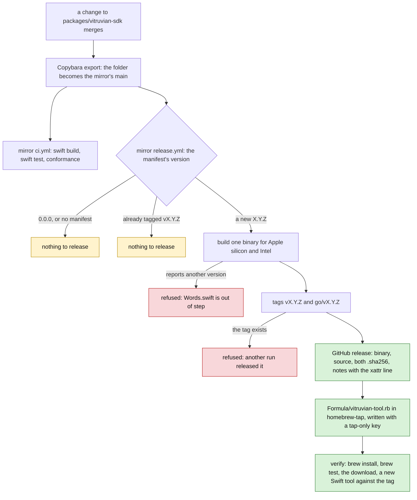

# Vitruvian tools for everyone (stage A: publish) Implementation Plan

> **For agentic workers:** REQUIRED SUB-SKILL: Use superpowers:subagent-driven-development (recommended) or superpowers:executing-plans to implement this plan task-by-task. Steps use checkbox (`- [ ]`) syntax for tracking.

**Goal:** Publish the Vitruvian SDK so that someone without this repository can write a tool. After this stage `brew install VitruvianSoftware/tap/vitruvian-tool` works on any Mac, a Swift package can depend on `https://github.com/VitruvianSoftware/vitruvian-sdk` by version, and vitruviansoftware.dev/tools has the guide, the protocol and two examples. The first release is `0.9.0`.

**Architecture:** `packages/vitruvian-sdk` stays where it is and is developed here. Copybara copies it, on every change, to a new public repository, `VitruvianSoftware/vitruvian-sdk`, with the folder as the repository's root. release-please, here, decides the version and writes it into three files. The mirror's own `release.yml`, written here and copied there, notices a version it has not tagged yet, tags it, builds `vitruvian-tool` for both Mac architectures, attaches it and the source to a GitHub release, writes a Homebrew formula that builds from that source, and then installs it as a person would. The website's Tools section is a set of copies of the package's own tested files, made by a script and held by a test.



Green is a release a person can use, amber is a run that has nothing to do, red is a run that refuses and publishes nothing.

**What a person sees:** a new public repository with tagged releases; a Homebrew formula; `vitruvian-tool --version`; `vitruvian-tool init --template swift` that works with no checkout; a "Tools" item in the website's navigation. Nothing in the Vitruvian app changes, and no app release is cut.

**Tech Stack:** Swift 6 and SwiftPM (the package's own `Package.swift`), XCTest, Python 3 standard library plus `jsonschema` 4.26.0 (the version in `requirements/runtime.txt`), Go 1.26 with Pulumi's GitHub and TLS providers (`repo-config`), GitHub Actions, Copybara's existing export, release-please v5 (`googleapis/release-please-action`), Jekyll 3.9 through the `github-pages` gem (the website), Homebrew.

**Spec:** `docs/superpowers/specs/2026-10-12-vitruvian-tools-for-everyone-design.md`, stage A of its section 11 (row A). It implements sections 5.1, 5.2 (the SDK's part), 5.4, 6 (without the catalogue page), 10 and the stage A parts of 12 and 13. The protocol's own spec is `2026-10-10-vitruvian-external-tools-design.md`; this plan does not edit it.

Every path is from the repository root. "The package" is `packages/vitruvian-sdk`; "the mirror" is `VitruvianSoftware/vitruvian-sdk`; "the tap" is `VitruvianSoftware/homebrew-tap`; "the site" is `apps/web/vitruviansoftware-dev`.

## Decisions this plan makes

The design's twenty-two decisions stand. These are the ones it leaves open, or where the code said something the design did not know. Each row says whether it follows the design, adds to it, or differs from it. Task 9 lists the differences in the design's stage table; it does not rewrite the design's sections.

| # | Decision | Why |
|---|---|---|
| 1 | **The mirror is export-only and `SQUASH`, like `gh-watch` and `site-vitruviansoftware-dev`, with `standalone_only: []` and no `origin_only_exclude`.** Every `BUILD` file is left out by `_monorepo_only` already; nothing else is. `conformance/`, `samples/`, `docs/` and the Python tests all go, so a person with the mirror has the conformance script. `docs/guide_test.py` goes too but runs only here: it reads `BUILD` to check the guide's Bazel targets. Follows the design. | A package that builds from the mirror alone was checked in this plan's scratch run: the folder without its `BUILD` files, tagged `v0.9.0` in a local git repository, resolved and built as a dependency of a new tool, with a `go/v0.9.0` tag beside it. |
| 2 | **The mirror's release writes the formula with a key that writes the tap and nothing else.** `repo-config` makes an ED25519 pair, puts the public half on the tap as a write deploy key titled `vitruvian-sdk release (write)`, and the private half in the mirror as the Actions secret `HOMEBREW_TAP_DEPLOY_KEY`. **Differs from the design** (section 5.4), which names the App token that `publish.sh` uses. | That token is minted from the `vitruvian-copybara-sync` App's private key. A workflow in the mirror can mint it only if the mirror holds that key, and that key can then mint a token for every repository the App is installed on, including this one, where the App may bypass the rulesets. A deploy key can push to the tap and to nothing else. The tap's `main` has no branch protection and no ruleset (`gh api repos/VitruvianSoftware/homebrew-tap/branches/main/protection` answers 404; `rulesets` is `[]`), so a deploy key pushes. The other mirrors' `RELEASE_AUTOMATION_TOKEN` is set nowhere in this repository and is not among `nexus-agent`'s repository secrets, so it is most likely an organisation secret made by hand; it cannot be checked without `admin:org`. A key made by `repo-config` needs no hand and no check. |
| 3 | **Two pull requests, as `docs/admin/copybara-sync.md` section 8f says.** Pull request 1 is Task 1, the repository and the keys. Tasks 2 to 9 follow after `Repo Config Apply` has run. **Adds to the design.** | The export in Task 6 pushes with `VITRUVIAN_SDK_SYNC_SSH_KEY`, which exists only after the apply. `REPO_CONFIG_AUTO_APPLY` is `true` (`gh variable list`), so the merge applies it. |
| 4 | **The first release is `0.9.0` from a manifest of `0.0.0` and `"initial-version": "0.9.0"`.** **Differs from the brief**, which starts the manifest at `0.9.0`. | release-please reads a manifest version with no release behind it as the last release, and proposes the next one: `src/manifest.ts` backfills it as a fake release, except for `0.0.0`. This repository shows it: `packages/peripherals` started at a manifest of `0.1.0` with no tag, and its first release was `gravastar-mouse-v0.1.1`, with a changelog link from a `v0.1.0` that never existed. With `0.0.0` the strategy uses `initialReleaseVersion()`, which is `initial-version`. |
| 5 | **`bootstrap-sha` is `858211bb2e42122ee13fac04b4a97517675226ef`**, the commit this plan was written on. **Adds to the design.** | Without it, release-please's first look back walks up to 500 commits and finds `feat(desktop)` and `fix(desktop)` commits that touched the package (#3096, #3116, #3129, #3143). It would open a release pull request the moment its workflow lands, with the app's features in the SDK's changelog. With it, the first release holds this stage's work and is opened by Task 9. |
| 6 | **In `0.x` a `feat` moves the minor version and a `fix` the patch** (`bump-minor-pre-major: true`, no `bump-patch-for-minor-pre-major`). A breaking change also moves only the minor version. `1.0.0` is cut on purpose, with `release-as`, when the design says. **Adds to the design.** | The design wants stage B to be `0.10.0`; that is a `feat`. `packages/peripherals` uses `bump-patch-for-minor-pre-major`, which would make stage B `0.9.1`. Without `bump-minor-pre-major`, a `feat!` would jump to `1.0.0` by accident. |
| 7 | **A change to `packages/vitruvian-sdk/.github/` alone cuts no release** (`exclude-paths`). **Adds to the design.** | A fix to the mirror's CI is not a new SDK. |
| 8 | **The monorepo tag is `vitruvian-sdk-vX.Y.Z`; the mirror's are `vX.Y.Z` and `go/vX.Y.Z`.** Follows the design. | `include-component-in-tag` with `tag-separator: "-"` gives `<component>-vX.Y.Z`, as `gravastar-mouse-v0.1.2` shows. SwiftPM accepts a `v` before the version, which the scratch run confirmed, and ignores `go/v0.9.0`. |
| 9 | **The mirror makes its tags through the API with its own `GITHUB_TOKEN`**, lightweight, at the exported commit. Creating a tag that exists fails, which is the refusal. Nothing is pushed from the checkout, and `main` is never written. **Adds to the design.** | `devx` and `nexus-agent` push annotated tags with `RELEASE_AUTOMATION_TOKEN`. The job's token can make tags and releases in its own repository, and a second, late run cannot reuse a tag. |
| 10 | **One binary for both architectures with `swift build -c release --arch arm64 --arch x86_64`, found with `--show-bin-path`.** It is signed ad hoc by the linker. **Adds to the design.** | `packages/peripherals/publish.sh` builds with Bazel's `--macos_cpus=arm64,x86_64`, and the mirror has no Bazel. With Swift 6.4 the universal binary is at `.build/out/Products/Release/`, not at the `.build/apple/Products/Release/` older releases used, so no path is written down. `lipo -archs` said `x86_64 arm64`; `codesign -dv` said `Signature=adhoc`. |
| 11 | **The release refuses a binary whose `--version` is not the manifest's version**, as `publish.sh` does, and `release_version_test` refuses the same mistake here before it merges. **Adds to the design.** | Words.swift is written by release-please through `extra-files`; a hand edit could put it out of step, and the formula and the template would then name a version that is not the release. |
| 12 | **`mirror_workflows_test` runs the `detect` step of the mirror's `release.yml`, the shell exactly as written, with bash, git and jq, in a repository it makes, for six manifests**, and checks that only the `release` job may write, only contents, that no checkout keeps its credentials and that every action is pinned to a commit. It is tagged `no-remote-exec`. **Adds to the design.** | The mirror's workflows never run here, and `actionlint` passes a `detect` that releases `0.0.0`: the scratch run showed it. The step that decides whether to publish is the one line a mistake in costs most. `MODULE.bazel` says the remote execution image has no `jq`; with `no-remote-exec` the test runs on the runner, which has it, and so does a Mac. |
| 13 | **The formula builds from a source tarball the release attaches** (`git archive` of the tagged commit, `vitruvian-sdk-X.Y.Z.tar.gz` and its `.sha256`), not from GitHub's own archive of the tag. It runs `swift build --disable-sandbox -c release --product vitruvian-tool`, needs macOS 14 (`depends_on macos: :sonoma`, the package's platform) and declares no Xcode. **Adds to the design.** | Bytes this workflow made and hashed cannot change under the formula. Homebrew's own Swift formulae pass `--disable-sandbox`, because SwiftPM's sandbox cannot run inside Homebrew's. Declaring `depends_on xcode` would require the full Xcode; Homebrew's installer already installs the command line tools, which carry Swift. Whether a Mac with only those tools builds it was not checked: it is a by-hand check. |
| 14 | **How the formula is tested: the mirror's `release.yml` has a third job, `verify`**, which runs after the formula is written: `brew install`, `brew test`, the downloaded binary against its checksum on both architectures, and a new Swift tool from `init --template swift` built against the release's tag and run. **Adds to the design.** | That is done-when 1 and 2 of the design, for Swift, on a Mac with nothing of ours on it, after every release. A release that cannot be installed or used is a red run on the mirror's `main`, which `notify-ci-issues` watches. |
| 15 | **`swift_template_test` stays offline and keeps building against `--sdk`.** The check that the published dependency resolves is the `verify` job of decision 14, not a Bazel test. `init_test` gains a check that `init` without `--sdk` writes `.package(url: "https://github.com/VitruvianSoftware/vitruvian-sdk", from: "<the --version>")`. `templates_in_sync_test` does not change: the `Package.swift` template is in `NewTool.swift`, not copied from a sample. **Adds to the design.** | A test that needs the network and a published tag cannot pass before the first release, and fails for reasons that are not ours after it. The `verify` job runs where both are true. |
| 16 | **The version lives in `Words.swift` as `static let version = "0.9.0" // x-release-please-version`**, read through `VitruvianToolCommand.version`. `--version` takes nothing after it. **Follows the design.** | `Words` is internal; the tests reach the version through the public command type. |
| 17 | **The mirror's CI runs on GitHub's free hosted runners, `macos-26` and `ubuntu-latest`, with the runner's default Xcode.** It sets `VITRUVIAN_TOOL_BINARY` and `VITRUVIAN_HELLO_SWIFT` so that `swift test` runs all 44 command tests with none skipped, and runs `samples_test.py` with both Swift samples built. **Adds to the design.** | The package's README said its tests had never been run with `swift test`. They were, in this plan's scratch run: 32, 13 and 44 tests, with the two that need a built program skipped until those variables were set. The monorepo's `xcode-27` is not one of GitHub's hosted labels (actionlint lists them), so it is a runner this organisation provides, which a public mirror should not depend on. A Swift older than 6.4 on the runner is not checked here: the first run of the mirror's CI is a by-hand check, and its `swift --version` line says what it was. |
| 18 | **The mirror's workflows pin `actions/checkout` to the same commit as this repository's** (`3d3c42e5aac5ba805825da76410c181273ba90b1`, v7.0.1), and `.github/dependabot.yml` gains their folder. **Adds to the design.** | The other mirrors' workflows name tags (`actions/checkout@v7`). `tools/conformance/check.sh` fails until the folder is in Dependabot's list. |
| 19 | **The mirror has no `cla.yml`.** **Differs from the design** (section 5.1). | The mirror takes no pull requests: a contribution is a pull request to this repository (design section 10). The mirrors with `cla.yml` (`devx`, `homelab`, `mcp-slack`, `nexus-agent`) are the ones that import a mirror pull request; no export-only mirror has one. A CLA bot on pull requests that are never merged asks people to sign for nothing. |
| 20 | **The site's copies are Markdown with front matter**, rendered by the site's own kramdown (GFM). A copy is its source with: its first `# ` heading moved into the page's title; its links to other copied files pointed at the site, and all other relative links pointed at the mirror on GitHub; the words after a code fence's language dropped (`json message`, `swift file=…`: the guide's test reads them, kramdown would not render the block as code); and the whole wrapped in ``. The code inside every fence stays the source's, byte for byte, and `sync.py` refuses to write a page where it is not. **Follows the design, and adds the rules.** | Rendered in the scratch run with Jekyll 3.9.5 in safe mode: 31 of 31 code blocks of the guide, 1 of 1 of the protocol and both examples came out as the source's text, character for character, and no Liquid was left in the pages. |
| 21 | **The pages are at `/tools/`, `/tools/guide/`, `/tools/protocol/`, `/tools/examples/swift/` and `/tools/examples/python/`**, each with its `permalink`. **Differs from the design**, which names `guide.html`. | The site's other pages are `/about/`, `/downloads/` and so on, and its `permalink` setting ends in `/`, which Jekyll applies to every page: a `guide.md` would have been `/tools/guide/` anyway. Writing it down keeps it from changing. |
| 22 | **The protocol page is `protocol/README.md` with a table of every message from `methods.json` at its end.** **Follows the design.** | |
| 23 | **No catalogue page and no link to one.** The index says, in one sentence, that there is no list of tools to install yet and a tool comes as a folder. **The brief left this open.** | A placeholder page is a promise with a date nobody set. Stage C adds the page and its link together. |
| 24 | **The site holds no version number.** **Adds to the design.** | A release changes `Words.swift`, the manifest and `CHANGELOG.md`, none of which is copied. So a release never makes a copy stale, and `in_sync_test` can never fail on a release pull request, which merges by itself. |
| 25 | **The website gets one new layout, `_layouts/tools.html`, made of the post layout's existing classes**, a hand-written `tools/index.html` made of the downloads page's existing classes, "Tools" after "Downloads" in the navigation, the navigation marking the section on every page under `/tools/`, and a `vitruvian-sdk` link in the footer's open-source list. No new CSS. **Follows the design.** | "Premium, restrained": the section looks like the blog and the downloads page because it is made of them. |
| 26 | **No entry for `vitruvian-tool` on the Downloads page in this stage.** **The design is silent.** | It would need `tools/sync-downloads/sync_downloads.py` to learn a new repository. The Tools index is the one place that says how to install it. |
| 27 | **Commit titles are chosen so that exactly one commit cuts the release.** Every task that changes the package's folder is `chore(...)`, and Task 9 is `feat(vitruvian-sdk): …`. The repository's other changes are `feat(repo-config)`, `feat(ci)` and `feat(site)`, which touch no file of the package. **Follows the brief.** | release-please counts a commit for the package when it touches a file under it, whatever its scope says. |
| 28 | **The release pull request merges by itself** (`release-pr-automerge.yaml` merges every `release-please--` branch but the app's). So Task 9's merge leads, with no person, to the `vitruvian-sdk-v0.9.0` release here and then to the mirror's `v0.9.0`. **The design is silent.** | It is how every other component releases. To hold it, label the release pull request `do-not-automerge`. |

## Global Constraints

- **Everything in this plan was built and run before it was written down, except what this list names.** The tree at `858211bb2` was exported to a scratch folder outside the repository and made a git repository on a branch called `main`. Each task was applied there, and its tests were run there, on macOS 27.0 with Xcode 27.0 and Swift 6.4, Go 1.26.6, Python 3 with `jsonschema` 4.26.0, Jekyll 3.9.5 and actionlint 1.7.12. The counts and the failure texts in each task are from those runs. Every planted regression listed was applied and seen to fail its test, then undone. At the end, on a tree built by applying the tasks in this plan's order: every test of the package, `//tools/sync-site-tools:in_sync_test`, `//apps/desktop/vitruvian:tool_protocol_pin_test`, `go test ./...` of `repo-config`, `bazel run //tools/conformance:check`, `//tools/license:check`, `//tools/license:verify`, `//:tidy`, the presubmit generator and actionlint (repository root, and the package's two workflows) all passed. The mirror's workflows were run step by step on this Mac by a small script that reads each job's `run` blocks: both jobs of `ci.yml`; `release.yml`'s `detect` job with a manifest of `0.0.0`, of `0.9.0`, and with `v0.9.0` already tagged; its `release` job against a local git repository in the mirror's shape, with `gh` replaced by a stub that records what it is asked and the tap replaced by a local bare repository; and the download step of `verify`. The formula's build was run on the release's own source tarball, as Homebrew would, and its test's commands after it. **Not run:** Copybara (its pinned image is not on this Mac; `copybara-config-smoketest` runs it on the pull request); `pulumi` of any kind (the program was built and its tests run with Pulumi's mocks); anything on a GitHub runner; `brew install` itself; the site through `actions/jekyll-build-pages` (Jekyll 3.9.5 was run directly in safe mode with the Pages plugin list; the `github-pages` gem's bundle would not resolve without the network); the "By hand" list. If `main` has moved and a listing no longer fits, make the smallest change that keeps its meaning and record it as a deviation.
- **How to read a listing.** A block under "Create `<path>`" is that whole file. A block that starts with `--- a/` is a change to a file that exists, as `git diff` prints it: save it and run `git apply <file>` from the repository root, or make it by hand. Its line numbers are those of `858211bb2` with the earlier tasks applied. Every listing in this plan was taken out of the scratch run's commits by a script, and the plan was then checked by applying every listing to a fresh copy of `858211bb2`, running the two generators, and comparing the result with the tree the tests ran on.
- **Files that are written by a command, not by hand.** `apps/web/vitruviansoftware-dev/tools/guide.md`, `protocol.md`, `examples/swift.md` and `examples/python.md` are written by `bazel run //tools/sync-site-tools:sync`; `.github/workflows/presubmit.yaml` by `bazel run //tools/pipeline:gen -- --format=workflow --output-file=.github/workflows/presubmit.yaml`. Never edit them by hand; their tests fail when they differ from what the command writes.
- **Licences.** The package is MIT, `Copyright (c) 2026 VitruvianSoftware`, and every new source file in it, in `tools/` and in `.github/` starts with the 19-line MIT header its neighbours carry (the listings include it). `BUILD` files carry it too. The website is exempt from headers (`tools/license/BUILD`, `_IGNORE_GLOBS`): a page must start with its front matter. JSON and Markdown files carry none. Nothing from `apps/desktop/vitruvian/` is copied into the package, the site or the tools: the app is GPL-3.0-or-later and the dependency runs one way, MIT into GPL. No file with a `Copyright (C) 2026 Vorssaint` header changes in this stage, so `UPSTREAM.md` gets no entry; check the header of every file you change anyway.
- **No Apple Developer ID, ever.** The binary is signed ad hoc by the linker and nothing signs or notarizes it. The release notes, the guide and the README say what that means for a download and give the one `xattr` line, and say that Homebrew needs none of it. Everything in this stage is free: public repositories, GitHub's hosted runners for a public repository, the existing tap.
- **All infrastructure changes go through CI.** Task 1 changes `repo-config`, which `Repo Config Apply` applies when its pull request merges. Never run `pulumi up`, `pulumi preview` or `bazel run //infrastructure/pulumi/platform/repo-config:up` from a checkout. Task 6 must not merge until the apply has run and Task 1's step 6 has shown its result.
- **Nobody but the pipelines writes to the mirror or the tap.** A worker never pushes to `VitruvianSoftware/vitruvian-sdk` or `VitruvianSoftware/homebrew-tap`, never creates a repository or a secret by hand, and never runs either repository's workflows by dispatch to test them before their first real run, which is a by-hand check.
- **The docs describe the published SDK a little before it exists.** Tasks 3, 4, 7 and 9 say `brew install` and name the mirror; the first release exists only after the release pull request that Task 9 starts has merged and the mirror's `release.yml` has run. That is minutes to hours. Merge Tasks 2 to 9 together, or in order without a pause between them.
- **`pipeline_unit` changes twice**: Task 5 adds `mirror_workflows_test` to the package's unit and Task 8 adds `release_version_test`. Regenerate `presubmit.yaml` in each of those tasks. Keep round brackets out of that call's comments: the presubmit planner reads the call up to the first closing one.
- **Build and test through Bazel**, from the repository root, one command at a time. The Swift targets need `--config=macos-app`. Python files are formatted with `bazel run //tools/format -- <paths>`; Go files with `gofmt`. Task 9 runs `bazel run //tools/license:check`, `bazel run //tools/license:verify` and `bazel run //:tidy`. On this base `//:tidy` adds one unrelated line, `Cryptodome: pycryptodomex`, to `gazelle_python.yaml`: undo that line by hand and do not commit it.
- **Git.** Never `git stash`, `git reset` or `git restore`; undo an edit by hand. One commit per task, identity and commit in one command. In a worktree the keys are in the main checkout:
  ```sh
  export AGENT_KEY_DIR=/Users/james/Workspace/gh/application/vitruvian/vitruvian-core/tools/sync-env-secrets/agent-keys; eval "$(bazel run //tools/agent-app -- env <agent> 2>/dev/null)"; git add <files> && git commit -m "<title>"
  ```
  `<agent>` is `forge` for CI, Bazel, Copybara and `repo-config` (Tasks 1, 5, 6, 8), `wren` for code (Tasks 2, 3, 7), and `compass` for docs (Tasks 4, 9).
- **Commit titles** are given in each task. `main` takes squash merges, so a pull request's title is the commit that counts: pull request 1 is titled as Task 1; pull request 2, holding Tasks 2 to 9, is titled as Task 9, `feat(vitruvian-sdk): publish the SDK, version 0.9.0`. If Tasks 2 to 9 are merged as separate pull requests instead, keep each task's title, and merge Task 9 last.

## Review Focus

Where a mistake costs most. Each has a test or a check in the task named.

1. **A credential in a public repository that can do more than it must.** The mirror holds one secret, `HOMEBREW_TAP_DEPLOY_KEY`, which can push to the tap and to nothing else; it holds no App key (Task 1, `TestTheSDKMirrorHoldsAWriteKeyToTheTapOnly`, `TestOnlyOneWayMirrorsHoldATapKey`). The release job is the only job with `contents: write`, every checkout has `persist-credentials: false`, and every action is pinned, which `mirror_workflows_test` holds (Task 5). The key is written to a file only for the clone and push, and deleted after.
2. **Two releases of one version, or a release of the wrong version.** `detect` refuses `0.0.0` and a tagged version, and `mirror_workflows_test` runs it to prove so; the tag is made through the API, so a second run fails at the tag; the binary must report the manifest's version (Task 5). `release_version_test` holds the manifest, the config and `Words.swift` together (Task 8). `bootstrap-sha` keeps the app's past commits out of the first release (Task 8).
3. **Code on the website that is not the tested code.** `sync.py` refuses to write a page whose fenced code differs from the source's; `in_sync_test` fails when a copy is stale (Task 7). The rendered pages were compared with the sources, code block by code block.
4. **A mirror that breaks unseen.** The mirror is in `MIRRORS` and the smoke test in the change that exports it, and `check.sh` fails otherwise (Task 6). The `verify` job makes an unusable release a red run on the mirror (Task 5).
5. **Instructions that do not work.** The quarantine line was checked: `tar` on macOS carries a downloaded archive's `com.apple.quarantine` mark onto the program it unpacks, and `xattr -d com.apple.quarantine vitruvian-tool` takes it off (Task 5). The Swift template's dependency resolved against a tagged copy of the exported folder (Task 3).
6. **The licence boundary.** No file of the app's folder is read or copied; `//tools/license:verify` passes (Task 9).

---

### Task 1: The mirror's repository, its export key, and a key to the tap

**Agent:** forge. **Commit:** `feat(repo-config): a public repository for the Vitruvian SDK, with its export key and a key to the Homebrew tap`. **Pull request 1**, alone.

**Files:**
- Modify: `infrastructure/pulumi/platform/repo-config/internal/copybara_sync/sync.go`
- Create: `infrastructure/pulumi/platform/repo-config/internal/copybara_sync/sync_test.go`

**Interfaces:**
- Produces: `syncedProject.HomebrewTapKey`; `tapKey(ctx, project, repo)`; the `syncedProjects` entry `vitruvian-sdk`. Live, after the apply: the public repository `VitruvianSoftware/vitruvian-sdk` (issues on, `main` requiring a pull request); the write deploy key `copybara-sync (write)` on it; `VITRUVIAN_SDK_SYNC_SSH_KEY` in this repository; the write deploy key `vitruvian-sdk release (write)` on the tap; `HOMEBREW_TAP_DEPLOY_KEY` in the mirror.

This is an infrastructure change. It applies only through CI: `Repo Config Apply` runs `bazel run //infrastructure/pulumi/platform/repo-config:up` when this pull request merges, because the change is under `infrastructure/pulumi/platform/repo-config/**` and `REPO_CONFIG_AUTO_APPLY` is `true`. The pull request's `Repo Config Preview` shows what the apply will do. The package has had no tests until now; this task adds three, run with Pulumi's mocks in the way `internal/site_domain/site_domain_test.go` runs its own. They need no account and send nothing.

- [ ] **Step 1: Write the failing tests**

Create `infrastructure/pulumi/platform/repo-config/internal/copybara_sync/sync_test.go`:

```go
// Copyright (c) 2026 VitruvianSoftware
//
// Permission is hereby granted, free of charge, to any person obtaining a copy
// of this software and associated documentation files (the "Software"), to deal
// in the Software without restriction, including without limitation the rights
// to use, copy, modify, merge, publish, distribute, sublicense, and/or sell
// copies of the Software, and to permit persons to whom the Software is
// furnished to do so, subject to the following conditions:
//
// The above copyright notice and this permission notice shall be included in
// all copies or substantial portions of the Software.
//
// THE SOFTWARE IS PROVIDED "AS IS", WITHOUT WARRANTY OF ANY KIND, EXPRESS OR
// IMPLIED, INCLUDING BUT NOT LIMITED TO THE WARRANTIES OF MERCHANTABILITY,
// FITNESS FOR A PARTICULAR PURPOSE AND NONINFRINGEMENT. IN NO EVENT SHALL THE
// AUTHORS OR COPYRIGHT HOLDERS BE LIABLE FOR ANY CLAIM, DAMAGES OR OTHER
// LIABILITY, WHETHER IN AN ACTION OF CONTRACT, TORT OR OTHERWISE, ARISING FROM,
// OUT OF OR IN CONNECTION WITH THE SOFTWARE OR THE USE OR OTHER DEALINGS IN THE
// SOFTWARE.

package copybara_sync

import (
	"sync"
	"testing"

	"github.com/pulumi/pulumi/sdk/v3/go/common/resource"
	"github.com/pulumi/pulumi/sdk/v3/go/pulumi"
)

type seen struct {
	typeToken string
	inputs    resource.PropertyMap
}

// Pulumi registers resources concurrently, so the mock serialises its own
// bookkeeping (as internal/site_domain's test does).
type mocks struct {
	got map[string]seen
	mu  *sync.Mutex
}

func (m mocks) NewResource(args pulumi.MockResourceArgs) (string, resource.PropertyMap, error) {
	m.mu.Lock()
	m.got[args.Name] = seen{typeToken: args.TypeToken, inputs: args.Inputs}
	m.mu.Unlock()
	return args.Name + "_id", args.Inputs, nil
}

func (mocks) Call(args pulumi.MockCallArgs) (resource.PropertyMap, error) {
	return args.Args, nil
}

// run declares every synced project against the mocks and returns what was
// declared, by resource name. The App credentials are stand-ins: nothing is
// sent anywhere.
func run(t *testing.T) map[string]seen {
	t.Helper()
	t.Setenv("SYNC_APP_ID", "1")
	t.Setenv("SYNC_APP_PRIVATE_KEY", "not-a-real-key")
	got := map[string]seen{}
	if err := pulumi.RunErr(ManageSyncAuth, pulumi.WithMocks("repo-config", "dev", mocks{got, &sync.Mutex{}})); err != nil {
		t.Fatalf("ManageSyncAuth: %v", err)
	}
	return got
}

func text(t *testing.T, got map[string]seen, resourceName, field string) string {
	t.Helper()
	r, ok := got[resourceName]
	if !ok {
		t.Fatalf("no resource %q was declared", resourceName)
	}
	v, ok := r.inputs[resource.PropertyKey(field)]
	if !ok {
		t.Fatalf("%s has no %s", resourceName, field)
	}
	if v.IsSecret() {
		v = v.SecretValue().Element
	}
	if !v.IsString() {
		t.Fatalf("%s.%s is %v, not text", resourceName, field, v)
	}
	return v.StringValue()
}

// The SDK's mirror is a public repository this package makes, with the
// export's write key on it and the key's private half in the monorepo.
func TestTheSDKMirrorIsMadePublicWithItsExportKey(t *testing.T) {
	got := run(t)
	if r := got["vitruvian-sdk"]; r.typeToken != "github:index/repository:Repository" {
		t.Fatalf("vitruvian-sdk is %q, want a github repository", r.typeToken)
	}
	if v := text(t, got, "vitruvian-sdk", "visibility"); v != "public" {
		t.Errorf("visibility is %q, want public: SwiftPM and Homebrew fetch from it with no account", v)
	}
	if v := text(t, got, "vitruvian-sdk-standalone-deploy-key", "repository"); v != "vitruvian-sdk" {
		t.Errorf("the export key is on %q, want vitruvian-sdk", v)
	}
	if v := text(t, got, "vitruvian-sdk-sync-ssh-key-secret", "secretName"); v != "VITRUVIAN_SDK_SYNC_SSH_KEY" {
		t.Errorf("the export secret is %q, want VITRUVIAN_SDK_SYNC_SSH_KEY", v)
	}
	if v := text(t, got, "vitruvian-sdk-sync-ssh-key-secret", "repository"); v != "vitruvian-core" {
		t.Errorf("the export secret is in %q, want vitruvian-core", v)
	}
	if _, ok := got["vitruvian-sdk-mirror-readonly"]; !ok {
		t.Error("the mirror's main is not made read-only")
	}
	if _, ok := got["vitruvian-sdk-dispatch-app-private-key-secret"]; ok {
		t.Error("an export-only mirror must not hold the App's key")
	}
}

// The mirror's release.yml writes its formula with a key that can write the
// tap and nothing else.
func TestTheSDKMirrorHoldsAWriteKeyToTheTapOnly(t *testing.T) {
	got := run(t)
	if r := got["vitruvian-sdk-homebrew-tap-key"]; r.typeToken != "tls:index/privateKey:PrivateKey" {
		t.Fatalf("vitruvian-sdk-homebrew-tap-key is %q, want a tls private key", r.typeToken)
	}
	if v := text(t, got, "vitruvian-sdk-homebrew-tap-deploy-key", "repository"); v != "homebrew-tap" {
		t.Errorf("the tap key is on %q, want homebrew-tap", v)
	}
	if r := got["vitruvian-sdk-homebrew-tap-deploy-key"]; r.inputs["readOnly"].BoolValue() {
		t.Error("the tap key is read-only: the release could not push the formula")
	}
	if v := text(t, got, "vitruvian-sdk-homebrew-tap-key-secret", "repository"); v != "vitruvian-sdk" {
		t.Errorf("the tap key's private half is in %q, want vitruvian-sdk", v)
	}
	if v := text(t, got, "vitruvian-sdk-homebrew-tap-key-secret", "secretName"); v != "HOMEBREW_TAP_DEPLOY_KEY" {
		t.Errorf("the tap key's secret is %q, want HOMEBREW_TAP_DEPLOY_KEY", v)
	}
}

// A key to the tap goes only to a one-way mirror: its workflows reach it
// only through the monorepo's export, so nothing outside review can use it.
func TestOnlyOneWayMirrorsHoldATapKey(t *testing.T) {
	got := run(t)
	for _, p := range syncedProjects {
		_, declared := got[p.Name+"-homebrew-tap-key-secret"]
		if declared != p.HomebrewTapKey {
			t.Errorf("%s: tap key declared %v, HomebrewTapKey %v", p.Name, declared, p.HomebrewTapKey)
		}
		if p.HomebrewTapKey && !p.OneWay {
			t.Errorf("%s holds a tap key but is not a one-way mirror", p.Name)
		}
	}
}
```

Run, from `infrastructure/pulumi/platform/repo-config`: `GOWORK=off go test ./internal/copybara_sync/`

Expected: it does not compile.

```
internal/copybara_sync/sync_test.go:141:20: p.HomebrewTapKey undefined (type syncedProject has no field or method HomebrewTapKey)
FAIL	github.com/VitruvianSoftware/vitruvian-core/infrastructure/pulumi/repo-config/internal/copybara_sync [build failed]
```

- [ ] **Step 2: Declare the repository and the two keys**

```diff
--- a/infrastructure/pulumi/platform/repo-config/internal/copybara_sync/sync.go
+++ b/infrastructure/pulumi/platform/repo-config/internal/copybara_sync/sync.go
@@ -40,6 +40,12 @@
 // the export deploy key keeps its admin-context push bypass), codifying the
 // read-only-mirror lockdown as code instead of click-ops.
 //
+// For a mirror that publishes to the Homebrew tap (HomebrewTapKey:true) it
+// gives the mirror's own release workflow a key that writes the tap and
+// nothing else: a second ED25519 pair, its public half a WRITE deploy key on
+// VitruvianSoftware/homebrew-tap, its private half the Actions secret
+// HOMEBREW_TAP_DEPLOY_KEY in the standalone repo.
+//
 // The GitHub App itself is created MANUALLY by the operator; Pulumi only places
 // its credentials, which are supplied as Pulumi config secrets (see below).
 package copybara_sync
@@ -60,6 +66,10 @@ import (
 // workflow lives here and consumes the <PROJECT>_SYNC_SSH_KEY secret.
 const monorepoRepoName = "vitruvian-core"
 
+// homebrewTapRepo is the organisation's one Homebrew tap. A mirror with
+// HomebrewTapKey writes its formula there.
+const homebrewTapRepo = "homebrew-tap"
+
 // syncedProject describes one component that is bidirectionally synced between
 // the monorepo and a standalone repository.
 //
@@ -89,6 +99,12 @@ type syncedProject struct {
 	// Description is the repository description used when CreateRepo is true.
 	Description string
 
+	// HomebrewTapKey gives the standalone repo a key that writes the Homebrew
+	// tap and nothing else (see the package comment), for a release workflow
+	// that writes a formula. A one-way mirror only: its workflows reach it
+	// through the monorepo's export, so nothing outside review can use the key.
+	HomebrewTapKey bool
+
 	// UnprotectedMirror marks an EXISTING one-way mirror whose main branch had no
 	// branch protection when it was onboarded. The read-only protection is then
 	// created rather than adopted: pulumi.Import of a protection that does not
@@ -177,6 +193,20 @@ var syncedProjects = []syncedProject{
 		OneWay:            true,
 		UnprotectedMirror: true,
 	},
+	{
+		// The public home of the Vitruvian tool SDK (packages/vitruvian-sdk).
+		// Export-only: developed here, released from the mirror, whose own
+		// release.yml tags vX.Y.Z and go/vX.Y.Z, attaches the vitruvian-tool
+		// binary and writes its formula to the tap with HOMEBREW_TAP_DEPLOY_KEY.
+		// Name uppercase-snakes to VITRUVIAN_SDK_SYNC_SSH_KEY, consumed by
+		// copybara-export-vitruvian-sdk.yaml.
+		Name:           "vitruvian-sdk",
+		StandaloneRepo: "vitruvian-sdk",
+		OneWay:         true,
+		CreateRepo:     true,
+		HomebrewTapKey: true,
+		Description:    "Build tools for the Vitruvian Mac app: the protocol, the Swift kit and the vitruvian-tool command",
+	},
 }
 
 // secretPrefix converts a project name into the UPPER_SNAKE prefix used for its
@@ -268,6 +298,12 @@ func ManageSyncAuth(ctx *pulumi.Context) error {
 			return err
 		}
 
+		if project.HomebrewTapKey {
+			if err := tapKey(ctx, project, repo); err != nil {
+				return err
+			}
+		}
+
 		if project.OneWay {
 			// A one-way mirror is READ-ONLY: development happens in the monorepo
 			// and Copybara mirrors the subtree out, so the standalone repo must
@@ -396,3 +432,38 @@ func ManageSyncAuth(ctx *pulumi.Context) error {
 
 	return nil
 }
+
+// tapKey gives a mirror's release workflow a key that writes the Homebrew tap
+// and nothing else: a fresh ED25519 pair, the public half a WRITE deploy key
+// on the tap (whose main has no branch protection, so a deploy key pushes),
+// the private half HOMEBREW_TAP_DEPLOY_KEY in the standalone repo. Rotating it
+// is replacing the tls resource, as for the export key (docs/admin/copybara-sync.md).
+func tapKey(ctx *pulumi.Context, project syncedProject, repo *github.Repository) error {
+	key, err := tls.NewPrivateKey(ctx, fmt.Sprintf("%s-homebrew-tap-key", project.Name), &tls.PrivateKeyArgs{
+		Algorithm: pulumi.String("ED25519"),
+	})
+	if err != nil {
+		return err
+	}
+	_, err = github.NewRepositoryDeployKey(ctx, fmt.Sprintf("%s-homebrew-tap-deploy-key", project.Name), &github.RepositoryDeployKeyArgs{
+		Title:      pulumi.String(project.StandaloneRepo + " release (write)"),
+		Repository: pulumi.String(homebrewTapRepo),
+		Key:        key.PublicKeyOpenssh,
+		ReadOnly:   pulumi.Bool(false),
+	})
+	if err != nil {
+		return err
+	}
+	secretArgs := &github.ActionsSecretArgs{
+		Repository:     pulumi.String(project.StandaloneRepo),
+		SecretName:     pulumi.String("HOMEBREW_TAP_DEPLOY_KEY"),
+		PlaintextValue: key.PrivateKeyOpenssh,
+	}
+	var opts []pulumi.ResourceOption
+	if repo != nil {
+		secretArgs.Repository = repo.Name
+		opts = append(opts, pulumi.DependsOn([]pulumi.Resource{repo}))
+	}
+	_, err = github.NewActionsSecret(ctx, fmt.Sprintf("%s-homebrew-tap-key-secret", project.Name), secretArgs, opts...)
+	return err
+}
```

Run: `gofmt -l internal/` (from `infrastructure/pulumi/platform/repo-config`). Expected: nothing printed.

- [ ] **Step 3: Run the tests**

Run, from `infrastructure/pulumi/platform/repo-config`: `GOWORK=off go vet ./internal/copybara_sync/ && GOWORK=off go test -v ./internal/copybara_sync/ && GOWORK=off go test ./...`

Expected:

```
--- PASS: TestTheSDKMirrorIsMadePublicWithItsExportKey (0.00s)
--- PASS: TestTheSDKMirrorHoldsAWriteKeyToTheTapOnly (0.00s)
--- PASS: TestOnlyOneWayMirrorsHoldATapKey (0.00s)
ok  	github.com/VitruvianSoftware/vitruvian-core/infrastructure/pulumi/repo-config/internal/copybara_sync
```

and `ok` for the module and each of its four other packages. That is what `bazel test //infrastructure/pulumi/platform/repo-config:test` runs (`tools/pulumi/pulumi_go_test.sh`, with `GOWORK=off`); run that too.

- [ ] **Step 4: Plant two regressions the tests must catch**

Apply each by hand, run `GOWORK=off go test ./internal/copybara_sync/`, see the failure, undo it by hand, and check `git diff --stat` shows only this task's two files.

1. In `tapKey`, `ReadOnly:   pulumi.Bool(false),` becomes `ReadOnly:   pulumi.Bool(true),`. Expected: `the tap key is read-only: the release could not push the formula`.
2. In the `vitruvian-sdk` entry, delete `HomebrewTapKey: true,`. Expected: `--- FAIL: TestTheSDKMirrorHoldsAWriteKeyToTheTapOnly`, whose first line says `vitruvian-sdk-homebrew-tap-key is "", want a tls private key`.

- [ ] **Step 5: Commit, open pull request 1, and read the preview**

```sh
export AGENT_KEY_DIR=/Users/james/Workspace/gh/application/vitruvian/vitruvian-core/tools/sync-env-secrets/agent-keys; eval "$(bazel run //tools/agent-app -- env forge 2>/dev/null)"; git add infrastructure/pulumi/platform/repo-config/internal/copybara_sync && git commit -m "feat(repo-config): a public repository for the Vitruvian SDK, with its export key and a key to the Homebrew tap"
```

Open the pull request with the same title. Its `Repo Config Preview` must show eight resources to create and nothing to change or delete: the repository `vitruvian-sdk`; the key pairs `vitruvian-sdk-sync-key` and `vitruvian-sdk-homebrew-tap-key`; the deploy keys `vitruvian-sdk-standalone-deploy-key` and `vitruvian-sdk-homebrew-tap-deploy-key`; the secrets `vitruvian-sdk-sync-ssh-key-secret` and `vitruvian-sdk-homebrew-tap-key-secret`; the protection `vitruvian-sdk-mirror-readonly`. Anything else is a stop: report it, do not merge.

- [ ] **Step 6: After it merges, prove the apply**

Wait for the `Repo Config Apply` run of the merge commit to finish green (`gh run list --workflow _repo-config-apply.yaml --limit 1`). Then:

```sh
gh repo view VitruvianSoftware/vitruvian-sdk --json name,visibility --jq '[.name, .visibility] | @tsv'
gh api repos/VitruvianSoftware/vitruvian-sdk/keys --jq '.[] | [.title, .read_only] | @tsv'
gh secret list -R VitruvianSoftware/vitruvian-core | grep VITRUVIAN_SDK_SYNC_SSH_KEY
gh secret list -R VitruvianSoftware/vitruvian-sdk
gh api repos/VitruvianSoftware/homebrew-tap/keys --jq '.[] | select(.title == "vitruvian-sdk release (write)") | .read_only'
gh api repos/VitruvianSoftware/vitruvian-sdk/branches/main/protection --jq '.required_pull_request_reviews.required_approving_review_count'
```

Expected, in order: `vitruvian-sdk	PUBLIC`; `copybara-sync (write)	false`; one line naming `VITRUVIAN_SDK_SYNC_SSH_KEY`; one line naming `HOMEBREW_TAP_DEPLOY_KEY`; `false`; `0`. This is what a person sees: a public repository holding only the one-line README GitHub made, and nothing else yet. Tasks 2 to 9 start here.

---

### Task 2: `vitruvian-tool --version`

**Agent:** wren. **Commit:** `chore(vitruvian-sdk): vitruvian-tool --version`.

**Files:**
- Create: `packages/vitruvian-sdk/Tests/VitruvianToolCLITests/VersionTests.swift`
- Modify: `packages/vitruvian-sdk/Sources/VitruvianToolCLI/Words.swift`, `packages/vitruvian-sdk/Sources/VitruvianToolCLI/Command.swift`

**Interfaces:**
- Produces: `Words.version` (internal, `"0.9.0"`, the line release-please writes); `VitruvianToolCommand.version` (public); the verb `--version`.

- [ ] **Step 1: Write the failing tests**

Create `packages/vitruvian-sdk/Tests/VitruvianToolCLITests/VersionTests.swift`:

```swift
// Copyright (c) 2026 VitruvianSoftware
//
// Permission is hereby granted, free of charge, to any person obtaining a copy
// of this software and associated documentation files (the "Software"), to deal
// in the Software without restriction, including without limitation the rights
// to use, copy, modify, merge, publish, distribute, sublicense, and/or sell
// copies of the Software, and to permit persons to whom the Software is
// furnished to do so, subject to the following conditions:
//
// The above copyright notice and this permission notice shall be included in
// all copies or substantial portions of the Software.
//
// THE SOFTWARE IS PROVIDED "AS IS", WITHOUT WARRANTY OF ANY KIND, EXPRESS OR
// IMPLIED, INCLUDING BUT NOT LIMITED TO THE WARRANTIES OF MERCHANTABILITY,
// FITNESS FOR A PARTICULAR PURPOSE AND NONINFRINGEMENT. IN NO EVENT SHALL THE
// AUTHORS OR COPYRIGHT HOLDERS BE LIABLE FOR ANY CLAIM, DAMAGES OR OTHER
// LIABILITY, WHETHER IN AN ACTION OF CONTRACT, TORT OR OTHERWISE, ARISING FROM,
// OUT OF OR IN CONNECTION WITH THE SOFTWARE OR THE USE OR OTHER DEALINGS IN THE
// SOFTWARE.

import XCTest

import VitruvianToolCLI

final class VersionTests: XCTestCase {
    func testVersionPrintsTheSDKsVersionAndNothingElse() {
        var said: [String] = []
        XCTAssertEqual(VitruvianToolCommand.main(["--version"], say: { said.append($0) }), 0)
        XCTAssertEqual(said, [VitruvianToolCommand.version])
    }

    func testTheVersionIsThreeWholeNumbers() {
        let parts = VitruvianToolCommand.version.split(separator: ".", omittingEmptySubsequences: false)
        XCTAssertEqual(parts.count, 3, VitruvianToolCommand.version)
        XCTAssertTrue(parts.allSatisfy { UInt($0) != nil }, VitruvianToolCommand.version)
    }

    func testVersionTakesNothingAfterIt() {
        XCTAssertEqual(VitruvianToolCommand.main(["--version", "extra"], say: { _ in }), 2)
    }

    func testTheUsageNamesIt() {
        var said: [String] = []
        XCTAssertEqual(VitruvianToolCommand.main(["help"], say: { said.append($0) }), 0)
        XCTAssertTrue(said.joined(separator: "\n").contains("vitruvian-tool --version"), "\(said)")
    }
}
```

`Tests/VitruvianToolCLITests/**` is a glob in `BUILD` and the folder of the test target in `Package.swift`, so neither changes.

Run: `bazel test --config=macos-app //packages/vitruvian-sdk:VitruvianToolCLITests --test_output=errors`

Expected: `FAILED TO BUILD`, with `error: type 'VitruvianToolCommand' has no member 'version'`.

- [ ] **Step 2: The version, and the verb**

```diff
--- a/packages/vitruvian-sdk/Sources/VitruvianToolCLI/Words.swift
+++ b/packages/vitruvian-sdk/Sources/VitruvianToolCLI/Words.swift
@@ -23,6 +23,11 @@ import VitruvianToolProtocol
 
 /// What this command says, in plain words, about what it found.
 enum Words {
+    /// The SDK's version: what `--version` prints, and what `init --template
+    /// swift` asks for. release-please writes it at each release (the
+    /// extra-files of release-please-config.json); change it only that way.
+    static let version = "0.9.0" // x-release-please-version
+
     static func problem(_ problem: FolderProblem) -> String {
         switch problem {
         case .noManifest:
@@ -173,6 +178,9 @@ enum Words {
               add it, and says what the app would refuse it for. It starts
               nothing.
 
+          vitruvian-tool --version
+              Prints the version of the SDK this command was built from.
+
           vitruvian-tool run <folder> [--command ID]... [--refuse] [--app-path] [--wait SECONDS]
               Starts the tool's program and plays the app's side to it, in a
               folder made for the run. With no --command, type a command's
```

```diff
--- a/packages/vitruvian-sdk/Sources/VitruvianToolCLI/Command.swift
+++ b/packages/vitruvian-sdk/Sources/VitruvianToolCLI/Command.swift
@@ -43,6 +43,10 @@ public enum VitruvianToolCommand {
         case "init"?:
             guard let tool = initArguments(rest, environment) else { return usage(say) }
             return start(tool, say: say)
+        case "--version"?:
+            guard rest.isEmpty else { return usage(say) }
+            say(version)
+            return 0
         case "help"?, "--help"?, "-h"?:
             say(Words.usage)
             return 0
@@ -51,6 +55,9 @@ public enum VitruvianToolCommand {
         }
     }
 
+    /// The SDK's version, which this command was built from.
+    public static var version: String { Words.version }
+
     static func usage(_ say: (String) -> Void) -> Int32 {
         say(Words.usage)
         return 2
```

- [ ] **Step 3: Run the tests**

```sh
bazel test --config=macos-app //packages/vitruvian-sdk:VitruvianToolCLITests //packages/vitruvian-sdk:init_test //packages/vitruvian-sdk:guide_test //packages/vitruvian-sdk:templates_in_sync_test
grep -aE "Executed .* tests" bazel-testlogs/packages/vitruvian-sdk/VitruvianToolCLITests/test.log | tail -1
bazel build --config=macos-app //packages/vitruvian-sdk:vitruvian-tool && bazel-bin/packages/vitruvian-sdk/vitruvian-tool --version
```

Expected: four PASSED; `Executed 43 tests, with 0 failures` (there were 39); `0.9.0`.

- [ ] **Step 4: Plant a regression**

In `Command.swift`, `guard rest.isEmpty else { return usage(say) }` becomes nothing (delete the line). Run the first command of step 3. Expected: `testVersionTakesNothingAfterIt` fails with `XCTAssertEqual failed: ("0") is not equal to ("2")`. Undo it.

- [ ] **Step 5: Commit**

```sh
export AGENT_KEY_DIR=/Users/james/Workspace/gh/application/vitruvian/vitruvian-core/tools/sync-env-secrets/agent-keys; eval "$(bazel run //tools/agent-app -- env wren 2>/dev/null)"; git add packages/vitruvian-sdk/Sources/VitruvianToolCLI/Words.swift packages/vitruvian-sdk/Sources/VitruvianToolCLI/Command.swift packages/vitruvian-sdk/Tests/VitruvianToolCLITests/VersionTests.swift && git commit -m "chore(vitruvian-sdk): vitruvian-tool --version"
```

No file under `Sources/VitruvianToolProtocol` changes, so the app's pin does not move.

---

### Task 3: `init --template swift` depends on the published SDK

**Agent:** wren. **Commit:** `chore(vitruvian-sdk): init --template swift depends on the published SDK by default`.

**Files:**
- Modify: `packages/vitruvian-sdk/Sources/VitruvianToolCLI/NewTool.swift`, `Words.swift`
- Modify: `packages/vitruvian-sdk/Tests/VitruvianToolCLITests/NewToolTests.swift`, `packages/vitruvian-sdk/samples/init_test.py`
- Modify: `packages/vitruvian-sdk/docs/writing-a-tool.md`, `packages/vitruvian-sdk/README.md`

**Interfaces:**
- Consumes: `Words.version` (Task 2).
- Produces: `NewToolWriter.publishedSDK` (`"https://github.com/VitruvianSoftware/vitruvian-sdk"`). `NewTool.sdk` nil now means "the published SDK"; `NewToolProblem.noSDK` now means only "the path given in `--sdk` holds no `Package.swift`".

Without `--sdk`, the package `init` writes depends on `.package(url: "https://github.com/VitruvianSoftware/vitruvian-sdk", from: "<the version the command was built with>")`, and the product is asked for from the package `vitruvian-sdk`, which is what SwiftPM names a package after the last part of its address. With `--sdk <path>` it is `.package(path:)`, as today. `swift_template_test` is not changed: it builds with `--sdk` and stays offline.

- [ ] **Step 1: Write the failing tests**

```diff
--- a/packages/vitruvian-sdk/Tests/VitruvianToolCLITests/NewToolTests.swift
+++ b/packages/vitruvian-sdk/Tests/VitruvianToolCLITests/NewToolTests.swift
@@ -160,10 +160,31 @@ final class NewToolTests: XCTestCase {
             || FileManager.default.fileExists(atPath: blank.folder.path), "not even the folder is made")
     }
 
+    func testTheSwiftTemplateUsesThePublishedSDKByDefault() throws {
+        var new = tool("published")
+        new.template = .swift
+        XCTAssertEqual(try NewToolWriter.write(new).get(),
+                       ["Package.swift", "Sources/Tool/main.swift", "tool/vitruvian-tool.json", "build.sh", ".gitignore"])
+        let package = try String(contentsOf: new.folder.appendingPathComponent("Package.swift"), encoding: .utf8)
+        let version = VitruvianToolCommand.version
+        XCTAssertTrue(package.contains(#".package(url: "https://github.com/VitruvianSoftware/vitruvian-sdk", from: "\#(version)")"#),
+                      package)
+        XCTAssertTrue(package.contains(#".product(name: "VitruvianToolKit", package: "vitruvian-sdk")"#), package)
+        XCTAssertFalse(package.contains(".package(path:"), package)
+        XCTAssertEqual(NewToolWriter.publishedSDK, "https://github.com/VitruvianSoftware/vitruvian-sdk")
+
+        var said: [String] = []
+        let folder = scratch.url.appendingPathComponent("said-swift").path
+        XCTAssertEqual(VitruvianToolCommand.main(["init", folder, "--id", "com.example.said", "--name", "Said",
+                                                  "--publisher", "Example", "--template", "swift"],
+                                                 say: { said.append($0) }), 0)
+        XCTAssertTrue(said.last?.hasPrefix("The first build fetches the SDK, version \(version), from GitHub.\nNext:\n")
+                      == true, "\(said)")
+    }
+
     func testTheSwiftTemplateIsAPackageBesideTheToolsFolder() throws {
         var new = tool("swift")
         new.template = .swift
-        XCTAssertEqual(NewToolWriter.write(new), .failure(.noSDK))
         new.sdk = scratch.url.appendingPathComponent("no-such-sdk")
         XCTAssertEqual(NewToolWriter.write(new), .failure(.noSDK))
         XCTAssertFalse(FileManager.default.fileExists(atPath: new.folder.path))
```

```diff
--- a/packages/vitruvian-sdk/samples/init_test.py
+++ b/packages/vitruvian-sdk/samples/init_test.py
@@ -24,8 +24,11 @@
 The command is run as a person would run it. The tool it writes from the
 Python template must pass `validate`, pass the conformance script, and run
 under `run`. The Swift template is written and looked at here, not built:
-`swift_template_test.py` builds it. Every program started here has thirty
-seconds at most.
+`swift_template_test.py` builds it, against a checkout given with `--sdk`.
+Without `--sdk` it must depend on the published SDK at the version the
+command reports; that it resolves is checked after each release, in the
+mirror's release.yml, because it needs the network. Every program started
+here has thirty seconds at most.
 """
 
 import contextlib
@@ -126,6 +129,26 @@ def main(arguments):
                 f"an unbuilt Swift tool is not told its program is missing:\n{printed}"
             )
 
+        status, version = tool("--version")
+        version = version.strip()
+        if status != 0 or version.count(".") != 2:
+            problems.append(f"--version did not print a version:\n{version}")
+        published = os.path.join(root, "published")
+        status, printed = tool("init", published, *named, "--template", "swift")
+        wanted = (
+            '.package(url: "https://github.com/VitruvianSoftware/vitruvian-sdk", '
+            f'from: "{version}")'
+        )
+        package = os.path.join(published, "Package.swift")
+        text = ""
+        if os.path.isfile(package):
+            with open(package, encoding="utf-8") as handle:
+                text = handle.read()
+        if status != 0 or wanted not in text:
+            problems.append(
+                f"init without --sdk does not depend on the published SDK {version}:\n{printed}\n{text}"
+            )
+
     for problem in problems:
         print(problem, file=sys.stderr)
     print("init: " + ("FAILED" if problems else "OK"))
```

Run: `bazel test --config=macos-app //packages/vitruvian-sdk:VitruvianToolCLITests //packages/vitruvian-sdk:init_test --test_output=errors`

Expected: `VitruvianToolCLITests` `FAILED TO BUILD` with `error: type 'NewToolWriter' has no member 'publishedSDK'`. `init_test` FAILED, its log ending:

```
init without --sdk does not depend on the published SDK 0.9.0:
NOT OK   the Swift template needs --sdk, the path of packages/vitruvian-sdk, which holds the kit. It is published nowhere yet, so a tool's package names it by where it is
init: FAILED
```

- [ ] **Step 2: The published SDK by default**

```diff
--- a/packages/vitruvian-sdk/Sources/VitruvianToolCLI/NewTool.swift
+++ b/packages/vitruvian-sdk/Sources/VitruvianToolCLI/NewTool.swift
@@ -36,8 +36,9 @@ public struct NewTool: Equatable, Sendable {
     public var name: String
     public var publisher: String
     public var template = ToolTemplate.python
-    /// Where `packages/vitruvian-sdk` is, for the Swift template: the kit
-    /// is published nowhere, so a tool's package names it by its path.
+    /// For the Swift template: a checkout of the SDK to build against, named
+    /// by its path. Nil, the tool's package depends on the published SDK, at
+    /// the version this command was built from.
     public var sdk: URL?
 
     public init(folder: URL, id: String, name: String, publisher: String) {
@@ -59,13 +60,15 @@ public enum NewToolProblem: Error, Equatable, Sendable {
     /// The id, the name or the publisher would not make a manifest the app
     /// takes.
     case manifest(ManifestProblem)
-    /// The Swift template was asked for with no `--sdk`, or the path given
-    /// holds no `Package.swift`.
+    /// The path given in `--sdk` holds no `Package.swift`.
     case noSDK
     case notWritten(String)
 }
 
 public enum NewToolWriter {
+    /// Where the SDK is published: the repository a Swift package depends on.
+    public static let publishedSDK = "https://github.com/VitruvianSoftware/vitruvian-sdk"
+
     /// One file to write: its path in the folder, its text, and whether it
     /// is a program.
     public struct File: Equatable, Sendable {
@@ -100,12 +103,26 @@ public enum NewToolWriter {
             return .success([File(path: ToolManifestFile.fileName, text: manifest, runs: false),
                              File(path: "bin/tool.py", text: Templates.pythonProgram, runs: true)])
         case .swift:
-            guard let sdk = tool.sdk?.standardizedFileURL,
-                  FileManager.default.fileExists(atPath: sdk.appendingPathComponent("Package.swift").path)
-            else { return .failure(.noSDK) }
+            // SwiftPM names a package it depends on by the last part of its
+            // path or its address, and a product is asked for by that name.
+            let dependency: [String]
+            let name: String
+            if let given = tool.sdk {
+                let sdk = given.standardizedFileURL
+                guard FileManager.default.fileExists(atPath: sdk.appendingPathComponent("Package.swift").path)
+                else { return .failure(.noSDK) }
+                dependency = ["// The Vitruvian SDK, from a checkout of it on this Mac.",
+                              ".package(path: \"\(swiftText(sdk.path))\"),"]
+                name = sdk.lastPathComponent
+            } else {
+                dependency = ["// The Vitruvian SDK, from the version of vitruvian-tool that wrote this",
+                              "// file up to the next major version.",
+                              ".package(url: \"\(publishedSDK)\", from: \"\(Words.version)\"),"]
+                name = "vitruvian-sdk"
+            }
             let package = swiftPackage
-                .replacingOccurrences(of: "{{sdk}}", with: swiftText(sdk.path))
-                .replacingOccurrences(of: "{{package}}", with: swiftText(sdk.lastPathComponent))
+                .replacingOccurrences(of: "{{dependency}}", with: dependency.joined(separator: "\n        "))
+                .replacingOccurrences(of: "{{package}}", with: swiftText(name))
             return .success([File(path: "Package.swift", text: package, runs: false),
                              File(path: "Sources/Tool/main.swift", text: Templates.swiftProgram, runs: false),
                              File(path: "tool/" + ToolManifestFile.fileName, text: manifest, runs: false),
@@ -175,9 +192,7 @@ public enum NewToolWriter {
             name: "Tool",
             platforms: [.macOS(.v14)],
             dependencies: [
-                // The Vitruvian SDK is published nowhere yet. This is where it
-                // was on the Mac this tool was started on.
-                .package(path: "{{sdk}}"),
+                {{dependency}}
             ],
             targets: [
                 .executableTarget(
```

```diff
--- a/packages/vitruvian-sdk/Sources/VitruvianToolCLI/Words.swift
+++ b/packages/vitruvian-sdk/Sources/VitruvianToolCLI/Words.swift
@@ -63,8 +63,8 @@ enum Words {
         case .manifest(let broken):
             return "that would not make a manifest the app takes: " + manifest(broken)
         case .noSDK:
-            return "the Swift template needs --sdk, the path of packages/vitruvian-sdk, which holds the kit. "
-                + "It is published nowhere yet, so a tool's package names it by where it is"
+            return "\(tool.sdk?.path ?? "the path given in --sdk") holds no Package.swift. --sdk names a checkout "
+                + "of the SDK to build against; leave it out to use the published SDK, version \(version)"
         case .notWritten(let why):
             return "the files could not be written: \(why)"
         }
@@ -82,7 +82,8 @@ enum Words {
                 Then add the folder in Vitruvian: Settings, Features, Tools from outside.
                 """
         case .swift:
-            return """
+            let fetch = tool.sdk == nil ? "The first build fetches the SDK, version \(version), from GitHub.\n" : ""
+            return fetch + """
                 Next:
                   \(folder)/build.sh
                   vitruvian-tool validate \(folder)/tool
@@ -171,7 +172,8 @@ enum Words {
                 --id ID         the tool's id, with a dot: com.you.tool
                 --template      python, the default: one file, runs as it is.
                                 swift: a package that uses the kit, to build
-                --sdk PATH      for swift: where packages/vitruvian-sdk is
+                --sdk PATH      for swift: build against a checkout of the SDK at
+                                PATH, not the published one
 
           vitruvian-tool validate <folder>
               Reads a tool's folder the way the app does before it offers to
```

- [ ] **Step 3: Say so in the guide and the README**

````diff
--- a/packages/vitruvian-sdk/docs/writing-a-tool.md
+++ b/packages/vitruvian-sdk/docs/writing-a-tool.md
@@ -98,7 +98,7 @@ add the service to `uses`.
 ### In Swift, with the kit
 
 ```sh
-vitruvian-tool init ~/my-swift-tool --id com.you.my-swift-tool --name "My Swift tool" --publisher "You" --template swift --sdk packages/vitruvian-sdk
+vitruvian-tool init ~/my-swift-tool --id com.you.my-swift-tool --name "My Swift tool" --publisher "You" --template swift
 ~/my-swift-tool/build.sh
 vitruvian-tool validate ~/my-swift-tool/tool
 vitruvian-tool run ~/my-swift-tool/tool
@@ -106,8 +106,10 @@ vitruvian-tool run ~/my-swift-tool/tool
 
 This writes a Swift package and, beside it, `tool/`: the folder you add to the
 app. `build.sh` builds the package and copies the program into `tool/bin/`.
-The package names the kit by the path you gave in `--sdk`, because the kit is
-published nowhere yet.
+The package depends on the published SDK,
+`https://github.com/VitruvianSoftware/vitruvian-sdk`, from the version that
+`vitruvian-tool --version` prints, and its first build fetches it. To build
+against a checkout of the SDK instead, add `--sdk` and the checkout's folder.
 
 The whole tool is one file:
 
````

```diff
--- a/packages/vitruvian-sdk/README.md
+++ b/packages/vitruvian-sdk/README.md
@@ -43,8 +43,10 @@ bazel run --config=macos-app //packages/vitruvian-sdk:vitruvian-tool -- run ~/my
 
 - **`init`** writes a new tool into a folder that is not there yet, or is
   empty, and nowhere else. It refuses a path that is a symbolic link, writes
-  over nothing, and writes nothing when the app would refuse the id. `--template swift --sdk packages/vitruvian-sdk`
-  writes a Swift package that uses the kit.
+  over nothing, and writes nothing when the app would refuse the id. `--template swift` writes
+  a Swift package that uses the kit, from the published SDK at the version
+  the command was built from; `--sdk packages/vitruvian-sdk` builds it
+  against a checkout instead.
 - **`validate`** reads a folder the way the app does before it offers to add
   a tool, and says what the app would refuse it for. It starts nothing. The
   manifest's rules are the code the app itself links. The folder's rules (the program is
```

Run: `bazel run //tools/format -- packages/vitruvian-sdk/samples/init_test.py`. Expected: `1 file left unchanged`.

- [ ] **Step 4: Run the tests**

```sh
bazel test --config=macos-app //packages/vitruvian-sdk:VitruvianToolCLITests //packages/vitruvian-sdk:init_test //packages/vitruvian-sdk:swift_template_test //packages/vitruvian-sdk:guide_test //packages/vitruvian-sdk:templates_in_sync_test
grep -aE "Executed .* tests" bazel-testlogs/packages/vitruvian-sdk/VitruvianToolCLITests/test.log | tail -1
```

Expected: five PASSED (`swift_template_test` takes about 13 seconds); `Executed 44 tests, with 0 failures`.

- [ ] **Step 5: See the published form resolve, without the network**

This proves the shape of what `init` writes, against a stand-in for the mirror. It writes nothing in the repository; `$T` is a temporary folder.

```sh
T="$(mktemp -d)"
bazel build --config=macos-app //packages/vitruvian-sdk:vitruvian-tool && cp bazel-bin/packages/vitruvian-sdk/vitruvian-tool "$T/vt"
mkdir -p "$T/mirror/vitruvian-sdk" && (cd packages/vitruvian-sdk && tar --exclude BUILD --exclude .build -cf - .) | tar -xf - -C "$T/mirror/vitruvian-sdk"
(cd "$T/mirror/vitruvian-sdk" && git init -q -b main && git add -A && git -c user.name=t -c user.email=t@t commit -qm m && git tag v0.9.0 && git tag go/v0.9.0)
"$T/vt" init "$T/fresh" --id com.example.fresh --name Fresh --publisher Example --template swift | tail -7
sed -i '' "s#https://github.com/VitruvianSoftware/vitruvian-sdk#file://$T/mirror/vitruvian-sdk#" "$T/fresh/Package.swift"
mkdir -p "$T/h" "$T/tmp" && env -i PATH=/usr/bin:/bin HOME="$T/h" CFFIXED_USER_HOME="$T/h" TMPDIR="$T/tmp" "$T/fresh/build.sh" | tail -1
grep -E '"identity"|"version" : "0' "$T/fresh/Package.resolved"
"$T/vt" run "$T/fresh/tool" --command hello | tail -1
rm -rf "$T"
```

Expected: `init` ends with `The first build fetches the SDK, version 0.9.0, from GitHub.` and the four lines of what to do next; `build.sh` ends `Built. The folder to add to Vitruvian is …/fresh/tool`; `Package.resolved` holds `"identity" : "vitruvian-sdk"` and `"version" : "0.9.0"`; `run: OK`. The only change made to the written `Package.swift` is the address, and the stand-in has the name the real address has, so SwiftPM names the package `vitruvian-sdk` either way. The real address is checked after each release by the mirror's `verify` job (Task 5).

- [ ] **Step 6: Plant a regression**

In `NewTool.swift`, `name = "vitruvian-sdk"` becomes `name = "VitruvianSDK"` (the `name:` in `Package.swift`, which is not what SwiftPM names a dependency by). Run `bazel test --config=macos-app //packages/vitruvian-sdk:VitruvianToolCLITests --test_output=errors`. Expected: `testTheSwiftTemplateUsesThePublishedSDKByDefault` fails, `XCTAssertTrue failed`, printing the `Package.swift` it wrote, whose product line names `VitruvianSDK`. Undo it.

- [ ] **Step 7: Commit**

```sh
export AGENT_KEY_DIR=/Users/james/Workspace/gh/application/vitruvian/vitruvian-core/tools/sync-env-secrets/agent-keys; eval "$(bazel run //tools/agent-app -- env wren 2>/dev/null)"; git add packages/vitruvian-sdk/Sources/VitruvianToolCLI/NewTool.swift packages/vitruvian-sdk/Sources/VitruvianToolCLI/Words.swift packages/vitruvian-sdk/Tests/VitruvianToolCLITests/NewToolTests.swift packages/vitruvian-sdk/samples/init_test.py packages/vitruvian-sdk/docs/writing-a-tool.md packages/vitruvian-sdk/README.md && git commit -m "chore(vitruvian-sdk): init --template swift depends on the published SDK by default"
```

---

### Task 4: How to install it, and how to contribute

**Agent:** compass. **Commit:** `chore(vitruvian-sdk): how to install vitruvian-tool, and how to contribute to the SDK`.

**Files:**
- Create: `packages/vitruvian-sdk/CONTRIBUTING.md`
- Modify: `packages/vitruvian-sdk/docs/writing-a-tool.md`, `packages/vitruvian-sdk/docs/guide_test.py`

The guide's first section stops assuming this repository: it starts with `brew install`, gives the download with the `xattr` line and why, and keeps the `bazel run` form for a checkout. `CONTRIBUTING.md` is design section 10, true as of this stage: the row for the kits says they arrive with the next release.

- [ ] **Step 1: Write the install section; the guide's test fails**

````diff
--- a/packages/vitruvian-sdk/docs/writing-a-tool.md
+++ b/packages/vitruvian-sdk/docs/writing-a-tool.md
@@ -29,8 +29,33 @@ command or any service. That is why there is no store of tools.
 
 ## Your first tool, in ten minutes
 
-You need this repository and a Mac. Every command below is run from the
-repository's root. `vitruvian-tool` stands for:
+You need a Mac. Install the `vitruvian-tool` command with Homebrew, which
+builds it from source on your Mac:
+
+```sh
+brew install VitruvianSoftware/tap/vitruvian-tool
+vitruvian-tool --version
+```
+
+Without Homebrew, download `vitruvian-tool-<version>-macos.tar.gz` and the
+`.sha256` file beside it from the
+[releases](https://github.com/VitruvianSoftware/vitruvian-sdk/releases), and
+unpack it in the same folder:
+
+```sh
+shasum -a 256 -c vitruvian-tool-*-macos.tar.gz.sha256
+tar -xzf vitruvian-tool-*-macos.tar.gz
+xattr -d com.apple.quarantine vitruvian-tool
+```
+
+The last line is there because the program is signed ad hoc, not with an
+Apple Developer ID. macOS marks a file a browser downloaded, and will not
+open a program with that mark unless a Developer ID signed it. The line takes
+the mark off that one file. Run it only when the checksum matched. Homebrew
+needs none of this: what it builds on your Mac carries no mark.
+
+In a checkout of the vitruvian-core repository, from its root, the same
+command is:
 
 ```sh
 bazel run --config=macos-app //packages/vitruvian-sdk:vitruvian-tool --
````

Run: `bazel test //packages/vitruvian-sdk:guide_test --test_output=errors`

Expected: FAILED, with `writing-a-tool.md:35: vitruvian-tool has no flag --version`. The test knows the command's verbs and flags, and `--version` is neither.

- [ ] **Step 2: Teach the guide's test `--version`**

```diff
--- a/packages/vitruvian-sdk/docs/guide_test.py
+++ b/packages/vitruvian-sdk/docs/guide_test.py
@@ -51,6 +51,8 @@ GUIDE = os.path.join(HERE, "writing-a-tool.md")
 
 # What `vitruvian-tool` takes. Words.swift holds the same list as its usage.
 VERBS = {"init", "validate", "run"}
+# What is typed after `vitruvian-tool` alone, in place of a verb.
+ALONE = {"--version"}
 FLAGS = {
     "--id",
     "--name",
@@ -208,6 +210,12 @@ def shell_problems(lines, where, build):
     for line in lines:
         words = line.split()
         if words[:1] == ["vitruvian-tool"]:
+            if words[1] in ALONE:
+                if len(words) > 2:
+                    problems.append(
+                        f"{where}: vitruvian-tool {words[1]} takes nothing after it"
+                    )
+                continue
             if words[1] not in VERBS:
                 problems.append(f"{where}: vitruvian-tool has no `{words[1]}`")
             for word in words:
@@ -262,7 +270,7 @@ def main():
                 f"the guide's table of the manifest has no row for `{field}`"
             )
     problems += kit_problems(guide, table, read("Sources/VitruvianToolKit/Tool.swift"))
-    for flag in FLAGS | VERBS:
+    for flag in FLAGS | VERBS | ALONE:
         if flag not in read("Sources/VitruvianToolCLI/Words.swift"):
             problems.append(f"the command's usage does not name {flag}")
 
```

Run: `bazel run //tools/format -- packages/vitruvian-sdk/docs/guide_test.py`, then `bazel test //packages/vitruvian-sdk:guide_test`. Expected: PASSED, and its log says `guide: 1 json manifest, 17 json message, 2 python, 7 sh, 2 swift, 2 text` and `guide: OK`.

Plant a regression: in the guide, `vitruvian-tool --version` becomes `vitruvian-tool --version now`. Expected: `writing-a-tool.md:35: vitruvian-tool --version takes nothing after it`. Undo it.

- [ ] **Step 3: Write `CONTRIBUTING.md`**

Create `packages/vitruvian-sdk/CONTRIBUTING.md`:

````markdown
# Contributing to the Vitruvian SDK

Thank you for wanting to help. This page says where a change goes, what a
change to the protocol must touch, and how a release is made.

## Where a change goes

The SDK is developed in the
[vitruvian-core](https://github.com/VitruvianSoftware/vitruvian-core)
repository, in `packages/vitruvian-sdk`. The
[vitruvian-sdk](https://github.com/VitruvianSoftware/vitruvian-sdk)
repository is a copy of that folder, made on every change. It takes no pull
requests: one opened there is not merged, because the next copy would
overwrite it.

1. **Open an issue** on
   [vitruvian-sdk](https://github.com/VitruvianSoftware/vitruvian-sdk/issues).
   Say what you want a tool to be able to do, and why. For a change to the
   protocol, say what an older app or an older tool would do with it.
2. **Open a pull request** to vitruvian-core, changing files under
   `packages/vitruvian-sdk`. Link the issue.

Everything in this folder is MIT licensed, and a contribution is too. The
Vitruvian app, which links the protocol's Swift types, is GPL-3.0-or-later:
nothing from the app's folder may be copied here.

## A change to the protocol

The protocol is written down once, in `protocol/`, and four other places
must agree with it. A change touches all of them in one pull request, and
the tests refuse anything less.

| What | Where | The test that holds it |
|---|---|---|
| The schema | `protocol/manifest.schema.json`, `protocol/messages.schema.json`, `protocol/methods.json` | `protocol_examples_test` |
| The Swift types | `Sources/VitruvianToolProtocol` | `VitruvianToolProtocolTests` |
| An example | `protocol/examples/` | both of the above: they can only see a difference an example crosses |
| The kits in other languages | `kits/`, their types generated from the schema | none yet: the kits and their generator arrive in the next release, with a test that fails when the generated types are stale |
| The app's pin | `apps/desktop/vitruvian/bazel/tool_protocol.sha256` in vitruvian-core, written by `bazel run //apps/desktop/vitruvian:pin_tool_protocol` | `tool_protocol_pin_test`, in the app's folder |

**Additive within a version.** A new message or field needs no new version
when an older tool or an older app can ignore it: a field nobody knows is
ignored, a notice nobody knows is ignored, and a request nobody knows is
answered with failure -32601.

**Anything an older side would misread is a new version.** A tool's
manifest names one `protocol`, and the app refuses a manifest whose version it
does not speak. So a new version is added beside the old one, never in its
place: the app keeps speaking the old version for at least two minor releases
of the app after the new one ships.

`protocol/README.md` is the overview of the protocol as it is.

## Checking a change

In vitruvian-core, from its root:

```sh
bazel test --config=macos-app //packages/vitruvian-sdk:VitruvianToolProtocolTests //packages/vitruvian-sdk:VitruvianToolKitTests //packages/vitruvian-sdk:VitruvianToolCLITests //packages/vitruvian-sdk:swift_samples_test //packages/vitruvian-sdk:init_test //packages/vitruvian-sdk:swift_template_test
bazel test //packages/vitruvian-sdk:protocol_examples_test //packages/vitruvian-sdk:conformance_test //packages/vitruvian-sdk:samples_test //packages/vitruvian-sdk:templates_in_sync_test //packages/vitruvian-sdk:guide_test
```

The first line needs a Mac with Xcode. The second runs anywhere.

In a clone of vitruvian-sdk there is no Bazel. Its own CI runs `swift build`,
`swift test`, the conformance script on every sample, and the checks of the
examples and the templates, in `.github/workflows/ci.yml`. The same
commands work on your Mac. `docs/guide_test.py` runs only in vitruvian-core.

After changing `samples/hello-python` or `samples/hello-swift`, run
`bazel run //packages/vitruvian-sdk:sync-templates` and commit what it
writes: `vitruvian-tool init` holds a copy of each.

## Releases

One version for the whole SDK. release-please keeps it, in vitruvian-core:

- A pull request whose title starts `feat(vitruvian-sdk):` or
  `fix(vitruvian-sdk):` and that changes this folder makes the next release.
  `chore(vitruvian-sdk):` makes none.
- release-please opens the release pull request. It writes the version into
  `.release-please-manifest.json`, `CHANGELOG.md` and
  `Sources/VitruvianToolCLI/Words.swift`. Never change the version by hand.
- When it merges, the copy reaches vitruvian-sdk, whose `release.yml` tags
  `vX.Y.Z` (Swift) and `go/vX.Y.Z` (Go), builds `vitruvian-tool` for Apple
  silicon and Intel, attaches it and the source to a GitHub release, and
  writes the Homebrew formula.

## Listing a tool

There is no catalogue of tools yet. It is the third stage of the plan in
vitruvian-core,
[`docs/superpowers/specs/2026-10-12-vitruvian-tools-for-everyone-design.md`](https://github.com/VitruvianSoftware/vitruvian-core/blob/main/docs/superpowers/specs/2026-10-12-vitruvian-tools-for-everyone-design.md),
section 7. Listing will be a pull request that adds one entry, with a
checklist on this page. Until then a person adds a tool from its folder, in
Vitruvian's Settings, under Features, "Tools from outside".
````

Every target it names exists: `bazel query //packages/vitruvian-sdk:all //apps/desktop/vitruvian:pin_tool_protocol //apps/desktop/vitruvian:tool_protocol_pin_test` lists them. Tasks 7 and 8 add a paragraph and two lines to it.

- [ ] **Step 4: Commit**

```sh
export AGENT_KEY_DIR=/Users/james/Workspace/gh/application/vitruvian/vitruvian-core/tools/sync-env-secrets/agent-keys; eval "$(bazel run //tools/agent-app -- env compass 2>/dev/null)"; git add packages/vitruvian-sdk/CONTRIBUTING.md packages/vitruvian-sdk/docs/writing-a-tool.md packages/vitruvian-sdk/docs/guide_test.py && git commit -m "chore(vitruvian-sdk): how to install vitruvian-tool, and how to contribute to the SDK"
```

---

### Task 5: The mirror's own CI and release

**Agent:** forge. **Commit:** `chore(ci): the vitruvian-sdk mirror's own CI and release workflows`.

**Files:**
- Create: `packages/vitruvian-sdk/.github/workflows/ci.yml`, `packages/vitruvian-sdk/.github/workflows/release.yml`, `packages/vitruvian-sdk/mirror_workflows_test.py`
- Modify: `packages/vitruvian-sdk/BUILD`, `.github/dependabot.yml`
- Written by the generator: `.github/workflows/presubmit.yaml`

**Interfaces:**
- Consumes: `HOMEBREW_TAP_DEPLOY_KEY` in the mirror (Task 1); `.release-please-manifest.json` and `CHANGELOG.md` at the mirror's root (Task 8, from release-please); `vitruvian-tool --version` (Task 2).
- Produces, on the mirror: the tags `vX.Y.Z` and `go/vX.Y.Z`; the release `vX.Y.Z` with `vitruvian-tool-X.Y.Z-macos.tar.gz`, `vitruvian-sdk-X.Y.Z.tar.gz` and a `.sha256` for each; `Formula/vitruvian-tool.rb` on the tap. Here: `//packages/vitruvian-sdk:mirror_workflows_test`, in the `vitruvian-sdk` pipeline unit.

These files live under the package, so in this repository they are in a subfolder's `.github/workflows/`. GitHub runs only the workflows in a repository's own top-level `.github/workflows/`, so here they never run; Copybara puts them at the mirror's root, where they do. The repository's `actionlint` job runs at the repository's root and finds only the top-level folder, and its "Require commit-pinned actions" step reads `.github/workflows`, `.github/actions` and the devx templates, so neither looks at these files. `tools/conformance/check.sh` does, in its Dependabot rule; `mirror_workflows_test` does the rest.

- [ ] **Step 1: The test, before the workflows exist**

Create `packages/vitruvian-sdk/mirror_workflows_test.py`:

```python
#!/usr/bin/env python3
# Copyright (c) 2026 VitruvianSoftware
#
# Permission is hereby granted, free of charge, to any person obtaining a copy
# of this software and associated documentation files (the "Software"), to deal
# in the Software without restriction, including without limitation the rights
# to use, copy, modify, merge, publish, distribute, sublicense, and/or sell
# copies of the Software, and to permit persons to whom the Software is
# furnished to do so, subject to the following conditions:
#
# The above copyright notice and this permission notice shall be included in
# all copies or substantial portions of the Software.
#
# THE SOFTWARE IS PROVIDED "AS IS", WITHOUT WARRANTY OF ANY KIND, EXPRESS OR
# IMPLIED, INCLUDING BUT NOT LIMITED TO THE WARRANTIES OF MERCHANTABILITY,
# FITNESS FOR A PARTICULAR PURPOSE AND NONINFRINGEMENT. IN NO EVENT SHALL THE
# AUTHORS OR COPYRIGHT HOLDERS BE LIABLE FOR ANY CLAIM, DAMAGES OR OTHER
# LIABILITY, WHETHER IN AN ACTION OF CONTRACT, TORT OR OTHERWISE, ARISING FROM,
# OUT OF OR IN CONNECTION WITH THE SOFTWARE OR THE USE OR OTHER DEALINGS IN THE
# SOFTWARE.
"""The mirror's workflows release a version once, never 0.0.0, and write
nowhere they need not.

    mirror_workflows_test.py

.github/workflows/ci.yml and release.yml run only in VitruvianSoftware/
vitruvian-sdk, so nothing in this repository runs them. This test reads them
as YAML and runs the `detect` step of release.yml, the shell exactly as
written, with bash and git, in a repository it makes in a temporary folder,
once for each kind of manifest. It also holds what limits the damage of a
mistake: the workflow may only read; only the release job may write, and
only contents; no checkout keeps its credentials; every action is pinned to
a commit.
"""

import json
import os
import re
import subprocess
import sys
import tempfile

import yaml

HERE = os.path.dirname(os.path.abspath(__file__))
WORKFLOWS = os.path.join(HERE, ".github", "workflows")


def load(name):
    with open(os.path.join(WORKFLOWS, name), encoding="utf-8") as handle:
        return yaml.safe_load(handle)


def detect_step(release):
    for step in release["jobs"]["detect"]["steps"]:
        if step.get("id") == "detect":
            return step["run"]
    raise SystemExit("release.yml has no step with the id detect")


def detect(script, manifest, tags=()):
    """Runs the step in a new repository whose manifest says `manifest`
    (None: no manifest). Gives its exit status, what it wrote to
    GITHUB_OUTPUT, and what it printed."""
    with tempfile.TemporaryDirectory(dir=os.environ.get("TEST_TMPDIR")) as root:

        def git(*words):
            subprocess.run(
                ["git", "-c", "user.name=t", "-c", "user.email=t@t", *words],
                cwd=root,
                check=True,
                capture_output=True,
            )

        git("init", "-q")
        if manifest is not None:
            with open(os.path.join(root, ".release-please-manifest.json"), "w") as f:
                json.dump({"packages/vitruvian-sdk": manifest}, f)
        with open(os.path.join(root, "README.md"), "w") as f:
            f.write("x\n")
        git("add", "-A")
        git("commit", "-q", "-m", "m")
        for tag in tags:
            git("tag", tag)
        output = os.path.join(root, ".output")
        open(output, "w").close()
        done = subprocess.run(
            ["bash", "--noprofile", "--norc", "-eo", "pipefail", "-c", script],
            cwd=root,
            env={
                "PATH": os.environ.get("PATH", "/usr/bin:/bin"),
                "GITHUB_OUTPUT": output,
            },
            capture_output=True,
            text=True,
            timeout=30,
            check=False,
        )
        with open(output) as f:
            return done.returncode, f.read().strip(), done.stdout + done.stderr


def detect_problems(release):
    script = detect_step(release)
    problems = []
    for manifest, tags, status, wanted in [
        (None, (), 0, ""),
        ("0.0.0", (), 0, ""),
        ("0.9.0", (), 0, "version=0.9.0"),
        ("0.9.0", ("v0.9.0",), 0, ""),
        ("0.9.0", ("go/v0.9.0", "vitruvian-sdk-v0.9.0"), 0, "version=0.9.0"),
        ("0.9", (), 1, ""),
    ]:
        got_status, got, printed = detect(script, manifest, tags)
        if (got_status, got) != (status, wanted):
            problems.append(
                f"detect with manifest {manifest} and tags {list(tags)}: "
                f"exit {got_status} and {got!r}, want exit {status} and {wanted!r}\n{printed}"
            )
    return problems


def limit_problems(name, workflow):
    problems = []
    if workflow.get("permissions") != {"contents": "read"}:
        problems.append(f"{name}: the workflow's permissions are not contents: read")
    for job_name, job in workflow["jobs"].items():
        writes = sorted(
            k for k, v in (job.get("permissions") or {}).items() if v == "write"
        )
        allowed = ["contents"] if (name, job_name) == ("release.yml", "release") else []
        if writes != allowed:
            problems.append(f"{name}: job {job_name} may write {writes}, not {allowed}")
        for step in job["steps"]:
            uses = step.get("uses")
            if not uses:
                continue
            if not re.fullmatch(r"[\w.-]+/[\w./-]+@[0-9a-f]{40}", uses):
                problems.append(f"{name}: {uses} is not pinned to a commit")
            if (
                uses.startswith("actions/checkout@")
                and (step.get("with") or {}).get("persist-credentials") is not False
            ):
                problems.append(
                    f"{name}: job {job_name} checks out with its credentials kept"
                )
    return problems


def main():
    release = load("release.yml")
    problems = detect_problems(release)
    for name in ("ci.yml", "release.yml"):
        problems += limit_problems(name, load(name))
    for problem in problems:
        print(problem, file=sys.stderr)
    print("mirror workflows: " + ("FAILED" if problems else "OK"))
    return 1 if problems else 0


if __name__ == "__main__":
    sys.exit(main())
```

```diff
--- a/packages/vitruvian-sdk/BUILD
+++ b/packages/vitruvian-sdk/BUILD
@@ -313,6 +313,24 @@ py_test(
     deps = ["@pip//jsonschema"],
 )
 
+# The mirror's own workflows (.github/workflows/, which run only in
+# VitruvianSoftware/vitruvian-sdk): release.yml's `detect` step, run as written
+# with bash, git and jq, releases a version once and never 0.0.0; and no job
+# may write more than it must. `no-remote-exec`: the step needs jq and git on
+# the machine, and the remote execution image has no jq.
+py_test(
+    name = "mirror_workflows_test",
+    size = "small",
+    srcs = ["mirror_workflows_test.py"],
+    data = [
+        ".github/workflows/ci.yml",
+        ".github/workflows/release.yml",
+    ],
+    main = "mirror_workflows_test.py",
+    tags = ["no-remote-exec"],
+    deps = ["@pip//pyyaml"],
+)
+
 # `vitruvian-tool init` starts a new tool from a copy of a hello sample, and
 # the copies are compiled into the command as text. This writes that text:
 #
@@ -426,6 +444,7 @@ pipeline_unit(
         ":conformance_test",
         ":guide_test",
         ":init_test",
+        ":mirror_workflows_test",
         ":protocol_examples_test",
         ":samples_test",
         ":swift_samples_test",
```

Run: `bazel test //packages/vitruvian-sdk:mirror_workflows_test`

Expected: the build fails, with `missing input file '//packages/vitruvian-sdk:.github/workflows/ci.yml'` and `missing input file '//packages/vitruvian-sdk:.github/workflows/release.yml'`.

- [ ] **Step 2: The CI, and the conformance rule that fails**

Create `packages/vitruvian-sdk/.github/workflows/ci.yml`:

```yaml
# Copyright (c) 2026 VitruvianSoftware
#
# Permission is hereby granted, free of charge, to any person obtaining a copy
# of this software and associated documentation files (the "Software"), to deal
# in the Software without restriction, including without limitation the rights
# to use, copy, modify, merge, publish, distribute, sublicense, and/or sell
# copies of the Software, and to permit persons to whom the Software is
# furnished to do so, subject to the following conditions:
#
# The above copyright notice and this permission notice shall be included in
# all copies or substantial portions of the Software.
#
# THE SOFTWARE IS PROVIDED "AS IS", WITHOUT WARRANTY OF ANY KIND, EXPRESS OR
# IMPLIED, INCLUDING BUT NOT LIMITED TO THE WARRANTIES OF MERCHANTABILITY,
# FITNESS FOR A PARTICULAR PURPOSE AND NONINFRINGEMENT. IN NO EVENT SHALL THE
# AUTHORS OR COPYRIGHT HOLDERS BE LIABLE FOR ANY CLAIM, DAMAGES OR OTHER
# LIABILITY, WHETHER IN AN ACTION OF CONTRACT, TORT OR OTHERWISE, ARISING FROM,
# OUT OF OR IN CONNECTION WITH THE SOFTWARE OR THE USE OR OTHER DEALINGS IN THE
# SOFTWARE.

# CI of the vitruvian-sdk mirror. This file is written in vitruvian-core at
# packages/vitruvian-sdk/.github/workflows/ci.yml and reaches the mirror's root
# with every Copybara export; it runs only there. vitruvian-core builds and
# tests the same package with Bazel; this checks what a person who clones the
# mirror gets: SwiftPM, and Python with one package.
#
# GitHub-hosted runners, free for a public repository. The Swift job uses the
# runner's default Xcode and prints its version, because that is the Swift a
# person with a current Mac has.
name: ci

on:
  push:
    branches: [main]
  pull_request:

permissions:
  contents: read

concurrency:
  group: ${{ github.workflow }}-${{ github.event_name }}-${{ github.event_name == 'pull_request' && github.ref || github.sha }}
  cancel-in-progress: ${{ github.event_name == 'pull_request' }}

jobs:
  swift:
    runs-on: macos-26
    timeout-minutes: 30
    steps:
      - uses: actions/checkout@3d3c42e5aac5ba805825da76410c181273ba90b1 # v7.0.1
        with:
          persist-credentials: false

      - name: Which Swift
        run: swift --version

      - name: Build everything, and the tests
        run: swift build --build-tests

      # The two Swift samples as tool folders: the manifest and bin/tool.
      # RunTests and the conformance run below need them built.
      - name: Make the sample folders
        run: |
          bin="$(swift build --show-bin-path)"
          for sample in hello-swift:HelloSwiftSample front-window:FrontWindowSample; do
            folder="$RUNNER_TEMP/built/${sample%%:*}"
            mkdir -p "$folder/bin"
            cp "samples/${sample%%:*}/vitruvian-tool.json" "$folder/"
            cp "$bin/${sample#*:}" "$folder/bin/tool"
          done

      - name: swift test
        run: |
          bin="$(swift build --show-bin-path)"
          VITRUVIAN_TOOL_BINARY="$bin/vitruvian-tool" \
          VITRUVIAN_HELLO_SWIFT="$RUNNER_TEMP/built/hello-swift/vitruvian-tool.json" \
            swift test --skip-build

      - name: The samples against the conformance script, the Swift ones built
        run: |
          python3 -m venv "$RUNNER_TEMP/venv"
          "$RUNNER_TEMP/venv/bin/pip" install --quiet jsonschema==4.26.0
          "$RUNNER_TEMP/venv/bin/python" samples/samples_test.py \
            "$RUNNER_TEMP/built/hello-swift/vitruvian-tool.json" \
            "$RUNNER_TEMP/built/front-window/vitruvian-tool.json"

  python:
    runs-on: ubuntu-latest
    timeout-minutes: 10
    steps:
      - uses: actions/checkout@3d3c42e5aac5ba805825da76410c181273ba90b1 # v7.0.1
        with:
          persist-credentials: false

      - name: Install jsonschema
        run: |
          python3 -m venv "$RUNNER_TEMP/venv"
          "$RUNNER_TEMP/venv/bin/pip" install --quiet jsonschema==4.26.0

      # The examples against the schemas, the conformance script against the
      # reference tool and the tools that each break it in one way, every
      # sample's manifest and the Python sample, and the templates `init`
      # holds against the samples. Plain Python: no Mac needed.
      - name: The protocol, the conformance script, the samples and the templates
        run: |
          py="$RUNNER_TEMP/venv/bin/python"
          "$py" protocol/protocol_examples_test.py
          "$py" conformance/conformance_test.py
          "$py" samples/samples_test.py
          "$py" samples/sync_templates.py --check
```

Run: `bazel run //tools/conformance:check`

Expected: exit 1, with exactly one failure:

```
  ✗  packages/vitruvian-sdk/.github/workflows  found uncovered  canon dependabot.yml  workflow directory not covered in .github/dependabot.yml
       → fix: add '/packages/vitruvian-sdk/.github/workflows' to directories: in .github/dependabot.yml
✗ FAIL — 426 ok, 108 pinned, 16 advisory, 1 fail. (0 active pins in version-pins.tsv)
```

The counts are this base's; what matters is one failure, and that it is this one.

- [ ] **Step 3: Dependabot keeps the pins current**

```diff
--- a/.github/dependabot.yml
+++ b/.github/dependabot.yml
@@ -79,6 +79,7 @@ updates:
       - "/packages/pulumi/examples/go-foundation/build"
       - "/packages/pulumi/examples/ts-foundation/.github/workflows"
       - "/packages/pulumi/examples/ts-foundation/build"
+      - "/packages/vitruvian-sdk/.github/workflows"
     schedule:
       interval: "weekly"
     open-pull-requests-limit: 10
```

Run: `bazel run //tools/conformance:check`. Expected: `✓ PASS — 427 ok, 108 pinned, 16 advisory, 0 fail.`

- [ ] **Step 4: The release**

Create `packages/vitruvian-sdk/.github/workflows/release.yml`:

````yaml
# Copyright (c) 2026 VitruvianSoftware
#
# Permission is hereby granted, free of charge, to any person obtaining a copy
# of this software and associated documentation files (the "Software"), to deal
# in the Software without restriction, including without limitation the rights
# to use, copy, modify, merge, publish, distribute, sublicense, and/or sell
# copies of the Software, and to permit persons to whom the Software is
# furnished to do so, subject to the following conditions:
#
# The above copyright notice and this permission notice shall be included in
# all copies or substantial portions of the Software.
#
# THE SOFTWARE IS PROVIDED "AS IS", WITHOUT WARRANTY OF ANY KIND, EXPRESS OR
# IMPLIED, INCLUDING BUT NOT LIMITED TO THE WARRANTIES OF MERCHANTABILITY,
# FITNESS FOR A PARTICULAR PURPOSE AND NONINFRINGEMENT. IN NO EVENT SHALL THE
# AUTHORS OR COPYRIGHT HOLDERS BE LIABLE FOR ANY CLAIM, DAMAGES OR OTHER
# LIABILITY, WHETHER IN AN ACTION OF CONTRACT, TORT OR OTHERWISE, ARISING FROM,
# OUT OF OR IN CONNECTION WITH THE SOFTWARE OR THE USE OR OTHER DEALINGS IN THE
# SOFTWARE.

# Publish-on-version-bump for the vitruvian-sdk mirror. This file is written in
# vitruvian-core at packages/vitruvian-sdk/.github/workflows/release.yml and
# reaches the mirror's root with every Copybara export; it runs only there.
#
# vitruvian-core's release-please writes the SDK's version into
# .release-please-manifest.json (and CHANGELOG.md and Words.swift); the export
# brings it here. When that version has no tag yet this workflow:
#   1. tags the exported commit vX.Y.Z, for SwiftPM, and go/vX.Y.Z, for the Go
#      module under go/ (from SDK 0.10.0; the tag is made from the first
#      release so every release has both);
#   2. builds vitruvian-tool for Apple silicon and Intel in one binary, checks
#      it reports the version, and attaches it, its .sha256 and the source to a
#      GitHub release whose notes say how to clear macOS's quarantine mark;
#   3. writes Formula/vitruvian-tool.rb to VitruvianSoftware/homebrew-tap, a
#      formula that builds from that source, with HOMEBREW_TAP_DEPLOY_KEY: a
#      key that writes the tap and nothing else, made by vitruvian-core's
#      repo-config (internal/copybara_sync);
#   4. installs the formula as a person would, and builds a new Swift tool
#      against the published package, so a release that cannot be installed or
#      used is a red run here.
# A manifest of 0.0.0 means no release yet. Every other run is a no-op of a few
# seconds. It never writes to main.
name: release

on:
  push:
    branches: [main]

permissions:
  contents: read

concurrency:
  group: ${{ github.workflow }}-${{ github.ref }}
  cancel-in-progress: false

jobs:
  detect:
    runs-on: ubuntu-latest
    timeout-minutes: 5
    outputs:
      version: ${{ steps.detect.outputs.version }}
    steps:
      - uses: actions/checkout@3d3c42e5aac5ba805825da76410c181273ba90b1 # v7.0.1
        with:
          fetch-depth: 0
          persist-credentials: false

      - id: detect
        name: A version in the manifest with no tag yet
        run: |
          if [ ! -f .release-please-manifest.json ]; then
            echo "No manifest: nothing has been released."
            exit 0
          fi
          V="$(jq -r 'to_entries[0].value' .release-please-manifest.json)"
          case "$V" in
            "" | null | 0.0.0)
              echo "The manifest says '${V}': no release yet."
              exit 0
              ;;
          esac
          if ! [[ "$V" =~ ^[0-9]+\.[0-9]+\.[0-9]+$ ]]; then
            echo "::error::The manifest's version '$V' is not X.Y.Z."
            exit 1
          fi
          if git rev-parse -q --verify "refs/tags/v$V" >/dev/null; then
            echo "v$V is already released."
            exit 0
          fi
          echo "version=$V" >> "$GITHUB_OUTPUT"
          echo "New release: v$V."

  release:
    needs: detect
    if: needs.detect.outputs.version
    runs-on: macos-26
    timeout-minutes: 30
    permissions:
      contents: write
    env:
      V: ${{ needs.detect.outputs.version }}
    steps:
      - uses: actions/checkout@3d3c42e5aac5ba805825da76410c181273ba90b1 # v7.0.1
        with:
          persist-credentials: false

      - name: Which Swift
        run: swift --version

      # The SwiftPM way to one binary for both architectures. The binary is
      # signed ad hoc by the linker; nothing here signs it with an identity.
      - name: Build vitruvian-tool for Apple silicon and Intel
        run: |
          swift build -c release --arch arm64 --arch x86_64 --product vitruvian-tool
          bin="$(swift build -c release --arch arm64 --arch x86_64 --show-bin-path)/vitruvian-tool"
          archs="$(lipo -archs "$bin")"
          for arch in arm64 x86_64; do
            case " $archs " in
              *" $arch "*) ;;
              *) echo "::error::$bin is '$archs', missing $arch"; exit 1 ;;
            esac
          done
          reported="$("$bin" --version)"
          if [ "$reported" != "$V" ]; then
            echo "::error::vitruvian-tool reports $reported, the manifest says $V. Words.swift is out of step with the release."
            exit 1
          fi
          echo "BIN=$bin" >> "$GITHUB_ENV"

      - name: Package the binary and the source
        run: |
          dist="$RUNNER_TEMP/dist"
          mkdir -p "$dist/stage"
          cp "$BIN" "$dist/stage/vitruvian-tool"
          chmod 755 "$dist/stage/vitruvian-tool"
          cp LICENSE README.md "$dist/stage/"
          binary="vitruvian-tool-$V-macos.tar.gz"
          source="vitruvian-sdk-$V.tar.gz"
          tar -czf "$dist/$binary" -C "$dist/stage" vitruvian-tool LICENSE README.md
          git archive --format=tar.gz --prefix="vitruvian-sdk-$V/" -o "$dist/$source" "$GITHUB_SHA"
          (cd "$dist" && shasum -a 256 "$binary" > "$binary.sha256" && shasum -a 256 "$source" > "$source.sha256")
          echo "SOURCE_SHA256=$(cut -d' ' -f1 "$dist/$source.sha256")" >> "$GITHUB_ENV"
          echo "DIST=$dist" >> "$GITHUB_ENV"
          cat "$dist"/*.sha256

      - name: Write the release notes
        run: |
          notes="$RUNNER_TEMP/notes.md"
          {
            echo "The Vitruvian SDK and the \`vitruvian-tool\` command, version $V."
            echo
            echo "## Install the command"
            echo
            echo "With Homebrew, which builds it from this release's source on your Mac:"
            echo
            echo '```sh'
            echo "brew install VitruvianSoftware/tap/vitruvian-tool"
            echo '```'
            echo
            echo "Or download \`vitruvian-tool-$V-macos.tar.gz\` and its \`.sha256\` below (one program for Apple silicon and Intel), and in the folder you saved them to:"
            echo
            echo '```sh'
            echo "shasum -a 256 -c vitruvian-tool-$V-macos.tar.gz.sha256"
            echo "tar -xzf vitruvian-tool-$V-macos.tar.gz"
            echo "xattr -d com.apple.quarantine vitruvian-tool"
            echo '```'
            echo
            echo "Why the last line: the program is signed ad hoc, not with an Apple Developer ID. macOS marks a file a browser downloaded and will not open a program with that mark unless a Developer ID signed it. The line takes the mark off this one file. Run it only when the checksum matched. Homebrew needs none of this: what it builds on your Mac carries no mark."
            echo
            echo "## Use the SDK"
            echo
            echo '```swift'
            echo ".package(url: \"https://github.com/VitruvianSoftware/vitruvian-sdk\", from: \"$V\")"
            echo '```'
            echo
            echo "\`vitruvian-tool init <folder> --template swift\` writes a package that does this. The guide: https://vitruviansoftware.dev/tools/guide/"
            echo
            # This version's section of CHANGELOG.md, without its heading.
            awk -v v="$V" '
              /^## / { if (inside) exit; if (index($0, "[" v "]")) { inside = 1; next } }
              inside { print }
            ' CHANGELOG.md 2>/dev/null | sed 's/^###/##/'
          } > "$notes"
          cat "$notes"

      # Made through the API with the job's token, so nothing is pushed from
      # the checkout. Creating a tag that exists fails, which refuses a release
      # that raced another.
      - name: Tag v${{ env.V }} and go/v${{ env.V }}
        env:
          GH_TOKEN: ${{ github.token }}
        run: |
          for tag in "v$V" "go/v$V"; do
            gh api "repos/$GITHUB_REPOSITORY/git/refs" -f ref="refs/tags/$tag" -f sha="$GITHUB_SHA" >/dev/null
            echo "tagged $tag at $GITHUB_SHA"
          done

      - name: Create the release
        env:
          GH_TOKEN: ${{ github.token }}
        run: |
          gh release create "v$V" --repo "$GITHUB_REPOSITORY" --verify-tag \
            --title "vitruvian-sdk $V" --notes-file "$RUNNER_TEMP/notes.md" \
            "$DIST/vitruvian-tool-$V-macos.tar.gz" "$DIST/vitruvian-tool-$V-macos.tar.gz.sha256" \
            "$DIST/vitruvian-sdk-$V.tar.gz" "$DIST/vitruvian-sdk-$V.tar.gz.sha256"

      # A formula that builds from the source attached above. Homebrew runs
      # swift build with its own sandbox around it, which SwiftPM's sandbox
      # cannot nest inside; --disable-sandbox is how Homebrew's own Swift
      # formulae build. The SDK has no dependencies, so nothing is fetched.
      - name: Write the formula to the tap
        env:
          TAP_KEY: ${{ secrets.HOMEBREW_TAP_DEPLOY_KEY }}
        run: |
          if [ -z "$TAP_KEY" ]; then
            echo "::error::HOMEBREW_TAP_DEPLOY_KEY is not set. vitruvian-core's repo-config makes it (internal/copybara_sync, HomebrewTapKey)."
            exit 1
          fi
          key="$RUNNER_TEMP/tap_key"
          (umask 077 && printf '%s\n' "${TAP_KEY%$'\n'}" > "$key")
          # GitHub's published ed25519 host key (gh api meta), pinned.
          echo "github.com ssh-ed25519 AAAAC3NzaC1lZDI1NTE5AAAAIOMqqnkVzrm0SdG6UOoqKLsabgH5C9okWi0dh2l9GKJl" > "$RUNNER_TEMP/known_hosts"
          export GIT_SSH_COMMAND="ssh -i $key -o IdentitiesOnly=yes -o UserKnownHostsFile=$RUNNER_TEMP/known_hosts"
          tap="$RUNNER_TEMP/tap"
          git clone --depth 1 git@github.com:VitruvianSoftware/homebrew-tap.git "$tap"
          mkdir -p "$tap/Formula"
          cat > "$tap/Formula/vitruvian-tool.rb" <<FORMULA
          # Generated by .github/workflows/release.yml in VitruvianSoftware/vitruvian-sdk; do not edit here.
          class VitruvianTool < Formula
            desc "Write, check and try tools for the Vitruvian Mac app"
            homepage "https://vitruviansoftware.dev/tools/"
            url "https://github.com/VitruvianSoftware/vitruvian-sdk/releases/download/v${V}/vitruvian-sdk-${V}.tar.gz"
            sha256 "${SOURCE_SHA256}"
            license "MIT"

            depends_on macos: :sonoma

            def install
              system "swift", "build", "--disable-sandbox", "-c", "release", "--product", "vitruvian-tool"
              bin.install ".build/release/vitruvian-tool"
            end

            test do
              assert_equal version.to_s, shell_output("#{bin}/vitruvian-tool --version").strip
              system bin/"vitruvian-tool", "init", testpath/"fresh", "--id", "com.example.fresh",
                     "--name", "Fresh", "--publisher", "Example"
              assert_match "ok       manifest: com.example.fresh 0.1.0",
                           shell_output("#{bin}/vitruvian-tool validate #{testpath}/fresh")
            end
          end
          FORMULA
          ruby -c "$tap/Formula/vitruvian-tool.rb"
          git -C "$tap" add Formula/vitruvian-tool.rb
          if git -C "$tap" diff --cached --quiet; then
            echo "The tap already has vitruvian-tool $V."
          else
            git -C "$tap" -c user.name="github-actions[bot]" \
              -c user.email="41898282+github-actions[bot]@users.noreply.github.com" \
              commit -q -m "vitruvian-tool $V"
            git -C "$tap" push -q origin HEAD
            echo "VitruvianSoftware/homebrew-tap Formula/vitruvian-tool.rb is now $V."
          fi
          rm -f "$key"

  # What a person does with the release, on a Mac with nothing of ours on it.
  verify:
    needs: [detect, release]
    runs-on: macos-26
    timeout-minutes: 30
    env:
      V: ${{ needs.detect.outputs.version }}
      GH_TOKEN: ${{ github.token }}
    steps:
      - name: brew install, then brew test
        run: |
          brew install VitruvianSoftware/tap/vitruvian-tool
          brew test VitruvianSoftware/tap/vitruvian-tool
          reported="$(vitruvian-tool --version)"
          if [ "$reported" != "$V" ]; then
            echo "::error::brew installed vitruvian-tool $reported, not $V."
            exit 1
          fi

      - name: The download matches its checksum and runs on both architectures
        run: |
          cd "$RUNNER_TEMP"
          gh release download "v$V" --repo "$GITHUB_REPOSITORY" --pattern "vitruvian-tool-$V-macos.tar.gz*"
          shasum -a 256 -c "vitruvian-tool-$V-macos.tar.gz.sha256"
          mkdir unpacked && tar -xzf "vitruvian-tool-$V-macos.tar.gz" -C unpacked
          lipo -archs unpacked/vitruvian-tool
          test "$(unpacked/vitruvian-tool --version)" = "$V"
          if arch -x86_64 /usr/bin/true 2>/dev/null; then
            test "$(arch -x86_64 unpacked/vitruvian-tool --version)" = "$V"
          else
            echo "No Rosetta on this runner: the Intel half is checked by lipo only."
          fi

      # done-when 2 of the design, for Swift: a new package depends on the
      # published SDK by version, resolves it from this repository's tag, and
      # builds a tool the command then validates and runs.
      - name: A new Swift tool, against the published SDK
        run: |
          fresh="$RUNNER_TEMP/fresh"
          vitruvian-tool init "$fresh" --id com.example.fresh --name Fresh --publisher Example --template swift
          grep -F ".package(url: \"https://github.com/VitruvianSoftware/vitruvian-sdk\", from: \"$V\")" "$fresh/Package.swift"
          "$fresh/build.sh"
          vitruvian-tool validate "$fresh/tool"
          vitruvian-tool run "$fresh/tool" --command hello
````

What it does, in the order a reviewer should check it:

- `detect` reads the manifest. `0.0.0`, `null`, an empty value or no manifest is "nothing released yet", and so is a version already tagged. Anything that is not `X.Y.Z` fails.
- `release` is the only job that may write (`contents: write`). It builds, checks both architectures and the reported version, packages, writes the notes, makes both tags through the API (a tag that exists fails the job before anything is published), creates the release from the existing tag (`--verify-tag`), and writes the formula over SSH with the tap's key and GitHub's ed25519 host key, pinned from `gh api meta`.
- The notes take this version's section of `CHANGELOG.md`, which release-please writes, with its `###` headings made `##`.
- `verify` needs nothing but the release: `brew install` takes the tap with it, and the Swift tool's build fetches the package by its address. The Intel half is run under Rosetta when the runner has it, and checked with `lipo` when it does not.

Run, then regenerate the presubmit workflow, since the package's unit gained a test:

```sh
bazel run //tools/format -- packages/vitruvian-sdk/mirror_workflows_test.py packages/vitruvian-sdk/BUILD
bazel test //packages/vitruvian-sdk:mirror_workflows_test
bazel run //tools/pipeline:gen -- --format=workflow --output-file=.github/workflows/presubmit.yaml
git diff --stat .github/workflows/presubmit.yaml
```

Expected: PASSED, its log ending `mirror workflows: OK`; `presubmit.yaml | 2 +-`, the `vitruvian-sdk` unit's one `bazel test` line, which now names `//packages/vitruvian-sdk:mirror_workflows_test` in its test and in its fallback build.

- [ ] **Step 5: Lint both, and run them on this Mac**

```sh
actionlint packages/vitruvian-sdk/.github/workflows/ci.yml packages/vitruvian-sdk/.github/workflows/release.yml
SHELLCHECK_OPTS=--severity=warning actionlint
```

Expected: nothing printed by either. `actionlint` knows `macos-26` as a GitHub-hosted label; a label it does not know is an error (`label "macos-99" is unknown`).

Then run the jobs' steps on this Mac, to see the shell in them work. This plan's scratch run did it with a forty-line script that reads a job's `run` blocks from the YAML and runs them in order with `bash -eo pipefail`, passing `GITHUB_ENV` and `GITHUB_OUTPUT` between them, in a copy of the package without its `BUILD` files made a git repository on `main`. A stub `gh` on the `PATH` recorded what it was asked and did nothing; a git setting `url.<a local bare repository>.insteadOf = git@github.com:VitruvianSoftware/homebrew-tap.git` stood in for the tap. To fetch nothing, point `$RUNNER_TEMP/venv/bin/python` at a Python that has `jsonschema` and skip the steps that run `pip install`; the scratch run did that for the `python` job, and fetched `jsonschema` 4.26.0 from PyPI once, in the `swift` job. What it showed:

- `ci.yml`, job `swift`: `Executed 13 tests`, `Executed 32 tests`, `Executed 44 tests`, each `with 0 failures`, none skipped; then `samples: OK`, with both Swift samples built. Job `python` (its last step): `protocol examples: OK`, `conformance: OK`, `samples: OK`, `templates: in sync`.
- `release.yml`, job `detect`: with the manifest `0.0.0`, `The manifest says '0.0.0': no release yet.` and no output; with `0.9.0`, `version=0.9.0`; with `v0.9.0` tagged, `v0.9.0 is already released.` and no output.
- Job `release`, with `V=0.9.0`: the binary `x86_64 arm64`, reporting `0.9.0`; four files with their checksums; the stub asked `gh api repos/VitruvianSoftware/vitruvian-sdk/git/refs -f ref=refs/tags/v0.9.0 …`, the same for `refs/tags/go/v0.9.0`, then `gh release create v0.9.0 --repo VitruvianSoftware/vitruvian-sdk --verify-tag --title vitruvian-sdk 0.9.0 --notes-file …` with the four files; `ruby -c` said `Syntax OK`; the stand-in tap gained one commit, `vitruvian-tool 0.9.0` by `github-actions[bot]`, whose formula is the listing's with the version and the checksum filled in.
- The formula's own build, run as Homebrew would on the source tarball in an empty home folder: `swift build --disable-sandbox -c release --product vitruvian-tool` built in 8 seconds, `.build/release/vitruvian-tool --version` said `0.9.0`, and the commands of its `test do` block passed.
- Job `verify`, the download step, with the stub copying the files: `vitruvian-tool-0.9.0-macos.tar.gz: OK`, `x86_64 arm64`, and `No Rosetta on this runner: the Intel half is checked by lipo only.`, because this Mac has none.
- The release notes' claim, checked: a copy of the binary's archive given a `com.apple.quarantine` mark, unpacked with `tar -xzf`, left `vitruvian-tool` with `com.apple.quarantine` too, and `xattr -d com.apple.quarantine vitruvian-tool` removed it.

- [ ] **Step 6: Plant two regressions the test must catch**

Apply each by hand, run `python3 packages/vitruvian-sdk/mirror_workflows_test.py`, see the failure, and undo it by hand. Both still pass `actionlint`, which is why the test exists.

1. In `release.yml`, delete the line `"" | null | 0.0.0)` and the three lines after it, up to and including `;;`. Expected: `detect with manifest 0.0.0 and tags []: exit 0 and 'version=0.0.0', want exit 0 and ''`: a release of nothing.
2. In `ci.yml`, the first `persist-credentials: false` becomes `persist-credentials: true`. Expected: `ci.yml: job swift checks out with its credentials kept`.

- [ ] **Step 7: Commit**

```sh
export AGENT_KEY_DIR=/Users/james/Workspace/gh/application/vitruvian/vitruvian-core/tools/sync-env-secrets/agent-keys; eval "$(bazel run //tools/agent-app -- env forge 2>/dev/null)"; git add packages/vitruvian-sdk/.github/workflows/ci.yml packages/vitruvian-sdk/.github/workflows/release.yml packages/vitruvian-sdk/mirror_workflows_test.py packages/vitruvian-sdk/BUILD .github/dependabot.yml .github/workflows/presubmit.yaml && git commit -m "chore(ci): the vitruvian-sdk mirror's own CI and release workflows"
```

---

### Task 6: Export the package to its mirror

**Agent:** forge. **Commit:** `feat(ci): export packages/vitruvian-sdk to VitruvianSoftware/vitruvian-sdk`. **Do not merge before Task 1's step 6 has passed.**

**Files:**
- Modify: `tools/copybara/copy.bara.sky`, `.github/workflows/notify-ci-issues.yaml`, `.github/workflows/copybara-config-smoketest.yaml`, `docs/admin/copybara-sync.md`
- Create: `.github/workflows/copybara-export-vitruvian-sdk.yaml`

**Interfaces:**
- Consumes: `VITRUVIAN_SDK_SYNC_SSH_KEY` (Task 1).
- Produces: the Copybara workflow `export_vitruvian_sdk`; the export on every push to `main` under `packages/vitruvian-sdk/**` or to `tools/copybara/copy.bara.sky`.

`tools/copybara/check-version-maps.sh` is not touched: it checks the version maps of the Pulumi examples, and this mirror has none. `_monorepo_only` already keeps every `BUILD` file and any `infra/` folder out of the export.

- [ ] **Step 1: The component, and the two rules that fail**

```diff
--- a/tools/copybara/copy.bara.sky
+++ b/tools/copybara/copy.bara.sky
@@ -547,6 +547,22 @@ COMPONENTS = [
         "export_only": True,
         "export_transformations": _ts_example_export_transforms(),
     },
+    # vitruvian-sdk: EXPORT-ONLY mirror of packages/vitruvian-sdk, the public
+    # home of the Vitruvian tool SDK. The folder becomes the mirror's root,
+    # which is the shape SwiftPM needs: Package.swift at the top, semver tags.
+    # The mirror's own release.yml (exported from the subtree) tags vX.Y.Z and
+    # go/vX.Y.Z from the exported .release-please-manifest.json and publishes.
+    # Contributions are pull requests to this repository
+    # (packages/vitruvian-sdk/CONTRIBUTING.md), so there is no import path.
+    {
+        "name": "vitruvian-sdk",
+        "repo": "vitruvian-sdk",
+        "subtree": "packages/vitruvian-sdk",
+        "standalone_rev_id": "VITRUVIAN_SDK_REV_ID",
+        "mode": "SQUASH",
+        "standalone_only": [],
+        "export_only": True,
+    },
 ]
 
 def _make_skip_guard(workflow_name, peer_label, origin_desc):
```

Run: `bazel run //tools/conformance:check`

Expected: exit 1, with these two failures and no other:

```
  ✗  .github/workflows/copybara-config-smoketest.yaml  found export_vitruvian_sdk not listed  …
  ✗  .github/workflows/notify-ci-issues.yaml           found VitruvianSoftware/vitruvian-sdk not watched  …
✗ FAIL — 426 ok, 108 pinned, 16 advisory, 2 fail. (0 active pins in version-pins.tsv)
```

- [ ] **Step 2: Watch it, smoke-test it, and export it**

```diff
--- a/.github/workflows/notify-ci-issues.yaml
+++ b/.github/workflows/notify-ci-issues.yaml
@@ -130,4 +130,5 @@ jobs:
             VitruvianSoftware/pulumi_go-example-foundation
             VitruvianSoftware/pulumi_ts-example-foundation
             VitruvianSoftware/site-vitruviansoftware-dev
+            VitruvianSoftware/vitruvian-sdk
         run: bash tools/ci/notify-ci-issues.sh
```

```diff
--- a/.github/workflows/copybara-config-smoketest.yaml
+++ b/.github/workflows/copybara-config-smoketest.yaml
@@ -101,7 +101,7 @@ jobs:
                     echo "::error::copy.bara.sky failed to load (never reached configuration validation)"
                     exit 1
                   fi
-                  for wf in export_devx export_gh_watch export_homelab export_mcp_roborock export_mcp_slack export_nexus_agent export_oauth_user_inspector export_pulumi_library export_pulumi_go_example_foundation export_pulumi_ts_example_foundation export_site_vitruviansoftware_dev; do
+                  for wf in export_devx export_gh_watch export_homelab export_mcp_roborock export_mcp_slack export_nexus_agent export_oauth_user_inspector export_pulumi_library export_pulumi_go_example_foundation export_pulumi_ts_example_foundation export_site_vitruviansoftware_dev export_vitruvian_sdk; do
                     grep -q "$wf" <<<"$out" || {
                       echo "::error::expected migration '$wf' missing from the config — load incomplete"
                       exit 1
```

Create `.github/workflows/copybara-export-vitruvian-sdk.yaml`, a copy of the `gh-watch` caller with its names changed:

```yaml
# Copyright (c) 2026 VitruvianSoftware
#
# Permission is hereby granted, free of charge, to any person obtaining a copy
# of this software and associated documentation files (the "Software"), to deal
# in the Software without restriction, including without limitation the rights
# to use, copy, modify, merge, publish, distribute, sublicense, and/or sell
# copies of the Software, and to permit persons to whom the Software is
# furnished to do so, subject to the following conditions:
#
# The above copyright notice and this permission notice shall be included in
# all copies or substantial portions of the Software.
#
# THE SOFTWARE IS PROVIDED "AS IS", WITHOUT WARRANTY OF ANY KIND, EXPRESS OR
# IMPLIED, INCLUDING BUT NOT LIMITED TO THE WARRANTIES OF MERCHANTABILITY,
# FITNESS FOR A PARTICULAR PURPOSE AND NONINFRINGEMENT. IN NO EVENT SHALL THE
# AUTHORS OR COPYRIGHT HOLDERS BE LIABLE FOR ANY CLAIM, DAMAGES OR OTHER
# LIABILITY, WHETHER IN AN ACTION OF CONTRACT, TORT OR OTHERWISE, ARISING FROM,
# OUT OF OR IN CONNECTION WITH THE SOFTWARE OR THE USE OR OTHER DEALINGS IN THE
# SOFTWARE.

name: Copybara Export (vitruvian-sdk)

# EXPORT-ONLY mirror: monorepo packages/vitruvian-sdk/ -> VitruvianSoftware/
# vitruvian-sdk (repo root) on every push under that subtree. Thin caller --
# logic lives in _copybara-export.yaml; the export_vitruvian_sdk workflow is
# defined in tools/copybara/copy.bara.sky.
#
# The mirror is how people outside this repository get the SDK: SwiftPM
# resolves https://github.com/VitruvianSoftware/vitruvian-sdk by its tags, and
# the mirror's own release.yml (exported with everything else) tags, builds
# and writes the Homebrew formula when the exported manifest has a new
# version. A green run here means "pushed to the mirror", not "released".
on:
    push:
        branches: [main]
        paths: ["packages/vitruvian-sdk/**", "tools/copybara/copy.bara.sky"]
    workflow_dispatch:
        inputs:
            copybara-options:
                description: "Copybara CLI options. Re-seed a lost MONOREPO_REV_ID baseline with '--init-history --force --ignore-noop' (SQUASH mode lands it as one commit)."
                default: "--ignore-noop"
                required: false

permissions:
    contents: read

concurrency:
    group: copybara-export-vitruvian-sdk
    cancel-in-progress: false

jobs:
    export:
        uses: ./.github/workflows/_copybara-export.yaml
        with:
            component: vitruvian-sdk
            copybara-options: ${{ inputs['copybara-options'] || github.event.inputs['copybara-options'] || '--force --ignore-noop' }}
        secrets:
            sync_ssh_key: ${{ secrets.VITRUVIAN_SDK_SYNC_SSH_KEY }}
```

```diff
--- a/docs/admin/copybara-sync.md
+++ b/docs/admin/copybara-sync.md
@@ -21,7 +21,7 @@ bidirectionally — see [§0 Sync shapes](#0-sync-shapes-what-replaced-bidirecti
 | Shape | Flag | Components | Generates |
 |---|---|---|---|
 | **One-way w/ PR-import** | `is_one_way=True` | `mcp-slack`, `mcp-roborock`, `devx`, `homelab`, `nexus-agent`, `oauth-user-inspector` | `export_<comp>` (push to mirror `main`) + `import_pr_<comp>` (a labelled mirror PR → a **monorepo PR**, `CHANGE_REQUEST` mode) |
-| **Export-only** | `export_only=True` | `pulumi-library`, `pulumi_go-example-foundation`, `pulumi_ts-example-foundation`, `site-vitruviansoftware-dev`, `gh-watch` | `export_<comp>` only — no import path of any kind |
+| **Export-only** | `export_only=True` | `pulumi-library`, `pulumi_go-example-foundation`, `pulumi_ts-example-foundation`, `site-vitruviansoftware-dev`, `gh-watch`, `vitruvian-sdk` | `export_<comp>` only — no import path of any kind |
 | **Bidirectional** | `is_one_way=False` | *(none)* | legacy shape, retained as a knob only |
 
 There is deliberately **no push-to-`main` `import_<comp>`** for any component. External
```

- [ ] **Step 3: Run the checks**

```sh
bazel run //tools/conformance:check
SHELLCHECK_OPTS=--severity=warning actionlint
```

Expected: `✓ PASS — 427 ok, 108 pinned, 16 advisory, 0 fail.`, with the line `✓  tools/copybara/copy.bara.sky  found 12 components  canon all smoke-tested and watched`; actionlint prints nothing. `check_copybara_export_triggers` passes because the caller's `paths` names `tools/copybara/copy.bara.sky`. The Copybara configuration itself is checked on the pull request by `copybara-config-smoketest`, which loads it in the pinned image and fails unless `export_vitruvian_sdk` is registered; this plan could not run that image.

- [ ] **Step 4: Commit**

```sh
export AGENT_KEY_DIR=/Users/james/Workspace/gh/application/vitruvian/vitruvian-core/tools/sync-env-secrets/agent-keys; eval "$(bazel run //tools/agent-app -- env forge 2>/dev/null)"; git add tools/copybara/copy.bara.sky .github/workflows/notify-ci-issues.yaml .github/workflows/copybara-config-smoketest.yaml .github/workflows/copybara-export-vitruvian-sdk.yaml docs/admin/copybara-sync.md && git commit -m "feat(ci): export packages/vitruvian-sdk to VitruvianSoftware/vitruvian-sdk"
```

What a person sees when this merges: `Copybara Export (vitruvian-sdk)` runs with its default `--force --ignore-noop` and pushes one commit, "Project import generated by Copybara.", ending `MONOREPO_REV_ID: <the merge commit>`, which replaces the README GitHub made. An export-only `SQUASH` mirror seeds itself this way (runbook section 8b). That push starts the mirror's `ci` and `release` for the first time; `release` says there is nothing to release.

---

### Task 7: The Tools section of the website

**Agent:** wren. **Commit:** `feat(site): a Tools section, copied from the SDK's tested docs`.

**Files:**
- Create: `tools/sync-site-tools/sync.py`, `tools/sync-site-tools/BUILD`
- Create: `apps/web/vitruviansoftware-dev/_layouts/tools.html`, `apps/web/vitruviansoftware-dev/tools/index.html`
- Written by `bazel run //tools/sync-site-tools:sync`: `apps/web/vitruviansoftware-dev/tools/guide.md`, `tools/protocol.md`, `tools/examples/swift.md`, `tools/examples/python.md`
- Modify: `packages/vitruvian-sdk/BUILD`, `apps/web/vitruviansoftware-dev/BUILD`, `apps/web/vitruviansoftware-dev/_config.yml`, `apps/web/vitruviansoftware-dev/_includes/header.html`, `apps/web/vitruviansoftware-dev/_includes/footer.html`, `apps/web/vitruviansoftware-dev/README.md`, `packages/vitruvian-sdk/CONTRIBUTING.md`

**Interfaces:**
- Produces: `//tools/sync-site-tools:sync` (writes the copies), `//tools/sync-site-tools:in_sync_test` (fails when a copy is stale); `//packages/vitruvian-sdk:site_sources` and `//apps/web/vitruviansoftware-dev:tools_pages`, both visible only to `//tools/sync-site-tools`; the page layout `tools`.

The website is built in its mirror by Jekyll in safe mode, which cannot read outside the site's folder, so the guide, the protocol and the examples are copies. `sync.py` writes them the way `sync_templates.py` writes `init`'s templates, and its test reads both sides from Bazel's runfiles the same way. The test is not `manual` and has no platform: it is plain Python, and CI's affected-target run starts it whenever the guide, the protocol's README or `methods.json`, a hello sample, or a page under `tools/` changes. The hand-written index page and the layout are made of classes `assets/css/main.css` already has.

- [ ] **Step 1: The script and its test, before any copy exists**

Create `tools/sync-site-tools/sync.py`:

````python
#!/usr/bin/env python3
# Copyright (c) 2026 VitruvianSoftware
#
# Permission is hereby granted, free of charge, to any person obtaining a copy
# of this software and associated documentation files (the "Software"), to deal
# in the Software without restriction, including without limitation the rights
# to use, copy, modify, merge, publish, distribute, sublicense, and/or sell
# copies of the Software, and to permit persons to whom the Software is
# furnished to do so, subject to the following conditions:
#
# The above copyright notice and this permission notice shall be included in
# all copies or substantial portions of the Software.
#
# THE SOFTWARE IS PROVIDED "AS IS", WITHOUT WARRANTY OF ANY KIND, EXPRESS OR
# IMPLIED, INCLUDING BUT NOT LIMITED TO THE WARRANTIES OF MERCHANTABILITY,
# FITNESS FOR A PARTICULAR PURPOSE AND NONINFRINGEMENT. IN NO EVENT SHALL THE
# AUTHORS OR COPYRIGHT HOLDERS BE LIABLE FOR ANY CLAIM, DAMAGES OR OTHER
# LIABILITY, WHETHER IN AN ACTION OF CONTRACT, TORT OR OTHERWISE, ARISING FROM,
# OUT OF OR IN CONNECTION WITH THE SOFTWARE OR THE USE OR OTHER DEALINGS IN THE
# SOFTWARE.
"""Writes the Tools section of vitruviansoftware.dev from the SDK's own files.

    sync.py            writes the copies
    sync.py --check    fails when a copy is not what would be written

The site is built by Jekyll in safe mode in its own repository, so it cannot
read packages/vitruvian-sdk: the pages are copies, committed beside the
hand-written ones in apps/web/vitruviansoftware-dev/tools/. Each copy is its
source with a front matter added, its first heading taken as the page's
title, its links turned into links that work on the site, and the words after
a code fence's language dropped (the guide's test reads them; the site does
not). The code inside every fence is the source's, byte for byte, and this
script refuses to write a page where it is not. A test runs it with --check,
the way templates_in_sync_test holds `vitruvian-tool init`'s copies.

No version number is copied: a release changes none of these files, so a
release never makes the site stale.
"""

import json
import os
import re
import sys

SDK = "packages/vitruvian-sdk"
SITE = "apps/web/vitruviansoftware-dev"
MIRROR = "https://github.com/VitruvianSoftware/vitruvian-sdk"

# Where a file of the SDK is on the site, for links between the copies.
ON_SITE = {
    "docs/writing-a-tool.md": "/tools/guide/",
    "protocol/README.md": "/tools/protocol/",
    "samples/hello-swift": "/tools/examples/swift/",
    "samples/hello-python": "/tools/examples/python/",
}

FENCE = re.compile(r"^(\s*)(```+)(.*)$")
LINK = re.compile(r"\[([^\]]*)\]\(([^)\s]+)\)")


def root():
    """The repository: where `bazel run` was started, else three folders up
    from this file, which is also where it is among a test's runfiles."""
    return os.environ.get("BUILD_WORKSPACE_DIRECTORY") or os.path.dirname(
        os.path.dirname(os.path.dirname(os.path.abspath(__file__)))
    )


def read(base, path):
    with open(os.path.join(base, path), encoding="utf-8") as handle:
        return handle.read()


def fenced(text):
    """The body of every fenced block, in order."""
    bodies, body = [], None
    for line in text.split("\n"):
        if FENCE.match(line):
            if body is None:
                body = []
            else:
                bodies.append("\n".join(body))
                body = None
        elif body is not None:
            body.append(line)
    return bodies


def site_link(target, folder):
    """A link in an SDK file, as it must be on the site. A path whose last
    part has no dot is a folder: decided by the name, not the disk, so the
    test, which sees only some of the SDK's files, writes what a checkout
    writes."""
    if re.match(r"^[a-z]+:|^#|^/", target):
        return target
    path, _, anchor = target.partition("#")
    path = os.path.normpath(os.path.join(folder, path))
    if path.startswith(".."):
        raise SystemExit(f"a link leaves the SDK: {target} in {folder}")
    if path in ON_SITE:
        found = ON_SITE[path]
    else:
        kind = "blob" if "." in os.path.basename(path) else "tree"
        found = f"{MIRROR}/{kind}/main/{path}"
    return found + ("#" + anchor if anchor else "")


def link(text, target, folder):
    """A whole link. Text that is a relative path in code, as in
    [`../samples/hello-python`](../samples/hello-python), becomes the path
    from the SDK's root, which means something on the site."""
    if text.startswith("`../") and text.endswith("`"):
        inner = text[1:-1]
        shown = os.path.normpath(os.path.join(folder, inner))
        text = "`" + shown + ("/" if inner.endswith("/") else "") + "`"
    return f"[{text}]({site_link(target, folder)})"


def page(front, body):
    """A page: its front matter, then its body, which Liquid leaves alone."""
    if "{% endraw" in body:
        raise SystemExit("a source holds `{% endraw`, which would end the raw block")
    lines = ["---"] + [f"{key}: {value}" for key, value in front] + ["---"]
    lines += [
        "",
        "  Written by tools/sync-site-tools/sync.py from packages/vitruvian-sdk.",
        "  Do not edit it: change the source, then run",
        "    bazel run //tools/sync-site-tools:sync",
        "",
        "",
        body.rstrip("\n"),
        "",
    ]
    return "\n".join(lines) + "\n"


def from_markdown(base, source, permalink, description):
    """A page made of one Markdown file of the SDK."""
    text = read(os.path.join(base, SDK), source)
    first, _, rest = text.partition("\n")
    if not first.startswith("# "):
        raise SystemExit(f"{source} does not start with a `# ` heading")
    folder = os.path.dirname(source)
    out, inside = [], False
    for line in rest.lstrip("\n").split("\n"):
        match = FENCE.match(line)
        if match:
            if not inside:
                language = match.group(3).strip().split(" ")[0]
                line = match.group(1) + match.group(2) + language
            inside = not inside
        elif not inside:
            line = LINK.sub(lambda m: link(m.group(1), m.group(2), folder), line)
        out.append(line)
    body = "\n".join(out)
    if fenced(body) != fenced(rest):
        raise SystemExit(f"the code in {source} would not be copied byte for byte")
    front = [
        ("layout", "tools"),
        ("title", json.dumps(first[2:].strip())),
        ("description", json.dumps(description)),
        ("permalink", permalink),
        ("source", f"{SDK}/{source}"),
    ]
    return page(front, body), body


def methods_table(base):
    """Every message of the protocol, from methods.json."""
    table = json.loads(read(os.path.join(base, SDK), "protocol/methods.json"))
    rows = [
        "## Every message, from `methods.json`",
        "",
        "| Message | Sent by | Kind | In `uses` |",
        "|---|---|---|---|",
    ]
    for row in table["methods"]:
        uses = f"`{row['uses']}`" if row["uses"] else ""
        rows.append(f"| `{row['method']}` | {row['sender']} | {row['kind']} | {uses} |")
    return "\n".join(rows)


# The two examples: the sample's folder, its files in the order shown, and
# what is said above them.
EXAMPLES = [
    (
        "swift",
        "An example in Swift",
        "samples/hello-swift",
        [("vitruvian-tool.json", "json"), ("main.swift", "swift")],
        "A tool written with the Swift kit: it says hello, and counts with a "
        "preference the person can change in Settings.",
        "`vitruvian-tool init <folder> --template swift` starts a new tool from "
        "a copy of this one, as a Swift package that depends on the published "
        "SDK. Its `build.sh` builds the program into `tool/bin/tool`, and "
        "`tool/` is the folder you add to Vitruvian.",
    ),
    (
        "python",
        "An example in Python",
        "samples/hello-python",
        [("vitruvian-tool.json", "json"), ("bin/tool.py", "python")],
        "A tool in plain Python with nothing else: it says hello, and copies the time.",
        "`vitruvian-tool init <folder>` starts a new tool from a copy of this "
        "one. The folder runs as it is: add it to Vitruvian.",
    ),
]


def example(base, language, title, folder, files, description, how):
    parts = [
        how,
        "",
        f"This is [`{folder}`]({MIRROR}/tree/main/{folder}) of the SDK, as it is. "
        "The conformance script runs it in the SDK's tests.",
    ]
    sources = []
    for name, fence in files:
        text = read(os.path.join(base, SDK, folder), name)
        if "```" in text or not text.endswith("\n"):
            raise SystemExit(f"{folder}/{name} cannot be put in a fenced block")
        sources.append(text[:-1])
        parts += ["", f"`{name}`:", "", f"```{fence}", text[:-1], "```"]
    body = "\n".join(parts)
    if fenced(body) != sources:
        raise SystemExit(f"the code in {folder} would not be copied byte for byte")
    front = [
        ("layout", "tools"),
        ("title", json.dumps(title)),
        ("description", json.dumps(description)),
        ("permalink", f"/tools/examples/{language}/"),
        ("source", f"{SDK}/{folder}"),
    ]
    return page(front, body)


def pages(base):
    """Every copy: its path in the site, and its text."""
    guide, _ = from_markdown(
        base,
        "docs/writing-a-tool.md",
        "/tools/guide/",
        "From nothing to a working tool in ten minutes, then the manifest, "
        "every message, the limits, and how to find out why a tool does not work.",
    )
    protocol, body = from_markdown(
        base,
        "protocol/README.md",
        "/tools/protocol/",
        "How Vitruvian and a tool talk: one JSON message per line over the "
        "tool's standard input and output.",
    )
    protocol = protocol.replace(
        body.rstrip("\n") + "\n",
        body.rstrip("\n") + "\n\n" + methods_table(base) + "\n",
    )
    found = {
        "tools/guide.md": guide,
        "tools/protocol.md": protocol,
    }
    for language, *rest in EXAMPLES:
        found[f"tools/examples/{language}.md"] = example(base, language, *rest)
    return found


def main(arguments):
    base = root()
    stale = []
    for path, text in sorted(pages(base).items()):
        target = os.path.join(base, SITE, path)
        if "--check" in arguments:
            try:
                same = read(base, os.path.join(SITE, path)) == text
            except OSError:
                same = False
            if not same:
                stale.append(path)
            continue
        os.makedirs(os.path.dirname(target), exist_ok=True)
        with open(target, "w", encoding="utf-8") as handle:
            handle.write(text)
        print(f"wrote {SITE}/{path}")
    if "--check" in arguments:
        for path in stale:
            print(f"{SITE}/{path} is not what sync.py writes", file=sys.stderr)
        print(
            "site tools: "
            + (
                "OUT OF SYNC, run bazel run //tools/sync-site-tools:sync"
                if stale
                else "in sync"
            )
        )
        return 1 if stale else 0
    return 0


if __name__ == "__main__":
    sys.exit(main(sys.argv[1:]))
````

Create `tools/sync-site-tools/BUILD`:

```starlark
# Copyright (c) 2026 VitruvianSoftware
#
# Permission is hereby granted, free of charge, to any person obtaining a copy
# of this software and associated documentation files (the "Software"), to deal
# in the Software without restriction, including without limitation the rights
# to use, copy, modify, merge, publish, distribute, sublicense, and/or sell
# copies of the Software, and to permit persons to whom the Software is
# furnished to do so, subject to the following conditions:
#
# The above copyright notice and this permission notice shall be included in
# all copies or substantial portions of the Software.
#
# THE SOFTWARE IS PROVIDED "AS IS", WITHOUT WARRANTY OF ANY KIND, EXPRESS OR
# IMPLIED, INCLUDING BUT NOT LIMITED TO THE WARRANTIES OF MERCHANTABILITY,
# FITNESS FOR A PARTICULAR PURPOSE AND NONINFRINGEMENT. IN NO EVENT SHALL THE
# AUTHORS OR COPYRIGHT HOLDERS BE LIABLE FOR ANY CLAIM, DAMAGES OR OTHER
# LIABILITY, WHETHER IN AN ACTION OF CONTRACT, TORT OR OTHERWISE, ARISING FROM,
# OUT OF OR IN CONNECTION WITH THE SOFTWARE OR THE USE OR OTHER DEALINGS IN THE
# SOFTWARE.

"""The Tools section of vitruviansoftware.dev, copied from packages/vitruvian-sdk.

    bazel run //tools/sync-site-tools:sync    writes the copies
"""

# gazelle:ignore

load("@aspect_rules_py//py:defs.bzl", "py_binary", "py_test")

py_binary(
    name = "sync",
    srcs = ["sync.py"],
    main = "sync.py",
)

# The committed copies are what sync.py writes from the SDK's files now. Not
# `manual` and not tied to macOS: plain Python, so the Linux lane runs it,
# whenever the guide, the protocol's README, a hello sample or a copy changes.
py_test(
    name = "in_sync_test",
    size = "small",
    srcs = ["sync.py"],
    args = ["--check"],
    data = [
        "//apps/web/vitruviansoftware-dev:tools_pages",
        "//packages/vitruvian-sdk:site_sources",
    ],
    main = "sync.py",
)
```

```diff
--- a/packages/vitruvian-sdk/BUILD
+++ b/packages/vitruvian-sdk/BUILD
@@ -96,6 +96,22 @@ filegroup(
     visibility = ["//apps/desktop/vitruvian:__pkg__"],
 )
 
+# What the Tools section of vitruviansoftware.dev is copied from
+# (//tools/sync-site-tools), so its test sees the same files.
+filegroup(
+    name = "site_sources",
+    srcs = [
+        "docs/writing-a-tool.md",
+        "protocol/README.md",
+        "protocol/methods.json",
+        "samples/hello-python/bin/tool.py",
+        "samples/hello-python/vitruvian-tool.json",
+        "samples/hello-swift/main.swift",
+        "samples/hello-swift/vitruvian-tool.json",
+    ],
+    visibility = ["//tools/sync-site-tools:__pkg__"],
+)
+
 # The protocol's example messages. The app's tests hold what the app sends a
 # tool to the example of it here.
 filegroup(
```

```diff
--- a/apps/web/vitruviansoftware-dev/BUILD
+++ b/apps/web/vitruviansoftware-dev/BUILD
@@ -22,3 +22,16 @@
 # site is exported to its standalone repo, whose jekyll.yml builds and deploys
 # it (see README.md). This file only declares the inter-app boundary.
 package(default_visibility = ["//apps/web/vitruviansoftware-dev:__subpackages__"])
+
+# The Tools section. Its copies of the SDK's docs and samples are held to their
+# sources by //tools/sync-site-tools:in_sync_test, which reads them here.
+filegroup(
+    name = "tools_pages",
+    # allow_empty: so that the test can run, and say what is missing, before
+    # the first copies are written.
+    srcs = glob(
+        ["tools/**"],
+        allow_empty = True,
+    ),
+    visibility = ["//tools/sync-site-tools:__pkg__"],
+)
```

Run: `bazel run //tools/format -- tools/sync-site-tools/sync.py tools/sync-site-tools/BUILD packages/vitruvian-sdk/BUILD apps/web/vitruviansoftware-dev/BUILD`, then `bazel test //tools/sync-site-tools:in_sync_test --test_output=errors`.

Expected: FAILED, with:

```
apps/web/vitruviansoftware-dev/tools/examples/python.md is not what sync.py writes
apps/web/vitruviansoftware-dev/tools/examples/swift.md is not what sync.py writes
apps/web/vitruviansoftware-dev/tools/guide.md is not what sync.py writes
apps/web/vitruviansoftware-dev/tools/protocol.md is not what sync.py writes
site tools: OUT OF SYNC, run bazel run //tools/sync-site-tools:sync
```

`allow_empty = True` is what lets the test run, and say this, before the folder exists.

- [ ] **Step 2: Write the copies**

Run: `bazel run //tools/sync-site-tools:sync`. Expected: four `wrote apps/web/vitruviansoftware-dev/tools/…` lines. Then `bazel test //tools/sync-site-tools:in_sync_test`. Expected: PASSED, its log ending `site tools: in sync`.

Look at the head of `tools/guide.md`: front matter with `layout: tools`, `title: "Writing a tool for Vitruvian"`, `permalink: /tools/guide/` and `source: packages/vitruvian-sdk/docs/writing-a-tool.md`; a Liquid comment saying not to edit it; ``; then the guide from its second paragraph. Its links read `[`protocol/`](/tools/protocol/)`, `[`samples/hello-python`](/tools/examples/python/)`, and `[`samples/front-window`](https://github.com/VitruvianSoftware/vitruvian-sdk/tree/main/samples/front-window)`.

- [ ] **Step 3: The layout, the index page, the navigation**

Create `apps/web/vitruviansoftware-dev/_layouts/tools.html`:

```html
---
layout: default
---

  A page of the Tools section. The guide, the protocol and the examples are
  copies of the SDK's own files, written by tools/sync-site-tools/sync.py;
  `source` names what each was copied from, and is linked on the mirror.


<article>
  <header class="article-header">
    <div class="container">
      <a class="eyebrow" href="{{ '/tools/' | relative_url }}">Tools</a>
      <h1>{{ page.title | escape }}</h1>
      <p class="article-dek">{{ page.description }}</p>
      
      <div class="article-meta">
        <span>From the SDK: <a href="{{ sdk }}/tree/main/{{ page.source | remove_first: 'packages/vitruvian-sdk/' }}">{{ page.source | remove_first: 'packages/vitruvian-sdk/' }}</a></span>
      </div>
      
    </div>
  </header>

  <div class="container article-body">
    <div class="prose">
      {{ content }}
    </div>

    <footer class="article-foot">
      <a class="text-link" href="{{ '/tools/' | relative_url }}">Tools</a>
      <a class="text-link" href="{{ sdk }}">The SDK on GitHub</a>
    </footer>
  </div>
</article>
```

Create `apps/web/vitruviansoftware-dev/tools/index.html`:

```html
---
layout: page
title: Tools
permalink: /tools/
eyebrow: Tools
heading: Add your own commands to Vitruvian.
lead: >-
  A tool is a small program, in any language, that the Vitruvian app starts and
  talks to. It adds commands to the command bar, the radial menu, the Quick
  panel and your shortcuts.
description: >-
  Write a tool for the Vitruvian Mac app: install vitruvian-tool, read the
  guide and the protocol, and start from an example in Swift or Python.
---

<section class="section">
  <div class="container">
    <div class="grid grid-2">
      <div>
        <span class="eyebrow">Trust</span>
        <h2>A tool is trusted like an app.</h2>
      </div>
      <div>
        <p class="muted">A tool can do anything Vitruvian can. The app starts it as an ordinary program that runs as you, with every permission Vitruvian has: if Vitruvian may read the screen or control other apps, so may the tool, with no prompt of its own. The app does not limit or check what a tool does.</p>
        <p class="muted">So you agree once, when you add a tool from its folder in Settings, on a sheet that says exactly this, and nothing asks again. Add a tool whose source you can read or whose author you trust, as you would an app. There is no list of tools to install yet: a tool comes as a folder.</p>
      </div>
    </div>
  </div>
</section>

<section class="section">
  <div class="container">
    <div class="section-head">
      <span class="eyebrow">Get started</span>
      <h2>Three ways in.</h2>
      <p>The <code>vitruvian-tool</code> command starts a new tool, checks a folder the way the app will, and plays the app's side in a terminal.</p>
    </div>

    <div class="grid grid-3">
      <article class="plate card">
        <div class="card-head">
          <h3>Homebrew</h3>
        </div>
        <p>Builds the command from source on your Mac, so macOS runs it without asking.</p>
        <div class="card-foot">
          <div class="install-block">
            <span class="install-label">Homebrew Formula</span>
            <code class="install">brew install VitruvianSoftware/tap/vitruvian-tool</code>
          </div>
        </div>
      </article>

      <article class="plate card">
        <div class="card-head">
          <h3>Download</h3>
        </div>
        <p>One program for Apple silicon and Intel, with its checksum. It is signed ad hoc, not with an Apple Developer ID, so clear macOS's download mark once, as <a class="text-link" href="{{ '/tools/guide/' | relative_url }}#your-first-tool-in-ten-minutes">the guide</a> shows.</p>
        <div class="card-foot">
          <div class="card-links">
            <a class="text-link" href="https://github.com/VitruvianSoftware/vitruvian-sdk/releases">Releases</a>
          </div>
        </div>
      </article>

      <article class="plate card">
        <div class="card-head">
          <h3>A Swift package</h3>
        </div>
        <p>The protocol and the kit, by version. <code>vitruvian-tool init --template swift</code> writes a package that depends on it.</p>
        <div class="card-foot">
          <div class="install-block">
            <span class="install-label">Swift Package Manager</span>
            <code class="install">https://github.com/VitruvianSoftware/vitruvian-sdk</code>
          </div>
        </div>
      </article>
    </div>
  </div>
</section>

<section class="section">
  <div class="container">
    <div class="section-head">
      <span class="eyebrow">Read</span>
      <h2>The guide, the protocol, and two examples.</h2>
      <p>Each is the SDK's own file, and the code on each page is checked by the SDK's tests.</p>
    </div>

    <div class="grid grid-2">
      <a class="plate plate-live card" href="{{ '/tools/guide/' | relative_url }}">
        <div class="card-head"><h3>Writing a tool</h3></div>
        <p>From nothing to a working tool in ten minutes, then the manifest, every message, the limits, and how to find out why a tool does not work.</p>
      </a>
      <a class="plate plate-live card" href="{{ '/tools/protocol/' | relative_url }}">
        <div class="card-head"><h3>The protocol</h3></div>
        <p>How the app and a tool talk: one JSON message per line, every message, and what each refusal means.</p>
      </a>
      <a class="plate plate-live card" href="{{ '/tools/examples/swift/' | relative_url }}">
        <div class="card-head"><h3>An example in Swift</h3></div>
        <p>A tool written with the Swift kit, which <code>init --template swift</code> starts from.</p>
      </a>
      <a class="plate plate-live card" href="{{ '/tools/examples/python/' | relative_url }}">
        <div class="card-head"><h3>An example in Python</h3></div>
        <p>A tool in plain Python with nothing else, which <code>init</code> starts from.</p>
      </a>
    </div>
  </div>
</section>
```

```diff
--- a/apps/web/vitruviansoftware-dev/_config.yml
+++ b/apps/web/vitruviansoftware-dev/_config.yml
@@ -33,6 +33,8 @@ navigation:
     url: /projects/
   - title: Downloads
     url: /downloads/
+  - title: Tools
+    url: /tools/
   - title: AI
     url: /ai/
   - title: Engineering
```

```diff
--- a/apps/web/vitruviansoftware-dev/_includes/header.html
+++ b/apps/web/vitruviansoftware-dev/_includes/header.html
@@ -13,6 +13,8 @@
             
           
             
+          
+            
           
           <li><a href="{{ item.url | relative_url }}" aria-current="page">{{ item.title }}</a></li>
         
```

```diff
--- a/apps/web/vitruviansoftware-dev/_includes/footer.html
+++ b/apps/web/vitruviansoftware-dev/_includes/footer.html
@@ -25,6 +25,7 @@
           <li><a href="https://github.com/VitruvianSoftware/devx">devx</a></li>
           <li><a href="https://github.com/VitruvianSoftware/homelab">homelab</a></li>
           <li><a href="https://github.com/VitruvianSoftware/pulumi-library">pulumi-library</a></li>
+          <li><a href="https://github.com/VitruvianSoftware/vitruvian-sdk">vitruvian-sdk</a></li>
         </ul>
       </div>
 
```

```diff
--- a/apps/web/vitruviansoftware-dev/README.md
+++ b/apps/web/vitruviansoftware-dev/README.md
@@ -43,6 +43,7 @@ Then open <http://localhost:4000>.
 | `_data/projects.yml` | Every project card on the site; edit a project here, once. A project with an `extension` block is also listed on `/ai/` |
 | `_data/team.yml` | The leadership and team section of the About page: the founder, and the AI agents with their portraits |
 | `_posts/` | Blog posts, named `YYYY-MM-DD-title.md`; set `description` for the listing |
+| `tools/` | The Tools section. `index.html` is written by hand. `guide.md`, `protocol.md` and `examples/*.md` are copies of `packages/vitruvian-sdk`'s docs and samples, written by `bazel run //tools/sync-site-tools:sync`: do not edit them, and `//tools/sync-site-tools:in_sync_test` fails until they match their sources |
 | `_layouts/`, `_includes/` | Page, post and card templates, header, footer, brand mark |
 | `assets/css/main.css` | The stylesheet, built on the Vitruvian design tokens |
 | `assets/js/main.js` | Theme toggle and mobile menu |
```

```diff
--- a/packages/vitruvian-sdk/CONTRIBUTING.md
+++ b/packages/vitruvian-sdk/CONTRIBUTING.md
@@ -71,6 +71,12 @@ After changing `samples/hello-python` or `samples/hello-swift`, run
 `bazel run //packages/vitruvian-sdk:sync-templates` and commit what it
 writes: `vitruvian-tool init` holds a copy of each.
 
+After changing `docs/writing-a-tool.md`, `protocol/README.md`,
+`protocol/methods.json` or a hello sample, run
+`bazel run //tools/sync-site-tools:sync` and commit what it writes:
+vitruviansoftware.dev/tools holds a copy of each, and
+`//tools/sync-site-tools:in_sync_test` fails until the copy matches.
+
 ## Releases
 
 One version for the whole SDK. release-please keeps it, in vitruvian-core:
```

- [ ] **Step 4: Render the site as Pages does, and check it**

If the `github-pages` gem is installed (`gem list github-pages`), render a copy of the site in safe mode with the Pages plugin list. `$T` is a temporary folder.

```sh
T="$(mktemp -d)"
mkdir "$T/site" && (cd apps/web/vitruviansoftware-dev && tar --exclude Gemfile --exclude Gemfile.lock -cf - .) | tar -xf - -C "$T/site"
printf 'whitelist:\n  - jekyll-feed\n  - jekyll-seo-tag\n  - jekyll-sitemap\n' > "$T/pages.yml"
(cd "$T/site" && jekyll _3.9.5_ build --safe -s . -d "$T/out" --config "_config.yml,$T/pages.yml")
find "$T/out/tools" -name index.html | sort
for f in guide protocol examples/swift examples/python; do echo "$f $(grep -o '<pre' "$T/out/tools/$f/index.html" | wc -l) $(grep -c '{%' "$T/out/tools/$f/index.html") $(grep -c 'href="/tools/" aria-current="page"' "$T/out/tools/$f/index.html")"; done
```

Expected: five pages, `tools/index.html`, `tools/guide/`, `tools/protocol/`, `tools/examples/swift/` and `tools/examples/python/`; then `guide 31 0 1`, `protocol 1 0 1`, `examples/swift 2 0 1`, `examples/python 2 0 1`: as many code blocks as the source has fences, no Liquid left, and "Tools" marked in the navigation. The scratch run also took the text out of every rendered `<pre>` and compared it with the source's fenced code: 31 of 31, 1 of 1, and both examples' files, identical. Without the gem this step is a by-hand check (By hand, item 6). `rm -rf "$T"` after.

- [ ] **Step 5: Plant two regressions**

1. In `packages/vitruvian-sdk/docs/writing-a-tool.md`, `in ten minutes` becomes `in nine minutes` (the first one). Run `bazel test //tools/sync-site-tools:in_sync_test`. Expected: FAILED, with `apps/web/vitruviansoftware-dev/tools/guide.md is not what sync.py writes`. Undo it.
2. Append a line `// x` to `packages/vitruvian-sdk/samples/hello-swift/main.swift`. Run `python3 tools/sync-site-tools/sync.py --check`. Expected: `apps/web/vitruviansoftware-dev/tools/examples/swift.md is not what sync.py writes`. Undo it.

- [ ] **Step 6: Commit**

```sh
export AGENT_KEY_DIR=/Users/james/Workspace/gh/application/vitruvian/vitruvian-core/tools/sync-env-secrets/agent-keys; eval "$(bazel run //tools/agent-app -- env wren 2>/dev/null)"; git add tools/sync-site-tools apps/web/vitruviansoftware-dev/tools apps/web/vitruviansoftware-dev/_layouts/tools.html apps/web/vitruviansoftware-dev/BUILD apps/web/vitruviansoftware-dev/_config.yml apps/web/vitruviansoftware-dev/_includes/header.html apps/web/vitruviansoftware-dev/_includes/footer.html apps/web/vitruviansoftware-dev/README.md packages/vitruvian-sdk/BUILD packages/vitruvian-sdk/CONTRIBUTING.md && git commit -m "feat(site): a Tools section, copied from the SDK's tested docs"
```

---

### Task 8: release-please for the SDK

**Agent:** forge. **Commit:** `chore(ci): release-please for vitruvian-sdk, first release 0.9.0`.

**Files:**
- Create: `packages/vitruvian-sdk/release-please-config.json`, `packages/vitruvian-sdk/.release-please-manifest.json`, `packages/vitruvian-sdk/release_version_test.py`, `.github/workflows/vitruvian-sdk-release.yaml`
- Modify: `packages/vitruvian-sdk/BUILD`, `packages/vitruvian-sdk/CONTRIBUTING.md`
- Written by the generator: `.github/workflows/presubmit.yaml`

**Interfaces:**
- Produces: the release-please component `vitruvian-sdk`; the monorepo tag `vitruvian-sdk-vX.Y.Z`; `//packages/vitruvian-sdk:release_version_test`, in the `vitruvian-sdk` pipeline unit.

When this lands, `vitruvian-sdk-release` runs, looks back to `bootstrap-sha`, finds only `chore` commits for the package, and opens nothing. Task 9's `feat` is what opens the release pull request.

- [ ] **Step 1: The test, before the files it reads exist**

Create `packages/vitruvian-sdk/release_version_test.py`:

```python
#!/usr/bin/env python3
# Copyright (c) 2026 VitruvianSoftware
#
# Permission is hereby granted, free of charge, to any person obtaining a copy
# of this software and associated documentation files (the "Software"), to deal
# in the Software without restriction, including without limitation the rights
# to use, copy, modify, merge, publish, distribute, sublicense, and/or sell
# copies of the Software, and to permit persons to whom the Software is
# furnished to do so, subject to the following conditions:
#
# The above copyright notice and this permission notice shall be included in
# all copies or substantial portions of the Software.
#
# THE SOFTWARE IS PROVIDED "AS IS", WITHOUT WARRANTY OF ANY KIND, EXPRESS OR
# IMPLIED, INCLUDING BUT NOT LIMITED TO THE WARRANTIES OF MERCHANTABILITY,
# FITNESS FOR A PARTICULAR PURPOSE AND NONINFRINGEMENT. IN NO EVENT SHALL THE
# AUTHORS OR COPYRIGHT HOLDERS BE LIABLE FOR ANY CLAIM, DAMAGES OR OTHER
# LIABILITY, WHETHER IN AN ACTION OF CONTRACT, TORT OR OTHERWISE, ARISING FROM,
# OUT OF OR IN CONNECTION WITH THE SOFTWARE OR THE USE OR OTHER DEALINGS IN THE
# SOFTWARE.
"""The SDK's version is one number, kept in three files that must agree.

    release_version_test.py

release-please writes it into .release-please-manifest.json and, through the
extra-files of release-please-config.json, into Words.swift, which is what
`vitruvian-tool --version` prints and what `init --template swift` asks for.
The mirror's release.yml refuses a binary that reports another version than
the manifest; this finds the same mistake before it merges. Before the first
release the manifest says 0.0.0, and the version is the config's
initial-version.
"""

import json
import os
import re
import sys

HERE = os.path.dirname(os.path.abspath(__file__))
PATH = "packages/vitruvian-sdk"
WORDS = "Sources/VitruvianToolCLI/Words.swift"


def read(name):
    with open(os.path.join(HERE, name), encoding="utf-8") as handle:
        return handle.read()


def main():
    problems = []
    try:
        config = json.loads(read("release-please-config.json"))
        manifest = json.loads(read(".release-please-manifest.json"))
    except OSError as error:
        print(f"version: FAILED, {error.filename} is missing", file=sys.stderr)
        return 1
    package = config.get("packages", {}).get(PATH)
    if package is None:
        print(f"version: FAILED, the config has no package {PATH}", file=sys.stderr)
        return 1
    for key, wanted in [("release-type", "simple"), ("include-component-in-tag", True)]:
        if config.get(key) != wanted:
            problems.append(f"{key} is {config.get(key)!r}, not {wanted!r}")
    if package.get("component") != "vitruvian-sdk":
        problems.append(
            "the component is not vitruvian-sdk: the tag would not be vitruvian-sdk-vX.Y.Z"
        )
    if WORDS not in package.get("extra-files", []):
        problems.append(
            f"{WORDS} is not in extra-files: --version would not follow a release"
        )
    if f"{PATH}/.github" not in package.get("exclude-paths", []):
        problems.append(
            f"{PATH}/.github is not in exclude-paths: a change to the mirror's CI would cut a release"
        )
    marked = [
        line for line in read(WORDS).split("\n") if "x-release-please-version" in line
    ]
    found = [
        re.search(r'static let version = "(\d+\.\d+\.\d+)"', line) for line in marked
    ]
    if len(marked) != 1 or not found[0]:
        problems.append(
            f'{WORDS} must hold one `static let version = "X.Y.Z" // x-release-please-version` line, not {marked}'
        )
        words = None
    else:
        words = found[0].group(1)
    released = manifest.get(PATH)
    expected = package.get("initial-version") if released == "0.0.0" else released
    if words and words != expected:
        problems.append(
            f"Words.swift says {words}, and the manifest says {released}"
            + (f" with initial-version {expected}" if released == "0.0.0" else "")
        )
    for problem in problems:
        print(problem, file=sys.stderr)
    print("version: " + ("FAILED" if problems else f"OK, {words}"))
    return 1 if problems else 0


if __name__ == "__main__":
    sys.exit(main())
```

```diff
--- a/packages/vitruvian-sdk/BUILD
+++ b/packages/vitruvian-sdk/BUILD
@@ -449,6 +449,20 @@ py_test(
     deps = ["@pip//jsonschema"],
 )
 
+# The version in release-please's two files and the one `--version` prints
+# agree. Plain Python, so the Linux lane runs it too.
+py_test(
+    name = "release_version_test",
+    size = "small",
+    srcs = ["release_version_test.py"],
+    data = [
+        ".release-please-manifest.json",
+        "Sources/VitruvianToolCLI/Words.swift",
+        "release-please-config.json",
+    ],
+    main = "release_version_test.py",
+)
+
 pipeline_unit(
     name = "vitruvian-sdk",
     persona = "platform",
@@ -462,6 +476,7 @@ pipeline_unit(
         ":init_test",
         ":mirror_workflows_test",
         ":protocol_examples_test",
+        ":release_version_test",
         ":samples_test",
         ":swift_samples_test",
         ":swift_template_test",
```

Run: `bazel test //packages/vitruvian-sdk:release_version_test`

Expected: the build fails, with `missing input file '//packages/vitruvian-sdk:.release-please-manifest.json'` and `missing input file '//packages/vitruvian-sdk:release-please-config.json'`.

- [ ] **Step 2: The two files, and the workflow**

Create `packages/vitruvian-sdk/release-please-config.json`:

```json
{
  "$schema": "https://raw.githubusercontent.com/googleapis/release-please/main/schemas/config.json",
  "release-type": "simple",
  "bump-minor-pre-major": true,
  "include-component-in-tag": true,
  "include-v-in-tag": true,
  "tag-separator": "-",
  "bootstrap-sha": "858211bb2e42122ee13fac04b4a97517675226ef",
  "packages": {
    "packages/vitruvian-sdk": {
      "package-name": "vitruvian-sdk",
      "component": "vitruvian-sdk",
      "changelog-path": "CHANGELOG.md",
      "initial-version": "0.9.0",
      "exclude-paths": ["packages/vitruvian-sdk/.github"],
      "extra-files": ["Sources/VitruvianToolCLI/Words.swift"]
    }
  }
}
```

Create `packages/vitruvian-sdk/.release-please-manifest.json`:

```json
{
  "packages/vitruvian-sdk": "0.0.0"
}
```

Create `.github/workflows/vitruvian-sdk-release.yaml`, `gravastar-mouse-release.yaml` with its names and its comment changed:

```yaml
# Copyright (c) 2026 VitruvianSoftware
#
# Permission is hereby granted, free of charge, to any person obtaining a copy
# of this software and associated documentation files (the "Software"), to deal
# in the Software without restriction, including without limitation the rights
# to use, copy, modify, merge, publish, distribute, sublicense, and/or sell
# copies of the Software, and to permit persons to whom the Software is
# furnished to do so, subject to the following conditions:
#
# The above copyright notice and this permission notice shall be included in
# all copies or substantial portions of the Software.
#
# THE SOFTWARE IS PROVIDED "AS IS", WITHOUT WARRANTY OF ANY KIND, EXPRESS OR
# IMPLIED, INCLUDING BUT NOT LIMITED TO THE WARRANTIES OF MERCHANTABILITY,
# FITNESS FOR A PARTICULAR PURPOSE AND NONINFRINGEMENT. IN NO EVENT SHALL THE
# AUTHORS OR COPYRIGHT HOLDERS BE LIABLE FOR ANY CLAIM, DAMAGES OR OTHER
# LIABILITY, WHETHER IN AN ACTION OF CONTRACT, TORT OR OTHERWISE, ARISING FROM,
# OUT OF OR IN CONNECTION WITH THE SOFTWARE OR THE USE OR OTHER DEALINGS IN THE
# SOFTWARE.

# release-please for the Vitruvian SDK (packages/vitruvian-sdk): authors the
# release PR from conventional commits under packages/vitruvian-sdk/ and, when
# that PR merges, cuts the GitHub Release tagged vitruvian-sdk-vX.Y.Z here.
#
# This is RELEASE MACHINERY, not delivery: it builds and publishes nothing. The
# release PR writes the version into .release-please-manifest.json,
# CHANGELOG.md and Words.swift; Copybara exports them to
# VitruvianSoftware/vitruvian-sdk, whose own release.yml (exported from
# packages/vitruvian-sdk/.github/workflows/) tags vX.Y.Z and go/vX.Y.Z there,
# builds vitruvian-tool and writes the Homebrew formula.
#
# The first release is 0.9.0: the manifest starts at 0.0.0, which release-please
# reads as "never released", and the config's initial-version names 0.9.0.
# bootstrap-sha stops its first look back at the commit the publishing work
# started from, so the first changelog holds that work and not the app commits
# that touched the package before. Release PRs merge themselves
# (release-pr-automerge.yaml); label one do-not-automerge to hold it.
name: vitruvian-sdk-release

on:
  push:
    branches: [main]
    paths:
      - "packages/vitruvian-sdk/**"
      - ".github/workflows/vitruvian-sdk-release.yaml"
  workflow_dispatch:

permissions:
  contents: write
  pull-requests: write

jobs:
  release-please:
    runs-on: ubuntu-26.04
    timeout-minutes: 15
    # Never cancel a release run; serialize them on the branch so rapid merges
    # to main cannot race the release PR / tag creation (issue #461).
    concurrency:
      group: ${{ github.workflow }}-${{ github.ref }}
      cancel-in-progress: false
    steps:
      # `mint-sync-app-token` is a LOCAL composite action; GitHub can't resolve
      # `uses: ./...` without the repo already checked out onto the runner.
      - uses: actions/checkout@3d3c42e5aac5ba805825da76410c181273ba90b1 # v7.0.1
        with:
          persist-credentials: false

      # release-please PRs must be authored by an App (not GITHUB_TOKEN) so the
      # PR triggers the merge queue's required checks. No fallback: a
      # GITHUB_TOKEN-authored release PR can never enter the merge queue.
      - name: Mint App token for the release PR
        id: app-token
        uses: ./.github/actions/mint-sync-app-token
        with:
          private-key: ${{ secrets.SYNC_APP_PRIVATE_KEY }}

      - uses: googleapis/release-please-action@45996ed1f6d02564a971a2fa1b5860e934307cf7 # v5.0.0
        with:
          token: ${{ steps.app-token.outputs.token }}
          config-file: packages/vitruvian-sdk/release-please-config.json
          manifest-file: packages/vitruvian-sdk/.release-please-manifest.json
          target-branch: main
```

````diff
--- a/packages/vitruvian-sdk/CONTRIBUTING.md
+++ b/packages/vitruvian-sdk/CONTRIBUTING.md
@@ -57,7 +57,7 @@ In vitruvian-core, from its root:
 
 ```sh
 bazel test --config=macos-app //packages/vitruvian-sdk:VitruvianToolProtocolTests //packages/vitruvian-sdk:VitruvianToolKitTests //packages/vitruvian-sdk:VitruvianToolCLITests //packages/vitruvian-sdk:swift_samples_test //packages/vitruvian-sdk:init_test //packages/vitruvian-sdk:swift_template_test
-bazel test //packages/vitruvian-sdk:protocol_examples_test //packages/vitruvian-sdk:conformance_test //packages/vitruvian-sdk:samples_test //packages/vitruvian-sdk:templates_in_sync_test //packages/vitruvian-sdk:guide_test
+bazel test //packages/vitruvian-sdk:protocol_examples_test //packages/vitruvian-sdk:conformance_test //packages/vitruvian-sdk:samples_test //packages/vitruvian-sdk:templates_in_sync_test //packages/vitruvian-sdk:guide_test //packages/vitruvian-sdk:release_version_test //tools/sync-site-tools:in_sync_test
 ```
 
 The first line needs a Mac with Xcode. The second runs anywhere.
@@ -82,8 +82,11 @@ vitruviansoftware.dev/tools holds a copy of each, and
 One version for the whole SDK. release-please keeps it, in vitruvian-core:
 
 - A pull request whose title starts `feat(vitruvian-sdk):` or
-  `fix(vitruvian-sdk):` and that changes this folder makes the next release.
-  `chore(vitruvian-sdk):` makes none.
+  `fix(vitruvian-sdk):` and that changes this folder makes the next release:
+  `fix` the next patch, `feat` the next minor version. `chore(vitruvian-sdk):`
+  makes none, and neither does a change to `.github/` alone. Until 1.0.0 a
+  breaking change also moves only the minor version; 1.0.0 is chosen, not
+  reached by accident.
 - release-please opens the release pull request. It writes the version into
   `.release-please-manifest.json`, `CHANGELOG.md` and
   `Sources/VitruvianToolCLI/Words.swift`. Never change the version by hand.
````

- [ ] **Step 3: Run the test, lint, regenerate the presubmit workflow**

```sh
bazel run //tools/format -- packages/vitruvian-sdk/release_version_test.py packages/vitruvian-sdk/BUILD
bazel test //packages/vitruvian-sdk:release_version_test
SHELLCHECK_OPTS=--severity=warning actionlint
bazel run //tools/pipeline:gen -- --format=workflow --output-file=.github/workflows/presubmit.yaml
git diff --stat .github/workflows/presubmit.yaml
```

Expected: PASSED, its log ending `version: OK, 0.9.0`; actionlint prints nothing; `presubmit.yaml | 2 +-`: the one line of the `vitruvian-sdk` unit's `bazel test` command, which now names `//packages/vitruvian-sdk:release_version_test` in its test and in its fallback build.

- [ ] **Step 4: Plant two regressions**

1. In `Words.swift`, `static let version = "0.9.0"` becomes `"0.9.1"`. Run `python3 packages/vitruvian-sdk/release_version_test.py`. Expected: `Words.swift says 0.9.1, and the manifest says 0.0.0 with initial-version 0.9.0`. Undo it.
2. In `release-please-config.json`, `"exclude-paths": ["packages/vitruvian-sdk/.github"]` becomes `"exclude-paths": []`. Expected: `packages/vitruvian-sdk/.github is not in exclude-paths: a change to the mirror's CI would cut a release`. Undo it.

- [ ] **Step 5: Commit**

```sh
export AGENT_KEY_DIR=/Users/james/Workspace/gh/application/vitruvian/vitruvian-core/tools/sync-env-secrets/agent-keys; eval "$(bazel run //tools/agent-app -- env forge 2>/dev/null)"; git add packages/vitruvian-sdk/release-please-config.json packages/vitruvian-sdk/.release-please-manifest.json packages/vitruvian-sdk/release_version_test.py packages/vitruvian-sdk/BUILD packages/vitruvian-sdk/CONTRIBUTING.md .github/workflows/vitruvian-sdk-release.yaml .github/workflows/presubmit.yaml && git commit -m "chore(ci): release-please for vitruvian-sdk, first release 0.9.0"
```

---

### Task 9: Publish: the README, the design's stage table, and everything run

**Agent:** compass. **Commit:** `feat(vitruvian-sdk): publish the SDK, version 0.9.0`. This is the one commit of the stage that cuts a release.

**Files:**
- Modify: `packages/vitruvian-sdk/README.md`, `packages/vitruvian-sdk/CONTRIBUTING.md`
- Modify: `docs/superpowers/specs/2026-10-12-vitruvian-tools-for-everyone-design.md`

- [ ] **Step 1: The README says how to get it, and both lists of tests name the new ones**

````diff
--- a/packages/vitruvian-sdk/README.md
+++ b/packages/vitruvian-sdk/README.md
@@ -28,10 +28,30 @@ not work.
 | `Sources/vitruvian-tool` | A command: `init` starts a new tool from a sample, `validate` reads a folder the way the app will, `run` plays the app's side in a terminal. `Sources/VitruvianToolCLI` is what it is made of. |
 | `Sources/VitruvianToolProtocol` | The protocol as Swift types: the messages, one message per line, the manifest file and its rules. The app links this module. |
 | `conformance/` | A script that plays the app's side to your tool in five scripted checks, and the smallest tool that passes it. |
-
-Not here: publishing. The package is used from this repository and nowhere
-else. It is in no registry, and it has no release, no mirror and no Homebrew
-formula.
+| `.github/workflows/` | The CI and the release of [VitruvianSoftware/vitruvian-sdk](https://github.com/VitruvianSoftware/vitruvian-sdk). They run only there. |
+
+## Getting it
+
+This folder is published, on every change, to
+[VitruvianSoftware/vitruvian-sdk](https://github.com/VitruvianSoftware/vitruvian-sdk),
+with a tagged release for each version.
+
+- **The command, with Homebrew**, which builds it from source on your Mac:
+  `brew install VitruvianSoftware/tap/vitruvian-tool`.
+- **The command, downloaded**: `vitruvian-tool-X.Y.Z-macos.tar.gz` from a
+  [release](https://github.com/VitruvianSoftware/vitruvian-sdk/releases), one
+  program for Apple silicon and Intel, with its `.sha256`. It is signed ad
+  hoc, not with an Apple Developer ID, so macOS will not open a copy a
+  browser downloaded until you clear the mark once:
+  `xattr -d com.apple.quarantine vitruvian-tool`. The guide says how, and why.
+- **The Swift package**: `https://github.com/VitruvianSoftware/vitruvian-sdk`,
+  by its version tags, with the products `VitruvianToolKit` and
+  `VitruvianToolProtocol`. `vitruvian-tool init --template swift` writes a
+  package that depends on it.
+- **To read**: [vitruviansoftware.dev/tools](https://vitruviansoftware.dev/tools/),
+  a copy of the guide, the protocol and the examples.
+
+To change the SDK, or to see how a release is made: [`CONTRIBUTING.md`](CONTRIBUTING.md).
 
 ## The command
 
@@ -148,7 +168,7 @@ Passing is not proof that the app will accept everything your tool does.
 
 ```sh
 bazel test --config=macos-app //packages/vitruvian-sdk:VitruvianToolProtocolTests //packages/vitruvian-sdk:VitruvianToolKitTests //packages/vitruvian-sdk:VitruvianToolCLITests //packages/vitruvian-sdk:swift_samples_test //packages/vitruvian-sdk:init_test //packages/vitruvian-sdk:swift_template_test
-bazel test //packages/vitruvian-sdk:protocol_examples_test //packages/vitruvian-sdk:conformance_test //packages/vitruvian-sdk:samples_test //packages/vitruvian-sdk:templates_in_sync_test //packages/vitruvian-sdk:guide_test
+bazel test //packages/vitruvian-sdk:protocol_examples_test //packages/vitruvian-sdk:conformance_test //packages/vitruvian-sdk:samples_test //packages/vitruvian-sdk:templates_in_sync_test //packages/vitruvian-sdk:guide_test //packages/vitruvian-sdk:release_version_test //packages/vitruvian-sdk:mirror_workflows_test //tools/sync-site-tools:in_sync_test
 ```
 
 The first line needs a Mac: the Swift types against the example files, the
@@ -156,8 +176,10 @@ kit against a link made of two files, the command against folders and real
 processes, the two Swift samples against the conformance script, what
 `init` writes, and the Swift tool `init` writes, built. The second runs anywhere: the example files against the
 schemas, the conformance script against the reference tool, the Python sample,
-the templates `init` holds against the samples they are copies of, and every
-example in the guide. Together the first two tests keep the schemas and the
+the templates `init` holds against the samples they are copies of, every
+example in the guide, the version in its three files, the mirror's workflows
+(with bash, git and jq), and the website's copies of the guide, the protocol
+and the samples. Together the first two tests keep the schemas and the
 Swift types from drifting apart: see "Changing the protocol" in
 [`protocol/README.md`](protocol/README.md).
 
@@ -178,9 +200,10 @@ starts a tool with `init --template swift`, runs the `build.sh` that wrote,
 and holds `validate` and `run` to pass on the result. That is `swift build`
 with the Mac's own Swift, against a copy of this package, so it builds the
 kit and the protocol from `Package.swift` too. It builds no other target of
-`Package.swift`, and the package's tests have not been run with
-`swift test`. Put through the conformance script, such a tool passed once,
-by hand (Swift 6.4, 2026-10-12).
+`Package.swift`. The mirror's own CI (`.github/workflows/ci.yml`) is what
+runs `swift build` and `swift test` on every target, with the runner's
+Xcode. Put through the conformance script, such a tool passed once, by hand
+(Swift 6.4, 2026-10-12).
 
 That test needs a Mac with Xcode and no network. It gives `swift build` a
 home and a temporary folder of its own and deletes them. One thing it
````

````diff
--- a/packages/vitruvian-sdk/CONTRIBUTING.md
+++ b/packages/vitruvian-sdk/CONTRIBUTING.md
@@ -57,10 +57,11 @@ In vitruvian-core, from its root:
 
 ```sh
 bazel test --config=macos-app //packages/vitruvian-sdk:VitruvianToolProtocolTests //packages/vitruvian-sdk:VitruvianToolKitTests //packages/vitruvian-sdk:VitruvianToolCLITests //packages/vitruvian-sdk:swift_samples_test //packages/vitruvian-sdk:init_test //packages/vitruvian-sdk:swift_template_test
-bazel test //packages/vitruvian-sdk:protocol_examples_test //packages/vitruvian-sdk:conformance_test //packages/vitruvian-sdk:samples_test //packages/vitruvian-sdk:templates_in_sync_test //packages/vitruvian-sdk:guide_test //packages/vitruvian-sdk:release_version_test //tools/sync-site-tools:in_sync_test
+bazel test //packages/vitruvian-sdk:protocol_examples_test //packages/vitruvian-sdk:conformance_test //packages/vitruvian-sdk:samples_test //packages/vitruvian-sdk:templates_in_sync_test //packages/vitruvian-sdk:guide_test //packages/vitruvian-sdk:release_version_test //packages/vitruvian-sdk:mirror_workflows_test //tools/sync-site-tools:in_sync_test
 ```
 
-The first line needs a Mac with Xcode. The second runs anywhere.
+The first line needs a Mac with Xcode. The second runs anywhere with bash,
+git and jq.
 
 In a clone of vitruvian-sdk there is no Bazel. Its own CI runs `swift build`,
 `swift test`, the conformance script on every sample, and the checks of the
````

- [ ] **Step 2: Mark the design**

Row A of section 11 starts with **Built.**, and a short paragraph under the table says where the build differs, from this plan's decisions 2, 4, 13, 19 and 21. The design's other sections are not rewritten.

```diff
--- a/docs/superpowers/specs/2026-10-12-vitruvian-tools-for-everyone-design.md
+++ b/docs/superpowers/specs/2026-10-12-vitruvian-tools-for-everyone-design.md
@@ -557,13 +557,33 @@ the dependency order; James approves each plan before it is built.
 
 | Stage | Builds | Visible to | Cuts |
 |---|---|---|---|
-| **A. Publish** | The mirror and its CI; release-please for `vitruvian-sdk`; the mirror's `release.yml` with the universal binary, the formula and the Swift tag; `--version`; `init --template swift` against the published package; `CONTRIBUTING.md`; the `/tools/` section with the guide, the protocol reference and the Swift and Python examples; the first release, `0.9.0`. | A tool's author | SDK 0.9.0; no app release |
+| **A. Publish** | **Built.** The mirror and its CI; release-please for `vitruvian-sdk`; the mirror's `release.yml` with the universal binary, the formula and the Swift tag; `--version`; `init --template swift` against the published package; `CONTRIBUTING.md`; the `/tools/` section with the guide, the protocol reference and the Swift and Python examples; the first release, `0.9.0`. | A tool's author | SDK 0.9.0; no app release |
 | **B. Kits** | `tools/sdk-codegen`; the TypeScript, Python, Go and Rust kits, samples, conformance in CI, registry publishing; `init` templates for each; the examples pages. Two plans if it reads better: B1 TypeScript and Python (registries exist), B2 Go and Rust. | A tool's author | SDK 0.10.0 |
 | **C. Catalogue** | `catalog/`, its schema and CI checks, signing, the website page, `CatalogueInstaller`, `CatalogueWatch`, "Browse Tools…", updates, the twelve strings, the privacy page. Mock-ups first. | Everyone | A minor app release |
 | **D. Protocol 2** | Mock-ups; the manifest and messages; the renderer, the web panel and the bridge; island, Settings and window placements; the kits' `panels` API and the `hello-panel` samples; the conformance check; the docs. | Everyone with a protocol 2 tool | SDK 1.0.0; a minor app release |
 | **E. The GitHub tool** | The tool in its own repository, its catalogue entry, the migration, then the removal a release later. | Everyone who used the GitHub feature | Two minor app releases |
 | **F. Nexus Agent and HomeSpeaker** | As E, one at a time. | Their users | Minor app releases |
 
+**Stage A, as built.** The plan is
+`docs/superpowers/plans/2026-10-12-vitruvian-tools-for-everyone-stage-a.md`;
+its table of decisions lists each choice. Where it differs from the sections
+above, in one line each:
+
+- The mirror's release writes the Homebrew formula with a deploy key that
+  writes the tap and nothing else, made by `repo-config`, not with the App
+  token `publish.sh` uses (section 5.4): that token's key would have had to
+  sit in the public mirror.
+- The formula builds from the source tarball the release attaches, not from
+  GitHub's own archive of the tag.
+- The first release is cut from a manifest of `0.0.0` with `initial-version`
+  `0.9.0`: a manifest of `0.9.0` would have made the first release `0.9.1`.
+- The mirror has no `cla.yml` (section 5.1): it takes no pull requests, and
+  the export-only mirrors before it have none.
+- The site's pages are at `/tools/guide/`, `/tools/protocol/` and
+  `/tools/examples/<language>/`, as the site's other pages are, and the
+  copies are Markdown with front matter, which Jekyll renders. There is no
+  catalogue page yet.
+
 What can start before a stage is approved: nothing is built, but the
 mock-ups for C and D can be drawn while A and B are being built, as Stage
 C's were.
```

- [ ] **Step 3: Run everything**

From the repository root, one command at a time:

```sh
bazel test --config=macos-app //packages/vitruvian-sdk:VitruvianToolProtocolTests //packages/vitruvian-sdk:VitruvianToolKitTests //packages/vitruvian-sdk:VitruvianToolCLITests //packages/vitruvian-sdk:swift_samples_test //packages/vitruvian-sdk:init_test //packages/vitruvian-sdk:swift_template_test //packages/vitruvian-sdk:protocol_examples_test //packages/vitruvian-sdk:conformance_test //packages/vitruvian-sdk:samples_test //packages/vitruvian-sdk:templates_in_sync_test //packages/vitruvian-sdk:guide_test //packages/vitruvian-sdk:release_version_test //packages/vitruvian-sdk:mirror_workflows_test //tools/sync-site-tools:in_sync_test //apps/desktop/vitruvian:tool_protocol_pin_test
bazel test //infrastructure/pulumi/platform/repo-config:test
bazel run //tools/conformance:check
bazel run //tools/license:check
bazel run //tools/license:verify
bazel run //:tidy
bazel run //tools/pipeline:gen -- --format=workflow --output-file=.github/workflows/presubmit.yaml
SHELLCHECK_OPTS=--severity=warning actionlint
actionlint packages/vitruvian-sdk/.github/workflows/ci.yml packages/vitruvian-sdk/.github/workflows/release.yml
git status --short
```

Expected:

- `15 tests pass.` The Swift tests: 32, 13 and 44. `tool_protocol_pin_test` passes with the pin unmoved: `git diff --stat -- apps/desktop/vitruvian/bazel/tool_protocol.sha256` prints nothing.
- `repo-config:test` PASSED.
- `✓ PASS — 427 ok, 108 pinned, 16 advisory, 0 fail.`
- `license:check` exits 0; `license-verify: OK — all first-party LICENSE files + source headers are MIT + VitruvianSoftware.`
- `//:tidy` and the generator change nothing of this stage's. If `gazelle_python.yaml` gained `Cryptodome: pycryptodomex`, undo that line by hand.
- Both actionlint runs print nothing.
- `git status` shows this task's three files and nothing else.

- [ ] **Step 4: Commit, and open pull request 2**

```sh
export AGENT_KEY_DIR=/Users/james/Workspace/gh/application/vitruvian/vitruvian-core/tools/sync-env-secrets/agent-keys; eval "$(bazel run //tools/agent-app -- env compass 2>/dev/null)"; git add packages/vitruvian-sdk/README.md packages/vitruvian-sdk/CONTRIBUTING.md docs/superpowers/specs/2026-10-12-vitruvian-tools-for-everyone-design.md && git commit -m "feat(vitruvian-sdk): publish the SDK, version 0.9.0"
```

Open one pull request with Tasks 2 to 9, titled `feat(vitruvian-sdk): publish the SDK, version 0.9.0`. Its description says, in plain words: what was run and on which Mac, macOS, Xcode and Swift; that nothing in the app changes and no app release is cut; that merging it exports the package to the new public mirror, and opens the `0.9.0` release pull request, which merges by itself unless labelled `do-not-automerge`; and the list "By hand" below, each item done, by whom and on what, or not done.

What a person sees, in order, once it merges: the export pushes the package to the mirror, whose `ci` runs and whose `release` finds `0.0.0`; `vitruvian-sdk-release` opens `chore(main): release vitruvian-sdk 0.9.0`; that merges and makes the release `vitruvian-sdk-v0.9.0` here; the export pushes the new manifest; the mirror's `release` tags `v0.9.0` and `go/v0.9.0`, publishes the release with its four files, writes the formula, and `verify` installs it.

---

## What James does once

Nothing secret by hand, and no account to make: every key and secret of this stage is made by `repo-config`, and everything is free.

1. Approve this plan, or change it. The calls most worth a second look are decisions 2 (a tap-only deploy key instead of the App token), 4 (a manifest of `0.0.0`), 19 (no `cla.yml`) and 28 (the release merges by itself).
2. Review pull request 1's `Repo Config Preview` (eight creates, nothing else) and merge it. Its apply makes a public repository in the organisation; that is the step a person approves.
3. Do the "By hand" checks below that need a person, or say which an agent may do.

## By hand

Record each in pull request 2, or in a comment on it after it merged, with the Mac and the macOS version, or say it was not done.

1. **The apply** (Task 1, step 6): the six commands and their answers.
2. **The first export and the mirror's first CI run.** `gh run list -R VitruvianSoftware/vitruvian-core --workflow copybara-export-vitruvian-sdk.yaml --limit 1` is green; the mirror's newest commit ends `MONOREPO_REV_ID: <the merge commit>`; `gh run list -R VitruvianSoftware/vitruvian-sdk --limit 3` shows `ci` green and `release` green with "The manifest says '0.0.0': no release yet." Write down the `swift --version` the `ci` run printed. If it fails to compile with that Swift, raise nothing by hand: report the Swift version and the error, because `swift-tools-version: 6.0` then promises more than the code keeps, and that is a decision.
3. **The first release.** The release pull request `chore(main): release vitruvian-sdk 0.9.0` was opened and merged, and its changelog lists only this stage's work; `gh release view vitruvian-sdk-v0.9.0 -R VitruvianSoftware/vitruvian-core` exists; on the mirror, `gh run list -R VitruvianSoftware/vitruvian-sdk --workflow release.yml --limit 1` is green with all three jobs; `gh release view v0.9.0 -R VitruvianSoftware/vitruvian-sdk` lists four files; `git ls-remote --tags https://github.com/VitruvianSoftware/vitruvian-sdk` shows `refs/tags/v0.9.0` and `refs/tags/go/v0.9.0`; the tap has `Formula/vitruvian-tool.rb` at `0.9.0`.
4. **`brew install` on a Mac without a checkout.** Best on one with only the command line tools, not Xcode, since that is the case this plan could not try: `brew install VitruvianSoftware/tap/vitruvian-tool`, `vitruvian-tool --version` says `0.9.0`; `vitruvian-tool init ~/t --id com.you.t --name T --publisher You`, `vitruvian-tool run ~/t --command hello` ends `run: OK`; then add `~/t` in the released Vitruvian app (Settings, Features, Tools from outside) and run "Say hello from Python" from the command bar.
5. **`swift package resolve` against the published tag**, in a new folder: `vitruvian-tool init ~/s --id com.you.s --name S --publisher You --template swift`, then `~/s/build.sh`; `Package.resolved` names `vitruvian-sdk` at `0.9.0`; `vitruvian-tool run ~/s/tool --command hello` ends `run: OK`. The `verify` job does the same on a runner; this is the same on a person's Mac.
6. **The website section, live.** After the site's own deploy (its mirror's `jekyll.yml`): https://vitruviansoftware.dev/tools/ and its four pages open; "Tools" is in the navigation and marked on each; the code blocks are highlighted; the pages look like the blog and the downloads page in light and in dark, and at phone width with no sideways scrolling; the links from the guide to the protocol and the examples work.
7. **The download, in a browser.** Download the binary's archive from the release page in Safari, unpack it, run `./vitruvian-tool --version`: macOS refuses it. Run the three lines the release notes give, then `./vitruvian-tool --version` says `0.9.0`.

## What stage A leaves for stage B

- **The `go/vX.Y.Z` tag points at a repository with no `go/` folder.** Stage B adds the module `github.com/VitruvianSoftware/vitruvian-sdk/go` under `kits/go` or `go/`; the tag's path must be that folder's, so if the module lives at `kits/go` the tag becomes `kits/go/vX.Y.Z` and `release.yml`'s tag loop changes with it.
- **The kits, their generator and their registries.** `release.yml` publishes nothing to npm, PyPI or crates.io. Each needs `id-token: write` on its own job, an environment for PyPI, and its account set up once by James (design section 12). Each kit's version file joins `extra-files`, and `release_version_test` should hold them too.
- **`CONTRIBUTING.md`'s row for the kits** says they arrive with the next release. Stage B makes it name `tools/sdk-codegen:in_sync_test` and the kits' tests.
- **`init --template typescript|python|go|rust`.** `ToolTemplate` has two cases; `guide_test`'s `FLAGS` and `Words.usage` list `python|swift`.
- **More examples on the site.** `sync.py`'s `EXAMPLES` list and `ON_SITE` map take one entry per language; the index page's "Read" section links each.
- **The mirror's CI runs Swift and Python only.** Each kit's tests and its sample through the conformance script join `ci.yml`, on Linux where the language runs there.
- **`tools/npm-publish-audit/check.sh`** does not know the TypeScript kit yet.
- **The Swift floor.** The package says `swift-tools-version: 6.0` and was only built with Swift 6.4. The mirror's first CI run (By hand, item 2) is the first other Swift to see it.
- **The Downloads page** has no `vitruvian-tool` card (decision 26).
- **`0.10.0`.** Stage B's first `feat(vitruvian-sdk)` makes it, as the design says (decision 6).
