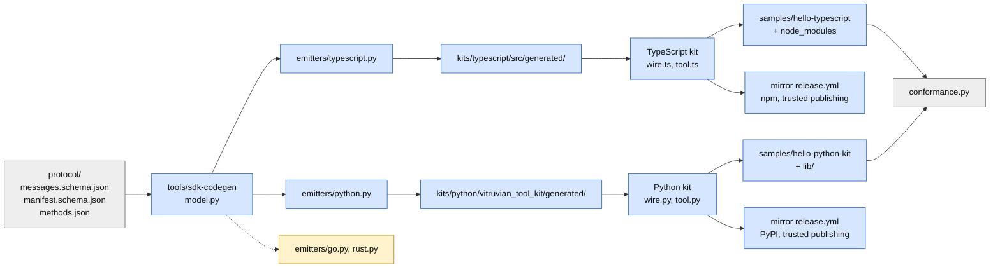

# Vitruvian tools for everyone (stage B1: the generator, TypeScript and Python) Implementation Plan

> **For agentic workers:** REQUIRED SUB-SKILL: Use superpowers:subagent-driven-development (recommended) or superpowers:executing-plans to implement this plan task-by-task. Steps use checkbox (`- [ ]`) syntax for tracking.

**Goal:** Let someone write a Vitruvian tool in TypeScript or Python with a kit, the way the Swift kit lets them in Swift, and keep every kit honest to the protocol by making its types from the schemas. After this stage the monorepo holds a generator, two kits, a sample for each that passes the conformance script on macOS and Linux, `vitruvian-tool init` templates for both, and the mirror's publishing jobs for npm and PyPI. Nothing is published by this stage; the first publish happens at the SDK's next release.

**Architecture:** One program, `tools/sdk-codegen`, reads the protocol's three files into one small model and hands it to one module per language in `emitters/`. Each module writes plain data types into a folder named `generated` inside its kit, and a test regenerates them and compares, so a schema change that is not regenerated fails. Each kit's hand-written part is the Swift kit's shape: a loop on one thread that reads the app's messages synchronously, answers them, and lets a handler call the app and read the answer inline. Each sample is assembled by Bazel the way an author ships it (the kit inside the tool's folder) and judged by the same `conformance.py` that judges the Swift and plain Python samples.



Grey exists today, blue is what this stage builds, amber is stage B2's.

**What a person sees:** nothing in the app. The app, its pin on the protocol and every file under `apps/` are untouched. A tool's author sees two new `init` templates, two kits in the repository, and two sections in the guide.

**Tech Stack:** Python 3 (standard library and `jsonschema`) for the generator; TypeScript 6 compiled by `tsc` for the TypeScript kit, Node 20 or later at run time, jest 30 for its tests; Python 3.9 or later, standard library only, for the Python kit, `unittest` for its tests; Swift 6 for `vitruvian-tool`; Bazel with rules_js, rules_ts, rules_jest, aspect_rules_py and bazel_lib, all already in `MODULE.bazel`.

**Spec:** `docs/superpowers/specs/2026-10-12-vitruvian-tools-for-everyone-design.md`, section 11, row B, first half: sections 3 (decisions 2, 5, 6, 7), 5.3, 5.4, 10, 12 and 13. Stage A (the mirror, release-please, `--version`, the website's `/tools/` section) and stage B2 (Go and Rust) are planned beside this one; this plan works whether or not Stage A has merged, and says below what it needs from Stage A and what B2 must match.

Every path that starts with `kits/`, `samples/`, `Sources/`, `Tests/`, `docs/`, `protocol/` or `conformance/`, and `BUILD`, `README.md` or `.github/` alone, is relative to `packages/vitruvian-sdk/`. Every other path is from the repository root.

## Decisions this plan makes

The spec's decisions stand. These are the ones it leaves open, or that the code forced. Each says whether it follows the spec, adds to it, or differs from it, and where the spec, the brief for this plan and the code disagree, the row says so in those words.

| # | Decision | Why |
|---|---|---|
| 1 | **The generator is one model and one module per language.** `model.py` turns the three files into plain values: the objects the messages carry, the parts of the manifest, the closed lists of names, and the table of messages. Every module in `emitters/` that has an `emit(model)` is found by looking and run; each returns its files by path, and each path must be inside a folder named `generated`. **Follows the spec** (decision 6) and adds the shape. | Stage B2 then adds `emitters/go.py` and `emitters/rust.py` and changes neither emitter here nor the model's code. No emitter reads a schema itself, so a new one sees exactly what the others see. |
| 2 | **Anything in a schema the model cannot turn into a type stops it, with the place named.** A closed list of names (an `enum`) needs a name of its own in `model.ENUMS`, and an object nested inside a field must be a definition of its own. Three schema names are too common to stand alone and take the Swift names: `empty` is `EmptyObject`, `error` is `RPCErrorObject`, the manifest's top is `ToolManifest`. **Adds to the spec.** | A new construct is a decision for every language, not something one emitter should guess at. |
| 3 | **The generator checks the schemas with `jsonschema` before it reads them** (`Draft202012Validator.check_schema`), and is otherwise the standard library. **Follows the spec.** | A schema that is not JSON Schema is stopped with the validator's own words, before anything is written from it. |
| 4 | **The drift test compares every file under every `generated` folder in `kits/` with what the generator writes now.** A file that changed, one that is missing, and one no emitter writes any more each fail it. **Follows the spec** (`//tools/sdk-codegen:in_sync_test`). | A renamed output would otherwise leave its old file behind, still compiled. |
| 5 | **The calls on `app` are generated from `methods.json`, one per message a tool may send, named after the message:** `notify/hud` is `app.notify.hud`, `log` is `app.log`; Python writes a name in two words with an underscore (`app.clipboard.read_text`). Each takes the message's params by name and returns what the answer carries, read and checked. **Follows the spec's decision 5 and section 5.3, with exact names**: the spec's `app.clipboard.write(...)` is `app.clipboard.writeText(...)` here. **Differs from the Swift kit**, whose calls have names of their own (`showMessage`). | A message added to the protocol is then a call in every kit with no hand-written line, and the guide needs no table per kit. Stage D's `ui/render` and `ui/badge` arrive as `app.ui.render` and `app.ui.badge`. |
| 6 | **TypeScript types are interfaces, string-literal unions and a `read<Type>` function each**; there is no writer. `read<Type>` checks a value parsed from JSON has the fields its type says and returns a new object with only those fields, and throws `ShapeError` naming the field. **Adds to the spec.** | An object of one of these interfaces is already its own JSON, names and all, and `JSON.stringify` leaves out an undefined field. |
| 7 | **Python types are frozen dataclasses with `from_json` and `to_json`**, fields named the Python way (`data_folder`) with the JSON name only inside those two. Not `TypedDict`. **Adds to the spec.** | A dataclass can check what it is given and say which field is wrong, as the Swift types' `Decodable` does; and an optional field needs no `NotRequired`, which Python 3.9 does not have. |
| 8 | **The Python kit needs Python 3.9, not 3.11.** **Differs from the brief for this plan**, which said 3.11. | The app starts a tool with the short `PATH` macOS gives an app, where `python3` is Apple's `/usr/bin/python3`: 3.9.6 on this Mac with Xcode 27. A kit that needs 3.11 could not run in a tool the app starts unless its author ships a Python. A test runs the kit's tests with that Python on the macOS runner, and the generator's test parses its Python output as 3.9. |
| 9 | **The TypeScript kit reads standard input with `fs.readSync` on one thread, never with `await`.** A call made inside a handler reads the link right there until its answer comes, and returns it as a value. **Follows the spec** ("one thread, synchronous"). | With `await` between the call and the answer, the handler would return before the answer and the command would be answered first; a tool written as plain statements would not be one. |
| 10 | **A wait with a time limit in Node is a non-blocking pipe and short pauses.** Node has no `poll`. When standard input is a pipe, the kit asks Node for `process.stdin` once, which puts the pipe in non-blocking mode (libuv does so for any pipe it opens) and is never read from; a read with nothing to read then fails with `EAGAIN` at once, and the kit pauses with `Atomics.wait` for 1 ms, doubling to 20 ms, before it looks again. A file never blocks and is read as it is. **Adds to the spec.** | Measured on this Mac: reopening `/dev/stdin` with `O_NONBLOCK` blocks anyway on macOS, and a worker thread blocked in `readSync` keeps Node from exiting while the pipe is open. The cost is at most 20 ms before a message that arrives after a quiet spell is read, and about fifty wake-ups a second while idle, for as long as the tool runs: an `onCommand` tool is stopped after two idle minutes. A test starts a real Node process with a pipe on its standard input and holds the time limit. |
| 11 | **The Python kit waits with `select` and reads with `os.read`**, as the Swift kit does with `poll` and `read`. **Follows the spec.** | It is the same call on every Unix, with a time limit and no thread. |
| 12 | **A handler that is `async` is refused with -32010 and a plain reason**, in both kits. **Adds to the spec.** | TypeScript lets an `async` function stand where a `void` one is asked for, so the type cannot stop it; and the command would be answered before its work was done. |
| 13 | **A message that carries nothing is written without `params`**, as `protocol/README.md` says. **Differs from the Swift kit**, which sends `"params":{}` for `notify/beep` and `clipboard/readText`. | Both are valid; the README's rule is the protocol's. The ported tests hold each kit to the README. |
| 14 | **The tests are the Swift kit's `ToolTests`, ported one for one, and three more.** **Differs from the spec and the brief**, which say twelve: `ToolTests.swift` has thirteen. The three more: an `async` handler is refused; the tool's own standard input, a real pipe, is read with a time limit, in a child process; and the generated types read every valid example in `protocol/examples/`. | The thirteenth (`testNoticesReachTheirHandlersAndTheToolsOwnAreWritten`) is the only test of `onStart`, `log` and `commands/state`. |
| 15 | **The TypeScript kit's tests run with jest 30 under Bazel, as `mcp-slack`'s do; the Python kit's are `unittest` files that Bazel runs with pytest.** | The repository's own conventions. `unittest` lets an author, the mirror and Apple's Python run them with nothing installed. |
| 16 | **The TypeScript kit is TypeScript compiled by `tsc` to `dist/`, ES modules with declarations, Node 20 or later, no dependencies.** `tsconfig.json` says `"module": "ES2022"` and `"moduleResolution": "Bundler"`. **Adds to the spec.** | Under Bazel, `ts_project` does not see `package.json`, so with `NodeNext` it reads the sources as CommonJS and refuses them. The output is the same ES modules either way, and the sample and a child-process test run it in Node, which is the check that matters. Packed: 15 files, 17.7 kB. |
| 17 | **A TypeScript tool is a `.mjs` file Node runs as it is, with `// @ts-check` for the editor, the kit in `node_modules/` inside the tool's folder, and a two-line `bin/tool` that starts Node.** No bundler, no build step. **Adds to the spec.** | It is the simplest thing that passes the conformance script. `bin/tool` exists because the app's short `PATH` has no `node`: it adds Homebrew's two places and `/usr/local/bin`, and was run with exactly the app's `PATH`. |
| 18 | **A Python kit tool keeps the kit in `lib/` inside its folder**, put there with `pip install --target lib` by Apple's `python3`, and puts `lib/` on its path first. | The app starts it with Apple's Python, which has none of the author's packages. |
| 19 | **`init` gains `--template typescript` and `--template python-kit`. `--template python` stays the plain Python sample**, the default. **Differs from the spec**, which lists `python` among the kit templates. | Backward compatible: today's `python` template needs no install at all, which is still the quickest start, and the plain sample stays the proof that no kit is needed. |
| 20 | **`--sdk` works for both kit templates.** For TypeScript the new `package.json` depends on `file:<sdk>/kits/typescript`, and the author builds the kit once (`npm run build` there) and installs with `npm install --install-links`, so a copy of the kit, not a link out of the folder, goes in it. For the Python kit, `init` copies the kit's `.py` files from the checkout into `lib/` itself. **Adds to the spec.** | Both were run: the TypeScript one offline with npm 11.20 and the app's short `PATH`, the Python one in `init_test`. A link out of the tool's folder would break when the app copies the folder. |
| 21 | **One SDK version, in five places that a test holds equal**: `kits/typescript/package.json`, `kits/python/pyproject.toml`, the two kit samples' pins, and `SDKVersion.current` in `Sources/VitruvianToolCLI/SDKVersion.swift` (marked `x-release-please-version`). The kits start at `0.9.0`. The templates compiled into `vitruvian-tool` hold `{{sdk-version}}` where a sample pins the kit, and `init` writes `SDKVersion.current` there. **Follows the spec's decision 2** and adds the mechanism. | A release then bumps all five in one change, and `Templates.swift` does not go stale at a release, which `templates_in_sync_test` would otherwise fail. If Stage A has merged with a version constant of its own, that one is used instead of `SDKVersion.swift` (Task 5 says how). |
| 22 | **A kit is published only by a push to the mirror that changed `.release-please-manifest.json`, or by running the workflow by hand, and only when the kit's version is the SDK's and the registry does not have it yet.** Each registry's jobs read the version themselves and need no other job. **Adds to the spec.** | So the jobs can sit in Stage A's `release.yml` or alone, and a push that is not a release publishes nothing even when the kit's version is new to the registry. |
| 23 | **npm's first publish of `@vitruviansoftware/tool-kit` is by hand.** **Differs from the spec**, which says `npm trust` is the only thing James does. | npm attaches a trusted publisher only to a package that exists, as `tools/npm-trusted-publisher/bootstrap.sh` already explains. PyPI's pending publisher has no such need. |
| 24 | **Generated files are marked `rules-lint-ignored` in `.gitattributes`**, so `//:tidy` leaves them as the generator wrote them. Not `linguist-generated`. **Adds to the spec.** | Measured: without it, prettier rewrites the generated TypeScript and the drift test then fails. A protocol change should be read in the pull request, generated code and all. |
| 25 | **The two examples pages are `samples/hello-typescript/README.md` and `samples/hello-python-kit/README.md`**, held by `guide_test` to the guide's rules. **Adds to the spec**, section 6. | Stage A's `tools/sync-site-tools/sync.py` copies them to `tools/examples/`; nothing here depends on it existing. |
| 26 | **The TypeScript kit is a Bazel package of its own; the Python kit is in the package's `BUILD`.** | rules_js links a package's `node_modules` in that package's folder. The Python kit needs nothing of the kind. |
| 27 | **Not in this stage:** Go and Rust (B2); the `panels` API (stage D); the mirror's `ci.yml` (Stage A, which should run the kits' tests there too); publishing anything. | The design's split. |

## Global Constraints

- **Everything in this plan was built and run before it was written down.** The tree at `858211bb2` was exported to a scratch folder outside the repository and built there, on macOS 27.0 with Xcode 27, Swift 6.4, the repository's Node 22.21.1 and Python 3.12, and Apple's Python 3.9.6. Then each task was replayed in order from that base, committed, and its own tests run at that commit with results not cached; the replay ended byte for byte at the tree the full run passed on. Every listing below was taken from those commits by a script, not typed. Every planted regression listed was applied and seen to fail its test. What was not run: nothing ran on a CI runner, so the Linux lane is reasoned, not seen (Task 7 says which tests it takes); no registry was touched, so the publishing jobs ran only under `actionlint` and as a dry run of their detect steps; and the checks under "By hand" were not done. If `main` has moved and a listing no longer fits, make the smallest change that keeps its meaning and record it as a deviation.
- **How to read a listing.** "Create `path`:" and a block is a whole file. A block that starts with `--- a/` is a change to a file that exists, as `git diff` prints it: save it and `git apply` it from the repository's root, or make it by hand. Each change is from the state the task before left. Files that a command writes (the generated types, `Templates.swift`, `presubmit.yaml`) are written by that command, not copied, and the step says which.
- **Licences.** Everything this stage adds is MIT, VitruvianSoftware. A new file in the package starts with the header `Sources/VitruvianToolProtocol/LineFraming.swift` has, in its language's comments (`//` for TypeScript and Swift, `#` for Python, Starlark and shell, after a `#!` line where there is one). A file under `tools/sdk-codegen` starts with the header `tools/sync-downloads/sync_downloads.py` has; the entry point keeps its `#!/usr/bin/env python3` line, the modules start at `# Copyright`. `kits/typescript/LICENSE` and `kits/python/LICENSE` are copies of the package's `LICENSE`, because npm and PyPI each ship the licence beside the code. JSON, Markdown and `requirements.txt` carry none, as in the samples today.
- **The app is not touched.** Nothing under `apps/` changes, and `Sources/VitruvianToolProtocol` is not edited, so the app's pin does not move: `git diff --stat main -- apps/` prints nothing and `//apps/desktop/vitruvian:tool_protocol_pin_test` passes.
- **Generated files are never edited by hand.** Change the schema or the emitter, then `bazel run //tools/sdk-codegen`. `Sources/VitruvianToolCLI/Templates.swift` is the same: change the sample, then `bazel run //packages/vitruvian-sdk:sync-templates`.
- **Bazel only, one command at a time, from the repository's root.** Swift targets need `--config=macos-app`. Commands are given per step; a passing `bazel test` prints `PASSED`. Use `--nocache_test_results` when a step says it records a failure.
- **No network in a test.** The kits have no dependencies; the samples are assembled from what Bazel builds; `conformance.py` is local. The lockfile change in Task 2 is a listing to apply, checked with `pnpm install --frozen-lockfile --lockfile-only --offline`.
- **Formatting and gates.** After editing a `.py`, `.ts`, `.mjs`, `.cjs`, `BUILD` or `.sh` file, `bazel run //tools/format -- <path>`. The listings are already formatted: the format leaves them as they are. On this base `//:tidy` adds one unrelated line, `Cryptodome: pycryptodomex`, to `gazelle_python.yaml`: undo it by hand and do not commit it.
- **Naming.** Folders are kebab-case (`tools/sdk-codegen`, `kits/typescript`, `samples/hello-python-kit`), Python files snake_case. `kits/python/vitruvian_tool_kit` is the Python package's import name and must stay snake_case: `tools/lint-naming` reports it as one new `DIR003` finding, beside 398 that exist on this base. CI runs only that linter's own tests.
- **Git.** Never `git stash`, `git reset` or `git restore`; undo an edit by hand. One commit per task (Task 8 makes two), with identity and commit in one command. `wren` commits code and tests; `forge` commits Bazel, toolchain and CI. In a worktree the keys are in the main checkout:
  ```sh
  export AGENT_KEY_DIR=/Users/james/Workspace/gh/application/vitruvian/vitruvian-core/tools/sync-env-secrets/agent-keys; eval "$(bazel run //tools/agent-app -- env wren 2>/dev/null)"; git add <files> && git commit -m "<title>"
  ```
- **Commit titles.** `chore(ci): ...` for a commit under `tools/`; `chore(vitruvian-sdk): ...` for the package, which cuts no release; and once, at Task 9, when the kits are complete, `feat(vitruvian-sdk): ...`, which cuts the SDK's next minor release (0.10.0) once Stage A's release-please exists, and nothing before. `main` takes squash merges, so the pull request's title is the one that counts: it is the `feat`.
- **Quoting.** Every heredoc in a step is quoted (`<<'EOF'`). An unquoted one runs anything between backticks, and these files are full of them.

## Review Focus

Where a mistake costs most. Each has a test, named in its task.

1. **A kit that answers before its handler is done, or waits for ever.** The nested read is the heart of both kits: an answer is matched by its id, everything else is kept in order and handled after the handler returns, goodbye and the end of the link end the wait, and a call gives up after its time. Each rule has a test, and the first two were seen to fail when the line that does them was removed (Tasks 3 and 4). Node's wait with a time limit rests on `process.stdin` putting the pipe in non-blocking mode; a child-process test over a real pipe holds that on the Node CI uses (Task 3).
2. **Types that drift from the schemas.** The drift test fails on a schema change not regenerated, a missing file and a stale one; the generated types read every valid example the protocol ships; and a model test fails if a method of `methods.json` or a field of either schema is not in the model (Tasks 1, 3 and 4).
3. **A kit that works in a test and not in the app.** The samples are assembled as an author ships them and run through their own launchers: Node found by `bin/tool`, the kit found in `node_modules/` and `lib/`. The Python kit's tests run on Apple's Python 3.9 on the macOS runner (Tasks 4 and 5).
4. **A publish of the wrong thing, or none.** A kit publishes only on a release push, only at the SDK's version, only when the registry lacks it, and fails loudly on any other registry answer (Task 8). The audit and the trusted-publisher setup know the kit's folder and its mirror (Task 8).
5. **Two versions of the SDK.** Five places, one test (Task 5); a template that writes the version `init` was built with (Task 6).
6. **The licence boundary.** No file under `apps/` changes; the protocol's Swift sources do not change; every new file is MIT, VitruvianSoftware (Task 9 runs both licence gates).

---

### Task 1: The generator, and the kits' generated types

**Agent:** wren. **Commit:** `chore(ci): sdk-codegen writes the kits' types from the protocol's schemas`

**Files:**
- Create: `tools/sdk-codegen/sdk_codegen_test.py`, `model.py`, `sdk_codegen.py`, `emitters/typescript.py`, `emitters/python.py`, `BUILD` (same folder)
- Written by the generator: `packages/vitruvian-sdk/kits/typescript/src/generated/{messages,manifest,methods}.ts`, `packages/vitruvian-sdk/kits/python/vitruvian_tool_kit/generated/{__init__,messages,manifest,methods}.py`
- Modify: `packages/vitruvian-sdk/BUILD` (two targets the drift test reads), `.gitattributes`

**Interfaces:**
- Consumes: `protocol/messages.schema.json`, `protocol/manifest.schema.json`, `protocol/methods.json`; `@pip//jsonschema`.
- Produces:
  - `model.load(protocol_folder) -> Model`; `Model` (`protocol`, `messages`, `manifest`, `enums`, `methods`; `definition(name)`, `title(name)`); `Definition` (`name`, `title`, `description`, `fields`, `alias`); `Field` (`name`, `type`, `required`, `description`); `Type` (`kind`, `item`, `ref`, `name`, `values`); `Enum`; `Method` (`method`, `sender`, `kind`, `uses`, `params`, `result`, `path`); `SchemaProblem`; `ENVELOPE`, `TITLES`, `ENUMS`; `licence()`; `camel_to_snake(name)`.
  - The emitter contract: a module in `emitters/` with `NAME` and `emit(model) -> {path in the package: text}`, every path inside a folder named `generated`.
  - `sdk_codegen.emitters()`, `generate(package)`, `check(package)`, `write(package, out)`; `bazel run //tools/sdk-codegen`; `//tools/sdk-codegen:in_sync_test`, `:sdk_codegen_test`.
  - `//packages/vitruvian-sdk:protocol_files` (a `js_library`), `:generated_kit_files`.
  - In TypeScript: an interface and a `read<Type>(value, where?)` per definition; `JSONValue`, `ShapeError`, the `expect*` readers; `SERVICES`/`Service`, `SURFACES`/`Surface`, `ACTIVATIONS`/`Activation`, `PREFERENCE_TYPES`/`PreferenceType`, `MODIFIERS`/`Modifier`; `PROTOCOL_VERSION`, `MethodInfo`, `METHODS`, `Requester`, `Noticer`, `AppCalls`, `appCalls(request, notice)`.
  - In Python: a frozen dataclass per definition with `from_json(value, where=...)` and `to_json()`; `ShapeError`, `Scalar`, the `Literal` aliases and their tuples (`SERVICES`, ...); `PROTOCOL_VERSION`, `MethodInfo`, `METHODS`, `Requester`, `Noticer`, `AppCalls(request, notice)`.

The generator reads the protocol and writes types; it never writes a kit's loop. Its output is committed and its drift test regenerates it in memory and compares.

- [ ] **Step 1: Write the failing test**

Create `tools/sdk-codegen/sdk_codegen_test.py`:

```python
# Copyright (c) 2026 VitruvianSoftware
#
# Permission is hereby granted, free of charge, to any person obtaining a copy
# of this software and associated documentation files (the "Software"), to deal
# in the Software without restriction, including without limitation the rights
# to use, copy, modify, merge, publish, distribute, sublicense, and/or sell
# copies of the Software, and to permit persons to whom the Software is
# furnished to do so, subject to the following conditions:
#
# The above copyright notice and this permission notice shall be included in
# all copies or substantial portions of the Software.
#
# THE SOFTWARE IS PROVIDED "AS IS", WITHOUT WARRANTY OF ANY KIND, EXPRESS OR
# IMPLIED, INCLUDING BUT NOT LIMITED TO THE WARRANTIES OF MERCHANTABILITY,
# FITNESS FOR A PARTICULAR PURPOSE AND NONINFRINGEMENT. IN NO EVENT SHALL THE
# AUTHORS OR COPYRIGHT HOLDERS BE LIABLE FOR ANY CLAIM, DAMAGES OR OTHER
# LIABILITY, WHETHER IN AN ACTION OF CONTRACT, TORT OR OTHERWISE, ARISING FROM,
# OUT OF OR IN CONNECTION WITH THE SOFTWARE OR THE USE OR OTHER DEALINGS IN THE
# SOFTWARE.
"""The generator reads all of the protocol, and a change to it changes what it writes.

    sdk_codegen_test.py

Run from the repository's root, or by Bazel, which gives it the protocol's
files and the kits' generated files. It writes only in a temporary folder.
"""

import ast
import json
import os
import shutil
import sys
import tempfile
import unittest

HERE = os.path.dirname(os.path.abspath(__file__))
sys.path.insert(0, HERE)

import model  # noqa: E402
import sdk_codegen  # noqa: E402

PACKAGE = os.path.join("packages", "vitruvian-sdk")


def read(name):
    with open(os.path.join(PACKAGE, "protocol", name), encoding="utf-8") as handle:
        return json.load(handle)


class ModelTests(unittest.TestCase):
    def setUp(self):
        self.model = model.load(os.path.join(PACKAGE, "protocol"))

    def test_every_method_of_the_table_is_in_the_model(self):
        table = [row["method"] for row in read("methods.json")["methods"]]
        self.assertEqual([m.method for m in self.model.methods], table)
        for method in self.model.methods:
            for name in (method.params, method.result):
                if name is not None:
                    self.model.definition(name)

    def test_every_field_of_the_manifest_is_in_the_model(self):
        schema = read("manifest.schema.json")
        wanted = {("manifest", key) for key in schema["properties"]}
        for name, node in schema["$defs"].items():
            wanted |= {(name, key) for key in node.get("properties", {})}
        have = {(d.name, f.name) for d in self.model.manifest for f in d.fields}
        self.assertEqual(have, wanted)

    def test_every_payload_of_the_messages_is_in_the_model(self):
        schema = read("messages.schema.json")
        wanted = {
            (name, key)
            for name, node in schema["$defs"].items()
            if name not in model.ENVELOPE
            for key in node.get("properties", {})
        }
        have = {(d.name, f.name) for d in self.model.messages for f in d.fields}
        self.assertEqual(have, wanted)

    def test_a_list_of_names_with_no_name_stops_the_generator(self):
        node = {"type": "object", "properties": {"color": {"enum": ["red", "blue"]}}}
        with self.assertRaises(model.SchemaProblem) as raised:
            model.definition_of("paint", node, "here", {})
        self.assertIn("add ('paint', 'color') to ENUMS", str(raised.exception))


class OutputTests(unittest.TestCase):
    def setUp(self):
        self.folder = tempfile.mkdtemp(prefix="sdk-codegen-")
        self.package = os.path.join(self.folder, "vitruvian-sdk")
        # Copied without their modes: Bazel hands them over read-only.
        shutil.copytree(
            os.path.join(PACKAGE, "protocol"),
            os.path.join(self.package, "protocol"),
            copy_function=shutil.copyfile,
        )
        shutil.copytree(
            os.path.join(PACKAGE, "kits"),
            os.path.join(self.package, "kits"),
            copy_function=shutil.copyfile,
        )

    def tearDown(self):
        shutil.rmtree(self.folder, ignore_errors=True)

    def test_the_committed_files_are_what_it_writes(self):
        self.assertEqual(sdk_codegen.check(self.package), 0)

    def test_a_change_to_a_schema_changes_what_it_writes(self):
        before = sdk_codegen.generate(self.package)
        path = os.path.join(self.package, "protocol", "messages.schema.json")
        with open(path, encoding="utf-8") as handle:
            schema = json.load(handle)
        schema["$defs"]["notifyHUDParams"]["properties"]["seconds"] = {
            "description": "How long the message stays.",
            "type": "number",
        }
        with open(path, "w", encoding="utf-8") as handle:
            json.dump(schema, handle)
        after = sdk_codegen.generate(self.package)
        changed = sorted(p for p in after if after[p] != before[p])
        self.assertEqual(
            changed,
            [
                "kits/python/vitruvian_tool_kit/generated/messages.py",
                "kits/python/vitruvian_tool_kit/generated/methods.py",
                "kits/typescript/src/generated/messages.ts",
            ],
        )
        self.assertIn(
            "seconds?: number;", after["kits/typescript/src/generated/messages.ts"]
        )
        self.assertIn(
            "seconds: Optional[float] = None",
            after["kits/python/vitruvian_tool_kit/generated/messages.py"],
        )
        self.assertEqual(
            sdk_codegen.check(self.package),
            1,
            "the committed files are now out of date",
        )

    def test_a_file_no_emitter_writes_is_caught(self):
        stray = os.path.join(
            self.package, "kits", "python", "vitruvian_tool_kit", "generated", "old.py"
        )
        with open(stray, "w", encoding="utf-8") as handle:
            handle.write("# left behind\n")
        self.assertEqual(sdk_codegen.check(self.package), 1)

    def test_the_python_it_writes_is_python_3_9(self):
        for path, text in sdk_codegen.generate(self.package).items():
            if path.endswith(".py"):
                ast.parse(text, filename=path, feature_version=(3, 9))

    def test_every_emitter_is_found(self):
        self.assertEqual(
            [e.NAME for e in sdk_codegen.emitters()], ["python", "typescript"]
        )


if __name__ == "__main__":
    unittest.main()
```

- [ ] **Step 2: The model, the program that runs the emitters, and its build**

Create `tools/sdk-codegen/model.py`:

```python
# Copyright (c) 2026 VitruvianSoftware
#
# Permission is hereby granted, free of charge, to any person obtaining a copy
# of this software and associated documentation files (the "Software"), to deal
# in the Software without restriction, including without limitation the rights
# to use, copy, modify, merge, publish, distribute, sublicense, and/or sell
# copies of the Software, and to permit persons to whom the Software is
# furnished to do so, subject to the following conditions:
#
# The above copyright notice and this permission notice shall be included in
# all copies or substantial portions of the Software.
#
# THE SOFTWARE IS PROVIDED "AS IS", WITHOUT WARRANTY OF ANY KIND, EXPRESS OR
# IMPLIED, INCLUDING BUT NOT LIMITED TO THE WARRANTIES OF MERCHANTABILITY,
# FITNESS FOR A PARTICULAR PURPOSE AND NONINFRINGEMENT. IN NO EVENT SHALL THE
# AUTHORS OR COPYRIGHT HOLDERS BE LIABLE FOR ANY CLAIM, DAMAGES OR OTHER
# LIABILITY, WHETHER IN AN ACTION OF CONTRACT, TORT OR OTHERWISE, ARISING FROM,
# OUT OF OR IN CONNECTION WITH THE SOFTWARE OR THE USE OR OTHER DEALINGS IN THE
# SOFTWARE.
"""What the protocol's three files say, as plain values every emitter reads.

The schemas are written for people and for a validator. This turns them into
the few things a language needs: the objects the messages carry and the
manifest is made of, with their fields; the closed lists of names; and the
table of messages. An emitter never reads a schema itself, so a new emitter
sees exactly what the others see.

Anything in a schema this does not know how to turn into a type stops it,
with the place named: a new construct is a decision for every language, not
something one emitter should guess at.
"""

import json
import os
from dataclasses import dataclass
from typing import Dict, List, Optional, Tuple

# The objects in messages.schema.json that are the envelope, not a payload.
# Each kit writes the envelope by hand: it is the part every kit reads and
# writes before it knows which message it has.
ENVELOPE = ("id", "request", "notice", "result", "failure")

# A type's name in every language, where the schema's own name will not do:
# `error` and `empty` are words too common to stand alone, and the manifest's
# top level has no name of its own. These are the Swift names.
TITLES = {
    "empty": "EmptyObject",
    "error": "RPCErrorObject",
    "manifest": "ToolManifest",
}

# A closed list of names written inside a field. Each needs a name of its own
# in a language; a new one stops the generator until it is named here.
ENUMS = {
    ("manifest", "uses"): "Service",
    ("manifest", "activation"): "Activation",
    ("command", "surfaces"): "Surface",
    ("preference", "type"): "PreferenceType",
    ("keyEquivalent", "modifiers"): "Modifier",
}


@dataclass(frozen=True)
class Type:
    """A field's type.

    kind is one of: string, boolean, integer, number; scalar (text, yes or
    no, or a number: what a preference holds); any (any JSON value); object
    (a JSON object with any fields); array (of `item`); map (text keys, each
    value an `item`); ref (the definition named `ref`); enum (one of
    `values`, named `name`); const (exactly `values[0]`).
    """

    kind: str
    item: Optional["Type"] = None
    ref: Optional[str] = None
    name: Optional[str] = None
    values: Tuple[str, ...] = ()


@dataclass(frozen=True)
class Field:
    """One field of an object, by its name on the wire."""

    name: str
    type: Type
    required: bool
    description: str


@dataclass(frozen=True)
class Definition:
    """An object a message carries, or a part of the manifest.

    `alias` is set for a definition that is not an object with fields of its
    own, such as localized text, which is a map from a language to text.
    """

    name: str
    title: str
    description: str
    fields: Tuple[Field, ...]
    alias: Optional[Type] = None


@dataclass(frozen=True)
class Enum:
    name: str
    values: Tuple[str, ...]
    description: str


@dataclass(frozen=True)
class Method:
    """One row of methods.json."""

    method: str
    sender: str
    kind: str
    uses: Optional[str]
    params: Optional[str]
    result: Optional[str]

    @property
    def path(self) -> Tuple[str, ...]:
        """The method's name in parts: `notify/hud` is (notify, hud)."""
        return tuple(self.method.split("/"))


@dataclass(frozen=True)
class Model:
    protocol: str
    messages: Tuple[Definition, ...]
    manifest: Tuple[Definition, ...]
    enums: Tuple[Enum, ...]
    methods: Tuple[Method, ...]

    def definition(self, name: str) -> Definition:
        for definition in self.messages + self.manifest:
            if definition.name == name:
                return definition
        raise KeyError(name)

    def title(self, name: str) -> str:
        return self.definition(name).title


def licence() -> List[str]:
    """The MIT licence header this file starts with, without its comment marks.

    Every generated file carries it, in its own language's comments.
    """
    with open(__file__, encoding="utf-8") as handle:
        lines = handle.read().split("\n")
    out = []
    for line in lines:
        if line.startswith("#!"):
            continue
        if not line.startswith("#"):
            break
        out.append(line[2:] if line.startswith("# ") else line[1:])
    return out


def title_of(name: str) -> str:
    return TITLES.get(name, name[:1].upper() + name[1:])


class SchemaProblem(Exception):
    """Something in a schema the generator does not know how to turn into a type."""


def type_of(node: Dict, where: str, owner: str, field: str, enums: Dict) -> Type:
    if "$ref" in node:
        return Type("ref", ref=node["$ref"].rsplit("/", 1)[-1])
    if "const" in node:
        return Type("const", values=(str(node["const"]),))
    if "enum" in node:
        name = ENUMS.get((owner, field))
        if name is None:
            raise SchemaProblem(
                f"{where}: a list of names with no name of its own; add ({owner!r}, {field!r}) to ENUMS in model.py"
            )
        values = tuple(node["enum"])
        if name in enums and enums[name].values != values:
            raise SchemaProblem(
                f"{where}: {name} is named twice, with different names in it"
            )
        enums[name] = Enum(name, values, node.get("description", ""))
        return Type("enum", name=name, values=values)
    kind = node.get("type")
    if kind is None:
        return Type("any")
    if isinstance(kind, list):
        if sorted(kind) == ["boolean", "number", "string"]:
            return Type("scalar")
        raise SchemaProblem(f"{where}: the type {kind} is not one the generator knows")
    if kind in ("string", "boolean", "integer", "number"):
        return Type(kind)
    if kind == "array":
        items = node.get("items", {})
        return Type("array", item=type_of(items, where + "[]", owner, field, enums))
    if kind == "object":
        if node.get("properties"):
            raise SchemaProblem(
                f"{where}: an object with fields inside a field; make it a definition of its own"
            )
        extra = node.get("additionalProperties")
        if isinstance(extra, dict):
            return Type("map", item=type_of(extra, where + "{}", owner, field, enums))
        return Type("object")
    raise SchemaProblem(f"{where}: the type {kind!r} is not one the generator knows")


def definition_of(name: str, node: Dict, where: str, enums: Dict) -> Definition:
    description = node.get("description", "")
    if node.get("type") == "object" and "properties" not in node:
        extra = node.get("additionalProperties")
        if isinstance(extra, dict):
            alias = Type("map", item=type_of(extra, where, name, "*", enums))
            return Definition(name, title_of(name), description, (), alias)
        return Definition(name, title_of(name), description, ())
    if node.get("type") != "object":
        raise SchemaProblem(f"{where}: a definition that is not an object")
    required = set(node.get("required", []))
    fields = tuple(
        Field(
            key,
            type_of(child, f"{where}.{key}", name, key, enums),
            key in required,
            child.get("description", ""),
        )
        for key, child in node["properties"].items()
    )
    return Definition(name, title_of(name), description, fields)


def load(protocol_folder: str) -> Model:
    """Reads the three files in `protocol_folder` (packages/vitruvian-sdk/protocol)."""

    def read(name):
        with open(os.path.join(protocol_folder, name), encoding="utf-8") as handle:
            return json.load(handle)

    messages_schema = read("messages.schema.json")
    manifest_schema = read("manifest.schema.json")
    # A schema that is not JSON Schema is stopped here, before anything is read from it.
    from jsonschema import Draft202012Validator

    for schema in (messages_schema, manifest_schema):
        Draft202012Validator.check_schema(schema)
    table = read("methods.json")
    enums: Dict[str, Enum] = {}

    messages = tuple(
        definition_of(name, node, f"messages.schema.json#/$defs/{name}", enums)
        for name, node in messages_schema["$defs"].items()
        if name not in ENVELOPE
    )
    top = {key: value for key, value in manifest_schema.items() if key != "$defs"}
    manifest = (definition_of("manifest", top, "manifest.schema.json", enums),) + tuple(
        definition_of(name, node, f"manifest.schema.json#/$defs/{name}", enums)
        for name, node in manifest_schema["$defs"].items()
    )
    methods = tuple(
        Method(
            row["method"],
            row["sender"],
            row["kind"],
            row["uses"],
            row["params"],
            row["result"],
        )
        for row in table["methods"]
    )
    model = Model(
        table["protocol"],
        messages,
        manifest,
        tuple(enums[name] for name in sorted(enums)),
        methods,
    )
    known = {definition.name for definition in messages + manifest}
    for definition in messages + manifest:
        for field in definition.fields:
            for part in (field.type, field.type.item):
                if part is not None and part.kind == "ref" and part.ref not in known:
                    raise SchemaProblem(
                        f"{definition.name}.{field.name}: no definition {part.ref}"
                    )
    for method in methods:
        for name in (method.params, method.result):
            if name is not None and name not in known:
                raise SchemaProblem(
                    f"methods.json: {method.method} names {name}, which no schema defines"
                )
    return model


def camel_to_snake(name: str) -> str:
    """protocolVersions -> protocol_versions; notifyHUD -> notify_hud."""
    out: List[str] = []
    for index, char in enumerate(name):
        if char.isupper() and index > 0:
            before = name[index - 1]
            after = name[index + 1] if index + 1 < len(name) else ""
            if (
                before.islower()
                or before.isdigit()
                or (after.islower() and before.isupper())
            ):
                out.append("_")
        out.append(char.lower())
    return "".join(out)
```

Create `tools/sdk-codegen/sdk_codegen.py`:

```python
#!/usr/bin/env python3
# Copyright (c) 2026 VitruvianSoftware
#
# Permission is hereby granted, free of charge, to any person obtaining a copy
# of this software and associated documentation files (the "Software"), to deal
# in the Software without restriction, including without limitation the rights
# to use, copy, modify, merge, publish, distribute, sublicense, and/or sell
# copies of the Software, and to permit persons to whom the Software is
# furnished to do so, subject to the following conditions:
#
# The above copyright notice and this permission notice shall be included in
# all copies or substantial portions of the Software.
#
# THE SOFTWARE IS PROVIDED "AS IS", WITHOUT WARRANTY OF ANY KIND, EXPRESS OR
# IMPLIED, INCLUDING BUT NOT LIMITED TO THE WARRANTIES OF MERCHANTABILITY,
# FITNESS FOR A PARTICULAR PURPOSE AND NONINFRINGEMENT. IN NO EVENT SHALL THE
# AUTHORS OR COPYRIGHT HOLDERS BE LIABLE FOR ANY CLAIM, DAMAGES OR OTHER
# LIABILITY, WHETHER IN AN ACTION OF CONTRACT, TORT OR OTHERWISE, ARISING FROM,
# OUT OF OR IN CONNECTION WITH THE SOFTWARE OR THE USE OR OTHER DEALINGS IN THE
# SOFTWARE.
"""Writes each kit's generated types from the protocol's schemas.

    sdk_codegen.py                 writes the files into packages/vitruvian-sdk
    sdk_codegen.py --check         fails when a committed file is not what
                                   would be written, or is one no emitter writes
    sdk_codegen.py --out FOLDER    writes them under FOLDER instead

It reads protocol/messages.schema.json, protocol/manifest.schema.json and
protocol/methods.json, builds one model of them (model.py), and hands that to
every module in emitters/. Each emitter returns its files, by their path in
the package. A language is added by adding its emitter, and nothing else here
changes: this finds the emitters by looking.

Each emitter writes only inside folders named `generated`, and --check reads
every file under every such folder in kits/, so a file an emitter stopped
writing is caught as well as one that changed.
"""

import argparse
import difflib
import importlib
import os
import pkgutil
import sys

HERE = os.path.dirname(os.path.abspath(__file__))
sys.path.insert(0, HERE)

import model  # noqa: E402

PACKAGE = os.path.join("packages", "vitruvian-sdk")


def emitters():
    """Every emitter module, by name, in a fixed order."""
    found = []
    for info in sorted(
        pkgutil.iter_modules([os.path.join(HERE, "emitters")]), key=lambda i: i.name
    ):
        module = importlib.import_module(f"emitters.{info.name}")
        if hasattr(module, "emit"):
            found.append(module)
    return found


def generate(package):
    """Every generated file, by its path under `package`, and its text."""
    built = model.load(os.path.join(package, "protocol"))
    files = {}
    for emitter in emitters():
        for path, text in emitter.emit(built).items():
            if "/generated/" not in "/" + path:
                raise SystemExit(
                    f"{emitter.NAME} writes {path}, which is not inside a folder named generated"
                )
            if path in files:
                raise SystemExit(f"{path} is written by two emitters")
            files[path] = text
    return files


def committed(package):
    """Every file under a folder named `generated` in the package's kits."""
    found = {}
    kits = os.path.join(package, "kits")
    for root, folders, names in os.walk(kits):
        folders[:] = [
            f for f in folders if f not in ("node_modules", "__pycache__", "dist")
        ]
        if "generated" not in os.path.relpath(root, package).split(os.sep):
            continue
        for name in names:
            path = os.path.join(root, name)
            with open(path, encoding="utf-8") as handle:
                found[os.path.relpath(path, package).replace(os.sep, "/")] = (
                    handle.read()
                )
    return found


def check(package):
    wanted = generate(package)
    have = committed(package)
    problems = []
    for path in sorted(set(wanted) | set(have)):
        if path not in have:
            problems.append(f"{path}: missing")
        elif path not in wanted:
            problems.append(f"{path}: no emitter writes it")
        elif have[path] != wanted[path]:
            diff = difflib.unified_diff(
                have[path].splitlines(),
                wanted[path].splitlines(),
                "committed/" + path,
                "generated/" + path,
                lineterm="",
                n=1,
            )
            problems.append(f"{path}: out of date\n" + "\n".join(list(diff)[:40]))
    for problem in problems:
        print(problem, file=sys.stderr)
    print(
        f"sdk-codegen: {len(wanted)} files, "
        + (
            "in sync"
            if not problems
            else "OUT OF SYNC, run: bazel run //tools/sdk-codegen"
        )
    )
    return 1 if problems else 0


def write(package, out):
    files = generate(package)
    for path, text in sorted(files.items()):
        target = os.path.join(out, path)
        os.makedirs(os.path.dirname(target), exist_ok=True)
        with open(target, "w", encoding="utf-8") as handle:
            handle.write(text)
        print(f"wrote {target}")
    return 0


def main(arguments):
    parser = argparse.ArgumentParser(description=__doc__.split("\n")[0])
    parser.add_argument("--check", action="store_true")
    parser.add_argument("--out")
    parser.add_argument(
        "--package", help="the SDK's folder; found from the repository when left out"
    )
    options = parser.parse_args(arguments)
    # `bazel run` starts a program in its own folder; this is the repository.
    root = os.environ.get("BUILD_WORKSPACE_DIRECTORY")
    package = options.package or os.path.join(
        root or os.path.dirname(os.path.dirname(HERE)), PACKAGE
    )
    if options.check:
        return check(package)
    return write(package, options.out or package)


if __name__ == "__main__":
    sys.exit(main(sys.argv[1:]))
```

It can be run as it is, from a checkout, with a Python that has `jsonschema`:

```sh
chmod +x tools/sdk-codegen/sdk_codegen.py
```

Create `tools/sdk-codegen/BUILD`:

```starlark
# Copyright (c) 2026 VitruvianSoftware
#
# Permission is hereby granted, free of charge, to any person obtaining a copy
# of this software and associated documentation files (the "Software"), to deal
# in the Software without restriction, including without limitation the rights
# to use, copy, modify, merge, publish, distribute, sublicense, and/or sell
# copies of the Software, and to permit persons to whom the Software is
# furnished to do so, subject to the following conditions:
#
# The above copyright notice and this permission notice shall be included in
# all copies or substantial portions of the Software.
#
# THE SOFTWARE IS PROVIDED "AS IS", WITHOUT WARRANTY OF ANY KIND, EXPRESS OR
# IMPLIED, INCLUDING BUT NOT LIMITED TO THE WARRANTIES OF MERCHANTABILITY,
# FITNESS FOR A PARTICULAR PURPOSE AND NONINFRINGEMENT. IN NO EVENT SHALL THE
# AUTHORS OR COPYRIGHT HOLDERS BE LIABLE FOR ANY CLAIM, DAMAGES OR OTHER
# LIABILITY, WHETHER IN AN ACTION OF CONTRACT, TORT OR OTHERWISE, ARISING FROM,
# OUT OF OR IN CONNECTION WITH THE SOFTWARE OR THE USE OR OTHER DEALINGS IN THE
# SOFTWARE.

# //tools/sdk-codegen: writes each kit's types from the tool protocol's
# schemas (packages/vitruvian-sdk/protocol). See sdk_codegen.py.
#
#   bazel run //tools/sdk-codegen
#
# Hand-written: Gazelle is kept out of emitters/, which holds one module per
# language and is found by looking, not by a list.
# gazelle:ignore
# gazelle:exclude emitters

load("@aspect_rules_py//py:defs.bzl", "py_binary", "py_test")

# The emitters are found by looking, so a folder with none is allowed here;
# sdk_codegen_test fails when an emitter it expects is missing.
GENERATOR = [
    "model.py",
    "sdk_codegen.py",
] + glob(
    ["emitters/*.py"],
    allow_empty = True,
)

# What the generator reads, and what it wrote that is committed.
INPUTS = [
    "//packages/vitruvian-sdk:generated_kit_files",
    "//packages/vitruvian-sdk:protocol_files",
]

py_binary(
    name = "sdk-codegen",
    srcs = GENERATOR,
    imports = ["."],
    main = "sdk_codegen.py",
    deps = ["@pip//jsonschema"],
)

# Regenerates in memory and compares with the committed files, every one under
# a folder named `generated` in the kits. Not `manual`, so the Linux lane runs it.
py_test(
    name = "in_sync_test",
    size = "small",
    srcs = GENERATOR,
    args = [
        "--check",
        "--package",
        "packages/vitruvian-sdk",
    ],
    data = INPUTS,
    imports = ["."],
    main = "sdk_codegen.py",
    deps = ["@pip//jsonschema"],
)

# The model reads all of the protocol, and a planted change to a schema
# changes what is written and fails the check.
py_test(
    name = "sdk_codegen_test",
    size = "small",
    srcs = GENERATOR + ["sdk_codegen_test.py"],
    data = INPUTS,
    imports = ["."],
    main = "sdk_codegen_test.py",
    deps = ["@pip//jsonschema"],
)
```

In `packages/vitruvian-sdk/BUILD`, keep Gazelle out of `kits/`, and add the two targets the generator's tests read. While `kits/typescript` has no `BUILD` of its own, one glob reaches both kits, and it may match nothing until the generator has run; Task 2 changes it:

```diff
--- a/packages/vitruvian-sdk/BUILD
+++ b/packages/vitruvian-sdk/BUILD
@@ -31,6 +31,7 @@
 # gazelle:exclude Tests
 # gazelle:exclude conformance
 # gazelle:exclude docs
+# gazelle:exclude kits
 # gazelle:exclude protocol
 # gazelle:exclude samples
 #
@@ -38,6 +39,7 @@
 # why). The Swift targets are constrained to macOS so a Linux
 # `bazel build //...` skips them.
 
+load("@aspect_rules_js//js:defs.bzl", "js_library")
 load("@aspect_rules_py//py:defs.bzl", "py_binary", "py_test")
 load("@build_bazel_rules_swift//swift:swift_binary.bzl", "swift_binary")
 load("@build_bazel_rules_swift//swift:swift_library.bzl", "swift_library")
@@ -48,6 +50,34 @@ load("//tools/pipeline:defs.bzl", "pipeline_unit")
 # the examples both halves of the drift test read.
 PROTOCOL_FILES = glob(["protocol/**/*.json"])
 
+# The protocol's files, for the TypeScript kit's tests, which read the
+# examples as the Swift tests and protocol_examples_test do. A js_library,
+# because rules_js copies a test's data into the output tree and will take a
+# file from another package only that way.
+js_library(
+    name = "protocol_files",
+    srcs = PROTOCOL_FILES,
+    visibility = [
+        "//packages/vitruvian-sdk/kits/typescript:__pkg__",
+        "//tools/sdk-codegen:__pkg__",
+    ],
+)
+
+# Every file //tools/sdk-codegen wrote into the kits, for its drift test. A kit
+# in a Bazel package of its own lists its generated files there.
+filegroup(
+    name = "generated_kit_files",
+    srcs = glob(
+        [
+            "kits/python/vitruvian_tool_kit/generated/**",
+            "kits/typescript/src/generated/**",
+        ],
+        # Until the generator first runs, there is nothing to match.
+        allow_empty = True,
+    ),
+    visibility = ["//tools/sdk-codegen:__pkg__"],
+)
+
 # The smallest tool that speaks the protocol. The conformance script is proven
 # against it, and its manifest is read by both halves of the drift test.
 REFERENCE_TOOL = glob(["conformance/reference-tool/**"])
```

The formatter must leave generated files as the generator wrote them, or the drift test fails after every `//:tidy`. In `.gitattributes`:

```diff
--- a/.gitattributes
+++ b/.gitattributes
@@ -15,6 +15,12 @@ tools/tools.lock.json  rules-lint-ignored=true
 tools/*.sh             rules-lint-ignored=true
 tools/**/*.sh          rules-lint-ignored=true
 
+# Written by //tools/sdk-codegen and held by its drift test
+# (//tools/sdk-codegen:in_sync_test): the generator's output is the format, so
+# the formatter must not change it. Not linguist-generated: a change to the
+# protocol should be read in the pull request, generated code and all.
+packages/vitruvian-sdk/kits/**/generated/** rules-lint-ignored=true
+
 # Copybara bidi-synced components: owned and formatted in their standalone repos;
 # the monorepo only vendors them. Exclude from //tools/format / //:tidy so the
 # Tidy Check stays focused on vitruvian-core's own code and synced content is not
```

Run: `bazel test --nocache_test_results //tools/sdk-codegen:sdk_codegen_test`
Expected: FAIL. The four `ModelTests` pass: the model already reads every method and every field. The five `OutputTests` each stop in `setUp` with `FileNotFoundError: [Errno 2] No such file or directory: 'packages/vitruvian-sdk/kits'`, and the log ends `Ran 9 tests` and `FAILED (errors=5)`.

- [ ] **Step 3: The two emitters**

Create `tools/sdk-codegen/emitters/typescript.py`:

```python
# Copyright (c) 2026 VitruvianSoftware
#
# Permission is hereby granted, free of charge, to any person obtaining a copy
# of this software and associated documentation files (the "Software"), to deal
# in the Software without restriction, including without limitation the rights
# to use, copy, modify, merge, publish, distribute, sublicense, and/or sell
# copies of the Software, and to permit persons to whom the Software is
# furnished to do so, subject to the following conditions:
#
# The above copyright notice and this permission notice shall be included in
# all copies or substantial portions of the Software.
#
# THE SOFTWARE IS PROVIDED "AS IS", WITHOUT WARRANTY OF ANY KIND, EXPRESS OR
# IMPLIED, INCLUDING BUT NOT LIMITED TO THE WARRANTIES OF MERCHANTABILITY,
# FITNESS FOR A PARTICULAR PURPOSE AND NONINFRINGEMENT. IN NO EVENT SHALL THE
# AUTHORS OR COPYRIGHT HOLDERS BE LIABLE FOR ANY CLAIM, DAMAGES OR OTHER
# LIABILITY, WHETHER IN AN ACTION OF CONTRACT, TORT OR OTHERWISE, ARISING FROM,
# OUT OF OR IN CONNECTION WITH THE SOFTWARE OR THE USE OR OTHER DEALINGS IN THE
# SOFTWARE.
"""The TypeScript kit's generated part: kits/typescript/src/generated/.

messages.ts and manifest.ts hold an interface for each object the schemas
define, a union of string literals for each closed list of names, and a
`read<Type>` function that checks a value parsed from JSON has the fields its
type says and returns them, so a wrong message is an error naming the field
where it arrives. There is no writer: an object of one of these interfaces is
already its own JSON, field names and all, and JSON.stringify leaves out a
field that is undefined. methods.ts holds the table of messages, the type of
what a tool may ask the app, and `appCalls`, which turns two functions that
send a request or a notice into one call per message, grouped by the first
part of its name: `app.notify.hud({ icon, message })`.
"""

from model import Definition, Model, Type, licence

NAME = "typescript"
FOLDER = "kits/typescript/src/generated"


def header(source: str) -> str:
    """The licence as // comments, and the notice that the file is made."""
    return "\n".join(
        [("// " + line).rstrip() for line in licence()]
        + [
            "",
            f"// GENERATED by tools/sdk-codegen from {source}. Do not edit it:",
            "// change the schema, then run",
            "//   bazel run //tools/sdk-codegen",
            "",
        ]
    )


def doc(text: str, indent: str = "") -> list:
    if not text:
        return []
    return [f"{indent}/** {text} */"]


def ts_type(kind: Type, model: Model) -> str:
    if kind.kind in ("string",):
        return "string"
    if kind.kind == "boolean":
        return "boolean"
    if kind.kind in ("integer", "number"):
        return "number"
    if kind.kind == "scalar":
        return "string | boolean | number"
    if kind.kind == "any":
        return "JSONValue"
    if kind.kind == "object":
        return "{ [key: string]: JSONValue }"
    if kind.kind == "array":
        inner = ts_type(kind.item, model)
        return f"({inner})[]" if "|" in inner else f"{inner}[]"
    if kind.kind == "map":
        return "{ [key: string]: " + ts_type(kind.item, model) + " }"
    if kind.kind == "ref":
        return model.title(kind.ref)
    if kind.kind == "enum":
        return kind.name
    if kind.kind == "const":
        return f'"{kind.values[0]}"'
    raise ValueError(kind)


def reader(kind: Type, value: str, where: str, model: Model) -> str:
    if kind.kind == "string":
        return f"expectString({value}, {where})"
    if kind.kind == "boolean":
        return f"expectBoolean({value}, {where})"
    if kind.kind == "integer":
        return f"expectInteger({value}, {where})"
    if kind.kind == "number":
        return f"expectNumber({value}, {where})"
    if kind.kind == "scalar":
        return f"expectScalar({value}, {where})"
    if kind.kind == "any":
        return f"expectJSON({value}, {where})"
    if kind.kind == "object":
        return f"expectJSONObject({value}, {where})"
    if kind.kind == "array":
        inner = reader(kind.item, "item", "`${" + where + "}[${index}]`", model)
        return f"expectArray({value}, {where}).map((item, index) => {inner})"
    if kind.kind == "map":
        inner = reader(kind.item, "item", "`${" + where + "}.${key}`", model)
        return f"expectMap({value}, {where}, (item, key) => {inner})"
    if kind.kind == "ref":
        return f"read{model.title(kind.ref)}({value}, {where})"
    if kind.kind == "enum":
        return f"expectOneOf({value}, {where}, {constant(kind.name)})"
    if kind.kind == "const":
        return f'expectOneOf({value}, {where}, ["{kind.values[0]}"] as const)'
    raise ValueError(kind)


def constant(enum_name: str) -> str:
    """Service -> SERVICES, PreferenceType -> PREFERENCE_TYPES, Activation -> ACTIVATIONS."""
    out = ""
    for index, char in enumerate(enum_name):
        if char.isupper() and index:
            out += "_"
        out += char.upper()
    return out + "S"


def definition_lines(definition: Definition, model: Model) -> list:
    lines = doc(definition.description)
    if definition.alias is not None:
        lines.append(
            f"export type {definition.title} = {ts_type(definition.alias, model)};"
        )
        lines.append("")
        lines.append(
            f'export function read{definition.title}(value: unknown, where = "{definition.name}"): {definition.title} {{'
        )
        lines.append(f"  return {reader(definition.alias, 'value', 'where', model)};")
        lines.append("}")
        return lines
    if definition.fields:
        lines.append(f"export interface {definition.title} {{")
        for field in definition.fields:
            lines += doc(field.description, "  ")
            mark = "" if field.required else "?"
            lines.append(f"  {field.name}{mark}: {ts_type(field.type, model)};")
        lines.append("}")
    else:
        lines.append(f"export type {definition.title} = Record<string, never>;")
    lines.append("")
    lines.append(
        f'export function read{definition.title}(value: unknown, where = "{definition.name}"): {definition.title} {{'
    )
    if not definition.fields:
        lines.append("  expectObject(value, where);")
        lines.append("  return {};")
        lines.append("}")
        return lines
    lines.append("  const object = expectObject(value, where);")
    required = [field for field in definition.fields if field.required]
    optional = [field for field in definition.fields if not field.required]
    if required:
        lines.append(f"  const read: {definition.title} = {{")
        for field in required:
            path = f"`${{where}}.{field.name}`"
            lines.append(
                f"    {field.name}: {reader(field.type, f'object["{field.name}"]', path, model)},"
            )
        lines.append("  };")
    else:
        lines.append(f"  const read: {definition.title} = {{}};")
    for field in optional:
        path = f"`${{where}}.{field.name}`"
        lines.append(f'  if (object["{field.name}"] !== undefined) {{')
        lines.append(
            f"    read.{field.name} = {reader(field.type, f'object["{field.name}"]', path, model)};"
        )
        lines.append("  }")
    lines.append("  return read;")
    lines.append("}")
    return lines


def enums_used(definitions, model):
    names = []
    for definition in definitions:
        for field in definition.fields:
            for kind in (field.type, field.type.item):
                if kind is not None and kind.kind == "enum" and kind.name not in names:
                    names.append(kind.name)
    return [enum for enum in model.enums if enum.name in names]


def enum_lines(enum) -> list:
    values = ", ".join(f'"{value}"' for value in enum.values)
    return doc(enum.description) + [
        f"export const {constant(enum.name)} = [{values}] as const;",
        f"export type {enum.name} = (typeof {constant(enum.name)})[number];",
    ]


SHAPES = """/** Any value JSON can hold. */
export type JSONValue = null | boolean | number | string | JSONValue[] | { [key: string]: JSONValue };

/** A value that is not what its type in the protocol says. `where` names the field. */
export class ShapeError extends TypeError {
  readonly where: string;

  constructor(where: string, wanted: string) {
    super(`${where} is not ${wanted}`);
    this.name = "ShapeError";
    this.where = where;
  }
}

export function expectObject(value: unknown, where: string): { [key: string]: unknown } {
  if (typeof value !== "object" || value === null || Array.isArray(value)) throw new ShapeError(where, "an object");
  return value as { [key: string]: unknown };
}

export function expectString(value: unknown, where: string): string {
  if (typeof value !== "string") throw new ShapeError(where, "text");
  return value;
}

export function expectBoolean(value: unknown, where: string): boolean {
  if (typeof value !== "boolean") throw new ShapeError(where, "true or false");
  return value;
}

export function expectNumber(value: unknown, where: string): number {
  if (typeof value !== "number" || !Number.isFinite(value)) throw new ShapeError(where, "a number");
  return value;
}

export function expectInteger(value: unknown, where: string): number {
  if (!Number.isInteger(value)) throw new ShapeError(where, "a whole number");
  return value as number;
}

export function expectScalar(value: unknown, where: string): string | boolean | number {
  if (typeof value === "string" || typeof value === "boolean") return value;
  return expectNumber(value, where);
}

export function expectJSON(value: unknown, where: string): JSONValue {
  if (value === undefined) throw new ShapeError(where, "a value");
  return value as JSONValue;
}

export function expectJSONObject(value: unknown, where: string): { [key: string]: JSONValue } {
  return expectObject(value, where) as { [key: string]: JSONValue };
}

export function expectArray(value: unknown, where: string): unknown[] {
  if (!Array.isArray(value)) throw new ShapeError(where, "a list");
  return value;
}

export function expectMap<T>(value: unknown, where: string, read: (item: unknown, key: string) => T): { [key: string]: T } {
  const object = expectObject(value, where);
  const out: { [key: string]: T } = {};
  for (const key of Object.keys(object)) out[key] = read(object[key], key);
  return out;
}

export function expectOneOf<const T extends readonly string[]>(value: unknown, where: string, names: T): T[number] {
  if (typeof value !== "string" || !names.includes(value)) throw new ShapeError(where, `one of ${names.join(", ")}`);
  return value as T[number];
}
"""


def messages_file(model: Model) -> str:
    parts = [header("protocol/messages.schema.json"), SHAPES]
    # Every closed list of names lives here, the manifest's and the messages',
    # so that manifest.ts needs this file and this file needs nothing.
    for enum in model.enums:
        parts.append("\n".join(enum_lines(enum)) + "\n")
    for definition in model.messages:
        parts.append("\n".join(definition_lines(definition, model)) + "\n")
    return "\n".join(parts)


def manifest_file(model: Model) -> str:
    names = [
        "expectArray",
        "expectInteger",
        "expectJSON",
        "expectMap",
        "expectObject",
        "expectOneOf",
        "expectString",
    ]
    names += ["type JSONValue"]
    for enum in enums_used(model.manifest, model):
        names += [constant(enum.name), f"type {enum.name}"]
    parts = [header("protocol/manifest.schema.json"), "import {"]
    parts += [f"  {name}," for name in names]
    parts += ['} from "./messages.js";', ""]
    for definition in model.manifest:
        parts.append("\n".join(definition_lines(definition, model)) + "\n")
    return "\n".join(parts)


def methods_file(model: Model) -> str:
    lines = [header("protocol/methods.json")]
    tool_requests = [
        m for m in model.methods if m.sender == "tool" and m.kind == "request"
    ]
    tool_notices = [
        m for m in model.methods if m.sender == "tool" and m.kind == "notice"
    ]
    names = sorted(
        {
            model.title(n)
            for m in tool_requests + tool_notices
            for n in (m.params, m.result)
            if n
        }
    )
    lines.append("import {")
    for title in names:
        lines.append(f"  type {title},")
    for title in sorted({model.title(m.result) for m in tool_requests}):
        lines.append(f"  read{title},")
    lines.append('} from "./messages.js";')
    lines.append('import type { Service } from "./messages.js";')
    lines.append("")
    lines.append("/** The protocol version this file was made from. */")
    lines.append(f'export const PROTOCOL_VERSION = "{model.protocol}";')
    lines.append("")
    lines.append(
        "/** One message of the protocol: who sends it, whether it is answered, and what it carries. */"
    )
    lines.append("export interface MethodInfo {")
    lines.append("  readonly method: string;")
    lines.append('  readonly sender: "app" | "tool";')
    lines.append('  readonly kind: "request" | "notice";')
    lines.append(
        "  /** The entry the tool's manifest must list in `uses` before the app will do it. */"
    )
    lines.append("  readonly uses: Service | null;")
    lines.append("  /** The definition its params are, in messages.schema.json. */")
    lines.append("  readonly params: string | null;")
    lines.append("  readonly result: string | null;")
    lines.append("}")
    lines.append("")
    lines.append("/** Every message of the protocol, as methods.json lists them. */")
    lines.append("export const METHODS: readonly MethodInfo[] = [")
    for m in model.methods:
        uses = f'"{m.uses}"' if m.uses else "null"
        params = f'"{m.params}"' if m.params else "null"
        result = f'"{m.result}"' if m.result else "null"
        lines.append(
            f'  {{ method: "{m.method}", sender: "{m.sender}", kind: "{m.kind}", uses: {uses}, params: {params}, result: {result} }},'
        )
    lines.append("];")
    lines.append("")
    lines.append(
        "/** Sends a request and returns what its answer carries, or throws. */"
    )
    lines.append(
        "export type Requester = (method: string, params: object | undefined) => unknown;"
    )
    lines.append("/** Sends a notice. */")
    lines.append("export type Noticer = (method: string, params: object) => void;")
    lines.append("")
    groups = {}
    for m in tool_requests + tool_notices:
        if len(m.path) > 2:
            raise ValueError(f"{m.method}: a name of more than two parts")
        groups.setdefault(m.path[0] if len(m.path) == 2 else None, []).append(m)

    def signature(m):
        params = f"params: {model.title(m.params)}" if m.params else ""
        returns = model.title(m.result) if m.kind == "request" else "void"
        return params, returns

    def describe(m, indent):
        what = model.definition(m.params).description if m.params else ""
        tail = f"Needs `{m.uses}` in the manifest's `uses`." if m.uses else ""
        if m.kind == "notice":
            tail = (
                tail + " " if tail else ""
            ) + "A notice: the app does not answer it."
        text = f"`{m.method}`. " + " ".join(t for t in (what, tail) if t)
        return [f"{indent}/** {text.strip()} */"]

    lines.append(
        "/** What a tool may ask of the app: one call per message, by its name. */"
    )
    lines.append("export interface AppCalls {")
    for group, members in groups.items():
        if group is None:
            for m in members:
                params, returns = signature(m)
                lines += describe(m, "  ")
                lines.append(f"  {m.path[0]}({params}): {returns};")
            continue
        lines.append(f"  readonly {group}: {{")
        for m in members:
            params, returns = signature(m)
            lines += describe(m, "    ")
            lines.append(f"    {m.path[1]}({params}): {returns};")
        lines.append("  };")
    lines.append("}")
    lines.append("")
    lines.append("/** The calls, made of the two functions that send. */")
    lines.append(
        "export function appCalls(request: Requester, notice: Noticer): AppCalls {"
    )
    lines.append("  return {")

    def body(m, name, indent):
        params, returns = signature(m)
        argument = "params" if m.params else "undefined"
        if m.kind == "notice":
            return f'{indent}{name}: ({params}) => notice("{m.method}", {argument}),'
        title = model.title(m.result)
        return f'{indent}{name}: ({params}) => read{title}(request("{m.method}", {argument}), "the answer to {m.method}"),'

    for group, members in groups.items():
        if group is None:
            for m in members:
                lines.append(body(m, m.path[0], "    "))
            continue
        lines.append(f"    {group}: {{")
        for m in members:
            lines.append(body(m, m.path[1], "      "))
        lines.append("    },")
    lines.append("  };")
    lines.append("}")
    return "\n".join(lines) + "\n"


def emit(model: Model) -> dict:
    return {
        f"{FOLDER}/messages.ts": messages_file(model),
        f"{FOLDER}/manifest.ts": manifest_file(model),
        f"{FOLDER}/methods.ts": methods_file(model),
    }
```

Create `tools/sdk-codegen/emitters/python.py`:

```python
# Copyright (c) 2026 VitruvianSoftware
#
# Permission is hereby granted, free of charge, to any person obtaining a copy
# of this software and associated documentation files (the "Software"), to deal
# in the Software without restriction, including without limitation the rights
# to use, copy, modify, merge, publish, distribute, sublicense, and/or sell
# copies of the Software, and to permit persons to whom the Software is
# furnished to do so, subject to the following conditions:
#
# The above copyright notice and this permission notice shall be included in
# all copies or substantial portions of the Software.
#
# THE SOFTWARE IS PROVIDED "AS IS", WITHOUT WARRANTY OF ANY KIND, EXPRESS OR
# IMPLIED, INCLUDING BUT NOT LIMITED TO THE WARRANTIES OF MERCHANTABILITY,
# FITNESS FOR A PARTICULAR PURPOSE AND NONINFRINGEMENT. IN NO EVENT SHALL THE
# AUTHORS OR COPYRIGHT HOLDERS BE LIABLE FOR ANY CLAIM, DAMAGES OR OTHER
# LIABILITY, WHETHER IN AN ACTION OF CONTRACT, TORT OR OTHERWISE, ARISING FROM,
# OUT OF OR IN CONNECTION WITH THE SOFTWARE OR THE USE OR OTHER DEALINGS IN THE
# SOFTWARE.
"""The Python kit's generated part: kits/python/vitruvian_tool_kit/generated/.

messages.py and manifest.py hold a frozen dataclass for each object the
schemas define, with `from_json`, which checks a value parsed from JSON has the
fields its type says and raises ShapeError naming the field when it has not,
and `to_json`, which gives back what goes on the wire. Field names are Python's
(`data_folder`); their JSON names (`dataFolder`) live only in those two
functions. Closed lists of names are `Literal` types. methods.py holds the
table of messages and `AppCalls`, one call per message a tool may send, grouped
by the first part of its name: `app.notify.hud(icon=..., message=...)`.

Dataclasses rather than TypedDict: a dataclass can check what it is given and
say which field is wrong, which is what the Swift types' Decodable does, and
an optional field needs no `NotRequired`, which Python 3.9 does not have. The
kit runs on Python 3.9, the python3 every Mac with the Command Line Tools has,
so this writes `Optional[...]`, `List[...]` and `Dict[...]` from typing.
"""

import keyword

from model import Definition, Model, Type, camel_to_snake, licence

NAME = "python"
FOLDER = "kits/python/vitruvian_tool_kit/generated"


def header(source: str) -> str:
    return "\n".join(
        [("# " + line).rstrip() for line in licence()]
        + [
            "",
            f"# GENERATED by tools/sdk-codegen from {source}. Do not edit it:",
            "# change the schema, then run",
            "#   bazel run //tools/sdk-codegen",
            "",
        ]
    )


def safe(name: str) -> str:
    """A name Python can take as an attribute or an argument."""
    name = camel_to_snake(name)
    return name + "_" if keyword.iskeyword(name) else name


def py_type(kind: Type, model: Model) -> str:
    if kind.kind == "string":
        return "str"
    if kind.kind == "boolean":
        return "bool"
    if kind.kind == "integer":
        return "int"
    if kind.kind == "number":
        return "float"
    if kind.kind == "scalar":
        return "Scalar"
    if kind.kind == "any":
        return "Any"
    if kind.kind == "object":
        return "Dict[str, Any]"
    if kind.kind == "array":
        return f"List[{py_type(kind.item, model)}]"
    if kind.kind == "map":
        return f"Dict[str, {py_type(kind.item, model)}]"
    if kind.kind == "ref":
        return model.title(kind.ref)
    if kind.kind == "enum":
        return kind.name
    if kind.kind == "const":
        return f'Literal["{kind.values[0]}"]'
    raise ValueError(kind)


def reader(kind: Type, value: str, where: str, model: Model) -> str:
    simple = {
        "string": "_string",
        "boolean": "_boolean",
        "integer": "_integer",
        "number": "_number",
        "scalar": "_scalar",
        "any": "_any",
        "object": "_json_object",
    }
    if kind.kind in simple:
        return f"{simple[kind.kind]}({value}, {where})"
    if kind.kind == "array":
        inner = reader(kind.item, "item", f'{where} + f"[{{index}}]"', model)
        return f"[{inner} for index, item in enumerate(_array({value}, {where}))]"
    if kind.kind == "map":
        inner = reader(kind.item, "item", f'{where} + "." + key', model)
        return f"{{key: {inner} for key, item in _object({value}, {where}).items()}}"
    if kind.kind == "ref":
        definition = model.definition(kind.ref)
        if definition.alias is not None:
            return reader(definition.alias, value, where, model)
        return f"{definition.title}.from_json({value}, {where})"
    if kind.kind == "enum":
        return f"_one_of({value}, {where}, {constant(kind.name)})"
    if kind.kind == "const":
        return f'_one_of({value}, {where}, ("{kind.values[0]}",))'
    raise ValueError(kind)


def writer(kind: Type, value: str, model: Model) -> str:
    if kind.kind == "array":
        inner = writer(kind.item, "item", model)
        return value if inner == "item" else f"[{inner} for item in {value}]"
    if kind.kind == "map":
        inner = writer(kind.item, "item", model)
        return (
            f"dict({value})"
            if inner == "item"
            else f"{{key: {inner} for key, item in {value}.items()}}"
        )
    if kind.kind == "ref" and model.definition(kind.ref).alias is None:
        return f"{value}.to_json()"
    if kind.kind == "ref":
        return writer(model.definition(kind.ref).alias, value, model)
    if kind.kind == "object":
        return f"dict({value})"
    return value


def constant(enum_name: str) -> str:
    out = ""
    for index, char in enumerate(enum_name):
        if char.isupper() and index:
            out += "_"
        out += char.upper()
    return out + "S"


def definition_lines(definition: Definition, model: Model) -> list:
    if definition.alias is not None:
        return [
            f"{definition.title} = {py_type(definition.alias, model)}",
            f'"""{definition.description}"""' if definition.description else "",
        ]
    lines = ["@dataclass(frozen=True)", f"class {definition.title}:"]
    if definition.description:
        lines.append(f'    """{definition.description}"""')
    # Required fields first: a dataclass field with a default cannot come
    # before one without.
    ordered = [f for f in definition.fields if f.required] + [
        f for f in definition.fields if not f.required
    ]
    if ordered:
        lines.append("")
    for field in ordered:
        kind = py_type(field.type, model)
        if field.required:
            lines.append(f"    {safe(field.name)}: {kind}")
        else:
            lines.append(f"    {safe(field.name)}: Optional[{kind}] = None")
        if field.description:
            lines.append(f'    """{field.description}"""')
    lines.append("")
    lines.append("    @classmethod")
    lines.append(
        f'    def from_json(cls, value: Any, where: str = "{definition.name}") -> "{definition.title}":'
    )
    lines.append("        found = _object(value, where)")
    if not ordered:
        lines.append("        return cls()")
    else:
        lines.append("        return cls(")
        for field in ordered:
            path = f'where + ".{field.name}"'
            read = reader(field.type, f'found["{field.name}"]', path, model)
            if field.required:
                lines.append(
                    f"            {safe(field.name)}={reader(field.type, f'_required(found, "{field.name}", where)', path, model)},"
                )
            else:
                lines.append(
                    f'            {safe(field.name)}=None if found.get("{field.name}") is None else {read},'
                )
        lines.append("        )")
    lines.append("")
    lines.append("    def to_json(self) -> Dict[str, Any]:")
    lines.append("        out: Dict[str, Any] = {}")
    for field in definition.fields:
        value = writer(field.type, f"self.{safe(field.name)}", model)
        if field.required:
            lines.append(f'        out["{field.name}"] = {value}')
        else:
            lines.append(f"        if self.{safe(field.name)} is not None:")
            lines.append(f'            out["{field.name}"] = {value}')
    lines.append("        return out")
    return lines


SHAPES = '''from __future__ import annotations

from dataclasses import dataclass
from typing import Any, Dict, List, Literal, Optional, Tuple, Union

Scalar = Union[str, bool, int, float]
"""What a preference holds: text, yes or no, or a number."""


class ShapeError(ValueError):
    """A value that is not what its type in the protocol says. `where` names the field."""

    def __init__(self, where: str, wanted: str) -> None:
        super().__init__(f"{where} is not {wanted}")
        self.where = where


def _object(value: Any, where: str) -> Dict[str, Any]:
    if not isinstance(value, dict):
        raise ShapeError(where, "an object")
    return value


def _required(found: Dict[str, Any], key: str, where: str) -> Any:
    if key not in found:
        raise ShapeError(f"{where}.{key}", "there")
    return found[key]


def _string(value: Any, where: str) -> str:
    if not isinstance(value, str):
        raise ShapeError(where, "text")
    return value


def _boolean(value: Any, where: str) -> bool:
    if not isinstance(value, bool):
        raise ShapeError(where, "true or false")
    return value


def _integer(value: Any, where: str) -> int:
    if isinstance(value, bool) or not (isinstance(value, int) or (isinstance(value, float) and value.is_integer())):
        raise ShapeError(where, "a whole number")
    return int(value)


def _number(value: Any, where: str) -> float:
    if isinstance(value, bool) or not isinstance(value, (int, float)):
        raise ShapeError(where, "a number")
    return value


def _scalar(value: Any, where: str) -> Scalar:
    if isinstance(value, (str, bool)):
        return value
    return _number(value, where)


def _any(value: Any, where: str) -> Any:
    return value


def _json_object(value: Any, where: str) -> Dict[str, Any]:
    return dict(_object(value, where))


def _array(value: Any, where: str) -> List[Any]:
    if not isinstance(value, list):
        raise ShapeError(where, "a list")
    return value


def _one_of(value: Any, where: str, names: Tuple[str, ...]) -> Any:
    if value not in names:
        raise ShapeError(where, "one of " + ", ".join(names))
    return value
'''


def enum_lines(enum) -> list:
    values = ", ".join(f'"{value}"' for value in enum.values)
    lines = [f"{enum.name} = Literal[{values}]"]
    if enum.description:
        lines.append(f'"""{enum.description}"""')
    lines.append(f"{constant(enum.name)}: Tuple[str, ...] = ({values},)")
    return lines


def messages_file(model: Model) -> str:
    parts = [header("protocol/messages.schema.json"), SHAPES]
    for enum in model.enums:
        parts.append("\n".join(enum_lines(enum)) + "\n")
    for definition in model.messages:
        parts.append("\n".join(definition_lines(definition, model)) + "\n")
    return "\n\n".join(parts).rstrip("\n") + "\n"


def manifest_file(model: Model) -> str:
    used = set()
    for definition in model.manifest:
        for field in definition.fields:
            for kind in (field.type, field.type.item):
                if kind is not None and kind.kind == "enum":
                    used.update([kind.name, constant(kind.name)])
    names = sorted(
        used
        | {"Any", "Dict", "List", "Literal", "Optional", "dataclass"}
        | {"_array", "_integer", "_any", "_object", "_one_of", "_required", "_string"}
    )
    imports = [
        "from __future__ import annotations",
        "",
        "from dataclasses import dataclass",
        "from typing import Any, Dict, List, Literal, Optional",
        "",
        "from .messages import (",
    ]
    imports += [
        f"    {name},"
        for name in names
        if name not in {"Any", "Dict", "List", "Literal", "Optional", "dataclass"}
    ]
    imports.append(")")
    parts = [header("protocol/manifest.schema.json"), "\n".join(imports)]
    for definition in model.manifest:
        parts.append(
            "\n".join(line for line in definition_lines(definition, model)) + "\n"
        )
    return "\n\n".join(parts).rstrip("\n") + "\n"


def methods_file(model: Model) -> str:
    requests = [m for m in model.methods if m.sender == "tool" and m.kind == "request"]
    notices = [m for m in model.methods if m.sender == "tool" and m.kind == "notice"]
    titles = sorted(
        {model.title(n) for m in requests + notices for n in (m.params, m.result) if n}
    )
    extra = set()
    for m in requests + notices:
        if m.params:
            for field in model.definition(m.params).fields:
                for kind in (field.type, field.type.item):
                    if kind is not None and kind.kind in ("ref",):
                        extra.add(model.title(kind.ref))
                    if kind is not None and kind.kind == "scalar":
                        extra.add("Scalar")
    lines = [header("protocol/methods.json")]
    lines.append("from __future__ import annotations")
    lines.append("")
    lines.append("from dataclasses import dataclass")
    lines.append("from typing import Any, Callable, Dict, List, Optional, Tuple")
    lines.append("")
    lines.append("from .messages import (")
    for title in sorted(set(titles) | extra):
        lines.append(f"    {title},")
    lines.append(")")
    lines.append("")
    lines.append(f'PROTOCOL_VERSION = "{model.protocol}"')
    lines.append('"""The protocol version this file was made from."""')
    lines.append("")
    lines.append("")
    lines.append("@dataclass(frozen=True)")
    lines.append("class MethodInfo:")
    lines.append(
        '    """One message of the protocol: who sends it, whether it is answered, and what it carries."""'
    )
    lines.append("")
    lines.append("    method: str")
    lines.append("    sender: str")
    lines.append("    kind: str")
    lines.append("    uses: Optional[str]")
    lines.append("    params: Optional[str]")
    lines.append("    result: Optional[str]")
    lines.append("")
    lines.append("")
    lines.append("METHODS: Tuple[MethodInfo, ...] = (")
    for m in model.methods:
        lines.append(
            f"    MethodInfo({m.method!r}, {m.sender!r}, {m.kind!r}, {m.uses!r}, {m.params!r}, {m.result!r}),".replace(
                "'", '"'
            )
        )
    lines.append(")")
    lines.append('"""Every message of the protocol, as methods.json lists them."""')
    lines.append("")
    lines.append("Requester = Callable[[str, Optional[Dict[str, Any]]], Any]")
    lines.append(
        '"""Sends a request and returns what its answer carries, or raises."""'
    )
    lines.append("Noticer = Callable[[str, Dict[str, Any]], None]")
    lines.append('"""Sends a notice."""')

    groups = {}
    for m in requests + notices:
        if len(m.path) > 2:
            raise ValueError(f"{m.method}: a name of more than two parts")
        groups.setdefault(m.path[0] if len(m.path) == 2 else None, []).append(m)

    def describe(m):
        what = model.definition(m.params).description if m.params else ""
        tail = f"Needs `{m.uses}` in the manifest's `uses`." if m.uses else ""
        if m.kind == "notice":
            tail = (
                tail + " " if tail else ""
            ) + "A notice: the app does not answer it."
        return f"`{m.method}`. " + " ".join(t for t in (what, tail) if t)

    def method_lines(m, name, indent):
        out = []
        if m.params:
            fields = model.definition(m.params).fields
            ordered = [f for f in fields if f.required] + [
                f for f in fields if not f.required
            ]
            arguments = []
            for field in ordered:
                kind = py_type(field.type, model)
                arguments.append(
                    f"{safe(field.name)}: {kind}"
                    if field.required
                    else f"{safe(field.name)}: Optional[{kind}] = None"
                )
            signature = ", ".join(["self"] + arguments)
            build = (
                f"{model.title(m.params)}("
                + ", ".join(f"{safe(f.name)}={safe(f.name)}" for f in ordered)
                + ").to_json()"
            )
        else:
            signature = "self"
            build = "None"
        returns = model.title(m.result) if m.kind == "request" else "None"
        out.append(f"{indent}def {safe(name)}({signature}) -> {returns}:")
        out.append(f'{indent}    """{describe(m).strip()}"""')
        if m.kind == "notice":
            out.append(f'{indent}    self._notice("{m.method}", {build})')
        else:
            out.append(
                f'{indent}    return {model.title(m.result)}.from_json(self._request("{m.method}", {build}), "the answer to {m.method}")'
            )
        return out

    for group, members in groups.items():
        if group is None:
            continue
        lines.append("")
        lines.append("")
        lines.append(f"class _{group.capitalize()}:")
        lines.append(f'    """The `{group}/...` messages."""')
        lines.append("")
        lines.append(
            "    def __init__(self, request: Requester, notice: Noticer) -> None:"
        )
        lines.append("        self._request = request")
        lines.append("        self._notice = notice")
        for m in members:
            lines.append("")
            lines += method_lines(m, m.path[1], "    ")
    lines.append("")
    lines.append("")
    lines.append("class AppCalls:")
    lines.append(
        '    """What a tool may ask of the app: one call per message, by its name."""'
    )
    lines.append("")
    lines.append("    def __init__(self, request: Requester, notice: Noticer) -> None:")
    lines.append("        self._request = request")
    lines.append("        self._notice = notice")
    for group in groups:
        if group is not None:
            lines.append(
                f"        self.{safe(group)} = _{group.capitalize()}(request, notice)"
            )
    for m in groups.get(None, []):
        lines.append("")
        lines += method_lines(m, m.path[0], "    ")
    return "\n".join(lines) + "\n"


def emit(model: Model) -> dict:
    return {
        f"{FOLDER}/__init__.py": header("protocol/")
        + '"""Types made from the protocol\'s schemas. See tools/sdk-codegen."""\n',
        f"{FOLDER}/messages.py": messages_file(model),
        f"{FOLDER}/manifest.py": manifest_file(model),
        f"{FOLDER}/methods.py": methods_file(model),
    }
```

- [ ] **Step 4: Generate, and run the tests**

```sh
bazel run //tools/sdk-codegen
```

Expected: seven `wrote` lines, the three `.ts` files under `kits/typescript/src/generated/` and the four `.py` files under `kits/python/vitruvian_tool_kit/generated/`. Read them: each starts with the MIT header and `GENERATED by tools/sdk-codegen`.

```sh
bazel test --nocache_test_results //tools/sdk-codegen:in_sync_test //tools/sdk-codegen:sdk_codegen_test
bazel run //tools/sdk-codegen
git status --short packages/vitruvian-sdk/kits
```

Expected: both PASSED (`sdk-codegen: 7 files, in sync`; `Ran 9 tests ... OK`), and a second run of the generator changes nothing.

- [ ] **Step 5: Plant a regression the drift test must catch**

In `protocol/messages.schema.json`, add a field to `notifyHUDParams` after `message` (`"seconds": { "description": "How long it stays.", "type": "number" }`), and do not regenerate. Run `bazel test //tools/sdk-codegen:in_sync_test`. Expected: FAILED, with

```text
kits/python/vitruvian_tool_kit/generated/messages.py: out of date
kits/python/vitruvian_tool_kit/generated/methods.py: out of date
kits/typescript/src/generated/messages.ts: out of date
sdk-codegen: 7 files, OUT OF SYNC, run: bazel run //tools/sdk-codegen
```

and the diff names `seconds`. Undo the schema edit by hand; `git diff --stat -- packages/vitruvian-sdk/protocol` prints nothing. (`sdk_codegen_test` makes the same change in a copy on every run, and checks it reaches both languages.)

- [ ] **Step 6: Format, and commit**

```sh
bazel run //tools/format -- tools/sdk-codegen packages/vitruvian-sdk/BUILD
export AGENT_KEY_DIR=/Users/james/Workspace/gh/application/vitruvian/vitruvian-core/tools/sync-env-secrets/agent-keys; eval "$(bazel run //tools/agent-app -- env wren 2>/dev/null)"; git add tools/sdk-codegen packages/vitruvian-sdk/kits packages/vitruvian-sdk/BUILD .gitattributes && git commit -m "chore(ci): sdk-codegen writes the kits' types from the protocol's schemas"
```

---

### Task 2: A home for the TypeScript kit in the build

**Agent:** forge. **Commit:** `chore(vitruvian-sdk): a home for the TypeScript kit in the build`

**Files:**
- Create: `packages/vitruvian-sdk/kits/typescript/package.json`, `tsconfig.json`, `README.md`, `BUILD`, `LICENSE` (a copy)
- Modify: `pnpm-workspace.yaml`, `pnpm-lock.yaml`, `packages/vitruvian-sdk/BUILD`

**Interfaces:**
- Consumes: Task 1's generated TypeScript; `@npm//:defs.bzl`, `ts_project`, `npm_package` as `mcp-slack` and `tabula/shared` use them.
- Produces: the npm package `@vitruviansoftware/tool-kit` at `0.9.0`; `//packages/vitruvian-sdk/kits/typescript:node_modules`, `:kit` (tsc to `dist/`), `:tool-kit-typescript` (what npm receives), `:generated`, and `package.json` exported for Task 5.

No kit code yet: this task makes the package, links its development dependencies and compiles the generated types, so that Task 3 is code and tests alone.

- [ ] **Step 1: The package**

Create `packages/vitruvian-sdk/kits/typescript/package.json`:

```json
{
  "name": "@vitruviansoftware/tool-kit",
  "version": "0.9.0",
  "description": "Write a tool for the Vitruvian app in TypeScript or JavaScript: declare its commands, handle them, call the app.",
  "license": "MIT",
  "repository": {
    "type": "git",
    "url": "git+https://github.com/VitruvianSoftware/vitruvian-sdk.git",
    "directory": "kits/typescript"
  },
  "homepage": "https://github.com/VitruvianSoftware/vitruvian-sdk/tree/main/kits/typescript",
  "keywords": [
    "vitruvian",
    "macos",
    "tool",
    "json-rpc"
  ],
  "type": "module",
  "engines": {
    "node": ">=20"
  },
  "exports": {
    ".": {
      "types": "./dist/index.d.ts",
      "default": "./dist/index.js"
    }
  },
  "main": "./dist/index.js",
  "types": "./dist/index.d.ts",
  "files": [
    "dist"
  ],
  "sideEffects": false,
  "scripts": {
    "build": "tsc -p tsconfig.json",
    "test": "jest"
  },
  "devDependencies": {
    "@types/jest": "^30.0.0",
    "@types/node": "^26.2.0",
    "jest": "30.5.2",
    "jest-cli": "30.4.2",
    "jest-environment-node": "30.5.2",
    "jest-junit": "^17.0.0",
    "ts-jest": "^29.4.14",
    "typescript": "^6.0.3"
  }
}
```

The development dependencies are `mcp-slack`'s, at the same ranges, so the lockfile needs no new resolution. They are not `catalog:` references: the mirror installs with npm, which cannot read them.

Create `packages/vitruvian-sdk/kits/typescript/tsconfig.json`:

```json
{
  "compilerOptions": {
    "target": "ES2022",
    "module": "ES2022",
    "moduleResolution": "Bundler",
    "lib": ["ES2022"],
    "outDir": "./dist",
    "rootDir": "./src",
    "strict": true,
    "skipLibCheck": true,
    "esModuleInterop": true,
    "declaration": true,
    "forceConsistentCasingInFileNames": true,
    "isolatedModules": true,
    "verbatimModuleSyntax": true,
    "types": ["node"]
  },
  "include": ["src/**/*"]
}
```

Create `packages/vitruvian-sdk/kits/typescript/README.md` (it is what npm shows):

````markdown
# @vitruviansoftware/tool-kit

Write a tool for the [Vitruvian](https://vitruviansoftware.dev) Mac app in
TypeScript or JavaScript. A tool is a folder with a `vitruvian-tool.json` and
a program; the app starts the program and talks to it over its standard input
and output. This kit is that conversation: you say what each command does, and
call the app from inside a command as an ordinary function call.

```js
import { Tool } from "@vitruviansoftware/tool-kit";

const tool = new Tool({ version: "0.1.0" });

tool.command("hello", (app) => {
  app.notify.hud({ icon: "hand.wave", message: "Hello" });
});

tool.run();
```

- **One call per message.** `app.notify.hud(...)`, `app.clipboard.readText()`,
  `app.storage.get({ key })`: each is one request of the protocol, named as the
  protocol names it, typed from its schema. The app may refuse any of them;
  the call then throws a `Refusal`. Throw `new CommandRefused("why")` to
  refuse a command yourself.
- **Synchronous, on one thread.** A call to the app waits for its answer, ten
  seconds at most, and returns it as a value. A handler must not be `async`:
  the kit never gives Node's event loop a turn while it serves the app.
- **Never `console.log`.** Standard output is the link to the app. Write to
  standard error, or call `app.log({ message })`.

## Shipping it

No build step: write the tool as a `.mjs` file (add `// @ts-check` to have
the editor check it against the kit's types), run `npm install` in the tool's
folder, and add the folder to the app. `node_modules/` goes with it.

The app starts a tool with the short `PATH` macOS gives an app, which has no
`node` in it. Start the tool from a small shell script that looks where Node
is installed (`/opt/homebrew/bin`, `/usr/local/bin`), and name that script in
the manifest. `vitruvian-tool init --template typescript` writes a tool set up
this way. The kit needs Node 20 or later and has no dependencies.

The whole guide, the protocol and the other kits are in
[the SDK](https://github.com/VitruvianSoftware/vitruvian-sdk). MIT licence.
````

```sh
cp packages/vitruvian-sdk/LICENSE packages/vitruvian-sdk/kits/typescript/LICENSE
```

- [ ] **Step 2: A member of the pnpm workspace**

`packages/*` stops one folder down, so the kit is named:

```diff
--- a/pnpm-workspace.yaml
+++ b/pnpm-workspace.yaml
@@ -23,6 +23,9 @@ packages:
   - packages/*
   - tools
   - apps/mcp/slack
+  # The Vitruvian SDK's TypeScript kit, published as @vitruviansoftware/tool-kit
+  # from the vitruvian-sdk mirror. packages/* above stops one folder down.
+  - packages/vitruvian-sdk/kits/typescript
   - apps/desktop/nexus-agent
   - apps/web/oauth-user-inspector
   - apps/web/gods-eye-view
```

Do not run `pnpm install --lockfile-only`: on this base it also re-resolves a peer of an unrelated Backstage package, about 300 lines. Apply this, which adds the kit's importer and nothing else, and reuses the exact versions `apps/mcp/slack` resolved, so every snapshot it names exists already:

```diff
--- a/pnpm-lock.yaml
+++ b/pnpm-lock.yaml
@@ -1480,6 +1480,33 @@ importers:
         specifier: 'catalog:'
         version: 4.21.0(ts-node@10.9.2(@swc/core@1.16.18(@swc/helpers@0.5.23))(@types/node@26.6.4)(typescript@6.0.3))(typescript@6.0.3)
 
+  packages/vitruvian-sdk/kits/typescript:
+    devDependencies:
+      '@types/jest':
+        specifier: ^30.0.0
+        version: 30.0.0
+      '@types/node':
+        specifier: ^26.2.0
+        version: 26.2.0
+      jest:
+        specifier: 30.5.2
+        version: 30.5.2(@types/node@26.2.0)(babel-plugin-macros@3.1.0)(esbuild-register@3.6.0(esbuild@0.28.2))(ts-node@10.9.2(@swc/core@1.16.18(@swc/helpers@0.5.23))(@types/node@26.2.0)(typescript@6.0.3))
+      jest-cli:
+        specifier: 30.4.2
+        version: 30.4.2(@types/node@26.2.0)(babel-plugin-macros@3.1.0)(esbuild-register@3.6.0(esbuild@0.28.2))(ts-node@10.9.2(@swc/core@1.16.18(@swc/helpers@0.5.23))(@types/node@26.2.0)(typescript@6.0.3))
+      jest-environment-node:
+        specifier: 30.5.2
+        version: 30.5.2
+      jest-junit:
+        specifier: ^17.0.0
+        version: 17.0.0
+      ts-jest:
+        specifier: ^29.4.14
+        version: 29.4.14(@babel/core@7.29.7)(@jest/transform@30.5.2)(@jest/types@30.5.1)(babel-jest@30.5.2(@babel/core@7.29.7))(esbuild@0.28.2)(jest-util@30.5.1)(jest@30.5.2(@types/node@26.2.0)(babel-plugin-macros@3.1.0)(esbuild-register@3.6.0(esbuild@0.28.2))(ts-node@10.9.2(@swc/core@1.16.18(@swc/helpers@0.5.23))(@types/node@26.2.0)(typescript@6.0.3)))(typescript@6.0.3)
+      typescript:
+        specifier: ^6.0.3
+        version: 6.0.3
+
   tools:
     devDependencies:
       yo:
```

Run: `pnpm install --frozen-lockfile --lockfile-only --offline`
Expected: `Done`, and `git diff --stat pnpm-lock.yaml` still shows 27 lines added.

- [ ] **Step 3: The package in Bazel**

Create `packages/vitruvian-sdk/kits/typescript/BUILD`:

```starlark
# Copyright (c) 2026 VitruvianSoftware
#
# Permission is hereby granted, free of charge, to any person obtaining a copy
# of this software and associated documentation files (the "Software"), to deal
# in the Software without restriction, including without limitation the rights
# to use, copy, modify, merge, publish, distribute, sublicense, and/or sell
# copies of the Software, and to permit persons to whom the Software is
# furnished to do so, subject to the following conditions:
#
# The above copyright notice and this permission notice shall be included in
# all copies or substantial portions of the Software.
#
# THE SOFTWARE IS PROVIDED "AS IS", WITHOUT WARRANTY OF ANY KIND, EXPRESS OR
# IMPLIED, INCLUDING BUT NOT LIMITED TO THE WARRANTIES OF MERCHANTABILITY,
# FITNESS FOR A PARTICULAR PURPOSE AND NONINFRINGEMENT. IN NO EVENT SHALL THE
# AUTHORS OR COPYRIGHT HOLDERS BE LIABLE FOR ANY CLAIM, DAMAGES OR OTHER
# LIABILITY, WHETHER IN AN ACTION OF CONTRACT, TORT OR OTHERWISE, ARISING FROM,
# OUT OF OR IN CONNECTION WITH THE SOFTWARE OR THE USE OR OTHER DEALINGS IN THE
# SOFTWARE.

# //packages/vitruvian-sdk/kits/typescript: the TypeScript kit, published as
# @vitruviansoftware/tool-kit from the vitruvian-sdk mirror. See README.md.
#
# Hand-written, like the package's own BUILD: Gazelle is kept out of kits/.
# gazelle:ignore

load("@aspect_rules_jest//jest:defs.bzl", "jest_test")
load("@aspect_rules_js//npm:defs.bzl", "npm_package")
load("@aspect_rules_ts//ts:defs.bzl", "ts_project")
load("@npm//:defs.bzl", "npm_link_all_packages")

npm_link_all_packages(name = "node_modules")

# Written by //tools/sdk-codegen; its drift test reads them.
filegroup(
    name = "generated",
    srcs = glob(["src/generated/**"]),
    visibility = ["//packages/vitruvian-sdk:__pkg__"],
)

# Read by //packages/vitruvian-sdk:samples_test, which holds the SDK to one version.
exports_files(["package.json"])

# The kit compiled the way `npm run build` compiles it before a publish: tsc,
# to dist/, with the declarations beside the JavaScript.
ts_project(
    name = "kit",
    srcs = glob(["src/**/*.ts"]),
    declaration = True,
    out_dir = "dist",
    root_dir = "src",
    tsconfig = "tsconfig.json",
    deps = [":node_modules/@types/node"],
)

# What npm would receive: package.json, the README, the licence and dist/.
# The samples' folders are built with it in their node_modules.
npm_package(
    name = "tool-kit-typescript",
    srcs = [
        "LICENSE",
        "README.md",
        "package.json",
        ":kit",
    ],
    package = "@vitruviansoftware/tool-kit",
    visibility = ["//packages/vitruvian-sdk:__pkg__"],
)
```

Run: `bazel test --nocache_test_results //tools/sdk-codegen:in_sync_test`
Expected: FAIL:

```text
kits/typescript/src/generated/manifest.ts: missing
kits/typescript/src/generated/messages.ts: missing
kits/typescript/src/generated/methods.ts: missing
sdk-codegen: 7 files, OUT OF SYNC, run: bazel run //tools/sdk-codegen
```

`kits/typescript` is now a Bazel package of its own, and a glob in `packages/vitruvian-sdk` stops at its border, so the test is handed none of the TypeScript files. The kit lists its generated files itself; point the drift test's input at them:

```diff
--- a/packages/vitruvian-sdk/BUILD
+++ b/packages/vitruvian-sdk/BUILD
@@ -67,14 +67,9 @@ js_library(
 # in a Bazel package of its own lists its generated files there.
 filegroup(
     name = "generated_kit_files",
-    srcs = glob(
-        [
-            "kits/python/vitruvian_tool_kit/generated/**",
-            "kits/typescript/src/generated/**",
-        ],
-        # Until the generator first runs, there is nothing to match.
-        allow_empty = True,
-    ),
+    srcs = glob(["kits/python/vitruvian_tool_kit/generated/**"]) + [
+        "//packages/vitruvian-sdk/kits/typescript:generated",
+    ],
     visibility = ["//tools/sdk-codegen:__pkg__"],
 )
 
```

- [ ] **Step 4: Build it**

```sh
bazel build //packages/vitruvian-sdk/kits/typescript:tool-kit-typescript
bazel test --nocache_test_results //tools/sdk-codegen:in_sync_test //tools/sdk-codegen:sdk_codegen_test
```

Expected: the build completes, and `bazel-bin/packages/vitruvian-sdk/kits/typescript/dist/generated/` holds `messages.js`, `manifest.js`, `methods.js` and a `.d.ts` beside each: strict TypeScript compiles the generated types. Both tests PASSED.

- [ ] **Step 5: Format, and commit**

```sh
bazel run //tools/format -- packages/vitruvian-sdk/kits/typescript/BUILD packages/vitruvian-sdk/BUILD
export AGENT_KEY_DIR=/Users/james/Workspace/gh/application/vitruvian/vitruvian-core/tools/sync-env-secrets/agent-keys; eval "$(bazel run //tools/agent-app -- env forge 2>/dev/null)"; git add packages/vitruvian-sdk/kits/typescript packages/vitruvian-sdk/BUILD pnpm-workspace.yaml pnpm-lock.yaml && git commit -m "chore(vitruvian-sdk): a home for the TypeScript kit in the build"
```

---

### Task 3: The TypeScript kit

**Agent:** wren. **Commit:** `chore(vitruvian-sdk): the TypeScript kit, with the Swift kit's tests ported`

**Files:**
- Create: `packages/vitruvian-sdk/kits/typescript/src/wire.ts`, `src/tool.ts`, `src/index.ts`, `test/tool.test.ts`, `test/generated.test.ts`, `jest.config.cjs`, `tsconfig.test.json`
- Modify: `packages/vitruvian-sdk/kits/typescript/BUILD` (the test)

**Interfaces:**
- Consumes: Task 1's `generated/messages.ts` (`JSONValue`, `RPCErrorObject`, `readRPCErrorObject`, `readInitializeParams`, `readCommandRunParams`, `readPreferencesChangedParams`, `readLanguageChangedParams`) and `generated/methods.ts` (`AppCalls`, `appCalls`, `PROTOCOL_VERSION`); `//packages/vitruvian-sdk:protocol_files`.
- Produces, from `@vitruviansoftware/tool-kit`:
  - `Tool` (`new Tool({ version, input?, output? })`, `command(id, handler)`, `serve()`, `run()`, `answerSeconds`, `onStart`, `onPreferencesChanged`, `onLanguageChanged`, `language`, `dataFolder`), `ToolOptions`, `Handler`
  - `App` (every call of `AppCalls`, `language`, `dataFolder`)
  - `CommandRefused`, `Refusal` (`error`, `code`, `data`), `AppUnreachable` (`reason`: `linkClosed` or `noAnswer`, `seconds`), `RefusalCode`, `RPCErrorCode`
  - `messageOf(line)`, `lineOf(message)`, `RPCMessage`, `RPCID`, `MAX_LINE_BYTES`, and everything the generated files export
  - `//packages/vitruvian-sdk/kits/typescript:kit_test`

`wire.ts` is the link: lines in, lines out, a wait that never runs past its deadline. `tool.ts` is `VitruvianToolKit/Tool.swift` in TypeScript, line for line where the languages allow. Nothing yields to Node's event loop while the tool serves the app.

- [ ] **Step 1: Write the failing tests**

The thirteen tests of `Tests/VitruvianToolKitTests/ToolTests.swift`, in the same order, and two of the kit's own. Create `packages/vitruvian-sdk/kits/typescript/test/tool.test.ts`:

```typescript
// Copyright (c) 2026 VitruvianSoftware
//
// Permission is hereby granted, free of charge, to any person obtaining a copy
// of this software and associated documentation files (the "Software"), to deal
// in the Software without restriction, including without limitation the rights
// to use, copy, modify, merge, publish, distribute, sublicense, and/or sell
// copies of the Software, and to permit persons to whom the Software is
// furnished to do so, subject to the following conditions:
//
// The above copyright notice and this permission notice shall be included in
// all copies or substantial portions of the Software.
//
// THE SOFTWARE IS PROVIDED "AS IS", WITHOUT WARRANTY OF ANY KIND, EXPRESS OR
// IMPLIED, INCLUDING BUT NOT LIMITED TO THE WARRANTIES OF MERCHANTABILITY,
// FITNESS FOR A PARTICULAR PURPOSE AND NONINFRINGEMENT. IN NO EVENT SHALL THE
// AUTHORS OR COPYRIGHT HOLDERS BE LIABLE FOR ANY CLAIM, DAMAGES OR OTHER
// LIABILITY, WHETHER IN AN ACTION OF CONTRACT, TORT OR OTHERWISE, ARISING FROM,
// OUT OF OR IN CONNECTION WITH THE SOFTWARE OR THE USE OR OTHER DEALINGS IN THE
// SOFTWARE.

// The kit against a link made of two files: what the app will have sent,
// written before the tool starts, and what the tool writes. A file never
// blocks, and its end is the end of the link, so no test here waits long.
// Ported test for test from Tests/VitruvianToolKitTests/ToolTests.swift.

import { execFileSync, spawn } from "node:child_process";
import {
  closeSync,
  constants,
  existsSync,
  mkdtempSync,
  openSync,
  readFileSync,
  rmSync,
  writeFileSync,
  writeSync,
} from "node:fs";
import { tmpdir } from "node:os";
import { join } from "node:path";
import { pathToFileURL } from "node:url";

import {
  AppUnreachable,
  CommandRefused,
  METHODS,
  messageOf,
  Refusal,
  RefusalCode,
  type RPCMessage,
  Tool,
} from "../src/index";

class Bench {
  readonly folder = mkdtempSync(join(tmpdir(), "vitruvian-tool-kit-"));
  private sent = "";

  app(line: string): this {
    this.sent += line + "\n";
    return this;
  }

  hello(versions = '["1"]'): this {
    return this.app(
      `{"jsonrpc":"2.0","id":"hello","method":"initialize","params":{"protocolVersions":${versions},"language":"de-DE","dataFolder":"/tmp/kit-data"}}`,
    );
  }

  run(command: string, id: number): this {
    return this.app(
      `{"jsonrpc":"2.0","id":${id},"method":"command/run","params":{"command":"${command}"}}`,
    );
  }

  goodbye(): this {
    return this.app('{"jsonrpc":"2.0","method":"shutdown"}');
  }

  tool(build: (tool: Tool) => void = () => {}): Tool {
    writeFileSync(join(this.folder, "from-app"), this.sent);
    writeFileSync(join(this.folder, "to-app"), "");
    const tool = new Tool({
      version: "9.9.9",
      input: openSync(join(this.folder, "from-app"), "r"),
      output: openSync(join(this.folder, "to-app"), "w"),
    });
    build(tool);
    return tool;
  }

  written(): RPCMessage[] {
    const text = readFileSync(join(this.folder, "to-app"), "utf8");
    return text
      .split("\n")
      .filter((line) => line !== "")
      .map((line) => messageOf(line) as RPCMessage);
  }

  done(): void {
    rmSync(this.folder, { recursive: true, force: true });
  }
}

const result = (id: number | string, value: object): RPCMessage => ({
  kind: "result",
  id,
  result: value as never,
});
const failure = (
  id: number | string,
  code: number,
  message: string,
): RPCMessage => ({
  kind: "failure",
  id,
  error: { code, message },
});

let bench: Bench;
beforeEach(() => {
  bench = new Bench();
});
afterEach(() => bench.done());

test("every request a tool may send is a call on the app", () => {
  const tool = bench.hello().goodbye().tool();
  let calls: string[] = [];
  tool.onStart = (app) => {
    const record = app as unknown as {
      [group: string]: { [call: string]: unknown } | unknown;
    };
    calls = Object.keys(record).flatMap((group) => {
      const value = record[group];
      if (typeof value === "function") return [group];
      if (typeof value === "object" && value !== null)
        return Object.keys(value).map((call) => `${group}/${call}`);
      return [];
    });
  };
  expect(tool.serve()).toBe(0);
  const wanted = METHODS.filter((m) => m.sender === "tool").map(
    (m) => m.method,
  );
  expect(calls.sort()).toEqual([...wanted].sort());
  expect(wanted).toHaveLength(12);
});

test("hello, a command, and goodbye", () => {
  let ran = 0;
  let seen: string[] = [];
  const tool = bench
    .hello()
    .run("hello", 2)
    .goodbye()
    .tool((tool) =>
      tool.command("hello", (app) => {
        ran += 1;
        seen = [app.language, app.dataFolder];
      }),
    );
  expect(tool.serve()).toBe(0);
  expect(ran).toBe(1);
  expect(seen).toEqual(["de-DE", "/tmp/kit-data"]);
  expect(bench.written()).toEqual([
    result("hello", { protocolVersion: "1", toolVersion: "9.9.9" }),
    result(2, {}),
  ]);
});

test("a handler calls the app and reads the answer", () => {
  let read: string | undefined;
  const tool = bench
    .hello()
    .run("copy", 2)
    .app('{"jsonrpc":"2.0","id":1,"result":{"text":"from the clipboard"}}')
    .app('{"jsonrpc":"2.0","id":2,"result":{}}')
    .goodbye()
    .tool((tool) =>
      tool.command("copy", (app) => {
        read = app.clipboard.readText().text;
        app.notify.hud({ icon: "doc.on.clipboard", message: "Read it" });
      }),
    );
  expect(tool.serve()).toBe(0);
  expect(read).toBe("from the clipboard");
  const written = bench.written();
  expect(written).toHaveLength(4);
  expect(written[1]).toEqual({
    kind: "request",
    id: 1,
    method: "clipboard/readText",
  });
  expect(written[2]).toEqual({
    kind: "request",
    id: 2,
    method: "notify/hud",
    params: { icon: "doc.on.clipboard", message: "Read it" },
  });
  expect(written[3]).toEqual(result(2, {}));
});

test("an answer to another request is not taken for this one", () => {
  let read: string | undefined;
  const tool = bench
    .hello()
    .run("copy", 2)
    .app(
      '{"jsonrpc":"2.0","id":98,"error":{"code":-32004,"message":"not available right now"}}',
    )
    .app('{"jsonrpc":"2.0","id":99,"result":{"text":"somebody else\'s"}}')
    .app('{"jsonrpc":"2.0","id":1,"result":{"text":"mine"}}')
    .goodbye()
    .tool((tool) =>
      tool.command(
        "copy",
        (app) => void (read = app.clipboard.readText().text),
      ),
    );
  expect(tool.serve()).toBe(0);
  expect(read).toBe("mine");
  expect(bench.written().at(-1)).toEqual(result(2, {}));
});

test("a refusal the handler lets through refuses the command", () => {
  const tool = bench
    .hello()
    .run("hello", 7)
    .app(
      '{"jsonrpc":"2.0","id":1,"error":{"code":-32001,"message":"not listed in uses","data":{"service":"notify"}}}',
    )
    .goodbye()
    .tool((tool) =>
      tool.command(
        "hello",
        (app) => void app.notify.hud({ icon: "hand.wave", message: "Hello" }),
      ),
    );
  expect(tool.serve()).toBe(0);
  const last = bench.written().at(-1);
  expect(last?.kind).toBe("failure");
  if (last?.kind !== "failure") return;
  expect(last.id).toBe(7);
  expect(last.error.code).toBe(-32010);
  expect((last.error.data as { code: number }).code).toBe(-32001);
});

test("a handler may catch a refusal and carry on", () => {
  let why: number | undefined;
  const tool = bench
    .hello()
    .run("hello", 7)
    .app(
      '{"jsonrpc":"2.0","id":1,"error":{"code":-32004,"message":"not available right now"}}',
    )
    .goodbye()
    .tool((tool) =>
      tool.command("hello", (app) => {
        try {
          app.notify.beep();
        } catch (error) {
          if (error instanceof Refusal) why = error.code;
        }
      }),
    );
  expect(tool.serve()).toBe(0);
  expect(why).toBe(RefusalCode.unavailable);
  expect(bench.written().at(-1)).toEqual(result(7, {}));
});

test("a command that will not run says why", () => {
  const tool = bench
    .hello()
    .run("hello", 3)
    .run("missing", 4)
    .app('{"jsonrpc":"2.0","id":5,"method":"island/draw"}')
    .goodbye()
    .tool((tool) =>
      tool.command("hello", () => {
        throw new CommandRefused("nothing is selected");
      }),
    );
  expect(tool.serve()).toBe(0);
  expect(bench.written().slice(1)).toEqual([
    failure(3, -32010, "nothing is selected"),
    failure(4, -32602, "no such command"),
    failure(5, -32601, "method not found"),
  ]);
});

test("what comes while a handler waits is handled after it", () => {
  const order: string[] = [];
  const tool = bench
    .hello()
    .run("first", 2)
    .app(
      '{"jsonrpc":"2.0","method":"language/changed","params":{"language":"fr"}}',
    )
    .run("second", 3)
    .app('{"jsonrpc":"2.0","id":1,"result":{}}')
    .app('{"jsonrpc":"2.0","id":2,"result":{}}')
    .goodbye()
    .tool((tool) => {
      tool.command("first", (app) => {
        app.notify.beep();
        order.push(`first in ${app.language}`);
      });
      tool.command("second", (app) => {
        app.notify.beep();
        order.push(`second in ${app.language}`);
      });
    });
  expect(tool.serve()).toBe(0);
  expect(order).toEqual(["first in de-DE", "second in fr"]);
  const answers = bench
    .written()
    .flatMap((m) => (m.kind === "result" ? [m.id] : []));
  expect(answers).toEqual(["hello", 2, 3]);
});

test("goodbye while a handler waits ends the wait", () => {
  let thrown: string | undefined;
  const tool = bench
    .hello()
    .run("hello", 2)
    .goodbye()
    .tool((tool) =>
      tool.command("hello", (app) => {
        try {
          app.notify.beep();
        } catch (error) {
          if (error instanceof AppUnreachable) thrown = error.reason;
          throw error;
        }
      }),
    );
  expect(tool.serve()).toBe(0);
  expect(thrown).toBe("linkClosed");
  const last = bench.written().at(-1);
  expect(last?.kind === "failure" && last.id === 2 && last.error.code).toBe(
    -32010,
  );
});

test("the link ending ends the wait and the loop", () => {
  let thrown: string | undefined;
  const tool = bench
    .hello()
    .run("hello", 2)
    .tool((tool) =>
      tool.command("hello", (app) => {
        try {
          app.notify.beep();
        } catch (error) {
          if (error instanceof AppUnreachable) thrown = error.reason;
        }
      }),
    );
  expect(tool.serve()).toBe(0);
  expect(thrown).toBe("linkClosed");
});

test("a call gives up when no answer comes", () => {
  // A pipe, so that the link stays open with nothing on it: a named one, as
  // Node cannot make an unnamed pair. Its reading end is opened first and
  // without blocking, which is also what makes a read of it come back at once.
  const fifo = join(bench.folder, "link");
  execFileSync("mkfifo", [fifo]);
  const input = openSync(fifo, constants.O_RDONLY | constants.O_NONBLOCK);
  const writer = openSync(fifo, constants.O_WRONLY);
  writeSync(
    writer,
    '{"jsonrpc":"2.0","id":1,"method":"initialize","params":{"protocolVersions":["1"],"language":"en","dataFolder":"/tmp"}}\n' +
      '{"jsonrpc":"2.0","id":2,"method":"command/run","params":{"command":"hello"}}\n',
  );
  writeFileSync(join(bench.folder, "to-app"), "");
  const tool = new Tool({
    version: "1",
    input,
    output: openSync(join(bench.folder, "to-app"), "w"),
  });
  tool.answerSeconds = 0.05;
  let thrown: AppUnreachable | undefined;
  tool.command("hello", (app) => {
    try {
      app.notify.beep();
    } catch (error) {
      if (error instanceof AppUnreachable) thrown = error;
    }
    // The app goes away, which ends the loop.
    closeSync(writer);
  });
  const started = Date.now();
  expect(tool.serve()).toBe(0);
  expect(thrown?.reason).toBe("noAnswer");
  expect(thrown?.seconds).toBe(0.05);
  expect(Date.now() - started).toBeLessThan(5000);
  closeSync(input);
});

test("a version the tool does not speak is refused", () => {
  let ran = false;
  const tool = bench
    .hello('["2"]')
    .run("hello", 2)
    .goodbye()
    .tool((tool) => tool.command("hello", () => void (ran = true)));
  expect(tool.serve()).toBe(0);
  expect(ran).toBe(false);
  expect(bench.written()).toEqual([
    failure("hello", -32602, "this tool speaks protocol 1 only"),
    failure(2, -32600, "initialize comes first"),
  ]);
});

test("notices reach their handlers, and the tool's own are written after hello", () => {
  let changed: object = {};
  let language = "";
  const tool = bench
    .hello()
    .app("this line is not a message")
    .app(
      '{"jsonrpc":"2.0","method":"preferences/changed","params":{"values":{"project":"web"}}}',
    )
    .app(
      '{"jsonrpc":"2.0","method":"language/changed","params":{"language":"ja"}}',
    )
    .goodbye()
    .tool((tool) => {
      tool.onStart = (app) => {
        app.commands.state({ runnable: ["hello"] });
        app.log({ message: "started" });
      };
      tool.onPreferencesChanged = (_, values) => void (changed = values);
      tool.onLanguageChanged = (app) => void (language = app.language);
    });
  expect(tool.serve()).toBe(0);
  expect(changed).toEqual({ project: "web" });
  expect(language).toBe("ja");
  expect(bench.written().slice(1)).toEqual([
    {
      kind: "notice",
      method: "commands/state",
      params: { runnable: ["hello"] },
    },
    { kind: "notice", method: "log", params: { message: "started" } },
  ]);
});

test("an async handler is refused, not answered before its work is done", () => {
  const tool = bench
    .hello()
    .run("later", 2)
    .goodbye()
    .tool((tool) =>
      tool.command("later", (async () => {}) as unknown as () => void),
    );
  expect(tool.serve()).toBe(0);
  const last = bench.written().at(-1);
  expect(last?.kind === "failure" && last.error.code).toBe(-32010);
});

test("the tool's own standard input, a pipe, is read with a time limit too", async () => {
  // The real path: a tool started with a pipe on its standard input, as the
  // app starts it, whose call gets no answer. Run from the built kit.
  const built = join(__dirname, "..", "dist", "index.js");
  if (!existsSync(built))
    throw new Error(
      `${built} is not there: build the kit first (npm run build)`,
    );
  const program = [
    `import { Tool, AppUnreachable } from ${JSON.stringify(pathToFileURL(built).href)};`,
    `const tool = new Tool({ version: "1" });`,
    `tool.answerSeconds = 0.05;`,
    `tool.command("hello", (app) => {`,
    `  try { app.notify.beep(); } catch (error) { if (error instanceof AppUnreachable) app.log({ message: error.reason }); }`,
    `});`,
    `tool.run();`,
  ].join("\n");
  const child = spawn(
    process.execPath,
    ["--input-type=module", "-e", program],
    { stdio: ["pipe", "pipe", "inherit"] },
  );
  let out = "";
  child.stdout.on("data", (chunk: Buffer) => {
    out += chunk.toString("utf8");
    if (out.includes('"log"')) child.stdin.end();
  });
  child.stdin.write(
    '{"jsonrpc":"2.0","id":1,"method":"initialize","params":{"protocolVersions":["1"],"language":"en","dataFolder":"/tmp"}}\n' +
      '{"jsonrpc":"2.0","id":2,"method":"command/run","params":{"command":"hello"}}\n',
  );
  const status = await new Promise<number | null>((resolve) =>
    child.on("exit", resolve),
  );
  expect(status).toBe(0);
  expect(out).toContain(
    '{"jsonrpc":"2.0","method":"log","params":{"message":"noAnswer"}}',
  );
  expect(out).toContain('{"jsonrpc":"2.0","id":2,"result":{}}');
}, 20_000);
```

Create `packages/vitruvian-sdk/kits/typescript/test/generated.test.ts`:

```typescript
// Copyright (c) 2026 VitruvianSoftware
//
// Permission is hereby granted, free of charge, to any person obtaining a copy
// of this software and associated documentation files (the "Software"), to deal
// in the Software without restriction, including without limitation the rights
// to use, copy, modify, merge, publish, distribute, sublicense, and/or sell
// copies of the Software, and to permit persons to whom the Software is
// furnished to do so, subject to the following conditions:
//
// The above copyright notice and this permission notice shall be included in
// all copies or substantial portions of the Software.
//
// THE SOFTWARE IS PROVIDED "AS IS", WITHOUT WARRANTY OF ANY KIND, EXPRESS OR
// IMPLIED, INCLUDING BUT NOT LIMITED TO THE WARRANTIES OF MERCHANTABILITY,
// FITNESS FOR A PARTICULAR PURPOSE AND NONINFRINGEMENT. IN NO EVENT SHALL THE
// AUTHORS OR COPYRIGHT HOLDERS BE LIABLE FOR ANY CLAIM, DAMAGES OR OTHER
// LIABILITY, WHETHER IN AN ACTION OF CONTRACT, TORT OR OTHERWISE, ARISING FROM,
// OUT OF OR IN CONNECTION WITH THE SOFTWARE OR THE USE OR OTHER DEALINGS IN THE
// SOFTWARE.

// The generated types read every example the protocol calls valid, and give
// back what they read, less a field the schema does not name (the protocol
// says such a field is ignored). protocol/examples/ is what the schemas and
// the Swift types are both held to; reading it here holds the generated
// TypeScript to it too.

import { readFileSync } from "node:fs";
import { join } from "node:path";

import * as messages from "../src/generated/messages";
import { METHODS, readToolManifest, ShapeError } from "../src/index";

const protocol = join(__dirname, "..", "..", "..", "protocol");
const load = (name: string) =>
  JSON.parse(readFileSync(join(protocol, name), "utf8"));

type Reader = (value: unknown) => object;

function readerFor(name: string): Reader {
  const title =
    (
      { empty: "EmptyObject", error: "RPCErrorObject" } as {
        [k: string]: string;
      }
    )[name] ?? name[0].toUpperCase() + name.slice(1);
  return (messages as unknown as { [k: string]: Reader })[`read${title}`];
}

test("every valid message reads and writes back", () => {
  const named: { [name: string]: string[] } = {};
  for (const [name, node] of Object.entries(
    load("messages.schema.json").$defs as {
      [k: string]: { properties?: object };
    },
  )) {
    named[name] = Object.keys(node.properties ?? {});
  }
  const known = (name: string, value: { [k: string]: unknown }) =>
    Object.fromEntries(
      Object.entries(value).filter(([key]) => named[name].includes(key)),
    );
  const table = new Map(METHODS.map((m) => [m.method, m]));
  let read = 0;
  for (const example of load("examples/messages.json").examples) {
    if (!example.valid) continue;
    const message = example.message;
    const row = table.get(example.answers ?? message.method);
    if (row === undefined) continue;
    if ("method" in message && row.params !== null) {
      expect(
        JSON.parse(JSON.stringify(readerFor(row.params)(message.params))),
      ).toEqual(known(row.params, message.params));
      read += 1;
    } else if ("result" in message && row.result !== null) {
      expect(
        JSON.parse(JSON.stringify(readerFor(row.result)(message.result))),
      ).toEqual(known(row.result, message.result));
      read += 1;
    }
  }
  expect(read).toBeGreaterThan(20);
});

test("a wrong field is named", () => {
  expect(() => messages.readNotifyHUDParams({ icon: "x", message: 3 })).toThrow(
    ShapeError,
  );
  expect(() => messages.readNotifyHUDParams({ icon: "x", message: 3 })).toThrow(
    "notifyHUDParams.message is not text",
  );
});

test("every valid manifest reads", () => {
  const examples = load("examples/manifests.json");
  let read = 0;
  for (const example of examples.examples) {
    if (!example.valid) continue;
    const manifest = { ...examples.base };
    for (const [key, value] of Object.entries(example.change)) {
      if (value === null) delete manifest[key];
      else manifest[key] = value;
    }
    readToolManifest(manifest);
    read += 1;
  }
  expect(read).toBeGreaterThan(5);
});
```

Create `packages/vitruvian-sdk/kits/typescript/jest.config.cjs`:

```javascript
/**
 * Copyright (c) 2026 VitruvianSoftware
 *
 * Permission is hereby granted, free of charge, to any person obtaining a copy
 * of this software and associated documentation files (the "Software"), to deal
 * in the Software without restriction, including without limitation the rights
 * to use, copy, modify, merge, publish, distribute, sublicense, and/or sell
 * copies of the Software, and to permit persons to whom the Software is
 * furnished to do so, subject to the following conditions:
 *
 * The above copyright notice and this permission notice shall be included in
 * all copies or substantial portions of the Software.
 *
 * THE SOFTWARE IS PROVIDED "AS IS", WITHOUT WARRANTY OF ANY KIND, EXPRESS OR
 * IMPLIED, INCLUDING BUT NOT LIMITED TO THE WARRANTIES OF MERCHANTABILITY,
 * FITNESS FOR A PARTICULAR PURPOSE AND NONINFRINGEMENT. IN NO EVENT SHALL THE
 * AUTHORS OR COPYRIGHT HOLDERS BE LIABLE FOR ANY CLAIM, DAMAGES OR OTHER
 * LIABILITY, WHETHER IN AN ACTION OF CONTRACT, TORT OR OTHERWISE, ARISING FROM,
 * OUT OF OR IN CONNECTION WITH THE SOFTWARE OR THE USE OR OTHER DEALINGS IN THE
 * SOFTWARE.
 */

/** @type {import('ts-jest').JestConfigWithTsJest} */
const path = require("path");

module.exports = {
  preset: "ts-jest",
  testEnvironment: "node",
  testMatch: ["**/test/**/*.test.ts"],
  testPathIgnorePatterns: ["/node_modules/", "/dist/"],
  // src/ writes its own relative imports with ".js", as Node's ESM wants;
  // strip it so ts-jest finds the .ts file.
  moduleNameMapper: {
    "^(\\.{1,2}/.*)\\.js$": "$1",
  },
  // "ts" before "js": under Bazel the compiled kit sits beside its source.
  moduleFileExtensions: ["ts", "js", "mjs", "cjs", "json", "node"],
  transform: {
    "^.+\\.ts$": [
      "ts-jest",
      { tsconfig: path.resolve(__dirname, "tsconfig.test.json") },
    ],
  },
};
```

Create `packages/vitruvian-sdk/kits/typescript/tsconfig.test.json`:

```json
{
  "extends": "./tsconfig.json",
  "compilerOptions": {
    "verbatimModuleSyntax": false,
    "rootDir": ".",
    "types": ["node", "jest"],
    "noEmit": true
  },
  "include": ["src/**/*", "test/**/*"]
}
```

Add the test to `packages/vitruvian-sdk/kits/typescript/BUILD`:

```diff
--- a/packages/vitruvian-sdk/kits/typescript/BUILD
+++ b/packages/vitruvian-sdk/kits/typescript/BUILD
@@ -66,3 +66,30 @@ npm_package(
     package = "@vitruviansoftware/tool-kit",
     visibility = ["//packages/vitruvian-sdk:__pkg__"],
 )
+
+# The thirteen tests of the Swift kit's ToolTests, and the kit's own. One test
+# starts a real Node process over a pipe, from the built kit. Not `manual` and
+# not tied to macOS, so the Linux lane runs it too.
+jest_test(
+    name = "kit_test",
+    size = "small",
+    config = "jest.config.cjs",
+    data = glob(["src/**/*.ts"]) + [
+        "jest.config.cjs",
+        "package.json",
+        "test/generated.test.ts",
+        "test/tool.test.ts",
+        "tsconfig.json",
+        "tsconfig.test.json",
+        ":kit",
+        ":node_modules/@types/jest",
+        ":node_modules/@types/node",
+        ":node_modules/ts-jest",
+        ":node_modules/typescript",
+        "//packages/vitruvian-sdk:protocol_files",
+    ],
+    node_modules = ":node_modules",
+    # Node 22.12+ require(esm) makes jest's generated config throw
+    # ERR_REQUIRE_ASYNC_MODULE; force the import() fallback, as mcp-slack does.
+    node_options = ["--no-experimental-require-module"],
+)
```

Run: `bazel test --nocache_test_results //packages/vitruvian-sdk/kits/typescript:kit_test`
Expected: FAIL:

```text
  ● Test suite failed to run
    Cannot find module '../src/index' from 'test/generated.test.ts'
  ● Test suite failed to run
    Cannot find module '../src/index' from 'test/tool.test.ts'
Test Suites: 2 failed, 2 total
```

- [ ] **Step 2: The link**

Create `packages/vitruvian-sdk/kits/typescript/src/wire.ts`:

```typescript
// Copyright (c) 2026 VitruvianSoftware
//
// Permission is hereby granted, free of charge, to any person obtaining a copy
// of this software and associated documentation files (the "Software"), to deal
// in the Software without restriction, including without limitation the rights
// to use, copy, modify, merge, publish, distribute, sublicense, and/or sell
// copies of the Software, and to permit persons to whom the Software is
// furnished to do so, subject to the following conditions:
//
// The above copyright notice and this permission notice shall be included in
// all copies or substantial portions of the Software.
//
// THE SOFTWARE IS PROVIDED "AS IS", WITHOUT WARRANTY OF ANY KIND, EXPRESS OR
// IMPLIED, INCLUDING BUT NOT LIMITED TO THE WARRANTIES OF MERCHANTABILITY,
// FITNESS FOR A PARTICULAR PURPOSE AND NONINFRINGEMENT. IN NO EVENT SHALL THE
// AUTHORS OR COPYRIGHT HOLDERS BE LIABLE FOR ANY CLAIM, DAMAGES OR OTHER
// LIABILITY, WHETHER IN AN ACTION OF CONTRACT, TORT OR OTHERWISE, ARISING FROM,
// OUT OF OR IN CONNECTION WITH THE SOFTWARE OR THE USE OR OTHER DEALINGS IN THE
// SOFTWARE.

import { fstatSync, readSync, writeSync } from "node:fs";

import {
  type JSONValue,
  readRPCErrorObject,
  type RPCErrorObject,
} from "./generated/messages.js";

/** The longest line either side may write, not counting its line break. */
export const MAX_LINE_BYTES = 1_048_576;

/** What ties an answer to its request. */
export type RPCID = number | string;

/** One JSON-RPC 2.0 message: what one line on the link holds. */
export type RPCMessage =
  | {
      kind: "request";
      id: RPCID;
      method: string;
      params?: { [key: string]: JSONValue };
    }
  | { kind: "notice"; method: string; params?: { [key: string]: JSONValue } }
  | { kind: "result"; id: RPCID; result: JSONValue }
  | { kind: "failure"; id: RPCID | null; error: RPCErrorObject };

function isID(value: unknown): value is RPCID {
  return typeof value === "string" || Number.isInteger(value);
}

function isObject(value: unknown): value is { [key: string]: JSONValue } {
  return typeof value === "object" && value !== null && !Array.isArray(value);
}

/** The message a line holds, by the same rules as the Swift kit; null when it holds none. */
export function messageOf(line: string): RPCMessage | null {
  let value: unknown;
  try {
    value = JSON.parse(line);
  } catch {
    return null;
  }
  if (!isObject(value) || value.jsonrpc !== "2.0") return null;
  if ("method" in value) {
    if (
      "result" in value ||
      "error" in value ||
      typeof value.method !== "string"
    )
      return null;
    if (value.params !== undefined && !isObject(value.params)) return null;
    const params = value.params === undefined ? {} : { params: value.params };
    if (!("id" in value))
      return { kind: "notice", method: value.method, ...params };
    return isID(value.id)
      ? { kind: "request", id: value.id, method: value.method, ...params }
      : null;
  }
  if ("error" in value) {
    if (
      "result" in value ||
      !("id" in value) ||
      (value.id !== null && !isID(value.id))
    )
      return null;
    try {
      return {
        kind: "failure",
        id: value.id as RPCID | null,
        error: readRPCErrorObject(value.error),
      };
    } catch {
      return null;
    }
  }
  if (!isID(value.id) || !("result" in value)) return null;
  return { kind: "result", id: value.id, result: value.result as JSONValue };
}

/** A message as one line, with its line break. */
export function lineOf(message: RPCMessage): string {
  switch (message.kind) {
    case "request":
      return (
        JSON.stringify({
          jsonrpc: "2.0",
          id: message.id,
          method: message.method,
          params: message.params,
        }) + "\n"
      );
    case "notice":
      return (
        JSON.stringify({
          jsonrpc: "2.0",
          method: message.method,
          params: message.params,
        }) + "\n"
      );
    case "result":
      return (
        JSON.stringify({
          jsonrpc: "2.0",
          id: message.id,
          result: message.result,
        }) + "\n"
      );
    case "failure":
      return (
        JSON.stringify({
          jsonrpc: "2.0",
          id: message.id,
          error: message.error,
        }) + "\n"
      );
  }
}

/** What reading the link gave. */
export type Next =
  | { kind: "message"; message: RPCMessage }
  | { kind: "ended" }
  | { kind: "late" };

/** Milliseconds on a clock nobody can set. */
export function now(): number {
  return performance.now();
}

const sleeper = new Int32Array(new SharedArrayBuffer(4));

/** Waits, on this thread, for `milliseconds`. Nothing else runs meanwhile. */
function pause(milliseconds: number): void {
  Atomics.wait(sleeper, 0, 0, Math.max(0, milliseconds));
}

/** Longest wait between two looks at an input that had nothing to read. */
const LONGEST_PAUSE_MS = 20;

/**
 * The link to the app, from the tool's end: messages read from one file
 * descriptor and written to another, a line each.
 *
 * It works on the thread that uses it, synchronously, with `readSync` and
 * `writeSync`, and never gives Node's event loop a turn. That is what lets a
 * handler call the app and have the answer as a value: the call reads the
 * link right there until its answer comes. With `await` in between, the
 * handler would return before the answer, and a tool written as plain
 * statements would no longer be one.
 *
 * Node has no `poll`, so a wait with a time limit is made like this: when the
 * input is a pipe, Node is asked for `process.stdin` once, which puts the pipe
 * in non-blocking mode (libuv does so for any pipe it opens); a read with
 * nothing to read then fails with EAGAIN at once, and the wire pauses a few
 * milliseconds before it looks again, up to 20. Nothing ever reads from
 * `process.stdin` itself. A file never blocks, so it is read as it is.
 */
export class Wire {
  private readonly input: number;
  private readonly output: number;
  private readonly buffer = Buffer.alloc(65_536);
  private pending: Buffer[] = [];
  private pendingBytes = 0;
  private discarding = false;
  private lines: string[] = [];
  private finished = false;

  constructor(input: number, output: number) {
    this.input = input;
    this.output = output;
    if (input === 0) {
      const kind = fstatSync(0);
      if (kind.isFIFO() || kind.isSocket()) void process.stdin;
    }
  }

  /** True once the other side closed the link, or it broke. */
  get ended(): boolean {
    return this.finished;
  }

  /**
   * The next message. With `deadline` null it waits as long as the link is
   * open; otherwise until `deadline` on `now()`. A line that is not a message,
   * and a line over 1 MB, are dropped: there is no request to answer.
   */
  next(deadline: number | null): Next {
    let wait = 1;
    for (;;) {
      while (this.lines.length > 0) {
        const message = messageOf(this.lines.shift() as string);
        if (message !== null) return { kind: "message", message };
      }
      if (this.finished) return { kind: "ended" };
      if (deadline !== null && now() >= deadline) return { kind: "late" };
      let count: number;
      try {
        count = readSync(this.input, this.buffer, 0, this.buffer.length, null);
      } catch (error) {
        const code = (error as NodeJS.ErrnoException).code;
        if (code === "EAGAIN" || code === "EWOULDBLOCK") {
          pause(deadline === null ? wait : Math.min(wait, deadline - now()));
          wait = Math.min(wait * 2, LONGEST_PAUSE_MS);
          continue;
        }
        if (code === "EINTR") continue;
        this.finished = true;
        continue;
      }
      if (count === 0) {
        this.finished = true;
        continue;
      }
      wait = 1;
      this.split(this.buffer.subarray(0, count));
    }
  }

  /** Cuts bytes into lines, as the protocol's LineSplitter does. */
  private split(bytes: Buffer): void {
    let rest = bytes;
    for (let at = rest.indexOf(0x0a); at >= 0; at = rest.indexOf(0x0a)) {
      const head = rest.subarray(0, at);
      rest = rest.subarray(at + 1);
      if (this.discarding) {
        this.discarding = false;
      } else if (this.pendingBytes + head.length <= MAX_LINE_BYTES) {
        const line = Buffer.concat([...this.pending, head]).toString("utf8");
        if (line.trim() !== "") this.lines.push(line);
      }
      this.pending = [];
      this.pendingBytes = 0;
    }
    if (this.discarding) return;
    if (this.pendingBytes + rest.length > MAX_LINE_BYTES) {
      this.discarding = true;
      this.pending = [];
      this.pendingBytes = 0;
      return;
    }
    if (rest.length > 0) {
      this.pending.push(Buffer.from(rest));
      this.pendingBytes += rest.length;
    }
  }

  /** Writes one message as one line. False when it could not be; the link has then ended. */
  send(message: RPCMessage): boolean {
    if (this.finished) return false;
    const bytes = Buffer.from(lineOf(message), "utf8");
    let sent = 0;
    while (sent < bytes.length) {
      try {
        sent += writeSync(this.output, bytes, sent, bytes.length - sent);
      } catch (error) {
        const code = (error as NodeJS.ErrnoException).code;
        if (code === "EAGAIN" || code === "EWOULDBLOCK") {
          pause(1);
          continue;
        }
        if (code === "EINTR") continue;
        this.finished = true;
        return false;
      }
    }
    return true;
  }
}
```

- [ ] **Step 3: The tool, and what the package exports**

Create `packages/vitruvian-sdk/kits/typescript/src/tool.ts`:

```typescript
// Copyright (c) 2026 VitruvianSoftware
//
// Permission is hereby granted, free of charge, to any person obtaining a copy
// of this software and associated documentation files (the "Software"), to deal
// in the Software without restriction, including without limitation the rights
// to use, copy, modify, merge, publish, distribute, sublicense, and/or sell
// copies of the Software, and to permit persons to whom the Software is
// furnished to do so, subject to the following conditions:
//
// The above copyright notice and this permission notice shall be included in
// all copies or substantial portions of the Software.
//
// THE SOFTWARE IS PROVIDED "AS IS", WITHOUT WARRANTY OF ANY KIND, EXPRESS OR
// IMPLIED, INCLUDING BUT NOT LIMITED TO THE WARRANTIES OF MERCHANTABILITY,
// FITNESS FOR A PARTICULAR PURPOSE AND NONINFRINGEMENT. IN NO EVENT SHALL THE
// AUTHORS OR COPYRIGHT HOLDERS BE LIABLE FOR ANY CLAIM, DAMAGES OR OTHER
// LIABILITY, WHETHER IN AN ACTION OF CONTRACT, TORT OR OTHERWISE, ARISING FROM,
// OUT OF OR IN CONNECTION WITH THE SOFTWARE OR THE USE OR OTHER DEALINGS IN THE
// SOFTWARE.

import {
  type JSONValue,
  readCommandRunParams,
  readInitializeParams,
  readLanguageChangedParams,
  readPreferencesChangedParams,
  type RPCErrorObject,
} from "./generated/messages.js";
import {
  type AppCalls,
  appCalls,
  PROTOCOL_VERSION,
} from "./generated/methods.js";
import { now, type RPCID, type RPCMessage, Wire } from "./wire.js";

/** JSON-RPC's own failure codes. */
export const RPCErrorCode = {
  parseError: -32700,
  invalidRequest: -32600,
  methodNotFound: -32601,
  invalidParams: -32602,
  internalError: -32603,
} as const;

/** Why a request was refused, as the code of its failure. */
export const RefusalCode = {
  /** The app: the service is not listed in the tool's `uses`. */
  notInUses: -32001,
  /** The app: the tool is not installed. */
  notInstalled: -32002,
  /** The app: Vitruvian lacks a macOS permission the service needs. */
  permissionMissing: -32003,
  /** The app: not available right now. */
  unavailable: -32004,
  /** The tool: it would not run the command. */
  commandRefused: -32010,
} as const;

/** A command that will not run. Throw it from a handler; the app is answered with -32010 and `message`. */
export class CommandRefused extends Error {
  constructor(message: string) {
    super(message);
    this.name = "CommandRefused";
  }
}

/** The app answered a call with a failure. `code` says why; `RefusalCode` names the refusals. */
export class Refusal extends Error {
  readonly error: RPCErrorObject;

  constructor(error: RPCErrorObject) {
    super(error.message);
    this.name = "Refusal";
    this.error = error;
  }

  get code(): number {
    return this.error.code;
  }

  get data(): JSONValue | undefined {
    return this.error.data;
  }
}

/** A call to the app that got no answer. */
export class AppUnreachable extends Error {
  /** linkClosed: the app said goodbye or closed the link, or has not said hello. noAnswer: no answer in time. */
  readonly reason: "linkClosed" | "noAnswer";
  readonly seconds: number | undefined;

  constructor(reason: "linkClosed" | "noAnswer", seconds?: number) {
    super(
      reason === "linkClosed"
        ? "the link to the app is closed"
        : `no answer within ${seconds} seconds`,
    );
    this.name = "AppUnreachable";
    this.reason = reason;
    this.seconds = seconds;
  }
}

/**
 * The app, as a handler sees it: one call per message a tool may send, by its
 * name (`app.notify.hud({ icon, message })`, `app.storage.get({ key })`), and
 * what the app said at hello. Any call can be refused: it then throws a
 * `Refusal`. A handler that lets it through has its command answered as refused.
 */
export interface App extends AppCalls {
  /** The language the app is in, as a tag such as `en-US`. */
  readonly language: string;
  /** The folder the tool may keep its own files in; also the folder it is started in. */
  readonly dataFolder: string;
}

export type Handler = (app: App) => void;

export interface ToolOptions {
  /** The tool's own version, as its manifest gives it. */
  version: string;
  /** The link. Leave them out outside a test: the tool reads 0 and writes 1. */
  input?: number;
  output?: number;
}

/**
 * A tool that runs as its own program: its commands, and the loop that reads
 * what the app sends and answers it.
 *
 *     const tool = new Tool({ version: "0.1.0" });
 *     tool.command("hello", (app) => {
 *       app.notify.hud({ icon: "hand.wave", message: "Hello" });
 *     });
 *     tool.run();
 *
 * It works on one thread and never yields to Node's event loop: a handler
 * runs to its end, and a call to the app made inside it reads the link until
 * the answer has come. What the app sends while a handler waits is kept and
 * handled after the handler returns. A handler must not be `async`: the
 * command would be answered before its work was done, so one is refused.
 */
export class Tool {
  readonly version: string;
  /** How long a call to the app waits for its answer, in seconds. */
  answerSeconds = 10;
  /** Called once, after the app has said hello and been answered. */
  onStart?: (app: App) => void;
  /** Called when the person changed a preference: each one's id and value. */
  onPreferencesChanged?: (
    app: App,
    values: { [key: string]: JSONValue },
  ) => void;
  /** Called when the person changed the app's language. */
  onLanguageChanged?: (app: App) => void;

  private languageTag = "en";
  private folder = process.cwd();
  private readonly handlers = new Map<string, Handler>();
  private readonly wire: Wire;
  private readonly app: App;
  private lastID = 0;
  private kept: RPCMessage[] = [];
  private greeted = false;
  private stopping = false;

  constructor(options: ToolOptions) {
    this.version = options.version;
    this.wire = new Wire(options.input ?? 0, options.output ?? 1);
    const calls = appCalls(
      (method, params) => this.call(method, params),
      (method, params) => this.note(method, params),
    );
    const tool = this;
    this.app = Object.freeze({
      ...calls,
      get language() {
        return tool.languageTag;
      },
      get dataFolder() {
        return tool.folder;
      },
    });
  }

  /** The language the app is in. */
  get language(): string {
    return this.languageTag;
  }

  /** The folder the tool may keep its own files in. */
  get dataFolder(): string {
    return this.folder;
  }

  /** Says what a command does. `id` is the one the manifest gives it. */
  command(id: string, handler: Handler): this {
    this.handlers.set(id, handler);
    return this;
  }

  /** Reads and answers until the app says goodbye, then exits with 0. */
  run(): never {
    process.exit(this.serve());
  }

  /** Reads and answers until the app says goodbye or the link ends. Returns 0, the status to exit with. */
  serve(): number {
    while (!this.stopping) {
      const waiting = this.kept.shift();
      if (waiting !== undefined) {
        this.handle(waiting);
        continue;
      }
      const next = this.wire.next(null);
      if (next.kind === "message") this.handle(next.message);
      else this.stopping = true;
    }
    return 0;
  }

  private handle(message: RPCMessage): void {
    switch (message.kind) {
      case "request":
        if (message.method === "initialize")
          return this.greet(message.id, message.params);
        if (message.method === "command/run")
          return this.runCommand(message.id, message.params);
        return this.refuse(
          message.id,
          RPCErrorCode.methodNotFound,
          "method not found",
        );
      case "notice":
        if (message.method === "shutdown") {
          this.stopping = true;
        } else if (message.method === "preferences/changed") {
          const changed = tryRead(() =>
            readPreferencesChangedParams(message.params),
          );
          if (changed !== undefined)
            this.onPreferencesChanged?.(this.app, changed.values);
        } else if (message.method === "language/changed") {
          const changed = tryRead(() =>
            readLanguageChangedParams(message.params),
          );
          if (changed !== undefined) {
            this.languageTag = changed.language;
            this.onLanguageChanged?.(this.app);
          }
        }
        return;
      default:
        // An answer nobody waits for: it came after its call gave up.
        return;
    }
  }

  private greet(id: RPCID, params: unknown): void {
    const hello = tryRead(() => readInitializeParams(params));
    if (hello === undefined)
      return this.refuse(id, RPCErrorCode.invalidParams, "invalid params");
    if (!hello.protocolVersions.includes(PROTOCOL_VERSION)) {
      return this.refuse(
        id,
        RPCErrorCode.invalidParams,
        `this tool speaks protocol ${PROTOCOL_VERSION} only`,
      );
    }
    this.languageTag = hello.language;
    this.folder = hello.dataFolder;
    this.greeted = true;
    this.wire.send({
      kind: "result",
      id,
      result: { protocolVersion: PROTOCOL_VERSION, toolVersion: this.version },
    });
    this.onStart?.(this.app);
  }

  private runCommand(id: RPCID, params: unknown): void {
    if (!this.greeted)
      return this.refuse(
        id,
        RPCErrorCode.invalidRequest,
        "initialize comes first",
      );
    const asked = tryRead(() => readCommandRunParams(params));
    if (asked === undefined)
      return this.refuse(id, RPCErrorCode.invalidParams, "invalid params");
    const handler = this.handlers.get(asked.command);
    if (handler === undefined)
      return this.refuse(id, RPCErrorCode.invalidParams, "no such command");
    try {
      const returned: unknown = handler(this.app);
      if (
        returned instanceof Promise ||
        (typeof returned === "object" &&
          returned !== null &&
          "then" in returned)
      ) {
        return this.refuse(
          id,
          RefusalCode.commandRefused,
          "the handler is async; the kit runs handlers to their end",
        );
      }
      this.wire.send({ kind: "result", id, result: {} });
    } catch (error) {
      if (error instanceof CommandRefused) {
        this.refuse(id, RefusalCode.commandRefused, error.message);
      } else if (error instanceof Refusal) {
        // The app refused something the command needed. Its reason goes with
        // ours, for the log.
        this.refuse(
          id,
          RefusalCode.commandRefused,
          "command refused",
          error.error as unknown as JSONValue,
        );
      } else {
        this.refuse(
          id,
          RefusalCode.commandRefused,
          error instanceof Error ? error.message : String(error),
        );
      }
    }
  }

  private refuse(
    id: RPCID,
    code: number,
    message: string,
    data?: JSONValue,
  ): void {
    const error: RPCErrorObject =
      data === undefined ? { code, message } : { code, message, data };
    this.wire.send({ kind: "failure", id, error });
  }

  /** Sends a request and reads the link until its answer has come. */
  private call(method: string, params: object | undefined): JSONValue {
    if (!this.greeted || this.stopping) throw new AppUnreachable("linkClosed");
    this.lastID += 1;
    const id = this.lastID;
    const sent = this.wire.send(
      params === undefined
        ? { kind: "request", id, method }
        : {
            kind: "request",
            id,
            method,
            params: params as { [key: string]: JSONValue },
          },
    );
    if (!sent) {
      this.stopping = true;
      throw new AppUnreachable("linkClosed");
    }
    const deadline = now() + this.answerSeconds * 1000;
    for (;;) {
      const next = this.wire.next(deadline);
      if (next.kind === "ended") {
        this.stopping = true;
        throw new AppUnreachable("linkClosed");
      }
      if (next.kind === "late")
        throw new AppUnreachable("noAnswer", this.answerSeconds);
      const message = next.message;
      if (message.kind === "result" && message.id === id) return message.result;
      if (message.kind === "failure" && message.id === id)
        throw new Refusal(message.error);
      if (message.kind === "notice" && message.method === "shutdown") {
        this.stopping = true;
        throw new AppUnreachable("linkClosed");
      }
      this.kept.push(message);
    }
  }

  private note(method: string, params: object): void {
    if (!this.greeted || this.stopping) return;
    this.wire.send({
      kind: "notice",
      method,
      params: params as { [key: string]: JSONValue },
    });
  }
}

function tryRead<T>(read: () => T): T | undefined {
  try {
    return read();
  } catch {
    return undefined;
  }
}
```

Create `packages/vitruvian-sdk/kits/typescript/src/index.ts`:

```typescript
// Copyright (c) 2026 VitruvianSoftware
//
// Permission is hereby granted, free of charge, to any person obtaining a copy
// of this software and associated documentation files (the "Software"), to deal
// in the Software without restriction, including without limitation the rights
// to use, copy, modify, merge, publish, distribute, sublicense, and/or sell
// copies of the Software, and to permit persons to whom the Software is
// furnished to do so, subject to the following conditions:
//
// The above copyright notice and this permission notice shall be included in
// all copies or substantial portions of the Software.
//
// THE SOFTWARE IS PROVIDED "AS IS", WITHOUT WARRANTY OF ANY KIND, EXPRESS OR
// IMPLIED, INCLUDING BUT NOT LIMITED TO THE WARRANTIES OF MERCHANTABILITY,
// FITNESS FOR A PARTICULAR PURPOSE AND NONINFRINGEMENT. IN NO EVENT SHALL THE
// AUTHORS OR COPYRIGHT HOLDERS BE LIABLE FOR ANY CLAIM, DAMAGES OR OTHER
// LIABILITY, WHETHER IN AN ACTION OF CONTRACT, TORT OR OTHERWISE, ARISING FROM,
// OUT OF OR IN CONNECTION WITH THE SOFTWARE OR THE USE OR OTHER DEALINGS IN THE
// SOFTWARE.

// @vitruviansoftware/tool-kit: write a tool for the Vitruvian app. See README.md.

export * from "./generated/messages.js";
export * from "./generated/manifest.js";
export {
  type AppCalls,
  METHODS,
  type MethodInfo,
  PROTOCOL_VERSION,
} from "./generated/methods.js";
export {
  type App,
  AppUnreachable,
  CommandRefused,
  type Handler,
  Refusal,
  RefusalCode,
  RPCErrorCode,
  Tool,
  type ToolOptions,
} from "./tool.js";
export {
  lineOf,
  MAX_LINE_BYTES,
  messageOf,
  type RPCID,
  type RPCMessage,
} from "./wire.js";
```

- [ ] **Step 4: Run the tests**

```sh
bazel test --nocache_test_results //packages/vitruvian-sdk/kits/typescript:kit_test --test_output=all
```

Expected: PASSED, `Tests: 18 passed, 18 total`, the fifteen of `test/tool.test.ts` named as in Step 1 and the three of `test/generated.test.ts`. The one that starts a child process takes about a tenth of a second.

- [ ] **Step 5: Plant three regressions the tests must catch**

Apply each by hand, run `bazel test //packages/vitruvian-sdk/kits/typescript:kit_test`, see it fail as said, and undo it by hand before the next.

1. The nested read takes no answer: in `src/tool.ts`, in `call`, delete the line `if (message.kind === "result" && message.id === id) return message.result;`. Expected: `3 failed, 15 passed`: "a handler calls the app and reads the answer", "an answer to another request is not taken for this one", "what comes while a handler waits is handled after it".
2. What comes while a handler waits is handled at once: in `call`, replace `this.kept.push(message);` with `this.handle(message);`. Expected: `1 failed, 17 passed`: "what comes while a handler waits is handled after it".
3. A call never gives up: in `src/wire.ts`, in `next`, delete the line `if (deadline !== null && now() >= deadline) return { kind: "late" };`. Expected: `TIMEOUT` after the test's 60 seconds. "a call gives up when no answer comes" then loops for ever on its pipe, and jest cannot stop a loop that never yields; Bazel's limit is what ends it.

`git diff --stat -- packages/vitruvian-sdk/kits/typescript/src` then prints nothing.

- [ ] **Step 6: Format, and commit**

```sh
bazel run //tools/format -- packages/vitruvian-sdk/kits/typescript
export AGENT_KEY_DIR=/Users/james/Workspace/gh/application/vitruvian/vitruvian-core/tools/sync-env-secrets/agent-keys; eval "$(bazel run //tools/agent-app -- env wren 2>/dev/null)"; git add packages/vitruvian-sdk/kits/typescript && git commit -m "chore(vitruvian-sdk): the TypeScript kit, with the Swift kit's tests ported"
```

---

### Task 4: The Python kit

**Agent:** wren. **Commit:** `chore(vitruvian-sdk): the Python kit, with the Swift kit's tests ported`

**Files:**
- Create: `packages/vitruvian-sdk/kits/python/vitruvian_tool_kit/__init__.py`, `wire.py`, `tool.py` (same folder); `kits/python/tests/test_tool.py`, `tests/test_generated.py`; `kits/python/pyproject.toml`, `README.md`, `LICENSE` (a copy); `kits/apple_python_test.py`
- Modify: `packages/vitruvian-sdk/BUILD`

**Interfaces:**
- Consumes: Task 1's `generated/messages.py` (`RPCErrorObject`, `ShapeError`, `InitializeParams`, `CommandRunParams`, `PreferencesChangedParams`, `LanguageChangedParams`), `generated/methods.py` (`AppCalls`, `PROTOCOL_VERSION`, `METHODS`, `MethodInfo`), `generated/manifest.py` (`ToolManifest`); `//tools/pytest:defs.bzl`.
- Produces, from `vitruvian_tool_kit`:
  - `Tool(version, input=0, output=1)` (`command(id, handler=None)` also as a decorator, `serve()`, `run()`, `answer_seconds`, `on_start`, `on_preferences_changed`, `on_language_changed`, `language`, `data_folder`), `Handler`
  - `App` (every call of `AppCalls`, `language`, `data_folder`)
  - `CommandRefused`, `Refusal` (`error`, `code`, `data`), `AppUnreachable` (`reason`: `link_closed` or `no_answer`, `seconds`), `RefusalCode`, `RPCErrorCode`
  - `message_of(line)`, `line_of(message)`, `MAX_LINE_BYTES`, `ShapeError`, `RPCErrorObject`, `ToolManifest`, `METHODS`, `MethodInfo`, `PROTOCOL_VERSION`, `AppCalls`
  - The PyPI project `vitruvian-tool-kit` at `0.9.0`; `//packages/vitruvian-sdk:vitruvian_tool_kit`, `:python_kit_test`, `:python_kit_apple_python_test`

The same kit as Task 3, in Python, on 3.9: `from __future__ import annotations`, `typing` generics, no `match`, and nothing from a later standard library.

- [ ] **Step 1: Write the failing tests**

Create `packages/vitruvian-sdk/kits/python/tests/test_tool.py`:

```python
# Copyright (c) 2026 VitruvianSoftware
#
# Permission is hereby granted, free of charge, to any person obtaining a copy
# of this software and associated documentation files (the "Software"), to deal
# in the Software without restriction, including without limitation the rights
# to use, copy, modify, merge, publish, distribute, sublicense, and/or sell
# copies of the Software, and to permit persons to whom the Software is
# furnished to do so, subject to the following conditions:
#
# The above copyright notice and this permission notice shall be included in
# all copies or substantial portions of the Software.
#
# THE SOFTWARE IS PROVIDED "AS IS", WITHOUT WARRANTY OF ANY KIND, EXPRESS OR
# IMPLIED, INCLUDING BUT NOT LIMITED TO THE WARRANTIES OF MERCHANTABILITY,
# FITNESS FOR A PARTICULAR PURPOSE AND NONINFRINGEMENT. IN NO EVENT SHALL THE
# AUTHORS OR COPYRIGHT HOLDERS BE LIABLE FOR ANY CLAIM, DAMAGES OR OTHER
# LIABILITY, WHETHER IN AN ACTION OF CONTRACT, TORT OR OTHERWISE, ARISING FROM,
# OUT OF OR IN CONNECTION WITH THE SOFTWARE OR THE USE OR OTHER DEALINGS IN THE
# SOFTWARE.
"""The kit against a link made of two files: what the app will have sent,
written before the tool starts, and what the tool writes. A file never blocks,
and its end is the end of the link, so no test here waits long.

Ported test for test from Tests/VitruvianToolKitTests/ToolTests.swift. The
standard library's unittest, so that `python3 -m unittest` runs them with
nothing installed, on the Python 3.9 every Mac has as well as on Bazel's.
"""

import json
import os
import re
import shutil
import subprocess
import sys
import tempfile
import time
import unittest

HERE = os.path.dirname(os.path.abspath(__file__))
sys.path.insert(0, os.path.dirname(HERE))

from vitruvian_tool_kit import (  # noqa: E402
    METHODS,
    AppUnreachable,
    CommandRefused,
    Refusal,
    RefusalCode,
    Tool,
)


class Bench:
    def __init__(self):
        self.folder = tempfile.mkdtemp(prefix="vitruvian-tool-kit-")
        self.sent = ""
        self.ends = []

    def app(self, line):
        self.sent += line + "\n"
        return self

    def hello(self, versions='["1"]'):
        return self.app(
            '{"jsonrpc":"2.0","id":"hello","method":"initialize","params":{"protocolVersions":%s,'
            '"language":"de-DE","dataFolder":"/tmp/kit-data"}}' % versions
        )

    def run(self, command, id):
        return self.app(
            '{"jsonrpc":"2.0","id":%d,"method":"command/run","params":{"command":"%s"}}'
            % (id, command)
        )

    def goodbye(self):
        return self.app('{"jsonrpc":"2.0","method":"shutdown"}')

    def tool(self, build=lambda tool: None):
        with open(
            os.path.join(self.folder, "from-app"), "w", encoding="utf-8"
        ) as handle:
            handle.write(self.sent)
        self.ends = [
            os.open(os.path.join(self.folder, "from-app"), os.O_RDONLY),
            os.open(
                os.path.join(self.folder, "to-app"),
                os.O_WRONLY | os.O_CREAT | os.O_TRUNC,
            ),
        ]
        tool = Tool(version="9.9.9", input=self.ends[0], output=self.ends[1])
        build(tool)
        return tool

    def written(self):
        with open(os.path.join(self.folder, "to-app"), encoding="utf-8") as handle:
            return [json.loads(line) for line in handle.read().split("\n") if line]

    def done(self):
        for end in self.ends:
            os.close(end)
        shutil.rmtree(self.folder, ignore_errors=True)


def result(id, value):
    return {"jsonrpc": "2.0", "id": id, "result": value}


def failure(id, code, message):
    return {"jsonrpc": "2.0", "id": id, "error": {"code": code, "message": message}}


class ToolTests(unittest.TestCase):
    def setUp(self):
        self.bench = Bench()

    def tearDown(self):
        self.bench.done()

    def test_every_request_a_tool_may_send_is_a_call_on_the_app(self):
        calls = []

        def look(app):
            for group in [name for name in vars(app) if not name.startswith("_")]:
                calls.extend(
                    group + "/" + name
                    for name in dir(getattr(app, group))
                    if not name.startswith("_")
                )
            calls.extend(
                name for name in ("log",) if callable(getattr(app, name, None))
            )

        tool = self.bench.hello().goodbye().tool()
        tool.on_start = look
        self.assertEqual(tool.serve(), 0)
        wanted = [m.method for m in METHODS if m.sender == "tool"]
        python = [
            re.sub("([A-Z])", lambda c: "_" + c.group(1).lower(), method)
            for method in wanted
        ]
        self.assertEqual(sorted(calls), sorted(python))
        self.assertEqual(len(wanted), 12, "each message once")

    def test_hello_a_command_and_goodbye(self):
        seen = []

        def hello(app):
            seen.extend([app.language, app.data_folder])

        tool = (
            self.bench.hello()
            .run("hello", 2)
            .goodbye()
            .tool(lambda t: t.command("hello", hello))
        )
        self.assertEqual(tool.serve(), 0)
        self.assertEqual(seen, ["de-DE", "/tmp/kit-data"])
        self.assertEqual(
            self.bench.written(),
            [
                result("hello", {"protocolVersion": "1", "toolVersion": "9.9.9"}),
                result(2, {}),
            ],
        )

    def test_a_handler_calls_the_app_and_reads_the_answer(self):
        read = []

        def copy(app):
            read.append(app.clipboard.read_text().text)
            app.notify.hud(icon="doc.on.clipboard", message="Read it")

        tool = (
            self.bench.hello()
            .run("copy", 2)
            .app('{"jsonrpc":"2.0","id":1,"result":{"text":"from the clipboard"}}')
            .app('{"jsonrpc":"2.0","id":2,"result":{}}')
            .goodbye()
            .tool(lambda t: t.command("copy", copy))
        )
        self.assertEqual(tool.serve(), 0)
        self.assertEqual(read, ["from the clipboard"])
        written = self.bench.written()
        self.assertEqual(len(written), 4)
        self.assertEqual(
            written[1], {"jsonrpc": "2.0", "id": 1, "method": "clipboard/readText"}
        )
        self.assertEqual(
            written[2],
            {
                "jsonrpc": "2.0",
                "id": 2,
                "method": "notify/hud",
                "params": {"icon": "doc.on.clipboard", "message": "Read it"},
            },
        )
        self.assertEqual(written[3], result(2, {}), "the command is answered last")

    def test_an_answer_to_another_request_is_not_taken_for_this_one(self):
        read = []
        tool = (
            self.bench.hello()
            .run("copy", 2)
            .app(
                '{"jsonrpc":"2.0","id":98,"error":{"code":-32004,"message":"not available right now"}}'
            )
            .app('{"jsonrpc":"2.0","id":99,"result":{"text":"somebody else\'s"}}')
            .app('{"jsonrpc":"2.0","id":1,"result":{"text":"mine"}}')
            .goodbye()
            .tool(
                lambda t: t.command(
                    "copy", lambda app: read.append(app.clipboard.read_text().text)
                )
            )
        )
        self.assertEqual(tool.serve(), 0)
        self.assertEqual(read, ["mine"])
        self.assertEqual(self.bench.written()[-1], result(2, {}))

    def test_a_refusal_the_handler_lets_through_refuses_the_command(self):
        tool = (
            self.bench.hello()
            .run("hello", 7)
            .app(
                '{"jsonrpc":"2.0","id":1,"error":{"code":-32001,"message":"not listed in uses","data":{"service":"notify"}}}'
            )
            .goodbye()
            .tool(
                lambda t: t.command(
                    "hello",
                    lambda app: app.notify.hud(icon="hand.wave", message="Hello"),
                )
            )
        )
        self.assertEqual(tool.serve(), 0)
        last = self.bench.written()[-1]
        self.assertEqual(last["id"], 7)
        self.assertEqual(last["error"]["code"], -32010)
        self.assertEqual(
            last["error"]["data"]["code"],
            -32001,
            "the app's reason goes with it, for the log",
        )

    def test_a_handler_may_catch_a_refusal_and_carry_on(self):
        why = []

        def hello(app):
            try:
                app.notify.beep()
            except Refusal as refusal:
                why.append(refusal.code)

        tool = (
            self.bench.hello()
            .run("hello", 7)
            .app(
                '{"jsonrpc":"2.0","id":1,"error":{"code":-32004,"message":"not available right now"}}'
            )
            .goodbye()
            .tool(lambda t: t.command("hello", hello))
        )
        self.assertEqual(tool.serve(), 0)
        self.assertEqual(why, [RefusalCode.UNAVAILABLE])
        self.assertEqual(self.bench.written()[-1], result(7, {}))

    def test_a_command_that_will_not_run_says_why(self):
        def hello(app):
            raise CommandRefused("nothing is selected")

        tool = (
            self.bench.hello()
            .run("hello", 3)
            .run("missing", 4)
            .app('{"jsonrpc":"2.0","id":5,"method":"island/draw"}')
            .goodbye()
            .tool(lambda t: t.command("hello", hello))
        )
        self.assertEqual(tool.serve(), 0)
        self.assertEqual(
            self.bench.written()[1:],
            [
                failure(3, -32010, "nothing is selected"),
                failure(4, -32602, "no such command"),
                failure(5, -32601, "method not found"),
            ],
        )

    def test_what_comes_while_a_handler_waits_is_handled_after_it(self):
        order = []

        def first(app):
            app.notify.beep()
            order.append("first in " + app.language)

        def second(app):
            app.notify.beep()
            order.append("second in " + app.language)

        def build(tool):
            tool.command("first", first)
            tool.command("second", second)

        tool = (
            self.bench.hello()
            .run("first", 2)
            .app(
                '{"jsonrpc":"2.0","method":"language/changed","params":{"language":"fr"}}'
            )
            .run("second", 3)
            .app('{"jsonrpc":"2.0","id":1,"result":{}}')
            .app('{"jsonrpc":"2.0","id":2,"result":{}}')
            .goodbye()
            .tool(build)
        )
        self.assertEqual(tool.serve(), 0)
        self.assertEqual(
            order, ["first in de-DE", "second in fr"], "kept in the order it came"
        )
        answers = [m["id"] for m in self.bench.written() if "result" in m]
        self.assertEqual(answers, ["hello", 2, 3])

    def test_goodbye_while_a_handler_waits_ends_the_wait(self):
        thrown = []

        def hello(app):
            try:
                app.notify.beep()
            except AppUnreachable as error:
                thrown.append(error.reason)
                raise

        tool = (
            self.bench.hello()
            .run("hello", 2)
            .goodbye()
            .tool(lambda t: t.command("hello", hello))
        )
        self.assertEqual(tool.serve(), 0)
        self.assertEqual(thrown, ["link_closed"])
        last = self.bench.written()[-1]
        self.assertEqual((last["id"], last["error"]["code"]), (2, -32010))

    def test_the_link_ending_ends_the_wait_and_the_loop(self):
        thrown = []

        def hello(app):
            try:
                app.notify.beep()
            except AppUnreachable as error:
                thrown.append(error.reason)

        tool = (
            self.bench.hello().run("hello", 2).tool(lambda t: t.command("hello", hello))
        )
        self.assertEqual(
            tool.serve(), 0, "the app going away is not the tool's failure"
        )
        self.assertEqual(thrown, ["link_closed"])

    def test_a_call_gives_up_when_no_answer_comes(self):
        # A pipe, so that the link stays open with nothing on it.
        reading, writing = os.pipe()
        lines = (
            '{"jsonrpc":"2.0","id":1,"method":"initialize","params":{"protocolVersions":["1"],"language":"en","dataFolder":"/tmp"}}\n'
            '{"jsonrpc":"2.0","id":2,"method":"command/run","params":{"command":"hello"}}\n'
        )
        os.write(writing, lines.encode())
        output = os.open(
            os.path.join(self.bench.folder, "to-app"), os.O_WRONLY | os.O_CREAT
        )
        self.bench.ends = [reading, output]
        tool = Tool(version="1", input=reading, output=output)
        tool.answer_seconds = 0.05
        thrown = []

        def hello(app):
            try:
                app.notify.beep()
            except AppUnreachable as error:
                thrown.append(error)
            # The app goes away, which ends the loop.
            os.close(writing)

        tool.command("hello", hello)
        started = time.monotonic()
        self.assertEqual(tool.serve(), 0)
        self.assertEqual([(e.reason, e.seconds) for e in thrown], [("no_answer", 0.05)])
        self.assertLess(time.monotonic() - started, 5)

    def test_a_version_the_tool_does_not_speak_is_refused(self):
        ran = []
        tool = (
            self.bench.hello('["2"]')
            .run("hello", 2)
            .goodbye()
            .tool(lambda t: t.command("hello", lambda app: ran.append(True)))
        )
        self.assertEqual(tool.serve(), 0)
        self.assertEqual(ran, [])
        self.assertEqual(
            self.bench.written(),
            [
                failure("hello", -32602, "this tool speaks protocol 1 only"),
                failure(2, -32600, "initialize comes first"),
            ],
        )

    def test_notices_reach_their_handlers_and_the_tools_own_are_written_after_hello(
        self,
    ):
        changed, language = [], []

        def start(app):
            app.commands.state(runnable=["hello"])
            app.log(message="started")

        def build(tool):
            tool.on_start = start
            tool.on_preferences_changed = lambda app, values: changed.append(values)
            tool.on_language_changed = lambda app: language.append(app.language)

        tool = (
            self.bench.hello()
            .app("this line is not a message")
            .app(
                '{"jsonrpc":"2.0","method":"preferences/changed","params":{"values":{"project":"web"}}}'
            )
            .app(
                '{"jsonrpc":"2.0","method":"language/changed","params":{"language":"ja"}}'
            )
            .goodbye()
            .tool(build)
        )
        self.assertEqual(tool.serve(), 0)
        self.assertEqual(changed, [{"project": "web"}])
        self.assertEqual(language, ["ja"])
        self.assertEqual(
            self.bench.written()[1:],
            [
                {
                    "jsonrpc": "2.0",
                    "method": "commands/state",
                    "params": {"runnable": ["hello"]},
                },
                {"jsonrpc": "2.0", "method": "log", "params": {"message": "started"}},
            ],
            "after the answer to initialize, never before it",
        )

    def test_an_async_handler_is_refused_not_answered_before_its_work_is_done(self):
        async def later(app):
            pass

        tool = (
            self.bench.hello()
            .run("later", 2)
            .goodbye()
            .tool(lambda t: t.command("later", later))
        )
        self.assertEqual(tool.serve(), 0)
        self.assertEqual(self.bench.written()[-1]["error"]["code"], -32010)

    def test_the_tools_own_standard_input_a_pipe_is_read_with_a_time_limit_too(self):
        # The real path: a tool started with a pipe on its standard input, as
        # the app starts it, whose call gets no answer.
        program = "\n".join(
            [
                "import sys",
                f"sys.path.insert(0, {os.path.dirname(HERE)!r})",
                "from vitruvian_tool_kit import Tool, AppUnreachable",
                "tool = Tool(version='1')",
                "tool.answer_seconds = 0.05",
                "def hello(app):",
                "    try:",
                "        app.notify.beep()",
                "    except AppUnreachable as error:",
                "        app.log(message=error.reason)",
                "tool.command('hello', hello)",
                "tool.run()",
            ]
        )
        child = subprocess.Popen(
            [sys.executable, "-c", program],
            stdin=subprocess.PIPE,
            stdout=subprocess.PIPE,
        )
        child.stdin.write(
            b'{"jsonrpc":"2.0","id":1,"method":"initialize","params":{"protocolVersions":["1"],"language":"en","dataFolder":"/tmp"}}\n'
            b'{"jsonrpc":"2.0","id":2,"method":"command/run","params":{"command":"hello"}}\n'
        )
        child.stdin.flush()
        out = b""
        while b'"log"' not in out:
            line = child.stdout.readline()
            if not line:
                break
            out += line
        child.stdin.close()
        out += child.stdout.read()
        self.assertEqual(child.wait(timeout=10), 0)
        self.assertIn(
            b'{"jsonrpc":"2.0","method":"log","params":{"message":"no_answer"}}', out
        )
        self.assertIn(b'{"jsonrpc":"2.0","id":2,"result":{}}', out)
        child.stdout.close()


if __name__ == "__main__":
    unittest.main()
```

Create `packages/vitruvian-sdk/kits/python/tests/test_generated.py`:

```python
# Copyright (c) 2026 VitruvianSoftware
#
# Permission is hereby granted, free of charge, to any person obtaining a copy
# of this software and associated documentation files (the "Software"), to deal
# in the Software without restriction, including without limitation the rights
# to use, copy, modify, merge, publish, distribute, sublicense, and/or sell
# copies of the Software, and to permit persons to whom the Software is
# furnished to do so, subject to the following conditions:
#
# The above copyright notice and this permission notice shall be included in
# all copies or substantial portions of the Software.
#
# THE SOFTWARE IS PROVIDED "AS IS", WITHOUT WARRANTY OF ANY KIND, EXPRESS OR
# IMPLIED, INCLUDING BUT NOT LIMITED TO THE WARRANTIES OF MERCHANTABILITY,
# FITNESS FOR A PARTICULAR PURPOSE AND NONINFRINGEMENT. IN NO EVENT SHALL THE
# AUTHORS OR COPYRIGHT HOLDERS BE LIABLE FOR ANY CLAIM, DAMAGES OR OTHER
# LIABILITY, WHETHER IN AN ACTION OF CONTRACT, TORT OR OTHERWISE, ARISING FROM,
# OUT OF OR IN CONNECTION WITH THE SOFTWARE OR THE USE OR OTHER DEALINGS IN THE
# SOFTWARE.
"""The generated types read every example the protocol calls valid, and give
back what they read.

protocol/examples/ is what the schemas and the Swift types are both held to
(protocol_examples_test.py, ProtocolExamplesTests.swift). Reading the same
files here holds the generated Python to them too: a field the generator
dropped or misnamed fails here, by the example's own words.
"""

import json
import os
import sys
import unittest

HERE = os.path.dirname(os.path.abspath(__file__))
sys.path.insert(0, os.path.dirname(HERE))
PROTOCOL = os.path.join(HERE, "..", "..", "..", "protocol")

from vitruvian_tool_kit import METHODS, ShapeError, ToolManifest  # noqa: E402
from vitruvian_tool_kit.generated import messages  # noqa: E402


def load(name):
    with open(os.path.join(PROTOCOL, name), encoding="utf-8") as handle:
        return json.load(handle)


def type_named(name):
    title = {"empty": "EmptyObject", "error": "RPCErrorObject"}.get(
        name, name[:1].upper() + name[1:]
    )
    return getattr(messages, title)


class GeneratedTests(unittest.TestCase):
    def test_every_valid_message_reads_and_writes_back(self):
        """What is written back is what was read, less a field the schema does
        not name: the protocol says such a field is ignored."""
        table = {m.method: m for m in METHODS}
        named = {
            name: set(node.get("properties", {}))
            for name, node in load("messages.schema.json")["$defs"].items()
        }

        def known(name, value):
            return {key: item for key, item in value.items() if key in named[name]}

        read = 0
        for example in load("examples/messages.json")["examples"]:
            if not example["valid"]:
                continue
            message = example["message"]
            row = table.get(example.get("answers", message.get("method")))
            if row is None:
                continue
            with self.subTest(example["about"]):
                if "method" in message and row.params:
                    value = type_named(row.params).from_json(message.get("params"))
                    self.assertEqual(
                        value.to_json(), known(row.params, message["params"])
                    )
                    read += 1
                elif "result" in message:
                    value = type_named(row.result).from_json(message["result"])
                    self.assertEqual(
                        value.to_json(), known(row.result, message["result"])
                    )
                    read += 1
        self.assertGreater(read, 20)

    def test_a_wrong_field_is_named(self):
        with self.assertRaises(ShapeError) as raised:
            messages.NotifyHUDParams.from_json({"icon": "x", "message": 3})
        self.assertEqual(raised.exception.where, "notifyHUDParams.message")

    def test_every_valid_manifest_reads(self):
        examples = load("examples/manifests.json")
        read = 0
        for example in examples["examples"]:
            if not example["valid"]:
                continue
            manifest = dict(examples["base"])
            for key, value in example["change"].items():
                if value is None:
                    manifest.pop(key, None)
                else:
                    manifest[key] = value
            with self.subTest(example["about"]):
                ToolManifest.from_json(manifest)
                read += 1
        self.assertGreater(read, 5)


if __name__ == "__main__":
    unittest.main()
```

Create `packages/vitruvian-sdk/kits/apple_python_test.py`:

```python
# Copyright (c) 2026 VitruvianSoftware
#
# Permission is hereby granted, free of charge, to any person obtaining a copy
# of this software and associated documentation files (the "Software"), to deal
# in the Software without restriction, including without limitation the rights
# to use, copy, modify, merge, publish, distribute, sublicense, and/or sell
# copies of the Software, and to permit persons to whom the Software is
# furnished to do so, subject to the following conditions:
#
# The above copyright notice and this permission notice shall be included in
# all copies or substantial portions of the Software.
#
# THE SOFTWARE IS PROVIDED "AS IS", WITHOUT WARRANTY OF ANY KIND, EXPRESS OR
# IMPLIED, INCLUDING BUT NOT LIMITED TO THE WARRANTIES OF MERCHANTABILITY,
# FITNESS FOR A PARTICULAR PURPOSE AND NONINFRINGEMENT. IN NO EVENT SHALL THE
# AUTHORS OR COPYRIGHT HOLDERS BE LIABLE FOR ANY CLAIM, DAMAGES OR OTHER
# LIABILITY, WHETHER IN AN ACTION OF CONTRACT, TORT OR OTHERWISE, ARISING FROM,
# OUT OF OR IN CONNECTION WITH THE SOFTWARE OR THE USE OR OTHER DEALINGS IN THE
# SOFTWARE.
"""The Python kit's tests, run with the python3 macOS ships.

The app starts a tool with the environment it has, and an app opened from the
Finder has the short PATH, where `python3` is /usr/bin/python3: Apple's, Python
3.9 today. So the kit promises Python 3.9, and this holds it to that on the
Mac that runs it. Bazel's own Python is newer and would not notice a feature
3.9 lacks.
"""

import os
import subprocess
import sys

HERE = os.path.dirname(os.path.abspath(__file__))
APPLE_PYTHON = "/usr/bin/python3"


def main():
    if not os.path.exists(APPLE_PYTHON):
        print(
            f"no {APPLE_PYTHON} on this Mac: install the Command Line Tools",
            file=sys.stderr,
        )
        return 1
    version = subprocess.run(
        [APPLE_PYTHON, "-c", "import sys; print('%d.%d' % sys.version_info[:2])"],
        capture_output=True,
        text=True,
        check=True,
        timeout=60,
    ).stdout.strip()
    print(f"apple python: {version}")
    done = subprocess.run(
        [APPLE_PYTHON, "-m", "unittest", "discover", "-s", "tests"],
        cwd=os.path.join(HERE, "python"),
        timeout=120,
        check=False,
    )
    return done.returncode


if __name__ == "__main__":
    sys.exit(main())
```

In `packages/vitruvian-sdk/BUILD`, the library and its two tests:

```diff
--- a/packages/vitruvian-sdk/BUILD
+++ b/packages/vitruvian-sdk/BUILD
@@ -40,11 +40,12 @@
 # `bazel build //...` skips them.
 
 load("@aspect_rules_js//js:defs.bzl", "js_library")
-load("@aspect_rules_py//py:defs.bzl", "py_binary", "py_test")
+load("@aspect_rules_py//py:defs.bzl", "py_binary", "py_library", "py_test")
 load("@build_bazel_rules_swift//swift:swift_binary.bzl", "swift_binary")
 load("@build_bazel_rules_swift//swift:swift_library.bzl", "swift_library")
 load("@build_bazel_rules_swift//swift:swift_test.bzl", "swift_test")
 load("//tools/pipeline:defs.bzl", "pipeline_unit")
+load("//tools/pytest:defs.bzl", pytest_test = "py_test")
 
 # The protocol as it is written down: the schemas, the table of messages, and
 # the examples both halves of the drift test read.
@@ -338,6 +339,45 @@ py_test(
     deps = ["@pip//jsonschema"],
 )
 
+# --- The kits ------------------------------------------------------------------
+# The TypeScript kit has a BUILD of its own (kits/typescript/BUILD): rules_js
+# links a package's node_modules in that package's folder. The Python kit is
+# here. Part of each is generated by //tools/sdk-codegen.
+
+# The Python kit: standard library only, Python 3.9 and later.
+py_library(
+    name = "vitruvian_tool_kit",
+    srcs = glob(["kits/python/vitruvian_tool_kit/**/*.py"]),
+    imports = ["kits/python"],
+    visibility = ["//visibility:public"],
+)
+
+# The thirteen tests of the Swift kit's ToolTests, the kit's own, and the
+# generated types against the protocol's examples. pytest runs them here, as
+# the repository runs Python tests; they are written with unittest, so an
+# author or the mirror runs them with nothing installed. Not `manual` and not
+# tied to macOS, so the Linux lane runs it too.
+pytest_test(
+    name = "python_kit_test",
+    size = "small",
+    srcs = glob(["kits/python/tests/test_*.py"]),
+    data = PROTOCOL_FILES,
+    deps = [":vitruvian_tool_kit"],
+)
+
+# The same tests with the python3 macOS ships, /usr/bin/python3: the one the
+# app finds when it starts a tool, Python 3.9 today, so the kit must run on
+# it. Not hermetic, so `manual` and macOS-only: the pipeline unit names it.
+py_test(
+    name = "python_kit_apple_python_test",
+    size = "small",
+    srcs = ["kits/apple_python_test.py"],
+    data = glob(["kits/python/**/*.py"]) + PROTOCOL_FILES,
+    main = "kits/apple_python_test.py",
+    tags = ["manual"],
+    target_compatible_with = ["@platforms//os:macos"],
+)
+
 # `vitruvian-tool init` starts a new tool from a copy of a hello sample, and
 # the copies are compiled into the command as text. This writes that text:
 #
```

Run: `bazel test --nocache_test_results //packages/vitruvian-sdk:python_kit_test`
Expected: FAIL: `collected 0 items / 2 errors`, each `ImportError: cannot import name 'METHODS' from 'vitruvian_tool_kit' (unknown location)`: the folder holds only `generated/`.

- [ ] **Step 2: The link**

Create `packages/vitruvian-sdk/kits/python/vitruvian_tool_kit/wire.py`:

```python
# Copyright (c) 2026 VitruvianSoftware
#
# Permission is hereby granted, free of charge, to any person obtaining a copy
# of this software and associated documentation files (the "Software"), to deal
# in the Software without restriction, including without limitation the rights
# to use, copy, modify, merge, publish, distribute, sublicense, and/or sell
# copies of the Software, and to permit persons to whom the Software is
# furnished to do so, subject to the following conditions:
#
# The above copyright notice and this permission notice shall be included in
# all copies or substantial portions of the Software.
#
# THE SOFTWARE IS PROVIDED "AS IS", WITHOUT WARRANTY OF ANY KIND, EXPRESS OR
# IMPLIED, INCLUDING BUT NOT LIMITED TO THE WARRANTIES OF MERCHANTABILITY,
# FITNESS FOR A PARTICULAR PURPOSE AND NONINFRINGEMENT. IN NO EVENT SHALL THE
# AUTHORS OR COPYRIGHT HOLDERS BE LIABLE FOR ANY CLAIM, DAMAGES OR OTHER
# LIABILITY, WHETHER IN AN ACTION OF CONTRACT, TORT OR OTHERWISE, ARISING FROM,
# OUT OF OR IN CONNECTION WITH THE SOFTWARE OR THE USE OR OTHER DEALINGS IN THE
# SOFTWARE.
"""The link to the app, from the tool's end: messages read from one file
descriptor and written to another, a line each.

It is used from one thread. Reading waits, with `select`, until a message has
come, the link has ended, or the time given has passed. It never waits longer
than it is told to.
"""

from __future__ import annotations

import errno
import json
import os
import select
import time
from typing import Any, Dict, List, Optional, Union

from .generated.messages import RPCErrorObject, ShapeError

MAX_LINE_BYTES = 1_048_576
"""The longest line either side may write, not counting its line break."""

RPCID = Union[int, str]


class Request:
    def __init__(
        self, id: RPCID, method: str, params: Optional[Dict[str, Any]] = None
    ) -> None:
        self.id, self.method, self.params = id, method, params

    def to_json(self) -> Dict[str, Any]:
        out: Dict[str, Any] = {"jsonrpc": "2.0", "id": self.id, "method": self.method}
        if self.params is not None:
            out["params"] = self.params
        return out


class Notice:
    def __init__(self, method: str, params: Optional[Dict[str, Any]] = None) -> None:
        self.method, self.params = method, params

    def to_json(self) -> Dict[str, Any]:
        out: Dict[str, Any] = {"jsonrpc": "2.0", "method": self.method}
        if self.params is not None:
            out["params"] = self.params
        return out


class Result:
    def __init__(self, id: RPCID, result: Any) -> None:
        self.id, self.result = id, result

    def to_json(self) -> Dict[str, Any]:
        return {"jsonrpc": "2.0", "id": self.id, "result": self.result}


class Failure:
    def __init__(self, id: Optional[RPCID], error: RPCErrorObject) -> None:
        self.id, self.error = id, error

    def to_json(self) -> Dict[str, Any]:
        return {"jsonrpc": "2.0", "id": self.id, "error": self.error.to_json()}


Message = Union[Request, Notice, Result, Failure]
"""One JSON-RPC 2.0 message: what one line on the link holds."""


def _is_id(value: Any) -> bool:
    return isinstance(value, str) or (
        isinstance(value, int) and not isinstance(value, bool)
    )


def message_of(line: Union[str, bytes]) -> Optional[Message]:
    """The message a line holds, by the same rules as the Swift kit; None when it holds none."""
    try:
        value = json.loads(line)
    except ValueError:
        return None
    if not isinstance(value, dict) or value.get("jsonrpc") != "2.0":
        return None
    if "method" in value:
        if (
            "result" in value
            or "error" in value
            or not isinstance(value["method"], str)
        ):
            return None
        params = value.get("params")
        if params is not None and not isinstance(params, dict):
            return None
        if "id" not in value:
            return Notice(value["method"], params)
        return (
            Request(value["id"], value["method"], params)
            if _is_id(value["id"])
            else None
        )
    if "error" in value:
        if (
            "result" in value
            or "id" not in value
            or not (value["id"] is None or _is_id(value["id"]))
        ):
            return None
        try:
            return Failure(value["id"], RPCErrorObject.from_json(value["error"]))
        except ShapeError:
            return None
    if not _is_id(value.get("id")) or "result" not in value:
        return None
    return Result(value["id"], value["result"])


def line_of(message: Message) -> bytes:
    """A message as one line, with its line break."""
    return (
        json.dumps(message.to_json(), separators=(",", ":"), ensure_ascii=False) + "\n"
    ).encode("utf-8")


class Wire:
    """Reads and writes the link, one message per line, on the calling thread."""

    def __init__(self, input: int, output: int) -> None:
        self._input = input
        self._output = output
        self._pending = b""
        self._discarding = False
        self._lines: List[bytes] = []
        self.ended = False

    def next(self, deadline: Optional[float]) -> Union[Message, str]:
        """The next message, or "ended", or "late" once `deadline` (on time.monotonic) has passed.

        A line that is not a message, and a line over 1 MB, are dropped: there
        is no request to answer.
        """
        while True:
            while self._lines:
                message = message_of(self._lines.pop(0))
                if message is not None:
                    return message
            if self.ended:
                return "ended"
            wait = None
            if deadline is not None:
                wait = deadline - time.monotonic()
                if wait <= 0:
                    return "late"
            try:
                ready, _, _ = select.select([self._input], [], [], wait)
            except InterruptedError:
                continue
            except (OSError, ValueError):
                self.ended = True
                continue
            if not ready:
                continue
            try:
                chunk = os.read(self._input, 65_536)
            except InterruptedError:
                continue
            except BlockingIOError:
                continue
            except OSError:
                self.ended = True
                continue
            if not chunk:
                self.ended = True
                continue
            self._split(chunk)

    def _split(self, chunk: bytes) -> None:
        """Cuts bytes into lines, as the protocol's LineSplitter does."""
        rest = chunk
        while True:
            at = rest.find(b"\n")
            if at < 0:
                break
            head, rest = rest[:at], rest[at + 1 :]
            if self._discarding:
                self._discarding = False
            elif len(self._pending) + len(head) <= MAX_LINE_BYTES:
                line = self._pending + head
                if line.strip():
                    self._lines.append(line)
            self._pending = b""
        if self._discarding:
            return
        if len(self._pending) + len(rest) > MAX_LINE_BYTES:
            self._discarding = True
            self._pending = b""
            return
        self._pending += rest

    def send(self, message: Message) -> bool:
        """Writes one message as one line. False when it could not be; the link has then ended."""
        if self.ended:
            return False
        data = line_of(message)
        while data:
            try:
                written = os.write(self._output, data)
            except InterruptedError:
                continue
            except BlockingIOError:
                select.select([], [self._output], [], 1)
                continue
            except OSError as error:
                if error.errno in (errno.EAGAIN, errno.EINTR):
                    continue
                self.ended = True
                return False
            data = data[written:]
        return True
```

- [ ] **Step 3: The tool, and what the package exports**

Create `packages/vitruvian-sdk/kits/python/vitruvian_tool_kit/tool.py`:

```python
# Copyright (c) 2026 VitruvianSoftware
#
# Permission is hereby granted, free of charge, to any person obtaining a copy
# of this software and associated documentation files (the "Software"), to deal
# in the Software without restriction, including without limitation the rights
# to use, copy, modify, merge, publish, distribute, sublicense, and/or sell
# copies of the Software, and to permit persons to whom the Software is
# furnished to do so, subject to the following conditions:
#
# The above copyright notice and this permission notice shall be included in
# all copies or substantial portions of the Software.
#
# THE SOFTWARE IS PROVIDED "AS IS", WITHOUT WARRANTY OF ANY KIND, EXPRESS OR
# IMPLIED, INCLUDING BUT NOT LIMITED TO THE WARRANTIES OF MERCHANTABILITY,
# FITNESS FOR A PARTICULAR PURPOSE AND NONINFRINGEMENT. IN NO EVENT SHALL THE
# AUTHORS OR COPYRIGHT HOLDERS BE LIABLE FOR ANY CLAIM, DAMAGES OR OTHER
# LIABILITY, WHETHER IN AN ACTION OF CONTRACT, TORT OR OTHERWISE, ARISING FROM,
# OUT OF OR IN CONNECTION WITH THE SOFTWARE OR THE USE OR OTHER DEALINGS IN THE
# SOFTWARE.
"""A tool that runs as its own program: its commands, and the loop that reads
what the app sends and answers it. The Swift kit's Tool, in Python."""

from __future__ import annotations

import inspect
import os
import signal
import sys
import time
from typing import Any, Callable, Dict, List, Optional

from .generated.messages import (
    CommandRunParams,
    InitializeParams,
    LanguageChangedParams,
    PreferencesChangedParams,
    RPCErrorObject,
    ShapeError,
)
from .generated.methods import PROTOCOL_VERSION, AppCalls
from .wire import Failure, Message, Notice, Request, Result, RPCID, Wire


class RPCErrorCode:
    """JSON-RPC's own failure codes."""

    PARSE_ERROR = -32700
    INVALID_REQUEST = -32600
    METHOD_NOT_FOUND = -32601
    INVALID_PARAMS = -32602
    INTERNAL_ERROR = -32603


class RefusalCode:
    """Why a request was refused, as the code of its failure."""

    NOT_IN_USES = -32001
    """The app: the service is not listed in the tool's `uses`."""
    NOT_INSTALLED = -32002
    """The app: the tool is not installed."""
    PERMISSION_MISSING = -32003
    """The app: Vitruvian lacks a macOS permission the service needs."""
    UNAVAILABLE = -32004
    """The app: not available right now."""
    COMMAND_REFUSED = -32010
    """The tool: it would not run the command."""


class CommandRefused(Exception):
    """A command that will not run. Raise it from a handler; the app is answered with -32010 and the message."""


class Refusal(Exception):
    """The app answered a call with a failure. `code` says why; RefusalCode names the refusals."""

    def __init__(self, error: RPCErrorObject) -> None:
        super().__init__(error.message)
        self.error = error

    @property
    def code(self) -> int:
        return self.error.code

    @property
    def data(self) -> Any:
        return self.error.data


class AppUnreachable(Exception):
    """A call to the app that got no answer.

    reason is "link_closed" (the app said goodbye or closed the link, or has
    not said hello) or "no_answer" (no answer within `seconds`).
    """

    def __init__(self, reason: str, seconds: Optional[float] = None) -> None:
        super().__init__(
            "the link to the app is closed"
            if reason == "link_closed"
            else f"no answer within {seconds} seconds"
        )
        self.reason = reason
        self.seconds = seconds


class App(AppCalls):
    """The app, as a handler sees it: one call per message a tool may send, by
    its name (`app.notify.hud(icon=..., message=...)`,
    `app.storage.get(key=...)`), and what the app said at hello. Any call can be
    refused: it then raises a Refusal. A handler that lets it through has its
    command answered as refused."""

    def __init__(self, tool: "Tool") -> None:
        super().__init__(tool._call, tool._note)
        self._tool = tool

    @property
    def language(self) -> str:
        """The language the app is in, as a tag such as en-US."""
        return self._tool.language

    @property
    def data_folder(self) -> str:
        """The folder the tool may keep its own files in; also the folder it is started in."""
        return self._tool.data_folder


Handler = Callable[[App], Any]


class Tool:
    """A tool's commands, and the loop that answers the app.

        tool = Tool(version="0.1.0")

        @tool.command("hello")
        def hello(app):
            app.notify.hud(icon="hand.wave", message="Hello")

        tool.run()

    It works on one thread, the one that calls run(). A handler runs on it, and
    a call to the app made inside a handler reads the link until the answer has
    come. Nothing here starts a thread. What the app sends while a handler
    waits is kept and handled after the handler returns. A handler must not be
    `async`: the command would be answered before its work was done, so one is
    refused.
    """

    def __init__(self, version: str, input: int = 0, output: int = 1) -> None:
        self.version = version
        self.answer_seconds = 10.0
        """How long a call to the app waits for its answer, in seconds."""
        self.on_start: Optional[Callable[[App], None]] = None
        """Called once, after the app has said hello and been answered."""
        self.on_preferences_changed: Optional[Callable[[App, Dict[str, Any]], None]] = (
            None
        )
        """Called when the person changed a preference: each one's id and value."""
        self.on_language_changed: Optional[Callable[[App], None]] = None
        """Called when the person changed the app's language."""
        self.language = "en"
        self.data_folder = os.getcwd()
        self._handlers: Dict[str, Handler] = {}
        self._wire = Wire(input, output)
        self._app = App(self)
        self._last_id = 0
        self._kept: List[Message] = []
        self._greeted = False
        self._stopping = False

    def command(self, id: str, handler: Optional[Handler] = None) -> Any:
        """Says what a command does. `id` is the one the manifest gives it.

        Use it as `tool.command("hello", hello)`, or as a decorator,
        `@tool.command("hello")`.
        """
        if handler is None:

            def decorate(function: Handler) -> Handler:
                self._handlers[id] = function
                return function

            return decorate
        self._handlers[id] = handler
        return self

    def run(self) -> None:
        """Reads and answers until the app says goodbye, then exits with 0."""
        sys.exit(self.serve())

    def serve(self) -> int:
        """Reads and answers until the app says goodbye or the link ends. Returns 0, the status to exit with."""
        # A link that has gone is seen as a failed write, not as a signal.
        signal.signal(signal.SIGPIPE, signal.SIG_IGN)
        while not self._stopping:
            if self._kept:
                self._handle(self._kept.pop(0))
                continue
            next = self._wire.next(None)
            if isinstance(next, str):
                self._stopping = True
            else:
                self._handle(next)
        return 0

    def _handle(self, message: Message) -> None:
        if isinstance(message, Request):
            if message.method == "initialize":
                return self._greet(message.id, message.params)
            if message.method == "command/run":
                return self._run_command(message.id, message.params)
            return self._refuse(
                message.id, RPCErrorCode.METHOD_NOT_FOUND, "method not found"
            )
        if isinstance(message, Notice):
            if message.method == "shutdown":
                self._stopping = True
            elif message.method == "preferences/changed":
                changed = _try(
                    lambda: PreferencesChangedParams.from_json(message.params)
                )
                if changed is not None and self.on_preferences_changed is not None:
                    self.on_preferences_changed(self._app, changed.values)
            elif message.method == "language/changed":
                changed = _try(lambda: LanguageChangedParams.from_json(message.params))
                if changed is not None:
                    self.language = changed.language
                    if self.on_language_changed is not None:
                        self.on_language_changed(self._app)
        # A result or a failure here is an answer nobody waits for: it came
        # after its call gave up.

    def _greet(self, id: RPCID, params: Any) -> None:
        hello = _try(lambda: InitializeParams.from_json(params))
        if hello is None:
            return self._refuse(id, RPCErrorCode.INVALID_PARAMS, "invalid params")
        if PROTOCOL_VERSION not in hello.protocol_versions:
            return self._refuse(
                id,
                RPCErrorCode.INVALID_PARAMS,
                f"this tool speaks protocol {PROTOCOL_VERSION} only",
            )
        self.language = hello.language
        self.data_folder = hello.data_folder
        self._greeted = True
        self._wire.send(
            Result(
                id, {"protocolVersion": PROTOCOL_VERSION, "toolVersion": self.version}
            )
        )
        if self.on_start is not None:
            self.on_start(self._app)

    def _run_command(self, id: RPCID, params: Any) -> None:
        if not self._greeted:
            return self._refuse(
                id, RPCErrorCode.INVALID_REQUEST, "initialize comes first"
            )
        asked = _try(lambda: CommandRunParams.from_json(params))
        if asked is None:
            return self._refuse(id, RPCErrorCode.INVALID_PARAMS, "invalid params")
        handler = self._handlers.get(asked.command)
        if handler is None:
            return self._refuse(id, RPCErrorCode.INVALID_PARAMS, "no such command")
        try:
            returned = handler(self._app)
            if inspect.isawaitable(returned):
                if inspect.iscoroutine(returned):
                    returned.close()
                return self._refuse(
                    id,
                    RefusalCode.COMMAND_REFUSED,
                    "the handler is async; the kit runs handlers to their end",
                )
            self._wire.send(Result(id, {}))
        except CommandRefused as refused:
            self._refuse(id, RefusalCode.COMMAND_REFUSED, str(refused))
        except Refusal as refusal:
            # The app refused something the command needed. Its reason goes
            # with ours, for the log.
            self._refuse(
                id,
                RefusalCode.COMMAND_REFUSED,
                "command refused",
                refusal.error.to_json(),
            )
        except Exception as error:  # noqa: BLE001 - any failure is the command's refusal, as in Swift
            self._refuse(
                id, RefusalCode.COMMAND_REFUSED, str(error) or type(error).__name__
            )

    def _refuse(self, id: RPCID, code: int, message: str, data: Any = None) -> None:
        self._wire.send(
            Failure(id, RPCErrorObject(code=code, message=message, data=data))
        )

    def _call(self, method: str, params: Optional[Dict[str, Any]]) -> Any:
        """Sends a request and reads the link until its answer has come."""
        if not self._greeted or self._stopping:
            raise AppUnreachable("link_closed")
        self._last_id += 1
        id = self._last_id
        if not self._wire.send(Request(id, method, params)):
            self._stopping = True
            raise AppUnreachable("link_closed")
        deadline = time.monotonic() + self.answer_seconds
        while True:
            next = self._wire.next(deadline)
            if next == "ended":
                self._stopping = True
                raise AppUnreachable("link_closed")
            if next == "late":
                raise AppUnreachable("no_answer", self.answer_seconds)
            if isinstance(next, Result) and next.id == id:
                return next.result
            if isinstance(next, Failure) and next.id == id:
                raise Refusal(next.error)
            if isinstance(next, Notice) and next.method == "shutdown":
                self._stopping = True
                raise AppUnreachable("link_closed")
            self._kept.append(next)

    def _note(self, method: str, params: Dict[str, Any]) -> None:
        if not self._greeted or self._stopping:
            return
        self._wire.send(Notice(method, params))


def _try(read: Callable[[], Any]) -> Any:
    try:
        return read()
    except ShapeError:
        return None
```

Create `packages/vitruvian-sdk/kits/python/vitruvian_tool_kit/__init__.py`:

```python
# Copyright (c) 2026 VitruvianSoftware
#
# Permission is hereby granted, free of charge, to any person obtaining a copy
# of this software and associated documentation files (the "Software"), to deal
# in the Software without restriction, including without limitation the rights
# to use, copy, modify, merge, publish, distribute, sublicense, and/or sell
# copies of the Software, and to permit persons to whom the Software is
# furnished to do so, subject to the following conditions:
#
# The above copyright notice and this permission notice shall be included in
# all copies or substantial portions of the Software.
#
# THE SOFTWARE IS PROVIDED "AS IS", WITHOUT WARRANTY OF ANY KIND, EXPRESS OR
# IMPLIED, INCLUDING BUT NOT LIMITED TO THE WARRANTIES OF MERCHANTABILITY,
# FITNESS FOR A PARTICULAR PURPOSE AND NONINFRINGEMENT. IN NO EVENT SHALL THE
# AUTHORS OR COPYRIGHT HOLDERS BE LIABLE FOR ANY CLAIM, DAMAGES OR OTHER
# LIABILITY, WHETHER IN AN ACTION OF CONTRACT, TORT OR OTHERWISE, ARISING FROM,
# OUT OF OR IN CONNECTION WITH THE SOFTWARE OR THE USE OR OTHER DEALINGS IN THE
# SOFTWARE.
"""vitruvian-tool-kit: write a tool for the Vitruvian app in Python. See README.md.

Standard library only, Python 3.9 and later: the python3 that the Command Line
Tools put on every Mac, which is the one the app finds.
"""

from .generated.manifest import ToolManifest
from .generated.messages import RPCErrorObject, ShapeError
from .generated.methods import METHODS, PROTOCOL_VERSION, AppCalls, MethodInfo
from .tool import (
    App,
    AppUnreachable,
    CommandRefused,
    Handler,
    Refusal,
    RefusalCode,
    RPCErrorCode,
    Tool,
)
from .wire import MAX_LINE_BYTES, line_of, message_of

__all__ = [
    "METHODS",
    "MAX_LINE_BYTES",
    "PROTOCOL_VERSION",
    "App",
    "AppCalls",
    "AppUnreachable",
    "CommandRefused",
    "Handler",
    "MethodInfo",
    "RPCErrorCode",
    "RPCErrorObject",
    "Refusal",
    "RefusalCode",
    "ShapeError",
    "Tool",
    "ToolManifest",
    "line_of",
    "message_of",
]
```

- [ ] **Step 4: The package for PyPI**

It builds with hatchling, as `mcp-roborock` does, and holds the version where release-please will bump it. Create `packages/vitruvian-sdk/kits/python/pyproject.toml`:

```toml
# Copyright (c) 2026 VitruvianSoftware
#
# Permission is hereby granted, free of charge, to any person obtaining a copy
# of this software and associated documentation files (the "Software"), to deal
# in the Software without restriction, including without limitation the rights
# to use, copy, modify, merge, publish, distribute, sublicense, and/or sell
# copies of the Software, and to permit persons to whom the Software is
# furnished to do so, subject to the following conditions:
#
# The above copyright notice and this permission notice shall be included in
# all copies or substantial portions of the Software.
#
# THE SOFTWARE IS PROVIDED "AS IS", WITHOUT WARRANTY OF ANY KIND, EXPRESS OR
# IMPLIED, INCLUDING BUT NOT LIMITED TO THE WARRANTIES OF MERCHANTABILITY,
# FITNESS FOR A PARTICULAR PURPOSE AND NONINFRINGEMENT. IN NO EVENT SHALL THE
# AUTHORS OR COPYRIGHT HOLDERS BE LIABLE FOR ANY CLAIM, DAMAGES OR OTHER
# LIABILITY, WHETHER IN AN ACTION OF CONTRACT, TORT OR OTHERWISE, ARISING FROM,
# OUT OF OR IN CONNECTION WITH THE SOFTWARE OR THE USE OR OTHER DEALINGS IN THE
# SOFTWARE.

[build-system]
requires = ["hatchling>=1.27"]
build-backend = "hatchling.build"

[project]
name = "vitruvian-tool-kit"
# The SDK's version: every kit is published at it on every release
# (release-please, component vitruvian-sdk).
version = "0.9.0"
description = "Write a tool for the Vitruvian app in Python: declare its commands, handle them, call the app."
readme = "README.md"
license = "MIT"
license-files = ["LICENSE"]
# 3.9: the python3 the Command Line Tools put on every Mac, which is the one
# the app finds when it starts a tool. The standard library only.
requires-python = ">=3.9"
authors = [{ name = "VitruvianSoftware" }]
keywords = ["vitruvian", "macos", "tool", "json-rpc"]
classifiers = [
    "Programming Language :: Python :: 3",
    "Operating System :: MacOS",
]
dependencies = []

[project.urls]
Repository = "https://github.com/VitruvianSoftware/vitruvian-sdk"
Documentation = "https://github.com/VitruvianSoftware/vitruvian-sdk/blob/main/docs/writing-a-tool.md"

[tool.hatch.build.targets.wheel]
packages = ["vitruvian_tool_kit"]

[tool.hatch.build.targets.sdist]
include = ["vitruvian_tool_kit", "tests", "README.md", "LICENSE"]
```

Create `packages/vitruvian-sdk/kits/python/README.md` (it is what PyPI shows):

````markdown
# vitruvian-tool-kit

Write a tool for the [Vitruvian](https://vitruviansoftware.dev) Mac app in
Python. A tool is a folder with a `vitruvian-tool.json` and a program; the app
starts the program and talks to it over its standard input and output. This
kit is that conversation: you say what each command does, and call the app
from inside a command as an ordinary function call.

```python
from vitruvian_tool_kit import Tool

tool = Tool(version="0.1.0")


@tool.command("hello")
def hello(app):
    app.notify.hud(icon="hand.wave", message="Hello")


tool.run()
```

- **One call per message.** `app.notify.hud(...)`, `app.clipboard.read_text()`,
  `app.storage.get(key=...)`: each is one request of the protocol, named as
  the protocol names it. The app may refuse any of them; the call then raises
  `Refusal`. Raise `CommandRefused("why")` to refuse a command yourself.
- **Synchronous, on one thread.** A call to the app waits for its answer, ten
  seconds at most. A handler must not be `async`.
- **Never `print`.** Standard output is the link to the app. Write to
  standard error, or call `app.log(message=...)`.

## Shipping it

The app starts a tool with Apple's `python3` (`/usr/bin/python3`, Python
3.9), which has none of your packages. So the kit goes inside the tool's
folder, and the program finds it there:

```sh
python3 -m pip install --target lib vitruvian-tool-kit
```

```python
import os, sys

HERE = os.path.dirname(os.path.realpath(__file__))
sys.path.insert(0, os.path.join(HERE, "..", "lib"))
```

`vitruvian-tool init --template python-kit` writes a tool set up this way.
The kit needs nothing but the standard library and Python 3.9 or later.

The whole guide, the protocol and the other kits are in
[the SDK](https://github.com/VitruvianSoftware/vitruvian-sdk). MIT licence.
````

```sh
cp packages/vitruvian-sdk/LICENSE packages/vitruvian-sdk/kits/python/LICENSE
```

- [ ] **Step 5: Run the tests**

```sh
bazel test --nocache_test_results //packages/vitruvian-sdk:python_kit_test //packages/vitruvian-sdk:python_kit_apple_python_test
```

Expected: both PASSED. `python_kit_test`'s log ends `18 passed, 42 subtests passed`; `python_kit_apple_python_test`'s prints `apple python: 3.9` and `Ran 18 tests ... OK`.

Then, outside Bazel, the package the way the mirror will build it. `uv` fetches `hatchling` the first time; after that it needs no network:

```sh
(cd packages/vitruvian-sdk/kits/python && uv build --out-dir /tmp/vitruvian-tool-kit-dist)
unzip -l /tmp/vitruvian-tool-kit-dist/vitruvian_tool_kit-0.9.0-py3-none-any.whl
/usr/bin/python3 -m pip install --no-index --target /tmp/vitruvian-tool-kit-lib /tmp/vitruvian-tool-kit-dist/vitruvian_tool_kit-0.9.0-py3-none-any.whl
rm -rf /tmp/vitruvian-tool-kit-dist /tmp/vitruvian-tool-kit-lib
```

Expected: a wheel of `vitruvian_tool_kit/` (`__init__.py`, `tool.py`, `wire.py`, `generated/` with four files) and its `dist-info` with `licenses/LICENSE`; Apple's pip installs it: `Successfully installed vitruvian-tool-kit-0.9.0`.

- [ ] **Step 6: Plant three regressions the tests must catch**

As in Task 3, one at a time, with `bazel test //packages/vitruvian-sdk:python_kit_test`:

1. In `tool.py`, in `_call`, delete `if isinstance(next, Result) and next.id == id:` and the `return next.result` under it. Expected: three failed, the same three as in Task 3.
2. In `_call`, replace `self._kept.append(next)` with `self._handle(next)`. Expected: one failed, `test_what_comes_while_a_handler_waits_is_handled_after_it`.
3. In `wire.py`, in `next`, delete `if wait <= 0:` and the `return "late"` under it. Expected: two failed, at once: `test_a_call_gives_up_when_no_answer_comes`, with `[('link_closed', None)] != [('no_answer', 0.05)]`, and `test_the_tools_own_standard_input_a_pipe_is_read_with_a_time_limit_too`, whose child never logs `no_answer`. `select` refuses a negative time, and the wire takes that for the end of the link.

- [ ] **Step 7: Format, and commit**

```sh
bazel run //tools/format -- packages/vitruvian-sdk/kits/python packages/vitruvian-sdk/kits/apple_python_test.py packages/vitruvian-sdk/BUILD
export AGENT_KEY_DIR=/Users/james/Workspace/gh/application/vitruvian/vitruvian-core/tools/sync-env-secrets/agent-keys; eval "$(bazel run //tools/agent-app -- env wren 2>/dev/null)"; git add packages/vitruvian-sdk/kits/python packages/vitruvian-sdk/kits/apple_python_test.py packages/vitruvian-sdk/BUILD && git commit -m "chore(vitruvian-sdk): the Python kit, with the Swift kit's tests ported"
```

---

### Task 5: A sample for each kit, through the conformance script

**Agent:** wren. **Commit:** `chore(vitruvian-sdk): a sample for each kit, through the conformance script`

**Files:**
- Create: `packages/vitruvian-sdk/samples/hello-typescript/vitruvian-tool.json`, `bin/tool` (executable), `bin/tool.mjs`, `package.json`
- Create: `packages/vitruvian-sdk/samples/hello-python-kit/vitruvian-tool.json`, `bin/tool.py` (executable), `requirements.txt`
- Create: `packages/vitruvian-sdk/Sources/VitruvianToolCLI/SDKVersion.swift`
- Modify: `packages/vitruvian-sdk/samples/samples_test.py`, `packages/vitruvian-sdk/BUILD`

**Interfaces:**
- Consumes: both kits; `conformance/conformance.py`; `//packages/vitruvian-sdk/kits/typescript:tool-kit-typescript` and `:package.json`; `@nodejs_toolchains//:resolved_toolchain`; `@bazel_lib//lib:copy_to_directory.bzl`.
- Produces: the samples `dev.vitruvian.samples.hello-typescript` and `dev.vitruvian.samples.hello-python-kit`, each with the commands `hello` and `count` and the titled preference `count`, as `hello-swift` has; `SDKVersion.current`; `//packages/vitruvian-sdk:hello-typescript-folder`, `:hello-python-kit-folder`, `:kit_samples_test`; `samples_test.py`'s `versions()`, and its argument mode for any program, with `VITRUVIAN_NODE`.

Each sample is what `init` will start a tool from in Task 6. Bazel assembles each folder the way its author ships it: the built kit in `node_modules/@vitruviansoftware/tool-kit/`, as `npm install` leaves it; the kit's files in `lib/vitruvian_tool_kit/`, as `pip install --target lib` leaves them. Then `conformance.py` judges them. The TypeScript one is started by its own `bin/tool`, which finds `node` on the `PATH`, so the launcher is tested too.

- [ ] **Step 1: Write the failing test**

`samples_test.py` learns the two samples, a version check across the five places the SDK's version is written, and how to start a program that is not Python:

```diff
--- a/packages/vitruvian-sdk/samples/samples_test.py
+++ b/packages/vitruvian-sdk/samples/samples_test.py
@@ -23,9 +23,14 @@ script.
     samples_test.py [a built sample's vitruvian-tool.json ...]
 
 With no argument it checks what needs no build: the manifest of every sample
-against the schema, and the plain Python sample against the conformance
-script. With arguments it checks the folders Bazel assembled for the Swift
-samples, each named by the path of its manifest.
+against the schema, that the kits and the samples that use them name one
+version of the SDK, and the plain Python sample against the conformance
+script. With arguments it checks the folders Bazel assembled for the other
+samples, each named by the path of its manifest: the Swift samples built, and
+the kit samples with their kit beside them, as an author ships them. A Python
+program is started through the interpreter running this test; any other
+through its own first line, with the folder of VITRUVIAN_NODE, when set, at
+the front of the PATH.
 
 The sample that reads the front window's title needs the Accessibility
 permission of whoever starts it. A test runner has none, and nothing here
@@ -40,6 +45,7 @@ import glob
 import io
 import json
 import os
+import re
 import sys
 
 HERE = os.path.dirname(os.path.abspath(__file__))
@@ -53,6 +59,8 @@ import conformance
 WANTED = {
     "hello-python": [["a command: hello: ran"], ["refusals: 1 refused"]],
     "hello-swift": [["a command: hello: ran"], ["refusals: 1 refused"]],
+    "hello-typescript": [["a command: hello: ran"], ["refusals: 1 refused"]],
+    "hello-python-kit": [["a command: hello: ran"], ["refusals: 1 refused"]],
     "front-window": [
         [
             "a command: showTitle: ran",
@@ -97,7 +105,7 @@ def manifests():
     ) as handle:
         validator = Draft202012Validator(json.load(handle))
     found = sorted(glob.glob(os.path.join(HERE, "*", "vitruvian-tool.json")))
-    problems = [] if len(found) == 3 else [f"three samples, not {len(found)}"]
+    problems = [] if len(found) == 5 else [f"five samples, not {len(found)}"]
     for path in found:
         with open(path, encoding="utf-8") as handle:
             manifest = json.load(handle)
@@ -109,13 +117,68 @@ def manifests():
     return problems
 
 
+def versions():
+    """The kits, the kit samples and the command name one version of the SDK.
+
+    release-please bumps them all in one change; this fails a change that
+    bumps some of them.
+    """
+    found = {}
+    with open(
+        os.path.join(PACKAGE, "kits", "typescript", "package.json"), encoding="utf-8"
+    ) as handle:
+        found["kits/typescript/package.json"] = json.load(handle)["version"]
+    with open(
+        os.path.join(PACKAGE, "kits", "python", "pyproject.toml"), encoding="utf-8"
+    ) as handle:
+        found["kits/python/pyproject.toml"] = re.search(
+            r'(?m)^version = "([^"]+)"', handle.read()
+        ).group(1)
+    with open(
+        os.path.join(HERE, "hello-typescript", "package.json"), encoding="utf-8"
+    ) as handle:
+        found["samples/hello-typescript/package.json"] = json.load(handle)[
+            "dependencies"
+        ]["@vitruviansoftware/tool-kit"]
+    with open(
+        os.path.join(HERE, "hello-python-kit", "requirements.txt"), encoding="utf-8"
+    ) as handle:
+        found["samples/hello-python-kit/requirements.txt"] = re.search(
+            r"vitruvian-tool-kit==(\S+)", handle.read()
+        ).group(1)
+    for path in sorted(
+        glob.glob(os.path.join(PACKAGE, "Sources", "VitruvianToolCLI", "*.swift"))
+    ):
+        with open(path, encoding="utf-8") as handle:
+            for version in re.findall(
+                r'"(\d+\.\d+\.\d+)" // x-release-please-version', handle.read()
+            ):
+                found[os.path.relpath(path, PACKAGE)] = version
+    if len(set(found.values())) == 1 and len(found) == 5:
+        print(
+            f"versions: {found['kits/typescript/package.json']}, in {len(found)} places"
+        )
+        return []
+    return [
+        f"one version of the SDK in five places, and these differ or are missing: {found}"
+    ]
+
+
 def main(arguments):
     if arguments:
         problems = []
+        node = os.environ.get("VITRUVIAN_NODE")
+        if node:
+            folder = os.path.dirname(os.path.abspath(node))
+            os.environ["PATH"] = folder + os.pathsep + os.environ.get("PATH", "")
         for manifest in arguments:
-            problems += conforms(os.path.dirname(os.path.abspath(manifest)))
+            folder = os.path.dirname(os.path.abspath(manifest))
+            with open(manifest, encoding="utf-8") as handle:
+                program = json.load(handle)["runtime"]["exec"]
+            via = ["--via", sys.executable] if program.endswith(".py") else []
+            problems += conforms(folder, *via)
     else:
-        problems = manifests()
+        problems = manifests() + versions()
         # Through the interpreter running this test: the sample's own first
         # line asks for whatever `python3` is on the PATH.
         problems += conforms(
```

Run: `python3 packages/vitruvian-sdk/samples/samples_test.py`
Expected: FAIL, with `FileNotFoundError` for `samples/hello-typescript/package.json`: the version check reads it, and it is not there yet.

- [ ] **Step 2: The TypeScript sample**

Create `packages/vitruvian-sdk/samples/hello-typescript/vitruvian-tool.json`:

```json
{
  "id": "dev.vitruvian.samples.hello-typescript",
  "name": { "en": "Hello, in TypeScript" },
  "description": { "en": "Says hello, and counts one more each time." },
  "version": "0.1.0",
  "protocol": "1",
  "publisher": "VitruvianSoftware",
  "license": "MIT",
  "icon": "curlybraces",
  "uses": ["notify", "storage"],
  "contributes": {
    "commands": [
      {
        "id": "hello",
        "title": { "en": "Say hello from TypeScript" },
        "icon": "hand.wave",
        "surfaces": ["commandBar", "radial", "quickPanel", "shortcut"]
      },
      {
        "id": "count",
        "title": { "en": "Count one more" },
        "icon": "number",
        "surfaces": ["commandBar"]
      }
    ]
  },
  "preferences": [
    {
      "id": "count",
      "title": { "en": "Counted so far" },
      "type": "integer",
      "default": 0
    }
  ],
  "activation": ["onCommand"],
  "runtime": { "kind": "external", "exec": "bin/tool" }
}
```

Create `packages/vitruvian-sdk/samples/hello-typescript/bin/tool`:

```sh
#!/bin/sh
# Copyright (c) 2026 VitruvianSoftware
#
# Permission is hereby granted, free of charge, to any person obtaining a copy
# of this software and associated documentation files (the "Software"), to deal
# in the Software without restriction, including without limitation the rights
# to use, copy, modify, merge, publish, distribute, sublicense, and/or sell
# copies of the Software, and to permit persons to whom the Software is
# furnished to do so, subject to the following conditions:
#
# The above copyright notice and this permission notice shall be included in
# all copies or substantial portions of the Software.
#
# THE SOFTWARE IS PROVIDED "AS IS", WITHOUT WARRANTY OF ANY KIND, EXPRESS OR
# IMPLIED, INCLUDING BUT NOT LIMITED TO THE WARRANTIES OF MERCHANTABILITY,
# FITNESS FOR A PARTICULAR PURPOSE AND NONINFRINGEMENT. IN NO EVENT SHALL THE
# AUTHORS OR COPYRIGHT HOLDERS BE LIABLE FOR ANY CLAIM, DAMAGES OR OTHER
# LIABILITY, WHETHER IN AN ACTION OF CONTRACT, TORT OR OTHERWISE, ARISING FROM,
# OUT OF OR IN CONNECTION WITH THE SOFTWARE OR THE USE OR OTHER DEALINGS IN THE
# SOFTWARE.

# Starts the tool with Node. The app starts a tool with the short PATH macOS
# gives an app, /usr/bin:/bin:/usr/sbin:/sbin, which has no `node` in it. So
# this looks where Node is installed too: Homebrew's two places, and where the
# installer from nodejs.org puts it. If your Node is somewhere else, put its
# folder at the front of this line.
PATH="$PATH:/opt/homebrew/bin:/usr/local/bin"
exec node "$(dirname "$0")/tool.mjs"
```

Create `packages/vitruvian-sdk/samples/hello-typescript/bin/tool.mjs`:

```javascript
// @ts-check
// Copyright (c) 2026 VitruvianSoftware
//
// Permission is hereby granted, free of charge, to any person obtaining a copy
// of this software and associated documentation files (the "Software"), to deal
// in the Software without restriction, including without limitation the rights
// to use, copy, modify, merge, publish, distribute, sublicense, and/or sell
// copies of the Software, and to permit persons to whom the Software is
// furnished to do so, subject to the following conditions:
//
// The above copyright notice and this permission notice shall be included in
// all copies or substantial portions of the Software.
//
// THE SOFTWARE IS PROVIDED "AS IS", WITHOUT WARRANTY OF ANY KIND, EXPRESS OR
// IMPLIED, INCLUDING BUT NOT LIMITED TO THE WARRANTIES OF MERCHANTABILITY,
// FITNESS FOR A PARTICULAR PURPOSE AND NONINFRINGEMENT. IN NO EVENT SHALL THE
// AUTHORS OR COPYRIGHT HOLDERS BE LIABLE FOR ANY CLAIM, DAMAGES OR OTHER
// LIABILITY, WHETHER IN AN ACTION OF CONTRACT, TORT OR OTHERWISE, ARISING FROM,
// OUT OF OR IN CONNECTION WITH THE SOFTWARE OR THE USE OR OTHER DEALINGS IN THE
// SOFTWARE.

// A tool written with the TypeScript kit, in plain JavaScript that Node runs
// as it is: there is no build step. `// @ts-check` above has an editor check it
// against the kit's types. It has two commands: `hello` asks the app to show a
// short message, and `count` keeps a number in a preference its manifest
// declares. `vitruvian-tool init --template typescript` starts a new tool from
// this folder. bin/tool starts it: see the note there about Node and the PATH.

import { Tool } from "@vitruviansoftware/tool-kit";

const tool = new Tool({ version: "0.1.0" });

tool.command("hello", (app) => {
  app.notify.hud({ icon: "hand.wave", message: "Hello from TypeScript" });
});

tool.command("count", (app) => {
  const next = Number(app.storage.get({ key: "count" }).value) + 1;
  app.storage.set({ key: "count", value: next });
  app.notify.hud({ icon: "number", message: `Counted to ${next}` });
});

tool.run();
```

Create `packages/vitruvian-sdk/samples/hello-typescript/package.json`. It is not a member of the pnpm workspace: it is what an author has, and installs from npm:

```json
{
  "private": true,
  "type": "module",
  "dependencies": {
    "@vitruviansoftware/tool-kit": "0.9.0"
  }
}
```

```sh
chmod +x packages/vitruvian-sdk/samples/hello-typescript/bin/tool
```

- [ ] **Step 3: The Python kit sample**

Create `packages/vitruvian-sdk/samples/hello-python-kit/vitruvian-tool.json`:

```json
{
  "id": "dev.vitruvian.samples.hello-python-kit",
  "name": { "en": "Hello, in Python, with the kit" },
  "description": { "en": "Says hello, and counts one more each time." },
  "version": "0.1.0",
  "protocol": "1",
  "publisher": "VitruvianSoftware",
  "license": "MIT",
  "icon": "terminal",
  "uses": ["notify", "storage"],
  "contributes": {
    "commands": [
      {
        "id": "hello",
        "title": { "en": "Say hello from Python" },
        "icon": "hand.wave",
        "surfaces": ["commandBar", "radial", "quickPanel", "shortcut"]
      },
      {
        "id": "count",
        "title": { "en": "Count one more" },
        "icon": "number",
        "surfaces": ["commandBar"]
      }
    ]
  },
  "preferences": [
    {
      "id": "count",
      "title": { "en": "Counted so far" },
      "type": "integer",
      "default": 0
    }
  ],
  "activation": ["onCommand"],
  "runtime": { "kind": "external", "exec": "bin/tool.py" }
}
```

Create `packages/vitruvian-sdk/samples/hello-python-kit/bin/tool.py`:

```python
#!/usr/bin/env python3
# Copyright (c) 2026 VitruvianSoftware
#
# Permission is hereby granted, free of charge, to any person obtaining a copy
# of this software and associated documentation files (the "Software"), to deal
# in the Software without restriction, including without limitation the rights
# to use, copy, modify, merge, publish, distribute, sublicense, and/or sell
# copies of the Software, and to permit persons to whom the Software is
# furnished to do so, subject to the following conditions:
#
# The above copyright notice and this permission notice shall be included in
# all copies or substantial portions of the Software.
#
# THE SOFTWARE IS PROVIDED "AS IS", WITHOUT WARRANTY OF ANY KIND, EXPRESS OR
# IMPLIED, INCLUDING BUT NOT LIMITED TO THE WARRANTIES OF MERCHANTABILITY,
# FITNESS FOR A PARTICULAR PURPOSE AND NONINFRINGEMENT. IN NO EVENT SHALL THE
# AUTHORS OR COPYRIGHT HOLDERS BE LIABLE FOR ANY CLAIM, DAMAGES OR OTHER
# LIABILITY, WHETHER IN AN ACTION OF CONTRACT, TORT OR OTHERWISE, ARISING FROM,
# OUT OF OR IN CONNECTION WITH THE SOFTWARE OR THE USE OR OTHER DEALINGS IN THE
# SOFTWARE.
"""A tool written with the Python kit. It has two commands: `hello` asks the
app to show a short message, and `count` keeps a number in a preference its
manifest declares. `vitruvian-tool init --template python-kit` starts a new
tool from this folder.

The app starts a tool with Apple's python3, which has none of your packages,
so the kit is installed into lib/ inside the tool's folder:

    python3 -m pip install --target lib -r requirements.txt
"""

import os
import sys

HERE = os.path.dirname(os.path.realpath(__file__))
sys.path.insert(0, os.path.join(HERE, "..", "lib"))

from vitruvian_tool_kit import Tool  # noqa: E402

tool = Tool(version="0.1.0")


@tool.command("hello")
def hello(app):
    app.notify.hud(icon="hand.wave", message="Hello from a Python tool, with the kit")


@tool.command("count")
def count(app):
    counted = app.storage.get(key="count").value + 1
    app.storage.set(key="count", value=counted)
    app.notify.hud(icon="number", message=f"Counted to {counted}")


tool.run()
```

Its comment is how release-please's `generic` updater finds the version to bump. Create `packages/vitruvian-sdk/samples/hello-python-kit/requirements.txt`:

```text
vitruvian-tool-kit==0.9.0  # x-release-please-version
```

```sh
chmod +x packages/vitruvian-sdk/samples/hello-python-kit/bin/tool.py
```

- [ ] **Step 4: The SDK's version, in the command**

First look for Stage A's: `grep -n 'x-release-please-version' packages/vitruvian-sdk/Sources/VitruvianToolCLI/*.swift`. If it prints a line, Stage A has merged with a version constant: skip this file, and in Task 6 write that constant's name wherever this plan writes `SDKVersion.current`. `versions()` reads whichever Swift file holds the marked line. Otherwise create `packages/vitruvian-sdk/Sources/VitruvianToolCLI/SDKVersion.swift`:

```swift
// Copyright (c) 2026 VitruvianSoftware
//
// Permission is hereby granted, free of charge, to any person obtaining a copy
// of this software and associated documentation files (the "Software"), to deal
// in the Software without restriction, including without limitation the rights
// to use, copy, modify, merge, publish, distribute, sublicense, and/or sell
// copies of the Software, and to permit persons to whom the Software is
// furnished to do so, subject to the following conditions:
//
// The above copyright notice and this permission notice shall be included in
// all copies or substantial portions of the Software.
//
// THE SOFTWARE IS PROVIDED "AS IS", WITHOUT WARRANTY OF ANY KIND, EXPRESS OR
// IMPLIED, INCLUDING BUT NOT LIMITED TO THE WARRANTIES OF MERCHANTABILITY,
// FITNESS FOR A PARTICULAR PURPOSE AND NONINFRINGEMENT. IN NO EVENT SHALL THE
// AUTHORS OR COPYRIGHT HOLDERS BE LIABLE FOR ANY CLAIM, DAMAGES OR OTHER
// LIABILITY, WHETHER IN AN ACTION OF CONTRACT, TORT OR OTHERWISE, ARISING FROM,
// OUT OF OR IN CONNECTION WITH THE SOFTWARE OR THE USE OR OTHER DEALINGS IN THE
// SOFTWARE.

/// The SDK's version: what this command was built from, and the version of the
/// kits a new tool is started against. One number for the whole SDK, bumped by
/// release-please at every release of the component vitruvian-sdk, with the
/// kits' package.json and pyproject.toml.
public enum SDKVersion {
    public static let current = "0.9.0" // x-release-please-version
}
```

- [ ] **Step 5: The folders, and their test**

```diff
--- a/packages/vitruvian-sdk/BUILD
+++ b/packages/vitruvian-sdk/BUILD
@@ -41,6 +41,7 @@
 
 load("@aspect_rules_js//js:defs.bzl", "js_library")
 load("@aspect_rules_py//py:defs.bzl", "py_binary", "py_library", "py_test")
+load("@bazel_lib//lib:copy_to_directory.bzl", "copy_to_directory")
 load("@build_bazel_rules_swift//swift:swift_binary.bzl", "swift_binary")
 load("@build_bazel_rules_swift//swift:swift_library.bzl", "swift_library")
 load("@build_bazel_rules_swift//swift:swift_test.bzl", "swift_test")
@@ -307,7 +308,8 @@ filegroup(
     target_compatible_with = ["@platforms//os:macos"],
 )
 
-# What needs no build: every sample's manifest against the schema, and the
+# What needs no build: every sample's manifest against the schema, one SDK
+# version across the kits, the kit samples and the command, and the plain
 # Python sample against the conformance script. Not `manual` and not tied to
 # macOS, so the Linux lane runs it too.
 py_test(
@@ -317,7 +319,14 @@ py_test(
         "conformance/conformance.py",
         "samples/samples_test.py",
     ],
-    data = glob(["samples/**"]) + ["protocol/manifest.schema.json"],
+    data = glob([
+        "samples/**",
+        "Sources/VitruvianToolCLI/*.swift",
+    ]) + [
+        "kits/python/pyproject.toml",
+        "protocol/manifest.schema.json",
+        "//packages/vitruvian-sdk/kits/typescript:package.json",
+    ],
     main = "samples/samples_test.py",
     deps = ["@pip//jsonschema"],
 )
@@ -378,6 +387,55 @@ py_test(
     target_compatible_with = ["@platforms//os:macos"],
 )
 
+# The kit samples' folders as an author ships them: the TypeScript one with
+# the built kit in node_modules/, as `npm install` leaves it; the Python one
+# with the kit in lib/, as `pip install --target lib` leaves it.
+copy_to_directory(
+    name = "hello-typescript-folder",
+    srcs = glob(["samples/hello-typescript/**"]) + ["//packages/vitruvian-sdk/kits/typescript:tool-kit-typescript"],
+    out = "built/hello-typescript",
+    replace_prefixes = {
+        "samples/hello-typescript/": "",
+        "kits/typescript/tool-kit-typescript": "node_modules/@vitruviansoftware/tool-kit",
+    },
+)
+
+copy_to_directory(
+    name = "hello-python-kit-folder",
+    srcs = glob(["samples/hello-python-kit/**"]) + glob(["kits/python/vitruvian_tool_kit/**/*.py"]),
+    out = "built/hello-python-kit",
+    replace_prefixes = {
+        "samples/hello-python-kit/": "",
+        "kits/python/vitruvian_tool_kit/": "lib/vitruvian_tool_kit/",
+    },
+)
+
+# The two kit samples, as shipped, against the conformance script. It starts
+# real processes: Node through the sample's own bin/tool, which finds `node`
+# on the PATH the test gives it, and the Python sample through this test's
+# own Python. Not `manual` and not tied to macOS, so the Linux lane runs it.
+py_test(
+    name = "kit_samples_test",
+    size = "small",
+    srcs = [
+        "conformance/conformance.py",
+        "samples/samples_test.py",
+    ],
+    args = [
+        "$(rootpath :hello-typescript-folder)/vitruvian-tool.json",
+        "$(rootpath :hello-python-kit-folder)/vitruvian-tool.json",
+    ],
+    data = [
+        ":hello-python-kit-folder",
+        ":hello-typescript-folder",
+        "@nodejs_toolchains//:resolved_toolchain",
+    ],
+    env = {"VITRUVIAN_NODE": "$(NODE_PATH)"},
+    main = "samples/samples_test.py",
+    toolchains = ["@nodejs_toolchains//:resolved_toolchain"],
+    deps = ["@pip//jsonschema"],
+)
+
 # `vitruvian-tool init` starts a new tool from a copy of a hello sample, and
 # the copies are compiled into the command as text. This writes that text:
 #
```

- [ ] **Step 6: Run the tests**

```sh
bazel test --nocache_test_results //packages/vitruvian-sdk:kit_samples_test //packages/vitruvian-sdk:samples_test //packages/vitruvian-sdk:guide_test //packages/vitruvian-sdk:templates_in_sync_test
grep -E "hello-|versions|samples:" bazel-testlogs/packages/vitruvian-sdk/kit_samples_test/test.log bazel-testlogs/packages/vitruvian-sdk/samples_test/test.log
```

Expected: all PASSED, and

```text
hello-typescript: a command: hello: ran
hello-typescript: refusals: 1 refused
hello-python-kit: a command: hello: ran
hello-python-kit: refusals: 1 refused
samples: OK
versions: 0.9.0, in 5 places
samples: OK
```

By hand, once, the TypeScript sample with exactly the app's `PATH`, which proves `bin/tool` finds a Homebrew `node`:

```sh
bazel build //packages/vitruvian-sdk:hello-typescript-folder
env -i PATH=/usr/bin:/bin:/usr/sbin:/sbin HOME="$HOME" /usr/bin/python3 packages/vitruvian-sdk/conformance/conformance.py bazel-bin/packages/vitruvian-sdk/built/hello-typescript --expect-refusal
```

Expected: five `ok` lines. And the Python kit sample with Apple's Python: `/usr/bin/python3 packages/vitruvian-sdk/conformance/conformance.py bazel-bin/packages/vitruvian-sdk/built/hello-python-kit --via /usr/bin/python3 --expect-refusal`, after `bazel build //packages/vitruvian-sdk:hello-python-kit-folder`: five `ok` lines.

- [ ] **Step 7: Plant two regressions the tests must catch**

1. A kit that answers a command with something that is not an object: in `kits/typescript/src/tool.ts`, in `runCommand`, replace `this.wire.send({ kind: "result", id, result: {} });` with `this.wire.send({ kind: "result", id, result: [] as unknown as JSONValue });`. `bazel test //packages/vitruvian-sdk:kit_samples_test` fails with `hello-typescript does not pass:` and `NOT OK   a command: a result that is not an object`. The kit's own tests would catch it too; this proves conformance judges the kit.
2. One place bumped alone: in `kits/python/pyproject.toml`, `version = "0.10.0"`. `bazel test //packages/vitruvian-sdk:samples_test` fails with `one version of the SDK in five places, and these differ or are missing:` and the five places and what each says.

Undo both by hand.

- [ ] **Step 8: Format, and commit**

```sh
bazel run //tools/format -- packages/vitruvian-sdk/samples packages/vitruvian-sdk/BUILD
export AGENT_KEY_DIR=/Users/james/Workspace/gh/application/vitruvian/vitruvian-core/tools/sync-env-secrets/agent-keys; eval "$(bazel run //tools/agent-app -- env wren 2>/dev/null)"; git add packages/vitruvian-sdk/samples packages/vitruvian-sdk/Sources/VitruvianToolCLI/SDKVersion.swift packages/vitruvian-sdk/BUILD && git commit -m "chore(vitruvian-sdk): a sample for each kit, through the conformance script"
```

---

### Task 6: `init` starts a tool from each kit's sample

**Agent:** wren. **Commit:** `chore(vitruvian-sdk): init starts a tool from each kit's sample`

**Files:**
- Modify: `packages/vitruvian-sdk/Sources/VitruvianToolCLI/NewTool.swift`, `Words.swift`; `packages/vitruvian-sdk/Tests/VitruvianToolCLITests/NewToolTests.swift`; `packages/vitruvian-sdk/samples/sync_templates.py`, `samples/init_test.py`; `packages/vitruvian-sdk/BUILD`
- Written by `sync-templates`: `packages/vitruvian-sdk/Sources/VitruvianToolCLI/Templates.swift`

**Interfaces:**
- Consumes: Task 5's samples and `SDKVersion.current` (or Stage A's constant: see Task 5, Step 4); `ToolManifestFile.read`, `FolderCheck.check`.
- Produces: `ToolTemplate.pythonKit` (`python-kit`) and `.typescript`; `NewToolWriter.Sample`, `NewToolWriter.sample(_:)`, `NewToolWriter.versionMark`, `NewToolWriter.pythonKit(in:)`; `Templates.pythonKitManifest`, `.pythonKitProgram`, `.pythonKitRequirements`, `.typescriptManifest`, `.typescriptLauncher`, `.typescriptProgram`, `.typescriptPackage`; the words `init` says for each template; `init_test` for the two kit templates.

`init --template typescript` writes the manifest, `bin/tool`, `bin/tool.mjs` and a `package.json` that depends on the kit at `SDKVersion.current`. `init --template python-kit` writes the manifest, `bin/tool.py` and a `requirements.txt` that names the kit at `SDKVersion.current`. With `--sdk` (decision 20), the TypeScript dependency is the checkout's kit by its path, and the Python kit is copied from the checkout into `lib/`. Each file is its sample's, byte for byte, but for the version.

- [ ] **Step 1: Write the failing tests**

In `NewToolTests.swift`, three tests, and one bad template that stage B2 will make a real one (`rust`) replaced by one that will never be:

```diff
--- a/packages/vitruvian-sdk/Tests/VitruvianToolCLITests/NewToolTests.swift
+++ b/packages/vitruvian-sdk/Tests/VitruvianToolCLITests/NewToolTests.swift
@@ -185,6 +185,63 @@ final class NewToolTests: XCTestCase {
                        "until build.sh has put the program there")
     }
 
+    func testTheTypeScriptTemplateIsTheSampleWithTheKitAtThisVersion() throws {
+        var new = tool("typescript")
+        new.template = .typescript
+        XCTAssertEqual(try NewToolWriter.write(new).get(),
+                       ["vitruvian-tool.json", "bin/tool", "bin/tool.mjs", "package.json"])
+        for path in ["bin/tool", "bin/tool.mjs"] {
+            XCTAssertEqual(try Data(contentsOf: new.folder.appendingPathComponent(path)),
+                           PackageFiles.data("samples/hello-typescript/\(path)"), "\(path) is the sample's")
+        }
+        XCTAssertTrue(FileManager.default.isExecutableFile(atPath: new.folder.appendingPathComponent("bin/tool").path))
+        let package = try JSONSerialization.jsonObject(
+            with: Data(contentsOf: new.folder.appendingPathComponent("package.json"))) as? [String: Any]
+        XCTAssertEqual((package?["dependencies"] as? [String: String])?["@vitruviansoftware/tool-kit"],
+                       SDKVersion.current, "the kit this command was built with, from npm")
+        let written = try manifest(at: new.folder.appendingPathComponent("vitruvian-tool.json"))
+        XCTAssertEqual([written.id, written.name.english, written.runtime.exec], ["com.example.fresh", "Fresh", "bin/tool"])
+        XCTAssertEqual(FolderCheck.check(new.folder).verdict, "ok")
+    }
+
+    func testThePythonKitTemplateIsTheSampleWithTheKitAtThisVersion() throws {
+        var new = tool("python-kit")
+        new.template = .pythonKit
+        XCTAssertEqual(try NewToolWriter.write(new).get(), ["vitruvian-tool.json", "bin/tool.py", "requirements.txt"])
+        XCTAssertEqual(try Data(contentsOf: new.folder.appendingPathComponent("bin/tool.py")),
+                       PackageFiles.data("samples/hello-python-kit/bin/tool.py"))
+        XCTAssertEqual(try String(contentsOf: new.folder.appendingPathComponent("requirements.txt"), encoding: .utf8),
+                       "vitruvian-tool-kit==\(SDKVersion.current)\n", "the kit this command was built with, from PyPI")
+        XCTAssertEqual(try manifest(at: new.folder.appendingPathComponent("vitruvian-tool.json")).name.english, "Fresh")
+        XCTAssertEqual(FolderCheck.check(new.folder).verdict, "ok")
+    }
+
+    func testTheKitTemplatesTakeTheKitFromACheckout() throws {
+        let sdk = scratch.folder("checkout")
+        var typescript = tool("ts-sdk")
+        typescript.template = .typescript
+        typescript.sdk = sdk
+        var python = tool("py-sdk")
+        python.template = .pythonKit
+        python.sdk = sdk
+        XCTAssertEqual(NewToolWriter.write(typescript), .failure(.noSDK), "a checkout with no kit in it")
+        XCTAssertEqual(NewToolWriter.write(python), .failure(.noSDK))
+        XCTAssertFalse(FileManager.default.fileExists(atPath: typescript.folder.path))
+
+        Scratch.write("{}\n", to: sdk.appendingPathComponent("kits/typescript/package.json"))
+        Scratch.write("# kit\n", to: sdk.appendingPathComponent("kits/python/vitruvian_tool_kit/__init__.py"))
+        Scratch.write("# made\n", to: sdk.appendingPathComponent("kits/python/vitruvian_tool_kit/generated/messages.py"))
+        _ = try NewToolWriter.write(typescript).get()
+        let package = try String(contentsOf: typescript.folder.appendingPathComponent("package.json"), encoding: .utf8)
+        XCTAssertTrue(package.contains(#""@vitruviansoftware/tool-kit": "file:\#(sdk.standardizedFileURL.path)/kits/typescript""#),
+                      package)
+        XCTAssertEqual(try NewToolWriter.write(python).get(),
+                       ["vitruvian-tool.json", "bin/tool.py", "requirements.txt", "lib/vitruvian_tool_kit/__init__.py",
+                        "lib/vitruvian_tool_kit/generated/messages.py"], "the kit, where pip would have put it")
+        XCTAssertEqual(try String(contentsOf: python.folder.appendingPathComponent("lib/vitruvian_tool_kit/__init__.py"),
+                                  encoding: .utf8), "# kit\n")
+    }
+
     func testTheCommandSaysWhatItWroteAndWhatToDoNext() {
         let folder = scratch.url.appendingPathComponent("said").path
         let arguments = ["init", folder, "--id", "com.example.said", "--name", "Said", "--publisher", "Example"]
@@ -197,7 +254,7 @@ final class NewToolTests: XCTestCase {
         XCTAssertTrue(said.first?.hasPrefix("NOT OK   \(folder) is already there") == true)
         XCTAssertEqual(said.last, "Nothing was written.")
         for bad in [["init"], ["init", folder], ["init", folder, "--id", "a.b", "--name", "N"],
-                    ["init", folder, "--id", "a.b", "--name", "N", "--publisher", "P", "--template", "rust"],
+                    ["init", folder, "--id", "a.b", "--name", "N", "--publisher", "P", "--template", "cobol"],
                     ["init", folder, "other", "--id", "a.b", "--name", "N", "--publisher", "P"]] {
             XCTAssertEqual(VitruvianToolCommand.main(bad, say: { _ in }), 2, "\(bad)")
         }
```

Run: `bazel test --config=macos-app --nocache_test_results //packages/vitruvian-sdk:VitruvianToolCLITests`
Expected: FAIL to compile, at the new tests:

```text
NewToolTests.swift:190:25: error: type 'ToolTemplate' has no member 'typescript'
NewToolTests.swift:209:25: error: type 'ToolTemplate' has no member 'pythonKit'
```

- [ ] **Step 2: The templates, compiled in**

`sync_templates.py` copies the two new samples into `Templates.swift`, with the kit's version replaced by `{{sdk-version}}` and release-please's marker taken out:

```diff
--- a/packages/vitruvian-sdk/samples/sync_templates.py
+++ b/packages/vitruvian-sdk/samples/sync_templates.py
@@ -18,7 +18,7 @@
 # LIABILITY, WHETHER IN AN ACTION OF CONTRACT, TORT OR OTHERWISE, ARISING FROM,
 # OUT OF OR IN CONNECTION WITH THE SOFTWARE OR THE USE OR OTHER DEALINGS IN THE
 # SOFTWARE.
-"""Writes Sources/VitruvianToolCLI/Templates.swift from the two hello samples.
+"""Writes Sources/VitruvianToolCLI/Templates.swift from the hello samples.
 
     sync_templates.py            writes the file
     sync_templates.py --check    fails when the file is not what would be written
@@ -27,9 +27,15 @@
 is one program with no files beside it, so the samples are compiled into it as
 text. This script is what keeps that text the samples, byte for byte: change
 a sample, run it, and commit both. A test runs it with --check.
+
+One thing is not copied as it is: where a sample names the kit's version, the
+text holds `{{sdk-version}}`, and `init` writes the version it was built with
+there. So a release, which bumps the samples' version with the kits', does not
+make this file stale.
 """
 
 import os
+import re
 import sys
 
 HERE = os.path.dirname(os.path.abspath(__file__))
@@ -39,10 +45,32 @@ OUTPUT = os.path.join("Sources", "VitruvianToolCLI", "Templates.swift")
 FILES = [
     ("pythonManifest", "hello-python/vitruvian-tool.json"),
     ("pythonProgram", "hello-python/bin/tool.py"),
+    ("pythonKitManifest", "hello-python-kit/vitruvian-tool.json"),
+    ("pythonKitProgram", "hello-python-kit/bin/tool.py"),
+    ("pythonKitRequirements", "hello-python-kit/requirements.txt"),
+    ("typescriptManifest", "hello-typescript/vitruvian-tool.json"),
+    ("typescriptLauncher", "hello-typescript/bin/tool"),
+    ("typescriptProgram", "hello-typescript/bin/tool.mjs"),
+    ("typescriptPackage", "hello-typescript/package.json"),
     ("swiftManifest", "hello-swift/vitruvian-tool.json"),
     ("swiftProgram", "hello-swift/main.swift"),
 ]
 
+# Where a sample names the kit's version, and what it is replaced with. The
+# comment release-please finds the version by goes too: it is the sample's,
+# not the new tool's.
+VERSION_MARK = "{{sdk-version}}"
+PINS = [
+    (
+        re.compile(r'("@vitruviansoftware/tool-kit": ")[^"]+(")'),
+        r"\g<1>" + VERSION_MARK + r"\g<2>",
+    ),
+    (
+        re.compile(r"(vitruvian-tool-kit==)\S+(  # x-release-please-version)?"),
+        r"\g<1>" + VERSION_MARK,
+    ),
+]
+
 
 def header():
     """This file's own licence header, as Swift comments."""
@@ -59,17 +87,19 @@ def swift():
     parts = [
         header(),
         "",
-        "// GENERATED by samples/sync_templates.py from the two hello samples. Do not",
+        "// GENERATED by samples/sync_templates.py from the hello samples. Do not",
         "// edit it: change the sample, then run",
         "//   bazel run //packages/vitruvian-sdk:sync-templates",
         "",
-        "/// The files `vitruvian-tool init` starts a new tool from: the two hello",
-        "/// samples, byte for byte.",
+        "/// The files `vitruvian-tool init` starts a new tool from: the hello",
+        "/// samples, byte for byte, but for the kit's version, written {{sdk-version}}.",
         "enum Templates {",
     ]
     for name, path in FILES:
         with open(os.path.join(HERE, path), encoding="utf-8") as handle:
             text = handle.read()
+        for pattern, mark in PINS:
+            text = pattern.sub(mark, text)
         # What would end the Swift text early, or be read as more than text.
         if '"""#' in text or "\\#" in text or not text.endswith("\n"):
             raise SystemExit(f"{path} cannot be written as a Swift raw string")
```

```sh
bazel run //packages/vitruvian-sdk:sync-templates
bazel test //packages/vitruvian-sdk:templates_in_sync_test
grep -n "sdk-version" packages/vitruvian-sdk/Sources/VitruvianToolCLI/Templates.swift
```

Expected: `wrote .../Templates.swift`; PASSED; three lines: the doc comment, `vitruvian-tool-kit=={{sdk-version}}`, and `"@vitruviansoftware/tool-kit": "{{sdk-version}}"`.

- [ ] **Step 3: The two templates**

```diff
--- a/packages/vitruvian-sdk/Sources/VitruvianToolCLI/NewTool.swift
+++ b/packages/vitruvian-sdk/Sources/VitruvianToolCLI/NewTool.swift
@@ -25,6 +25,11 @@ import VitruvianToolProtocol
 public enum ToolTemplate: String, CaseIterable, Sendable {
     /// One file of plain Python. It runs as it is written.
     case python
+    /// Python with the kit. The kit goes in the tool's folder, in lib/.
+    case pythonKit = "python-kit"
+    /// JavaScript, with the TypeScript kit's types. Node runs it as it is,
+    /// with the kit in the tool's node_modules/.
+    case typescript
     /// A Swift package that uses the kit. It has to be built first.
     case swift
 }
@@ -36,8 +41,11 @@ public struct NewTool: Equatable, Sendable {
     public var name: String
     public var publisher: String
     public var template = ToolTemplate.python
-    /// Where `packages/vitruvian-sdk` is, for the Swift template: the kit
-    /// is published nowhere, so a tool's package names it by its path.
+    /// Where `packages/vitruvian-sdk` is, to work from a checkout. The Swift
+    /// template's package names it by its path; the TypeScript template's
+    /// package.json depends on the kit in it by its path; the Python kit
+    /// template copies the kit from it into lib/. The plain Python template
+    /// needs no kit.
     public var sdk: URL?
 
     public init(folder: URL, id: String, name: String, publisher: String) {
@@ -60,7 +68,7 @@ public enum NewToolProblem: Error, Equatable, Sendable {
     /// takes.
     case manifest(ManifestProblem)
     /// The Swift template was asked for with no `--sdk`, or the path given
-    /// holds no `Package.swift`.
+    /// with `--sdk` does not hold the kit the template needs.
     case noSDK
     case notWritten(String)
 }
@@ -74,19 +82,40 @@ public enum NewToolWriter {
         public let runs: Bool
     }
 
+    /// Each template's sample: its folder under samples/, the name its
+    /// manifest gives it, and the manifest.
+    struct Sample {
+        let folder: String
+        let name: String
+        let manifest: String
+    }
+
+    static func sample(_ template: ToolTemplate) -> Sample {
+        switch template {
+        case .python: Sample(folder: "hello-python", name: "Hello, in Python", manifest: Templates.pythonManifest)
+        case .pythonKit:
+            Sample(folder: "hello-python-kit", name: "Hello, in Python, with the kit",
+                   manifest: Templates.pythonKitManifest)
+        case .typescript:
+            Sample(folder: "hello-typescript", name: "Hello, in TypeScript", manifest: Templates.typescriptManifest)
+        case .swift: Sample(folder: "hello-swift", name: "Hello, in Swift", manifest: Templates.swiftManifest)
+        }
+    }
+
+    /// The mark sync_templates.py puts where a sample names the kit's version.
+    static let versionMark = "{{sdk-version}}"
+
     /// The files a new tool is made of. Nothing is written.
     public static func files(for tool: NewTool) -> Result<[File], NewToolProblem> {
-        let sample = tool.template == .python ? Templates.pythonManifest : Templates.swiftManifest
-        let from = tool.template == .python ? "hello-python" : "hello-swift"
+        let sample = sample(tool.template)
         // The sample's manifest with three of its values replaced. Each is
         // in the sample once, written exactly this way. Each is first swapped
         // for a mark no text holds, so that a name the person gives is never
         // taken for one of the sample's values and replaced in its turn.
         let marks = ["\u{1}id\u{1}", "\u{1}name\u{1}", "\u{1}publisher\u{1}"]
-        let manifest = sample
-            .replacingOccurrences(of: quoted("dev.vitruvian.samples.\(from)"), with: marks[0])
-            .replacingOccurrences(of: quoted(tool.template == .python ? "Hello, in Python" : "Hello, in Swift"),
-                                  with: marks[1])
+        let manifest = sample.manifest
+            .replacingOccurrences(of: quoted("dev.vitruvian.samples.\(sample.folder)"), with: marks[0])
+            .replacingOccurrences(of: quoted(sample.name), with: marks[1])
             .replacingOccurrences(of: quoted("VitruvianSoftware"), with: marks[2])
             .replacingOccurrences(of: marks[0], with: quoted(tool.id))
             .replacingOccurrences(of: marks[1], with: quoted(tool.name))
@@ -95,13 +124,39 @@ public enum NewToolWriter {
         if case .failure(let problem) = ToolManifestFile.read(Data(manifest.utf8)) {
             return .failure(.manifest(problem))
         }
+        let sdk = tool.sdk?.standardizedFileURL
         switch tool.template {
         case .python:
             return .success([File(path: ToolManifestFile.fileName, text: manifest, runs: false),
                              File(path: "bin/tool.py", text: Templates.pythonProgram, runs: true)])
+        case .pythonKit:
+            var files = [File(path: ToolManifestFile.fileName, text: manifest, runs: false),
+                         File(path: "bin/tool.py", text: Templates.pythonKitProgram, runs: true),
+                         File(path: "requirements.txt",
+                              text: Templates.pythonKitRequirements.replacingOccurrences(of: versionMark,
+                                                                                          with: SDKVersion.current),
+                              runs: false)]
+            if let sdk {
+                // From a checkout: the kit as it is there, where pip would put it.
+                guard let kit = pythonKit(in: sdk) else { return .failure(.noSDK) }
+                files += kit
+            }
+            return .success(files)
+        case .typescript:
+            var dependency = quoted(SDKVersion.current)
+            if let sdk {
+                let kit = sdk.appendingPathComponent("kits/typescript")
+                guard FileManager.default.fileExists(atPath: kit.appendingPathComponent("package.json").path)
+                else { return .failure(.noSDK) }
+                dependency = quoted("file:" + kit.path)
+            }
+            let package = Templates.typescriptPackage.replacingOccurrences(of: quoted(versionMark), with: dependency)
+            return .success([File(path: ToolManifestFile.fileName, text: manifest, runs: false),
+                             File(path: "bin/tool", text: Templates.typescriptLauncher, runs: true),
+                             File(path: "bin/tool.mjs", text: Templates.typescriptProgram, runs: false),
+                             File(path: "package.json", text: package, runs: false)])
         case .swift:
-            guard let sdk = tool.sdk?.standardizedFileURL,
-                  FileManager.default.fileExists(atPath: sdk.appendingPathComponent("Package.swift").path)
+            guard let sdk, FileManager.default.fileExists(atPath: sdk.appendingPathComponent("Package.swift").path)
             else { return .failure(.noSDK) }
             let package = swiftPackage
                 .replacingOccurrences(of: "{{sdk}}", with: swiftText(sdk.path))
@@ -114,6 +169,22 @@ public enum NewToolWriter {
         }
     }
 
+    /// The Python kit's files in a checkout, as `lib/vitruvian_tool_kit/...`;
+    /// nil when the checkout holds no kit.
+    static func pythonKit(in sdk: URL) -> [File]? {
+        let kit = sdk.appendingPathComponent("kits/python/vitruvian_tool_kit")
+        guard let walk = FileManager.default.enumerator(atPath: kit.path) else { return nil }
+        var files: [File] = []
+        while let relative = walk.nextObject() as? String {
+            guard relative.hasSuffix(".py"),
+                  let text = try? String(contentsOf: kit.appendingPathComponent(relative), encoding: .utf8)
+            else { continue }
+            files.append(File(path: "lib/vitruvian_tool_kit/" + relative, text: text, runs: false))
+        }
+        guard files.contains(where: { $0.path == "lib/vitruvian_tool_kit/__init__.py" }) else { return nil }
+        return files.sorted { $0.path < $1.path }
+    }
+
     /// Writes a new tool into its folder, which must not exist yet or must
     /// be empty. It writes inside that folder and nowhere else. Returns the
     /// paths written.
```

- [ ] **Step 4: What `init` says**

```diff
--- a/packages/vitruvian-sdk/Sources/VitruvianToolCLI/Words.swift
+++ b/packages/vitruvian-sdk/Sources/VitruvianToolCLI/Words.swift
@@ -58,8 +58,14 @@ enum Words {
         case .manifest(let broken):
             return "that would not make a manifest the app takes: " + manifest(broken)
         case .noSDK:
-            return "the Swift template needs --sdk, the path of packages/vitruvian-sdk, which holds the kit. "
-                + "It is published nowhere yet, so a tool's package names it by where it is"
+            switch tool.template {
+            case .swift:
+                return "the Swift template needs --sdk, the path of packages/vitruvian-sdk, which holds the kit. "
+                    + "It is published nowhere yet, so a tool's package names it by where it is"
+            case .typescript, .pythonKit, .python:
+                return "--sdk is the path of packages/vitruvian-sdk, or of a copy of the vitruvian-sdk repository, "
+                    + "and \(tool.sdk.map { shell($0.path) } ?? "that path") holds no kit for this template"
+            }
         case .notWritten(let why):
             return "the files could not be written: \(why)"
         }
@@ -76,6 +82,36 @@ enum Words {
                   vitruvian-tool run \(folder)
                 Then add the folder in Vitruvian: Settings, Features, Tools from outside.
                 """
+        case .pythonKit where tool.sdk != nil:
+            return """
+                The kit from \(tool.sdk.map { shell($0.standardizedFileURL.path) } ?? "") is in lib/. Next:
+                  vitruvian-tool validate \(folder)
+                  vitruvian-tool run \(folder)
+                Then add the folder in Vitruvian: Settings, Features, Tools from outside.
+                To take the published kit instead: rm -r \(folder)/lib, then the pip line below.
+                  /usr/bin/python3 -m pip install --target \(folder)/lib -r \(folder)/requirements.txt
+                """
+        case .pythonKit:
+            return """
+                Next, put the kit in the tool's folder, with the python3 the app will use:
+                  /usr/bin/python3 -m pip install --target \(folder)/lib -r \(folder)/requirements.txt
+                  vitruvian-tool validate \(folder)
+                  vitruvian-tool run \(folder)
+                Then add the folder in Vitruvian: Settings, Features, Tools from outside. lib/ goes with it.
+                """
+        case .typescript:
+            let install = tool.sdk == nil
+                ? "  cd \(folder) && npm install"
+                : "  (cd \(shell(tool.sdk?.standardizedFileURL.appendingPathComponent("kits/typescript").path ?? "")) && npm run build)\n"
+                    + "  cd \(folder) && npm install --install-links"
+            return """
+                Next, put the kit in the tool's folder:
+                \(install)
+                  vitruvian-tool validate \(folder)
+                  vitruvian-tool run \(folder)
+                Then add the folder in Vitruvian: Settings, Features, Tools from outside. node_modules/ goes with it.
+                bin/tool starts Node: if yours is not in /opt/homebrew/bin or /usr/local/bin, say where in it.
+                """
         case .swift:
             return """
                 Next:
@@ -160,13 +196,16 @@ enum Words {
     static let usage = """
         vitruvian-tool: check and try a Vitruvian tool without the app.
 
-          vitruvian-tool init <folder> --id ID --name NAME --publisher WHO [--template python|swift] [--sdk PATH]
+          vitruvian-tool init <folder> --id ID --name NAME --publisher WHO [--template T] [--sdk PATH]
               Starts a new tool in a folder that is not there yet, or is
               empty. It writes in that folder and nowhere else.
                 --id ID         the tool's id, with a dot: com.you.tool
                 --template      python, the default: one file, runs as it is.
+                                python-kit: Python with the kit, from PyPI.
+                                typescript: JavaScript with the kit, from npm.
                                 swift: a package that uses the kit, to build
-                --sdk PATH      for swift: where packages/vitruvian-sdk is
+                --sdk PATH      where packages/vitruvian-sdk is. Needed for
+                                swift; for the kits, the kit is taken from it
 
           vitruvian-tool validate <folder>
               Reads a tool's folder the way the app does before it offers to
```

- [ ] **Step 5: The command, run as a person runs it**

`init_test.py` writes a tool from each kit template, puts its kit where an author's install would, and holds it to `validate`, the conformance script and `run`:

```diff
--- a/packages/vitruvian-sdk/samples/init_test.py
+++ b/packages/vitruvian-sdk/samples/init_test.py
@@ -22,15 +22,21 @@
     init_test.py <the vitruvian-tool program>
 
 The command is run as a person would run it. The tool it writes from the
-Python template must pass `validate`, pass the conformance script, and run
-under `run`. The Swift template is written and looked at here, not built:
-`swift_template_test.py` builds it. Every program started here has thirty
-seconds at most.
+Python template, the Python kit template and the TypeScript template must pass
+`validate`, pass the conformance script, and run under `run`. The Swift
+template is written and looked at here, not built: `swift_template_test.py`
+builds it. Every program started here has thirty seconds at most.
+
+The TypeScript tool is started by its own bin/tool, which looks for `node` on
+the PATH: the folder of VITRUVIAN_NODE is put at its front. Its kit is the one
+Bazel built, VITRUVIAN_TOOL_KIT_TYPESCRIPT, copied where `npm install` would
+put it.
 """
 
 import contextlib
 import io
 import os
+import shutil
 import subprocess
 import sys
 import tempfile
@@ -50,6 +56,11 @@ def main(arguments):
     environment["PATH"] = (
         os.path.dirname(sys.executable) + os.pathsep + environment.get("PATH", "")
     )
+    if os.environ.get("VITRUVIAN_NODE"):
+        node = os.path.dirname(os.path.abspath(os.environ["VITRUVIAN_NODE"]))
+        environment["PATH"] = node + os.pathsep + environment["PATH"]
+        # The conformance script starts the tool from this process.
+        os.environ["PATH"] = node + os.pathsep + os.environ.get("PATH", "")
 
     def tool(*words):
         done = subprocess.run(
@@ -126,6 +137,53 @@ def main(arguments):
                 f"an unbuilt Swift tool is not told its program is missing:\n{printed}"
             )
 
+        # The kit templates. The Python kit one from this checkout, with
+        # --sdk, which puts the kit in lib/ as pip would; the TypeScript one
+        # as from npm, with the kit Bazel built put where `npm install` puts
+        # it. Neither needs the network.
+        kits = [
+            ("python-kit", ["--sdk", PACKAGE], None, ["--via", sys.executable]),
+            ("typescript", [], os.environ.get("VITRUVIAN_TOOL_KIT_TYPESCRIPT"), []),
+        ]
+        for template, extra, kit, via in kits:
+            folder = os.path.join(root, template)
+            status, printed = tool(
+                "init", folder, *named, "--template", template, *extra
+            )
+            if status != 0:
+                problems.append(
+                    f"init did not write the {template} template:\n{printed}"
+                )
+                continue
+            if kit:
+                shutil.copytree(
+                    kit,
+                    os.path.join(
+                        folder, "node_modules", "@vitruviansoftware", "tool-kit"
+                    ),
+                )
+            status, printed = tool("validate", folder)
+            if status != 0:
+                problems.append(
+                    f"validate does not pass the {template} template:\n{printed}"
+                )
+            said = io.StringIO()
+            with contextlib.redirect_stdout(said):
+                status = conformance.main([folder, *via, "--expect-refusal"])
+            if status != 0:
+                problems.append(
+                    f"the {template} template does not pass conformance:\n{said.getvalue()}"
+                )
+            status, printed = tool(
+                "run", folder, "--command", "hello", "--command", "count"
+            )
+            if (
+                status != 0
+                or "ran      count" not in printed
+                or "run: OK" not in printed
+            ):
+                problems.append(f"the {template} template does not run:\n{printed}")
+
     for problem in problems:
         print(problem, file=sys.stderr)
     print("init: " + ("FAILED" if problems else "OK"))
```

```diff
--- a/packages/vitruvian-sdk/BUILD
+++ b/packages/vitruvian-sdk/BUILD
@@ -471,10 +471,17 @@ py_test(
     data = [
         "Package.swift",
         ":vitruvian-tool",
-    ],
+        "//packages/vitruvian-sdk/kits/typescript:tool-kit-typescript",
+        "@nodejs_toolchains//:resolved_toolchain",
+    ] + glob(["kits/python/vitruvian_tool_kit/**/*.py"]),
+    env = {
+        "VITRUVIAN_NODE": "$(NODE_PATH)",
+        "VITRUVIAN_TOOL_KIT_TYPESCRIPT": "$(rootpath //packages/vitruvian-sdk/kits/typescript:tool-kit-typescript)",
+    },
     main = "samples/init_test.py",
     tags = ["manual"],
     target_compatible_with = ["@platforms//os:macos"],
+    toolchains = ["@nodejs_toolchains//:resolved_toolchain"],
 )
 
 # The Swift tool `init --template swift` writes, built the way its author
```

- [ ] **Step 6: Run the tests**

```sh
bazel test --config=macos-app --nocache_test_results //packages/vitruvian-sdk:VitruvianToolCLITests //packages/vitruvian-sdk:templates_in_sync_test //packages/vitruvian-sdk:init_test //packages/vitruvian-sdk:samples_test //packages/vitruvian-sdk:guide_test
grep -a "Executed .* tests" bazel-testlogs/packages/vitruvian-sdk/VitruvianToolCLITests/test.log | tail -1
```

Expected: all PASSED; `Executed 42 tests, with 0 failures` (there were 39); `init_test`'s log ends `init: OK`.

- [ ] **Step 7: Plant a regression the test must catch**

In `NewTool.swift`, in `pythonKit(in:)`, replace `"lib/vitruvian_tool_kit/"` with `"vendor/vitruvian_tool_kit/"`. `bazel test --config=macos-app //packages/vitruvian-sdk:init_test` fails: `init` no longer finds the kit it copies, and says `NOT OK   --sdk is the path of packages/vitruvian-sdk, ... holds no kit for this template`. Undo it by hand.

- [ ] **Step 8: Format, and commit**

```sh
bazel run //tools/format -- packages/vitruvian-sdk/samples packages/vitruvian-sdk/BUILD
export AGENT_KEY_DIR=/Users/james/Workspace/gh/application/vitruvian/vitruvian-core/tools/sync-env-secrets/agent-keys; eval "$(bazel run //tools/agent-app -- env wren 2>/dev/null)"; git add packages/vitruvian-sdk/Sources/VitruvianToolCLI packages/vitruvian-sdk/Tests/VitruvianToolCLITests/NewToolTests.swift packages/vitruvian-sdk/samples packages/vitruvian-sdk/BUILD && git commit -m "chore(vitruvian-sdk): init starts a tool from each kit's sample"
```

---

### Task 7: The kits' tests in CI

**Agent:** forge. **Commit:** `chore(vitruvian-sdk): the kits' tests join the SDK's pipeline unit`

**Files:**
- Modify: `packages/vitruvian-sdk/BUILD` (the `vitruvian-sdk` pipeline unit)
- Written by the generator: `.github/workflows/presubmit.yaml`

Two lanes run these tests. The `vitruvian-sdk` pipeline unit runs on the `xcode-27` macOS runner and names every target, the `manual` ones too. The Linux `build-test` lane in `ci.yaml` runs the affected targets that are neither `manual` nor tied to macOS; Node 22.21.1 and Python 3.12 are hermetic there, so no new toolchain is needed. The new targets and where each runs:

| Target | macOS unit | Linux lane |
|---|---|---|
| `//tools/sdk-codegen:in_sync_test`, `:sdk_codegen_test` | yes | yes |
| `//packages/vitruvian-sdk/kits/typescript:kit_test` | yes | yes |
| `:python_kit_test` | yes | yes |
| `:python_kit_apple_python_test` | yes | no: `manual`, macOS only |
| `:kit_samples_test` | yes | yes |
| `:samples_test`, `:guide_test`, `:templates_in_sync_test` (changed) | yes | yes |
| `:init_test` (changed) | yes | no: `manual`, macOS only |

- [ ] **Step 1: Name the new tests in the unit**

The unit's targets are labels, and may be in other packages:

```diff
--- a/packages/vitruvian-sdk/BUILD
+++ b/packages/vitruvian-sdk/BUILD
@@ -550,13 +550,19 @@ pipeline_unit(
     persona = "platform",
     runner = "xcode-27",
     test_targets = [
+        "//packages/vitruvian-sdk/kits/typescript:kit_test",
+        "//tools/sdk-codegen:in_sync_test",
+        "//tools/sdk-codegen:sdk_codegen_test",
         ":VitruvianToolCLITests",
         ":VitruvianToolKitTests",
         ":VitruvianToolProtocolTests",
         ":conformance_test",
         ":guide_test",
         ":init_test",
+        ":kit_samples_test",
         ":protocol_examples_test",
+        ":python_kit_apple_python_test",
+        ":python_kit_test",
         ":samples_test",
         ":swift_samples_test",
         ":swift_template_test",
```

No comment in a `pipeline_unit` call may hold a round bracket: the planner reads the call up to the first closing one.

- [ ] **Step 2: Regenerate the workflow, and check it**

```sh
bazel run //tools/pipeline:gen -- --format=workflow --output-file=.github/workflows/presubmit.yaml
bazel run //tools/pipeline:gen -- --format=workflow --output-file=.github/workflows/presubmit.yaml --check
git diff --stat -- .github/workflows/presubmit.yaml
```

Expected: `✓ .github/workflows/presubmit.yaml matches generated output cleanly`, and one line changed: the unit's `bazel test` line, which now starts with the three labels from outside the package. As `git diff` prints it:

```diff
--- a/.github/workflows/presubmit.yaml
+++ b/.github/workflows/presubmit.yaml
@@ -1212,7 +1212,7 @@ jobs:
           if [ -n "${BUILDBUDDY_API_KEY}" ]; then
             cache_flags=(--config=remotecache-ci "--remote_header=x-buildbuddy-api-key=${BUILDBUDDY_API_KEY}")
           fi
-          bazel test "${extra_flags[@]}" "${cache_flags[@]}" //packages/vitruvian-sdk:VitruvianToolCLITests //packages/vitruvian-sdk:VitruvianToolKitTests //packages/vitruvian-sdk:VitruvianToolProtocolTests //packages/vitruvian-sdk:conformance_test //packages/vitruvian-sdk:guide_test //packages/vitruvian-sdk:init_test //packages/vitruvian-sdk:protocol_examples_test //packages/vitruvian-sdk:samples_test //packages/vitruvian-sdk:swift_samples_test //packages/vitruvian-sdk:swift_template_test //packages/vitruvian-sdk:templates_in_sync_test || { rc=$?; if [ $rc -eq 4 ]; then bazel build "${extra_flags[@]}" "${cache_flags[@]}" //packages/vitruvian-sdk:VitruvianToolCLITests //packages/vitruvian-sdk:VitruvianToolKitTests //packages/vitruvian-sdk:VitruvianToolProtocolTests //packages/vitruvian-sdk:conformance_test //packages/vitruvian-sdk:guide_test //packages/vitruvian-sdk:init_test //packages/vitruvian-sdk:protocol_examples_test //packages/vitruvian-sdk:samples_test //packages/vitruvian-sdk:swift_samples_test //packages/vitruvian-sdk:swift_template_test //packages/vitruvian-sdk:templates_in_sync_test; else exit $rc; fi; }
+          bazel test "${extra_flags[@]}" "${cache_flags[@]}" //packages/vitruvian-sdk/kits/typescript:kit_test //tools/sdk-codegen:in_sync_test //tools/sdk-codegen:sdk_codegen_test //packages/vitruvian-sdk:VitruvianToolCLITests //packages/vitruvian-sdk:VitruvianToolKitTests //packages/vitruvian-sdk:VitruvianToolProtocolTests //packages/vitruvian-sdk:conformance_test //packages/vitruvian-sdk:guide_test //packages/vitruvian-sdk:init_test //packages/vitruvian-sdk:kit_samples_test //packages/vitruvian-sdk:protocol_examples_test //packages/vitruvian-sdk:python_kit_apple_python_test //packages/vitruvian-sdk:python_kit_test //packages/vitruvian-sdk:samples_test //packages/vitruvian-sdk:swift_samples_test //packages/vitruvian-sdk:swift_template_test //packages/vitruvian-sdk:templates_in_sync_test || { rc=$?; if [ $rc -eq 4 ]; then bazel build "${extra_flags[@]}" "${cache_flags[@]}" //packages/vitruvian-sdk/kits/typescript:kit_test //tools/sdk-codegen:in_sync_test //tools/sdk-codegen:sdk_codegen_test //packages/vitruvian-sdk:VitruvianToolCLITests //packages/vitruvian-sdk:VitruvianToolKitTests //packages/vitruvian-sdk:VitruvianToolProtocolTests //packages/vitruvian-sdk:conformance_test //packages/vitruvian-sdk:guide_test //packages/vitruvian-sdk:init_test //packages/vitruvian-sdk:kit_samples_test //packages/vitruvian-sdk:protocol_examples_test //packages/vitruvian-sdk:python_kit_apple_python_test //packages/vitruvian-sdk:python_kit_test //packages/vitruvian-sdk:samples_test //packages/vitruvian-sdk:swift_samples_test //packages/vitruvian-sdk:swift_template_test //packages/vitruvian-sdk:templates_in_sync_test; else exit $rc; fi; }
 
   rdeps-map:
     name: plan/rdeps-map
```

- [ ] **Step 3: Commit**

```sh
bazel run //tools/format -- packages/vitruvian-sdk/BUILD
export AGENT_KEY_DIR=/Users/james/Workspace/gh/application/vitruvian/vitruvian-core/tools/sync-env-secrets/agent-keys; eval "$(bazel run //tools/agent-app -- env forge 2>/dev/null)"; git add packages/vitruvian-sdk/BUILD .github/workflows/presubmit.yaml && git commit -m "chore(vitruvian-sdk): the kits' tests join the SDK's pipeline unit"
```

---

### Task 8: Publishing the kits to npm and PyPI

**Agent:** forge. **Commits:** `chore(ci): the npm audit and trusted-publisher setup know the TypeScript kit`, then `chore(vitruvian-sdk): the mirror publishes the kits to npm and PyPI`

**Files:**
- Modify: `tools/npm-publish-audit/check.sh`, `check_test.sh`; `tools/npm-trusted-publisher/setup.sh`, `setup_test.sh`
- Create, or add to: `packages/vitruvian-sdk/.github/workflows/release.yml`

**Interfaces:**
- Consumes: `.release-please-manifest.json` at the mirror's root, written by Stage A's release-please (`{".": "X.Y.Z"}`); the kits' `package.json` and `pyproject.toml`; the GitHub environment `pypi` (created on first use).
- Produces: the jobs `publish-npm-kit`, `detect-pypi-kit` and `publish-pypi-kit` in the mirror's `release.yml`; the audit and the setup map `kits/typescript` to `VitruvianSoftware/vitruvian-sdk` and check its `repository.directory` is `kits/typescript`.

The registries trust one workflow file of one repository: `VitruvianSoftware/vitruvian-sdk`, `release.yml`. The jobs are written in the monorepo under `packages/vitruvian-sdk/.github/workflows/` and run only in the mirror, which Stage A creates; until then nothing runs them.

- [ ] **Step 1: Write the failing tests**

In `tools/npm-publish-audit/check_test.sh`, a kit in the mirror's layout, found and counted, and one whose `repository.directory` is the monorepo's path, caught:

```diff
--- a/tools/npm-publish-audit/check_test.sh
+++ b/tools/npm-publish-audit/check_test.sh
@@ -110,6 +110,23 @@ else
 fi
 mk "pulumi/library/ts/packages/b" "@v/b" "0.3.0" false "https://github.com/o/r.git" "ts/packages/b"
 
+echo "--- the SDK's TypeScript kit is audited, with its folder in the mirror ---"
+mk "vitruvian-sdk/kits/typescript" "@v/kit" "0.10.0" false "https://github.com/o/r.git" "kits/typescript"
+r="$(run '@v/a=1.2.0,@v/b=0.3.0,@v/mcp=1.9.0,@v/kit=0.10.0')"
+if [ "${r%%|*}" = "0" ] && printf '%s' "${r#*|}" | grep -q 'all 4 published'; then
+    pass "the kit is found and counted"
+else
+    fail "expected rc=0 and 4 packages; got rc=${r%%|*} out=${r#*|}"
+fi
+mk "vitruvian-sdk/kits/typescript" "@v/kit" "0.10.0" false "https://github.com/o/r.git" "packages/vitruvian-sdk/kits/typescript"
+r="$(run '@v/a=1.2.0,@v/b=0.3.0,@v/mcp=1.9.0,@v/kit=0.10.0')"
+if [ "${r%%|*}" = "1" ] && printf '%s' "${r#*|}" | grep -q 'want=kits/typescript'; then
+    pass "a kit whose repository.directory is the monorepo's path is caught"
+else
+    fail "expected rc=1 and want=kits/typescript; got rc=${r%%|*}"
+fi
+rm -rf "$work/repo/vitruvian-sdk"
+
 echo
 if [ "$fail_n" -gt 0 ]; then
     echo "FAILED: $fail_n"
```

In `tools/npm-trusted-publisher/setup_test.sh`, a kit in the fixture, mapped to its mirror; one more package configured:

```diff
--- a/tools/npm-trusted-publisher/setup_test.sh
+++ b/tools/npm-trusted-publisher/setup_test.sh
@@ -22,6 +22,8 @@ fail() { echo "  ✗ $1" >&2; fail_n=$((fail_n + 1)); }
 mkdir -p "$work/repo/pulumi/library/ts/packages/a" "$work/repo/mcp-slack" "$work/bin"
 printf '{"name":"@v/a","version":"1.0.0","private":false}\n' >"$work/repo/pulumi/library/ts/packages/a/package.json"
 printf '{"name":"@v/mcp","version":"1.0.0","private":false}\n' >"$work/repo/mcp-slack/package.json"
+mkdir -p "$work/repo/vitruvian-sdk/kits/typescript"
+printf '{"name":"@v/kit","version":"1.0.0","private":false}\n' >"$work/repo/vitruvian-sdk/kits/typescript/package.json"
 mkdir -p "$work/repo/pulumi/library/ts/packages/priv"
 printf '{"name":"@v/priv","version":"1.0.0","private":true}\n' >"$work/repo/pulumi/library/ts/packages/priv/package.json"
 
@@ -227,8 +229,9 @@ fi
 echo "--- configures each package against its MIRROR repo ---"
 r="$(run STUB_LOGGED_IN=1)"
 if grep -q -- '--repo VitruvianSoftware/pulumi-library' "$work/calls" \
-   && grep -q -- '--repo VitruvianSoftware/mcp-slack' "$work/calls"; then
-    pass "library -> pulumi-library, mcp-slack -> mcp-slack"
+   && grep -q -- '--repo VitruvianSoftware/mcp-slack' "$work/calls" \
+   && grep -q -- '@v/kit --repo VitruvianSoftware/vitruvian-sdk' "$work/calls"; then
+    pass "library -> pulumi-library, mcp-slack -> mcp-slack, the SDK's kit -> vitruvian-sdk"
 else
     fail "wrong mirror mapping: $(tr '\n' ';' <"$work/calls")"
 fi
@@ -369,7 +372,7 @@ out="$(cd "$work/repo" && env NPM_TP_TTY_OK=1 OTP_WAIT_SECONDS=20 OTP_POLL_SECON
     PATH="$work/bin:/usr/bin:/bin" BUILD_WORKSPACE_DIRECTORY="$work/repo" \
     CALLS="$work/calls" DELAY_SECONDS=0 STUB_LOGGED_IN=1 STUB_OTP_UNTIL=2 \
     bash "$SCRIPT" 2>&1 </dev/null || true)"
-if printf '%s' "$out" | grep -q '2 configured, 0 already set, 0 failed'; then
+if printf '%s' "$out" | grep -q '3 configured, 0 already set, 0 failed'; then
     pass "waits out the two-factor authentication and configures every package"
 else
     fail "bailed instead of waiting: $(printf '%s' "$out" | tail -3 | tr '\n' ';')"
```

Run: `bazel test --nocache_test_results //tools/npm-publish-audit:check_test //tools/npm-trusted-publisher:setup_test`
Expected: FAIL, both. `check_test`: `expected rc=0 and 4 packages; got rc=0 out=npm-publish-audit: all 3 published package(s) match the registry.` and `expected rc=1 and want=kits/typescript; got rc=0`. `setup_test`: `wrong mirror mapping: ...` (no `@v/kit` line), and `bailed instead of waiting: ... 2 configured, 0 already set, 0 failed`.

- [ ] **Step 2: The audit and the setup learn the kit**

```diff
--- a/tools/npm-publish-audit/check.sh
+++ b/tools/npm-publish-audit/check.sh
@@ -53,6 +53,9 @@ search_dirs=()
 [ -d pulumi/library/ts/packages ] && search_dirs+=(pulumi/library/ts/packages)
 [ -d apps/mcp/slack ] && search_dirs+=(apps/mcp/slack)
 [ -d mcp-slack ] && search_dirs+=(mcp-slack)
+# The Vitruvian SDK's TypeScript kit, published from the vitruvian-sdk mirror.
+[ -d packages/vitruvian-sdk/kits/typescript ] && search_dirs+=(packages/vitruvian-sdk/kits/typescript)
+[ -d vitruvian-sdk/kits/typescript ] && search_dirs+=(vitruvian-sdk/kits/typescript)
 manifests=""
 if [ ${#search_dirs[@]} -gt 0 ]; then
     manifests="$(find "${search_dirs[@]}" -maxdepth 2 -name package.json \
@@ -127,6 +130,8 @@ EOF2
     checked=$((checked + 1))
     case "$mf" in
         packages/pulumi/library/ts/packages/*|pulumi/library/ts/packages/*) check_provenance "$mf" "ts/packages/$(basename "$(dirname "$mf")")" ;;
+        # The mirror's root is packages/vitruvian-sdk, so the kit is kits/typescript there.
+        packages/vitruvian-sdk/kits/typescript/*|vitruvian-sdk/kits/typescript/*) check_provenance "$mf" "kits/typescript" ;;
         *) check_provenance "$mf" "" ;;
     esac
     live="$("$NPM" view "$name" dist-tags.latest 2>/dev/null || true)"
```

```diff
--- a/tools/npm-trusted-publisher/setup.sh
+++ b/tools/npm-trusted-publisher/setup.sh
@@ -276,6 +276,7 @@ mirror_for() {
     case "$1" in
         packages/pulumi/library/ts/packages/*|pulumi/library/ts/packages/*) echo "VitruvianSoftware/pulumi-library" ;;
         apps/mcp/slack/*|mcp-slack/*) echo "VitruvianSoftware/mcp-slack" ;;
+        packages/vitruvian-sdk/kits/typescript/*|vitruvian-sdk/kits/typescript/*) echo "VitruvianSoftware/vitruvian-sdk" ;;
         *) echo "" ;;
     esac
 }
@@ -285,6 +286,8 @@ search_dirs=()
 [ -d pulumi/library/ts/packages ] && search_dirs+=(pulumi/library/ts/packages)
 [ -d apps/mcp/slack ] && search_dirs+=(apps/mcp/slack)
 [ -d mcp-slack ] && search_dirs+=(mcp-slack)
+[ -d packages/vitruvian-sdk/kits/typescript ] && search_dirs+=(packages/vitruvian-sdk/kits/typescript)
+[ -d vitruvian-sdk/kits/typescript ] && search_dirs+=(vitruvian-sdk/kits/typescript)
 manifests=""
 if [ ${#search_dirs[@]} -gt 0 ]; then
     manifests="$(find "${search_dirs[@]}" -maxdepth 2 -name package.json \
```

Run: `bazel test --nocache_test_results //tools/npm-publish-audit:check_test //tools/npm-trusted-publisher:setup_test //tools/npm-trusted-publisher:bootstrap_test`
Expected: PASSED, all three.

```sh
bazel run //tools/format -- tools/npm-publish-audit tools/npm-trusted-publisher
export AGENT_KEY_DIR=/Users/james/Workspace/gh/application/vitruvian/vitruvian-core/tools/sync-env-secrets/agent-keys; eval "$(bazel run //tools/agent-app -- env forge 2>/dev/null)"; git add tools/npm-publish-audit tools/npm-trusted-publisher && git commit -m "chore(ci): the npm audit and trusted-publisher setup know the TypeScript kit"
```

- [ ] **Step 3: The jobs**

If `packages/vitruvian-sdk/.github/workflows/release.yml` exists, Stage A has merged: copy into it everything below from the line `  # --- The kits, to npm and PyPI` to the end, after its last job and at the same indent, and make sure its `on:` has `workflow_dispatch:` beside `push` to `main`. Leave its `permissions`, `concurrency` and jobs as they are: these jobs set their own permissions and need no other job. If the file does not exist, create `packages/vitruvian-sdk/.github/workflows/release.yml` as it stands:

```yaml
# Copyright (c) 2026 VitruvianSoftware
#
# Permission is hereby granted, free of charge, to any person obtaining a copy
# of this software and associated documentation files (the "Software"), to deal
# in the Software without restriction, including without limitation the rights
# to use, copy, modify, merge, publish, distribute, sublicense, and/or sell
# copies of the Software, and to permit persons to whom the Software is
# furnished to do so, subject to the following conditions:
#
# The above copyright notice and this permission notice shall be included in
# all copies or substantial portions of the Software.
#
# THE SOFTWARE IS PROVIDED "AS IS", WITHOUT WARRANTY OF ANY KIND, EXPRESS OR
# IMPLIED, INCLUDING BUT NOT LIMITED TO THE WARRANTIES OF MERCHANTABILITY,
# FITNESS FOR A PARTICULAR PURPOSE AND NONINFRINGEMENT. IN NO EVENT SHALL THE
# AUTHORS OR COPYRIGHT HOLDERS BE LIABLE FOR ANY CLAIM, DAMAGES OR OTHER
# LIABILITY, WHETHER IN AN ACTION OF CONTRACT, TORT OR OTHERWISE, ARISING FROM,
# OUT OF OR IN CONNECTION WITH THE SOFTWARE OR THE USE OR OTHER DEALINGS IN THE
# SOFTWARE.

# The mirror's release workflow (VitruvianSoftware/vitruvian-sdk). It is
# written in the monorepo under packages/vitruvian-sdk/.github/workflows/ and
# runs only in the mirror. This copy holds only the kits' jobs; the jobs that
# tag a release and build the command are the publishing stage's, and sit
# beside these in the same file.
name: release

on:
  push:
    branches:
      - main
  workflow_dispatch:

permissions:
  contents: read

concurrency:
  group: ${{ github.workflow }}-${{ github.ref }}
  cancel-in-progress: false

jobs:
  # --- The kits, to npm and PyPI (stage B1 of "tools for everyone") ---------
  # Each block is self-contained: it reads the SDK's version itself, from
  # .release-please-manifest.json, and needs no other job, so it sits in this
  # file beside the jobs that tag and build the command, or alone. A kit is
  # published only by a push that changed that manifest, which is a release,
  # or by running this workflow by hand to retry one; and only when the
  # registry does not have that version yet. Both registries trust THIS file of
  # THIS repository (VitruvianSoftware/vitruvian-sdk, release.yml): renaming
  # either stops publishing until the registry is told.

  # @vitruviansoftware/tool-kit, by npm trusted publishing (OIDC), as mcp-slack
  # publishes. npm trusts the job, so there is no token anywhere.
  publish-npm-kit:
    name: Publish the TypeScript kit to npm
    runs-on: ubuntu-latest
    timeout-minutes: 15
    permissions:
      contents: read
      # OIDC for npm trusted publishing. Without it the runner cannot mint the
      # identity token npm exchanges for a short-lived publish credential.
      id-token: write
    steps:
      - uses: actions/checkout@3d3c42e5aac5ba805825da76410c181273ba90b1 # v7.0.1
        with:
          fetch-depth: 2
      - id: detect
        name: Is there a released version npm does not have?
        env:
          EVENT: ${{ github.event_name }}
        run: |
          set -euo pipefail
          if [ ! -f .release-please-manifest.json ]; then
            echo "No release of the SDK yet: nothing to publish."
            exit 0
          fi
          if [ "$EVENT" = "push" ] && git diff --quiet HEAD~1 HEAD -- .release-please-manifest.json; then
            echo "This push is not a release of the SDK: nothing to publish."
            exit 0
          fi
          V="$(jq -r 'to_entries[0].value' .release-please-manifest.json)"
          KIT="$(jq -r .version kits/typescript/package.json)"
          if [ "$KIT" != "$V" ]; then
            echo "::error::kits/typescript/package.json says $KIT and the SDK is $V: release-please did not bump the kit."
            exit 1
          fi
          CODE="$(curl -sS -o /dev/null -w '%{http_code}' "https://registry.npmjs.org/@vitruviansoftware%2Ftool-kit/${V}")"
          case "$CODE" in
            200) echo "@vitruviansoftware/tool-kit@$V is on npm already: nothing to do." ;;
            404) echo "version=$V" >> "$GITHUB_OUTPUT"; echo "Publishing @vitruviansoftware/tool-kit@$V." ;;
            *) echo "::error::npm answered HTTP $CODE for @vitruviansoftware/tool-kit@$V; refusing to guess whether it is published."; exit 1 ;;
          esac
      - uses: actions/setup-node@820762786026740c76f36085b0efc47a31fe5020 # v7.0.0
        if: steps.detect.outputs.version
        with:
          node-version: 22
          registry-url: "https://registry.npmjs.org"
      # No lockfile is exported for the kit: it has no dependencies, and its
      # development ones resolve from package.json.
      - name: Build and test the kit
        if: steps.detect.outputs.version
        working-directory: kits/typescript
        run: |
          npm install --no-package-lock
          npm run build
          npm test
      - name: Ensure npm can do trusted publishing
        if: steps.detect.outputs.version
        run: |
          set -euo pipefail
          # Node 22 bundles npm 10; trusted publishing needs 11.5.1 or later,
          # and an older npm fails as an auth error rather than saying so.
          npm install -g npm@latest >/dev/null
          have="$(npm --version)"
          if [ "$(printf "11.5.1\n%s" "$have" | sort -V | head -1)" != "11.5.1" ]; then
            echo "::error::npm $have is older than 11.5.1; trusted publishing unsupported"
            exit 1
          fi
          # setup-node writes `_authToken=${NODE_AUTH_TOKEN}`; empty, it stops
          # npm doing the OIDC exchange (actions/setup-node#1551).
          rc="$(npm config get userconfig)"
          if [ -n "$rc" ] && [ -f "$rc" ]; then
            sed -i.bak '/_authToken/d' "$rc" && rm -f "$rc.bak"
            if grep -q '_authToken' "$rc"; then
              echo "::error::_authToken still present in $rc; OIDC will not trigger"
              exit 1
            fi
          fi
      - name: Publish
        if: steps.detect.outputs.version
        working-directory: kits/typescript
        run: npm publish --access public

  # vitruvian-tool-kit, by PyPI trusted publishing, as mcp-roborock publishes.
  # Two jobs, so that the `pypi` environment is entered only when there is
  # something to publish.
  detect-pypi-kit:
    name: Is there a released version PyPI does not have?
    runs-on: ubuntu-latest
    timeout-minutes: 5
    permissions:
      contents: read
    outputs:
      version: ${{ steps.detect.outputs.version }}
    steps:
      - uses: actions/checkout@3d3c42e5aac5ba805825da76410c181273ba90b1 # v7.0.1
        with:
          fetch-depth: 2
      - id: detect
        env:
          EVENT: ${{ github.event_name }}
        run: |
          set -euo pipefail
          if [ ! -f .release-please-manifest.json ]; then
            echo "No release of the SDK yet: nothing to publish."
            exit 0
          fi
          if [ "$EVENT" = "push" ] && git diff --quiet HEAD~1 HEAD -- .release-please-manifest.json; then
            echo "This push is not a release of the SDK: nothing to publish."
            exit 0
          fi
          V="$(jq -r 'to_entries[0].value' .release-please-manifest.json)"
          KIT="$(sed -n 's/^version = "\(.*\)"$/\1/p' kits/python/pyproject.toml)"
          if [ "$KIT" != "$V" ]; then
            echo "::error::kits/python/pyproject.toml says $KIT and the SDK is $V: release-please did not bump the kit."
            exit 1
          fi
          CODE="$(curl -sS -o /dev/null -w '%{http_code}' "https://pypi.org/pypi/vitruvian-tool-kit/${V}/json")"
          case "$CODE" in
            200) echo "vitruvian-tool-kit $V is on PyPI already: nothing to do." ;;
            404) echo "version=$V" >> "$GITHUB_OUTPUT"; echo "Publishing vitruvian-tool-kit $V." ;;
            *) echo "::error::PyPI answered HTTP $CODE for vitruvian-tool-kit $V; refusing to guess whether it is published."; exit 1 ;;
          esac

  publish-pypi-kit:
    name: Publish the Python kit to PyPI
    needs: detect-pypi-kit
    if: needs.detect-pypi-kit.outputs.version
    runs-on: ubuntu-latest
    timeout-minutes: 15
    # Must match the environment named in the PyPI trusted publisher.
    environment:
      name: pypi
      url: https://pypi.org/project/vitruvian-tool-kit/${{ needs.detect-pypi-kit.outputs.version }}/
    permissions:
      contents: read
      # OIDC for PyPI trusted publishing.
      id-token: write
    env:
      VERSION: ${{ needs.detect-pypi-kit.outputs.version }}
    steps:
      - uses: actions/checkout@3d3c42e5aac5ba805825da76410c181273ba90b1 # v7.0.1
      - uses: astral-sh/setup-uv@1c37ad07a6a961277cf70c0d37d6f313000f5884
      # On the oldest Python the kit promises: 3.9, Apple's python3.
      - name: Test the kit on Python 3.9
        working-directory: kits/python
        run: uv run --no-project --python 3.9 python -m unittest discover -s tests
      - name: Build
        working-directory: kits/python
        run: uv build
      - name: Check the built files are the version detected
        working-directory: kits/python
        run: |
          ls -l dist
          test -f "dist/vitruvian_tool_kit-${VERSION}-py3-none-any.whl"
          test -f "dist/vitruvian_tool_kit-${VERSION}.tar.gz"
          uvx twine check dist/*
      - name: Publish
        working-directory: kits/python
        run: uv publish --trusted-publishing always
```

What each job does, in order: read the SDK's version from `.release-please-manifest.json`; stop quietly when there is no release yet, or when a push did not change that file; fail when the kit's own version is not the SDK's, which means release-please did not bump it; ask the registry for that version, and stop quietly on 200, go on on 404, and fail on anything else; then, for npm, build and test the kit and publish with npm 11.5.1 or later and no token, as `mcp-slack` does; for PyPI, test the kit on Python 3.9, build it, check the two files are that version, and publish, as `mcp-roborock` does.

- [ ] **Step 4: Check them without GitHub**

```sh
actionlint -shellcheck=shellcheck packages/vitruvian-sdk/.github/workflows/release.yml
```

Expected: nothing printed, status 0.

Then a dry run of the npm job's detect step: in a throwaway repository with `kits/typescript/package.json` at `0.10.0` and a commit that changes `.release-please-manifest.json` from `0.9.0` to `0.10.0`, and `curl` stubbed on the `PATH` to print `$CODE`, run the step's script with `EVENT` and `GITHUB_OUTPUT` set, under `bash`. Expected, as run for this plan:

| `EVENT`, `CODE` | What the step says | Status | `version=` written |
|---|---|---|---|
| push, 404 | `Publishing @vitruviansoftware/tool-kit@0.10.0.` | 0 | yes |
| push, 200 | `... is on npm already: nothing to do.` | 0 | no |
| workflow_dispatch, 500 | `::error::npm answered HTTP 500 ...; refusing to guess whether it is published.` | 1 | no |
| push, 404, the kit left at 0.9.0 | `::error::kits/typescript/package.json says 0.9.0 and the SDK is 0.10.0: ...` | 1 | no |
| push of a commit that did not change the manifest | `This push is not a release of the SDK: nothing to publish.` | 0 | no |

- [ ] **Step 5: Commit**

```sh
export AGENT_KEY_DIR=/Users/james/Workspace/gh/application/vitruvian/vitruvian-core/tools/sync-env-secrets/agent-keys; eval "$(bazel run //tools/agent-app -- env forge 2>/dev/null)"; git add packages/vitruvian-sdk/.github/workflows/release.yml && git commit -m "chore(vitruvian-sdk): the mirror publishes the kits to npm and PyPI"
```

---

### Task 9: The guide, the two examples pages, and everything run

**Agent:** wren. **Commit:** `feat(vitruvian-sdk): kits for TypeScript and Python, made from the protocol's schemas`

**Files:**
- Modify: `packages/vitruvian-sdk/docs/writing-a-tool.md`, `docs/guide_test.py`, `README.md`, `BUILD` (one input of `guide_test`)
- Create: `packages/vitruvian-sdk/samples/hello-typescript/README.md`, `samples/hello-python-kit/README.md`
- Modify: `docs/superpowers/specs/2026-10-12-vitruvian-tools-for-everyone-design.md` (section 11, row B)

**Interfaces:**
- Consumes: everything above.
- Produces: the guide's sections "In TypeScript, with the kit", "In Python, with the kit" and "The TypeScript and Python kits"; `guide_test`'s `javascript file=` and `sh file=` blocks, its check of `--template` names against `ToolTemplate`, and `EXAMPLES`, the two examples pages it holds to the same rules; the examples pages' sources for Stage A's site sync.

`guide_test` already holds every `swift file=` and `python file=` block to the sample it names. The same rule now covers `javascript file=` and `sh file=`, and the two examples pages, so a sample that changes and a page that does not fails the test, and every code block the website will show is checked.

- [ ] **Step 1: Write the guide first, and see the old test refuse it**

In `docs/writing-a-tool.md`, the two kit sections after "In Swift, with the kit", and the note on the `PATH`:

````diff
--- a/packages/vitruvian-sdk/docs/writing-a-tool.md
+++ b/packages/vitruvian-sdk/docs/writing-a-tool.md
@@ -168,6 +168,118 @@ one: the kit follows `language/changed` by itself. Set
 `tool.onLanguageChanged` before `run()` only when your tool must do
 something at that moment.
 
+### In TypeScript, with the kit
+
+```sh
+vitruvian-tool init ~/my-ts-tool --id com.you.my-ts-tool --name "My TypeScript tool" --publisher "You" --template typescript
+cd ~/my-ts-tool && npm install
+vitruvian-tool validate ~/my-ts-tool
+vitruvian-tool run ~/my-ts-tool
+```
+
+This writes the manifest, `bin/tool.mjs`, `bin/tool` and a `package.json` that
+depends on [`@vitruviansoftware/tool-kit`](../kits/typescript) at the version
+of this SDK. `npm install` puts the kit in `node_modules/`, inside the tool's
+folder, which is where it must be: the app runs the folder as it is, and
+`node_modules/` goes with it. You need Node 20 or later.
+
+There is no build step. The program is JavaScript that Node runs as it is,
+and its first line, `// @ts-check`, has an editor check it against the kit's
+types. The whole tool is one file:
+
+```javascript file=samples/hello-typescript/bin/tool.mjs
+import { Tool } from "@vitruviansoftware/tool-kit";
+
+const tool = new Tool({ version: "0.1.0" });
+
+tool.command("hello", (app) => {
+  app.notify.hud({ icon: "hand.wave", message: "Hello from TypeScript" });
+});
+
+tool.command("count", (app) => {
+  const next = Number(app.storage.get({ key: "count" }).value) + 1;
+  app.storage.set({ key: "count", value: next });
+  app.notify.hud({ icon: "number", message: `Counted to ${next}` });
+});
+
+tool.run();
+```
+
+The manifest names `bin/tool`, not the `.mjs` file. It is a two-line shell
+script that starts Node, and it exists because the app starts a tool with a
+`PATH` that has no `node` in it: see
+[What a tool must not assume](#what-a-tool-must-not-assume). It looks in
+Homebrew's two places and where the installer from nodejs.org puts Node; if
+yours is elsewhere, say so in it.
+
+### In Python, with the kit
+
+```sh
+vitruvian-tool init ~/my-py-tool --id com.you.my-py-tool --name "My Python tool" --publisher "You" --template python-kit
+/usr/bin/python3 -m pip install --target ~/my-py-tool/lib -r ~/my-py-tool/requirements.txt
+vitruvian-tool validate ~/my-py-tool
+vitruvian-tool run ~/my-py-tool
+```
+
+This writes the manifest, `bin/tool.py`, and a `requirements.txt` that names
+[`vitruvian-tool-kit`](../kits/python) at the version of this SDK. The kit is
+installed into `lib/`, inside the tool's folder, with Apple's `python3`,
+because that is the one the app finds. The kit needs Python 3.9 or later and
+nothing but the standard library. The program puts `lib/` on its path, then:
+
+```python file=samples/hello-python-kit/bin/tool.py
+tool = Tool(version="0.1.0")
+
+
+@tool.command("hello")
+def hello(app):
+    app.notify.hud(icon="hand.wave", message="Hello from a Python tool, with the kit")
+
+
+@tool.command("count")
+def count(app):
+    counted = app.storage.get(key="count").value + 1
+    app.storage.set(key="count", value=counted)
+    app.notify.hud(icon="number", message=f"Counted to {counted}")
+
+
+tool.run()
+```
+
+The plain Python tool above needs no kit and no install, and stays the
+quickest start. The kit is for a tool with more than a few commands.
+
+### The TypeScript and Python kits
+
+Both kits are the Swift kit's shape, with one difference: a call on `app` is
+named after its message. `notify/hud` is `app.notify.hud`, `storage/get` is
+`app.storage.get`, and `log` is `app.log`. In Python a name in two words is
+written with an underscore: `clipboard/readText` is
+`app.clipboard.read_text`. Each call takes the message's params, by name, and
+returns what the answer carries. The types are made from the schemas, so the
+list of calls is the list of messages a tool may send, above.
+
+- **A call can be refused.** It then throws a `Refusal` (TypeScript) or raises
+  one (Python), whose `code` is the failure's. If your handler lets it
+  through, the command is answered as refused. Throw or raise
+  `CommandRefused("why")` to refuse a command yourself.
+- **One thread, and synchronous.** A call to the app waits for its answer,
+  ten seconds at most, and returns it as a value. A handler must not be
+  `async`: the kit refuses a command whose handler is.
+- **Never write to standard output.** No `console.log`, no `print`. Write to
+  standard error, or call `app.log`.
+- `app.language` and `app.dataFolder` (`app.data_folder` in Python) are what
+  the app said at hello; `tool.onStart`, `tool.onPreferencesChanged` and
+  `tool.onLanguageChanged` (`on_start`, and so on, in Python) are called as in
+  Swift.
+
+To work from a checkout of this repository before a release of the kit, add
+`--sdk packages/vitruvian-sdk` to `init`. The Python kit is then copied from
+the checkout into `lib/`, and the TypeScript tool's `package.json` names the
+kit by its path: build it once with `npm run build` in
+`packages/vitruvian-sdk/kits/typescript`, then use `npm install --install-links`
+in the tool's folder, so that a copy of the kit, not a link, goes in it.
+
 ### A tool that does not ask the app
 
 A tool may do anything itself. [`../samples/front-window`](../samples/front-window)
@@ -518,11 +630,14 @@ opened; close it and open it again to see more.
 - **Not the `PATH` of a terminal.** The app starts a tool with the
   environment the app has. Opened from the Finder, that is the short `PATH`
   macOS gives an app: `/usr/bin:/bin:/usr/sbin:/sbin`. A first line of
-  `#!/usr/bin/env node` finds nothing there. `#!/usr/bin/env python3` finds
+  `#!/usr/bin/env node` finds nothing there, which is why the TypeScript
+  template starts Node from `bin/tool`. `#!/usr/bin/env python3` finds
   `/usr/bin/python3`, which is Apple's and is there only once the Command
   Line Tools are installed; it does not find a Python from Homebrew, or the
   packages installed for one. Name the interpreter by its full path, or ship
-  it. `vitruvian-tool run --app-path` shows what the app will find.
+  it, or put what it needs inside the tool's folder, as the Python kit
+  template puts the kit in `lib/`. `vitruvian-tool run --app-path` shows what
+  the app will find.
 - **Not that a request succeeds.** Any one can be refused.
 - **Not that standard output is yours.** One stray `print` is a line that is
   not a message.
````

Run: `python3 packages/vitruvian-sdk/docs/guide_test.py`
Expected: FAIL:

```text
writing-a-tool.md:190: a block of a kind this test does not know: `javascript file=samples/hello-typescript/bin/tool.mjs`
guide: FAILED
```

- [ ] **Step 2: The test learns the new blocks and the examples pages**

```diff
--- a/packages/vitruvian-sdk/docs/guide_test.py
+++ b/packages/vitruvian-sdk/docs/guide_test.py
@@ -19,6 +19,9 @@
 # SOFTWARE.
 """The guide's examples are true: docs/writing-a-tool.md cannot rot unseen.
 
+The kit samples' README.md files, which the website shows as worked examples,
+are held to the same rules for each kind of block below.
+
 Every fenced block in the guide says what it is, and each kind is checked:
 
   json message    each line is a message the schema accepts. A result is also
@@ -26,8 +29,11 @@ Every fenced block in the guide says what it is, and each kind is checked:
   json manifest   a manifest the schema accepts.
   swift file=P    these lines are in the file P, together and in this order.
   python file=P   the same.
-  sh              every `vitruvian-tool` verb and flag, and every target of
-                  this package, is one that exists.
+  javascript file=P   the same.
+  sh file=P       the same: lines of the shell script P.
+  sh              every `vitruvian-tool` verb and flag, every template named
+                  after --template, and every target of this package, is one
+                  that exists.
   text said=P     each line is something the command says: it is in the file
                   P, once the line breaks Swift allows inside a text are joined.
   text            not checked. The guide has none.
@@ -49,6 +55,9 @@ HERE = os.path.dirname(os.path.abspath(__file__))
 PACKAGE = os.path.dirname(HERE)
 GUIDE = os.path.join(HERE, "writing-a-tool.md")
 
+# The worked examples the website shows beside the guide, one per kit sample.
+EXAMPLES = ["samples/hello-typescript/README.md", "samples/hello-python-kit/README.md"]
+
 # What `vitruvian-tool` takes. Words.swift holds the same list as its usage.
 VERBS = {"init", "validate", "run"}
 FLAGS = {
@@ -203,6 +212,15 @@ def kit_problems(guide, table, kit):
     return problems
 
 
+def templates():
+    """The names `init --template` takes: ToolTemplate's cases in NewTool.swift."""
+    source = read("Sources/VitruvianToolCLI/NewTool.swift")
+    body = source[source.index("public enum ToolTemplate") :].split("}", 1)[0]
+    return {
+        raw or name for name, raw in re.findall(r'case (\w+)(?: = "([\w-]+)")?', body)
+    }
+
+
 def shell_problems(lines, where, build):
     problems = []
     for line in lines:
@@ -213,6 +231,9 @@ def shell_problems(lines, where, build):
             for word in words:
                 if word.startswith("--") and word not in FLAGS:
                     problems.append(f"{where}: vitruvian-tool has no flag {word}")
+            for named in re.findall(r"--template (\S+)", line):
+                if named not in templates():
+                    problems.append(f"{where}: init has no template {named}")
         for target in re.findall(r"//packages/vitruvian-sdk:([\w.-]+)", line):
             if f'name = "{target}"' not in build:
                 problems.append(f"{where}: this package has no target {target}")
@@ -242,10 +263,12 @@ def main():
                 problems.append(f"{where}: {error.message}")
             for field in unknown_fields(example, manifest, manifest["$defs"]):
                 problems.append(f"{where}: the manifest has no field `{field}`")
-        elif kind in ("swift", "python") and " file=" in info:
+        elif kind in ("swift", "python", "javascript") and " file=" in info:
             problems += excerpt_problems(lines, where, info.split(" file=")[1])
         elif info == "sh":
             problems += shell_problems(lines, where, build)
+        elif info.startswith("sh file="):
+            problems += excerpt_problems(lines, where, info.split(" file=")[1])
         elif info.startswith("text said="):
             problems += said_problems(lines, where, info.split("said=")[1])
         elif info != "text":
@@ -253,6 +276,22 @@ def main():
                 f"{where}: a block of a kind this test does not know: `{info}`"
             )
 
+    for example in EXAMPLES:
+        for info, lines, start in blocks(read(example)):
+            where = f"{example}:{start}"
+            if info == "sh":
+                problems += shell_problems(lines, where, build)
+            elif " file=" in info and info.split(" file=")[0] in (
+                "sh",
+                "javascript",
+                "python",
+            ):
+                problems += excerpt_problems(lines, where, info.split(" file=")[1])
+            else:
+                problems.append(
+                    f"{where}: a block of a kind this test does not know: `{info}`"
+                )
+
     for method in table:
         if method not in shown:
             problems.append(f"the guide shows no example of {method}")
```

```diff
--- a/packages/vitruvian-sdk/BUILD
+++ b/packages/vitruvian-sdk/BUILD
@@ -537,6 +537,7 @@ py_test(
     srcs = ["docs/guide_test.py"],
     data = PROTOCOL_FILES + glob(["samples/**"]) + [
         "BUILD",
+        "Sources/VitruvianToolCLI/NewTool.swift",
         "Sources/VitruvianToolCLI/Words.swift",
         "Sources/VitruvianToolKit/Tool.swift",
         "docs/writing-a-tool.md",
```

- [ ] **Step 3: The two examples pages**

Create `packages/vitruvian-sdk/samples/hello-typescript/README.md`:

````markdown
# A tool in TypeScript

A tool with two commands, written with the TypeScript kit: `hello` shows a
short message, and `count` keeps a number in a preference and shows it. It is
plain JavaScript that Node runs as it is; `// @ts-check` has an editor check
it against the kit's types.

```sh
vitruvian-tool init ~/hello-ts --id com.you.hello-ts --name "Hello" --publisher "You" --template typescript
cd ~/hello-ts && npm install
vitruvian-tool run ~/hello-ts --command hello --command count
```

The program, `bin/tool.mjs`:

```javascript file=samples/hello-typescript/bin/tool.mjs
import { Tool } from "@vitruviansoftware/tool-kit";

const tool = new Tool({ version: "0.1.0" });

tool.command("hello", (app) => {
  app.notify.hud({ icon: "hand.wave", message: "Hello from TypeScript" });
});

tool.command("count", (app) => {
  const next = Number(app.storage.get({ key: "count" }).value) + 1;
  app.storage.set({ key: "count", value: next });
  app.notify.hud({ icon: "number", message: `Counted to ${next}` });
});

tool.run();
```

The manifest names `bin/tool`, which starts Node. The app starts a tool with
a short `PATH` that has no `node` in it, so `bin/tool` also looks where
Homebrew and the installer from nodejs.org put it:

```sh file=samples/hello-typescript/bin/tool
PATH="$PATH:/opt/homebrew/bin:/usr/local/bin"
exec node "$(dirname "$0")/tool.mjs"
```

Add the folder in Vitruvian, `node_modules/` and all: Settings, Features,
Tools from outside, Add a Tool.
````

Create `packages/vitruvian-sdk/samples/hello-python-kit/README.md`:

````markdown
# A tool in Python, with the kit

A tool with two commands, written with the Python kit: `hello` shows a short
message, and `count` keeps a number in a preference and shows it.

```sh
vitruvian-tool init ~/hello-py --id com.you.hello-py --name "Hello" --publisher "You" --template python-kit
/usr/bin/python3 -m pip install --target ~/hello-py/lib -r ~/hello-py/requirements.txt
vitruvian-tool run ~/hello-py --command hello --command count
```

The app starts a tool with Apple's `python3`, which has none of your
packages, so the kit is installed into `lib/` inside the tool's folder, and
the program looks there first:

```python file=samples/hello-python-kit/bin/tool.py
HERE = os.path.dirname(os.path.realpath(__file__))
sys.path.insert(0, os.path.join(HERE, "..", "lib"))

from vitruvian_tool_kit import Tool  # noqa: E402

tool = Tool(version="0.1.0")


@tool.command("hello")
def hello(app):
    app.notify.hud(icon="hand.wave", message="Hello from a Python tool, with the kit")


@tool.command("count")
def count(app):
    counted = app.storage.get(key="count").value + 1
    app.storage.set(key="count", value=counted)
    app.notify.hud(icon="number", message=f"Counted to {counted}")


tool.run()
```

Add the folder in Vitruvian, `lib/` and all: Settings, Features, Tools from
outside, Add a Tool.
````

Stage A's `tools/sync-site-tools/sync.py` copies each sample's `README.md` to the site's `tools/examples/`. If it has merged and lists its examples by hand rather than by `samples/*/README.md`, add these two to its list, run `bazel run //tools/sync-site-tools`, and commit what it writes with this task; its drift test then holds the site's copies. If it has not merged, nothing more is needed here.

Run: `bazel test --nocache_test_results //packages/vitruvian-sdk:guide_test`
Expected: PASSED, its log saying `guide: 1 javascript, 1 json manifest, 17 json message, 3 python, 7 sh, 2 swift, 2 text` and `guide: OK`.

Then plant two regressions and undo each by hand: in the guide, `--template typescript` as `--template ts` fails with `init has no template ts`; in `samples/hello-typescript/README.md`, `tool.mjs` in the `sh file=` block as `tool.js` fails with `these lines are not in samples/hello-typescript/bin/tool, together and in this order`.

- [ ] **Step 4: Say where the package stands, and mark the spec**

```diff
--- a/packages/vitruvian-sdk/README.md
+++ b/packages/vitruvian-sdk/README.md
@@ -23,8 +23,9 @@ not work.
 |---|---|
 | [`docs/`](docs/writing-a-tool.md) | The guide for a tool's author. Its examples are tested. |
 | [`protocol/`](protocol/README.md) | The protocol, version 1: the manifest and every message as JSON Schema, a table of the messages (`methods.json`), and examples. The source of truth. |
-| `samples/` | Three tools: `hello-python`, in plain Python with nothing else; `hello-swift`, written with the kit; `front-window`, which reads the title of the window in front by asking macOS itself. |
+| `samples/` | Five tools: `hello-python`, in plain Python with nothing else; `hello-swift`, `hello-typescript` and `hello-python-kit`, each written with its kit; `front-window`, which reads the title of the window in front by asking macOS itself. |
 | `Sources/VitruvianToolKit` | A Swift library to write a tool with: declare commands, handle them, call the app. |
+| `kits/` | The same, for TypeScript (`@vitruviansoftware/tool-kit`, npm) and Python (`vitruvian-tool-kit`, PyPI). Their types are written from the schemas by `//tools/sdk-codegen`, and a test fails when they are not what it writes. |
 | `Sources/vitruvian-tool` | A command: `init` starts a new tool from a sample, `validate` reads a folder the way the app will, `run` plays the app's side in a terminal. `Sources/VitruvianToolCLI` is what it is made of. |
 | `Sources/VitruvianToolProtocol` | The protocol as Swift types: the messages, one message per line, the manifest file and its rules. The app links this module. |
 | `conformance/` | A script that plays the app's side to your tool in five scripted checks, and the smallest tool that passes it. |
@@ -44,7 +45,9 @@ bazel run --config=macos-app //packages/vitruvian-sdk:vitruvian-tool -- run ~/my
 - **`init`** writes a new tool into a folder that is not there yet, or is
   empty, and nowhere else. It refuses a path that is a symbolic link, writes
   over nothing, and writes nothing when the app would refuse the id. `--template swift --sdk packages/vitruvian-sdk`
-  writes a Swift package that uses the kit.
+  writes a Swift package that uses the kit; `--template typescript` and
+  `--template python-kit` write a tool that uses the TypeScript or the Python
+  kit, at the version of this SDK.
 - **`validate`** reads a folder the way the app does before it offers to add
   a tool, and says what the app would refuse it for. It starts nothing. The
   manifest's rules are the code the app itself links. The folder's rules (the program is
@@ -138,7 +141,7 @@ Passing is not proof that the app will accept everything your tool does.
   `protocol/manifest.schema.json` is what a manifest must satisfy.
 - **It runs your first command only**, and has no check for a tool that
   floods the app or hangs outside an answer.
-- **It has been proven against** the reference tool, the three samples, and
+- **It has been proven against** the reference tool, the five samples, and
   twelve broken copies of the reference tool, each caught by the check meant
   for it.
 
```

If Stage A has rewritten the README's table or its "Not here: publishing" paragraph, make the same three changes in its words: five samples, a `kits/` row, and the two templates.

In the spec, section 11, row B:

```diff
--- a/docs/superpowers/specs/2026-10-12-vitruvian-tools-for-everyone-design.md
+++ b/docs/superpowers/specs/2026-10-12-vitruvian-tools-for-everyone-design.md
@@ -558,7 +558,7 @@ the dependency order; James approves each plan before it is built.
 | Stage | Builds | Visible to | Cuts |
 |---|---|---|---|
 | **A. Publish** | The mirror and its CI; release-please for `vitruvian-sdk`; the mirror's `release.yml` with the universal binary, the formula and the Swift tag; `--version`; `init --template swift` against the published package; `CONTRIBUTING.md`; the `/tools/` section with the guide, the protocol reference and the Swift and Python examples; the first release, `0.9.0`. | A tool's author | SDK 0.9.0; no app release |
-| **B. Kits** | `tools/sdk-codegen`; the TypeScript, Python, Go and Rust kits, samples, conformance in CI, registry publishing; `init` templates for each; the examples pages. Two plans if it reads better: B1 TypeScript and Python (registries exist), B2 Go and Rust. | A tool's author | SDK 0.10.0 |
+| **B. Kits** | **Built, part one** (B1, `docs/superpowers/plans/2026-10-12-vitruvian-tools-for-everyone-stage-b1.md`): the generator, the TypeScript and Python kits, their samples, `init` for both, publishing to npm and PyPI. `tools/sdk-codegen`; the TypeScript, Python, Go and Rust kits, samples, conformance in CI, registry publishing; `init` templates for each; the examples pages. Two plans if it reads better: B1 TypeScript and Python (registries exist), B2 Go and Rust. | A tool's author | SDK 0.10.0 |
 | **C. Catalogue** | `catalog/`, its schema and CI checks, signing, the website page, `CatalogueInstaller`, `CatalogueWatch`, "Browse Tools…", updates, the twelve strings, the privacy page. Mock-ups first. | Everyone | A minor app release |
 | **D. Protocol 2** | Mock-ups; the manifest and messages; the renderer, the web panel and the bridge; island, Settings and window placements; the kits' `panels` API and the `hello-panel` samples; the conformance check; the docs. | Everyone with a protocol 2 tool | SDK 1.0.0; a minor app release |
 | **E. The GitHub tool** | The tool in its own repository, its catalogue entry, the migration, then the removal a release later. | Everyone who used the GitHub feature | Two minor app releases |
```

- [ ] **Step 5: Run everything**

From the repository's root, one command at a time:

```sh
bazel test --config=macos-app --nocache_test_results //tools/sdk-codegen:in_sync_test //tools/sdk-codegen:sdk_codegen_test //packages/vitruvian-sdk/kits/typescript:kit_test //packages/vitruvian-sdk:VitruvianToolCLITests //packages/vitruvian-sdk:VitruvianToolKitTests //packages/vitruvian-sdk:VitruvianToolProtocolTests //packages/vitruvian-sdk:conformance_test //packages/vitruvian-sdk:guide_test //packages/vitruvian-sdk:init_test //packages/vitruvian-sdk:kit_samples_test //packages/vitruvian-sdk:protocol_examples_test //packages/vitruvian-sdk:python_kit_apple_python_test //packages/vitruvian-sdk:python_kit_test //packages/vitruvian-sdk:samples_test //packages/vitruvian-sdk:swift_samples_test //packages/vitruvian-sdk:swift_template_test //packages/vitruvian-sdk:templates_in_sync_test //tools/npm-publish-audit:check_test //tools/npm-trusted-publisher:setup_test //tools/npm-trusted-publisher:bootstrap_test //apps/desktop/vitruvian:tool_protocol_pin_test
bazel run //tools/pipeline:gen -- --format=workflow --output-file=.github/workflows/presubmit.yaml --check
bazel run //tools/license:check
bazel run //tools/license:verify
bazel run //:tidy
actionlint -shellcheck=shellcheck packages/vitruvian-sdk/.github/workflows/release.yml
python3 tools/lint-naming/lint_naming.py --root . --check | grep -E "sdk-codegen|kits|hello-typescript|hello-python-kit"
git diff --stat main -- apps/
git status --short
```

Expected:

- `Executed 21 out of 21 tests: 21 tests pass.`
- `✓ .github/workflows/presubmit.yaml matches generated output cleanly`.
- `//tools/license:check` prints nothing after its command line, status 0; `license-verify: OK`.
- `//:tidy` changes nothing of this stage's: the generated files are left alone (`.gitattributes`), and the listings are already formatted. If `gazelle_python.yaml` gained `Cryptodome: pycryptodomex`, undo that line by hand.
- `actionlint` prints nothing.
- The naming linter prints one line, `packages/vitruvian-sdk/kits/python/vitruvian_tool_kit: [DIR003] ...`, the Python package's import name (Global Constraints).
- `git diff --stat main -- apps/` prints nothing; the pin test passed.
- `git status` shows this task's files and nothing else.

- [ ] **Step 6: Commit, and open the pull request**

```sh
export AGENT_KEY_DIR=/Users/james/Workspace/gh/application/vitruvian/vitruvian-core/tools/sync-env-secrets/agent-keys; eval "$(bazel run //tools/agent-app -- env wren 2>/dev/null)"; git add packages/vitruvian-sdk/docs packages/vitruvian-sdk/samples/hello-typescript/README.md packages/vitruvian-sdk/samples/hello-python-kit/README.md packages/vitruvian-sdk/README.md packages/vitruvian-sdk/BUILD docs/superpowers/specs/2026-10-12-vitruvian-tools-for-everyone-design.md && git commit -m "feat(vitruvian-sdk): kits for TypeScript and Python, made from the protocol's schemas"
```

Open one pull request titled `feat(vitruvian-sdk): kits for TypeScript and Python, made from the protocol's schemas`. `main` takes squash merges, so the title is the commit: once Stage A's release-please exists it proposes the SDK's next minor release, `0.10.0`, bumping the five version places, and merging that release is what publishes the kits. Before Stage A, it cuts nothing. The app's folder is not touched, so the app's rolling beta does not move.

The description says, in plain words: what was run and on which Mac, macOS, Xcode and Swift; that nothing a person sees in the app changed; that the Linux lane ran the tests Task 7's table names, with the run; that nothing was published; and what is not checked by any test, which is the list "By hand" below, each item done, by whom and on what, or not done.

---

## What James does once

Nothing here can be done by an agent: each is an account's own setting, behind its owner's two-factor check. None costs anything.

1. **After Stage A has made the mirror, and before the first release that carries the kits:** nothing on npm yet. npm attaches a trusted publisher only to a package that exists, so the first `0.10.0` publish of `@vitruviansoftware/tool-kit` is by hand, from the mirror at that release's tag, and every later one is by the workflow:
   ```sh
   git clone --depth 1 --branch v0.10.0 https://github.com/VitruvianSoftware/vitruvian-sdk.git /tmp/vitruvian-sdk
   cd /tmp/vitruvian-sdk/kits/typescript && npm install --no-package-lock && npm run build && npm test && npm publish --access public
   ```
   That release's `publish-npm-kit` job fails first (npm answers 404 and trusted publishing cannot create a package); once the package exists, re-run the failed job and it says the version is on npm already. Then attach the trusted publisher, which also checks the audit:
   ```sh
   bazel run //tools/npm-trusted-publisher:setup
   ```
   It runs, for the kit, `npm trust github @vitruviansoftware/tool-kit --repo VitruvianSoftware/vitruvian-sdk --file release.yml --allow-publish --yes`, and skips every package already configured. Then `bazel run //tools/npm-trusted-publisher:setup -- --harden`, so no token can publish it. `bazel run //tools/npm-publish-audit:check` then lists the kit as matching the registry.
2. **PyPI, any time before that release**, at pypi.org, Account settings, Publishing, "Add a new pending publisher", GitHub tab:

   | Field | Value |
   |---|---|
   | PyPI Project Name | `vitruvian-tool-kit` |
   | Owner | `VitruvianSoftware` |
   | Repository name | `vitruvian-sdk` |
   | Workflow name | `release.yml` |
   | Environment name | `pypi` |

   The first publish then creates the project. Nothing else is needed: the environment `pypi` is made on the mirror the first time a job names it.
3. **The by-hand checks below**, recorded in the pull request or the release.

## What B1 needs from Stage A

Stage A is planned beside this one. B1 works without it, and these are the joins, each for whichever stage merges second to make:

- **release-please bumps all five version places.** In `packages/vitruvian-sdk/release-please-config.json`, `extra-files`: `kits/typescript/package.json` (`{"type": "json", "path": "kits/typescript/package.json", "jsonpath": "$.version"}`), `kits/python/pyproject.toml` (`{"type": "toml", "path": "kits/python/pyproject.toml", "jsonpath": "$.project.version"}`), `samples/hello-typescript/package.json` (`{"type": "json", "path": "samples/hello-typescript/package.json", "jsonpath": "$.dependencies['@vitruviansoftware/tool-kit']"}`), `samples/hello-python-kit/requirements.txt` (`generic`, by its `x-release-please-version` comment), and the Swift file with the command's version (`generic`). The spec's section 5.2 lists the first two; the samples are new. `samples_test` fails a release that bumps fewer.
- **One version constant in the command.** If Stage A's `--version` reads a constant marked `x-release-please-version`, B1 uses it and adds no `SDKVersion.swift` (Task 5, Step 4); if B1 merges first, Stage A's `--version` prints `SDKVersion.current`.
- **`release.yml`**: `on:` with `push` to `main` and `workflow_dispatch`; B1's three jobs beside Stage A's, unchanged (Task 8, Step 3).
- **The mirror's `ci.yml`** should run the kits' own tests (`npm install --no-package-lock && npm run build && npm test` in `kits/typescript`; `python3 -m unittest discover -s tests` in `kits/python`) and the kit samples through `conformance.py`, as the spec's section 5.1 says. B1 adds no `ci.yml`.
- **The site sync** copies `samples/hello-typescript/README.md` and `samples/hello-python-kit/README.md` to `tools/examples/` (Task 9, Step 3).
- **The export** keeps `kits/`, `samples/`, `.release-please-manifest.json` and `.github/workflows/release.yml` in the mirror and drops every `BUILD`, which the `_monorepo_only` rule already does.

## What B1 leaves for B2 and for Stage D

**What B2 must match:**

- **Add `emitters/go.py` and `emitters/rust.py`, each with `NAME` and `emit(model)`.** `sdk_codegen.py` finds them; nothing in the model, the other emitters or the program changes. Each writes only inside a folder named `generated` under its kit (`kits/go/generated/`, `kits/rust/src/generated/`), or `generate` stops. Each file carries the licence from `model.licence()` in its language's comments and the line `GENERATED by tools/sdk-codegen from <source>. Do not edit it:`.
- **Use the model's names:** `Definition.title` (the Swift names, `EmptyObject`, `RPCErrorObject`, `ToolManifest`), `Enum.name` for the closed lists, `Method.path` for the calls on `app` (`app.notify.hud`, in each language's case). A schema construct the model refuses is a model change, made once for every language.
- **Give the drift test the new files.** If a kit has a `BUILD` of its own, a `generated` filegroup there, added to `//packages/vitruvian-sdk:generated_kit_files`; else add its glob to that filegroup. The drift test reads only what Bazel hands it, so a forgotten filegroup shows as `missing`. Add Go and Rust to `sdk_codegen_test.py`'s `test_every_emitter_is_found` and to its expected list of changed files in `test_a_change_to_a_schema_changes_what_it_writes`.
- **The same tests, the same way.** The thirteen of `ToolTests.swift` plus the three more (decision 14), and a generated-types test against `protocol/examples/`. A sample `hello-go` and `hello-rust` with `hello` and `count`, the same manifest as the others, through `conformance.py` in a test like `kit_samples_test`, and named in `samples_test.py`'s `WANTED`; `samples_test` then counts seven samples, so change its `5`.
- **The version.** Go's module version is its tag; Rust's `kits/rust/Cargo.toml` joins `versions()`, which then counts six places.
- **`init --template go|rust`** in `ToolTemplate`, `NewToolWriter.sample`, `sync_templates.py`'s `FILES` and `PINS`, `Words.next`, `init_test`. `rust` and `go` are free: Task 6 changed the test that used `rust` as a template that does not exist.
- **`.gitattributes`'s `packages/vitruvian-sdk/kits/**/generated/**` already covers the new kits**, and `guide_test` takes any `<language> file=` once its kind is added to the two lists in `main` and the `EXAMPLES` loop.

**What stage D builds on:** the `panels` API is new messages (`ui/open`, `ui/event`, `ui/close`, `ui/render`, `ui/badge`) and new schema definitions. In both kits the tool-sent ones arrive as `app.ui.render(...)` and `app.ui.badge(...)` the moment `methods.json` and the schemas name them and the generator runs. The app-sent requests `ui/open` and `ui/event` need the hand-written part: today `Tool.handle` answers any request but `initialize` and `command/run` with -32601. Stage D adds a branch there for each, and `tool.panel(id, onOpen, onEvent)` beside `tool.command`. The block tree is a set of definitions the model can already read as long as no block nests an object inside a field (decision 2): give each block type a definition of its own.

## By hand

No test can do these: they need the registries, a clean Mac, or the released app. Record each in the pull request or the release, with the Mac and the macOS version, or say it was not done.

1. **The first publish from the mirror.** At the first SDK release after this stage merges: `publish-npm-kit` fails on its first run, as "What James does once" says, and passes once James has published by hand and re-run it; `detect-pypi-kit` and `publish-pypi-kit` pass, and `https://pypi.org/project/vitruvian-tool-kit/0.10.0/` shows the README. `bazel run //tools/npm-publish-audit:check` lists the kit as matching.
2. **Installing from the registries on a clean machine.** On a Mac with only Homebrew's `node` and Apple's `python3`, outside this repository: `npm install @vitruviansoftware/tool-kit@0.10.0` in an empty folder leaves `node_modules/@vitruviansoftware/tool-kit/dist/index.js` and no other package; `/usr/bin/python3 -m pip install --target lib vitruvian-tool-kit==0.10.0` leaves `lib/vitruvian_tool_kit/`.
3. **`init --template typescript` on a Mac with only Homebrew's `node`.** `vitruvian-tool init ~/hello-ts --id com.you.hello-ts --name Hello --publisher You --template typescript`, then `cd ~/hello-ts && npm install`, then `vitruvian-tool run ~/hello-ts --app-path --command hello`: `ran      hello`. Add the folder in the released app, run "Say hello from TypeScript" from the command bar: the app's short message says "Hello from TypeScript". This is the only check that the app, started from the Finder, finds Node through `bin/tool`.
4. **The same for `--template python-kit`**, with `/usr/bin/python3 -m pip install --target ~/hello-py/lib -r ~/hello-py/requirements.txt`: the app's short message says "Hello from a Python tool, with the kit", and "Count one more" twice says "Counted to 2".
5. **A Mac whose Node is elsewhere** (nvm, Volta): `bin/tool` does not find it, and the app says the tool stopped working. The guide and the template's next steps say to name the folder in `bin/tool`; check that the words are enough.
