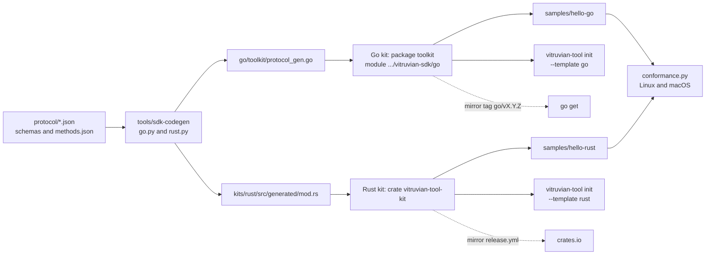

# Vitruvian tools for everyone (stage B2: kits, part two, Go and Rust) Implementation Plan

> **For agentic workers:** REQUIRED SUB-SKILL: Use superpowers:subagent-driven-development (recommended) or superpowers:executing-plans to implement this plan task-by-task. Steps use checkbox (`- [ ]`) syntax for tracking.

**Status: built and shipped, 2026-10-13.** Pull request #3176 built every task (this plan: #3157). SDK 1.0.0 released it with the tag `go/v1.0.0`. crates.io has `vitruvian-tool-kit` from 1.1.0; both kits are at 1.4.0 on 2026-10-14. The design's "Stage B2, as built" (`docs/superpowers/specs/2026-10-12-vitruvian-tools-for-everyone-design.md`, section 11) has what each row showed.

**Goal:** Let a person write a Vitruvian tool in Go or in Rust as easily as in Swift. After this stage the SDK holds a Go kit and a Rust kit shaped like the Swift one, a sample in each that passes the conformance script on Linux and on a Mac, `vitruvian-tool init --template go|rust`, the guide's Go and Rust sections, and the step that publishes the Rust kit to crates.io from the mirror. The Go kit is published by the `go/vX.Y.Z` tag Stage A already makes.

**Architecture:** Each kit has two halves, as the design says. The **generated half** is the protocol's messages and manifest as plain types, written from `protocol/*.json` by two new emitters, `go.py` and `rust.py`, in Stage B1's generator, and held by its drift test. The **hand-written half** is the loop: answer the greeting, run a command's handler, turn each call on `App` into a request and wait for its answer, keep what else arrives meanwhile for after the handler, treat the end of input as a clean exit. That half is a port of `VitruvianToolKit` and is held by the same thirteen tests, ported one for one. Both kits read standard input on one extra goroutine or thread, because neither Go's nor Rust's standard library can wait on standard input with a deadline the way the Swift kit's `poll` does; handlers still run one at a time on the caller's thread, so a call to the app looks like an ordinary function call. Bazel builds and tests both with the repository's hermetic toolchains; each sample is built, put in a tool folder, and run through `conformance.py` by a `py_test` that brings Bazel's own Python, so the Linux lane runs it too.



Every box is a file or a check that exists after this stage; the dotted arrows are the publishing that happens on the mirror. Colour would add nothing.

**What a person sees:** a tool's author can start a Go or Rust tool with `vitruvian-tool init`, build it with the language's own tools, and read how in the guide. Nothing in the Vitruvian app changes: no file under `apps/` is touched, and the app's pin of the protocol does not move.

**Tech Stack:** Go 1.22 language level, standard library only, built by Bazel's Go 1.26.6 (rules_go 0.61.1, Gazelle); Rust edition 2021, `serde` and `serde_json`, built by Bazel's Rust 1.75.0 (rules_rust 0.68.1, crate universe `@crates` from rules_rs 0.0.26); Python 3 for the generator and the conformance runs; Swift 6 for the `vitruvian-tool` changes.

**Spec:** `docs/superpowers/specs/2026-10-12-vitruvian-tools-for-everyone-design.md`, section 11 row B, its second half. Stage B1 (TypeScript and Python, and the generator itself) is planned in parallel; Stage A (the mirror, its release workflow, the site sync) comes before both.

Paths that start with `go/`, `kits/`, `samples/`, `docs/`, `protocol/`, `conformance/`, `Sources/`, `Tests/` or name `BUILD` or `README.md` alone are relative to `packages/vitruvian-sdk/`. Every other path is from the repository root.

## Calls James may want to overrule

1. **The Go kit lives at `packages/vitruvian-sdk/go/`, not `kits/go/`.** The design wants the module path `github.com/VitruvianSoftware/vitruvian-sdk/go` and the tag `go/vX.Y.Z`. Go requires the module to sit in the folder its path names, and the mirror's root is the package folder, so `kits/go` would force the path and the tag to say `kits/go`. The other choice is a Copybara move on export, which makes the monorepo and the mirror disagree on where the code is.
2. **The Go kit says `go 1.22`, against the repository's one-version rule.** That is a registered pin in `tools/conformance/version-pins.tsv`, documented and renewed every three months, and guarded by `go_kit_vet_test`. The other choice is `go 1.26.6`, which makes every author use Go 1.26.6.
3. **The Rust kit uses the repository's Rust toolchain, 1.75.0 from December 2023, unchanged, and makes it the kit's promise (`rust-version = "1.75"`).** Bazel then proves the oldest Rust the kit claims on every build. Bumping the toolchain is Forge's call and needs no change here except that number.
4. **The Go types are generated into package `toolkit` itself, as `toolkit/protocol_gen.go`, not into a `generated/` package.** An author then imports one package and writes `toolkit.KeyEquivalent`. The Rust types are in `src/generated/`, as the design says, and re-exported at the crate's root.
5. **The calls are grouped by service, as the design writes them (`app.Notify.HUD`, `app.notify().hud`), not named as the Swift kit names them (`app.showMessage`).** Go handlers also take a `context.Context` that ends when the app says goodbye. The Swift kit is not changed.

## Decisions this plan makes

The design's twenty-two decisions stand. These are the ones it leaves open, or that the code forced. Where the design and the code disagree, the row says so. Task 8 records the disagreements in the design's stage table; it does not rewrite the design's sections.

| # | Decision | Why |
|---|---|---|
| 1 | **The Go kit is at `go/`, module `github.com/VitruvianSoftware/vitruvian-sdk/go`, package `toolkit` in `go/toolkit`. Differs from the design's layout (`kits/go`).** | The design's module path and tag only work for a module at `go/` of the mirror, and the mirror is this folder. `pulumi-library` does the same: its `go/` is module `.../pulumi-library/go`. |
| 2 | **The Go module joins the root `go.work`.** It has no dependency, so Gazelle's `go_deps` gains nothing and `MODULE.bazel` is unchanged. Gazelle writes `go/toolkit/BUILD`; `go/BUILD` only names the import path. | That is how the other Go modules here are built. Excluding it from `go.work` would leave Gazelle unable to resolve it. |
| 3 | **The Go kit's `go.mod` says `go 1.22`, with a version pin and its documented exception.** The sample's says the same. | It is the oldest Go an author may use. Bazel compiles with 1.26.6 and does not hold the code to the 1.22 standard library: a planted `slices.Collect` (Go 1.23) built cleanly under Bazel, nogo included. `go vet` does catch it, so a new test runs `go vet` on the kit as its own module with Bazel's Go. |
| 4 | **Go commands for the kit run with `GOWORK=off`.** | In workspace mode one `go vet` rewrote `go.work.sum`, 122 lines, in the scratch copy. The kit has no dependency, so nothing is lost. |
| 5 | **The Rust kit is a member of the root Cargo workspace,** which was empty for this (`members = []`), and its two crates come from the crate universe `@crates` that `MODULE.bazel` already reads from it. `Cargo.lock` and `MODULE.bazel.lock` change; `MODULE.bazel` does not. | The repository had the toolchain and the crate universe and no Rust at all. This is the first Rust code. |
| 6 | **The Rust kit depends on `serde` (with `derive`) and `serde_json`, and nothing else.** That locks eleven crates: `serde`, `serde_core`, `serde_derive`, `serde_json`, `syn`, `quote`, `proc-macro2`, `unicode-ident`, `itoa`, `memchr`, `zmij`. Every one says it builds with Rust 1.71 or older. | Rust has no JSON in its standard library. Writing a JSON reader by hand is more code to trust than two crates nearly every Rust program already uses. The other kits stay at zero dependencies. |
| 7 | **The kit's Rust promise is the repository's toolchain, 1.75.** | Bazel's build is then the proof. A container with Rust 1.75 also passed the crate's tests outside Bazel, against crates it resolved fresh. |
| 8 | **Both kits read standard input on one extra goroutine or thread, and hand over one message at a time.** Handlers run on the caller's thread, one at a time; a call to the app waits there. **Differs from the design's "one thread".** | Neither standard library can wait on standard input with a deadline; the Swift kit uses `poll`. Handing over one message at a time keeps the Swift kit's back-pressure: the app cannot get ahead of the tool by more than a line. Go's race detector passes the tests. |
| 9 | **A handler's error refuses its command: `toolkit.Refuse("why")` or `ToolError::refused("why")` with the words given; the app's own refusal passed through goes back as -32010 with the app's failure in `data`; anything else is -32010 with its text.** | That is the Swift kit's rule, in each language's idiom. |
| 10 | **A closed link is an end, not a crash.** Go ignores `SIGPIPE` when the tool writes to the real standard output, so a write to a pipe nobody reads fails and the tool exits with 0. Rust's runtime already ignores it. | The Swift kit does the same. A Go program without it dies by the signal; the Go test that starts itself as a tool proves both. |
| 11 | **Go handlers take a `context.Context`, done once the app has said goodbye or gone away.** **Adds to the design.** | The reading goroutine sees `shutdown` and the end of input first, so a handler working without calling the app can stop. It is idiomatic Go. Rust gets nothing like it in this stage. |
| 12 | **The generated Go file is one file in package `toolkit`; the Rust module is `src/generated/mod.rs`, re-exported at the crate's root.** Each also generates the table of messages (`Methods`, `METHODS`), the list of services, the protocol version, and a round-trip function its tests use. | One import for a Go author. The round trip lets each kit's tests hold its types to every example in `protocol/examples/` without a hand-written list of types. |
| 13 | **A required list or map in Go is written `[]`/`{}` when left nil, by a generated `MarshalJSON`.** | JSON has no nil list and the schema refuses `null`; `toolkit.KeyEquivalent{Character: "c"}` would otherwise send `"modifiers":null`. |
| 14 | **The generated files are marked `linguist-generated` in `.gitattributes`.** The emitters write them already formatted, so gofumpt and rustfmt leave them alone either way. | Collapsed in review, and the formatter never fights the drift test. |
| 15 | **The calls are grouped by service: `app.Notify.HUD`, `app.notify().hud`, and so on.** **Follows the design; differs from the Swift kit's names, which stay.** | The design names them so. |
| 16 | **The ported tests are thirteen, not twelve.** **Differs from the design**, which says twelve: `ToolTests.swift` has thirteen. Each kit adds one more, a closed link, and its generated-types tests. | All thirteen are ported. |
| 17 | **The samples are built by Bazel (`go_binary`, `rust_binary`), assembled into `built/<sample>/` like the Swift ones, and run through `conformance.py` by `go_sample_test` and `rust_sample_test`, which are not `manual` and not tied to macOS.** | A `py_test` brings Bazel's Python and the script as its sources, and the built folder as its data, so the Linux lane needs nothing outside Bazel. A `go_test` or `rust_test` never looks for Python. |
| 18 | **Each sample also builds the way an author builds it**, with its own `go.mod` (`replace` to `../../go`) or `Cargo.toml` (`path = "../../kits/rust"`). The kit's `go.mod` has no `replace`. | So the mirror's own CI can build them with `go` and `cargo`, and so can a person who cloned the mirror. |
| 19 | **`init --template go|rust` writes the program, `tool/vitruvian-tool.json`, `build.sh` and `.gitignore`.** Without `--sdk` the tool requires the kit at this command's version from its registry; with it, from the checkout (`replace` or `path`). The Go module is named after the tool's id. | The go command reserves the module name `tool`: the first build of a template with `module tool` failed with `"tool" is not an importable package`. |
| 20 | **`go_template_test` builds what `init --template go --sdk` writes, with Bazel's Go and no network, then holds `validate`, the conformance script and `run` to pass.** It is `manual` and macOS-only, as `init_test` is. There is no Rust twin. | Go needs nothing fetched for a kit with no dependency. A Rust tool needs `serde` from crates.io, which a test may not fetch; the Rust template is built by hand (see "By hand") and its code is the sample's, byte for byte. |
| 21 | **`@rules_go//go` cannot run in a test; a 20-line rule, `//tools/go-sdk:go`, hands a test the SDK's own `go`.** | The runner reads the workspace's `go.work` and every module in it before it starts `go`, and failed in the sandbox with `open apps/cli/devx/go.mod: no such file or directory`. |
| 22 | **The mirror gets its own workflow for the kits, `kits.yml`**: Go 1.22 and stable, Rust 1.75 and stable, each kit's tests and its sample through the conformance script. Stage A's `ci.yml` is not edited. | Independent of how Stage A wrote `ci.yml`. |
| 23 | **crates.io publishing is a pair of jobs added to Stage A's `release.yml`**: ask crates.io whether this version exists, and if not, exchange the runner's GitHub identity for a token with `rust-lang/crates-io-auth-action` v1.0.5 and run `cargo publish`. The first publish is by hand. | crates.io's trusted publishing is set up on a crate's settings page, so the crate must exist first. The fallback, if trusted publishing is refused, is a `CARGO_REGISTRY_TOKEN` repository secret in the same step. |
| 24 | **Nothing is published by this plan, no test uses the network, and nothing runs a window.** | The brief. |

## Global Constraints

- **Everything in this plan was built and run before it was written down.** The tree at `858211bb2` was exported to a scratch folder, built to the end, then exported again and rebuilt task by task, with each task's tests run at its commit; the two trees came out identical, file for file. On macOS 27.0 with Xcode 27.0, Swift 6.4 and Bazel 9.3.0: every target named in each task's "Run" steps, the whole `vitruvian-sdk` unit (now 18 targets) and `tool_protocol_pin_test`, `//tools/sdk-codegen:in_sync_test`, the toolkit's tests again under `--config=race`, `//:gazelle`, `//:tidy`, the licence check and verify, `//tools/conformance:check`, the naming harness, `bazel mod tidy`, and the workflow generator with `--check`. Outside Bazel: `go vet` and `go test -race` with Go 1.26 locally and Go 1.22 in a Linux container; `cargo test`, `cargo fmt --check` and `cargo clippy` with Rust 1.92 locally and `cargo test`, `cargo fmt --check` with Rust 1.75 in a Linux container; both samples through `conformance.py` on macOS and in those containers; `cargo publish --dry-run`; `actionlint` on the two workflow listings. Every regression planted below was seen to fail. **Not run:** anything on a CI runner, so neither the Linux `build-test` lane on BuildBuddy (x86_64; the containers were arm64) nor the `xcode-27` unit; the mirror's workflows; Stage A's and Stage B1's files, which did not exist (Task 2 and Task 8 say how to meet them); any registry. If `main` has moved and a listing no longer fits, make the smallest change that keeps its meaning and record it as a deviation.
- **How to read a listing.** A block under "Create `<path>`" is that whole file. A block that starts with `--- a/` is a change to a file that exists, as `git diff` prints it; save it and run `git apply <file>` from the repository root, or make it by hand. Each change is from the state the task before left. Every listing here was taken out of the commits of that second run by a script, not typed. Then every listing was taken out of this document by another script and applied in order to a clean export of `858211bb2`; with the six generated files of Global Constraints added, the result was the tested tree, file for file.
- **Generated files are never written by hand.** `go/toolkit/protocol_gen.go` and `kits/rust/src/generated/mod.rs` come from `bazel run //tools/sdk-codegen`; `Sources/VitruvianToolCLI/Templates.swift` from `bazel run //packages/vitruvian-sdk:sync-templates`; the BUILD file in `go/toolkit/` from `bazel run //:gazelle` (two hand-added lines it keeps are named in Task 3); `Cargo.lock` from `cargo`; `MODULE.bazel.lock` from Bazel; `.github/workflows/presubmit.yaml` from `bazel run //tools/pipeline:gen -- --format=workflow --output-file=.github/workflows/presubmit.yaml`.
- **Licences.** Everything this stage adds in the package and in `tools/` is MIT. Every new source file starts with the package's own header, the 19 lines that begin `Copyright (c) 2026 VitruvianSoftware`, in the file's comment style: `//` for Go, Rust and Swift, `#` for Python, TOML, Starlark and YAML. The generated files carry it too: the generator copies it from its own header. Nothing from `apps/desktop/vitruvian/` is copied: it is GPL.
- **The app is untouched.** `git diff --stat main -- apps/` prints nothing after every task, and `//apps/desktop/vitruvian:tool_protocol_pin_test` passes: no file under `Sources/VitruvianToolProtocol` changes.
- **Build and test through Bazel, from the repository root.** Go commands outside Bazel run from `packages/vitruvian-sdk/go` with `GOWORK=off`; never commit a change to `go.work.sum`. Cargo commands run with `CARGO_TARGET_DIR` outside the repository (for example `CARGO_TARGET_DIR=$TMPDIR/b2-cargo`): a `target/` at the root fails `//tools/conformance:check` as a disallowed root folder, even though `.gitignore` now names it.
- **Formatting and gates.** After each task: `bazel run //:tidy`, then `git status`. On this base `//:tidy` adds one unrelated line, `Cryptodome: pycryptodomex`, to `gazelle_python.yaml`: undo it, do not commit it. Then `bazel run //tools/license:check` and `bazel run //tools/license:verify`.
- **New tests join the `vitruvian-sdk` `pipeline_unit`** in the task that adds them, and the workflow generator is run in that task; `--check` must then print `matches generated output cleanly`. Keep round brackets out of comments inside that call: the planner reads it up to the first closing one.
- **Git.** Never `git stash`, `git reset` or `git restore`; undo an edit by hand. One commit per task, with identity and commit in one command. Task 1 is Forge's, the rest Wren's:
  ```sh
  export AGENT_KEY_DIR=/Users/james/Workspace/gh/application/vitruvian/vitruvian-core/tools/sync-env-secrets/agent-keys; eval "$(bazel run //tools/agent-app -- env wren 2>/dev/null)"; git add <files> && git commit -m "<title>"
  ```
- **Commit titles.** `chore(bazel): …` for Task 1, `chore(ci): …` for Task 2 (it is `tools/`), `chore(vitruvian-sdk): …` for Tasks 3 to 6 and 8, and `feat(vitruvian-sdk): …` for Task 7, when both kits are complete. `chore` cuts no release; the one `feat` cuts the SDK's next minor, 0.10.0, as the design's row B says. `main` takes squash merges, so the pull request's title is what counts: `feat(vitruvian-sdk): Go and Rust kits`.
- **No network in tests, no window, nothing published.** The one exception to "no network" is fetching, which Bazel does before any test runs.

## Review Focus

Where a mistake costs most. Each has a test in the task named.

1. **A kit that hangs or loses a message.** What arrives while a handler waits is kept, in order, and handled after it; an answer to another request is never taken for this one; goodbye and the end of input each end a waiting call; a call with no answer gives up after its time (Tasks 3 and 4, the ported tests). Dropping the "keep it" line fails a test in both kits.
2. **A tool killed by its own link.** A Go tool whose standard output is closed must end with 0, not die by `SIGPIPE` (Task 3, a test that starts itself as the tool). Removing one line fails it.
3. **Types that drift from the schemas.** The drift test fails on any schema change not regenerated (Task 2), and each kit's types read and write back every valid example message that carries params, a result or an error, and every valid manifest (Tasks 3 and 4).
4. **A promise the kit does not keep.** Go 1.22: `go_kit_vet_test` fails on a call newer than 1.22, which Bazel's build does not (Task 3). Rust 1.75: it is the toolchain Bazel builds with.
5. **A sample or a template that does not work as an author meets it.** Both samples through the conformance script under Bazel on any OS (Task 5); the Go template built by its own `build.sh` with Bazel's Go (Task 6); the Rust template by hand.
6. **The guide saying what the kits do not.** `guide_test` fails on a call a kit does not have, a message that is not the protocol's, a service that is wrong, and Go or Rust code that is not the sample's (Task 7).

---
### Task 1: Room in the build for a Go module and a Rust crate

**Worker:** Forge. **Commit:** `chore(bazel): a Go module and a Rust crate for the Vitruvian SDK's kits`

**Files:**
- Create: `go/go.mod`, `go/BUILD`, `kits/rust/Cargo.toml`, `kits/rust/README.md`, `kits/rust/src/lib.rs`, `kits/rust/BUILD`, `tools/go-sdk/BUILD`, `tools/go-sdk/defs.bzl`
- Modify: `go.work`, `Cargo.toml`, `Cargo.lock`, `MODULE.bazel.lock`, `BUILD` (Gazelle kept out of `kits/`), `.gitignore`, `tools/license/BUILD`, `tools/conformance/version-pins.tsv`, `docs/engineering/version-pin-exceptions.md`

**Interfaces:**
- Produces: the Go module `github.com/VitruvianSoftware/vitruvian-sdk/go` in `go.work`, empty; the crate `vitruvian-tool-kit` as `//packages/vitruvian-sdk/kits/rust:vitruvian_tool_kit`, empty, with `@crates//:serde` and `@crates//:serde_json`; `//tools/go-sdk:go`, the SDK's `go` for a test.

The repository has a hermetic Rust toolchain, 1.75.0, and a crate universe read from a Cargo workspace with no members, and no Rust code at all. This task gives the kit a place in each build and changes nothing anyone runs. It is Forge's because it moves `MODULE.bazel.lock` and adds a toolchain rule.

- [ ] **Step 1: See that the crates are not there**

Run: `bazel build @crates//:serde`
Expected: it fails:
```text
ERROR: Skipping '@crates//:serde': no such target '@@rules_rs++crate+crates//:serde': target 'serde' not declared in package '' defined by …/external/rules_rs++crate+crates/BUILD.bazel
```

- [ ] **Step 2: The Go module**

Create `packages/vitruvian-sdk/go/go.mod`:

````text
module github.com/VitruvianSoftware/vitruvian-sdk/go

go 1.22
````

Create `packages/vitruvian-sdk/go/BUILD`:

````python
# Copyright (c) 2026 VitruvianSoftware
#
# Permission is hereby granted, free of charge, to any person obtaining a copy
# of this software and associated documentation files (the "Software"), to deal
# in the Software without restriction, including without limitation the rights
# to use, copy, modify, merge, publish, distribute, sublicense, and/or sell
# copies of the Software, and to permit persons to whom the Software is
# furnished to do so, subject to the following conditions:
#
# The above copyright notice and this permission notice shall be included in
# all copies or substantial portions of the Software.
#
# THE SOFTWARE IS PROVIDED "AS IS", WITHOUT WARRANTY OF ANY KIND, EXPRESS OR
# IMPLIED, INCLUDING BUT NOT LIMITED TO THE WARRANTIES OF MERCHANTABILITY,
# FITNESS FOR A PARTICULAR PURPOSE AND NONINFRINGEMENT. IN NO EVENT SHALL THE
# AUTHORS OR COPYRIGHT HOLDERS BE LIABLE FOR ANY CLAIM, DAMAGES OR OTHER
# LIABILITY, WHETHER IN AN ACTION OF CONTRACT, TORT OR OTHERWISE, ARISING FROM,
# OUT OF OR IN CONNECTION WITH THE SOFTWARE OR THE USE OR OTHER DEALINGS IN THE
# SOFTWARE.

# The Go kit: a module of its own, github.com/VitruvianSoftware/vitruvian-sdk/go,
# which is this folder in the public mirror. Gazelle writes the BUILD files
# below it; this one only names the module's import path.
# gazelle:prefix github.com/VitruvianSoftware/vitruvian-sdk/go
````

````diff
--- a/go.work
+++ b/go.work
@@ -5,6 +5,11 @@ use (
 	./apps/cli/devx
 	./apps/cli/homelab
 
+	// The Vitruvian SDK's Go kit. The public mirror holds it at go/, so its
+	// module path ends in /go and its tags are go/vX.Y.Z. Standard library
+	// only: it adds nothing to the go_deps graph.
+	./packages/vitruvian-sdk/go
+
 	// pulumi-library: the GCP Pulumi component library, grafted from the
 	// standalone pulumi-library repo. Each component is its own module (kept
 	// from upstream so the public mirror keeps publishing per-package tags);
````

`go.mod` says `go 1.22` and the repository's rule is one Go, 1.26.6, so the pin and its documented reason go in with it:

````diff
--- a/tools/conformance/version-pins.tsv
+++ b/tools/conformance/version-pins.tsv
@@ -29,4 +29,4 @@
 #   reason        free text justification (may contain spaces; MUST be the last column)
 #
 # file                    tool  pinned_value  review_by   owner   reason
-# (no active pins — every file currently matches its canonical version)
+packages/vitruvian-sdk/go/go.mod                 go  1.22  2027-01-12  @james  the Vitruvian SDK's published Go kit: the oldest Go an author may use, held by //packages/vitruvian-sdk:go_kit_vet_test. Re-justify while the kit supports Go 1.22.
````

````diff
--- a/docs/engineering/version-pin-exceptions.md
+++ b/docs/engineering/version-pin-exceptions.md
@@ -19,7 +19,12 @@ a pin past its `review_by`; and a registry pin that is **not documented in this
 
 ## Current exceptions
 
-_None._ Every consumer currently matches its canonical version — there are **no active pins** in [`tools/conformance/version-pins.tsv`](../../tools/conformance/version-pins.tsv), and `bazel run //tools/conformance:check` is green with zero pins.
+### The Vitruvian SDK's Go kit: Go 1.22, not 1.26.6
+
+- **File:** `packages/vitruvian-sdk/go/go.mod`.
+- **Why:** the Go kit is published (module `github.com/VitruvianSoftware/vitruvian-sdk/go`) for other people's tools. Its `go` line is the oldest Go they may build it with, not the Go this repository builds with: on 1.26.6 every author would need 1.26.6. Bazel builds both with the canonical SDK either way.
+- **Risk:** the kit using something of Go's standard library newer than 1.22. `//packages/vitruvian-sdk:go_kit_vet_test` runs `go vet` on the kit as its own module, which refuses exactly that; Bazel's build does not see it.
+- **Removal:** when the kit raises its floor to the canonical Go, or the repository decides a published module's floor is not a pin. Re-justify at each `review_by` while the kit supports Go 1.22.
 
 > **Retired — `apps/suites/tabula/api/Dockerfile` (Node 20), removed 2026-06-25.** This was the seed exception. On review it turned out to be **vestigial**: tabula's API image is built by Bazel (`//apps/suites/tabula/api:image`, a `node_image`) whose Node version is bound to `.nvmrc` through the toolchain (`node_version_from_nvmrc`), so the standalone `node:20` Dockerfile was a pre-Bazel leftover that nothing built. It was **deleted** rather than bumped — the real build was already on canonical Node. The general lesson is below.
 
````

- [ ] **Step 3: The Rust crate**

Create `packages/vitruvian-sdk/kits/rust/Cargo.toml`:

````toml
# Copyright (c) 2026 VitruvianSoftware
#
# Permission is hereby granted, free of charge, to any person obtaining a copy
# of this software and associated documentation files (the "Software"), to deal
# in the Software without restriction, including without limitation the rights
# to use, copy, modify, merge, publish, distribute, sublicense, and/or sell
# copies of the Software, and to permit persons to whom the Software is
# furnished to do so, subject to the following conditions:
#
# The above copyright notice and this permission notice shall be included in
# all copies or substantial portions of the Software.
#
# THE SOFTWARE IS PROVIDED "AS IS", WITHOUT WARRANTY OF ANY KIND, EXPRESS OR
# IMPLIED, INCLUDING BUT NOT LIMITED TO THE WARRANTIES OF MERCHANTABILITY,
# FITNESS FOR A PARTICULAR PURPOSE AND NONINFRINGEMENT. IN NO EVENT SHALL THE
# AUTHORS OR COPYRIGHT HOLDERS BE LIABLE FOR ANY CLAIM, DAMAGES OR OTHER
# LIABILITY, WHETHER IN AN ACTION OF CONTRACT, TORT OR OTHERWISE, ARISING FROM,
# OUT OF OR IN CONNECTION WITH THE SOFTWARE OR THE USE OR OTHER DEALINGS IN THE
# SOFTWARE.

[package]
name = "vitruvian-tool-kit"
version = "0.9.0"
edition = "2021"
rust-version = "1.75"
description = "Write a Vitruvian tool in Rust: declare commands, handle them, call the app."
license = "MIT"
repository = "https://github.com/VitruvianSoftware/vitruvian-sdk"
readme = "README.md"
keywords = ["vitruvian", "macos", "tool", "json-rpc"]
categories = ["command-line-utilities", "api-bindings"]
# What crates.io gets: the library alone. The tests read the protocol's
# examples from the folders above this one, which are not in the crate.
include = ["Cargo.toml", "README.md", "src/**/*.rs"]

[dependencies]
# Rust has no JSON in its standard library. These two are the only
# dependencies, with nothing else enabled.
serde = { version = "1", features = ["derive"] }
serde_json = "1"
````

Create `packages/vitruvian-sdk/kits/rust/README.md`:

````markdown
# vitruvian-tool-kit

Write a [Vitruvian](https://vitruviansoftware.dev) tool in Rust: declare
commands, handle them, call the app.

```rust
use vitruvian_tool_kit::Tool;

fn main() {
    let mut tool = Tool::new("0.1.0");
    tool.command("hello", |app| app.notify().hud("Hello", "hand.wave"));
    tool.run();
}
```

A tool is a program the Vitruvian app starts and talks to over its standard
input and output. It is trusted like an app: it runs as you, with every
permission Vitruvian has. The guide, the protocol and a sample are in
[the SDK's repository](https://github.com/VitruvianSoftware/vitruvian-sdk);
`vitruvian-tool init --template rust` starts a new tool.

Rust 1.75 or later. Two dependencies, `serde` and `serde_json`: Rust has no
JSON in its standard library. MIT licence.
````

Create `packages/vitruvian-sdk/kits/rust/src/lib.rs`:

````rust
// Copyright (c) 2026 VitruvianSoftware
//
// Permission is hereby granted, free of charge, to any person obtaining a copy
// of this software and associated documentation files (the "Software"), to deal
// in the Software without restriction, including without limitation the rights
// to use, copy, modify, merge, publish, distribute, sublicense, and/or sell
// copies of the Software, and to permit persons to whom the Software is
// furnished to do so, subject to the following conditions:
//
// The above copyright notice and this permission notice shall be included in
// all copies or substantial portions of the Software.
//
// THE SOFTWARE IS PROVIDED "AS IS", WITHOUT WARRANTY OF ANY KIND, EXPRESS OR
// IMPLIED, INCLUDING BUT NOT LIMITED TO THE WARRANTIES OF MERCHANTABILITY,
// FITNESS FOR A PARTICULAR PURPOSE AND NONINFRINGEMENT. IN NO EVENT SHALL THE
// AUTHORS OR COPYRIGHT HOLDERS BE LIABLE FOR ANY CLAIM, DAMAGES OR OTHER
// LIABILITY, WHETHER IN AN ACTION OF CONTRACT, TORT OR OTHERWISE, ARISING FROM,
// OUT OF OR IN CONNECTION WITH THE SOFTWARE OR THE USE OR OTHER DEALINGS IN THE
// SOFTWARE.

//! Write a Vitruvian tool in Rust: declare commands, handle them, call the
//! app.
````

Create `packages/vitruvian-sdk/kits/rust/BUILD`:

````python
# Copyright (c) 2026 VitruvianSoftware
#
# Permission is hereby granted, free of charge, to any person obtaining a copy
# of this software and associated documentation files (the "Software"), to deal
# in the Software without restriction, including without limitation the rights
# to use, copy, modify, merge, publish, distribute, sublicense, and/or sell
# copies of the Software, and to permit persons to whom the Software is
# furnished to do so, subject to the following conditions:
#
# The above copyright notice and this permission notice shall be included in
# all copies or substantial portions of the Software.
#
# THE SOFTWARE IS PROVIDED "AS IS", WITHOUT WARRANTY OF ANY KIND, EXPRESS OR
# IMPLIED, INCLUDING BUT NOT LIMITED TO THE WARRANTIES OF MERCHANTABILITY,
# FITNESS FOR A PARTICULAR PURPOSE AND NONINFRINGEMENT. IN NO EVENT SHALL THE
# AUTHORS OR COPYRIGHT HOLDERS BE LIABLE FOR ANY CLAIM, DAMAGES OR OTHER
# LIABILITY, WHETHER IN AN ACTION OF CONTRACT, TORT OR OTHERWISE, ARISING FROM,
# OUT OF OR IN CONNECTION WITH THE SOFTWARE OR THE USE OR OTHER DEALINGS IN THE
# SOFTWARE.

# The Rust kit, crate vitruvian-tool-kit. Hand-written: Gazelle has no Rust
# here. Its two dependencies, serde and serde_json, come from the crate
# universe @crates, which MODULE.bazel reads from the root Cargo.toml and
# Cargo.lock: this crate is a member of that workspace. The Rust toolchain
# is the hermetic one MODULE.bazel registers, which is also the oldest Rust
# the crate says it builds with (`rust-version` in Cargo.toml).

load("@rules_rust//rust:defs.bzl", "rust_library")

package(default_visibility = ["//packages/vitruvian-sdk:__subpackages__"])

rust_library(
    name = "vitruvian_tool_kit",
    srcs = glob(["src/**/*.rs"]),
    crate_root = "src/lib.rs",
    edition = "2021",
    deps = [
        "@crates//:serde",
        "@crates//:serde_json",
    ],
)
````

````diff
--- a/Cargo.toml
+++ b/Cargo.toml
@@ -20,4 +20,8 @@
 
 [workspace]
 resolver = "2"
-members = []
\ No newline at end of file
+# The Rust in this repository: the Vitruvian SDK's Rust kit.
+# The crate universe in MODULE.bazel (@crates) is read from this workspace.
+members = [
+    "packages/vitruvian-sdk/kits/rust",
+]
````

Write the lock and keep Cargo's output out of the tree:

```sh
CARGO_TARGET_DIR=$TMPDIR/b2-cargo cargo generate-lockfile
```

It prints `Locking 11 packages to latest compatible versions`. `Cargo.lock` then holds `vitruvian-tool-kit` and the eleven crates of decision 6; every one says `rust-version` 1.71 or older (`serde` 1.0.229, `serde_json` 1.0.154, `syn` 3.0.9 in the run). If crates.io has moved, the versions may be newer: check each new one's `rust-version` is at most 1.75, or the next step fails to compile.

````diff
--- a/.gitignore
+++ b/.gitignore
@@ -84,3 +84,6 @@ ds-bundle/
 site/
 uv.lock
 
+
+# Cargo build output: the root Cargo.toml is a workspace (the SDK Rust kit).
+/target/
````

````diff
--- a/tools/license/BUILD
+++ b/tools/license/BUILD
@@ -50,6 +50,9 @@ _IGNORE_GLOBS = [
     "**/node_modules/**",
     "**/*.venv/**",
     "**/.build/**",
+    # Cargo's build output: the root Cargo.toml is a workspace (the SDK's
+    # Rust kit), so `cargo build` anywhere in the tree writes /target/.
+    "target/**",
     "**/dist/**",
     ".git/**",
     # generated / local-only (gitignored; never in a CI checkout, but excluded so
````

- [ ] **Step 4: Keep Gazelle out of the kits' folder, and give a test Go itself**

````diff
--- a/packages/vitruvian-sdk/BUILD
+++ b/packages/vitruvian-sdk/BUILD
@@ -31,9 +31,13 @@
 # gazelle:exclude Tests
 # gazelle:exclude conformance
 # gazelle:exclude docs
+# gazelle:exclude kits
 # gazelle:exclude protocol
 # gazelle:exclude samples
 #
+# The Go kit, go/, is the one folder Gazelle writes: go/BUILD names its
+# module. The Rust kit, kits/rust, has a hand-written BUILD of its own.
+#
 # MUST MIRROR Package.swift target for target (packages/peripherals/BUILD says
 # why). The Swift targets are constrained to macOS so a Linux
 # `bazel build //...` skips them.
````

Create `tools/go-sdk/defs.bzl`:

````python
# Copyright (c) 2026 VitruvianSoftware
#
# Permission is hereby granted, free of charge, to any person obtaining a copy
# of this software and associated documentation files (the "Software"), to deal
# in the Software without restriction, including without limitation the rights
# to use, copy, modify, merge, publish, distribute, sublicense, and/or sell
# copies of the Software, and to permit persons to whom the Software is
# furnished to do so, subject to the following conditions:
#
# The above copyright notice and this permission notice shall be included in
# all copies or substantial portions of the Software.
#
# THE SOFTWARE IS PROVIDED "AS IS", WITHOUT WARRANTY OF ANY KIND, EXPRESS OR
# IMPLIED, INCLUDING BUT NOT LIMITED TO THE WARRANTIES OF MERCHANTABILITY,
# FITNESS FOR A PARTICULAR PURPOSE AND NONINFRINGEMENT. IN NO EVENT SHALL THE
# AUTHORS OR COPYRIGHT HOLDERS BE LIABLE FOR ANY CLAIM, DAMAGES OR OTHER
# LIABILITY, WHETHER IN AN ACTION OF CONTRACT, TORT OR OTHERWISE, ARISING FROM,
# OUT OF OR IN CONNECTION WITH THE SOFTWARE OR THE USE OR OTHER DEALINGS IN THE
# SOFTWARE.

"""The registered Go SDK's own `go` command, as a file a test can run.

`@rules_go//go` is a runner for `bazel run`: it reads the workspace's go.work
and its modules before it starts `go`, so it fails inside a test's sandbox.
This hands a test the SDK's `go` itself, with the whole SDK in its runfiles.
The test sets GOROOT to the folder two above the file.
"""

def _go_sdk_go_impl(ctx):
    sdk = ctx.toolchains["@rules_go//go:toolchain"].sdk
    files = depset(
        [sdk.go, sdk.root_file],
        transitive = [sdk.libs, sdk.headers, sdk.srcs, sdk.tools],
    )
    return [DefaultInfo(
        files = depset([sdk.go]),
        runfiles = ctx.runfiles(transitive_files = files),
    )]

go_sdk_go = rule(
    implementation = _go_sdk_go_impl,
    toolchains = ["@rules_go//go:toolchain"],
    doc = "The registered Go SDK's `go` command, with the SDK in its runfiles.",
)
````

Create `tools/go-sdk/BUILD`:

````python
# Copyright (c) 2026 VitruvianSoftware
#
# Permission is hereby granted, free of charge, to any person obtaining a copy
# of this software and associated documentation files (the "Software"), to deal
# in the Software without restriction, including without limitation the rights
# to use, copy, modify, merge, publish, distribute, sublicense, and/or sell
# copies of the Software, and to permit persons to whom the Software is
# furnished to do so, subject to the following conditions:
#
# The above copyright notice and this permission notice shall be included in
# all copies or substantial portions of the Software.
#
# THE SOFTWARE IS PROVIDED "AS IS", WITHOUT WARRANTY OF ANY KIND, EXPRESS OR
# IMPLIED, INCLUDING BUT NOT LIMITED TO THE WARRANTIES OF MERCHANTABILITY,
# FITNESS FOR A PARTICULAR PURPOSE AND NONINFRINGEMENT. IN NO EVENT SHALL THE
# AUTHORS OR COPYRIGHT HOLDERS BE LIABLE FOR ANY CLAIM, DAMAGES OR OTHER
# LIABILITY, WHETHER IN AN ACTION OF CONTRACT, TORT OR OTHERWISE, ARISING FROM,
# OUT OF OR IN CONNECTION WITH THE SOFTWARE OR THE USE OR OTHER DEALINGS IN THE
# SOFTWARE.

# gazelle:exclude defs.bzl

load(":defs.bzl", "go_sdk_go")

# $(rootpath //tools/go-sdk:go) is the SDK's go command; GOROOT is the
# folder two above it.
go_sdk_go(
    name = "go",
    visibility = ["//packages/vitruvian-sdk:__pkg__"],
)
````

- [ ] **Step 5: Run**

```sh
bazel build //packages/vitruvian-sdk/kits/rust:vitruvian_tool_kit @crates//:serde @crates//:serde_json
bazel mod tidy
bazel run //:gazelle
bazel run //tools/conformance:check
go list -m | grep vitruvian-sdk
git status --short
```

Expected: the build passes and adds 13 lines to `MODULE.bazel.lock`, under `@@rules_rs+//rs:extensions.bzl%crate`, one per crate; commit them. `bazel mod tidy` and Gazelle change nothing else. The check ends `✓ PASS` with `(1 active pins in version-pins.tsv)` and lists `packages/vitruvian-sdk/go/go.mod … PINNED until 2027-01-12`. `go list -m` prints `github.com/VitruvianSoftware/vitruvian-sdk/go`: the workspace has the module, which has no package yet, and `go.work.sum` is not touched. `git status` shows this task's files and `MODULE.bazel.lock`.

Then the gates in Global Constraints.

- [ ] **Step 6: Commit**

```bash
export AGENT_KEY_DIR=/Users/james/Workspace/gh/application/vitruvian/vitruvian-core/tools/sync-env-secrets/agent-keys; eval "$(bazel run //tools/agent-app -- env forge 2>/dev/null)"; git add .gitignore Cargo.toml Cargo.lock MODULE.bazel.lock go.work docs/engineering/version-pin-exceptions.md tools/conformance/version-pins.tsv tools/license/BUILD tools/go-sdk packages/vitruvian-sdk/BUILD packages/vitruvian-sdk/go packages/vitruvian-sdk/kits && git commit -m "chore(bazel): a Go module and a Rust crate for the Vitruvian SDK's kits"
```

---

### Task 2: The Go and Rust emitters

**Worker:** Wren. **Commit:** `chore(ci): emit the protocol's types for the Go and Rust kits`

**Files:**
- Create: `tools/sdk-codegen/go.py`, `tools/sdk-codegen/rust.py`
- Create, only if Stage B1 is not in `main`: `tools/sdk-codegen/model.py`, `tools/sdk-codegen/generate.py`, `tools/sdk-codegen/BUILD` (the stand-in; see Step 1)
- Generate: `go/toolkit/protocol_gen.go`, `kits/rust/src/generated/mod.rs`, and `go/toolkit/BUILD` by Gazelle
- Modify: `BUILD` (`protocol_files`), `kits/rust/BUILD`, `kits/rust/src/lib.rs`, `.gitattributes`

**Interfaces:**
- Consumes, from the generator: a model of the protocol (the keys are listed in `model.py`'s docstring below) and the licence text. Each emitter is `emit(model, licence) -> {path inside packages/vitruvian-sdk: text}`; nothing else of the generator is read.
- Produces, generated: in Go, package `toolkit`: `ProtocolVersion`, a `Method…` constant per message, `Services`, `Method` and `Methods`, a struct per definition of both schemas (`NotifyHUDParams`, `Error`, `Manifest`, …), `LocalizedText`, and the unexported `roundTrip`. In Rust, `vitruvian_tool_kit::generated`, re-exported at the root: `PROTOCOL_VERSION`, `methods::*`, `SERVICES`, `Method`, `METHODS`, the same types in Rust's naming (`NotifyHudParams`), `LocalizedText`, and `round_trip`.

- [ ] **Step 1: Meet Stage B1's generator**

B1 owns `tools/sdk-codegen`: a model built from the schemas, one emitter per language, `bazel run //tools/sdk-codegen`, and `//tools/sdk-codegen:in_sync_test`. Its interface was not written when this plan was. So this task was built against a stand-in, `model.py`, `generate.py` and `BUILD` below, the smallest that runs the two emitters and holds their output.

- **If B1 is in `main`:** add `go.py` and `rust.py` to its folder and its list of emitters, and the two generated files to its drift test's `data`, as the stand-in's `BUILD` does. If B1's model names a key differently from the stand-in's docstring, add one function to the top of each emitter that maps B1's model to these keys; do not change the rest. Do not add the stand-in's three files.
- **If B1 is not:** stop and ask James; B2 is "part two". If he says go on, add the stand-in as it is: B1 then replaces `model.py`, `generate.py` and `BUILD` and keeps the two emitters.

Create `tools/sdk-codegen/model.py`:

````python
# Copyright (c) 2026 VitruvianSoftware
#
# Permission is hereby granted, free of charge, to any person obtaining a copy
# of this software and associated documentation files (the "Software"), to deal
# in the Software without restriction, including without limitation the rights
# to use, copy, modify, merge, publish, distribute, sublicense, and/or sell
# copies of the Software, and to permit persons to whom the Software is
# furnished to do so, subject to the following conditions:
#
# The above copyright notice and this permission notice shall be included in
# all copies or substantial portions of the Software.
#
# THE SOFTWARE IS PROVIDED "AS IS", WITHOUT WARRANTY OF ANY KIND, EXPRESS OR
# IMPLIED, INCLUDING BUT NOT LIMITED TO THE WARRANTIES OF MERCHANTABILITY,
# FITNESS FOR A PARTICULAR PURPOSE AND NONINFRINGEMENT. IN NO EVENT SHALL THE
# AUTHORS OR COPYRIGHT HOLDERS BE LIABLE FOR ANY CLAIM, DAMAGES OR OTHER
# LIABILITY, WHETHER IN AN ACTION OF CONTRACT, TORT OR OTHERWISE, ARISING FROM,
# OUT OF OR IN CONNECTION WITH THE SOFTWARE OR THE USE OR OTHER DEALINGS IN THE
# SOFTWARE.
"""The protocol as one plain model, read from the package's three files.

STAND-IN for Stage B1's model. B1 owns tools/sdk-codegen; this file exists so
that Stage B2's two emitters, go.py and rust.py, can be built and proven
before B1 lands. The emitters read only what `load` returns, and every key
they read is listed here. B1's model must provide these keys, or B2's Task 1
adapts the emitters to the names B1 chose.

    {
      "protocol": "1",                       methods.json's "protocol"
      "services": ["notify", ...],           the manifest's `uses` values
      "methods": [                           methods.json's rows, in order
        {"method": "notify/hud", "sender": "tool", "kind": "request",
         "uses": "notify", "params": "notifyHUDParams", "result": "empty"}
      ],
      "messageTypes": [TYPE, ...],           messages.schema.json's $defs, in
                                             order, less the envelope: id,
                                             request, notice, result, failure
      "manifestTypes": [TYPE, ...]           the manifest itself, named
                                             "manifest", then its $defs
    }

    TYPE  = {"name": "notifyHUDParams", "doc": "...", "shape": "struct",
             "fields": [FIELD, ...]}
          | {"name": "localizedText", "doc": "...", "shape": "map",
             "values": KIND}
    FIELD = {"name": "icon", "doc": "...", "required": true, "kind": KIND}
    KIND  = {"type": "string" | "boolean" | "integer" | "number" | "any"}
          | {"type": "array", "items": KIND}
          | {"type": "map", "values": KIND}
          | {"type": "ref", "ref": "keyEquivalent"}
            any KIND may carry "enum": [...], the values the schema allows

A field the schema allows several kinds for (a stored value, an error's
data) is "any". So is one it says nothing of the kind of.
"""

import json
import os

ENVELOPE = {"id", "request", "notice", "result", "failure"}


def kind(fragment):
    """The KIND of one property of the schema."""
    if "$ref" in fragment:
        return {"type": "ref", "ref": fragment["$ref"].split("/")[-1]}
    if "const" in fragment:
        return {"type": "string"}
    named = fragment.get("type")
    found = {"type": "any"}
    if isinstance(named, str) and named in ("string", "boolean", "integer", "number"):
        found = {"type": named}
    elif named == "array":
        found = {"type": "array", "items": kind(fragment.get("items", {}))}
    elif named == "object":
        extra = fragment.get("additionalProperties")
        found = {
            "type": "map",
            "values": kind(extra) if isinstance(extra, dict) else {"type": "any"},
        }
    elif "enum" in fragment and all(isinstance(v, str) for v in fragment["enum"]):
        found = {"type": "string"}
    if "enum" in fragment:
        found["enum"] = list(fragment["enum"])
    return found


def type_of(name, schema):
    """The TYPE a definition of the schema is."""
    doc = schema.get("description", "")
    properties = schema.get("properties")
    if properties is None and isinstance(schema.get("additionalProperties"), dict):
        return {
            "name": name,
            "doc": doc,
            "shape": "map",
            "values": kind(schema["additionalProperties"]),
        }
    required = set(schema.get("required", []))
    return {
        "name": name,
        "doc": doc,
        "shape": "struct",
        "fields": [
            {
                "name": field,
                "doc": inner.get("description", ""),
                "required": field in required,
                "kind": kind(inner),
            }
            for field, inner in (properties or {}).items()
        ],
    }


def load(package):
    """The model of the protocol in `package`, packages/vitruvian-sdk."""

    def read(name):
        with open(os.path.join(package, "protocol", name), encoding="utf-8") as handle:
            return json.load(handle)

    messages = read("messages.schema.json")
    manifest = read("manifest.schema.json")
    methods = read("methods.json")
    return {
        "protocol": methods["protocol"],
        "services": list(manifest["properties"]["uses"]["items"]["enum"]),
        "methods": [dict(row) for row in methods["methods"]],
        "messageTypes": [
            type_of(name, schema)
            for name, schema in messages["$defs"].items()
            if name not in ENVELOPE
        ],
        "manifestTypes": [type_of("manifest", manifest)]
        + [type_of(name, schema) for name, schema in manifest["$defs"].items()],
    }
````

Create `tools/sdk-codegen/generate.py`:

````python
# Copyright (c) 2026 VitruvianSoftware
#
# Permission is hereby granted, free of charge, to any person obtaining a copy
# of this software and associated documentation files (the "Software"), to deal
# in the Software without restriction, including without limitation the rights
# to use, copy, modify, merge, publish, distribute, sublicense, and/or sell
# copies of the Software, and to permit persons to whom the Software is
# furnished to do so, subject to the following conditions:
#
# The above copyright notice and this permission notice shall be included in
# all copies or substantial portions of the Software.
#
# THE SOFTWARE IS PROVIDED "AS IS", WITHOUT WARRANTY OF ANY KIND, EXPRESS OR
# IMPLIED, INCLUDING BUT NOT LIMITED TO THE WARRANTIES OF MERCHANTABILITY,
# FITNESS FOR A PARTICULAR PURPOSE AND NONINFRINGEMENT. IN NO EVENT SHALL THE
# AUTHORS OR COPYRIGHT HOLDERS BE LIABLE FOR ANY CLAIM, DAMAGES OR OTHER
# LIABILITY, WHETHER IN AN ACTION OF CONTRACT, TORT OR OTHERWISE, ARISING FROM,
# OUT OF OR IN CONNECTION WITH THE SOFTWARE OR THE USE OR OTHER DEALINGS IN THE
# SOFTWARE.
"""Writes the kits' protocol types from packages/vitruvian-sdk/protocol.

    generate.py            writes every emitter's files
    generate.py --check    writes nothing; fails when a file is not what
                           would be written

STAND-IN for Stage B1's generator, which owns this folder. It is here so
that Stage B2's emitters can be run and their output held by a drift test
before B1 lands. B1's generator replaces this file; B2's Task 1 then only
adds `go` and `rust` to its list of emitters.
"""

import os
import sys

HERE = os.path.dirname(os.path.abspath(__file__))
sys.path.insert(0, HERE)

import go  # noqa: E402
import model  # noqa: E402
import rust  # noqa: E402

EMITTERS = [go, rust]


def licence():
    """This file's own licence header, a line each, without the marks."""
    lines = []
    with open(os.path.abspath(__file__), encoding="utf-8") as handle:
        for line in handle.read().split("\n"):
            if line.startswith("#!"):
                continue
            if not line.startswith("#"):
                break
            lines.append(line[2:])
    return lines


def main(arguments):
    # `bazel run` starts a program in its own folder; this is the repository.
    root = os.environ.get("BUILD_WORKSPACE_DIRECTORY") or os.path.dirname(
        os.path.dirname(HERE)
    )
    package = os.path.join(root, "packages", "vitruvian-sdk")
    protocol = model.load(package)
    stale = []
    for emitter in EMITTERS:
        for path, text in emitter.emit(protocol, licence()).items():
            target = os.path.join(package, path)
            if "--check" in arguments:
                try:
                    with open(target, encoding="utf-8") as handle:
                        same = handle.read() == text
                except OSError:
                    same = False
                if not same:
                    stale.append(path)
                continue
            os.makedirs(os.path.dirname(target), exist_ok=True)
            with open(target, "w", encoding="utf-8") as handle:
                handle.write(text)
            print(f"wrote packages/vitruvian-sdk/{path}")
    if "--check" in arguments:
        for path in stale:
            print(f"OUT OF SYNC: packages/vitruvian-sdk/{path}", file=sys.stderr)
        print(
            "sdk-codegen: "
            + ("OUT OF SYNC, run bazel run //tools/sdk-codegen" if stale else "in sync")
        )
        return 1 if stale else 0
    return 0


if __name__ == "__main__":
    sys.exit(main(sys.argv[1:]))
````

Create `tools/sdk-codegen/BUILD`:

````python
# Copyright (c) 2026 VitruvianSoftware
#
# Permission is hereby granted, free of charge, to any person obtaining a copy
# of this software and associated documentation files (the "Software"), to deal
# in the Software without restriction, including without limitation the rights
# to use, copy, modify, merge, publish, distribute, sublicense, and/or sell
# copies of the Software, and to permit persons to whom the Software is
# furnished to do so, subject to the following conditions:
#
# The above copyright notice and this permission notice shall be included in
# all copies or substantial portions of the Software.
#
# THE SOFTWARE IS PROVIDED "AS IS", WITHOUT WARRANTY OF ANY KIND, EXPRESS OR
# IMPLIED, INCLUDING BUT NOT LIMITED TO THE WARRANTIES OF MERCHANTABILITY,
# FITNESS FOR A PARTICULAR PURPOSE AND NONINFRINGEMENT. IN NO EVENT SHALL THE
# AUTHORS OR COPYRIGHT HOLDERS BE LIABLE FOR ANY CLAIM, DAMAGES OR OTHER
# LIABILITY, WHETHER IN AN ACTION OF CONTRACT, TORT OR OTHERWISE, ARISING FROM,
# OUT OF OR IN CONNECTION WITH THE SOFTWARE OR THE USE OR OTHER DEALINGS IN THE
# SOFTWARE.

# STAND-IN for Stage B1's tools/sdk-codegen, so that Stage B2's emitters can
# be run and held by a drift test before B1 lands. Hand-written.
# gazelle:ignore

load("@aspect_rules_py//py:defs.bzl", "py_binary", "py_test")

SOURCES = [
    "generate.py",
    "go.py",
    "model.py",
    "rust.py",
]

# bazel run //tools/sdk-codegen
py_binary(
    name = "sdk-codegen",
    srcs = SOURCES,
    data = ["//packages/vitruvian-sdk:protocol_files"],
    main = "generate.py",
)

# What is committed is what would be written.
py_test(
    name = "in_sync_test",
    size = "small",
    srcs = SOURCES,
    args = ["--check"],
    data = [
        "//packages/vitruvian-sdk:protocol_files",
        "//packages/vitruvian-sdk/go/toolkit:protocol_gen.go",
        "//packages/vitruvian-sdk/kits/rust:src/generated/mod.rs",
    ],
    main = "generate.py",
)
````

- [ ] **Step 2: The drift test fails while the files are missing**

Add the protocol's files for the generator:

````diff
--- a/packages/vitruvian-sdk/BUILD
+++ b/packages/vitruvian-sdk/BUILD
@@ -52,6 +52,17 @@ load("//tools/pipeline:defs.bzl", "pipeline_unit")
 # the examples both halves of the drift test read.
 PROTOCOL_FILES = glob(["protocol/**/*.json"])
 
+# The same files, for the generator and for the Go and Rust kits' tests,
+# which hold the generated types to them.
+filegroup(
+    name = "protocol_files",
+    srcs = PROTOCOL_FILES,
+    visibility = [
+        "//packages/vitruvian-sdk:__subpackages__",
+        "//tools/sdk-codegen:__pkg__",
+    ],
+)
+
 # The smallest tool that speaks the protocol. The conformance script is proven
 # against it, and its manifest is read by both halves of the drift test.
 REFERENCE_TOOL = glob(["conformance/reference-tool/**"])
````

Write `go.py` and `rust.py` (Step 3), then, before generating anything, run the generator's own check: `python3 tools/sdk-codegen/generate.py --check`. (Bazel cannot build the drift test yet: its `data` names the two files.)
Expected: exit 1, with
```text
OUT OF SYNC: packages/vitruvian-sdk/go/toolkit/protocol_gen.go
OUT OF SYNC: packages/vitruvian-sdk/kits/rust/src/generated/mod.rs
sdk-codegen: OUT OF SYNC, run bazel run //tools/sdk-codegen
```
With B1's generator, run its check instead; the words are B1's.

- [ ] **Step 3: The emitters**

Create `tools/sdk-codegen/go.py`:

````python
# Copyright (c) 2026 VitruvianSoftware
#
# Permission is hereby granted, free of charge, to any person obtaining a copy
# of this software and associated documentation files (the "Software"), to deal
# in the Software without restriction, including without limitation the rights
# to use, copy, modify, merge, publish, distribute, sublicense, and/or sell
# copies of the Software, and to permit persons to whom the Software is
# furnished to do so, subject to the following conditions:
#
# The above copyright notice and this permission notice shall be included in
# all copies or substantial portions of the Software.
#
# THE SOFTWARE IS PROVIDED "AS IS", WITHOUT WARRANTY OF ANY KIND, EXPRESS OR
# IMPLIED, INCLUDING BUT NOT LIMITED TO THE WARRANTIES OF MERCHANTABILITY,
# FITNESS FOR A PARTICULAR PURPOSE AND NONINFRINGEMENT. IN NO EVENT SHALL THE
# AUTHORS OR COPYRIGHT HOLDERS BE LIABLE FOR ANY CLAIM, DAMAGES OR OTHER
# LIABILITY, WHETHER IN AN ACTION OF CONTRACT, TORT OR OTHERWISE, ARISING FROM,
# OUT OF OR IN CONNECTION WITH THE SOFTWARE OR THE USE OR OTHER DEALINGS IN THE
# SOFTWARE.
"""Go: the protocol's types for the Go kit, as one file of package toolkit.

    emit(model, licence) -> {path inside packages/vitruvian-sdk: text}

`model` is what model.load returns (its docstring lists every key read
here); `licence` is the package's MIT text, a line each, with no comment
marks. Nothing else is read, so the module drops into any generator that
hands it those two.

The file is written the way gofumpt leaves it, so the formatter and the
drift test never disagree. A struct with a list or a map it must carry gets
a MarshalJSON that writes an empty one, not null, for a value left nil: JSON
has no nil list, and the schema refuses null.
"""

import textwrap

OUTPUT = "go/toolkit/protocol_gen.go"

# Whole names Go writes in capitals.
INITIALISMS = {"id": "ID", "url": "URL", "pid": "PID", "hud": "HUD"}


def exported(name):
    """notifyHUDParams -> NotifyHUDParams; url -> URL."""
    return INITIALISMS.get(name, name[:1].upper() + name[1:])


def method_name(method):
    """notify/hud -> MethodNotifyHUD."""
    return "Method" + "".join(exported(part) for part in method.split("/"))


def comment(text, indent=""):
    """A doc comment, wrapped to 78 columns counting a tab as eight."""
    width = 78 - len(indent.expandtabs(8)) - 3
    return [indent + "// " + line for line in textwrap.wrap(text, width)]


def go_type(kind, required, maps):
    """The Go type of a KIND; `maps` names the TYPEs that are maps."""
    plain = {
        "string": "string",
        "boolean": "bool",
        "integer": "int",
        "number": "float64",
    }
    if kind["type"] in plain:
        return ("" if required else "*") + plain[kind["type"]]
    if kind["type"] == "any":
        return "any"
    if kind["type"] == "array":
        return "[]" + go_type(kind["items"], True, maps)
    if kind["type"] == "map":
        return "map[string]" + go_type(kind["values"], True, maps)
    if kind["ref"] in maps:
        return exported(kind["ref"])
    return ("" if required else "*") + exported(kind["ref"])


def struct(entry, maps):
    name = exported(entry["name"])
    lines = comment(f"{name}: {entry['doc']}") if entry["doc"] else []
    if entry["shape"] == "map":
        return lines + [
            f"type {name} map[string]{go_type(entry['values'], True, maps)}"
        ]
    if not entry["fields"]:
        return lines + [f"type {name} struct{{}}"]
    lines.append(f"type {name} struct {{")
    for number, field in enumerate(entry["fields"]):
        if number:
            lines.append("")
        doc = field["doc"]
        if "enum" in field["kind"] or "enum" in field["kind"].get("items", {}):
            values = field["kind"].get("enum") or field["kind"]["items"]["enum"]
            doc += " One of: " + ", ".join(str(value) for value in values) + "."
        lines += comment(doc, "\t")
        tag = field["name"] + ("" if field["required"] else ",omitempty")
        kind = go_type(field["kind"], field["required"], maps)
        lines.append(f'\t{exported(field["name"])} {kind} `json:"{tag}"`')
    lines.append("}")
    filled = [
        field
        for field in entry["fields"]
        if field["required"] and field["kind"]["type"] in ("array", "map")
    ]
    if filled:
        lines += [
            "",
            f"// MarshalJSON writes {name} with an empty list or map, not null, for",
            "// one left nil.",
            f"func (v {name}) MarshalJSON() ([]byte, error) {{",
            f"\ttype plain {name}",
        ]
        for field in filled:
            kind = go_type(field["kind"], True, maps)
            lines += [
                f"\tif v.{exported(field['name'])} == nil {{",
                f"\t\tv.{exported(field['name'])} = {kind}{{}}",
                "\t}",
            ]
        lines += ["\treturn json.Marshal(plain(v))", "}"]
    return lines


def aligned(rows, indent="\t"):
    """`name = value` rows lined up at the equals sign, as gofmt does."""
    width = max(len(name) for name, _ in rows)
    return [f"{indent}{name.ljust(width)} = {value}" for name, value in rows]


def emit(model, licence):
    types = model["messageTypes"] + model["manifestTypes"]
    maps = {entry["name"] for entry in types if entry["shape"] == "map"}

    def named(definition):
        return '""' if definition is None else f'"{exported(definition)}"'

    lines = ["// " + line if line else "//" for line in licence]
    lines += [
        "",
        "// Code generated by tools/sdk-codegen from protocol/*.json. DO NOT EDIT.",
        "",
        "package toolkit",
        "",
        'import "encoding/json"',
        "",
        "// ProtocolVersion is the version of the protocol these types are.",
        f'const ProtocolVersion = "{model["protocol"]}"',
        "",
        "// The name of each message on the link.",
        "const (",
    ]
    lines += aligned(
        [(method_name(row["method"]), f'"{row["method"]}"') for row in model["methods"]]
    )
    lines += [
        ")",
        "",
        "// Services are the names a manifest's `uses` may list.",
        "var Services = []string{"
        + ", ".join(f'"{service}"' for service in model["services"])
        + "}",
        "",
        "// Method is one row of methods.json: who sends the message, whether it",
        "// is a request (answered) or a notice, the service the tool's manifest",
        "// must list in `uses` for it, and the Go types of what it carries. An",
        "// empty Uses, Params or Result means none.",
        "type Method struct {",
    ]
    columns = ["Name", "Sender", "Kind", "Uses", "Params", "Result"]
    width = max(len(column) for column in columns)
    lines += [f"\t{column.ljust(width)} string" for column in columns]
    lines += [
        "}",
        "",
        "// Methods is every message of the protocol.",
        "var Methods = []Method{",
    ]
    for row in model["methods"]:
        lines.append(
            f'\t{{Name: {method_name(row["method"])}, Sender: "{row["sender"]}", '
            f'Kind: "{row["kind"]}", Uses: "{row["uses"] or ""}", '
            f"Params: {named(row['params'])}, Result: {named(row['result'])}}},"
        )
    lines.append("}")
    for entry in types:
        lines += [""] + struct(entry, maps)
    lines += [
        "",
        "// roundTrip reads raw as the protocol type with this name and writes it",
        "// back. The kit's tests hold the types to the protocol's examples with it.",
        "func roundTrip(name string, raw []byte) ([]byte, bool, error) {",
        "\tvar value any",
        "\tswitch name {",
    ]
    for entry in types:
        lines += [
            f'\tcase "{exported(entry["name"])}":',
            f"\t\tvalue = &{exported(entry['name'])}{{}}",
        ]
    lines += [
        "\tdefault:",
        "\t\treturn nil, false, nil",
        "\t}",
        "\tif err := json.Unmarshal(raw, value); err != nil {",
        "\t\treturn nil, true, err",
        "\t}",
        "\tout, err := json.Marshal(value)",
        "\treturn out, true, err",
        "}",
    ]
    return {OUTPUT: "\n".join(lines) + "\n"}
````

Create `tools/sdk-codegen/rust.py`:

````python
# Copyright (c) 2026 VitruvianSoftware
#
# Permission is hereby granted, free of charge, to any person obtaining a copy
# of this software and associated documentation files (the "Software"), to deal
# in the Software without restriction, including without limitation the rights
# to use, copy, modify, merge, publish, distribute, sublicense, and/or sell
# copies of the Software, and to permit persons to whom the Software is
# furnished to do so, subject to the following conditions:
#
# The above copyright notice and this permission notice shall be included in
# all copies or substantial portions of the Software.
#
# THE SOFTWARE IS PROVIDED "AS IS", WITHOUT WARRANTY OF ANY KIND, EXPRESS OR
# IMPLIED, INCLUDING BUT NOT LIMITED TO THE WARRANTIES OF MERCHANTABILITY,
# FITNESS FOR A PARTICULAR PURPOSE AND NONINFRINGEMENT. IN NO EVENT SHALL THE
# AUTHORS OR COPYRIGHT HOLDERS BE LIABLE FOR ANY CLAIM, DAMAGES OR OTHER
# LIABILITY, WHETHER IN AN ACTION OF CONTRACT, TORT OR OTHERWISE, ARISING FROM,
# OUT OF OR IN CONNECTION WITH THE SOFTWARE OR THE USE OR OTHER DEALINGS IN THE
# SOFTWARE.
"""Rust: the protocol's types for the Rust kit, as one module.

    emit(model, licence) -> {path inside packages/vitruvian-sdk: text}

The same contract as go.py: `model` is what model.load returns, `licence`
the MIT text a line each. The module is `vitruvian_tool_kit::generated`, and
the crate re-exports all of it at its root.

Each type derives serde's Serialize and Deserialize, which is its JSON pair.
A field the schema does not require is an Option, left out of the JSON when
it is None. The file is written the way rustfmt leaves it.
"""

import re
import textwrap

OUTPUT = "kits/rust/src/generated/mod.rs"

KEYWORDS = {"type", "use", "mod", "fn", "struct", "enum", "impl", "match", "ref"}


def words(name):
    """notifyHUDParams -> notify, HUD, Params."""
    return re.findall(r"[A-Z]+(?=[A-Z][a-z])|[A-Z]?[a-z0-9]+|[A-Z]+", name)


def type_name(name):
    """notifyHUDParams -> NotifyHudParams, as Rust writes an acronym."""
    return "".join(word[:1].upper() + word[1:].lower() for word in words(name))


def field_name(name):
    """protocolVersions -> protocol_versions; type -> r#type."""
    snake = "_".join(word.lower() for word in words(name))
    return "r#" + snake if snake in KEYWORDS else snake


def constant(method):
    """clipboard/readText -> CLIPBOARD_READ_TEXT."""
    return "_".join(word.upper() for part in method.split("/") for word in words(part))


def comment(text, indent=""):
    return [
        indent + "/// " + line for line in textwrap.wrap(text, 80 - len(indent) - 4)
    ]


def rust_type(kind, maps):
    plain = {"string": "String", "boolean": "bool", "integer": "i64", "number": "f64"}
    if kind["type"] in plain:
        return plain[kind["type"]]
    if kind["type"] == "any":
        return "Value"
    if kind["type"] == "array":
        return f"Vec<{rust_type(kind['items'], maps)}>"
    if kind["type"] == "map":
        if kind["values"]["type"] == "any":
            return "Map<String, Value>"
        return f"BTreeMap<String, {rust_type(kind['values'], maps)}>"
    return type_name(kind["ref"])


def item(entry, maps):
    name = type_name(entry["name"])
    lines = comment(entry["doc"]) if entry["doc"] else []
    if entry["shape"] == "map":
        return lines + [
            f"pub type {name} = BTreeMap<String, {rust_type(entry['values'], maps)}>;"
        ]
    lines.append("#[derive(Clone, Debug, Default, PartialEq, Serialize, Deserialize)]")
    if not entry["fields"]:
        return lines + [f"pub struct {name} {{}}"]
    lines.append(f"pub struct {name} {{")
    for field in entry["fields"]:
        doc = field["doc"]
        if "enum" in field["kind"] or "enum" in field["kind"].get("items", {}):
            values = field["kind"].get("enum") or field["kind"]["items"]["enum"]
            doc += " One of: " + ", ".join(str(value) for value in values) + "."
        lines += comment(doc, "    ")
        rust = field_name(field["name"])
        options = []
        if rust.removeprefix("r#") != field["name"]:
            options.append(f'rename = "{field["name"]}"')
        kind = rust_type(field["kind"], maps)
        if not field["required"]:
            options.append('default, skip_serializing_if = "Option::is_none"')
            kind = f"Option<{kind}>"
        if options:
            lines.append(f"    #[serde({', '.join(options)})]")
        lines.append(f"    pub {rust}: {kind},")
    lines.append("}")
    return lines


def emit(model, licence):
    types = model["messageTypes"] + model["manifestTypes"]
    maps = {entry["name"] for entry in types if entry["shape"] == "map"}

    def optional(value):
        return "None" if value is None else f'Some("{value}")'

    def named(definition):
        return optional(None if definition is None else type_name(definition))

    lines = ["// " + line if line else "//" for line in licence]
    lines += [
        "",
        "// Code generated by tools/sdk-codegen from protocol/*.json. DO NOT EDIT.",
        "",
        "//! The protocol's messages and manifest, as Rust types.",
        "",
        "use serde::{Deserialize, Serialize};",
        "use serde_json::{Map, Value};",
        "use std::collections::BTreeMap;",
        "",
        "/// The version of the protocol these types are.",
        f'pub const PROTOCOL_VERSION: &str = "{model["protocol"]}";',
        "",
        "/// The name of each message on the link.",
        "pub mod methods {",
    ]
    lines += [
        f'    pub const {constant(row["method"])}: &str = "{row["method"]}";'
        for row in model["methods"]
    ]
    lines += [
        "}",
        "",
        "/// The names a manifest's `uses` may list.",
        "pub const SERVICES: &[&str] = &[",
    ]
    lines += [f'    "{service}",' for service in model["services"]]
    lines += [
        "];",
        "",
        "/// One row of methods.json: who sends the message, whether it is a",
        "/// request (answered) or a notice, the service the tool's manifest must",
        "/// list in `uses` for it, and the Rust types of what it carries.",
        "#[derive(Clone, Copy, Debug, PartialEq, Eq)]",
        "pub struct Method {",
        "    pub name: &'static str,",
        "    pub sender: &'static str,",
        "    pub kind: &'static str,",
        "    pub uses: Option<&'static str>,",
        "    pub params: Option<&'static str>,",
        "    pub result: Option<&'static str>,",
        "}",
        "",
        "/// Every message of the protocol.",
        "pub const METHODS: &[Method] = &[",
    ]
    for row in model["methods"]:
        lines += [
            "    Method {",
            f"        name: methods::{constant(row['method'])},",
            f'        sender: "{row["sender"]}",',
            f'        kind: "{row["kind"]}",',
            f"        uses: {optional(row['uses'])},",
            f"        params: {named(row['params'])},",
            f"        result: {named(row['result'])},",
            "    },",
        ]
    lines.append("];")
    for entry in types:
        lines += [""] + item(entry, maps)
    lines += [
        "",
        "/// Reads `value` as the protocol type named `name` and writes it back,",
        "/// or None for a name that is no type here. The kit's tests hold the",
        "/// types to the protocol's examples with it.",
        "#[doc(hidden)]",
        "pub fn round_trip(name: &str, value: &Value) -> Option<serde_json::Result<Value>> {",
        "    fn again<T: serde::de::DeserializeOwned + Serialize>(",
        "        value: &Value,",
        "    ) -> serde_json::Result<Value> {",
        "        serde_json::to_value(serde_json::from_value::<T>(value.clone())?)",
        "    }",
        "    Some(match name {",
    ]
    for entry in types:
        lines.append(
            f'        "{type_name(entry["name"])}" => again::<{type_name(entry["name"])}>(value),'
        )
    lines += ["        _ => return None,", "    })", "}"]
    return {OUTPUT: "\n".join(lines) + "\n"}
````

Two things the code had to learn. gofmt lines up a `const` block's `=` signs and a struct's fields, so `aligned` pads the names and the message structs put a blank line between fields. rustfmt breaks a struct literal wider than 18 characters onto several lines, so `METHODS` is written that way to begin with. Both files were then checked with `gofmt -l`, `rustfmt --check` (Rust 1.75 and 1.92) and `//tools/format`, which changed nothing.

- [ ] **Step 4: Generate, and let the crate and the module hold the output**

```sh
bazel run //tools/sdk-codegen
bazel run //:gazelle
```

Expected: `wrote packages/vitruvian-sdk/go/toolkit/protocol_gen.go` (537 lines) and `wrote packages/vitruvian-sdk/kits/rust/src/generated/mod.rs` (592 lines). Gazelle writes `go/toolkit/BUILD` with one `go_library`, `toolkit`. Add the one line the drift test needs, so the file reads:

Create `packages/vitruvian-sdk/go/toolkit/BUILD`:

````python
load("@rules_go//go:def.bzl", "go_library")

exports_files(["protocol_gen.go"])

go_library(
    name = "toolkit",
    srcs = ["protocol_gen.go"],
    importpath = "github.com/VitruvianSoftware/vitruvian-sdk/go/toolkit",
    visibility = ["//visibility:public"],
)
````

````diff
--- a/packages/vitruvian-sdk/kits/rust/src/lib.rs
+++ b/packages/vitruvian-sdk/kits/rust/src/lib.rs
@@ -20,3 +20,6 @@
 
 //! Write a Vitruvian tool in Rust: declare commands, handle them, call the
 //! app.
+
+pub mod generated;
+pub use generated::*;
````

````diff
--- a/packages/vitruvian-sdk/kits/rust/BUILD
+++ b/packages/vitruvian-sdk/kits/rust/BUILD
@@ -29,6 +29,8 @@ load("@rules_rust//rust:defs.bzl", "rust_library")
 
 package(default_visibility = ["//packages/vitruvian-sdk:__subpackages__"])
 
+exports_files(["src/generated/mod.rs"])
+
 rust_library(
     name = "vitruvian_tool_kit",
     srcs = glob(["src/**/*.rs"]),
````

````diff
--- a/.gitattributes
+++ b/.gitattributes
@@ -50,3 +50,8 @@ apps/web/vitruviansoftware-dev/js/canvas-nest.min.js rules-lint-ignored=true
 # chat's diagrams) and its licence text; both must stay byte-identical to the
 # npm package they came from (apps/desktop/nexus-agent/THIRD_PARTY_NOTICES.md).
 apps/desktop/nexus-agent/macos/Sources/NexusAgentUI/Resources/** rules-lint-ignored=true
+
+# The Vitruvian SDK kits' protocol types, written by tools/sdk-codegen and held
+# by //tools/sdk-codegen:in_sync_test. Collapsed in review, never reformatted.
+packages/vitruvian-sdk/go/toolkit/protocol_gen.go          linguist-generated=true
+packages/vitruvian-sdk/kits/rust/src/generated/mod.rs      linguist-generated=true
````

- [ ] **Step 5: Run the tests**

```sh
bazel test //tools/sdk-codegen:in_sync_test
bazel build //packages/vitruvian-sdk/go/toolkit //packages/vitruvian-sdk/kits/rust:vitruvian_tool_kit
bazel run //:gazelle
```
Expected: PASS; both build (the generated half compiles alone, with Rust 1.75); Gazelle changes nothing.

- [ ] **Step 6: Plant a regression the test must catch**

Add a field to `notifyHUDParams` in `protocol/messages.schema.json`, after `message`:
```json
,
        "seconds": { "description": "How long it stays.", "type": "number" }
```
Run `bazel test //tools/sdk-codegen:in_sync_test --test_output=errors`. Expected: FAIL with the two `OUT OF SYNC` lines of Step 2. Undo the change by hand and confirm `git diff --stat -- packages/vitruvian-sdk/protocol` prints nothing.

- [ ] **Step 7: Commit**

Run the gates in Global Constraints, then:
```bash
git add .gitattributes tools/sdk-codegen packages/vitruvian-sdk/BUILD packages/vitruvian-sdk/go/toolkit packages/vitruvian-sdk/kits/rust
git commit -m "chore(ci): emit the protocol's types for the Go and Rust kits"
```

---
### Task 3: The Go kit

**Worker:** Wren. **Commit:** `chore(vitruvian-sdk): the Go kit, with the Swift kit's tests`

**Files:**
- Create: `go/toolkit/doc.go`, `version.go`, `errors.go`, `link.go`, `tool.go`, `app.go`, `tool_test.go`, `protocol_test.go` (same folder); `samples/go_template_test.py`
- Modify: `go/toolkit/BUILD` (Gazelle, then two hand-added attributes), `go/BUILD`, `BUILD` (`go_kit_vet_test`, the unit), `.github/workflows/presubmit.yaml` (generated)

**Interfaces:**
- Consumes: the generated types of Task 2; `//tools/go-sdk:go` of Task 1.
- Produces, in `github.com/VitruvianSoftware/vitruvian-sdk/go/toolkit`:
  - `Handler` (`func(ctx context.Context, app *App) error`); `Tool` (`AnswerTimeout`, `OnStart`, `OnPreferencesChanged`, `OnLanguageChanged`); `New(version)`, `NewLink(version, in, out)`, `(*Tool).Command(id, handler)`, `Run()`, `Serve() int`
  - `App` (`Language()`, `DataFolder()`, `Send(method, params, result)`, `SetRunnable(ids...)`, `Log(line)`, and the fields `Notify`, `Open`, `Clipboard`, `Keystrokes`, `Processes`, `Storage`, each with one method per request: `HUD`, `Beep`, `URL`, `ReadText`, `WriteText`, `Paste`, `PressMenuItem`, `Terminate`, `Get`, `Set`)
  - `(*Error).Error()`, `RefusedError`, `Refuse(reason)`, `ErrLinkClosed`, `NoAnswerError`, the `Code…` constants; `Version`
  - `//packages/vitruvian-sdk/go/toolkit:sources` and `//packages/vitruvian-sdk/go:go.mod`, for the vet test
  - `//packages/vitruvian-sdk:go_kit_vet_test`

The kit is `Sources/VitruvianToolKit` in Go. `link.go` is `Wire.swift`: one goroutine reads lines, drops the ones that are not messages or are over 1 MB, and hands each message over on an unbuffered channel, so it waits until the serving goroutine takes it. `tool.go` is `Tool.swift`'s loop: `Serve` handles what was kept first, then what comes; `call` sends a request and reads until its own answer, keeping everything else. `app.go` is `App`.

- [ ] **Step 1: Write the failing tests**

The thirteen tests of `Tests/VitruvianToolKitTests/ToolTests.swift`, in the same order and with the same lines from the app, plus one that starts the test binary as a tool whose output nobody reads:

Create `packages/vitruvian-sdk/go/toolkit/tool_test.go`:

````go
// Copyright (c) 2026 VitruvianSoftware
//
// Permission is hereby granted, free of charge, to any person obtaining a copy
// of this software and associated documentation files (the "Software"), to deal
// in the Software without restriction, including without limitation the rights
// to use, copy, modify, merge, publish, distribute, sublicense, and/or sell
// copies of the Software, and to permit persons to whom the Software is
// furnished to do so, subject to the following conditions:
//
// The above copyright notice and this permission notice shall be included in
// all copies or substantial portions of the Software.
//
// THE SOFTWARE IS PROVIDED "AS IS", WITHOUT WARRANTY OF ANY KIND, EXPRESS OR
// IMPLIED, INCLUDING BUT NOT LIMITED TO THE WARRANTIES OF MERCHANTABILITY,
// FITNESS FOR A PARTICULAR PURPOSE AND NONINFRINGEMENT. IN NO EVENT SHALL THE
// AUTHORS OR COPYRIGHT HOLDERS BE LIABLE FOR ANY CLAIM, DAMAGES OR OTHER
// LIABILITY, WHETHER IN AN ACTION OF CONTRACT, TORT OR OTHERWISE, ARISING FROM,
// OUT OF OR IN CONNECTION WITH THE SOFTWARE OR THE USE OR OTHER DEALINGS IN THE
// SOFTWARE.

package toolkit_test

import (
	"bytes"
	"context"
	"encoding/json"
	"errors"
	"io"
	"os"
	"os/exec"
	"reflect"
	"strconv"
	"strings"
	"testing"
	"time"

	"github.com/VitruvianSoftware/vitruvian-sdk/go/toolkit"
)

// bench is a tool's link made of two buffers: what the app will have sent,
// written before the tool starts, and what the tool writes. The input's
// end is the end of the link, so no test here can wait for long. These are
// the Swift kit's ToolTests, one for one.
type bench struct {
	sent    strings.Builder
	written bytes.Buffer
}

// app adds one line the app sends.
func (b *bench) app(line string) *bench {
	b.sent.WriteString(line + "\n")
	return b
}

func (b *bench) hello() *bench { return b.helloOffering(`["1"]`) }

func (b *bench) helloOffering(versions string) *bench {
	return b.app(`{"jsonrpc":"2.0","id":"hello","method":"initialize","params":{"protocolVersions":` + versions +
		`,"language":"de-DE","dataFolder":"/tmp/kit-data"}}`)
}

func (b *bench) run(command string, id int) *bench {
	return b.app(`{"jsonrpc":"2.0","id":` + strconv.Itoa(id) + `,"method":"command/run","params":{"command":"` + command + `"}}`)
}

func (b *bench) goodbye() *bench { return b.app(`{"jsonrpc":"2.0","method":"shutdown"}`) }

// tool makes the tool over the two buffers.
func (b *bench) tool() *toolkit.Tool {
	return toolkit.NewLink("9.9.9", strings.NewReader(b.sent.String()), &b.written)
}

// lines is what the tool wrote, a message a line, each read as JSON.
func (b *bench) lines(t *testing.T) []any {
	t.Helper()
	return decodeAll(t, strings.Split(strings.TrimSuffix(b.written.String(), "\n"), "\n"))
}

func decodeAll(t *testing.T, lines []string) []any {
	t.Helper()
	found := []any{}
	for _, line := range lines {
		if line == "" {
			continue
		}
		var value any
		if err := json.Unmarshal([]byte(line), &value); err != nil {
			t.Fatalf("not JSON: %q", line)
		}
		found = append(found, value)
	}
	return found
}

func same(t *testing.T, got []any, want ...string) {
	t.Helper()
	if expected := decodeAll(t, want); !reflect.DeepEqual(got, expected) {
		t.Errorf("written:\n%v\nwanted:\n%v", got, expected)
	}
}

func TestEveryRequestAToolMaySendHasACall(t *testing.T) {
	calls := map[string]string{
		toolkit.MethodNotifyHUD:               "Notify.HUD",
		toolkit.MethodNotifyBeep:              "Notify.Beep",
		toolkit.MethodOpenURL:                 "Open.URL",
		toolkit.MethodClipboardReadText:       "Clipboard.ReadText",
		toolkit.MethodClipboardWriteText:      "Clipboard.WriteText",
		toolkit.MethodKeystrokesPaste:         "Keystrokes.Paste",
		toolkit.MethodKeystrokesPressMenuItem: "Keystrokes.PressMenuItem",
		toolkit.MethodProcessesTerminate:      "Processes.Terminate",
		toolkit.MethodStorageGet:              "Storage.Get",
		toolkit.MethodStorageSet:              "Storage.Set",
	}
	wanted := 0
	for _, method := range toolkit.Methods {
		if method.Sender != "tool" || method.Kind != "request" {
			continue
		}
		wanted++
		call, ok := calls[method.Name]
		if !ok {
			t.Errorf("%s has no call on App", method.Name)
			continue
		}
		group, name, _ := strings.Cut(call, ".")
		field, ok := reflect.TypeOf(toolkit.App{}).FieldByName(group)
		if !ok {
			t.Errorf("App has no %s", group)
			continue
		}
		if _, ok := field.Type.MethodByName(name); !ok {
			t.Errorf("App.%s has no %s, for %s", group, name, method.Name)
		}
	}
	if wanted != len(calls) || wanted != 10 {
		t.Errorf("%d requests a tool may send, %d calls; each request once", wanted, len(calls))
	}
}

func TestHelloACommandAndGoodbye(t *testing.T) {
	b := (&bench{}).hello().run("hello", 2).goodbye()
	tool := b.tool()
	ran := 0
	var seen []string
	tool.Command("hello", func(ctx context.Context, app *toolkit.App) error {
		ran++
		seen = []string{app.Language(), app.DataFolder()}
		return nil
	})
	if status := tool.Serve(); status != 0 {
		t.Fatalf("status %d", status)
	}
	if ran != 1 {
		t.Errorf("ran %d times", ran)
	}
	if !reflect.DeepEqual(seen, []string{"de-DE", "/tmp/kit-data"}) {
		t.Errorf("what the app said at hello is the handler's to read: %v", seen)
	}
	same(t, b.lines(t),
		`{"jsonrpc":"2.0","id":"hello","result":{"protocolVersion":"1","toolVersion":"9.9.9"}}`,
		`{"jsonrpc":"2.0","id":2,"result":{}}`)
}

func TestAHandlerCallsTheAppAndReadsTheAnswer(t *testing.T) {
	b := (&bench{}).hello().run("copy", 2).
		app(`{"jsonrpc":"2.0","id":1,"result":{"text":"from the clipboard"}}`).
		app(`{"jsonrpc":"2.0","id":2,"result":{}}`).
		goodbye()
	tool := b.tool()
	var read string
	tool.Command("copy", func(ctx context.Context, app *toolkit.App) error {
		text, _, err := app.Clipboard.ReadText()
		if err != nil {
			return err
		}
		read = text
		return app.Notify.HUD("Read it", "doc.on.clipboard")
	})
	tool.Serve()
	if read != "from the clipboard" {
		t.Errorf("read %q", read)
	}
	written := b.lines(t)
	if len(written) != 4 {
		t.Fatalf("%d messages written", len(written))
	}
	same(t, written[1:],
		`{"jsonrpc":"2.0","id":1,"method":"clipboard/readText","params":{}}`,
		`{"jsonrpc":"2.0","id":2,"method":"notify/hud","params":{"icon":"doc.on.clipboard","message":"Read it"}}`,
		`{"jsonrpc":"2.0","id":2,"result":{}}`)
}

func TestAnAnswerToAnotherRequestIsNotTakenForThisOne(t *testing.T) {
	// Two answers nobody waits for, as a call that gave up would leave
	// behind, come before the one the handler waits for.
	b := (&bench{}).hello().run("copy", 2).
		app(`{"jsonrpc":"2.0","id":98,"error":{"code":-32004,"message":"not available right now"}}`).
		app(`{"jsonrpc":"2.0","id":99,"result":{"text":"somebody else's"}}`).
		app(`{"jsonrpc":"2.0","id":1,"result":{"text":"mine"}}`).
		goodbye()
	tool := b.tool()
	var read string
	tool.Command("copy", func(ctx context.Context, app *toolkit.App) error {
		text, _, err := app.Clipboard.ReadText()
		read = text
		return err
	})
	tool.Serve()
	if read != "mine" {
		t.Errorf("read %q", read)
	}
	written := b.lines(t)
	same(t, written[len(written)-1:], `{"jsonrpc":"2.0","id":2,"result":{}}`)
}

func TestARefusalTheHandlerLetsThroughRefusesTheCommand(t *testing.T) {
	b := (&bench{}).hello().run("hello", 7).
		app(`{"jsonrpc":"2.0","id":1,"error":{"code":-32001,"message":"not listed in uses","data":{"service":"notify"}}}`).
		goodbye()
	tool := b.tool()
	tool.Command("hello", func(ctx context.Context, app *toolkit.App) error {
		return app.Notify.HUD("Hello", "hand.wave")
	})
	tool.Serve()
	written := b.lines(t)
	// The app's reason goes with it, for the log.
	same(t, written[len(written)-1:],
		`{"jsonrpc":"2.0","id":7,"error":{"code":-32010,"message":"command refused","data":{"code":-32001,"message":"not listed in uses","data":{"service":"notify"}}}}`)
}

func TestAHandlerMayCatchARefusalAndCarryOn(t *testing.T) {
	b := (&bench{}).hello().run("hello", 7).
		app(`{"jsonrpc":"2.0","id":1,"error":{"code":-32004,"message":"not available right now"}}`).
		goodbye()
	tool := b.tool()
	why := 0
	tool.Command("hello", func(ctx context.Context, app *toolkit.App) error {
		var refusal *toolkit.Error
		if err := app.Notify.Beep(); errors.As(err, &refusal) {
			why = refusal.Code
		}
		return nil
	})
	tool.Serve()
	if why != toolkit.CodeUnavailable {
		t.Errorf("why %d", why)
	}
	written := b.lines(t)
	same(t, written[len(written)-1:], `{"jsonrpc":"2.0","id":7,"result":{}}`)
}

func TestACommandThatWillNotRunSaysWhy(t *testing.T) {
	b := (&bench{}).hello().run("hello", 3).run("missing", 4).
		app(`{"jsonrpc":"2.0","id":5,"method":"island/draw"}`).
		goodbye()
	tool := b.tool()
	tool.Command("hello", func(ctx context.Context, app *toolkit.App) error {
		return toolkit.Refuse("nothing is selected")
	})
	tool.Serve()
	same(t, b.lines(t)[1:],
		`{"jsonrpc":"2.0","id":3,"error":{"code":-32010,"message":"nothing is selected"}}`,
		`{"jsonrpc":"2.0","id":4,"error":{"code":-32602,"message":"no such command"}}`,
		`{"jsonrpc":"2.0","id":5,"error":{"code":-32601,"message":"method not found"}}`)
}

func TestWhatComesWhileAHandlerWaitsIsHandledAfterIt(t *testing.T) {
	b := (&bench{}).hello().run("first", 2).
		app(`{"jsonrpc":"2.0","method":"language/changed","params":{"language":"fr"}}`).
		run("second", 3).
		app(`{"jsonrpc":"2.0","id":1,"result":{}}`).
		app(`{"jsonrpc":"2.0","id":2,"result":{}}`).
		goodbye()
	tool := b.tool()
	var order []string
	for _, name := range []string{"first", "second"} {
		tool.Command(name, func(ctx context.Context, app *toolkit.App) error {
			if err := app.Notify.Beep(); err != nil {
				return err
			}
			order = append(order, name+" in "+app.Language())
			return nil
		})
	}
	tool.Serve()
	if !reflect.DeepEqual(order, []string{"first in de-DE", "second in fr"}) {
		t.Errorf("kept in the order it came: %v", order)
	}
	var answered []any
	for _, line := range b.lines(t) {
		if message := line.(map[string]any); message["result"] != nil {
			answered = append(answered, message["id"])
		}
	}
	if !reflect.DeepEqual(answered, []any{"hello", 2.0, 3.0}) {
		t.Errorf("answered %v", answered)
	}
}

func TestGoodbyeWhileAHandlerWaitsEndsTheWait(t *testing.T) {
	b := (&bench{}).hello().run("hello", 2).goodbye()
	tool := b.tool()
	var thrown error
	tool.Command("hello", func(ctx context.Context, app *toolkit.App) error {
		thrown = app.Notify.Beep()
		return thrown
	})
	if status := tool.Serve(); status != 0 {
		t.Fatalf("status %d", status)
	}
	if !errors.Is(thrown, toolkit.ErrLinkClosed) {
		t.Errorf("thrown %v", thrown)
	}
	written := b.lines(t)
	failure, _ := written[len(written)-1].(map[string]any)["error"].(map[string]any)
	if failure == nil || failure["code"] != -32010.0 {
		t.Errorf("not refused: %v", written[len(written)-1])
	}
}

func TestTheLinkEndingEndsTheWaitAndTheLoop(t *testing.T) {
	b := (&bench{}).hello().run("hello", 2)
	tool := b.tool()
	var thrown error
	tool.Command("hello", func(ctx context.Context, app *toolkit.App) error {
		thrown = app.Notify.Beep()
		return nil
	})
	if status := tool.Serve(); status != 0 {
		t.Fatalf("the app going away is not the tool's failure: status %d", status)
	}
	if !errors.Is(thrown, toolkit.ErrLinkClosed) {
		t.Errorf("thrown %v", thrown)
	}
}

func TestACallGivesUpWhenNoAnswerComes(t *testing.T) {
	// A pipe, so that the link stays open with nothing on it.
	reading, writing := io.Pipe()
	go func() {
		_, _ = io.WriteString(writing,
			`{"jsonrpc":"2.0","id":1,"method":"initialize","params":{"protocolVersions":["1"],"language":"en","dataFolder":"/tmp"}}`+"\n"+
				`{"jsonrpc":"2.0","id":2,"method":"command/run","params":{"command":"hello"}}`+"\n")
	}()
	var written bytes.Buffer
	tool := toolkit.NewLink("1", reading, &written)
	tool.AnswerTimeout = 50 * time.Millisecond
	var thrown error
	tool.Command("hello", func(ctx context.Context, app *toolkit.App) error {
		thrown = app.Notify.Beep()
		// The app goes away, which ends the loop.
		writing.Close()
		return nil
	})
	started := time.Now()
	if status := tool.Serve(); status != 0 {
		t.Fatalf("status %d", status)
	}
	var late *toolkit.NoAnswerError
	if !errors.As(thrown, &late) || late.After != 50*time.Millisecond {
		t.Errorf("thrown %v", thrown)
	}
	if time.Since(started) > 5*time.Second {
		t.Errorf("took %v", time.Since(started))
	}
}

func TestAVersionTheToolDoesNotSpeakIsRefused(t *testing.T) {
	b := (&bench{}).helloOffering(`["2"]`).run("hello", 2).goodbye()
	tool := b.tool()
	ran := false
	tool.Command("hello", func(ctx context.Context, app *toolkit.App) error {
		ran = true
		return nil
	})
	tool.Serve()
	if ran {
		t.Error("ran")
	}
	same(t, b.lines(t),
		`{"jsonrpc":"2.0","id":"hello","error":{"code":-32602,"message":"this tool speaks protocol 1 only"}}`,
		`{"jsonrpc":"2.0","id":2,"error":{"code":-32600,"message":"initialize comes first"}}`)
}

func TestNoticesReachTheirHandlersAndTheToolsOwnAreWritten(t *testing.T) {
	b := (&bench{}).hello().
		app("this line is not a message").
		app(`{"jsonrpc":"2.0","method":"preferences/changed","params":{"values":{"project":"web"}}}`).
		app(`{"jsonrpc":"2.0","method":"language/changed","params":{"language":"ja"}}`).
		goodbye()
	tool := b.tool()
	var changed map[string]any
	language := ""
	tool.OnStart = func(app *toolkit.App) {
		app.SetRunnable("hello")
		app.Log("started")
	}
	tool.OnPreferencesChanged = func(app *toolkit.App, values map[string]any) { changed = values }
	tool.OnLanguageChanged = func(app *toolkit.App) { language = app.Language() }
	tool.Serve()
	if !reflect.DeepEqual(changed, map[string]any{"project": "web"}) {
		t.Errorf("changed %v", changed)
	}
	if language != "ja" {
		t.Errorf("language %q", language)
	}
	// After the answer to initialize, never before it.
	same(t, b.lines(t)[1:],
		`{"jsonrpc":"2.0","method":"commands/state","params":{"runnable":["hello"]}}`,
		`{"jsonrpc":"2.0","method":"log","params":{"message":"started"}}`)
}

// A tool whose standard output is a pipe nobody reads any more ends with 0
// at its first write, as the Swift kit does: a closed link is the end of
// the conversation, not a crash. The test starts itself again as that tool.
func TestAClosedLinkIsAnEndNotACrash(t *testing.T) {
	if os.Getenv("VITRUVIAN_TOOLKIT_CLOSED_LINK") == "1" {
		tool := toolkit.New("1")
		tool.Command("hello", func(ctx context.Context, app *toolkit.App) error { return nil })
		os.Exit(tool.Serve())
	}
	reading, writing, err := os.Pipe()
	if err != nil {
		t.Fatal(err)
	}
	reading.Close()
	run := exec.Command(os.Args[0], "-test.run=^TestAClosedLinkIsAnEndNotACrash$")
	run.Env = append(os.Environ(), "VITRUVIAN_TOOLKIT_CLOSED_LINK=1")
	run.Stdin = strings.NewReader((&bench{}).hello().run("hello", 2).goodbye().sent.String())
	run.Stdout = writing
	done := make(chan error, 1)
	if err := run.Start(); err != nil {
		t.Fatal(err)
	}
	writing.Close()
	go func() { done <- run.Wait() }()
	select {
	case err := <-done:
		if err != nil {
			t.Errorf("the tool did not end with 0: %v", err)
		}
	case <-time.After(20 * time.Second):
		_ = run.Process.Kill()
		t.Fatal("the tool did not end")
	}
}
````

The generated types against the protocol's own files. It is an internal test (`package toolkit`), because `roundTrip` is not exported:

Create `packages/vitruvian-sdk/go/toolkit/protocol_test.go`:

````go
// Copyright (c) 2026 VitruvianSoftware
//
// Permission is hereby granted, free of charge, to any person obtaining a copy
// of this software and associated documentation files (the "Software"), to deal
// in the Software without restriction, including without limitation the rights
// to use, copy, modify, merge, publish, distribute, sublicense, and/or sell
// copies of the Software, and to permit persons to whom the Software is
// furnished to do so, subject to the following conditions:
//
// The above copyright notice and this permission notice shall be included in
// all copies or substantial portions of the Software.
//
// THE SOFTWARE IS PROVIDED "AS IS", WITHOUT WARRANTY OF ANY KIND, EXPRESS OR
// IMPLIED, INCLUDING BUT NOT LIMITED TO THE WARRANTIES OF MERCHANTABILITY,
// FITNESS FOR A PARTICULAR PURPOSE AND NONINFRINGEMENT. IN NO EVENT SHALL THE
// AUTHORS OR COPYRIGHT HOLDERS BE LIABLE FOR ANY CLAIM, DAMAGES OR OTHER
// LIABILITY, WHETHER IN AN ACTION OF CONTRACT, TORT OR OTHERWISE, ARISING FROM,
// OUT OF OR IN CONNECTION WITH THE SOFTWARE OR THE USE OR OTHER DEALINGS IN THE
// SOFTWARE.

package toolkit

import (
	"encoding/json"
	"os"
	"path/filepath"
	"reflect"
	"strings"
	"testing"
)

// The protocol's files, from this folder: the same path in this repository,
// under Bazel and in the published mirror.
var protocolFolder = filepath.Join("..", "..", "protocol")

func readJSON(t *testing.T, name string, into any) {
	t.Helper()
	data, err := os.ReadFile(filepath.Join(protocolFolder, name))
	if err != nil {
		t.Fatal(err)
	}
	if err := json.Unmarshal(data, into); err != nil {
		t.Fatal(err)
	}
}

// exported is the Go name the generator gives a definition of the schema.
func exported(definition string) string {
	if definition == "" {
		return ""
	}
	return strings.ToUpper(definition[:1]) + definition[1:]
}

func TestMethodsAreMethodsJSON(t *testing.T) {
	var table struct {
		Protocol string `json:"protocol"`
		Methods  []struct {
			Method, Sender, Kind string
			Uses, Params, Result *string
		} `json:"methods"`
	}
	readJSON(t, "methods.json", &table)
	if table.Protocol != ProtocolVersion {
		t.Errorf("protocol %q, the types are %q", table.Protocol, ProtocolVersion)
	}
	var want []Method
	text := func(value *string) string {
		if value == nil {
			return ""
		}
		return *value
	}
	for _, row := range table.Methods {
		want = append(want, Method{
			Name: row.Method, Sender: row.Sender, Kind: row.Kind, Uses: text(row.Uses),
			Params: exported(text(row.Params)), Result: exported(text(row.Result)),
		})
	}
	if !reflect.DeepEqual(Methods, want) {
		t.Errorf("Methods is not methods.json:\n%v\n%v", Methods, want)
	}
}

// contains says whether every field of small is in big with the same
// value: what a type wrote back is what it read, less what it does not know.
func contains(big, small any) bool {
	switch small := small.(type) {
	case map[string]any:
		outer, ok := big.(map[string]any)
		if !ok {
			return false
		}
		for key, value := range small {
			if !contains(outer[key], value) {
				return false
			}
		}
		return true
	case []any:
		outer, ok := big.([]any)
		if !ok || len(outer) != len(small) {
			return false
		}
		for index := range small {
			if !contains(outer[index], small[index]) {
				return false
			}
		}
		return true
	default:
		return reflect.DeepEqual(big, small)
	}
}

// again reads part as the type named and writes it back, and says whether
// the two agree: equal, or for a part with fields the protocol does not
// have, the same less those.
func again(t *testing.T, where, name string, part any, exact bool) {
	t.Helper()
	raw, _ := json.Marshal(part)
	out, known, err := roundTrip(name, raw)
	if !known || err != nil {
		t.Errorf("%s: %s cannot be read (known %v): %v", where, name, known, err)
		return
	}
	var back any
	_ = json.Unmarshal(out, &back)
	if !contains(part, back) || (exact && !reflect.DeepEqual(part, back)) {
		t.Errorf("%s: %s wrote back\n%s\nfor\n%s", where, name, out, raw)
	}
}

func TestEveryMessageExampleReadsAndWritesBack(t *testing.T) {
	var examples struct {
		Examples []struct {
			About, Answers string
			Valid          bool
			UnknownFields  bool `json:"unknownFields"`
			Message        map[string]any
		}
	}
	readJSON(t, "examples/messages.json", &examples)
	rows := map[string]Method{}
	for _, row := range Methods {
		rows[row.Name] = row
	}
	checked := 0
	for _, example := range examples.Examples {
		if !example.Valid {
			continue
		}
		message, exact := example.Message, !example.UnknownFields
		switch {
		case message["method"] != nil && rows[message["method"].(string)].Params != "" && message["params"] != nil:
			again(t, example.About, rows[message["method"].(string)].Params, message["params"], exact)
		case message["error"] != nil:
			again(t, example.About, "Error", message["error"], exact)
		case message["result"] != nil && rows[example.Answers].Result != "":
			again(t, example.About, rows[example.Answers].Result, message["result"], exact)
		default:
			continue
		}
		checked++
	}
	if checked < 30 {
		t.Errorf("only %d examples were read", checked)
	}
}

func TestEveryManifestExampleReadsAndWritesBack(t *testing.T) {
	var examples struct {
		Base     map[string]any
		Examples []struct {
			About  string
			Valid  bool
			Change map[string]any
		}
	}
	readJSON(t, "examples/manifests.json", &examples)
	checked := 0
	for _, example := range examples.Examples {
		if !example.Valid {
			continue
		}
		manifest := map[string]any{}
		for key, value := range examples.Base {
			manifest[key] = value
		}
		for key, value := range example.Change {
			if value == nil {
				delete(manifest, key)
			} else {
				manifest[key] = value
			}
		}
		again(t, example.About, "Manifest", manifest, false)
		checked++
	}
	if checked < 5 {
		t.Errorf("only %d manifests were read", checked)
	}
}

func TestANilListIsWrittenEmpty(t *testing.T) {
	written, _ := json.Marshal(KeystrokesPressMenuItemParams{Equivalents: []KeyEquivalent{{Character: "c"}}})
	if string(written) != `{"equivalents":[{"character":"c","modifiers":[]}]}` {
		t.Errorf("wrote %s", written)
	}
}
````

Run `bazel run //:gazelle`, then add `data` to the `go_test` it wrote, as below in Step 3, and run `bazel test //packages/vitruvian-sdk/go/toolkit:toolkit_test`.
Expected: FAILED TO BUILD. Among the errors:
```text
nogo: nogo: error running analyzers: 32 analyzers skipped due to type-checking error: packages/vitruvian-sdk/go/toolkit/tool_test.go:69:33: undefined: toolkit.Tool
```

- [ ] **Step 2: Write the kit**

Create `packages/vitruvian-sdk/go/toolkit/doc.go`:

````go
// Copyright (c) 2026 VitruvianSoftware
//
// Permission is hereby granted, free of charge, to any person obtaining a copy
// of this software and associated documentation files (the "Software"), to deal
// in the Software without restriction, including without limitation the rights
// to use, copy, modify, merge, publish, distribute, sublicense, and/or sell
// copies of the Software, and to permit persons to whom the Software is
// furnished to do so, subject to the following conditions:
//
// The above copyright notice and this permission notice shall be included in
// all copies or substantial portions of the Software.
//
// THE SOFTWARE IS PROVIDED "AS IS", WITHOUT WARRANTY OF ANY KIND, EXPRESS OR
// IMPLIED, INCLUDING BUT NOT LIMITED TO THE WARRANTIES OF MERCHANTABILITY,
// FITNESS FOR A PARTICULAR PURPOSE AND NONINFRINGEMENT. IN NO EVENT SHALL THE
// AUTHORS OR COPYRIGHT HOLDERS BE LIABLE FOR ANY CLAIM, DAMAGES OR OTHER
// LIABILITY, WHETHER IN AN ACTION OF CONTRACT, TORT OR OTHERWISE, ARISING FROM,
// OUT OF OR IN CONNECTION WITH THE SOFTWARE OR THE USE OR OTHER DEALINGS IN THE
// SOFTWARE.

// Package toolkit is what a Vitruvian tool is written with, in Go: declare
// commands, handle them, call the app.
//
//	tool := toolkit.New("0.1.0")
//	tool.Command("hello", func(ctx context.Context, app *toolkit.App) error {
//		return app.Notify.HUD("Hello", "hand.wave")
//	})
//	tool.Run()
//
// A tool is a program the Vitruvian app starts and talks to in JSON, one
// message per line, over the program's standard input and output. The kit
// is that conversation: it answers the app's greeting, runs a command's
// handler when the app asks, and turns each call on App into a request and
// its answer.
//
// Handlers run one at a time, on the goroutine that called Run or Serve. A
// call to the app inside a handler waits there for its answer, so from the
// handler's side every call is an ordinary function call. One more
// goroutine reads standard input; what the app sends while a handler waits
// is kept and handled after the handler returns.
//
// Never write to standard output yourself: it is the link. Write to
// standard error, or call App.Log.
package toolkit
````

Create `packages/vitruvian-sdk/go/toolkit/version.go`:

````go
// Copyright (c) 2026 VitruvianSoftware
//
// Permission is hereby granted, free of charge, to any person obtaining a copy
// of this software and associated documentation files (the "Software"), to deal
// in the Software without restriction, including without limitation the rights
// to use, copy, modify, merge, publish, distribute, sublicense, and/or sell
// copies of the Software, and to permit persons to whom the Software is
// furnished to do so, subject to the following conditions:
//
// The above copyright notice and this permission notice shall be included in
// all copies or substantial portions of the Software.
//
// THE SOFTWARE IS PROVIDED "AS IS", WITHOUT WARRANTY OF ANY KIND, EXPRESS OR
// IMPLIED, INCLUDING BUT NOT LIMITED TO THE WARRANTIES OF MERCHANTABILITY,
// FITNESS FOR A PARTICULAR PURPOSE AND NONINFRINGEMENT. IN NO EVENT SHALL THE
// AUTHORS OR COPYRIGHT HOLDERS BE LIABLE FOR ANY CLAIM, DAMAGES OR OTHER
// LIABILITY, WHETHER IN AN ACTION OF CONTRACT, TORT OR OTHERWISE, ARISING FROM,
// OUT OF OR IN CONNECTION WITH THE SOFTWARE OR THE USE OR OTHER DEALINGS IN THE
// SOFTWARE.

package toolkit

// Version is the version of the Vitruvian SDK this kit was released with.
const Version = "0.9.0" // x-release-please-version
````

`version.go` is the file release-please moves (Task 8). It starts at the SDK's version when this lands; write what `packages/vitruvian-sdk/.release-please-manifest.json` says then, not `0.9.0` if that has moved.

Create `packages/vitruvian-sdk/go/toolkit/errors.go`:

````go
// Copyright (c) 2026 VitruvianSoftware
//
// Permission is hereby granted, free of charge, to any person obtaining a copy
// of this software and associated documentation files (the "Software"), to deal
// in the Software without restriction, including without limitation the rights
// to use, copy, modify, merge, publish, distribute, sublicense, and/or sell
// copies of the Software, and to permit persons to whom the Software is
// furnished to do so, subject to the following conditions:
//
// The above copyright notice and this permission notice shall be included in
// all copies or substantial portions of the Software.
//
// THE SOFTWARE IS PROVIDED "AS IS", WITHOUT WARRANTY OF ANY KIND, EXPRESS OR
// IMPLIED, INCLUDING BUT NOT LIMITED TO THE WARRANTIES OF MERCHANTABILITY,
// FITNESS FOR A PARTICULAR PURPOSE AND NONINFRINGEMENT. IN NO EVENT SHALL THE
// AUTHORS OR COPYRIGHT HOLDERS BE LIABLE FOR ANY CLAIM, DAMAGES OR OTHER
// LIABILITY, WHETHER IN AN ACTION OF CONTRACT, TORT OR OTHERWISE, ARISING FROM,
// OUT OF OR IN CONNECTION WITH THE SOFTWARE OR THE USE OR OTHER DEALINGS IN THE
// SOFTWARE.

package toolkit

import (
	"errors"
	"fmt"
	"time"
)

// The codes a failure carries. The first five are JSON-RPC's own; the rest
// are the protocol's refusals.
const (
	CodeParseError     = -32700
	CodeInvalidRequest = -32600
	CodeMethodNotFound = -32601
	CodeInvalidParams  = -32602
	CodeInternalError  = -32603

	// CodeNotInUses: the service is not listed in the tool's `uses`.
	CodeNotInUses = -32001
	// CodeNotInstalled: the tool is not installed, or is switched off.
	CodeNotInstalled = -32002
	// CodePermissionMissing: Vitruvian lacks a macOS permission the service
	// needs.
	CodePermissionMissing = -32003
	// CodeUnavailable: not available right now.
	CodeUnavailable = -32004
	// CodeCommandRefused: the tool will not run the command.
	CodeCommandRefused = -32010
)

// Error is a failure as the link carries it. A call to the app returns one
// when the app refused the request.
func (e *Error) Error() string {
	return fmt.Sprintf("vitruvian: %s (%d)", e.Message, e.Code)
}

// RefusedError is a command the tool will not run, and a few English words
// for the log saying why. The app is answered with CodeCommandRefused.
type RefusedError struct {
	Reason string
}

func (e *RefusedError) Error() string { return e.Reason }

// Refuse is what a handler returns to refuse its command.
func Refuse(reason string) error {
	return &RefusedError{Reason: reason}
}

// ErrLinkClosed is what a call returns when the app has said goodbye or
// closed the link, or has not said hello yet.
var ErrLinkClosed = errors.New("vitruvian: the link to the app is closed")

// NoAnswerError is what a call returns when no answer came within the
// tool's AnswerTimeout.
type NoAnswerError struct {
	After time.Duration
}

func (e *NoAnswerError) Error() string {
	return fmt.Sprintf("vitruvian: no answer from the app within %v", e.After)
}
````

Create `packages/vitruvian-sdk/go/toolkit/link.go`:

````go
// Copyright (c) 2026 VitruvianSoftware
//
// Permission is hereby granted, free of charge, to any person obtaining a copy
// of this software and associated documentation files (the "Software"), to deal
// in the Software without restriction, including without limitation the rights
// to use, copy, modify, merge, publish, distribute, sublicense, and/or sell
// copies of the Software, and to permit persons to whom the Software is
// furnished to do so, subject to the following conditions:
//
// The above copyright notice and this permission notice shall be included in
// all copies or substantial portions of the Software.
//
// THE SOFTWARE IS PROVIDED "AS IS", WITHOUT WARRANTY OF ANY KIND, EXPRESS OR
// IMPLIED, INCLUDING BUT NOT LIMITED TO THE WARRANTIES OF MERCHANTABILITY,
// FITNESS FOR A PARTICULAR PURPOSE AND NONINFRINGEMENT. IN NO EVENT SHALL THE
// AUTHORS OR COPYRIGHT HOLDERS BE LIABLE FOR ANY CLAIM, DAMAGES OR OTHER
// LIABILITY, WHETHER IN AN ACTION OF CONTRACT, TORT OR OTHERWISE, ARISING FROM,
// OUT OF OR IN CONNECTION WITH THE SOFTWARE OR THE USE OR OTHER DEALINGS IN THE
// SOFTWARE.

package toolkit

import (
	"bufio"
	"bytes"
	"encoding/json"
	"errors"
	"io"
	"strconv"
	"time"
)

// maxLineBytes is the longest line the protocol allows, not counting its
// line break.
const maxLineBytes = 1_048_576

// message is one line on the link, taken apart. A request has a method and
// an id; a notice a method and no id; an answer an id and a result or an
// error.
type message struct {
	id     json.RawMessage
	method string
	params json.RawMessage
	result json.RawMessage
	err    *Error
}

func (m message) isRequest() bool { return m.method != "" && m.id != nil }

func (m message) isNotice() bool { return m.method != "" && m.id == nil }

// answers says whether m is the answer to the request this tool sent
// under id.
func (m message) answers(id int64) bool {
	if m.method != "" || m.id == nil {
		return false
	}
	number, err := strconv.ParseInt(string(m.id), 10, 64)
	return err == nil && number == id
}

// parse takes a line apart. False for a line that is not a message of
// JSON-RPC 2.0: the line is then dropped, as there is nothing to answer.
func parse(line []byte) (message, bool) {
	var fields map[string]json.RawMessage
	if json.Unmarshal(line, &fields) != nil {
		return message{}, false
	}
	var version string
	if json.Unmarshal(fields["jsonrpc"], &version) != nil || version != "2.0" {
		return message{}, false
	}
	id, hasID := fields["id"]
	_, hasResult := fields["result"]
	rawError, hasError := fields["error"]
	if raw, ok := fields["method"]; ok {
		var found message
		if hasResult || hasError || json.Unmarshal(raw, &found.method) != nil || found.method == "" {
			return message{}, false
		}
		if params, ok := fields["params"]; ok {
			if !bytes.HasPrefix(bytes.TrimSpace(params), []byte("{")) {
				return message{}, false
			}
			found.params = params
		}
		if hasID {
			if !isID(id) {
				return message{}, false
			}
			found.id = id
		}
		return found, true
	}
	if hasError {
		var failure Error
		if hasResult || !hasID || json.Unmarshal(rawError, &failure) != nil {
			return message{}, false
		}
		return message{id: id, err: &failure}, true
	}
	if !hasResult || !isID(id) {
		return message{}, false
	}
	return message{id: id, result: fields["result"]}, true
}

// isID says whether raw is a whole number or a string.
func isID(raw json.RawMessage) bool {
	var text string
	if json.Unmarshal(raw, &text) == nil {
		return true
	}
	_, err := strconv.ParseInt(string(bytes.TrimSpace(raw)), 10, 64)
	return err == nil
}

// outgoing is a message this tool writes.
type outgoing struct {
	JSONRPC string          `json:"jsonrpc"`
	ID      json.RawMessage `json:"id,omitempty"`
	Method  string          `json:"method,omitempty"`
	Params  any             `json:"params,omitempty"`
	Result  any             `json:"result,omitempty"`
	Error   *Error          `json:"error,omitempty"`
}

// state is what waiting on the link came to.
type state int

const (
	got   state = iota // a message came
	ended              // the app closed the link, or it broke
	late               // the time given passed first
)

// link is the tool's end of the conversation. One goroutine reads the
// input and hands each message over, and waits until it has been taken:
// the app cannot get ahead of the tool by more than one line. Everything
// else is done on the goroutine that serves.
type link struct {
	inbox  chan message
	done   chan struct{}
	out    io.Writer
	broken bool
}

// read is the reading goroutine. `gone` is called once the app has said
// goodbye or the input has ended, whichever is first, and the inbox is
// closed at the end of the input. A line over the limit is dropped, and
// so is a last line with no line break: the protocol never delivers it.
func (l *link) read(in io.Reader, gone func()) {
	defer close(l.inbox)
	defer gone()
	reader := bufio.NewReaderSize(in, 64*1024)
	for {
		line, err := readLine(reader)
		if err != nil {
			return
		}
		found, ok := parse(line)
		if !ok {
			continue
		}
		if found.isNotice() && found.method == MethodShutdown {
			gone()
		}
		select {
		case l.inbox <- found:
		case <-l.done:
			return
		}
	}
}

// readLine reads up to the next line break. A line longer than the limit
// is read to its end and given back as nil, never held whole.
func readLine(reader *bufio.Reader) ([]byte, error) {
	var line []byte
	tooLong := false
	for {
		chunk, err := reader.ReadSlice('\n')
		if !tooLong && len(line)+len(chunk) > maxLineBytes+1 {
			tooLong, line = true, nil
		}
		if !tooLong {
			line = append(line, chunk...)
		}
		switch {
		case err == nil && tooLong:
			return nil, nil
		case err == nil:
			return line[:len(line)-1], nil
		case errors.Is(err, bufio.ErrBufferFull):
			continue
		default:
			return nil, err
		}
	}
}

// next is the next message. With timeout nil it waits for as long as the
// link is open. A message that has already come is handed over even when
// the time is up.
func (l *link) next(timeout <-chan time.Time) (message, state) {
	if l.broken {
		return message{}, ended
	}
	select {
	case found, ok := <-l.inbox:
		if !ok {
			return message{}, ended
		}
		return found, got
	default:
	}
	select {
	case found, ok := <-l.inbox:
		if !ok {
			return message{}, ended
		}
		return found, got
	case <-timeout:
		return message{}, late
	}
}

// send writes one message as one line, in one write. False when it could
// not be written; the link has then ended.
func (l *link) send(m outgoing) bool {
	if l.broken {
		return false
	}
	m.JSONRPC = "2.0"
	var line bytes.Buffer
	encoder := json.NewEncoder(&line)
	encoder.SetEscapeHTML(false)
	if encoder.Encode(m) != nil {
		return false
	}
	if _, err := l.out.Write(line.Bytes()); err != nil {
		l.broken = true
		return false
	}
	return true
}
````

Create `packages/vitruvian-sdk/go/toolkit/tool.go`:

````go
// Copyright (c) 2026 VitruvianSoftware
//
// Permission is hereby granted, free of charge, to any person obtaining a copy
// of this software and associated documentation files (the "Software"), to deal
// in the Software without restriction, including without limitation the rights
// to use, copy, modify, merge, publish, distribute, sublicense, and/or sell
// copies of the Software, and to permit persons to whom the Software is
// furnished to do so, subject to the following conditions:
//
// The above copyright notice and this permission notice shall be included in
// all copies or substantial portions of the Software.
//
// THE SOFTWARE IS PROVIDED "AS IS", WITHOUT WARRANTY OF ANY KIND, EXPRESS OR
// IMPLIED, INCLUDING BUT NOT LIMITED TO THE WARRANTIES OF MERCHANTABILITY,
// FITNESS FOR A PARTICULAR PURPOSE AND NONINFRINGEMENT. IN NO EVENT SHALL THE
// AUTHORS OR COPYRIGHT HOLDERS BE LIABLE FOR ANY CLAIM, DAMAGES OR OTHER
// LIABILITY, WHETHER IN AN ACTION OF CONTRACT, TORT OR OTHERWISE, ARISING FROM,
// OUT OF OR IN CONNECTION WITH THE SOFTWARE OR THE USE OR OTHER DEALINGS IN THE
// SOFTWARE.

package toolkit

import (
	"context"
	"encoding/json"
	"errors"
	"io"
	"os"
	"os/signal"
	"slices"
	"strconv"
	"syscall"
	"time"
)

// Handler runs one command. It returns nil when the command ran. Any error
// refuses the command: return Refuse("why") to refuse it yourself, or let
// through the error a call to the app returned.
//
// ctx is done once the app has said goodbye or gone away. A handler that
// works for long without calling the app should watch it.
type Handler func(ctx context.Context, app *App) error

// Tool is a tool that runs as its own program: its commands, and the loop
// that reads what the app sends and answers it. Make one with New, add its
// commands, then call Run. Use a Tool and its App from one goroutine only.
type Tool struct {
	// AnswerTimeout is how long a call to the app waits for its answer.
	AnswerTimeout time.Duration
	// OnStart is called once, after the app has said hello and been
	// answered.
	OnStart func(app *App)
	// OnPreferencesChanged is called when the person changed preferences:
	// each one's id and new value.
	OnPreferencesChanged func(app *App, values map[string]any)
	// OnLanguageChanged is called when the person changed the app's
	// language. App.Language is already the new one.
	OnLanguageChanged func(app *App)

	version    string
	in         io.Reader
	link       link
	app        *App
	handlers   map[string]Handler
	kept       []message
	lastID     int64
	greeted    bool
	stopping   bool
	language   string
	dataFolder string
	ctx        context.Context
}

// New makes a tool that talks to the app over standard input and output.
// version is the tool's own, as its manifest gives it.
func New(version string) *Tool {
	return NewLink(version, os.Stdin, os.Stdout)
}

// NewLink makes a tool that talks to the app over in and out. It is for a
// test; a tool uses New.
func NewLink(version string, in io.Reader, out io.Writer) *Tool {
	folder, _ := os.Getwd()
	tool := &Tool{
		AnswerTimeout: 10 * time.Second,
		version:       version,
		in:            in,
		link:          link{out: out},
		handlers:      map[string]Handler{},
		language:      "en",
		dataFolder:    folder,
		ctx:           context.Background(),
	}
	tool.app = newApp(tool)
	return tool
}

// Command says what a command does. id is the one the manifest gives it.
func (t *Tool) Command(id string, handler Handler) {
	t.handlers[id] = handler
}

// Run reads and answers until the app says goodbye, then exits with 0.
func (t *Tool) Run() {
	os.Exit(t.Serve())
}

// Serve reads and answers until the app says goodbye or the link ends, and
// returns the status to exit with, which is 0: the app going away is not
// the tool's failure. Call it once.
func (t *Tool) Serve() int {
	// A link that has gone is then a failed write, not a signal that ends
	// the program.
	if t.link.out == os.Stdout {
		signal.Ignore(syscall.SIGPIPE)
	}
	ctx, cancel := context.WithCancel(context.Background())
	t.ctx = ctx
	t.link.inbox = make(chan message)
	t.link.done = make(chan struct{})
	go t.link.read(t.in, cancel)
	defer close(t.link.done)
	defer cancel()
	for !t.stopping {
		if len(t.kept) > 0 {
			next := t.kept[0]
			t.kept = t.kept[1:]
			t.handle(next)
			continue
		}
		next, state := t.link.next(nil)
		if state != got {
			t.stopping = true
			continue
		}
		t.handle(next)
	}
	return 0
}

func (t *Tool) handle(m message) {
	switch {
	case m.isRequest():
		switch m.method {
		case MethodInitialize:
			t.greet(m)
		case MethodCommandRun:
			t.runCommand(m)
		default:
			t.refuse(m.id, CodeMethodNotFound, "method not found", nil)
		}
	case m.isNotice():
		switch m.method {
		case MethodShutdown:
			t.stopping = true
		case MethodPreferencesChanged:
			var changed PreferencesChangedParams
			if decode(m.params, &changed) && t.OnPreferencesChanged != nil {
				t.OnPreferencesChanged(t.app, changed.Values)
			}
		case MethodLanguageChanged:
			var changed LanguageChangedParams
			if decode(m.params, &changed) {
				t.language = changed.Language
				if t.OnLanguageChanged != nil {
					t.OnLanguageChanged(t.app)
				}
			}
		}
	}
	// An answer here is one nobody waits for: it came after its call gave
	// up.
}

// decode reads params that must be there.
func decode(params json.RawMessage, into any) bool {
	return params != nil && json.Unmarshal(params, into) == nil
}

func (t *Tool) greet(m message) {
	var hello InitializeParams
	if !decode(m.params, &hello) {
		t.refuse(m.id, CodeInvalidParams, "invalid params", nil)
		return
	}
	if !slices.Contains(hello.ProtocolVersions, ProtocolVersion) {
		t.refuse(m.id, CodeInvalidParams, "this tool speaks protocol "+ProtocolVersion+" only", nil)
		return
	}
	t.language = hello.Language
	t.dataFolder = hello.DataFolder
	t.greeted = true
	t.answer(m.id, InitializeResult{ProtocolVersion: ProtocolVersion, ToolVersion: t.version})
	if t.OnStart != nil {
		t.OnStart(t.app)
	}
}

func (t *Tool) runCommand(m message) {
	if !t.greeted {
		t.refuse(m.id, CodeInvalidRequest, "initialize comes first", nil)
		return
	}
	var asked CommandRunParams
	if !decode(m.params, &asked) {
		t.refuse(m.id, CodeInvalidParams, "invalid params", nil)
		return
	}
	handler, ok := t.handlers[asked.Command]
	if !ok {
		t.refuse(m.id, CodeInvalidParams, "no such command", nil)
		return
	}
	err := handler(t.ctx, t.app)
	var refused *RefusedError
	var refusal *Error
	switch {
	case err == nil:
		t.answer(m.id, Empty{})
	case errors.As(err, &refused):
		t.refuse(m.id, CodeCommandRefused, refused.Reason, nil)
	case errors.As(err, &refusal):
		// The app refused something the command needed. Its reason goes
		// with ours, for the log.
		t.refuse(m.id, CodeCommandRefused, "command refused", refusal)
	default:
		t.refuse(m.id, CodeCommandRefused, err.Error(), nil)
	}
}

func (t *Tool) answer(id json.RawMessage, result any) {
	written, err := json.Marshal(result)
	if err != nil {
		t.refuse(id, CodeInternalError, "the answer could not be written", nil)
		return
	}
	t.link.send(outgoing{ID: id, Result: json.RawMessage(written)})
}

func (t *Tool) refuse(id json.RawMessage, code int, words string, data any) {
	t.link.send(outgoing{ID: id, Error: &Error{Code: code, Message: words, Data: data}})
}

// call sends a request and reads the link until its answer has come. What
// else comes meanwhile is kept, in order, for after the handler.
func (t *Tool) call(method string, params, result any) error {
	if !t.greeted || t.stopping {
		return ErrLinkClosed
	}
	t.lastID++
	mine := t.lastID
	if !t.link.send(outgoing{ID: json.RawMessage(strconv.FormatInt(mine, 10)), Method: method, Params: params}) {
		t.stopping = true
		return ErrLinkClosed
	}
	deadline := time.NewTimer(t.AnswerTimeout)
	defer deadline.Stop()
	for {
		m, state := t.link.next(deadline.C)
		switch state {
		case ended:
			t.stopping = true
			return ErrLinkClosed
		case late:
			return &NoAnswerError{After: t.AnswerTimeout}
		}
		switch {
		case m.answers(mine) && m.err != nil:
			return m.err
		case m.answers(mine):
			if result == nil {
				return nil
			}
			return json.Unmarshal(m.result, result)
		case m.isNotice() && m.method == MethodShutdown:
			t.stopping = true
			return ErrLinkClosed
		default:
			t.kept = append(t.kept, m)
		}
	}
}

// note sends a notice. Nothing is sent before the greeting or after
// goodbye.
func (t *Tool) note(method string, params any) {
	if !t.greeted || t.stopping {
		return
	}
	t.link.send(outgoing{Method: method, Params: params})
}
````

Create `packages/vitruvian-sdk/go/toolkit/app.go`:

````go
// Copyright (c) 2026 VitruvianSoftware
//
// Permission is hereby granted, free of charge, to any person obtaining a copy
// of this software and associated documentation files (the "Software"), to deal
// in the Software without restriction, including without limitation the rights
// to use, copy, modify, merge, publish, distribute, sublicense, and/or sell
// copies of the Software, and to permit persons to whom the Software is
// furnished to do so, subject to the following conditions:
//
// The above copyright notice and this permission notice shall be included in
// all copies or substantial portions of the Software.
//
// THE SOFTWARE IS PROVIDED "AS IS", WITHOUT WARRANTY OF ANY KIND, EXPRESS OR
// IMPLIED, INCLUDING BUT NOT LIMITED TO THE WARRANTIES OF MERCHANTABILITY,
// FITNESS FOR A PARTICULAR PURPOSE AND NONINFRINGEMENT. IN NO EVENT SHALL THE
// AUTHORS OR COPYRIGHT HOLDERS BE LIABLE FOR ANY CLAIM, DAMAGES OR OTHER
// LIABILITY, WHETHER IN AN ACTION OF CONTRACT, TORT OR OTHERWISE, ARISING FROM,
// OUT OF OR IN CONNECTION WITH THE SOFTWARE OR THE USE OR OTHER DEALINGS IN THE
// SOFTWARE.

package toolkit

// App is the app, as a handler sees it. Each call is one request of the
// protocol, grouped by the service the tool's manifest must list in `uses`
// for it. Any call can be refused: it then returns the failure the app
// answered with, an *Error, whose Code says which refusal it is. A handler
// that returns it has its command answered as refused.
//
// A tool may do any of this itself: it is a separate program with every
// permission the app has. These are for what is better done through the
// app.
type App struct {
	// Notify needs `notify` in the manifest's `uses`.
	Notify Notify
	// Open needs `open`.
	Open Open
	// Clipboard needs `clipboard.read` to read and `clipboard.write` to
	// write.
	Clipboard Clipboard
	// Keystrokes needs `keystrokes`.
	Keystrokes Keystrokes
	// Processes needs `processes`.
	Processes Processes
	// Storage needs `storage`.
	Storage Storage

	tool *Tool
}

func newApp(tool *Tool) *App {
	return &App{
		Notify:     Notify{tool},
		Open:       Open{tool},
		Clipboard:  Clipboard{tool},
		Keystrokes: Keystrokes{tool},
		Processes:  Processes{tool},
		Storage:    Storage{tool},
		tool:       tool,
	}
}

// Language is the language the app is in, as a tag such as en-US. It
// follows the person's changes by itself.
func (a *App) Language() string { return a.tool.language }

// DataFolder is the folder the tool may keep its own files in. It is also
// the folder the app starts the tool in.
func (a *App) DataFolder() string { return a.tool.dataFolder }

// Send sends any request of the protocol and reads its answer into
// result, which may be nil.
func (a *App) Send(method string, params, result any) error {
	return a.tool.call(method, params, result)
}

// SetRunnable says which commands can run now. Until the first time, all
// of them can. It is a notice: the app does not answer it.
func (a *App) SetRunnable(commands ...string) {
	if commands == nil {
		commands = []string{}
	}
	a.tool.note(MethodCommandsState, CommandsStateParams{Runnable: commands})
}

// Log writes a line to the tool's log in Settings. It is a notice.
func (a *App) Log(line string) {
	a.tool.note(MethodLog, LogParams{Message: line})
}

// Notify is the app's short on-screen message and its alert sound.
type Notify struct{ tool *Tool }

// HUD shows the app's short on-screen message. icon is an SF Symbol name.
func (n Notify) HUD(message, icon string) error {
	return n.tool.call(MethodNotifyHUD, NotifyHUDParams{Icon: icon, Message: message}, nil)
}

// Beep plays the alert sound.
func (n Notify) Beep() error {
	return n.tool.call(MethodNotifyBeep, Empty{}, nil)
}

// Open opens links.
type Open struct{ tool *Tool }

// URL opens a link. False when nothing could open it.
func (o Open) URL(url string) (bool, error) {
	var answer OpenURLResult
	err := o.tool.call(MethodOpenURL, OpenURLParams{URL: url}, &answer)
	return answer.Opened, err
}

// Clipboard reads and writes the clipboard's text.
type Clipboard struct{ tool *Tool }

// ReadText is the clipboard's text. ok is false when it holds none.
func (c Clipboard) ReadText() (text string, ok bool, err error) {
	var answer ClipboardReadTextResult
	if err := c.tool.call(MethodClipboardReadText, Empty{}, &answer); err != nil || answer.Text == nil {
		return "", false, err
	}
	return *answer.Text, true, nil
}

// WriteText replaces the clipboard with text. False when the clipboard
// would not take it.
func (c Clipboard) WriteText(text string) (bool, error) {
	var answer ClipboardWriteTextResult
	err := c.tool.call(MethodClipboardWriteText, ClipboardWriteTextParams{Text: text}, &answer)
	return answer.Written, err
}

// Keystrokes types into the app in front.
type Keystrokes struct{ tool *Tool }

// Paste pastes text into the app in front.
func (k Keystrokes) Paste(text string) error {
	return k.tool.call(MethodKeystrokesPaste, KeystrokesPasteParams{Text: text}, nil)
}

// PressMenuItem presses the menu item with one of these key equivalents in
// the app in front. False when it has none.
func (k Keystrokes) PressMenuItem(equivalents ...KeyEquivalent) (bool, error) {
	var answer KeystrokesPressMenuItemResult
	err := k.tool.call(MethodKeystrokesPressMenuItem, KeystrokesPressMenuItemParams{Equivalents: equivalents}, &answer)
	return answer.Pressed, err
}

// Processes ends processes, with the app's checks.
type Processes struct{ tool *Tool }

// Terminate ends a process: at once with force, else by asking it to quit.
func (p Processes) Terminate(pid int, name string, force bool) error {
	return p.tool.call(MethodProcessesTerminate, ProcessesTerminateParams{PID: pid, Name: name, Force: force}, nil)
}

// Storage reads and writes the preferences the manifest declares.
type Storage struct{ tool *Tool }

// Get is one preference's value: a string, a bool or a float64.
func (s Storage) Get(key string) (any, error) {
	var answer StorageGetResult
	err := s.tool.call(MethodStorageGet, StorageGetParams{Key: key}, &answer)
	return answer.Value, err
}

// Set saves one preference. value is a string, a bool or a number.
func (s Storage) Set(key string, value any) error {
	return s.tool.call(MethodStorageSet, StorageSetParams{Key: key, Value: value}, nil)
}
````

Three choices in it, each held by a test:

- **The reader hands over one message at a time and waits.** The channel is unbuffered, so a tool that is busy makes the app's writes wait in the pipe, as the Swift kit's `poll` loop does. The reader stops at the end of input, or when `Serve` returns (`done`), so a test leaves no goroutine behind.
- **`next` takes a message that has already come before it looks at the clock.** A `select` with both ready picks at random, so a message could otherwise be called late. The Swift kit's `Wire.next` does the same.
- **`SIGPIPE` is ignored only when the output is the real standard output**, so a test that writes to a buffer changes nothing about its process.

- [ ] **Step 3: Gazelle, and the two attributes it keeps**

Run `bazel run //:gazelle`. It adds the sources and a `go_test`. Add `data` to the test and the `sources` file group by hand, so the file reads as this change says; run Gazelle again and see it change nothing:

````diff
--- a/packages/vitruvian-sdk/go/toolkit/BUILD
+++ b/packages/vitruvian-sdk/go/toolkit/BUILD
@@ -1,10 +1,39 @@
-load("@rules_go//go:def.bzl", "go_library")
+load("@rules_go//go:def.bzl", "go_library", "go_test")
 
 exports_files(["protocol_gen.go"])
 
+# The kit's sources as files, for //packages/vitruvian-sdk:go_kit_vet_test,
+# which vets them as a module of their own.
+filegroup(
+    name = "sources",
+    srcs = glob(
+        ["*.go"],
+        exclude = ["*_test.go"],
+    ),
+    visibility = ["//packages/vitruvian-sdk:__pkg__"],
+)
+
 go_library(
     name = "toolkit",
-    srcs = ["protocol_gen.go"],
+    srcs = [
+        "app.go",
+        "doc.go",
+        "errors.go",
+        "link.go",
+        "protocol_gen.go",
+        "tool.go",
+        "version.go",
+    ],
     importpath = "github.com/VitruvianSoftware/vitruvian-sdk/go/toolkit",
     visibility = ["//visibility:public"],
 )
+
+go_test(
+    name = "toolkit_test",
+    srcs = [
+        "protocol_test.go",
+        "tool_test.go",
+    ],
+    data = ["//packages/vitruvian-sdk:protocol_files"],
+    embed = [":toolkit"],
+)
````

````diff
--- a/packages/vitruvian-sdk/go/BUILD
+++ b/packages/vitruvian-sdk/go/BUILD
@@ -22,3 +22,5 @@
 # which is this folder in the public mirror. Gazelle writes the BUILD files
 # below it; this one only names the module's import path.
 # gazelle:prefix github.com/VitruvianSoftware/vitruvian-sdk/go
+
+exports_files(["go.mod"])
````

- [ ] **Step 4: Hold the kit to Go 1.22**

Bazel compiles the kit with Go 1.26.6 and does not read its `go.mod`. Planted `slices.Collect(maps.Keys(m))`, which needs Go 1.23, built cleanly, nogo included. `go vet` refuses it. This test copies `go.mod` and the kit's sources into a temporary folder and runs `go vet` there with Bazel's Go, `GOWORK=off`, `GOPROXY=off` and its caches inside the folder. With `--tool` it also builds the Go template (Task 6):

Create `packages/vitruvian-sdk/samples/go_template_test.py`:

````python
# Copyright (c) 2026 VitruvianSoftware
#
# Permission is hereby granted, free of charge, to any person obtaining a copy
# of this software and associated documentation files (the "Software"), to deal
# in the Software without restriction, including without limitation the rights
# to use, copy, modify, merge, publish, distribute, sublicense, and/or sell
# copies of the Software, and to permit persons to whom the Software is
# furnished to do so, subject to the following conditions:
#
# The above copyright notice and this permission notice shall be included in
# all copies or substantial portions of the Software.
#
# THE SOFTWARE IS PROVIDED "AS IS", WITHOUT WARRANTY OF ANY KIND, EXPRESS OR
# IMPLIED, INCLUDING BUT NOT LIMITED TO THE WARRANTIES OF MERCHANTABILITY,
# FITNESS FOR A PARTICULAR PURPOSE AND NONINFRINGEMENT. IN NO EVENT SHALL THE
# AUTHORS OR COPYRIGHT HOLDERS BE LIABLE FOR ANY CLAIM, DAMAGES OR OTHER
# LIABILITY, WHETHER IN AN ACTION OF CONTRACT, TORT OR OTHERWISE, ARISING FROM,
# OUT OF OR IN CONNECTION WITH THE SOFTWARE OR THE USE OR OTHER DEALINGS IN THE
# SOFTWARE.
"""The Go kit as a Go author meets it, with Bazel's own Go and no network.

    go_template_test.py <go> <go.mod> <the kit's .go files ...>
                        [--tool <the vitruvian-tool program>]

The kit is copied into a temporary folder as a module of its own, outside
any workspace, and `go vet` is run on it there. vet holds the module to the
Go of its go.mod: a call the standard library gained after Go 1.22 fails it,
which Bazel's build of the kit does not see.

With --tool, the command then starts a tool with `init --template go --sdk`
pointed at that copy, runs the `build.sh` it wrote with this Go first on the
PATH, and holds `validate`, the conformance script and `run` to pass on what
was built. The kit is the copy and has no dependency, so nothing is fetched:
GOPROXY is off, and Go's caches are inside the temporary folder.
"""

import contextlib
import io
import os
import shutil
import subprocess
import sys
import tempfile

HERE = os.path.dirname(os.path.abspath(__file__))
PACKAGE = os.path.dirname(HERE)
sys.path.insert(0, os.path.join(PACKAGE, "conformance"))

import conformance  # noqa: E402

LIMIT = 300


def built_tool(tool, sdk, root, run):
    """The problems of a tool `init --template go` starts, built by its own
    build.sh; the first one found, as each step needs the one before."""
    folder = os.path.join(root, "fresh")
    named = ["--id", "com.example.fresh", "--name", "Fresh", "--publisher", "Example"]
    status, printed = run(
        [tool, "init", folder, *named, "--template", "go", "--sdk", sdk]
    )
    if status != 0 or "wrote    go.mod" not in printed:
        return [f"init did not write the Go template:\n{printed}"]
    status, printed = run([os.path.join(folder, "build.sh")])
    if status != 0:
        return [f"build.sh did not build:\n{printed}"]
    built = os.path.join(folder, "tool")
    status, printed = run([tool, "validate", built])
    if status != 0:
        return [f"validate does not pass what was built:\n{printed}"]
    said = io.StringIO()
    with contextlib.redirect_stdout(said):
        status = conformance.main([built, "--expect-refusal"])
    if status != 0:
        return [f"what was built does not pass conformance:\n{said.getvalue()}"]
    status, printed = run(
        [tool, "run", built, "--command", "hello", "--command", "count"]
    )
    if status != 0 or "run: OK" not in printed:
        return [f"what was built does not run:\n{printed}"]
    return []


def main(arguments):
    tool = None
    if "--tool" in arguments:
        at = arguments.index("--tool")
        tool = os.path.abspath(arguments[at + 1])
        arguments = arguments[:at] + arguments[at + 2 :]
    go, module, sources = os.path.abspath(arguments[0]), arguments[1], arguments[2:]
    problems = []
    with tempfile.TemporaryDirectory(prefix="vitruvian-go-") as root:
        environment = {
            "PATH": os.path.dirname(go) + os.pathsep + os.environ.get("PATH", ""),
            "GOROOT": os.path.dirname(os.path.dirname(go)),
            "HOME": root,
            "GOCACHE": os.path.join(root, "cache"),
            "GOPATH": os.path.join(root, "path"),
            "GOWORK": "off",
            "GOPROXY": "off",
            "GOTOOLCHAIN": "local",
            "GOFLAGS": "-mod=mod",
            "CGO_ENABLED": "0",
        }
        for name in ("RUNFILES_DIR", "RUNFILES_MANIFEST_FILE", "TMPDIR"):
            if name in os.environ:
                environment[name] = os.environ[name]

        def run(words, cwd=None):
            done = subprocess.run(
                words,
                cwd=cwd,
                env=environment,
                capture_output=True,
                text=True,
                timeout=LIMIT,
                check=False,
            )
            return done.returncode, done.stdout + done.stderr

        sdk = os.path.join(root, "sdk")
        kit = os.path.join(sdk, "go")
        os.makedirs(os.path.join(kit, "toolkit"))
        shutil.copy(module, os.path.join(kit, "go.mod"))
        for source in sources:
            shutil.copy(source, os.path.join(kit, "toolkit", os.path.basename(source)))
        status, printed = run([go, "vet", "./..."], cwd=kit)
        if status != 0:
            problems.append(f"go vet fails the kit as its own module:\n{printed}")

        if tool is not None and not problems:
            problems += built_tool(tool, sdk, root, run)
    for problem in problems:
        print(problem, file=sys.stderr)
    print("go: " + ("FAILED" if problems else "OK"))
    return 1 if problems else 0


if __name__ == "__main__":
    sys.exit(main(sys.argv[1:]))
````

````diff
--- a/packages/vitruvian-sdk/BUILD
+++ b/packages/vitruvian-sdk/BUILD
@@ -412,6 +412,30 @@ py_test(
     target_compatible_with = ["@platforms//os:macos"],
 )
 
+# The Go kit as its own module, outside the workspace, through `go vet` with
+# Bazel's Go: vet holds it to the Go its go.mod names, 1.22, which the
+# build above does not. No network. Not `manual` and not tied to macOS.
+GO_KIT = [
+    "//packages/vitruvian-sdk/go:go.mod",
+    "//packages/vitruvian-sdk/go/toolkit:sources",
+]
+
+py_test(
+    name = "go_kit_vet_test",
+    size = "small",
+    srcs = [
+        "conformance/conformance.py",
+        "samples/go_template_test.py",
+    ],
+    args = [
+        "$(rootpath //tools/go-sdk:go)",
+        "$(rootpaths %s)" % GO_KIT[0],
+        "$(rootpaths %s)" % GO_KIT[1],
+    ],
+    data = GO_KIT + ["//tools/go-sdk:go"],
+    main = "samples/go_template_test.py",
+)
+
 # The guide's examples: every message and manifest in it against the schemas,
 # every piece of code in it against the sample it is taken from, every
 # command in it against what exists, and what it quotes the command as saying
@@ -439,6 +463,7 @@ pipeline_unit(
         ":VitruvianToolKitTests",
         ":VitruvianToolProtocolTests",
         ":conformance_test",
+        ":go_kit_vet_test",
         ":guide_test",
         ":init_test",
         ":protocol_examples_test",
@@ -446,6 +471,7 @@ pipeline_unit(
         ":swift_samples_test",
         ":swift_template_test",
         ":templates_in_sync_test",
+        "//packages/vitruvian-sdk/go/toolkit:toolkit_test",
     ],
     tier = "L1",
     timeout_minutes = 30,
````

Run the workflow generator (Global Constraints).

- [ ] **Step 5: Run the tests**

```sh
bazel test //packages/vitruvian-sdk/go/toolkit:toolkit_test //packages/vitruvian-sdk:go_kit_vet_test //tools/sdk-codegen:in_sync_test
bazel test --config=race //packages/vitruvian-sdk/go/toolkit:toolkit_test
bazel test //packages/vitruvian-sdk/go/toolkit:toolkit_test --test_arg=-test.v --nocache_test_results
grep -c "^--- PASS" bazel-testlogs/packages/vitruvian-sdk/go/toolkit/toolkit_test/test.log
(cd packages/vitruvian-sdk/go && GOWORK=off go vet ./... && GOWORK=off go test -race -count=1 ./...)
git status --short go.work.sum
```
Expected: PASS, all, also under the race detector (CI's `go-race` job picks the test up by itself: it runs every `go_test`). The `grep` prints `18`: thirteen ported, the closed link, and four of the protocol. `go vet` prints nothing. `go.work.sum` is unchanged.

- [ ] **Step 6: Plant three regressions the tests must catch**

Apply each by hand, run `bazel test //packages/vitruvian-sdk/go/toolkit:toolkit_test //packages/vitruvian-sdk:go_kit_vet_test --test_output=errors`, see it fail as shown, undo it by hand, and confirm `git diff --stat` shows only this task's changes.

1. **What comes while a handler waits is dropped.** In `tool.go`, in `call`, delete the line `			t.kept = append(t.kept, m)` under `default:`.
   ```text
   --- FAIL: TestWhatComesWhileAHandlerWaitsIsHandledAfterIt (0.00s)
       tool_test.go:288: kept in the order it came: [first in de-DE]
       tool_test.go:297: answered [hello 2]
   ```
2. **A closed link kills the tool.** In `tool.go`, in `Serve`, delete the three lines `if t.link.out == os.Stdout {` … `}` and add `_, _ = signal.Ignore, syscall.SIGPIPE` in their place, so the imports stay used.
   ```text
   --- FAIL: TestAClosedLinkIsAnEndNotACrash (0.01s)
       tool_test.go:441: the tool did not end with 0: signal: broken pipe
   ```
3. **The kit uses Go newer than it promises.** Add `go/toolkit/newapi.go`:
   ```go
   package toolkit

   import (
   	"maps"
   	"slices"
   )

   func tooNew(m map[string]int) []string { return slices.Collect(maps.Keys(m)) }
   ```
   `toolkit_test` still passes; `go_kit_vet_test` fails:
   ```text
   go vet fails the kit as its own module:
   toolkit/newapi.go:8:56: slices.Collect requires go1.23 or later (module is go1.22)
   toolkit/newapi.go:8:69: maps.Keys requires go1.23 or later (module is go1.22)
   ```
   Delete the file.

- [ ] **Step 7: Commit**

Run the gates in Global Constraints, then:
```bash
git add .github/workflows/presubmit.yaml packages/vitruvian-sdk/BUILD packages/vitruvian-sdk/go packages/vitruvian-sdk/samples/go_template_test.py
git commit -m "chore(vitruvian-sdk): the Go kit, with the Swift kit's tests"
```

---

### Task 4: The Rust kit

**Worker:** Wren. **Commit:** `chore(vitruvian-sdk): the Rust kit, with the Swift kit's tests`

**Files:**
- Create: `kits/rust/src/error.rs`, `link.rs`, `tool.rs`, `app.rs`; `kits/rust/tests/tool.rs`, `kits/rust/tests/protocol.rs`
- Modify: `kits/rust/src/lib.rs`, `kits/rust/BUILD`, `BUILD` (the unit), `.github/workflows/presubmit.yaml` (generated)

**Interfaces:**
- Consumes: the generated module of Task 2.
- Produces, in `vitruvian_tool_kit`: `Tool` (`new`, `with_link`, `command`, `on_start`, `on_preferences_changed`, `on_language_changed`, `set_answer_timeout`, `run`, `serve`); `App` (`language`, `data_folder`, `send`, `set_runnable`, `log`, and `notify()`, `open()`, `clipboard()`, `keystrokes()`, `processes()`, `storage()`, each returning a small value with one method per request: `hud`, `beep`, `url`, `read_text`, `write_text`, `paste`, `press_menu_item`, `terminate`, `get`, `set`); `ToolError` (`Refused`, `App`, `LinkClosed`, `NoAnswer`, `Other`; `refused`); `RefusalCode` (`of`); `codes`; `Display` and `Error` for the generated `Error`. Targets `:tool_test` and `:protocol_test`.

The same kit in Rust. A handler is `FnMut(&mut App) -> Result<(), ToolError>`, so `?` on any call refuses the command with the app's reason. `App` borrows the tool's state for the length of one handler; each service is a short-lived value (`app.notify().hud(…)`). The reading thread uses a rendezvous channel (`sync_channel(0)`), the Go kit's unbuffered channel.

- [ ] **Step 1: Write the failing tests**

Create `packages/vitruvian-sdk/kits/rust/tests/tool.rs`:

````rust
// Copyright (c) 2026 VitruvianSoftware
//
// Permission is hereby granted, free of charge, to any person obtaining a copy
// of this software and associated documentation files (the "Software"), to deal
// in the Software without restriction, including without limitation the rights
// to use, copy, modify, merge, publish, distribute, sublicense, and/or sell
// copies of the Software, and to permit persons to whom the Software is
// furnished to do so, subject to the following conditions:
//
// The above copyright notice and this permission notice shall be included in
// all copies or substantial portions of the Software.
//
// THE SOFTWARE IS PROVIDED "AS IS", WITHOUT WARRANTY OF ANY KIND, EXPRESS OR
// IMPLIED, INCLUDING BUT NOT LIMITED TO THE WARRANTIES OF MERCHANTABILITY,
// FITNESS FOR A PARTICULAR PURPOSE AND NONINFRINGEMENT. IN NO EVENT SHALL THE
// AUTHORS OR COPYRIGHT HOLDERS BE LIABLE FOR ANY CLAIM, DAMAGES OR OTHER
// LIABILITY, WHETHER IN AN ACTION OF CONTRACT, TORT OR OTHERWISE, ARISING FROM,
// OUT OF OR IN CONNECTION WITH THE SOFTWARE OR THE USE OR OTHER DEALINGS IN THE
// SOFTWARE.

//! The kit against a link made of a buffer each way: what the app will have
//! sent, written before the tool starts, and what the tool writes. The
//! input's end is the end of the link, so no test here can wait for long.
//! These are the Swift kit's ToolTests, one for one.

use std::cell::{Cell, RefCell};
use std::io::{self, Cursor, Read, Write};
use std::rc::Rc;
use std::sync::mpsc::{channel, Receiver, Sender};
use std::time::{Duration, Instant};

use serde_json::{json, Value};
use vitruvian_tool_kit::{RefusalCode, Tool, ToolError, METHODS};

/// What the tool writes, kept where the test can read it.
#[derive(Clone, Default)]
struct Written(Rc<RefCell<Vec<u8>>>);

impl Write for Written {
    fn write(&mut self, bytes: &[u8]) -> io::Result<usize> {
        self.0.borrow_mut().extend_from_slice(bytes);
        Ok(bytes.len())
    }

    fn flush(&mut self) -> io::Result<()> {
        Ok(())
    }
}

#[derive(Default)]
struct Bench {
    sent: String,
    written: Written,
}

impl Bench {
    /// One line the app sends.
    fn app(mut self, line: &str) -> Bench {
        self.sent.push_str(line);
        self.sent.push('\n');
        self
    }

    fn hello(self) -> Bench {
        self.hello_offering(r#"["1"]"#)
    }

    fn hello_offering(self, versions: &str) -> Bench {
        self.app(&format!(
            r#"{{"jsonrpc":"2.0","id":"hello","method":"initialize","params":{{"protocolVersions":{versions},"language":"de-DE","dataFolder":"/tmp/kit-data"}}}}"#
        ))
    }

    fn run(self, command: &str, id: i64) -> Bench {
        self.app(&format!(
            r#"{{"jsonrpc":"2.0","id":{id},"method":"command/run","params":{{"command":"{command}"}}}}"#
        ))
    }

    fn goodbye(self) -> Bench {
        self.app(r#"{"jsonrpc":"2.0","method":"shutdown"}"#)
    }

    /// Makes the tool over the two buffers.
    fn tool(&self) -> Tool {
        Tool::with_link(
            "9.9.9",
            Cursor::new(self.sent.clone().into_bytes()),
            self.written.clone(),
        )
    }

    /// What the tool wrote, a message a line.
    fn lines(&self) -> Vec<Value> {
        let written = self.written.0.borrow();
        String::from_utf8(written.clone())
            .unwrap()
            .lines()
            .map(|line| serde_json::from_str(line).expect("a line that is not JSON"))
            .collect()
    }
}

fn messages(lines: &[&str]) -> Vec<Value> {
    lines
        .iter()
        .map(|line| serde_json::from_str(line).unwrap())
        .collect()
}

#[test]
fn every_request_a_tool_may_send_has_a_call() {
    // One command makes every call, and the app refuses each: what the
    // tool wrote names each request a tool may send, once, in order. A
    // request added to the protocol fails this until the kit has its call.
    let mut bench = Bench::default().hello().run("all", 100);
    for id in 1..=10 {
        bench = bench.app(&format!(
            r#"{{"jsonrpc":"2.0","id":{id},"error":{{"code":-32004,"message":"not available right now"}}}}"#
        ));
    }
    let bench = bench.goodbye();
    let mut tool = bench.tool();
    tool.command("all", |app| {
        let _ = app.notify().hud("Hello", "hand.wave");
        let _ = app.notify().beep();
        let _ = app.open().url("https://example.com");
        let _ = app.clipboard().read_text();
        let _ = app.clipboard().write_text("text");
        let _ = app.keystrokes().paste("text");
        let _ = app.keystrokes().press_menu_item(&[]);
        let _ = app.processes().terminate(4242, "node", false);
        let _ = app.storage().get("count");
        let _ = app.storage().set("count", 1);
        Ok(())
    });
    assert_eq!(tool.serve(), 0);
    let lines = bench.lines();
    let asked: Vec<&str> = lines
        .iter()
        .filter_map(|message| message.get("method").and_then(Value::as_str))
        .collect();
    let wanted: Vec<&str> = METHODS
        .iter()
        .filter(|row| row.sender == "tool" && row.kind == "request")
        .map(|row| row.name)
        .collect();
    assert_eq!(asked, wanted, "each request once, in the protocol's order");
    assert_eq!(wanted.len(), 10);
}

#[test]
fn hello_a_command_and_goodbye() {
    let bench = Bench::default().hello().run("hello", 2).goodbye();
    let mut tool = bench.tool();
    let ran = Rc::new(Cell::new(0));
    let seen = Rc::new(RefCell::new(Vec::new()));
    let (counted, noted) = (ran.clone(), seen.clone());
    tool.command("hello", move |app| {
        counted.set(counted.get() + 1);
        *noted.borrow_mut() = vec![
            app.language().to_string(),
            app.data_folder().display().to_string(),
        ];
        Ok(())
    });
    assert_eq!(tool.serve(), 0);
    assert_eq!(ran.get(), 1);
    assert_eq!(
        *seen.borrow(),
        ["de-DE", "/tmp/kit-data"],
        "what the app said at hello is the handler's to read"
    );
    assert_eq!(
        bench.lines(),
        messages(&[
            r#"{"jsonrpc":"2.0","id":"hello","result":{"protocolVersion":"1","toolVersion":"9.9.9"}}"#,
            r#"{"jsonrpc":"2.0","id":2,"result":{}}"#,
        ])
    );
}

#[test]
fn a_handler_calls_the_app_and_reads_the_answer() {
    let bench = Bench::default()
        .hello()
        .run("copy", 2)
        .app(r#"{"jsonrpc":"2.0","id":1,"result":{"text":"from the clipboard"}}"#)
        .app(r#"{"jsonrpc":"2.0","id":2,"result":{}}"#)
        .goodbye();
    let mut tool = bench.tool();
    let read = Rc::new(RefCell::new(None));
    let kept = read.clone();
    tool.command("copy", move |app| {
        *kept.borrow_mut() = app.clipboard().read_text()?;
        app.notify().hud("Read it", "doc.on.clipboard")
    });
    assert_eq!(tool.serve(), 0);
    assert_eq!(read.borrow().as_deref(), Some("from the clipboard"));
    let written = bench.lines();
    assert_eq!(written.len(), 4);
    assert_eq!(
        written[1..],
        messages(&[
            r#"{"jsonrpc":"2.0","id":1,"method":"clipboard/readText","params":{}}"#,
            r#"{"jsonrpc":"2.0","id":2,"method":"notify/hud","params":{"icon":"doc.on.clipboard","message":"Read it"}}"#,
            r#"{"jsonrpc":"2.0","id":2,"result":{}}"#,
        ]),
        "the command is answered last"
    );
}

#[test]
fn an_answer_to_another_request_is_not_taken_for_this_one() {
    // Two answers nobody waits for, as a call that gave up would leave
    // behind, come before the one the handler waits for.
    let bench = Bench::default()
        .hello()
        .run("copy", 2)
        .app(r#"{"jsonrpc":"2.0","id":98,"error":{"code":-32004,"message":"not available right now"}}"#)
        .app(r#"{"jsonrpc":"2.0","id":99,"result":{"text":"somebody else's"}}"#)
        .app(r#"{"jsonrpc":"2.0","id":1,"result":{"text":"mine"}}"#)
        .goodbye();
    let mut tool = bench.tool();
    let read = Rc::new(RefCell::new(None));
    let kept = read.clone();
    tool.command("copy", move |app| {
        *kept.borrow_mut() = app.clipboard().read_text()?;
        Ok(())
    });
    assert_eq!(tool.serve(), 0);
    assert_eq!(read.borrow().as_deref(), Some("mine"));
    assert_eq!(
        bench.lines().last(),
        Some(&json!({"jsonrpc":"2.0","id":2,"result":{}}))
    );
}

#[test]
fn a_refusal_the_handler_lets_through_refuses_the_command() {
    let bench = Bench::default()
        .hello()
        .run("hello", 7)
        .app(r#"{"jsonrpc":"2.0","id":1,"error":{"code":-32001,"message":"not listed in uses","data":{"service":"notify"}}}"#)
        .goodbye();
    let mut tool = bench.tool();
    tool.command("hello", |app| app.notify().hud("Hello", "hand.wave"));
    assert_eq!(tool.serve(), 0);
    assert_eq!(
        bench.lines().last(),
        Some(
            &json!({"jsonrpc":"2.0","id":7,"error":{"code":-32010,"message":"command refused",
            "data":{"code":-32001,"message":"not listed in uses","data":{"service":"notify"}}}})
        ),
        "the app's reason goes with it, for the log"
    );
}

#[test]
fn a_handler_may_catch_a_refusal_and_carry_on() {
    let bench = Bench::default()
        .hello()
        .run("hello", 7)
        .app(r#"{"jsonrpc":"2.0","id":1,"error":{"code":-32004,"message":"not available right now"}}"#)
        .goodbye();
    let mut tool = bench.tool();
    let why = Rc::new(Cell::new(None));
    let kept = why.clone();
    tool.command("hello", move |app| {
        if let Err(ToolError::App(refusal)) = app.notify().beep() {
            kept.set(RefusalCode::of(&refusal));
        }
        Ok(())
    });
    assert_eq!(tool.serve(), 0);
    assert_eq!(why.get(), Some(RefusalCode::Unavailable));
    assert_eq!(
        bench.lines().last(),
        Some(&json!({"jsonrpc":"2.0","id":7,"result":{}}))
    );
}

#[test]
fn a_command_that_will_not_run_says_why() {
    let bench = Bench::default()
        .hello()
        .run("hello", 3)
        .run("missing", 4)
        .app(r#"{"jsonrpc":"2.0","id":5,"method":"island/draw"}"#)
        .goodbye();
    let mut tool = bench.tool();
    tool.command("hello", |_| Err(ToolError::refused("nothing is selected")));
    assert_eq!(tool.serve(), 0);
    assert_eq!(
        bench.lines()[1..],
        messages(&[
            r#"{"jsonrpc":"2.0","id":3,"error":{"code":-32010,"message":"nothing is selected"}}"#,
            r#"{"jsonrpc":"2.0","id":4,"error":{"code":-32602,"message":"no such command"}}"#,
            r#"{"jsonrpc":"2.0","id":5,"error":{"code":-32601,"message":"method not found"}}"#,
        ])
    );
}

#[test]
fn what_comes_while_a_handler_waits_is_handled_after_it() {
    let bench = Bench::default()
        .hello()
        .run("first", 2)
        .app(r#"{"jsonrpc":"2.0","method":"language/changed","params":{"language":"fr"}}"#)
        .run("second", 3)
        .app(r#"{"jsonrpc":"2.0","id":1,"result":{}}"#)
        .app(r#"{"jsonrpc":"2.0","id":2,"result":{}}"#)
        .goodbye();
    let mut tool = bench.tool();
    let order = Rc::new(RefCell::new(Vec::new()));
    for name in ["first", "second"] {
        let order = order.clone();
        tool.command(name, move |app| {
            app.notify().beep()?;
            order
                .borrow_mut()
                .push(format!("{name} in {}", app.language()));
            Ok(())
        });
    }
    assert_eq!(tool.serve(), 0);
    assert_eq!(
        *order.borrow(),
        ["first in de-DE", "second in fr"],
        "kept in the order it came"
    );
    let answered: Vec<Value> = bench
        .lines()
        .into_iter()
        .filter(|message| message.get("result").is_some())
        .map(|message| message["id"].clone())
        .collect();
    assert_eq!(answered, [json!("hello"), json!(2), json!(3)]);
}

#[test]
fn goodbye_while_a_handler_waits_ends_the_wait() {
    let bench = Bench::default().hello().run("hello", 2).goodbye();
    let mut tool = bench.tool();
    let thrown = Rc::new(RefCell::new(None));
    let kept = thrown.clone();
    tool.command("hello", move |app| {
        let outcome = app.notify().beep();
        *kept.borrow_mut() = outcome.clone().err();
        outcome
    });
    assert_eq!(tool.serve(), 0);
    assert_eq!(*thrown.borrow(), Some(ToolError::LinkClosed));
    let last = bench.lines().pop().unwrap();
    assert_eq!(last["id"], json!(2));
    assert_eq!(last["error"]["code"], json!(-32010));
}

#[test]
fn the_link_ending_ends_the_wait_and_the_loop() {
    let bench = Bench::default().hello().run("hello", 2);
    let mut tool = bench.tool();
    let thrown = Rc::new(RefCell::new(None));
    let kept = thrown.clone();
    tool.command("hello", move |app| {
        *kept.borrow_mut() = app.notify().beep().err();
        Ok(())
    });
    assert_eq!(
        tool.serve(),
        0,
        "the app going away is not the tool's failure"
    );
    assert_eq!(*thrown.borrow(), Some(ToolError::LinkClosed));
}

/// A link that stays open with nothing on it after its lines, until the
/// test lets it go: what a pipe from an app that says nothing is.
struct HeldOpen {
    lines: Cursor<Vec<u8>>,
    release: Receiver<()>,
}

impl Read for HeldOpen {
    fn read(&mut self, buffer: &mut [u8]) -> io::Result<usize> {
        let count = self.lines.read(buffer)?;
        if count == 0 {
            // Waits until the test drops its end.
            let _ = self.release.recv();
        }
        Ok(count)
    }
}

#[test]
fn a_call_gives_up_when_no_answer_comes() {
    let (release, held) = channel::<()>();
    let lines = concat!(
        r#"{"jsonrpc":"2.0","id":1,"method":"initialize","params":{"protocolVersions":["1"],"language":"en","dataFolder":"/tmp"}}"#,
        "\n",
        r#"{"jsonrpc":"2.0","id":2,"method":"command/run","params":{"command":"hello"}}"#,
        "\n"
    );
    let input = HeldOpen {
        lines: Cursor::new(lines.as_bytes().to_vec()),
        release: held,
    };
    let mut tool = Tool::with_link("1", input, Written::default());
    tool.set_answer_timeout(Duration::from_millis(50));
    let thrown = Rc::new(RefCell::new(None));
    let kept = thrown.clone();
    let app_end: Rc<RefCell<Option<Sender<()>>>> = Rc::new(RefCell::new(Some(release)));
    tool.command("hello", move |app| {
        *kept.borrow_mut() = app.notify().beep().err();
        // The app goes away, which ends the loop.
        app_end.borrow_mut().take();
        Ok(())
    });
    let started = Instant::now();
    assert_eq!(tool.serve(), 0);
    assert_eq!(
        *thrown.borrow(),
        Some(ToolError::NoAnswer(Duration::from_millis(50)))
    );
    assert!(started.elapsed() < Duration::from_secs(5));
}

#[test]
fn a_version_the_tool_does_not_speak_is_refused() {
    let bench = Bench::default()
        .hello_offering(r#"["2"]"#)
        .run("hello", 2)
        .goodbye();
    let mut tool = bench.tool();
    let ran = Rc::new(Cell::new(false));
    let kept = ran.clone();
    tool.command("hello", move |_| {
        kept.set(true);
        Ok(())
    });
    assert_eq!(tool.serve(), 0);
    assert!(!ran.get());
    assert_eq!(
        bench.lines(),
        messages(&[
            r#"{"jsonrpc":"2.0","id":"hello","error":{"code":-32602,"message":"this tool speaks protocol 1 only"}}"#,
            r#"{"jsonrpc":"2.0","id":2,"error":{"code":-32600,"message":"initialize comes first"}}"#,
        ])
    );
}

#[test]
fn notices_reach_their_handlers_and_the_tools_own_are_written() {
    let bench = Bench::default()
        .hello()
        .app("this line is not a message")
        .app(r#"{"jsonrpc":"2.0","method":"preferences/changed","params":{"values":{"project":"web"}}}"#)
        .app(r#"{"jsonrpc":"2.0","method":"language/changed","params":{"language":"ja"}}"#)
        .goodbye();
    let mut tool = bench.tool();
    let changed = Rc::new(RefCell::new(Value::Null));
    let language = Rc::new(RefCell::new(String::new()));
    let (kept_values, kept_language) = (changed.clone(), language.clone());
    tool.on_start(|app| {
        app.set_runnable(&["hello"]);
        app.log("started");
    });
    tool.on_preferences_changed(move |_, values| {
        *kept_values.borrow_mut() = Value::Object(values.clone());
    });
    tool.on_language_changed(move |app| *kept_language.borrow_mut() = app.language().to_string());
    assert_eq!(tool.serve(), 0);
    assert_eq!(*changed.borrow(), json!({"project": "web"}));
    assert_eq!(*language.borrow(), "ja");
    assert_eq!(
        bench.lines()[1..],
        messages(&[
            r#"{"jsonrpc":"2.0","method":"commands/state","params":{"runnable":["hello"]}}"#,
            r#"{"jsonrpc":"2.0","method":"log","params":{"message":"started"}}"#,
        ]),
        "after the answer to initialize, never before it"
    );
}

/// An output whose reader has gone, as a pipe nobody reads any more.
struct Broken;

impl Write for Broken {
    fn write(&mut self, _: &[u8]) -> io::Result<usize> {
        Err(io::Error::from(io::ErrorKind::BrokenPipe))
    }

    fn flush(&mut self) -> io::Result<()> {
        Ok(())
    }
}

#[test]
fn a_closed_link_is_an_end_not_a_crash() {
    // The first write fails; the tool stops reading and ends with 0, as the
    // Swift kit does. Rust's runtime ignores the broken-pipe signal, so a
    // real closed standard output is this same failed write.
    let bench = Bench::default().hello().run("hello", 2).run("hello", 3);
    let mut tool = Tool::with_link("1", Cursor::new(bench.sent.clone().into_bytes()), Broken);
    let ran = Rc::new(Cell::new(0));
    let counted = ran.clone();
    tool.command("hello", move |_| {
        counted.set(counted.get() + 1);
        Ok(())
    });
    assert_eq!(tool.serve(), 0);
    assert_eq!(ran.get(), 0, "nothing runs once the link has gone");
}
````

Rust 1.75 has no pipe in its standard library (`std::io::pipe` came in 1.87), so the test of a call with no answer gives the tool a reader that holds the link open until the test lets it go; the kit reads through `Read`, so that is a pipe to it.

The generated types against the protocol's files, read in at compile time, so `cargo test` and Bazel find them the same way:

Create `packages/vitruvian-sdk/kits/rust/tests/protocol.rs`:

````rust
// Copyright (c) 2026 VitruvianSoftware
//
// Permission is hereby granted, free of charge, to any person obtaining a copy
// of this software and associated documentation files (the "Software"), to deal
// in the Software without restriction, including without limitation the rights
// to use, copy, modify, merge, publish, distribute, sublicense, and/or sell
// copies of the Software, and to permit persons to whom the Software is
// furnished to do so, subject to the following conditions:
//
// The above copyright notice and this permission notice shall be included in
// all copies or substantial portions of the Software.
//
// THE SOFTWARE IS PROVIDED "AS IS", WITHOUT WARRANTY OF ANY KIND, EXPRESS OR
// IMPLIED, INCLUDING BUT NOT LIMITED TO THE WARRANTIES OF MERCHANTABILITY,
// FITNESS FOR A PARTICULAR PURPOSE AND NONINFRINGEMENT. IN NO EVENT SHALL THE
// AUTHORS OR COPYRIGHT HOLDERS BE LIABLE FOR ANY CLAIM, DAMAGES OR OTHER
// LIABILITY, WHETHER IN AN ACTION OF CONTRACT, TORT OR OTHERWISE, ARISING FROM,
// OUT OF OR IN CONNECTION WITH THE SOFTWARE OR THE USE OR OTHER DEALINGS IN THE
// SOFTWARE.

//! The generated types against the protocol's own files: the table of
//! messages, and every example message and manifest, read and written back.

use serde_json::{Map, Value};
use vitruvian_tool_kit::{round_trip, METHODS, PROTOCOL_VERSION};

const TABLE: &str = include_str!("../../../protocol/methods.json");
const MESSAGES: &str = include_str!("../../../protocol/examples/messages.json");
const MANIFESTS: &str = include_str!("../../../protocol/examples/manifests.json");

/// The Rust name the generator gives a definition of the schema.
fn type_name(definition: &str) -> String {
    let mut name = String::new();
    let mut word = String::new();
    let flush = |word: &mut String, name: &mut String| {
        if let Some(first) = word.chars().next() {
            name.push(first.to_ascii_uppercase());
            name.push_str(&word[1..].to_ascii_lowercase());
        }
        word.clear();
    };
    let chars: Vec<char> = definition.chars().collect();
    for (at, c) in chars.iter().enumerate() {
        let next_lower = chars.get(at + 1).is_some_and(|n| n.is_ascii_lowercase());
        let previous_lower = at > 0 && chars[at - 1].is_ascii_lowercase();
        if c.is_ascii_uppercase() && (previous_lower || (next_lower && !word.is_empty())) {
            flush(&mut word, &mut name);
        }
        word.push(*c);
    }
    flush(&mut word, &mut name);
    name
}

#[test]
fn methods_are_methods_json() {
    let table: Value = serde_json::from_str(TABLE).unwrap();
    assert_eq!(table["protocol"], PROTOCOL_VERSION);
    let rows = table["methods"].as_array().unwrap();
    assert_eq!(rows.len(), METHODS.len());
    for (row, method) in rows.iter().zip(METHODS) {
        let text = |key: &str| row[key].as_str().map(str::to_string);
        assert_eq!(text("method").as_deref(), Some(method.name));
        assert_eq!(text("sender").as_deref(), Some(method.sender));
        assert_eq!(text("kind").as_deref(), Some(method.kind));
        assert_eq!(text("uses").as_deref(), method.uses);
        assert_eq!(
            text("params").map(|d| type_name(&d)).as_deref(),
            method.params
        );
        assert_eq!(
            text("result").map(|d| type_name(&d)).as_deref(),
            method.result
        );
    }
}

/// Whether every field of `small` is in `big` with the same value: what a
/// type wrote back is what it read, less what it does not know.
fn contains(big: &Value, small: &Value) -> bool {
    match (big, small) {
        (Value::Object(big), Value::Object(small)) => small
            .iter()
            .all(|(key, value)| big.get(key).is_some_and(|inner| contains(inner, value))),
        (Value::Array(big), Value::Array(small)) => {
            big.len() == small.len() && big.iter().zip(small).all(|(b, s)| contains(b, s))
        }
        (big, small) => big == small,
    }
}

fn again(about: &str, name: &str, part: &Value, exact: bool) {
    let back = round_trip(name, part)
        .unwrap_or_else(|| panic!("{about}: no type {name}"))
        .unwrap_or_else(|error| panic!("{about}: {name} cannot read it: {error}"));
    assert!(
        contains(part, &back) && (!exact || part == &back),
        "{about}: {name} wrote back {back} for {part}"
    );
}

#[test]
fn every_message_example_reads_and_writes_back() {
    let rows: Map<String, Value> = serde_json::from_str::<Value>(TABLE).unwrap()["methods"]
        .as_array()
        .unwrap()
        .iter()
        .map(|row| (row["method"].as_str().unwrap().to_string(), row.clone()))
        .collect();
    let examples: Value = serde_json::from_str(MESSAGES).unwrap();
    let mut checked = 0;
    for example in examples["examples"].as_array().unwrap() {
        if example["valid"] != true {
            continue;
        }
        let about = example["about"].as_str().unwrap();
        let exact = example["unknownFields"] != true;
        let message = &example["message"];
        let row = |method: &Value, key: &str| {
            method
                .as_str()
                .and_then(|method| rows.get(method))
                .and_then(|row| row[key].as_str())
                .map(type_name)
        };
        if let (Some(name), Some(params)) =
            (row(&message["method"], "params"), message.get("params"))
        {
            again(about, &name, params, exact);
        } else if let Some(error) = message.get("error") {
            again(about, "Error", error, exact);
        } else if let (Some(name), Some(result)) =
            (row(&example["answers"], "result"), message.get("result"))
        {
            again(about, &name, result, exact);
        } else {
            continue;
        }
        checked += 1;
    }
    assert!(checked >= 30, "only {checked} examples were read");
}

#[test]
fn every_manifest_example_reads_and_writes_back() {
    let examples: Value = serde_json::from_str(MANIFESTS).unwrap();
    let mut checked = 0;
    for example in examples["examples"].as_array().unwrap() {
        if example["valid"] != true {
            continue;
        }
        let mut manifest = examples["base"].as_object().unwrap().clone();
        for (key, value) in example["change"].as_object().unwrap() {
            if value.is_null() {
                manifest.remove(key);
            } else {
                manifest.insert(key.clone(), value.clone());
            }
        }
        let about = example["about"].as_str().unwrap();
        again(about, "Manifest", &Value::Object(manifest), false);
        checked += 1;
    }
    assert!(checked >= 5, "only {checked} manifests were read");
}
````

````diff
--- a/packages/vitruvian-sdk/kits/rust/BUILD
+++ b/packages/vitruvian-sdk/kits/rust/BUILD
@@ -25,7 +25,7 @@
 # is the hermetic one MODULE.bazel registers, which is also the oldest Rust
 # the crate says it builds with (`rust-version` in Cargo.toml).
 
-load("@rules_rust//rust:defs.bzl", "rust_library")
+load("@rules_rust//rust:defs.bzl", "rust_library", "rust_test")
 
 package(default_visibility = ["//packages/vitruvian-sdk:__subpackages__"])
 
@@ -41,3 +41,30 @@ rust_library(
         "@crates//:serde_json",
     ],
 )
+
+# The Swift kit's ToolTests, ported, against a link of two buffers. It
+# starts no process.
+rust_test(
+    name = "tool_test",
+    size = "small",
+    srcs = ["tests/tool.rs"],
+    edition = "2021",
+    deps = [
+        ":vitruvian_tool_kit",
+        "@crates//:serde_json",
+    ],
+)
+
+# The generated types against the protocol's files, which the test reads in
+# at compile time.
+rust_test(
+    name = "protocol_test",
+    size = "small",
+    srcs = ["tests/protocol.rs"],
+    compile_data = ["//packages/vitruvian-sdk:protocol_files"],
+    edition = "2021",
+    deps = [
+        ":vitruvian_tool_kit",
+        "@crates//:serde_json",
+    ],
+)
````

Run: `bazel test //packages/vitruvian-sdk/kits/rust:all`
Expected: `protocol_test` passes already (Task 2's types are enough); `tool_test` FAILED TO BUILD with
```text
error[E0432]: unresolved imports `vitruvian_tool_kit::RefusalCode`, `vitruvian_tool_kit::Tool`, `vitruvian_tool_kit::ToolError`
```

- [ ] **Step 2: Write the kit**

````diff
--- a/packages/vitruvian-sdk/kits/rust/src/lib.rs
+++ b/packages/vitruvian-sdk/kits/rust/src/lib.rs
@@ -20,6 +20,39 @@
 
 //! Write a Vitruvian tool in Rust: declare commands, handle them, call the
 //! app.
+//!
+//! ```no_run
+//! use vitruvian_tool_kit::Tool;
+//!
+//! let mut tool = Tool::new("0.1.0");
+//! tool.command("hello", |app| app.notify().hud("Hello", "hand.wave"));
+//! tool.run();
+//! ```
+//!
+//! A tool is a program the Vitruvian app starts and talks to in JSON, one
+//! message per line, over the program's standard input and output. The kit
+//! is that conversation: it answers the app's greeting, runs a command's
+//! handler when the app asks, and turns each call on [`App`] into a request
+//! and its answer.
+//!
+//! Handlers run one at a time, on the thread that called [`Tool::run`]. A
+//! call to the app inside a handler waits there for its answer, so from the
+//! handler's side every call is an ordinary function call. One more thread
+//! reads standard input, because the standard library cannot wait on it
+//! with a deadline; what the app sends while a handler waits is kept and
+//! handled after the handler returns.
+//!
+//! Never print to standard output yourself: it is the link. Write to
+//! standard error, or call [`App::log`].
 
 pub mod generated;
 pub use generated::*;
+
+mod app;
+mod error;
+mod link;
+mod tool;
+
+pub use app::{App, Clipboard, Keystrokes, Notify, Open, Processes, Storage};
+pub use error::{codes, RefusalCode, ToolError};
+pub use tool::Tool;
````

Create `packages/vitruvian-sdk/kits/rust/src/error.rs`:

````rust
// Copyright (c) 2026 VitruvianSoftware
//
// Permission is hereby granted, free of charge, to any person obtaining a copy
// of this software and associated documentation files (the "Software"), to deal
// in the Software without restriction, including without limitation the rights
// to use, copy, modify, merge, publish, distribute, sublicense, and/or sell
// copies of the Software, and to permit persons to whom the Software is
// furnished to do so, subject to the following conditions:
//
// The above copyright notice and this permission notice shall be included in
// all copies or substantial portions of the Software.
//
// THE SOFTWARE IS PROVIDED "AS IS", WITHOUT WARRANTY OF ANY KIND, EXPRESS OR
// IMPLIED, INCLUDING BUT NOT LIMITED TO THE WARRANTIES OF MERCHANTABILITY,
// FITNESS FOR A PARTICULAR PURPOSE AND NONINFRINGEMENT. IN NO EVENT SHALL THE
// AUTHORS OR COPYRIGHT HOLDERS BE LIABLE FOR ANY CLAIM, DAMAGES OR OTHER
// LIABILITY, WHETHER IN AN ACTION OF CONTRACT, TORT OR OTHERWISE, ARISING FROM,
// OUT OF OR IN CONNECTION WITH THE SOFTWARE OR THE USE OR OTHER DEALINGS IN THE
// SOFTWARE.

use std::fmt;
use std::time::Duration;

use crate::generated::Error;

/// The codes a failure carries. The first five are JSON-RPC's own; the
/// rest are the protocol's refusals, which [`RefusalCode`] names too.
pub mod codes {
    pub const PARSE_ERROR: i64 = -32700;
    pub const INVALID_REQUEST: i64 = -32600;
    pub const METHOD_NOT_FOUND: i64 = -32601;
    pub const INVALID_PARAMS: i64 = -32602;
    pub const INTERNAL_ERROR: i64 = -32603;
    pub const NOT_IN_USES: i64 = -32001;
    pub const NOT_INSTALLED: i64 = -32002;
    pub const PERMISSION_MISSING: i64 = -32003;
    pub const UNAVAILABLE: i64 = -32004;
    pub const COMMAND_REFUSED: i64 = -32010;
}

/// Why a request was refused, by the code of its failure.
#[derive(Clone, Copy, Debug, PartialEq, Eq)]
pub enum RefusalCode {
    /// The app: the service is not listed in the tool's `uses`.
    NotInUses,
    /// The app: the tool is not installed, or is switched off.
    NotInstalled,
    /// The app: Vitruvian lacks a macOS permission the service needs.
    PermissionMissing,
    /// The app: not available right now.
    Unavailable,
    /// The tool: it would not run the command.
    CommandRefused,
}

impl RefusalCode {
    /// The refusal a failure carries; None for any other failure.
    pub fn of(error: &Error) -> Option<RefusalCode> {
        match error.code {
            codes::NOT_IN_USES => Some(RefusalCode::NotInUses),
            codes::NOT_INSTALLED => Some(RefusalCode::NotInstalled),
            codes::PERMISSION_MISSING => Some(RefusalCode::PermissionMissing),
            codes::UNAVAILABLE => Some(RefusalCode::Unavailable),
            codes::COMMAND_REFUSED => Some(RefusalCode::CommandRefused),
            _ => None,
        }
    }
}

/// What can go wrong in a handler, and what a handler returns to refuse
/// its command.
#[derive(Clone, Debug, PartialEq)]
pub enum ToolError {
    /// The handler will not run its command, and a few English words for
    /// the log saying why. Make one with [`ToolError::refused`].
    Refused(String),
    /// The app refused a request: the failure it answered with.
    App(Error),
    /// The app said goodbye or closed the link, or has not said hello yet.
    LinkClosed,
    /// No answer came within the tool's answer timeout.
    NoAnswer(Duration),
    /// Anything else, as words for the log.
    Other(String),
}

impl ToolError {
    /// What a handler returns to refuse its command.
    pub fn refused(reason: impl Into<String>) -> ToolError {
        ToolError::Refused(reason.into())
    }
}

impl fmt::Display for ToolError {
    fn fmt(&self, f: &mut fmt::Formatter<'_>) -> fmt::Result {
        match self {
            ToolError::Refused(reason) => f.write_str(reason),
            ToolError::App(error) => error.fmt(f),
            ToolError::LinkClosed => f.write_str("vitruvian: the link to the app is closed"),
            ToolError::NoAnswer(after) => {
                write!(f, "vitruvian: no answer from the app within {after:?}")
            }
            ToolError::Other(words) => f.write_str(words),
        }
    }
}

impl std::error::Error for ToolError {}

impl From<std::io::Error> for ToolError {
    fn from(error: std::io::Error) -> Self {
        ToolError::Other(error.to_string())
    }
}

impl fmt::Display for Error {
    fn fmt(&self, f: &mut fmt::Formatter<'_>) -> fmt::Result {
        write!(f, "vitruvian: {} ({})", self.message, self.code)
    }
}

impl std::error::Error for Error {}
````

Create `packages/vitruvian-sdk/kits/rust/src/link.rs`:

````rust
// Copyright (c) 2026 VitruvianSoftware
//
// Permission is hereby granted, free of charge, to any person obtaining a copy
// of this software and associated documentation files (the "Software"), to deal
// in the Software without restriction, including without limitation the rights
// to use, copy, modify, merge, publish, distribute, sublicense, and/or sell
// copies of the Software, and to permit persons to whom the Software is
// furnished to do so, subject to the following conditions:
//
// The above copyright notice and this permission notice shall be included in
// all copies or substantial portions of the Software.
//
// THE SOFTWARE IS PROVIDED "AS IS", WITHOUT WARRANTY OF ANY KIND, EXPRESS OR
// IMPLIED, INCLUDING BUT NOT LIMITED TO THE WARRANTIES OF MERCHANTABILITY,
// FITNESS FOR A PARTICULAR PURPOSE AND NONINFRINGEMENT. IN NO EVENT SHALL THE
// AUTHORS OR COPYRIGHT HOLDERS BE LIABLE FOR ANY CLAIM, DAMAGES OR OTHER
// LIABILITY, WHETHER IN AN ACTION OF CONTRACT, TORT OR OTHERWISE, ARISING FROM,
// OUT OF OR IN CONNECTION WITH THE SOFTWARE OR THE USE OR OTHER DEALINGS IN THE
// SOFTWARE.

//! The link to the app, from the tool's end: one thread reads lines and
//! hands each message over, and the thread that serves writes.

use std::io::{BufRead, BufReader, ErrorKind, Read, Write};
use std::sync::mpsc::{sync_channel, Receiver, RecvTimeoutError, SyncSender, TryRecvError};
use std::thread;
use std::time::Instant;

use serde::Serialize;
use serde_json::Value;

use crate::generated::Error;

/// The longest line the protocol allows, not counting its line break.
const MAX_LINE_BYTES: usize = 1_048_576;

/// One line on the link, taken apart.
pub(crate) enum Message {
    Request {
        id: Value,
        method: String,
        params: Option<Value>,
    },
    Notice {
        method: String,
        params: Option<Value>,
    },
    Answer {
        id: Value,
        result: Result<Value, Error>,
    },
}

/// Takes a line apart. None for a line that is not a message of JSON-RPC
/// 2.0: it is dropped, as there is nothing to answer.
pub(crate) fn parse(line: &[u8]) -> Option<Message> {
    let value: Value = serde_json::from_slice(line).ok()?;
    let object = value.as_object()?;
    if object.get("jsonrpc")?.as_str()? != "2.0" {
        return None;
    }
    let id = object.get("id");
    let is_id = |id: &Value| id.is_string() || id.as_i64().is_some();
    if let Some(method) = object.get("method") {
        let method = method.as_str().filter(|method| !method.is_empty())?;
        if object.contains_key("result") || object.contains_key("error") {
            return None;
        }
        let params = match object.get("params") {
            Some(params) if params.is_object() => Some(params.clone()),
            Some(_) => return None,
            None => None,
        };
        return Some(match id {
            Some(id) if is_id(id) => Message::Request {
                id: id.clone(),
                method: method.to_string(),
                params,
            },
            Some(_) => return None,
            None => Message::Notice {
                method: method.to_string(),
                params,
            },
        });
    }
    if let Some(error) = object.get("error") {
        if object.contains_key("result") {
            return None;
        }
        return Some(Message::Answer {
            id: id?.clone(),
            result: Err(serde_json::from_value(error.clone()).ok()?),
        });
    }
    Some(Message::Answer {
        id: id.filter(|id| is_id(id))?.clone(),
        result: Ok(object.get("result")?.clone()),
    })
}

/// What waiting on the link came to.
pub(crate) enum Next {
    Got(Message),
    /// The app closed the link, or it broke.
    Ended,
    /// The time given passed first.
    Late,
}

/// A message this tool writes.
#[derive(Serialize)]
pub(crate) struct Outgoing<'a> {
    pub jsonrpc: &'static str,
    #[serde(skip_serializing_if = "Option::is_none")]
    pub id: Option<&'a Value>,
    #[serde(skip_serializing_if = "Option::is_none")]
    pub method: Option<&'a str>,
    #[serde(skip_serializing_if = "Option::is_none")]
    pub params: Option<&'a Value>,
    #[serde(skip_serializing_if = "Option::is_none")]
    pub result: Option<&'a Value>,
    #[serde(skip_serializing_if = "Option::is_none")]
    pub error: Option<&'a Error>,
}

impl Outgoing<'_> {
    pub fn new() -> Self {
        Outgoing {
            jsonrpc: "2.0",
            id: None,
            method: None,
            params: None,
            result: None,
            error: None,
        }
    }
}

pub(crate) struct Link {
    input: Option<Box<dyn Read + Send>>,
    inbox: Option<Receiver<Message>>,
    output: Box<dyn Write>,
    broken: bool,
}

impl Link {
    pub fn new(input: Box<dyn Read + Send>, output: Box<dyn Write>) -> Self {
        Link {
            input: Some(input),
            inbox: None,
            output,
            broken: false,
        }
    }

    /// Starts the reading thread. It hands over one message at a time and
    /// waits until it is taken, so the app cannot get ahead of the tool by
    /// more than one line.
    pub fn start(&mut self) {
        if let Some(input) = self.input.take() {
            let (sender, receiver) = sync_channel(0);
            self.inbox = Some(receiver);
            thread::spawn(move || read(input, sender));
        }
    }

    /// The next message. With `deadline` None it waits for as long as the
    /// link is open. A message that has already come is handed over even
    /// when the time is up.
    pub fn next(&mut self, deadline: Option<Instant>) -> Next {
        let inbox = match (&self.inbox, self.broken) {
            (Some(inbox), false) => inbox,
            _ => return Next::Ended,
        };
        match inbox.try_recv() {
            Ok(message) => return Next::Got(message),
            Err(TryRecvError::Disconnected) => return Next::Ended,
            Err(TryRecvError::Empty) => {}
        }
        match deadline {
            None => inbox.recv().map_or(Next::Ended, Next::Got),
            Some(deadline) => {
                match inbox.recv_timeout(deadline.saturating_duration_since(Instant::now())) {
                    Ok(message) => Next::Got(message),
                    Err(RecvTimeoutError::Timeout) => Next::Late,
                    Err(RecvTimeoutError::Disconnected) => Next::Ended,
                }
            }
        }
    }

    /// Writes one message as one line. False when it could not be written;
    /// the link has then ended.
    pub fn send(&mut self, message: &Outgoing) -> bool {
        if self.broken {
            return false;
        }
        let Ok(mut line) = serde_json::to_vec(message) else {
            return false;
        };
        line.push(b'\n');
        if self
            .output
            .write_all(&line)
            .and_then(|_| self.output.flush())
            .is_err()
        {
            self.broken = true;
            return false;
        }
        true
    }
}

/// The reading thread. A line over the limit is dropped, and so is a last
/// line with no line break: the protocol never delivers it.
fn read(input: Box<dyn Read + Send>, inbox: SyncSender<Message>) {
    let mut reader = BufReader::with_capacity(64 * 1024, input);
    let mut line = Vec::new();
    let mut too_long = false;
    loop {
        let (used, ended_line) = match reader.fill_buf() {
            Ok([]) => return,
            Ok(buffer) => match buffer.iter().position(|byte| *byte == b'\n') {
                Some(at) => {
                    if !too_long && line.len() + at <= MAX_LINE_BYTES {
                        line.extend_from_slice(&buffer[..at]);
                    } else {
                        too_long = true;
                    }
                    (at + 1, true)
                }
                None => {
                    if !too_long && line.len() + buffer.len() <= MAX_LINE_BYTES {
                        line.extend_from_slice(buffer);
                    } else {
                        too_long = true;
                        line.clear();
                    }
                    (buffer.len(), false)
                }
            },
            Err(error) if error.kind() == ErrorKind::Interrupted => continue,
            Err(_) => return,
        };
        reader.consume(used);
        if ended_line {
            if !too_long {
                if let Some(message) = parse(&line) {
                    if inbox.send(message).is_err() {
                        return;
                    }
                }
            }
            line.clear();
            too_long = false;
        }
    }
}
````

Create `packages/vitruvian-sdk/kits/rust/src/tool.rs`:

````rust
// Copyright (c) 2026 VitruvianSoftware
//
// Permission is hereby granted, free of charge, to any person obtaining a copy
// of this software and associated documentation files (the "Software"), to deal
// in the Software without restriction, including without limitation the rights
// to use, copy, modify, merge, publish, distribute, sublicense, and/or sell
// copies of the Software, and to permit persons to whom the Software is
// furnished to do so, subject to the following conditions:
//
// The above copyright notice and this permission notice shall be included in
// all copies or substantial portions of the Software.
//
// THE SOFTWARE IS PROVIDED "AS IS", WITHOUT WARRANTY OF ANY KIND, EXPRESS OR
// IMPLIED, INCLUDING BUT NOT LIMITED TO THE WARRANTIES OF MERCHANTABILITY,
// FITNESS FOR A PARTICULAR PURPOSE AND NONINFRINGEMENT. IN NO EVENT SHALL THE
// AUTHORS OR COPYRIGHT HOLDERS BE LIABLE FOR ANY CLAIM, DAMAGES OR OTHER
// LIABILITY, WHETHER IN AN ACTION OF CONTRACT, TORT OR OTHERWISE, ARISING FROM,
// OUT OF OR IN CONNECTION WITH THE SOFTWARE OR THE USE OR OTHER DEALINGS IN THE
// SOFTWARE.

use std::collections::{HashMap, VecDeque};
use std::io::{Read, Write};
use std::path::PathBuf;
use std::time::{Duration, Instant};

use serde::de::DeserializeOwned;
use serde::Serialize;
use serde_json::{Map, Value};

use crate::app::App;
use crate::error::{codes, ToolError};
use crate::generated::{
    methods, CommandRunParams, Empty, Error, InitializeParams, InitializeResult,
    LanguageChangedParams, PreferencesChangedParams, PROTOCOL_VERSION,
};
use crate::link::{Link, Message, Next, Outgoing};

type Handler = Box<dyn FnMut(&mut App<'_>) -> Result<(), ToolError>>;
type Hook = Box<dyn FnMut(&mut App<'_>)>;
type PreferencesHook = Box<dyn FnMut(&mut App<'_>, &Map<String, Value>)>;

/// A tool that runs as its own program: its commands, and the loop that
/// reads what the app sends and answers it. Make one with [`Tool::new`],
/// add its commands, then call [`Tool::run`].
pub struct Tool {
    handlers: HashMap<String, Handler>,
    on_start: Option<Hook>,
    on_preferences_changed: Option<PreferencesHook>,
    on_language_changed: Option<Hook>,
    state: State,
}

/// What a handler's [`App`] reaches: the link and what it has learnt.
pub(crate) struct State {
    pub link: Link,
    pub version: String,
    pub answer_timeout: Duration,
    pub kept: VecDeque<Message>,
    pub last_id: i64,
    pub greeted: bool,
    pub stopping: bool,
    pub language: String,
    pub data_folder: PathBuf,
}

impl Tool {
    /// A tool that talks to the app over standard input and output.
    /// `version` is the tool's own, as its manifest gives it.
    pub fn new(version: &str) -> Tool {
        Tool::with_link(version, std::io::stdin(), std::io::stdout())
    }

    /// A tool that talks to the app over `input` and `output`. It is for a
    /// test; a tool uses [`Tool::new`].
    pub fn with_link(
        version: &str,
        input: impl Read + Send + 'static,
        output: impl Write + 'static,
    ) -> Tool {
        Tool {
            handlers: HashMap::new(),
            on_start: None,
            on_preferences_changed: None,
            on_language_changed: None,
            state: State {
                link: Link::new(Box::new(input), Box::new(output)),
                version: version.to_string(),
                answer_timeout: Duration::from_secs(10),
                kept: VecDeque::new(),
                last_id: 0,
                greeted: false,
                stopping: false,
                language: "en".to_string(),
                data_folder: std::env::current_dir().unwrap_or_default(),
            },
        }
    }

    /// Says what a command does. `id` is the one the manifest gives it. The
    /// handler returns `Ok(())` when the command ran; any error refuses it.
    pub fn command(
        &mut self,
        id: &str,
        handler: impl FnMut(&mut App<'_>) -> Result<(), ToolError> + 'static,
    ) {
        self.handlers.insert(id.to_string(), Box::new(handler));
    }

    /// Called once, after the app has said hello and been answered.
    pub fn on_start(&mut self, hook: impl FnMut(&mut App<'_>) + 'static) {
        self.on_start = Some(Box::new(hook));
    }

    /// Called when the person changed preferences: each one's id and value.
    pub fn on_preferences_changed(
        &mut self,
        hook: impl FnMut(&mut App<'_>, &Map<String, Value>) + 'static,
    ) {
        self.on_preferences_changed = Some(Box::new(hook));
    }

    /// Called when the person changed the app's language. [`App::language`]
    /// is already the new one.
    pub fn on_language_changed(&mut self, hook: impl FnMut(&mut App<'_>) + 'static) {
        self.on_language_changed = Some(Box::new(hook));
    }

    /// How long a call to the app waits for its answer. Ten seconds.
    pub fn set_answer_timeout(&mut self, timeout: Duration) {
        self.state.answer_timeout = timeout;
    }

    /// Reads and answers until the app says goodbye, then exits with 0.
    pub fn run(mut self) -> ! {
        std::process::exit(self.serve())
    }

    /// Reads and answers until the app says goodbye or the link ends, and
    /// returns the status to exit with, which is 0: the app going away is
    /// not the tool's failure. A link that has gone is a failed write, not
    /// a signal: Rust's runtime ignores the broken-pipe signal.
    pub fn serve(&mut self) -> i32 {
        self.state.link.start();
        while !self.state.stopping {
            let message = match self.state.kept.pop_front() {
                Some(message) => message,
                None => match self.state.link.next(None) {
                    Next::Got(message) => message,
                    Next::Ended | Next::Late => {
                        self.state.stopping = true;
                        continue;
                    }
                },
            };
            self.handle(message);
        }
        0
    }

    fn handle(&mut self, message: Message) {
        match message {
            Message::Request { id, method, params } => match method.as_str() {
                methods::INITIALIZE => self.greet(id, params),
                methods::COMMAND_RUN => self.run_command(id, params),
                _ => self
                    .state
                    .refuse(&id, codes::METHOD_NOT_FOUND, "method not found", None),
            },
            Message::Notice { method, params } => match method.as_str() {
                methods::SHUTDOWN => self.state.stopping = true,
                methods::PREFERENCES_CHANGED => {
                    if let Some(changed) = decode::<PreferencesChangedParams>(params) {
                        if let Some(hook) = self.on_preferences_changed.as_mut() {
                            hook(&mut App::new(&mut self.state), &changed.values);
                        }
                    }
                }
                methods::LANGUAGE_CHANGED => {
                    if let Some(changed) = decode::<LanguageChangedParams>(params) {
                        self.state.language = changed.language;
                        if let Some(hook) = self.on_language_changed.as_mut() {
                            hook(&mut App::new(&mut self.state));
                        }
                    }
                }
                _ => {}
            },
            // An answer nobody waits for: it came after its call gave up.
            Message::Answer { .. } => {}
        }
    }

    fn greet(&mut self, id: Value, params: Option<Value>) {
        let Some(hello) = decode::<InitializeParams>(params) else {
            return self
                .state
                .refuse(&id, codes::INVALID_PARAMS, "invalid params", None);
        };
        if !hello
            .protocol_versions
            .iter()
            .any(|v| v == PROTOCOL_VERSION)
        {
            let words = format!("this tool speaks protocol {PROTOCOL_VERSION} only");
            return self.state.refuse(&id, codes::INVALID_PARAMS, &words, None);
        }
        self.state.language = hello.language;
        self.state.data_folder = PathBuf::from(hello.data_folder);
        self.state.greeted = true;
        let answer = InitializeResult {
            protocol_version: PROTOCOL_VERSION.to_string(),
            tool_version: self.state.version.clone(),
        };
        self.state.answer(&id, &answer);
        if let Some(hook) = self.on_start.as_mut() {
            hook(&mut App::new(&mut self.state));
        }
    }

    fn run_command(&mut self, id: Value, params: Option<Value>) {
        if !self.state.greeted {
            let words = "initialize comes first";
            return self.state.refuse(&id, codes::INVALID_REQUEST, words, None);
        }
        let Some(asked) = decode::<CommandRunParams>(params) else {
            return self
                .state
                .refuse(&id, codes::INVALID_PARAMS, "invalid params", None);
        };
        let Some(handler) = self.handlers.get_mut(&asked.command) else {
            return self
                .state
                .refuse(&id, codes::INVALID_PARAMS, "no such command", None);
        };
        match handler(&mut App::new(&mut self.state)) {
            Ok(()) => self.state.answer(&id, &Empty {}),
            Err(ToolError::Refused(why)) => {
                self.state.refuse(&id, codes::COMMAND_REFUSED, &why, None)
            }
            // The app refused something the command needed. Its reason goes
            // with ours, for the log.
            Err(ToolError::App(refusal)) => {
                let data = serde_json::to_value(&refusal).ok();
                let words = "command refused";
                self.state.refuse(&id, codes::COMMAND_REFUSED, words, data)
            }
            Err(other) => {
                let words = other.to_string();
                self.state.refuse(&id, codes::COMMAND_REFUSED, &words, None)
            }
        }
    }
}

/// Reads params that must be there.
fn decode<T: DeserializeOwned>(params: Option<Value>) -> Option<T> {
    serde_json::from_value(params?).ok()
}

impl State {
    pub fn answer(&mut self, id: &Value, result: &impl Serialize) {
        match serde_json::to_value(result) {
            Ok(result) => {
                self.link.send(&Outgoing {
                    id: Some(id),
                    result: Some(&result),
                    ..Outgoing::new()
                });
            }
            Err(_) => {
                let words = "the answer could not be written";
                self.refuse(id, codes::INTERNAL_ERROR, words, None);
            }
        }
    }

    pub fn refuse(&mut self, id: &Value, code: i64, words: &str, data: Option<Value>) {
        let error = Error {
            code,
            message: words.to_string(),
            data,
        };
        self.link.send(&Outgoing {
            id: Some(id),
            error: Some(&error),
            ..Outgoing::new()
        });
    }

    /// Sends a request and reads the link until its answer has come. What
    /// else comes meanwhile is kept, in order, for after the handler.
    pub fn call<R: DeserializeOwned>(
        &mut self,
        method: &str,
        params: &impl Serialize,
    ) -> Result<R, ToolError> {
        if !self.greeted || self.stopping {
            return Err(ToolError::LinkClosed);
        }
        let params = serde_json::to_value(params).map_err(|e| ToolError::Other(e.to_string()))?;
        self.last_id += 1;
        let mine = self.last_id;
        let sent = self.link.send(&Outgoing {
            id: Some(&Value::from(mine)),
            method: Some(method),
            params: Some(&params),
            ..Outgoing::new()
        });
        if !sent {
            self.stopping = true;
            return Err(ToolError::LinkClosed);
        }
        let deadline = Instant::now() + self.answer_timeout;
        loop {
            match self.link.next(Some(deadline)) {
                Next::Ended => {
                    self.stopping = true;
                    return Err(ToolError::LinkClosed);
                }
                Next::Late => return Err(ToolError::NoAnswer(self.answer_timeout)),
                Next::Got(Message::Answer { id, result }) if id.as_i64() == Some(mine) => {
                    return match result {
                        Ok(value) => serde_json::from_value(value)
                            .map_err(|e| ToolError::Other(e.to_string())),
                        Err(refusal) => Err(ToolError::App(refusal)),
                    };
                }
                Next::Got(Message::Notice { method, .. }) if method == methods::SHUTDOWN => {
                    self.stopping = true;
                    return Err(ToolError::LinkClosed);
                }
                Next::Got(other) => self.kept.push_back(other),
            }
        }
    }

    /// Sends a notice. Nothing is sent before the greeting or after
    /// goodbye.
    pub fn note(&mut self, method: &str, params: &impl Serialize) {
        if !self.greeted || self.stopping {
            return;
        }
        if let Ok(params) = serde_json::to_value(params) {
            self.link.send(&Outgoing {
                method: Some(method),
                params: Some(&params),
                ..Outgoing::new()
            });
        }
    }
}
````

Create `packages/vitruvian-sdk/kits/rust/src/app.rs`:

````rust
// Copyright (c) 2026 VitruvianSoftware
//
// Permission is hereby granted, free of charge, to any person obtaining a copy
// of this software and associated documentation files (the "Software"), to deal
// in the Software without restriction, including without limitation the rights
// to use, copy, modify, merge, publish, distribute, sublicense, and/or sell
// copies of the Software, and to permit persons to whom the Software is
// furnished to do so, subject to the following conditions:
//
// The above copyright notice and this permission notice shall be included in
// all copies or substantial portions of the Software.
//
// THE SOFTWARE IS PROVIDED "AS IS", WITHOUT WARRANTY OF ANY KIND, EXPRESS OR
// IMPLIED, INCLUDING BUT NOT LIMITED TO THE WARRANTIES OF MERCHANTABILITY,
// FITNESS FOR A PARTICULAR PURPOSE AND NONINFRINGEMENT. IN NO EVENT SHALL THE
// AUTHORS OR COPYRIGHT HOLDERS BE LIABLE FOR ANY CLAIM, DAMAGES OR OTHER
// LIABILITY, WHETHER IN AN ACTION OF CONTRACT, TORT OR OTHERWISE, ARISING FROM,
// OUT OF OR IN CONNECTION WITH THE SOFTWARE OR THE USE OR OTHER DEALINGS IN THE
// SOFTWARE.

use std::path::Path;

use serde::de::DeserializeOwned;
use serde::Serialize;
use serde_json::Value;

use crate::error::ToolError;
use crate::generated::{
    methods, ClipboardReadTextResult, ClipboardWriteTextParams, ClipboardWriteTextResult,
    CommandsStateParams, Empty, KeyEquivalent, KeystrokesPasteParams,
    KeystrokesPressMenuItemParams, KeystrokesPressMenuItemResult, LogParams, NotifyHudParams,
    OpenUrlParams, OpenUrlResult, ProcessesTerminateParams, StorageGetParams, StorageGetResult,
    StorageSetParams,
};
use crate::tool::State;

/// The app, as a handler sees it. Each call is one request of the
/// protocol, grouped by the service the tool's manifest must list in
/// `uses` for it. Any call can be refused: it then returns
/// [`ToolError::App`] with the failure the app answered, and
/// [`crate::RefusalCode::of`] says which refusal it is. A handler that
/// returns it has its command answered as refused.
///
/// A tool may do any of this itself: it is a separate program with every
/// permission the app has. These are for what is better done through the
/// app.
pub struct App<'a> {
    state: &'a mut State,
}

impl<'a> App<'a> {
    pub(crate) fn new(state: &'a mut State) -> Self {
        App { state }
    }

    /// The language the app is in, as a tag such as `en-US`. It follows
    /// the person's changes by itself.
    pub fn language(&self) -> &str {
        &self.state.language
    }

    /// The folder the tool may keep its own files in. It is also the
    /// folder the app starts the tool in.
    pub fn data_folder(&self) -> &Path {
        &self.state.data_folder
    }

    /// Sends any request of the protocol and reads its answer.
    pub fn send<R: DeserializeOwned>(
        &mut self,
        method: &str,
        params: &impl Serialize,
    ) -> Result<R, ToolError> {
        self.state.call(method, params)
    }

    /// Says which commands can run now. Until the first time, all of them
    /// can. It is a notice: the app does not answer it.
    pub fn set_runnable(&mut self, commands: &[&str]) {
        let runnable = commands.iter().map(|id| id.to_string()).collect();
        self.state
            .note(methods::COMMANDS_STATE, &CommandsStateParams { runnable });
    }

    /// Writes a line to the tool's log in Settings. It is a notice.
    pub fn log(&mut self, line: &str) {
        let message = line.to_string();
        self.state.note(methods::LOG, &LogParams { message });
    }

    /// The app's short on-screen message and its alert sound. Needs
    /// `notify` in the manifest's `uses`.
    pub fn notify(&mut self) -> Notify<'_> {
        Notify { state: self.state }
    }

    /// Opening links. Needs `open`.
    pub fn open(&mut self) -> Open<'_> {
        Open { state: self.state }
    }

    /// The clipboard's text. Needs `clipboard.read` to read and
    /// `clipboard.write` to write.
    pub fn clipboard(&mut self) -> Clipboard<'_> {
        Clipboard { state: self.state }
    }

    /// Typing into the app in front. Needs `keystrokes`.
    pub fn keystrokes(&mut self) -> Keystrokes<'_> {
        Keystrokes { state: self.state }
    }

    /// Ending processes, with the app's checks. Needs `processes`.
    pub fn processes(&mut self) -> Processes<'_> {
        Processes { state: self.state }
    }

    /// The preferences the manifest declares. Needs `storage`.
    pub fn storage(&mut self) -> Storage<'_> {
        Storage { state: self.state }
    }
}

/// See [`App::notify`].
pub struct Notify<'a> {
    state: &'a mut State,
}

impl Notify<'_> {
    /// Shows the app's short on-screen message. `icon` is an SF Symbol
    /// name.
    pub fn hud(self, message: &str, icon: &str) -> Result<(), ToolError> {
        let params = NotifyHudParams {
            icon: icon.to_string(),
            message: message.to_string(),
        };
        self.state.call::<Empty>(methods::NOTIFY_HUD, &params)?;
        Ok(())
    }

    /// Plays the alert sound.
    pub fn beep(self) -> Result<(), ToolError> {
        self.state.call::<Empty>(methods::NOTIFY_BEEP, &Empty {})?;
        Ok(())
    }
}

/// See [`App::open`].
pub struct Open<'a> {
    state: &'a mut State,
}

impl Open<'_> {
    /// Opens a link. False when nothing could open it.
    pub fn url(self, url: &str) -> Result<bool, ToolError> {
        let params = OpenUrlParams {
            url: url.to_string(),
        };
        let answer: OpenUrlResult = self.state.call(methods::OPEN_URL, &params)?;
        Ok(answer.opened)
    }
}

/// See [`App::clipboard`].
pub struct Clipboard<'a> {
    state: &'a mut State,
}

impl Clipboard<'_> {
    /// The clipboard's text; None when it holds none.
    pub fn read_text(self) -> Result<Option<String>, ToolError> {
        let answer: ClipboardReadTextResult =
            self.state.call(methods::CLIPBOARD_READ_TEXT, &Empty {})?;
        Ok(answer.text)
    }

    /// Replaces the clipboard with `text`. False when the clipboard would
    /// not take it.
    pub fn write_text(self, text: &str) -> Result<bool, ToolError> {
        let params = ClipboardWriteTextParams {
            text: text.to_string(),
        };
        let answer: ClipboardWriteTextResult =
            self.state.call(methods::CLIPBOARD_WRITE_TEXT, &params)?;
        Ok(answer.written)
    }
}

/// See [`App::keystrokes`].
pub struct Keystrokes<'a> {
    state: &'a mut State,
}

impl Keystrokes<'_> {
    /// Pastes `text` into the app in front.
    pub fn paste(self, text: &str) -> Result<(), ToolError> {
        let params = KeystrokesPasteParams {
            text: text.to_string(),
        };
        self.state
            .call::<Empty>(methods::KEYSTROKES_PASTE, &params)?;
        Ok(())
    }

    /// Presses the menu item with one of these key equivalents in the app
    /// in front. False when it has none.
    pub fn press_menu_item(self, equivalents: &[KeyEquivalent]) -> Result<bool, ToolError> {
        let params = KeystrokesPressMenuItemParams {
            equivalents: equivalents.to_vec(),
        };
        let answer: KeystrokesPressMenuItemResult = self
            .state
            .call(methods::KEYSTROKES_PRESS_MENU_ITEM, &params)?;
        Ok(answer.pressed)
    }
}

/// See [`App::processes`].
pub struct Processes<'a> {
    state: &'a mut State,
}

impl Processes<'_> {
    /// Ends a process: at once with `force`, else by asking it to quit.
    pub fn terminate(self, pid: i64, name: &str, force: bool) -> Result<(), ToolError> {
        let params = ProcessesTerminateParams {
            pid,
            name: name.to_string(),
            force,
        };
        self.state
            .call::<Empty>(methods::PROCESSES_TERMINATE, &params)?;
        Ok(())
    }
}

/// See [`App::storage`].
pub struct Storage<'a> {
    state: &'a mut State,
}

impl Storage<'_> {
    /// One preference's value: text, true or false, or a number.
    pub fn get(self, key: &str) -> Result<Value, ToolError> {
        let params = StorageGetParams {
            key: key.to_string(),
        };
        let answer: StorageGetResult = self.state.call(methods::STORAGE_GET, &params)?;
        Ok(answer.value)
    }

    /// Saves one preference: text, true or false, or a number.
    pub fn set(self, key: &str, value: impl Into<Value>) -> Result<(), ToolError> {
        let params = StorageSetParams {
            key: key.to_string(),
            value: value.into(),
        };
        self.state.call::<Empty>(methods::STORAGE_SET, &params)?;
        Ok(())
    }
}
````

````diff
--- a/packages/vitruvian-sdk/BUILD
+++ b/packages/vitruvian-sdk/BUILD
@@ -472,6 +472,8 @@ pipeline_unit(
         ":swift_template_test",
         ":templates_in_sync_test",
         "//packages/vitruvian-sdk/go/toolkit:toolkit_test",
+        "//packages/vitruvian-sdk/kits/rust:protocol_test",
+        "//packages/vitruvian-sdk/kits/rust:tool_test",
     ],
     tier = "L1",
     timeout_minutes = 30,
````

Run the workflow generator.

- [ ] **Step 3: Run the tests**

```sh
bazel test //packages/vitruvian-sdk/kits/rust:all //tools/sdk-codegen:in_sync_test
cd packages/vitruvian-sdk/kits/rust && CARGO_TARGET_DIR=$TMPDIR/b2-cargo cargo test && cargo fmt --check && CARGO_TARGET_DIR=$TMPDIR/b2-cargo cargo clippy --all-targets; cd -
```
Expected: PASS. Cargo runs 14 tests in `tests/tool.rs`, 3 in `tests/protocol.rs` and the one example in the crate's documentation. `cargo fmt --check` and clippy print nothing.

- [ ] **Step 4: Plant a regression the tests must catch**

In `src/tool.rs`, in `State::call`, replace `                Next::Got(other) => self.kept.push_back(other),` with `                Next::Got(_) => {}`. Run `bazel test //packages/vitruvian-sdk/kits/rust:tool_test --test_output=errors`:
```text
test what_comes_while_a_handler_waits_is_handled_after_it ... FAILED
  left: ["first in de-DE"]
 right: ["first in de-DE", "second in fr"]
test result: FAILED. 13 passed; 1 failed; 0 ignored; 0 measured; 0 filtered out
```
Undo it by hand.

- [ ] **Step 5: Commit**

Run the gates, then:
```bash
git add .github/workflows/presubmit.yaml packages/vitruvian-sdk/BUILD packages/vitruvian-sdk/kits/rust
git commit -m "chore(vitruvian-sdk): the Rust kit, with the Swift kit's tests"
```

---
### Task 5: The two samples, through the conformance script

**Worker:** Wren. **Commit:** `chore(vitruvian-sdk): Go and Rust samples, through the conformance script`

**Files:**
- Create: `samples/hello-go/main.go`, `go.mod`, `vitruvian-tool.json`; `samples/hello-rust/src/main.rs`, `Cargo.toml`, `vitruvian-tool.json`
- Modify: `samples/samples_test.py`, `BUILD` (the samples, their folders and tests, the unit), `Cargo.toml`, `Cargo.lock`, `tools/conformance/version-pins.tsv`, `docs/engineering/version-pin-exceptions.md`, `.github/workflows/presubmit.yaml` (generated)

**Interfaces:**
- Produces: `:hello-go`, `:hello-rust`, `:hello-go-folder`, `:hello-rust-folder`, `:native-sample-folders` (leaving `bazel-bin/packages/vitruvian-sdk/built/hello-go/` and `built/hello-rust/`, each with its manifest and `bin/tool`); `:go_sample_test`, `:rust_sample_test`.

Each sample is `hello-swift` in its language: `hello` shows a message, `count` keeps a number in a preference. Its manifest is `hello-swift`'s with the id, the name, the first title and the icon changed. `init` copies these files in Task 6, so keep them short.

- [ ] **Step 1: Write the failing test**

````diff
--- a/packages/vitruvian-sdk/samples/samples_test.py
+++ b/packages/vitruvian-sdk/samples/samples_test.py
@@ -24,8 +24,8 @@ script.
 
 With no argument it checks what needs no build: the manifest of every sample
 against the schema, and the plain Python sample against the conformance
-script. With arguments it checks the folders Bazel assembled for the Swift
-samples, each named by the path of its manifest.
+script. With arguments it checks the folders Bazel assembled for the samples
+that are built, Swift, Go and Rust, each named by the path of its manifest.
 
 The sample that reads the front window's title needs the Accessibility
 permission of whoever starts it. A test runner has none, and nothing here
@@ -53,6 +53,8 @@ import conformance
 WANTED = {
     "hello-python": [["a command: hello: ran"], ["refusals: 1 refused"]],
     "hello-swift": [["a command: hello: ran"], ["refusals: 1 refused"]],
+    "hello-go": [["a command: hello: ran"], ["refusals: 1 refused"]],
+    "hello-rust": [["a command: hello: ran"], ["refusals: 1 refused"]],
     "front-window": [
         [
             "a command: showTitle: ran",
@@ -97,7 +99,8 @@ def manifests():
     ) as handle:
         validator = Draft202012Validator(json.load(handle))
     found = sorted(glob.glob(os.path.join(HERE, "*", "vitruvian-tool.json")))
-    problems = [] if len(found) == 3 else [f"three samples, not {len(found)}"]
+    names = sorted(os.path.basename(os.path.dirname(path)) for path in found)
+    problems = [] if names == sorted(WANTED) else [f"the samples are {names}"]
     for path in found:
         with open(path, encoding="utf-8") as handle:
             manifest = json.load(handle)
````

The count of samples becomes the list of them, so Stage B1's `hello-typescript` is one more line in `WANTED` and nothing else. Run: `bazel test //packages/vitruvian-sdk:samples_test --test_output=errors`
Expected: FAIL:
```text
the samples are ['front-window', 'hello-python', 'hello-swift']
samples: FAILED
```

- [ ] **Step 2: The samples**

Create `packages/vitruvian-sdk/samples/hello-go/vitruvian-tool.json`:

````json
{
  "id": "dev.vitruvian.samples.hello-go",
  "name": { "en": "Hello, in Go" },
  "description": { "en": "Says hello, and counts one more each time." },
  "version": "0.1.0",
  "protocol": "1",
  "publisher": "VitruvianSoftware",
  "license": "MIT",
  "icon": "chevron.left.forwardslash.chevron.right",
  "uses": ["notify", "storage"],
  "contributes": {
    "commands": [
      {
        "id": "hello",
        "title": { "en": "Say hello from Go" },
        "icon": "hand.wave",
        "surfaces": ["commandBar", "radial", "quickPanel", "shortcut"]
      },
      {
        "id": "count",
        "title": { "en": "Count one more" },
        "icon": "number",
        "surfaces": ["commandBar"]
      }
    ]
  },
  "preferences": [
    {
      "id": "count",
      "title": { "en": "Counted so far" },
      "type": "integer",
      "default": 0
    }
  ],
  "activation": ["onCommand"],
  "runtime": { "kind": "external", "exec": "bin/tool" }
}
````

Create `packages/vitruvian-sdk/samples/hello-go/main.go`:

````go
// Copyright (c) 2026 VitruvianSoftware
//
// Permission is hereby granted, free of charge, to any person obtaining a copy
// of this software and associated documentation files (the "Software"), to deal
// in the Software without restriction, including without limitation the rights
// to use, copy, modify, merge, publish, distribute, sublicense, and/or sell
// copies of the Software, and to permit persons to whom the Software is
// furnished to do so, subject to the following conditions:
//
// The above copyright notice and this permission notice shall be included in
// all copies or substantial portions of the Software.
//
// THE SOFTWARE IS PROVIDED "AS IS", WITHOUT WARRANTY OF ANY KIND, EXPRESS OR
// IMPLIED, INCLUDING BUT NOT LIMITED TO THE WARRANTIES OF MERCHANTABILITY,
// FITNESS FOR A PARTICULAR PURPOSE AND NONINFRINGEMENT. IN NO EVENT SHALL THE
// AUTHORS OR COPYRIGHT HOLDERS BE LIABLE FOR ANY CLAIM, DAMAGES OR OTHER
// LIABILITY, WHETHER IN AN ACTION OF CONTRACT, TORT OR OTHERWISE, ARISING FROM,
// OUT OF OR IN CONNECTION WITH THE SOFTWARE OR THE USE OR OTHER DEALINGS IN THE
// SOFTWARE.

// A tool written with the Go kit. It has two commands: `hello` asks the app
// to show a short message, and `count` keeps a number in a preference its
// manifest declares. `vitruvian-tool init --template go` starts a new tool
// from this file.
package main

import (
	"context"
	"fmt"

	"github.com/VitruvianSoftware/vitruvian-sdk/go/toolkit"
)

func main() {
	tool := toolkit.New("0.1.0")

	tool.Command("hello", func(ctx context.Context, app *toolkit.App) error {
		return app.Notify.HUD("Hello from a Go tool", "hand.wave")
	})

	tool.Command("count", func(ctx context.Context, app *toolkit.App) error {
		saved, err := app.Storage.Get("count")
		if err != nil {
			return err
		}
		next, _ := saved.(float64)
		next++
		if err := app.Storage.Set("count", next); err != nil {
			return err
		}
		return app.Notify.HUD(fmt.Sprintf("Counted to %d", int(next)), "number")
	})

	tool.Run()
}
````

Create `packages/vitruvian-sdk/samples/hello-go/go.mod`:

````text
module example.com/hello-go

go 1.22

require github.com/VitruvianSoftware/vitruvian-sdk/go v0.0.0

// The kit beside it, in this repository and in the published mirror. A
// tool of your own requires a released version instead:
// vitruvian-tool init --template go writes that.
replace github.com/VitruvianSoftware/vitruvian-sdk/go => ../../go
````

The sample's `go.mod` says `go 1.22` too, so it takes a pin like the kit's:

````diff
--- a/tools/conformance/version-pins.tsv
+++ b/tools/conformance/version-pins.tsv
@@ -30,3 +30,4 @@
 #
 # file                    tool  pinned_value  review_by   owner   reason
 packages/vitruvian-sdk/go/go.mod                 go  1.22  2027-01-12  @james  the Vitruvian SDK's published Go kit: the oldest Go an author may use, held by //packages/vitruvian-sdk:go_kit_vet_test. Re-justify while the kit supports Go 1.22.
+packages/vitruvian-sdk/samples/hello-go/go.mod   go  1.22  2027-01-12  @james  the Go kit's sample builds with the kit's own floor, Go 1.22, so it shows authors what the kit needs.
````

````diff
--- a/docs/engineering/version-pin-exceptions.md
+++ b/docs/engineering/version-pin-exceptions.md
@@ -21,8 +21,8 @@ a pin past its `review_by`; and a registry pin that is **not documented in this
 
 ### The Vitruvian SDK's Go kit: Go 1.22, not 1.26.6
 
-- **File:** `packages/vitruvian-sdk/go/go.mod`.
-- **Why:** the Go kit is published (module `github.com/VitruvianSoftware/vitruvian-sdk/go`) for other people's tools. Its `go` line is the oldest Go they may build it with, not the Go this repository builds with: on 1.26.6 every author would need 1.26.6. Bazel builds both with the canonical SDK either way.
+- **Files:** `packages/vitruvian-sdk/go/go.mod` and `packages/vitruvian-sdk/samples/hello-go/go.mod`.
+- **Why:** the Go kit is published (module `github.com/VitruvianSoftware/vitruvian-sdk/go`) for other people's tools. Its `go` line is the oldest Go they may build it with, not the Go this repository builds with: on 1.26.6 every author would need 1.26.6. The sample says the same so it shows what the kit needs. Bazel builds both with the canonical SDK either way.
 - **Risk:** the kit using something of Go's standard library newer than 1.22. `//packages/vitruvian-sdk:go_kit_vet_test` runs `go vet` on the kit as its own module, which refuses exactly that; Bazel's build does not see it.
 - **Removal:** when the kit raises its floor to the canonical Go, or the repository decides a published module's floor is not a pin. Re-justify at each `review_by` while the kit supports Go 1.22.
 
````

Create `packages/vitruvian-sdk/samples/hello-rust/vitruvian-tool.json`:

````json
{
  "id": "dev.vitruvian.samples.hello-rust",
  "name": { "en": "Hello, in Rust" },
  "description": { "en": "Says hello, and counts one more each time." },
  "version": "0.1.0",
  "protocol": "1",
  "publisher": "VitruvianSoftware",
  "license": "MIT",
  "icon": "gearshape.2",
  "uses": ["notify", "storage"],
  "contributes": {
    "commands": [
      {
        "id": "hello",
        "title": { "en": "Say hello from Rust" },
        "icon": "hand.wave",
        "surfaces": ["commandBar", "radial", "quickPanel", "shortcut"]
      },
      {
        "id": "count",
        "title": { "en": "Count one more" },
        "icon": "number",
        "surfaces": ["commandBar"]
      }
    ]
  },
  "preferences": [
    {
      "id": "count",
      "title": { "en": "Counted so far" },
      "type": "integer",
      "default": 0
    }
  ],
  "activation": ["onCommand"],
  "runtime": { "kind": "external", "exec": "bin/tool" }
}
````

Create `packages/vitruvian-sdk/samples/hello-rust/src/main.rs`:

````rust
// Copyright (c) 2026 VitruvianSoftware
//
// Permission is hereby granted, free of charge, to any person obtaining a copy
// of this software and associated documentation files (the "Software"), to deal
// in the Software without restriction, including without limitation the rights
// to use, copy, modify, merge, publish, distribute, sublicense, and/or sell
// copies of the Software, and to permit persons to whom the Software is
// furnished to do so, subject to the following conditions:
//
// The above copyright notice and this permission notice shall be included in
// all copies or substantial portions of the Software.
//
// THE SOFTWARE IS PROVIDED "AS IS", WITHOUT WARRANTY OF ANY KIND, EXPRESS OR
// IMPLIED, INCLUDING BUT NOT LIMITED TO THE WARRANTIES OF MERCHANTABILITY,
// FITNESS FOR A PARTICULAR PURPOSE AND NONINFRINGEMENT. IN NO EVENT SHALL THE
// AUTHORS OR COPYRIGHT HOLDERS BE LIABLE FOR ANY CLAIM, DAMAGES OR OTHER
// LIABILITY, WHETHER IN AN ACTION OF CONTRACT, TORT OR OTHERWISE, ARISING FROM,
// OUT OF OR IN CONNECTION WITH THE SOFTWARE OR THE USE OR OTHER DEALINGS IN THE
// SOFTWARE.

//! A tool written with the Rust kit. It has two commands: `hello` asks the
//! app to show a short message, and `count` keeps a number in a preference
//! its manifest declares. `vitruvian-tool init --template rust` starts a
//! new tool from this file.

use vitruvian_tool_kit::Tool;

fn main() {
    let mut tool = Tool::new("0.1.0");

    tool.command("hello", |app| {
        app.notify().hud("Hello from a Rust tool", "hand.wave")
    });

    tool.command("count", |app| {
        let next = app.storage().get("count")?.as_f64().unwrap_or(0.0) + 1.0;
        app.storage().set("count", next)?;
        app.notify().hud(&format!("Counted to {next}"), "number")
    });

    tool.run();
}
````

Create `packages/vitruvian-sdk/samples/hello-rust/Cargo.toml`:

````toml
# Copyright (c) 2026 VitruvianSoftware
#
# Permission is hereby granted, free of charge, to any person obtaining a copy
# of this software and associated documentation files (the "Software"), to deal
# in the Software without restriction, including without limitation the rights
# to use, copy, modify, merge, publish, distribute, sublicense, and/or sell
# copies of the Software, and to permit persons to whom the Software is
# furnished to do so, subject to the following conditions:
#
# The above copyright notice and this permission notice shall be included in
# all copies or substantial portions of the Software.
#
# THE SOFTWARE IS PROVIDED "AS IS", WITHOUT WARRANTY OF ANY KIND, EXPRESS OR
# IMPLIED, INCLUDING BUT NOT LIMITED TO THE WARRANTIES OF MERCHANTABILITY,
# FITNESS FOR A PARTICULAR PURPOSE AND NONINFRINGEMENT. IN NO EVENT SHALL THE
# AUTHORS OR COPYRIGHT HOLDERS BE LIABLE FOR ANY CLAIM, DAMAGES OR OTHER
# LIABILITY, WHETHER IN AN ACTION OF CONTRACT, TORT OR OTHERWISE, ARISING FROM,
# OUT OF OR IN CONNECTION WITH THE SOFTWARE OR THE USE OR OTHER DEALINGS IN THE
# SOFTWARE.

[package]
name = "hello-rust"
version = "0.1.0"
edition = "2021"
publish = false

[[bin]]
name = "tool"
path = "src/main.rs"

[dependencies]
# The kit beside it, in this repository and in the published mirror. A tool
# of your own names a released version instead: vitruvian-tool init
# --template rust writes that.
vitruvian-tool-kit = { path = "../../kits/rust" }
````

````diff
--- a/Cargo.toml
+++ b/Cargo.toml
@@ -20,8 +20,9 @@
 
 [workspace]
 resolver = "2"
-# The Rust in this repository: the Vitruvian SDK's Rust kit.
+# The Rust in this repository: the Vitruvian SDK's Rust kit and its sample.
 # The crate universe in MODULE.bazel (@crates) is read from this workspace.
 members = [
     "packages/vitruvian-sdk/kits/rust",
+    "packages/vitruvian-sdk/samples/hello-rust",
 ]
````

Run `CARGO_TARGET_DIR=$TMPDIR/b2-cargo cargo metadata --format-version 1 > /dev/null`: it adds the sample's seven lines to `Cargo.lock` and nothing else. `MODULE.bazel.lock` does not change (the sample adds no crate), so this is not Forge's.

- [ ] **Step 3: Build them, fold them, run them through the script**

````diff
--- a/packages/vitruvian-sdk/BUILD
+++ b/packages/vitruvian-sdk/BUILD
@@ -46,6 +46,8 @@ load("@aspect_rules_py//py:defs.bzl", "py_binary", "py_test")
 load("@build_bazel_rules_swift//swift:swift_binary.bzl", "swift_binary")
 load("@build_bazel_rules_swift//swift:swift_library.bzl", "swift_library")
 load("@build_bazel_rules_swift//swift:swift_test.bzl", "swift_test")
+load("@rules_go//go:def.bzl", "go_binary")
+load("@rules_rust//rust:defs.bzl", "rust_binary")
 load("//tools/pipeline:defs.bzl", "pipeline_unit")
 
 # The protocol as it is written down: the schemas, the table of messages, and
@@ -296,6 +298,75 @@ filegroup(
     target_compatible_with = ["@platforms//os:macos"],
 )
 
+# The samples written in Go and in Rust, built with the hermetic toolchains,
+# so not tied to macOS: the Linux lane builds them and puts them through
+# the conformance script too.
+go_binary(
+    name = "hello-go",
+    srcs = ["samples/hello-go/main.go"],
+    deps = ["//packages/vitruvian-sdk/go/toolkit"],
+)
+
+rust_binary(
+    name = "hello-rust",
+    srcs = ["samples/hello-rust/src/main.rs"],
+    edition = "2021",
+    deps = ["//packages/vitruvian-sdk/kits/rust:vitruvian_tool_kit"],
+)
+
+NATIVE_SAMPLES = [
+    "hello-go",
+    "hello-rust",
+]
+
+[
+    genrule(
+        name = sample + "-folder",
+        srcs = [
+            "samples/%s/vitruvian-tool.json" % sample,
+            ":" + sample,
+        ],
+        outs = [
+            "built/%s/vitruvian-tool.json" % sample,
+            "built/%s/bin/tool" % sample,
+        ],
+        cmd = "cp $(location samples/%s/vitruvian-tool.json) $(RULEDIR)/built/%s/vitruvian-tool.json && cp $(location :%s) $(RULEDIR)/built/%s/bin/tool" % (sample, sample, sample, sample),
+    )
+    for sample in NATIVE_SAMPLES
+]
+
+#   bazel build //packages/vitruvian-sdk:native-sample-folders
+#
+# leaves bazel-bin/packages/vitruvian-sdk/built/hello-go and hello-rust, each
+# with its manifest and bin/tool, on any Mac or Linux machine.
+filegroup(
+    name = "native-sample-folders",
+    srcs = [":%s-folder" % sample for sample in NATIVE_SAMPLES],
+)
+
+# Each built sample against the conformance script. They start real
+# processes, a second or two each. Not `manual` and not tied to macOS: a
+# py_test brings Bazel's own Python and the script, and the sample's
+# folder is its data, so nothing outside Bazel is needed.
+[
+    py_test(
+        name = sample.replace("hello-", "") + "_sample_test",
+        size = "small",
+        srcs = [
+            "conformance/conformance.py",
+            "samples/samples_test.py",
+        ],
+        args = ["$(rootpath built/%s/vitruvian-tool.json)" % sample],
+        data = [
+            ":%s-folder" % sample,
+            "built/%s/vitruvian-tool.json" % sample,
+        ],
+        main = "samples/samples_test.py",
+        deps = ["@pip//jsonschema"],
+    )
+    for sample in NATIVE_SAMPLES
+]
+
 # What needs no build: every sample's manifest against the schema, and the
 # Python sample against the conformance script. Not `manual` and not tied to
 # macOS, so the Linux lane runs it too.
@@ -464,9 +535,11 @@ pipeline_unit(
         ":VitruvianToolProtocolTests",
         ":conformance_test",
         ":go_kit_vet_test",
+        ":go_sample_test",
         ":guide_test",
         ":init_test",
         ":protocol_examples_test",
+        ":rust_sample_test",
         ":samples_test",
         ":swift_samples_test",
         ":swift_template_test",
````

Run the workflow generator.

- [ ] **Step 4: Run the tests**

```sh
bazel test //packages/vitruvian-sdk:samples_test //packages/vitruvian-sdk:go_sample_test //packages/vitruvian-sdk:rust_sample_test --test_output=all
bazel build //packages/vitruvian-sdk:native-sample-folders
bazel run //tools/conformance:check
```
Expected: PASS, printing for each built sample `hello-go: a command: hello: ran` and `hello-go: refusals: 1 refused`, the same for `hello-rust`, and `samples: OK`. The check ends `✓ PASS` with `(2 active pins in version-pins.tsv)`.

On a Mac with `vitruvian-tool` built (`bazel build --config=macos-app //packages/vitruvian-sdk:vitruvian-tool`), `bazel-bin/packages/vitruvian-sdk/vitruvian-tool run bazel-bin/packages/vitruvian-sdk/built/hello-go --command count --command count --app-path` printed `the app would show "Counted to 1"`, then `"Counted to 2"`, then `run: OK`; the same for `hello-rust`.

- [ ] **Step 5: Plant a regression the test must catch**

In `samples/hello-go/main.go`, make `hello` open a link, which its manifest does not list in `uses`: replace `		return app.Notify.HUD("Hello from a Go tool", "hand.wave")` with
```go
		_, err := app.Open.URL("https://example.com")
		return err
```
Run `bazel test //packages/vitruvian-sdk:go_sample_test --test_output=errors`:
```text
hello-go: none of ['a command: hello: ran'] in:
ok       a command: hello: refused, command refused
samples: FAILED
```
Undo it by hand.

- [ ] **Step 6: Commit**

Run the gates, then:
```bash
git add .github/workflows/presubmit.yaml Cargo.toml Cargo.lock docs/engineering/version-pin-exceptions.md tools/conformance/version-pins.tsv packages/vitruvian-sdk/BUILD packages/vitruvian-sdk/samples
git commit -m "chore(vitruvian-sdk): Go and Rust samples, through the conformance script"
```

---

### Task 6: `vitruvian-tool init --template go|rust`

**Worker:** Wren. **Commit:** `chore(vitruvian-sdk): init starts a Go or a Rust tool`

**Files:**
- Modify: `Sources/VitruvianToolCLI/NewTool.swift`, `Sources/VitruvianToolCLI/Words.swift`, `samples/sync_templates.py`, `Tests/VitruvianToolCLITests/NewToolTests.swift`, `BUILD` (`go_template_test`, the unit), `.github/workflows/presubmit.yaml` (generated)
- Generate: `Sources/VitruvianToolCLI/Templates.swift`

**Interfaces:**
- Consumes: from Stage A, the SDK version the command prints for `--version`.
- Produces: `ToolTemplate.go`, `.rust`, `ToolTemplate.sample`; `NewToolWriter.sdkVersion` (public), `goKit`, `goModule`, `goBuildScript`, `cargoPackage`, `rustBuildScript`; `Templates.goManifest`, `goProgram`, `rustManifest`, `rustProgram`; `:go_template_test`.

`init --template go` writes `go.mod`, `main.go` (the sample's), `tool/vitruvian-tool.json`, `build.sh` and `.gitignore`; `--template rust` writes `Cargo.toml`, `src/main.rs`, the same three beside. Without `--sdk` the tool asks for the published kit of the command's own version; with `--sdk`, the kit in that checkout, and a path that holds no such kit is refused before anything is written.

**Meeting Stage A.** Stage A adds `--version`, and with it a constant holding the SDK's version. This plan was built before Stage A, so its `Words.swift` change adds a stand-in, `Words.version`. Leave that hunk out, and make `NewToolWriter.sdkVersion` return Stage A's constant instead: one line. Stage A also drops `--sdk` from the Swift template; keep Stage A's `.swift` case as it is and add the two new ones beside it.

- [ ] **Step 1: Write the failing tests**

````diff
--- a/packages/vitruvian-sdk/Tests/VitruvianToolCLITests/NewToolTests.swift
+++ b/packages/vitruvian-sdk/Tests/VitruvianToolCLITests/NewToolTests.swift
@@ -185,6 +185,47 @@ final class NewToolTests: XCTestCase {
                        "until build.sh has put the program there")
     }
 
+    func testTheGoAndRustTemplatesAreProgramsBesideTheToolsFolder() throws {
+        let sdk = scratch.folder("my-sdk")
+        for (template, program, built) in [(ToolTemplate.go, "main.go", "go.mod"),
+                                           (ToolTemplate.rust, "src/main.rs", "Cargo.toml")] {
+            var new = tool("published-\(template.rawValue)")
+            new.template = template
+            XCTAssertEqual(try NewToolWriter.write(new).get(),
+                           [built, program, "tool/vitruvian-tool.json", "build.sh", ".gitignore"])
+            XCTAssertEqual(try Data(contentsOf: new.folder.appendingPathComponent(program)),
+                           PackageFiles.data("samples/hello-\(template.rawValue)/\(template == .go ? "main.go" : "src/main.rs")"))
+            let text = try String(contentsOf: new.folder.appendingPathComponent(built), encoding: .utf8)
+            XCTAssertTrue(text.contains(template == .go
+                                        ? "require github.com/VitruvianSoftware/vitruvian-sdk/go v\(NewToolWriter.sdkVersion)\n"
+                                        : "vitruvian-tool-kit = \"\(NewToolWriter.sdkVersion)\"\n"),
+                          "without --sdk, the published kit of this command's version: \(text)")
+            XCTAssertFalse(text.contains("replace") || text.contains("path ="), text)
+            XCTAssertTrue(FileManager.default.isExecutableFile(atPath: new.folder.appendingPathComponent("build.sh").path))
+            XCTAssertEqual(FolderCheck.check(new.folder.appendingPathComponent("tool")).verdict, "programMissing")
+
+            var local = tool("local-\(template.rawValue)")
+            local.template = template
+            local.sdk = sdk
+            XCTAssertEqual(NewToolWriter.write(local), .failure(.noSDK), "a folder with no kit in it")
+            XCTAssertFalse(FileManager.default.fileExists(atPath: local.folder.path))
+        }
+        Scratch.write("module github.com/VitruvianSoftware/vitruvian-sdk/go\n", to: sdk.appendingPathComponent("go/go.mod"))
+        Scratch.write("[package]\n", to: sdk.appendingPathComponent("kits/rust/Cargo.toml"))
+        for template in [ToolTemplate.go, .rust] {
+            var local = tool("local-\(template.rawValue)")
+            local.template = template
+            local.sdk = sdk
+            _ = try NewToolWriter.write(local).get()
+            let built = local.folder.appendingPathComponent(template == .go ? "go.mod" : "Cargo.toml")
+            let text = try String(contentsOf: built, encoding: .utf8)
+            XCTAssertTrue(text.contains(template == .go
+                                        ? "=> \"\(sdk.standardizedFileURL.path)/go\"\n"
+                                        : "{ path = \"\(sdk.standardizedFileURL.path)/kits/rust\" }"),
+                          "with --sdk, the kit in that checkout: \(text)")
+        }
+    }
+
     func testTheCommandSaysWhatItWroteAndWhatToDoNext() {
         let folder = scratch.url.appendingPathComponent("said").path
         let arguments = ["init", folder, "--id", "com.example.said", "--name", "Said", "--publisher", "Example"]
@@ -197,7 +238,7 @@ final class NewToolTests: XCTestCase {
         XCTAssertTrue(said.first?.hasPrefix("NOT OK   \(folder) is already there") == true)
         XCTAssertEqual(said.last, "Nothing was written.")
         for bad in [["init"], ["init", folder], ["init", folder, "--id", "a.b", "--name", "N"],
-                    ["init", folder, "--id", "a.b", "--name", "N", "--publisher", "P", "--template", "rust"],
+                    ["init", folder, "--id", "a.b", "--name", "N", "--publisher", "P", "--template", "cobol"],
                     ["init", folder, "other", "--id", "a.b", "--name", "N", "--publisher", "P"]] {
             XCTAssertEqual(VitruvianToolCommand.main(bad, say: { _ in }), 2, "\(bad)")
         }
````

Run: `bazel test --config=macos-app //packages/vitruvian-sdk:VitruvianToolCLITests`
Expected: the build fails. Among the errors: `type 'ToolTemplate' has no member 'go'`, `type 'ToolTemplate' has no member 'rust'` and `type 'NewToolWriter' has no member 'sdkVersion'`.

- [ ] **Step 2: The templates**

````diff
--- a/packages/vitruvian-sdk/Sources/VitruvianToolCLI/NewTool.swift
+++ b/packages/vitruvian-sdk/Sources/VitruvianToolCLI/NewTool.swift
@@ -27,6 +27,21 @@ public enum ToolTemplate: String, CaseIterable, Sendable {
     case python
     /// A Swift package that uses the kit. It has to be built first.
     case swift
+    /// A Go module that uses the Go kit. It has to be built first.
+    case go
+    /// A Cargo package that uses the Rust kit. It has to be built first.
+    case rust
+
+    /// The sample the template is a copy of: its folder under samples/, and
+    /// the name its manifest gives it.
+    var sample: (folder: String, name: String) {
+        switch self {
+        case .python: return ("hello-python", "Hello, in Python")
+        case .swift: return ("hello-swift", "Hello, in Swift")
+        case .go: return ("hello-go", "Hello, in Go")
+        case .rust: return ("hello-rust", "Hello, in Rust")
+        }
+    }
 }
 
 /// A tool to start: where, and what its manifest says of it.
@@ -36,8 +51,11 @@ public struct NewTool: Equatable, Sendable {
     public var name: String
     public var publisher: String
     public var template = ToolTemplate.python
-    /// Where `packages/vitruvian-sdk` is, for the Swift template: the kit
-    /// is published nowhere, so a tool's package names it by its path.
+    /// Where `packages/vitruvian-sdk` is. The Swift template needs it: the
+    /// kit is published nowhere, so a tool's package names it by its path.
+    /// For Go and Rust it is a choice: with it, the tool builds against the
+    /// kit in that checkout; without it, against the kit of this command's
+    /// version from its registry.
     public var sdk: URL?
 
     public init(folder: URL, id: String, name: String, publisher: String) {
@@ -60,7 +78,8 @@ public enum NewToolProblem: Error, Equatable, Sendable {
     /// takes.
     case manifest(ManifestProblem)
     /// The Swift template was asked for with no `--sdk`, or the path given
-    /// holds no `Package.swift`.
+    /// holds no `Package.swift`; or the Go or Rust template was given an
+    /// `--sdk` that holds no Go or Rust kit.
     case noSDK
     case notWritten(String)
 }
@@ -76,8 +95,14 @@ public enum NewToolWriter {
 
     /// The files a new tool is made of. Nothing is written.
     public static func files(for tool: NewTool) -> Result<[File], NewToolProblem> {
-        let sample = tool.template == .python ? Templates.pythonManifest : Templates.swiftManifest
-        let from = tool.template == .python ? "hello-python" : "hello-swift"
+        let sample: String
+        switch tool.template {
+        case .python: sample = Templates.pythonManifest
+        case .swift: sample = Templates.swiftManifest
+        case .go: sample = Templates.goManifest
+        case .rust: sample = Templates.rustManifest
+        }
+        let (from, sampleName) = tool.template.sample
         // The sample's manifest with three of its values replaced. Each is
         // in the sample once, written exactly this way. Each is first swapped
         // for a mark no text holds, so that a name the person gives is never
@@ -85,8 +110,7 @@ public enum NewToolWriter {
         let marks = ["\u{1}id\u{1}", "\u{1}name\u{1}", "\u{1}publisher\u{1}"]
         let manifest = sample
             .replacingOccurrences(of: quoted("dev.vitruvian.samples.\(from)"), with: marks[0])
-            .replacingOccurrences(of: quoted(tool.template == .python ? "Hello, in Python" : "Hello, in Swift"),
-                                  with: marks[1])
+            .replacingOccurrences(of: quoted(sampleName), with: marks[1])
             .replacingOccurrences(of: quoted("VitruvianSoftware"), with: marks[2])
             .replacingOccurrences(of: marks[0], with: quoted(tool.id))
             .replacingOccurrences(of: marks[1], with: quoted(tool.name))
@@ -111,9 +135,96 @@ public enum NewToolWriter {
                              File(path: "tool/" + ToolManifestFile.fileName, text: manifest, runs: false),
                              File(path: "build.sh", text: buildScript, runs: true),
                              File(path: ".gitignore", text: ".build/\ntool/bin/\n", runs: false)])
+        case .go:
+            // The tool's id is its module's path: a module may not be called
+            // `tool`, which the go command reserves.
+            var module = goModule.replacingOccurrences(of: "{{module}}", with: tool.id)
+                .replacingOccurrences(of: "{{version}}", with: "v" + sdkVersion)
+            if let sdk = tool.sdk?.standardizedFileURL {
+                let kit = sdk.appendingPathComponent("go")
+                guard FileManager.default.fileExists(atPath: kit.appendingPathComponent("go.mod").path)
+                else { return .failure(.noSDK) }
+                module += "\n// The kit in the checkout this tool was started from.\n"
+                    + "replace \(goKit) => \(quoted(kit.path))\n"
+            }
+            return .success([File(path: "go.mod", text: module, runs: false),
+                             File(path: "main.go", text: Templates.goProgram, runs: false),
+                             File(path: "tool/" + ToolManifestFile.fileName, text: manifest, runs: false),
+                             File(path: "build.sh", text: goBuildScript, runs: true),
+                             File(path: ".gitignore", text: "tool/bin/\n", runs: false)])
+        case .rust:
+            var kit = quoted(sdkVersion)
+            if let sdk = tool.sdk?.standardizedFileURL {
+                let folder = sdk.appendingPathComponent("kits/rust")
+                guard FileManager.default.fileExists(atPath: folder.appendingPathComponent("Cargo.toml").path)
+                else { return .failure(.noSDK) }
+                kit = "{ path = \(quoted(folder.path)) }"
+            }
+            return .success([File(path: "Cargo.toml", text: cargoPackage.replacingOccurrences(of: "{{kit}}", with: kit),
+                                  runs: false),
+                             File(path: "src/main.rs", text: Templates.rustProgram, runs: false),
+                             File(path: "tool/" + ToolManifestFile.fileName, text: manifest, runs: false),
+                             File(path: "build.sh", text: rustBuildScript, runs: true),
+                             File(path: ".gitignore", text: "target/\ntool/bin/\n", runs: false)])
         }
     }
 
+    /// The SDK version this command was built as: a Go or Rust tool started
+    /// without `--sdk` asks for the kit of the same version.
+    public static var sdkVersion: String { Words.version }
+
+    /// The Go kit's module path, which `go get` fetches.
+    static let goKit = "github.com/VitruvianSoftware/vitruvian-sdk/go"
+
+    /// The module a Go tool is built as. Its folder, the one the app is
+    /// pointed at, is `tool/` beside it, as for Swift.
+    static let goModule = """
+        module {{module}}
+
+        go 1.22
+
+        require \(goKit) {{version}}
+
+        """
+
+    static let goBuildScript = """
+        #!/bin/sh
+        # Builds the tool, and puts its program where the manifest says it is.
+        set -eu
+        cd "$(dirname "$0")"
+        go build -mod=mod -o tool/bin/tool .
+        echo "Built. The folder to add to Vitruvian is $(pwd)/tool"
+
+        """
+
+    /// The package a Rust tool is built as. `[workspace]` makes it a
+    /// workspace of its own, wherever its folder is.
+    static let cargoPackage = """
+        [package]
+        name = "tool"
+        version = "0.1.0"
+        edition = "2021"
+        publish = false
+
+        [dependencies]
+        vitruvian-tool-kit = {{kit}}
+
+        [workspace]
+
+        """
+
+    static let rustBuildScript = """
+        #!/bin/sh
+        # Builds the tool, and puts its program where the manifest says it is.
+        set -eu
+        cd "$(dirname "$0")"
+        cargo build --release
+        mkdir -p tool/bin
+        cp target/release/tool tool/bin/tool
+        echo "Built. The folder to add to Vitruvian is $(pwd)/tool"
+
+        """
+
     /// Writes a new tool into its folder, which must not exist yet or must
     /// be empty. It writes inside that folder and nowhere else. Returns the
     /// paths written.
````

````diff
--- a/packages/vitruvian-sdk/Sources/VitruvianToolCLI/Words.swift
+++ b/packages/vitruvian-sdk/Sources/VitruvianToolCLI/Words.swift
@@ -48,6 +48,10 @@ enum Words {
         }
     }
 
+    /// The SDK version this command is. STAND-IN for the constant Stage A
+    /// adds for `--version`.
+    static let version = "0.9.0"
+
     static func problem(_ problem: NewToolProblem, _ tool: NewTool) -> String {
         switch problem {
         case .folderInUse:
@@ -57,6 +61,9 @@ enum Words {
                 + "never through a link. Name a new folder"
         case .manifest(let broken):
             return "that would not make a manifest the app takes: " + manifest(broken)
+        case .noSDK where tool.template == .go || tool.template == .rust:
+            return "--sdk is not a copy of packages/vitruvian-sdk with the \(tool.template.rawValue) kit in it. "
+                + "Leave --sdk out to use the published kit"
         case .noSDK:
             return "the Swift template needs --sdk, the path of packages/vitruvian-sdk, which holds the kit. "
                 + "It is published nowhere yet, so a tool's package names it by where it is"
@@ -76,7 +83,7 @@ enum Words {
                   vitruvian-tool run \(folder)
                 Then add the folder in Vitruvian: Settings, Features, Tools from outside.
                 """
-        case .swift:
+        case .swift, .go, .rust:
             return """
                 Next:
                   \(folder)/build.sh
@@ -160,13 +167,16 @@ enum Words {
     static let usage = """
         vitruvian-tool: check and try a Vitruvian tool without the app.
 
-          vitruvian-tool init <folder> --id ID --name NAME --publisher WHO [--template python|swift] [--sdk PATH]
+          vitruvian-tool init <folder> --id ID --name NAME --publisher WHO [--template python|swift|go|rust] [--sdk PATH]
               Starts a new tool in a folder that is not there yet, or is
               empty. It writes in that folder and nowhere else.
                 --id ID         the tool's id, with a dot: com.you.tool
                 --template      python, the default: one file, runs as it is.
-                                swift: a package that uses the kit, to build
-                --sdk PATH      for swift: where packages/vitruvian-sdk is
+                                swift, go or rust: a program that uses the
+                                kit in that language, to build
+                --sdk PATH      where packages/vitruvian-sdk is. Needed for
+                                swift; for go and rust, builds against the
+                                kit there instead of the published one
 
           vitruvian-tool validate <folder>
               Reads a tool's folder the way the app does before it offers to
````

````diff
--- a/packages/vitruvian-sdk/samples/sync_templates.py
+++ b/packages/vitruvian-sdk/samples/sync_templates.py
@@ -18,7 +18,7 @@
 # LIABILITY, WHETHER IN AN ACTION OF CONTRACT, TORT OR OTHERWISE, ARISING FROM,
 # OUT OF OR IN CONNECTION WITH THE SOFTWARE OR THE USE OR OTHER DEALINGS IN THE
 # SOFTWARE.
-"""Writes Sources/VitruvianToolCLI/Templates.swift from the two hello samples.
+"""Writes Sources/VitruvianToolCLI/Templates.swift from the hello samples.
 
     sync_templates.py            writes the file
     sync_templates.py --check    fails when the file is not what would be written
@@ -41,6 +41,10 @@ FILES = [
     ("pythonProgram", "hello-python/bin/tool.py"),
     ("swiftManifest", "hello-swift/vitruvian-tool.json"),
     ("swiftProgram", "hello-swift/main.swift"),
+    ("goManifest", "hello-go/vitruvian-tool.json"),
+    ("goProgram", "hello-go/main.go"),
+    ("rustManifest", "hello-rust/vitruvian-tool.json"),
+    ("rustProgram", "hello-rust/src/main.rs"),
 ]
 
 
@@ -59,11 +63,11 @@ def swift():
     parts = [
         header(),
         "",
-        "// GENERATED by samples/sync_templates.py from the two hello samples. Do not",
+        "// GENERATED by samples/sync_templates.py from the hello samples. Do not",
         "// edit it: change the sample, then run",
         "//   bazel run //packages/vitruvian-sdk:sync-templates",
         "",
-        "/// The files `vitruvian-tool init` starts a new tool from: the two hello",
+        "/// The files `vitruvian-tool init` starts a new tool from: the hello",
         "/// samples, byte for byte.",
         "enum Templates {",
     ]
````

Run `bazel run //packages/vitruvian-sdk:sync-templates`. It rewrites `Templates.swift` with the four new texts.

- [ ] **Step 3: Build the Go template as its author would**

````diff
--- a/packages/vitruvian-sdk/BUILD
+++ b/packages/vitruvian-sdk/BUILD
@@ -507,6 +507,33 @@ py_test(
     main = "samples/go_template_test.py",
 )
 
+# The same, then the tool `init --template go --sdk` writes, built by its
+# own build.sh with Bazel's Go first on the PATH, through `validate`, the
+# conformance script and `run`. It starts the built command, so `manual`
+# and macOS-only, like init_test.
+py_test(
+    name = "go_template_test",
+    size = "medium",
+    srcs = [
+        "conformance/conformance.py",
+        "samples/go_template_test.py",
+    ],
+    args = [
+        "$(rootpath //tools/go-sdk:go)",
+        "$(rootpaths %s)" % GO_KIT[0],
+        "$(rootpaths %s)" % GO_KIT[1],
+        "--tool",
+        "$(rootpath :vitruvian-tool)",
+    ],
+    data = GO_KIT + [
+        ":vitruvian-tool",
+        "//tools/go-sdk:go",
+    ],
+    main = "samples/go_template_test.py",
+    tags = ["manual"],
+    target_compatible_with = ["@platforms//os:macos"],
+)
+
 # The guide's examples: every message and manifest in it against the schemas,
 # every piece of code in it against the sample it is taken from, every
 # command in it against what exists, and what it quotes the command as saying
@@ -536,6 +563,7 @@ pipeline_unit(
         ":conformance_test",
         ":go_kit_vet_test",
         ":go_sample_test",
+        ":go_template_test",
         ":guide_test",
         ":init_test",
         ":protocol_examples_test",
````

Run the workflow generator.

- [ ] **Step 4: Run the tests**

```sh
bazel test --config=macos-app //packages/vitruvian-sdk:VitruvianToolCLITests //packages/vitruvian-sdk:templates_in_sync_test //packages/vitruvian-sdk:go_template_test //packages/vitruvian-sdk:init_test //packages/vitruvian-sdk:swift_template_test
```
Expected: PASS, all five. `go_template_test` starts the built command: `init --template go --sdk <a copy of the kit>`, then the `build.sh` it wrote with Bazel's Go first on the `PATH` and nothing fetched, then `validate`, the conformance script with `--expect-refusal`, and `run --command hello --command count`.

The first version of the Go template named its module `tool`, and this test failed: `build.sh did not build: "tool" is not an importable package; see 'go help packages'`. The go command reserves that word. The module is now named after the tool's id.

- [ ] **Step 5: Plant a regression the tests must catch**

In `samples/hello-rust/src/main.rs`, change `Hello from a Rust tool` to `Hello from Rust`, and do not run `sync-templates`. Run `bazel test //packages/vitruvian-sdk:templates_in_sync_test --test_output=errors`:
```text
templates: OUT OF SYNC, run sync_templates.py
```
Undo it by hand.

- [ ] **Step 6: The Rust template, built by hand**

No test builds it: `cargo` would fetch `serde`. On a Mac with network, in a temporary folder:
```sh
vitruvian-tool init $TMPDIR/my-rust --id com.you.my-rust --name "My Rust tool" --publisher You --template rust --sdk "$PWD/packages/vitruvian-sdk"
$TMPDIR/my-rust/build.sh
vitruvian-tool validate $TMPDIR/my-rust/tool
vitruvian-tool run $TMPDIR/my-rust/tool --command hello --command count
python3 packages/vitruvian-sdk/conformance/conformance.py $TMPDIR/my-rust/tool
```
Expected, as in the run: `Built.`, `ok       manifest: com.you.my-rust 0.1.0, 2 commands`, `the app would show "Counted to 1"`, `run: OK`, and five `ok` lines. Record it in the pull request. Without `--sdk` both templates ask for version `0.10.0` or later of a kit no registry holds until Stage A's release; that is checked by hand after the release (see "By hand").

- [ ] **Step 7: Commit**

Run the gates, then:
```bash
git add .github/workflows/presubmit.yaml packages/vitruvian-sdk/BUILD packages/vitruvian-sdk/Sources/VitruvianToolCLI packages/vitruvian-sdk/Tests/VitruvianToolCLITests/NewToolTests.swift packages/vitruvian-sdk/samples/sync_templates.py
git commit -m "chore(vitruvian-sdk): init starts a Go or a Rust tool"
```

---
### Task 7: The guide, the READMEs, and the mirror's checks

**Worker:** Wren. **Commit:** `feat(vitruvian-sdk): Go and Rust kits`

**Files:**
- Modify: `docs/writing-a-tool.md`, `docs/guide_test.py`, `README.md`, `BUILD` (`guide_test` reads the two kits), `go/toolkit/BUILD` (exports `app.go`), `kits/rust/BUILD` (exports `src/app.rs`), `.github/dependabot.yml`
- Create: `go/README.md`; `packages/vitruvian-sdk/.github/workflows/kits.yml` (the mirror's)
- Modify, if Stage A is in `main`: its site sync script's list of examples

**Interfaces:**
- Produces: the guide's sections "In Go or Rust, with a kit"; `guide_test` reads `go file=` and `rust file=` blocks as it reads `swift file=`, and a second table of calls, headed ``| In Go | In Rust | Message | In `uses` |``, against `go/toolkit/app.go` and `kits/rust/src/app.rs`.

This is the commit that cuts a release: both kits are complete, tested, documented, and checked in the mirror.

- [ ] **Step 1: Write the failing test**

````diff
--- a/packages/vitruvian-sdk/docs/guide_test.py
+++ b/packages/vitruvian-sdk/docs/guide_test.py
@@ -26,6 +26,8 @@ Every fenced block in the guide says what it is, and each kind is checked:
   json manifest   a manifest the schema accepts.
   swift file=P    these lines are in the file P, together and in this order.
   python file=P   the same.
+  go file=P       the same.
+  rust file=P     the same.
   sh              every `vitruvian-tool` verb and flag, and every target of
                   this package, is one that exists.
   text said=P     each line is something the command says: it is in the file
@@ -34,8 +36,8 @@ Every fenced block in the guide says what it is, and each kind is checked:
 
 A block of any other kind fails. So does a message of the protocol the guide
 never shows, a field of the manifest it never names, a field in a manifest
-example that the schema does not have, and a row of the table of the kit's
-calls that names a call the kit does not have or the wrong message for it.
+example that the schema does not have, and a row of a table of the kits'
+calls that names a call a kit does not have or the wrong message for it.
 """
 
 import json
@@ -203,6 +205,50 @@ def kit_problems(guide, table, kit):
     return problems
 
 
+def native_kit_problems(guide, table, go, rust):
+    """The table of the Go and Rust kits' calls: each is the kit's, and each
+    message is the protocol's and needs the service the row says."""
+    problems, rows, inside = [], 0, False
+    for number, line in enumerate(guide.split("\n"), 1):
+        cells = [cell.strip() for cell in line.split("|")[1:-1]]
+        if cells[:3] == ["In Go", "In Rust", "Message"]:
+            inside = True
+            continue
+        if not line.startswith("|"):
+            inside = False
+        if not inside or len(cells) != 4 or not cells[0].startswith("`"):
+            continue
+        where = f"writing-a-tool.md:{number}"
+        rows += 1
+        for call in re.findall(r"`app\.(?:(\w+)\.)?(\w+)`", cells[0]):
+            group, name = call
+            owner = group or "App"
+            if not re.search(rf"func \(\w+ \*?{owner}\) {name}\(", go):
+                problems.append(
+                    f"{where}: the Go kit has no call app.{group + '.' if group else ''}{name}"
+                )
+        for call in re.findall(r"`app\.(?:(\w+)\(\)\.)?(\w+)`", cells[1]):
+            group, name = call
+            if group and not re.search(rf"pub fn {group}\(", rust):
+                problems.append(f"{where}: the Rust kit has no app.{group}()")
+            if not re.search(rf"pub fn {name}\(", rust):
+                problems.append(f"{where}: the Rust kit has no call {name}")
+        for method in re.findall(r"`([\w/]+)`", cells[2]):
+            if method not in table:
+                problems.append(f"{where}: {method} is no message of version 1")
+                continue
+            uses = table[method]["uses"]
+            if table[method]["sender"] == "tool" and cells[3] != (
+                f"`{uses}`" if uses else ""
+            ):
+                problems.append(f"{where}: {method} needs {uses or 'nothing'} in uses")
+    if rows < 11:
+        problems.append(
+            f"the table of the Go and Rust calls has {rows} rows this test can read"
+        )
+    return problems
+
+
 def shell_problems(lines, where, build):
     problems = []
     for line in lines:
@@ -242,7 +288,7 @@ def main():
                 problems.append(f"{where}: {error.message}")
             for field in unknown_fields(example, manifest, manifest["$defs"]):
                 problems.append(f"{where}: the manifest has no field `{field}`")
-        elif kind in ("swift", "python") and " file=" in info:
+        elif kind in ("swift", "python", "go", "rust") and " file=" in info:
             problems += excerpt_problems(lines, where, info.split(" file=")[1])
         elif info == "sh":
             problems += shell_problems(lines, where, build)
@@ -262,6 +308,9 @@ def main():
                 f"the guide's table of the manifest has no row for `{field}`"
             )
     problems += kit_problems(guide, table, read("Sources/VitruvianToolKit/Tool.swift"))
+    problems += native_kit_problems(
+        guide, table, read("go/toolkit/app.go"), read("kits/rust/src/app.rs")
+    )
     for flag in FLAGS | VERBS:
         if flag not in read("Sources/VitruvianToolCLI/Words.swift"):
             problems.append(f"the command's usage does not name {flag}")
````

Run: `python3 packages/vitruvian-sdk/docs/guide_test.py`
Expected: `the table of the Go and Rust calls has 0 rows this test can read` and `guide: FAILED`.

Stage B1 changes the same tuple of kinds (`typescript`, and `python` already there): keep both.

- [ ] **Step 2: The guide**

````diff
--- a/packages/vitruvian-sdk/docs/writing-a-tool.md
+++ b/packages/vitruvian-sdk/docs/writing-a-tool.md
@@ -168,6 +168,128 @@ one: the kit follows `language/changed` by itself. Set
 `tool.onLanguageChanged` before `run()` only when your tool must do
 something at that moment.
 
+### In Go or Rust, with a kit
+
+```sh
+vitruvian-tool init ~/my-go-tool --id com.you.my-go-tool --name "My Go tool" --publisher "You" --template go
+vitruvian-tool init ~/my-rust-tool --id com.you.my-rust-tool --name "My Rust tool" --publisher "You" --template rust
+~/my-go-tool/build.sh
+vitruvian-tool validate ~/my-go-tool/tool
+vitruvian-tool run ~/my-go-tool/tool
+```
+
+Each writes a program and, beside it, `tool/`: the folder you add to the
+app. `build.sh` builds the program, with `go build` or `cargo build`, and
+puts it in `tool/bin/`. The Go module requires
+`github.com/VitruvianSoftware/vitruvian-sdk/go` and the Rust package
+`vitruvian-tool-kit`, each at the version of the `vitruvian-tool` you ran,
+so the first build fetches the kit. With `--sdk packages/vitruvian-sdk` the
+tool builds against the kit in this repository instead, and fetches
+nothing for Go.
+
+The Go kit needs Go 1.22 or later and nothing outside Go's standard library.
+The Rust kit needs Rust 1.75 or later and two crates, `serde` and
+`serde_json`: Rust has no JSON of its own. Either way the program is one
+file with nothing to install beside it.
+
+A Go tool is one file:
+
+```go file=samples/hello-go/main.go
+package main
+
+import (
+	"context"
+	"fmt"
+
+	"github.com/VitruvianSoftware/vitruvian-sdk/go/toolkit"
+)
+
+func main() {
+	tool := toolkit.New("0.1.0")
+
+	tool.Command("hello", func(ctx context.Context, app *toolkit.App) error {
+		return app.Notify.HUD("Hello from a Go tool", "hand.wave")
+	})
+
+	tool.Command("count", func(ctx context.Context, app *toolkit.App) error {
+		saved, err := app.Storage.Get("count")
+		if err != nil {
+			return err
+		}
+		next, _ := saved.(float64)
+		next++
+		if err := app.Storage.Set("count", next); err != nil {
+			return err
+		}
+		return app.Notify.HUD(fmt.Sprintf("Counted to %d", int(next)), "number")
+	})
+
+	tool.Run()
+}
+```
+
+A Rust tool is one file too:
+
+```rust file=samples/hello-rust/src/main.rs
+use vitruvian_tool_kit::Tool;
+
+fn main() {
+    let mut tool = Tool::new("0.1.0");
+
+    tool.command("hello", |app| {
+        app.notify().hud("Hello from a Rust tool", "hand.wave")
+    });
+
+    tool.command("count", |app| {
+        let next = app.storage().get("count")?.as_f64().unwrap_or(0.0) + 1.0;
+        app.storage().set("count", next)?;
+        app.notify().hud(&format!("Counted to {next}"), "number")
+    });
+
+    tool.run();
+}
+```
+
+The calls are the Swift kit's, grouped by the service they need:
+
+| In Go | In Rust | Message | In `uses` |
+|---|---|---|---|
+| `app.Notify.HUD` | `app.notify().hud` | `notify/hud` | `notify` |
+| `app.Notify.Beep` | `app.notify().beep` | `notify/beep` | `notify` |
+| `app.Open.URL` | `app.open().url` | `open/url` | `open` |
+| `app.Clipboard.ReadText` | `app.clipboard().read_text` | `clipboard/readText` | `clipboard.read` |
+| `app.Clipboard.WriteText` | `app.clipboard().write_text` | `clipboard/writeText` | `clipboard.write` |
+| `app.Keystrokes.Paste` | `app.keystrokes().paste` | `keystrokes/paste` | `keystrokes` |
+| `app.Keystrokes.PressMenuItem` | `app.keystrokes().press_menu_item` | `keystrokes/pressMenuItem` | `keystrokes` |
+| `app.Processes.Terminate` | `app.processes().terminate` | `processes/terminate` | `processes` |
+| `app.Storage.Get`, `app.Storage.Set` | `app.storage().get`, `app.storage().set` | `storage/get`, `storage/set` | `storage` |
+| `app.SetRunnable` | `app.set_runnable` | `commands/state` | |
+| `app.Log` | `app.log` | `log` | |
+
+The three rules of the Swift kit hold for both. **A call can be refused**:
+it returns the app's failure, a `*toolkit.Error` in Go and
+`ToolError::App` in Rust, and a handler that returns it has its command
+answered as refused; return `toolkit.Refuse("why")` or
+`Err(ToolError::refused("why"))` to refuse a command yourself. **Handlers
+run one at a time**, on the thread that called `Run` or `run`, and a call
+waits there for its answer, ten seconds at most; one more thread reads
+standard input, and what comes while a handler waits is handled after it.
+**Never print to standard output**: it is the link.
+
+In Go a handler is also handed a `context.Context`. It is done once the
+app has said goodbye or gone away: a handler that works for long without
+calling the app should watch it. `tool.OnPreferencesChanged` and
+`tool.OnLanguageChanged`, in Rust `tool.on_preferences_changed` and
+`tool.on_language_changed`, are the Swift kit's hooks.
+
+For the two samples, build their folders with Bazel:
+
+```sh
+bazel build //packages/vitruvian-sdk:native-sample-folders
+```
+
+They are then in `bazel-bin/packages/vitruvian-sdk/built/`.
+
 ### A tool that does not ask the app
 
 A tool may do anything itself. [`../samples/front-window`](../samples/front-window)
````

````diff
--- a/packages/vitruvian-sdk/BUILD
+++ b/packages/vitruvian-sdk/BUILD
@@ -547,6 +547,8 @@ py_test(
         "Sources/VitruvianToolCLI/Words.swift",
         "Sources/VitruvianToolKit/Tool.swift",
         "docs/writing-a-tool.md",
+        "//packages/vitruvian-sdk/go/toolkit:app.go",
+        "//packages/vitruvian-sdk/kits/rust:src/app.rs",
     ],
     main = "docs/guide_test.py",
     deps = ["@pip//jsonschema"],
````

````diff
--- a/packages/vitruvian-sdk/go/toolkit/BUILD
+++ b/packages/vitruvian-sdk/go/toolkit/BUILD
@@ -1,6 +1,9 @@
 load("@rules_go//go:def.bzl", "go_library", "go_test")
 
-exports_files(["protocol_gen.go"])
+exports_files([
+    "app.go",
+    "protocol_gen.go",
+])
 
 # The kit's sources as files, for //packages/vitruvian-sdk:go_kit_vet_test,
 # which vets them as a module of their own.
````

````diff
--- a/packages/vitruvian-sdk/kits/rust/BUILD
+++ b/packages/vitruvian-sdk/kits/rust/BUILD
@@ -29,7 +29,10 @@ load("@rules_rust//rust:defs.bzl", "rust_library", "rust_test")
 
 package(default_visibility = ["//packages/vitruvian-sdk:__subpackages__"])
 
-exports_files(["src/generated/mod.rs"])
+exports_files([
+    "src/app.rs",
+    "src/generated/mod.rs",
+])
 
 rust_library(
     name = "vitruvian_tool_kit",
````

Run `bazel run //:gazelle`: it keeps the `go/toolkit` exports as written.

- [ ] **Step 3: The READMEs**

````diff
--- a/packages/vitruvian-sdk/README.md
+++ b/packages/vitruvian-sdk/README.md
@@ -23,8 +23,10 @@ not work.
 |---|---|
 | [`docs/`](docs/writing-a-tool.md) | The guide for a tool's author. Its examples are tested. |
 | [`protocol/`](protocol/README.md) | The protocol, version 1: the manifest and every message as JSON Schema, a table of the messages (`methods.json`), and examples. The source of truth. |
-| `samples/` | Three tools: `hello-python`, in plain Python with nothing else; `hello-swift`, written with the kit; `front-window`, which reads the title of the window in front by asking macOS itself. |
+| `samples/` | Five tools: `hello-python`, in plain Python with nothing else; `hello-swift`, `hello-go` and `hello-rust`, each written with its language's kit; `front-window`, which reads the title of the window in front by asking macOS itself. |
 | `Sources/VitruvianToolKit` | A Swift library to write a tool with: declare commands, handle them, call the app. |
+| `go/` | The same kit in Go, module `github.com/VitruvianSoftware/vitruvian-sdk/go`, package `toolkit`. Go 1.22 or later, standard library only. |
+| `kits/rust` | The same kit in Rust, crate `vitruvian-tool-kit`. Rust 1.75 or later; `serde` and `serde_json`. |
 | `Sources/vitruvian-tool` | A command: `init` starts a new tool from a sample, `validate` reads a folder the way the app will, `run` plays the app's side in a terminal. `Sources/VitruvianToolCLI` is what it is made of. |
 | `Sources/VitruvianToolProtocol` | The protocol as Swift types: the messages, one message per line, the manifest file and its rules. The app links this module. |
 | `conformance/` | A script that plays the app's side to your tool in five scripted checks, and the smallest tool that passes it. |
@@ -147,8 +149,19 @@ Passing is not proof that the app will accept everything your tool does.
 ```sh
 bazel test --config=macos-app //packages/vitruvian-sdk:VitruvianToolProtocolTests //packages/vitruvian-sdk:VitruvianToolKitTests //packages/vitruvian-sdk:VitruvianToolCLITests //packages/vitruvian-sdk:swift_samples_test //packages/vitruvian-sdk:init_test //packages/vitruvian-sdk:swift_template_test
 bazel test //packages/vitruvian-sdk:protocol_examples_test //packages/vitruvian-sdk:conformance_test //packages/vitruvian-sdk:samples_test //packages/vitruvian-sdk:templates_in_sync_test //packages/vitruvian-sdk:guide_test
+bazel test //packages/vitruvian-sdk/go/toolkit:toolkit_test //packages/vitruvian-sdk/kits/rust:all //packages/vitruvian-sdk:go_kit_vet_test //packages/vitruvian-sdk:go_sample_test //packages/vitruvian-sdk:rust_sample_test //tools/sdk-codegen:in_sync_test
 ```
 
+The third line runs anywhere too: the Go and Rust kits' tests, each the
+Swift kit's tests ported; the Go kit through `go vet` as a module of its
+own, which holds it to Go 1.22; the two samples, built, against the
+conformance script; and the generated types against the schemas. The Go and
+Rust kits' types are written by `bazel run //tools/sdk-codegen`: after a
+change to `protocol/`, run it and commit what it writes.
+
+Go commands for the Go kit outside Bazel: run them with `GOWORK=off` from
+`go/`. In the repository's workspace they would rewrite `go.work.sum`.
+
 The first line needs a Mac: the Swift types against the example files, the
 kit against a link made of two files, the command against folders and real
 processes, the two Swift samples against the conformance script, what
````

Create `packages/vitruvian-sdk/go/README.md`:

````markdown
# The Vitruvian tool kit, in Go

```sh
go get github.com/VitruvianSoftware/vitruvian-sdk/go
```

```go
tool := toolkit.New("0.1.0")
tool.Command("hello", func(ctx context.Context, app *toolkit.App) error {
	return app.Notify.HUD("Hello", "hand.wave")
})
tool.Run()
```

Package `toolkit` writes a [Vitruvian](https://vitruviansoftware.dev) tool
in Go: declare commands, handle them, call the app. A tool is a program the
Vitruvian app starts and talks to over its standard input and output. It is
trusted like an app: it runs as you, with every permission Vitruvian has.
The guide and the protocol are in `../docs` and `../protocol`;
`vitruvian-tool init --template go` starts a new tool.

Go 1.22 or later, and nothing outside Go's standard library. MIT licence.
`toolkit/protocol_gen.go` is written by the SDK's generator from the
protocol's schemas; do not edit it.
````

- [ ] **Step 4: The mirror builds the kits as an author does**

The mirror has no Bazel. This workflow, which runs only there, builds and tests each kit with `go` and `cargo` on the oldest version it promises and on the newest, and puts each sample through the conformance script. Every step of it was run, in Linux containers with Go 1.22 and Rust 1.75 and on the Mac with Go 1.26 and Rust 1.92; the file itself passes `actionlint` and has not run on GitHub.

Create `packages/vitruvian-sdk/.github/workflows/kits.yml`:

````yaml
# Copyright (c) 2026 VitruvianSoftware
#
# Permission is hereby granted, free of charge, to any person obtaining a copy
# of this software and associated documentation files (the "Software"), to deal
# in the Software without restriction, including without limitation the rights
# to use, copy, modify, merge, publish, distribute, sublicense, and/or sell
# copies of the Software, and to permit persons to whom the Software is
# furnished to do so, subject to the following conditions:
#
# The above copyright notice and this permission notice shall be included in
# all copies or substantial portions of the Software.
#
# THE SOFTWARE IS PROVIDED "AS IS", WITHOUT WARRANTY OF ANY KIND, EXPRESS OR
# IMPLIED, INCLUDING BUT NOT LIMITED TO THE WARRANTIES OF MERCHANTABILITY,
# FITNESS FOR A PARTICULAR PURPOSE AND NONINFRINGEMENT. IN NO EVENT SHALL THE
# AUTHORS OR COPYRIGHT HOLDERS BE LIABLE FOR ANY CLAIM, DAMAGES OR OTHER
# LIABILITY, WHETHER IN AN ACTION OF CONTRACT, TORT OR OTHERWISE, ARISING FROM,
# OUT OF OR IN CONNECTION WITH THE SOFTWARE OR THE USE OR OTHER DEALINGS IN THE
# SOFTWARE.

# The Go and Rust kits, in the public mirror VitruvianSoftware/vitruvian-sdk,
# where this file runs; it never runs in the monorepo. The monorepo builds
# and tests the same code with Bazel; this is the check that it also builds
# the way an author builds it, with `go` and `cargo`, on the oldest Go and
# Rust the kits promise and on the newest.
name: kits

on:
  pull_request:
  push:
    branches:
      - main

permissions:
  contents: read

jobs:
  go:
    name: go (${{ matrix.go }})
    runs-on: ubuntu-latest
    timeout-minutes: 15
    strategy:
      fail-fast: false
      matrix:
        go: ["1.22", "stable"]
    env:
      GOWORK: "off"
    steps:
      - uses: actions/checkout@3d3c42e5aac5ba805825da76410c181273ba90b1 # v7.0.1
        with:
          persist-credentials: false
      - uses: actions/setup-go@b7ad1dad31e06c5925ef5d2fc7ad053ef454303e # v7.0.0
        with:
          go-version: ${{ matrix.go }}
          cache: false
      - name: Vet and test the kit
        working-directory: go
        run: |
          go vet ./...
          go test -race -count=1 ./...
      - name: The Go sample through the conformance script
        run: |
          mkdir -p "$RUNNER_TEMP/hello-go/bin"
          (cd samples/hello-go && go build -o "$RUNNER_TEMP/hello-go/bin/tool" .)
          cp samples/hello-go/vitruvian-tool.json "$RUNNER_TEMP/hello-go/"
          python3 conformance/conformance.py "$RUNNER_TEMP/hello-go" --expect-refusal

  rust:
    name: rust (${{ matrix.rust }})
    runs-on: ubuntu-latest
    timeout-minutes: 20
    strategy:
      fail-fast: false
      matrix:
        rust: ["1.75", "stable"]
    steps:
      - uses: actions/checkout@3d3c42e5aac5ba805825da76410c181273ba90b1 # v7.0.1
        with:
          persist-credentials: false
      - name: Rust ${{ matrix.rust }}
        env:
          RUST: ${{ matrix.rust }}
        run: |
          rustup toolchain install "$RUST" --profile minimal --component rustfmt
          rustup default "$RUST"
      - name: Test the kit
        working-directory: kits/rust
        run: |
          cargo fmt --check
          cargo test
      - name: The Rust sample through the conformance script
        run: |
          (cd samples/hello-rust && cargo build --release)
          mkdir -p "$RUNNER_TEMP/hello-rust/bin"
          cp samples/hello-rust/target/release/tool "$RUNNER_TEMP/hello-rust/bin/tool"
          cp samples/hello-rust/vitruvian-tool.json "$RUNNER_TEMP/hello-rust/"
          python3 conformance/conformance.py "$RUNNER_TEMP/hello-rust" --expect-refusal
````

A workflow folder under the package must be in `.github/dependabot.yml`, or `//tools/conformance:check` fails with `workflow directory not covered in .github/dependabot.yml`. Stage A adds the line with its own workflows; if it is not there yet:

````diff
--- a/.github/dependabot.yml
+++ b/.github/dependabot.yml
@@ -79,6 +79,7 @@ updates:
       - "/packages/pulumi/examples/go-foundation/build"
       - "/packages/pulumi/examples/ts-foundation/.github/workflows"
       - "/packages/pulumi/examples/ts-foundation/build"
+      - "/packages/vitruvian-sdk/.github/workflows"
     schedule:
       interval: "weekly"
     open-pull-requests-limit: 10
````

- [ ] **Step 5: The examples on the website**

Stage A's site sync script copies one worked example per language into `apps/web/vitruviansoftware-dev/tools/examples/`. Add Go and Rust to its list exactly as Stage A lists Swift: for Go, `samples/hello-go/main.go` and `samples/hello-go/vitruvian-tool.json`; for Rust, `samples/hello-rust/src/main.rs`, `samples/hello-rust/Cargo.toml` and `samples/hello-rust/vitruvian-tool.json`. Run the script and its drift test, as Stage A's plan says, and add what it writes to this commit. This step was not run: the script did not exist when this plan was built. If Stage A is not in `main`, leave this step for Task 8 and say so in the pull request.

- [ ] **Step 6: Run the tests**

```sh
bazel test //packages/vitruvian-sdk:guide_test
bazel run //tools/conformance:check
actionlint packages/vitruvian-sdk/.github/workflows/kits.yml
```
Expected: PASS (`guide: 1 go, 1 json manifest, 17 json message, 2 python, 1 rust, 7 sh, 2 swift, 2 text` then `guide: OK` when run by hand); `✓ PASS`; nothing from `actionlint`.

- [ ] **Step 7: Plant a regression the test must catch**

In the guide's new table, change the start of the row ``| `app.Notify.Beep` | `app.notify().beep` |`` to ``| `app.Notify.Chime` | `app.notify().chime` |``. Run `python3 packages/vitruvian-sdk/docs/guide_test.py`:
```text
writing-a-tool.md:258: the Go kit has no call app.Notify.Chime
writing-a-tool.md:258: the Rust kit has no call chime
guide: FAILED
```
Undo it. Then change `Hello from a Go tool` in `samples/hello-go/main.go` and run it again: it fails, because the guide's Go block is no longer in the sample. Undo that too.

- [ ] **Step 8: Commit**

Run the gates, then:
```bash
git add .github/dependabot.yml packages/vitruvian-sdk/BUILD packages/vitruvian-sdk/README.md packages/vitruvian-sdk/docs packages/vitruvian-sdk/go packages/vitruvian-sdk/kits/rust/BUILD packages/vitruvian-sdk/.github/workflows/kits.yml
git commit -m "feat(vitruvian-sdk): Go and Rust kits"
```

---

### Task 8: Publishing from the mirror, the release's version, everything run, and the design marked

**Worker:** Wren. **Commit:** `chore(vitruvian-sdk): publish the Rust kit to crates.io, and record stage B2`

**Files:**
- Modify (Stage A's): `packages/vitruvian-sdk/.github/workflows/release.yml`, `packages/vitruvian-sdk/release-please-config.json`
- Modify: `docs/superpowers/specs/2026-10-12-vitruvian-tools-for-everyone-design.md`

**Interfaces:**
- Consumes: Stage A's `release.yml` (which tags `vX.Y.Z` and `go/vX.Y.Z` and publishes the other kits) and its release-please configuration.
- Produces: the jobs `crates-detect` and `crates-publish`; the two version files release-please moves.

Stage A was not built when this plan was, so the two edits to its files are given as what to add, not as `git diff`. If Stage A is not in `main`, stop here and ask James: the Go kit cannot be fetched without Stage A's tag, and these two edits have nowhere to go.

- [ ] **Step 1: Move the kits' versions with the SDK's**

The design names `kits/go/version.go`; the Go kit is at `go/` (decision 1). In `packages/vitruvian-sdk/release-please-config.json`, in the `vitruvian-sdk` package's `extra-files`, the two entries must read as below; replace a `kits/go/version.go` entry if Stage A wrote one, and keep its other entries:
```json
{ "type": "generic", "path": "go/toolkit/version.go" },
{ "type": "toml", "path": "kits/rust/Cargo.toml", "jsonpath": "$.package.version" }
```
`version.go` carries the `x-release-please-version` mark the generic updater looks for; `Cargo.toml`'s version is at `$.package.version`. Check that `go/toolkit/version.go` and `kits/rust/Cargo.toml` say the version in `.release-please-manifest.json`: release-please moves a version, it does not set one that disagrees.

- [ ] **Step 2: Publish the Rust kit from the mirror**

Add these two jobs to Stage A's `release.yml`, after the job that tags the release. They need nothing of Stage A's jobs: they read the version from `Cargo.toml` and ask crates.io whether it is there, so a run that publishes nothing new does nothing, and a run that stopped half way is finished by the next. The listing is a whole workflow only so that `actionlint` could read it; copy the `jobs` it holds:

````yaml
# Copyright (c) 2026 VitruvianSoftware
#
# Permission is hereby granted, free of charge, to any person obtaining a copy
# of this software and associated documentation files (the "Software"), to deal
# in the Software without restriction, including without limitation the rights
# to use, copy, modify, merge, publish, distribute, sublicense, and/or sell
# copies of the Software, and to permit persons to whom the Software is
# furnished to do so, subject to the following conditions:
#
# The above copyright notice and this permission notice shall be included in
# all copies or substantial portions of the Software.
#
# THE SOFTWARE IS PROVIDED "AS IS", WITHOUT WARRANTY OF ANY KIND, EXPRESS OR
# IMPLIED, INCLUDING BUT NOT LIMITED TO THE WARRANTIES OF MERCHANTABILITY,
# FITNESS FOR A PARTICULAR PURPOSE AND NONINFRINGEMENT. IN NO EVENT SHALL THE
# AUTHORS OR COPYRIGHT HOLDERS BE LIABLE FOR ANY CLAIM, DAMAGES OR OTHER
# LIABILITY, WHETHER IN AN ACTION OF CONTRACT, TORT OR OTHERWISE, ARISING FROM,
# OUT OF OR IN CONNECTION WITH THE SOFTWARE OR THE USE OR OTHER DEALINGS IN THE
# SOFTWARE.

# STAGE A OWNS THIS FILE. Stage B2 adds the two jobs below `crates-detect`
# and `crates-publish`; the rest of the file is here only so that actionlint
# can read the two jobs in a workflow of their own.
name: release
on:
  push:
    branches:
      - main
  workflow_dispatch:
permissions:
  contents: read
concurrency:
  group: ${{ github.workflow }}-${{ github.ref }}
  cancel-in-progress: false
jobs:
  # --- Stage B2: the Rust kit to crates.io --------------------------------
  # The version is Cargo.toml's, which release-please moves with the SDK's.
  # Asked of crates.io itself, so a run that publishes nothing new does
  # nothing, and a run that failed half way is finished by the next one.
  crates-detect:
    name: Detect an unpublished Rust kit
    runs-on: ubuntu-latest
    timeout-minutes: 5
    outputs:
      version: ${{ steps.detect.outputs.version }}
    steps:
      - uses: actions/checkout@3d3c42e5aac5ba805825da76410c181273ba90b1 # v7.0.1
        with:
          persist-credentials: false
      - id: detect
        run: |
          V="$(sed -n 's/^version = "\(.*\)"$/\1/p' kits/rust/Cargo.toml | head -1)"
          if [ -z "$V" ]; then
            echo "::error::could not read the version from kits/rust/Cargo.toml"
            exit 1
          fi
          # crates.io refuses a request with no User-Agent.
          CODE="$(curl -sS -o /dev/null -w '%{http_code}' \
            -A 'VitruvianSoftware/vitruvian-sdk release (github.com/VitruvianSoftware/vitruvian-sdk)' \
            "https://crates.io/api/v1/crates/vitruvian-tool-kit/${V}")"
          case "$CODE" in
            200) echo "vitruvian-tool-kit ${V} is already on crates.io -- nothing to do." ;;
            404)
              echo "version=${V}" >> "$GITHUB_OUTPUT"
              echo "Detected UNPUBLISHED vitruvian-tool-kit ${V}."
              ;;
            *)
              echo "::error::crates.io returned HTTP ${CODE} for vitruvian-tool-kit ${V}; refusing to guess."
              exit 1
              ;;
          esac

  crates-publish:
    name: Publish the Rust kit to crates.io
    needs: crates-detect
    if: needs.crates-detect.outputs.version
    runs-on: ubuntu-latest
    timeout-minutes: 15
    # Must match the environment named in the crates.io trusted publisher.
    environment:
      name: crates-io
      url: https://crates.io/crates/vitruvian-tool-kit/${{ needs.crates-detect.outputs.version }}
    permissions:
      contents: read
      # OIDC for crates.io trusted publishing: the runner's identity is
      # exchanged for an upload token that lasts for this job only.
      id-token: write
    steps:
      - uses: actions/checkout@3d3c42e5aac5ba805825da76410c181273ba90b1 # v7.0.1
        with:
          persist-credentials: false
      - name: Exchange the runner's identity for a crates.io token
        id: auth
        uses: rust-lang/crates-io-auth-action@c6f97d42243bad5fab37ca0427f495c86d5b1a18 # v1.0.5
      - name: Publish
        working-directory: kits/rust
        env:
          CARGO_REGISTRY_TOKEN: ${{ steps.auth.outputs.token }}
        run: cargo publish
````

How the publishing works, and what was checked. crates.io's trusted publishing lets this one workflow, in this one repository, under the environment `crates-io`, exchange the runner's GitHub identity for an upload token that lasts for the job (`id-token: write`). `rust-lang/crates-io-auth-action` does the exchange and revokes the token when the job ends; v1.0.5 is commit `c6f97d42243bad5fab37ca0427f495c86d5b1a18` (read from GitHub's API on 2026-10-12). Its README and the crates.io development update of July 2025 describe it; the crates.io page itself could not be read here. A trusted publisher is added on a crate's settings page, so **the first version is published by hand** (see "What James does once"). **Fallback**, if trusted publishing is refused: a crates.io API token, scoped to `vitruvian-tool-kit` and `publish-update`, as the mirror's secret `CARGO_REGISTRY_TOKEN`, and the `auth` step removed. `cargo publish --dry-run` of the crate passed in the scratch copy; nothing was uploaded. What it packs: `Cargo.toml`, `README.md` and `src/`, by the crate's `include`.

Run `actionlint` on the edited `release.yml`.

- [ ] **Step 3: Run everything**

From the repository root, one command at a time:
```sh
bazel test --config=macos-app $(grep -o '//packages/vitruvian-sdk[^ ;]*' .github/workflows/presubmit.yaml | sort -u) //tools/sdk-codegen:in_sync_test //apps/desktop/vitruvian:tool_protocol_pin_test //tools/lint-naming:lint-naming_test
bazel test --config=race //packages/vitruvian-sdk/go/toolkit:toolkit_test
bazel run //:gazelle
bazel run //:tidy
bazel mod tidy
bazel run //tools/license:check
bazel run //tools/license:verify
bazel run //tools/conformance:check
bazel run //tools/pipeline:gen -- --format=workflow --output-file=.github/workflows/presubmit.yaml --check
git diff --stat main -- apps/
git status --short
```
Expected:
- Every test passes: in the run, `Executed … 21 tests pass`, the unit's 18 among them.
- Gazelle, `bazel mod tidy` and `//:tidy` change nothing of this stage's (undo the `Cryptodome` line).
- `license-verify: OK`; the conformance check `✓ PASS … (2 active pins …)`; the generator `matches generated output cleanly`.
- `git diff --stat main -- apps/` prints nothing.
- `git status` shows only this task's files.

- [ ] **Step 4: Mark the design**

In `docs/superpowers/specs/2026-10-12-vitruvian-tools-for-everyone-design.md`, section 11, row B: if its "Builds" cell already starts with `**Built, part one.**` (Stage B1's mark), make it start `**Built.**`; if it has no mark, start it with `**Built, part two.**` Do not change the rest of the cell.

Under the table, add a paragraph headed `**Stage B2, as built (<date>).**` and a table with the columns "What stage B2 was to deliver" and "What shows it", one row each for: the Go kit and its tests (`toolkit_test`, with its count); the Rust kit and its tests (`tool_test`, `protocol_test`); the generated types and their drift test (`in_sync_test`); the samples through conformance on Linux and macOS (`go_sample_test`, `rust_sample_test`; say whether the pull request's `build-test` and `vitruvian-sdk` jobs ran them, and give the runs); `init --template go|rust` (`go_template_test`, `VitruvianToolCLITests`, and the by-hand Rust build); the guide (`guide_test`); crates.io publishing (the by-hand first publish and the first trusted publish, with their versions, or "not yet"); `go get` and `cargo add` on a clean machine (by hand, or "not yet"). Mark a row met only where a command that was run shows it, with the Mac, macOS, Xcode and Swift it ran on.

Under that, one line each for where B2 differs from the sections above, from this plan's decisions 1, 3, 8, 16, 19 and 23: the Go kit at `go/`; the Go 1.22 pin; a reading thread in both kits; thirteen tests, not twelve; a Go template module named after the tool; the first crates.io publish by hand. Do not rewrite sections 3 or 5.

- [ ] **Step 5: Commit, and open the pull request**

```bash
git add packages/vitruvian-sdk/.github/workflows/release.yml packages/vitruvian-sdk/release-please-config.json docs/superpowers/specs/2026-10-12-vitruvian-tools-for-everyone-design.md
git commit -m "chore(vitruvian-sdk): publish the Rust kit to crates.io, and record stage B2"
```

Open one pull request titled `feat(vitruvian-sdk): Go and Rust kits`. `main` takes squash merges, so that title is the commit, and it cuts the SDK's next minor release through release-please; Stage A's release workflow then tags `go/vX.Y.Z` and, with Step 2, publishes the crate. The description says, in plain words: what was run and on which Mac; that the app did not change; which CI jobs ran the new tests, on which OS; what no test checks, which is the list "By hand" below, each item done (by whom, on what) or not; and what James must do once before the release can publish the crate.

---

## What stage B2 leaves for stage D

- **The `panels` API in Go and Rust.** Protocol 2 adds `ui/open`, `ui/event` and `ui/close` from the app and `ui/render` and `ui/badge` from the tool. Each kit's loop answers only `initialize` and `command/run` today and refuses any other request with -32601, so a protocol 2 app's `ui/open` is refused cleanly. Stage D adds `tool.Panel(id, onOpen, onEvent)` and `tool.panel(…)` returning a handle with `Render` and `Badge`, dispatches the two requests in `handle` beside `command/run`, and adds the block builder. The generated half needs no hand work: regenerate after the schema change and the block types appear in both kits.
- **The protocol version.** Both kits answer `initialize` only when `"1"` is offered, from the generated `ProtocolVersion`. Protocol 2 needs a choice: pick `"2"` when offered and the tool declared panels, else `"1"`. The Swift kit has the same `guard`.
- **`hello-panel` in Go and Rust**, and the conformance script's new check: each new sample joins `NATIVE_SAMPLES` in `BUILD`, which builds it, folds it and runs it through the script with no other change.
- **The mirror's `kits.yml`** runs each kit's tests, so new tests are picked up there too; a new sample needs two lines in each job.
- **What a Go handler's `ctx` means for a panel.** It ends at goodbye; a panel's event may want its own deadline. Decide it with the API.
- **Rust has no `ctx`.** A Rust handler that works for long cannot see goodbye until it calls the app. If Stage D's panels need it, a `App::closing()` that asks the reading thread is the smallest addition.

## What James does once

- **crates.io.** Sign in to crates.io with your GitHub account (crates.io accounts are people; a VitruvianSoftware GitHub team can be added as an owner later). Make an API token scoped to `publish-new`. From a checkout of the mirror at the first release's tag, in `kits/rust`: `cargo publish`. That publishes the first version and reserves `vitruvian-tool-kit`; delete the token. Then, on the crate's settings page, add a trusted publisher: owner `VitruvianSoftware`, repository `vitruvian-sdk`, workflow `release.yml`, environment `crates-io`. Free.
- **The `crates-io` environment** in the mirror's settings (or through `repo-config`, where the mirror's other settings are kept): no secret, and if you like, limited to `main`.
- **Go: nothing.** `go get` fetches from the mirror's `go/vX.Y.Z` tag through the public module proxy.
- **Approve this plan, and run the by-hand checks.**

## By hand

No test can do these: they need a registry, a second Mac, or the app. Record each in the pull request with the Mac and the macOS version, or say it was not done.

1. **The first crates.io publish**, as "What James does once" says, then the next release published by the workflow alone: the `crates-publish` job is green and crates.io shows the new version.
2. **`go get` on a clean machine.** After the release, on a Mac with only Go installed: `mkdir t && cd t && go mod init example.com/t && go get github.com/VitruvianSoftware/vitruvian-sdk/go@vX.Y.Z`, then copy `samples/hello-go/main.go` in and `go build`. It builds with nothing else installed. Also with Go 1.22 if there is one to hand.
3. **`cargo add` on a clean machine.** `cargo new t && cd t && cargo add vitruvian-tool-kit@X.Y.Z`, copy `samples/hello-rust/src/main.rs` over `src/main.rs`, `cargo build`. Then `vitruvian-tool init --template go` and `--template rust` without `--sdk`, each `build.sh`, `validate` and `run`: the path every author takes.
4. **Gatekeeper and a Rust (or Go) program an author built.** Built on the author's own Mac, the program is signed by the linker, ad hoc, and carries no quarantine mark: in the run, `codesign -dv` said `flags=0x20002(adhoc,linker-signed)` and `otool -L` named only `/usr/lib/libSystem.B.dylib`. Add that tool's folder to the app: it is added and runs. Then copy the folder to a second Mac through a browser download or AirDrop: the app refuses it as quarantined and shows the `xattr` command; after `xattr -dr com.apple.quarantine <folder>` it is added and runs.
5. **Both samples in the real app.** `bazel build //packages/vitruvian-sdk:native-sample-folders`, add `bazel-bin/packages/vitruvian-sdk/built/hello-go` and then `hello-rust` in Settings, Features, Tools from outside. Run "Say hello from Go" and "Count one more" twice from the command bar: the message, then "Counted to 1" and "Counted to 2". Change "Counted so far" in the tool's detail and run "Count one more": it counts on from there. The same for Rust.
