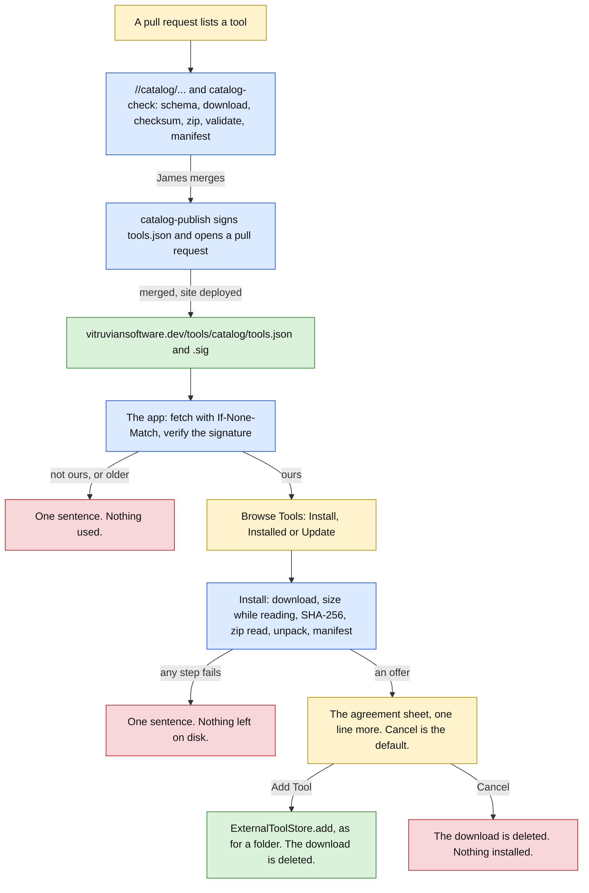

# Tools for everyone (stage C: the catalogue) Implementation Plan

> **For agentic workers:** REQUIRED SUB-SKILL: Use superpowers:subagent-driven-development (recommended) or superpowers:executing-plans to implement this plan task-by-task. Steps use checkbox (`- [ ]`) syntax for tracking.

**Goal:** Let a person install a tool from a curated list in two steps: pick it in Settings, then agree on the same sheet a folder gets. The list lives in this repository as `catalog/tools.json`, changes only by a pull request James merges, is signed in CI, and is served by the website beside a page that lists it. The app refuses a list that is not signed with VitruvianSoftware's key, and a download whose size or checksum is not the one the list pins. It says "Update available" when the list has a newer version of a tool installed from it.

**Architecture:** Three parts, each with its own checks.

- **The list, in the repository.** `catalog/tools.json` and its schema. Two kinds of check: one with no network, `//catalog/...`, that every pull request runs; and one that fetches each new or changed download, `.github/workflows/catalog-check.yaml`, on a pull request that touches `catalog/`. After a merge, `.github/workflows/catalog-publish.yaml` signs the file and opens a pull request that writes the signed copy into the website.
- **The website.** `apps/web/vitruviansoftware-dev/tools/catalog.html`, drawn from `_data/tools.yml`, which `tools/sync-site-tools` writes from `catalog/tools.json`; and the signed files `tools/catalog/tools.json` and `.sig` that the app reads.
- **The app.** Five files in `Services/Platform/External/Catalogue/` and one view. `CatalogueWatch` fetches and verifies the list. `CatalogueInstaller` turns one entry into a `ToolOffer`, in a fixed order of checks, and does nothing more: the existing agreement sheet makes the `ToolConsent` and the existing `ExternalToolStore.add` installs, exactly as for a folder. Each screen is a view over a plain value that the tests check; no test draws a view.



Green is done, amber waits for a person, red is a stop with nothing changed, blue is in progress.

**What a person sees:** a second button, "Browse Tools…", on the card "Tools from outside" in Settings, Features; a sheet that lists the catalogue; one more line on the agreement sheet for a tool from it; four refusals; "Update available" on a tool's row and detail, with an Update button; a page of the website; and a paragraph of `docs/PRIVACY.md`. The mock-ups are `docs/superpowers/specs/2026-10-12-vitruvian-tools-for-everyone-stage-c-mockups.html`. Open that page beside each view you write.

**Tech Stack:** Swift 6 (strict concurrency), SwiftUI and AppKit, CryptoKit (`Curve25519.Signing`, `SHA256`), `URLSession`, `/usr/bin/ditto`, the app's own `TestSuite` harness; Python 3 with `jsonschema` and `cryptography` from `@pip` (both in `requirements/all.txt`); GitHub Actions; Jekyll in safe mode; Bazel with `--config=macos-app` for the app.

**Spec:** `docs/superpowers/specs/2026-10-12-vitruvian-tools-for-everyone-design.md`, section 11 row C: "`catalog/`, its schema and CI checks, signing, the website page, `CatalogueInstaller`, `CatalogueWatch`, 'Browse Tools…', updates, the twelve strings, the privacy page. Mock-ups first." Sections 3 (decisions 9 to 14 and 22), 7, 12, 13 and 14 apply. Nothing of stages A, B, D, E or F is in this plan.

**Release:** two pull requests, in this order.

1. **The list and its machinery** (Tasks 2 to 5, worker `forge`), titled `feat(ci): the tool catalogue, its checks, its signature and its page`. It cuts no app release. It must merge before the app's: the app reads a file this pull request makes the website serve.
2. **The app** (Tasks 1 and 6 to 10, workers `wren` then `compass`), titled `feat(desktop): install tools from the Vitruvian catalogue`. `main` takes squash merges, so that title is the commit, and merging it **cuts a minor release of the app**. Within it, Task 9 is `feat(desktop): …` and the others are `refactor(desktop): …`.

Task commits use `feat(ci): …` for the catalogue and its workflows, `feat(site): …` for the website, `refactor(desktop): …` or `feat(desktop): …` for the app. A path that starts with `Sources/`, `Tests/`, `Tools/`, `bazel/`, `docs/PRIVACY.md` or names `BUILD`, `AGENTS.md`, `README.md` or `UPSTREAM.md` alone is relative to `apps/desktop/vitruvian/` in Tasks 1 and 6 to 10. Every other path is from the repository's root.

**Before Task 3, James does one thing** (section "What James does once" at the end): he makes the signing key, stores its private half as the secret `CATALOG_SIGNING_KEY`, and gives the worker its public half, one line of base64. Every listing below writes `REPLACE_WITH_THE_CATALOGUE_PUBLIC_KEY` where that line goes: in `catalog/public-key.txt` (Task 3), in `CatalogueSigning.publicKey` (Task 6), and in the `public_key` of `_data/tools.yml` (Task 5, written by the sync). Three tests fail until the real line is in all three places: `//catalog:signing_test`, `//catalog:catalog_test` and the `tool-runtime` check "the app is built with a catalog key". The plan was built and run with a key made for the run and thrown away; that line is the only difference between a listing and what ran.

## Decisions this plan makes

The design's decisions stand, and so do those of the stages before. These are the ones it leaves open, or that the code forced. Where the design and the code disagree, the row says so in those words. Task 10 records the differences in the design's section 11; it does not rewrite the design's sections.

| # | Decision | Why |
|---|---|---|
| 1 | **The catalogue is `catalog/` at the repository's root, as the design says, and `tools/conformance/check.sh`'s list of allowed roots gains one word, `catalog`.** **The design and the code disagree:** `check_root_directories` fails for any root it does not list, and it lists `apps packages infrastructure gitops tools docs requirements node_modules ds-bundle scratchpad`. | It is content, not an app, a library or tooling, and its pull requests and history read as listings. The alternative, `tools/catalog/`, needs no change to the check. |
| 2 | **What is signed is the exact bytes of `catalog/tools.json` at the commit on `main`.** The website serves a byte copy. `tools.json.sig` is the 64 bytes of the Ed25519 signature in base64 and a newline: 89 bytes. The app trims spaces and line endings around it, decodes 64 bytes, and asks `Curve25519.Signing.PublicKey.isValidSignature`. | Nothing re-encodes the list between the signer and the app, so there is nothing to canonicalise. Base64 keeps the file printable for a person checking it by hand. |
| 3 | **The key is made once with OpenSSL 3 or later, not `ssh-keygen`.** The private half is the 32 raw bytes in base64; the public half is the 32 raw bytes in base64. **Differs from the design**, whose section 12 says `ssh-keygen -t ed25519` is enough. | `ssh-keygen` writes OpenSSH's own format, from which the raw key takes a parser. macOS's `/usr/bin/openssl` is LibreSSL 3.3.6 and has no Ed25519 (checked: `Algorithm ed25519 not found`); Homebrew's OpenSSL does. |
| 4 | **Signing opens a pull request; nothing is pushed to `main`.** `catalog-publish` runs on a push to `main` that changes `catalog/tools.json`, signs `main` as it is when the job starts, and writes the two files on the branch `auto/catalog-publish`, as `site-sync-downloads` does with its App token. | `main` takes changes only through the merge queue and its rulesets. The App token can bypass them; using that would put a signed file on the website that no required check saw. A pull request goes through the queue like any other. Decision 5 says what holds the copy. |
| 5 | **No test checks the website's signed copy against `catalog/tools.json`.** The copy lags the list by one pull request, by design; a drift test would fail `main` between the two merges. What holds the copy is `sign.py`, which refuses to sign with a key whose public half is not `public-key.txt`, and verifies its own signature before it writes anything. | A check of the copy would either fail on purpose for a while after every listing or need to know about the pull request in flight. |
| 6 | **Where CI stops and the reviewer starts.** `//catalog:catalog_test` (no network, every pull request) checks the schema and the rules JSON Schema cannot say. `catalog-check` (network, on a pull request touching `catalog/`) fetches each new or changed entry's download, compares its size and SHA-256, reads the zip as the app does, unpacks it, runs `vitruvian-tool validate` built from the repository in the same job, and compares the manifest with the entry. James still reads three things no check can: who made the tool and what its source does, the words shown as the tool wrote them, and that the release belongs to the repository in `source`. `catalog/README.md` lists them. | CI can prove the entry describes the zip. Only a person can judge whether the zip is something to offer. |
| 7 | **`catalog-check` is not a required check.** The README asks the reviewer to merge only with it green. | Making it required is a change to `repo-config`'s rulesets, a stage of its own; and it runs only on pull requests that touch `catalog/`, so as a required check it would wedge every other pull request. |
| 8 | **A download comes from a GitHub release of a `VitruvianSoftware` repository and from nowhere else**: the schema's pattern for `download.url` and `DOWNLOAD_PREFIXES` in `catalog_rules.py`. A listed host is added in both by a pull request of its own. An address with `..` or `.` as a segment, a query, a fragment, a backslash or a `%` is refused. The app itself checks only that every address and every redirect is `https`. | The pin on the checksum protects the bytes wherever they come from; the list of places protects against a listing that points somewhere nobody meant. The app does not repeat the list: it would need a release to add a host. |
| 9 | **A catalogue zip has `vitruvian-tool.json` at its top, no links, nothing encrypted, and no Zip64.** The app reads the zip's central directory before anything is written, refuses a name that is empty, absolute, starts with `~`, holds a backslash or NUL, or has a part that is empty, `.` or `..`; and refuses more than `ToolLimits.folderItems` entries or `ToolLimits.folderBytes` declared bytes. | A link is how a zip writes outside its folder through a later entry. A tool's folder added by hand may hold links; one from the catalogue may not, and the README says so. |
| 10 | **The app unpacks with `/usr/bin/ditto -x -k --norsrc --noextattr --noqtn --noacl`, off the main thread, with a time limit of 120 seconds**, then walks what it unpacked: every file inside the folder, no link, within the limits, and named by the directory. | The app has no zip reader of its own and runs `ditto` in three places already (`every_system_tool_is_where_it_is_expected` lists it). Checked on this Mac: given `../escaped.txt` and `/tmp/x`, both `ditto` and `unzip` write inside the folder; given a link and a file through it, `ditto` exits 1. The checks before and after make that behaviour a second line, not the first. `--noqtn` and `--noextattr` keep an AppleDouble entry from setting a quarantine or another attribute. |
| 11 | **The order is fixed and each step runs only when the one before passed:** the list's signature (when it is fetched); the download, refused as soon as it passes the pinned size; its size and SHA-256; the zip's directory; `ditto`; the walk; the manifest's id and version; `ExternalToolStore.offer(from:catalogue:)`. A refusal deletes the download's folder before the person is told. | The design's order. Hashing while reading means the bytes are never read twice. |
| 12 | **`CatalogueInstaller` never makes a `ToolConsent`.** It returns a `ToolOffer` with `catalogue` set; the section shows the existing `ToolAgreementSheet`, whose Add button is still the only maker of a consent (`only_the_agreement_sheet_consents`). On Add or Cancel the section calls `CatalogueInstaller.finished(with:)`, which deletes the download's folder, and only a folder inside the installer's own. | The agreement is the one safety moment, and its shape is held by a source rule that already exists. |
| 13 | **The download's folder is under the temporary folder, `com.vitruviansoftware.vitruvian.catalog/<uuid>/`**, and `CatalogueInstaller.sweep()` deletes the whole folder at launch. | A quit between the download and the sheet leaves nothing that outlives the next launch. |
| 14 | **The record gains `catalogue: { id, version, source, download }`, optional, left out of the file when nil.** The agreement's `source` for a tool from the catalogue is the download's address. `InstalledTools.json` stays version 1. Updating a tool from a folder clears `catalogue`. | An older app reads such a record and ignores the field; a record of a tool added by hand is written byte for byte as before. A tool updated by hand is no longer the catalogue's to compare. |
| 15 | **Only a record with `catalogue` set is ever compared with the list.** A tool added from a folder with the same id shows "Installed" in the sheet and is never offered an update. | The design's rule. A hand-added tool with a listed id is someone's own build. |
| 16 | **The app fetches the list when Browse Tools… opens, and at launch and once a day only while a tool from the catalogue is installed.** With none, it makes no request on its own. **Differs from the design**, whose section 7.4 says at launch and once a day. | Nothing to compare means nothing to fetch; a person who never uses the catalogue sends nothing. A day is 86,400 seconds of `SystemToolClock`, which does not count sleep. |
| 17 | **The app keeps the last list that verified, with its signature and ETag, in `Catalog.json` in its support folder**, verifies it again whenever it reads it, sends the ETag as `If-None-Match`, and refuses a signed list whose `generated` is older than the kept one. **Adds to the design.** | `If-None-Match` needs the body of the list it names. Refusing an older list stops a replayed, once-valid list from offering a tool that was taken off. |
| 18 | **An entry the app cannot read is left out, and the others are kept.** One whose `protocol` the app does not speak, or whose `minimumAppVersion` is above the app's, is not shown. A build whose version is not semver, a development build, sees all. A list that is not version 1 is no list. | The sheet then never offers what the app cannot install, and needs no string to say why. |
| 19 | **The agreement sheet for a tool from the catalogue says where it is from as the tool's source** (`From github.com/VitruvianSoftware/vitruvian-sdk`), **and adds one line**: "From the Vitruvian catalog: VitruvianSoftware listed this tool, and the download is exactly the one it listed." | The folder it was unpacked into is the app's own and gone when the sheet closes. The bold statement under the line still says the tool can do anything. |
| 20 | **Thirteen new texts, not "about twelve"**: the button, the sheet's title and empty state, Install, Installed, Update available, Update, the agreement line, four refusals, and the title of a refused install. Two words the app has are used as they are. A failed download says the "could not reach" sentence; a sheet that could not fetch or verify shows its sentence in place of the list; there is no Try Again button, because reopening the sheet tries again. | Every refusal names what happened in one sentence. A sentence per check (size, checksum, zip, manifest) would be four more for a difference only a tool's author can act on, and CI has already checked the same things. |
| 21 | **The app's English says "catalog"**, as its other English does ("a public catalog" in App updates); the plan, the README and the website's prose say "catalogue" where the design does, and the website's page title says "catalog" to match the app. | The app is en-US. |
| 22 | **The fourteen other languages are written in the same file, by the same hand as the English**, as the 46 before them; a model wrote them for this plan, matching each language's existing register (German and Italian say "du" and "tu", French and Portuguese "vous" and "você"). The compiler and `ExternalToolStringsTests` hold that each is there, translated and filled the same way. Nobody who reads those languages has read them. | The repository's own way, said plainly. |
| 23 | **A rehearsal catalogue for the checks by hand.** A build made with `--define=vitruvian_sample_tool=true` reads `VITRUVIAN_CATALOGUE_URL` (http on 127.0.0.1) and `VITRUVIAN_CATALOGUE_KEY` at launch, from `main.swift` inside `#if VITRUVIAN_SAMPLE_TOOL`; `bazel run //catalog:rehearse` serves one, signed with a key made for the run, with a scenario for each refusal and for an update. A new source rule, `only_a_by_hand_build_rehearses_the_catalog`, fails for any other line that points the catalogue elsewhere. **Adds to the design.** | The production list starts empty (decision 24), so a person could not otherwise see an install, an update or three of the refusals before a tool is listed. |
| 24 | **The production catalogue starts empty**: `{"version": 1, "generated": …, "tools": []}`. The first tool is listed by its own pull request, through the checklist. | This plan lists nothing it did not build. Stage E's GitHub tool is the design's first listing; see "Calls" in the report for listing the SDK's reference tool sooner. |
| 25 | **Nothing of the catalogue goes through the broker.** `Services/Platform/Broker/` does not change. | The catalogue is the app's own code fetching on the person's behalf, not a tool asking for a service. |
| 26 | **`tools/sync-site-tools` is written so stage A can add to it in either order.** `sync.py` runs a list of parts, `PARTS = [catalogue]`; each part is a module with `outputs(root)`. If stage A has merged first with a `sync.py` of its own, Task 5 adds `catalogue.py` as one more part of it and adds its four files to `in_sync_test`'s data; if this plan merges first, stage A adds its parts to this `PARTS`. A conflict in `sync.py` or its `BUILD` is resolved by keeping both lists whole. | One sync and one drift test for the section, as the design asks, whatever lands first. |
| 27 | **`catalog/BUILD` and `tools/sync-site-tools/BUILD` are written by hand and say `# gazelle:ignore`**, as `tools/sync-downloads/BUILD` does. | Without it `//:tidy` fails: gazelle names a library after the folder and clashes with the binary of the same name. |
| 28 | **The tests stay in the suite `tool-runtime`**, which grows from 676 checks to 728. `platform` keeps its 793. A full run still reports `TESTS OK (49 suites)`. The source rules grow from 50 to 51. | The new tests reuse stage C's store bench. |
| 29 | **Not in this stage:** a tool listed in the catalogue; a page listing every tool with search; the catalogue on the island; automatic updates; Stage A's pages of the Tools section; a required `catalog-check`. | Stages A, D and E, and repo-config. |

## Global Constraints

- **Everything in this plan was built and run before it was written down.** The tree at `858211bb2` (this branch's base, today's `main`) was exported to a scratch folder outside the repository, each task was applied in order as one commit, and each task's state was built and tested by itself on a Mac16,5 (Apple M4 Max) with macOS 27.0, Xcode 27.0 and Swift 6.4: the `tool-runtime` and `platform` suites, `source_lints_test`, `sources_in_sync_test` and `upstream_test` for an app task; `//catalog/...` and `//tools/sync-site-tools:in_sync_test` for the others. The counts in each task are from those runs. Every mutation listed was applied and seen to fail its test with the message given. Task 10's "What was run for this plan" gives the rest, and says what was not run: the real network, a GitHub runner, the website's build, the real signing key, and the app itself.
- **How to read a listing.** A block that starts with `// SPDX-License-Identifier`, `# Copyright`, `#!/usr/bin/env python3` or that names a new file is the whole file. A block that starts with `diff --git` is a change to a file that exists, as `git diff` prints it; save it and run `git apply <file>` from the repository root, or make the change by hand. Each is a change from the state the task before left. Every listing was taken by a script from the commits the tests ran on, not typed; the script fails when a file a task changed has no listing in that task. The exceptions are `Tests/mutation_checks.py` and `UPSTREAM.md`, which each task gives as the entries to add, and the one line of the public key (see the top). If the base has moved and a listing no longer applies, make the smallest change that keeps its meaning and record it as a deviation.
- **Licences.** Under `apps/desktop/vitruvian/` every new file is GPL-3.0-or-later and starts with exactly `// SPDX-License-Identifier: GPL-3.0-or-later` and `// Copyright (C) 2026 VitruvianSoftware`. Under `catalog/`, `tools/` and `.github/workflows/` every new Python, `BUILD` and YAML file starts with the MIT header its neighbours carry (`tools/sync-downloads/sync_downloads.py`). JSON, Markdown, `public-key.txt` and the website's files carry none, as their neighbours do; `//tools/license:check` ignores `docs/`, the website and the app. Never edit a `Copyright (C) 2026 Vorssaint` header.
- **`UPSTREAM.md`.** Every change to a file whose header says `Copyright (C) 2026 Vorssaint`, or that upstream wrote with no header, is named under "Modifications" in the same commit. In this stage: `Tests/mutation_checks.py` (Tasks 1, 6 to 9), `Sources/Vitruvian/main.swift` (Task 9), `AGENTS.md` and `docs/PRIVACY.md` (Task 10). Task 1 adds the stage's entry as the first of the list; each later task adds one line to it. Check the header of every file you change; do not trust this list.
- **What a person can see changes only where a task says so.** Built-in tools and tools added from a folder are untouched: `platform` reports 793 checks after every task, every existing check of `tool-runtime` keeps passing, and `InstalledTools.json` for a tool added from a folder is written byte for byte as before.
- **No `pipeline_unit` changes.** The new Python tests run in the `build-test` lane, which tests every affected target under `//...`; the app's tests are in its unit already. So `.github/workflows/presubmit.yaml` does not change; Task 10 regenerates it to prove so. If you ever edit a `pipeline_unit`, keep round brackets out of that call's comments and regenerate.
- **Layers, access and threads.** `Core <- Design <- Services <- UI <- App`, all in Swift 6 mode; the production modules are not isolated by default, the test module is `MainActor` by default. What another module or the tests use is `package`. The store, the installer and the watch are `@MainActor` and never wait. Network work happens on `URLSession`'s queue; the checks after a download run on `Parts.work` (a utility queue in the app); each result comes back through `Parts.toMain`. In the tests both are the calling thread, and the fake fetcher answers at once, so no test waits.
- **Strings.** A text a person reads is a field of `ExternalToolStrings`, in all fifteen languages, and in the table under "The strings". Do not write a sentence into a view, and do not join texts in a view: the catalogue sheet shows what a tool uses one to a line, as the agreement sheet does. A format is filled by a method of the struct. Use the typographic apostrophe (’) and the ellipsis character (…), and no em-dash. French puts `\u{00A0}` before `:`, `?`, `!` and `;` and inside « ».
- **Tests.** As stage C of the external tools: a synchronous `static func run(_ suite: TestSuite)` reached from `Tests/TestGroups.swift`; no test type named like a system type or the app's; no test reads a source file as text or draws a view; every file under `FileManager.default.temporaryDirectory` in a folder the bench makes and removes; preferences only in `com.vitruviansoftware.vitruvian.tests.*`; no deadline but on `ManualToolClock`. New for this stage: **no test touches the network**. The list and each download come from `FakeCatalogueFetcher`, a table keyed by address. Zips are made byte by byte by `TestZip`, so a test can make one no tool would. The real `/usr/bin/ditto` unpacks them, under the temporary folder, and returns within a second; `CatalogueArchive.unpack` bounds it at 120 seconds.
- **Build and test through Bazel only**, from the repository root, one command at a time:
  ```sh
  bazel test --config=macos-app //apps/desktop/vitruvian:unit_tests --test_arg=--suite=tool-runtime --test_arg=--suite=platform --test_output=errors
  grep -aE "^(platform|tool-runtime): |TESTS" bazel-testlogs/apps/desktop/vitruvian/unit_tests/test.log
  bazel test //apps/desktop/vitruvian:source_lints_test //apps/desktop/vitruvian:sources_in_sync_test //apps/desktop/vitruvian:upstream_test
  bazel test //catalog/... //tools/sync-site-tools:in_sync_test
  ```
  A full run of the unit tests needs the display awake and the screen unlocked: start it with `(caffeinate -u -d -t 900 &);`.
- **Do not launch the app from a task**, do not write to the preferences domain `com.vitruviansoftware.vitruvian`, and create nothing under the app's real support folder. Do not fetch anything from GitHub or the website from a task. The checks that need the running app or the network are "By hand", and a person does them.
- **Mutations.** `Tests/mutation_checks.py` quotes source lines exactly. Each app task gives its entries. For each: apply it by hand, run the `tool-runtime` suite, confirm it fails with the sixth field among the messages, undo it by hand, and confirm `git diff --stat -- <file>` shows only the task's own change. The Python tasks name one planted regression each, by hand, the same way. If a mutation is not caught, stop and report; do not adjust a test to fit.
- **Formatting and gates.** After editing a `.py`, `.json` or `BUILD` file run `bazel run //tools/format -- <path>`. Task 10 runs `bazel run //tools/license:check`, `bazel run //tools/license:verify`, `bazel run //tools/conformance:check`, `actionlint` on the two workflows, and `bazel run //:tidy`. On this base `//:tidy` adds one unrelated line, `Cryptodome: pycryptodomex`, to `gazelle_python.yaml`: undo it by hand and do not commit it.
- **Git.** Never `git stash`, `git reset` or `git restore`; undo an edit by hand. Commits are authored as the task's worker, with identity and commit in one command. In a worktree the keys are in the main checkout:
  ```sh
  export AGENT_KEY_DIR=/Users/james/Workspace/gh/application/vitruvian/vitruvian-core/tools/sync-env-secrets/agent-keys; eval "$(bazel run //tools/agent-app -- env <worker> 2>/dev/null)"; git add <files> && git commit -m "<title>"
  ```
- **Signing.** The app is signed ad hoc, as today; nothing here signs or notarizes it. The catalogue's key signs the list only. No step of this plan reads `CATALOG_SIGNING_KEY` but the workflow; no worker ever sees it.

## Review Focus

Where a mistake costs most. Each has a test in the task named.

1. **Nothing is installed before the person agrees, and the catalogue cannot agree for them.** `CatalogueInstaller` returns an offer and nothing else; after `prepare` the store lists nothing, has no file of records and no copy, and no program started (Task 7, `CatalogueInstallerTests.anOffer`, and the mutation "a tool from the catalog is installed before the person agrees", which `only_the_agreement_sheet_consents` also catches). Read `ExternalToolsSection.install(_:)` and the sheet's `onAgree` and `onCancel` yourself: no test presses a button.
2. **The order of the checks, and nothing left behind.** `CatalogueInstaller.check` and `unpack` (Task 7). Each refusal comes from its own step, and after each one the installer's folder is empty, nothing escaped, and the store is untouched (`CatalogueInstallerTests.refusals`). The checksum case serves another good tool of the same size, so only the checksum can refuse it.
3. **The signature.** `CatalogueSigning.verify` against RFC 8032's own vectors, a changed byte, an added byte, another key, a short signature (Task 6). `sign.py` refuses a key that is not `public-key.txt`'s and writes nothing (Task 3). `//catalog:catalog_test` holds `public-key.txt` and `CatalogueSigning.publicKey` to one line (Task 6). Read `catalog-publish.yaml`: it signs `main`, opens a pull request, and never pushes to `main`.
4. **A zip cannot write outside its folder.** `CatalogueArchive.vet` refuses before `ditto` runs; `looksRight` checks after (Task 7). `catalog_rules.zip_problems` is the same rule in CI, and `catalog-check` never runs what it downloads (Task 4).
5. **Updates only for what came from the catalogue, and only newer.** `CatalogueWatch.update(for:)` (Task 8): a hand-added tool with a listed id, the same version, an older one, one for another protocol or a newer app: none is an update. An older list signed by us is refused. With no tool from the catalogue installed, nothing is fetched.
6. **A release build reads the website's list with the built-in key, and nothing else.** `CatalogueSource.inUse` is set only in `main.swift` inside `#if VITRUVIAN_SAMPLE_TOOL`, held by `only_a_by_hand_build_rehearses_the_catalog` (Task 6), and `CatalogueSource.production` is checked (Task 6, `CatalogueListTests.sources`).
7. **Every text in fifteen languages.** `ExternalToolStringsTests.count` is 59 (Task 1). Grep `ExternalToolCatalogueSheet.swift` for a quoted capital letter: there is none.

## The strings

The 13 texts this stage adds, each a field of `ExternalToolStrings` (Task 1), with its English text. `%@` is a slot the app fills. The other fourteen languages are in Task 1's listing; a model wrote them, matching the register of the 46 texts already there, and nobody who reads those languages has read them. The mock-ups use exactly these words.

| # | Key | English |
|---|---|---|
| 47 | `browseButton` | Browse Tools… |
| 48 | `catalogTitle` | The Vitruvian catalog |
| 49 | `catalogEmpty` | There are no tools in the catalog yet. |
| 50 | `installButton` | Install |
| 51 | `installedLabel` | Installed |
| 52 | `updateAvailable` | Update available |
| 53 | `updateNow` | Update |
| 54 | `agreeCatalog` | From the Vitruvian catalog: VitruvianSoftware listed this tool, and the download is exactly the one it listed. |
| 55 | `catalogUnreachable` | Vitruvian could not reach the catalog. Check your connection and try again. |
| 56 | `catalogNotOurs` | This list of tools is not signed by VitruvianSoftware, so Vitruvian will not use it. |
| 57 | `downloadMismatch` | The download is not the one the catalog lists, so nothing was installed. |
| 58 | `downloadNotTheTool` | The download is not the tool the catalog says it is, so nothing was installed. |
| 59 | `installRefusedFormat` | “%@” was not installed |

Words the app already has, used as they are:

| Where | The app's string | English |
|---|---|---|
| The catalogue sheet's button, and the button of its alert | `Strings.menuClose` | Close |
| Over what a tool says it uses, in the sheet | `ExternalToolStrings.usesTitle` | What it says it uses |
| Each service a tool lists | `ExternalToolStrings.use(_:)` | The seven plain phrases, as on the agreement sheet |

Shown as the catalogue copies them, and never translated by the app: a tool's name, publisher, version and summary. The website's page is in English only; it uses the app's English words for what a tool uses.

---

### Task 1: The words, in fifteen languages

Worker: `wren`. Commit: `refactor(desktop): the words of the tool catalogue, in fifteen languages`. Pull request 2.

**Files:**
- Modify: `Sources/Vitruvian/Core/ExternalToolStrings.swift`
- Modify: `Tests/ExternalToolStringsTests.swift`
- Modify: `Tests/mutation_checks.py`, `UPSTREAM.md`

**Interfaces:**
- Consumes: `ExternalToolStrings`, `FeatureStrings.externalTools(_:)`, `TestFormat`.
- Produces: 13 more `String` fields of `ExternalToolStrings` (the table above) and `installRefused(_ name: String) -> String`. `ExternalToolStringsTests.count` becomes 59.

The words come first because every later app task shows one. Nothing shows them yet. Each field is added after `stoppedFormat`, in the struct, in `all`, and in each language's initializer, so a language that is missing one does not compile.

- [ ] **Step 1: Write the failing test**

```diff
diff --git a/apps/desktop/vitruvian/Tests/ExternalToolStringsTests.swift b/apps/desktop/vitruvian/Tests/ExternalToolStringsTests.swift
index faeee28..3f2315b 100644
--- a/apps/desktop/vitruvian/Tests/ExternalToolStringsTests.swift
+++ b/apps/desktop/vitruvian/Tests/ExternalToolStringsTests.swift
@@ -11,7 +11,7 @@ import VitruvianCore
 enum ExternalToolStringsTests {
     /// How many texts the screens for tools from outside add. A text added
     /// or taken away changes this number on purpose, with the plan's table.
-    static let count = 46
+    static let count = 59
 
     static func run(_ suite: TestSuite) {
         let english = FeatureStrings.externalTools(.enUS).all
@@ -57,7 +57,8 @@ enum ExternalToolStringsTests {
                          == "The folder is too large. A tool can hold up to 256 MB and 10,000 files."
                          && strings.stopped("Deploys") == "“Deploys” stopped working"
                          && strings.removeKeptTitle("Deploys") == "What “Deploys” saved was kept"
-                         && strings.removeUndeletedTitle("Deploys") == "Some files of “Deploys” could not be deleted",
+                         && strings.removeUndeletedTitle("Deploys") == "Some files of “Deploys” could not be deleted"
+                         && strings.installRefused("Deploys") == "“Deploys” was not installed",
                      "a format is filled with what it is handed, in the order the sentence names it")
         let listable: [Capability] = [.notify, .open, .clipboardRead, .clipboardWrite, .keystrokes, .processes, .storage]
         suite.expect(Capability.allCases.filter { strings.use($0) != nil } == Capability.allCases.filter(listable.contains)
@@ -66,7 +67,10 @@ enum ExternalToolStringsTests {
                      "each of the seven services a tool from outside may list has its own plain words, and no other has any")
         suite.expect(FeatureStrings.externalTools(.de).removeTitle("Deploys") == "„Deploys“ entfernen?"
                          && FeatureStrings.externalTools(.fr).agreeTitle("Deploys")
-                         == "Ajouter «\u{00A0}Deploys\u{00A0}» à Vitruvian\u{00A0}?",
+                         == "Ajouter «\u{00A0}Deploys\u{00A0}» à Vitruvian\u{00A0}?"
+                         && FeatureStrings.externalTools(.fr).installRefused("Deploys")
+                         == "«\u{00A0}Deploys\u{00A0}» n’a pas été installé"
+                         && FeatureStrings.externalTools(.ja).installRefused("Deploys") == "「Deploys」はインストールされませんでした",
                      "a tool's name is quoted the way each language quotes")
     }
 }
```

Run: `bazel test --config=macos-app //apps/desktop/vitruvian:unit_tests --test_arg=--suite=tool-runtime --test_output=errors`
Expected: the build fails. Among the errors: `value of type 'ExternalToolStrings' has no member 'installRefused'`.

- [ ] **Step 2: Write the strings**

Type the English exactly: a changed word changes what a person agrees to. The other fourteen languages were written by a model for this plan, in the register each already uses in this file; keep them as they are unless a reader of the language corrects them.

```diff
diff --git a/apps/desktop/vitruvian/Sources/Vitruvian/Core/ExternalToolStrings.swift b/apps/desktop/vitruvian/Sources/Vitruvian/Core/ExternalToolStrings.swift
index 1a41a7e..b04a499 100644
--- a/apps/desktop/vitruvian/Sources/Vitruvian/Core/ExternalToolStrings.swift
+++ b/apps/desktop/vitruvian/Sources/Vitruvian/Core/ExternalToolStrings.swift
@@ -79,6 +79,31 @@ package struct ExternalToolStrings {
     package let removeUndeletedMessage: String
     /// The app's short on-screen message. `%@` is the tool's name, as the tool wrote it.
     package let stoppedFormat: String
+    /// The button beside "Add a Tool…" that opens the catalog.
+    package let browseButton: String
+    /// The title of the sheet that lists the catalog.
+    package let catalogTitle: String
+    /// The sheet's one line when the catalog lists no tool this app can install.
+    package let catalogEmpty: String
+    package let installButton: String
+    /// In place of the install button, for a tool that is added already.
+    package let installedLabel: String
+    /// Beside a tool from the catalog, in its row and its detail, when the catalog has a newer version.
+    package let updateAvailable: String
+    /// The button that fetches the newer version from the catalog.
+    package let updateNow: String
+    /// The one line the agreement sheet adds for a tool from the catalog.
+    package let agreeCatalog: String
+    /// The list, or a tool's download, could not be fetched.
+    package let catalogUnreachable: String
+    /// The list's signature is not one the app's own key made.
+    package let catalogNotOurs: String
+    /// The download's size or SHA-256 is not the one the catalog pins.
+    package let downloadMismatch: String
+    /// The download is no tool, holds a path that leaves its folder or a link, or names another tool or version.
+    package let downloadNotTheTool: String
+    /// The title of the alert after an install from the catalog was refused. `%@` is the tool's name, as the catalog gives it.
+    package let installRefusedFormat: String
 
     package func agreeTitle(_ name: String) -> String {
         String(format: agreeTitleFormat, locale: Locale.current, name)
@@ -112,6 +137,10 @@ package struct ExternalToolStrings {
         String(format: stoppedFormat, locale: Locale.current, name)
     }
 
+    package func installRefused(_ name: String) -> String {
+        String(format: installRefusedFormat, locale: Locale.current, name)
+    }
+
     package func refusalMistake(_ detail: String) -> String {
         String(format: refusalMistakeFormat, locale: Locale.current, detail)
     }
@@ -193,6 +222,19 @@ package struct ExternalToolStrings {
             ("removeUndeletedTitleFormat", removeUndeletedTitleFormat),
             ("removeUndeletedMessage", removeUndeletedMessage),
             ("stoppedFormat", stoppedFormat),
+            ("browseButton", browseButton),
+            ("catalogTitle", catalogTitle),
+            ("catalogEmpty", catalogEmpty),
+            ("installButton", installButton),
+            ("installedLabel", installedLabel),
+            ("updateAvailable", updateAvailable),
+            ("updateNow", updateNow),
+            ("agreeCatalog", agreeCatalog),
+            ("catalogUnreachable", catalogUnreachable),
+            ("catalogNotOurs", catalogNotOurs),
+            ("downloadMismatch", downloadMismatch),
+            ("downloadNotTheTool", downloadNotTheTool),
+            ("installRefusedFormat", installRefusedFormat),
         ]
     }
 }
@@ -244,7 +286,20 @@ extension ExternalToolStrings {
         removeKeptMessage: "Its program would not stop, so Vitruvian did not delete what the tool saved. It is in this folder:",
         removeUndeletedTitleFormat: "Some files of “%@” could not be deleted",
         removeUndeletedMessage: "The tool is removed, but Vitruvian could not delete all of its files. What is left is here:",
-        stoppedFormat: "“%@” stopped working")
+        stoppedFormat: "“%@” stopped working",
+        browseButton: "Browse Tools…",
+        catalogTitle: "The Vitruvian catalog",
+        catalogEmpty: "There are no tools in the catalog yet.",
+        installButton: "Install",
+        installedLabel: "Installed",
+        updateAvailable: "Update available",
+        updateNow: "Update",
+        agreeCatalog: "From the Vitruvian catalog: VitruvianSoftware listed this tool, and the download is exactly the one it listed.",
+        catalogUnreachable: "Vitruvian could not reach the catalog. Check your connection and try again.",
+        catalogNotOurs: "This list of tools is not signed by VitruvianSoftware, so Vitruvian will not use it.",
+        downloadMismatch: "The download is not the one the catalog lists, so nothing was installed.",
+        downloadNotTheTool: "The download is not the tool the catalog says it is, so nothing was installed.",
+        installRefusedFormat: "“%@” was not installed")
 
     package static let ptBR = ExternalToolStrings(
         sectionTitle: "Ferramentas de fora",
@@ -292,7 +347,20 @@ extension ExternalToolStrings {
         removeKeptMessage: "O programa dela não parou, então o Vitruvian não apagou o que a ferramenta salvou. Está nesta pasta:",
         removeUndeletedTitleFormat: "Alguns arquivos de “%@” não puderam ser apagados",
         removeUndeletedMessage: "A ferramenta foi removida, mas o Vitruvian não conseguiu apagar todos os arquivos dela. O que restou está aqui:",
-        stoppedFormat: "“%@” parou de funcionar")
+        stoppedFormat: "“%@” parou de funcionar",
+        browseButton: "Explorar ferramentas…",
+        catalogTitle: "O catálogo do Vitruvian",
+        catalogEmpty: "Ainda não há ferramentas no catálogo.",
+        installButton: "Instalar",
+        installedLabel: "Instalada",
+        updateAvailable: "Atualização disponível",
+        updateNow: "Atualizar",
+        agreeCatalog: "Do catálogo do Vitruvian: a VitruvianSoftware listou esta ferramenta, e o download é exatamente o que ela listou.",
+        catalogUnreachable: "O Vitruvian não conseguiu acessar o catálogo. Verifique sua conexão e tente novamente.",
+        catalogNotOurs: "Esta lista de ferramentas não foi assinada pela VitruvianSoftware, então o Vitruvian não vai usá-la.",
+        downloadMismatch: "O download não é o que o catálogo lista, então nada foi instalado.",
+        downloadNotTheTool: "O download não é a ferramenta que o catálogo diz que é, então nada foi instalado.",
+        installRefusedFormat: "A ferramenta “%@” não foi instalada")
 
     package static let tr = ExternalToolStrings(
         sectionTitle: "Dışarıdan araçlar",
@@ -340,7 +408,20 @@ extension ExternalToolStrings {
         removeKeptMessage: "Programı durmadığı için Vitruvian aracın kaydettiklerini silmedi. Kaydettikleri şu klasörde:",
         removeUndeletedTitleFormat: "“%@” aracının bazı dosyaları silinemedi",
         removeUndeletedMessage: "Araç kaldırıldı, ancak Vitruvian aracın tüm dosyalarını silemedi. Kalanlar burada:",
-        stoppedFormat: "“%@” çalışmayı durdurdu")
+        stoppedFormat: "“%@” çalışmayı durdurdu",
+        browseButton: "Araçlara göz at…",
+        catalogTitle: "Vitruvian kataloğu",
+        catalogEmpty: "Katalogda henüz araç yok.",
+        installButton: "Yükle",
+        installedLabel: "Yüklendi",
+        updateAvailable: "Güncelleme var",
+        updateNow: "Güncelle",
+        agreeCatalog: "Vitruvian kataloğundan: Bu aracı VitruvianSoftware listeledi ve indirilen dosya tam olarak listelenen dosya.",
+        catalogUnreachable: "Vitruvian kataloğa ulaşamadı. Bağlantınızı kontrol edip yeniden deneyin.",
+        catalogNotOurs: "Bu araç listesi VitruvianSoftware tarafından imzalanmamış, bu yüzden Vitruvian onu kullanmayacak.",
+        downloadMismatch: "İndirilen dosya katalogda listelenen dosya değil, bu yüzden hiçbir şey yüklenmedi.",
+        downloadNotTheTool: "İndirilen dosya, kataloğun söylediği araç değil, bu yüzden hiçbir şey yüklenmedi.",
+        installRefusedFormat: "“%@” yüklenmedi")
 
     package static let ru = ExternalToolStrings(
         sectionTitle: "Сторонние инструменты",
@@ -388,7 +469,20 @@ extension ExternalToolStrings {
         removeKeptMessage: "Его программа не завершилась, поэтому Vitruvian не удалил сохранённые инструментом данные. Они в этой папке:",
         removeUndeletedTitleFormat: "Некоторые файлы «%@» не удалось удалить",
         removeUndeletedMessage: "Инструмент удалён, но Vitruvian не смог удалить все его файлы. То, что осталось, находится здесь:",
-        stoppedFormat: "«%@» перестал работать")
+        stoppedFormat: "«%@» перестал работать",
+        browseButton: "Обзор инструментов…",
+        catalogTitle: "Каталог Vitruvian",
+        catalogEmpty: "В каталоге пока нет инструментов.",
+        installButton: "Установить",
+        installedLabel: "Установлен",
+        updateAvailable: "Доступно обновление",
+        updateNow: "Обновить",
+        agreeCatalog: "Из каталога Vitruvian: VitruvianSoftware включила этот инструмент в каталог, и загруженный файл в точности тот, что указан в каталоге.",
+        catalogUnreachable: "Vitruvian не удалось связаться с каталогом. Проверьте подключение и попробуйте снова.",
+        catalogNotOurs: "Этот список инструментов не подписан VitruvianSoftware, поэтому Vitruvian не будет его использовать.",
+        downloadMismatch: "Загруженный файл не совпадает с указанным в каталоге, поэтому ничего не установлено.",
+        downloadNotTheTool: "Загруженный файл не является инструментом, указанным в каталоге, поэтому ничего не установлено.",
+        installRefusedFormat: "Инструмент «%@» не установлен")
 
     package static let es = ExternalToolStrings(
         sectionTitle: "Herramientas externas",
@@ -436,7 +530,20 @@ extension ExternalToolStrings {
         removeKeptMessage: "Su programa no se detuvo, así que Vitruvian no borró lo que la herramienta guardó. Está en esta carpeta:",
         removeUndeletedTitleFormat: "Algunos archivos de “%@” no se pudieron borrar",
         removeUndeletedMessage: "La herramienta se ha eliminado, pero Vitruvian no pudo borrar todos sus archivos. Lo que queda está aquí:",
-        stoppedFormat: "“%@” dejó de funcionar")
+        stoppedFormat: "“%@” dejó de funcionar",
+        browseButton: "Explorar herramientas…",
+        catalogTitle: "El catálogo de Vitruvian",
+        catalogEmpty: "Todavía no hay herramientas en el catálogo.",
+        installButton: "Instalar",
+        installedLabel: "Instalada",
+        updateAvailable: "Actualización disponible",
+        updateNow: "Actualizar",
+        agreeCatalog: "Del catálogo de Vitruvian: VitruvianSoftware incluyó esta herramienta, y la descarga es exactamente la que incluyó.",
+        catalogUnreachable: "Vitruvian no pudo acceder al catálogo. Comprueba tu conexión e inténtalo de nuevo.",
+        catalogNotOurs: "Esta lista de herramientas no está firmada por VitruvianSoftware, así que Vitruvian no la usará.",
+        downloadMismatch: "La descarga no es la que indica el catálogo, así que no se instaló nada.",
+        downloadNotTheTool: "La descarga no es la herramienta que el catálogo dice, así que no se instaló nada.",
+        installRefusedFormat: "No se instaló “%@”")
 
     package static let sk = ExternalToolStrings(
         sectionTitle: "Nástroje zvonka",
@@ -484,7 +591,20 @@ extension ExternalToolStrings {
         removeKeptMessage: "Jeho program sa nezastavil, preto Vitruvian nevymazal to, čo si nástroj uložil. Nachádza sa to v tomto priečinku:",
         removeUndeletedTitleFormat: "Niektoré súbory nástroja „%@“ sa nepodarilo vymazať",
         removeUndeletedMessage: "Nástroj je odstránený, ale Vitruvian nedokázal vymazať všetky jeho súbory. To, čo zostalo, sa nachádza tu:",
-        stoppedFormat: "„%@“ prestal fungovať")
+        stoppedFormat: "„%@“ prestal fungovať",
+        browseButton: "Prehľadávať nástroje…",
+        catalogTitle: "Katalóg Vitruvian",
+        catalogEmpty: "V katalógu zatiaľ nie sú žiadne nástroje.",
+        installButton: "Inštalovať",
+        installedLabel: "Nainštalovaný",
+        updateAvailable: "K dispozícii je aktualizácia",
+        updateNow: "Aktualizovať",
+        agreeCatalog: "Z katalógu Vitruvian: VitruvianSoftware tento nástroj zaradil do katalógu a stiahnutý súbor je presne ten, ktorý uviedol.",
+        catalogUnreachable: "Vitruvian sa nedokázal spojiť s katalógom. Skontrolujte pripojenie a skúste to znova.",
+        catalogNotOurs: "Tento zoznam nástrojov nepodpísal VitruvianSoftware, preto ho Vitruvian nepoužije.",
+        downloadMismatch: "Stiahnutý súbor nie je ten, ktorý uvádza katalóg, preto sa nič nenainštalovalo.",
+        downloadNotTheTool: "Stiahnutý súbor nie je nástroj, za ktorý ho katalóg vydáva, preto sa nič nenainštalovalo.",
+        installRefusedFormat: "Nástroj „%@“ sa nenainštaloval")
 
     package static let de = ExternalToolStrings(
         sectionTitle: "Werkzeuge von außen",
@@ -532,7 +652,20 @@ extension ExternalToolStrings {
         removeKeptMessage: "Sein Programm ließ sich nicht beenden, daher hat Vitruvian nicht gelöscht, was das Werkzeug gespeichert hat. Es liegt in diesem Ordner:",
         removeUndeletedTitleFormat: "Einige Dateien von „%@“ konnten nicht gelöscht werden",
         removeUndeletedMessage: "Das Werkzeug ist entfernt, aber Vitruvian konnte nicht alle seine Dateien löschen. Was übrig ist, liegt hier:",
-        stoppedFormat: "„%@“ funktioniert nicht mehr")
+        stoppedFormat: "„%@“ funktioniert nicht mehr",
+        browseButton: "Werkzeuge durchsuchen…",
+        catalogTitle: "Der Vitruvian-Katalog",
+        catalogEmpty: "Im Katalog sind noch keine Werkzeuge.",
+        installButton: "Installieren",
+        installedLabel: "Installiert",
+        updateAvailable: "Aktualisierung verfügbar",
+        updateNow: "Aktualisieren",
+        agreeCatalog: "Aus dem Vitruvian-Katalog: VitruvianSoftware hat dieses Werkzeug aufgenommen, und der Download ist genau der aufgeführte.",
+        catalogUnreachable: "Vitruvian konnte den Katalog nicht erreichen. Prüfe deine Verbindung und versuche es erneut.",
+        catalogNotOurs: "Diese Werkzeugliste ist nicht von VitruvianSoftware signiert, darum verwendet Vitruvian sie nicht.",
+        downloadMismatch: "Der Download ist nicht der, den der Katalog aufführt, darum wurde nichts installiert.",
+        downloadNotTheTool: "Der Download ist nicht das Werkzeug, das der Katalog angibt, darum wurde nichts installiert.",
+        installRefusedFormat: "„%@“ wurde nicht installiert")
 
     package static let fr = ExternalToolStrings(
         sectionTitle: "Outils externes",
@@ -580,7 +713,20 @@ extension ExternalToolStrings {
         removeKeptMessage: "Son programme ne s’est pas arrêté, donc Vitruvian n’a pas effacé ce que l’outil a enregistré. Cela se trouve dans ce dossier\u{00A0}:",
         removeUndeletedTitleFormat: "Certains fichiers de «\u{00A0}%@\u{00A0}» n’ont pas pu être effacés",
         removeUndeletedMessage: "L’outil est supprimé, mais Vitruvian n’a pas pu effacer tous ses fichiers. Ce qui reste se trouve ici\u{00A0}:",
-        stoppedFormat: "«\u{00A0}%@\u{00A0}» a cessé de fonctionner")
+        stoppedFormat: "«\u{00A0}%@\u{00A0}» a cessé de fonctionner",
+        browseButton: "Parcourir les outils…",
+        catalogTitle: "Le catalogue Vitruvian",
+        catalogEmpty: "Le catalogue ne contient encore aucun outil.",
+        installButton: "Installer",
+        installedLabel: "Installé",
+        updateAvailable: "Mise à jour disponible",
+        updateNow: "Mettre à jour",
+        agreeCatalog: "Du catalogue Vitruvian\u{00A0}: VitruvianSoftware a répertorié cet outil, et le téléchargement est exactement celui qui est répertorié.",
+        catalogUnreachable: "Vitruvian n’a pas pu joindre le catalogue. Vérifiez votre connexion et réessayez.",
+        catalogNotOurs: "Cette liste d’outils n’est pas signée par VitruvianSoftware, donc Vitruvian ne l’utilisera pas.",
+        downloadMismatch: "Le téléchargement n’est pas celui que le catalogue indique, donc rien n’a été installé.",
+        downloadNotTheTool: "Le téléchargement n’est pas l’outil que le catalogue annonce, donc rien n’a été installé.",
+        installRefusedFormat: "«\u{00A0}%@\u{00A0}» n’a pas été installé")
 
     package static let it = ExternalToolStrings(
         sectionTitle: "Strumenti esterni",
@@ -628,7 +774,20 @@ extension ExternalToolStrings {
         removeKeptMessage: "Il suo programma non si è fermato, quindi Vitruvian non ha eliminato ciò che lo strumento ha salvato. Si trova in questa cartella:",
         removeUndeletedTitleFormat: "Non è stato possibile eliminare alcuni file di “%@”",
         removeUndeletedMessage: "Lo strumento è stato rimosso, ma Vitruvian non è riuscito a eliminare tutti i suoi file. Ciò che resta si trova qui:",
-        stoppedFormat: "“%@” ha smesso di funzionare")
+        stoppedFormat: "“%@” ha smesso di funzionare",
+        browseButton: "Sfoglia strumenti…",
+        catalogTitle: "Il catalogo di Vitruvian",
+        catalogEmpty: "Non ci sono ancora strumenti nel catalogo.",
+        installButton: "Installa",
+        installedLabel: "Installato",
+        updateAvailable: "Aggiornamento disponibile",
+        updateNow: "Aggiorna",
+        agreeCatalog: "Dal catalogo di Vitruvian: VitruvianSoftware ha inserito questo strumento, e il download è esattamente quello indicato.",
+        catalogUnreachable: "Vitruvian non è riuscito a raggiungere il catalogo. Controlla la connessione e riprova.",
+        catalogNotOurs: "Questo elenco di strumenti non è firmato da VitruvianSoftware, quindi Vitruvian non lo userà.",
+        downloadMismatch: "Il download non è quello indicato nel catalogo, quindi non è stato installato nulla.",
+        downloadNotTheTool: "Il download non è lo strumento che il catalogo dichiara, quindi non è stato installato nulla.",
+        installRefusedFormat: "“%@” non è stato installato")
 
     package static let ja = ExternalToolStrings(
         sectionTitle: "外部ツール",
@@ -676,7 +835,20 @@ extension ExternalToolStrings {
         removeKeptMessage: "プログラムが停止しなかったため、Vitruvianはツールが保存したデータを削除しませんでした。データは次のフォルダにあります:",
         removeUndeletedTitleFormat: "「%@」の一部のファイルを削除できませんでした",
         removeUndeletedMessage: "ツールは削除されましたが、Vitruvianはそのファイルをすべて削除することはできませんでした。残っているものは次の場所にあります:",
-        stoppedFormat: "「%@」が動作を停止しました")
+        stoppedFormat: "「%@」が動作を停止しました",
+        browseButton: "ツールを参照…",
+        catalogTitle: "Vitruvianカタログ",
+        catalogEmpty: "カタログにはまだツールがありません。",
+        installButton: "インストール",
+        installedLabel: "インストール済み",
+        updateAvailable: "アップデートがあります",
+        updateNow: "アップデート",
+        agreeCatalog: "Vitruvianカタログから：VitruvianSoftwareがこのツールを掲載しており、ダウンロードしたファイルは掲載されたものと完全に一致しています。",
+        catalogUnreachable: "Vitruvianはカタログに接続できませんでした。接続を確認して、もう一度お試しください。",
+        catalogNotOurs: "このツールの一覧はVitruvianSoftwareによって署名されていないため、Vitruvianは使用しません。",
+        downloadMismatch: "ダウンロードしたファイルがカタログに掲載されたものと一致しないため、何もインストールされていません。",
+        downloadNotTheTool: "ダウンロードしたファイルがカタログに記載されたツールではないため、何もインストールされていません。",
+        installRefusedFormat: "「%@」はインストールされませんでした")
 
     package static let ko = ExternalToolStrings(
         sectionTitle: "외부 도구",
@@ -724,7 +896,20 @@ extension ExternalToolStrings {
         removeKeptMessage: "프로그램이 멈추지 않아 Vitruvian이 도구가 저장한 내용을 삭제하지 않았습니다. 저장한 내용은 다음 폴더에 있습니다:",
         removeUndeletedTitleFormat: "‘%@’의 일부 파일을 삭제하지 못했습니다",
         removeUndeletedMessage: "도구는 제거되었지만 Vitruvian이 도구의 파일을 모두 삭제하지는 못했습니다. 남은 파일은 다음 위치에 있습니다:",
-        stoppedFormat: "‘%@’의 작동이 중지되었습니다")
+        stoppedFormat: "‘%@’의 작동이 중지되었습니다",
+        browseButton: "도구 둘러보기…",
+        catalogTitle: "Vitruvian 카탈로그",
+        catalogEmpty: "카탈로그에 아직 도구가 없습니다.",
+        installButton: "설치",
+        installedLabel: "설치됨",
+        updateAvailable: "업데이트 있음",
+        updateNow: "업데이트",
+        agreeCatalog: "Vitruvian 카탈로그에서: VitruvianSoftware가 이 도구를 등록했으며, 다운로드한 파일은 등록된 파일과 정확히 같습니다.",
+        catalogUnreachable: "Vitruvian이 카탈로그에 연결하지 못했습니다. 연결을 확인하고 다시 시도하세요.",
+        catalogNotOurs: "이 도구 목록은 VitruvianSoftware가 서명하지 않았으므로 Vitruvian은 사용하지 않습니다.",
+        downloadMismatch: "다운로드한 파일이 카탈로그에 등록된 파일과 달라 아무것도 설치되지 않았습니다.",
+        downloadNotTheTool: "다운로드한 파일이 카탈로그에 적힌 도구가 아니어서 아무것도 설치되지 않았습니다.",
+        installRefusedFormat: "‘%@’이(가) 설치되지 않았습니다")
 
     package static let uk = ExternalToolStrings(
         sectionTitle: "Сторонні інструменти",
@@ -772,7 +957,20 @@ extension ExternalToolStrings {
         removeKeptMessage: "Його програма не завершилася, тому Vitruvian не видалив збережені інструментом дані. Вони в цій папці:",
         removeUndeletedTitleFormat: "Деякі файли «%@» не вдалося видалити",
         removeUndeletedMessage: "Інструмент вилучено, але Vitruvian не зміг видалити всі його файли. Те, що залишилося, міститься тут:",
-        stoppedFormat: "«%@» перестав працювати")
+        stoppedFormat: "«%@» перестав працювати",
+        browseButton: "Огляд інструментів…",
+        catalogTitle: "Каталог Vitruvian",
+        catalogEmpty: "У каталозі ще немає інструментів.",
+        installButton: "Встановити",
+        installedLabel: "Встановлено",
+        updateAvailable: "Доступне оновлення",
+        updateNow: "Оновити",
+        agreeCatalog: "З каталогу Vitruvian: VitruvianSoftware додала цей інструмент до каталогу, і завантажений файл точно той, що вказаний у каталозі.",
+        catalogUnreachable: "Vitruvian не вдалося зв’язатися з каталогом. Перевірте підключення та спробуйте ще раз.",
+        catalogNotOurs: "Цей список інструментів не підписано VitruvianSoftware, тому Vitruvian не використовуватиме його.",
+        downloadMismatch: "Завантажений файл не той, що вказаний у каталозі, тому нічого не встановлено.",
+        downloadNotTheTool: "Завантажений файл не є інструментом, указаним у каталозі, тому нічого не встановлено.",
+        installRefusedFormat: "Інструмент «%@» не встановлено")
 
     package static let zhHans = ExternalToolStrings(
         sectionTitle: "外部工具",
@@ -820,7 +1018,20 @@ extension ExternalToolStrings {
         removeKeptMessage: "它的程序没有停止，所以 Vitruvian 没有删除工具保存的内容。这些内容在此文件夹中：",
         removeUndeletedTitleFormat: "“%@”的部分文件无法删除",
         removeUndeletedMessage: "工具已移除，但 Vitruvian 无法删除它的全部文件。剩下的内容在这里：",
-        stoppedFormat: "“%@”已停止工作")
+        stoppedFormat: "“%@”已停止工作",
+        browseButton: "浏览工具…",
+        catalogTitle: "Vitruvian 目录",
+        catalogEmpty: "目录中还没有工具。",
+        installButton: "安装",
+        installedLabel: "已安装",
+        updateAvailable: "有可用更新",
+        updateNow: "更新",
+        agreeCatalog: "来自 Vitruvian 目录：VitruvianSoftware 收录了此工具，且下载的文件与收录的完全一致。",
+        catalogUnreachable: "Vitruvian 无法连接到目录。请检查网络连接，然后重试。",
+        catalogNotOurs: "此工具列表未经 VitruvianSoftware 签名，因此 Vitruvian 不会使用它。",
+        downloadMismatch: "下载的文件与目录中列出的不一致，因此未安装任何内容。",
+        downloadNotTheTool: "下载的文件不是目录所说的工具，因此未安装任何内容。",
+        installRefusedFormat: "未安装“%@”")
 
     package static let zhTW = ExternalToolStrings(
         sectionTitle: "外部工具",
@@ -868,7 +1079,20 @@ extension ExternalToolStrings {
         removeKeptMessage: "它的程式沒有停止，所以 Vitruvian 沒有刪除工具儲存的內容。這些內容在此檔案夾中：",
         removeUndeletedTitleFormat: "「%@」的部分檔案無法刪除",
         removeUndeletedMessage: "工具已移除，但 Vitruvian 無法刪除它的全部檔案。剩下的內容在這裡：",
-        stoppedFormat: "「%@」已停止運作")
+        stoppedFormat: "「%@」已停止運作",
+        browseButton: "瀏覽工具…",
+        catalogTitle: "Vitruvian 目錄",
+        catalogEmpty: "目錄中還沒有工具。",
+        installButton: "安裝",
+        installedLabel: "已安裝",
+        updateAvailable: "有可用的更新",
+        updateNow: "更新",
+        agreeCatalog: "來自 Vitruvian 目錄：VitruvianSoftware 收錄了此工具，且下載的檔案與收錄的完全一致。",
+        catalogUnreachable: "Vitruvian 無法連線到目錄。請檢查網路連線，然後再試一次。",
+        catalogNotOurs: "此工具列表未經 VitruvianSoftware 簽署，因此 Vitruvian 不會使用它。",
+        downloadMismatch: "下載的檔案與目錄中列出的不一致，因此未安裝任何內容。",
+        downloadNotTheTool: "下載的檔案不是目錄所說的工具，因此未安裝任何內容。",
+        installRefusedFormat: "未安裝「%@」")
 
     package static let zhHK = ExternalToolStrings(
         sectionTitle: "外部工具",
@@ -916,7 +1140,20 @@ extension ExternalToolStrings {
         removeKeptMessage: "它的程式沒有停止，所以 Vitruvian 沒有刪除工具儲存的內容。這些內容在此資料夾中：",
         removeUndeletedTitleFormat: "「%@」的部分檔案無法刪除",
         removeUndeletedMessage: "工具已移除，但 Vitruvian 無法刪除它的全部檔案。剩下的內容在這裡：",
-        stoppedFormat: "「%@」已停止運作")
+        stoppedFormat: "「%@」已停止運作",
+        browseButton: "瀏覽工具…",
+        catalogTitle: "Vitruvian 目錄",
+        catalogEmpty: "目錄中仍未有工具。",
+        installButton: "安裝",
+        installedLabel: "已安裝",
+        updateAvailable: "有可用的更新",
+        updateNow: "更新",
+        agreeCatalog: "來自 Vitruvian 目錄：VitruvianSoftware 收錄了此工具，而下載的檔案與收錄的完全相同。",
+        catalogUnreachable: "Vitruvian 無法連接到目錄。請檢查網絡連線，然後再試一次。",
+        catalogNotOurs: "此工具列表未經 VitruvianSoftware 簽署，因此 Vitruvian 不會使用它。",
+        downloadMismatch: "下載的檔案與目錄中列出的不相符，因此未安裝任何內容。",
+        downloadNotTheTool: "下載的檔案不是目錄所指的工具，因此未安裝任何內容。",
+        installRefusedFormat: "未安裝「%@」")
 }
 
 extension FeatureStrings {
```

- [ ] **Step 3: Run the tests and the source rules**

Run the four commands of "Build and test" (Global Constraints).
Expected: `tool-runtime: OK (676 checks, …)`, `platform: OK (793 checks, …)`, `TESTS OK (2 suites)`, and the three source tests pass. The count of checks does not move: `ExternalToolStringsTests` checks every text in the same number of checks. `source_lints_test` holds `visible_text_curls_its_apostrophes` and `french_punctuation_stays_on_its_line` over the new texts.

- [ ] **Step 4: Plant a regression the tests must catch**

In `Tests/mutation_checks.py`, add to the end of `MUTATIONS`:

```python
    ("a sentence about the catalog left in English", "tool-runtime",
     "Sources/Vitruvian/Core/ExternalToolStrings.swift",
     "        agreeCatalog: \"Aus dem Vitruvian-Katalog: VitruvianSoftware hat dieses Werkzeug aufgenommen, und der Download ist genau der aufgeführte.\",\n",
     "        agreeCatalog: \"From the Vitruvian catalog: VitruvianSoftware listed this tool, and the download is exactly the one it listed.\",\n",
     "no text about tools from outside is left in English in de (agreeCatalog)"),
```

- [ ] **Step 5: Log it, and commit**

In `UPSTREAM.md`, under "## Modifications", add as the first entry of the list:

```markdown
- **2026-10-12**: Tools for everyone, stage C (`docs/superpowers/plans/2026-10-12-vitruvian-tools-for-everyone-stage-c.md`): the tool catalog. A person installs a tool from a curated, signed list, through the same agreement sheet as a folder, and is told when a newer version is listed. Every new file was written by VitruvianSoftware and has no upstream header.
  - New: `Core/ExternalToolStrings.swift` gains the 13 texts of the catalog in all fifteen languages; `Tests/mutation_checks.py`: one mutation (a sentence about the catalog left in English).
```

```bash
git add apps/desktop/vitruvian/Sources/Vitruvian/Core/ExternalToolStrings.swift apps/desktop/vitruvian/Tests/ExternalToolStringsTests.swift apps/desktop/vitruvian/Tests/mutation_checks.py apps/desktop/vitruvian/UPSTREAM.md
git commit -m "refactor(desktop): the words of the tool catalogue, in fifteen languages"
```

---

### Task 2: The list, its schema and its rules

Worker: `forge`. Commit: `feat(ci): the tool catalogue's list, its schema and its rules`. Pull request 1.

**Files:**
- Create: `catalog/tools.json`, `catalog/catalog.schema.json`, `catalog/catalog_rules.py`, `catalog/catalog_test.py`, `catalog/BUILD`, `catalog/README.md`
- Modify: `tools/conformance/check.sh` (one word and a comment)

**Interfaces:**
- Produces: `//catalog:rules` (`catalog_rules.load`, `semver`, `generated`, `url_problems`, `problems`, `changed`, `DOWNLOAD_PREFIXES`), `//catalog:catalog_test`, the exported `//catalog:tools.json`.

The list starts empty (decision 24). The schema says what JSON Schema can; `catalog_rules.problems` says the rest: no id twice, versions that are semver, a download address with no segment that walks up, no two commands of a tool with one id. The README is the checklist a listing's pull request follows and what the reviewer must still read; it names files Tasks 3 to 5 add, all in the same pull request.

- [ ] **Step 1: Write the failing test**

```python
# Copyright (c) 2026 VitruvianSoftware
#
# Permission is hereby granted, free of charge, to any person obtaining a copy
# of this software and associated documentation files (the "Software"), to deal
# in the Software without restriction, including without limitation the rights
# to use, copy, modify, merge, publish, distribute, sublicense, and/or sell
# copies of the Software, and to permit persons to whom the Software is
# furnished to do so, subject to the following conditions:
#
# The above copyright notice and this permission notice shall be included in
# all copies or substantial portions of the Software.
#
# THE SOFTWARE IS PROVIDED "AS IS", WITHOUT WARRANTY OF ANY KIND, EXPRESS OR
# IMPLIED, INCLUDING BUT NOT LIMITED TO THE WARRANTIES OF MERCHANTABILITY,
# FITNESS FOR A PARTICULAR PURPOSE AND NONINFRINGEMENT. IN NO EVENT SHALL THE
# AUTHORS OR COPYRIGHT HOLDERS BE LIABLE FOR ANY CLAIM, DAMAGES OR OTHER
# LIABILITY, WHETHER IN AN ACTION OF CONTRACT, TORT OR OTHERWISE, ARISING FROM,
# OUT OF OR IN CONNECTION WITH THE SOFTWARE OR THE USE OR OTHER DEALINGS IN THE
# SOFTWARE.

"""catalog/tools.json against its schema and its rules, with no network.

Run by `bazel test //catalog:catalog_test`, on every pull request. The check
that fetches each changed entry's download is .github/workflows/catalog-check.yaml.
"""

import copy
import json
import unittest
from pathlib import Path

import catalog_rules
from jsonschema import Draft202012Validator

HERE = Path(__file__).resolve().parent

GOOD = {
    "id": "dev.vitruvian.reference",
    "name": {"en": "Reference tool"},
    "publisher": "VitruvianSoftware",
    "summary": {"en": "Says hello. The smallest tool that speaks protocol 1."},
    "version": "0.1.0",
    "protocol": "1",
    "minimumAppVersion": "3.43.0",
    "source": "https://github.com/VitruvianSoftware/vitruvian-sdk",
    "download": {
        "url": "https://github.com/VitruvianSoftware/vitruvian-sdk/releases/download/v0.9.0/reference-tool-0.1.0.zip",
        "sha256": "0" * 64,
        "size": 4096,
    },
    "uses": ["notify"],
    "commands": [{"id": "hello", "title": {"en": "Say hello"}}],
}


def catalog_with(*tools):
    return {"version": 1, "generated": "2026-10-12T00:00:00Z", "tools": list(tools)}


def entry(**changes):
    tool = copy.deepcopy(GOOD)
    for path, value in changes.items():
        target = tool
        keys = path.split("__")
        for key in keys[:-1]:
            target = target[key]
        target[keys[-1]] = value
    return tool


class CatalogTest(unittest.TestCase):
    @classmethod
    def setUpClass(cls):
        cls.schema = json.loads(
            (HERE / "catalog.schema.json").read_text(encoding="utf-8")
        )
        cls.validator = Draft202012Validator(cls.schema)

    def refused(self, catalog):
        """Every reason the schema or the rules give, as one list."""
        found = [error.message for error in self.validator.iter_errors(catalog)]
        return found or catalog_rules.problems(catalog)

    def test_the_catalog_is_well_formed(self):
        _, catalog = catalog_rules.load(HERE / "tools.json")
        self.assertEqual(self.refused(catalog), [])

    def test_the_schema_is_a_schema(self):
        Draft202012Validator.check_schema(self.schema)

    def test_a_good_entry_passes(self):
        self.assertEqual(self.refused(catalog_with(GOOD)), [])

    def test_each_rule_refuses(self):
        cases = {
            "an id with no dot": entry(id="reference"),
            "a version that is not semver": entry(version="1.0"),
            "an app version that is not semver": entry(minimumAppVersion="3.43"),
            "a protocol the app has not": entry(protocol="2"),
            "a summary with no English": entry(summary={"fr": "Bonjour"}),
            "a download over http": entry(
                download__url=GOOD["download"]["url"].replace("https", "http")
            ),
            "a download from another owner": entry(
                download__url="https://github.com/someone/tool/releases/download/v1/tool.zip"
            ),
            "a download that walks up": entry(
                download__url="https://github.com/VitruvianSoftware/x/releases/download/../../someone/t.zip"
            ),
            "a download that is no zip": entry(
                download__url=GOOD["download"]["url"][:-4] + ".tar.gz"
            ),
            "a checksum in capitals": entry(download__sha256="A" * 64),
            "a checksum too short": entry(download__sha256="0" * 63),
            "an empty download": entry(download__size=0),
            "a download over 256 MB": entry(download__size=268435457),
            "a service the protocol has not": entry(uses=["camera"]),
            "a field the schema does not name": entry(homepage="https://example.com"),
            "two commands with one id": entry(
                commands=[
                    {"id": "hello", "title": {"en": "A"}},
                    {"id": "hello", "title": {"en": "B"}},
                ]
            ),
        }
        for reason, tool in cases.items():
            with self.subTest(reason):
                self.assertNotEqual(self.refused(catalog_with(tool)), [], reason)
        twice = catalog_with(GOOD, copy.deepcopy(GOOD))
        self.assertIn("listed twice", " ".join(self.refused(twice)))
        undated = catalog_with(GOOD)
        undated["generated"] = "yesterday"
        self.assertNotEqual(self.refused(undated), [])

    def test_versions_sort_as_semver(self):
        order = ["0.9.0", "1.0.0-beta", "1.0.0", "1.0.1", "1.10.0", "2.0.0"]
        self.assertEqual(sorted(order, key=catalog_rules.semver), order)
        self.assertIsNone(catalog_rules.semver("01.0.0"))

    def test_only_new_or_changed_entries_are_fetched(self):
        newer = entry(version="0.2.0")
        other = entry(id="dev.vitruvian.other")
        self.assertEqual(
            catalog_rules.changed(catalog_with(GOOD), catalog_with(GOOD, other)),
            [other],
        )
        self.assertEqual(
            catalog_rules.changed(catalog_with(GOOD), catalog_with(newer)), [newer]
        )
        self.assertEqual(
            catalog_rules.changed(catalog_with(GOOD), catalog_with(GOOD)), []
        )


if __name__ == "__main__":
    unittest.main()
```

```starlark
# Copyright (c) 2026 VitruvianSoftware
#
# Permission is hereby granted, free of charge, to any person obtaining a copy
# of this software and associated documentation files (the "Software"), to deal
# in the Software without restriction, including without limitation the rights
# to use, copy, modify, merge, publish, distribute, sublicense, and/or sell
# copies of the Software, and to permit persons to whom the Software is
# furnished to do so, subject to the following conditions:
#
# The above copyright notice and this permission notice shall be included in
# all copies or substantial portions of the Software.
#
# THE SOFTWARE IS PROVIDED "AS IS", WITHOUT WARRANTY OF ANY KIND, EXPRESS OR
# IMPLIED, INCLUDING BUT NOT LIMITED TO THE WARRANTIES OF MERCHANTABILITY,
# FITNESS FOR A PARTICULAR PURPOSE AND NONINFRINGEMENT. IN NO EVENT SHALL THE
# AUTHORS OR COPYRIGHT HOLDERS BE LIABLE FOR ANY CLAIM, DAMAGES OR OTHER
# LIABILITY, WHETHER IN AN ACTION OF CONTRACT, TORT OR OTHERWISE, ARISING FROM,
# OUT OF OR IN CONNECTION WITH THE SOFTWARE OR THE USE OR OTHER DEALINGS IN THE
# SOFTWARE.

# The tool catalog: tools.json, the list VitruvianSoftware curates by pull
# request, its schema, and the checks every change to it passes. README.md
# says what listing means and what a pull request must hold.

# Written by hand, like tools/sync-downloads: gazelle would name a library
# after the folder and clash with the targets below.
# gazelle:ignore

load("@aspect_rules_py//py:defs.bzl", "py_library", "py_test")

exports_files(["tools.json"])

py_library(
    name = "rules",
    srcs = ["catalog_rules.py"],
    imports = ["."],
)

# The file against its schema and its rules, with no network. Runs on every
# pull request in the build-test lane, as every test under //... does.
py_test(
    name = "catalog_test",
    size = "small",
    srcs = ["catalog_test.py"],
    data = [
        "catalog.schema.json",
        "tools.json",
    ],
    deps = [
        ":rules",
        "@pip//jsonschema",
    ],
)
```

Run: `bazel test //catalog:catalog_test`
Expected: Bazel refuses before the test runs, naming a missing input file such as `catalog/catalog_rules.py`. (Bazel's words for a missing file, not a recording.)

- [ ] **Step 2: Write the list, the schema and the rules**

```json
{
  "version": 1,
  "generated": "2026-10-12T00:00:00Z",
  "tools": []
}
```

```json
{
  "$schema": "https://json-schema.org/draft/2020-12/schema",
  "title": "The Vitruvian tool catalog",
  "description": "catalog/tools.json: the tools VitruvianSoftware lists, each pinned to one download. The app reads the signed copy the website serves. Rules JSON Schema cannot say are in catalog_rules.py: no id is listed twice, versions are semver, a download address has no segment that walks up, and no two commands of a tool share an id.",
  "type": "object",
  "required": ["version", "generated", "tools"],
  "additionalProperties": false,
  "properties": {
    "version": {
      "description": "The version of this file's shape. The app reads version 1 only.",
      "const": 1
    },
    "generated": {
      "description": "When the list was last changed, in UTC. Each change sets it later than the one before: the app refuses a list older than one it has already accepted.",
      "type": "string",
      "pattern": "^[0-9]{4}-[0-9]{2}-[0-9]{2}T[0-9]{2}:[0-9]{2}:[0-9]{2}Z$"
    },
    "tools": {
      "type": "array",
      "items": { "$ref": "#/$defs/tool" }
    }
  },
  "$defs": {
    "localizedText": {
      "description": "As in the tool manifest: text keyed by language tag, English under en required.",
      "type": "object",
      "required": ["en"],
      "additionalProperties": { "type": "string", "pattern": "\\S" }
    },
    "version": {
      "type": "string",
      "pattern": "^(0|[1-9][0-9]*)\\.(0|[1-9][0-9]*)\\.(0|[1-9][0-9]*)(-[0-9A-Za-z.-]+)?$"
    },
    "tool": {
      "type": "object",
      "required": [
        "id",
        "name",
        "publisher",
        "summary",
        "version",
        "protocol",
        "minimumAppVersion",
        "source",
        "download",
        "uses",
        "commands"
      ],
      "additionalProperties": false,
      "properties": {
        "id": {
          "description": "The tool's id, as its manifest gives it.",
          "type": "string",
          "maxLength": 128,
          "pattern": "^[A-Za-z0-9_-]+(\\.[A-Za-z0-9_-]+)+$"
        },
        "name": {
          "description": "The manifest's name, copied.",
          "$ref": "#/$defs/localizedText"
        },
        "publisher": {
          "description": "The manifest's publisher, copied.",
          "type": "string",
          "pattern": "\\S"
        },
        "summary": {
          "description": "The manifest's description, copied.",
          "$ref": "#/$defs/localizedText"
        },
        "version": {
          "description": "The manifest's version, copied. Semver, so the app can tell which is newer.",
          "$ref": "#/$defs/version"
        },
        "protocol": {
          "description": "The manifest's protocol, copied.",
          "enum": ["1"]
        },
        "minimumAppVersion": {
          "description": "The oldest Vitruvian that may install it. An older one does not show it.",
          "$ref": "#/$defs/version"
        },
        "source": {
          "description": "Where the tool's source is.",
          "type": "string",
          "pattern": "^https://[^\\s]+$"
        },
        "download": {
          "type": "object",
          "required": ["url", "sha256", "size"],
          "additionalProperties": false,
          "properties": {
            "url": {
              "description": "A zip of the tool's folder, with vitruvian-tool.json at its top, from a GitHub release of VitruvianSoftware. Another place is added here and in catalog_rules.py by a reviewed change.",
              "type": "string",
              "pattern": "^https://github\\.com/VitruvianSoftware/[A-Za-z0-9_.-]+/releases/download/[^\\s?#%]+\\.zip$"
            },
            "sha256": {
              "description": "The zip's SHA-256, in lower-case hex.",
              "type": "string",
              "pattern": "^[0-9a-f]{64}$"
            },
            "size": {
              "description": "The zip's size in bytes. At most 256 MB, the most a tool's folder may hold.",
              "type": "integer",
              "minimum": 1,
              "maximum": 268435456
            }
          }
        },
        "uses": {
          "description": "The manifest's uses, copied.",
          "type": "array",
          "uniqueItems": true,
          "items": {
            "enum": [
              "notify",
              "open",
              "clipboard.read",
              "clipboard.write",
              "keystrokes",
              "processes",
              "storage"
            ]
          }
        },
        "commands": {
          "description": "The manifest's commands, each its id and title, copied.",
          "type": "array",
          "items": {
            "type": "object",
            "required": ["id", "title"],
            "additionalProperties": false,
            "properties": {
              "id": {
                "type": "string",
                "maxLength": 128,
                "pattern": "^[A-Za-z0-9_-]+(\\.[A-Za-z0-9_-]+)*$"
              },
              "title": { "$ref": "#/$defs/localizedText" }
            }
          }
        }
      }
    }
  }
}
```

```python
# Copyright (c) 2026 VitruvianSoftware
#
# Permission is hereby granted, free of charge, to any person obtaining a copy
# of this software and associated documentation files (the "Software"), to deal
# in the Software without restriction, including without limitation the rights
# to use, copy, modify, merge, publish, distribute, sublicense, and/or sell
# copies of the Software, and to permit persons to whom the Software is
# furnished to do so, subject to the following conditions:
#
# The above copyright notice and this permission notice shall be included in
# all copies or substantial portions of the Software.
#
# THE SOFTWARE IS PROVIDED "AS IS", WITHOUT WARRANTY OF ANY KIND, EXPRESS OR
# IMPLIED, INCLUDING BUT NOT LIMITED TO THE WARRANTIES OF MERCHANTABILITY,
# FITNESS FOR A PARTICULAR PURPOSE AND NONINFRINGEMENT. IN NO EVENT SHALL THE
# AUTHORS OR COPYRIGHT HOLDERS BE LIABLE FOR ANY CLAIM, DAMAGES OR OTHER
# LIABILITY, WHETHER IN AN ACTION OF CONTRACT, TORT OR OTHERWISE, ARISING FROM,
# OUT OF OR IN CONNECTION WITH THE SOFTWARE OR THE USE OR OTHER DEALINGS IN THE
# SOFTWARE.

"""The rules of the tool catalog that JSON Schema cannot say.

Standard library only, so a contributor can run it with any Python 3.
"""

import json
import re
from datetime import datetime, timezone
from urllib.parse import urlsplit

# Where a download may come from. A host is added here, and to the pattern of
# `download.url` in catalog.schema.json, by a pull request James reviews.
DOWNLOAD_PREFIXES = ("https://github.com/VitruvianSoftware/",)

SEMVER = re.compile(
    r"^(0|[1-9][0-9]*)\.(0|[1-9][0-9]*)\.(0|[1-9][0-9]*)(-[0-9A-Za-z.-]+)?$"
)


def load(path):
    """The catalog file, as bytes and as data."""
    with open(path, "rb") as handle:
        data = handle.read()
    return data, json.loads(data)


def semver(text):
    """A version as a tuple that sorts like semver, or None. A pre-release
    sorts before its release; its identifiers compare as text."""
    match = SEMVER.match(text or "")
    if not match:
        return None
    core = tuple(int(part) for part in match.groups()[:3])
    pre = match.group(4)
    return core + ((0, pre[1:]) if pre else (1, ""))


def generated(catalog):
    """When the list was written, or None."""
    try:
        return datetime.strptime(catalog["generated"], "%Y-%m-%dT%H:%M:%SZ").replace(
            tzinfo=timezone.utc
        )
    except (KeyError, TypeError, ValueError):
        return None


def url_problems(where, url):
    """A download address must be https, from a listed place, with no
    segment that walks up or stands still, and nothing escaped."""
    problems = []
    parts = urlsplit(url or "")
    if not any((url or "").startswith(prefix) for prefix in DOWNLOAD_PREFIXES):
        problems.append(f"{where}: the download is not from a listed place ({url})")
    if parts.query or parts.fragment or "%" in (url or "") or "\\" in (url or ""):
        problems.append(
            f"{where}: the download address has a query, a fragment or an escape ({url})"
        )
    if any(segment in (".", "..") for segment in parts.path.split("/")):
        problems.append(
            f"{where}: the download address walks up or stands still ({url})"
        )
    return problems


def problems(catalog):
    """What is wrong with a catalog that already passed its schema."""
    found = []
    if generated(catalog) is None:
        found.append("generated is not a time in UTC, written 2026-11-02T10:00:00Z")
    seen = set()
    for index, tool in enumerate(catalog.get("tools", [])):
        where = f"tools[{index}] ({tool.get('id')})"
        if tool.get("id") in seen:
            found.append(f"{where}: the id is listed twice")
        seen.add(tool.get("id"))
        for field in ("version", "minimumAppVersion"):
            if semver(tool.get(field)) is None:
                found.append(f"{where}: {field} is not a version like 1.2.0")
        found.extend(url_problems(where, tool.get("download", {}).get("url")))
        commands = [command.get("id") for command in tool.get("commands", [])]
        if len(commands) != len(set(commands)):
            found.append(f"{where}: two commands share an id")
    return found


def changed(base, head):
    """The entries of `head` that are new, or differ from the same id in
    `base`: the ones whose download a pull request must check."""
    before = {tool["id"]: tool for tool in base.get("tools", [])}
    return [tool for tool in head.get("tools", []) if before.get(tool["id"]) != tool]
```

````markdown
# The tool catalog

`tools.json` is the list of tools Vitruvian offers under Settings, Features,
Tools from outside, Browse Tools…, and on vitruviansoftware.dev/tools/catalog/.
VitruvianSoftware curates it: a tool is listed, changed or taken off by a
pull request that James merges.

## What listing means

Listing a tool means two things, and only these:

- **VitruvianSoftware read the tool's manifest** and the entry says what the
  manifest says: its id, version, name, publisher, summary, what it says it
  uses, and its commands.
- **The download is pinned.** The entry names one zip, its size and its
  SHA-256. The app refuses a download whose size or checksum is not the one
  listed, and a list that is not signed by VitruvianSoftware's key.

Listing does not mean the tool was audited, and it puts no limit on what the
tool does. A tool is a separate program with every permission Vitruvian has.
The app's agreement sheet says so before anything is installed, for a tool
from the catalog exactly as for a folder a person picked.

## An entry

```json
{
  "id": "dev.vitruvian.reference",
  "name": { "en": "Reference tool" },
  "publisher": "VitruvianSoftware",
  "summary": { "en": "Says hello. The smallest tool that speaks protocol 1." },
  "version": "0.1.0",
  "protocol": "1",
  "minimumAppVersion": "3.43.0",
  "source": "https://github.com/VitruvianSoftware/vitruvian-sdk",
  "download": {
    "url": "https://github.com/VitruvianSoftware/vitruvian-sdk/releases/download/v0.9.0/reference-tool-0.1.0.zip",
    "sha256": "<64 lower-case hex digits>",
    "size": 4096
  },
  "uses": ["notify"],
  "commands": [{ "id": "hello", "title": { "en": "Say hello" } }]
}
```

`name`, `publisher`, `version`, `protocol`, `uses` and each command's `id` and
`title` are copied from the tool's `vitruvian-tool.json`; `summary` is its
`description`. `minimumAppVersion` is the oldest Vitruvian that may install it:
an older one does not show it.

## The zip

The tool's folder, zipped so that `vitruvian-tool.json` is at the top of the
zip, not inside a folder of its own, with no links and nothing encrypted:

```sh
cd path/to/the-tool && zip -r -X ../the-tool-1.0.0.zip .
```

It is attached to a GitHub release of a `VitruvianSoftware` repository. Any
other place is refused by the schema; adding one is a change to the pattern
of `download.url` in `catalog.schema.json` and to `DOWNLOAD_PREFIXES` in
`catalog_rules.py`, in a pull request of its own.

## A pull request that lists a tool

- [ ] One entry added or changed in `tools.json`, and `generated` set to now,
      in UTC (`date -u +%Y-%m-%dT%H:%M:%SZ`). The app refuses a list older
      than one it has seen.
- [ ] `size` is `stat -f %z the-tool.zip` and `sha256` is
      `shasum -a 256 the-tool.zip`, of the file attached to the release.
- [ ] `bazel test //catalog/...` passes: the schema and the rules.
- [ ] `bazel run //tools/sync-site-tools -- --write` has updated the website's
      page, and the pull request holds that change too.
- [ ] The check **catalog-check** passed. It downloads each new or changed
      entry, compares its size and checksum, unpacks it the way the app
      does, runs `vitruvian-tool validate` on it, and compares its manifest
      with the entry.

What CI cannot judge, and the reviewer reads:

- **Who made the tool, and its source.** The link in `source` is the code
  the release was built from; read what it does with the services it lists
  and with the network.
- **The words.** `name`, `summary` and the command titles are shown in the
  app and on the website as the tool wrote them.
- **The release.** The zip is attached to a release of the repository in
  `source`, made by its owner, and was not replaced after it was checked.

After the merge, the workflow **catalog-publish** signs `tools.json` and opens
a pull request that writes the signed copy into the website. The app sees
the change once that pull request merges and the site is deployed.

## Taking a tool off

Delete its entry and set `generated`. Within a day of the signed copy being
deployed the app stops offering it. A copy a person installed stays
installed: removing it is theirs to do.
````

A new root folder fails `//tools/conformance:check` ("disallowed root directory detected") until it is listed:

```diff
diff --git a/tools/conformance/check.sh b/tools/conformance/check.sh
index e041e48..f3b07c9 100755
--- a/tools/conformance/check.sh
+++ b/tools/conformance/check.sh
@@ -2960,7 +2960,10 @@ check_owners() {
 }
 
 check_root_directories() {
-  local allowed="apps packages infrastructure gitops tools docs requirements node_modules ds-bundle scratchpad"
+  # catalog: the curated list of tools the Vitruvian app offers, and its
+  # checks. Content, not an app, a library or tooling; it is a root of its own
+  # so its pull requests and its history read as listings.
+  local allowed="apps packages infrastructure gitops tools docs requirements node_modules ds-bundle scratchpad catalog"
   local violations=()
   for dir in "$ROOT"/*/; do
     [ -d "$dir" ] || continue
```

- [ ] **Step 3: Run the tests and the checks**

```sh
bazel run //tools/format -- catalog/catalog_rules.py catalog/catalog_test.py catalog/BUILD catalog/catalog.schema.json
bazel test //catalog:catalog_test
bazel run //tools/conformance:check
```

Expected: `//catalog:catalog_test PASSED`; its log says `Ran 6 tests`. The conformance check ends `✓ PASS` with `0 fail`; without the edit to `check.sh` it ends `1 fail`, on the line `root  found disallowed: catalog`.

- [ ] **Step 4: Plant a regression the tests must catch**

In `catalog/catalog_rules.py`, in `url_problems`, delete the two lines that start `if any(segment in (".", "..")`. Run `bazel test //catalog:catalog_test`: it fails in `test_each_rule_refuses`, subtest `a download that walks up`. Put the lines back.

- [ ] **Step 5: Commit**

```bash
git add catalog tools/conformance/check.sh
git commit -m "feat(ci): the tool catalogue's list, its schema and its rules"
```

---

### Task 3: The signature, and the workflow that publishes it

Worker: `forge`. Commit: `feat(ci): sign the tool catalogue and publish it to the website`. Pull request 1. **James must have made the key first** ("What James does once").

**Files:**
- Create: `catalog/signing.py`, `catalog/sign.py`, `catalog/signing_test.py`, `catalog/public-key.txt`, `.github/workflows/catalog-publish.yaml`
- Modify: `catalog/BUILD`, `catalog/README.md`

**Interfaces:**
- Produces: `//catalog:signing` (`public_key_of`, `sign`, `verify`), `//catalog:sign` (`CATALOG_SIGNING_KEY=… bazel run //catalog:sign -- --out <folder>`), `//catalog:signing_test`, the exported `//catalog:public-key.txt`.
- Consumes: the secrets `CATALOG_SIGNING_KEY` (new) and `SYNC_APP_PRIVATE_KEY` (exists), `.github/actions/mint-sync-app-token`, `.github/actions/setup-bazel`.

`signing_test` proves the Python side against RFC 8032's own test vectors, so the Swift side (Task 6), proved against the same vectors, agrees with it without either seeing the other's key. `public-key.txt` is the line James gave; until it is, `test_the_public_key_is_a_key` fails.

- [ ] **Step 1: Write the failing test**

```python
# Copyright (c) 2026 VitruvianSoftware
#
# Permission is hereby granted, free of charge, to any person obtaining a copy
# of this software and associated documentation files (the "Software"), to deal
# in the Software without restriction, including without limitation the rights
# to use, copy, modify, merge, publish, distribute, sublicense, and/or sell
# copies of the Software, and to permit persons to whom the Software is
# furnished to do so, subject to the following conditions:
#
# The above copyright notice and this permission notice shall be included in
# all copies or substantial portions of the Software.
#
# THE SOFTWARE IS PROVIDED "AS IS", WITHOUT WARRANTY OF ANY KIND, EXPRESS OR
# IMPLIED, INCLUDING BUT NOT LIMITED TO THE WARRANTIES OF MERCHANTABILITY,
# FITNESS FOR A PARTICULAR PURPOSE AND NONINFRINGEMENT. IN NO EVENT SHALL THE
# AUTHORS OR COPYRIGHT HOLDERS BE LIABLE FOR ANY CLAIM, DAMAGES OR OTHER
# LIABILITY, WHETHER IN AN ACTION OF CONTRACT, TORT OR OTHERWISE, ARISING FROM,
# OUT OF OR IN CONNECTION WITH THE SOFTWARE OR THE USE OR OTHER DEALINGS IN THE
# SOFTWARE.

"""The catalog's signature: the same bytes in, the same answer as the app.

The first two cases are RFC 8032's own test vectors for Ed25519 (section 7.1,
TEST 1 and TEST 2). Their private keys are published in the RFC, so they are
no secret; no real key is in this repository.
"""

import base64
import os
import subprocess
import sys
import tempfile
import unittest
from pathlib import Path

import signing

HERE = Path(__file__).resolve().parent


def b64(hex_text):
    return base64.b64encode(bytes.fromhex(hex_text)).decode("ascii")


RFC_8032 = [
    (
        "9d61b19deffd5a60ba844af492ec2cc44449c5697b326919703bac031cae7f60",
        "d75a980182b10ab7d54bfed3c964073a0ee172f3daa62325af021a68f707511a",
        b"",
        "e5564300c360ac729086e2cc806e828a84877f1eb8e5d974d873e065224901555fb8821590a33bacc61e39701cf9b46bd25bf5f0595bbe24655141438e7a100b",
    ),
    (
        "4ccd089b28ff96da9db6c346ec114e0f5b8a319f35aba624da8cf6ed4fb8a6fb",
        "3d4017c3e843895a92b70aa74d1b7ebc9c982ccf2ec4968cc0cd55f12af4660c",
        b"\x72",
        "92a009a9f0d4cab8720e820b5f642540a2b27b5416503f8fb3762223ebdb69da085ac1e43e15996e458f3613d0f11d8c387b2eaeb4302aeeb00d291612bb0c00",
    ),
]


class SigningTest(unittest.TestCase):
    def test_the_rfc_vectors(self):
        for private, public, message, signature in RFC_8032:
            with self.subTest(public=public):
                self.assertEqual(signing.public_key_of(b64(private)), b64(public))
                made = signing.sign(message, b64(private))
                self.assertEqual(made, (b64(signature) + "\n").encode("ascii"))
                self.assertEqual(len(made), 89)
                self.assertTrue(signing.verify(message, made, b64(public)))

    def test_a_changed_byte_or_another_key_is_refused(self):
        private, public, _, _ = RFC_8032[0]
        _, other, _, _ = RFC_8032[1]
        data = b'{"version": 1, "generated": "2026-10-12T00:00:00Z", "tools": []}\n'
        signature = signing.sign(data, b64(private))
        self.assertTrue(signing.verify(data, signature, b64(public)))
        self.assertFalse(
            signing.verify(data.replace(b"1,", b"2,"), signature, b64(public))
        )
        self.assertFalse(signing.verify(data + b" ", signature, b64(public)))
        self.assertFalse(signing.verify(data, signature, b64(other)))
        self.assertFalse(signing.verify(data, b"not base64\n", b64(public)))
        self.assertFalse(
            signing.verify(data, base64.b64encode(b"\0" * 63) + b"\n", b64(public))
        )

    def test_the_public_key_is_a_key(self):
        text = (HERE / "public-key.txt").read_text(encoding="ascii")
        self.assertEqual(
            len(base64.b64decode(text.strip(), validate=True)),
            32,
            "public-key.txt holds 32 bytes in base64",
        )
        self.assertNotIn(
            text.strip(),
            [b64(public) for _, public, _, _ in RFC_8032],
            "the key is not a published test key",
        )

    def test_sign_writes_both_files_or_nothing(self):
        private, public, _, _ = RFC_8032[0]
        with tempfile.TemporaryDirectory() as folder:
            folder = Path(folder)
            (folder / "public-key.txt").write_text(b64(public) + "\n", encoding="ascii")
            (folder / "tools.json").write_bytes(b'{"version": 1}\n')

            def run(key, out):
                env = dict(os.environ, CATALOG_SIGNING_KEY=key)
                env.pop("BUILD_WORKSPACE_DIRECTORY", None)
                return subprocess.run(
                    [
                        sys.executable,
                        str(HERE / "sign.py"),
                        "--catalog",
                        str(folder / "tools.json"),
                        "--public-key",
                        str(folder / "public-key.txt"),
                        "--out",
                        str(out),
                    ],
                    env=env,
                    capture_output=True,
                    text=True,
                )

            wrong = run(b64(RFC_8032[1][0]), folder / "wrong")
            self.assertEqual(wrong.returncode, 2, wrong.stderr)
            self.assertIn("not the one whose public half", wrong.stderr)
            self.assertFalse((folder / "wrong").exists())
            self.assertEqual(run("", folder / "empty").returncode, 2)

            done = run(b64(private), folder / "site")
            self.assertEqual(done.returncode, 0, done.stderr)
            self.assertEqual(
                (folder / "site/tools.json").read_bytes(), b'{"version": 1}\n'
            )
            self.assertTrue(
                signing.verify(
                    b'{"version": 1}\n',
                    (folder / "site/tools.json.sig").read_bytes(),
                    b64(public),
                )
            )


if __name__ == "__main__":
    unittest.main()
```

```diff
diff --git a/catalog/BUILD b/catalog/BUILD
index 22d9cb6..efb0a99 100644
--- a/catalog/BUILD
+++ b/catalog/BUILD
@@ -26,9 +26,12 @@
 # after the folder and clash with the targets below.
 # gazelle:ignore
 
-load("@aspect_rules_py//py:defs.bzl", "py_library", "py_test")
+load("@aspect_rules_py//py:defs.bzl", "py_binary", "py_library", "py_test")
 
-exports_files(["tools.json"])
+exports_files([
+    "public-key.txt",
+    "tools.json",
+])
 
 py_library(
     name = "rules",
@@ -51,3 +54,36 @@ py_test(
         "@pip//jsonschema",
     ],
 )
+
+py_library(
+    name = "signing",
+    srcs = ["signing.py"],
+    imports = ["."],
+    deps = ["@pip//cryptography"],
+)
+
+# CATALOG_SIGNING_KEY=<base64> bazel run //catalog:sign -- --out <folder>
+#
+# Run by .github/workflows/catalog-publish.yaml after a change to tools.json
+# merges. It refuses a key whose public half is not public-key.txt.
+py_binary(
+    name = "sign",
+    srcs = ["sign.py"],
+    data = [
+        "public-key.txt",
+        "tools.json",
+    ],
+    main = "sign.py",
+    deps = [":signing"],
+)
+
+py_test(
+    name = "signing_test",
+    size = "small",
+    srcs = ["signing_test.py"],
+    data = [
+        "public-key.txt",
+        "sign.py",
+    ],
+    deps = [":signing"],
+)
```

Run: `bazel test //catalog:signing_test`
Expected: Bazel refuses, naming a missing input file such as `catalog/signing.py`.

- [ ] **Step 2: Write the signer, and the key's public half**

```python
# Copyright (c) 2026 VitruvianSoftware
#
# Permission is hereby granted, free of charge, to any person obtaining a copy
# of this software and associated documentation files (the "Software"), to deal
# in the Software without restriction, including without limitation the rights
# to use, copy, modify, merge, publish, distribute, sublicense, and/or sell
# copies of the Software, and to permit persons to whom the Software is
# furnished to do so, subject to the following conditions:
#
# The above copyright notice and this permission notice shall be included in
# all copies or substantial portions of the Software.
#
# THE SOFTWARE IS PROVIDED "AS IS", WITHOUT WARRANTY OF ANY KIND, EXPRESS OR
# IMPLIED, INCLUDING BUT NOT LIMITED TO THE WARRANTIES OF MERCHANTABILITY,
# FITNESS FOR A PARTICULAR PURPOSE AND NONINFRINGEMENT. IN NO EVENT SHALL THE
# AUTHORS OR COPYRIGHT HOLDERS BE LIABLE FOR ANY CLAIM, DAMAGES OR OTHER
# LIABILITY, WHETHER IN AN ACTION OF CONTRACT, TORT OR OTHERWISE, ARISING FROM,
# OUT OF OR IN CONNECTION WITH THE SOFTWARE OR THE USE OR OTHER DEALINGS IN THE
# SOFTWARE.

"""Signing the tool catalog, and checking a signature, the way the app does.

The key is Ed25519. The private half is 32 bytes, kept in base64 as the
repository secret CATALOG_SIGNING_KEY; the public half is 32 bytes, in base64
in catalog/public-key.txt and in the app (CatalogueSigning.publicKey).

The signature is over the exact bytes of tools.json, with nothing added or
re-encoded. The file tools.json.sig holds the 64 bytes of the signature in
base64, then one newline: 89 bytes in all.
"""

import base64
import binascii

from cryptography.exceptions import InvalidSignature
from cryptography.hazmat.primitives import serialization
from cryptography.hazmat.primitives.asymmetric.ed25519 import (
    Ed25519PrivateKey,
    Ed25519PublicKey,
)


def _raw(text, length, what):
    try:
        raw = base64.b64decode(text.strip(), validate=True)
    except (binascii.Error, ValueError):
        raise ValueError(f"the {what} is not base64") from None
    if len(raw) != length:
        raise ValueError(f"the {what} is {len(raw)} bytes, not {length}")
    return raw


def public_key_of(private_b64):
    """The public half of a private key, in base64, as public-key.txt holds it."""
    key = Ed25519PrivateKey.from_private_bytes(_raw(private_b64, 32, "private key"))
    raw = key.public_key().public_bytes(
        serialization.Encoding.Raw, serialization.PublicFormat.Raw
    )
    return base64.b64encode(raw).decode("ascii")


def sign(data, private_b64):
    """The signature file for `data`: base64 of the 64 bytes, and a newline."""
    key = Ed25519PrivateKey.from_private_bytes(_raw(private_b64, 32, "private key"))
    return base64.b64encode(key.sign(data)) + b"\n"


def verify(data, signature_file, public_b64):
    """True when `signature_file` is a signature of exactly `data` by the key
    whose public half is `public_b64`."""
    try:
        key = Ed25519PublicKey.from_public_bytes(_raw(public_b64, 32, "public key"))
        key.verify(_raw(signature_file.decode("ascii"), 64, "signature"), data)
        return True
    except (InvalidSignature, ValueError, UnicodeDecodeError):
        return False
```

```python
#!/usr/bin/env python3
# Copyright (c) 2026 VitruvianSoftware
#
# Permission is hereby granted, free of charge, to any person obtaining a copy
# of this software and associated documentation files (the "Software"), to deal
# in the Software without restriction, including without limitation the rights
# to use, copy, modify, merge, publish, distribute, sublicense, and/or sell
# copies of the Software, and to permit persons to whom the Software is
# furnished to do so, subject to the following conditions:
#
# The above copyright notice and this permission notice shall be included in
# all copies or substantial portions of the Software.
#
# THE SOFTWARE IS PROVIDED "AS IS", WITHOUT WARRANTY OF ANY KIND, EXPRESS OR
# IMPLIED, INCLUDING BUT NOT LIMITED TO THE WARRANTIES OF MERCHANTABILITY,
# FITNESS FOR A PARTICULAR PURPOSE AND NONINFRINGEMENT. IN NO EVENT SHALL THE
# AUTHORS OR COPYRIGHT HOLDERS BE LIABLE FOR ANY CLAIM, DAMAGES OR OTHER
# LIABILITY, WHETHER IN AN ACTION OF CONTRACT, TORT OR OTHERWISE, ARISING FROM,
# OUT OF OR IN CONNECTION WITH THE SOFTWARE OR THE USE OR OTHER DEALINGS IN THE
# SOFTWARE.

"""Signs catalog/tools.json and writes the two files the website serves.

    CATALOG_SIGNING_KEY=<base64> bazel run //catalog:sign -- \
        --out apps/web/vitruviansoftware-dev/tools/catalog

It copies tools.json byte for byte and writes tools.json.sig beside it. It
refuses, and writes nothing, when the key's public half is not the one in
catalog/public-key.txt: a wrong secret must not publish a list the app will
refuse. Run by .github/workflows/catalog-publish.yaml; nobody needs to run it
by hand.
"""

import argparse
import os
import sys
from pathlib import Path

import signing


def main(argv=None):
    here = Path(__file__).resolve().parent
    parser = argparse.ArgumentParser(description=__doc__.splitlines()[0])
    parser.add_argument("--catalog", type=Path, default=here / "tools.json")
    parser.add_argument("--public-key", type=Path, default=here / "public-key.txt")
    parser.add_argument("--key-env", default="CATALOG_SIGNING_KEY")
    parser.add_argument("--out", type=Path, required=True)
    args = parser.parse_args(argv)
    workspace = os.environ.get("BUILD_WORKSPACE_DIRECTORY")
    out = (
        args.out
        if args.out.is_absolute() or not workspace
        else Path(workspace) / args.out
    )

    private = os.environ.get(args.key_env, "")
    if not private:
        print(f"sign: {args.key_env} is empty: nothing was signed", file=sys.stderr)
        return 2
    wanted = args.public_key.read_text(encoding="ascii").strip()
    try:
        have = signing.public_key_of(private)
    except ValueError as problem:
        print(f"sign: {problem}: nothing was signed", file=sys.stderr)
        return 2
    if have != wanted:
        print(
            f"sign: the key in {args.key_env} is not the one whose public half is in "
            f"{args.public_key.name} ({have} is not {wanted}): nothing was signed",
            file=sys.stderr,
        )
        return 2
    data = args.catalog.read_bytes()
    signature = signing.sign(data, private)
    if not signing.verify(data, signature, wanted):
        print(
            "sign: the signature does not verify: nothing was signed", file=sys.stderr
        )
        return 2
    out.mkdir(parents=True, exist_ok=True)
    (out / "tools.json").write_bytes(data)
    (out / "tools.json.sig").write_bytes(signature)
    print(f"sign: wrote {out / 'tools.json'} ({len(data)} bytes) and its signature")
    return 0


if __name__ == "__main__":
    sys.exit(main())
```

Write the line James gave, and nothing else, as `catalog/public-key.txt`:

```text
REPLACE_WITH_THE_CATALOGUE_PUBLIC_KEY
```

```diff
diff --git a/catalog/README.md b/catalog/README.md
index cedbcde..f1b749d 100644
--- a/catalog/README.md
+++ b/catalog/README.md
@@ -91,6 +91,25 @@ After the merge, the workflow **catalog-publish** signs `tools.json` and opens
 a pull request that writes the signed copy into the website. The app sees
 the change once that pull request merges and the site is deployed.
 
+## The signature
+
+The app trusts a list only when it is signed with VitruvianSoftware's key.
+The key is Ed25519. Its public half is in `public-key.txt` and, the same
+line, in the app as `CatalogueSigning.publicKey`; `//catalog:catalog_test`
+fails when the two differ. Its private half is the repository secret
+`CATALOG_SIGNING_KEY`: the 32 bytes of the key, in base64. Only the workflow
+**catalog-publish** reads it.
+
+What is signed is the exact bytes of `tools.json` at the commit on `main`.
+The website serves a byte copy of it at `/tools/catalog/tools.json` and the
+signature at `/tools/catalog/tools.json.sig`: the 64 bytes of the signature in
+base64, then a newline.
+
+A new key is a new line in `public-key.txt`, a new constant in a new release
+of the app, and a new secret. A release that has the old constant refuses
+every list the new key signs, so the old key keeps signing until that release
+is out; after that it signs nothing.
+
 ## Taking a tool off
 
 Delete its entry and set `generated`. Within a day of the signed copy being
```

- [ ] **Step 3: Write the workflow**

`catalog-publish` signs after a merge and opens a pull request, as `site-sync-downloads` does. It checks out `main` as it is when the job starts, so when two listings merge close together the later list is signed. It never pushes to `main` (decision 4).

```yaml
# Copyright (c) 2026 VitruvianSoftware
#
# Permission is hereby granted, free of charge, to any person obtaining a copy
# of this software and associated documentation files (the "Software"), to deal
# in the Software without restriction, including without limitation the rights
# to use, copy, modify, merge, publish, distribute, sublicense, and/or sell
# copies of the Software, and to permit persons to whom the Software is
# furnished to do so, subject to the following conditions:
#
# The above copyright notice and this permission notice shall be included in
# all copies or substantial portions of the Software.
#
# THE SOFTWARE IS PROVIDED "AS IS", WITHOUT WARRANTY OF ANY KIND, EXPRESS OR
# IMPLIED, INCLUDING BUT NOT LIMITED TO THE WARRANTIES OF MERCHANTABILITY,
# FITNESS FOR A PARTICULAR PURPOSE AND NONINFRINGEMENT. IN NO EVENT SHALL THE
# AUTHORS OR COPYRIGHT HOLDERS BE LIABLE FOR ANY CLAIM, DAMAGES OR OTHER
# LIABILITY, WHETHER IN AN ACTION OF CONTRACT, TORT OR OTHERWISE, ARISING FROM,
# OUT OF OR IN CONNECTION WITH THE SOFTWARE OR THE USE OR OTHER DEALINGS IN THE
# SOFTWARE.

# Signs the tool catalog after a change to it merges, and opens a pull request
# that writes the signed copy into the website.
#
# The bytes signed are catalog/tools.json exactly as it is on main; the site
# serves a byte copy of it and the signature beside it
# (apps/web/vitruviansoftware-dev/tools/catalog/tools.json and .sig), and the
# app verifies one against the other with the public key it is built with.
#
# Why a pull request and not a push to main: main takes changes only through
# the merge queue, and the checks that run there (among them the signature's
# own test, //catalog:signing_test, and the site's drift test) are what make
# the signed copy safe to deploy. The App token below could bypass the
# ruleset; this workflow does not, so nothing reaches the website that the
# queue did not see.
name: catalog-publish

on:
  push:
    branches: [main]
    paths:
      - catalog/tools.json
  workflow_dispatch:

permissions:
  contents: read

concurrency:
  group: catalog-publish
  cancel-in-progress: false

jobs:
  sign:
    runs-on: ubuntu-26.04
    timeout-minutes: 15
    steps:
      # main as it is when the job starts, not the commit that triggered it:
      # when two changes merge close together, the later list is signed.
      - uses: actions/checkout@3d3c42e5aac5ba805825da76410c181273ba90b1 # v7.0.1
        with:
          ref: main
          fetch-depth: 0
          persist-credentials: false

      - name: Set up Bazel
        uses: ./.github/actions/setup-bazel

      - name: Sign the catalog
        env:
          CATALOG_SIGNING_KEY: ${{ secrets.CATALOG_SIGNING_KEY }}
        run: bazel run //catalog:sign -- --out apps/web/vitruviansoftware-dev/tools/catalog

      - name: Mint App token for PR operations
        id: app-token
        uses: ./.github/actions/mint-sync-app-token
        with:
          private-key: ${{ secrets.SYNC_APP_PRIVATE_KEY }}
          owner: VitruvianSoftware
          repositories: vitruvian-core

      - name: Open or update the pull request
        env:
          GH_TOKEN: ${{ steps.app-token.outputs.token }}
        run: |
          set -euo pipefail
          site=apps/web/vitruviansoftware-dev/tools/catalog
          git add "$site/tools.json" "$site/tools.json.sig"
          if git diff --cached --quiet; then
            echo "The website already serves this list, signed. Nothing to do."
            exit 0
          fi

          branch="auto/catalog-publish"
          git config user.name "vitruvian-wren-agent[bot]"
          git config user.email "314429222+vitruvian-wren-agent[bot]@users.noreply.github.com"
          # The checkout used persist-credentials: false. Hand git the App
          # token for the push.
          gh auth setup-git

          git checkout -B "$branch"
          git commit -m "chore(site): publish the signed tool catalog"
          git push -f origin "$branch"

          body="Writes the signed copy of \`catalog/tools.json\` into the website: \`$site/tools.json\`, a byte copy, and \`$site/tools.json.sig\`, its Ed25519 signature.

          Generated by the \`catalog-publish\` workflow after a change to the catalog merged. Merge it to publish; the app sees the change once the site is deployed."

          existing="$(gh pr list --head "$branch" --base main --state open --json number --jq '.[0].number // empty')"
          if [ -n "$existing" ]; then
            echo "PR #${existing} already open for $branch: updated."
          else
            gh pr create --title "chore(site): publish the signed tool catalog" --body "$body" --base main --head "$branch"
          fi
```

- [ ] **Step 4: Run the tests, the signer and the linter**

```sh
bazel run //tools/format -- catalog/signing.py catalog/sign.py catalog/signing_test.py catalog/BUILD
bazel test //catalog/...
bazel run //catalog:sign -- --out "$TMPDIR/catalog-site"
actionlint .github/workflows/catalog-publish.yaml
```

Expected: both tests pass; `signing_test`'s log says `Ran 4 tests`. `sign` without the key prints `sign: CATALOG_SIGNING_KEY is empty: nothing was signed` and writes nothing. `actionlint` prints nothing. (The plan's run also signed the list with a key made for the run and checked the 89-byte signature file; you do not have the key, and must not ask for it.)

- [ ] **Step 5: Plant a regression the tests must catch**

In `catalog/sign.py`, change `if have != wanted:` to `if False:`. Run `bazel test //catalog:signing_test`: `test_sign_writes_both_files_or_nothing` fails. Put it back.

- [ ] **Step 6: Commit**

```bash
git add catalog .github/workflows/catalog-publish.yaml
git commit -m "feat(ci): sign the tool catalogue and publish it to the website"
```

---

### Task 4: Each download checked in CI, and a rehearsal for the checks by hand

Worker: `forge`. Commit: `feat(ci): check each catalogue download, and rehearse the catalogue`. Pull request 1.

**Files:**
- Create: `catalog/check_downloads.py`, `catalog/check_downloads_test.py`, `catalog/rehearse.py`, `catalog/rehearse_test.py`, `.github/workflows/catalog-check.yaml`
- Modify: `catalog/catalog_rules.py` (the zip and the manifest), `catalog/BUILD`

**Interfaces:**
- Produces: `catalog_rules.name_problem`, `zip_problems`, `unpack`, `manifest_problems`, `FOLDER_BYTES`, `FOLDER_ITEMS`; `//catalog:check-downloads`, `//catalog:check_downloads_test`, `//catalog:rehearse`, `//catalog:rehearse_test`.
- Consumes: `//packages/vitruvian-sdk:vitruvian-tool` (built in the workflow; `validate` reads a folder and runs nothing).

`zip_problems` is the app's `CatalogueArchive.vet` (Task 7) in Python: the same names refused, links, encryption, the same limits. `check_downloads.check` takes its fetcher and its validator as arguments, so the test runs it with neither the network nor `vitruvian-tool`. `rehearse` serves a signed list on 127.0.0.1 for the checks by hand; it never touches the real list or key.

- [ ] **Step 1: Write the failing tests**

```python
# Copyright (c) 2026 VitruvianSoftware
#
# Permission is hereby granted, free of charge, to any person obtaining a copy
# of this software and associated documentation files (the "Software"), to deal
# in the Software without restriction, including without limitation the rights
# to use, copy, modify, merge, publish, distribute, sublicense, and/or sell
# copies of the Software, and to permit persons to whom the Software is
# furnished to do so, subject to the following conditions:
#
# The above copyright notice and this permission notice shall be included in
# all copies or substantial portions of the Software.
#
# THE SOFTWARE IS PROVIDED "AS IS", WITHOUT WARRANTY OF ANY KIND, EXPRESS OR
# IMPLIED, INCLUDING BUT NOT LIMITED TO THE WARRANTIES OF MERCHANTABILITY,
# FITNESS FOR A PARTICULAR PURPOSE AND NONINFRINGEMENT. IN NO EVENT SHALL THE
# AUTHORS OR COPYRIGHT HOLDERS BE LIABLE FOR ANY CLAIM, DAMAGES OR OTHER
# LIABILITY, WHETHER IN AN ACTION OF CONTRACT, TORT OR OTHERWISE, ARISING FROM,
# OUT OF OR IN CONNECTION WITH THE SOFTWARE OR THE USE OR OTHER DEALINGS IN THE
# SOFTWARE.

"""check_downloads.py with no network: each download is a zip made here."""

import copy
import hashlib
import io
import json
import unittest
import zipfile

import catalog_rules
import check_downloads

MANIFEST = {
    "id": "dev.vitruvian.reference",
    "name": {"en": "Reference tool"},
    "description": {"en": "Says hello."},
    "version": "0.1.0",
    "protocol": "1",
    "publisher": "VitruvianSoftware",
    "uses": ["notify"],
    "contributes": {
        "commands": [
            {"id": "hello", "title": {"en": "Say hello"}, "surfaces": ["commandBar"]}
        ]
    },
    "runtime": {"kind": "external", "exec": "bin/tool"},
}

URL = "https://github.com/VitruvianSoftware/vitruvian-sdk/releases/download/v0.9.0/reference-tool-0.1.0.zip"


def make_zip(files):
    """A zip of `files`: name to bytes, or to (bytes, Unix mode)."""
    out = io.BytesIO()
    with zipfile.ZipFile(out, "w") as archive:
        for name, content in files.items():
            data, mode = content if isinstance(content, tuple) else (content, 0o100644)
            info = zipfile.ZipInfo(name)
            info.create_system = 3
            info.external_attr = mode << 16
            archive.writestr(info, data)
    return out.getvalue()


def tool_zip(manifest=MANIFEST, extra=None):
    files = {
        "vitruvian-tool.json": json.dumps(manifest).encode(),
        "bin/tool": (b"#!/bin/sh\n", 0o100755),
    }
    files.update(extra or {})
    return make_zip(files)


def entry_for(data, **changes):
    entry = {
        "id": "dev.vitruvian.reference",
        "name": {"en": "Reference tool"},
        "publisher": "VitruvianSoftware",
        "summary": {"en": "Says hello."},
        "version": "0.1.0",
        "protocol": "1",
        "minimumAppVersion": "3.43.0",
        "source": "https://github.com/VitruvianSoftware/vitruvian-sdk",
        "download": {
            "url": URL,
            "sha256": hashlib.sha256(data).hexdigest(),
            "size": len(data),
        },
        "uses": ["notify"],
        "commands": [{"id": "hello", "title": {"en": "Say hello"}}],
    }
    entry.update(changes)
    return entry


def catalog(*tools, generated="2026-10-13T00:00:00Z"):
    return {"version": 1, "generated": generated, "tools": list(tools)}


BASE = catalog(generated="2026-10-12T00:00:00Z")


class CheckDownloadsTest(unittest.TestCase):
    def run_check(self, head, data, base=BASE):
        self.fetched = []
        self.validated = []

        def fetch(url, size):
            self.fetched.append(url)
            return data if len(data) <= size else None

        def validate(folder):
            self.validated.append(
                sorted(p.relative_to(folder).as_posix() for p in folder.rglob("*"))
            )
            return 0, "ok"

        return check_downloads.check(base, head, fetch, validate)

    def test_a_good_entry_passes(self):
        data = tool_zip()
        self.assertEqual(self.run_check(catalog(entry_for(data)), data), [])
        self.assertEqual(self.fetched, [URL])
        self.assertEqual(self.validated, [["bin", "bin/tool", "vitruvian-tool.json"]])

    def test_an_unchanged_entry_is_not_fetched(self):
        data = tool_zip()
        same = catalog(entry_for(data))
        self.assertEqual(self.run_check(same, data, base=copy.deepcopy(same)), [])
        self.assertEqual(self.fetched, [])

    def test_the_pinned_size_and_checksum(self):
        data = tool_zip()
        wrong_sum = entry_for(data)
        wrong_sum["download"]["sha256"] = "0" * 64
        self.assertIn("sha256", " ".join(self.run_check(catalog(wrong_sum), data)))
        smaller = entry_for(data)
        smaller["download"]["size"] = len(data) - 1
        self.assertIn(
            "could not be fetched, or is larger",
            " ".join(self.run_check(catalog(smaller), data)),
        )
        self.assertEqual(
            self.validated,
            [],
            "nothing is unpacked before the bytes are the pinned ones",
        )

    def test_a_zip_that_leaves_its_folder_is_never_unpacked(self):
        cases = {
            "../escaped": tool_zip(extra={"../escaped": b"x"}),
            "an absolute path": tool_zip(extra={"/tmp/escaped": b"x"}),
            "a link": tool_zip(extra={"bin/link": (b"/etc", 0o120777)}),
            "a backslash": tool_zip(extra={"bin\\tool.exe": b"x"}),
        }
        for reason, data in cases.items():
            with self.subTest(reason):
                self.assertNotEqual(
                    self.run_check(catalog(entry_for(data)), data), [], reason
                )
                self.assertEqual(self.validated, [], reason)

    def test_a_zip_with_its_manifest_in_a_folder_is_refused(self):
        data = make_zip({"tool/vitruvian-tool.json": json.dumps(MANIFEST).encode()})
        self.assertIn(
            "no vitruvian-tool.json at its top",
            " ".join(self.run_check(catalog(entry_for(data)), data)),
        )

    def test_the_manifest_must_be_what_the_entry_copies(self):
        newer = dict(MANIFEST, version="0.2.0")
        data = tool_zip(newer)
        found = " ".join(self.run_check(catalog(entry_for(data)), data))
        self.assertIn("version: the manifest says", found)
        more = dict(MANIFEST, uses=["notify", "keystrokes"])
        data = tool_zip(more)
        self.assertIn("uses:", " ".join(self.run_check(catalog(entry_for(data)), data)))

    def test_validate_is_the_judge_of_the_folder(self):
        data = tool_zip()
        found = check_downloads.check(
            BASE,
            catalog(entry_for(data)),
            lambda url, size: data,
            lambda folder: (1, "NOT OK   program: bin/tool is not executable"),
        )
        self.assertIn("vitruvian-tool validate refused it", " ".join(found))

    def test_generated_must_move_on(self):
        data = tool_zip()
        found = self.run_check(
            catalog(entry_for(data), generated="2026-10-12T00:00:00Z"), data
        )
        self.assertIn("generated is not later than main's", " ".join(found))

    def test_the_zip_rules_match_the_apps(self):
        self.assertIsNone(catalog_rules.name_problem("bin/tool"))
        self.assertIsNone(catalog_rules.name_problem("bin/"))
        for name in ["", "/abs", "~/x", "a/../b", "./a", "a//b", "a\\b", "a\x00b"]:
            with self.subTest(name=name):
                self.assertIsNotNone(catalog_rules.name_problem(name))


if __name__ == "__main__":
    unittest.main()
```

```python
# Copyright (c) 2026 VitruvianSoftware
#
# Permission is hereby granted, free of charge, to any person obtaining a copy
# of this software and associated documentation files (the "Software"), to deal
# in the Software without restriction, including without limitation the rights
# to use, copy, modify, merge, publish, distribute, sublicense, and/or sell
# copies of the Software, and to permit persons to whom the Software is
# furnished to do so, subject to the following conditions:
#
# The above copyright notice and this permission notice shall be included in
# all copies or substantial portions of the Software.
#
# THE SOFTWARE IS PROVIDED "AS IS", WITHOUT WARRANTY OF ANY KIND, EXPRESS OR
# IMPLIED, INCLUDING BUT NOT LIMITED TO THE WARRANTIES OF MERCHANTABILITY,
# FITNESS FOR A PARTICULAR PURPOSE AND NONINFRINGEMENT. IN NO EVENT SHALL THE
# AUTHORS OR COPYRIGHT HOLDERS BE LIABLE FOR ANY CLAIM, DAMAGES OR OTHER
# LIABILITY, WHETHER IN AN ACTION OF CONTRACT, TORT OR OTHERWISE, ARISING FROM,
# OUT OF OR IN CONNECTION WITH THE SOFTWARE OR THE USE OR OTHER DEALINGS IN THE
# SOFTWARE.

"""The rehearsal's lists: each scenario is the case it says it is."""

import hashlib
import io
import json
import tempfile
import unittest
import zipfile
from datetime import datetime, timezone
from pathlib import Path

import catalog_rules
import rehearse
import signing

MANIFEST = {
    "id": "dev.vitruvian.reference",
    "name": {"en": "Reference tool"},
    "description": {"en": "Says hello."},
    "version": "0.1.0",
    "protocol": "1",
    "publisher": "VitruvianSoftware",
    "uses": ["notify"],
    "contributes": {"commands": [{"id": "hello", "title": {"en": "Say hello"}}]},
    "runtime": {"kind": "external", "exec": "bin/tool"},
}
BASE = "http://127.0.0.1:8737"
WHEN = datetime(2026, 10, 12, tzinfo=timezone.utc)


class RehearseTest(unittest.TestCase):
    def setUp(self):
        self.folder = Path(tempfile.mkdtemp())
        (self.folder / "bin").mkdir()
        (self.folder / "vitruvian-tool.json").write_text(
            json.dumps(MANIFEST), encoding="utf-8"
        )
        (self.folder / "bin/tool").write_text("#!/bin/sh\n", encoding="utf-8")
        (self.folder / "bin/tool").chmod(0o755)
        self.private = rehearse.new_key()
        self.public = signing.public_key_of(self.private)

    def served(self, scenario):
        files = rehearse.build(self.folder, BASE, self.private, scenario, WHEN)
        listed = json.loads(files["/tools.json"])
        tool = listed["tools"][0]
        path = tool["download"]["url"][len(BASE) :]
        return files, tool, files.get(path)

    def manifest_in(self, data):
        with zipfile.ZipFile(io.BytesIO(data)) as archive:
            return json.loads(archive.read("vitruvian-tool.json"))

    def test_every_scenario_is_what_it_says(self):
        self.assertEqual(
            set(rehearse.SCENARIOS) - {"rollback"},
            {
                "install",
                "update",
                "not-ours",
                "mismatch",
                "not-the-tool",
                "slip",
                "unreachable",
            },
        )
        for scenario in set(rehearse.SCENARIOS) - {"rollback"}:
            files, tool, data = self.served(scenario)
            with self.subTest(scenario):
                signed = signing.verify(
                    files["/tools.json"], files["/tools.json.sig"], self.public
                )
                self.assertEqual(signed, scenario != "not-ours")
                if scenario == "unreachable":
                    self.assertIsNone(data)
                    continue
                pinned = tool["download"]["sha256"] == hashlib.sha256(data).hexdigest()
                self.assertEqual(pinned, scenario != "mismatch")
                with tempfile.TemporaryDirectory() as work:
                    path = Path(work) / "download.zip"
                    path.write_bytes(data)
                    self.assertEqual(
                        catalog_rules.zip_problems(path) != [], scenario == "slip"
                    )
                    if scenario != "slip":
                        self.assertEqual(
                            self.manifest_in(data)["version"] == tool["version"],
                            scenario != "not-the-tool",
                        )

    def test_switching_signs_a_later_list_and_rollback_serves_the_first(self):
        rehearsal = rehearse.Rehearsal(self.folder, BASE, self.private)
        first = json.loads(rehearsal.files["/tools.json"])["generated"]
        rehearsal.switch("update")
        later = json.loads(rehearsal.files["/tools.json"])["generated"]
        self.assertLess(first, later)
        rehearsal.switch("rollback")
        self.assertEqual(json.loads(rehearsal.files["/tools.json"])["generated"], first)
        self.assertTrue(
            signing.verify(
                rehearsal.files["/tools.json"],
                rehearsal.files["/tools.json.sig"],
                self.public,
            )
        )


if __name__ == "__main__":
    unittest.main()
```

```diff
diff --git a/catalog/BUILD b/catalog/BUILD
index efb0a99..5327366 100644
--- a/catalog/BUILD
+++ b/catalog/BUILD
@@ -87,3 +87,44 @@ py_test(
     ],
     deps = [":signing"],
 )
+
+# Run by .github/workflows/catalog-check.yaml, with the network, on a pull
+# request that changes this folder.
+py_binary(
+    name = "check-downloads",
+    srcs = ["check_downloads.py"],
+    main = "check_downloads.py",
+    deps = [":rules"],
+)
+
+py_test(
+    name = "check_downloads_test",
+    size = "small",
+    srcs = ["check_downloads_test.py"],
+    deps = [
+        ":check-downloads",
+        ":rules",
+    ],
+)
+
+# bazel run //catalog:rehearse
+#
+# Serves a rehearsal catalog on 127.0.0.1, signed with a key made for the
+# run, for the checks by hand in a --define=vitruvian_sample_tool=true build.
+py_binary(
+    name = "rehearse",
+    srcs = ["rehearse.py"],
+    main = "rehearse.py",
+    deps = [":signing"],
+)
+
+py_test(
+    name = "rehearse_test",
+    size = "small",
+    srcs = ["rehearse_test.py"],
+    deps = [
+        ":rehearse",
+        ":rules",
+        ":signing",
+    ],
+)
```

Run: `bazel test //catalog/...`
Expected: Bazel refuses, naming a missing input file such as `catalog/check_downloads.py`.

- [ ] **Step 2: The zip and the manifest, in the rules**

```diff
diff --git a/catalog/catalog_rules.py b/catalog/catalog_rules.py
index 263af84..2498a34 100644
--- a/catalog/catalog_rules.py
+++ b/catalog/catalog_rules.py
@@ -18,16 +18,26 @@
 # OUT OF OR IN CONNECTION WITH THE SOFTWARE OR THE USE OR OTHER DEALINGS IN THE
 # SOFTWARE.
 
-"""The rules of the tool catalog that JSON Schema cannot say.
+"""The rules of the tool catalog that JSON Schema cannot say, and the checks
+the catalog's pull requests share: whether a zip is safe to unpack, and
+whether a tool's manifest says what its entry copies.
 
 Standard library only, so a contributor can run it with any Python 3.
 """
 
 import json
+import os
 import re
+import stat
+import zipfile
 from datetime import datetime, timezone
 from urllib.parse import urlsplit
 
+# The most a tool's folder may hold, as the app counts it (ToolLimits in the
+# app, FolderLimits in the SDK): bytes, and files, folders and links together.
+FOLDER_BYTES = 256 * 1_048_576
+FOLDER_ITEMS = 10_000
+
 # Where a download may come from. A host is added here, and to the pattern of
 # `download.url` in catalog.schema.json, by a pull request James reviews.
 DOWNLOAD_PREFIXES = ("https://github.com/VitruvianSoftware/",)
@@ -109,3 +119,91 @@ def changed(base, head):
     `base`: the ones whose download a pull request must check."""
     before = {tool["id"]: tool for tool in base.get("tools", [])}
     return [tool for tool in head.get("tools", []) if before.get(tool["id"]) != tool]
+
+
+# --- A tool's zip -------------------------------------------------------------
+
+
+def name_problem(name):
+    """Why an entry's name would leave the folder it is unpacked in, or None."""
+    if not name or "\x00" in name or "\\" in name:
+        return "an empty name, a NUL or a backslash"
+    if name.startswith("/") or name.startswith("~"):
+        return "an absolute path"
+    parts = name.rstrip("/").split("/")
+    if any(part in ("", ".", "..") for part in parts):
+        return "a part that is empty, . or .."
+    return None
+
+
+def zip_problems(path, folder_bytes=FOLDER_BYTES, folder_items=FOLDER_ITEMS):
+    """What makes the zip at `path` unsafe or too large to unpack, read from
+    its central directory before anything is written. The app makes the
+    same checks (CatalogueArchive.vet) before it unpacks."""
+    try:
+        archive = zipfile.ZipFile(path)
+    except (zipfile.BadZipFile, OSError):
+        return ["it is not a zip"]
+    found = []
+    total = 0
+    with archive:
+        entries = archive.infolist()
+        if len(entries) > folder_items:
+            found.append(f"it holds {len(entries)} things, more than {folder_items}")
+        for entry in entries:
+            total += entry.file_size
+            problem = name_problem(entry.filename)
+            if problem:
+                found.append(f"{entry.filename!r} has {problem}")
+            mode = entry.external_attr >> 16
+            if entry.create_system == 3 and stat.S_ISLNK(mode):
+                found.append(f"{entry.filename!r} is a link")
+            if entry.flag_bits & 0x1:
+                found.append(f"{entry.filename!r} is encrypted")
+        if total > folder_bytes:
+            found.append(f"it unpacks to {total} bytes, more than {folder_bytes}")
+        if "vitruvian-tool.json" not in archive.namelist():
+            found.append("it has no vitruvian-tool.json at its top")
+    return found
+
+
+def unpack(path, folder):
+    """Unpacks a zip that `zip_problems` passed, keeping each program's
+    execute bit."""
+    with zipfile.ZipFile(path) as archive:
+        for entry in archive.infolist():
+            written = archive.extract(entry, folder)
+            mode = entry.external_attr >> 16
+            if not entry.is_dir() and mode & 0o111:
+                os.chmod(written, 0o755)
+
+
+# --- The manifest against its entry -------------------------------------------
+
+
+def manifest_problems(entry, manifest):
+    """Where the tool's own manifest and the catalog's copy of it disagree."""
+    found = []
+    pairs = [
+        ("id", manifest.get("id"), entry.get("id")),
+        ("version", manifest.get("version"), entry.get("version")),
+        ("protocol", manifest.get("protocol"), entry.get("protocol")),
+        ("name", manifest.get("name"), entry.get("name")),
+        ("publisher", manifest.get("publisher"), entry.get("publisher")),
+        ("summary", manifest.get("description"), entry.get("summary")),
+        ("uses", sorted(manifest.get("uses", [])), sorted(entry.get("uses", []))),
+        (
+            "commands",
+            [
+                {"id": c.get("id"), "title": c.get("title")}
+                for c in manifest.get("contributes", {}).get("commands", [])
+            ],
+            entry.get("commands", []),
+        ),
+    ]
+    for field, theirs, ours in pairs:
+        if theirs != ours:
+            found.append(
+                f"{field}: the manifest says {json.dumps(theirs)}, the catalog says {json.dumps(ours)}"
+            )
+    return found
```

- [ ] **Step 3: The check, and its workflow**

```python
#!/usr/bin/env python3
# Copyright (c) 2026 VitruvianSoftware
#
# Permission is hereby granted, free of charge, to any person obtaining a copy
# of this software and associated documentation files (the "Software"), to deal
# in the Software without restriction, including without limitation the rights
# to use, copy, modify, merge, publish, distribute, sublicense, and/or sell
# copies of the Software, and to permit persons to whom the Software is
# furnished to do so, subject to the following conditions:
#
# The above copyright notice and this permission notice shall be included in
# all copies or substantial portions of the Software.
#
# THE SOFTWARE IS PROVIDED "AS IS", WITHOUT WARRANTY OF ANY KIND, EXPRESS OR
# IMPLIED, INCLUDING BUT NOT LIMITED TO THE WARRANTIES OF MERCHANTABILITY,
# FITNESS FOR A PARTICULAR PURPOSE AND NONINFRINGEMENT. IN NO EVENT SHALL THE
# AUTHORS OR COPYRIGHT HOLDERS BE LIABLE FOR ANY CLAIM, DAMAGES OR OTHER
# LIABILITY, WHETHER IN AN ACTION OF CONTRACT, TORT OR OTHERWISE, ARISING FROM,
# OUT OF OR IN CONNECTION WITH THE SOFTWARE OR THE USE OR OTHER DEALINGS IN THE
# SOFTWARE.

"""Fetches each new or changed entry of the catalog and checks it, as the app
would before it offers the tool, and then some.

    check_downloads.py --base <tools.json on main> --head catalog/tools.json \
        --validate <path to vitruvian-tool>

For each entry that is new, or differs from the same id on main: the download
is fetched, refused past its pinned size, and its size and SHA-256 compared
with the entry; the zip is read and refused when an entry would leave its
folder, is a link or is encrypted, or when it is too large; it is unpacked,
`vitruvian-tool validate` is run on it (which reads the manifest and the
folder and runs nothing), and the manifest is compared with the entry. Also:
`generated` must be later than main's whenever the tools changed.

Run by .github/workflows/catalog-check.yaml on a pull request that changes
catalog/. It needs the network; //catalog:check_downloads_test checks the
same code with none.
"""

import argparse
import hashlib
import json
import subprocess
import sys
import tempfile
import urllib.request
from pathlib import Path

import catalog_rules


def fetch(url, size):
    """The bytes at `url`, or None past `size` bytes or on any error."""
    try:
        with urllib.request.urlopen(url, timeout=60) as answer:
            data = answer.read(size + 1)
    except OSError:
        return None
    return data if len(data) <= size else None


def validate(tool, folder):
    """Runs `vitruvian-tool validate` on `folder`: its exit status and what it said."""
    done = subprocess.run(
        [tool, "validate", str(folder)], capture_output=True, text=True, timeout=120
    )
    return done.returncode, done.stdout + done.stderr


def check_entry(entry, fetch, validate):
    """Every problem with one entry's download."""
    data = fetch(entry["download"]["url"], entry["download"]["size"])
    if data is None:
        return ["the download could not be fetched, or is larger than its size"]
    problems = []
    if len(data) != entry["download"]["size"]:
        problems.append(
            f"the download is {len(data)} bytes, the entry says {entry['download']['size']}"
        )
    digest = hashlib.sha256(data).hexdigest()
    if digest != entry["download"]["sha256"]:
        problems.append(
            f"the download's sha256 is {digest}, the entry says {entry['download']['sha256']}"
        )
    if problems:
        return problems
    with tempfile.TemporaryDirectory() as work:
        zip_path = Path(work) / "download.zip"
        zip_path.write_bytes(data)
        problems = catalog_rules.zip_problems(zip_path)
        if problems:
            return problems
        folder = Path(work) / "tool"
        catalog_rules.unpack(zip_path, folder)
        status, said = validate(folder)
        if status != 0:
            return [f"vitruvian-tool validate refused it:\n{said}"]
        manifest = json.loads(
            (folder / "vitruvian-tool.json").read_text(encoding="utf-8")
        )
        return catalog_rules.manifest_problems(entry, manifest)


def check(base, head, fetch, validate):
    """Every problem with the entries `head` adds or changes, by entry."""
    found = []
    changed = catalog_rules.changed(base, head)
    removed = {tool["id"] for tool in base.get("tools", [])} - {
        tool["id"] for tool in head.get("tools", [])
    }
    if (changed or removed) and catalog_rules.generated(head) is not None:
        before = catalog_rules.generated(base)
        if before is not None and catalog_rules.generated(head) <= before:
            found.append(f"generated is not later than main's ({base['generated']})")
    for entry in changed:
        found.extend(
            f"{entry['id']} {entry['version']}: {problem}"
            for problem in check_entry(entry, fetch, validate)
        )
    return found


def main(argv=None):
    parser = argparse.ArgumentParser(description=__doc__.splitlines()[0])
    parser.add_argument(
        "--base", type=Path, required=True, help="tools.json as it is on main"
    )
    parser.add_argument(
        "--head", type=Path, required=True, help="tools.json as the pull request has it"
    )
    parser.add_argument("--validate", required=True, help="the vitruvian-tool command")
    args = parser.parse_args(argv)
    base = (
        json.loads(args.base.read_text(encoding="utf-8"))
        if args.base.exists()
        else {"tools": []}
    )
    head = json.loads(args.head.read_text(encoding="utf-8"))
    for entry in catalog_rules.changed(base, head):
        print(f"checking {entry['id']} {entry['version']}: {entry['download']['url']}")
    problems = check(base, head, fetch, lambda folder: validate(args.validate, folder))
    for problem in problems:
        print(f"NOT OK   {problem}")
    if not problems:
        print("ok       every new or changed entry is the tool its download holds")
    return 1 if problems else 0


if __name__ == "__main__":
    sys.exit(main())
```

```yaml
# Copyright (c) 2026 VitruvianSoftware
#
# Permission is hereby granted, free of charge, to any person obtaining a copy
# of this software and associated documentation files (the "Software"), to deal
# in the Software without restriction, including without limitation the rights
# to use, copy, modify, merge, publish, distribute, sublicense, and/or sell
# copies of the Software, and to permit persons to whom the Software is
# furnished to do so, subject to the following conditions:
#
# The above copyright notice and this permission notice shall be included in
# all copies or substantial portions of the Software.
#
# THE SOFTWARE IS PROVIDED "AS IS", WITHOUT WARRANTY OF ANY KIND, EXPRESS OR
# IMPLIED, INCLUDING BUT NOT LIMITED TO THE WARRANTIES OF MERCHANTABILITY,
# FITNESS FOR A PARTICULAR PURPOSE AND NONINFRINGEMENT. IN NO EVENT SHALL THE
# AUTHORS OR COPYRIGHT HOLDERS BE LIABLE FOR ANY CLAIM, DAMAGES OR OTHER
# LIABILITY, WHETHER IN AN ACTION OF CONTRACT, TORT OR OTHERWISE, ARISING FROM,
# OUT OF OR IN CONNECTION WITH THE SOFTWARE OR THE USE OR OTHER DEALINGS IN THE
# SOFTWARE.

# Checks each tool a pull request adds to the catalog, or changes, by fetching
# its download: the pinned size and SHA-256, a zip that stays inside its
# folder, `vitruvian-tool validate` on what it unpacks to, and its manifest
# against the entry. The checks that need no network are //catalog/...,
# which the build-test lane runs.
#
# It runs nothing the download holds: validate reads the manifest and the
# folder. The token is read-only and no secret is passed in. It is not a
# required check: the catalog's README asks the reviewer to merge only with
# it green.
name: catalog-check

on:
  pull_request:
    paths:
      - catalog/**
      - .github/workflows/catalog-check.yaml

permissions:
  contents: read

concurrency:
  group: catalog-check-${{ github.event.pull_request.number }}
  cancel-in-progress: true

jobs:
  downloads:
    # macOS: vitruvian-tool is a Swift command for macOS.
    runs-on: xcode-27
    timeout-minutes: 30
    env:
      BUILDBUDDY_API_KEY: ${{ secrets.BUILDBUDDY_API_KEY }}
    steps:
      - uses: actions/checkout@3d3c42e5aac5ba805825da76410c181273ba90b1 # v7.0.1
        with:
          fetch-depth: 0
          persist-credentials: false

      - name: Select the pinned Xcode
        uses: ./.github/actions/select-xcode

      - name: Set up Bazel
        uses: ./.github/actions/setup-bazel

      - name: Build vitruvian-tool
        run: |
          set -euo pipefail
          cache_flags=()
          if [ -n "${BUILDBUDDY_API_KEY}" ]; then
            cache_flags=(--config=remotecache-ci "--remote_header=x-buildbuddy-api-key=${BUILDBUDDY_API_KEY}")
          fi
          bazel build --config=macos-app "${cache_flags[@]}" //packages/vitruvian-sdk:vitruvian-tool

      - name: Check each new or changed download
        env:
          BASE_REF: ${{ github.base_ref }}
        run: |
          set -euo pipefail
          base="$RUNNER_TEMP/tools.base.json"
          if ! git show "origin/${BASE_REF}:catalog/tools.json" > "$base" 2>/dev/null; then
            echo '{"tools": []}' > "$base"
          fi
          python3 catalog/check_downloads.py --base "$base" --head catalog/tools.json \
            --validate "$(bazel cquery --config=macos-app --output=files //packages/vitruvian-sdk:vitruvian-tool 2>/dev/null)"
```

- [ ] **Step 4: The rehearsal**

```python
#!/usr/bin/env python3
# Copyright (c) 2026 VitruvianSoftware
#
# Permission is hereby granted, free of charge, to any person obtaining a copy
# of this software and associated documentation files (the "Software"), to deal
# in the Software without restriction, including without limitation the rights
# to use, copy, modify, merge, publish, distribute, sublicense, and/or sell
# copies of the Software, and to permit persons to whom the Software is
# furnished to do so, subject to the following conditions:
#
# The above copyright notice and this permission notice shall be included in
# all copies or substantial portions of the Software.
#
# THE SOFTWARE IS PROVIDED "AS IS", WITHOUT WARRANTY OF ANY KIND, EXPRESS OR
# IMPLIED, INCLUDING BUT NOT LIMITED TO THE WARRANTIES OF MERCHANTABILITY,
# FITNESS FOR A PARTICULAR PURPOSE AND NONINFRINGEMENT. IN NO EVENT SHALL THE
# AUTHORS OR COPYRIGHT HOLDERS BE LIABLE FOR ANY CLAIM, DAMAGES OR OTHER
# LIABILITY, WHETHER IN AN ACTION OF CONTRACT, TORT OR OTHERWISE, ARISING FROM,
# OUT OF OR IN CONNECTION WITH THE SOFTWARE OR THE USE OR OTHER DEALINGS IN THE
# SOFTWARE.

"""A rehearsal of the catalog, served on this Mac, for the checks by hand.

    bazel run //catalog:rehearse

It makes a key for this run only, zips the SDK's reference tool at two
versions, signs a list, and serves it on http://127.0.0.1:8737. It prints the
command that opens a by-hand build of the app (made with
--define=vitruvian_sample_tool=true) pointed at it; a release build never
reads those two variables. Type a scenario's name and Return to change what
is served; each list is signed afresh, later than the one before, except
`rollback`, which serves the first list again.

Nothing here touches the real catalog, its key or the network beyond this Mac.
"""

import argparse
import base64
import hashlib
import http.server
import io
import json
import os
import sys
import threading
import zipfile
from datetime import datetime, timedelta, timezone
from pathlib import Path

import signing
from cryptography.hazmat.primitives import serialization
from cryptography.hazmat.primitives.asymmetric.ed25519 import Ed25519PrivateKey

TOOL_ID = "dev.vitruvian.reference"

SCENARIOS = {
    "install": "version 0.1.0 is listed: Install",
    "update": "version 0.2.0 is listed: Update available",
    "not-ours": "the list is signed with another key",
    "mismatch": "0.2.0 is listed with the checksum of 0.1.0",
    "not-the-tool": "0.3.0 is listed; its zip holds 0.2.0",
    "slip": "0.2.0's zip also holds ../escaped.txt",
    "unreachable": "0.2.0 is listed at an address that answers 404",
    "rollback": "the first list served, signed and older than the last",
}


def new_key():
    """A private key for this run, in base64, as CATALOG_SIGNING_KEY holds one."""
    raw = Ed25519PrivateKey.generate().private_bytes(
        serialization.Encoding.Raw,
        serialization.PrivateFormat.Raw,
        serialization.NoEncryption(),
    )
    return base64.b64encode(raw).decode("ascii")


def tool_zip(folder, version, extra=None):
    """The tool in `folder`, its manifest's version set to `version`, zipped
    the way the catalog asks: the manifest at the top, execute bits kept."""
    out = io.BytesIO()
    with zipfile.ZipFile(out, "w", zipfile.ZIP_DEFLATED) as archive:
        for path in sorted(Path(folder).rglob("*")):
            if path.is_dir() or "__pycache__" in path.parts:
                continue
            name = path.relative_to(folder).as_posix()
            data = path.read_bytes()
            if name == "vitruvian-tool.json":
                manifest = json.loads(data)
                manifest["version"] = version
                data = json.dumps(manifest, indent=2).encode()
            info = zipfile.ZipInfo(name)
            info.create_system = 3
            info.external_attr = (
                0o100755 if os.access(path, os.X_OK) else 0o100644
            ) << 16
            archive.writestr(info, data)
        for name, data in (extra or {}).items():
            info = zipfile.ZipInfo(name)
            info.create_system = 3
            info.external_attr = 0o100644 << 16
            archive.writestr(info, data)
    return out.getvalue()


def entry(manifest, version, url, data):
    return {
        "id": manifest["id"],
        "name": manifest["name"],
        "publisher": manifest["publisher"],
        "summary": manifest["description"],
        "version": version,
        "protocol": manifest["protocol"],
        "minimumAppVersion": "0.0.0",
        "source": "https://github.com/VitruvianSoftware/vitruvian-sdk",
        "download": {
            "url": url,
            "sha256": hashlib.sha256(data).hexdigest(),
            "size": len(data),
        },
        "uses": manifest.get("uses", []),
        "commands": [
            {"id": c["id"], "title": c["title"]}
            for c in manifest.get("contributes", {}).get("commands", [])
        ],
    }


def build(folder, base, private, scenario, when):
    """What the server serves for `scenario`, by path: the list, its
    signature and the zips. `base` is the server's address."""
    manifest = json.loads(
        (Path(folder) / "vitruvian-tool.json").read_text(encoding="utf-8")
    )
    zips = {
        "/downloads/reference-0.1.0.zip": tool_zip(folder, "0.1.0"),
        "/downloads/reference-0.2.0.zip": tool_zip(folder, "0.2.0"),
        "/downloads/reference-0.2.0-slip.zip": tool_zip(
            folder, "0.2.0", {"../escaped.txt": b"x"}
        ),
    }
    old, new, slip = zips.values()
    tools = {
        "install": entry(
            manifest, "0.1.0", base + "/downloads/reference-0.1.0.zip", old
        ),
        "update": entry(
            manifest, "0.2.0", base + "/downloads/reference-0.2.0.zip", new
        ),
        "not-ours": entry(
            manifest, "0.2.0", base + "/downloads/reference-0.2.0.zip", new
        ),
        "mismatch": dict(
            entry(manifest, "0.2.0", base + "/downloads/reference-0.2.0.zip", new),
            download={
                "url": base + "/downloads/reference-0.2.0.zip",
                "sha256": hashlib.sha256(old).hexdigest(),
                "size": len(new),
            },
        ),
        "not-the-tool": entry(
            manifest, "0.3.0", base + "/downloads/reference-0.2.0.zip", new
        ),
        "slip": entry(
            manifest, "0.2.0", base + "/downloads/reference-0.2.0-slip.zip", slip
        ),
        "unreachable": entry(manifest, "0.2.0", base + "/downloads/missing.zip", new),
    }
    listed = {
        "version": 1,
        "generated": when.strftime("%Y-%m-%dT%H:%M:%SZ"),
        "tools": [tools[scenario]],
    }
    data = (json.dumps(listed, indent=2) + "\n").encode()
    key = new_key() if scenario == "not-ours" else private
    return dict(
        zips, **{"/tools.json": data, "/tools.json.sig": signing.sign(data, key)}
    )


class Rehearsal:
    def __init__(self, folder, base, private):
        self.folder, self.base, self.private = folder, base, private
        self.when = datetime.now(timezone.utc).replace(microsecond=0)
        self.lock = threading.Lock()
        self.first = None
        self.files = {}
        self.switch("install")

    def switch(self, scenario):
        with self.lock:
            if scenario == "rollback":
                files = dict(self.files, **self.first)
            else:
                self.when += timedelta(seconds=1)
                files = build(self.folder, self.base, self.private, scenario, self.when)
                if self.first is None:
                    self.first = {
                        path: files[path] for path in ("/tools.json", "/tools.json.sig")
                    }
            self.files = files

    def handler(self):
        rehearsal = self

        class Handler(http.server.BaseHTTPRequestHandler):
            def do_GET(self):
                with rehearsal.lock:
                    data = rehearsal.files.get(self.path)
                if data is None:
                    self.send_error(404)
                    return
                etag = '"' + hashlib.sha256(data).hexdigest()[:16] + '"'
                if self.headers.get("If-None-Match") == etag:
                    self.send_response(304)
                    self.send_header("ETag", etag)
                    self.end_headers()
                    return
                self.send_response(200)
                self.send_header("ETag", etag)
                self.send_header("Content-Length", str(len(data)))
                self.end_headers()
                self.wfile.write(data)

            def log_message(self, form, *args):
                sys.stderr.write("served " + (form % args) + "\n")

        return Handler


def main(argv=None):
    parser = argparse.ArgumentParser(description=__doc__.splitlines()[0])
    parser.add_argument("--port", type=int, default=8737)
    args = parser.parse_args(argv)
    workspace = Path(os.environ.get("BUILD_WORKSPACE_DIRECTORY", "."))
    folder = workspace / "packages/vitruvian-sdk/conformance/reference-tool"
    base = f"http://127.0.0.1:{args.port}"
    private = new_key()
    rehearsal = Rehearsal(folder, base, private)
    server = http.server.ThreadingHTTPServer(
        ("127.0.0.1", args.port), rehearsal.handler()
    )
    threading.Thread(target=server.serve_forever, daemon=True).start()
    bundle = workspace / "bazel-bin/apps/desktop/vitruvian/Vitruvian.zip"
    print(
        f"Serving a rehearsal catalog at {base}/tools.json, signed with a key for this run only."
    )
    print(
        "Quit Vitruvian, then open a by-hand build (made with --define=vitruvian_sample_tool=true) pointed at it:"
    )
    print(f"  ditto -x -k {bundle} /tmp/vitruvian")
    print(
        f"  open -n --env VITRUVIAN_CATALOGUE_URL={base}/tools.json "
        f"--env VITRUVIAN_CATALOGUE_KEY={signing.public_key_of(private)} /tmp/vitruvian/Vitruvian.app"
    )
    print("Scenarios (type one and press Return; Control-D ends):")
    for name, what in SCENARIOS.items():
        print(f"  {name:13} {what}")
    print("Now serving: install")
    for line in sys.stdin:
        name = line.strip()
        if name in SCENARIOS:
            rehearsal.switch(name)
            print(f"Now serving: {name}")
        elif name:
            print(f"No scenario {name!r}.")
    server.shutdown()
    return 0


if __name__ == "__main__":
    sys.exit(main())
```

- [ ] **Step 5: Run the tests, the check end to end, and the linters**

```sh
bazel run //tools/format -- catalog/*.py catalog/BUILD
bazel test //catalog/...
bazel build --config=macos-app //packages/vitruvian-sdk:vitruvian-tool
actionlint .github/workflows/catalog-check.yaml
bazel run //tools/conformance:check
python3 tools/lint-naming/lint_naming.py --root . | grep catalog/
```

Expected: four tests pass; `check_downloads_test` runs 9 and `rehearse_test` 2. `actionlint` prints nothing; the conformance check passes; the naming linter prints no line for `catalog/` (the binary is `check-downloads`, in kebab case).

Then the check end to end, with the real `vitruvian-tool` and no network: make the reference tool's zip with `rehearse.tool_zip`, write an entry for it whose `url` is a `file://` address, and run `python3 catalog/check_downloads.py --base <a list with no tools> --head <that list> --validate bazel-bin/packages/vitruvian-sdk/vitruvian-tool`. The plan's run printed `ok       every new or changed entry is the tool its download holds` and exit 0; with the zip's manifest at version 0.2.0 and the entry at 0.1.0 it printed `NOT OK   dev.vitruvian.reference 0.1.0: version: the manifest says "0.2.0", the catalog says "0.1.0"` and exit 1.

And the rehearsal, briefly: `printf 'update\n' | bazel run //catalog:rehearse -- --port 8798`, and from another shell `curl -sI http://127.0.0.1:8798/tools.json`. It answers 200 with an `ETag`; asked again with that `If-None-Match`, it answers 304.

- [ ] **Step 6: Plant a regression the tests must catch**

In `catalog/catalog_rules.py`, in `zip_problems`, delete the two lines that start `if entry.create_system == 3 and stat.S_ISLNK(mode):`. Run `bazel test //catalog:check_downloads_test`: `test_a_zip_that_leaves_its_folder_is_never_unpacked` fails at subtest `a link`. Put them back.

- [ ] **Step 7: Commit**

```bash
git add catalog .github/workflows/catalog-check.yaml
git commit -m "feat(ci): check each catalogue download, and rehearse the catalogue"
```

---

### Task 5: The website's catalogue page

Worker: `forge`. Commit: `feat(site): the tool catalogue page`. Pull request 1.

**Files:**
- Create: `tools/sync-site-tools/sync.py`, `tools/sync-site-tools/catalogue.py`, `tools/sync-site-tools/sync_test.py`, `tools/sync-site-tools/BUILD`, `apps/web/vitruviansoftware-dev/_data/tools.yml` (written by the sync), `apps/web/vitruviansoftware-dev/tools/catalog.html`
- Modify: `apps/web/vitruviansoftware-dev/BUILD`, `catalog/BUILD`

**Interfaces:**
- Produces: `bazel run //tools/sync-site-tools -- --write`, `//tools/sync-site-tools:in_sync_test`, `sync.PARTS`, `catalogue.outputs(root)`, the page `/tools/catalog/`.

**If stage A has merged first** and `tools/sync-site-tools/sync.py` exists: do not write `sync.py`. Add `catalogue.py` as it is below, add `catalogue` to stage A's list of parts (or call `catalogue.outputs(root)` where stage A gathers its files), add `catalogue.py` to the binary's `srcs` and this task's four `SITE_FILES` to `in_sync_test`'s `data`, and add the three test methods below to stage A's test. **If this task merges first**, stage A adds its parts to `PARTS`. A conflict in either file is resolved by keeping both lists whole (decision 26).

The signed files the app reads, `apps/web/vitruviansoftware-dev/tools/catalog/tools.json` and `.sig`, are not written here: `catalog-publish` writes them after the merge (Task 3).

- [ ] **Step 1: Write the failing test**

```python
# Copyright (c) 2026 VitruvianSoftware
#
# Permission is hereby granted, free of charge, to any person obtaining a copy
# of this software and associated documentation files (the "Software"), to deal
# in the Software without restriction, including without limitation the rights
# to use, copy, modify, merge, publish, distribute, sublicense, and/or sell
# copies of the Software, and to permit persons to whom the Software is
# furnished to do so, subject to the following conditions:
#
# The above copyright notice and this permission notice shall be included in
# all copies or substantial portions of the Software.
#
# THE SOFTWARE IS PROVIDED "AS IS", WITHOUT WARRANTY OF ANY KIND, EXPRESS OR
# IMPLIED, INCLUDING BUT NOT LIMITED TO THE WARRANTIES OF MERCHANTABILITY,
# FITNESS FOR A PARTICULAR PURPOSE AND NONINFRINGEMENT. IN NO EVENT SHALL THE
# AUTHORS OR COPYRIGHT HOLDERS BE LIABLE FOR ANY CLAIM, DAMAGES OR OTHER
# LIABILITY, WHETHER IN AN ACTION OF CONTRACT, TORT OR OTHERWISE, ARISING FROM,
# OUT OF OR IN CONNECTION WITH THE SOFTWARE OR THE USE OR OTHER DEALINGS IN THE
# SOFTWARE.

"""The Tools section of the website is what sync.py writes, and the catalog's
part of it says what catalog/tools.json says."""

import json
import unittest
from pathlib import Path

import catalogue
import sync

ROOT = Path(".")

ENTRY = {
    "id": "dev.vitruvian.reference",
    "name": {"en": "Reference tool", "fr": "Outil de référence"},
    "publisher": "VitruvianSoftware",
    "summary": {"en": "Says “hello”."},
    "version": "0.1.0",
    "protocol": "1",
    "minimumAppVersion": "3.43.0",
    "source": "https://github.com/VitruvianSoftware/vitruvian-sdk",
    "download": {
        "url": "https://github.com/VitruvianSoftware/x/releases/download/v1/x.zip",
        "sha256": "ab" * 32,
        "size": 1834021,
    },
    "uses": ["notify", "storage"],
    "commands": [],
}


class InSyncTest(unittest.TestCase):
    def test_the_committed_files_are_what_sync_writes(self):
        self.assertEqual(
            sync.stale(ROOT), [], "run: bazel run //tools/sync-site-tools -- --write"
        )

    def test_an_entry_as_the_page_reads_it(self):
        text = catalogue.render(
            {"generated": "2026-11-02T10:00:00Z", "tools": [ENTRY]}, "KEY="
        ).decode()
        self.assertEqual(
            text.splitlines()[2:],
            [
                'generated: "2026-11-02T10:00:00Z"',
                'public_key: "KEY="',
                "tools:",
                '  - id: "dev.vitruvian.reference"',
                '    name: "Reference tool"',
                '    publisher: "VitruvianSoftware"',
                '    summary: "Says “hello”."',
                '    version: "0.1.0"',
                '    source: "https://github.com/VitruvianSoftware/vitruvian-sdk"',
                '    download: "https://github.com/VitruvianSoftware/x/releases/download/v1/x.zip"',
                '    size: "1.7 MB"',
                '    sha256: "' + "ab" * 32 + '"',
                "    uses:",
                '      - "Show messages and play the alert sound"',
                '      - "Save its own settings"',
            ],
        )
        self.assertIn(
            "tools: []",
            catalogue.render(
                {"generated": "2026-11-02T10:00:00Z", "tools": []}, "K"
            ).decode(),
        )
        self.assertEqual(catalogue.size(4000), "4 KB")

    def test_every_service_has_its_words(self):
        schema = json.loads(
            (ROOT / "catalog/catalog.schema.json").read_text(encoding="utf-8")
        )
        services = schema["$defs"]["tool"]["properties"]["uses"]["items"]["enum"]
        self.assertEqual(sorted(catalogue.USES), sorted(services))


if __name__ == "__main__":
    unittest.main()
```

```starlark
# Copyright (c) 2026 VitruvianSoftware
#
# Permission is hereby granted, free of charge, to any person obtaining a copy
# of this software and associated documentation files (the "Software"), to deal
# in the Software without restriction, including without limitation the rights
# to use, copy, modify, merge, publish, distribute, sublicense, and/or sell
# copies of the Software, and to permit persons to whom the Software is
# furnished to do so, subject to the following conditions:
#
# The above copyright notice and this permission notice shall be included in
# all copies or substantial portions of the Software.
#
# THE SOFTWARE IS PROVIDED "AS IS", WITHOUT WARRANTY OF ANY KIND, EXPRESS OR
# IMPLIED, INCLUDING BUT NOT LIMITED TO THE WARRANTIES OF MERCHANTABILITY,
# FITNESS FOR A PARTICULAR PURPOSE AND NONINFRINGEMENT. IN NO EVENT SHALL THE
# AUTHORS OR COPYRIGHT HOLDERS BE LIABLE FOR ANY CLAIM, DAMAGES OR OTHER
# LIABILITY, WHETHER IN AN ACTION OF CONTRACT, TORT OR OTHERWISE, ARISING FROM,
# OUT OF OR IN CONNECTION WITH THE SOFTWARE OR THE USE OR OTHER DEALINGS IN THE
# SOFTWARE.

# The Tools section of vitruviansoftware.dev, written from the files it
# copies. `bazel run //tools/sync-site-tools -- --write` writes it, and
# in_sync_test fails when a committed copy is stale.

# Written by hand, like tools/sync-downloads: gazelle would name a library
# after the folder and clash with the targets below.
# gazelle:ignore

load("@aspect_rules_py//py:defs.bzl", "py_binary", "py_test")

# The files the section is written from, and the files it writes.
SITE_FILES = [
    "//apps/web/vitruviansoftware-dev:_data/tools.yml",
    "//catalog:catalog.schema.json",
    "//catalog:public-key.txt",
    "//catalog:tools.json",
]

py_binary(
    name = "sync-site-tools",
    srcs = [
        "catalogue.py",
        "sync.py",
    ],
    imports = ["."],
    main = "sync.py",
)

py_test(
    name = "in_sync_test",
    size = "small",
    srcs = ["sync_test.py"],
    data = SITE_FILES,
    main = "sync_test.py",
    deps = [":sync-site-tools"],
)
```

```diff
diff --git a/apps/web/vitruviansoftware-dev/BUILD b/apps/web/vitruviansoftware-dev/BUILD
index 9bb6be3..7030a82 100644
--- a/apps/web/vitruviansoftware-dev/BUILD
+++ b/apps/web/vitruviansoftware-dev/BUILD
@@ -22,3 +22,10 @@
 # site is exported to its standalone repo, whose jekyll.yml builds and deploys
 # it (see README.md). This file only declares the inter-app boundary.
 package(default_visibility = ["//apps/web/vitruviansoftware-dev:__subpackages__"])
+
+# The catalog's data file: written by //tools/sync-site-tools, whose drift
+# test reads it.
+exports_files(
+    ["_data/tools.yml"],
+    visibility = ["//tools/sync-site-tools:__pkg__"],
+)
```

```diff
diff --git a/catalog/BUILD b/catalog/BUILD
index 5327366..e02df35 100644
--- a/catalog/BUILD
+++ b/catalog/BUILD
@@ -29,6 +29,7 @@
 load("@aspect_rules_py//py:defs.bzl", "py_binary", "py_library", "py_test")
 
 exports_files([
+    "catalog.schema.json",
     "public-key.txt",
     "tools.json",
 ])
```

Run: `bazel test //tools/sync-site-tools:in_sync_test`
Expected: Bazel refuses, naming a missing input file such as `tools/sync-site-tools/sync.py`.

- [ ] **Step 2: The sync**

```python
#!/usr/bin/env python3
# Copyright (c) 2026 VitruvianSoftware
#
# Permission is hereby granted, free of charge, to any person obtaining a copy
# of this software and associated documentation files (the "Software"), to deal
# in the Software without restriction, including without limitation the rights
# to use, copy, modify, merge, publish, distribute, sublicense, and/or sell
# copies of the Software, and to permit persons to whom the Software is
# furnished to do so, subject to the following conditions:
#
# The above copyright notice and this permission notice shall be included in
# all copies or substantial portions of the Software.
#
# THE SOFTWARE IS PROVIDED "AS IS", WITHOUT WARRANTY OF ANY KIND, EXPRESS OR
# IMPLIED, INCLUDING BUT NOT LIMITED TO THE WARRANTIES OF MERCHANTABILITY,
# FITNESS FOR A PARTICULAR PURPOSE AND NONINFRINGEMENT. IN NO EVENT SHALL THE
# AUTHORS OR COPYRIGHT HOLDERS BE LIABLE FOR ANY CLAIM, DAMAGES OR OTHER
# LIABILITY, WHETHER IN AN ACTION OF CONTRACT, TORT OR OTHERWISE, ARISING FROM,
# OUT OF OR IN CONNECTION WITH THE SOFTWARE OR THE USE OR OTHER DEALINGS IN THE
# SOFTWARE.

"""Writes the website's Tools section from the files it copies, or checks
that what is committed is what would be written.

    bazel run //tools/sync-site-tools -- --write    # write the files
    bazel test //tools/sync-site-tools:in_sync_test # fail when one is stale

Each part of the section is a module with `outputs(root)`, which gives every
file it makes, by its path from the repository's root, and the bytes it must
hold. A part is added to PARTS, and its sources and outputs to the data of
in_sync_test in BUILD.
"""

import argparse
import os
import sys
from pathlib import Path

import catalogue

PARTS = [catalogue]


def wanted(root):
    files = {}
    for part in PARTS:
        files.update(part.outputs(root))
    return files


def stale(root):
    """The paths whose committed bytes are not what would be written."""
    return sorted(
        path
        for path, data in wanted(root).items()
        if not (root / path).is_file() or (root / path).read_bytes() != data
    )


def main(argv=None):
    parser = argparse.ArgumentParser(description=__doc__.splitlines()[0])
    parser.add_argument(
        "--write", action="store_true", help="write the files instead of checking them"
    )
    parser.add_argument(
        "--root",
        type=Path,
        default=Path(os.environ.get("BUILD_WORKSPACE_DIRECTORY", ".")),
    )
    args = parser.parse_args(argv)
    if args.write:
        for path, data in wanted(args.root).items():
            (args.root / path).parent.mkdir(parents=True, exist_ok=True)
            (args.root / path).write_bytes(data)
            print(f"wrote {path}")
        return 0
    behind = stale(args.root)
    for path in behind:
        print(
            f"stale: {path}. Run: bazel run //tools/sync-site-tools -- --write",
            file=sys.stderr,
        )
    return 1 if behind else 0


if __name__ == "__main__":
    sys.exit(main())
```

```python
# Copyright (c) 2026 VitruvianSoftware
#
# Permission is hereby granted, free of charge, to any person obtaining a copy
# of this software and associated documentation files (the "Software"), to deal
# in the Software without restriction, including without limitation the rights
# to use, copy, modify, merge, publish, distribute, sublicense, and/or sell
# copies of the Software, and to permit persons to whom the Software is
# furnished to do so, subject to the following conditions:
#
# The above copyright notice and this permission notice shall be included in
# all copies or substantial portions of the Software.
#
# THE SOFTWARE IS PROVIDED "AS IS", WITHOUT WARRANTY OF ANY KIND, EXPRESS OR
# IMPLIED, INCLUDING BUT NOT LIMITED TO THE WARRANTIES OF MERCHANTABILITY,
# FITNESS FOR A PARTICULAR PURPOSE AND NONINFRINGEMENT. IN NO EVENT SHALL THE
# AUTHORS OR COPYRIGHT HOLDERS BE LIABLE FOR ANY CLAIM, DAMAGES OR OTHER
# LIABILITY, WHETHER IN AN ACTION OF CONTRACT, TORT OR OTHERWISE, ARISING FROM,
# OUT OF OR IN CONNECTION WITH THE SOFTWARE OR THE USE OR OTHER DEALINGS IN THE
# SOFTWARE.

"""The catalog's part of the website: `_data/tools.yml`, which the page
tools/catalog.html lists, written from catalog/tools.json.

The signed files the app reads (/tools/catalog/tools.json and .sig) are not
written here: they need the signing key, and the workflow catalog-publish
writes them after a change merges.
"""

import json

CATALOG = "catalog/tools.json"
PUBLIC_KEY = "catalog/public-key.txt"
DATA = "apps/web/vitruviansoftware-dev/_data/tools.yml"

# What a tool says it uses, in the words the app's agreement sheet uses
# (ExternalToolStrings, in English).
USES = {
    "notify": "Show messages and play the alert sound",
    "open": "Open links",
    "clipboard.read": "Read the clipboard",
    "clipboard.write": "Write to the clipboard",
    "keystrokes": "Paste and press menu commands in other apps",
    "processes": "End other programs",
    "storage": "Save its own settings",
}


def size(count):
    """Bytes as a person reads them: 4 KB, 1.8 MB."""
    if count < 1_048_576:
        return f"{max(1, round(count / 1024))} KB"
    return f"{count / 1_048_576:.1f} MB"


def scalar(value):
    """A YAML scalar: JSON's double-quoted string is one."""
    return json.dumps(value, ensure_ascii=False)


def render(catalog, public_key):
    lines = [
        "# Written by tools/sync-site-tools from catalog/tools.json. Do not edit:",
        "#   bazel run //tools/sync-site-tools -- --write",
        f"generated: {scalar(catalog['generated'])}",
        f"public_key: {scalar(public_key)}",
    ]
    tools = catalog.get("tools", [])
    if not tools:
        lines.append("tools: []")
    else:
        lines.append("tools:")
    for tool in tools:
        lines += [
            f"  - id: {scalar(tool['id'])}",
            f"    name: {scalar(tool['name']['en'])}",
            f"    publisher: {scalar(tool['publisher'])}",
            f"    summary: {scalar(tool['summary']['en'])}",
            f"    version: {scalar(tool['version'])}",
            f"    source: {scalar(tool['source'])}",
            f"    download: {scalar(tool['download']['url'])}",
            f"    size: {scalar(size(tool['download']['size']))}",
            f"    sha256: {scalar(tool['download']['sha256'])}",
        ]
        uses = [USES[name] for name in tool.get("uses", []) if name in USES]
        lines.append("    uses: []" if not uses else "    uses:")
        lines += [f"      - {scalar(words)}" for words in uses]
    return ("\n".join(lines) + "\n").encode("utf-8")


def outputs(root):
    """Each file this part of the site is made of, by its path from the
    repository's root, and what it must hold."""
    catalog = json.loads((root / CATALOG).read_text(encoding="utf-8"))
    public_key = (root / PUBLIC_KEY).read_text(encoding="ascii").strip()
    return {DATA: render(catalog, public_key)}
```

Then write the data file with it, and do not edit it by hand:

```sh
bazel run //tools/sync-site-tools -- --write
```

```yaml
# Written by tools/sync-site-tools from catalog/tools.json. Do not edit:
#   bazel run //tools/sync-site-tools -- --write
generated: "2026-10-12T00:00:00Z"
public_key: "REPLACE_WITH_THE_CATALOGUE_PUBLIC_KEY"
tools: []
```

- [ ] **Step 3: The page**

It reuses the downloads page's classes (`plate`, `card-head`, `tags`, `install-block`, `btn-row`, `card-links`, `muted`), all in `assets/css/main.css`. Jekyll serves `tools/catalog/tools.json` and `.sig` as static files beside it once `catalog-publish`'s pull request has written them.

```html
---
layout: page
title: Tool catalog
permalink: /tools/catalog/
eyebrow: Tools
heading: The tool catalog.
lead: >-
  Tools VitruvianSoftware lists for the Vitruvian app. Install one from inside
  the app: Settings, Features, Tools from outside, Browse Tools.
description: >-
  The curated list of tools for the Vitruvian macOS app: what each says it
  uses, its source, and its pinned download.
---

  The list is _data/tools.yml, written from catalog/tools.json by
  tools/sync-site-tools. Do not list a tool here by hand.


<section class="section">
  <div class="container">
    <div class="plate band">
      <div>
        <span class="eyebrow">What listing means</span>
        <p>VitruvianSoftware read each tool's manifest and pinned its download to one file and its checksum; the app refuses any other file. A tool can still do anything Vitruvian can on your Mac, and the app asks before it installs one.</p>
      </div>
    </div>

    
    <p class="lead">There are no tools in the catalog yet.</p>
    
    <div class="grid grid-3">
      
      <article class="plate plate-live card download-card" id="{{ tool.id }}">
        <div class="card-head">
          <h3>{{ tool.name }}</h3>
          <span class="status status-released">v{{ tool.version }}</span>
        </div>
        <p>{{ tool.summary }}</p>
        <p class="muted">{{ tool.publisher }}</p>
        
        <span class="install-label">What it says it uses</span>
        <ul class="tags">
          
          <li class="tag">{{ words }}</li>
          
        </ul>
        
        <div class="card-foot">
          <div class="install-block">
            <span class="install-label">SHA-256</span>
            <code class="install">{{ tool.sha256 }}</code>
          </div>
          <div class="btn-row">
            <a class="btn btn-sm" href="{{ tool.download }}">Download ({{ tool.size }})</a>
          </div>
          <div class="card-links">
            <a class="text-link" href="{{ tool.source }}">Source</a>
          </div>
        </div>
      </article>
      
    </div>
    

    <div class="install-block" style="margin-top: var(--space-6);">
      <span class="install-label">The signed list, as the app reads it</span>
      <code class="install"><a href="/tools/catalog/tools.json">/tools/catalog/tools.json</a> and <a href="/tools/catalog/tools.json.sig">tools.json.sig</a>, Ed25519, public key {{ catalog.public_key }}</code>
    </div>
  </div>
</section>
```

- [ ] **Step 4: Run the test, and see it fail on a stale copy**

```sh
bazel run //tools/format -- tools/sync-site-tools/*.py tools/sync-site-tools/BUILD apps/web/vitruviansoftware-dev/BUILD catalog/BUILD
bazel test //tools/sync-site-tools:in_sync_test //catalog/...
bazel run //:tidy
```

Expected: every test passes; `in_sync_test`'s log says `Ran 3 tests`. Then change `generated` in `catalog/tools.json` by one day and run `in_sync_test` again: it fails with `Lists differ: ['apps/web/vitruviansoftware-dev/_data/tools.yml'] != []`. Put the date back. `//:tidy` changes nothing of this task's; it formats `catalog.schema.json` as Task 2's listing already has it.

- [ ] **Step 5: Commit, and open pull request 1**

```bash
git add tools/sync-site-tools apps/web/vitruviansoftware-dev catalog/BUILD
git commit -m "feat(site): the tool catalogue page"
```

Open one pull request with Tasks 2 to 5, titled `feat(ci): the tool catalogue, its checks, its signature and its page`. Its description says what listing means (the README's section), that the list is empty, that `CATALOG_SIGNING_KEY` must be set before it merges or the first `catalog-publish` run fails, and what was run. After it merges, `catalog-publish` opens `chore(site): publish the signed tool catalog`; merge that too, and the website serves the signed list.

---

### Task 6: The list in the app: its signature, reading it, and where it comes from

Worker: `wren`. Commit: `refactor(desktop): read and verify the tool catalogue`. Pull request 2.

**Files:**
- Create: `Sources/Vitruvian/Services/Platform/External/Catalogue/CatalogueSigning.swift`, `Sources/Vitruvian/Services/Platform/External/Catalogue/CatalogueClient.swift`
- Create: `Tests/CatalogueTestSupport.swift`, `Tests/CatalogueListTests.swift`
- Modify: `Tests/TestGroups.swift` (one line), `bazel/source_lints.py` (one rule), `BUILD` (one `exports_files`)
- Modify: `catalog/BUILD`, `catalog/catalog_test.py` (the app's key and `public-key.txt` are one line)
- Modify: `Tests/mutation_checks.py`, `UPSTREAM.md`

**Interfaces:**
- Produces: `CatalogueSigning.publicKey`, `.signatureFileBytes`, `.verify(_:signatureFile:publicKey:)`; `CatalogueEntry` (with `Download`, `Command`); `Catalogue` (`version`, `mostBytes`, `generated`, `tools`, `read(_:permits:)`, `installable(appVersion:)`, `isVersion(_:)`, `isNewer(_:than:)`); `CatalogueSource` (`production`, `inUse`, `rehearsal(_:)`, `permits(_:)`); `CatalogueRequest`, `CatalogueResponse`, `CatalogueFetching`, `URLSessionCatalogueFetcher` (`urlRequest(for:)`). In the tests: `FakeCatalogueFetcher`, `CatalogueFixtures`.
- Consumes: `UpdateServiceSupport.SemanticVersion`, `ProtocolVersion.supported`, `ToolID`, `LocalizedText`, `ToolLimits`.

Nothing uses these yet. `URLSessionCatalogueFetcher` is an ephemeral session with no cookies, no stored credentials and no cache, one per fetch; it follows at most five redirects, each through `permits`; it stops as soon as more than the limit arrives. No test runs it (no test touches the network); its request is checked, and the by-hand list runs it. `CatalogueSource.inUse` is the website's list; the new source rule fails for any line that sets it but one of `main.swift` inside `#if VITRUVIAN_SAMPLE_TOOL` (Task 9 writes that line).

`CatalogueSigning.publicKey` is the line James gave, the same as `catalog/public-key.txt`. The test "the app is built with a catalog key" fails until it is.

- [ ] **Step 1: Write the failing tests**

```swift
// SPDX-License-Identifier: GPL-3.0-or-later
// Copyright (C) 2026 VitruvianSoftware

import CryptoKit
import Foundation
import VitruvianCore
import VitruvianServices

/// The network, for the catalog's tests, with none: each address answers
/// from a table, in pieces, at once, on the thread that asked. An address
/// with no answer fails.
final class FakeCatalogueFetcher: CatalogueFetching, @unchecked Sendable {
    enum Answer {
        case body(Data, etag: String?)
        case notModified
        case failed
    }

    var answers: [URL: Answer] = [:]
    /// Every request made, in order.
    private(set) var asked: [CatalogueRequest] = []
    /// How many bytes each piece of a body holds.
    var piece = 1024

    func fetch(_ request: CatalogueRequest, permits: @escaping @Sendable (URL) -> Bool,
               body: @escaping @Sendable (Data) -> Bool, done: @escaping @Sendable (CatalogueResponse) -> Void) {
        asked.append(request)
        guard permits(request.url), let answer = answers[request.url] else { return done(.failed) }
        switch answer {
        case .notModified: done(.notModified)
        case .failed: done(.failed)
        case .body(let data, let etag):
            if let asked = request.etag, asked == etag { return done(.notModified) }
            var at = 0
            while at < data.count {
                let chunk = data.subdata(in: at..<min(at + piece, data.count))
                at += chunk.count
                guard at <= request.limit, body(chunk) else { return done(.stopped) }
            }
            done(.complete(etag: etag))
        }
    }
}

/// Lists of tools for the tests, signed with a key made for the run.
enum CatalogueFixtures {
    static let key = Curve25519.Signing.PrivateKey()
    static var publicKey: String { key.publicKey.rawRepresentation.base64EncodedString() }

    static let source = CatalogueSource(list: URL(string: "https://catalog.test/tools.json")!,
                                        signature: URL(string: "https://catalog.test/tools.json.sig")!,
                                        publicKey: publicKey)

    /// A signature file for `data`, as the catalog's workflow writes one.
    static func signature(_ data: Data, by signer: Curve25519.Signing.PrivateKey = key) -> Data {
        Data(((try? signer.signature(for: data))?.base64EncodedString() ?? "").utf8) + Data("\n".utf8)
    }

    /// One entry, as JSON, with some of its fields replaced.
    static func entry(_ change: [String: Any] = [:], download: [String: Any] = [:]) -> [String: Any] {
        var tool: [String: Any] = [
            "id": "com.acme.deploys", "name": ["en": "Deploys", "fr": "Déploiements"], "publisher": "Acme",
            "summary": ["en": "Copies the address of your latest deploy."], "version": "1.2.0", "protocol": "1",
            "minimumAppVersion": "3.43.0", "source": "https://github.com/acme/deploys",
            "download": ["url": "https://catalog.test/deploys-1.2.0.zip", "sha256": String(repeating: "0", count: 64),
                         "size": 4096] as [String: Any],
            "uses": ["clipboard.write", "notify", "storage"],
            "commands": [["id": "copyLatest", "title": ["en": "Copy latest deploy"]]],
        ]
        var pinned = tool["download"] as? [String: Any] ?? [:]
        for (key, value) in download { pinned[key] = value }
        tool["download"] = pinned
        for (key, value) in change { tool[key] = value }
        return tool
    }

    /// A list's bytes.
    static func list(_ tools: [[String: Any]], generated: String = "2026-11-02T10:00:00Z", version: Int = 1) -> Data {
        (try? JSONSerialization.data(withJSONObject: ["version": version, "generated": generated, "tools": tools],
                                     options: [.sortedKeys])) ?? Data()
    }
}
```

```swift
// SPDX-License-Identifier: GPL-3.0-or-later
// Copyright (C) 2026 VitruvianSoftware

import CryptoKit
import Foundation
import VitruvianCore
import VitruvianServices

/// The list of tools: its signature, reading it, where it comes from, and
/// how it is asked for. No test here touches the network.
enum CatalogueListTests {
    static func run(_ suite: TestSuite) {
        signing(suite)
        theAppsKey(suite)
        reading(suite)
        installable(suite)
        sources(suite)
        requests(suite)
    }

    /// RFC 8032, section 7.1, TEST 1 and TEST 2: public keys, messages and
    /// signatures, in hex. Another implementation made them, so the app's
    /// check is held to Ed25519 itself, not to CryptoKit's signer.
    static let vectors: [(key: String, message: String, signature: String)] = [
        ("d75a980182b10ab7d54bfed3c964073a0ee172f3daa62325af021a68f707511a", "",
         "e5564300c360ac729086e2cc806e828a84877f1eb8e5d974d873e065224901555fb8821590a33bacc61e39701cf9b46bd25bf5f0595bbe24655141438e7a100b"),
        ("3d4017c3e843895a92b70aa74d1b7ebc9c982ccf2ec4968cc0cd55f12af4660c", "72",
         "92a009a9f0d4cab8720e820b5f642540a2b27b5416503f8fb3762223ebdb69da085ac1e43e15996e458f3613d0f11d8c387b2eaeb4302aeeb00d291612bb0c00"),
    ]

    static func hex(_ text: String) -> Data {
        Data(stride(from: 0, to: text.count, by: 2).map {
            UInt8(text[text.index(text.startIndex, offsetBy: $0)..<text.index(text.startIndex, offsetBy: $0 + 2)], radix: 16)!
        })
    }

    static func signing(_ suite: TestSuite) {
        let verified = vectors.map { vector in
            CatalogueSigning.verify(hex(vector.message), signatureFile: Data((hex(vector.signature).base64EncodedString() + "\n").utf8),
                                    publicKey: hex(vector.key).base64EncodedString())
        }
        suite.expect(verified == [true, true], "a list signed by Ed25519's own test vectors verifies (\(verified))")

        let list = CatalogueFixtures.list([CatalogueFixtures.entry()])
        let signature = CatalogueFixtures.signature(list)
        let key = CatalogueFixtures.publicKey
        var changed = list
        changed[changed.count / 2] ^= 0x01
        let other = Curve25519.Signing.PrivateKey()
        suite.expect(CatalogueSigning.verify(list, signatureFile: signature, publicKey: key)
                         && !CatalogueSigning.verify(changed, signatureFile: signature, publicKey: key)
                         && !CatalogueSigning.verify(list + Data(" ".utf8), signatureFile: signature, publicKey: key)
                         && !CatalogueSigning.verify(list, signatureFile: CatalogueFixtures.signature(list, by: other),
                                                     publicKey: key),
                     "a list verifies only with its own bytes and the key that signed it: one changed byte, one "
                         + "added byte or another key is refused")
        let short = Data((Data(repeating: 1, count: 63).base64EncodedString() + "\n").utf8)
        let padded = Data(("  " + String(decoding: signature, as: UTF8.self) + "\r\n").utf8)
        suite.expect(!CatalogueSigning.verify(list, signatureFile: short, publicKey: key)
                         && !CatalogueSigning.verify(list, signatureFile: Data("not base64\n".utf8), publicKey: key)
                         && !CatalogueSigning.verify(list, signatureFile: Data(repeating: 0x41, count: 4096), publicKey: key)
                         && !CatalogueSigning.verify(list, signatureFile: signature, publicKey: "short")
                         && CatalogueSigning.verify(list, signatureFile: padded, publicKey: key),
                     "a signature file that is not 64 bytes in base64, or is too long, is refused; spaces and a line "
                         + "ending around it are not")
    }

    static func theAppsKey(_ suite: TestSuite) {
        let raw = Data(base64Encoded: CatalogueSigning.publicKey)
        let published = vectors.map { hex($0.key) }
        suite.expect(raw?.count == 32 && raw.flatMap { try? Curve25519.Signing.PublicKey(rawRepresentation: $0) } != nil
                         && !published.contains(raw ?? Data())
                         && CatalogueSource.production.publicKey == CatalogueSigning.publicKey,
                     "the app is built with a catalog key: 32 bytes, a key, not a published test key, and the one "
                         + "the website's list is checked with")
    }

    static func reading(_ suite: TestSuite) {
        let permits = CatalogueFixtures.source.permits
        let read = Catalogue.read(CatalogueFixtures.list([CatalogueFixtures.entry()]), permits: permits)
        let entry = read?.tools.first
        suite.expect(read?.tools.count == 1 && entry?.id == ToolID("com.acme.deploys")
                         && entry?.name.text(for: "fr") == "Déploiements" && entry?.version == "1.2.0"
                         && entry?.download.size == 4096 && entry?.uses == ["clipboard.write", "notify", "storage"]
                         && entry?.commands.map(\.id) == ["copyLatest"]
                         && read?.generated == ISO8601DateFormatter().date(from: "2026-11-02T10:00:00Z"),
                     "a list is read: each entry's words, version, download and what it says it uses")

        let broken: [(String, [String: Any], [String: Any])] = [
            ("an id with no dot", ["id": "deploys"], [:]),
            ("an id with a slash", ["id": "com.acme/deploys"], [:]),
            ("a version that is not semver", ["version": "1.2"], [:]),
            ("an app version that is not semver", ["minimumAppVersion": "latest"], [:]),
            ("a checksum in capitals", [:], ["sha256": String(repeating: "A", count: 64)]),
            ("a short checksum", [:], ["sha256": "abc"]),
            ("an empty download", [:], ["size": 0]),
            ("a download over 256 MB", [:], ["size": 268_435_457]),
            ("a download over http", [:], ["url": "http://catalog.test/deploys.zip"]),
            ("a source over http", ["source": "http://github.com/acme/deploys"], [:]),
            ("a name with no English", ["name": ["fr": "Déploiements"]], [:]),
            ("no commands at all", ["commands": NSNull()], [:]),
        ]
        let dropped = broken.filter { _, change, download in
            Catalogue.read(CatalogueFixtures.list([CatalogueFixtures.entry(change, download: download),
                                                   CatalogueFixtures.entry(["id": "com.acme.other"])]),
                           permits: permits)?.tools.map(\.id.rawValue) != ["com.acme.other"]
        }.map(\.0)
        suite.expect(dropped.isEmpty, "an entry that breaks a rule is left out and the others are kept (\(dropped))")
        let twice = Catalogue.read(CatalogueFixtures.list([CatalogueFixtures.entry(),
                                                          CatalogueFixtures.entry(["version": "9.0.0"])]),
                                   permits: permits)
        suite.expect(twice?.tools.map(\.version) == ["1.2.0"], "an id listed twice is read once, the first time")
        suite.expect(Catalogue.read(CatalogueFixtures.list([], version: 2), permits: permits) == nil
                         && Catalogue.read(Data("{}".utf8), permits: permits) == nil
                         && Catalogue.read(CatalogueFixtures.list([], generated: "yesterday"), permits: permits) == nil
                         && Catalogue.read(Data(repeating: 0x20, count: Catalogue.mostBytes + 1), permits: permits) == nil,
                     "a list of another version, with no date, or over a megabyte is no list")
    }

    static func installable(_ suite: TestSuite) {
        let list = CatalogueFixtures.list([
            CatalogueFixtures.entry(),
            CatalogueFixtures.entry(["id": "com.acme.next", "protocol": "2"]),
            CatalogueFixtures.entry(["id": "com.acme.newer", "minimumAppVersion": "9.0.0"]),
        ])
        let catalogue = Catalogue.read(list, permits: CatalogueFixtures.source.permits)
        suite.expect(catalogue?.installable(appVersion: "3.43.0").map(\.id.rawValue) == ["com.acme.deploys"]
                         && catalogue?.installable(appVersion: "9.0.0").map(\.id.rawValue)
                         == ["com.acme.deploys", "com.acme.newer"]
                         && catalogue?.installable(appVersion: "dev").count == 2,
                     "the app offers only a tool that speaks its protocol and asks for no newer app; a development "
                         + "build is new enough for all")
        suite.expect(Catalogue.isNewer("1.3.0", than: "1.2.0") && Catalogue.isNewer("1.2.0", than: "1.2.0-beta.1")
                         && Catalogue.isNewer("1.10.0", than: "1.9.0") && !Catalogue.isNewer("1.2.0", than: "1.2.0")
                         && !Catalogue.isNewer("1.1.9", than: "1.2.0") && !Catalogue.isNewer("2", than: "1.0.0")
                         && !Catalogue.isNewer("1.3.0", than: "dev"),
                     "one version is newer than another as semver says, and never when either is not a version")
    }

    static func sources(_ suite: TestSuite) {
        let production = CatalogueSource.production
        suite.expect(production.list.absoluteString == "https://vitruviansoftware.dev/tools/catalog/tools.json"
                         && production.signature.absoluteString == "https://vitruviansoftware.dev/tools/catalog/tools.json.sig"
                         && production.permits(URL(string: "https://github.com/a/b/releases/download/v1/b.zip")!)
                         && !production.permits(URL(string: "http://github.com/a/b.zip")!)
                         && !production.permits(URL(string: "http://127.0.0.1:8737/tools.json")!)
                         && !production.permits(URL(string: "file:///tmp/tools.json")!),
                     "the app reads the website's signed list, and fetches over https only")

        let key = CatalogueFixtures.publicKey
        let rehearsal = CatalogueSource.rehearsal(["VITRUVIAN_CATALOGUE_URL": "http://127.0.0.1:8737/tools.json",
                                                   "VITRUVIAN_CATALOGUE_KEY": key])
        suite.expect(rehearsal?.signature.absoluteString == "http://127.0.0.1:8737/tools.json.sig"
                         && rehearsal?.publicKey == key
                         && rehearsal?.permits(URL(string: "http://127.0.0.1:8737/downloads/a.zip")!) == true
                         && rehearsal?.permits(URL(string: "http://example.com/a.zip")!) == false,
                     "a rehearsal reads a list on this Mac, over plain http to 127.0.0.1 and nowhere else")
        let refused = [
            ["VITRUVIAN_CATALOGUE_URL": "http://127.0.0.1:8737/tools.json"],
            ["VITRUVIAN_CATALOGUE_KEY": key],
            ["VITRUVIAN_CATALOGUE_URL": "http://example.com/tools.json", "VITRUVIAN_CATALOGUE_KEY": key],
            ["VITRUVIAN_CATALOGUE_URL": "http://127.0.0.1:8737/tools.json", "VITRUVIAN_CATALOGUE_KEY": "short"],
        ].filter { CatalogueSource.rehearsal($0) != nil }
        suite.expect(refused.isEmpty, "a rehearsal needs both variables, an address on this Mac and a key")
    }

    static func requests(_ suite: TestSuite) {
        let url = URL(string: "https://vitruviansoftware.dev/tools/catalog/tools.json")!
        let first = URLSessionCatalogueFetcher.urlRequest(for: CatalogueRequest(url: url, limit: 10))
        let again = URLSessionCatalogueFetcher.urlRequest(for: CatalogueRequest(url: url, etag: "\"abc\"", limit: 10))
        suite.expect(first.value(forHTTPHeaderField: "If-None-Match") == nil
                         && again.value(forHTTPHeaderField: "If-None-Match") == "\"abc\""
                         && again.cachePolicy == .reloadIgnoringLocalCacheData && again.httpMethod == "GET",
                     "the list is asked for with the ETag of the copy the app has, and no cache but the app's own")
    }
}
```

```diff
diff --git a/apps/desktop/vitruvian/Tests/TestGroups.swift b/apps/desktop/vitruvian/Tests/TestGroups.swift
index 3f51b29..2a7663c 100644
--- a/apps/desktop/vitruvian/Tests/TestGroups.swift
+++ b/apps/desktop/vitruvian/Tests/TestGroups.swift
@@ -184,6 +184,7 @@ enum TestGroups {
                 ExternalToolStringsTests.run(suite)
                 ExternalToolScreensTests.run(suite)
                 ExternalToolSettingsTests.run(suite)
+                CatalogueListTests.run(suite)
                 ByHandRulesTests.run(suite)
             }),
             ("utilities", {
```

Run: `bazel test --config=macos-app //apps/desktop/vitruvian:unit_tests --test_arg=--suite=tool-runtime --test_output=errors`
Expected: the build fails. Among the errors: `cannot find type 'CatalogueFetching' in scope` and `cannot find 'CatalogueSigning' in scope`.

- [ ] **Step 2: Write the signature and the list**

```swift
// SPDX-License-Identifier: GPL-3.0-or-later
// Copyright (C) 2026 VitruvianSoftware

import CryptoKit
import Foundation

/// Whether a list of tools is the one VitruvianSoftware published. The list
/// is `tools.json`; beside it, `tools.json.sig` holds an Ed25519 signature
/// of the list's exact bytes, made in CI with the key whose public half is
/// below. The signature file is the signature's 64 bytes in base64, on one
/// line. Nothing about the list is trusted before this says yes.
package enum CatalogueSigning {
    /// The public half of the key that signs the catalog: 32 bytes, in
    /// base64. `catalog/public-key.txt` holds the same line, and
    /// `//catalog:catalog_test` fails when the two differ. A new key is a new
    /// release of the app.
    package static let publicKey = "REPLACE_WITH_THE_CATALOGUE_PUBLIC_KEY"

    /// The longest signature file the app reads: the 88 characters of the
    /// signature, a line ending, and room for stray spaces.
    package static let signatureFileBytes = 256

    /// True when `signatureFile` is a signature of exactly `list` by the key
    /// whose public half is `publicKey`, in base64.
    package static func verify(_ list: Data, signatureFile: Data, publicKey: String = publicKey) -> Bool {
        guard signatureFile.count <= signatureFileBytes,
              let text = String(data: signatureFile, encoding: .ascii),
              let signature = Data(base64Encoded: text.trimmingCharacters(in: .whitespacesAndNewlines)),
              signature.count == 64,
              let raw = Data(base64Encoded: publicKey), raw.count == 32,
              let key = try? Curve25519.Signing.PublicKey(rawRepresentation: raw) else { return false }
        return key.isValidSignature(signature, for: list)
    }
}
```

```swift
// SPDX-License-Identifier: GPL-3.0-or-later
// Copyright (C) 2026 VitruvianSoftware

import Foundation
import VitruvianCore
import VitruvianToolProtocol

/// One tool the catalog lists, as `catalog/catalog.schema.json` describes
/// it: what its manifest says, copied so the list can be shown without
/// downloading anything, and the one download it is pinned to.
package struct CatalogueEntry: Equatable, Sendable {
    package struct Download: Equatable, Sendable {
        package let url: URL
        /// The zip's SHA-256, in lower-case hex.
        package let sha256: String
        /// The zip's size in bytes.
        package let size: Int
    }

    package struct Command: Equatable, Sendable {
        package let id: String
        package let title: LocalizedText
    }

    package let id: ToolID
    package let name: LocalizedText
    package let publisher: String
    package let summary: LocalizedText
    package let version: String
    package let protocolVersion: String
    package let minimumAppVersion: String
    /// Where the tool's source is.
    package let source: URL
    package let download: Download
    /// The services its manifest names in `uses`, as the manifest spells them.
    package let uses: [String]
    package let commands: [Command]
}

/// The list of tools, read and checked. It is only ever made from bytes whose
/// signature `CatalogueSigning` accepted.
package struct Catalogue: Equatable, Sendable {
    /// The one version of the file this app reads.
    package static let version = 1
    /// The most bytes of the list the app reads.
    package static let mostBytes = 1_048_576

    /// When the list was last changed. The app refuses a list older than one
    /// it has accepted before.
    package let generated: Date
    /// Every entry the app could read, in the list's order.
    package let tools: [CatalogueEntry]

    package init(generated: Date, tools: [CatalogueEntry]) {
        self.generated = generated
        self.tools = tools
    }

    private struct File: Decodable {
        struct Tool: Decodable {
            struct Download: Decodable {
                let url: String
                let sha256: String
                let size: Int
            }

            struct Command: Decodable {
                let id: String
                let title: LocalizedText
            }

            let id: String
            let name: LocalizedText
            let publisher: String
            let summary: LocalizedText
            let version: String
            let `protocol`: String
            let minimumAppVersion: String
            let source: String
            let download: Download
            let uses: [String]
            let commands: [Command]
        }

        let version: Int
        let generated: String
        let tools: [Failable<Tool>]
    }

    /// One entry, or nothing when it cannot be read, so that one entry this
    /// app cannot read does not cost it the others.
    private struct Failable<Value: Decodable>: Decodable {
        let value: Value?

        init(from decoder: any Decoder) throws {
            value = try? Value(from: decoder)
        }
    }

    /// Reads a list. Nil when it is not version 1 or not a list at all. An
    /// entry that breaks a rule is left out: a version that is not semver, a
    /// checksum that is not 64 lower-case hex digits, a size that is no size,
    /// an address `permits` refuses, an id that is not an outside tool's, or
    /// an id listed before it.
    package static func read(_ data: Data, permits: (URL) -> Bool) -> Catalogue? {
        guard data.count <= mostBytes, let file = try? JSONDecoder().decode(File.self, from: data),
              file.version == version, let generated = ISO8601DateFormatter().date(from: file.generated) else {
            return nil
        }
        var seen = Set<ToolID>()
        var tools: [CatalogueEntry] = []
        for case let tool? in file.tools.map(\.value) {
            guard let id = ToolID(tool.id), !id.isBundledForm, !seen.contains(id),
                  isVersion(tool.version), isVersion(tool.minimumAppVersion),
                  tool.download.sha256.count == 64,
                  tool.download.sha256.allSatisfy({ "0123456789abcdef".contains($0) }),
                  (1...ToolLimits.standard.folderBytes).contains(tool.download.size),
                  let url = URL(string: tool.download.url), permits(url),
                  let source = URL(string: tool.source), source.scheme == "https",
                  tool.name.english != nil, tool.summary.english != nil else { continue }
            seen.insert(id)
            tools.append(CatalogueEntry(
                id: id, name: tool.name, publisher: tool.publisher, summary: tool.summary, version: tool.version,
                protocolVersion: tool.protocol, minimumAppVersion: tool.minimumAppVersion, source: source,
                download: .init(url: url, sha256: tool.download.sha256, size: tool.download.size),
                uses: tool.uses, commands: tool.commands.map { .init(id: $0.id, title: $0.title) }))
        }
        return Catalogue(generated: generated, tools: tools)
    }

    /// The entries this app can install: each speaks a protocol the app
    /// speaks, and asks for no newer app than this one. A build whose
    /// version is not semver, a development build, is new enough for all.
    package func installable(appVersion: String) -> [CatalogueEntry] {
        let app = Self.isVersion(appVersion) ? UpdateServiceSupport.SemanticVersion(raw: appVersion) : nil
        return tools.filter { entry in
            guard ProtocolVersion.supported.contains(entry.protocolVersion) else { return false }
            guard let app, let needed = UpdateServiceSupport.SemanticVersion(raw: entry.minimumAppVersion) else {
                return true
            }
            return !(app < needed)
        }
    }

    /// Strictly `1.2.3` or `1.2.3-beta.1`.
    package static func isVersion(_ text: String) -> Bool {
        text.range(of: #"^(0|[1-9][0-9]*)\.(0|[1-9][0-9]*)\.(0|[1-9][0-9]*)(-[0-9A-Za-z.-]+)?$"#,
                   options: .regularExpression) != nil
    }

    /// True when `candidate` is a later version than `current`; false when
    /// either is not a version.
    package static func isNewer(_ candidate: String, than current: String) -> Bool {
        guard isVersion(candidate), isVersion(current),
              let new = UpdateServiceSupport.SemanticVersion(raw: candidate),
              let old = UpdateServiceSupport.SemanticVersion(raw: current) else { return false }
        return old < new
    }
}

/// Where the list is, and the key it must be signed with.
package struct CatalogueSource: Equatable, Sendable {
    package let list: URL
    package let signature: URL
    /// The public half of the signing key, in base64.
    package let publicKey: String
    /// True only for a rehearsal: plain http to this Mac itself is allowed.
    package let allowsThisMac: Bool

    package init(list: URL, signature: URL, publicKey: String, allowsThisMac: Bool = false) {
        self.list = list
        self.signature = signature
        self.publicKey = publicKey
        self.allowsThisMac = allowsThisMac
    }

    /// The website's copy, signed in CI.
    package static let production = CatalogueSource(
        list: URL(string: "https://vitruviansoftware.dev/tools/catalog/tools.json")!,
        signature: URL(string: "https://vitruviansoftware.dev/tools/catalog/tools.json.sig")!,
        publicKey: CatalogueSigning.publicKey)

    /// The source the app uses. Only `main.swift`, in a build made with
    /// `--define=vitruvian_sample_tool=true`, ever sets it: the source rule
    /// `only_a_by_hand_build_rehearses_the_catalog` fails for any other line.
    @MainActor package static var inUse = production

    /// A rehearsal of the catalog on this Mac, from two variables:
    /// `VITRUVIAN_CATALOGUE_URL`, the list's address on 127.0.0.1, and
    /// `VITRUVIAN_CATALOGUE_KEY`, the public half of the key
    /// `bazel run //catalog:rehearse` made. Nil unless both are there.
    package static func rehearsal(_ environment: [String: String]) -> CatalogueSource? {
        guard let text = environment["VITRUVIAN_CATALOGUE_URL"], let list = URL(string: text),
              list.scheme == "http", list.host == "127.0.0.1",
              let key = environment["VITRUVIAN_CATALOGUE_KEY"], Data(base64Encoded: key)?.count == 32 else {
            return nil
        }
        return CatalogueSource(list: list, signature: list.appendingPathExtension("sig"), publicKey: key,
                               allowsThisMac: true)
    }

    /// Whether the app may fetch `url`: https anywhere, or plain http to
    /// 127.0.0.1 in a rehearsal. A redirect is asked the same question.
    package func permits(_ url: URL) -> Bool {
        if url.scheme == "https", url.host?.isEmpty == false { return true }
        return allowsThisMac && url.scheme == "http" && url.host == "127.0.0.1"
    }
}

/// One fetch: the address, the ETag the app has for it, and the most bytes
/// it reads.
package struct CatalogueRequest: Equatable, Sendable {
    package let url: URL
    package let etag: String?
    package let limit: Int

    package init(url: URL, etag: String? = nil, limit: Int) {
        self.url = url
        self.etag = etag
        self.limit = limit
    }
}

/// How a fetch ended.
package enum CatalogueResponse: Equatable, Sendable {
    /// All of it arrived. The ETag is the server's, if it sent one.
    case complete(etag: String?)
    /// The server said the copy the app has is current (304).
    case notModified
    /// Stopped by the app: past the limit, or the body said stop.
    case stopped
    /// Anything else: no answer, an error status, a refused redirect.
    case failed
}

/// Fetches for the catalog. Everything it calls back on is off the main
/// thread, in order: `body` for each piece as it arrives, returning false to
/// stop, then `done` once.
package protocol CatalogueFetching: Sendable {
    func fetch(_ request: CatalogueRequest, permits: @escaping @Sendable (URL) -> Bool,
               body: @escaping @Sendable (Data) -> Bool, done: @escaping @Sendable (CatalogueResponse) -> Void)
}

/// The network, through `URLSession`: an ephemeral session with no cookies
/// and no stored credentials, one per fetch. What it writes is written by
/// the app, so macOS sets no quarantine on it.
package struct URLSessionCatalogueFetcher: CatalogueFetching {
    package init() {}

    /// The request as it is sent: no cache but the app's own, and the ETag
    /// when there is one.
    package static func urlRequest(for request: CatalogueRequest) -> URLRequest {
        var made = URLRequest(url: request.url, cachePolicy: .reloadIgnoringLocalCacheData, timeoutInterval: 30)
        if let etag = request.etag { made.setValue(etag, forHTTPHeaderField: "If-None-Match") }
        return made
    }

    package func fetch(_ request: CatalogueRequest, permits: @escaping @Sendable (URL) -> Bool,
                       body: @escaping @Sendable (Data) -> Bool, done: @escaping @Sendable (CatalogueResponse) -> Void) {
        guard permits(request.url) else {
            done(.failed)
            return
        }
        let configuration = URLSessionConfiguration.ephemeral
        configuration.timeoutIntervalForRequest = 30
        configuration.timeoutIntervalForResource = 600
        configuration.urlCredentialStorage = nil
        configuration.httpCookieStorage = nil
        configuration.httpShouldSetCookies = false
        configuration.urlCache = nil
        let delegate = Loader(limit: request.limit, permits: permits, body: body, done: done)
        let session = URLSession(configuration: configuration, delegate: delegate, delegateQueue: nil)
        session.dataTask(with: Self.urlRequest(for: request)).resume()
        session.finishTasksAndInvalidate()
    }

    /// Lives until the session is done with it. URLSession calls it on its
    /// own serial queue, one call at a time.
    private final class Loader: NSObject, URLSessionDataDelegate, @unchecked Sendable {
        private let limit: Int
        private let permits: @Sendable (URL) -> Bool
        private let body: @Sendable (Data) -> Bool
        private let done: @Sendable (CatalogueResponse) -> Void
        private var received = 0
        private var redirects = 0
        private var ending: CatalogueResponse?

        init(limit: Int, permits: @escaping @Sendable (URL) -> Bool, body: @escaping @Sendable (Data) -> Bool,
             done: @escaping @Sendable (CatalogueResponse) -> Void) {
            self.limit = limit
            self.permits = permits
            self.body = body
            self.done = done
        }

        func urlSession(_ session: URLSession, dataTask: URLSessionDataTask, didReceive response: URLResponse,
                        completionHandler: @escaping (URLSession.ResponseDisposition) -> Void) {
            let http = response as? HTTPURLResponse
            switch http?.statusCode {
            case 304?:
                ending = .notModified
                completionHandler(.cancel)
            case let status? where (200..<300).contains(status) && response.expectedContentLength <= Int64(limit):
                ending = .complete(etag: http?.value(forHTTPHeaderField: "ETag"))
                completionHandler(.allow)
            default:
                ending = .failed
                completionHandler(.cancel)
            }
        }

        func urlSession(_ session: URLSession, dataTask: URLSessionDataTask, didReceive chunk: Data) {
            received += chunk.count
            guard received <= limit, body(chunk) else {
                ending = .stopped
                dataTask.cancel()
                return
            }
        }

        func urlSession(_ session: URLSession, task: URLSessionTask, willPerformHTTPRedirection response: HTTPURLResponse,
                        newRequest request: URLRequest, completionHandler: @escaping (URLRequest?) -> Void) {
            redirects += 1
            guard redirects <= 5, let url = request.url, permits(url) else {
                ending = .failed
                completionHandler(nil)
                return
            }
            completionHandler(request)
        }

        func urlSession(_ session: URLSession, task: URLSessionTask, didCompleteWithError error: Error?) {
            switch ending {
            case .complete? where error != nil: done(.failed)
            case let ending?: done(ending)
            case nil: done(.failed)
            }
        }
    }
}
```

- [ ] **Step 3: The rule, and one key in two places**

```diff
diff --git a/apps/desktop/vitruvian/bazel/source_lints.py b/apps/desktop/vitruvian/bazel/source_lints.py
index 8bcf9dd..38e4fef 100644
--- a/apps/desktop/vitruvian/bazel/source_lints.py
+++ b/apps/desktop/vitruvian/bazel/source_lints.py
@@ -2547,6 +2547,70 @@ def consents_made(path, text):
     return found
 
 
+# Where the app's catalog of tools comes from. A release build reads the
+# website's signed list and nothing else; only a by-hand build may point it at a
+# rehearsal on this Mac, from main.swift, inside #if VITRUVIAN_SAMPLE_TOOL.
+_REHEARSES = re.compile(r"\bCatalogueSource\.(inUse\s*=[^=]|rehearsal\()")
+
+
+def catalog_rehearsals(path, text):
+    """Each line of `text` that points the catalog elsewhere, in code, outside
+    an `#if VITRUVIAN_SAMPLE_TOOL` block of main.swift."""
+    found = []
+    inside = False
+    for number, line in enumerate(text.split("\n"), start=1):
+        stripped = line.strip()
+        if stripped.startswith("#if"):
+            inside = stripped == "#if VITRUVIAN_SAMPLE_TOOL"
+        elif stripped.startswith("#endif"):
+            inside = False
+        _, code = code_and_blanked(line)
+        if _REHEARSES.search(code) and not (
+            inside and path == APP_PREFIX + "main.swift"
+        ):
+            found.append(f"{path}:{number}")
+    return found
+
+
+def only_a_by_hand_build_rehearses_the_catalog(repo):
+    """The catalog's list, and the key it is checked with, are the website's
+    and the app's own. Pointing them at a rehearsal is a line of main.swift that
+    only a --define=vitruvian_sample_tool=true build compiles."""
+    problems = []
+    main = APP_PREFIX + "main.swift"
+    sample = "\n".join(
+        [
+            "#if VITRUVIAN_SAMPLE_TOOL",
+            "CatalogueSource.inUse = rehearsal",
+            "#endif",
+            "CatalogueSource.inUse = rehearsal",
+            "if CatalogueSource.inUse == .production {}",
+            "// CatalogueSource.rehearsal(environment), in prose",
+            "let x = CatalogueSource.rehearsal(environment)",
+        ]
+    )
+    if catalog_rehearsals(main, sample) != [
+        f"{main}:4",
+        f"{main}:7",
+    ] or catalog_rehearsals("Sources/Vitruvian/Other.swift", sample) != [
+        "Sources/Vitruvian/Other.swift:2",
+        "Sources/Vitruvian/Other.swift:4",
+        "Sources/Vitruvian/Other.swift:7",
+    ]:
+        problems.append(
+            "the scan finds the catalog pointed elsewhere outside a by-hand build's block of main.swift, "
+            "and not a comparison or prose"
+        )
+    found = []
+    for path in repo.app_sources():
+        found.extend(catalog_rehearsals(path, repo.source(path)))
+    if found:
+        problems.append(
+            f"only a by-hand build points the catalog at a rehearsal: {found}"
+        )
+    return problems
+
+
 def only_the_agreement_sheet_consents(repo):
     """Adding a tool from outside takes a `ToolConsent`: that the person
     agreed to one offer. Only the sheet that asks the person may make one.
@@ -2828,6 +2892,7 @@ RULES = [
     migrated_tools_reach_services_through_the_broker,
     the_broker_names_no_tool,
     only_the_agreement_sheet_consents,
+    only_a_by_hand_build_rehearses_the_catalog,
     the_agreement_sheet_places_its_focus,
     a_tools_detail_places_its_focus,
     modification_log_is_whole,
```

```diff
diff --git a/apps/desktop/vitruvian/BUILD b/apps/desktop/vitruvian/BUILD
index c820bd6..331e7bf 100644
--- a/apps/desktop/vitruvian/BUILD
+++ b/apps/desktop/vitruvian/BUILD
@@ -906,6 +906,13 @@ exports_files([
     "publish.sh",
 ])
 
+# The catalog's public key, as the app is built with it. //catalog:catalog_test
+# holds it equal to catalog/public-key.txt.
+exports_files(
+    ["Sources/Vitruvian/Services/Platform/External/Catalogue/CatalogueSigning.swift"],
+    visibility = ["//catalog:__pkg__"],
+)
+
 sh_binary(
     name = "publish",
     srcs = ["publish.sh"],
```

```diff
diff --git a/catalog/BUILD b/catalog/BUILD
index e02df35..0e5ee11 100644
--- a/catalog/BUILD
+++ b/catalog/BUILD
@@ -48,7 +48,9 @@ py_test(
     srcs = ["catalog_test.py"],
     data = [
         "catalog.schema.json",
+        "public-key.txt",
         "tools.json",
+        "//apps/desktop/vitruvian:Sources/Vitruvian/Services/Platform/External/Catalogue/CatalogueSigning.swift",
     ],
     deps = [
         ":rules",
```

```diff
diff --git a/catalog/catalog_test.py b/catalog/catalog_test.py
index c350395..76e7f45 100644
--- a/catalog/catalog_test.py
+++ b/catalog/catalog_test.py
@@ -26,6 +26,7 @@ that fetches each changed entry's download is .github/workflows/catalog-check.ya
 
 import copy
 import json
+import re
 import unittest
 from pathlib import Path
 
@@ -132,6 +133,20 @@ class CatalogTest(unittest.TestCase):
         undated["generated"] = "yesterday"
         self.assertNotEqual(self.refused(undated), [])
 
+    def test_the_app_is_built_with_this_key(self):
+        swift = Path(
+            "apps/desktop/vitruvian/Sources/Vitruvian/Services/Platform/External/Catalogue/CatalogueSigning.swift"
+        )
+        found = re.search(
+            r'package static let publicKey = "([^"]*)"',
+            swift.read_text(encoding="utf-8"),
+        )
+        self.assertIsNotNone(found, "CatalogueSigning.swift declares publicKey")
+        self.assertEqual(
+            found.group(1),
+            (HERE / "public-key.txt").read_text(encoding="ascii").strip(),
+        )
+
     def test_versions_sort_as_semver(self):
         order = ["0.9.0", "1.0.0-beta", "1.0.0", "1.0.1", "1.10.0", "2.0.0"]
         self.assertEqual(sorted(order, key=catalog_rules.semver), order)
```

- [ ] **Step 4: Run the tests and the source rules**

Run the four commands of "Build and test".
Expected: `tool-runtime: OK (690 checks, …)` (there were 676), `platform: OK (793 checks, …)`, and every other test passes. `source_lints_test`'s log says `51 source rules hold`; `catalog_test` runs 7.

- [ ] **Step 5: Plant regressions the tests must catch**

In `Tests/mutation_checks.py`, add to the end of `MUTATIONS`:

```python
    ("a list with a bad signature is accepted", "tool-runtime",
     "Sources/Vitruvian/Services/Platform/External/Catalogue/CatalogueSigning.swift",
     "        return key.isValidSignature(signature, for: list)\n",
     "        return key.isValidSignature(signature, for: list) || !signature.isEmpty\n",
     "a list verifies only with its own bytes and the key that signed it"),
    ("the catalog fetches over plain http", "tool-runtime",
     "Sources/Vitruvian/Services/Platform/External/Catalogue/CatalogueClient.swift",
     "        if url.scheme == \"https\", url.host?.isEmpty == false { return true }\n",
     "        if url.host?.isEmpty == false { return true }\n",
     "the app reads the website's signed list, and fetches over https only"),
```

Also, by hand: add the line `@MainActor func elsewhere() { CatalogueSource.inUse = .production }` to the end of `CatalogueClient.swift` and run `source_lints_test`: it fails with `only_a_by_hand_build_rehearses_the_catalog: only a by-hand build points the catalog at a rehearsal: ['Sources/Vitruvian/Services/Platform/External/Catalogue/CatalogueClient.swift:<line>']`. Take the line out.

- [ ] **Step 6: Log it, and commit**

In `UPSTREAM.md`, add to the stage's entry:

```markdown
  - `Tests/mutation_checks.py`: two mutations (a list with a bad signature accepted, a fetch over plain http).
```

```bash
git add apps/desktop/vitruvian/Sources/Vitruvian/Services/Platform/External/Catalogue apps/desktop/vitruvian/Tests/CatalogueTestSupport.swift apps/desktop/vitruvian/Tests/CatalogueListTests.swift apps/desktop/vitruvian/Tests/TestGroups.swift apps/desktop/vitruvian/bazel/source_lints.py apps/desktop/vitruvian/BUILD apps/desktop/vitruvian/Tests/mutation_checks.py apps/desktop/vitruvian/UPSTREAM.md catalog/BUILD catalog/catalog_test.py
git commit -m "refactor(desktop): read and verify the tool catalogue"
```

---

### Task 7: Installing, up to the agreement sheet and no further

Worker: `wren`. Commit: `refactor(desktop): fetch, check and unpack a tool from the catalogue`. Pull request 2.

**Files:**
- Create: `Sources/Vitruvian/Services/Platform/External/Catalogue/CatalogueArchive.swift`, `Sources/Vitruvian/Services/Platform/External/Catalogue/CatalogueInstaller.swift`
- Modify: `Sources/Vitruvian/Services/Platform/External/ToolRecords.swift`, `ToolOffer.swift`, `ExternalToolStore.swift`
- Create: `Tests/CatalogueInstallerTests.swift`; modify `Tests/CatalogueTestSupport.swift` (`TestZip`), `Tests/TestGroups.swift`
- Modify: `Tests/mutation_checks.py`, `UPSTREAM.md`

**Interfaces:**
- Produces: `CatalogueOrigin`; `ToolRecord.catalogue`; `ToolOffer.catalogue`; `ExternalToolStore.offer(from:catalogue:)`; `CatalogueArchive` (`Problem`, `Listing`, `vet(_:limits:)`, `isInside(_:)`, `unpack(_:into:seconds:)`, `looksRight(_:listing:limits:)`); `CatalogueRefusal`; `CatalogueEntry.origin`; `CatalogueInstaller` (`Parts`, `shared`, `prepare(_:then:)`, `finished(with:)`, `owns(_:)`, `sweep()`). In the tests: `TestZip`, `CatalogueInstallerTests.Rig`.
- Consumes: `ExternalToolStore`, `ToolFolders.isQuarantined`, `ExternalToolManifest.read(folder:)`, `PrivateFileStore.createDirectory`, `ExternalToolStoreTests.Bench`.

`prepare` runs the steps of decision 11 and hands the store's offer back on the main thread. It holds each caller's completion in a dictionary on the main actor, so nothing that crosses threads carries a closure that is not `Sendable`. `Download` writes and hashes each piece as it arrives and refuses the piece that would pass the pinned size. A tool installed from the catalogue is added by the store exactly as one from a folder; the record then says where it came from, and updating it from a folder says it no longer does.

- [ ] **Step 1: Write the failing tests**

```diff
diff --git a/apps/desktop/vitruvian/Tests/CatalogueTestSupport.swift b/apps/desktop/vitruvian/Tests/CatalogueTestSupport.swift
index d142700..be09311 100644
--- a/apps/desktop/vitruvian/Tests/CatalogueTestSupport.swift
+++ b/apps/desktop/vitruvian/Tests/CatalogueTestSupport.swift
@@ -80,3 +80,78 @@ enum CatalogueFixtures {
                                      options: [.sortedKeys])) ?? Data()
     }
 }
+
+/// Zips made byte by byte, so a test can make one no tool would: an entry
+/// that leaves its folder, a link, an encrypted entry. Entries are stored,
+/// not compressed.
+enum TestZip {
+    struct Item {
+        let name: String
+        let data: Data
+        /// The Unix mode, file type included.
+        let mode: UInt32
+
+        init(_ name: String, _ data: Data, mode: UInt32 = 0o100644) {
+            self.name = name
+            self.data = data
+            self.mode = mode
+        }
+    }
+
+    static func make(_ items: [Item], encrypted: Bool = false) -> Data {
+        var local = Data()
+        var central = Data()
+        let flags: UInt16 = encrypted ? 1 : 0
+        for item in items {
+            let crc = crc32(item.data)
+            let name = Data(item.name.utf8)
+            let size = UInt32(item.data.count)
+            let offset = UInt32(local.count)
+            // The local header: signature, version, flags, stored, time, date.
+            local += le32(0x0403_4B50) + le16(20) + le16(flags)
+            local += le16(0) + le16(0) + le16(0)
+            local += le32(crc) + le32(size) + le32(size)
+            local += le16(UInt16(name.count)) + le16(0)
+            local += name + item.data
+            // The directory: made on Unix (3), then the same, then the mode.
+            central += le32(0x0201_4B50) + Data([20, 3]) + le16(20) + le16(flags)
+            central += le16(0) + le16(0) + le16(0)
+            central += le32(crc) + le32(size) + le32(size)
+            central += le16(UInt16(name.count)) + le16(0) + le16(0) + le16(0) + le16(0)
+            central += le32(item.mode << 16) + le32(offset) + name
+        }
+        var end = le32(0x0605_4B50) + le16(0) + le16(0)
+        end += le16(UInt16(items.count)) + le16(UInt16(items.count))
+        end += le32(UInt32(central.count)) + le32(UInt32(local.count)) + le16(0)
+        return local + central + end
+    }
+
+    /// A tool's folder, zipped: the manifest test's example at `version`,
+    /// with its program, and `extra` items after.
+    static func tool(version: String = "1.2.0", id: String = "com.acme.deploys", extra: [Item] = []) -> Data {
+        let manifest = ExternalToolManifestTests.file(#"{"version": "\#(version)", "id": "\#(id)"}"#)
+        return make([Item("vitruvian-tool.json", manifest), Item("bin/", Data(), mode: 0o040755),
+                     Item("bin/deploys", Data("#!/bin/sh\n".utf8), mode: 0o100755)] + extra)
+    }
+
+    static func sha256(_ data: Data) -> String {
+        SHA256.hash(data: data).map { String(format: "%02x", $0) }.joined()
+    }
+
+    private static func le16(_ value: UInt16) -> Data {
+        Data([UInt8(value & 0xFF), UInt8(value >> 8)])
+    }
+
+    private static func le32(_ value: UInt32) -> Data {
+        le16(UInt16(value & 0xFFFF)) + le16(UInt16(value >> 16))
+    }
+
+    private static func crc32(_ data: Data) -> UInt32 {
+        var crc: UInt32 = 0xFFFF_FFFF
+        for byte in data {
+            crc ^= UInt32(byte)
+            for _ in 0..<8 { crc = crc & 1 == 1 ? (crc >> 1) ^ 0xEDB8_8320 : crc >> 1 }
+        }
+        return ~crc
+    }
+}
```

```swift
// SPDX-License-Identifier: GPL-3.0-or-later
// Copyright (C) 2026 VitruvianSoftware

import Foundation
import VitruvianCore
import VitruvianServices

/// Installing from the catalog, up to the agreement sheet and no further: the
/// download, its checks in their order, the zip, and the offer. The network is
/// a table; the zip is unpacked by the real ditto, under the temporary folder.
enum CatalogueInstallerTests {
    static func run(_ suite: TestSuite) {
        archive(suite)
        unpacking(suite)
        anOffer(suite)
        refusals(suite)
        aStoreRefusal(suite)
        anUpdate(suite)
        onlyItsOwn(suite)
    }

    typealias Item = TestZip.Item

    /// A store's bench, with an installer beside it over a table of answers.
    final class Rig {
        let bench: ExternalToolStoreTests.Bench
        let fetcher = FakeCatalogueFetcher()
        let installer: CatalogueInstaller
        var scratch: URL { bench.root.appendingPathComponent("catalog", isDirectory: true) }

        init(storeLimits: ToolLimits = .standard) {
            bench = ExternalToolStoreTests.Bench(limits: storeLimits)
            let bench = self.bench
            installer = CatalogueInstaller(
                parts: .init(fetcher: fetcher, source: CatalogueFixtures.source,
                             scratch: bench.root.appendingPathComponent("catalog", isDirectory: true),
                             work: { $0() }, toMain: { work in MainActor.assumeIsolated { work() } }),
                store: { bench.store })
        }

        /// An entry for `zip`, served at its address, with what the entry pins
        /// changed by `pin`.
        func entry(_ zip: Data, version: String = "1.2.0", pin: [String: Any] = [:]) -> CatalogueEntry {
            let url = "https://catalog.test/deploys-\(version)-\(UUID().uuidString).zip"
            var download: [String: Any] = ["url": url, "sha256": TestZip.sha256(zip), "size": zip.count]
            for (key, value) in pin { download[key] = value }
            fetcher.answers[URL(string: url)!] = .body(zip, etag: nil)
            let list = CatalogueFixtures.list([CatalogueFixtures.entry(["version": version], download: download)])
            return Catalogue.read(list, permits: CatalogueFixtures.source.permits)!.tools[0]
        }

        func prepare(_ entry: CatalogueEntry) -> Result<ToolOffer, CatalogueRefusal>? {
            var result: Result<ToolOffer, CatalogueRefusal>?
            installer.prepare(entry) { result = $0 }
            return result
        }

        /// What is left in the installer's own folder.
        var leftover: [String] {
            (try? FileManager.default.contentsOfDirectory(atPath: scratch.path)) ?? []
        }

        func close() {
            bench.close()
        }
    }

    static func archive(_ suite: TestSuite) {
        let rig = Rig()
        defer { rig.close() }
        try? FileManager.default.createDirectory(at: rig.scratch, withIntermediateDirectories: true)
        func vet(_ data: Data, limits: ToolLimits = .standard) -> Result<CatalogueArchive.Listing, CatalogueArchive.Problem> {
            let file = rig.scratch.appendingPathComponent("\(UUID().uuidString).zip")
            try? data.write(to: file)
            return CatalogueArchive.vet(file, limits: limits)
        }
        let good = vet(TestZip.tool())
        suite.expect(good == .success(.init(names: ["vitruvian-tool.json", "bin/", "bin/deploys"],
                                            bytes: (try? good.get().bytes) ?? -1)),
                     "a tool's zip is read from its directory, every name and the bytes they unpack to")

        var few = ToolLimits()
        few.folderItems = 2
        var small = ToolLimits()
        small.folderBytes = 100
        let refused: [(String, Data, ToolLimits, CatalogueArchive.Problem)] = [
            ("a name that walks up", TestZip.tool(extra: [Item("../escaped.txt", Data("x".utf8))]), .standard,
             .leavesTheFolder("../escaped.txt")),
            ("a name inside that walks up", TestZip.tool(extra: [Item("bin/../../x", Data())]), .standard,
             .leavesTheFolder("bin/../../x")),
            ("an absolute name", TestZip.tool(extra: [Item("/tmp/escaped.txt", Data())]), .standard,
             .leavesTheFolder("/tmp/escaped.txt")),
            ("a backslash", TestZip.tool(extra: [Item("bin\\deploys.exe", Data())]), .standard,
             .leavesTheFolder("bin\\deploys.exe")),
            ("a link", TestZip.tool(extra: [Item("bin/elsewhere", Data("/etc".utf8), mode: 0o120777)]), .standard,
             .link("bin/elsewhere")),
            ("an encrypted entry", TestZip.make([Item("vitruvian-tool.json", Data())], encrypted: true), .standard,
             .encrypted("vitruvian-tool.json")),
            ("too many things", TestZip.tool(), few, .tooBig),
            ("too many bytes", TestZip.tool(), small, .tooBig),
            ("no zip at all", Data("not a zip".utf8), .standard, .notAZip),
        ]
        let missed = refused.filter { vet($0.1, limits: $0.2) != .failure($0.3) }.map(\.0)
        suite.expect(missed.isEmpty, "a zip is refused before anything is unpacked when it would leave its folder, "
                         + "holds a link or an encrypted entry, holds too much, or is no zip (\(missed))")
        let names = ["a", "a/b", "a/", "bin/deploys", "x..y"].filter(CatalogueArchive.isInside)
        let outside = ["", "/a", "~/a", "a/../b", "./a", "a//b", "..", "a\\b", "a\u{0}b"].filter(CatalogueArchive.isInside)
        suite.expect(names.count == 5 && outside.isEmpty, "a name stays inside its folder only when no part of it "
                         + "is empty, . or .., and it is not absolute (\(outside))")
    }

    static func unpacking(_ suite: TestSuite) {
        let rig = Rig()
        defer { rig.close() }
        try? FileManager.default.createDirectory(at: rig.scratch, withIntermediateDirectories: true)
        let zip = rig.scratch.appendingPathComponent("tool.zip")
        let folder = rig.scratch.appendingPathComponent("tool", isDirectory: true)
        try? TestZip.tool().write(to: zip)
        guard case .success(let listing) = CatalogueArchive.vet(zip, limits: .standard),
              CatalogueArchive.unpack(zip, into: folder) else {
            suite.expect(false, "a tool's zip is unpacked by ditto")
            return
        }
        let program = folder.appendingPathComponent("bin/deploys")
        suite.expect(CatalogueArchive.looksRight(folder, listing: listing, limits: .standard)
                         && FileManager.default.isExecutableFile(atPath: program.path)
                         && !ToolFolders.isQuarantined(program)
                         && (try? ExternalToolManifest.read(folder: folder).get())?.manifest.id == ToolID("com.acme.deploys"),
                     "unpacked, the folder is the tool: its program can be run, nothing is quarantined, and its "
                         + "manifest reads")
        try? Data("planted".utf8).write(to: folder.appendingPathComponent("bin/planted"))
        let planted = CatalogueArchive.looksRight(folder, listing: listing, limits: .standard)
        try? FileManager.default.removeItem(at: folder.appendingPathComponent("bin/planted"))
        try? FileManager.default.createSymbolicLink(at: folder.appendingPathComponent("bin/link"),
                                                    withDestinationURL: URL(fileURLWithPath: "/etc"))
        suite.expect(!planted && !CatalogueArchive.looksRight(folder, listing: listing, limits: .standard),
                     "after unpacking, a file the zip did not name, or a link, means the folder is not the tool")
    }

    static func anOffer(_ suite: TestSuite) {
        let rig = Rig()
        defer { rig.close() }
        let zip = TestZip.tool()
        let entry = rig.entry(zip)
        let result = rig.prepare(entry)
        guard case .success(let offer)? = result else {
            suite.expect(false, "a tool from the catalog is offered (\(String(describing: result)))")
            return
        }
        suite.expect(offer.catalogue == entry.origin && offer.tool.manifest.id == entry.id && offer.replaces == nil
                         && rig.installer.owns(offer.folder)
                         && rig.fetcher.asked.map(\.limit) == [zip.count] && rig.fetcher.asked.map(\.etag) == [nil],
                     "the download is asked for with its pinned size as the limit, and the offer says it came "
                         + "from the catalog")
        suite.expect(rig.bench.store.listed.isEmpty && rig.bench.records.isEmpty && rig.bench.started.isEmpty
                         && !rig.bench.exists(rig.bench.files) && !rig.bench.exists(rig.bench.recordsFile)
                         && !rig.bench.store.isInstalled(entry.id),
                     "until the person agrees nothing is installed, started or remembered")

        let added = rig.bench.store.add(ToolConsent(to: offer, on: Date(timeIntervalSince1970: 1_760_000_000)))
        rig.installer.finished(with: offer)
        let record = rig.bench.records.first
        suite.expect((try? added.get()) != nil && record?.catalogue == entry.origin
                         && record?.agreement.source == entry.download.url.absoluteString
                         && rig.bench.exists(rig.bench.files.appendingPathComponent("bin/deploys"))
                         && rig.leftover.isEmpty,
                     "once the person agrees the tool is added as from a folder, remembered as from the catalog, "
                         + "and the download's folder is deleted")
    }

    static func refusals(_ suite: TestSuite) {
        let zip = TestZip.tool()
        let cases: [(String, (Rig) -> CatalogueEntry, CatalogueRefusal)] = [
            ("a download that does not come", { rig in
                let entry = rig.entry(zip)
                rig.fetcher.answers[entry.download.url] = .failed
                return entry
            }, .unreachable),
            ("a download larger than its pin", { $0.entry(zip + Data(repeating: 0, count: 4096), pin: ["size": zip.count]) },
             .mismatch),
            ("a download smaller than its pin", { $0.entry(zip, pin: ["size": zip.count + 1]) }, .mismatch),
            ("a download whose checksum is not its pin", { rig in
                // Another good tool of the same size: only the checksum tells them apart.
                let listed = TestZip.tool(extra: [Item("README", Data("a".utf8))])
                let served = TestZip.tool(extra: [Item("README", Data("b".utf8))])
                return rig.entry(served, pin: ["sha256": TestZip.sha256(listed)])
            }, .mismatch),
            ("a zip that walks out of its folder",
             { $0.entry(TestZip.tool(extra: [Item("../escaped.txt", Data("x".utf8))])) }, .notTheTool),
            ("a zip with a link", { $0.entry(TestZip.tool(extra: [Item("bin/etc", Data("/etc".utf8), mode: 0o120777)])) },
             .notTheTool),
            ("a zip of another tool", { $0.entry(TestZip.tool(id: "com.acme.other")) }, .notTheTool),
            ("a zip of another version", { $0.entry(TestZip.tool(version: "1.3.0")) }, .notTheTool),
            ("a zip that is no tool", { $0.entry(TestZip.make([Item("README", Data("hi".utf8))])) }, .notTheTool),
        ]
        var wrong: [String] = []
        var left: [String] = []
        for (reason, makeEntry, refusal) in cases {
            let rig = Rig()
            let result = rig.prepare(makeEntry(rig))
            if result != .failure(refusal) { wrong.append(reason) }
            let escaped = rig.bench.root.appendingPathComponent("escaped.txt")
            if !rig.leftover.isEmpty || rig.bench.exists(escaped) || !rig.bench.store.listed.isEmpty
                || rig.bench.exists(rig.bench.support) {
                left.append(reason)
            }
            rig.close()
        }
        suite.expect(wrong.isEmpty, "each check refuses with its own reason, in its order: the size and the "
                         + "checksum before the zip, the zip before the manifest (\(wrong.joined(separator: ", ")))")
        suite.expect(left.isEmpty, "a refusal at any step leaves nothing on disk and nothing in the store "
                         + "(\(left.joined(separator: ", ")))")

        let rig = Rig()
        defer { rig.close() }
        var plain = rig.entry(zip)
        let list = CatalogueFixtures.list([CatalogueFixtures.entry(download: ["url": "http://catalog.test/a.zip",
                                                                             "sha256": TestZip.sha256(zip),
                                                                             "size": zip.count])])
        let lenient = CatalogueSource(list: CatalogueFixtures.source.list, signature: CatalogueFixtures.source.signature,
                                      publicKey: CatalogueFixtures.publicKey, allowsThisMac: true)
        plain = Catalogue.read(list, permits: { lenient.permits($0) || $0.scheme == "http" })?.tools[0] ?? plain
        let asked = rig.fetcher.asked.count
        suite.expect(rig.prepare(plain) == .failure(.unreachable) && rig.fetcher.asked.count == asked,
                     "a download over plain http is not even asked for")
    }

    static func aStoreRefusal(_ suite: TestSuite) {
        var tight = ToolLimits()
        tight.folderItems = 2
        let rig = Rig(storeLimits: tight)
        defer { rig.close() }
        let result = rig.prepare(rig.entry(TestZip.tool()))
        suite.expect(result == .failure(.store(.tooBig(bytes: tight.folderBytes, items: 2))) && rig.leftover.isEmpty,
                     "a folder the store refuses is refused as one the person picked would be, and deleted")
    }

    static func anUpdate(_ suite: TestSuite) {
        let rig = Rig()
        defer { rig.close() }
        guard case .success(let first)? = rig.prepare(rig.entry(TestZip.tool())),
              (try? rig.bench.store.add(ToolConsent(to: first)).get()) != nil else {
            suite.expect(false, "a tool from the catalog is installed")
            return
        }
        rig.installer.finished(with: first)
        try? Data("kept".utf8).write(to: rig.bench.data.appendingPathComponent("saved"))
        let newer = rig.entry(TestZip.tool(version: "1.3.0"), version: "1.3.0")
        guard case .success(let offer)? = rig.prepare(newer) else {
            suite.expect(false, "a newer version from the catalog is offered")
            return
        }
        suite.expect(offer.replaces?.version == "1.2.0" && offer.manifestChanged,
                     "a newer version is offered as an update, and the sheet says its manifest changed")
        _ = rig.bench.store.add(ToolConsent(to: offer))
        rig.installer.finished(with: offer)
        suite.expect(rig.bench.records.first?.catalogue?.version == "1.3.0"
                         && rig.bench.exists(rig.bench.data.appendingPathComponent("saved")) && rig.leftover.isEmpty,
                     "updated from the catalog, it keeps what it saved and is remembered at the new version")

        let picked = rig.bench.folder(manifest: ExternalToolManifestTests.file(#"{"version": "1.4.0"}"#))
        rig.bench.add(picked)
        suite.expect(rig.bench.records.first?.catalogue == nil && rig.bench.exists(picked),
                     "updated from a folder, it is a tool added by hand from then on")
    }

    static func onlyItsOwn(_ suite: TestSuite) {
        let rig = Rig()
        defer { rig.close() }
        let picked = rig.bench.folder()
        guard case .success(let offer) = rig.bench.store.offer(from: picked) else {
            suite.expect(false, "a picked folder is offered")
            return
        }
        rig.installer.finished(with: offer)
        try? FileManager.default.createDirectory(at: rig.scratch.appendingPathComponent("left/tool"),
                                                 withIntermediateDirectories: true)
        let owned = rig.installer.owns(rig.scratch.appendingPathComponent("left/tool"))
        rig.installer.sweep()
        suite.expect(rig.bench.exists(picked) && !rig.installer.owns(picked) && owned
                         && !rig.installer.owns(rig.scratch) && !rig.bench.exists(rig.scratch),
                     "the installer deletes only its own folders: a folder the person picked is never touched, and "
                         + "at launch what a quit left behind goes")
    }
}
```

```diff
diff --git a/apps/desktop/vitruvian/Tests/TestGroups.swift b/apps/desktop/vitruvian/Tests/TestGroups.swift
index 2a7663c..a7c328d 100644
--- a/apps/desktop/vitruvian/Tests/TestGroups.swift
+++ b/apps/desktop/vitruvian/Tests/TestGroups.swift
@@ -185,6 +185,7 @@ enum TestGroups {
                 ExternalToolScreensTests.run(suite)
                 ExternalToolSettingsTests.run(suite)
                 CatalogueListTests.run(suite)
+                CatalogueInstallerTests.run(suite)
                 ByHandRulesTests.run(suite)
             }),
             ("utilities", {
```

Run: `bazel test --config=macos-app //apps/desktop/vitruvian:unit_tests --test_arg=--suite=tool-runtime --test_output=errors`
Expected: the build fails. Among the errors: `cannot find type 'CatalogueInstaller' in scope` and `cannot find type 'CatalogueArchive' in scope`.

- [ ] **Step 2: Where a tool came from, in the record, the offer and the store**

```diff
diff --git a/apps/desktop/vitruvian/Sources/Vitruvian/Services/Platform/External/ToolRecords.swift b/apps/desktop/vitruvian/Sources/Vitruvian/Services/Platform/External/ToolRecords.swift
index ff51175..10d3042 100644
--- a/apps/desktop/vitruvian/Sources/Vitruvian/Services/Platform/External/ToolRecords.swift
+++ b/apps/desktop/vitruvian/Sources/Vitruvian/Services/Platform/External/ToolRecords.swift
@@ -30,6 +30,27 @@ package struct ToolAgreement: Codable, Equatable, Sendable {
     }
 }
 
+/// Where a tool installed from the catalog came from: the entry it was
+/// installed from. Only a tool with one is ever compared with the catalog
+/// for a newer version.
+package struct CatalogueOrigin: Codable, Equatable, Sendable {
+    /// The entry's id, which is the tool's.
+    package let id: String
+    /// The version the catalog listed, and the person agreed to.
+    package let version: String
+    /// Where the tool's source is, as the catalog gives it.
+    package let source: String
+    /// The address the zip came from.
+    package let download: String
+
+    package init(id: String, version: String, source: String, download: String) {
+        self.id = id
+        self.version = version
+        self.source = source
+        self.download = download
+    }
+}
+
 /// One tool the person added, as the app remembers it from one launch to
 /// the next.
 package struct ToolRecord: Codable, Equatable, Sendable {
@@ -37,11 +58,16 @@ package struct ToolRecord: Codable, Equatable, Sendable {
     /// The tool's switch in Settings.
     package var isOn: Bool
     package var agreement: ToolAgreement
+    /// For a tool installed from the catalog, the entry it came from; nil for
+    /// one added from a folder. Left out of the file when nil, so the record
+    /// of a tool added from a folder is written as before.
+    package var catalogue: CatalogueOrigin?
 
-    package init(id: String, isOn: Bool, agreement: ToolAgreement) {
+    package init(id: String, isOn: Bool, agreement: ToolAgreement, catalogue: CatalogueOrigin? = nil) {
         self.id = id
         self.isOn = isOn
         self.agreement = agreement
+        self.catalogue = catalogue
     }
 }
 
@@ -55,6 +81,10 @@ package struct ToolRecord: Codable, Equatable, Sendable {
 ///                                   "fingerprint": "<64 hex digits>",
 ///                                   "source": "/Users/me/tools/deploys" } } ] }
 ///
+/// A tool installed from the catalog also has `"catalogue": { "id", "version",
+/// "source", "download" }`, and its agreement's `source` is the download's
+/// address. An older app reads such a record and ignores the field.
+///
 /// It is not a preference and is in no settings backup: a tool is a program
 /// on this Mac, and agreeing to one is done on the Mac it runs on.
 package enum ToolRecords {
```

```diff
diff --git a/apps/desktop/vitruvian/Sources/Vitruvian/Services/Platform/External/ToolOffer.swift b/apps/desktop/vitruvian/Sources/Vitruvian/Services/Platform/External/ToolOffer.swift
index 49718b9..aaada68 100644
--- a/apps/desktop/vitruvian/Sources/Vitruvian/Services/Platform/External/ToolOffer.swift
+++ b/apps/desktop/vitruvian/Sources/Vitruvian/Services/Platform/External/ToolOffer.swift
@@ -22,6 +22,9 @@ package struct ToolOffer: Equatable, Sendable {
     /// What the person agreed to before, when they have added a tool with
     /// this id already. Adding the offer then replaces that tool.
     package let replaces: ToolAgreement?
+    /// For a tool from the catalog, the entry it was fetched for. The folder
+    /// is then the installer's own, not one the person picked.
+    package let catalogue: CatalogueOrigin?
 
     /// True when this would replace a tool whose manifest was not these
     /// bytes when the person agreed to it. That is all "changed" means: one
```

```diff
diff --git a/apps/desktop/vitruvian/Sources/Vitruvian/Services/Platform/External/ExternalToolStore.swift b/apps/desktop/vitruvian/Sources/Vitruvian/Services/Platform/External/ExternalToolStore.swift
index 8851f16..06cf6a3 100644
--- a/apps/desktop/vitruvian/Sources/Vitruvian/Services/Platform/External/ExternalToolStore.swift
+++ b/apps/desktop/vitruvian/Sources/Vitruvian/Services/Platform/External/ExternalToolStore.swift
@@ -310,7 +310,10 @@ package final class ExternalToolStore {
     /// folder the person picked and says what adding it would mean. Nothing
     /// is copied, nothing is run and nothing is saved. The second step is
     /// `add`, and it takes the person's consent to what this returns.
-    package func offer(from picked: URL) -> Result<ToolOffer, Refusal> {
+    ///
+    /// `catalogue` is the entry a folder the catalog's installer unpacked
+    /// came from; nil for a folder the person picked.
+    package func offer(from picked: URL, catalogue: CatalogueOrigin? = nil) -> Result<ToolOffer, Refusal> {
         // A picked folder that is a link is followed first, so that what is
         // read, shown and copied is the folder, never the link to it.
         let folder = picked.resolvingSymlinksInPath().standardizedFileURL
@@ -329,7 +332,8 @@ package final class ExternalToolStore {
             return .failure(.tooBig(bytes: most.bytes, items: most.items))
         }
         let before = records.first { $0.id == tool.manifest.id.rawValue }?.agreement
-        return .success(ToolOffer(folder: folder, tool: tool, fingerprint: fingerprint, replaces: before))
+        return .success(ToolOffer(folder: folder, tool: tool, fingerprint: fingerprint, replaces: before,
+                                  catalogue: catalogue))
     }
 
     /// The second step: the person agreed to an offer, so the tool is
@@ -384,14 +388,19 @@ package final class ExternalToolStore {
         case .failure(let refusal): return failed(.manifest(refusal))
         }
 
+        // A tool from the catalog came from its download, not from the
+        // installer's folder, which is gone once the sheet closes.
         let agreement = ToolAgreement(date: consent.date, name: tool.manifest.tool.name, version: tool.version,
                                       publisher: tool.publisher, fingerprint: offer.fingerprint,
-                                      source: offer.folder.path)
+                                      source: offer.catalogue?.download ?? offer.folder.path)
         var next = records
         if let known {
             next[known].agreement = agreement
+            // Updated from a folder, a tool from the catalog is one added
+            // by hand from then on, and no longer compared with the catalog.
+            next[known].catalogue = offer.catalogue
         } else {
-            next.append(ToolRecord(id: id.rawValue, isOn: true, agreement: agreement))
+            next.append(ToolRecord(id: id.rawValue, isOn: true, agreement: agreement, catalogue: offer.catalogue))
         }
         guard save(next) else { return failed(.notRemembered) }
         records = next
```

- [ ] **Step 3: The zip**

```swift
// SPDX-License-Identifier: GPL-3.0-or-later
// Copyright (C) 2026 VitruvianSoftware

import Darwin
import Foundation

/// A tool's download, a zip: read before it is unpacked, unpacked by
/// `/usr/bin/ditto`, and looked over after. Nothing here is on the main
/// thread.
///
/// Before: the zip's central directory is read, and the zip is refused when
/// any entry's name would leave the folder (an absolute path, a part that is
/// `..` or `.`, a backslash), when any entry is a link or encrypted, when it
/// is Zip64, or when it would hold more than a tool's folder may
/// (`ToolLimits.folderBytes` and `folderItems`). After: every file is inside
/// the folder, is no link, and is one the directory named.
package enum CatalogueArchive {
    package enum Problem: Error, Equatable, Sendable {
        /// Not a zip the app reads.
        case notAZip
        /// An entry's name would leave the folder.
        case leavesTheFolder(String)
        /// An entry is a link.
        case link(String)
        /// An entry is encrypted.
        case encrypted(String)
        /// More than a tool's folder may hold.
        case tooBig
    }

    /// What the central directory says the zip holds.
    package struct Listing: Equatable, Sendable {
        /// Each entry's name, as the zip spells it. A folder ends with a slash.
        package let names: [String]
        /// The bytes the entries unpack to, as the zip declares them.
        package let bytes: Int

        package init(names: [String], bytes: Int) {
            self.names = names
            self.bytes = bytes
        }
    }

    /// Reads the central directory of the zip at `url` without unpacking it.
    package static func vet(_ url: URL, limits: ToolLimits) -> Result<Listing, Problem> {
        guard let handle = try? FileHandle(forReadingFrom: url) else { return .failure(.notAZip) }
        defer { try? handle.close() }
        guard let size = try? handle.seekToEnd(), size >= 22 else { return .failure(.notAZip) }
        // The end record is in the last 22 bytes, or up to 65,535 bytes
        // before them when the zip has a comment.
        let tail = min(size, 22 + 65_535)
        guard (try? handle.seek(toOffset: size - tail)) != nil, let end = try? handle.read(upToCount: Int(tail)) else {
            return .failure(.notAZip)
        }
        let bytes = [UInt8](end)
        guard let at = stride(from: bytes.count - 22, through: 0, by: -1).first(where: {
            bytes[$0] == 0x50 && bytes[$0 + 1] == 0x4B && bytes[$0 + 2] == 0x05 && bytes[$0 + 3] == 0x06
        }) else { return .failure(.notAZip) }
        let count = Int(word(bytes, at + 10))
        let directorySize = Int(long(bytes, at + 12))
        let directoryStart = UInt64(long(bytes, at + 16))
        // Zip64 marks its fields with all ones. A tool's zip never needs it.
        guard count != 0xFFFF, directorySize != 0xFFFF_FFFF, directoryStart != 0xFFFF_FFFF else {
            return .failure(.notAZip)
        }
        guard count <= limits.folderItems else { return .failure(.tooBig) }
        guard directoryStart + UInt64(directorySize) <= size, (try? handle.seek(toOffset: directoryStart)) != nil,
              let directory = try? handle.read(upToCount: directorySize), directory.count == directorySize else {
            return .failure(.notAZip)
        }
        let entries = [UInt8](directory)
        var names: [String] = []
        var total = 0
        var offset = 0
        for _ in 0..<count {
            guard offset + 46 <= entries.count, long(entries, offset) == 0x0201_4B50 else { return .failure(.notAZip) }
            let madeBy = entries[offset + 5]
            let flags = word(entries, offset + 8)
            let unpacked = Int(long(entries, offset + 24))
            let nameLength = Int(word(entries, offset + 28))
            let extraLength = Int(word(entries, offset + 30))
            let commentLength = Int(word(entries, offset + 32))
            let mode = long(entries, offset + 38) >> 16
            let next = offset + 46 + nameLength + extraLength + commentLength
            guard next <= entries.count,
                  let name = String(bytes: entries[(offset + 46)..<(offset + 46 + nameLength)], encoding: .utf8) else {
                return .failure(.notAZip)
            }
            guard isInside(name) else { return .failure(.leavesTheFolder(name)) }
            // Made on a Unix system (3): the high bytes are its mode.
            if madeBy == 3, mode & 0o170000 == 0o120000 { return .failure(.link(name)) }
            if flags & 0x1 != 0 { return .failure(.encrypted(name)) }
            total += unpacked
            guard unpacked != 0xFFFF_FFFF, total <= limits.folderBytes else { return .failure(.tooBig) }
            names.append(name)
            offset = next
        }
        return .success(Listing(names: names, bytes: total))
    }

    /// True for a name that stays inside the folder it is unpacked in.
    package static func isInside(_ name: String) -> Bool {
        guard !name.isEmpty, !name.contains("\0"), !name.contains("\\"), !name.hasPrefix("/"),
              !name.hasPrefix("~") else { return false }
        let parts = (name.hasSuffix("/") ? String(name.dropLast()) : name).split(separator: "/",
                                                                                 omittingEmptySubsequences: false)
        return !parts.contains { $0.isEmpty || $0 == "." || $0 == ".." }
    }

    /// Unpacks the zip at `zip` into `folder`, which must not exist yet,
    /// with `/usr/bin/ditto`: no resource forks, no extended attributes, no
    /// quarantine and no access lists. True when it ended well within
    /// `seconds`; it is ended, then killed, when it does not.
    package static func unpack(_ zip: URL, into folder: URL, seconds: TimeInterval = 120) -> Bool {
        let process = Process()
        process.executableURL = URL(fileURLWithPath: "/usr/bin/ditto")
        process.arguments = ["-x", "-k", "--norsrc", "--noextattr", "--noqtn", "--noacl", zip.path, folder.path]
        process.standardInput = FileHandle.nullDevice
        process.standardOutput = FileHandle.nullDevice
        process.standardError = FileHandle.nullDevice
        let finished = DispatchSemaphore(value: 0)
        process.terminationHandler = { _ in finished.signal() }
        guard (try? process.run()) != nil else { return false }
        if finished.wait(timeout: .now() + seconds) == .timedOut {
            process.terminate()
            if finished.wait(timeout: .now() + 2) == .timedOut {
                kill(process.processIdentifier, SIGKILL)
                finished.wait()
            }
            return false
        }
        return process.terminationReason == .exit && process.terminationStatus == 0
    }

    /// After unpacking: every file is inside `folder`, nothing is a link, the
    /// folder holds no more than a tool's may, and each file is one `listing`
    /// named.
    package static func looksRight(_ folder: URL, listing: Listing, limits: ToolLimits) -> Bool {
        let root = folder.standardizedFileURL.path + "/"
        let named = Set(listing.names)
        let keys: [URLResourceKey] = [.isSymbolicLinkKey, .isRegularFileKey, .fileSizeKey]
        guard let walk = FileManager.default.enumerator(at: folder, includingPropertiesForKeys: keys, options: [],
                                                        errorHandler: { _, _ in false }) else { return false }
        var items = 0
        var bytes = 0
        for case let url as URL in walk {
            items += 1
            guard let values = try? url.resourceValues(forKeys: Set(keys)), values.isSymbolicLink != true else {
                return false
            }
            let path = url.standardizedFileURL.path
            guard path.hasPrefix(root) else { return false }
            if values.isRegularFile == true {
                bytes += values.fileSize ?? 0
                guard named.contains(String(path.dropFirst(root.count))) else { return false }
            }
            guard items <= limits.folderItems, bytes <= limits.folderBytes else { return false }
        }
        return true
    }

    private static func word(_ bytes: [UInt8], _ at: Int) -> UInt16 {
        UInt16(bytes[at]) | UInt16(bytes[at + 1]) << 8
    }

    private static func long(_ bytes: [UInt8], _ at: Int) -> UInt32 {
        UInt32(word(bytes, at)) | UInt32(word(bytes, at + 2)) << 16
    }
}
```

- [ ] **Step 4: The installer**

```swift
// SPDX-License-Identifier: GPL-3.0-or-later
// Copyright (C) 2026 VitruvianSoftware

import CryptoKit
import Foundation
import os
import VitruvianCore

/// Why a tool from the catalog was not offered.
package enum CatalogueRefusal: Error, Equatable, Sendable {
    /// The download could not be fetched.
    case unreachable
    /// Its size or its SHA-256 is not the one the catalog pins.
    case mismatch
    /// It is no tool, would leave its folder, holds a link, or is another
    /// tool or version than the catalog says.
    case notTheTool
    /// The store refused the folder, as it would a folder the person picked.
    case store(ExternalToolStore.Refusal)
}

extension CatalogueEntry {
    /// What the store remembers about where a tool it adds came from.
    package var origin: CatalogueOrigin {
        CatalogueOrigin(id: id.rawValue, version: version, source: source.absoluteString,
                        download: download.url.absoluteString)
    }
}

/// Turns an entry of the catalog into an offer the agreement sheet can show,
/// and nothing more. Nothing is installed, started or remembered here: that
/// is `ExternalToolStore.add`, after the person agrees.
///
/// In this order, each step only when the one before passed: the download is
/// fetched into a folder of its own and refused as soon as it is larger than
/// the pinned size; its size and SHA-256 must be the pinned ones; its zip is
/// read and refused when an entry would leave the folder; it is unpacked and
/// looked over; its manifest must be the entry's id and version; then the
/// store makes the offer, as it does for a folder the person picked. A
/// refusal at any step deletes the folder. The folder of an offer is
/// deleted when the sheet is done with it (`finished(with:)`).
@MainActor
package final class CatalogueInstaller {
    package struct Parts: Sendable {
        package var fetcher: any CatalogueFetching
        package var source: CatalogueSource
        /// The folder downloads are unpacked in, one folder each. Nothing
        /// else is ever in it.
        package var scratch: URL
        package var limits: ToolLimits
        /// Unpacks a zip into a folder that does not exist yet.
        package var unpack: @Sendable (_ zip: URL, _ folder: URL) -> Bool
        /// Runs work off the main thread.
        package var work: @Sendable (@escaping @Sendable () -> Void) -> Void
        /// Runs work on the main thread.
        package var toMain: @Sendable (@escaping @Sendable @MainActor () -> Void) -> Void

        package init(fetcher: any CatalogueFetching, source: CatalogueSource, scratch: URL,
                     limits: ToolLimits = .standard,
                     unpack: @escaping @Sendable (URL, URL) -> Bool = { CatalogueArchive.unpack($0, into: $1) },
                     work: @escaping @Sendable (@escaping @Sendable () -> Void) -> Void,
                     toMain: @escaping @Sendable (@escaping @Sendable @MainActor () -> Void) -> Void) {
            self.fetcher = fetcher
            self.source = source
            self.scratch = scratch
            self.limits = limits
            self.unpack = unpack
            self.work = work
            self.toMain = toMain
        }

        /// The app as it is: the network, a folder of its own under the
        /// temporary folder, and a queue of its own.
        @MainActor package static var live: Parts {
            Parts(fetcher: URLSessionCatalogueFetcher(), source: CatalogueSource.inUse,
                  scratch: FileManager.default.temporaryDirectory
                      .appendingPathComponent("com.vitruviansoftware.vitruvian.catalog", isDirectory: true),
                  work: { DispatchQueue.global(qos: .utility).async(execute: $0) },
                  toMain: { work in DispatchQueue.main.async { MainActor.assumeIsolated { work() } } })
        }
    }

    package static let shared = CatalogueInstaller(parts: .live, store: { .shared })

    private let parts: Parts
    private let store: @MainActor () -> ExternalToolStore
    /// What to call when each download in flight is done, by its folder.
    private var waiting: [URL: @MainActor (Result<ToolOffer, CatalogueRefusal>) -> Void] = [:]

    package init(parts: Parts, store: @escaping @MainActor () -> ExternalToolStore) {
        self.parts = parts
        self.store = store
    }

    /// Fetches, checks and unpacks an entry, and has the store offer it.
    /// `then` is called once, on the main thread, with the offer or why
    /// there is none.
    package func prepare(_ entry: CatalogueEntry, then: @escaping @MainActor (Result<ToolOffer, CatalogueRefusal>) -> Void) {
        let job = parts.scratch.appendingPathComponent(UUID().uuidString, isDirectory: true)
        guard parts.source.permits(entry.download.url), entry.download.size <= parts.limits.folderBytes,
              PrivateFileStore.createDirectory(at: job, container: parts.scratch),
              FileManager.default.createFile(atPath: job.appendingPathComponent("download.zip").path, contents: nil),
              let file = try? FileHandle(forWritingTo: job.appendingPathComponent("download.zip")) else {
            try? FileManager.default.removeItem(at: job)
            then(.failure(.unreachable))
            return
        }
        waiting[job] = then
        let download = Download(file: file, size: entry.download.size)
        let parts = self.parts
        parts.fetcher.fetch(
            CatalogueRequest(url: entry.download.url, limit: entry.download.size),
            permits: { [source = parts.source] in source.permits($0) },
            body: { download.append($0) },
            done: { response in
                parts.work {
                    let result = Self.check(response, download, entry: entry, job: job, parts: parts)
                    parts.toMain { [weak self] in self?.offer(result, entry: entry, job: job) }
                }
            })
    }

    /// The folder of an offer this made is deleted, with its download. For
    /// any other offer, such as one of a folder the person picked, nothing
    /// happens.
    package func finished(with offer: ToolOffer) {
        guard owns(offer.folder) else { return }
        try? FileManager.default.removeItem(at: offer.folder.deletingLastPathComponent())
    }

    /// True for a folder inside this installer's own.
    package func owns(_ folder: URL) -> Bool {
        let root = parts.scratch.resolvingSymlinksInPath().standardizedFileURL.pathComponents
        let path = folder.resolvingSymlinksInPath().standardizedFileURL.pathComponents
        return path.count == root.count + 2 && Array(path.prefix(root.count)) == root
    }

    /// Deletes whatever an earlier run left in the installer's own folder:
    /// a download the app quit in the middle of. At launch, before anything
    /// is fetched.
    package func sweep() {
        try? FileManager.default.removeItem(at: parts.scratch)
    }

    // MARK: - The steps

    /// The steps after the download, off the main thread. On any refusal
    /// the job's folder is gone when this returns.
    nonisolated private static func check(_ response: CatalogueResponse, _ download: Download, entry: CatalogueEntry,
                                          job: URL, parts: Parts) -> Result<URL, CatalogueRefusal> {
        let got = download.close()
        let result: Result<URL, CatalogueRefusal>
        switch response {
        case .complete where got.size == entry.download.size && got.digest == entry.download.sha256:
            result = unpack(job, entry: entry, parts: parts)
        case .complete, .stopped:
            result = .failure(.mismatch)
        case .notModified, .failed:
            result = .failure(.unreachable)
        }
        if case .failure = result { try? FileManager.default.removeItem(at: job) }
        return result
    }

    nonisolated private static func unpack(_ job: URL, entry: CatalogueEntry, parts: Parts) -> Result<URL, CatalogueRefusal> {
        let zip = job.appendingPathComponent("download.zip")
        let tool = job.appendingPathComponent("tool", isDirectory: true)
        guard case .success(let listing) = CatalogueArchive.vet(zip, limits: parts.limits),
              parts.unpack(zip, tool),
              CatalogueArchive.looksRight(tool, listing: listing, limits: parts.limits),
              case .success(let read) = ExternalToolManifest.read(folder: tool),
              read.manifest.id == entry.id, read.version == entry.version else { return .failure(.notTheTool) }
        try? FileManager.default.removeItem(at: zip)
        return .success(tool)
    }

    /// Back on the main thread: the store makes the offer.
    private func offer(_ checked: Result<URL, CatalogueRefusal>, entry: CatalogueEntry, job: URL) {
        guard let then = waiting.removeValue(forKey: job) else { return }
        switch checked {
        case .failure(let refusal):
            then(.failure(refusal))
        case .success(let tool):
            switch store().offer(from: tool, catalogue: entry.origin) {
            case .success(let offer):
                then(.success(offer))
            case .failure(let refusal):
                try? FileManager.default.removeItem(at: job)
                then(.failure(.store(refusal)))
            }
        }
    }

    /// A download as it arrives: written to its file and hashed on the way,
    /// and refused once it is larger than the pinned size. The fetcher calls
    /// it from one thread at a time.
    private final class Download: @unchecked Sendable {
        private let lock = NSLock()
        private let file: FileHandle
        private let size: Int
        private var hasher = SHA256()
        private var written = 0
        private var failed = false

        init(file: FileHandle, size: Int) {
            self.file = file
            self.size = size
        }

        /// False to stop: past the pinned size, or the file would not take it.
        func append(_ chunk: Data) -> Bool {
            lock.lock()
            defer { lock.unlock() }
            written += chunk.count
            guard !failed, written <= size, (try? file.write(contentsOf: chunk)) != nil else {
                failed = true
                return false
            }
            hasher.update(data: chunk)
            return true
        }

        /// Closes the file, and says how much arrived and its SHA-256 in hex;
        /// an empty digest when it failed.
        func close() -> (size: Int, digest: String) {
            lock.lock()
            defer { lock.unlock() }
            try? file.close()
            guard !failed else { return (written, "") }
            return (written, hasher.finalize().map { String(format: "%02x", $0) }.joined())
        }
    }
}
```

- [ ] **Step 5: Run the tests and the source rules**

Run the four commands of "Build and test".
Expected: `tool-runtime: OK (706 checks, …)`, `platform: OK (793 checks, …)`; the source tests pass. The suite starts `ditto` about twenty times; on the plan's Mac the whole suite took about 7 seconds, as before.

- [ ] **Step 6: Plant regressions the tests must catch**

In `Tests/mutation_checks.py`, add to the end of `MUTATIONS`:

```python
    ("a download with a bad checksum is accepted", "tool-runtime",
     "Sources/Vitruvian/Services/Platform/External/Catalogue/CatalogueInstaller.swift",
     "        case .complete where got.size == entry.download.size && got.digest == entry.download.sha256:\n",
     "        case .complete where got.size == entry.download.size:\n",
     "each check refuses with its own reason, in its order: the size and the checksum before "
     "the zip, the zip before the manifest (a download whose checksum is not its pin)"),
    ("a zip entry that leaves its folder is unpacked", "tool-runtime",
     "Sources/Vitruvian/Services/Platform/External/Catalogue/CatalogueArchive.swift",
     "            guard isInside(name) else { return .failure(.leavesTheFolder(name)) }\n",
     "",
     "a zip is refused before anything is unpacked when it would leave its folder"),
    ("a tool from the catalog is installed before the person agrees", "tool-runtime",
     "Sources/Vitruvian/Services/Platform/External/Catalogue/CatalogueInstaller.swift",
     "                then(.success(offer))\n",
     "                _ = store().add(ToolConsent(to: offer))\n                then(.success(offer))\n",
     "until the person agrees nothing is installed, started or remembered"),
```

The third is also caught by `only_the_agreement_sheet_consents` in `source_lints_test` (`['Sources/Vitruvian/Services/Platform/External/Catalogue/CatalogueInstaller.swift:186']`), which the mutation run does not use.

- [ ] **Step 7: Log it, and commit**

In `UPSTREAM.md`, add to the stage's entry:

```markdown
  - `Tests/mutation_checks.py`: three mutations (a download with a bad checksum, a zip entry that leaves its folder, an install before the person agrees).
```

```bash
git add apps/desktop/vitruvian/Sources/Vitruvian/Services/Platform/External apps/desktop/vitruvian/Tests/CatalogueTestSupport.swift apps/desktop/vitruvian/Tests/CatalogueInstallerTests.swift apps/desktop/vitruvian/Tests/TestGroups.swift apps/desktop/vitruvian/Tests/mutation_checks.py apps/desktop/vitruvian/UPSTREAM.md
git commit -m "refactor(desktop): fetch, check and unpack a tool from the catalogue"
```

---

### Task 8: Keeping the list current, and knowing what has an update

Worker: `wren`. Commit: `refactor(desktop): watch the tool catalogue for updates`. Pull request 2.

**Files:**
- Create: `Sources/Vitruvian/Services/Platform/External/Catalogue/CatalogueWatch.swift`
- Create: `Tests/CatalogueWatchTests.swift`; modify `Tests/TestGroups.swift`
- Modify: `Tests/mutation_checks.py`, `UPSTREAM.md`

**Interfaces:**
- Produces: `CatalogueWatch` (`State`, `Parts`, `day`, `keptFileName`, `shared`, `state`, `start()`, `refresh()`, `entries`, `update(for:)`). In the tests: `CatalogueWatchTests.Rig`.
- Consumes: `CatalogueFetching`, `CatalogueSigning`, `Catalogue`, `ToolClock`, `ExternalToolStore.listed`, `PrivateFileStore.write`, `AppInfo.version`.

The watch fetches the list, then its signature; on a 304 it uses the list it kept and does not fetch the signature again. It refuses a list that does not verify (`.notOurs`) or is older than the kept one (`.notOurs`, the kept one stays). A fetch that fails keeps whatever verified before; with nothing kept, the state is `.unreachable`. `Catalog.json` holds the list and its signature in base64 and the ETag, written for the person alone.

- [ ] **Step 1: Write the failing tests**

```swift
// SPDX-License-Identifier: GPL-3.0-or-later
// Copyright (C) 2026 VitruvianSoftware

import CryptoKit
import Foundation
import VitruvianCore
import VitruvianServices

/// Keeping the list current: when it is fetched, what is kept, what is
/// refused, and which tools have a newer version. Time is a manual clock and
/// the network is a table.
enum CatalogueWatchTests {
    static func run(_ suite: TestSuite) {
        nothingInstalled(suite)
        aToolFromTheCatalog(suite)
        notOurs(suite)
        olderThanBefore(suite)
        keptAcrossLaunches(suite)
        updates(suite)
    }

    final class Rig {
        let bench = ExternalToolStoreTests.Bench()
        let fetcher = FakeCatalogueFetcher()
        let clock = ManualToolClock()
        var kept: URL { bench.root.appendingPathComponent("Catalog.json") }
        private(set) var watch: CatalogueWatch!

        init(appVersion: String = "3.43.0") {
            watch = makeWatch(appVersion: appVersion)
        }

        /// A watch as the app makes one at its next launch: the same files.
        func makeWatch(appVersion: String = "3.43.0") -> CatalogueWatch {
            let bench = self.bench
            return CatalogueWatch(parts: .init(fetcher: fetcher, source: CatalogueFixtures.source, clock: clock,
                                               kept: kept, appVersion: appVersion, listed: { bench.store.listed },
                                               toMain: { work in MainActor.assumeIsolated { work() } }))
        }

        /// Serves a list, signed by `signer`, with an ETag.
        func serve(_ tools: [[String: Any]], generated: String = "2026-11-02T10:00:00Z",
                   signer: Curve25519.Signing.PrivateKey = CatalogueFixtures.key, etag: String = "\"a\"") {
            let list = CatalogueFixtures.list(tools, generated: generated)
            fetcher.answers[CatalogueFixtures.source.list] = .body(list, etag: etag)
            fetcher.answers[CatalogueFixtures.source.signature] = .body(CatalogueFixtures.signature(list, by: signer),
                                                                        etag: nil)
        }

        /// A tool in the store, as installed from the catalog at `version`,
        /// or from a folder when `fromCatalog` is false.
        func install(version: String = "1.2.0", fromCatalog: Bool = true) {
            let folder = bench.folder("v\(version)", manifest: ExternalToolManifestTests.file(#"{"version": "\#(version)"}"#))
            let origin = CatalogueOrigin(id: "com.acme.deploys", version: version, source: "https://github.com/acme/deploys",
                                         download: "https://catalog.test/deploys-\(version).zip")
            if case .success(let offer) = bench.store.offer(from: folder, catalogue: fromCatalog ? origin : nil) {
                bench.store.add(ToolConsent(to: offer))
            }
        }

        var asked: [String] { fetcher.asked.map { $0.url.lastPathComponent + ($0.etag.map { " " + $0 } ?? "") } }

        func close() {
            bench.close()
        }
    }

    static func ready(_ watch: CatalogueWatch) -> Catalogue? {
        if case .ready(let catalogue) = watch.state { return catalogue }
        return nil
    }

    static func nothingInstalled(_ suite: TestSuite) {
        let rig = Rig()
        defer { rig.close() }
        rig.serve([CatalogueFixtures.entry()])
        rig.watch.start()
        rig.clock.advance(by: CatalogueWatch.day * 3)
        suite.expect(rig.fetcher.asked.isEmpty && rig.watch.state == .unknown,
                     "with no tool from the catalog installed, nothing is fetched at launch or after, day after day")
        rig.watch.refresh()
        suite.expect(rig.asked == ["tools.json", "tools.json.sig"] && ready(rig.watch)?.tools.count == 1
                         && rig.watch.entries.map(\.id.rawValue) == ["com.acme.deploys"]
                         && rig.bench.exists(rig.kept),
                     "opening the catalog fetches the list and its signature, and keeps the list that verified")
    }

    static func aToolFromTheCatalog(_ suite: TestSuite) {
        let rig = Rig()
        defer { rig.close() }
        rig.install()
        rig.serve([CatalogueFixtures.entry()])
        rig.watch.start()
        suite.expect(rig.asked == ["tools.json", "tools.json.sig"] && ready(rig.watch) != nil,
                     "with a tool from the catalog installed, the list is fetched at launch")
        rig.clock.advance(by: CatalogueWatch.day - 1)
        let before = rig.fetcher.asked.count
        rig.clock.advance(by: 1)
        suite.expect(before == 2 && rig.asked == ["tools.json", "tools.json.sig", "tools.json \"a\""]
                         && ready(rig.watch) != nil,
                     "a day later it is asked for again with the ETag it came with, and an unchanged list costs "
                         + "one answer, its signature not fetched again")
        rig.clock.advance(by: CatalogueWatch.day)
        suite.expect(rig.fetcher.asked.count == 4, "and again the day after")
    }

    static func notOurs(_ suite: TestSuite) {
        let rig = Rig()
        defer { rig.close() }
        rig.serve([CatalogueFixtures.entry()], signer: Curve25519.Signing.PrivateKey())
        rig.watch.refresh()
        suite.expect(rig.watch.state == .notOurs && rig.watch.entries.isEmpty && !rig.bench.exists(rig.kept),
                     "a list signed with another key is refused, offers nothing and is not kept")
        rig.fetcher.answers[CatalogueFixtures.source.signature] = .failed
        rig.watch.refresh()
        suite.expect(rig.watch.state == .unreachable, "a list whose signature cannot be fetched is not used")
    }

    static func olderThanBefore(_ suite: TestSuite) {
        let rig = Rig()
        defer { rig.close() }
        rig.serve([CatalogueFixtures.entry()])
        rig.watch.refresh()
        let kept = try? Data(contentsOf: rig.kept)
        rig.serve([CatalogueFixtures.entry(["version": "1.0.0"])], generated: "2026-10-01T10:00:00Z", etag: "\"b\"")
        rig.watch.refresh()
        suite.expect(rig.watch.state == .notOurs && (try? Data(contentsOf: rig.kept)) == kept,
                     "a list signed by us but older than the one accepted before is refused, and the kept one stays")
    }

    static func keptAcrossLaunches(_ suite: TestSuite) {
        let rig = Rig()
        defer { rig.close() }
        rig.install()
        rig.serve([CatalogueFixtures.entry(["version": "1.3.0"])])
        rig.watch.start()
        rig.fetcher.answers = [:]
        let next = rig.makeWatch()
        next.start()
        suite.expect(ready(next)?.tools.first?.version == "1.3.0"
                         && next.update(for: rig.bench.store.listed[0])?.version == "1.3.0",
                     "at the next launch the kept list is used, verified again, when the network is not there")
        // One byte more in the kept list: its signature no longer fits it.
        if var file = (try? JSONSerialization.jsonObject(with: Data(contentsOf: rig.kept))) as? [String: Any],
           let list = (file["list"] as? String).flatMap({ Data(base64Encoded: $0) }) {
            file["list"] = (list + Data(" ".utf8)).base64EncodedString()
            try? JSONSerialization.data(withJSONObject: file).write(to: rig.kept)
        }
        let tampered = rig.makeWatch()
        tampered.start()
        suite.expect(tampered.state == .unreachable, "a kept file that is not one the app wrote is not used")
    }

    static func updates(_ suite: TestSuite) {
        let rig = Rig()
        defer { rig.close() }
        rig.install()
        let listed = { rig.bench.store.listed[0] }
        let cases: [(String, [String: Any], String?)] = [
            ("a newer version", ["version": "1.3.0"], "1.3.0"),
            ("the same version", [:], nil),
            ("an older version", ["version": "1.1.0"], nil),
            ("a newer version this app cannot speak", ["version": "1.3.0", "protocol": "2"], nil),
            ("a newer version for a newer app", ["version": "1.3.0", "minimumAppVersion": "9.0.0"], nil),
        ]
        var wrong: [String] = []
        for (index, (reason, change, update)) in cases.enumerated() {
            rig.serve([CatalogueFixtures.entry(change)], generated: "2026-11-0\(index + 2)T10:00:00Z", etag: "\"\(index)\"")
            rig.watch.refresh()
            if rig.watch.update(for: listed())?.version != update { wrong.append(reason) }
        }
        suite.expect(wrong.isEmpty, "a tool from the catalog has an update only when the catalog lists a newer "
                         + "version this app can install (\(wrong.joined(separator: ", ")))")

        let byHand = Rig()
        defer { byHand.close() }
        byHand.install(fromCatalog: false)
        byHand.serve([CatalogueFixtures.entry(["version": "1.3.0"])])
        byHand.watch.start()
        byHand.watch.refresh()
        suite.expect(byHand.watch.update(for: byHand.bench.store.listed[0]) == nil
                         && byHand.asked == ["tools.json", "tools.json.sig"],
                     "a tool added from a folder is never matched to the catalog by its id, and does not make the "
                         + "app fetch at launch")
    }
}
```

```diff
diff --git a/apps/desktop/vitruvian/Tests/TestGroups.swift b/apps/desktop/vitruvian/Tests/TestGroups.swift
index a7c328d..daa0bac 100644
--- a/apps/desktop/vitruvian/Tests/TestGroups.swift
+++ b/apps/desktop/vitruvian/Tests/TestGroups.swift
@@ -186,6 +186,7 @@ enum TestGroups {
                 ExternalToolSettingsTests.run(suite)
                 CatalogueListTests.run(suite)
                 CatalogueInstallerTests.run(suite)
+                CatalogueWatchTests.run(suite)
                 ByHandRulesTests.run(suite)
             }),
             ("utilities", {
```

Run: `bazel test --config=macos-app //apps/desktop/vitruvian:unit_tests --test_arg=--suite=tool-runtime --test_output=errors`
Expected: the build fails. Among the errors: `cannot find type 'CatalogueWatch' in scope`.

- [ ] **Step 2: The watch**

```swift
// SPDX-License-Identifier: GPL-3.0-or-later
// Copyright (C) 2026 VitruvianSoftware

import Combine
import Foundation
import os
import VitruvianCore

/// The list of tools, kept current: fetched with its signature, verified,
/// remembered, and asked which tools from the catalog have a newer version.
///
/// It fetches when the person opens the catalog, and, while at least one
/// tool from the catalog is installed, at launch and once a day after. With
/// none installed it fetches nothing on its own. Each fetch sends the ETag of
/// the list it has, so an unchanged list costs one small answer. The last
/// list that verified is kept in the app's support folder, with its
/// signature and its ETag, and is verified again whenever it is read.
@MainActor
package final class CatalogueWatch: ObservableObject {
    package enum State: Equatable, Sendable {
        /// Nothing fetched and nothing kept.
        case unknown
        /// A fetch is in flight and there is nothing to show yet.
        case loading
        /// A list that verified.
        case ready(Catalogue)
        /// The list could not be fetched, and none was kept.
        case unreachable
        /// A list was fetched and its signature is not ours, or it is older
        /// than one accepted before.
        case notOurs
    }

    package struct Parts {
        package var fetcher: any CatalogueFetching
        package var source: CatalogueSource
        package var clock: any ToolClock
        /// The file the last list that verified is kept in; nil keeps none.
        package var kept: URL?
        /// This app's version, as `CFBundleShortVersionString` gives it.
        package var appVersion: String
        /// The tools the person added, as the store lists them.
        package var listed: @MainActor () -> [ExternalToolStore.Listed]
        package var toMain: @Sendable (@escaping @Sendable @MainActor () -> Void) -> Void

        package init(fetcher: any CatalogueFetching, source: CatalogueSource, clock: any ToolClock, kept: URL?,
                     appVersion: String, listed: @escaping @MainActor () -> [ExternalToolStore.Listed],
                     toMain: @escaping @Sendable (@escaping @Sendable @MainActor () -> Void) -> Void) {
            self.fetcher = fetcher
            self.source = source
            self.clock = clock
            self.kept = kept
            self.appVersion = appVersion
            self.listed = listed
            self.toMain = toMain
        }

        @MainActor package static var live: Parts {
            Parts(fetcher: URLSessionCatalogueFetcher(), source: CatalogueSource.inUse, clock: SystemToolClock.shared,
                  kept: ToolFolders.live?.root.appendingPathComponent(CatalogueWatch.keptFileName),
                  appVersion: AppInfo.version, listed: { ExternalToolStore.shared.listed },
                  toMain: { work in DispatchQueue.main.async { MainActor.assumeIsolated { work() } } })
        }
    }

    /// How long between two fetches made on the app's own: a day of the Mac
    /// being awake, as `SystemToolClock` counts.
    package static let day: TimeInterval = 86_400
    /// The file in the app's support folder the last list is kept in.
    package static let keptFileName = "Catalog.json"

    package static let shared = CatalogueWatch(parts: .live)

    @Published package private(set) var state: State = .unknown

    private let parts: Parts
    /// The last list that verified: its bytes, its signature and its ETag.
    private var last: Kept?
    private var fetching = false
    private var daily: (any ToolTimer)?

    package init(parts: Parts) {
        self.parts = parts
    }

    /// At launch: reads the list kept from before, fetches a new one when a
    /// tool from the catalog is installed, and does the same once a day.
    package func start() {
        if let kept = parts.kept, let data = FileManager.default.contents(atPath: kept.path),
           let file = try? JSONDecoder().decode(Kept.self, from: data),
           CatalogueSigning.verify(file.list, signatureFile: file.signature, publicKey: parts.source.publicKey),
           let catalogue = Catalogue.read(file.list, permits: parts.source.permits) {
            last = file
            state = .ready(catalogue)
        }
        if watchesSomething { refresh() }
        scheduleDaily()
    }

    /// Fetches the list now, unless a fetch is already in flight.
    package func refresh() {
        guard !fetching else { return }
        fetching = true
        if last == nil { state = .loading }
        let list = Buffer(limit: Catalogue.mostBytes)
        let toMain = parts.toMain
        parts.fetcher.fetch(
            CatalogueRequest(url: parts.source.list, etag: last?.etag, limit: Catalogue.mostBytes),
            permits: { [source = parts.source] in source.permits($0) }, body: { list.append($0) },
            done: { response in
                toMain { [weak self] in self?.listArrived(response, list.data) }
            })
    }

    /// The entries this app can install.
    package var entries: [CatalogueEntry] {
        guard case .ready(let catalogue) = state else { return [] }
        return catalogue.installable(appVersion: parts.appVersion)
    }

    /// The newer version of a tool the person installed from the catalog,
    /// or nil. A tool added from a folder is never matched by its id alone:
    /// only a record that says it came from the catalog is compared.
    package func update(for listed: ExternalToolStore.Listed) -> CatalogueEntry? {
        guard let origin = listed.record.catalogue, origin.id == listed.id.rawValue else { return nil }
        return entries.first { $0.id == listed.id && Catalogue.isNewer($0.version, than: origin.version) }
    }

    // MARK: - Fetching

    private var watchesSomething: Bool {
        parts.listed().contains { $0.record.catalogue != nil }
    }

    private func scheduleDaily() {
        daily?.cancel()
        daily = parts.clock.after(Self.day) { [weak self] in
            guard let self else { return }
            if watchesSomething { refresh() }
            scheduleDaily()
        }
    }

    private func listArrived(_ response: CatalogueResponse, _ data: Data) {
        switch response {
        case .notModified:
            guard let last else { return failed() }
            accept(list: last.list, signature: last.signature, etag: last.etag)
        case .complete(let etag):
            let signature = Buffer(limit: CatalogueSigning.signatureFileBytes)
            let toMain = parts.toMain
            parts.fetcher.fetch(
                CatalogueRequest(url: parts.source.signature, limit: CatalogueSigning.signatureFileBytes),
                permits: { [source = parts.source] in source.permits($0) }, body: { signature.append($0) },
                done: { response in
                    toMain { [weak self] in
                        guard case .complete = response else {
                            self?.failed()
                            return
                        }
                        self?.accept(list: data, signature: signature.data, etag: etag)
                    }
                })
        case .stopped, .failed:
            failed()
        }
    }

    /// Verifies a list, and takes it when it is ours and no older than the
    /// last one taken.
    private func accept(list: Data, signature: Data, etag: String?) {
        fetching = false
        guard CatalogueSigning.verify(list, signatureFile: signature, publicKey: parts.source.publicKey) else {
            state = .notOurs
            return
        }
        guard let catalogue = Catalogue.read(list, permits: parts.source.permits) else {
            failed()
            return
        }
        if let before = last.flatMap({ Catalogue.read($0.list, permits: parts.source.permits) }),
           catalogue.generated < before.generated {
            state = .notOurs
            return
        }
        let file = Kept(list: list, signature: signature, etag: etag)
        if file != last, let kept = parts.kept, let data = try? JSONEncoder().encode(file),
           PrivateFileStore.createDirectory(at: kept.deletingLastPathComponent(),
                                            container: kept.deletingLastPathComponent()) {
            _ = PrivateFileStore.write(data, to: kept)
        }
        last = file
        state = .ready(catalogue)
    }

    /// A fetch that did not work: the list kept from before stays.
    private func failed() {
        fetching = false
        if case .ready = state { return }
        state = last.flatMap { Catalogue.read($0.list, permits: parts.source.permits) }.map(State.ready) ?? .unreachable
    }

    /// The list as it is kept: its bytes and signature in base64, and the
    /// ETag that came with it.
    private struct Kept: Codable, Equatable {
        let list: Data
        let signature: Data
        let etag: String?
    }

    /// Bytes as they arrive, no more than `limit`.
    private final class Buffer: @unchecked Sendable {
        private let lock = NSLock()
        private let limit: Int
        private var bytes = Data()

        init(limit: Int) {
            self.limit = limit
        }

        func append(_ chunk: Data) -> Bool {
            lock.lock()
            defer { lock.unlock() }
            guard bytes.count + chunk.count <= limit else { return false }
            bytes.append(chunk)
            return true
        }

        var data: Data {
            lock.lock()
            defer { lock.unlock() }
            return bytes
        }
    }
}
```

- [ ] **Step 3: Run the tests and the source rules**

Run the four commands of "Build and test".
Expected: `tool-runtime: OK (718 checks, …)`, `platform: OK (793 checks, …)`; the source tests pass.

- [ ] **Step 4: Plant regressions the tests must catch**

In `Tests/mutation_checks.py`, add to the end of `MUTATIONS`:

```python
    ("a tool added from a folder is matched to the catalog by its id", "tool-runtime",
     "Sources/Vitruvian/Services/Platform/External/Catalogue/CatalogueWatch.swift",
     "        guard let origin = listed.record.catalogue, origin.id == listed.id.rawValue else { return nil }\n",
     "        let origin = listed.record.catalogue ?? CatalogueOrigin(id: listed.id.rawValue,\n            version: listed.record.agreement.version, source: \"\", download: \"\")\n",
     "a tool added from a folder is never matched to the catalog by its id"),
    ("an update is offered for an older version", "tool-runtime",
     "Sources/Vitruvian/Services/Platform/External/Catalogue/CatalogueWatch.swift",
     "        return entries.first { $0.id == listed.id && Catalogue.isNewer($0.version, than: origin.version) }\n",
     "        return entries.first { $0.id == listed.id && $0.version != origin.version }\n",
     "a tool from the catalog has an update only when the catalog lists a newer version this "
     "app can install (an older version)"),
    ("an older list signed by us replaces a newer one", "tool-runtime",
     "Sources/Vitruvian/Services/Platform/External/Catalogue/CatalogueWatch.swift",
     "           catalogue.generated < before.generated {\n",
     "           catalogue.generated < before.generated, catalogue.tools.isEmpty {\n",
     "a list signed by us but older than the one accepted before is refused"),
```

- [ ] **Step 5: Log it, and commit**

In `UPSTREAM.md`, add to the stage's entry:

```markdown
  - `Tests/mutation_checks.py`: three mutations (a tool from a folder matched by its id, an update to an older version, an older list accepted).
```

```bash
git add apps/desktop/vitruvian/Sources/Vitruvian/Services/Platform/External/Catalogue/CatalogueWatch.swift apps/desktop/vitruvian/Tests/CatalogueWatchTests.swift apps/desktop/vitruvian/Tests/TestGroups.swift apps/desktop/vitruvian/Tests/mutation_checks.py apps/desktop/vitruvian/UPSTREAM.md
git commit -m "refactor(desktop): watch the tool catalogue for updates"
```

---

### Task 9: Browse Tools, the sheet's one line, and "Update available"

Worker: `wren`. Commit: `feat(desktop): install tools from the Vitruvian catalogue`. Pull request 2.

**Files:**
- Create: `Sources/Vitruvian/UI/Settings/ExternalToolCatalogueSheet.swift`
- Modify: `Sources/Vitruvian/UI/Settings/ExternalToolAgreementSheet.swift`, `Sources/Vitruvian/UI/Settings/ExternalToolsSection.swift`, `Sources/Vitruvian/main.swift`
- Create: `Tests/CatalogueScreensTests.swift`; modify `Tests/TestGroups.swift`
- Modify: `Tests/mutation_checks.py`, `UPSTREAM.md`

**Interfaces:**
- Produces: `CatalogueRow` (`Action`), `CatalogueSheetContent` (`Body`), `ToolRefusalMessage.init(title:message:command:)`, `ToolRefusalMessage.init(catalogue:name:language:strings:)`, the `installing:` argument of `ToolRefusalMessage.init`, `ToolAgreementContent.catalogue` and `.withoutScheme(_:)`, `ExternalToolRow.updateText`, `ExternalToolRow.all(store:language:strings:watch:)`, `ExternalToolDetail.updateNow`, `ExternalToolDetail.Focus.updateNow`, `ExternalToolCatalogueSheet`.
- Consumes: everything of Tasks 1, 6, 7 and 8.

What a person sees, as mock-ups (a) to (e). The section observes `CatalogueWatch.shared`, so "Update available" comes and goes with the list. Install closes the catalogue sheet only when there is an offer, then opens the agreement sheet on the next turn of the main queue, as "Update from Folder…" already does. A refusal while the catalogue sheet is open is an alert over it; one after it closed (from the detail's Update) is the card's alert. `main.swift` deletes what a quit left behind and starts the watch at launch, after the store's `restore()`; a by-hand build may point the catalogue at a rehearsal first.

- [ ] **Step 1: Write the failing tests**

```swift
// SPDX-License-Identifier: GPL-3.0-or-later
// Copyright (C) 2026 VitruvianSoftware

import Foundation
import VitruvianCore
import VitruvianServices
import VitruvianUI

/// What the catalog's screens say, as plain values: the sheet, the line the
/// agreement sheet adds, the refusals, and "Update available". No test draws
/// a view.
enum CatalogueScreensTests {
    static func run(_ suite: TestSuite) {
        theSheet(suite)
        theAgreement(suite)
        refusals(suite)
        rowsAndDetail(suite)
    }

    static let english = FeatureStrings.externalTools(.enUS)

    static func content(_ rig: CatalogueWatchTests.Rig, language: AppLanguage = .enUS) -> CatalogueSheetContent {
        CatalogueSheetContent(state: rig.watch.state, entries: rig.watch.entries, listed: rig.bench.store.listed,
                              update: rig.watch.update(for:), language: language,
                              strings: FeatureStrings.externalTools(language), close: "Close")
    }

    static func rows(_ content: CatalogueSheetContent) -> [CatalogueRow] {
        if case .rows(let rows) = content.body { return rows }
        return []
    }

    static func theSheet(_ suite: TestSuite) {
        let empty = CatalogueWatchTests.Rig()
        defer { empty.close() }
        let before = content(empty).body
        empty.serve([])
        empty.watch.refresh()
        suite.expect(before == .loading && content(empty).body == .message("There are no tools in the catalog yet.")
                         && content(empty).title == "The Vitruvian catalog",
                     "before the list arrives the sheet waits; an empty list says so in one line")
        empty.fetcher.answers = [:]
        let other = CatalogueWatchTests.Rig()
        defer { other.close() }
        other.watch.refresh()
        suite.expect(content(other).body == .message(english.catalogUnreachable),
                     "a list that cannot be fetched is one sentence in its place")

        let rig = CatalogueWatchTests.Rig()
        defer { rig.close() }
        rig.install()
        rig.serve([CatalogueFixtures.entry(["version": "1.3.0"]),
                   CatalogueFixtures.entry(["id": "com.acme.other", "name": ["en": "Other", "fr": "Autre"],
                                            "uses": ["keystrokes"]])])
        rig.watch.refresh()
        let listed = rows(content(rig))
        suite.expect(listed.map(\.action) == [.update, .install] && listed.map(\.actionText) == ["Update", "Install"]
                         && listed.first?.byline == "Acme · 1.3.0"
                         && listed.first?.summary == "Copies the address of your latest deploy."
                         && listed.last?.uses == ["Paste and press menu commands in other apps"]
                         && rows(content(rig, language: .fr)).last?.name == "Autre",
                     "each tool is listed with its name, publisher, version, summary and what it says it uses, and "
                         + "Install, or Update when a newer version of one installed from the catalog is listed")

        let byHand = CatalogueWatchTests.Rig()
        defer { byHand.close() }
        byHand.install(fromCatalog: false)
        byHand.serve([CatalogueFixtures.entry(["version": "1.3.0"])])
        byHand.watch.refresh()
        suite.expect(rows(content(byHand)).map(\.action) == [.installed]
                         && rows(content(byHand)).first?.actionText == "Installed",
                     "a tool added from a folder with the same id is shown as installed, and never offered as an update")
        byHand.serve([CatalogueFixtures.entry()], signer: .init(), etag: "\"x\"")
        byHand.watch.refresh()
        suite.expect(content(byHand).body == .message(english.catalogNotOurs),
                     "a list that is not ours is one sentence, and no tool is offered")
    }

    static func theAgreement(_ suite: TestSuite) {
        let rig = CatalogueInstallerTests.Rig()
        defer { rig.close() }
        guard case .success(let offer)? = rig.prepare(rig.entry(TestZip.tool())),
              case .success(let picked) = rig.bench.store.offer(from: rig.bench.folder()) else {
            suite.expect(false, "a tool from the catalog and a folder are offered")
            return
        }
        let fromCatalog = ToolAgreementContent(offer: offer, language: .enUS, strings: english, cancel: "Cancel")
        let fromFolder = ToolAgreementContent(offer: picked, language: .enUS, strings: english, cancel: "Cancel",
                                              home: rig.bench.root.path)
        suite.expect(fromCatalog.catalogue == english.agreeCatalog
                         && fromCatalog.from == "From github.com/acme/deploys"
                         && fromCatalog.headline == english.agreeHeadline && fromCatalog.agree == "Add Tool"
                         && ToolAgreementContent.defaultChoice == .cancel && fromCatalog.initialFocus == .cancel,
                     "a tool from the catalog is asked about on the same sheet, with one more line, its source as "
                         + "where it is from, and Cancel still the default")
        suite.expect(fromFolder.catalogue == nil && fromFolder.from == "From ~/picked",
                     "a folder the person picked is asked about as before")
        rig.installer.finished(with: offer)
    }

    static func refusals(_ suite: TestSuite) {
        let said: [(CatalogueRefusal, String)] = [
            (.unreachable, english.catalogUnreachable),
            (.mismatch, english.downloadMismatch),
            (.notTheTool, english.downloadNotTheTool),
        ]
        let wrong = said.filter { refusal, message in
            ToolRefusalMessage(catalogue: refusal, name: "Deploys", language: .enUS, strings: english)
                != ToolRefusalMessage(title: "“Deploys” was not installed", message: message)
        }
        suite.expect(wrong.isEmpty, "each refusal of a download is one plain sentence under a title that names the tool")
        let store = ToolRefusalMessage(catalogue: .store(.tooBig(bytes: 256 * 1_048_576, items: 10_000)), name: "Deploys",
                                       language: .enUS, strings: english)
        let folder = ToolRefusalMessage(.tooBig(bytes: 256 * 1_048_576, items: 10_000), language: .enUS,
                                        strings: english, numbers: Locale(identifier: "en_US"))
        suite.expect(store.title == "“Deploys” was not installed" && folder.title == "This folder can’t be added"
                         && store.message.hasPrefix("The folder is too large."),
                     "a refusal of the store's says what it says for a folder, under the catalog's title")
    }

    static func rowsAndDetail(_ suite: TestSuite) {
        let rig = CatalogueWatchTests.Rig()
        defer { rig.close() }
        rig.install()
        rig.serve([CatalogueFixtures.entry(["version": "1.3.0"])])
        rig.watch.refresh()
        let row = ExternalToolRow.all(store: rig.bench.store, language: .enUS, strings: english, watch: rig.watch).first
        let detail = ExternalToolDetail(rig.bench.store.listed[0], files: nil, language: .enUS, strings: english,
                                        updateAvailable: rig.watch.update(for: rig.bench.store.listed[0]) != nil)
        let plain = ExternalToolDetail(rig.bench.store.listed[0], files: nil, language: .enUS, strings: english)
        suite.expect(row?.updateText == "Update available" && detail.row.updateText == "Update available"
                         && detail.updateNow == "Update" && plain.updateNow == nil && plain.row.updateText == nil
                         && detail.initialFocus == .close,
                     "a tool from the catalog with a newer version says Update available in its row and its detail, "
                         + "which offers Update; the detail still opens on Close")
    }
}
```

```diff
diff --git a/apps/desktop/vitruvian/Tests/TestGroups.swift b/apps/desktop/vitruvian/Tests/TestGroups.swift
index daa0bac..07f67fa 100644
--- a/apps/desktop/vitruvian/Tests/TestGroups.swift
+++ b/apps/desktop/vitruvian/Tests/TestGroups.swift
@@ -187,6 +187,7 @@ enum TestGroups {
                 CatalogueListTests.run(suite)
                 CatalogueInstallerTests.run(suite)
                 CatalogueWatchTests.run(suite)
+                CatalogueScreensTests.run(suite)
                 ByHandRulesTests.run(suite)
             }),
             ("utilities", {
```

Run: `bazel test --config=macos-app //apps/desktop/vitruvian:unit_tests --test_arg=--suite=tool-runtime --test_output=errors`
Expected: the build fails. Among the errors: `cannot find type 'CatalogueSheetContent' in scope` and `value of type 'ToolAgreementContent' has no member 'catalogue'`.

- [ ] **Step 2: The agreement sheet's line, and the refusal's title**

```diff
diff --git a/apps/desktop/vitruvian/Sources/Vitruvian/UI/Settings/ExternalToolAgreementSheet.swift b/apps/desktop/vitruvian/Sources/Vitruvian/UI/Settings/ExternalToolAgreementSheet.swift
index d305ce4..8d23ee0 100644
--- a/apps/desktop/vitruvian/Sources/Vitruvian/UI/Settings/ExternalToolAgreementSheet.swift
+++ b/apps/desktop/vitruvian/Sources/Vitruvian/UI/Settings/ExternalToolAgreementSheet.swift
@@ -47,8 +47,12 @@ package struct ToolAgreementContent: Equatable {
     package let byline: String
     /// The tool's own sentence about itself, in the person's language.
     package let summary: String?
-    /// The folder the person picked.
+    /// The folder the person picked, or for a tool from the catalog the
+    /// address of its source.
     package let from: String
+    /// For a tool from the catalog: that VitruvianSoftware listed it and the
+    /// download is the one listed. Nil for a folder the person picked.
+    package let catalogue: String?
     /// That the name, publisher and description are the tool's own words.
     package let ownWords: String
     /// For an update: the version agreed to before, and this one.
@@ -99,7 +103,11 @@ package struct ToolAgreementContent: Equatable {
         symbol = hasSymbol(tool.manifest.tool.symbol) ? tool.manifest.tool.symbol : ExternalToolManifest.defaultSymbol
         byline = "\(tool.publisher) · \(tool.version)"
         summary = tool.summary?.text(for: tag)
-        from = strings.agreeFrom(Self.abbreviated(offer.folder.path, home: home))
+        // A tool from the catalog was unpacked into a folder of the app's
+        // own; where it comes from is its source.
+        from = strings.agreeFrom(offer.catalogue.map { Self.withoutScheme($0.source) }
+            ?? Self.abbreviated(offer.folder.path, home: home))
+        catalogue = offer.catalogue == nil ? nil : strings.agreeCatalog
         ownWords = strings.agreeOwnWords
         versions = offer.replaces.map {
             strings.updateVersions(agreed: ToolOwnWords.oneLine($0.version), offered: ToolOwnWords.oneLine(tool.version))
@@ -117,6 +125,11 @@ package struct ToolAgreementContent: Equatable {
         self.cancel = cancel
     }
 
+    /// An address as a person reads it: `github.com/acme/deploys`.
+    package static func withoutScheme(_ address: String) -> String {
+        address.hasPrefix("https://") ? String(address.dropFirst("https://".count)) : address
+    }
+
     /// A path with the person's home folder written as a tilde.
     package static func abbreviated(_ path: String, home: String) -> String {
         guard !home.isEmpty, home != "/" else { return path }
@@ -137,9 +150,17 @@ package struct ToolRefusalMessage: Equatable {
 
     /// `numbers` is how a count is written; left out, it is the person's
     /// own region's way, as everywhere in the app.
+    package init(title: String, message: String, command: String? = nil) {
+        self.title = title
+        self.message = message
+        self.command = command
+    }
+
+    /// `installing` is the name of a tool from the catalog the refusal is
+    /// about; nil for a folder the person picked.
     package init(_ refusal: ExternalToolStore.Refusal, language: AppLanguage, strings: ExternalToolStrings,
-                 numbers: Locale? = nil) {
-        title = strings.refusalTitle
+                 numbers: Locale? = nil, installing: String? = nil) {
+        title = installing.map { strings.installRefused(ToolOwnWords.oneLine($0)) } ?? strings.refusalTitle
         var command: String?
         switch refusal {
         case .manifest(.noManifest):
@@ -271,6 +292,12 @@ package struct ToolAgreementSheet: View {
                     .lineLimit(2)
                     .truncationMode(.middle)
                     .fixedSize(horizontal: false, vertical: true)
+                if let catalogue = content.catalogue {
+                    Text(catalogue)
+                        .font(.caption)
+                        .foregroundStyle(.secondary)
+                        .fixedSize(horizontal: false, vertical: true)
+                }
                 Text(content.ownWords)
                     .font(.caption)
                     .foregroundStyle(.secondary)
```

- [ ] **Step 3: The catalogue sheet**

```swift
// SPDX-License-Identifier: GPL-3.0-or-later
// Copyright (C) 2026 VitruvianSoftware

import AppKit
import SwiftUI
import VitruvianCore
import VitruvianDesign
import VitruvianServices
import VitruvianToolProtocol

/// One tool of the catalog, as the sheet lists it. Every word but the
/// button's is the catalog's copy of the tool's own.
package struct CatalogueRow: Identifiable, Equatable {
    package enum Action: Equatable, Sendable {
        case install
        /// Added already, from the catalog with nothing newer, or from a
        /// folder: there is nothing to press.
        case installed
        case update
    }

    package let entry: CatalogueEntry
    package var id: ToolID { entry.id }
    package let name: String
    /// The publisher and the version, as the catalog copies them.
    package let byline: String
    package let summary: String
    /// What the tool says it uses, in the app's plain words.
    package let uses: [String]
    package let action: Action
    package let actionText: String
}

/// Everything the catalog's sheet says, as plain values.
package struct CatalogueSheetContent: Equatable {
    package enum Body: Equatable {
        /// The list is on its way and there is none to show yet.
        case loading
        /// One sentence in place of the list: it is empty, could not be
        /// fetched, or is not ours.
        case message(String)
        case rows([CatalogueRow])
    }

    package let title: String
    package let body: Body
    package let close: String
    /// The heading over what a tool says it uses, and the note under it.
    package let usesTitle: String

    /// `update` says which added tool has a newer version listed; `close`
    /// is the app's existing word for Close.
    package init(state: CatalogueWatch.State, entries: [CatalogueEntry], listed: [ExternalToolStore.Listed],
                 update: (ExternalToolStore.Listed) -> CatalogueEntry?, language: AppLanguage,
                 strings: ExternalToolStrings, close: String) {
        title = strings.catalogTitle
        self.close = close
        usesTitle = strings.usesTitle
        switch state {
        case .unknown, .loading:
            body = .loading
        case .unreachable:
            body = .message(strings.catalogUnreachable)
        case .notOurs:
            body = .message(strings.catalogNotOurs)
        case .ready where entries.isEmpty:
            body = .message(strings.catalogEmpty)
        case .ready:
            let tag = language.rawValue
            body = .rows(entries.map { entry in
                let added = listed.first { $0.id == entry.id }
                let action: CatalogueRow.Action = added == nil ? .install
                    : added.flatMap(update)?.id == entry.id ? .update : .installed
                return CatalogueRow(
                    entry: entry,
                    name: ToolOwnWords.oneLine(entry.name.text(for: tag) ?? entry.id.rawValue),
                    byline: "\(ToolOwnWords.oneLine(entry.publisher)) · \(entry.version)",
                    summary: entry.summary.text(for: tag) ?? "",
                    uses: entry.uses.compactMap { Capability(rawValue: $0).flatMap(strings.use) },
                    action: action,
                    actionText: [.install: strings.installButton, .installed: strings.installedLabel,
                                 .update: strings.updateNow][action] ?? "")
            })
        }
    }
}

extension ToolRefusalMessage {
    /// Why a tool from the catalog was not offered, under the title that
    /// names it. A refusal of the store's is said as for a folder.
    package init(catalogue refusal: CatalogueRefusal, name: String, language: AppLanguage,
                 strings: ExternalToolStrings) {
        switch refusal {
        case .store(let refused):
            self.init(refused, language: language, strings: strings, installing: name)
        case .unreachable:
            self.init(title: strings.installRefused(ToolOwnWords.oneLine(name)), message: strings.catalogUnreachable)
        case .mismatch:
            self.init(title: strings.installRefused(ToolOwnWords.oneLine(name)), message: strings.downloadMismatch)
        case .notTheTool:
            self.init(title: strings.installRefused(ToolOwnWords.oneLine(name)), message: strings.downloadNotTheTool)
        }
    }
}

/// The catalog: each tool it lists, with Install, Installed or Update.
/// Installing closes nothing by itself: the section takes the offer to the
/// agreement sheet, which is the one place a tool is agreed to.
package struct ExternalToolCatalogueSheet: View {
    @ObservedObject private var watch: CatalogueWatch
    private let content: (CatalogueWatch.State) -> CatalogueSheetContent
    /// The tool being fetched, if any. Every button waits while one is.
    private let installing: ToolID?
    @Binding private var refusal: ToolRefusalMessage?
    private let install: (CatalogueEntry) -> Void
    private let close: () -> Void

    package init(watch: CatalogueWatch, content: @escaping (CatalogueWatch.State) -> CatalogueSheetContent,
                 installing: ToolID?, refusal: Binding<ToolRefusalMessage?>,
                 install: @escaping (CatalogueEntry) -> Void, close: @escaping () -> Void) {
        self.watch = watch
        self.content = content
        self.installing = installing
        _refusal = refusal
        self.install = install
        self.close = close
    }

    package var body: some View {
        let content = content(watch.state)
        VStack(alignment: .leading, spacing: 16) {
            Text(content.title).font(.title3.bold())
            switch content.body {
            case .loading:
                ProgressView().controlSize(.small).frame(maxWidth: .infinity, minHeight: 80)
            case .message(let message):
                Text(message)
                    .font(.callout)
                    .foregroundStyle(.secondary)
                    .fixedSize(horizontal: false, vertical: true)
            case .rows(let rows):
                ScrollView(.vertical) {
                    VStack(spacing: 0) {
                        ForEach(rows) { row in
                            rowView(row, usesTitle: content.usesTitle)
                            if row.id != rows.last?.id { Divider().padding(.leading, 8) }
                        }
                    }
                }
                .frame(maxHeight: 420)
            }
            HStack {
                Spacer()
                Button(content.close, action: close).keyboardShortcut(.defaultAction)
            }
        }
        .padding(22)
        .frame(width: 480)
        .onExitCommand(perform: close)
        .alert(refusal?.title ?? "", isPresented: Binding(get: { refusal != nil }, set: { if !$0 { refusal = nil } }),
               presenting: refusal) { _ in
            Button(content.close, role: .cancel) {}
        } message: { refusal in
            Text(refusal.command.map { refusal.message + "\n\n" + $0 } ?? refusal.message)
        }
    }

    private func rowView(_ row: CatalogueRow, usesTitle: String) -> some View {
        HStack(alignment: .top, spacing: 12) {
            Image(systemName: ExternalToolManifest.defaultSymbol)
                .font(.system(size: 12, weight: .semibold))
                .foregroundStyle(Color.accentColor)
                .frame(width: 26, height: 26)
                .background(Color.accentColor.opacity(0.12), in: RoundedRectangle(cornerRadius: 7, style: .continuous))
                .accessibilityHidden(true)
            VStack(alignment: .leading, spacing: 3) {
                Text(row.name).lineLimit(1)
                Text(row.byline).font(.caption).foregroundStyle(.secondary).lineLimit(1)
                Text(row.summary).font(.callout).lineLimit(3).fixedSize(horizontal: false, vertical: true)
                if !row.uses.isEmpty {
                    // The app's own words for each service, one to a line,
                    // as on the agreement sheet.
                    Text(usesTitle).font(.caption.weight(.semibold)).padding(.top, 3)
                    ForEach(Array(row.uses.enumerated()), id: \.offset) { use in
                        HStack(alignment: .firstTextBaseline, spacing: 6) {
                            Image(systemName: "circle.fill")
                                .font(.system(size: 4))
                                .foregroundStyle(.secondary)
                                .accessibilityHidden(true)
                            Text(use.element).font(.caption).foregroundStyle(.secondary)
                        }
                    }
                }
            }
            Spacer(minLength: 8)
            if installing == row.id {
                ProgressView().controlSize(.small)
            } else if row.action == .installed {
                Text(row.actionText).font(.caption).foregroundStyle(.secondary)
            } else {
                Button(row.actionText) { install(row.entry) }
                    .controlSize(.small)
                    .disabled(installing != nil)
            }
        }
        .padding(.vertical, 8)
        .padding(.horizontal, 8)
    }
}
```

- [ ] **Step 4: The card, the row and the detail**

```diff
diff --git a/apps/desktop/vitruvian/Sources/Vitruvian/UI/Settings/ExternalToolsSection.swift b/apps/desktop/vitruvian/Sources/Vitruvian/UI/Settings/ExternalToolsSection.swift
index 25db6b1..1ac245d 100644
--- a/apps/desktop/vitruvian/Sources/Vitruvian/UI/Settings/ExternalToolsSection.swift
+++ b/apps/desktop/vitruvian/Sources/Vitruvian/UI/Settings/ExternalToolsSection.swift
@@ -34,14 +34,21 @@ package struct ExternalToolRow: Identifiable, Equatable {
     package let status: Status
     /// The words beside the row for its status; nil when there are none.
     package let statusText: String?
+    /// "Update available", for a tool from the catalog with a newer version
+    /// listed; nil otherwise.
+    package let updateText: String?
     /// False for a tool that is held back: its switch does nothing until
     /// the person updates it from its folder.
     package var canSwitch: Bool { status != .changed }
 
+    /// `updateAvailable` is true when the catalog lists a newer version of
+    /// this tool, which `CatalogueWatch.update(for:)` says.
     package init(_ listed: ExternalToolStore.Listed, language: AppLanguage, strings: ExternalToolStrings,
+                 updateAvailable: Bool = false,
                  hasSymbol: (String) -> Bool = { NSImage(systemSymbolName: $0, accessibilityDescription: nil) != nil }) {
         let agreed = listed.record.agreement
         id = listed.id
+        updateText = updateAvailable ? strings.updateAvailable : nil
         name = listed.tool?.name.text(for: language.rawValue) ?? agreed.name
         byline = "\(listed.tool?.publisher ?? agreed.publisher) · \(listed.tool?.version ?? agreed.version)"
         let wanted = listed.tool?.manifest.tool.symbol ?? ExternalToolManifest.defaultSymbol
@@ -69,9 +76,11 @@ package struct ExternalToolRow: Identifiable, Equatable {
     }
 
     /// A row for each tool the person added, in the order they added them.
-    @MainActor package static func all(store: ExternalToolStore, language: AppLanguage,
-                                       strings: ExternalToolStrings) -> [ExternalToolRow] {
-        store.listed.map { ExternalToolRow($0, language: language, strings: strings) }
+    @MainActor package static func all(store: ExternalToolStore, language: AppLanguage, strings: ExternalToolStrings,
+                                       watch: CatalogueWatch? = nil) -> [ExternalToolRow] {
+        store.listed.map {
+            ExternalToolRow($0, language: language, strings: strings, updateAvailable: watch?.update(for: $0) != nil)
+        }
     }
 }
 
@@ -138,6 +147,9 @@ package struct ExternalToolDetail: Equatable {
     /// True when one of its commands may have a shortcut, which the person
     /// records on the Shortcuts page.
     package let offersShortcuts: Bool
+    /// The button that installs the newer version from the catalog; nil when
+    /// there is none.
+    package let updateNow: String?
 
     /// The app's word above the tool's own settings.
     package let settingsTitle: String
@@ -155,6 +167,8 @@ package struct ExternalToolDetail: Equatable {
         case reveal
         case remove
         case update
+        /// The button that installs the newer version from the catalog.
+        case updateNow
         case close
     }
 
@@ -189,13 +203,15 @@ package struct ExternalToolDetail: Equatable {
     /// `settingsTitle` the app's existing word for Settings.
     package init(_ listed: ExternalToolStore.Listed, files: URL?, language: AppLanguage,
                  strings: ExternalToolStrings, settings: [ExternalToolStore.Setting] = [], settingsTitle: String = "",
-                 home: String = NSHomeDirectory(),
+                 updateAvailable: Bool = false, home: String = NSHomeDirectory(),
                  hasSymbol: (String) -> Bool = { NSImage(systemSymbolName: $0, accessibilityDescription: nil) != nil }) {
         let tag = language.rawValue
         self.settingsTitle = settingsTitle
         self.settings = settings.map { ExternalToolSetting($0, language: language) }
             .filter { !$0.title.trimmingCharacters(in: .whitespaces).isEmpty }
-        row = ExternalToolRow(listed, language: language, strings: strings, hasSymbol: hasSymbol)
+        row = ExternalToolRow(listed, language: language, strings: strings, updateAvailable: updateAvailable,
+                              hasSymbol: hasSymbol)
+        updateNow = updateAvailable ? strings.updateNow : nil
         summary = listed.tool?.summary?.text(for: tag)
         commandsTitle = strings.commandsTitle
         let declared = listed.tool?.manifest.tool.commands ?? []
@@ -343,7 +359,15 @@ package struct ExternalToolsSection: View {
     /// Bumped whenever a tool is added, removed, switched, or stands
     /// differently, so the rows are read again.
     @ObservedObject private var registry = ToolRegistry.shared
+    /// Read again when the list of tools changes, so that "Update available"
+    /// comes and goes with it.
+    @ObservedObject private var watch = CatalogueWatch.shared
     @State private var asked: Asked?
+    /// True while the catalog's sheet is open.
+    @State private var browsing = false
+    /// The tool from the catalog being fetched, and why one was not offered.
+    @State private var installing: ToolID?
+    @State private var catalogueRefusal: ToolRefusalMessage?
     @State private var refusal: ToolRefusalMessage?
     @State private var shown: Shown?
     /// What to tell the person about the tool they just removed. It waits
@@ -356,9 +380,10 @@ package struct ExternalToolsSection: View {
 
     private var text: ExternalToolStrings { FeatureStrings.externalTools(l10n.language) }
     private var store: ExternalToolStore { .shared }
+    private var installer: CatalogueInstaller { .shared }
 
     package var body: some View {
-        let rows = ExternalToolRow.all(store: store, language: l10n.language, strings: text)
+        let rows = ExternalToolRow.all(store: store, language: l10n.language, strings: text, watch: watch)
         SettingsCard {
             HStack(spacing: 10) {
                 Image(systemName: ExternalToolManifest.defaultSymbol)
@@ -370,6 +395,8 @@ package struct ExternalToolsSection: View {
                     .accessibilityHidden(true)
                 Text(text.sectionTitle).font(.headline)
                 Spacer(minLength: 12)
+                Button(text.browseButton) { browse() }
+                    .controlSize(.small)
                 Button(text.addButton) { chooseFolder() }
                     .controlSize(.small)
             }
@@ -399,9 +426,15 @@ package struct ExternalToolsSection: View {
                                               cancel: l10n.s.uninstallerCancel),
                 onAgree: { consent in
                     self.asked = nil
-                    if case .failure(let refused) = store.add(consent) { show(refused) }
+                    if case .failure(let refused) = store.add(consent) { show(refused, of: consent.offer) }
+                    // The download's folder, for a tool from the catalog:
+                    // the store has its own copy now, or nothing.
+                    installer.finished(with: consent.offer)
                 },
-                onCancel: { self.asked = nil })
+                onCancel: {
+                    self.asked = nil
+                    installer.finished(with: asked.offer)
+                })
         }
         .background {
             // A second sheet and the alert hang on a view of their own, so
@@ -425,6 +458,19 @@ package struct ExternalToolsSection: View {
                     Text(refusal.command.map { refusal.message + "\n\n" + $0 } ?? refusal.message)
                 }
         }
+        .background {
+            Color.clear.sheet(isPresented: $browsing) {
+                ExternalToolCatalogueSheet(
+                    watch: watch,
+                    content: { state in
+                        CatalogueSheetContent(state: state, entries: watch.entries, listed: store.listed,
+                                              update: watch.update(for:), language: l10n.language, strings: text,
+                                              close: l10n.s.menuClose)
+                    },
+                    installing: installing, refusal: $catalogueRefusal,
+                    install: { install($0) }, close: { browsing = false })
+            }
+        }
         .background {
             // Said once, after the row has gone: what the tool saved was to
             // be deleted and was kept, because its program would not stop,
@@ -448,9 +494,11 @@ package struct ExternalToolsSection: View {
     private func detail(of id: ToolID) -> some View {
         if let listed = store.listed.first(where: { $0.id == id }) {
             let name = ExternalToolRow(listed, language: l10n.language, strings: text).name
+            let newer = watch.update(for: listed)
             ExternalToolDetailView(
                 detail: ExternalToolDetail(listed, files: store.folder(of: id), language: l10n.language, strings: text,
-                                           settings: store.settings(of: id), settingsTitle: l10n.s.panelSettings),
+                                           settings: store.settings(of: id), settingsTitle: l10n.s.panelSettings,
+                                           updateAvailable: newer != nil),
                 log: ExternalToolDetail.shownLog(store.tool(id)?.log.text ?? ""),
                 removal: ToolRemovalContent(name: name, strings: text, cancel: l10n.s.uninstallerCancel),
                 text: text,
@@ -467,6 +515,10 @@ package struct ExternalToolsSection: View {
                     shown = nil
                     DispatchQueue.main.async { chooseFolder() }
                 },
+                updateNow: {
+                    shown = nil
+                    if let newer { install(newer) }
+                },
                 remove: { deletingData in
                     shown = nil
                     removed = ToolRemovalNotice.removing(id, deletingData: deletingData, name: name, store: store,
@@ -490,8 +542,38 @@ package struct ExternalToolsSection: View {
         }
     }
 
-    private func show(_ refused: ExternalToolStore.Refusal) {
-        refusal = ToolRefusalMessage(refused, language: l10n.language, strings: text)
+    private func show(_ refused: ExternalToolStore.Refusal, of offer: ToolOffer? = nil) {
+        let name = offer?.catalogue == nil ? nil
+            : offer.map { $0.tool.name.text(for: l10n.language.rawValue) ?? $0.tool.manifest.tool.name }
+        refusal = ToolRefusalMessage(refused, language: l10n.language, strings: text, installing: name)
+    }
+
+    /// Opens the catalog, and asks for the list again.
+    private func browse() {
+        catalogueRefusal = nil
+        browsing = true
+        watch.refresh()
+    }
+
+    /// Fetches a tool from the catalog, then shows the agreement sheet for
+    /// it, as for a folder. Nothing is installed here.
+    private func install(_ entry: CatalogueEntry) {
+        guard installing == nil else { return }
+        installing = entry.id
+        installer.prepare(entry) { result in
+            installing = nil
+            switch result {
+            case .success(let offer):
+                // The catalog's sheet closes first: one sheet at a time.
+                browsing = false
+                DispatchQueue.main.async { asked = Asked(offer: offer) }
+            case .failure(let refused):
+                let message = ToolRefusalMessage(catalogue: refused,
+                                                 name: entry.name.text(for: l10n.language.rawValue) ?? entry.id.rawValue,
+                                                 language: l10n.language, strings: text)
+                if browsing { catalogueRefusal = message } else { refusal = message }
+            }
+        }
     }
 }
 
@@ -527,6 +609,9 @@ private struct ExternalToolRowView: View {
                         if let status = row.statusText {
                             ExternalToolStatusLabel(status: row.status, text: status)
                         }
+                        if let update = row.updateText {
+                            ExternalToolUpdateLabel(text: update)
+                        }
                     }
                     Spacer(minLength: 8)
                     Image(systemName: "chevron.forward")
@@ -539,7 +624,8 @@ private struct ExternalToolRowView: View {
             }
             .buttonStyle(.plain)
             .accessibilityElement(children: .combine)
-            .accessibilityLabel([row.name, row.byline, row.statusText].compactMap { $0 }.joined(separator: ". "))
+            .accessibilityLabel([row.name, row.byline, row.statusText, row.updateText].compactMap { $0 }
+                .joined(separator: ". "))
             if row.status == .stopped(canStartAgain: true) {
                 Button(text.startAgain, action: startAgain).controlSize(.small)
             }
@@ -586,6 +672,21 @@ private struct ExternalToolStatusLabel: View {
     }
 }
 
+/// "Update available", with a dot in the accent colour.
+private struct ExternalToolUpdateLabel: View {
+    let text: String
+
+    var body: some View {
+        HStack(alignment: .firstTextBaseline, spacing: 5) {
+            Image(systemName: "circle.fill")
+                .font(.system(size: 6))
+                .foregroundStyle(Color.accentColor)
+                .accessibilityHidden(true)
+            Text(text).font(.caption).foregroundStyle(.secondary)
+        }
+    }
+}
+
 /// One of a tool's own settings in its detail: its title, and a switch, a
 /// text field or a number field. A switch saves as it is turned. A field
 /// saves when Return is pressed, when the person moves on from it, and when
@@ -683,6 +784,8 @@ private struct ExternalToolDetailView: View {
     let reveal: () -> Void
     let openShortcuts: () -> Void
     let update: () -> Void
+    /// Installs the newer version from the catalog.
+    let updateNow: () -> Void
     let remove: (_ deletingData: Bool) -> Void
     let close: () -> Void
     @State private var confirmingRemoval = false
@@ -710,6 +813,9 @@ private struct ExternalToolDetailView: View {
                     if let summary = detail.summary {
                         Text(summary).font(.callout).lineLimit(3).fixedSize(horizontal: false, vertical: true)
                     }
+                    if let update = detail.row.updateText {
+                        ExternalToolUpdateLabel(text: update)
+                    }
                     if let status = detail.row.statusText {
                         HStack(spacing: 10) {
                             ExternalToolStatusLabel(status: detail.row.status, text: status)
@@ -758,6 +864,10 @@ private struct ExternalToolDetailView: View {
             HStack(spacing: 10) {
                 Button(l10n.s.actionRemove, role: .destructive) { confirmingRemoval = true }
                     .focused($focus, equals: .remove)
+                if let updateNow = detail.updateNow {
+                    Button(updateNow, action: self.updateNow)
+                        .focused($focus, equals: .updateNow)
+                }
                 Button(text.updateButton, action: update)
                     .focused($focus, equals: .update)
                 Spacer()
```

- [ ] **Step 5: At launch**

```diff
diff --git a/apps/desktop/vitruvian/Sources/Vitruvian/main.swift b/apps/desktop/vitruvian/Sources/Vitruvian/main.swift
index a2b6cd9..689c2aa 100644
--- a/apps/desktop/vitruvian/Sources/Vitruvian/main.swift
+++ b/apps/desktop/vitruvian/Sources/Vitruvian/main.swift
@@ -28,6 +28,22 @@ MainActor.assumeIsolated { SampleTool.install() }
 // quit. With none added this reads one file that is not there. Top-level
 // code runs on the main thread.
 MainActor.assumeIsolated { ExternalToolStore.shared.restore() }
+#if VITRUVIAN_SAMPLE_TOOL
+// A rehearsal of the tool catalog on this Mac, for the checks by hand: only
+// when both of its variables are set, as `bazel run //catalog:rehearse`
+// prints them. Before anything below reads where the catalog is.
+MainActor.assumeIsolated {
+    if let rehearsal = CatalogueSource.rehearsal(ProcessInfo.processInfo.environment) {
+        CatalogueSource.inUse = rehearsal
+    }
+}
+#endif
+// The tool catalog: a download a quit left behind is deleted, and the list is
+// fetched now and once a day, only while a tool from it is installed.
+MainActor.assumeIsolated {
+    CatalogueInstaller.shared.sweep()
+    CatalogueWatch.shared.start()
+}
 // The island calls back into the services that follow it through these, so
 // it names none of them. Top-level code runs on the main thread.
 MainActor.assumeIsolated {
```

- [ ] **Step 6: Run the tests, the source rules and both builds**

Run the four commands of "Build and test", then:

```sh
bazel build --config=macos-app //apps/desktop/vitruvian:Vitruvian //apps/desktop/vitruvian:VitruvianLibWithSampleTool
```

Expected: `tool-runtime: OK (728 checks, …)`, `platform: OK (793 checks, …)`; the source tests pass, among them `only_the_agreement_sheet_consents`, `the_agreement_sheet_places_its_focus`, `a_tools_detail_places_its_focus` and `only_a_by_hand_build_rehearses_the_catalog`; both targets build. `VitruvianLibWithSampleTool` is what compiles the rehearsal's lines of `main.swift` in CI.

- [ ] **Step 7: Plant a regression the tests must catch**

In `Tests/mutation_checks.py`, add to the end of `MUTATIONS`:

```python
    ("the agreement sheet says nothing of the catalog", "tool-runtime",
     "Sources/Vitruvian/UI/Settings/ExternalToolAgreementSheet.swift",
     "        catalogue = offer.catalogue == nil ? nil : strings.agreeCatalog\n",
     "        catalogue = nil\n",
     "a tool from the catalog is asked about on the same sheet, with one more line"),
```

- [ ] **Step 8: Log it, and commit**

In `UPSTREAM.md`, add to the stage's entry:

```markdown
  - `Sources/Vitruvian/main.swift`: at launch the catalog's installer deletes what a quit left half downloaded and the catalog's watch starts; a build made with `--define=vitruvian_sample_tool=true` may point the catalog at a rehearsal on this Mac. `Tests/mutation_checks.py`: one mutation (the sheet's line about the catalog missing).
```

```bash
git add apps/desktop/vitruvian/Sources/Vitruvian/UI/Settings apps/desktop/vitruvian/Sources/Vitruvian/main.swift apps/desktop/vitruvian/Tests/CatalogueScreensTests.swift apps/desktop/vitruvian/Tests/TestGroups.swift apps/desktop/vitruvian/Tests/mutation_checks.py apps/desktop/vitruvian/UPSTREAM.md
git commit -m "feat(desktop): install tools from the Vitruvian catalogue"
```

---

### Task 10: Document, mark the design, and run everything

Worker: `compass`. Commit: `refactor(desktop): document the tool catalogue`. Pull request 2.

**Files:**
- Modify: `AGENTS.md`, `docs/PRIVACY.md`, `UPSTREAM.md`
- Modify: `docs/superpowers/specs/2026-10-12-vitruvian-tools-for-everyone-design.md`

- [ ] **Step 1: Write the rules down for the app**

```diff
diff --git a/apps/desktop/vitruvian/AGENTS.md b/apps/desktop/vitruvian/AGENTS.md
index 3f16265..cf13259 100644
--- a/apps/desktop/vitruvian/AGENTS.md
+++ b/apps/desktop/vitruvian/AGENTS.md
@@ -307,8 +307,10 @@ All four stages of that work are built: the protocol, reading a tool's
 manifest, the runtime that starts a tool, talks to it and stops it, the
 screens, and what a tool's author works with. A person adds a tool in
 Settings, under Features, in the section "Tools from outside": they pick its
-folder and agree on one sheet. Every build has that section. There is no
-store of tools.
+folder and agree on one sheet. Every build has that section. Beside "Add a
+Tool…", "Browse Tools…" lists the Vitruvian catalog: a curated list, kept in
+`catalog/` at the repository's root, that the person installs a tool from
+through the same sheet. There is no other store of tools.
 
 What a tool's author works with is all in `packages/vitruvian-sdk`: a Swift
 kit, the `vitruvian-tool` command, three samples and a guide
@@ -604,6 +606,39 @@ of it but the protocol.
 - The card redraws because it observes `ToolRegistry.shared`. The store
   bumps the registry's `revision` whenever a tool is added, removed,
   switched or stands differently. Nothing polls a tool.
+- The catalog (`docs/superpowers/plans/2026-10-12-vitruvian-tools-for-everyone-stage-c.md`)
+  is in `Services/Platform/External/Catalogue/`. Nothing of it goes
+  through the broker: it is the app's own code, not a tool.
+  - `CatalogueSigning` checks the list's Ed25519 signature with the key
+    built into the app, `CatalogueSigning.publicKey`. It is the same line as
+    `catalog/public-key.txt`, and `//catalog:catalog_test` fails when they
+    differ. A new key is a new release.
+  - `CatalogueInstaller.prepare` turns an entry into a `ToolOffer` and
+    nothing more, in a fixed order: the download, refused past its pinned
+    size; its size and SHA-256; the zip's directory, refused when an entry
+    would leave its folder, is a link or is encrypted; `/usr/bin/ditto`;
+    a look over what it unpacked; the manifest's id and version; then
+    `ExternalToolStore.offer`. A refusal at any step deletes what it wrote.
+    It never makes a `ToolConsent`: the agreement sheet does, as for a
+    folder, and `only_the_agreement_sheet_consents` holds it.
+  - The download runs off the main thread; the store is touched only on it.
+    Tests hand in a table for the network (`FakeCatalogueFetcher`) and run
+    the steps in order on the main thread; the zip is unpacked by the real
+    ditto, under the temporary folder.
+  - `CatalogueWatch` fetches the list when the sheet opens, and at launch and
+    once a day only while a tool from the catalog is installed, with the
+    ETag of the list it kept. It keeps the last list that verified in
+    `Catalog.json` in the app's support folder, verifies it again whenever
+    it reads it, and refuses a list older than it. Only a record with
+    `catalogue` set, written when a tool was installed from the catalog, is
+    ever compared with it: a tool added from a folder is never matched by
+    its id.
+  - `CatalogueSource.inUse` is the website's list. Only a by-hand build
+    (`--define=vitruvian_sample_tool=true`) can point it at a rehearsal on
+    this Mac, from `main.swift`, given `VITRUVIAN_CATALOGUE_URL` and
+    `VITRUVIAN_CATALOGUE_KEY`; `bazel run //catalog:rehearse` serves one.
+    The source rule `only_a_by_hand_build_rehearses_the_catalog` fails for
+    any other line that does.
 - Limits of stage C that are known and accepted:
   - Remove waits for the tool's own process only. Since 2026-10-12 a
     program the tool started is ended with it, when it is still in the
```

- [ ] **Step 2: The privacy page**

The app has no privacy screen, so no string is needed: the paragraph is in `docs/PRIVACY.md`. It adds the catalogue to the list of connections, says what listing means, and says what the record of a tool from the catalogue holds.

```diff
diff --git a/apps/desktop/vitruvian/docs/PRIVACY.md b/apps/desktop/vitruvian/docs/PRIVACY.md
index f2d1243..522f5c6 100644
--- a/apps/desktop/vitruvian/docs/PRIVACY.md
+++ b/apps/desktop/vitruvian/docs/PRIVACY.md
@@ -77,16 +77,18 @@ Feedback is delivered to private support channels visible to the service owner.
 
 11. **Per-app AirPlay, only while you route an app to AirPlay.** The audio of the apps you set to AirPlay in the Volume Mixer is streamed, from memory, to the AirPlay speaker you pick on your local network. Vitruvian hands it to macOS's own AirPlay stack, which finds the speaker and makes the connection; Vitruvian does not contact the speaker or any other address itself, and nothing leaves your local network through this feature. Only the routed apps' audio is sent. It is not saved or recorded, and streaming stops as soon as no app is routed to AirPlay or the speaker is disconnected.
 
+12. **The tool catalog, when you open it, and once a day while a tool from it is installed.** Browse Tools…, under Settings, Features, Tools from outside, downloads the list of tools from `vitruviansoftware.dev`, with its signature: a file of a few kilobytes. While at least one tool you installed from that list is on your Mac, Vitruvian asks for the list again at launch and once a day, so it can say when a newer version is listed. Each request sends the identifier of the copy Vitruvian already has, so an unchanged list is not sent again, and a standard user agent with the app name and its version; nothing about you, your Mac or your tools goes along. When you install or update a tool from the list, its zip is downloaded from the address the list gives, a GitHub release. Requests use an ephemeral session without cookies. The list is checked against VitruvianSoftware's key before it is used and the last good one is kept in the app's own folder; a download is checked against the size and checksum the list pins before anything is unpacked. If you never open the catalog and install nothing from it, none of these requests is made.
+
 That is the entire list. There are no hidden beacons or background uploads.
 
 ## Tools you add from outside
 
-Everything above is about Vitruvian itself. A tool from outside is different. It is a separate program, made by someone else, that you chose to add from a folder in Settings under Features. Vitruvian has no store that offers tools, and it adds none without asking you first.
+Everything above is about Vitruvian itself. A tool from outside is different. It is a separate program, made by someone else, that you chose to add in Settings under Features: from a folder, or from the Vitruvian catalog. The catalog is a list VitruvianSoftware keeps: it read each tool's description of itself and pinned its download, and that is all a listing means. It is not a check of what the tool does. Vitruvian adds no tool without asking you first, from the catalog or from a folder.
 
 - **A tool can do anything Vitruvian can on your Mac.** macOS treats it as part of Vitruvian. Whatever you have allowed Vitruvian, such as reading the screen or controlling other apps, the tool has too, with no prompt of its own.
 - **It can read your files and use the network.** It runs as you. It makes its own connections, which Vitruvian neither lists nor limits. The list of network connections above covers Vitruvian alone.
 - **Vitruvian does not check what a tool does.** The list a tool gives of what it uses is the tool's own statement. It is not a limit, and macOS does not hold the tool to it.
-- **What Vitruvian keeps about a tool stays on your Mac.** That is a copy of the tool's folder, a folder for what the tool saves, the tool's own settings, and a record of what you agreed to: the tool's name, version and publisher as the tool gave them, the folder you added it from, and when. None of it is uploaded, and none of it is in a settings backup.
+- **What Vitruvian keeps about a tool stays on your Mac.** That is a copy of the tool's folder, a folder for what the tool saves, the tool's own settings, and a record of what you agreed to: the tool's name, version and publisher as the tool gave them, the folder you added it from or, for a tool from the catalog, the address it was downloaded from and the version the catalog listed, and when. None of it is uploaded, and none of it is in a settings backup.
 - **Removing a tool deletes Vitruvian's copy of it and that record.** What the tool saved is deleted too if you say so, with one exception: if the tool's program will not stop, Vitruvian keeps what it saved, and tells you so and where it is. The folder you added the tool from is never touched. Vitruvian cannot undo what a tool did while it ran.
 
 With no tool added, none of this applies: Vitruvian starts no program of this kind. Add a tool only if you trust who made it.
```

- [ ] **Step 3: Mark the design**

Row C of section 11 starts with **Built.**, and a paragraph after the table says where this stage differs from section 7:

```diff
diff --git a/docs/superpowers/specs/2026-10-12-vitruvian-tools-for-everyone-design.md b/docs/superpowers/specs/2026-10-12-vitruvian-tools-for-everyone-design.md
index a998371..73ec73b 100644
--- a/docs/superpowers/specs/2026-10-12-vitruvian-tools-for-everyone-design.md
+++ b/docs/superpowers/specs/2026-10-12-vitruvian-tools-for-everyone-design.md
@@ -559,11 +559,30 @@ the dependency order; James approves each plan before it is built.
 |---|---|---|---|
 | **A. Publish** | The mirror and its CI; release-please for `vitruvian-sdk`; the mirror's `release.yml` with the universal binary, the formula and the Swift tag; `--version`; `init --template swift` against the published package; `CONTRIBUTING.md`; the `/tools/` section with the guide, the protocol reference and the Swift and Python examples; the first release, `0.9.0`. | A tool's author | SDK 0.9.0; no app release |
 | **B. Kits** | `tools/sdk-codegen`; the TypeScript, Python, Go and Rust kits, samples, conformance in CI, registry publishing; `init` templates for each; the examples pages. Two plans if it reads better: B1 TypeScript and Python (registries exist), B2 Go and Rust. | A tool's author | SDK 0.10.0 |
-| **C. Catalogue** | `catalog/`, its schema and CI checks, signing, the website page, `CatalogueInstaller`, `CatalogueWatch`, "Browse Tools…", updates, the twelve strings, the privacy page. Mock-ups first. | Everyone | A minor app release |
+| **C. Catalogue** | **Built.** `catalog/`, its schema and CI checks, signing, the website page, `CatalogueInstaller`, `CatalogueWatch`, "Browse Tools…", updates, the twelve strings, the privacy page. Mock-ups first. | Everyone | A minor app release |
 | **D. Protocol 2** | Mock-ups; the manifest and messages; the renderer, the web panel and the bridge; island, Settings and window placements; the kits' `panels` API and the `hello-panel` samples; the conformance check; the docs. | Everyone with a protocol 2 tool | SDK 1.0.0; a minor app release |
 | **E. The GitHub tool** | The tool in its own repository, its catalogue entry, the migration, then the removal a release later. | Everyone who used the GitHub feature | Two minor app releases |
 | **F. Nexus Agent and HomeSpeaker** | As E, one at a time. | Their users | Minor app releases |
 
+**Stage C, as built.** The plan is
+`docs/superpowers/plans/2026-10-12-vitruvian-tools-for-everyone-stage-c.md`,
+its mock-ups `docs/superpowers/specs/2026-10-12-vitruvian-tools-for-everyone-stage-c-mockups.html`.
+Where it differs from section 7:
+
+- The app fetches the list at launch and once a day only while a tool from
+  the catalog is installed, and whenever Browse Tools… opens; with none
+  installed it makes no request of its own.
+- The app keeps the last list that verified, with its signature and ETag,
+  and refuses a signed list older than it.
+- A catalog zip may hold no links, and has `vitruvian-tool.json` at its top;
+  the app unpacks it with `/usr/bin/ditto` after reading its directory.
+- The app's English says "catalog", as the rest of its English is American;
+  the new texts number 13.
+- `catalog/` at the repository's root needed one word in
+  `tools/conformance/check.sh`'s list of allowed roots.
+- A by-hand build can be pointed at a rehearsal catalog on the Mac
+  (`bazel run //catalog:rehearse`); a release build cannot.
+
 What can start before a stage is approved: nothing is built, but the
 mock-ups for C and D can be drawn while A and B are being built, as Stage
 C's were.
```

- [ ] **Step 4: Log it**

In `UPSTREAM.md`, add to the stage's entry:

```markdown
  - `AGENTS.md`: how the catalog is built and tested. `docs/PRIVACY.md`: the catalog's connections, and what listing means.
```

- [ ] **Step 5: Run everything**

With the display awake and the screen unlocked, from the repository root, one command at a time:

```sh
(caffeinate -u -d -t 900 &); bazel test --config=macos-app //apps/desktop/vitruvian:unit_tests //apps/desktop/vitruvian:selftest //apps/desktop/vitruvian:fan_helper_selftest //apps/desktop/vitruvian:app_holds_mermaid_test
grep -aE "^(platform|tool-runtime): |TESTS" bazel-testlogs/apps/desktop/vitruvian/unit_tests/test.log
bazel build --config=macos-app //apps/desktop/vitruvian:Vitruvian //apps/desktop/vitruvian:VitruvianLibWithSampleTool //apps/desktop/vitruvian:by-hand
bazel test //apps/desktop/vitruvian:sources_in_sync_test //apps/desktop/vitruvian:upstream_test //apps/desktop/vitruvian:source_lints_test //apps/desktop/vitruvian:nexus_agent_shared_pin_test //apps/desktop/vitruvian:tool_protocol_pin_test
bazel test //catalog/... //tools/sync-site-tools:in_sync_test
bazel test --config=macos-app //apps/desktop/vitruvian:unit_tests --test_arg=--suite=tool-runtime --runs_per_test=3 --local_test_jobs=1 --nocache_test_results
bazel run --config=macos-app //apps/desktop/vitruvian:mutation_checks
actionlint .github/workflows/catalog-check.yaml .github/workflows/catalog-publish.yaml
bazel run //tools/conformance:check
bazel run //tools/license:check
bazel run //tools/license:verify
bazel run //:tidy
bazel run //tools/pipeline:gen -- --format=workflow --output-file=.github/workflows/presubmit.yaml
git status --short
ls ~/Library/Application\ Support/com.vitruviansoftware.vitruvian/Catalog.json
```

Expected:

- The unit tests end with `tool-runtime: OK (728 checks, …)`, `platform: OK (793 checks, …)` and `TESTS OK (49 suites)`. If `notch` and `switcher` fail with 17 scroll checks, the display was asleep: wake it and run again; do not accept that failure.
- Both builds and `by-hand` build. Every other test passes; `source_lints_test` reports 51 source rules; `tool_protocol_pin_test` passes with the pin unmoved, since nothing under `packages/vitruvian-sdk/Sources` changed.
- The three runs of `tool-runtime` pass.
- `mutation_checks` reports each of this stage's ten mutations caught. It runs every mutation of the app, for hours; the plan's run applied only this stage's ten, each caught.
- `actionlint` prints nothing; the conformance check ends `✓ PASS` with `0 fail`; `license-verify: OK`.
- `//:tidy` and the generator change nothing of this stage's; `presubmit.yaml` is unchanged. If `gazelle_python.yaml` gained `Cryptodome: pycryptodomex`, undo that line by hand.
- `git status` shows this task's four files and nothing else.
- `ls` says there is no such file, unless a person has opened the catalogue in the real app: no test wrote there.

**What was run for this plan**, in the scratch copy, on a Mac16,5 (Apple M4 Max) with macOS 27.0, Xcode 27.0 and Swift 6.4. Use it to tell a difference you caused from one that was already there.

| What | Result |
|---|---|
| Each app task by itself: `tool-runtime`, `platform`, `source_lints_test`, `sources_in_sync_test`, `upstream_test` | Pass at every task. `tool-runtime`: 676, 690, 706, 718, 728 after Tasks 1, 6, 7, 8, 9; it was 676. `platform`: 793 every time. Source rules: 50, then 51 from Task 6 |
| Each catalogue task by itself: `//catalog/...`, `in_sync_test` | Pass at every task. `catalog_test` 6 tests (7 from Task 6), `signing_test` 4, `check_downloads_test` 9, `rehearse_test` 2, `in_sync_test` 3 |
| The ten app mutations, one at a time | Each failed `tool-runtime` with its message. The checksum case was first written with a corrupt zip, which the zip check also refused; it now serves another good tool of the same size, so only the checksum refuses it, and the mutation lets it through to an offer |
| `only_the_agreement_sheet_consents` with the install-before-consent mutation; the new rule with a stray `CatalogueSource.inUse =` | Both fail, naming the line |
| The full unit tests, `selftest`, `fan_helper_selftest`, `app_holds_mermaid_test` | `TESTS OK (49 suites)`; the three small tests pass |
| `tool-runtime` three times in a row | Three passes |
| `:Vitruvian`, `:VitruvianLibWithSampleTool` | Both build |
| `//packages/vitruvian-sdk:vitruvian-tool`, and `check_downloads.py` with it over a `file://` zip of the reference tool | Builds; `ok` for the right version, `NOT OK … version` and exit 1 for the wrong one |
| `//catalog:sign` with a key made for the run | Wrote a 73-byte list and an 89-byte signature that `signing.verify` accepts; refused a wrong key and an empty one, writing nothing |
| `//catalog:rehearse` on 127.0.0.1 | Served the list with an ETag, answered 304 to it, served the 89-byte signature and the 4,855-byte zip |
| `ditto` and `unzip` on hand-made zips | Both wrote `../x` and `/tmp/x` inside the folder; with a link and a file through it `ditto` exited 1 and `unzip` 2 |
| `actionlint` on both workflows, `//tools/conformance:check`, the naming linter on `catalog/` | Clean; conformance `✓ PASS`, with the edit to `check.sh` and `1 fail` without it |
| `//tools/license:check`, `//tools/license:verify` | Clean; `license-verify: OK` |
| `//:tidy` | Failed until both `BUILD` files said `# gazelle:ignore`; then clean but for the one `Cryptodome` line |
| The mock-up page, in headless Chrome | Drawn at 1280 pixels wide in light and dark; no element wider than the page at 375 and 320 pixels |
| The website's build | **Not run**: the Mac's Ruby is 2.6 and its Bundler too old for the site's lockfile. The page uses only classes `assets/css/main.css` has |
| The real network, a GitHub runner, the real signing key, the app itself | **Not run.** No request went to GitHub or the website; `URLSessionCatalogueFetcher` ran in no test; nobody opened the app |

- [ ] **Step 6: Commit, and open pull request 2**

```bash
git add apps/desktop/vitruvian/AGENTS.md apps/desktop/vitruvian/docs/PRIVACY.md apps/desktop/vitruvian/UPSTREAM.md docs/superpowers/specs/2026-10-12-vitruvian-tools-for-everyone-design.md
git commit -m "refactor(desktop): document the tool catalogue"
```

Open one pull request with Tasks 1 and 6 to 10, titled `feat(desktop): install tools from the Vitruvian catalogue`, after pull request 1 and its signed-copy pull request have merged. The description states what a person can now do, with the mock-up page's path; what was run and on which Mac; each item of "By hand" below as done, by whom and on what, or not done; and that the fourteen translations were written by a model and have not been read by readers of those languages.

---

## What stage C leaves for stage D

- **No tool is listed.** The production catalogue is empty until a listing's pull request; the design's first is stage E's GitHub tool. Until then the released app shows "There are no tools in the catalog yet."
- **The catalogue carries protocol 1 only.** The schema's `protocol` is `["1"]`. Stage D adds `"2"` to the schema's enum and to `ProtocolVersion.supported` together; an app without protocol 2 already leaves such an entry out (decision 18).
- **The catalogue has no icon.** Every row draws the puzzle piece. If stage D gives panels icons, an `icon` copied from the manifest is one field in the schema, the app's reader and the sheet.
- **`catalog-check` is not required**, and fork pull requests may not run on `xcode-27`. Making it required is a `repo-config` change.
- **The site's other pages are stage A's.** The page links nowhere in the Tools section; once stage A's `/tools/` exists, link the two.
- **Uses words on the website are copied from the app's English** into `tools/sync-site-tools/catalogue.py`; `in_sync_test` checks the list of services, not the words. A change to the app's English words should change both.
- **An update from the catalogue says "This folder has version …"**, the existing `updateVersionsFormat`, though the new version came from a download. It is true of the folder the download was unpacked into, and the design allows one new sentence; a text of its own is one more in fifteen languages.
- **The translations.** Fourteen languages were written by a model and checked by rule, not by a reader.
- **`URLSessionCatalogueFetcher` is checked by hand only.** A test with a `URLProtocol` stub could cover its limit and its redirects without the network; it was left out because it would wait on a session.

## What James does once

Before Task 3, on his own Mac, in a folder that is not the repository. macOS's `/usr/bin/openssl` is LibreSSL 3.3.6 and has no Ed25519 (`Algorithm ed25519 not found`); Homebrew's has (`/opt/homebrew/bin/openssl`, OpenSSL 4.0.3 on this Mac). The commands were run as written with a key that was then deleted.

```sh
O=/opt/homebrew/bin/openssl
cd "$(mktemp -d)"
"$O" genpkey -algorithm ed25519 -out catalog-signing.pem
"$O" pkey -in catalog-signing.pem -outform DER | tail -c 32 | base64 > private.b64
"$O" pkey -in catalog-signing.pem -pubout -outform DER | tail -c 32 | base64
gh secret set CATALOG_SIGNING_KEY --repo VitruvianSoftware/vitruvian-core < private.b64
```

The third command prints the public half, one line of 44 characters: give it to the worker, who writes it into `catalog/public-key.txt`, into `CatalogueSigning.publicKey`, and runs `bazel run //tools/sync-site-tools -- --write`. The last stores the private half, the key's last 32 bytes in base64, as the secret only `catalog-publish` reads. Keep `catalog-signing.pem` in Bitwarden, for example as `vitruvian-core/catalog-signing-key`, then `rm catalog-signing.pem private.b64`. The public half is derived from the private one, so the app's constant can always be checked: `"$O" pkey -in catalog-signing.pem -pubout -outform DER | tail -c 32 | base64` prints it again.

Then: merge pull request 1, then its `chore(site): publish the signed tool catalog`, then pull request 2. Do the checks by hand.

## By hand

No agent can do these: the app's screens and the network are the person's. The `by-hand` command (`Tools/ByHand.swift`) can drive Settings and read what is on screen: `page Features`, `press "Browse Tools…"`, `dump --window <sheet>` to read the sheet's and an alert's words, `press Install`, `press "Add Tool"`, `focused` to see that Cancel has the keyboard. It cannot change what the network answers, run the rehearsal or switch its scenarios, see colours or layout, or tell whether a download really happened: those are the person's, in a terminal and with their eyes. Record each with the Mac and the macOS version, or say it was not done.

**In the released app** (production catalogue, empty at first):

1. **Open Settings, Features, and scroll to "Tools from outside".** The card has "Browse Tools…" before "Add a Tool…", as mock-up (a).
2. **Click "Browse Tools…".** The sheet "The Vitruvian catalog" says "There are no tools in the catalog yet." Return and Escape close it. `ls ~/Library/Application\ Support/com.vitruviansoftware.vitruvian/Catalog.json` shows the kept list.
3. **Quit the app and open it again.** With no tool installed from the catalogue it fetches nothing at launch: a network monitor (`nettop -m route`, or any you use) shows no connection to `vitruviansoftware.dev` until the sheet is opened.

**In a by-hand build with the rehearsal** (`bazel build --config=macos-app --define=vitruvian_sample_tool=true //apps/desktop/vitruvian:Vitruvian`, then `bazel run //catalog:rehearse`, and open the app with the two commands it prints, after quitting Vitruvian). The reference tool is a Python script, so the Mac needs `python3`, which Xcode's command line tools provide. Type each scenario's name into the rehearsal's terminal before the step that needs it.

4. **`install`. Click "Browse Tools…".** "Reference tool", VitruvianSoftware · 0.1.0, its summary, "What it says it uses" and "Show messages and play the alert sound", and Install, as mock-up (b).
5. **Click Install.** A small spinner in the row, then the catalogue sheet closes and the agreement sheet opens: "Add “Reference tool” to Vitruvian?", "From github.com/VitruvianSoftware/vitruvian-sdk", and the line "From the Vitruvian catalog: VitruvianSoftware listed this tool, and the download is exactly the one it listed.", as mock-up (c). Cancel has the keyboard.
6. **Press Return.** The sheet closes and nothing is installed: no row, no `Tools/dev.vitruvian.reference`, and `ls "$TMPDIR/com.vitruviansoftware.vitruvian.catalog"` is empty or absent.
7. **Install again and click Add Tool.** A row appears. Run "Say hello" from the command bar: the app says "Hello from the reference tool". Reopen the catalogue: the tool says "Installed".
8. **`mismatch`. Reopen the catalogue and click Update.** An alert "“Reference tool” was not installed": "The download is not the one the catalog lists, so nothing was installed." The row still says 0.1.0.
9. **`slip`, then Update.** The same title: "The download is not the tool the catalog says it is, so nothing was installed." No `escaped.txt` anywhere under `$TMPDIR` or the support folder.
10. **`not-the-tool`, then Update.** The same sentence as step 9.
11. **`unreachable`, then Update.** The same title: "Vitruvian could not reach the catalog. Check your connection and try again."
12. **`not-ours`, then reopen the catalogue.** In place of the list: "This list of tools is not signed by VitruvianSoftware, so Vitruvian will not use it." Then **`rollback`, reopen**: the same sentence.
13. **`update`, reopen the catalogue, close it.** The row says "Update available" under "Running", as mock-up (e); the detail says it too and has "Update". Click it: the sheet is titled "Update “Reference tool”?", with "You have version 0.1.0. This folder has version 0.2.0.", the bold changed line, and "What the tool saved is kept." Click Update Tool: the row says 0.2.0 and no longer "Update available".
14. **Stop the rehearsal (Control-D), quit, delete `Catalog.json`, open the by-hand build again, and open the catalogue.** In place of the list: "Vitruvian could not reach the catalog. Check your connection and try again."
15. **Change the app's language to German and reopen the catalogue.** The app's words are German; the tool's are as the catalogue has them.
16. **Remove the reference tool, delete `Catalog.json`, and quit the by-hand build.** The released app, opened again, shows the production catalogue: a list the rehearsal's key signed is never trusted by a release build (it does not verify, and the sheet fetches the real one).
