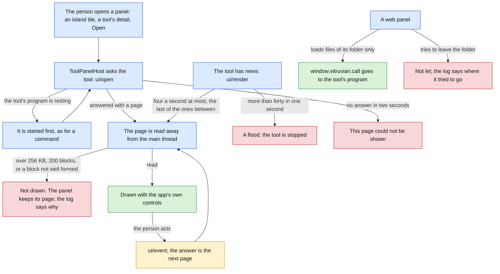

# Tools for everyone (stage D: protocol 2, a tool that can draw) Implementation Plan

> **For agentic workers:** REQUIRED SUB-SKILL: Use superpowers:subagent-driven-development (recommended) or superpowers:executing-plans to implement this plan task-by-task. Steps use checkbox (`- [ ]`) syntax for tracking.

**Status: built and shipped, 2026-10-13.** Pull request #3182 built protocol 2, with the `panels` API in all five kits and a `hello-panel` sample in each (this plan: #3160). It released SDK 1.0.0 and Vitruvian 3.45.0. Issue #3130; the design's section 11 (`docs/superpowers/specs/2026-10-12-vitruvian-tools-for-everyone-design.md`).

**Goal:** Let a tool show the person a page of its own. A tool whose manifest says `"protocol": "2"` lists panels: a page in the Dynamic Island's Tools area, a part of its detail in Settings, and windows. It describes each page as a list of blocks and the app draws them with its own controls; or it brings a web page from its own folder. Every tool written to protocol 1 keeps working exactly as it does today.

**Architecture:** The protocol gains five messages and a page made of twelve kinds of block, all in `packages/vitruvian-sdk`, where the Swift types, the schemas and the examples are held together by the drift tests that exist. In the app, the link to a tool carries the new messages; one new owner, `ToolPanelHost`, keeps the last page of every open panel, reads each page away from the main thread, draws at most four a second, and passes what the person did back to the tool. The views draw a page from a plain value the tests check. A web page is loaded only from the tool's folder and reaches the app only through the tool's own program. The Swift kit gains a panel API and a way to write a page; a fourth sample draws a counter; the conformance script opens a panel and taps it.



Green is drawn or done, amber waits for the person, red is a stop with nothing drawn, blue is in progress.

**What a person sees:** with a protocol 2 tool added, a tile for its page after the quick tools on the island's Tools page, with the tool's badge; the page itself, drawn by the app, with a back button; the tool's own Settings part in its detail, under a new switch "Show in the Dynamic Island"; its windows listed under its commands with the app's word Open; a window the app owns; a web page in such a window; and one sentence where a page could not be shown. With no protocol 2 tool added, nothing a person sees changes. The mock-ups are `docs/superpowers/specs/2026-10-12-vitruvian-tools-for-everyone-stage-d-mockups.html`. Open that page beside each view you write.

**Tech Stack:** Swift 6 (strict concurrency), SwiftUI and AppKit, WebKit (`WKWebView`, already in the app through `NexusAgentUI`), JSON Schema 2020-12 with Python's `jsonschema`, the app's own `TestSuite` harness, XCTest in the package, Bazel with `--config=macos-app`.

**Spec:** `docs/superpowers/specs/2026-10-12-vitruvian-tools-for-everyone-design.md`: section 11, row D; section 3, decisions 15 to 19; section 8; sections 12 and 13; section 14, question 4. This plan builds stage D and nothing more. Stages A (publish), B1 and B2 (the four other kits) are planned beside it; Task 12 is the part of stage D that waits for B1 and B2.

**Release:** two kinds of commit. A change to the protocol or the kit is `feat(vitruvian-sdk): …`; once stage A has given the package release-please, it cuts an SDK release, and until then it cuts none. A change a person sees is `feat(desktop): …`, and cuts a minor release of the app; everything else in the app is `refactor(desktop): …`; the documents are `docs(…)`. Workers are `wren`, and `compass` for Task 11. `main` takes squash merges, so the pull request's title is the one that counts: it is `feat(desktop): tools that draw, protocol 2`, and merging it cuts a minor app release. If stage A has landed by then, the SDK's own release comes from the package's commits through release-please's component, not from the pull request title; Task 11 says what to check.

Paths that start with `Sources/`, `Tests/`, `Tools/`, `bazel/` or name `BUILD`, `AGENTS.md`, `README.md` or `UPSTREAM.md` alone are relative to `apps/desktop/vitruvian/`. Every other path is from the repository root.

## Decisions this plan makes

The design's decisions 15 to 19 stand. These are the ones it leaves open, or where the code forced something else. Each says whether it follows the design, adds to it, or differs from it, in those words. Task 11 records them in the design's stage table; it does not rewrite the design's sections.

| # | Decision | Why |
|---|---|---|
| 1 | **Protocol 2 only adds.** A manifest may say `"protocol": "2"`; `ProtocolVersion.supported` is `["1", "2"]` and `current` is `"2"`; the app offers both at `initialize` and the tool picks. A manifest of protocol 1 that lists `panels`, even an empty list, is refused (`panelsNeedProtocol2`). An app that speaks only protocol 1 refuses a manifest that says 2, by the rule it has today (`unsupportedProtocol`). A tool of protocol 1 is read, started and run exactly as before. Follows the design. | The handshake and the manifest reader were built for a second version; nothing else had to move. |
| 2 | **The page's types live in the protocol package** (`packages/vitruvian-sdk/Sources/VitruvianToolProtocol/Panels.swift`: `UITree`, `UIBlock`, the twelve block structs, the five messages' params and results, `UILimits`). `Core/Platform/ToolPanel.swift` holds what is the app's alone: the panel as the app holds it, reading a page within the limits, where a web page may go, and where a picture comes from. **Differs from the brief's file split.** | The kits, the conformance script and the drift test need the same types, and nothing may be copied from the GPL app into the MIT package. |
| 3 | **Twelve kinds of block, fixed in the section below**, and no container. Every block may carry an `id` and a `fallback`; a `button`, `toggle`, `field` and `list` must carry an `id`, because their events name it; a `row` with an `id` can be tapped. Text is a string, or a map of languages with English. **Adds to the design**, which named the kinds and some fields. | A flat list reads well in fifteen languages and at the island's width; a container is the first step to a layout language. |
| 4 | **A page is at most 262,144 bytes, counted as the app writes it again (compact JSON, slashes as they are), 200 blocks, and 200 rows in a list.** An image written into the page as `data:` counts toward the 256 KB, so an inline image is at most about 190 KB of PNG, not 1 MB. **Differs from the design**, decision 19, which allows inline data up to 1 MB: a page of 256 KB cannot hold it, and neither can a line of 1 MB with anything else in it. | One number a tool's author can check; the image limit follows from it. |
| 5 | **Four pages a second, drawn; forty, a flood.** Of the pages a tool sends unprompted for one panel, one is drawn at once after a quarter of a second without one, and the last of those that come sooner is drawn when the quarter has passed: the ones between never are. The answer to something the person did is drawn at once and counts toward neither. More than forty `ui/render` for one panel in one second stops the tool, by the link, as a flood (`ToolLink.Fault.flood`). Follows the design. | The quarter second is on the injected clock, so every test moves it by hand. |
| 6 | **A page is read on a queue of its own and drawn on the main thread** (`ToolPanelHost.readAway`). A page read after a newer one was started is never drawn over it. | A page may weigh 256 KB; decoding it is the only part that could hold the main thread. |
| 7 | **A page that cannot be read is not drawn; the panel keeps the page it had**, and the tool's log says why: too large, or the place of the first field missing or of the wrong kind (`blocks[0].id`). A block of a kind the app knows with a field missing refuses the whole page; a block of a kind it does not know is kept, and drawn as its `fallback`, or left out. Follows the design. | Half a page drawn is worse than the last whole one. |
| 8 | **Refusals are -32602** for what the app asks of itself: opening a panel the manifest does not declare or in another place, acting in a panel that is not open, a web page's call from a panel that is not open. A `ui/render` for a panel that is not declared, or not open, is a notice and cannot be refused: it is dropped and logged. The conformance script fails a tool that sends one for a panel it does not declare. Follows the design, section 8.5, read for a notice. | |
| 9 | **No `NotchModule.tool(ToolID)`.** A tool's island page is a tile after the quick tools on the island's Tools page, and opens there in place of the tiles, as a hosted utility (Homebrew, Window Layout) does: Escape and the back button return to the tiles, and collapsing the island closes it and tells the tool. **Differs from the design**, section 8.3. | `NotchModule` is a closed `String` enum saved by name in each person's island layout, sized and keyed case by case; 149 uses in 37 files would change, with every saved layout. A tile in the same rail is sized, scrolled and laid out by the island's own rule. |
| 10 | **The Tools page lists a tool's island page until the person turns it off**, with the switch "Show in the Dynamic Island" in the tool's detail. It is kept in `InstalledTools.json` as `showsInIsland`, written only once it is off, so a file from before reads as it did. Follows the design's default for open question 4. | |
| 11 | **A tool's Settings panel is drawn in its detail, under its own settings**, by the same renderer at the standard size. With one, the detail's lists always scroll in their region, so the buttons stay in view. Every control of the panel is bound to the detail's one focus, so Space at open cannot turn the tool's switch. The panel is not in the Features hub's permissions tab. Follows the design. | A second place for a tool's settings would split them in two. |
| 12 | **A window opens only when the person asks**: from the tool's detail, where each window panel is listed under its commands with the app's existing word Open, or as the answer to something they did in another panel of the tool, the new `open` field of `ui/event`'s answer. A page of blocks is 380 points wide and as tall as its blocks, 120 to 560, then it scrolls; a web page starts at 640 by 480, no smaller than 320 by 240, and may be resized. A window is titled with the panel's title and, under it, the tool's name, each one line of 120 characters at most (`ToolOwnWords.oneLine`). **Adds to the design** (the `open` field; the sizes). | A tool cannot put a window in front of the person by itself. |
| 13 | **A web panel loads its `entry` with `loadFileURL(_:allowingReadAccessTo:)` scoped to the app's copy of the tool's folder.** Its navigation delegate refuses any address that is not, with every link followed, inside that folder: a file outside, `http(s):`, `data:`, `javascript:`; and every new window. The page's own `fetch` is not stopped: the tool is trusted like an app. The entry is held by its text when the tool is added (`panelEntryLeavesFolder`) and by its real path when it is shown (a link out of the folder is not shown). `ToolPanelHost` holds every page and lets go of it when its panel closes or its tool ends. Follows the design; **the folder check of `entry` differs** from "the manifest reader resolves it": the add-time check is by text only. | `folders.json` and `vitruvian-tool validate` stay as they are; the real path is checked where the page is loaded. |
| 14 | **The bridge**: `window.vitruvian` is frozen before the page's scripts run, with `call`, `on`, `language` and `appearance`. A call goes to the tool's program as `ui/event`, `event: "bridge"`, after the app has checked the tool's `uses`; the answer's `reply` is what the page gets back, and a refusal rejects the promise with its code and words. A method whose name starts with `tool/` is the tool's own and needs no entry in `uses`; anything else that is not a request a tool makes is refused. The page's calls are held to the link's flood rule: 200 a second, five such seconds in a row and the tool is stopped. `on` hears `preferences/changed` and `language/changed`. `appearance` is the app's when the page loads and is not updated after. **Adds to the design** (`tool/`, the rejection's text). | Without `tool/`, a web page could not ask its own program for data. |
| 15 | **`ui/badge` is behind `notify`.** A count above 99 is drawn as 99+. A badge stays across runs of the program and goes when the tool is switched off or removed. Follows the design. | |
| 16 | **A `link` block opens only a web or mail address, through the tool's own `open` service.** A tool whose manifest does not list `open` is refused, and the alert sound plays. Follows the design. | |
| 17 | **A tool's words are drawn with `Text(verbatim:)`**, never as markdown or as a link, each with a line limit and cut to 2,000 characters. A tool picks a style from a short list; never a colour, font or size. | AGENTS.md's rule for a tool's own words, extended to every block. |
| 18 | **The app's new texts are two**, `panelNotShown` and `showInIsland`, in all fifteen languages; 48 in all. Every other word on a panel is the tool's, or one the app already has. The fourteen other languages are written with the English, as every other string of the app was; nobody who reads them has reviewed them. | |
| 19 | **The Swift kit's API**: `tool.panel(id, onOpen:onEvent:)` gives a `Panel` with `render(_:)`, `badge(count:dot:)` and `onCall`; a handler gets a `PanelEvent` and answers a `PanelAnswer` (`.page`, `.keep`, `.open`, `.reply`). A page is written `UITree { heading("Counter"); button("add", "Add one") }`, with twelve functions, one a kind. The kit forwards a web page's call of a request the app does, as the tool's own. **Adds to the design.** | A leading dot (`.heading`) cannot start a line of a builder: it joins the line above it. |
| 20 | **The fourth sample is `samples/hello-panel-swift`**: a counter in the island with a button and a field, a switch in Settings, and a command that sends the open page again. The conformance script gains a sixth check, "a panel": for a tool of protocol 2 it opens the first panel the app draws, taps its first button, and wants a different page; a page sent for a panel the manifest does not declare fails the run. It offers versions 1 and 2. Follows the design. | |
| 21 | **The panel limits are the protocol's** (`UILimits`), like `StorageLimits`, not `ToolLimits`: a tool's author is told them and the kit and the script hold to them too. The bridge's flood rule uses `ToolLimits.messagesPerSecond` and `floodSeconds`, the link's own. | |
| 22 | **The tests stay in the suites they extend**: `tool-runtime` grows from 676 checks to 810, `platform` from 793 to 820, and a full run still reports `TESTS OK (49 suites)`. No `pipeline_unit` changes, so `.github/workflows/presubmit.yaml` does not change. | |
| 23 | **Not in stage D:** the four other kits' `panels` (Task 12, after B1 and B2); `vitruvian-tool run` opening a panel (it prints a page a tool sends, and no more); reaching a tool's island tile with the arrow keys or Return; telling an open web page that the appearance changed; reading a picture off the main thread; anything only a person can check, which is the list "By hand". | Stage E and later. |

## The twelve kinds of block

Every block has `type`, and may have `id` and `fallback`. Any text field is a string or a map of languages with `en`. The schema is `packages/vitruvian-sdk/protocol/messages.schema.json`, definitions `uiBlock` and `<kind>Block`.

| Kind | Its fields | Needs an `id` | What the person does | Drawn as |
|---|---|---|---|---|
| `text` | `text`; `style`: `body`, `secondary`, `caption`, `monospaced`; `lines`: 1 to 10, 4 when left out | no | | `.callout`; 12 pt in the island |
| `heading` | `text` | no | | `.headline`, two lines; 13 pt semibold in the island |
| `row` | `title`, `subtitle`, `icon`, `trailing` | to be tapped | `tap` | a row as `FeatureHubRow`, a chevron when it can be tapped |
| `button` | `title`; `style`: `plain`, `prominent`, `destructive`; `enabled` | yes | `tap` | the system button, `.borderedProminent`, role `.destructive` |
| `toggle` | `title`, `value`, `enabled` | yes | `toggle`, with the new state | `Toggle(.switch)` |
| `field` | `title`, `value`, `placeholder`; `kind`: `text`, `number`, `secret` | yes | `submit` on Return, `change` on leaving it changed, with the text | `TextField` or `SecureField`, rounded |
| `list` | `rows`: `{ id, title, subtitle, icon, trailing }`, at most 200 | yes | `tap`, with the row's id | rows on the card's fill, dividers between |
| `progress` | `value`: 0 to 1, or none; `label` | no | | `ProgressView`, linear |
| `image` | `source`: a path inside the folder, or a `data:` PNG or JPEG; `alt`; `height`: 1 to 300 | no | | 64 points high, 40 in the island, when it does not say |
| `divider` | none | no | | `Divider` |
| `link` | `title`, `url` | no | clicks it: opened through `open` | `.buttonStyle(.link)` |
| `spacer` | `size`: 0 to 40, 8 when left out | no | | empty room |

## The messages

Version 2 adds five. `methods.json` lists them after version 1's seventeen.

| Message | Who sends it | Kind | In `uses` | Carries | Answered with |
|---|---|---|---|---|---|
| `ui/open` | app | request | | `{ panel }` | `{ tree? }`; `{}` for a web panel |
| `ui/event` | app | request | | `{ panel, block?, event, value? }`; `event` is `tap`, `toggle`, `submit`, `change` or `bridge` | `{ tree?, keep?, reply?, open? }` |
| `ui/close` | app | notice | | `{ panel }` | |
| `ui/render` | tool | notice | | `{ panel, tree }` | |
| `ui/badge` | tool | request | `notify` | `{ count?, dot? }` | `{}` |

The manifest gains `contributes.panels`: each `{ id, title, placement, icon?, kind?, entry? }`, `placement` one of `island`, `settings`, `window`, `kind` `blocks` (when left out) or `web`, which needs `entry`. Nine new `ManifestProblem` cases name what is wrong: `panelsNeedProtocol2`, `tooManyPanels`, `panelNotWellFormed`, `duplicatePanel`, `unknownPlacement`, `unknownPanelKind`, `placementTaken`, `webPanelWithoutEntry`, `panelEntryLeavesFolder`. With them the protocol names 32 problems; it named 23, not the 22 the brief counted (`preferenceTitleNotWellFormed` came after).

## Global Constraints

- **Everything in this plan was built and run before it was written down.** The tree at `858211bb2` (today's `main`, with the design) was exported to a scratch folder outside the repository, each task was applied in order, and each task's state was built and tested by itself on a Mac16,5 (Apple M4 Max) with macOS 27.0, Xcode 27.0 and Swift 6.4. The check counts in each task are from those runs. The failing output in each "watch it fail" step is what the build or the test printed when the task's tests were put on the task before it: a recording, cut to its first lines. Every mutation listed was applied and seen to fail its test. At the end a full run of the unit tests, `selftest`, both builds of the app, the package's every test, the licence gate, `//:tidy` and the workflow generator were run; "What was run for this plan" under Task 11 gives each result. Three things were not done. Nobody opened the app, so no panel, tile, window or web page was seen: the list "By hand" is all of it, and the real `WKWebView` was never loaded. Nothing ran on a CI runner. Nobody who reads the fourteen other languages has read the two new texts. If the base has moved and a listing no longer fits, make the smallest change that keeps its meaning and record it as a deviation.
- **How to read a listing.** A block that starts with a licence header is a whole file. A block that starts with `diff --git` is a change to a file that exists, as `git diff` prints it: a line that starts with `-` goes, a line that starts with `+` comes in, and the others are there to find the place. Save the block to a file and run `git apply <file>` from the repository root, or make the change by hand. Each is a change from the state the task before left. Every listing in this plan was taken by a script from the commits the tests ran on, not typed, and the script fails when a file a task changed has no listing in that task. The two exceptions are `Tests/mutation_checks.py` and `UPSTREAM.md`, which each task gives as the entries to add.
- **Licences.** The protocol, the kit, the samples, the scripts and the guide are under `packages/vitruvian-sdk/` and are MIT: every new file there starts with the package's own MIT header, as `Panels.swift` in Task 1 does. Everything under `apps/desktop/vitruvian/` is GPL-3.0-or-later; every new file there starts with exactly:
  ```swift
  // SPDX-License-Identifier: GPL-3.0-or-later
  // Copyright (C) 2026 VitruvianSoftware
  ```
  Code flows one way: the app links the package; nothing is copied from the app's folder into the package. Never edit an existing `Copyright (C) 2026 Vorssaint` header.
- **The pin.** Task 1 changes `packages/vitruvian-sdk/Sources/VitruvianToolProtocol` and, in the same commit, runs `bazel run //apps/desktop/vitruvian:pin_tool_protocol` and adds the log line to `UPSTREAM.md`; `tool_protocol_pin_test` fails until both are there. No later task changes the protocol module: Tasks 2 and 4 to 10 leave the pin as Task 1 set it, `868f1a82fa5a`.
- **`UPSTREAM.md`.** Every change to a file whose header says `Copyright (C) 2026 Vorssaint` is named under "Modifications" in the same commit. Six such files change in this stage: `Tests/mutation_checks.py` (Tasks 1 to 9), `Services/QuickTools/QuickLauncherService.swift`, `UI/QuickLauncher/QuickLauncherView.swift`, `UI/Notch/NotchView.swift` and `Services/Notch/NotchService.swift` (Task 8), and `main.swift` (Task 9). Task 1 adds the stage's entry as the first of the list; each later task of the app adds one line to it. The exact text is in each task. Check the header of every file you change; do not trust this list.
- **What a person sees changes only where a task says so.** With no tool of protocol 2 added the app is as it was: `platform` keeps every one of its 793 checks and only gains; `tool-runtime` keeps its 676 and only gains; the other 47 suites do not change.
- **No task edits a `pipeline_unit`.** The new tests are in suites and targets the units already name, and the fourth sample joins `SWIFT_SAMPLES`, which `swift_samples_test` builds. `bazel run //tools/pipeline:gen -- --format=workflow --output-file=.github/workflows/presubmit.yaml` must leave the file unchanged; if a task does edit a unit, run it and commit what it writes, and keep round brackets out of that call's comments.
- **Layers and access.** `Core <- Design <- Services <- UI <- App`, all in Swift 6 mode. What another module or the tests use is `package`. A `package` type that a test builds needs a `package` initializer written out. A file that names a type of the protocol imports `VitruvianToolProtocol` by name. `WebKit` is imported only by `UI/ToolPanels/ToolWebPanel.swift`; `ToolPanelHost` holds a page as `ToolWebPage`, so the services know no web view.
- **The main thread.** The store, the host and the runtime are `@MainActor` and never wait; do not add a `Task`. A page is read with `ToolPanelHost.readAway`, on a global queue, and handed back with `DispatchQueue.main.async` and `MainActor.assumeIsolated`; nothing else of this stage leaves the main thread. A tool still talks on its one link, one request at a time from the app's side, as today: a web page's calls are `ui/event` requests on that link.
- **Strings.** A text a person reads that is the app's own is a field of `ExternalToolStrings`, in all fifteen languages, and in the table under "The strings". A tool's words are drawn with `Text(verbatim:)`. Use the typographic apostrophe (’) and the ellipsis character (…), and no em-dash. French puts `\u{00A0}` before `:`, `?`, `!` and `;`.
- **Tests.** The app's test module defaults to the main actor. A test is a synchronous `static func run(_ suite: TestSuite)` reached from `Tests/TestGroups.swift`. No test reads a source file as text, and no test draws a view or loads a web view. Every file a test writes is under `FileManager.default.temporaryDirectory`, in a folder it makes and removes; no test touches `~/Library/Application Support/com.vitruviansoftware.vitruvian`. No test waits for a limit: every deadline is on `ManualToolClock`. One test waits, at most five seconds, through `ToolRuntimeSupport.wait`, for `readAway` to hand a page back from its queue.
- **Build and test through Bazel only**, from the repository root, one command at a time. A full run of the unit tests needs the display awake and the screen unlocked: start it with `(caffeinate -u -d -t 900 &);` or 17 scroll checks fail. Two suites do not need that:
  ```sh
  bazel test --config=macos-app //apps/desktop/vitruvian:unit_tests --test_arg=--suite=tool-runtime --test_arg=--suite=platform --test_output=errors
  grep -aE "^(platform|tool-runtime): |TESTS" bazel-testlogs/apps/desktop/vitruvian/unit_tests/test.log
  bazel test //apps/desktop/vitruvian:source_lints_test //apps/desktop/vitruvian:sources_in_sync_test //apps/desktop/vitruvian:tool_protocol_pin_test //apps/desktop/vitruvian:upstream_test
  ```
  Never put `--test_arg` on a command that also names the source tests: they take no such argument and fail. The package's tests:
  ```sh
  bazel test --config=macos-app //packages/vitruvian-sdk:VitruvianToolProtocolTests //packages/vitruvian-sdk:VitruvianToolKitTests //packages/vitruvian-sdk:VitruvianToolCLITests //packages/vitruvian-sdk:swift_samples_test //packages/vitruvian-sdk:init_test
  bazel test //packages/vitruvian-sdk:protocol_examples_test //packages/vitruvian-sdk:conformance_test //packages/vitruvian-sdk:samples_test //packages/vitruvian-sdk:templates_in_sync_test //packages/vitruvian-sdk:guide_test
  ```
  New Swift files need no edit to `BUILD` or `build.sh`: each module's sources are a glob.
- **Do not launch the app from a task**, and do not write to the preferences domain `com.vitruviansoftware.vitruvian` or create anything under the app's real support folder. The checks that need the running app are "By hand", and a person does them.
- **Mutations.** `Tests/mutation_checks.py` quotes source lines exactly; a mutation may name a file of the package by its path from the app's folder (`../../../packages/vitruvian-sdk/…`), as Tasks 1 and 2 do, because the app's tests run the package's code. Each task gives its entries. For each: apply it by hand, run the suite it names, confirm it fails with the sixth field among the messages, undo it by hand, and confirm `git diff --stat -- <file>` shows only the task's own change. A rule of the kit or the conformance script cannot be a mutation there, since the app's tests do not run them: Task 10 gives each as a step, with the test that must fail. If a mutation is not caught, stop and report; do not adjust a test to fit.
- **Formatting and gates.** After editing a `.py`, `.json` or `BUILD` file run `bazel run //tools/format -- <path>`. Write a JSON file by adding to it as text, never by loading and dumping it whole: prettier keeps the layout a file has, and a dumped file would change every line. Task 11 runs `bazel run //tools/license:check`, `bazel run //tools/license:verify` and `bazel run //:tidy`. On this base `//:tidy` adds one unrelated line, `Cryptodome: pycryptodomex`, to `gazelle_python.yaml`: undo it by hand and do not commit it.
- **Git.** Never `git stash`, `git reset` or `git restore`; undo an edit by hand. Commits are authored as the agent the task names, one per task, with identity and commit in one command. In a worktree the keys are in the main checkout:
  ```sh
  export AGENT_KEY_DIR=/Users/james/Workspace/gh/application/vitruvian/vitruvian-core/tools/sync-env-secrets/agent-keys; eval "$(bazel run //tools/agent-app -- env wren 2>/dev/null)"; git add <files> && git commit -m "<title>"
  ```
- **Signing.** The app is signed ad hoc, as today. Nothing in this stage signs or notarizes anything.

## Review Focus

Where a mistake costs most. Each has a test in the task named.

1. **Protocol 1 is untouched.** Every protocol 1 example still passes both halves of the drift test; the only example that moved is the one that names a protocol the app does not speak, from `"2"` to `"3"` (Task 1). `platform` and `tool-runtime` keep every check they had. A manifest of protocol 1 with `panels` is refused, by the package and by the app (Task 1, and a mutation).
2. **No tool holds the main thread.** A page is read on its own queue and never in the call that asked for it (Task 4, `readAway`, and a mutation); at most four pages a second are drawn for a panel, and forty is a flood (Tasks 3 and 4); a page over 256 KB is refused before it is read (Task 2). Read `ToolPanelHost.draw` yourself: a page read late must never replace a newer one.
3. **A web page stays in its folder.** `ToolWebPolicy.allows` and `ToolWebBridge.decide` refuse everything outside the folder, through links and twin folder names too (Tasks 2 and 9, with mutations). A page's call reaches the app only through the tool's program, and only for what the tool's `uses` lists (Task 4). Only a person can check the real `WKWebView`: by-hand checks 7 to 9.
4. **A tool's words cannot pass for the app's.** Every block draws its text with `Text(verbatim:)` and a line limit, cut to 2,000 characters (Task 6); a window's title is one line (Task 9). Grep the new views for `Text("` with a capital letter: there should be none.
5. **Nothing outlives its tool.** A panel ends with its tool's program; a web page is closed and let go when its panel closes; a badge goes when the tool is switched off; an island page closes when the island collapses (Tasks 3, 4, 7 and 8).
6. **Space at open cannot change a tool.** The detail's new controls are bound to its one focus, which macOS's first placing is moved from (Task 7). Only pressing Space in the app proves it: by-hand check 4.

## The strings

The two texts this stage adds, each a field of `ExternalToolStrings` (Task 5), with its English text. The other fourteen languages are in Task 5's listing. The mock-ups use exactly these words.

| # | Key | English |
|---|---|---|
| 47 | `panelNotShown` | This page could not be shown. The tool’s log, in Settings, says why. |
| 48 | `showInIsland` | Show in the Dynamic Island |

Words the app already has, used as they are:

| Where | The app's string | English |
|---|---|---|
| The button beside each of a tool's windows in its detail | `Strings.shelfActionOpen` | Open |
| The heading over a tool's own settings and its Settings panel | `Strings.panelSettings` | Settings |
| The back button of a tool's island page | `Strings.obBack` | Back |

Shown as the tool wrote them, and never translated by the app: every word inside a panel, a panel's title, and the tool's name under a window's title.

---

### Task 1: Protocol 2, in the package and in the app's reader, with the pin

**Worker:** `wren`. **Commit:** `feat(vitruvian-sdk): protocol 2, a tool can describe panels and pages`. Once stage A has given the package release-please, this cuts an SDK release; until then it cuts none.

**Files:**
- Modify: `apps/desktop/vitruvian/Sources/Vitruvian/Core/Platform/ExternalToolManifest.swift`
- Create: `apps/desktop/vitruvian/Sources/Vitruvian/Core/Platform/ToolPanel.swift`
- Modify: `apps/desktop/vitruvian/Sources/Vitruvian/Services/Platform/External/ExternalToolCalls.swift`
- Modify: `apps/desktop/vitruvian/Tests/ExternalToolCallsTests.swift`
- Modify: `apps/desktop/vitruvian/Tests/ExternalToolManifestTests.swift`
- Modify: `apps/desktop/vitruvian/Tests/ExternalToolStoreTests.swift`
- Modify: `apps/desktop/vitruvian/Tests/mutation_checks.py`
- Modify: `apps/desktop/vitruvian/UPSTREAM.md`
- Modify: `apps/desktop/vitruvian/bazel/tool_protocol.sha256`
- Modify: `packages/vitruvian-sdk/Sources/VitruvianToolCLI/Desk.swift`
- Modify: `packages/vitruvian-sdk/Sources/VitruvianToolCLI/Words.swift`
- Modify: `packages/vitruvian-sdk/Sources/VitruvianToolKit/AppRequests.swift`
- Modify: `packages/vitruvian-sdk/Sources/VitruvianToolKit/Tool.swift`
- Modify: `packages/vitruvian-sdk/Sources/VitruvianToolProtocol/Messages.swift`
- Create: `packages/vitruvian-sdk/Sources/VitruvianToolProtocol/Panels.swift`
- Modify: `packages/vitruvian-sdk/Sources/VitruvianToolProtocol/ToolManifestFile.swift`
- Modify: `packages/vitruvian-sdk/Tests/VitruvianToolCLITests/DeskTests.swift`
- Modify: `packages/vitruvian-sdk/Tests/VitruvianToolCLITests/RunTests.swift`
- Modify: `packages/vitruvian-sdk/Tests/VitruvianToolKitTests/ToolTests.swift`
- Modify: `packages/vitruvian-sdk/Tests/VitruvianToolProtocolTests/ManifestFileTests.swift`
- Modify: `packages/vitruvian-sdk/Tests/VitruvianToolProtocolTests/ProtocolExamplesTests.swift`
- Modify: `packages/vitruvian-sdk/docs/writing-a-tool.md`
- Modify: `packages/vitruvian-sdk/protocol/README.md`
- Modify: `packages/vitruvian-sdk/protocol/examples/folders.json`
- Modify: `packages/vitruvian-sdk/protocol/examples/manifests.json`
- Modify: `packages/vitruvian-sdk/protocol/examples/messages.json`
- Modify: `packages/vitruvian-sdk/protocol/manifest.schema.json`
- Modify: `packages/vitruvian-sdk/protocol/messages.schema.json`
- Modify: `packages/vitruvian-sdk/protocol/methods.json`
- Modify: `packages/vitruvian-sdk/protocol/protocol_examples_test.py`

**Interfaces:**
- Consumes: `ToolManifestFile`, `ManifestProblem`, `ManifestRules`, `LocalizedText`, `ToolMethod`, `AppService`, `RefusalCode` (package); `ExternalToolManifest`, `ExternalToolCalls`, `ManifestRefusal` (app).
- Produces:
  - `ProtocolVersion.supported == ["1", "2"]`, `.current == "2"`; `ToolMethod.uiOpen`, `.uiEvent`, `.uiClose`, `.uiRender`, `.uiBadge`
  - `Panels.swift`: `UILimits`, `PanelPlacement`, `PanelKind`, `UIText`, `UITree`, `UIBlock` (`.kinds`, `.kindsWithID`, `Content`), `TextBlock`, `HeadingBlock`, `RowBlock`, `ButtonBlock`, `ToggleBlock`, `FieldBlock`, `UIListRow`, `ListBlock`, `ProgressBlock`, `ImageBlock`, `DividerBlock`, `LinkBlock`, `SpacerBlock`, `UIOpenParams`, `UIOpenResult`, `UIEventKind`, `UIEventParams`, `UIEventResult`, `UICloseParams`, `UIRenderParams`, `UIBadgeParams`, `UIBridgeCall`
  - `ToolManifestFile.Contributes.panels`, `ToolManifestFile.Panel`, `ManifestLimits.maxPanels`, and nine `ManifestProblem` cases
  - in the kit: `UIBadgeParams: AppRequest`; `Tool` picks the newest version both speak
  - in the app: `ToolPanelPlacement`, `ToolPanelDescriptor`, `ExternalToolManifest.panels`, `.panel(_:)`, `.panel(in:)`

The protocol change is one commit, as the protocol's README asks: the two schemas, `methods.json`, the examples, the Swift types, the drift tests on both sides, the README, and, because the app links the module, the app's reader, the app's tests and the pin. The app's `ExternalToolCalls` switch is exhaustive over `ToolMethod`, so it cannot compile without saying what it does with the five new messages: the four that are the app's own or notices are refused as unknown, as the others of their kind are, and `ui/badge` is checked against `notify` and then refused as not available until Task 3 hands it on. The app's tests hold the offered versions to `["1", "2"]` and read a protocol 2 manifest's panels onto the app's own list of places.

The JSON files are changed as text: the edits below add to them and change three values, and leave every other line as prettier laid it out. The Python drift test learns one thing: a block's own fields are in the definition its kind picks, through `uiBlock`'s `allOf`, so its "every field is used by a valid example" rule reaches them. The guide gains the five messages, because `guide_test` fails while the guide shows no example of a message `methods.json` lists; its chapter about drawing comes in Task 11.

- [ ] **Step 1: Write the failing tests and the examples**

In `apps/desktop/vitruvian/Tests/ExternalToolCallsTests.swift`:

```diff
diff --git a/apps/desktop/vitruvian/Tests/ExternalToolCallsTests.swift b/apps/desktop/vitruvian/Tests/ExternalToolCallsTests.swift
index 5d3ff7c..15ad70d 100644
--- a/apps/desktop/vitruvian/Tests/ExternalToolCallsTests.swift
+++ b/apps/desktop/vitruvian/Tests/ExternalToolCallsTests.swift
@@ -44,6 +44,7 @@ enum ExternalToolCallsTests {
         (.processesTerminate, #"{"pid": 42, "name": "node", "force": true}"#),
         (.storageGet, #"{"key": "project"}"#),
         (.storageSet, #"{"key": "project", "value": "api"}"#),
+        (.uiBadge, #"{"count": 2}"#),
     ]
 
     /// A broker whose services record what they were asked, and the world
```

In `apps/desktop/vitruvian/Tests/ExternalToolManifestTests.swift`:

```diff
diff --git a/apps/desktop/vitruvian/Tests/ExternalToolManifestTests.swift b/apps/desktop/vitruvian/Tests/ExternalToolManifestTests.swift
index 3c4c695..c26942b 100644
--- a/apps/desktop/vitruvian/Tests/ExternalToolManifestTests.swift
+++ b/apps/desktop/vitruvian/Tests/ExternalToolManifestTests.swift
@@ -17,6 +17,7 @@ enum ExternalToolManifestTests {
         listsAgree(suite)
         languages(suite)
         folders(suite)
+        panels(suite)
     }
 
     /// The manifest in the design, section 6, with a publisher.
@@ -171,7 +172,7 @@ enum ExternalToolManifestTests {
              #"{"runtime": {"kind": "external", "exec": "bin/../../deploys"}}"#),
             ("a kind of runtime a file may not name", .invalid(.unsupportedRuntime("bundled")),
              #"{"runtime": {"kind": "bundled", "exec": "bin/deploys"}}"#),
-            ("a protocol the app does not speak", .invalid(.unsupportedProtocol("2")), #"{"protocol": "2"}"#),
+            ("a protocol the app does not speak", .invalid(.unsupportedProtocol("3")), #"{"protocol": "3"}"#),
             ("a name with no English", .invalid(.noEnglish(field: "name")), #"{"name": {"fr": "Déploiements"}}"#),
             ("a name that is only spaces", .invalid(.blankText(field: "name")), #"{"name": {"en": " "}}"#),
             ("no publisher", .invalid(.malformed(field: "publisher")), #"{"publisher": null}"#),
@@ -248,8 +249,10 @@ enum ExternalToolManifestTests {
         suite.expect(names.allSatisfy { ManifestRules.isWellFormedName($0) == (ToolID($0) != nil) }
                          && ManifestLimits.maxNameLength == ToolID.maxLength,
                      "the protocol and the app agree on what a well-formed id is")
-        suite.expect(ProtocolVersion.supported == ["1"] && WireLimits.maxLineBytes == 1_048_576,
-                     "the app links protocol version 1, with its 1 MB line")
+        suite.expect(ProtocolVersion.supported == ["1", "2"] && WireLimits.maxLineBytes == 1_048_576,
+                     "the app links protocol versions 1 and 2, with the 1 MB line")
+        suite.expect(PanelPlacement.allCases.map(\.rawValue) == ToolPanelPlacement.allCases.map(\.rawValue),
+                     "the protocol's placements are the app's")
     }
 
     static func languages(_ suite: TestSuite) {
@@ -325,3 +328,45 @@ enum ExternalToolManifestTests {
                      "a manifest that breaks a rule is refused for that rule, whatever the folder holds")
     }
 }
+
+extension ExternalToolManifestTests {
+    /// Protocol 2's panels: read into descriptors the app's lists hold, and
+    /// refused in a manifest of protocol 1.
+    static func panels(_ suite: TestSuite) {
+        let three = #"""
+            {"protocol": "2", "contributes": {"commands": [{"id": "copyLatest", "title": {"en": "Copy"}}], "panels": [
+              {"id": "deploys", "title": {"en": "Deploys", "fr": "Déploiements"}, "placement": "island", "icon": "list.bullet"},
+              {"id": "settings", "title": {"en": "Deploys"}, "placement": "settings", "entry": "ignored.html"},
+              {"id": "dashboard", "title": {"en": "Dashboard"}, "placement": "window", "kind": "web", "entry": "ui/dashboard.html"}
+            ]}}
+            """#
+        let drawn = tool(three)
+        suite.expect(drawn?.panels.map(\.id) == ["deploys", "settings", "dashboard"]
+                         && drawn?.panels.map(\.placement) == [.island, .settings, .window],
+                     "a tool of protocol 2 has its panels, in the manifest's order, each in its place")
+        suite.expect(drawn?.panel("deploys")?.symbol == "list.bullet" && drawn?.panel("settings")?.symbol == "shippingbox",
+                     "a panel's icon is its own, else the tool's")
+        suite.expect(drawn?.panel("dashboard")?.entry == "ui/dashboard.html" && drawn?.panel("dashboard")?.isWeb == true
+                         && drawn?.panel("settings")?.entry == nil && drawn?.panel("settings")?.isWeb == false,
+                     "only a web panel has a page; a blocks panel ignores an entry")
+        suite.expect(drawn?.panel(in: .island)?.id == "deploys" && drawn?.panel(in: .settings)?.id == "settings"
+                         && drawn?.panel("nothing") == nil,
+                     "a panel is found by its id, and the island's and Settings' by their place")
+        suite.expect(drawn?.panel("deploys")?.title.text(for: AppLanguage.fr.rawValue) == "Déploiements",
+                     "a panel's title is in every language its author wrote")
+        suite.expect(drawn?.manifest.tool.commands.map(\.id.name) == ["copyLatest"] && drawn?.protocolVersion == "2",
+                     "protocol 2 changes nothing else the manifest says")
+
+        let plain = tool()
+        suite.expect(plain?.panels.isEmpty == true && plain?.protocolVersion == "1",
+                     "a tool of protocol 1 has no panels and is read as it always was")
+        suite.expect(refusal(#"{"contributes": {"panels": [{"id": "deploys", "title": {"en": "Deploys"}, "placement": "island"}]}}"#)
+                         == .invalid(.panelsNeedProtocol2("1")),
+                     "a manifest of protocol 1 with panels is refused, and the reason names its protocol")
+        suite.expect(refusal(#"{"protocol": "3"}"#) == .invalid(.unsupportedProtocol("3")),
+                     "a protocol after 2 is refused")
+        suite.expect(refusal(#"{"protocol": "2", "contributes": {"panels": [{"id": "d", "title": {"en": "D"}, "placement": "window", "kind": "web", "entry": "../page.html"}]}}"#)
+                         == .invalid(.panelEntryLeavesFolder(panel: "d", entry: "../page.html")),
+                     "a web panel's page that leaves the folder by its text is refused, as the program is")
+    }
+}
```

In `apps/desktop/vitruvian/Tests/ExternalToolStoreTests.swift`:

```diff
diff --git a/apps/desktop/vitruvian/Tests/ExternalToolStoreTests.swift b/apps/desktop/vitruvian/Tests/ExternalToolStoreTests.swift
index 349745b..e3987b5 100644
--- a/apps/desktop/vitruvian/Tests/ExternalToolStoreTests.swift
+++ b/apps/desktop/vitruvian/Tests/ExternalToolStoreTests.swift
@@ -384,7 +384,7 @@ enum ExternalToolStoreTests {
                          && bench.started[0].program == bench.files.appendingPathComponent("bin/deploys")
                          && bench.started[0].data == bench.data,
                      "running its command starts the program of the app's copy, in the tool's data folder")
-        let hello = JSONValue.object(["protocolVersions": .array([.string("1")]), "language": .string("fr"),
+        let hello = JSONValue.object(["protocolVersions": .array([.string("1"), .string("2")]), "language": .string("fr"),
                                       "dataFolder": .string(bench.data.path)])
         suite.expect(bench.current.sent == [.request(id: .number(1), method: "initialize", params: hello)],
                      "it is greeted with the versions the app speaks, the app's language and its data folder")
```

In `packages/vitruvian-sdk/Tests/VitruvianToolCLITests/DeskTests.swift`:

```diff
diff --git a/packages/vitruvian-sdk/Tests/VitruvianToolCLITests/DeskTests.swift b/packages/vitruvian-sdk/Tests/VitruvianToolCLITests/DeskTests.swift
index 6398515..fe6d848 100644
--- a/packages/vitruvian-sdk/Tests/VitruvianToolCLITests/DeskTests.swift
+++ b/packages/vitruvian-sdk/Tests/VitruvianToolCLITests/DeskTests.swift
@@ -59,6 +59,7 @@ final class DeskTests: XCTestCase {
             (.storageGet, #"{"key":"project"}"#, #"{"value":"web"}"#),
             (.storageSet, #"{"key":"count","value":4}"#, "{}"),
             (.storageGet, #"{"key":"count"}"#, #"{"value":4}"#),
+            (.uiBadge, #"{"count":2}"#, "{}"),
         ]
         for (method, sent, wanted) in asked {
             let (answer, said) = desk.serve(method.rawValue, try params(sent))
```

In `packages/vitruvian-sdk/Tests/VitruvianToolCLITests/RunTests.swift`:

```diff
diff --git a/packages/vitruvian-sdk/Tests/VitruvianToolCLITests/RunTests.swift b/packages/vitruvian-sdk/Tests/VitruvianToolCLITests/RunTests.swift
index 5ef3634..ee0e91b 100644
--- a/packages/vitruvian-sdk/Tests/VitruvianToolCLITests/RunTests.swift
+++ b/packages/vitruvian-sdk/Tests/VitruvianToolCLITests/RunTests.swift
@@ -58,7 +58,7 @@ final class RunTests: XCTestCase {
               [ "$HOW" = chatty ] && say "starting up"
               [ "$HOW" = mute ] && continue
               version=1
-              [ "$HOW" = newer ] && version=2
+              [ "$HOW" = newer ] && version=3
               say "{\"jsonrpc\":\"2.0\",\"id\":1,\"result\":{\"protocolVersion\":\"$version\",\"toolVersion\":\"7\"}}"
               say '{"jsonrpc":"2.0","method":"commands/state","params":{"runnable":["hello","where"]}}'
               if [ "$HOW" = flood ]; then
@@ -405,7 +405,7 @@ final class RunTests: XCTestCase {
         XCTAssertTrue(said.contains { $0.hasPrefix("NOT OK   a line that is not a message: starting up") }, "\(said)")
         (said, status) = try run(["hello"], how: "newer")
         XCTAssertEqual(status, 1)
-        XCTAssertTrue(said.contains { $0.hasPrefix("NOT OK   the tool picked protocol 2") }, "\(said)")
+        XCTAssertTrue(said.contains { $0.hasPrefix("NOT OK   the tool picked protocol 3") }, "\(said)")
     }
 
     func testAFolderTheAppWouldRefuseIsNotStarted() throws {
```

In `packages/vitruvian-sdk/Tests/VitruvianToolKitTests/ToolTests.swift`:

```diff
diff --git a/packages/vitruvian-sdk/Tests/VitruvianToolKitTests/ToolTests.swift b/packages/vitruvian-sdk/Tests/VitruvianToolKitTests/ToolTests.swift
index c79ed03..6ab75ec 100644
--- a/packages/vitruvian-sdk/Tests/VitruvianToolKitTests/ToolTests.swift
+++ b/packages/vitruvian-sdk/Tests/VitruvianToolKitTests/ToolTests.swift
@@ -83,7 +83,7 @@ final class ToolTests: XCTestCase {
     func testEveryRequestAToolMaySendHasAType() {
         let wanted = ToolMethod.allCases.filter { $0.sender == .tool && $0.isAnswered }
         XCTAssertEqual(Set(AppRequests.methods), Set(wanted))
-        XCTAssertEqual(AppRequests.methods.count, 10, "each request once")
+        XCTAssertEqual(AppRequests.methods.count, 11, "each request once")
     }
 
     func testHelloACommandAndGoodbye() throws {
@@ -279,14 +279,23 @@ final class ToolTests: XCTestCase {
         XCTAssertLessThan(Date().timeIntervalSince(started), 5)
     }
 
+    func testTheNewestVersionBothSpeakIsPicked() throws {
+        for (offered, picked) in [(#"["1","2"]"#, "2"), (#"["1"]"#, "1"), (#"["2","1"]"#, "2"), (#"["2","3"]"#, "2")] {
+            let bench = Bench().hello(versions: offered).goodbye()
+            XCTAssertEqual(try bench.tool().serve(), 0)
+            XCTAssertEqual(try bench.written().first?.answer?["protocolVersion"], .string(picked), offered)
+        }
+    }
+
     func testAVersionTheToolDoesNotSpeakIsRefused() throws {
-        let bench = Bench().hello(versions: #"["2"]"#).run("hello", id: 2).goodbye()
+        let bench = Bench().hello(versions: #"["3"]"#).run("hello", id: 2).goodbye()
         var ran = false
         let tool = try bench.tool { $0.command("hello") { _ in ran = true } }
         XCTAssertEqual(tool.serve(), 0)
         XCTAssertFalse(ran)
         XCTAssertEqual(try bench.written(), [
-            .failure(id: .string("hello"), error: RPCErrorObject(code: -32602, message: "this tool speaks protocol 1 only")),
+            .failure(id: .string("hello"), error: RPCErrorObject(code: -32602,
+                                                                  message: "this tool speaks protocols 1 and 2 only")),
             .failure(id: .number(2), error: RPCErrorObject(code: -32600, message: "initialize comes first")),
         ])
     }
@@ -316,3 +325,11 @@ final class ToolTests: XCTestCase {
         ], "after the answer to initialize, never before it")
     }
 }
+
+extension RPCMessage {
+    /// A result's value; nil for anything else.
+    var answer: JSONValue? {
+        if case .result(_, let value) = self { return value }
+        return nil
+    }
+}
```

In `packages/vitruvian-sdk/Tests/VitruvianToolProtocolTests/ManifestFileTests.swift`:

```diff
diff --git a/packages/vitruvian-sdk/Tests/VitruvianToolProtocolTests/ManifestFileTests.swift b/packages/vitruvian-sdk/Tests/VitruvianToolProtocolTests/ManifestFileTests.swift
index 4090be6..7c870fb 100644
--- a/packages/vitruvian-sdk/Tests/VitruvianToolProtocolTests/ManifestFileTests.swift
+++ b/packages/vitruvian-sdk/Tests/VitruvianToolProtocolTests/ManifestFileTests.swift
@@ -77,8 +77,16 @@ final class ManifestFileTests: XCTestCase {
         XCTAssertEqual(ProtocolFiles.fields(of: preference),
                        ProtocolFiles.fields(declaredBy: schema["$defs"]?["preference"]))
         XCTAssertEqual(ProtocolFiles.fields(of: read.runtime), ProtocolFiles.fields(declaredBy: schema["$defs"]?["runtime"]))
+        let drawn = try ToolManifestFile.read(manifest(changing: [
+            "protocol": .string("2"),
+            "contributes": .object(["panels": .array([.object(["id": .string("deploys"),
+                                                                "title": .object(["en": .string("Deploys")]),
+                                                                "placement": .string("island")])])]),
+        ])).get()
+        let panel = try XCTUnwrap(drawn.contributes?.panels?.first)
+        XCTAssertEqual(ProtocolFiles.fields(of: panel), ProtocolFiles.fields(declaredBy: schema["$defs"]?["panel"]))
         XCTAssertEqual(Set((schema["$defs"]?.objectValue ?? [:]).keys),
-                       ["localizedText", "contributes", "command", "preference", "runtime"])
+                       ["localizedText", "contributes", "command", "panel", "preference", "runtime"])
     }
 
     func testTheListsAreTheSchemasLists() {
@@ -92,7 +100,16 @@ final class ManifestFileTests: XCTestCase {
         XCTAssertEqual(listed(schema["properties"]?["activation"]), ActivationName.allCases.map(\.rawValue))
         XCTAssertEqual(listed(command?["surfaces"]), SurfaceName.allCases.map(\.rawValue))
         XCTAssertEqual(listed(preference?["type"]), PreferenceKind.allCases.map(\.rawValue))
-        XCTAssertEqual(schema["properties"]?["protocol"]?["const"]?.stringValue, ProtocolVersion.current)
+        XCTAssertEqual(listed(schema["properties"]?["protocol"]), ProtocolVersion.supported)
+        XCTAssertEqual(ProtocolVersion.supported.last, ProtocolVersion.current)
+        let panel = schema["$defs"]?["panel"]?["properties"]
+        XCTAssertEqual(listed(panel?["placement"]), PanelPlacement.allCases.map(\.rawValue))
+        XCTAssertEqual(listed(panel?["kind"]), PanelKind.allCases.map(\.rawValue))
+        XCTAssertEqual(panel?["id"]?["maxLength"]?.numberValue, Double(ManifestLimits.maxNameLength))
+        XCTAssertEqual(panel?["entry"]?["pattern"], schema["$defs"]?["runtime"]?["properties"]?["exec"]?["pattern"],
+                       "a web panel's page stays inside the folder by the program's rule")
+        XCTAssertEqual(schema["$defs"]?["contributes"]?["properties"]?["panels"]?["maxItems"]?.numberValue,
+                       Double(ManifestLimits.maxPanels))
         XCTAssertEqual(schema["$defs"]?["runtime"]?["properties"]?["kind"]?["const"]?.stringValue,
                        ToolManifestFile.externalRuntime)
         XCTAssertEqual(schema["properties"]?["id"]?["maxLength"]?.numberValue, Double(ManifestLimits.maxNameLength))
@@ -114,6 +131,7 @@ final class ManifestFileTests: XCTestCase {
         XCTAssertEqual(ManifestLimits.maxPreferences, 16)
         XCTAssertEqual(ManifestLimits.maxNameLength, 128)
         XCTAssertEqual(ManifestLimits.maxPreferenceTitleLength, 60)
+        XCTAssertEqual(ManifestLimits.maxPanels, 8)
 
         func commands(_ count: Int) -> JSONValue {
             .object(["commands": .array((0..<count).map { index in
@@ -174,6 +192,8 @@ final class ManifestFileTests: XCTestCase {
         case commandNotWellFormed, duplicateCommand, unknownSurface, tooManyPreferences, preferenceNotWellFormed
         case duplicatePreference, unknownPreferenceType, defaultOfWrongType, programLeavesFolder
         case preferenceTitleNotWellFormed
+        case panelsNeedProtocol2, tooManyPanels, panelNotWellFormed, duplicatePanel, unknownPlacement
+        case unknownPanelKind, placementTaken, webPanelWithoutEntry, panelEntryLeavesFolder
 
         init(_ problem: ManifestProblem) {
             switch problem {
@@ -200,6 +220,15 @@ final class ManifestFileTests: XCTestCase {
             case .defaultOfWrongType: self = .defaultOfWrongType
             case .programLeavesFolder: self = .programLeavesFolder
             case .preferenceTitleNotWellFormed: self = .preferenceTitleNotWellFormed
+            case .panelsNeedProtocol2: self = .panelsNeedProtocol2
+            case .tooManyPanels: self = .tooManyPanels
+            case .panelNotWellFormed: self = .panelNotWellFormed
+            case .duplicatePanel: self = .duplicatePanel
+            case .unknownPlacement: self = .unknownPlacement
+            case .unknownPanelKind: self = .unknownPanelKind
+            case .placementTaken: self = .placementTaken
+            case .webPanelWithoutEntry: self = .webPanelWithoutEntry
+            case .panelEntryLeavesFolder: self = .panelEntryLeavesFolder
             }
         }
     }
@@ -239,7 +268,7 @@ final class ManifestFileTests: XCTestCase {
         let missing = Set(ProblemName.allCases).subtracting(names).map(\.rawValue).sorted()
         XCTAssertEqual(missing, [], "no test gives these problems")
         XCTAssertEqual(names.count, ProblemName.allCases.count)
-        XCTAssertEqual(ProblemName.allCases.count, 23)
+        XCTAssertEqual(ProblemName.allCases.count, 32)
     }
 
     func testNamesAndPaths() {
@@ -335,6 +364,27 @@ final class ManifestFileTests: XCTestCase {
         XCTAssertFalse(PreferenceKind.string.accepts(.null))
     }
 
+    func testProtocolTwoAddsPanelsAndChangesNothingElse() throws {
+        // The design's example manifest, read as protocol 2: every field of
+        // protocol 1 is read as it was.
+        let one = try ToolManifestFile.read(manifest()).get()
+        let two = try ToolManifestFile.read(manifest(changing: ["protocol": .string("2")])).get()
+        XCTAssertEqual(two.contributes?.commands, one.contributes?.commands)
+        XCTAssertEqual(two.preferences, one.preferences)
+        XCTAssertNil(two.contributes?.panels)
+
+        let island = JSONValue.object(["id": .string("deploys"), "title": .object(["en": .string("Deploys")]),
+                                       "placement": .string("island")])
+        let panels = JSONValue.object(["panels": .array([island])])
+        let read = try ToolManifestFile.read(manifest(changing: ["protocol": .string("2"), "contributes": panels])).get()
+        XCTAssertEqual(read.contributes?.panels?.map(\.id), ["deploys"])
+        XCTAssertNil(read.contributes?.panels?.first?.kind, "a panel's kind is blocks when left out")
+        XCTAssertEqual(problem(["contributes": panels]), .panelsNeedProtocol2("1"),
+                       "an app reading a protocol 1 manifest never finds panels in it")
+        XCTAssertEqual(problem(["protocol": .string("3"), "contributes": panels]), .unsupportedProtocol("3"))
+        XCTAssertEqual(ProtocolVersion.supported, ["1", "2"])
+    }
+
     func testTheReferenceToolsManifestIsRead() throws {
         let data = ProtocolFiles.data("conformance/reference-tool/\(ToolManifestFile.fileName)")
         let manifest = try ToolManifestFile.read(data).get()
```

In `packages/vitruvian-sdk/Tests/VitruvianToolProtocolTests/ProtocolExamplesTests.swift`:

```diff
diff --git a/packages/vitruvian-sdk/Tests/VitruvianToolProtocolTests/ProtocolExamplesTests.swift b/packages/vitruvian-sdk/Tests/VitruvianToolProtocolTests/ProtocolExamplesTests.swift
index 877d519..65fa2dd 100644
--- a/packages/vitruvian-sdk/Tests/VitruvianToolProtocolTests/ProtocolExamplesTests.swift
+++ b/packages/vitruvian-sdk/Tests/VitruvianToolProtocolTests/ProtocolExamplesTests.swift
@@ -48,6 +48,11 @@ final class ProtocolExamplesTests: XCTestCase {
         case .storageGet: return try again(value, as: StorageGetParams.self)
         case .storageSet: return try again(value, as: StorageSetParams.self)
         case .log: return try again(value, as: LogParams.self)
+        case .uiOpen: return try again(value, as: UIOpenParams.self)
+        case .uiEvent: return try again(value, as: UIEventParams.self)
+        case .uiClose: return try again(value, as: UICloseParams.self)
+        case .uiRender: return try again(value, as: UIRenderParams.self)
+        case .uiBadge: return try again(value, as: UIBadgeParams.self)
         case .shutdown, .notifyBeep, .clipboardReadText: return try again(value, as: EmptyObject.self)
         }
     }
@@ -62,9 +67,11 @@ final class ProtocolExamplesTests: XCTestCase {
         case .clipboardWriteText: return try again(value, as: ClipboardWriteTextResult.self)
         case .keystrokesPressMenuItem: return try again(value, as: KeystrokesPressMenuItemResult.self)
         case .storageGet: return try again(value, as: StorageGetResult.self)
-        case .commandRun, .notifyHUD, .notifyBeep, .keystrokesPaste, .processesTerminate, .storageSet:
+        case .uiOpen: return try again(value, as: UIOpenResult.self)
+        case .uiEvent: return try again(value, as: UIEventResult.self)
+        case .commandRun, .notifyHUD, .notifyBeep, .keystrokesPaste, .processesTerminate, .storageSet, .uiBadge:
             return try again(value, as: EmptyObject.self)
-        case .preferencesChanged, .languageChanged, .shutdown, .commandsState, .log:
+        case .preferencesChanged, .languageChanged, .shutdown, .commandsState, .log, .uiClose, .uiRender:
             return nil
         }
     }
@@ -96,11 +103,37 @@ final class ProtocolExamplesTests: XCTestCase {
         ("storageGetResult", StorageGetResult(value: .null)),
         ("storageSetParams", StorageSetParams(key: "", value: .null)),
         ("logParams", LogParams(message: "")),
+        ("uiOpenParams", UIOpenParams(panel: "")),
+        ("uiOpenResult", UIOpenResult()),
+        ("uiEventParams", UIEventParams(panel: "", event: .tap)),
+        ("uiEventResult", UIEventResult()),
+        ("uiCloseParams", UICloseParams(panel: "")),
+        ("uiRenderParams", UIRenderParams(panel: "", tree: UITree(blocks: []))),
+        ("uiBadgeParams", UIBadgeParams()),
+        ("uiTree", UITree(blocks: [])),
+        ("uiListRow", UIListRow(id: "", title: "")),
+        ("textBlock", TextBlock(text: "")),
+        ("headingBlock", HeadingBlock(text: "")),
+        ("rowBlock", RowBlock(title: "")),
+        ("buttonBlock", ButtonBlock(title: "")),
+        ("toggleBlock", ToggleBlock(title: "", value: false)),
+        ("fieldBlock", FieldBlock()),
+        ("listBlock", ListBlock(rows: [])),
+        ("progressBlock", ProgressBlock()),
+        ("imageBlock", ImageBlock(source: "")),
+        ("dividerBlock", DividerBlock()),
+        ("linkBlock", LinkBlock(title: "", url: "")),
+        ("spacerBlock", SpacerBlock()),
     ]
 
     /// The definitions that are the message itself, read by `RPCMessage`.
     private static let envelopes: Set<String> = ["id", "request", "notice", "result", "failure"]
 
+    /// The definitions that are no object with fields of its own: text, one
+    /// way or another, and a block, whose fields are its kind's and whose
+    /// own three are held by `testABlockIsItsKindAndItsThreeFields`.
+    private static let notStructs: Set<String> = ["uiText", "localizedText", "uiBlock"]
+
     func testTheMethodTableIsTheSchemasTable() {
         let rows = ProtocolFiles.json("protocol/methods.json")["methods"]?.arrayValue ?? []
         XCTAssertEqual(rows.compactMap { $0["method"]?.stringValue }, ToolMethod.allCases.map(\.rawValue),
@@ -119,7 +152,8 @@ final class ProtocolExamplesTests: XCTestCase {
         for (name, value) in Self.shapes {
             XCTAssertEqual(ProtocolFiles.fields(of: value), ProtocolFiles.fields(declaredBy: definitions?[name]), name)
         }
-        XCTAssertEqual(Set(Self.shapes.map(\.0)).union(Self.envelopes), Set((definitions?.objectValue ?? [:]).keys),
+        XCTAssertEqual(Set(Self.shapes.map(\.0)).union(Self.envelopes).union(Self.notStructs),
+                       Set((definitions?.objectValue ?? [:]).keys),
                        "every definition has a Swift type, and every type a definition")
         let modifiers = definitions?["keyEquivalent"]?["properties"]?["modifiers"]?["items"]?["enum"]?.arrayValue
         XCTAssertEqual(modifiers?.compactMap(\.stringValue), KeyEquivalent.Modifier.allCases.map(\.rawValue))
@@ -205,6 +239,45 @@ final class ProtocolExamplesTests: XCTestCase {
     func testEveryServiceAMessageNeedsIsOneAManifestMayList() {
         XCTAssertEqual(Set(ToolMethod.allCases.compactMap(\.service)), Set(AppService.allCases))
         XCTAssertEqual(ToolMethod.allCases.filter { $0.sender == .app }.map(\.rawValue),
-                       ["initialize", "command/run", "preferences/changed", "language/changed", "shutdown"])
+                       ["initialize", "command/run", "preferences/changed", "language/changed", "shutdown",
+                        "ui/open", "ui/event", "ui/close"])
+    }
+
+    func testABlockIsItsKindAndItsThreeFields() {
+        let definitions = ProtocolFiles.json("protocol/messages.schema.json")["$defs"]
+        let block = definitions?["uiBlock"]
+        XCTAssertEqual(ProtocolFiles.fields(declaredBy: block), ["type", "id", "fallback"])
+        // Each kind picks the definition of its own fields, and the twelve
+        // are the kinds the Swift type reads.
+        let picked = (block?["allOf"]?.arrayValue ?? []).compactMap { branch -> (String, String)? in
+            guard let kind = branch["if"]?["properties"]?["type"]?["const"]?.stringValue,
+                  let target = branch["then"]?["$ref"]?.stringValue else { return nil }
+            return (kind, target)
+        }
+        XCTAssertEqual(picked.map(\.0), UIBlock.kinds)
+        XCTAssertEqual(picked.map(\.1), UIBlock.kinds.map { "#/$defs/\($0)Block" })
+        let needingID = (block?["allOf"]?.arrayValue ?? []).compactMap {
+            $0["if"]?["properties"]?["type"]?["enum"]?.arrayValue?.compactMap(\.stringValue)
+        }
+        XCTAssertEqual(needingID.map(Set.init), [UIBlock.kindsWithID])
+        let tree = definitions?["uiTree"]?["properties"]?["blocks"]?["maxItems"]?.numberValue
+        XCTAssertEqual(tree, Double(UILimits.maxBlocks))
+        XCTAssertEqual(definitions?["listBlock"]?["properties"]?["rows"]?["maxItems"]?.numberValue,
+                       Double(UILimits.maxListRows))
+        XCTAssertEqual(definitions?["textBlock"]?["properties"]?["lines"]?["maximum"]?.numberValue,
+                       Double(UILimits.maxTextLines))
+        XCTAssertEqual(definitions?["spacerBlock"]?["properties"]?["size"]?["maximum"]?.numberValue, UILimits.maxSpacer)
+        XCTAssertEqual(definitions?["imageBlock"]?["properties"]?["height"]?["maximum"]?.numberValue,
+                       UILimits.maxImageHeight)
+        let events = definitions?["uiEventParams"]?["properties"]?["event"]?["enum"]?.arrayValue
+        XCTAssertEqual(events?.compactMap(\.stringValue), UIEventKind.allCases.map(\.rawValue))
+        func listed(_ name: String, _ field: String) -> [String] {
+            (definitions?[name]?["properties"]?[field]?["enum"]?.arrayValue ?? []).compactMap(\.stringValue)
+        }
+        XCTAssertEqual(listed("textBlock", "style"), TextBlock.Style.allCases.map(\.rawValue))
+        XCTAssertEqual(listed("buttonBlock", "style"), ButtonBlock.Style.allCases.map(\.rawValue))
+        XCTAssertEqual(listed("fieldBlock", "kind"), FieldBlock.Kind.allCases.map(\.rawValue))
+        let said = definitions?["uiTree"]?["description"]?.stringValue ?? ""
+        XCTAssertTrue(said.contains("262,144 bytes"), "the schema says the number the code holds: \(said)")
     }
 }
```

In `packages/vitruvian-sdk/protocol/examples/folders.json`:

```diff
diff --git a/packages/vitruvian-sdk/protocol/examples/folders.json b/packages/vitruvian-sdk/protocol/examples/folders.json
index 7f844ce..5e83762 100644
--- a/packages/vitruvian-sdk/protocol/examples/folders.json
+++ b/packages/vitruvian-sdk/protocol/examples/folders.json
@@ -33,7 +33,7 @@
       "verdict": "manifest",
       "rule": "unsupportedProtocol",
       "make": [
-        { "manifest": { "protocol": "2" } },
+        { "manifest": { "protocol": "3" } },
         { "file": "bin/tool", "mode": "755" }
       ]
     },
```

In `packages/vitruvian-sdk/protocol/examples/manifests.json`:

```diff
diff --git a/packages/vitruvian-sdk/protocol/examples/manifests.json b/packages/vitruvian-sdk/protocol/examples/manifests.json
index 88d5e08..28a128c 100644
--- a/packages/vitruvian-sdk/protocol/examples/manifests.json
+++ b/packages/vitruvian-sdk/protocol/examples/manifests.json
@@ -1,5 +1,5 @@
 {
-  "about": "Manifests the schema and the Swift reader must judge alike. Each example is `base` with the top-level fields in `change` replaced; a field changed to null is left out. `problem` is the case of ManifestProblem the Swift reader gives, and `names` are words its reason carries. `schema: false` marks the two rules JSON Schema cannot say, so the schema accepts those manifests.",
+  "about": "Manifests the schema and the Swift reader must judge alike. Each example is `base` with the top-level fields in `change` replaced; a field changed to null is left out. `problem` is the case of ManifestProblem the Swift reader gives, and `names` are words its reason carries. `schema: false` marks the three rules JSON Schema cannot say, so the schema accepts those manifests.",
   "base": {
     "id": "com.acme.deploys",
     "name": { "en": "Deploys", "fr": "Déploiements" },
@@ -112,8 +112,8 @@
       "about": "a protocol the app does not speak",
       "valid": false,
       "problem": "unsupportedProtocol",
-      "names": ["2"],
-      "change": { "protocol": "2" }
+      "names": ["3"],
+      "change": { "protocol": "3" }
     },
     {
       "about": "a kind of runtime a file may not name",
@@ -478,6 +478,372 @@
           }
         ]
       }
+    },
+    {
+      "about": "protocol 2, with a panel in each place",
+      "valid": true,
+      "change": {
+        "protocol": "2",
+        "contributes": {
+          "commands": [
+            { "id": "copyLatest", "title": { "en": "Copy latest deploy" } }
+          ],
+          "panels": [
+            {
+              "id": "deploys",
+              "title": { "en": "Deploys" },
+              "placement": "island",
+              "icon": "shippingbox"
+            },
+            {
+              "id": "settings",
+              "title": { "en": "Deploys" },
+              "placement": "settings",
+              "kind": "blocks"
+            },
+            {
+              "id": "dashboard",
+              "title": { "en": "Dashboard" },
+              "placement": "window",
+              "kind": "web",
+              "entry": "ui/dashboard.html",
+              "icon": "chart.bar"
+            }
+          ]
+        }
+      }
+    },
+    {
+      "about": "protocol 2 with no panels is protocol 1 with another number",
+      "valid": true,
+      "change": { "protocol": "2" }
+    },
+    {
+      "about": "as many windows as there is room for",
+      "valid": true,
+      "change": {
+        "protocol": "2",
+        "contributes": {
+          "commands": [
+            { "id": "copyLatest", "title": { "en": "Copy latest deploy" } }
+          ],
+          "panels": [
+            { "id": "w0", "title": { "en": "Deploys" }, "placement": "window" },
+            { "id": "w1", "title": { "en": "Deploys" }, "placement": "window" },
+            { "id": "w2", "title": { "en": "Deploys" }, "placement": "window" },
+            { "id": "w3", "title": { "en": "Deploys" }, "placement": "window" },
+            { "id": "w4", "title": { "en": "Deploys" }, "placement": "window" },
+            { "id": "w5", "title": { "en": "Deploys" }, "placement": "window" },
+            { "id": "w6", "title": { "en": "Deploys" }, "placement": "window" },
+            { "id": "w7", "title": { "en": "Deploys" }, "placement": "window" }
+          ]
+        }
+      }
+    },
+    {
+      "about": "panels in a manifest of protocol 1",
+      "valid": false,
+      "problem": "panelsNeedProtocol2",
+      "names": ["1"],
+      "change": {
+        "contributes": {
+          "commands": [
+            { "id": "copyLatest", "title": { "en": "Copy latest deploy" } }
+          ],
+          "panels": [
+            {
+              "id": "deploys",
+              "title": { "en": "Deploys" },
+              "placement": "island",
+              "icon": "shippingbox"
+            }
+          ]
+        }
+      }
+    },
+    {
+      "about": "an empty list of panels in a manifest of protocol 1",
+      "valid": false,
+      "problem": "panelsNeedProtocol2",
+      "change": {
+        "contributes": {
+          "commands": [
+            { "id": "copyLatest", "title": { "en": "Copy latest deploy" } }
+          ],
+          "panels": []
+        }
+      }
+    },
+    {
+      "about": "nine panels",
+      "valid": false,
+      "problem": "tooManyPanels",
+      "names": ["9"],
+      "change": {
+        "protocol": "2",
+        "contributes": {
+          "commands": [
+            { "id": "copyLatest", "title": { "en": "Copy latest deploy" } }
+          ],
+          "panels": [
+            { "id": "w0", "title": { "en": "Deploys" }, "placement": "window" },
+            { "id": "w1", "title": { "en": "Deploys" }, "placement": "window" },
+            { "id": "w2", "title": { "en": "Deploys" }, "placement": "window" },
+            { "id": "w3", "title": { "en": "Deploys" }, "placement": "window" },
+            { "id": "w4", "title": { "en": "Deploys" }, "placement": "window" },
+            { "id": "w5", "title": { "en": "Deploys" }, "placement": "window" },
+            { "id": "w6", "title": { "en": "Deploys" }, "placement": "window" },
+            { "id": "w7", "title": { "en": "Deploys" }, "placement": "window" },
+            { "id": "w8", "title": { "en": "Deploys" }, "placement": "window" }
+          ]
+        }
+      }
+    },
+    {
+      "about": "a panel id with a space",
+      "valid": false,
+      "problem": "panelNotWellFormed",
+      "names": ["my deploys"],
+      "change": {
+        "protocol": "2",
+        "contributes": {
+          "commands": [
+            { "id": "copyLatest", "title": { "en": "Copy latest deploy" } }
+          ],
+          "panels": [
+            {
+              "id": "my deploys",
+              "title": { "en": "Deploys" },
+              "placement": "island"
+            }
+          ]
+        }
+      }
+    },
+    {
+      "about": "two panels with one id",
+      "valid": false,
+      "schema": false,
+      "problem": "duplicatePanel",
+      "names": ["deploys"],
+      "change": {
+        "protocol": "2",
+        "contributes": {
+          "commands": [
+            { "id": "copyLatest", "title": { "en": "Copy latest deploy" } }
+          ],
+          "panels": [
+            {
+              "id": "deploys",
+              "title": { "en": "Deploys" },
+              "placement": "island"
+            },
+            {
+              "id": "deploys",
+              "title": { "en": "Deploys" },
+              "placement": "window"
+            }
+          ]
+        }
+      }
+    },
+    {
+      "about": "a panel with no placement",
+      "valid": false,
+      "problem": "malformed",
+      "names": ["placement"],
+      "change": {
+        "protocol": "2",
+        "contributes": {
+          "commands": [
+            { "id": "copyLatest", "title": { "en": "Copy latest deploy" } }
+          ],
+          "panels": [{ "id": "deploys", "title": { "en": "Deploys" } }]
+        }
+      }
+    },
+    {
+      "about": "a placement the app does not have",
+      "valid": false,
+      "problem": "unknownPlacement",
+      "names": ["deploys", "menuBar"],
+      "change": {
+        "protocol": "2",
+        "contributes": {
+          "commands": [
+            { "id": "copyLatest", "title": { "en": "Copy latest deploy" } }
+          ],
+          "panels": [
+            {
+              "id": "deploys",
+              "title": { "en": "Deploys" },
+              "placement": "menuBar"
+            }
+          ]
+        }
+      }
+    },
+    {
+      "about": "a kind of panel the app does not have",
+      "valid": false,
+      "problem": "unknownPanelKind",
+      "names": ["deploys", "native"],
+      "change": {
+        "protocol": "2",
+        "contributes": {
+          "commands": [
+            { "id": "copyLatest", "title": { "en": "Copy latest deploy" } }
+          ],
+          "panels": [
+            {
+              "id": "deploys",
+              "title": { "en": "Deploys" },
+              "placement": "island",
+              "kind": "native"
+            }
+          ]
+        }
+      }
+    },
+    {
+      "about": "two panels in the island",
+      "valid": false,
+      "problem": "placementTaken",
+      "names": ["checks", "island"],
+      "change": {
+        "protocol": "2",
+        "contributes": {
+          "commands": [
+            { "id": "copyLatest", "title": { "en": "Copy latest deploy" } }
+          ],
+          "panels": [
+            {
+              "id": "deploys",
+              "title": { "en": "Deploys" },
+              "placement": "island"
+            },
+            {
+              "id": "checks",
+              "title": { "en": "Checks" },
+              "placement": "island"
+            }
+          ]
+        }
+      }
+    },
+    {
+      "about": "two panels in Settings",
+      "valid": false,
+      "problem": "placementTaken",
+      "names": ["advanced", "settings"],
+      "change": {
+        "protocol": "2",
+        "contributes": {
+          "commands": [
+            { "id": "copyLatest", "title": { "en": "Copy latest deploy" } }
+          ],
+          "panels": [
+            {
+              "id": "general",
+              "title": { "en": "Deploys" },
+              "placement": "settings"
+            },
+            {
+              "id": "advanced",
+              "title": { "en": "Deploys" },
+              "placement": "settings"
+            }
+          ]
+        }
+      }
+    },
+    {
+      "about": "a panel title with no English",
+      "valid": false,
+      "problem": "noEnglish",
+      "names": ["deploys", "title"],
+      "change": {
+        "protocol": "2",
+        "contributes": {
+          "commands": [
+            { "id": "copyLatest", "title": { "en": "Copy latest deploy" } }
+          ],
+          "panels": [
+            {
+              "id": "deploys",
+              "title": { "fr": "Déploiements" },
+              "placement": "island"
+            }
+          ]
+        }
+      }
+    },
+    {
+      "about": "a web panel with no page",
+      "valid": false,
+      "problem": "webPanelWithoutEntry",
+      "names": ["dashboard"],
+      "change": {
+        "protocol": "2",
+        "contributes": {
+          "commands": [
+            { "id": "copyLatest", "title": { "en": "Copy latest deploy" } }
+          ],
+          "panels": [
+            {
+              "id": "dashboard",
+              "title": { "en": "Deploys" },
+              "placement": "window",
+              "kind": "web"
+            }
+          ]
+        }
+      }
+    },
+    {
+      "about": "a web panel whose page is above the folder",
+      "valid": false,
+      "problem": "panelEntryLeavesFolder",
+      "names": ["dashboard", "../dashboard.html"],
+      "change": {
+        "protocol": "2",
+        "contributes": {
+          "commands": [
+            { "id": "copyLatest", "title": { "en": "Copy latest deploy" } }
+          ],
+          "panels": [
+            {
+              "id": "dashboard",
+              "title": { "en": "Deploys" },
+              "placement": "window",
+              "kind": "web",
+              "entry": "../dashboard.html"
+            }
+          ]
+        }
+      }
+    },
+    {
+      "about": "a web panel whose page is named from the root of the disk",
+      "valid": false,
+      "problem": "panelEntryLeavesFolder",
+      "change": {
+        "protocol": "2",
+        "contributes": {
+          "commands": [
+            { "id": "copyLatest", "title": { "en": "Copy latest deploy" } }
+          ],
+          "panels": [
+            {
+              "id": "dashboard",
+              "title": { "en": "Deploys" },
+              "placement": "window",
+              "kind": "web",
+              "entry": "/tmp/page.html"
+            }
+          ]
+        }
+      }
     }
   ]
 }
```

In `packages/vitruvian-sdk/protocol/examples/messages.json`:

```diff
diff --git a/packages/vitruvian-sdk/protocol/examples/messages.json b/packages/vitruvian-sdk/protocol/examples/messages.json
index b4d602a..d1cf478 100644
--- a/packages/vitruvian-sdk/protocol/examples/messages.json
+++ b/packages/vitruvian-sdk/protocol/examples/messages.json
@@ -1,5 +1,5 @@
 {
-  "about": "Messages the schema and the Swift types must read alike. A result or failure names, in `answers`, the method it answers. `unknownFields: true` marks a message that carries a field version 1 does not have: both sides accept it, and the Swift types drop the field.",
+  "about": "Messages the schema and the Swift types must read alike. A result or failure names, in `answers`, the method it answers. `unknownFields: true` marks a message that carries a field the protocol does not have, or a block of a kind it does not have: both sides accept it, and the Swift types drop the field.",
   "examples": [
     {
       "about": "the app starts",
@@ -9,7 +9,7 @@
         "id": 1,
         "method": "initialize",
         "params": {
-          "protocolVersions": ["1"],
+          "protocolVersions": ["1", "2"],
           "language": "en-US",
           "dataFolder": "/Users/example/Library/Application Support/Vitruvian/ToolData/com.acme.deploys"
         }
@@ -312,7 +312,7 @@
       }
     },
     {
-      "about": "a method version 1 does not have is still a message",
+      "about": "a method the protocol does not have is still a message",
       "valid": true,
       "message": {
         "jsonrpc": "2.0",
@@ -322,7 +322,7 @@
       }
     },
     {
-      "about": "a field version 1 does not have is ignored",
+      "about": "a field the protocol does not have is ignored",
       "valid": true,
       "unknownFields": true,
       "message": {
@@ -500,6 +500,551 @@
           "data": "clipboard.write"
         }
       }
+    },
+    {
+      "about": "a tool of version 2 picks it",
+      "valid": true,
+      "answers": "initialize",
+      "message": {
+        "jsonrpc": "2.0",
+        "id": 1,
+        "result": { "protocolVersion": "2", "toolVersion": "2.0.0" }
+      }
+    },
+    {
+      "about": "the person opens a panel",
+      "valid": true,
+      "message": {
+        "jsonrpc": "2.0",
+        "id": 14,
+        "method": "ui/open",
+        "params": { "panel": "deploys" }
+      }
+    },
+    {
+      "about": "the tool answers with its first page: every kind of block",
+      "valid": true,
+      "answers": "ui/open",
+      "message": {
+        "jsonrpc": "2.0",
+        "id": 14,
+        "result": {
+          "tree": {
+            "blocks": [
+              {
+                "type": "heading",
+                "text": { "en": "Today", "fr": "Aujourd’hui" }
+              },
+              {
+                "type": "text",
+                "text": "Three deploys since nine.",
+                "style": "secondary",
+                "lines": 2
+              },
+              {
+                "type": "row",
+                "id": "latest",
+                "title": "web 1.42.0",
+                "subtitle": "main, by Ana",
+                "icon": "checkmark.circle",
+                "trailing": "9:12"
+              },
+              {
+                "type": "list",
+                "id": "deploys",
+                "rows": [
+                  {
+                    "id": "api-3-8-1",
+                    "title": "api 3.8.1",
+                    "subtitle": "a check failed",
+                    "icon": "xmark.circle",
+                    "trailing": "8:40"
+                  },
+                  { "id": "worker-0-9-4", "title": "worker 0.9.4" }
+                ]
+              },
+              { "type": "progress", "value": 0.62, "label": "worker 0.9.4" },
+              {
+                "type": "button",
+                "id": "again",
+                "title": "Deploy again",
+                "style": "prominent",
+                "enabled": true
+              },
+              {
+                "type": "toggle",
+                "id": "notify",
+                "title": "Tell me when a deploy ends",
+                "value": true,
+                "enabled": true
+              },
+              {
+                "type": "field",
+                "id": "project",
+                "title": "Project",
+                "value": "acme/web",
+                "placeholder": "owner/name",
+                "kind": "text"
+              },
+              {
+                "type": "image",
+                "source": "ui/logo.png",
+                "alt": "The Acme logo",
+                "height": 24
+              },
+              { "type": "divider" },
+              {
+                "type": "link",
+                "title": "Open the dashboard",
+                "url": "https://example.com/deploys"
+              },
+              { "type": "spacer", "size": 8 }
+            ]
+          }
+        }
+      }
+    },
+    {
+      "about": "a web panel is answered with nothing to draw",
+      "valid": true,
+      "answers": "ui/open",
+      "message": { "jsonrpc": "2.0", "id": 15, "result": {} }
+    },
+    {
+      "about": "the person presses a button",
+      "valid": true,
+      "message": {
+        "jsonrpc": "2.0",
+        "id": 16,
+        "method": "ui/event",
+        "params": { "panel": "deploys", "block": "again", "event": "tap" }
+      }
+    },
+    {
+      "about": "the next page",
+      "valid": true,
+      "answers": "ui/event",
+      "message": {
+        "jsonrpc": "2.0",
+        "id": 16,
+        "result": {
+          "tree": {
+            "blocks": [{ "type": "progress", "label": "Deploying web 1.42.0" }]
+          }
+        }
+      }
+    },
+    {
+      "about": "the person turns a switch",
+      "valid": true,
+      "message": {
+        "jsonrpc": "2.0",
+        "id": 17,
+        "method": "ui/event",
+        "params": {
+          "panel": "settings",
+          "block": "notify",
+          "event": "toggle",
+          "value": false
+        }
+      }
+    },
+    {
+      "about": "the page stays as it is",
+      "valid": true,
+      "answers": "ui/event",
+      "message": { "jsonrpc": "2.0", "id": 17, "result": { "keep": true } }
+    },
+    {
+      "about": "the person presses Return in a field",
+      "valid": true,
+      "message": {
+        "jsonrpc": "2.0",
+        "id": 18,
+        "method": "ui/event",
+        "params": {
+          "panel": "settings",
+          "block": "project",
+          "event": "submit",
+          "value": "acme/api"
+        }
+      }
+    },
+    {
+      "about": "the person taps a row of a list",
+      "valid": true,
+      "message": {
+        "jsonrpc": "2.0",
+        "id": 19,
+        "method": "ui/event",
+        "params": {
+          "panel": "deploys",
+          "block": "deploys",
+          "event": "tap",
+          "value": "api-3-8-1"
+        }
+      }
+    },
+    {
+      "about": "in answer, a window of the tool opens",
+      "valid": true,
+      "answers": "ui/event",
+      "message": { "jsonrpc": "2.0", "id": 19, "result": { "open": "log" } }
+    },
+    {
+      "about": "a web panel's page calls the app through the tool",
+      "valid": true,
+      "message": {
+        "jsonrpc": "2.0",
+        "id": 20,
+        "method": "ui/event",
+        "params": {
+          "panel": "dashboard",
+          "event": "bridge",
+          "value": {
+            "method": "notify/hud",
+            "params": { "icon": "checkmark.circle", "message": "Saved" }
+          }
+        }
+      }
+    },
+    {
+      "about": "what the page's call gets back",
+      "valid": true,
+      "answers": "ui/event",
+      "message": { "jsonrpc": "2.0", "id": 20, "result": { "reply": {} } }
+    },
+    {
+      "about": "the panel went away",
+      "valid": true,
+      "message": {
+        "jsonrpc": "2.0",
+        "method": "ui/close",
+        "params": { "panel": "deploys" }
+      }
+    },
+    {
+      "about": "the tool has a new page for an open panel",
+      "valid": true,
+      "message": {
+        "jsonrpc": "2.0",
+        "method": "ui/render",
+        "params": {
+          "panel": "deploys",
+          "tree": {
+            "blocks": [
+              {
+                "type": "text",
+                "text": "Nothing deployed today.",
+                "style": "caption"
+              }
+            ]
+          }
+        }
+      }
+    },
+    {
+      "about": "a block of a kind a later version adds is kept, with its fallback",
+      "valid": true,
+      "unknownFields": true,
+      "message": {
+        "jsonrpc": "2.0",
+        "method": "ui/render",
+        "params": {
+          "panel": "deploys",
+          "tree": {
+            "blocks": [
+              {
+                "type": "chart",
+                "id": "week",
+                "fallback": "Five deploys this week",
+                "points": [1, 2, 3]
+              }
+            ]
+          }
+        }
+      }
+    },
+    {
+      "about": "a count beside the tool in the island",
+      "valid": true,
+      "message": {
+        "jsonrpc": "2.0",
+        "id": 21,
+        "method": "ui/badge",
+        "params": { "count": 2 }
+      }
+    },
+    {
+      "about": "the badge was set",
+      "valid": true,
+      "answers": "ui/badge",
+      "message": { "jsonrpc": "2.0", "id": 21, "result": {} }
+    },
+    {
+      "about": "a dot instead of a count",
+      "valid": true,
+      "message": {
+        "jsonrpc": "2.0",
+        "id": 22,
+        "method": "ui/badge",
+        "params": { "dot": true }
+      }
+    },
+    {
+      "about": "no badge",
+      "valid": true,
+      "message": {
+        "jsonrpc": "2.0",
+        "id": 23,
+        "method": "ui/badge",
+        "params": {}
+      }
+    },
+    {
+      "about": "open a panel without naming it",
+      "valid": false,
+      "message": {
+        "jsonrpc": "2.0",
+        "id": 14,
+        "method": "ui/open",
+        "params": {}
+      }
+    },
+    {
+      "about": "an event the protocol does not have",
+      "valid": false,
+      "message": {
+        "jsonrpc": "2.0",
+        "id": 16,
+        "method": "ui/event",
+        "params": { "panel": "deploys", "block": "again", "event": "hover" }
+      }
+    },
+    {
+      "about": "an event that does not say what happened",
+      "valid": false,
+      "message": {
+        "jsonrpc": "2.0",
+        "id": 16,
+        "method": "ui/event",
+        "params": { "panel": "deploys", "block": "again" }
+      }
+    },
+    {
+      "about": "a page with no blocks",
+      "valid": false,
+      "message": {
+        "jsonrpc": "2.0",
+        "method": "ui/render",
+        "params": { "panel": "deploys", "tree": {} }
+      }
+    },
+    {
+      "about": "blocks that are not a list",
+      "valid": false,
+      "message": {
+        "jsonrpc": "2.0",
+        "method": "ui/render",
+        "params": {
+          "panel": "deploys",
+          "tree": { "blocks": { "type": "divider" } }
+        }
+      }
+    },
+    {
+      "about": "a render with no page",
+      "valid": false,
+      "message": {
+        "jsonrpc": "2.0",
+        "method": "ui/render",
+        "params": { "panel": "deploys" }
+      }
+    },
+    {
+      "about": "a block with no kind",
+      "valid": false,
+      "answers": "ui/open",
+      "message": {
+        "jsonrpc": "2.0",
+        "id": 14,
+        "result": { "tree": { "blocks": [{ "text": "Today" }] } }
+      }
+    },
+    {
+      "about": "text with no words",
+      "valid": false,
+      "answers": "ui/open",
+      "message": {
+        "jsonrpc": "2.0",
+        "id": 14,
+        "result": {
+          "tree": { "blocks": [{ "type": "text", "style": "caption" }] }
+        }
+      }
+    },
+    {
+      "about": "text in languages with no English",
+      "valid": false,
+      "answers": "ui/open",
+      "message": {
+        "jsonrpc": "2.0",
+        "id": 14,
+        "result": {
+          "tree": {
+            "blocks": [{ "type": "heading", "text": { "fr": "Aujourd’hui" } }]
+          }
+        }
+      }
+    },
+    {
+      "about": "text of eleven lines",
+      "valid": false,
+      "answers": "ui/open",
+      "message": {
+        "jsonrpc": "2.0",
+        "id": 14,
+        "result": {
+          "tree": {
+            "blocks": [{ "type": "text", "text": "Long", "lines": 11 }]
+          }
+        }
+      }
+    },
+    {
+      "about": "a button with no id",
+      "valid": false,
+      "answers": "ui/open",
+      "message": {
+        "jsonrpc": "2.0",
+        "id": 14,
+        "result": {
+          "tree": { "blocks": [{ "type": "button", "title": "Deploy again" }] }
+        }
+      }
+    },
+    {
+      "about": "a button of a style the protocol does not have",
+      "valid": false,
+      "answers": "ui/open",
+      "message": {
+        "jsonrpc": "2.0",
+        "id": 14,
+        "result": {
+          "tree": {
+            "blocks": [
+              {
+                "type": "button",
+                "id": "again",
+                "title": "Deploy again",
+                "style": "loud"
+              }
+            ]
+          }
+        }
+      }
+    },
+    {
+      "about": "a block id with a space",
+      "valid": false,
+      "answers": "ui/open",
+      "message": {
+        "jsonrpc": "2.0",
+        "id": 14,
+        "result": {
+          "tree": {
+            "blocks": [{ "type": "row", "id": "the latest", "title": "web" }]
+          }
+        }
+      }
+    },
+    {
+      "about": "a row of a list with no id",
+      "valid": false,
+      "answers": "ui/open",
+      "message": {
+        "jsonrpc": "2.0",
+        "id": 14,
+        "result": {
+          "tree": {
+            "blocks": [
+              { "type": "list", "id": "deploys", "rows": [{ "title": "api" }] }
+            ]
+          }
+        }
+      }
+    },
+    {
+      "about": "a field of a kind the protocol does not have",
+      "valid": false,
+      "answers": "ui/open",
+      "message": {
+        "jsonrpc": "2.0",
+        "id": 14,
+        "result": {
+          "tree": {
+            "blocks": [{ "type": "field", "id": "when", "kind": "date" }]
+          }
+        }
+      }
+    },
+    {
+      "about": "progress past the end",
+      "valid": false,
+      "answers": "ui/open",
+      "message": {
+        "jsonrpc": "2.0",
+        "id": 14,
+        "result": {
+          "tree": { "blocks": [{ "type": "progress", "value": 1.5 }] }
+        }
+      }
+    },
+    {
+      "about": "an image taller than 300 points",
+      "valid": false,
+      "answers": "ui/open",
+      "message": {
+        "jsonrpc": "2.0",
+        "id": 14,
+        "result": {
+          "tree": {
+            "blocks": [
+              { "type": "image", "source": "ui/logo.png", "height": 400 }
+            ]
+          }
+        }
+      }
+    },
+    {
+      "about": "a switch with no state",
+      "valid": false,
+      "answers": "ui/open",
+      "message": {
+        "jsonrpc": "2.0",
+        "id": 14,
+        "result": {
+          "tree": {
+            "blocks": [{ "type": "toggle", "id": "notify", "title": "Tell me" }]
+          }
+        }
+      }
+    },
+    {
+      "about": "keep that is not yes or no",
+      "valid": false,
+      "answers": "ui/event",
+      "message": { "jsonrpc": "2.0", "id": 17, "result": { "keep": "yes" } }
+    },
+    {
+      "about": "a count below nothing",
+      "valid": false,
+      "message": {
+        "jsonrpc": "2.0",
+        "id": 21,
+        "method": "ui/badge",
+        "params": { "count": -1 }
+      }
     }
   ]
 }
```

In `packages/vitruvian-sdk/protocol/protocol_examples_test.py`:

```diff
diff --git a/packages/vitruvian-sdk/protocol/protocol_examples_test.py b/packages/vitruvian-sdk/protocol/protocol_examples_test.py
index 81ce800..f98e34c 100644
--- a/packages/vitruvian-sdk/protocol/protocol_examples_test.py
+++ b/packages/vitruvian-sdk/protocol/protocol_examples_test.py
@@ -27,6 +27,7 @@ the schemas and the types cannot drift apart unnoticed:
      they call invalid fails it;
   2. the valid examples between them use every field the schemas declare, so
      a field one side has and the other lacks shows up as a failure there;
+     a block's fields count through the definition its kind picks;
   3. methods.json and messages.schema.json name the same messages.
 """
 
@@ -56,6 +57,11 @@ def cover(node, instance, root, seen, where):
             if key in instance:
                 seen.add((where, key))
                 cover(child, instance[key], root, seen, where)
+        # A block's own fields are in the definition its kind picks.
+        for branch in node.get("allOf", []):
+            picked = branch.get("if", {}).get("properties", {}).get("type", {})
+            if "const" in picked and instance.get("type") == picked["const"]:
+                cover(branch["then"], instance, root, seen, where)
     elif isinstance(instance, list) and "items" in node:
         for item in instance:
             cover(node["items"], item, root, seen, where)
```

- [ ] **Step 2: Watch them fail**

```sh
bazel test --config=macos-app //packages/vitruvian-sdk:VitruvianToolProtocolTests //packages/vitruvian-sdk:VitruvianToolKitTests --test_output=errors
python3 packages/vitruvian-sdk/protocol/protocol_examples_test.py
bazel test --config=macos-app //apps/desktop/vitruvian:unit_tests --test_arg=--suite=platform --test_output=errors
```

Expected, as recorded on the base with only this step's files:

```text
packages/vitruvian-sdk/Tests/VitruvianToolProtocolTests/ProtocolExamplesTests.swift:106:26: error: cannot find 'UIOpenParams' in scope
packages/vitruvian-sdk/Tests/VitruvianToolProtocolTests/ProtocolExamplesTests.swift:107:26: error: cannot find 'UIOpenResult' in scope
packages/vitruvian-sdk/Tests/VitruvianToolProtocolTests/ProtocolExamplesTests.swift:108:27: error: cannot find 'UIEventParams' in scope
packages/vitruvian-sdk/Tests/VitruvianToolProtocolTests/ProtocolExamplesTests.swift:109:27: error: cannot find 'UIEventResult' in scope
packages/vitruvian-sdk/Tests/VitruvianToolProtocolTests/ProtocolExamplesTests.swift:110:27: error: cannot find 'UICloseParams' in scope
apps/desktop/vitruvian/Tests/ExternalToolCallsTests.swift:47:11: error: type 'ToolMethod' has no member 'uiBadge'
apps/desktop/vitruvian/Tests/ExternalToolManifestTests.swift:254:22: error: cannot find 'PanelPlacement' in scope
apps/desktop/vitruvian/Tests/ExternalToolManifestTests.swift:254:65: error: cannot find 'ToolPanelPlacement' in scope
apps/desktop/vitruvian/Tests/ExternalToolManifestTests.swift:254:50: error: cannot infer key path type from context; consider explicitly specifying a root type
python3 packages/vitruvian-sdk/protocol/protocol_examples_test.py:
    accepted = part(row["result"]).is_valid(message["result"])
TypeError: 'NoneType' object is not subscriptable
(methods.json has no row yet for ui/open, which an example answers)
```

- [ ] **Step 3: Write the protocol, the kit's two changes, the command's words, and the app's reader**

In `apps/desktop/vitruvian/Sources/Vitruvian/Core/Platform/ExternalToolManifest.swift`:

```diff
diff --git a/apps/desktop/vitruvian/Sources/Vitruvian/Core/Platform/ExternalToolManifest.swift b/apps/desktop/vitruvian/Sources/Vitruvian/Core/Platform/ExternalToolManifest.swift
index df9853a..0d738cb 100644
--- a/apps/desktop/vitruvian/Sources/Vitruvian/Core/Platform/ExternalToolManifest.swift
+++ b/apps/desktop/vitruvian/Sources/Vitruvian/Core/Platform/ExternalToolManifest.swift
@@ -41,11 +41,26 @@ package struct ExternalToolManifest: Equatable, Sendable {
     /// preference with no title is not here: it is the tool's alone, and
     /// the person is never shown it.
     package let preferenceTitles: [String: LocalizedText]
+    /// What the tool draws, and where: protocol 2's panels, in the order
+    /// the manifest lists them. None for a tool of protocol 1.
+    package let panels: [ToolPanelDescriptor]
     package let version: String
     package let publisher: String
     package let license: String?
     /// The protocol version the tool speaks.
     package let protocolVersion: String
+
+    /// The tool's panel with this id; nil for one the manifest does not
+    /// declare.
+    package func panel(_ id: String) -> ToolPanelDescriptor? {
+        panels.first { $0.id == id }
+    }
+
+    /// The tool's panel in a place where it has at most one: the island or
+    /// Settings.
+    package func panel(in placement: ToolPanelPlacement) -> ToolPanelDescriptor? {
+        panels.first { $0.placement == placement }
+    }
     /// The program to start, as a path inside the tool's folder.
     package let program: String
 
@@ -133,6 +148,18 @@ package struct ExternalToolManifest: Equatable, Sendable {
             preferenceTitles[key] = preference.title
         }
 
+        var panels: [ToolPanelDescriptor] = []
+        for panel in file.contributes?.panels ?? [] {
+            guard let placement = ToolPanelPlacement(rawValue: panel.placement) else {
+                return .failure(.notOfferedHere(panel.placement))
+            }
+            let kind = panel.kind ?? PanelKind.blocks.rawValue
+            guard let drawn = PanelKind(rawValue: kind) else { return .failure(.notOfferedHere(kind)) }
+            panels.append(ToolPanelDescriptor(id: panel.id, title: panel.title, placement: placement,
+                                              symbol: symbol(panel.icon ?? file.icon),
+                                              entry: drawn == .web ? panel.entry : nil))
+        }
+
         var activation: [Activation] = []
         for name in file.activation ?? [] {
             guard let when = Activation(rawValue: name) else { return .failure(.notOfferedHere(name)) }
@@ -150,7 +177,7 @@ package struct ExternalToolManifest: Equatable, Sendable {
 
         return .success(ExternalToolManifest(manifest: manifest, name: file.name, summary: file.description,
                                              commandTitles: titles, preferenceTitles: preferenceTitles,
-                                             version: file.version,
+                                             panels: panels, version: file.version,
                                              publisher: file.publisher, license: file.license,
                                              protocolVersion: file.`protocol`, program: file.runtime.exec))
     }
```

Create `apps/desktop/vitruvian/Sources/Vitruvian/Core/Platform/ToolPanel.swift`:

```swift
// SPDX-License-Identifier: GPL-3.0-or-later
// Copyright (C) 2026 VitruvianSoftware

import Foundation
import VitruvianToolProtocol

/// Where the app shows a tool's panel. The protocol's list, mapped onto the
/// app's own, so that a placement the app does not have is a refusal that
/// names it.
package enum ToolPanelPlacement: String, CaseIterable, Sendable {
    /// A page in the island's Tools area.
    case island
    /// A part of the tool's detail in Settings.
    case settings
    /// A window the app owns.
    case window
}

/// One panel of a tool from outside, as its manifest describes it.
package struct ToolPanelDescriptor: Equatable, Sendable {
    /// The panel's name within the tool, as the messages name it.
    package let id: String
    /// What it is called, in every language its author wrote.
    package let title: LocalizedText
    package let placement: ToolPanelPlacement
    /// An SF Symbol name: the panel's own, else the tool's.
    package let symbol: String
    /// A web panel's page, as a path inside the tool's folder. Nil for a
    /// panel the app draws from blocks.
    package let entry: String?

    package init(id: String, title: LocalizedText, placement: ToolPanelPlacement, symbol: String,
                 entry: String? = nil) {
        self.id = id
        self.title = title
        self.placement = placement
        self.symbol = symbol
        self.entry = entry
    }

    /// True for a panel that is a web page.
    package var isWeb: Bool { entry != nil }
}
```

In `apps/desktop/vitruvian/Sources/Vitruvian/Services/Platform/External/ExternalToolCalls.swift`:

```diff
diff --git a/apps/desktop/vitruvian/Sources/Vitruvian/Services/Platform/External/ExternalToolCalls.swift b/apps/desktop/vitruvian/Sources/Vitruvian/Services/Platform/External/ExternalToolCalls.swift
index bf4e42a..e6e25f7 100644
--- a/apps/desktop/vitruvian/Sources/Vitruvian/Services/Platform/External/ExternalToolCalls.swift
+++ b/apps/desktop/vitruvian/Sources/Vitruvian/Services/Platform/External/ExternalToolCalls.swift
@@ -31,12 +31,20 @@ package struct ExternalToolCalls {
     /// the work is done.
     package func serve(_ method: ToolMethod, _ params: JSONValue?, _ reply: @escaping ToolLink.Reply) {
         switch method {
-        case .initialize, .commandRun, .preferencesChanged, .languageChanged, .shutdown, .commandsState, .log:
-            // The app's own messages, and the two notices: not requests a
-            // tool makes. The link answers these itself; this is for a
-            // caller that does not.
+        case .initialize, .commandRun, .preferencesChanged, .languageChanged, .shutdown, .commandsState, .log,
+             .uiOpen, .uiEvent, .uiClose, .uiRender:
+            // The app's own messages, and the notices: not requests a tool
+            // makes. The link answers these itself; this is for a caller
+            // that does not.
             reply(.failure(RPCErrorObject(code: RPCErrorCode.methodNotFound, message: "unknown method")))
 
+        case .uiBadge:
+            // Behind `notify`, as the protocol says. Nothing draws a badge
+            // yet: the island's Tools area comes with the panels.
+            guard Self.read(UIBadgeParams.self, params) != nil else { return reply(Self.badParams) }
+            if let refusal = services.gate(.notify)() { return reply(.failure(Self.error(for: refusal))) }
+            reply(.failure(RefusalCode.unavailable.error()))
+
         case .notifyHUD:
             guard let asked = Self.read(NotifyHUDParams.self, params) else { return reply(Self.badParams) }
             reply(Self.done(services.notify.hud(icon: asked.icon, message: asked.message)))
```

In `apps/desktop/vitruvian/bazel/tool_protocol.sha256`:

```diff
diff --git a/apps/desktop/vitruvian/bazel/tool_protocol.sha256 b/apps/desktop/vitruvian/bazel/tool_protocol.sha256
index cd070b9..d723926 100644
--- a/apps/desktop/vitruvian/bazel/tool_protocol.sha256
+++ b/apps/desktop/vitruvian/bazel/tool_protocol.sha256
@@ -1 +1 @@
-64c68b6086083fa3e6783e8e739b25b1dab8f211b42b7e38fa6cb795b565a710
+868f1a82fa5a2adcbd341a0f2c7098a5601d20125983dcbe34193c0a433b7ef5
```

In `packages/vitruvian-sdk/Sources/VitruvianToolCLI/Desk.swift`:

```diff
diff --git a/packages/vitruvian-sdk/Sources/VitruvianToolCLI/Desk.swift b/packages/vitruvian-sdk/Sources/VitruvianToolCLI/Desk.swift
index 700d5a2..c28384b 100644
--- a/packages/vitruvian-sdk/Sources/VitruvianToolCLI/Desk.swift
+++ b/packages/vitruvian-sdk/Sources/VitruvianToolCLI/Desk.swift
@@ -81,9 +81,15 @@ public struct Desk {
         let wrong = (Self.badParams, "params that are not this message's")
 
         switch known {
-        case .initialize, .commandRun, .preferencesChanged, .languageChanged, .shutdown, .commandsState, .log:
+        case .initialize, .commandRun, .preferencesChanged, .languageChanged, .shutdown, .commandsState, .log,
+             .uiOpen, .uiEvent, .uiClose, .uiRender:
             // Not reached: none of these has a service.
             return wrong
+        case .uiBadge:
+            guard let asked = read(UIBadgeParams.self) else { return wrong }
+            let badge = asked.count.flatMap { $0 > 0 ? "the count \($0)" : nil }
+                ?? (asked.dot == true ? "a dot" : "no badge")
+            return (Self.done, "the app would show \(badge) beside the tool in the island")
         case .notifyHUD:
             guard let asked = read(NotifyHUDParams.self) else { return wrong }
             return (Self.done, "the app would show \"\(asked.message)\" with the symbol \(asked.icon)")
```

In `packages/vitruvian-sdk/Sources/VitruvianToolCLI/Words.swift`:

```diff
diff --git a/packages/vitruvian-sdk/Sources/VitruvianToolCLI/Words.swift b/packages/vitruvian-sdk/Sources/VitruvianToolCLI/Words.swift
index 7bdb923..56e1b0c 100644
--- a/packages/vitruvian-sdk/Sources/VitruvianToolCLI/Words.swift
+++ b/packages/vitruvian-sdk/Sources/VitruvianToolCLI/Words.swift
@@ -113,7 +113,8 @@ enum Words {
             return "the id `\(id)` has no dot. An id with no dot is one of the app's own tools: use a name like "
                 + "com.you.\(id)"
         case .unsupportedProtocol(let version):
-            return "`protocol` is \"\(version)\", and this is protocol \"\(ProtocolVersion.current)\""
+            return "`protocol` is \"\(version)\", and this command speaks protocols "
+                + ProtocolVersion.supported.map { "\"\($0)\"" }.joined(separator: " and ")
         case .unsupportedRuntime(let kind):
             return "`runtime.kind` is \"\(kind)\", and the only kind is \"\(ToolManifestFile.externalRuntime)\""
         case .noEnglish(let field):
@@ -154,6 +155,27 @@ enum Words {
             return "the default of the preference `\(preference)` is not of its type"
         case .programLeavesFolder(let program):
             return "`runtime.exec` is \"\(program)\", which is not a path that stays inside the folder"
+        case .panelsNeedProtocol2(let version):
+            return "`contributes.panels` is there, and `protocol` is \"\(version)\": only protocol \"2\" has panels"
+        case .tooManyPanels(let count):
+            return "\(count) panels, and the most is \(ManifestLimits.maxPanels)"
+        case .panelNotWellFormed(let id):
+            return "the panel id `\(id)` is not a well-formed name"
+        case .duplicatePanel(let id):
+            return "two panels have the id `\(id)`"
+        case .unknownPlacement(let panel, let placement):
+            return "the panel `\(panel)` names the placement `\(placement)`, which is not one: "
+                + PanelPlacement.allCases.map(\.rawValue).joined(separator: ", ")
+        case .unknownPanelKind(let panel, let kind):
+            return "the panel `\(panel)` is of the kind `\(kind)`, which is not one: "
+                + PanelKind.allCases.map(\.rawValue).joined(separator: ", ")
+        case .placementTaken(let panel, let placement):
+            return "the panel `\(panel)` is a second panel in `\(placement)`, and a tool has one there at most"
+        case .webPanelWithoutEntry(let panel):
+            return "the web panel `\(panel)` names no `entry`, the page it shows"
+        case .panelEntryLeavesFolder(let panel, let entry):
+            return "the web panel `\(panel)` has the `entry` \"\(entry)\", which is not a path that stays inside "
+                + "the folder"
         }
     }
 
```

In `packages/vitruvian-sdk/Sources/VitruvianToolKit/AppRequests.swift`:

```diff
diff --git a/packages/vitruvian-sdk/Sources/VitruvianToolKit/AppRequests.swift b/packages/vitruvian-sdk/Sources/VitruvianToolKit/AppRequests.swift
index c38c780..e326927 100644
--- a/packages/vitruvian-sdk/Sources/VitruvianToolKit/AppRequests.swift
+++ b/packages/vitruvian-sdk/Sources/VitruvianToolKit/AppRequests.swift
@@ -24,7 +24,7 @@ import Foundation
 /// A request a tool makes of the app: what it carries is the value itself,
 /// `method` is its name on the link, and `Answer` is what a result holds.
 ///
-/// Every request of protocol version 1 has one type here, and a test holds
+/// Every request of the protocol has one type here, and a test holds
 /// the list against `ToolMethod`. A tool calls one with `App.send`, or with
 /// the method of `App` that wraps it.
 public protocol AppRequest: Encodable {
@@ -92,11 +92,16 @@ extension StorageSetParams: AppRequest {
     public static var method: ToolMethod { .storageSet }
 }
 
+extension UIBadgeParams: AppRequest {
+    public typealias Answer = EmptyObject
+    public static var method: ToolMethod { .uiBadge }
+}
+
 /// The requests above, by name, for a test to hold against `ToolMethod`.
 public enum AppRequests {
     public static let methods: [ToolMethod] = [
         NotifyHUDParams.method, NotifyBeepParams.method, OpenURLParams.method, ClipboardReadTextParams.method,
         ClipboardWriteTextParams.method, KeystrokesPasteParams.method, KeystrokesPressMenuItemParams.method,
-        ProcessesTerminateParams.method, StorageGetParams.method, StorageSetParams.method,
+        ProcessesTerminateParams.method, StorageGetParams.method, StorageSetParams.method, UIBadgeParams.method,
     ]
 }
```

In `packages/vitruvian-sdk/Sources/VitruvianToolKit/Tool.swift`:

```diff
diff --git a/packages/vitruvian-sdk/Sources/VitruvianToolKit/Tool.swift b/packages/vitruvian-sdk/Sources/VitruvianToolKit/Tool.swift
index 58ea8fb..488d5cf 100644
--- a/packages/vitruvian-sdk/Sources/VitruvianToolKit/Tool.swift
+++ b/packages/vitruvian-sdk/Sources/VitruvianToolKit/Tool.swift
@@ -155,13 +155,16 @@ public final class Tool {
         guard let hello = try? params?.decode(InitializeParams.self) else {
             return refuse(id, RPCErrorCode.invalidParams, "invalid params")
         }
-        guard hello.protocolVersions.contains(ProtocolVersion.current) else {
-            return refuse(id, RPCErrorCode.invalidParams, "this tool speaks protocol \(ProtocolVersion.current) only")
+        // The newest version both speak. Version 2 only adds to version 1,
+        // so a tool of either is answered by an app of either.
+        guard let picked = ProtocolVersion.supported.last(where: hello.protocolVersions.contains) else {
+            let spoken = ProtocolVersion.supported.joined(separator: " and ")
+            return refuse(id, RPCErrorCode.invalidParams, "this tool speaks protocols \(spoken) only")
         }
         language = hello.language
         dataFolder = URL(fileURLWithPath: hello.dataFolder, isDirectory: true)
         greeted = true
-        answer(id, InitializeResult(protocolVersion: ProtocolVersion.current, toolVersion: version))
+        answer(id, InitializeResult(protocolVersion: picked, toolVersion: version))
         onStart?(App(tool: self))
     }
 
```

In `packages/vitruvian-sdk/Sources/VitruvianToolProtocol/Messages.swift`:

```diff
diff --git a/packages/vitruvian-sdk/Sources/VitruvianToolProtocol/Messages.swift b/packages/vitruvian-sdk/Sources/VitruvianToolProtocol/Messages.swift
index 1eb69d5..c3a1061 100644
--- a/packages/vitruvian-sdk/Sources/VitruvianToolProtocol/Messages.swift
+++ b/packages/vitruvian-sdk/Sources/VitruvianToolProtocol/Messages.swift
@@ -20,10 +20,12 @@
 
 import Foundation
 
-/// The versions of the protocol this library speaks.
+/// The versions of the protocol this library speaks. Version 2 adds what a
+/// tool draws and changes nothing of version 1, so every tool written to 1
+/// is a tool of 2.
 public enum ProtocolVersion {
-    public static let current = "1"
-    public static let supported = [current]
+    public static let current = "2"
+    public static let supported = ["1", current]
 }
 
 /// An app service a tool may call. A tool's manifest lists the ones it
@@ -38,7 +40,8 @@ public enum AppService: String, CaseIterable, Sendable {
     case storage
 }
 
-/// Every message of protocol version 1, by its name on the link.
+/// Every message of the protocol, by its name on the link. The last five
+/// are version 2's.
 /// `protocol/methods.json` is the same table, and a test holds the two
 /// together.
 public enum ToolMethod: String, CaseIterable, Sendable {
@@ -59,6 +62,11 @@ public enum ToolMethod: String, CaseIterable, Sendable {
     case storageGet = "storage/get"
     case storageSet = "storage/set"
     case log
+    case uiOpen = "ui/open"
+    case uiEvent = "ui/event"
+    case uiClose = "ui/close"
+    case uiRender = "ui/render"
+    case uiBadge = "ui/badge"
 
     public enum Sender: String, Sendable {
         case app, tool
@@ -67,10 +75,11 @@ public enum ToolMethod: String, CaseIterable, Sendable {
     /// Who sends it.
     public var sender: Sender {
         switch self {
-        case .initialize, .commandRun, .preferencesChanged, .languageChanged, .shutdown:
+        case .initialize, .commandRun, .preferencesChanged, .languageChanged, .shutdown, .uiOpen, .uiEvent, .uiClose:
             return .app
         case .commandsState, .notifyHUD, .notifyBeep, .openURL, .clipboardReadText, .clipboardWriteText,
-             .keystrokesPaste, .keystrokesPressMenuItem, .processesTerminate, .storageGet, .storageSet, .log:
+             .keystrokesPaste, .keystrokesPressMenuItem, .processesTerminate, .storageGet, .storageSet, .log,
+             .uiRender, .uiBadge:
             return .tool
         }
     }
@@ -78,11 +87,11 @@ public enum ToolMethod: String, CaseIterable, Sendable {
     /// True for a request, which is answered; false for a notice.
     public var isAnswered: Bool {
         switch self {
-        case .preferencesChanged, .languageChanged, .shutdown, .commandsState, .log:
+        case .preferencesChanged, .languageChanged, .shutdown, .commandsState, .log, .uiClose, .uiRender:
             return false
         case .initialize, .commandRun, .notifyHUD, .notifyBeep, .openURL, .clipboardReadText,
              .clipboardWriteText, .keystrokesPaste, .keystrokesPressMenuItem, .processesTerminate, .storageGet,
-             .storageSet:
+             .storageSet, .uiOpen, .uiEvent, .uiBadge:
             return true
         }
     }
@@ -91,9 +100,10 @@ public enum ToolMethod: String, CaseIterable, Sendable {
     /// will do this; nil when it needs none.
     public var service: AppService? {
         switch self {
-        case .initialize, .commandRun, .preferencesChanged, .languageChanged, .shutdown, .commandsState, .log:
+        case .initialize, .commandRun, .preferencesChanged, .languageChanged, .shutdown, .commandsState, .log,
+             .uiOpen, .uiEvent, .uiClose, .uiRender:
             return nil
-        case .notifyHUD, .notifyBeep: return .notify
+        case .notifyHUD, .notifyBeep, .uiBadge: return .notify
         case .openURL: return .open
         case .clipboardReadText: return .clipboardRead
         case .clipboardWriteText: return .clipboardWrite
```

Create `packages/vitruvian-sdk/Sources/VitruvianToolProtocol/Panels.swift`:

```swift
// Copyright (c) 2026 VitruvianSoftware
//
// Permission is hereby granted, free of charge, to any person obtaining a copy
// of this software and associated documentation files (the "Software"), to deal
// in the Software without restriction, including without limitation the rights
// to use, copy, modify, merge, publish, distribute, sublicense, and/or sell
// copies of the Software, and to permit persons to whom the Software is
// furnished to do so, subject to the following conditions:
//
// The above copyright notice and this permission notice shall be included in
// all copies or substantial portions of the Software.
//
// THE SOFTWARE IS PROVIDED "AS IS", WITHOUT WARRANTY OF ANY KIND, EXPRESS OR
// IMPLIED, INCLUDING BUT NOT LIMITED TO THE WARRANTIES OF MERCHANTABILITY,
// FITNESS FOR A PARTICULAR PURPOSE AND NONINFRINGEMENT. IN NO EVENT SHALL THE
// AUTHORS OR COPYRIGHT HOLDERS BE LIABLE FOR ANY CLAIM, DAMAGES OR OTHER
// LIABILITY, WHETHER IN AN ACTION OF CONTRACT, TORT OR OTHERWISE, ARISING FROM,
// OUT OF OR IN CONNECTION WITH THE SOFTWARE OR THE USE OR OTHER DEALINGS IN THE
// SOFTWARE.

import Foundation

// MARK: - Protocol 2: what a tool draws
//
// A tool describes a page as a list of blocks, and the app draws it with its
// own controls. `protocol/messages.schema.json` describes the same values,
// and the tests hold the two together. The kinds of block are a closed list:
// a kind the app does not know is drawn as its `fallback` text, or left out,
// so a later protocol's block degrades instead of breaking the page.

/// The limits on what a tool draws. They keep a tool from holding the
/// app's main thread or the island; they are not a safety measure.
public enum UILimits {
    /// The most a tree may weigh, as JSON, in bytes: 256 KB. An image
    /// written into it as `data:` counts.
    public static let maxTreeBytes = 262_144
    /// The most blocks a tree may hold.
    public static let maxBlocks = 200
    /// The most rows a `list` block may hold.
    public static let maxListRows = 200
    /// The most lines a `text` block may ask for.
    public static let maxTextLines = 10
    /// The tallest `spacer` and the tallest `image`, in points.
    public static let maxSpacer = 40.0
    public static let maxImageHeight = 300.0
    /// The most `ui/render` notices drawn for one panel in one second. The
    /// ones between are not drawn: the last one is, when the second allows.
    public static let rendersPerSecond = 4
    /// More `ui/render` notices than this for one panel in one second is a
    /// flood, and the app stops the tool as it does for any other flood.
    public static let floodRendersPerSecond = 40
}

/// Where a panel is shown.
public enum PanelPlacement: String, CaseIterable, Sendable {
    /// A page in the island's Tools area. At most one per tool.
    case island
    /// A part of the tool's detail in Settings. At most one per tool.
    case settings
    /// A window the app owns, opened when the person asks.
    case window
}

/// What draws a panel.
public enum PanelKind: String, CaseIterable, Sendable {
    /// The app, from blocks the tool sends. The default.
    case blocks
    /// A web page from the tool's own folder.
    case web
}

/// Text a tool shows: plain, or one entry per language as a manifest's text
/// is. Either way it is drawn as written, never as markdown.
public enum UIText: Equatable, Sendable {
    case plain(String)
    case languages(LocalizedText)

    /// The text for a language, as `LocalizedText.text(for:)` finds it; the
    /// plain text whatever the language.
    public func text(for languageTag: String) -> String {
        switch self {
        case .plain(let text): return text
        case .languages(let text): return text.text(for: languageTag) ?? ""
        }
    }
}

extension UIText: Codable {
    public init(from decoder: any Decoder) throws {
        let container = try decoder.singleValueContainer()
        if let plain = try? container.decode(String.self) {
            self = .plain(plain)
            return
        }
        let text = try container.decode(LocalizedText.self)
        guard text.english != nil else {
            throw DecodingError.dataCorruptedError(in: container, debugDescription: "text with no English")
        }
        self = .languages(text)
    }

    public func encode(to encoder: any Encoder) throws {
        var container = encoder.singleValueContainer()
        switch self {
        case .plain(let text): try container.encode(text)
        case .languages(let text): try container.encode(text)
        }
    }
}

extension UIText: ExpressibleByStringLiteral, ExpressibleByStringInterpolation {
    public init(stringLiteral value: String) {
        self = .plain(value)
    }
}

/// A page: blocks, drawn one under the other.
public struct UITree: Codable, Equatable, Sendable {
    public let blocks: [UIBlock]

    public init(blocks: [UIBlock]) {
        self.blocks = blocks
    }

    private enum CodingKeys: String, CodingKey {
        case blocks
    }

    public init(from decoder: any Decoder) throws {
        let container = try decoder.container(keyedBy: CodingKeys.self)
        blocks = try container.decode([UIBlock].self, forKey: .blocks)
        guard blocks.count <= UILimits.maxBlocks else {
            throw DecodingError.dataCorruptedError(forKey: .blocks, in: container,
                                                   debugDescription: "more than \(UILimits.maxBlocks) blocks")
        }
    }
}

/// One block of a page. `id` names it in the events it causes; `fallback`
/// is what an app that does not know its kind draws instead.
public struct UIBlock: Codable, Equatable, Sendable {
    /// What the block is, with the fields of its kind.
    public enum Content: Equatable, Sendable {
        case text(TextBlock)
        case heading(HeadingBlock)
        case row(RowBlock)
        case button(ButtonBlock)
        case toggle(ToggleBlock)
        case field(FieldBlock)
        case list(ListBlock)
        case progress(ProgressBlock)
        case image(ImageBlock)
        case divider(DividerBlock)
        case link(LinkBlock)
        case spacer(SpacerBlock)
        /// A kind this version does not have, by its name.
        case unknown(String)
    }

    public let id: String?
    public let fallback: UIText?
    public let content: Content

    public init(id: String? = nil, fallback: UIText? = nil, _ content: Content) {
        self.id = id
        self.fallback = fallback
        self.content = content
    }

    /// The kind's name, as `type` writes it.
    public var type: String {
        switch content {
        case .text: return "text"
        case .heading: return "heading"
        case .row: return "row"
        case .button: return "button"
        case .toggle: return "toggle"
        case .field: return "field"
        case .list: return "list"
        case .progress: return "progress"
        case .image: return "image"
        case .divider: return "divider"
        case .link: return "link"
        case .spacer: return "spacer"
        case .unknown(let name): return name
        }
    }

    /// The twelve kinds, by name, in the order the protocol lists them.
    public static let kinds = ["text", "heading", "row", "button", "toggle", "field", "list", "progress", "image",
                               "divider", "link", "spacer"]

    /// The kinds a block must have an `id` for: the ones whose events
    /// name it.
    public static let kindsWithID: Set<String> = ["button", "toggle", "field", "list"]

    private enum CodingKeys: String, CodingKey {
        case type, id, fallback
    }

    public init(from decoder: any Decoder) throws {
        let container = try decoder.container(keyedBy: CodingKeys.self)
        let type = try container.decode(String.self, forKey: .type)
        id = try container.decodeIfPresent(String.self, forKey: .id)
        fallback = try container.decodeIfPresent(UIText.self, forKey: .fallback)
        if let id, !ManifestRules.isWellFormedName(id) {
            throw DecodingError.dataCorruptedError(forKey: .id, in: container, debugDescription: "not a well-formed id")
        }
        if Self.kindsWithID.contains(type), id == nil {
            throw DecodingError.keyNotFound(CodingKeys.id, .init(codingPath: container.codingPath,
                                                                 debugDescription: "a \(type) needs an id"))
        }
        switch type {
        case "text": content = .text(try TextBlock(from: decoder))
        case "heading": content = .heading(try HeadingBlock(from: decoder))
        case "row": content = .row(try RowBlock(from: decoder))
        case "button": content = .button(try ButtonBlock(from: decoder))
        case "toggle": content = .toggle(try ToggleBlock(from: decoder))
        case "field": content = .field(try FieldBlock(from: decoder))
        case "list": content = .list(try ListBlock(from: decoder))
        case "progress": content = .progress(try ProgressBlock(from: decoder))
        case "image": content = .image(try ImageBlock(from: decoder))
        case "divider": content = .divider(DividerBlock())
        case "link": content = .link(try LinkBlock(from: decoder))
        case "spacer": content = .spacer(try SpacerBlock(from: decoder))
        // A later protocol's kind: kept by its name, drawn as its fallback.
        default: content = .unknown(type)
        }
    }

    public func encode(to encoder: any Encoder) throws {
        switch content {
        case .text(let block): try block.encode(to: encoder)
        case .heading(let block): try block.encode(to: encoder)
        case .row(let block): try block.encode(to: encoder)
        case .button(let block): try block.encode(to: encoder)
        case .toggle(let block): try block.encode(to: encoder)
        case .field(let block): try block.encode(to: encoder)
        case .list(let block): try block.encode(to: encoder)
        case .progress(let block): try block.encode(to: encoder)
        case .image(let block): try block.encode(to: encoder)
        case .divider, .unknown: break
        case .link(let block): try block.encode(to: encoder)
        case .spacer(let block): try block.encode(to: encoder)
        }
        var container = encoder.container(keyedBy: CodingKeys.self)
        try container.encode(type, forKey: .type)
        try container.encodeIfPresent(id, forKey: .id)
        try container.encodeIfPresent(fallback, forKey: .fallback)
    }
}

/// A number a field must hold within `range`.
enum Bounded {
    static func check<Key: CodingKey>(_ value: Double?, _ range: ClosedRange<Double>, _ key: Key,
                                      _ container: KeyedDecodingContainer<Key>) throws {
        guard let value, !range.contains(value) else { return }
        throw DecodingError.dataCorruptedError(forKey: key, in: container,
                                               debugDescription: "outside \(range.lowerBound)...\(range.upperBound)")
    }
}

/// Words. `lines` is the most lines they take; the app's own limit when
/// left out.
public struct TextBlock: Codable, Equatable, Sendable {
    public enum Style: String, Codable, CaseIterable, Sendable {
        case body, secondary, caption, monospaced
    }

    public let text: UIText
    public let style: Style?
    public let lines: Int?

    public init(text: UIText, style: Style? = nil, lines: Int? = nil) {
        self.text = text
        self.style = style
        self.lines = lines
    }

    private enum CodingKeys: String, CodingKey {
        case text, style, lines
    }

    public init(from decoder: any Decoder) throws {
        let container = try decoder.container(keyedBy: CodingKeys.self)
        text = try container.decode(UIText.self, forKey: .text)
        style = try container.decodeIfPresent(Style.self, forKey: .style)
        lines = try container.decodeIfPresent(Int.self, forKey: .lines)
        try Bounded.check(lines.map(Double.init), 1...Double(UILimits.maxTextLines), CodingKeys.lines, container)
    }
}

/// A heading, of two lines at most.
public struct HeadingBlock: Codable, Equatable, Sendable {
    public let text: UIText

    public init(text: UIText) {
        self.text = text
    }
}

/// One line of a list that stands alone. With an `id` it can be tapped.
public struct RowBlock: Codable, Equatable, Sendable {
    public let title: UIText
    public let subtitle: UIText?
    /// An SF Symbol name.
    public let icon: String?
    /// A few words at the row's end, such as a time.
    public let trailing: UIText?

    public init(title: UIText, subtitle: UIText? = nil, icon: String? = nil, trailing: UIText? = nil) {
        self.title = title
        self.subtitle = subtitle
        self.icon = icon
        self.trailing = trailing
    }
}

/// A button. Pressing it is the event `tap`.
public struct ButtonBlock: Codable, Equatable, Sendable {
    public enum Style: String, Codable, CaseIterable, Sendable {
        case plain, prominent, destructive
    }

    public let title: UIText
    public let style: Style?
    /// False draws it dimmed, and it cannot be pressed. True when left out.
    public let enabled: Bool?

    public init(title: UIText, style: Style? = nil, enabled: Bool? = nil) {
        self.title = title
        self.style = style
        self.enabled = enabled
    }
}

/// A switch. Turning it is the event `toggle`, with the new value.
public struct ToggleBlock: Codable, Equatable, Sendable {
    public let title: UIText
    public let value: Bool
    public let enabled: Bool?

    public init(title: UIText, value: Bool, enabled: Bool? = nil) {
        self.title = title
        self.value = value
        self.enabled = enabled
    }
}

/// A field to type in. Return is the event `submit`; leaving it changed is
/// the event `change`. Both carry the text.
public struct FieldBlock: Codable, Equatable, Sendable {
    public enum Kind: String, Codable, CaseIterable, Sendable {
        case text, number, secret
    }

    public let title: UIText?
    public let value: String?
    public let placeholder: UIText?
    public let kind: Kind?

    public init(title: UIText? = nil, value: String? = nil, placeholder: UIText? = nil, kind: Kind? = nil) {
        self.title = title
        self.value = value
        self.placeholder = placeholder
        self.kind = kind
    }
}

/// One row of a `list`.
public struct UIListRow: Codable, Equatable, Sendable {
    public let id: String
    public let title: UIText
    public let subtitle: UIText?
    public let icon: String?
    public let trailing: UIText?

    public init(id: String, title: UIText, subtitle: UIText? = nil, icon: String? = nil, trailing: UIText? = nil) {
        self.id = id
        self.title = title
        self.subtitle = subtitle
        self.icon = icon
        self.trailing = trailing
    }

    private enum CodingKeys: String, CodingKey {
        case id, title, subtitle, icon, trailing
    }

    public init(from decoder: any Decoder) throws {
        let container = try decoder.container(keyedBy: CodingKeys.self)
        id = try container.decode(String.self, forKey: .id)
        guard ManifestRules.isWellFormedName(id) else {
            throw DecodingError.dataCorruptedError(forKey: .id, in: container, debugDescription: "not a well-formed id")
        }
        title = try container.decode(UIText.self, forKey: .title)
        subtitle = try container.decodeIfPresent(UIText.self, forKey: .subtitle)
        icon = try container.decodeIfPresent(String.self, forKey: .icon)
        trailing = try container.decodeIfPresent(UIText.self, forKey: .trailing)
    }
}

/// Rows, drawn together. Tapping one is the event `tap`, whose value is the
/// row's id.
public struct ListBlock: Codable, Equatable, Sendable {
    public let rows: [UIListRow]

    public init(rows: [UIListRow]) {
        self.rows = rows
    }

    private enum CodingKeys: String, CodingKey {
        case rows
    }

    public init(from decoder: any Decoder) throws {
        let container = try decoder.container(keyedBy: CodingKeys.self)
        rows = try container.decode([UIListRow].self, forKey: .rows)
        guard rows.count <= UILimits.maxListRows else {
            throw DecodingError.dataCorruptedError(forKey: .rows, in: container,
                                                   debugDescription: "more than \(UILimits.maxListRows) rows")
        }
    }
}

/// How far something has got, from 0 to 1. With no value it is under way
/// and nobody knows how far.
public struct ProgressBlock: Codable, Equatable, Sendable {
    public let value: Double?
    public let label: UIText?

    public init(value: Double? = nil, label: UIText? = nil) {
        self.value = value
        self.label = label
    }

    private enum CodingKeys: String, CodingKey {
        case value, label
    }

    public init(from decoder: any Decoder) throws {
        let container = try decoder.container(keyedBy: CodingKeys.self)
        value = try container.decodeIfPresent(Double.self, forKey: .value)
        label = try container.decodeIfPresent(UIText.self, forKey: .label)
        try Bounded.check(value, 0...1, CodingKeys.value, container)
    }
}

/// A picture: a file in the tool's folder, by a path inside it, or the
/// image itself as a `data:` address of a PNG or JPEG.
public struct ImageBlock: Codable, Equatable, Sendable {
    public let source: String
    /// What the picture shows, for VoiceOver.
    public let alt: UIText?
    /// Its height in points; the app's own when left out.
    public let height: Double?

    public init(source: String, alt: UIText? = nil, height: Double? = nil) {
        self.source = source
        self.alt = alt
        self.height = height
    }

    private enum CodingKeys: String, CodingKey {
        case source, alt, height
    }

    public init(from decoder: any Decoder) throws {
        let container = try decoder.container(keyedBy: CodingKeys.self)
        source = try container.decode(String.self, forKey: .source)
        alt = try container.decodeIfPresent(UIText.self, forKey: .alt)
        height = try container.decodeIfPresent(Double.self, forKey: .height)
        try Bounded.check(height, 1...UILimits.maxImageHeight, CodingKeys.height, container)
    }
}

/// A line between blocks. It has no fields.
public struct DividerBlock: Codable, Equatable, Sendable {
    public init() {}
}

/// A link. The app opens it through its `open` service, so the tool's
/// manifest must list `open` in `uses`.
public struct LinkBlock: Codable, Equatable, Sendable {
    public let title: UIText
    public let url: String

    public init(title: UIText, url: String) {
        self.title = title
        self.url = url
    }
}

/// Room between blocks, in points; the app's own when left out.
public struct SpacerBlock: Codable, Equatable, Sendable {
    public let size: Double?

    public init(size: Double? = nil) {
        self.size = size
    }

    private enum CodingKeys: String, CodingKey {
        case size
    }

    public init(from decoder: any Decoder) throws {
        let container = try decoder.container(keyedBy: CodingKeys.self)
        size = try container.decodeIfPresent(Double.self, forKey: .size)
        try Bounded.check(size, 0...UILimits.maxSpacer, CodingKeys.size, container)
    }
}

// MARK: - The messages

/// `ui/open`: the person opened one of the tool's panels.
public struct UIOpenParams: Codable, Equatable, Sendable {
    /// The panel's id, as the manifest gives it.
    public let panel: String

    public init(panel: String) {
        self.panel = panel
    }
}

/// The answer to `ui/open`: the first page. A web panel answers with none.
public struct UIOpenResult: Codable, Equatable, Sendable {
    public let tree: UITree?

    public init(tree: UITree? = nil) {
        self.tree = tree
    }
}

/// What the person did.
public enum UIEventKind: String, Codable, CaseIterable, Sendable {
    /// A button, a row or a list's row was pressed.
    case tap
    /// A switch was turned. The value is its new state.
    case toggle
    /// Return was pressed in a field. The value is its text.
    case submit
    /// A field was left with other text in it. The value is its text.
    case change
    /// A web panel's page called `window.vitruvian.call`. The value is
    /// `{ "method": …, "params": … }`.
    case bridge
}

/// `ui/event`: the person acted in an open panel.
public struct UIEventParams: Codable, Equatable, Sendable {
    public let panel: String
    /// The block's id. Left out for `bridge`.
    public let block: String?
    public let event: UIEventKind
    public let value: JSONValue?

    public init(panel: String, block: String? = nil, event: UIEventKind, value: JSONValue? = nil) {
        self.panel = panel
        self.block = block
        self.event = event
        self.value = value
    }
}

/// The answer to `ui/event`. `tree` is the next page; with none, or with
/// `keep`, the page stays as it is. `reply` is what a page's
/// `window.vitruvian.call` gets back. `open` is a window panel of the same
/// tool to open, in answer to what the person did.
public struct UIEventResult: Codable, Equatable, Sendable {
    public let tree: UITree?
    public let keep: Bool?
    public let reply: JSONValue?
    public let open: String?

    public init(tree: UITree? = nil, keep: Bool? = nil, reply: JSONValue? = nil, open: String? = nil) {
        self.tree = tree
        self.keep = keep
        self.reply = reply
        self.open = open
    }
}

/// `ui/close`: the panel went away.
public struct UICloseParams: Codable, Equatable, Sendable {
    public let panel: String

    public init(panel: String) {
        self.panel = panel
    }
}

/// `ui/render`: a new page for a panel that is open, unprompted.
public struct UIRenderParams: Codable, Equatable, Sendable {
    public let panel: String
    public let tree: UITree

    public init(panel: String, tree: UITree) {
        self.panel = panel
        self.tree = tree
    }
}

/// `ui/badge`: a count or a dot beside the tool in the island's Tools
/// area. With neither, the badge goes.
public struct UIBadgeParams: Codable, Equatable, Sendable {
    public let count: Int?
    public let dot: Bool?

    public init(count: Int? = nil, dot: Bool? = nil) {
        self.count = count
        self.dot = dot
    }

    private enum CodingKeys: String, CodingKey {
        case count, dot
    }

    public init(from decoder: any Decoder) throws {
        let container = try decoder.container(keyedBy: CodingKeys.self)
        count = try container.decodeIfPresent(Int.self, forKey: .count)
        dot = try container.decodeIfPresent(Bool.self, forKey: .dot)
        try Bounded.check(count.map(Double.init), 0...Double(Int.max), CodingKeys.count, container)
    }
}

/// What a web panel's page asked for, in a `bridge` event's value.
public struct UIBridgeCall: Codable, Equatable, Sendable {
    /// A request a tool may make of the app, such as `notify/hud`, or a
    /// method of the tool's own whose name starts with `tool/`.
    public let method: String
    public let params: JSONValue?

    public init(method: String, params: JSONValue? = nil) {
        self.method = method
        self.params = params
    }

    /// The prefix of the methods a page may call that are the tool's own.
    public static let toolsOwn = "tool/"
}
```

In `packages/vitruvian-sdk/Sources/VitruvianToolProtocol/ToolManifestFile.swift`:

```diff
diff --git a/packages/vitruvian-sdk/Sources/VitruvianToolProtocol/ToolManifestFile.swift b/packages/vitruvian-sdk/Sources/VitruvianToolProtocol/ToolManifestFile.swift
index 7295026..970e758 100644
--- a/packages/vitruvian-sdk/Sources/VitruvianToolProtocol/ToolManifestFile.swift
+++ b/packages/vitruvian-sdk/Sources/VitruvianToolProtocol/ToolManifestFile.swift
@@ -32,6 +32,9 @@ public enum ManifestLimits {
     /// The longest title of a preference, in each language, in characters
     /// as JSON Schema counts them: Unicode code points.
     public static let maxPreferenceTitleLength = 60
+    /// The most panels a tool may contribute. At most one of them may be
+    /// in the island, and one in Settings.
+    public static let maxPanels = 8
 }
 
 /// A piece of text in one or more languages, keyed by language tag (`en`,
@@ -99,6 +102,24 @@ public enum PreferenceKind: String, CaseIterable, Sendable {
 public struct ToolManifestFile: Codable, Equatable, Sendable {
     public struct Contributes: Codable, Equatable, Sendable {
         public let commands: [Command]?
+        /// What the tool draws, and where. Protocol 2 only.
+        public let panels: [Panel]?
+    }
+
+    /// One place the tool draws in. Its `placement` and `kind` are held as
+    /// the text the file has, so that a name nobody knows can be reported
+    /// by name.
+    public struct Panel: Codable, Equatable, Sendable {
+        /// The panel's name within the tool.
+        public let id: String
+        public let title: LocalizedText
+        public let placement: String
+        /// An SF Symbol name; the tool's icon when left out.
+        public let icon: String?
+        /// `blocks` when left out.
+        public let kind: String?
+        /// A web panel's page, as a path inside the tool's folder.
+        public let entry: String?
     }
 
     public struct Command: Codable, Equatable, Sendable {
@@ -182,6 +203,19 @@ public enum ManifestProblem: Error, Equatable, Sendable {
     case defaultOfWrongType(preference: String)
     /// `runtime.exec` is not a path that stays inside the tool's folder.
     case programLeavesFolder(String)
+    /// A manifest of protocol 1 contributes panels. Only protocol 2 has them.
+    case panelsNeedProtocol2(String)
+    case tooManyPanels(Int)
+    case panelNotWellFormed(String)
+    case duplicatePanel(String)
+    case unknownPlacement(panel: String, placement: String)
+    case unknownPanelKind(panel: String, kind: String)
+    /// A second panel in the island, or in Settings, where a tool has one.
+    case placementTaken(panel: String, placement: String)
+    /// A web panel with no `entry`.
+    case webPanelWithoutEntry(String)
+    /// A web panel's `entry` is not a path that stays inside the folder.
+    case panelEntryLeavesFolder(panel: String, entry: String)
 }
 
 /// The rules about names and paths, for anything that checks one alone.
@@ -277,6 +311,8 @@ extension ToolManifestFile {
             }
         }
 
+        found += panelProblems()
+
         let settings = preferences ?? []
         if settings.count > ManifestLimits.maxPreferences {
             found.append(.tooManyPreferences(settings.count))
@@ -311,6 +347,47 @@ extension ToolManifestFile {
         return found
     }
 
+    /// What is wrong with the panels, in the order they are written.
+    private func panelProblems() -> [ManifestProblem] {
+        guard let panels = contributes?.panels else { return [] }
+        // Version 1 has no panels at all: not even an empty list of them.
+        guard `protocol` != "1" else { return [.panelsNeedProtocol2(`protocol`)] }
+        var found: [ManifestProblem] = []
+        if panels.count > ManifestLimits.maxPanels { found.append(.tooManyPanels(panels.count)) }
+        var names = Set<String>()
+        var placed = Set<PanelPlacement>()
+        for panel in panels {
+            guard ManifestRules.isWellFormedName(panel.id) else {
+                found.append(.panelNotWellFormed(panel.id))
+                continue
+            }
+            if !names.insert(panel.id).inserted { found.append(.duplicatePanel(panel.id)) }
+            found += Self.textProblems(panel.title, field: "contributes.panels[\(panel.id)].title")
+            if let placement = PanelPlacement(rawValue: panel.placement) {
+                if placement != .window, !placed.insert(placement).inserted {
+                    found.append(.placementTaken(panel: panel.id, placement: panel.placement))
+                }
+            } else {
+                found.append(.unknownPlacement(panel: panel.id, placement: panel.placement))
+            }
+            switch panel.kind.map(PanelKind.init(rawValue:)) {
+            case nil, .some(.blocks?):
+                break
+            case .some(.web?):
+                if let entry = panel.entry {
+                    if !ManifestRules.staysInsideFolder(entry) {
+                        found.append(.panelEntryLeavesFolder(panel: panel.id, entry: entry))
+                    }
+                } else {
+                    found.append(.webPanelWithoutEntry(panel.id))
+                }
+            case .some(nil):
+                found.append(.unknownPanelKind(panel: panel.id, kind: panel.kind ?? ""))
+            }
+        }
+        return found
+    }
+
     private static func textProblems(_ text: LocalizedText, field: String) -> [ManifestProblem] {
         guard text.english != nil else { return [.noEnglish(field: field)] }
         return text.byLanguage.values.contains(where: ManifestRules.isBlank) ? [.blankText(field: field)] : []
```

In `packages/vitruvian-sdk/docs/writing-a-tool.md`:

````diff
diff --git a/packages/vitruvian-sdk/docs/writing-a-tool.md b/packages/vitruvian-sdk/docs/writing-a-tool.md
index a944467..bf3f797 100644
--- a/packages/vitruvian-sdk/docs/writing-a-tool.md
+++ b/packages/vitruvian-sdk/docs/writing-a-tool.md
@@ -262,7 +262,7 @@ with `{}`.
 have ten seconds; for everything after it, two.
 
 ```json message
-{"jsonrpc":"2.0","id":1,"method":"initialize","params":{"protocolVersions":["1"],"language":"en-US","dataFolder":"/Users/you/Library/Application Support/com.vitruviansoftware.vitruvian/ToolData/com.acme.deploys"}}
+{"jsonrpc":"2.0","id":1,"method":"initialize","params":{"protocolVersions":["1","2"],"language":"en-US","dataFolder":"/Users/you/Library/Application Support/com.vitruviansoftware.vitruvian/ToolData/com.acme.deploys"}}
 {"jsonrpc":"2.0","id":1,"result":{"protocolVersion":"1","toolVersion":"1.2.0"}}
 ```
 
@@ -383,6 +383,35 @@ is saved.
 {"jsonrpc":"2.0","id":"j","result":{}}
 ```
 
+### What version 2 adds
+
+Protocol 2 adds five messages, for a tool that draws: its manifest says
+`"protocol": "2"` and lists `panels`. Nothing of version 1 changes, and a
+tool that draws nothing never sees them. "Drawing", below, says how a tool
+uses them.
+
+`ui/open` asks for a panel's first page; `ui/event` says what the person did
+in it, and the answer is the next page, or `keep`. `ui/close` says the panel
+went away.
+
+```json message
+{"jsonrpc":"2.0","id":14,"method":"ui/open","params":{"panel":"deploys"}}
+{"jsonrpc":"2.0","id":14,"result":{"tree":{"blocks":[{"type":"heading","text":"Today"},{"type":"button","id":"again","title":"Deploy again"}]}}}
+{"jsonrpc":"2.0","id":15,"method":"ui/event","params":{"panel":"deploys","block":"again","event":"tap"}}
+{"jsonrpc":"2.0","id":15,"result":{"keep":true}}
+{"jsonrpc":"2.0","method":"ui/close","params":{"panel":"deploys"}}
+```
+
+`ui/render` sends a new page for a panel that is open, when the tool has
+news. `ui/badge` puts a count or a dot beside the tool in the island; it needs
+`notify` in `uses`.
+
+```json message
+{"jsonrpc":"2.0","method":"ui/render","params":{"panel":"deploys","tree":{"blocks":[{"type":"text","text":"Nothing deployed today."}]}}}
+{"jsonrpc":"2.0","id":"l","method":"ui/badge","params":{"count":2}}
+{"jsonrpc":"2.0","id":"l","result":{}}
+```
+
 ### Being refused
 
 Any request can be refused, at any time. Your tool must cope.
````

In `packages/vitruvian-sdk/protocol/README.md`:

```diff
diff --git a/packages/vitruvian-sdk/protocol/README.md b/packages/vitruvian-sdk/protocol/README.md
index e3a7abc..28f7a9e 100644
--- a/packages/vitruvian-sdk/protocol/README.md
+++ b/packages/vitruvian-sdk/protocol/README.md
@@ -1,4 +1,4 @@
-# The Vitruvian tool protocol, version 1
+# The Vitruvian tool protocol, versions 1 and 2
 
 A tool is a program the Vitruvian app starts and talks to. This folder says
 how they talk. It is the source of truth: the Swift types in
@@ -61,6 +61,9 @@ A message is JSON-RPC 2.0. There are four kinds.
 | `preferences/changed` | notice | The person changed these preferences, in the tool's detail in Settings: each one's id and its new value. Sent only to a tool that is running and has answered `initialize`. |
 | `language/changed` | notice | The person changed the app's language: the new one, as a tag. Sent only to a tool that is running and has answered `initialize`, once for each change. A tool that starts later learns the language from `initialize`. |
 | `shutdown` | notice | Stop. The app then closes the tool's input. The tool exits with 0 within two seconds. |
+| `ui/open` | request | Version 2. The person opened one of the tool's panels. A blocks panel is answered with its first page, `{ "tree": … }`; a web panel with `{}`. |
+| `ui/event` | request | Version 2. The person acted in an open panel: `tap`, `toggle`, `submit`, `change`, or `bridge` for a web panel's page. Answered with the next page, `{ "keep": true }`, a `reply` for the page, or a window panel to `open`. |
+| `ui/close` | notice | Version 2. The panel went away. |
 
 ## What a tool sends
 
@@ -80,6 +83,8 @@ app has. These messages are for what is better done through the app.
 | `processes/terminate` | request | `processes` | End this process, with the app's checks and its administrator prompt. |
 | `storage/get`, `storage/set` | request | `storage` | Read or write one of the preferences the manifest declares. Text is at most 4,096 characters; a longer one is refused with -32602. |
 | `log` | notice | | A line for the tool's log in Settings. |
+| `ui/render` | notice | | Version 2. A new page for a panel that is open. |
+| `ui/badge` | request | `notify` | Version 2. A count or a dot beside the tool in the island's Tools area. |
 
 ## Being refused
 
@@ -124,10 +129,42 @@ the person as it is.
   character, and text saved with `storage/set` 4,096 characters. A
   character here is a Unicode code point, as JSON Schema counts.
 
+## Version 2: a tool that draws
+
+A manifest that says `"protocol": "2"` may list `contributes.panels`: each
+has an `id`, a `title`, a `placement` (`island`, `settings` or `window`), an
+optional `icon`, and a `kind`. A `blocks` panel, the default, is drawn by the
+app from a page the tool sends. A `web` panel is a page from the tool's own
+folder, named by `entry`.
+
+- **At most 8 panels**, one in the island and one in Settings at most.
+- **A page is a list of blocks**, of twelve kinds: `text`, `heading`, `row`,
+  `button`, `toggle`, `field`, `list`, `progress`, `image`, `divider`,
+  `link`, `spacer`. Each kind's fields are in `messages.schema.json`. A block
+  of a kind the app does not know is drawn as its `fallback`, or left out.
+- **Limits**: a page is at most 262,144 bytes as JSON, an image written into
+  it included, and at most 200 blocks; a list at most 200 rows. The app draws
+  at most four `ui/render` a second for each panel, the last of the ones
+  between; more than forty in one second is a flood, and the tool is
+  stopped.
+- **A web panel** loads only files from the tool's folder. Its page reaches
+  the app through `window.vitruvian.call(method, params)`, which the app
+  passes to the tool's program as `ui/event` with `event: "bridge"`; the
+  tool does the request, under its own `uses`, and its answer's `reply` is
+  what the page gets back. `window.vitruvian.on(name, handler)` hears
+  `preferences/changed` and `language/changed`, with the params the tool is
+  sent; `window.vitruvian.language` and
+  `window.vitruvian.appearance` are set before the page's scripts run.
+- **An app that speaks only version 1** refuses a manifest that says 2
+  (`unsupportedProtocol`). **An app of version 2 runs a version 1 tool as
+  it always did**: it offers both versions at `initialize`, and the tool
+  picks.
+
 ## Changing the protocol
 
 A new message or field needs no new version when an old tool or an old app can
-ignore it. Anything an old one would misread needs version 2.
+ignore it. Anything an old one would misread needs a new version, as panels
+did.
 
 A change is three things in one commit: the schema, the Swift type, and an
 example in `examples/`. The tests hold the three together, and they can only
```

In `packages/vitruvian-sdk/protocol/manifest.schema.json`:

```diff
diff --git a/packages/vitruvian-sdk/protocol/manifest.schema.json b/packages/vitruvian-sdk/protocol/manifest.schema.json
index a61011e..61e5dec 100644
--- a/packages/vitruvian-sdk/protocol/manifest.schema.json
+++ b/packages/vitruvian-sdk/protocol/manifest.schema.json
@@ -1,7 +1,7 @@
 {
   "$schema": "https://json-schema.org/draft/2020-12/schema",
   "title": "Vitruvian tool manifest",
-  "description": "The file vitruvian-tool.json at the top of a tool's folder. It says what the tool is, which of the app's services it calls, what it adds, and which program to start. A field this schema does not name is ignored, which is how a later version adds one. Two rules are not written here because JSON Schema cannot say them: no two commands share an id, no two preferences share an id; and the whole file is at most 65,536 bytes.",
+  "description": "The file vitruvian-tool.json at the top of a tool's folder. It says what the tool is, which of the app's services it calls, what it adds, and which program to start. A field this schema does not name is ignored, which is how a later version adds one. Two rules are not written here because JSON Schema cannot say them: no two commands, no two panels and no two preferences share an id; and the whole file is at most 65,536 bytes.",
   "type": "object",
   "required": ["id", "name", "version", "protocol", "publisher", "runtime"],
   "properties": {
@@ -25,8 +25,8 @@
       "pattern": "\\S"
     },
     "protocol": {
-      "description": "The protocol version the tool speaks.",
-      "const": "1"
+      "description": "The protocol version the tool speaks. Version 2 adds panels, what a tool draws, and changes nothing of version 1. An app that speaks only version 1 refuses a manifest that says 2.",
+      "enum": ["1", "2"]
     },
     "publisher": {
       "description": "Who made the tool. Shown beside its name. The app does not check it.",
@@ -77,6 +77,15 @@
       "$ref": "#/$defs/runtime"
     }
   },
+  "allOf": [
+    {
+      "description": "Panels are protocol 2's: a manifest that says 1 contributes none, not even an empty list.",
+      "if": { "properties": { "protocol": { "const": "1" } } },
+      "then": {
+        "properties": { "contributes": { "not": { "required": ["panels"] } } }
+      }
+    }
+  ],
   "$defs": {
     "localizedText": {
       "description": "A piece of text in one or more languages, keyed by language tag (en, fr, pt-BR). English, under en, is required. The app shows the entry for the language in use, then the entry for that language without its region, then English.",
@@ -85,7 +94,7 @@
       "additionalProperties": { "type": "string", "pattern": "\\S" }
     },
     "contributes": {
-      "description": "What the tool adds to the app. Version 1 has commands only.",
+      "description": "What the tool adds to the app: commands, and in protocol 2 panels.",
       "type": "object",
       "properties": {
         "commands": {
@@ -93,6 +102,30 @@
           "type": "array",
           "maxItems": 32,
           "items": { "$ref": "#/$defs/command" }
+        },
+        "panels": {
+          "description": "What the tool draws, and where. At most 8; at most one in the island and one in Settings. Protocol 2 only.",
+          "type": "array",
+          "maxItems": 8,
+          "items": { "$ref": "#/$defs/panel" },
+          "allOf": [
+            {
+              "contains": {
+                "required": ["placement"],
+                "properties": { "placement": { "const": "island" } }
+              },
+              "minContains": 0,
+              "maxContains": 1
+            },
+            {
+              "contains": {
+                "required": ["placement"],
+                "properties": { "placement": { "const": "settings" } }
+              },
+              "minContains": 0,
+              "maxContains": 1
+            }
+          ]
         }
       }
     },
@@ -124,6 +157,49 @@
         }
       }
     },
+    "panel": {
+      "description": "One place the tool draws in. The app opens it with ui/open and the tool answers with blocks to draw; or, for a web panel, the app shows the page at entry.",
+      "type": "object",
+      "required": ["id", "title", "placement"],
+      "properties": {
+        "id": {
+          "description": "The panel's name within the tool. The same characters as a command id.",
+          "type": "string",
+          "maxLength": 128,
+          "pattern": "^[A-Za-z0-9_-]+(\\.[A-Za-z0-9_-]+)*$"
+        },
+        "title": {
+          "description": "What the panel is called: the island page's title, the window's title.",
+          "$ref": "#/$defs/localizedText"
+        },
+        "placement": {
+          "description": "Where it is shown. island: a page in the island's Tools area. settings: a part of the tool's detail in Settings. window: a window the app owns, opened when the person asks.",
+          "enum": ["island", "settings", "window"]
+        },
+        "icon": {
+          "description": "An SF Symbol name. Left out, the tool's icon is used.",
+          "type": "string"
+        },
+        "kind": {
+          "description": "What draws it. blocks: the app, from blocks the tool sends. web: a web page from the tool's folder. Left out, it is blocks.",
+          "enum": ["blocks", "web"]
+        },
+        "entry": {
+          "description": "A web panel's page, as a path inside the tool's folder, with / between its parts. No part is empty, . or .., so the path cannot leave the folder. A blocks panel ignores it.",
+          "type": "string",
+          "pattern": "^(?!\\.{1,2}(/|$))[^/]+(/(?!\\.{1,2}(/|$))[^/]+)*$"
+        }
+      },
+      "allOf": [
+        {
+          "if": {
+            "required": ["kind"],
+            "properties": { "kind": { "const": "web" } }
+          },
+          "then": { "required": ["entry"] }
+        }
+      ]
+    },
     "preference": {
       "description": "One setting. The tool reads and writes it with storage/get and storage/set. The person sees and changes it in the tool's detail in Settings when it has a title, and the tool is then sent preferences/changed.",
       "type": "object",
```

In `packages/vitruvian-sdk/protocol/messages.schema.json`:

```diff
diff --git a/packages/vitruvian-sdk/protocol/messages.schema.json b/packages/vitruvian-sdk/protocol/messages.schema.json
index 055041c..8ba0b96 100644
--- a/packages/vitruvian-sdk/protocol/messages.schema.json
+++ b/packages/vitruvian-sdk/protocol/messages.schema.json
@@ -1,7 +1,7 @@
 {
   "$schema": "https://json-schema.org/draft/2020-12/schema",
-  "title": "Vitruvian tool protocol, version 1: one message",
-  "description": "One line on the link between the app and a tool: a JSON-RPC 2.0 message, in UTF-8, with no line break inside it, at most 1,048,576 bytes long. methods.json lists every message; each message's params and result are a definition below. A field this schema does not name is ignored, which is how a later version adds one.",
+  "title": "Vitruvian tool protocol: one message",
+  "description": "One line on the link between the app and a tool: a JSON-RPC 2.0 message, in UTF-8, with no line break inside it, at most 1,048,576 bytes long. methods.json lists every message; each message's params and result are a definition below. A field this schema does not name is ignored, which is how a later version adds one. Version 2 adds the five ui/ messages and what they carry, and changes nothing of version 1.",
   "type": "object",
   "required": ["jsonrpc"],
   "properties": {
@@ -120,6 +120,27 @@
             "required": ["params"],
             "properties": { "params": { "$ref": "#/$defs/storageSetParams" } }
           }
+        },
+        {
+          "if": { "properties": { "method": { "const": "ui/open" } } },
+          "then": {
+            "required": ["params"],
+            "properties": { "params": { "$ref": "#/$defs/uiOpenParams" } }
+          }
+        },
+        {
+          "if": { "properties": { "method": { "const": "ui/event" } } },
+          "then": {
+            "required": ["params"],
+            "properties": { "params": { "$ref": "#/$defs/uiEventParams" } }
+          }
+        },
+        {
+          "if": { "properties": { "method": { "const": "ui/badge" } } },
+          "then": {
+            "required": ["params"],
+            "properties": { "params": { "$ref": "#/$defs/uiBadgeParams" } }
+          }
         }
       ]
     },
@@ -180,6 +201,20 @@
             "required": ["params"],
             "properties": { "params": { "$ref": "#/$defs/logParams" } }
           }
+        },
+        {
+          "if": { "properties": { "method": { "const": "ui/close" } } },
+          "then": {
+            "required": ["params"],
+            "properties": { "params": { "$ref": "#/$defs/uiCloseParams" } }
+          }
+        },
+        {
+          "if": { "properties": { "method": { "const": "ui/render" } } },
+          "then": {
+            "required": ["params"],
+            "properties": { "params": { "$ref": "#/$defs/uiRenderParams" } }
+          }
         }
       ]
     },
@@ -190,7 +225,7 @@
       "properties": {
         "id": { "$ref": "#/$defs/id" },
         "result": {
-          "description": "What the request's row in methods.json names. Always an object in version 1."
+          "description": "What the request's row in methods.json names. Always an object."
         }
       },
       "not": {
@@ -497,6 +532,396 @@
       "properties": {
         "message": { "description": "The line.", "type": "string" }
       }
+    },
+    "uiOpenParams": {
+      "description": "The person opened one of the tool's panels. A blocks panel is answered with its first page; a web panel with {}.",
+      "type": "object",
+      "required": ["panel"],
+      "properties": {
+        "panel": {
+          "description": "The panel's id, as the manifest gives it.",
+          "type": "string"
+        }
+      }
+    },
+    "uiOpenResult": {
+      "description": "The answer to ui/open.",
+      "type": "object",
+      "properties": {
+        "tree": {
+          "description": "The first page. Left out for a web panel, and for a page the tool will send later with ui/render.",
+          "$ref": "#/$defs/uiTree"
+        }
+      }
+    },
+    "uiEventParams": {
+      "description": "The person acted in an open panel. Answered with the next page, or with keep.",
+      "type": "object",
+      "required": ["panel", "event"],
+      "properties": {
+        "panel": { "description": "The panel's id.", "type": "string" },
+        "block": {
+          "description": "The id of the block the person acted on. Left out for bridge.",
+          "type": "string"
+        },
+        "event": {
+          "description": "What the person did. tap: a button, a row or a list's row was pressed. toggle: a switch was turned. submit: Return was pressed in a field. change: a field was left with other text in it. bridge: a web panel's page called window.vitruvian.call.",
+          "enum": ["tap", "toggle", "submit", "change", "bridge"]
+        },
+        "value": {
+          "description": "For toggle, the switch's new state. For submit and change, the field's text. For a tap on a list's row, the row's id. For bridge, an object: method, the request the page made, and params, what it carries. A tool sends such a request to the app as its own; a method that starts with tool/ is the tool's own."
+        }
+      }
+    },
+    "uiEventResult": {
+      "description": "The answer to ui/event. With no tree, or with keep, the page stays as it is.",
+      "type": "object",
+      "properties": {
+        "tree": { "description": "The next page.", "$ref": "#/$defs/uiTree" },
+        "keep": {
+          "description": "True: the page stays as it is.",
+          "type": "boolean"
+        },
+        "reply": {
+          "description": "For bridge: what the page's call gets back."
+        },
+        "open": {
+          "description": "A window panel of the same tool to open, in answer to what the person did. A tool cannot open a window at any other time.",
+          "type": "string"
+        }
+      }
+    },
+    "uiCloseParams": {
+      "description": "The panel went away: the person closed it, or the app did.",
+      "type": "object",
+      "required": ["panel"],
+      "properties": {
+        "panel": { "description": "The panel's id.", "type": "string" }
+      }
+    },
+    "uiRenderParams": {
+      "description": "A new page for a panel that is open, sent unprompted. The app draws at most four a second for each panel, the last one of the ones between; more than forty in one second is a flood, and the tool is stopped. One for a panel the manifest does not declare, or that is not open, is dropped.",
+      "type": "object",
+      "required": ["panel", "tree"],
+      "properties": {
+        "panel": { "description": "The panel's id.", "type": "string" },
+        "tree": { "description": "The page.", "$ref": "#/$defs/uiTree" }
+      }
+    },
+    "uiBadgeParams": {
+      "description": "A count or a dot beside the tool in the island's Tools area. With neither, the badge goes. Needs notify in the manifest's uses.",
+      "type": "object",
+      "properties": {
+        "count": {
+          "description": "A whole number from 0. 0 is no count.",
+          "type": "integer",
+          "minimum": 0
+        },
+        "dot": {
+          "description": "True for a dot, when there is no count.",
+          "type": "boolean"
+        }
+      }
+    },
+    "uiTree": {
+      "description": "A page: blocks, drawn one under the other. At most 262,144 bytes as JSON, an image written into it included: the app does not draw a larger one, and the tool's log says so.",
+      "type": "object",
+      "required": ["blocks"],
+      "properties": {
+        "blocks": {
+          "description": "The blocks, at most 200.",
+          "type": "array",
+          "maxItems": 200,
+          "items": { "$ref": "#/$defs/uiBlock" }
+        }
+      }
+    },
+    "uiBlock": {
+      "description": "One block. type says which of the twelve kinds it is, and the kind's own fields go beside it. A kind the app does not know is drawn as its fallback, or left out: that is how a later version adds one.",
+      "type": "object",
+      "required": ["type"],
+      "properties": {
+        "type": {
+          "description": "The kind: text, heading, row, button, toggle, field, list, progress, image, divider, link or spacer.",
+          "type": "string"
+        },
+        "id": {
+          "description": "The block's name within the page, as the events it causes name it. Required for button, toggle, field and list; a row with one can be tapped. The same characters as a command id.",
+          "type": "string",
+          "maxLength": 128,
+          "pattern": "^[A-Za-z0-9_-]+(\\.[A-Za-z0-9_-]+)*$"
+        },
+        "fallback": {
+          "description": "What an app that does not know this kind draws instead, as plain text.",
+          "$ref": "#/$defs/uiText"
+        }
+      },
+      "allOf": [
+        {
+          "if": { "properties": { "type": { "const": "text" } } },
+          "then": { "$ref": "#/$defs/textBlock" }
+        },
+        {
+          "if": { "properties": { "type": { "const": "heading" } } },
+          "then": { "$ref": "#/$defs/headingBlock" }
+        },
+        {
+          "if": { "properties": { "type": { "const": "row" } } },
+          "then": { "$ref": "#/$defs/rowBlock" }
+        },
+        {
+          "if": { "properties": { "type": { "const": "button" } } },
+          "then": { "$ref": "#/$defs/buttonBlock" }
+        },
+        {
+          "if": { "properties": { "type": { "const": "toggle" } } },
+          "then": { "$ref": "#/$defs/toggleBlock" }
+        },
+        {
+          "if": { "properties": { "type": { "const": "field" } } },
+          "then": { "$ref": "#/$defs/fieldBlock" }
+        },
+        {
+          "if": { "properties": { "type": { "const": "list" } } },
+          "then": { "$ref": "#/$defs/listBlock" }
+        },
+        {
+          "if": { "properties": { "type": { "const": "progress" } } },
+          "then": { "$ref": "#/$defs/progressBlock" }
+        },
+        {
+          "if": { "properties": { "type": { "const": "image" } } },
+          "then": { "$ref": "#/$defs/imageBlock" }
+        },
+        {
+          "if": { "properties": { "type": { "const": "divider" } } },
+          "then": { "$ref": "#/$defs/dividerBlock" }
+        },
+        {
+          "if": { "properties": { "type": { "const": "link" } } },
+          "then": { "$ref": "#/$defs/linkBlock" }
+        },
+        {
+          "if": { "properties": { "type": { "const": "spacer" } } },
+          "then": { "$ref": "#/$defs/spacerBlock" }
+        },
+        {
+          "if": {
+            "properties": {
+              "type": { "enum": ["button", "toggle", "field", "list"] }
+            }
+          },
+          "then": { "required": ["id"] }
+        }
+      ]
+    },
+    "localizedText": {
+      "description": "Text in one or more languages, keyed by language tag, as a manifest's text is. English, under en, is required.",
+      "type": "object",
+      "required": ["en"],
+      "additionalProperties": { "type": "string" }
+    },
+    "uiText": {
+      "description": "Text the person reads: a string, or one entry per language. Drawn as written, never as markdown.",
+      "oneOf": [{ "type": "string" }, { "$ref": "#/$defs/localizedText" }]
+    },
+    "textBlock": {
+      "description": "Words.",
+      "type": "object",
+      "required": ["text"],
+      "properties": {
+        "text": { "description": "The words.", "$ref": "#/$defs/uiText" },
+        "style": {
+          "description": "body when left out. secondary and caption are quieter; monospaced is for code and logs.",
+          "enum": ["body", "secondary", "caption", "monospaced"]
+        },
+        "lines": {
+          "description": "The most lines the words take. 4 when left out.",
+          "type": "integer",
+          "minimum": 1,
+          "maximum": 10
+        }
+      }
+    },
+    "headingBlock": {
+      "description": "A heading, of two lines at most.",
+      "type": "object",
+      "required": ["text"],
+      "properties": {
+        "text": { "description": "The heading.", "$ref": "#/$defs/uiText" }
+      }
+    },
+    "rowBlock": {
+      "description": "One line that stands alone. With an id it can be tapped.",
+      "type": "object",
+      "required": ["title"],
+      "properties": {
+        "title": {
+          "description": "The row's words.",
+          "$ref": "#/$defs/uiText"
+        },
+        "subtitle": {
+          "description": "A quieter line under it.",
+          "$ref": "#/$defs/uiText"
+        },
+        "icon": { "description": "An SF Symbol name.", "type": "string" },
+        "trailing": {
+          "description": "A few words at the row's end, such as a time.",
+          "$ref": "#/$defs/uiText"
+        }
+      }
+    },
+    "buttonBlock": {
+      "description": "A button. Pressing it is the event tap.",
+      "type": "object",
+      "required": ["title"],
+      "properties": {
+        "title": { "description": "What it says.", "$ref": "#/$defs/uiText" },
+        "style": {
+          "description": "plain when left out. prominent is the page's main action; destructive one that deletes.",
+          "enum": ["plain", "prominent", "destructive"]
+        },
+        "enabled": {
+          "description": "False draws it dimmed, and it cannot be pressed.",
+          "type": "boolean"
+        }
+      }
+    },
+    "toggleBlock": {
+      "description": "A switch. Turning it is the event toggle, with its new state.",
+      "type": "object",
+      "required": ["title", "value"],
+      "properties": {
+        "title": {
+          "description": "What it switches.",
+          "$ref": "#/$defs/uiText"
+        },
+        "value": { "description": "On or off.", "type": "boolean" },
+        "enabled": {
+          "description": "False draws it dimmed, and it cannot be turned.",
+          "type": "boolean"
+        }
+      }
+    },
+    "fieldBlock": {
+      "description": "A field to type in. Return is the event submit; leaving it with other text is the event change.",
+      "type": "object",
+      "properties": {
+        "title": {
+          "description": "What it is for, above it.",
+          "$ref": "#/$defs/uiText"
+        },
+        "value": { "description": "The text in it.", "type": "string" },
+        "placeholder": {
+          "description": "What it shows while it is empty.",
+          "$ref": "#/$defs/uiText"
+        },
+        "kind": {
+          "description": "text when left out. number takes digits; secret hides what is typed.",
+          "enum": ["text", "number", "secret"]
+        }
+      }
+    },
+    "uiListRow": {
+      "description": "One row of a list.",
+      "type": "object",
+      "required": ["id", "title"],
+      "properties": {
+        "id": {
+          "description": "The row's name, as a tap on it names it.",
+          "type": "string",
+          "maxLength": 128,
+          "pattern": "^[A-Za-z0-9_-]+(\\.[A-Za-z0-9_-]+)*$"
+        },
+        "title": {
+          "description": "The row's words.",
+          "$ref": "#/$defs/uiText"
+        },
+        "subtitle": {
+          "description": "A quieter line under it.",
+          "$ref": "#/$defs/uiText"
+        },
+        "icon": { "description": "An SF Symbol name.", "type": "string" },
+        "trailing": {
+          "description": "A few words at the row's end.",
+          "$ref": "#/$defs/uiText"
+        }
+      }
+    },
+    "listBlock": {
+      "description": "Rows, drawn together. Tapping one is the event tap; its value is the row's id.",
+      "type": "object",
+      "required": ["rows"],
+      "properties": {
+        "rows": {
+          "description": "The rows, at most 200.",
+          "type": "array",
+          "maxItems": 200,
+          "items": { "$ref": "#/$defs/uiListRow" }
+        }
+      }
+    },
+    "progressBlock": {
+      "description": "How far something has got.",
+      "type": "object",
+      "properties": {
+        "value": {
+          "description": "From 0 to 1. Left out, it is under way and nobody knows how far.",
+          "type": "number",
+          "minimum": 0,
+          "maximum": 1
+        },
+        "label": {
+          "description": "What is under way.",
+          "$ref": "#/$defs/uiText"
+        }
+      }
+    },
+    "imageBlock": {
+      "description": "A picture.",
+      "type": "object",
+      "required": ["source"],
+      "properties": {
+        "source": {
+          "description": "A file in the tool's folder, as a path inside it, or the picture itself as a data: address of a PNG or JPEG. It counts toward the page's 262,144 bytes.",
+          "type": "string"
+        },
+        "alt": {
+          "description": "What it shows, for VoiceOver.",
+          "$ref": "#/$defs/uiText"
+        },
+        "height": {
+          "description": "Its height in points, up to 300. The app's own when left out.",
+          "type": "number",
+          "minimum": 1,
+          "maximum": 300
+        }
+      }
+    },
+    "dividerBlock": {
+      "description": "A line between blocks. It has no fields.",
+      "type": "object"
+    },
+    "linkBlock": {
+      "description": "A link the app opens through its open service, so the manifest must list open in uses: without it, a click plays the alert sound.",
+      "type": "object",
+      "required": ["title", "url"],
+      "properties": {
+        "title": { "description": "What it says.", "$ref": "#/$defs/uiText" },
+        "url": { "description": "Where it goes.", "type": "string" }
+      }
+    },
+    "spacerBlock": {
+      "description": "Room between blocks.",
+      "type": "object",
+      "properties": {
+        "size": {
+          "description": "In points, up to 40. 8 when left out.",
+          "type": "number",
+          "minimum": 0,
+          "maximum": 40
+        }
+      }
     }
   }
 }
```

In `packages/vitruvian-sdk/protocol/methods.json`:

```diff
diff --git a/packages/vitruvian-sdk/protocol/methods.json b/packages/vitruvian-sdk/protocol/methods.json
index a850419..a41a06a 100644
--- a/packages/vitruvian-sdk/protocol/methods.json
+++ b/packages/vitruvian-sdk/protocol/methods.json
@@ -1,6 +1,6 @@
 {
-  "about": "Every message of protocol version 1. `sender` is who sends it. A `request` is answered; a `notice` is not. `uses` is the entry the tool's manifest must list in `uses` before the app will do it. `params` and `result` name a definition in messages.schema.json; null means the message carries none.",
-  "protocol": "1",
+  "about": "Every message of protocol version 2: version 1's, and the five ui/ messages version 2 adds. `sender` is who sends it. A `request` is answered; a `notice` is not. `uses` is the entry the tool's manifest must list in `uses` before the app will do it. `params` and `result` name a definition in messages.schema.json; null means the message carries none.",
+  "protocol": "2",
   "methods": [
     {
       "method": "initialize",
@@ -137,6 +137,46 @@
       "uses": null,
       "params": "logParams",
       "result": null
+    },
+    {
+      "method": "ui/open",
+      "sender": "app",
+      "kind": "request",
+      "uses": null,
+      "params": "uiOpenParams",
+      "result": "uiOpenResult"
+    },
+    {
+      "method": "ui/event",
+      "sender": "app",
+      "kind": "request",
+      "uses": null,
+      "params": "uiEventParams",
+      "result": "uiEventResult"
+    },
+    {
+      "method": "ui/close",
+      "sender": "app",
+      "kind": "notice",
+      "uses": null,
+      "params": "uiCloseParams",
+      "result": null
+    },
+    {
+      "method": "ui/render",
+      "sender": "tool",
+      "kind": "notice",
+      "uses": null,
+      "params": "uiRenderParams",
+      "result": null
+    },
+    {
+      "method": "ui/badge",
+      "sender": "tool",
+      "kind": "request",
+      "uses": "notify",
+      "params": "uiBadgeParams",
+      "result": "empty"
     }
   ]
 }
```

Then move the pin, from the repository root:

```sh
bazel run //apps/desktop/vitruvian:pin_tool_protocol
cat apps/desktop/vitruvian/bazel/tool_protocol.sha256
```

Expected: `pinned 868f1a82fa5a in apps/desktop/vitruvian/bazel/tool_protocol.sha256`. If the hash differs, a file under `Sources/VitruvianToolProtocol` differs from the listings; find it before going on.

Format what you changed: `bazel run //tools/format -- <each .json and .py file>`.

- [ ] **Step 4: Run every test of the package, the two suites and the source tests**

```sh
bazel test --config=macos-app //packages/vitruvian-sdk:VitruvianToolProtocolTests //packages/vitruvian-sdk:VitruvianToolKitTests //packages/vitruvian-sdk:VitruvianToolCLITests //packages/vitruvian-sdk:swift_samples_test //packages/vitruvian-sdk:init_test
bazel test //packages/vitruvian-sdk:protocol_examples_test //packages/vitruvian-sdk:conformance_test //packages/vitruvian-sdk:samples_test //packages/vitruvian-sdk:templates_in_sync_test //packages/vitruvian-sdk:guide_test
bazel test --config=macos-app //apps/desktop/vitruvian:unit_tests --test_arg=--suite=tool-runtime --test_arg=--suite=platform --test_output=errors
grep -aE "^(platform|tool-runtime): |TESTS" bazel-testlogs/apps/desktop/vitruvian/unit_tests/test.log
bazel test //apps/desktop/vitruvian:source_lints_test //apps/desktop/vitruvian:sources_in_sync_test //apps/desktop/vitruvian:tool_protocol_pin_test //apps/desktop/vitruvian:upstream_test
```

Expected: every test passes; `protocol examples: OK`; `guide: 1 json manifest, 19 json message, 2 python, 5 sh, 2 swift, 2 text`; `tool-runtime: OK (677 checks, …)`, `platform: OK (804 checks, …)`. There were 676 and 793.

- [ ] **Step 5: Plant a regression the tests must catch**

In `Tests/mutation_checks.py`, add to the end of `MUTATIONS`:

```python
    ("a manifest of protocol 1 may contribute panels", "platform",
     "../../../packages/vitruvian-sdk/Sources/VitruvianToolProtocol/ToolManifestFile.swift",
     "        guard `protocol` != \"1\" else { return [.panelsNeedProtocol2(`protocol`)] }\n",
     "",
     "a manifest of protocol 1 with panels is refused, and the reason names its protocol"),
```

Also check by hand that the package itself refuses it: make the same change, run `bazel test --config=macos-app //packages/vitruvian-sdk:VitruvianToolProtocolTests`, and see `testEveryExampleIsJudgedAsTheSchemaJudgesIt` fail for "panels in a manifest of protocol 1"; undo it.

- [ ] **Step 6: Log it, and commit**

In `UPSTREAM.md`, under "## Modifications", add as the first entry of the list:

```markdown
- **2026-10-12**: Tools for everyone, stage D (`docs/superpowers/plans/2026-10-12-vitruvian-tools-for-everyone-stage-d.md`): protocol 2, a tool that can draw. The tool protocol's sources changed in `packages/vitruvian-sdk` (MIT, written by VitruvianSoftware), and the pin follows (`bazel/tool_protocol.sha256`, 868f1a82fa5a): a manifest may say `"protocol": "2"` and contribute `panels`, each in the island, in Settings or in a window, drawn by the app from blocks or shown as a web page from the tool's folder; five messages, `ui/open`, `ui/event`, `ui/close`, `ui/render` and `ui/badge`; the twelve kinds of block (`Panels.swift`); nine new `ManifestProblem` cases. The app offers versions 1 and 2 at `initialize`, and a tool of protocol 1 is read and run as before. Every file of the app this changes was written by VitruvianSoftware and has no upstream header.
  - New: `Core/Platform/ToolPanel.swift`, a tool's panel as the app holds it. `Core/Platform/ExternalToolManifest.swift` reads a manifest's panels onto it. `Services/Platform/External/ExternalToolCalls.swift` answers `ui/badge` behind `notify`, as not available for now. `Tests/ExternalToolManifestTests.swift`, `ExternalToolCallsTests.swift`, `ExternalToolStoreTests.swift`; `Tests/mutation_checks.py`: one mutation (a manifest of protocol 1 with panels read).
```

```bash
git add packages/vitruvian-sdk apps/desktop/vitruvian
git commit -m "feat(vitruvian-sdk): protocol 2, a tool can describe panels and pages"
```

---

### Task 2: Reading a page in the app, and where a web page may go

**Worker:** `wren`. **Commit:** `refactor(desktop): read a tool's page within its limits, and keep a web page in its folder`.

**Files:**
- Modify: `apps/desktop/vitruvian/Sources/Vitruvian/Core/Platform/ToolPanel.swift`
- Modify: `apps/desktop/vitruvian/Tests/TestGroups.swift`
- Create: `apps/desktop/vitruvian/Tests/ToolPanelTests.swift`
- Modify: `apps/desktop/vitruvian/Tests/mutation_checks.py`
- Modify: `apps/desktop/vitruvian/UPSTREAM.md`

**Interfaces:**
- Consumes: `UITree`, `UILimits`, `ManifestRules.staysInsideFolder` (Task 1).
- Produces: `ToolPanelProblem` (`.tooLarge(bytes:)`, `.notWellFormed(String)`), `ToolPanelTree.read(_:)`, `ToolWebPolicy.allows(_:in:)`, `.entry(_:in:)`, `ToolPanelImage` (`.file`, `.bytes`, `.resolve(_:in:)`); in the tests, `ToolPanelTests.json(_:)` and `.folder(_:)`, which later tasks use.

Three plain functions in `Core`, for the host and the views to call. `ToolPanelTree.read` writes the page again, compact and with slashes as they are, refuses it when that is over 262,144 bytes, and only then decodes it; it touches nothing but its argument, so Task 4 can run it off the main thread. `ToolWebPolicy` compares paths part by part after following every link, so `tool-other/` is not inside `tool/` and a link out of the folder leads out of it. `ToolPanelImage` takes a `data:` address of a PNG or JPEG in base64, or a path inside the folder that is there.

- [ ] **Step 1: Write the failing tests**

In `apps/desktop/vitruvian/Tests/TestGroups.swift`:

```diff
diff --git a/apps/desktop/vitruvian/Tests/TestGroups.swift b/apps/desktop/vitruvian/Tests/TestGroups.swift
index 3f51b29..18383be 100644
--- a/apps/desktop/vitruvian/Tests/TestGroups.swift
+++ b/apps/desktop/vitruvian/Tests/TestGroups.swift
@@ -171,6 +171,7 @@ enum TestGroups {
                 ToolPlatformTests.run(suite)
                 ToolBrokerTests.run(suite)
                 ExternalToolManifestTests.run(suite)
+                ToolPanelTests.run(suite)
             }),
             ("tool-runtime", {
                 ToolRuntimeTests.run(suite)
```

Create `apps/desktop/vitruvian/Tests/ToolPanelTests.swift`:

```swift
// SPDX-License-Identifier: GPL-3.0-or-later
// Copyright (C) 2026 VitruvianSoftware

import Foundation
import VitruvianCore
import VitruvianToolProtocol

/// A page a tool sends, as the app reads it: within its limits, with a
/// block of a later kind kept for its fallback; and what a web panel may
/// load. Files are made under the temporary folder, in a folder the test
/// makes and removes.
enum ToolPanelTests {
    static func run(_ suite: TestSuite) {
        pages(suite)
        theLimit(suite)
        laterKinds(suite)
        webPages(suite)
        pictures(suite)
    }

    static func json(_ text: String) -> JSONValue {
        (try? JSONDecoder().decode(JSONValue.self, from: Data(text.utf8))) ?? .null
    }

    static func pages(_ suite: TestSuite) {
        let read = ToolPanelTree.read(json(#"""
            {"blocks": [{"type": "heading", "text": {"en": "Today", "fr": "Aujourd’hui"}},
                        {"type": "button", "id": "again", "title": "Deploy again", "style": "prominent"},
                        {"type": "list", "id": "deploys", "rows": [{"id": "web", "title": "web 1.42.0"}]}]}
            """#))
        guard case .success(let tree) = read else { return suite.expect(false, "a page is read: \(read)") }
        suite.expect(tree.blocks.map(\.type) == ["heading", "button", "list"] && tree.blocks[1].id == "again",
                     "a page is its blocks, in order, each with its kind and its id")
        if case .heading(let heading) = tree.blocks[0].content {
            suite.expect(heading.text.text(for: "fr") == "Aujourd’hui" && heading.text.text(for: "de") == "Today",
                         "text in languages is found for a language, as a manifest's is")
        }
        suite.expect(ToolPanelTree.read(json(#"{"blocks": [{"type": "button", "title": "Go"}]}"#))
                         == .failure(.notWellFormed("blocks[0].id")),
                     "a button with no id refuses the page, and says where")
        suite.expect(ToolPanelTree.read(json(#"{"blocks": [{"type": "text", "style": "caption"}]}"#))
                         == .failure(.notWellFormed("blocks[0].text")),
                     "a block of a kind the app knows, with a field missing, refuses the page")
        suite.expect(ToolPanelTree.read(json(#"{"blocks": [{"type": "progress", "value": 1.5}]}"#))
                         == .failure(.notWellFormed("blocks[0].value")),
                     "a value past its bounds refuses the page")
        suite.expect(ToolPanelTree.read(json(#"{"blocks": {"type": "divider"}}"#)) == .failure(.notWellFormed("blocks"))
                         && ToolPanelTree.read(json("[]")) == .failure(.notWellFormed("the page")),
                     "something that is not a page is refused")
        let most = (0..<UILimits.maxBlocks).map { _ in #"{"type": "divider"}"# }.joined(separator: ",")
        suite.expect((try? ToolPanelTree.read(json(#"{"blocks": [\#(most)]}"#)).get().blocks.count) == UILimits.maxBlocks
                         && ToolPanelTree.read(json(#"{"blocks": [\#(most), {"type": "divider"}]}"#))
                         == .failure(.notWellFormed("blocks")),
                     "a page holds 200 blocks, and one more refuses it")
    }

    /// The 256 KB are counted as the app writes the page again: compact,
    /// with slashes as they are.
    static func theLimit(_ suite: TestSuite) {
        func page(_ length: Int) -> JSONValue {
            .object(["blocks": .array([.object(["type": .string("text"),
                                                "text": .string(String(repeating: "a/", count: length / 2))])])])
        }
        let frame = (try? JSONEncoder().encode(page(0)).count) ?? 0
        let fits = page(UILimits.maxTreeBytes - frame)
        let over = page(UILimits.maxTreeBytes - frame + 2)
        suite.expect(UILimits.maxTreeBytes == 262_144 && (try? ToolPanelTree.read(fits).get()) != nil,
                     "a page of exactly 262,144 bytes is drawn")
        suite.expect(ToolPanelTree.read(over) == .failure(.tooLarge(bytes: UILimits.maxTreeBytes + 2)),
                     "a page over 262,144 bytes is refused, and the reason says how large it was")
    }

    static func laterKinds(_ suite: TestSuite) {
        let read = try? ToolPanelTree.read(json(#"""
            {"blocks": [{"type": "chart", "id": "week", "fallback": "Five deploys this week", "points": [1, 2]},
                        {"type": "map"},
                        {"type": "divider"}]}
            """#)).get()
        suite.expect(read?.blocks.map(\.type) == ["chart", "map", "divider"],
                     "a block of a kind the app does not know is kept, by its name, and the page is drawn")
        suite.expect(read?.blocks[0].content == .unknown("chart") && read?.blocks[0].fallback == .plain("Five deploys this week")
                         && read?.blocks[1].fallback == nil,
                     "it carries its fallback when it has one, to be drawn in its place")
    }

    /// A folder for one test, under the temporary folder, removed after.
    static func folder(_ build: (URL) throws -> Void) rethrows {
        let root = FileManager.default.temporaryDirectory
            .appendingPathComponent("vitruvian-panel-\(UUID().uuidString)", isDirectory: true)
        try? FileManager.default.createDirectory(at: root, withIntermediateDirectories: true)
        defer { try? FileManager.default.removeItem(at: root) }
        try build(root)
    }

    static func webPages(_ suite: TestSuite) {
        folder { root in
            let tool = root.appendingPathComponent("tool", isDirectory: true)
            let twin = root.appendingPathComponent("tool-other", isDirectory: true)
            for made in [tool.appendingPathComponent("ui"), twin] {
                try? FileManager.default.createDirectory(at: made, withIntermediateDirectories: true)
            }
            for file in [tool.appendingPathComponent("ui/page.html"), twin.appendingPathComponent("page.html"),
                         root.appendingPathComponent("secret.html")] {
                FileManager.default.createFile(atPath: file.path, contents: Data("<p>".utf8))
            }
            try? FileManager.default.createSymbolicLink(at: tool.appendingPathComponent("ui/out.html"),
                                                        withDestinationURL: root.appendingPathComponent("secret.html"))
            try? FileManager.default.createSymbolicLink(at: tool.appendingPathComponent("ui/in.html"),
                                                        withDestinationURL: tool.appendingPathComponent("ui/page.html"))
            let page = tool.appendingPathComponent("ui/page.html")
            suite.expect(ToolWebPolicy.allows(page, in: tool)
                             && ToolWebPolicy.allows(URL(fileURLWithPath: tool.path + "/ui/page.html#top"), in: tool)
                             && ToolWebPolicy.allows(tool.appendingPathComponent("ui/in.html"), in: tool)
                             && ToolWebPolicy.allows(URL(string: "about:blank")!, in: tool),
                         "a web panel may go to a file of its tool's folder, through a link that stays inside too")
            let refused: [URL] = [
                root.appendingPathComponent("secret.html"),
                URL(fileURLWithPath: tool.path + "/../secret.html"),
                twin.appendingPathComponent("page.html"),
                tool.appendingPathComponent("ui/out.html"),
                tool,
                URL(string: "https://example.com/")!,
                URL(string: "http://localhost:8080/page.html")!,
                URL(string: "data:text/html,<p>hi")!,
                URL(string: "javascript:alert(1)")!,
            ]
            let wrongly = refused.filter { ToolWebPolicy.allows($0, in: tool) }
            suite.expect(wrongly.isEmpty,
                         "a web panel may go nowhere else: not above its folder, not into one whose name starts "
                             + "the same, not through a link out, not to the network (\(wrongly))")
            suite.expect(ToolWebPolicy.entry("ui/page.html", in: tool) == page.resolvingSymlinksInPath().standardizedFileURL
                             && ToolWebPolicy.entry("ui/out.html", in: tool) == nil
                             && ToolWebPolicy.entry("ui/missing.html", in: tool) == nil
                             && ToolWebPolicy.entry("ui", in: tool) == nil
                             && ToolWebPolicy.entry("../secret.html", in: tool) == nil,
                         "a panel's page is a file inside the folder, with every link followed; anything else is none")
        }
    }

    static func pictures(_ suite: TestSuite) {
        folder { root in
            let tool = root.appendingPathComponent("tool", isDirectory: true)
            try? FileManager.default.createDirectory(at: tool.appendingPathComponent("ui"), withIntermediateDirectories: true)
            FileManager.default.createFile(atPath: tool.appendingPathComponent("ui/logo.png").path, contents: Data([1]))
            FileManager.default.createFile(atPath: root.appendingPathComponent("other.png").path, contents: Data([1]))
            let png = Data([0x89, 0x50, 0x4E, 0x47])
            suite.expect(ToolPanelImage.resolve("ui/logo.png", in: tool)
                             == .file(tool.appendingPathComponent("ui/logo.png").resolvingSymlinksInPath().standardizedFileURL)
                             && ToolPanelImage.resolve("data:image/png;base64," + png.base64EncodedString(), in: tool)
                             == .bytes(png),
                         "a picture is a file of the tool's folder, or its own bytes in a data: address")
            suite.expect(ToolPanelImage.resolve("../other.png", in: tool) == nil
                             && ToolPanelImage.resolve("/etc/hosts", in: tool) == nil
                             && ToolPanelImage.resolve("ui/missing.png", in: tool) == nil
                             && ToolPanelImage.resolve("data:image/svg+xml;base64,PHN2Zz4=", in: tool) == nil
                             && ToolPanelImage.resolve("https://example.com/a.png", in: tool) == nil,
                         "anything else draws no picture: outside the folder, missing, not a PNG or JPEG, or remote")
        }
    }
}
```

- [ ] **Step 2: Watch them fail**

```sh
bazel test --config=macos-app //apps/desktop/vitruvian:unit_tests --test_arg=--suite=platform --test_output=errors
```

Expected:

```text
apps/desktop/vitruvian/Tests/ToolPanelTests.swift:26:20: error: cannot find 'ToolPanelTree' in scope
apps/desktop/vitruvian/Tests/ToolPanelTests.swift:32:38: error: cannot infer key path type from context; consider explicitly specifying a root type
apps/desktop/vitruvian/Tests/ToolPanelTests.swift:38:22: error: cannot find 'ToolPanelTree' in scope
apps/desktop/vitruvian/Tests/ToolPanelTests.swift:41:22: error: cannot find 'ToolPanelTree' in scope
apps/desktop/vitruvian/Tests/ToolPanelTests.swift:44:22: error: cannot find 'ToolPanelTree' in scope
apps/desktop/vitruvian/Tests/ToolPanelTests.swift:47:22: error: cannot find 'ToolPanelTree' in scope
```

- [ ] **Step 3: Write the code**

In `apps/desktop/vitruvian/Sources/Vitruvian/Core/Platform/ToolPanel.swift`:

```diff
diff --git a/apps/desktop/vitruvian/Sources/Vitruvian/Core/Platform/ToolPanel.swift b/apps/desktop/vitruvian/Sources/Vitruvian/Core/Platform/ToolPanel.swift
index b674237..8a84390 100644
--- a/apps/desktop/vitruvian/Sources/Vitruvian/Core/Platform/ToolPanel.swift
+++ b/apps/desktop/vitruvian/Sources/Vitruvian/Core/Platform/ToolPanel.swift
@@ -41,3 +41,107 @@ package struct ToolPanelDescriptor: Equatable, Sendable {
     /// True for a panel that is a web page.
     package var isWeb: Bool { entry != nil }
 }
+
+/// Why a page a tool sent is not drawn. The panel keeps the page it had,
+/// and the tool's log says which of these it was.
+package enum ToolPanelProblem: Error, Equatable, Sendable {
+    /// Over `UILimits.maxTreeBytes`, as the app writes it again.
+    case tooLarge(bytes: Int)
+    /// Not a page: a field missing or of the wrong kind, where.
+    case notWellFormed(String)
+}
+
+/// Reading a page a tool sent. It can take a while for a large page, so the
+/// panel host runs it away from the main thread; it touches nothing but its
+/// argument.
+package enum ToolPanelTree {
+    /// The page in `value`, or why it is not drawn. A page over the limit
+    /// is refused before it is read; a block of a kind the app does not
+    /// know is kept, to be drawn as its fallback; a block of a kind it knows
+    /// with a field missing or of the wrong kind refuses the whole page.
+    package static func read(_ value: JSONValue) -> Result<UITree, ToolPanelProblem> {
+        let encoder = JSONEncoder()
+        encoder.outputFormatting = [.withoutEscapingSlashes]
+        guard let data = try? encoder.encode(value) else { return .failure(.notWellFormed("not JSON")) }
+        guard data.count <= UILimits.maxTreeBytes else { return .failure(.tooLarge(bytes: data.count)) }
+        do {
+            return .success(try JSONDecoder().decode(UITree.self, from: data))
+        } catch let error as DecodingError {
+            return .failure(.notWellFormed(location(of: error)))
+        } catch {
+            return .failure(.notWellFormed("\(error)"))
+        }
+    }
+
+    /// Where in the page a reading went wrong, as `blocks[2].title`.
+    static func location(of error: DecodingError) -> String {
+        func path(_ keys: [any CodingKey]) -> String {
+            let text = keys.map { key in key.intValue.map { "[\($0)]" } ?? ".\(key.stringValue)" }.joined()
+            return text.isEmpty ? "the page" : String(text.drop(while: { $0 == "." }))
+        }
+        switch error {
+        case .keyNotFound(let key, let context): return path(context.codingPath + [key])
+        case .typeMismatch(_, let context), .valueNotFound(_, let context), .dataCorrupted(let context):
+            return path(context.codingPath)
+        @unknown default: return "the page"
+        }
+    }
+}
+
+/// What a web panel may load and go to: files of the tool's own folder, and
+/// nothing else. The page's own requests for data (`fetch`) are not
+/// navigations and are not asked here: the tool is trusted like an app.
+package enum ToolWebPolicy {
+    /// True for a page the panel may show: a `file:` address that is, once
+    /// every link is followed, inside `folder`, or the empty page WebKit
+    /// starts from.
+    package static func allows(_ url: URL, in folder: URL) -> Bool {
+        if url.absoluteString == "about:blank" { return true }
+        guard url.isFileURL else { return false }
+        return isInside(url, folder)
+    }
+
+    /// The page a panel starts at: `entry` inside `folder`, when it is a
+    /// file there, with every link followed.
+    package static func entry(_ entry: String, in folder: URL) -> URL? {
+        guard ManifestRules.staysInsideFolder(entry) else { return nil }
+        let page = folder.appendingPathComponent(entry)
+        var isFolder: ObjCBool = false
+        guard isInside(page, folder), FileManager.default.fileExists(atPath: page.path, isDirectory: &isFolder),
+              !isFolder.boolValue else { return nil }
+        return page.resolvingSymlinksInPath().standardizedFileURL
+    }
+
+    /// Whether `url`, with every link followed, names something inside
+    /// `folder`, also with every link followed: its parts begin with all of
+    /// the folder's parts, and have one more at least.
+    static func isInside(_ url: URL, _ folder: URL) -> Bool {
+        let root = folder.resolvingSymlinksInPath().standardizedFileURL.pathComponents
+        let file = url.resolvingSymlinksInPath().standardizedFileURL.pathComponents
+        return file.count > root.count && Array(file.prefix(root.count)) == root
+    }
+}
+
+/// Where a picture of an `image` block comes from.
+package enum ToolPanelImage: Equatable, Sendable {
+    /// A file inside the tool's folder.
+    case file(URL)
+    /// The picture's own bytes, from a `data:` address.
+    case bytes(Data)
+
+    /// The picture `source` names, or nil for one the app does not draw: a
+    /// path that leaves the folder, a file that is not there, or a `data:`
+    /// address that is not a PNG or a JPEG in base64.
+    package static func resolve(_ source: String, in folder: URL) -> ToolPanelImage? {
+        if source.hasPrefix("data:") {
+            for kind in ["data:image/png;base64,", "data:image/jpeg;base64,"] where source.hasPrefix(kind) {
+                return Data(base64Encoded: String(source.dropFirst(kind.count))).map(ToolPanelImage.bytes)
+            }
+            return nil
+        }
+        guard ManifestRules.staysInsideFolder(source) else { return nil }
+        let file = folder.appendingPathComponent(source)
+        guard ToolWebPolicy.isInside(file, folder), FileManager.default.fileExists(atPath: file.path) else { return nil }
+        return .file(file.resolvingSymlinksInPath().standardizedFileURL)
+    }
+}
```

- [ ] **Step 4: Run the tests and the source rules**

As in Global Constraints. Expected: `tool-runtime: OK (677 checks, …)`, `platform: OK (820 checks, …)`, and the four source tests pass.

- [ ] **Step 5: Plant regressions the tests must catch**

```python
    ("a page over 256 KB is drawn", "platform",
     "Sources/Vitruvian/Core/Platform/ToolPanel.swift",
     "        guard data.count <= UILimits.maxTreeBytes else { return .failure(.tooLarge(bytes: data.count)) }\n",
     "",
     "a page over 262,144 bytes is refused, and the reason says how large it was"),
    ("a block of a kind the app does not know refuses the whole page", "platform",
     "../../../packages/vitruvian-sdk/Sources/VitruvianToolProtocol/Panels.swift",
     "        default: content = .unknown(type)\n",
     "        default: throw DecodingError.dataCorruptedError(forKey: .type, in: container, debugDescription: \"unknown\")\n",
     "a block of a kind the app does not know is kept, by its name, and the page is drawn"),
    ("a web panel may go into a folder whose name starts as its own does", "platform",
     "Sources/Vitruvian/Core/Platform/ToolPanel.swift",
     "        return file.count > root.count && Array(file.prefix(root.count)) == root\n",
     "        return url.resolvingSymlinksInPath().path.hasPrefix(folder.resolvingSymlinksInPath().path)\n",
     "a web panel may go nowhere else: not above its folder, not into one whose name starts the same"),
    ("a web panel may go to the network", "platform",
     "Sources/Vitruvian/Core/Platform/ToolPanel.swift",
     "        guard url.isFileURL else { return false }\n",
     "        guard url.isFileURL else { return true }\n",
     "a web panel may go nowhere else: not above its folder, not into one whose name starts the same"),
```

The second quotes the package's `Panels.swift`: the app's test reads a page with the package's decoder, so a block of a later kind refusing the page is caught here.

- [ ] **Step 6: Log it, and commit**

Add to the stage's entry in `UPSTREAM.md`:

```markdown
  - `Core/Platform/ToolPanel.swift`: a page a tool sends is read within its limits, 256 KB and 200 blocks, with a block of a later kind kept for its fallback (`ToolPanelTree`); a web panel may go to files of its tool's folder and nowhere else (`ToolWebPolicy`); a picture is a file of the folder or a `data:` address (`ToolPanelImage`). With `Tests/ToolPanelTests.swift`; `Tests/mutation_checks.py`: four mutations.
```

```bash
git add apps/desktop/vitruvian
git commit -m "refactor(desktop): read a tool's page within its limits, and keep a web page in its folder"
```

---

### Task 3: The link carries panels, and a tool keeps running while one is open

**Worker:** `wren`. **Commit:** `refactor(desktop): the link to a tool carries its panels, and its badge`.

**Files:**
- Modify: `apps/desktop/vitruvian/Sources/Vitruvian/Services/Platform/External/ExternalTool.swift`
- Modify: `apps/desktop/vitruvian/Sources/Vitruvian/Services/Platform/External/ExternalToolCalls.swift`
- Modify: `apps/desktop/vitruvian/Sources/Vitruvian/Services/Platform/External/ToolLink.swift`
- Modify: `apps/desktop/vitruvian/Tests/ExternalToolCallsTests.swift`
- Modify: `apps/desktop/vitruvian/Tests/ExternalToolTests.swift`
- Modify: `apps/desktop/vitruvian/Tests/ToolLinkTests.swift`
- Modify: `apps/desktop/vitruvian/Tests/mutation_checks.py`
- Modify: `apps/desktop/vitruvian/UPSTREAM.md`

**Interfaces:**
- Consumes: `UIOpenParams`, `UIEventParams`, `UICloseParams`, `UIBadgeParams`, `UILimits.floodRendersPerSecond` (Task 1).
- Produces: `ToolLink.open(panel:then:)`, `.event(_:then:)`, `.close(panel:)`, `.misbehaved(_:)`, `ToolLink.Events.onRender`; `ExternalTool.open(panel:then:)`, `.event(_:then:)`, `.close(panel:)`, `.isOpen(panel:)`, `.misbehaved(_:)`, `ExternalTool.Events.onRender`, `.onRunEnded`; `ExternalToolCalls.init(manifest:broker:badge:)`.

The link sends the app's three panel messages and hands on a page the tool sends, as the JSON it wrote, with its panel's id; a page that names no panel is dropped and counted as nonsense. It counts each panel's pages within a second and fails the link as a flood at the forty-first. The tool starts its program for a panel as it does for a command, holds a panel asked for while it starts, keeps the idle stop off while any panel is open, and says when a run ends, so that every panel ends with it. `ExternalToolCalls` hands a badge on after the `notify` gate, through a closure Task 4 gives it.

- [ ] **Step 1: Write the failing tests**

In `apps/desktop/vitruvian/Tests/ExternalToolCallsTests.swift`:

```diff
diff --git a/apps/desktop/vitruvian/Tests/ExternalToolCallsTests.swift b/apps/desktop/vitruvian/Tests/ExternalToolCallsTests.swift
index 15ad70d..27f6d96 100644
--- a/apps/desktop/vitruvian/Tests/ExternalToolCallsTests.swift
+++ b/apps/desktop/vitruvian/Tests/ExternalToolCallsTests.swift
@@ -19,6 +19,7 @@ enum ExternalToolCallsTests {
         storage(suite)
         refusals(suite)
         overTheLimit(suite)
+        badges(suite)
     }
 
     /// A tool that lists every service a manifest may, with a preference of
@@ -64,6 +65,7 @@ enum ExternalToolCallsTests {
         var canEnd = true
         var protected: Set<pid_t> = []
         var ended: [String] = []
+        var badges: [UIBadgeParams] = []
         private(set) var broker: CapabilityBroker!
 
         init() {
@@ -111,7 +113,8 @@ enum ExternalToolCallsTests {
                  as tool: ToolManifest = everything) -> Result<JSONValue, RPCErrorObject>? {
             var answers: [Result<JSONValue, RPCErrorObject>] = []
             let json = params.flatMap { try? JSONDecoder().decode(JSONValue.self, from: Data($0.utf8)) }
-            ExternalToolCalls(manifest: tool, broker: broker).serve(method, json) { answers.append($0) }
+            ExternalToolCalls(manifest: tool, broker: broker, badge: { [unowned self] in badges.append($0) })
+                .serve(method, json) { answers.append($0) }
             rig.settle()
             return answers.count == 1 ? answers[0] : nil
         }
@@ -369,3 +372,27 @@ enum ExternalToolCallsTests {
         link.shutdown()
     }
 }
+
+extension ExternalToolCallsTests {
+    /// `ui/badge`: behind `notify`, handed to whoever draws the island's
+    /// Tools area, and answered at once.
+    static func badges(_ suite: TestSuite) {
+        let bench = Bench()
+        defer { bench.close() }
+        suite.expect(result(bench.ask(.uiBadge, #"{"count": 2}"#)) == done
+                         && result(bench.ask(.uiBadge, #"{"dot": true}"#)) == done
+                         && result(bench.ask(.uiBadge, "{}")) == done
+                         && bench.badges == [UIBadgeParams(count: 2), UIBadgeParams(dot: true), UIBadgeParams()],
+                     "a badge is handed on as the tool sent it, a count, a dot or none, and answered with {}")
+        let refused = error(bench.ask(.uiBadge, #"{"count": 2}"#, as: nothing))
+        suite.expect(refused?.code == -32001 && refused?.data == .object(["service": .string("notify")])
+                         && bench.badges.count == 3,
+                     "a tool that does not list notify is refused a badge, and none is shown")
+        suite.expect(code(bench.ask(.uiBadge, #"{"count": -1}"#)) == -32602 && code(bench.ask(.uiBadge, #"{"count": "2"}"#)) == -32602
+                         && bench.badges.count == 3,
+                     "a count below nothing, or one that is not a number, is invalid params")
+        bench.world.installed = false
+        suite.expect(code(bench.ask(.uiBadge, #"{"count": 2}"#)) == -32002 && bench.badges.count == 3,
+                     "a tool that is switched off shows no badge")
+    }
+}
```

In `apps/desktop/vitruvian/Tests/ExternalToolTests.swift`:

```diff
diff --git a/apps/desktop/vitruvian/Tests/ExternalToolTests.swift b/apps/desktop/vitruvian/Tests/ExternalToolTests.swift
index 6d8f514..9835277 100644
--- a/apps/desktop/vitruvian/Tests/ExternalToolTests.swift
+++ b/apps/desktop/vitruvian/Tests/ExternalToolTests.swift
@@ -22,6 +22,7 @@ enum ExternalToolTests {
         heldCommands(suite)
         stopping(suite)
         quitting(suite)
+        panels(suite)
     }
 
     static let id = ToolID("com.acme.deploys")!
@@ -37,6 +38,8 @@ enum ExternalToolTests {
         var changes = 0
         var stoppedWorking = 0
         var failed = 0
+        var rendered: [String] = []
+        var runsEnded = 0
         private(set) var tool: ExternalTool!
 
         init(activation: String = "onCommand", limits: ToolLimits = .standard) {
@@ -54,7 +57,9 @@ enum ExternalToolTests {
                 },
                 events: .init(onChange: { [unowned self] in changes += 1 },
                               onStoppedWorking: { [unowned self] in stoppedWorking += 1 },
-                              onCommandFailed: { [unowned self] in failed += 1 }))
+                              onCommandFailed: { [unowned self] in failed += 1 },
+                              onRender: { [unowned self] panel, _ in rendered.append(panel) },
+                              onRunEnded: { [unowned self] in runsEnded += 1 }))
         }
 
         var current: FakeTool { runs[runs.count - 1] }
@@ -333,3 +338,68 @@ enum ExternalToolTests {
                      "at quit the host ends it a step harder each time, until it has")
     }
 }
+
+extension ExternalToolTests {
+    /// A panel of an outside tool: opening one starts the program as a
+    /// command does; while one is open the tool is not stopped for being
+    /// idle; and every panel ends with the program.
+    static func panels(_ suite: TestSuite) {
+        let bench = Bench()
+        bench.tool.start()
+        var first: Result<JSONValue, ToolLink.Failure>?
+        bench.tool.open(panel: "deploys") { first = $0 }
+        suite.expect(bench.runs.count == 1 && bench.tool.standing == .starting && bench.tool.isOpen(panel: "deploys"),
+                     "opening a panel of a tool that rests starts its program")
+        bench.current.greets()
+        suite.expect(bench.current.sent.last == .request(id: .number(2), method: "ui/open",
+                                                         params: .object(["panel": .string("deploys")])),
+                     "once it has answered initialize it is asked for the panel")
+        bench.current.answers(2, #"{"tree":{"blocks":[]}}"#)
+        suite.expect(first == .success(.object(["tree": .object(["blocks": .array([])])])),
+                     "the first page is handed back")
+
+        bench.current.says(#"{"jsonrpc":"2.0","method":"ui/render","params":{"panel":"deploys","tree":{"blocks":[]}}}"#)
+        suite.expect(bench.rendered == ["deploys"], "a page the tool sends is handed on with its panel")
+
+        bench.clock.advance(by: ToolLimits.standard.idleStop * 3)
+        suite.expect(bench.tool.standing == .running && bench.current.signals.isEmpty,
+                     "while a panel is open the tool is not stopped for being idle")
+
+        var answer: Result<JSONValue, ToolLink.Failure>?
+        bench.tool.event(UIEventParams(panel: "settings", event: .tap)) { answer = $0 }
+        suite.expect(answer == .failure(.notReady) && bench.current.sent.count == 2,
+                     "an event for a panel that is not open is not sent")
+        bench.tool.event(UIEventParams(panel: "deploys", block: "again", event: .tap)) { answer = $0 }
+        bench.current.answers(3, #"{"keep":true}"#)
+        suite.expect(answer == .success(.object(["keep": .bool(true)])), "an event for an open panel is sent and answered")
+
+        bench.tool.close(panel: "deploys")
+        suite.expect(!bench.tool.isOpen(panel: "deploys")
+                         && bench.current.sent.last == .notice(method: "ui/close", params: .object(["panel": .string("deploys")])),
+                     "closing it tells the tool")
+        bench.current.exitsOnClose = 0
+        bench.clock.advance(by: ToolLimits.standard.idleStop)
+        suite.expect(bench.tool.standing == .resting && bench.runsEnded == 1,
+                     "once no panel is open the idle stop applies again, and the run's end is said")
+
+        let crash = Bench()
+        crash.tool.start()
+        crash.tool.open(panel: "deploys") { _ in }
+        crash.current.greets()
+        crash.current.ends(1)
+        suite.expect(!crash.tool.isOpen(panel: "deploys") && crash.runsEnded == 1,
+                     "a panel ends with its tool's program")
+
+        let stopped = Bench()
+        stopped.tool.start()
+        var held: Result<JSONValue, ToolLink.Failure>?
+        stopped.tool.open(panel: "deploys") { held = $0 }
+        stopped.tool.stop()
+        suite.expect(held == .failure(.notReady) && !stopped.tool.isOpen(panel: "deploys"),
+                     "a panel that waited for a program that was then stopped is told so")
+        var off: Result<JSONValue, ToolLink.Failure>?
+        stopped.tool.open(panel: "deploys") { off = $0 }
+        suite.expect(off == .failure(.notReady) && stopped.runs.count == 1,
+                     "a tool the host has stopped opens no panel and starts nothing")
+    }
+}
```

In `apps/desktop/vitruvian/Tests/ToolLinkTests.swift`:

```diff
diff --git a/apps/desktop/vitruvian/Tests/ToolLinkTests.swift b/apps/desktop/vitruvian/Tests/ToolLinkTests.swift
index 688c5d0..7f28f14 100644
--- a/apps/desktop/vitruvian/Tests/ToolLinkTests.swift
+++ b/apps/desktop/vitruvian/Tests/ToolLinkTests.swift
@@ -19,6 +19,8 @@ enum ToolLinkTests {
         goodbye(suite)
         endings(suite)
         limits(suite)
+        panels(suite)
+        pagesUnprompted(suite)
     }
 
     /// A link, its tool and its clock, and everything the link reported.
@@ -30,6 +32,8 @@ enum ToolLinkTests {
         var runnable: [[String]] = []
         var logged: [ToolLog.Entry] = []
         var asked = 0
+        /// Each page the tool sent unprompted, with its panel's id.
+        var rendered: [(panel: String, tree: JSONValue)] = []
         /// What the tool asked of the app, and the way to answer each.
         var served: [(method: ToolMethod, params: JSONValue?, reply: ToolLink.Reply)] = []
         private(set) var link: ToolLink!
@@ -43,6 +47,7 @@ enum ToolLinkTests {
                               onRunnable: { [unowned self] in runnable.append($0) },
                               onLog: { [unowned self] in logged.append(.init(source: $1, text: $0)) },
                               onAsked: { [unowned self] in asked += 1 },
+                              onRender: { [unowned self] in rendered.append(($0, $1)) },
                               onEnd: { [unowned self] in ends.append($0) }))
         }
 
@@ -448,3 +453,72 @@ enum ToolLinkTests {
         suite.expect(greedy.served.count == 11, "the next second starts afresh")
     }
 }
+
+extension ToolLinkTests {
+    /// The app's three panel messages: asked, answered, timed out, refused
+    /// before the greeting.
+    static func panels(_ suite: TestSuite) {
+        let early = Bench()
+        early.link.start()
+        var before: Result<JSONValue, ToolLink.Failure>?
+        early.link.open(panel: "deploys") { before = $0 }
+        suite.expect(before == .failure(.notReady) && early.tool.sent.count == 1,
+                     "a panel is not asked for before the tool has answered initialize")
+
+        let bench = Bench.ready()
+        var first: Result<JSONValue, ToolLink.Failure>?
+        bench.link.open(panel: "deploys") { first = $0 }
+        suite.expect(bench.tool.sent.last == .request(id: .number(2), method: "ui/open",
+                                                      params: .object(["panel": .string("deploys")])),
+                     "opening a panel is the request ui/open, naming it")
+        bench.tool.answers(2, #"{"tree":{"blocks":[{"type":"divider"}]}}"#)
+        suite.expect(first == .success(.object(["tree": .object(["blocks": .array([.object(["type": .string("divider")])])])])),
+                     "its answer is handed back as the tool wrote it, to be read away from the main thread")
+
+        var next: Result<JSONValue, ToolLink.Failure>?
+        bench.link.event(UIEventParams(panel: "deploys", block: "again", event: .tap)) { next = $0 }
+        suite.expect(bench.tool.sent.last == .request(id: .number(3), method: "ui/event",
+                                                      params: .object(["panel": .string("deploys"),
+                                                                       "block": .string("again"),
+                                                                       "event": .string("tap")])),
+                     "what the person did is the request ui/event: the panel, the block and the event")
+        bench.clock.advance(by: 2)
+        suite.expect(next == .failure(.noAnswer) && bench.link.state == .ready,
+                     "an event the tool does not answer in two seconds fails, and the tool runs on")
+
+        bench.link.close(panel: "deploys")
+        suite.expect(bench.tool.sent.last == .notice(method: "ui/close", params: .object(["panel": .string("deploys")])),
+                     "closing a panel is the notice ui/close")
+    }
+
+    /// `ui/render`: handed on with its panel, dropped when it names none,
+    /// and a flood past forty a second for one panel.
+    static func pagesUnprompted(_ suite: TestSuite) {
+        let page = #"{"blocks":[{"type":"text","text":"Nothing deployed today."}]}"#
+        func render(_ bench: Bench, _ panel: String) {
+            bench.tool.says(#"{"jsonrpc":"2.0","method":"ui/render","params":{"panel":"\#(panel)","tree":\#(page)}}"#)
+        }
+        let bench = Bench.ready()
+        render(bench, "deploys")
+        suite.expect(bench.rendered.count == 1 && bench.rendered[0].panel == "deploys"
+                         && bench.rendered[0].tree["blocks"]?.arrayValue?.count == 1,
+                     "a page the tool sends unprompted is handed on with its panel's id")
+        bench.tool.says(#"{"jsonrpc":"2.0","method":"ui/render","params":{"tree":{"blocks":[]}}}"#)
+        suite.expect(bench.rendered.count == 1 && bench.link.dropped == 1,
+                     "a page that names no panel is dropped and counted")
+
+        let flood = Bench.ready()
+        flood.tool.exitsOnTerminate = 15
+        for _ in 0..<UILimits.floodRendersPerSecond { render(flood, "deploys") }
+        render(flood, "settings")
+        suite.expect(UILimits.floodRendersPerSecond == 40 && flood.rendered.count == 41 && flood.link.state == .ready,
+                     "forty pages for one panel in a second are handed on, and another panel counts apart")
+        flood.clock.advance(by: 1)
+        for _ in 0..<UILimits.floodRendersPerSecond { render(flood, "deploys") }
+        suite.expect(flood.rendered.count == 81 && flood.link.state == .ready,
+                     "the count starts again each second")
+        render(flood, "deploys")
+        suite.expect(flood.rendered.count == 81 && flood.link.fault == .flood && flood.link.state != .ready,
+                     "the forty-first page for one panel in one second is a flood: not handed on, and the tool is stopped")
+    }
+}
```

- [ ] **Step 2: Watch them fail**

```sh
bazel test --config=macos-app //apps/desktop/vitruvian:unit_tests --test_arg=--suite=tool-runtime --test_output=errors
```

Expected:

```text
apps/desktop/vitruvian/Tests/ExternalToolCallsTests.swift:116:70: error: extra argument 'badge' in call
apps/desktop/vitruvian/Tests/ExternalToolTests.swift:58:30: error: extra arguments at positions #4, #5 in call
apps/desktop/vitruvian/Tests/ExternalToolTests.swift:61:65: error: cannot infer type of closure parameter '_' without a type annotation
apps/desktop/vitruvian/Tests/ExternalToolTests.swift:350:20: error: value of type 'ExternalTool' has no member 'open'
apps/desktop/vitruvian/Tests/ExternalToolTests.swift:351:94: error: cannot convert value of type '_' to expected argument type 'Bool'
apps/desktop/vitruvian/Tests/ExternalToolTests.swift:351:94: error: value of type 'ExternalTool' has no member 'isOpen'
```

- [ ] **Step 3: Write the code**

In `apps/desktop/vitruvian/Sources/Vitruvian/Services/Platform/External/ExternalTool.swift`:

```diff
diff --git a/apps/desktop/vitruvian/Sources/Vitruvian/Services/Platform/External/ExternalTool.swift b/apps/desktop/vitruvian/Sources/Vitruvian/Services/Platform/External/ExternalTool.swift
index 40262e8..b4ced49 100644
--- a/apps/desktop/vitruvian/Sources/Vitruvian/Services/Platform/External/ExternalTool.swift
+++ b/apps/desktop/vitruvian/Sources/Vitruvian/Services/Platform/External/ExternalTool.swift
@@ -40,13 +40,23 @@ package final class ExternalTool: HostedTool {
         package var onStoppedWorking: @MainActor () -> Void
         /// A command was asked for and did not run.
         package var onCommandFailed: @MainActor () -> Void
+        /// The tool sent a page for one of its panels: the panel's id, and
+        /// the page as the tool wrote it.
+        package var onRender: @MainActor (String, JSONValue) -> Void
+        /// A run of the tool's program ended, however it ended: every panel
+        /// it had open ends with it.
+        package var onRunEnded: @MainActor () -> Void
 
         package init(onChange: @escaping @MainActor () -> Void = {},
                      onStoppedWorking: @escaping @MainActor () -> Void = {},
-                     onCommandFailed: @escaping @MainActor () -> Void = {}) {
+                     onCommandFailed: @escaping @MainActor () -> Void = {},
+                     onRender: @escaping @MainActor (String, JSONValue) -> Void = { _, _ in },
+                     onRunEnded: @escaping @MainActor () -> Void = {}) {
             self.onChange = onChange
             self.onStoppedWorking = onStoppedWorking
             self.onCommandFailed = onCommandFailed
+            self.onRender = onRender
+            self.onRunEnded = onRunEnded
         }
     }
 
@@ -72,6 +82,12 @@ package final class ExternalTool: HostedTool {
     private var runnable: Set<String>?
     /// Commands asked for while the program was starting.
     private var held: [String] = []
+    /// Panels opened while the program was starting, with who waits for
+    /// each first page.
+    private var heldOpens: [(panel: String, then: @MainActor (Result<JSONValue, ToolLink.Failure>) -> Void)] = []
+    /// The panels the person has open. While one is, the tool is not
+    /// stopped for being idle.
+    private var openPanels: Set<String> = []
     /// When each recent crash happened.
     private var crashes: [TimeInterval] = []
     private var nextWait: TimeInterval
@@ -160,6 +176,47 @@ package final class ExternalTool: HostedTool {
 
     package var hasEnded: Bool { link?.hasEnded ?? true }
 
+    // MARK: - Panels
+
+    /// Asks for a panel's first page, starting the program first when none
+    /// runs, as a command does. `then` hears the answer as the tool wrote
+    /// it, or why there is none, once. While the panel is open the tool is
+    /// not stopped for being idle.
+    package func open(panel: String, then: @escaping @MainActor (Result<JSONValue, ToolLink.Failure>) -> Void) {
+        guard allowed, !gaveUp, waitTimer == nil, link?.fault == nil else { return then(.failure(.notReady)) }
+        openPanels.insert(panel)
+        idleTimer?.cancel()
+        idleTimer = nil
+        if let link, link.state == .ready {
+            link.open(panel: panel, then: then)
+        } else if heldOpens.count < limits.commandsHeld {
+            heldOpens.append((panel, then))
+            settle()
+        } else {
+            then(.failure(.notReady))
+        }
+    }
+
+    /// Tells the tool what the person did in an open panel. Nothing is
+    /// started for it: a panel is open only while the program runs.
+    package func event(_ event: UIEventParams, then: @escaping @MainActor (Result<JSONValue, ToolLink.Failure>) -> Void) {
+        guard openPanels.contains(event.panel), let link, link.state == .ready else { return then(.failure(.notReady)) }
+        link.event(event, then: then)
+    }
+
+    /// Tells the tool a panel went away. Once none is open the tool may be
+    /// stopped for being idle again.
+    package func close(panel: String) {
+        guard openPanels.remove(panel) != nil else { return }
+        link?.close(panel: panel)
+        restartIdleTimer()
+    }
+
+    /// True while the panel is open.
+    package func isOpen(panel: String) -> Bool {
+        openPanels.contains(panel)
+    }
+
     package func escalate() {
         link?.escalate()
     }
@@ -195,7 +252,7 @@ package final class ExternalTool: HostedTool {
             dropHeld()
             return
         }
-        guard link == nil, startsAtLaunch || !held.isEmpty else { return }
+        guard link == nil, startsAtLaunch || !held.isEmpty || !heldOpens.isEmpty else { return }
         runnable = nil
         readySince = nil
         let link = makeLink(ToolLink.Events(
@@ -206,6 +263,7 @@ package final class ExternalTool: HostedTool {
             },
             onLog: { [weak self] text, source in self?.log.add(text, from: source) },
             onAsked: { [weak self] in self?.restartIdleTimer() },
+            onRender: { [weak self] panel, tree in self?.events.onRender(panel, tree) },
             onEnd: { [weak self] end in self?.linkEnded(end) }))
         self.link = link
         log.add("starting", from: .runtime)
@@ -220,6 +278,9 @@ package final class ExternalTool: HostedTool {
             let waiting = held
             held = []
             for command in waiting { send(command, on: link) }
+            let opening = heldOpens
+            heldOpens = []
+            for (panel, then) in opening { link.open(panel: panel, then: then) }
         }
         events.onChange()
     }
@@ -236,6 +297,9 @@ package final class ExternalTool: HostedTool {
         runnable = nil
         idleTimer?.cancel()
         idleTimer = nil
+        // A panel ends with its tool's program.
+        openPanels = []
+        events.onRunEnded()
         switch end {
         case .stopped:
             log.add("stopped", from: .runtime)
@@ -282,7 +346,7 @@ package final class ExternalTool: HostedTool {
     /// asked of it, or by it, for a while. One that starts with the app
     /// keeps running.
     private func restartIdleTimer() {
-        guard !startsAtLaunch else { return }
+        guard !startsAtLaunch, openPanels.isEmpty else { return }
         idleTimer?.cancel()
         idleTimer = clock.after(limits.idleStop) { [weak self] in
             guard let self else { return }
@@ -292,6 +356,12 @@ package final class ExternalTool: HostedTool {
     }
 
     private func dropHeld() {
+        let opening = heldOpens
+        heldOpens = []
+        for (panel, then) in opening {
+            openPanels.remove(panel)
+            then(.failure(.notReady))
+        }
         guard !held.isEmpty else { return }
         held = []
         events.onCommandFailed()
```

In `apps/desktop/vitruvian/Sources/Vitruvian/Services/Platform/External/ExternalToolCalls.swift`:

```diff
diff --git a/apps/desktop/vitruvian/Sources/Vitruvian/Services/Platform/External/ExternalToolCalls.swift b/apps/desktop/vitruvian/Sources/Vitruvian/Services/Platform/External/ExternalToolCalls.swift
index e6e25f7..da2b44b 100644
--- a/apps/desktop/vitruvian/Sources/Vitruvian/Services/Platform/External/ExternalToolCalls.swift
+++ b/apps/desktop/vitruvian/Sources/Vitruvian/Services/Platform/External/ExternalToolCalls.swift
@@ -21,10 +21,14 @@ import VitruvianToolProtocol
 package struct ExternalToolCalls {
     private let tool: ToolID
     private let services: ToolServices
+    /// Puts the tool's badge in the island's Tools area.
+    private let badge: @MainActor (UIBadgeParams) -> Void
 
-    package init(manifest: ToolManifest, broker: CapabilityBroker) {
+    package init(manifest: ToolManifest, broker: CapabilityBroker,
+                 badge: @escaping @MainActor (UIBadgeParams) -> Void = { _ in }) {
         tool = manifest.id
         services = broker.services(for: manifest)
+        self.badge = badge
     }
 
     /// Does what one request asks and answers it, once: at once, or when
@@ -39,11 +43,11 @@ package struct ExternalToolCalls {
             reply(.failure(RPCErrorObject(code: RPCErrorCode.methodNotFound, message: "unknown method")))
 
         case .uiBadge:
-            // Behind `notify`, as the protocol says. Nothing draws a badge
-            // yet: the island's Tools area comes with the panels.
-            guard Self.read(UIBadgeParams.self, params) != nil else { return reply(Self.badParams) }
+            // Behind `notify`, as the protocol says.
+            guard let asked = Self.read(UIBadgeParams.self, params) else { return reply(Self.badParams) }
             if let refusal = services.gate(.notify)() { return reply(.failure(Self.error(for: refusal))) }
-            reply(.failure(RefusalCode.unavailable.error()))
+            badge(asked)
+            reply(.success(Self.nothing))
 
         case .notifyHUD:
             guard let asked = Self.read(NotifyHUDParams.self, params) else { return reply(Self.badParams) }
```

In `apps/desktop/vitruvian/Sources/Vitruvian/Services/Platform/External/ToolLink.swift`:

```diff
diff --git a/apps/desktop/vitruvian/Sources/Vitruvian/Services/Platform/External/ToolLink.swift b/apps/desktop/vitruvian/Sources/Vitruvian/Services/Platform/External/ToolLink.swift
index 30f31d3..1b061fe 100644
--- a/apps/desktop/vitruvian/Sources/Vitruvian/Services/Platform/External/ToolLink.swift
+++ b/apps/desktop/vitruvian/Sources/Vitruvian/Services/Platform/External/ToolLink.swift
@@ -73,6 +73,9 @@ package final class ToolLink {
         package var onLog: @MainActor (String, ToolLog.Source) -> Void
         /// The tool asked something of the app.
         package var onAsked: @MainActor () -> Void
+        /// The tool sent a page for one of its panels, by the panel's id.
+        /// The page is as the tool wrote it: reading it is for whoever draws.
+        package var onRender: @MainActor (String, JSONValue) -> Void
         /// The link is over. Called once, last.
         package var onEnd: @MainActor (End) -> Void
 
@@ -80,11 +83,13 @@ package final class ToolLink {
                      onRunnable: @escaping @MainActor ([String]) -> Void = { _ in },
                      onLog: @escaping @MainActor (String, ToolLog.Source) -> Void = { _, _ in },
                      onAsked: @escaping @MainActor () -> Void = {},
+                     onRender: @escaping @MainActor (String, JSONValue) -> Void = { _, _ in },
                      onEnd: @escaping @MainActor (End) -> Void = { _ in }) {
             self.onChange = onChange
             self.onRunnable = onRunnable
             self.onLog = onLog
             self.onAsked = onAsked
+            self.onRender = onRender
             self.onEnd = onEnd
         }
     }
@@ -134,6 +139,9 @@ package final class ToolLink {
     private var busySeconds = 0
     /// When each recent line that was not a message arrived.
     private var junk: [TimeInterval] = []
+    /// For each panel, the second its pages are being counted in and how
+    /// many it has had.
+    private var renders: [String: (second: TimeInterval, count: Int)] = [:]
 
     package init(transport: any ToolTransport, clock: any ToolClock, limits: ToolLimits = .standard,
                  hello: InitializeParams, serve: @escaping Serve, events: Events) {
@@ -220,6 +228,42 @@ package final class ToolLink {
         tell(.languageChanged, LanguageChangedParams(language: language))
     }
 
+    // MARK: - Panels
+
+    /// Asks the tool for a panel's first page. `then` hears the answer as
+    /// the tool wrote it, or why there is none, once.
+    package func open(panel: String, then: @escaping @MainActor (Result<JSONValue, Failure>) -> Void) {
+        guard state == .ready else { return then(.failure(.notReady)) }
+        ask(.uiOpen, UIOpenParams(panel: panel), within: limits.answer, then: then)
+    }
+
+    /// Tells the tool what the person did in an open panel. `then` hears
+    /// the answer as the tool wrote it, or why there is none, once.
+    package func event(_ event: UIEventParams, then: @escaping @MainActor (Result<JSONValue, Failure>) -> Void) {
+        guard state == .ready else { return then(.failure(.notReady)) }
+        ask(.uiEvent, event, within: limits.answer, then: then)
+    }
+
+    /// Tells the tool a panel went away.
+    package func close(panel: String) {
+        tell(.uiClose, UICloseParams(panel: panel))
+    }
+
+    /// A page the tool sent unprompted. Its panel is named and the page is
+    /// handed on as written, to be read away from the main thread. More
+    /// than `UILimits.floodRendersPerSecond` for one panel in one second is
+    /// a flood: the tool is stopped, as for any other.
+    private func rendered(_ params: JSONValue?) {
+        guard let panel = params?["panel"]?.stringValue, let tree = params?["tree"] else { return drop() }
+        let now = clock.now
+        var counted = renders[panel] ?? (second: now, count: 0)
+        if now - counted.second >= 1 { counted = (second: now, count: 0) }
+        counted.count += 1
+        renders[panel] = counted
+        guard counted.count <= UILimits.floodRendersPerSecond else { return fail(.flood) }
+        events.onRender(panel, tree)
+    }
+
     private func tell<Params: Encodable>(_ method: ToolMethod, _ params: Params) {
         guard state == .ready else { return }
         write(.notice(method: method.rawValue, params: try? JSONValue(encoding: params)))
@@ -333,6 +377,8 @@ package final class ToolLink {
         case .log?:
             guard let line = try? params?.decode(LogParams.self) else { return drop() }
             events.onLog(line.message, .message)
+        case .uiRender?:
+            rendered(params)
         default:
             // A notice the app does not know is ignored: a later protocol
             // may add one.
```

- [ ] **Step 4: Run the tests and the source rules**

Expected: `tool-runtime: OK (704 checks, …)`, `platform: OK (820 checks, …)`, and the four source tests pass.

- [ ] **Step 5: Plant regressions the tests must catch**

```python
    ("an open panel does not keep its tool from being stopped as idle", "tool-runtime",
     "Sources/Vitruvian/Services/Platform/External/ExternalTool.swift",
     "        guard !startsAtLaunch, openPanels.isEmpty else { return }\n",
     "        guard !startsAtLaunch else { return }\n",
     "while a panel is open the tool is not stopped for being idle"),
    ("a flood of pages is handed on", "tool-runtime",
     "Sources/Vitruvian/Services/Platform/External/ToolLink.swift",
     "        guard counted.count <= UILimits.floodRendersPerSecond else { return fail(.flood) }\n",
     "",
     "the forty-first page for one panel in one second is a flood"),
    ("a panel outlives its tool's program", "tool-runtime",
     "Sources/Vitruvian/Services/Platform/External/ExternalTool.swift",
     "        openPanels = []\n",
     "",
     "a panel ends with its tool's program"),
    ("a tool that does not list notify shows a badge", "tool-runtime",
     "Sources/Vitruvian/Services/Platform/External/ExternalToolCalls.swift",
     "            if let refusal = services.gate(.notify)() { return reply(.failure(Self.error(for: refusal))) }\n            badge(asked)\n",
     "            badge(asked)\n",
     "a tool that does not list notify is refused a badge, and none is shown"),
```

- [ ] **Step 6: Log it, and commit**

```markdown
  - `Services/Platform/External/ToolLink.swift`, `ExternalTool.swift`, `ExternalToolCalls.swift`: the link asks for a panel (`ui/open`), says what the person did (`ui/event`) and that a panel went away (`ui/close`), and hands on a page the tool sends (`ui/render`), stopping a tool that sends more than forty a second for one panel; opening a panel starts a tool's program as a command does, an open panel keeps it from the idle stop, and every panel ends with the program; `ui/badge` is handed on behind `notify`. `Tests/ToolLinkTests.swift`, `ExternalToolTests.swift`, `ExternalToolCallsTests.swift`; `Tests/mutation_checks.py`: four mutations.
```

```bash
git add apps/desktop/vitruvian
git commit -m "refactor(desktop): the link to a tool carries its panels, and its badge"
```

---

### Task 4: The panel host

**Worker:** `wren`. **Commit:** `refactor(desktop): a panel host keeps what each tool's open panels show`.

**Files:**
- Modify: `apps/desktop/vitruvian/Sources/Vitruvian/Services/Platform/External/ExternalTool.swift`
- Modify: `apps/desktop/vitruvian/Sources/Vitruvian/Services/Platform/External/ExternalToolStore.swift`
- Modify: `apps/desktop/vitruvian/Sources/Vitruvian/Services/Platform/External/ToolLink.swift`
- Create: `apps/desktop/vitruvian/Sources/Vitruvian/Services/Platform/External/ToolPanelHost.swift`
- Modify: `apps/desktop/vitruvian/Tests/ExternalToolStoreTests.swift`
- Modify: `apps/desktop/vitruvian/Tests/TestGroups.swift`
- Create: `apps/desktop/vitruvian/Tests/ToolPanelHostTests.swift`
- Modify: `apps/desktop/vitruvian/Tests/mutation_checks.py`
- Modify: `apps/desktop/vitruvian/UPSTREAM.md`

**Interfaces:**
- Consumes: Tasks 1 to 3; `ToolPanelTree.read`, `ToolWebPolicy.entry` (Task 2); `ExternalTool`'s panel calls (Task 3).
- Produces: `ToolWebPage` (protocol: `emit(_:_:)`, `close()`); `ToolPanelHost` (`Key`, `Shown`, `Badge`, `Refusal`, `Parts`, `.live`, `.shared`, `readAway(_:then:)`; `shown`, `badges`, `windows`, `island`; `open(_:in:)`, `close(_:)`, `rendered(_:panel:tree:)`, `act(_:block:event:value:)`, `keep(_:for:)`, `page(for:)`, `notShown(_:why:)`, `call(_:method:params:reply:)`, `tellPages(of:_:_:)`, `badge(_:_:)`, `toolEnded(_:)`, `forget(_:)`); `ExternalToolStore.Parts.panels`.

The one owner of what tools draw. `open` checks the panel is declared and in the place asked, shows it waiting (or its web page), and asks the tool. A page from the tool, the first or the next, is read with `Parts.read` and drawn unless a newer one was started meanwhile or the panel closed. A page the tool sends unprompted is drawn at once after a quiet quarter second, else the last of those within it when the quarter has passed. `act` passes on what the person did; the answer's page is drawn at once and drops any page waiting, `keep` leaves the page, `open` opens one of the tool's windows, and an event not answered beeps. A web page's call is checked against the tool's manifest, counted against the link's limits, and passed to the tool as a bridge event. The store gives the host each tool's pages, badge and end, tells its web pages what it tells the tool of the language and a setting, and has the host forget a tool that is switched off.

`readAway` is the app's reader: a global queue, then the main queue. The tests give the host a reader that reads at once, and one that holds pages until the test hands them back, to prove a late page is not drawn over a newer one.

- [ ] **Step 1: Write the failing tests**

In `apps/desktop/vitruvian/Tests/ExternalToolStoreTests.swift`:

```diff
diff --git a/apps/desktop/vitruvian/Tests/ExternalToolStoreTests.swift b/apps/desktop/vitruvian/Tests/ExternalToolStoreTests.swift
index e3987b5..6d7fbd1 100644
--- a/apps/desktop/vitruvian/Tests/ExternalToolStoreTests.swift
+++ b/apps/desktop/vitruvian/Tests/ExternalToolStoreTests.swift
@@ -39,6 +39,7 @@ enum ExternalToolStoreTests {
         aRealTool(suite)
         aRealToolRemoved(suite)
         aRealToolWithAHelper(suite)
+        panels(suite)
     }
 
     static let id = ExternalToolTests.id
@@ -72,6 +73,9 @@ enum ExternalToolStoreTests {
         private(set) lazy var keys = ToolPlatformTests.RegistrarBench(registry: registry)
         private(set) var host: ToolHost!
         private(set) var store: ExternalToolStore!
+        /// What draws the tools' panels, over this store, reading each page
+        /// at once.
+        private(set) var panels: ToolPanelHost!
 
         /// A bench over the folders of another, as the app is at its next
         /// launch: a new store, host and registry, and the same files.
@@ -116,7 +120,14 @@ enum ExternalToolStoreTests {
                 watchLanguage: { [unowned self] in
                     languageWatcher = $0
                     return nil
-                }))
+                },
+                panels: { [unowned self] in panels }))
+            panels = ToolPanelHost(parts: .init(
+                clock: clock, limits: limits,
+                tool: { [unowned self] in store.tool($0) },
+                described: { [unowned self] in store.installed[$0]?.tool },
+                folder: { [unowned self] in store.installed[$0]?.files },
+                read: { value, then in then(ToolPanelTree.read(value)) }))
         }
 
         /// The app's support folder, as the store sees it.
@@ -1602,3 +1613,35 @@ enum ExternalToolStoreTests {
                      "at quit the host stops a real tool and waits for it, and no helper of it is left")
     }
 }
+
+extension ExternalToolStoreTests {
+    /// The store hands each tool's pages, badge and end to the panel host,
+    /// and takes a tool's panels away when it is switched off.
+    static func panels(_ suite: TestSuite) {
+        let bench = Bench()
+        defer { bench.close() }
+        let manifest = ExternalToolManifestTests.file(#"""
+            {"protocol": "2", "uses": ["notify"], "contributes": {"panels": [
+              {"id": "deploys", "title": {"en": "Deploys"}, "placement": "island"}]}}
+            """#)
+        bench.add(bench.folder(manifest: manifest))
+        let island = ToolPanelHost.Key(tool: id, panel: "deploys")
+        suite.expect(bench.store.installed[id]?.tool.panel(in: .island)?.id == "deploys" && bench.runs.isEmpty,
+                     "a tool of protocol 2 is added with its panels, and nothing is started")
+        bench.panels.open(island, in: .island)
+        bench.current.greets()
+        bench.current.answers(2, #"{"tree":{"blocks":[{"type":"heading","text":"Today"}]}}"#)
+        suite.expect(bench.panels.shown[island].map { if case .page = $0 { return true } else { return false } } == true,
+                     "opening its island panel starts its program and draws the page it answers with")
+        bench.current.says(#"{"jsonrpc":"2.0","id":"b","method":"ui/badge","params":{"count":4}}"#)
+        suite.expect(bench.panels.badges[id] == .count(4)
+                         && bench.current.sent.last == .result(id: .string("b"), value: .object([:])),
+                     "its badge reaches the host, and the tool is answered")
+        bench.current.says(#"{"jsonrpc":"2.0","method":"ui/render","params":{"panel":"deploys","tree":{"blocks":[]}}}"#)
+        suite.expect(bench.panels.shown[island] == .page(UITree(blocks: [])),
+                     "a page it sends unprompted reaches the host")
+        bench.store.setOn(id, false)
+        suite.expect(bench.panels.shown.isEmpty && bench.panels.badges[id] == nil,
+                     "switched off, its panels close and its badge goes")
+    }
+}
```

In `apps/desktop/vitruvian/Tests/TestGroups.swift`:

```diff
diff --git a/apps/desktop/vitruvian/Tests/TestGroups.swift b/apps/desktop/vitruvian/Tests/TestGroups.swift
index 18383be..f0381e2 100644
--- a/apps/desktop/vitruvian/Tests/TestGroups.swift
+++ b/apps/desktop/vitruvian/Tests/TestGroups.swift
@@ -185,6 +185,7 @@ enum TestGroups {
                 ExternalToolStringsTests.run(suite)
                 ExternalToolScreensTests.run(suite)
                 ExternalToolSettingsTests.run(suite)
+                ToolPanelHostTests.run(suite)
                 ByHandRulesTests.run(suite)
             }),
             ("utilities", {
```

Create `apps/desktop/vitruvian/Tests/ToolPanelHostTests.swift`:

```swift
// SPDX-License-Identifier: GPL-3.0-or-later
// Copyright (C) 2026 VitruvianSoftware

import Foundation
import VitruvianCore
import VitruvianServices
import VitruvianToolProtocol

/// The panels of a tool from outside, as the host keeps them: asked for,
/// drawn at most four times a second, acted in, closed, and ended with the
/// tool. The tool is no program and the clock is moved by hand; a web
/// panel's page is a stand-in that records what it is told.
enum ToolPanelHostTests {
    static func run(_ suite: TestSuite) {
        opening(suite)
        refusals(suite)
        pagesUnprompted(suite)
        fourASecond(suite)
        aPageReadLate(suite)
        acting(suite)
        closing(suite)
        aToolThatEnds(suite)
        webPanels(suite)
        calls(suite)
        aFloodOfCalls(suite)
        badges(suite)
        readAway(suite)
    }

    static let id = ToolID("com.acme.deploys")!

    static func key(_ panel: String) -> ToolPanelHost.Key {
        ToolPanelHost.Key(tool: id, panel: panel)
    }

    /// A page of one text block, as a tool writes it.
    static func page(_ text: String) -> String {
        #"{"blocks":[{"type":"text","text":"\#(text)"}]}"#
    }

    /// The text of the one block of a page the host shows.
    static func text(_ shown: ToolPanelHost.Shown?) -> String? {
        guard case .page(let tree)? = shown, case .text(let block)? = tree.blocks.first?.content else { return nil }
        return block.text.text(for: "en")
    }

    /// A web panel's page that records what it is told.
    final class Page: ToolWebPage {
        var emitted: [String] = []
        var closed = 0

        func emit(_ name: String, _ params: JSONValue) {
            emitted.append(name)
        }

        func close() {
            closed += 1
        }
    }

    /// A tool with a panel in each place, two of them web pages, and the
    /// host that draws them.
    final class Bench {
        let clock = ManualToolClock()
        var runs: [FakeTool] = []
        var logged: [String] = []
        var beeps = 0
        var stopped: [ToolID] = []
        /// How many pages the host has had read.
        var reads = 0
        /// Pages handed to the reader and not read yet, when reading waits.
        var reading: [(JSONValue, @MainActor (Result<UITree, ToolPanelProblem>) -> Void)] = []
        var readsAtOnce = true
        let folder: URL
        let described: ExternalToolManifest
        private(set) var tool: ExternalTool!
        private(set) var host: ToolPanelHost!

        init(limits: ToolLimits = .standard) {
            folder = FileManager.default.temporaryDirectory
                .appendingPathComponent("vitruvian-panels-\(UUID().uuidString)", isDirectory: true)
            try? FileManager.default.createDirectory(at: folder.appendingPathComponent("ui"),
                                                     withIntermediateDirectories: true)
            FileManager.default.createFile(atPath: folder.appendingPathComponent("ui/dashboard.html").path,
                                           contents: Data("<p>".utf8))
            described = ExternalToolManifestTests.tool(#"""
                {"protocol": "2", "uses": ["notify", "storage"], "contributes": {"panels": [
                  {"id": "deploys", "title": {"en": "Deploys"}, "placement": "island"},
                  {"id": "settings", "title": {"en": "Deploys"}, "placement": "settings"},
                  {"id": "log", "title": {"en": "Deploy log"}, "placement": "window"},
                  {"id": "dashboard", "title": {"en": "Dashboard"}, "placement": "window", "kind": "web", "entry": "ui/dashboard.html"},
                  {"id": "broken", "title": {"en": "Broken"}, "placement": "window", "kind": "web", "entry": "ui/missing.html"}
                ]}}
                """#)!
            tool = ExternalTool(
                manifest: described.manifest, clock: clock, limits: limits,
                makeLink: { [unowned self] events in
                    let run = FakeTool()
                    runs.append(run)
                    return ToolLink(transport: run, clock: clock, limits: limits,
                                    hello: InitializeParams(protocolVersions: ["1", "2"], language: "en",
                                                            dataFolder: "/data"),
                                    serve: { _, _, reply in reply(.success(.object([:]))) }, events: events)
                },
                events: .init(onRender: { [unowned self] panel, tree in host.rendered(id, panel: panel, tree: tree) },
                              onRunEnded: { [unowned self] in host.toolEnded(id) }))
            host = ToolPanelHost(parts: .init(
                clock: clock, limits: limits,
                tool: { [unowned self] in $0 == id ? tool : nil },
                described: { [unowned self] in $0 == id ? described : nil },
                folder: { [unowned self] in $0 == id ? folder : nil },
                read: { [unowned self] value, then in
                    reads += 1
                    if readsAtOnce { then(ToolPanelTree.read(value)) } else { reading.append((value, then)) }
                },
                log: { [unowned self] _, text in logged.append(text) },
                beep: { [unowned self] in beeps += 1 },
                misbehaved: { [unowned self] in stopped.append($0) }))
            tool.start()
        }

        deinit {
            try? FileManager.default.removeItem(at: folder)
        }

        var current: FakeTool { runs[runs.count - 1] }

        /// The island panel, open and drawn: its program runs and has
        /// answered with a first page.
        static func open(_ panel: String = "deploys", in place: ToolPanelPlacement = .island,
                         limits: ToolLimits = .standard) -> Bench {
            let bench = Bench(limits: limits)
            bench.host.open(key(panel), in: place)
            bench.current.greets()
            if let asked = bench.current.lastRequest { bench.current.answers(asked, #"{"tree":\#(page("first"))}"#) }
            return bench
        }

        func render(_ panel: String, _ text: String) {
            current.says(#"{"jsonrpc":"2.0","method":"ui/render","params":{"panel":"\#(panel)","tree":\#(page(text))}}"#)
        }

        /// The last message the tool's program was sent.
        var lastSent: RPCMessage? { current.sent.last }
    }

    static func opening(_ suite: TestSuite) {
        let bench = Bench()
        suite.expect(bench.host.open(key("deploys"), in: .island) == nil
                         && bench.host.shown[key("deploys")] == .waiting && bench.host.island == key("deploys"),
                     "opening the island panel shows it waiting for its first page")
        suite.expect(bench.runs.count == 1, "it starts the tool's program, which was resting")
        bench.current.greets()
        suite.expect(bench.lastSent == .request(id: .number(2), method: "ui/open",
                                                params: .object(["panel": .string("deploys")])),
                     "once greeted, the tool is asked for the panel's first page")
        bench.current.answers(2, #"{"tree":\#(page("Today"))}"#)
        suite.expect(text(bench.host.shown[key("deploys")]) == "Today" && bench.reads == 1,
                     "its answer is read and drawn")
        suite.expect(bench.host.open(key("deploys"), in: .island) == nil && bench.current.sent.count == 2,
                     "opening a panel that is open again asks nothing")

        let silent = Bench()
        silent.host.open(key("deploys"), in: .island)
        silent.current.greets()
        silent.clock.advance(by: 2)
        suite.expect(silent.host.shown[key("deploys")] == .notShown && silent.logged.last?.contains("not opened") == true,
                     "a tool that does not answer in two seconds leaves the panel not shown, and its log says so")
    }

    static func refusals(_ suite: TestSuite) {
        let bench = Bench()
        suite.expect(bench.host.open(key("nothing"), in: .island) == .unknownPanel("nothing")
                         && bench.host.open(key("deploys"), in: .window) == .wrongPlace("deploys")
                         && bench.host.open(key("log"), in: .settings) == .wrongPlace("log"),
                     "a panel the manifest does not declare, or opened in another place, is refused")
        suite.expect(bench.host.shown.isEmpty && bench.runs.isEmpty,
                     "and nothing is shown or started for it")
        suite.expect(ToolPanelHost.Refusal.unknownPanel("x").error.code == -32602
                         && ToolPanelHost.Refusal.notOpen("x").error.code == -32602
                         && ToolPanelHost.Refusal.wrongPlace("x").error.code == -32602,
                     "each refusal is the protocol's invalid params, -32602")
        suite.expect(bench.host.act(key("deploys"), block: "again", event: .tap) == .notOpen("deploys"),
                     "acting in a panel that is not open is refused")
    }

    static func pagesUnprompted(_ suite: TestSuite) {
        let bench = Bench.open()
        bench.render("nothing", "stray")
        suite.expect(text(bench.host.shown[key("deploys")]) == "first"
                         && bench.logged.last == "a page for the panel nothing, which the manifest does not declare, was dropped",
                     "a page for a panel the manifest does not declare is dropped, and logged")
        bench.render("log", "stray")
        suite.expect(bench.host.shown[key("log")] == nil
                         && bench.logged.last == "a page for the panel log, which is not open, was dropped",
                     "a page for a panel that is not open is dropped, and logged")
        bench.render("deploys", "second")
        suite.expect(text(bench.host.shown[key("deploys")]) == "second",
                     "a page for the open panel is drawn")
        bench.clock.advance(by: 1)
        bench.current.says(#"{"jsonrpc":"2.0","method":"ui/render","params":{"panel":"deploys","tree":{"blocks":[{"type":"button","title":"Go"}]}}}"#)
        suite.expect(text(bench.host.shown[key("deploys")]) == "second"
                         && bench.logged.last == "a page for the panel deploys was not drawn: blocks[0].id is not well formed",
                     "a page that is not well formed leaves the last one drawn, and the log says where")
        let large = String(repeating: "x", count: UILimits.maxTreeBytes)
        bench.clock.advance(by: 1)
        bench.render("deploys", large)
        suite.expect(text(bench.host.shown[key("deploys")]) == "second"
                         && bench.logged.last?.hasPrefix("a page of 262") == true,
                     "a page over 256 KB leaves the last one drawn, and the log says how large it was")
    }

    static func fourASecond(_ suite: TestSuite) {
        let bench = Bench.open()
        let before = bench.reads
        bench.render("deploys", "a")
        suite.expect(text(bench.host.shown[key("deploys")]) == "a" && bench.reads == before + 1,
                     "a page after a quiet while is drawn at once")
        bench.clock.advance(by: 0.05)
        bench.render("deploys", "b")
        bench.clock.advance(by: 0.05)
        bench.render("deploys", "c")
        bench.render("deploys", "d")
        suite.expect(text(bench.host.shown[key("deploys")]) == "a" && bench.reads == before + 1,
                     "pages that come within a quarter of a second of the last one drawn wait")
        bench.clock.advance(by: 0.1)
        suite.expect(text(bench.host.shown[key("deploys")]) == "a", "until the quarter second has passed")
        bench.clock.advance(by: 0.1)
        suite.expect(text(bench.host.shown[key("deploys")]) == "d" && bench.reads == before + 2,
                     "then the last of them is drawn, and the ones between never are")
        for index in 0..<40 {
            bench.render("deploys", "n\(index)")
            bench.clock.advance(by: 0.025)
        }
        bench.clock.advance(by: 1)
        suite.expect(UILimits.rendersPerSecond == 4 && bench.reads <= before + 2 + 5
                         && text(bench.host.shown[key("deploys")]) == "n39",
                     "forty pages in a second are drawn four or five times, and the last one is what shows")
    }

    static func aPageReadLate(_ suite: TestSuite) {
        let bench = Bench.open()
        bench.readsAtOnce = false
        bench.render("deploys", "older")
        bench.host.act(key("deploys"), block: "again", event: .tap)
        if let asked = bench.current.lastRequest { bench.current.answers(asked, #"{"tree":\#(page("newer"))}"#) }
        suite.expect(bench.reading.count == 2, "both pages are being read")
        let (newer, drawNewer) = bench.reading[1]
        let (older, drawOlder) = bench.reading[0]
        drawNewer(ToolPanelTree.read(newer))
        drawOlder(ToolPanelTree.read(older))
        suite.expect(text(bench.host.shown[key("deploys")]) == "newer",
                     "a page that was read after a newer one is not drawn over it")
    }

    static func acting(_ suite: TestSuite) {
        let bench = Bench.open()
        suite.expect(bench.host.act(key("deploys"), block: "again", event: .tap) == nil
                         && bench.lastSent == .request(id: .number(3), method: "ui/event",
                                                       params: .object(["panel": .string("deploys"),
                                                                        "block": .string("again"),
                                                                        "event": .string("tap")])),
                     "a tap is the request ui/event, naming the panel and the block")
        bench.current.answers(3, #"{"tree":\#(page("Deploying"))}"#)
        suite.expect(text(bench.host.shown[key("deploys")]) == "Deploying", "its answer's page is drawn")

        bench.host.act(key("deploys"), block: "notify", event: .toggle, value: .bool(false))
        suite.expect(bench.lastSent == .request(id: .number(4), method: "ui/event",
                                                params: .object(["panel": .string("deploys"),
                                                                 "block": .string("notify"),
                                                                 "event": .string("toggle"),
                                                                 "value": .bool(false)])),
                     "a switch's event carries its new state")
        bench.current.answers(4, #"{"keep":true,"tree":\#(page("ignored"))}"#)
        suite.expect(text(bench.host.shown[key("deploys")]) == "Deploying", "keep leaves the page as it is")

        bench.host.act(key("deploys"), block: "deploys", event: .tap, value: .string("api"))
        bench.current.answers(5, #"{"open":"log"}"#)
        suite.expect(bench.host.windows == [key("log")] && bench.host.shown[key("log")] == .waiting
                         && bench.lastSent == .request(id: .number(6), method: "ui/open",
                                                       params: .object(["panel": .string("log")])),
                     "an answer may open one of the tool's windows, which is asked for its page")
        bench.host.act(key("deploys"), block: "deploys", event: .tap, value: .string("web"))
        bench.current.answers(7, #"{"open":"settings"}"#)
        suite.expect(bench.host.shown[key("settings")] == nil
                         && bench.logged.last == "the window settings was not opened: not a panel of this place",
                     "an answer that names a panel that is not a window opens nothing")

        let beeps = bench.beeps
        bench.host.act(key("deploys"), block: "again", event: .tap)
        bench.clock.advance(by: 2)
        suite.expect(bench.beeps == beeps + 1 && text(bench.host.shown[key("deploys")]) == "Deploying",
                     "an event the tool does not answer plays the alert sound and leaves the page")
    }

    static func closing(_ suite: TestSuite) {
        let bench = Bench.open()
        bench.render("deploys", "a")
        bench.render("deploys", "waiting")
        bench.host.close(key("deploys"))
        suite.expect(bench.host.shown[key("deploys")] == nil && bench.host.island == nil
                         && bench.lastSent == .notice(method: "ui/close", params: .object(["panel": .string("deploys")])),
                     "closing a panel tells the tool and forgets the page")
        let reads = bench.reads
        bench.clock.advance(by: 1)
        bench.render("deploys", "late")
        suite.expect(bench.reads == reads && bench.host.shown[key("deploys")] == nil,
                     "the page that was waiting, and any page after, is not drawn")
    }

    static func aToolThatEnds(_ suite: TestSuite) {
        let bench = Bench.open()
        bench.host.open(key("dashboard"), in: .window)
        bench.current.answers(3)
        let page = Page()
        bench.host.keep(page, for: key("dashboard"))
        bench.host.badge(id, UIBadgeParams(count: 2))
        bench.current.ends(1)
        suite.expect(bench.host.shown.isEmpty && bench.host.windows.isEmpty && bench.host.island == nil
                         && page.closed == 1 && bench.host.page(for: key("dashboard")) == nil,
                     "every panel ends with its tool's program, and a web page with it")
        suite.expect(bench.host.badges[id] == .count(2), "the badge stays across runs of the program")
        bench.host.forget(id)
        suite.expect(bench.host.badges[id] == nil, "and goes when the tool is switched off or removed")
    }

    static func webPanels(_ suite: TestSuite) {
        let bench = Bench()
        bench.host.open(key("dashboard"), in: .window)
        let file = bench.folder.appendingPathComponent("ui/dashboard.html").resolvingSymlinksInPath().standardizedFileURL
        suite.expect(bench.host.shown[key("dashboard")] == .web(page: file, folder: bench.folder),
                     "a web panel shows its page, a file inside the tool's folder")
        bench.current.greets()
        suite.expect(bench.lastSent == .request(id: .number(2), method: "ui/open",
                                                params: .object(["panel": .string("dashboard")])),
                     "and its tool is told it opened")
        bench.current.answers(2)
        suite.expect(bench.host.shown[key("dashboard")] == .web(page: file, folder: bench.folder),
                     "a web panel's answer of {} changes nothing")
        let first = Page()
        let second = Page()
        bench.host.keep(first, for: key("dashboard"))
        bench.host.keep(second, for: key("dashboard"))
        suite.expect(bench.host.page(for: key("dashboard")) === second && first.closed == 1,
                     "the host keeps one page for each panel, and closes one it is no longer keeping")
        let stray = Page()
        bench.host.keep(stray, for: key("log"))
        suite.expect(stray.closed == 1 && bench.host.page(for: key("log")) == nil,
                     "a page for a panel that is not open is closed at once")

        bench.host.tellPages(of: id, .languageChanged, .object(["language": .string("fr")]))
        suite.expect(second.emitted == ["language/changed"], "a page hears the app's notices its tool hears")

        bench.host.notShown(key("dashboard"), why: "it tried to go to https://example.com/")
        suite.expect(bench.host.shown[key("dashboard")] == .notShown
                         && bench.logged.last == "the page of the panel dashboard could not be shown: it tried to go to https://example.com/",
                     "a page that fails to load, or leaves its folder, is not shown, and the log says why")

        bench.host.open(key("broken"), in: .window)
        suite.expect(bench.host.shown[key("broken")] == .notShown
                         && bench.logged.last == "the page of the panel broken, ui/missing.html, is not a file inside the tool's folder",
                     "a web panel whose page is not there is not shown")
    }

    /// What a web panel's page asks of the app goes to the tool's program,
    /// under the tool's own `uses`.
    static func calls(_ suite: TestSuite) {
        let bench = Bench()
        bench.host.open(key("dashboard"), in: .window)
        bench.current.greets()
        bench.current.answers(2)
        var answers: [Result<JSONValue, RPCErrorObject>] = []
        bench.host.call(key("dashboard"), method: "notify/hud",
                        params: .object(["icon": .string("checkmark"), "message": .string("Saved")])) { answers.append($0) }
        let asked = JSONValue.object(["method": .string("notify/hud"),
                                      "params": .object(["icon": .string("checkmark"), "message": .string("Saved")])])
        suite.expect(bench.lastSent == .request(id: .number(3), method: "ui/event",
                                                params: .object(["panel": .string("dashboard"),
                                                                 "event": .string("bridge"), "value": asked])),
                     "a page's call is passed to the tool's program as ui/event, bridge, with the method and its params")
        bench.current.answers(3, #"{"reply":{"shown":true}}"#)
        suite.expect(answers == [.success(.object(["shown": .bool(true)]))], "the tool's reply is the call's answer")

        bench.host.call(key("dashboard"), method: "tool/refresh", params: nil) { answers.append($0) }
        bench.current.refuses(4, code: -32010)
        suite.expect(answers.last == .failure(RPCErrorObject(code: -32010, message: "no")),
                     "a method of the tool's own is passed on too, and a refusal is the call's answer")

        let sent = bench.current.sent.count
        bench.host.call(key("dashboard"), method: "clipboard/readText", params: nil) { answers.append($0) }
        bench.host.call(key("dashboard"), method: "island/draw", params: nil) { answers.append($0) }
        bench.host.call(key("dashboard"), method: "initialize", params: nil) { answers.append($0) }
        bench.host.call(key("dashboard"), method: "ui/render", params: nil) { answers.append($0) }
        bench.host.call(key("log"), method: "notify/beep", params: nil) { answers.append($0) }
        suite.expect(Array(answers.suffix(5)).map { if case .failure(let error) = $0 { return error.code } else { return 0 } }
                         == [-32001, -32601, -32601, -32601, -32602]
                         && bench.current.sent.count == sent,
                     "a call for a service the manifest does not list, one that is no request a tool makes, or from "
                         + "a panel that is not open, is refused and never reaches the tool")
        if case .failure(let error)? = answers.suffix(5).first {
            suite.expect(error.data == .object(["service": .string("clipboard.read")]),
                         "the refusal names the service, as the app's own does")
        }
    }

    static func aFloodOfCalls(_ suite: TestSuite) {
        var limits = ToolLimits()
        limits.messagesPerSecond = 5
        limits.floodSeconds = 3
        limits.answer = 100
        let bench = Bench(limits: limits)
        bench.host.open(key("dashboard"), in: .window)
        bench.current.greets()
        bench.current.answers(2)
        var codes: [Int] = []
        func calls(_ count: Int) {
            for _ in 0..<count {
                bench.host.call(key("dashboard"), method: "tool/ping", params: nil) {
                    if case .failure(let error) = $0 { codes.append(error.code) }
                }
            }
        }
        calls(5)
        suite.expect(codes.isEmpty, "as many calls in a second as the link allows lines are passed on")
        calls(1)
        suite.expect(codes == [-32004] && bench.stopped.isEmpty,
                     "one more in the same second is refused as not available, and the tool runs on")
        bench.clock.advance(by: 1)
        calls(6)
        bench.clock.advance(by: 1)
        calls(5)
        suite.expect(bench.stopped.isEmpty, "two busy seconds in a row are not yet a flood")
        calls(1)
        suite.expect(bench.stopped == [id] && bench.logged.last?.contains("too many calls") == true,
                     "three busy seconds in a row, as the link counts, are a flood: the tool is stopped")
    }

    static func badges(_ suite: TestSuite) {
        let bench = Bench()
        bench.host.badge(id, UIBadgeParams(count: 3))
        suite.expect(bench.host.badges[id] == .count(3), "a count is a count")
        bench.host.badge(id, UIBadgeParams(count: 0, dot: true))
        suite.expect(bench.host.badges[id] == .dot, "a count of nothing with a dot is a dot")
        bench.host.badge(id, UIBadgeParams())
        suite.expect(bench.host.badges[id] == nil, "neither is no badge")
    }

    /// The app's own reader hands a page back later, on the main thread:
    /// never in the call that asked for it.
    static func readAway(_ suite: TestSuite) {
        var read: Result<UITree, ToolPanelProblem>?
        var onMain = false
        ToolPanelHost.readAway(ToolPanelTests.json(page("away"))) {
            read = $0
            onMain = Thread.isMainThread
        }
        suite.expect(read == nil, "a page is not read in the call that asks for it")
        ToolRuntimeSupport.wait(upTo: 5) { read != nil }
        suite.expect((try? read?.get())?.blocks.count == 1 && onMain,
                     "it is read on a queue of its own and handed back on the main thread")
    }
}
```

- [ ] **Step 2: Watch them fail**

```sh
bazel test --config=macos-app //apps/desktop/vitruvian:unit_tests --test_arg=--suite=tool-runtime --test_output=errors
```

Expected:

```text
apps/desktop/vitruvian/Tests/ExternalToolStoreTests.swift:78:34: error: cannot find type 'ToolPanelHost' in scope
apps/desktop/vitruvian/Tests/ToolPanelHostTests.swift:32:41: error: cannot find type 'ToolPanelHost' in scope
apps/desktop/vitruvian/Tests/ToolPanelHostTests.swift:42:31: error: cannot find type 'ToolPanelHost' in scope
apps/desktop/vitruvian/Tests/ToolPanelHostTests.swift:48:23: error: cannot find type 'ToolWebPage' in scope
apps/desktop/vitruvian/Tests/ToolPanelHostTests.swift:77:32: error: cannot find type 'ToolPanelHost' in scope
```

- [ ] **Step 3: Write the code**

In `apps/desktop/vitruvian/Sources/Vitruvian/Services/Platform/External/ExternalTool.swift`:

```diff
diff --git a/apps/desktop/vitruvian/Sources/Vitruvian/Services/Platform/External/ExternalTool.swift b/apps/desktop/vitruvian/Sources/Vitruvian/Services/Platform/External/ExternalTool.swift
index b4ced49..b425a4a 100644
--- a/apps/desktop/vitruvian/Sources/Vitruvian/Services/Platform/External/ExternalTool.swift
+++ b/apps/desktop/vitruvian/Sources/Vitruvian/Services/Platform/External/ExternalTool.swift
@@ -212,6 +212,11 @@ package final class ExternalTool: HostedTool {
         restartIdleTimer()
     }
 
+    /// Stops the program for something it did through one of its panels.
+    package func misbehaved(_ fault: ToolLink.Fault) {
+        link?.misbehaved(fault)
+    }
+
     /// True while the panel is open.
     package func isOpen(panel: String) -> Bool {
         openPanels.contains(panel)
```

In `apps/desktop/vitruvian/Sources/Vitruvian/Services/Platform/External/ExternalToolStore.swift`:

```diff
diff --git a/apps/desktop/vitruvian/Sources/Vitruvian/Services/Platform/External/ExternalToolStore.swift b/apps/desktop/vitruvian/Sources/Vitruvian/Services/Platform/External/ExternalToolStore.swift
index 8851f16..49986c8 100644
--- a/apps/desktop/vitruvian/Sources/Vitruvian/Services/Platform/External/ExternalToolStore.swift
+++ b/apps/desktop/vitruvian/Sources/Vitruvian/Services/Platform/External/ExternalToolStore.swift
@@ -134,6 +134,8 @@ package final class ExternalToolStore {
         /// kept for as long as the store is: letting go of it ends the
         /// watching.
         package var watchLanguage: @MainActor (@escaping @MainActor (String) -> Void) -> Any?
+        /// What draws the tools' panels and badges; nil where nothing does.
+        package var panels: @MainActor () -> ToolPanelHost?
 
         package init(folders: ToolFolders?, host: @escaping @MainActor () -> ToolHost,
                      registry: @escaping @MainActor () -> ToolRegistry,
@@ -144,7 +146,8 @@ package final class ExternalToolStore {
                      stoppedWorking: @escaping @MainActor (ToolID) -> Void,
                      forgetPreferences: @escaping @MainActor (ToolID) -> Void = { _ in },
                      forgetShortcuts: @escaping @MainActor (ToolID) -> Void = { _ in },
-                     watchLanguage: @escaping @MainActor (@escaping @MainActor (String) -> Void) -> Any? = { _ in nil }) {
+                     watchLanguage: @escaping @MainActor (@escaping @MainActor (String) -> Void) -> Any? = { _ in nil },
+                     panels: @escaping @MainActor () -> ToolPanelHost? = { nil }) {
             self.folders = folders
             self.host = host
             self.registry = registry
@@ -157,6 +160,7 @@ package final class ExternalToolStore {
             self.forgetPreferences = forgetPreferences
             self.forgetShortcuts = forgetShortcuts
             self.watchLanguage = watchLanguage
+            self.panels = panels
         }
 
         /// The app as it is. That a tool stopped working is also a line
@@ -176,7 +180,8 @@ package final class ExternalToolStore {
             },
             forgetPreferences: { ExternalToolStore.forgetPreferences(of: $0, in: .standard) },
             forgetShortcuts: { ToolShortcutRegistrar.shared.forget($0) },
-            watchLanguage: { ExternalToolStore.watch(L10n.shared.$language, then: $0) })
+            watchLanguage: { ExternalToolStore.watch(L10n.shared.$language, then: $0) },
+            panels: { .shared })
     }
 
     /// Hears each language the app changes to, as its tag, on the main
@@ -536,6 +541,8 @@ package final class ExternalToolStore {
         if case .success(let saved) = storage.value(for: key), saved == value { return nil }
         if let problem = storage.set(value, for: key) { return problem }
         tools[id]?.preferencesChanged([preference: ExternalToolCalls.json(value)])
+        parts.panels()?.tellPages(of: id, .preferencesChanged,
+                                  .object(["values": .object([preference: ExternalToolCalls.json(value)])]))
         return nil
     }
 
@@ -557,7 +564,10 @@ package final class ExternalToolStore {
     /// resting, stopped, switched off or held back, is sent nothing and is
     /// not started: `initialize` carries the language when it next starts.
     package func languageChanged(_ language: String) {
-        for id in tools.keys.sorted(by: { $0.rawValue < $1.rawValue }) { tools[id]?.languageChanged(language) }
+        for id in tools.keys.sorted(by: { $0.rawValue < $1.rawValue }) {
+            tools[id]?.languageChanged(language)
+            parts.panels()?.tellPages(of: id, .languageChanged, .object(["language": .string(language)]))
+        }
     }
 
     // MARK: - A tool that stopped working
@@ -615,6 +625,7 @@ package final class ExternalToolStore {
     private func deactivate(_ id: ToolID, seeingItOut: Bool = false) -> Bool {
         guard installed.removeValue(forKey: id) != nil else { return true }
         tools[id] = nil
+        parts.panels()?.forget(id)
         parts.registry().unregister(id)
         guard seeingItOut else {
             parts.host().remove(id)
@@ -647,7 +658,8 @@ package final class ExternalToolStore {
         return ExternalTool(
             manifest: manifest, clock: parts.clock, limits: parts.limits,
             makeLink: { events in
-                let calls = ExternalToolCalls(manifest: manifest, broker: parts.broker())
+                let calls = ExternalToolCalls(manifest: manifest, broker: parts.broker(),
+                                              badge: { parts.panels()?.badge(id, $0) })
                 return ToolLink(
                     transport: parts.makeTransport(program, data), clock: parts.clock, limits: parts.limits,
                     hello: InitializeParams(protocolVersions: ProtocolVersion.supported, language: parts.language(),
@@ -660,6 +672,8 @@ package final class ExternalToolStore {
                 onChange: { parts.registry().noteAvailabilityChanged() },
                 onStoppedWorking: { told(id) },
                 // A command that did not run beeps, as a built-in one does.
-                onCommandFailed: { parts.broker().backings.notify.beep() }))
+                onCommandFailed: { parts.broker().backings.notify.beep() },
+                onRender: { panel, tree in parts.panels()?.rendered(id, panel: panel, tree: tree) },
+                onRunEnded: { parts.panels()?.toolEnded(id) }))
     }
 }
```

In `apps/desktop/vitruvian/Sources/Vitruvian/Services/Platform/External/ToolLink.swift`:

```diff
diff --git a/apps/desktop/vitruvian/Sources/Vitruvian/Services/Platform/External/ToolLink.swift b/apps/desktop/vitruvian/Sources/Vitruvian/Services/Platform/External/ToolLink.swift
index 1b061fe..ea5caf5 100644
--- a/apps/desktop/vitruvian/Sources/Vitruvian/Services/Platform/External/ToolLink.swift
+++ b/apps/desktop/vitruvian/Sources/Vitruvian/Services/Platform/External/ToolLink.swift
@@ -475,6 +475,12 @@ package final class ToolLink {
         stepTimer = clock.after(limits.endWait) { [self] in escalate() }
     }
 
+    /// Stops the tool for something it did that the link itself cannot
+    /// see: a flood of calls from one of its web panels.
+    package func misbehaved(_ fault: Fault) {
+        fail(fault)
+    }
+
     /// True when nothing of the program is left running.
     package var hasEnded: Bool {
         state == .idle || state == .ended || !transport.isRunning
```

Create `apps/desktop/vitruvian/Sources/Vitruvian/Services/Platform/External/ToolPanelHost.swift`:

```swift
// SPDX-License-Identifier: GPL-3.0-or-later
// Copyright (C) 2026 VitruvianSoftware

import Combine
import Foundation
import os
import VitruvianCore
import VitruvianToolProtocol

/// A web panel's page, as the panel host holds it. The host is the one
/// owner of every page: when a panel closes, or its tool ends, the host
/// lets go of it and the page is gone. The web view itself is drawn by the
/// UI layer, which makes one of these for the host to keep.
@MainActor
package protocol ToolWebPage: AnyObject {
    /// Delivers one of the app's notices to the page's
    /// `window.vitruvian.on` handlers, with the params the tool is sent.
    func emit(_ name: String, _ params: JSONValue)
    /// The page goes: it stops loading and running.
    func close()
}

/// What tools from outside draw: for every panel the person has open, the
/// last page its tool sent, and the tool's badge. It asks a tool for a
/// panel's page, draws at most four of the pages a tool sends unprompted in
/// a second, passes on what the person did, and passes a web panel's calls
/// to the tool's program.
///
/// It lives on the main actor and never waits. A page is read away from the
/// main thread (`Parts.read`), and drawn on it.
@MainActor
package final class ToolPanelHost: ObservableObject {
    /// One panel of one tool.
    package struct Key: Hashable, Sendable {
        package let tool: ToolID
        package let panel: String

        package init(tool: ToolID, panel: String) {
            self.tool = tool
            self.panel = panel
        }
    }

    /// What an open panel shows.
    package enum Shown: Equatable, Sendable {
        /// The tool has not answered yet.
        case waiting
        /// The last page the tool sent.
        case page(UITree)
        /// A web panel's page, a file inside `folder`.
        case web(page: URL, folder: URL)
        /// It could not be shown: the page did not load, or the tool did
        /// not answer. The tool's log says which.
        case notShown
    }

    /// The tool's mark beside it in the island's Tools area.
    package enum Badge: Equatable, Sendable {
        case count(Int)
        case dot
    }

    /// Why the host would not do what it was asked. Each is the protocol's
    /// "params are wrong", -32602, for whoever needs a code.
    package enum Refusal: Error, Equatable, Sendable {
        /// The tool's manifest declares no panel with this id.
        case unknownPanel(String)
        /// The panel is not in the place it was opened in.
        case wrongPlace(String)
        /// The panel is not open.
        case notOpen(String)

        package var error: RPCErrorObject {
            switch self {
            case .unknownPanel: return RPCErrorObject(code: RPCErrorCode.invalidParams, message: "no such panel")
            case .wrongPlace: return RPCErrorObject(code: RPCErrorCode.invalidParams, message: "not a panel of this place")
            case .notOpen: return RPCErrorObject(code: RPCErrorCode.invalidParams, message: "the panel is not open")
            }
        }
    }

    /// Everything the host reaches, so a test can stand in for each.
    package struct Parts {
        package var clock: any ToolClock
        package var limits: ToolLimits
        /// The live tool with this id.
        package var tool: @MainActor (ToolID) -> ExternalTool?
        /// What the tool's manifest says, for its panels.
        package var described: @MainActor (ToolID) -> ExternalToolManifest?
        /// The app's copy of the tool's folder, where a web panel's page is.
        package var folder: @MainActor (ToolID) -> URL?
        /// Reads a page away from the main thread, then hands it back on the
        /// main thread.
        package var read: @MainActor (JSONValue, @escaping @MainActor (Result<UITree, ToolPanelProblem>) -> Void) -> Void
        /// A line for the tool's log.
        package var log: @MainActor (ToolID, String) -> Void
        /// The alert sound, for something the person did that did nothing.
        package var beep: @MainActor () -> Void
        /// The tool did what the app does not put up with, through a web
        /// panel: it is stopped as a flood is.
        package var misbehaved: @MainActor (ToolID) -> Void

        package init(clock: any ToolClock, limits: ToolLimits = .standard,
                     tool: @escaping @MainActor (ToolID) -> ExternalTool?,
                     described: @escaping @MainActor (ToolID) -> ExternalToolManifest?,
                     folder: @escaping @MainActor (ToolID) -> URL?,
                     read: @escaping @MainActor (JSONValue, @escaping @MainActor (Result<UITree, ToolPanelProblem>) -> Void)
                         -> Void = ToolPanelHost.readAway,
                     log: @escaping @MainActor (ToolID, String) -> Void = { _, _ in },
                     beep: @escaping @MainActor () -> Void = {},
                     misbehaved: @escaping @MainActor (ToolID) -> Void = { _ in }) {
            self.clock = clock
            self.limits = limits
            self.tool = tool
            self.described = described
            self.folder = folder
            self.read = read
            self.log = log
            self.beep = beep
            self.misbehaved = misbehaved
        }

        /// The app as it is.
        @MainActor package static let live = Parts(
            clock: SystemToolClock.shared,
            tool: { ExternalToolStore.shared.tool($0) },
            described: { id in ExternalToolStore.shared.installed[id]?.tool },
            folder: { id in ExternalToolStore.shared.installed[id]?.files },
            log: { id, text in ExternalToolStore.shared.tool(id)?.log.add(text, from: .runtime) },
            beep: { CapabilityBroker.shared.backings.notify.beep() },
            misbehaved: { ExternalToolStore.shared.tool($0)?.misbehaved(.flood) })
    }

    /// Reads a page on a queue of its own and hands it back on the main
    /// thread. A page may weigh 256 KB: reading it is kept off the thread
    /// that draws.
    package static func readAway(_ value: JSONValue,
                                 then: @escaping @MainActor (Result<UITree, ToolPanelProblem>) -> Void) {
        DispatchQueue.global(qos: .userInitiated).async {
            let read = ToolPanelTree.read(value)
            DispatchQueue.main.async { MainActor.assumeIsolated { then(read) } }
        }
    }

    package static let shared = ToolPanelHost(parts: .live)

    /// What each open panel shows. A panel that is not here is not open.
    @Published package private(set) var shown: [Key: Shown] = [:]
    /// Each tool's badge. A tool with none is not here.
    @Published package private(set) var badges: [ToolID: Badge] = [:]
    /// The window panels that are open, in the order they were opened.
    @Published package private(set) var windows: [Key] = []
    /// The island page that is open, when one is.
    @Published package private(set) var island: Key?

    private let parts: Parts
    /// For each open panel: when a page it was sent was last drawn, the page
    /// waiting to be drawn, the timer that will draw it, and a count that
    /// tells a page read late from the newest.
    private var drawing: [Key: Drawing] = [:]
    /// The pages of open web panels, the host's to keep and to let go of.
    private var pages: [Key: any ToolWebPage] = [:]
    /// For each web panel, the second its calls are counted in, how many it
    /// has had, and how many seconds before it in a row had too many.
    private var calls: [Key: Calls] = [:]

    private struct Drawing {
        var last: TimeInterval?
        var pending: JSONValue?
        var timer: (any ToolTimer)?
        var sequence = 0
    }

    private struct Calls {
        var second: TimeInterval
        var count = 0
        var busySeconds = 0
    }

    package init(parts: Parts) {
        self.parts = parts
    }

    // MARK: - Opening and closing

    /// Opens one of a tool's panels in `place`: asks the tool for its first
    /// page, or shows a web panel's page. Gives back why it was not opened.
    @discardableResult
    package func open(_ key: Key, in place: ToolPanelPlacement) -> Refusal? {
        guard let panel = parts.described(key.tool)?.panel(key.panel) else { return .unknownPanel(key.panel) }
        guard panel.placement == place else { return .wrongPlace(key.panel) }
        guard shown[key] == nil else { return nil }
        guard let tool = parts.tool(key.tool) else { return .notOpen(key.panel) }
        if let entry = panel.entry {
            if let folder = parts.folder(key.tool), let page = ToolWebPolicy.entry(entry, in: folder) {
                shown[key] = .web(page: page, folder: folder)
            } else {
                shown[key] = .notShown
                parts.log(key.tool, "the page of the panel \(key.panel), \(entry), is not a file inside the tool's folder")
            }
        } else {
            shown[key] = .waiting
        }
        drawing[key] = Drawing()
        if place == .window, !windows.contains(key) { windows.append(key) }
        if place == .island { island = key }
        tool.open(panel: key.panel) { [weak self] answer in self?.opened(key, answer) }
        return nil
    }

    /// Closes an open panel and tells its tool. Its page goes, and any page
    /// still waiting to be drawn with it.
    package func close(_ key: Key) {
        guard shown[key] != nil else { return }
        forgetPanel(key)
        parts.tool(key.tool)?.close(panel: key.panel)
    }

    private func opened(_ key: Key, _ answer: Result<JSONValue, ToolLink.Failure>) {
        guard let now = shown[key] else { return }
        switch answer {
        case .success(let value):
            guard case .waiting = now else { return }
            guard let tree = value["tree"] else { return }
            draw(key, tree)
        case .failure(let failure):
            parts.log(key.tool, "the panel \(key.panel) was not opened: \(failure)")
            if case .waiting = now { shown[key] = .notShown }
        }
    }

    // MARK: - Pages a tool sends

    /// A page the tool sent unprompted. One for a panel its manifest does
    /// not declare, or that is not open, is dropped and logged. Of the pages
    /// that come quicker than four a second for one panel, the last one is
    /// drawn when the second allows.
    package func rendered(_ tool: ToolID, panel: String, tree: JSONValue) {
        let key = Key(tool: tool, panel: panel)
        guard parts.described(tool)?.panel(panel) != nil else {
            return parts.log(tool, "a page for the panel \(panel), which the manifest does not declare, was dropped")
        }
        guard shown[key] != nil, var state = drawing[key] else {
            return parts.log(tool, "a page for the panel \(panel), which is not open, was dropped")
        }
        let gap = 1 / Double(UILimits.rendersPerSecond)
        let now = parts.clock.now
        if state.timer == nil, state.last.map({ now - $0 >= gap }) ?? true {
            state.last = now
            drawing[key] = state
            draw(key, tree)
        } else {
            state.pending = tree
            if state.timer == nil {
                let wait = max(0, (state.last ?? now) + gap - now)
                state.timer = parts.clock.after(wait) { [weak self] in self?.drawWaiting(key) }
            }
            drawing[key] = state
        }
    }

    private func drawWaiting(_ key: Key) {
        guard var state = drawing[key] else { return }
        state.timer = nil
        guard let tree = state.pending else {
            drawing[key] = state
            return
        }
        state.pending = nil
        state.last = parts.clock.now
        drawing[key] = state
        draw(key, tree)
    }

    /// Reads a page away from the main thread and draws it, unless a newer
    /// one was started meanwhile or the panel closed. A page that cannot be
    /// read leaves the last one drawn, and the tool's log says why.
    private func draw(_ key: Key, _ tree: JSONValue) {
        guard var state = drawing[key] else { return }
        state.sequence += 1
        let mine = state.sequence
        drawing[key] = state
        parts.read(tree) { [weak self] read in
            guard let self, self.drawing[key]?.sequence == mine, self.shown[key] != nil else { return }
            switch read {
            case .success(let page):
                self.shown[key] = .page(page)
            case .failure(.tooLarge(let bytes)):
                self.parts.log(key.tool, "a page of \(bytes) bytes for the panel \(key.panel) was not drawn: "
                    + "the most is \(UILimits.maxTreeBytes)")
            case .failure(.notWellFormed(let place)):
                self.parts.log(key.tool, "a page for the panel \(key.panel) was not drawn: \(place) is not well formed")
            }
        }
    }

    // MARK: - What the person did

    /// Tells the tool what the person did in an open panel. The answer's
    /// page is drawn at once; `keep` leaves the page as it is; `open` opens
    /// one of the tool's windows. An event that was not answered plays the
    /// alert sound.
    @discardableResult
    package func act(_ key: Key, block: String, event: UIEventKind, value: JSONValue? = nil) -> Refusal? {
        guard shown[key] != nil else { return .notOpen(key.panel) }
        guard let tool = parts.tool(key.tool) else { return .notOpen(key.panel) }
        let params = UIEventParams(panel: key.panel, block: block, event: event, value: value)
        tool.event(params) { [weak self] answer in self?.answered(key, answer) }
        return nil
    }

    private func answered(_ key: Key, _ answer: Result<JSONValue, ToolLink.Failure>) {
        switch answer {
        case .success(let value):
            guard shown[key] != nil else { return }
            if let tree = value["tree"], value["keep"]?.boolValue != true {
                // The answer to the person is newer than any page waiting.
                drawing[key]?.pending = nil
                draw(key, tree)
            }
            if let window = value["open"]?.stringValue { openAsked(key.tool, window) }
        case .failure(let failure):
            parts.log(key.tool, "what the person did in the panel \(key.panel) was not answered: \(failure)")
            parts.beep()
        }
    }

    /// A window the tool asked to open in answer to the person. Only one of
    /// its own window panels.
    private func openAsked(_ tool: ToolID, _ panel: String) {
        if let refusal = open(Key(tool: tool, panel: panel), in: .window) {
            parts.log(tool, "the window \(panel) was not opened: \(refusal.error.message)")
        }
    }

    // MARK: - A web panel's page

    /// Keeps a web panel's page for as long as the panel is open. A page
    /// for a panel that is not open is closed at once.
    package func keep(_ page: any ToolWebPage, for key: Key) {
        guard shown[key] != nil else { return page.close() }
        if let old = pages[key], old !== page { old.close() }
        pages[key] = page
    }

    /// The page kept for an open web panel.
    package func page(for key: Key) -> (any ToolWebPage)? {
        pages[key]
    }

    /// A web panel's page could not be shown: it did not load, or tried to
    /// go outside its folder. `why` goes to the tool's log.
    package func notShown(_ key: Key, why: String) {
        guard shown[key] != nil else { return }
        shown[key] = .notShown
        parts.log(key.tool, "the page of the panel \(key.panel) could not be shown: \(why)")
    }

    /// A call a web panel's page made with `window.vitruvian.call`. A
    /// request a tool may make of the app is passed to the tool's program
    /// only when its manifest lists what it needs in `uses`; a method of
    /// the tool's own starts with `tool/`; anything else is not a method.
    /// The page is held to the link's flood rule: more than so many calls a
    /// second are refused, and enough such seconds in a row stop the tool.
    /// `reply` hears the answer once.
    package func call(_ key: Key, method: String, params: JSONValue?,
                      reply: @escaping @MainActor (Result<JSONValue, RPCErrorObject>) -> Void) {
        guard shown[key] != nil, let tool = parts.tool(key.tool), let manifest = parts.described(key.tool) else {
            return reply(.failure(Refusal.notOpen(key.panel).error))
        }
        if let known = ToolMethod(rawValue: method) {
            guard known.sender == .tool, known.isAnswered else {
                return reply(.failure(RPCErrorObject(code: RPCErrorCode.methodNotFound, message: "unknown method")))
            }
            if let service = known.service,
               !manifest.manifest.capabilities.contains(where: { $0.capability.rawValue == service.rawValue }) {
                return reply(.failure(RefusalCode.notInUses.error(service: service)))
            }
        } else if !method.hasPrefix(UIBridgeCall.toolsOwn) {
            return reply(.failure(RPCErrorObject(code: RPCErrorCode.methodNotFound, message: "unknown method")))
        }
        guard counted(key) else { return reply(.failure(RefusalCode.unavailable.error())) }
        let asked = (try? JSONValue(encoding: UIBridgeCall(method: method, params: params))) ?? .null
        tool.event(UIEventParams(panel: key.panel, event: .bridge, value: asked)) { answer in
            switch answer {
            case .success(let value): reply(.success(value["reply"] ?? .null))
            case .failure(.refused(let error)): reply(.failure(error))
            case .failure: reply(.failure(RefusalCode.unavailable.error()))
            }
        }
    }

    /// Counts one call against its second. False when that second has had
    /// too many; enough such seconds in a row is a flood, and the tool is
    /// stopped.
    private func counted(_ key: Key) -> Bool {
        let now = parts.clock.now
        var state = calls[key] ?? Calls(second: now)
        let elapsed = now - state.second
        if elapsed >= 1 {
            let wasBusy = state.count > parts.limits.messagesPerSecond
            state.busySeconds = wasBusy && elapsed < 2 ? state.busySeconds + 1 : 0
            state.second = elapsed < 2 ? state.second + 1 : now
            state.count = 0
        }
        state.count += 1
        calls[key] = state
        guard state.count > parts.limits.messagesPerSecond else { return true }
        if state.busySeconds + 1 >= parts.limits.floodSeconds {
            parts.log(key.tool, "the page of the panel \(key.panel) made too many calls: the tool is stopped")
            parts.misbehaved(key.tool)
        }
        return false
    }

    /// Tells a tool's open web pages one of the app's notices, as its
    /// program is told it.
    package func tellPages(of tool: ToolID, _ method: ToolMethod, _ params: JSONValue) {
        for (key, page) in pages where key.tool == tool { page.emit(method.rawValue, params) }
    }

    // MARK: - The badge

    /// A tool's badge, from its `ui/badge`: a count above zero, else a dot,
    /// else none.
    package func badge(_ tool: ToolID, _ asked: UIBadgeParams) {
        if let count = asked.count, count > 0 {
            badges[tool] = .count(count)
        } else if asked.dot == true {
            badges[tool] = .dot
        } else {
            badges[tool] = nil
        }
    }

    // MARK: - A tool that ends

    /// A run of the tool's program ended: every panel it had open ends with
    /// it. Its badge stays until the tool is switched off or removed.
    package func toolEnded(_ tool: ToolID) {
        for key in shown.keys where key.tool == tool { forgetPanel(key) }
    }

    /// The tool was switched off, updated or removed: its panels and its
    /// badge go.
    package func forget(_ tool: ToolID) {
        toolEnded(tool)
        badges[tool] = nil
    }

    private func forgetPanel(_ key: Key) {
        shown[key] = nil
        drawing[key]?.timer?.cancel()
        drawing[key] = nil
        calls[key] = nil
        pages.removeValue(forKey: key)?.close()
        windows.removeAll { $0 == key }
        if island == key { island = nil }
    }
}
```

- [ ] **Step 4: Run the tests and the source rules**

Expected: `tool-runtime: OK (765 checks, …)`, `platform: OK (820 checks, …)`, and the four source tests pass.

- [ ] **Step 5: Plant regressions the tests must catch**

```python
    ("a page for a panel the manifest does not declare is taken", "tool-runtime",
     "Sources/Vitruvian/Services/Platform/External/ToolPanelHost.swift",
     "        guard parts.described(tool)?.panel(panel) != nil else {\n",
     "        guard true else {\n",
     "a page for a panel the manifest does not declare is dropped, and logged"),
    ("every page a tool sends is drawn at once", "tool-runtime",
     "Sources/Vitruvian/Services/Platform/External/ToolPanelHost.swift",
     "        if state.timer == nil, state.last.map({ now - $0 >= gap }) ?? true {\n",
     "        if true {\n",
     "pages that come within a quarter of a second of the last one drawn wait"),
    ("a page read late is drawn over a newer one", "tool-runtime",
     "Sources/Vitruvian/Services/Platform/External/ToolPanelHost.swift",
     "            guard let self, self.drawing[key]?.sequence == mine, self.shown[key] != nil else { return }\n",
     "            guard let self, self.shown[key] != nil else { return }\n",
     "a page that was read after a newer one is not drawn over it"),
    ("a page is read on the main thread", "tool-runtime",
     "Sources/Vitruvian/Services/Platform/External/ToolPanelHost.swift",
     "        DispatchQueue.global(qos: .userInitiated).async {\n            let read = ToolPanelTree.read(value)\n            DispatchQueue.main.async { MainActor.assumeIsolated { then(read) } }\n        }\n",
     "        then(ToolPanelTree.read(value))\n",
     "a page is not read in the call that asks for it"),
    ("a web panel's page outlives its panel", "tool-runtime",
     "Sources/Vitruvian/Services/Platform/External/ToolPanelHost.swift",
     "        pages.removeValue(forKey: key)?.close()\n",
     "        _ = pages[key]\n",
     "every panel ends with its tool's program, and a web page with it"),
    ("a page's call reaches the tool for a service its manifest does not list", "tool-runtime",
     "Sources/Vitruvian/Services/Platform/External/ToolPanelHost.swift",
     "                return reply(.failure(RefusalCode.notInUses.error(service: service)))\n",
     "                _ = service\n",
     "a call for a service the manifest does not list"),
    ("a flood of calls from a page never stops the tool", "tool-runtime",
     "Sources/Vitruvian/Services/Platform/External/ToolPanelHost.swift",
     "            parts.misbehaved(key.tool)\n",
     "",
     "three busy seconds in a row, as the link counts, are a flood"),
```

- [ ] **Step 6: Log it, and commit**

```markdown
  - New: `Services/Platform/External/ToolPanelHost.swift`, what tools draw: for each open panel the last page its tool sent, read away from the main thread and drawn at most four times a second; what the person did, passed to the tool; a tool's badge; a web panel's page, which the host alone keeps, and its calls, passed to the tool's program under the tool's `uses` and the link's flood rule. `ExternalToolStore.swift` hands each tool's pages, badge and end to it. `Tests/ToolPanelHostTests.swift`, `ExternalToolStoreTests.swift`; `Tests/mutation_checks.py`: seven mutations.
```

```bash
git add apps/desktop/vitruvian
git commit -m "refactor(desktop): a panel host keeps what each tool's open panels show"
```

---

### Task 5: The two new words, in fifteen languages

**Worker:** `wren`. **Commit:** `refactor(desktop): the words for a page that could not be shown, and for the island switch`.

**Files:**
- Modify: `apps/desktop/vitruvian/Sources/Vitruvian/Core/ExternalToolStrings.swift`
- Modify: `apps/desktop/vitruvian/Tests/ExternalToolStringsTests.swift`
- Modify: `apps/desktop/vitruvian/Tests/mutation_checks.py`
- Modify: `apps/desktop/vitruvian/UPSTREAM.md`

**Interfaces:**
- Produces: `ExternalToolStrings.panelNotShown`, `.showInIsland`; `ExternalToolStringsTests.count == 48`.

Two fields after `stoppedFormat`, in every language's block and in `all`. Neither is a format. Nothing shows them yet.

- [ ] **Step 1: Write the failing test**

In `apps/desktop/vitruvian/Tests/ExternalToolStringsTests.swift`:

```diff
diff --git a/apps/desktop/vitruvian/Tests/ExternalToolStringsTests.swift b/apps/desktop/vitruvian/Tests/ExternalToolStringsTests.swift
index faeee28..92eb214 100644
--- a/apps/desktop/vitruvian/Tests/ExternalToolStringsTests.swift
+++ b/apps/desktop/vitruvian/Tests/ExternalToolStringsTests.swift
@@ -11,7 +11,7 @@ import VitruvianCore
 enum ExternalToolStringsTests {
     /// How many texts the screens for tools from outside add. A text added
     /// or taken away changes this number on purpose, with the plan's table.
-    static let count = 46
+    static let count = 48
 
     static func run(_ suite: TestSuite) {
         let english = FeatureStrings.externalTools(.enUS).all
```

- [ ] **Step 2: Watch it fail**

Expected:

```text
tool-runtime: FAILED (765 checks, 7.06s)
  - apps/desktop/vitruvian/Tests/ExternalToolStringsTests.swift:18: the screens for tools from outside add 48 texts, each under its own name (46)
```

- [ ] **Step 3: Write the words**

In `apps/desktop/vitruvian/Sources/Vitruvian/Core/ExternalToolStrings.swift`:

```diff
diff --git a/apps/desktop/vitruvian/Sources/Vitruvian/Core/ExternalToolStrings.swift b/apps/desktop/vitruvian/Sources/Vitruvian/Core/ExternalToolStrings.swift
index 1a41a7e..904bb5a 100644
--- a/apps/desktop/vitruvian/Sources/Vitruvian/Core/ExternalToolStrings.swift
+++ b/apps/desktop/vitruvian/Sources/Vitruvian/Core/ExternalToolStrings.swift
@@ -79,6 +79,11 @@ package struct ExternalToolStrings {
     package let removeUndeletedMessage: String
     /// The app's short on-screen message. `%@` is the tool's name, as the tool wrote it.
     package let stoppedFormat: String
+    /// Where a tool's panel would be: its web page did not load or left the tool's
+    /// folder, or the tool did not answer.
+    package let panelNotShown: String
+    /// The switch in a tool's detail that lists its page in the island's Tools area.
+    package let showInIsland: String
 
     package func agreeTitle(_ name: String) -> String {
         String(format: agreeTitleFormat, locale: Locale.current, name)
@@ -193,6 +198,8 @@ package struct ExternalToolStrings {
             ("removeUndeletedTitleFormat", removeUndeletedTitleFormat),
             ("removeUndeletedMessage", removeUndeletedMessage),
             ("stoppedFormat", stoppedFormat),
+            ("panelNotShown", panelNotShown),
+            ("showInIsland", showInIsland),
         ]
     }
 }
@@ -244,7 +251,10 @@ extension ExternalToolStrings {
         removeKeptMessage: "Its program would not stop, so Vitruvian did not delete what the tool saved. It is in this folder:",
         removeUndeletedTitleFormat: "Some files of “%@” could not be deleted",
         removeUndeletedMessage: "The tool is removed, but Vitruvian could not delete all of its files. What is left is here:",
-        stoppedFormat: "“%@” stopped working")
+        stoppedFormat: "“%@” stopped working",
+        panelNotShown: "This page could not be shown. The tool’s log, in Settings, says why.",
+        showInIsland: "Show in the Dynamic Island")
+
 
     package static let ptBR = ExternalToolStrings(
         sectionTitle: "Ferramentas de fora",
@@ -292,7 +302,10 @@ extension ExternalToolStrings {
         removeKeptMessage: "O programa dela não parou, então o Vitruvian não apagou o que a ferramenta salvou. Está nesta pasta:",
         removeUndeletedTitleFormat: "Alguns arquivos de “%@” não puderam ser apagados",
         removeUndeletedMessage: "A ferramenta foi removida, mas o Vitruvian não conseguiu apagar todos os arquivos dela. O que restou está aqui:",
-        stoppedFormat: "“%@” parou de funcionar")
+        stoppedFormat: "“%@” parou de funcionar",
+        panelNotShown: "Não foi possível mostrar esta página. O registro da ferramenta, em Ajustes, diz por quê.",
+        showInIsland: "Mostrar no Dynamic Island")
+
 
     package static let tr = ExternalToolStrings(
         sectionTitle: "Dışarıdan araçlar",
@@ -340,7 +353,10 @@ extension ExternalToolStrings {
         removeKeptMessage: "Programı durmadığı için Vitruvian aracın kaydettiklerini silmedi. Kaydettikleri şu klasörde:",
         removeUndeletedTitleFormat: "“%@” aracının bazı dosyaları silinemedi",
         removeUndeletedMessage: "Araç kaldırıldı, ancak Vitruvian aracın tüm dosyalarını silemedi. Kalanlar burada:",
-        stoppedFormat: "“%@” çalışmayı durdurdu")
+        stoppedFormat: "“%@” çalışmayı durdurdu",
+        panelNotShown: "Bu sayfa gösterilemedi. Nedeni, Ayarlar’daki aracın günlüğünde yazıyor.",
+        showInIsland: "Dynamic Island’da göster")
+
 
     package static let ru = ExternalToolStrings(
         sectionTitle: "Сторонние инструменты",
@@ -388,7 +404,10 @@ extension ExternalToolStrings {
         removeKeptMessage: "Его программа не завершилась, поэтому Vitruvian не удалил сохранённые инструментом данные. Они в этой папке:",
         removeUndeletedTitleFormat: "Некоторые файлы «%@» не удалось удалить",
         removeUndeletedMessage: "Инструмент удалён, но Vitruvian не смог удалить все его файлы. То, что осталось, находится здесь:",
-        stoppedFormat: "«%@» перестал работать")
+        stoppedFormat: "«%@» перестал работать",
+        panelNotShown: "Не удалось показать эту страницу. Причина указана в журнале инструмента в Настройках.",
+        showInIsland: "Показывать в Dynamic Island")
+
 
     package static let es = ExternalToolStrings(
         sectionTitle: "Herramientas externas",
@@ -436,7 +455,10 @@ extension ExternalToolStrings {
         removeKeptMessage: "Su programa no se detuvo, así que Vitruvian no borró lo que la herramienta guardó. Está en esta carpeta:",
         removeUndeletedTitleFormat: "Algunos archivos de “%@” no se pudieron borrar",
         removeUndeletedMessage: "La herramienta se ha eliminado, pero Vitruvian no pudo borrar todos sus archivos. Lo que queda está aquí:",
-        stoppedFormat: "“%@” dejó de funcionar")
+        stoppedFormat: "“%@” dejó de funcionar",
+        panelNotShown: "No se ha podido mostrar esta página. El registro de la herramienta, en Ajustes, dice por qué.",
+        showInIsland: "Mostrar en el Dynamic Island")
+
 
     package static let sk = ExternalToolStrings(
         sectionTitle: "Nástroje zvonka",
@@ -484,7 +506,10 @@ extension ExternalToolStrings {
         removeKeptMessage: "Jeho program sa nezastavil, preto Vitruvian nevymazal to, čo si nástroj uložil. Nachádza sa to v tomto priečinku:",
         removeUndeletedTitleFormat: "Niektoré súbory nástroja „%@“ sa nepodarilo vymazať",
         removeUndeletedMessage: "Nástroj je odstránený, ale Vitruvian nedokázal vymazať všetky jeho súbory. To, čo zostalo, sa nachádza tu:",
-        stoppedFormat: "„%@“ prestal fungovať")
+        stoppedFormat: "„%@“ prestal fungovať",
+        panelNotShown: "Túto stránku sa nepodarilo zobraziť. Dôvod je v protokole nástroja v Nastaveniach.",
+        showInIsland: "Zobraziť v Dynamic Island")
+
 
     package static let de = ExternalToolStrings(
         sectionTitle: "Werkzeuge von außen",
@@ -532,7 +557,10 @@ extension ExternalToolStrings {
         removeKeptMessage: "Sein Programm ließ sich nicht beenden, daher hat Vitruvian nicht gelöscht, was das Werkzeug gespeichert hat. Es liegt in diesem Ordner:",
         removeUndeletedTitleFormat: "Einige Dateien von „%@“ konnten nicht gelöscht werden",
         removeUndeletedMessage: "Das Werkzeug ist entfernt, aber Vitruvian konnte nicht alle seine Dateien löschen. Was übrig ist, liegt hier:",
-        stoppedFormat: "„%@“ funktioniert nicht mehr")
+        stoppedFormat: "„%@“ funktioniert nicht mehr",
+        panelNotShown: "Diese Seite konnte nicht angezeigt werden. Das Protokoll des Werkzeugs in den Einstellungen nennt den Grund.",
+        showInIsland: "Im Dynamic Island anzeigen")
+
 
     package static let fr = ExternalToolStrings(
         sectionTitle: "Outils externes",
@@ -580,7 +608,10 @@ extension ExternalToolStrings {
         removeKeptMessage: "Son programme ne s’est pas arrêté, donc Vitruvian n’a pas effacé ce que l’outil a enregistré. Cela se trouve dans ce dossier\u{00A0}:",
         removeUndeletedTitleFormat: "Certains fichiers de «\u{00A0}%@\u{00A0}» n’ont pas pu être effacés",
         removeUndeletedMessage: "L’outil est supprimé, mais Vitruvian n’a pas pu effacer tous ses fichiers. Ce qui reste se trouve ici\u{00A0}:",
-        stoppedFormat: "«\u{00A0}%@\u{00A0}» a cessé de fonctionner")
+        stoppedFormat: "«\u{00A0}%@\u{00A0}» a cessé de fonctionner",
+        panelNotShown: "Cette page n’a pas pu être affichée. Le journal de l’outil, dans les Réglages, en donne la raison.",
+        showInIsland: "Afficher dans le Dynamic Island")
+
 
     package static let it = ExternalToolStrings(
         sectionTitle: "Strumenti esterni",
@@ -628,7 +659,10 @@ extension ExternalToolStrings {
         removeKeptMessage: "Il suo programma non si è fermato, quindi Vitruvian non ha eliminato ciò che lo strumento ha salvato. Si trova in questa cartella:",
         removeUndeletedTitleFormat: "Non è stato possibile eliminare alcuni file di “%@”",
         removeUndeletedMessage: "Lo strumento è stato rimosso, ma Vitruvian non è riuscito a eliminare tutti i suoi file. Ciò che resta si trova qui:",
-        stoppedFormat: "“%@” ha smesso di funzionare")
+        stoppedFormat: "“%@” ha smesso di funzionare",
+        panelNotShown: "Impossibile mostrare questa pagina. Il registro dello strumento, nelle Impostazioni, spiega perché.",
+        showInIsland: "Mostra nel Dynamic Island")
+
 
     package static let ja = ExternalToolStrings(
         sectionTitle: "外部ツール",
@@ -676,7 +710,10 @@ extension ExternalToolStrings {
         removeKeptMessage: "プログラムが停止しなかったため、Vitruvianはツールが保存したデータを削除しませんでした。データは次のフォルダにあります:",
         removeUndeletedTitleFormat: "「%@」の一部のファイルを削除できませんでした",
         removeUndeletedMessage: "ツールは削除されましたが、Vitruvianはそのファイルをすべて削除することはできませんでした。残っているものは次の場所にあります:",
-        stoppedFormat: "「%@」が動作を停止しました")
+        stoppedFormat: "「%@」が動作を停止しました",
+        panelNotShown: "このページを表示できませんでした。理由は「設定」にあるツールのログに記録されています。",
+        showInIsland: "Dynamic Islandに表示")
+
 
     package static let ko = ExternalToolStrings(
         sectionTitle: "외부 도구",
@@ -724,7 +761,10 @@ extension ExternalToolStrings {
         removeKeptMessage: "프로그램이 멈추지 않아 Vitruvian이 도구가 저장한 내용을 삭제하지 않았습니다. 저장한 내용은 다음 폴더에 있습니다:",
         removeUndeletedTitleFormat: "‘%@’의 일부 파일을 삭제하지 못했습니다",
         removeUndeletedMessage: "도구는 제거되었지만 Vitruvian이 도구의 파일을 모두 삭제하지는 못했습니다. 남은 파일은 다음 위치에 있습니다:",
-        stoppedFormat: "‘%@’의 작동이 중지되었습니다")
+        stoppedFormat: "‘%@’의 작동이 중지되었습니다",
+        panelNotShown: "이 페이지를 표시할 수 없습니다. 이유는 설정에 있는 도구의 로그에서 확인할 수 있습니다.",
+        showInIsland: "Dynamic Island에 표시")
+
 
     package static let uk = ExternalToolStrings(
         sectionTitle: "Сторонні інструменти",
@@ -772,7 +812,10 @@ extension ExternalToolStrings {
         removeKeptMessage: "Його програма не завершилася, тому Vitruvian не видалив збережені інструментом дані. Вони в цій папці:",
         removeUndeletedTitleFormat: "Деякі файли «%@» не вдалося видалити",
         removeUndeletedMessage: "Інструмент вилучено, але Vitruvian не зміг видалити всі його файли. Те, що залишилося, міститься тут:",
-        stoppedFormat: "«%@» перестав працювати")
+        stoppedFormat: "«%@» перестав працювати",
+        panelNotShown: "Не вдалося показати цю сторінку. Причину вказано в журналі інструмента в Параметрах.",
+        showInIsland: "Показувати в Dynamic Island")
+
 
     package static let zhHans = ExternalToolStrings(
         sectionTitle: "外部工具",
@@ -820,7 +863,10 @@ extension ExternalToolStrings {
         removeKeptMessage: "它的程序没有停止，所以 Vitruvian 没有删除工具保存的内容。这些内容在此文件夹中：",
         removeUndeletedTitleFormat: "“%@”的部分文件无法删除",
         removeUndeletedMessage: "工具已移除，但 Vitruvian 无法删除它的全部文件。剩下的内容在这里：",
-        stoppedFormat: "“%@”已停止工作")
+        stoppedFormat: "“%@”已停止工作",
+        panelNotShown: "无法显示此页面。原因记录在“设置”中该工具的日志里。",
+        showInIsland: "在 Dynamic Island 中显示")
+
 
     package static let zhTW = ExternalToolStrings(
         sectionTitle: "外部工具",
@@ -868,7 +914,10 @@ extension ExternalToolStrings {
         removeKeptMessage: "它的程式沒有停止，所以 Vitruvian 沒有刪除工具儲存的內容。這些內容在此檔案夾中：",
         removeUndeletedTitleFormat: "「%@」的部分檔案無法刪除",
         removeUndeletedMessage: "工具已移除，但 Vitruvian 無法刪除它的全部檔案。剩下的內容在這裡：",
-        stoppedFormat: "「%@」已停止運作")
+        stoppedFormat: "「%@」已停止運作",
+        panelNotShown: "無法顯示此頁面。原因記錄在「設定」中此工具的記錄裡。",
+        showInIsland: "在 Dynamic Island 中顯示")
+
 
     package static let zhHK = ExternalToolStrings(
         sectionTitle: "外部工具",
@@ -916,7 +965,10 @@ extension ExternalToolStrings {
         removeKeptMessage: "它的程式沒有停止，所以 Vitruvian 沒有刪除工具儲存的內容。這些內容在此資料夾中：",
         removeUndeletedTitleFormat: "「%@」的部分檔案無法刪除",
         removeUndeletedMessage: "工具已移除，但 Vitruvian 無法刪除它的全部檔案。剩下的內容在這裡：",
-        stoppedFormat: "「%@」已停止運作")
+        stoppedFormat: "「%@」已停止運作",
+        panelNotShown: "無法顯示此頁面。原因記錄在「設定」中此工具的記錄內。",
+        showInIsland: "在 Dynamic Island 中顯示")
+
 }
 
 extension FeatureStrings {
```

- [ ] **Step 4: Run the tests and the source rules**

Expected: `tool-runtime: OK (765 checks, …)`, `platform: OK (820 checks, …)`. `source_lints_test` holds the apostrophes and the French punctuation of the new texts.

- [ ] **Step 5: Plant a regression the tests must catch**

```python
    ("the sentence for a panel that could not be shown left in English", "tool-runtime",
     "Sources/Vitruvian/Core/ExternalToolStrings.swift",
     "        panelNotShown: \"Diese Seite konnte nicht angezeigt werden. Das Protokoll des Werkzeugs in den Einstellungen nennt den Grund.\",\n",
     "        panelNotShown: \"This page could not be shown. The tool’s log, in Settings, says why.\",\n",
     "no text about tools from outside is left in English in de (panelNotShown)"),
```

- [ ] **Step 6: Log it, and commit**

```markdown
  - `Core/ExternalToolStrings.swift`: two texts in all fifteen languages, the sentence for a panel that could not be shown and the switch that lists a tool's page in the island; 48 texts now. `Tests/ExternalToolStringsTests.swift`; `Tests/mutation_checks.py`: one mutation.
```

```bash
git add apps/desktop/vitruvian
git commit -m "refactor(desktop): the words for a page that could not be shown, and for the island switch"
```

---

### Task 6: The renderer

**Worker:** `wren`. **Commit:** `refactor(desktop): draw a tool's page with the app's own controls`.

**Files:**
- Modify: `apps/desktop/vitruvian/Sources/Vitruvian/Services/Platform/External/ToolPanelHost.swift`
- Modify: `apps/desktop/vitruvian/Sources/Vitruvian/UI/Settings/ExternalToolsSection.swift`
- Create: `apps/desktop/vitruvian/Sources/Vitruvian/UI/ToolPanels/BlockTreeView.swift`
- Create: `apps/desktop/vitruvian/Sources/Vitruvian/UI/ToolPanels/ToolPanelView.swift`
- Modify: `apps/desktop/vitruvian/Tests/TestGroups.swift`
- Modify: `apps/desktop/vitruvian/Tests/ToolPanelHostTests.swift`
- Create: `apps/desktop/vitruvian/Tests/ToolPanelScreensTests.swift`
- Modify: `apps/desktop/vitruvian/Tests/mutation_checks.py`
- Modify: `apps/desktop/vitruvian/UPSTREAM.md`

**Interfaces:**
- Consumes: `UITree` and the block structs (Task 1), `ToolPanelImage` (Task 2), `ToolPanelHost` (Task 4), `ExternalToolStrings.panelNotShown` (Task 5).
- Produces: `BlockTreeContent` (`Size`, `Row`, `Kind`, `Item`, `maxCharacters`, `textLines`, `headingLines`, `toggleLines`, `fallbackLines`, `imageHeight(_:)`, `spacerSize`, `init(tree:language:folder:size:)`); `BlockTreeView`; `ToolPanelView`; `ToolPanelNotShown`; `ToolPanelHost.linkSchemes`, `.follow(_:_:)`, `Parts.openLink`; `ExternalToolDetail.Focus.panel(String)`.

A page is drawn from `BlockTreeContent`, a plain value that has already put every text in the person's language, cut it to 2,000 characters, found every picture and decided which links may open. The tests check it; the view draws it. One view a kind of block, each with the Design layer's look: `.callout`, `.caption` and `.headline` at the standard size, 12, 10.5 and 13 points in white in the island; a row as `FeatureHubRow`; the system's switch, field, progress and button. A field keeps what is typed until Return, or until the person leaves it changed, and binds to the focus of the view it is in when that view keeps one. `ToolPanelView` is an open panel in any place: a spinner, the page, or the app's sentence.

- [ ] **Step 1: Write the failing tests**

In `apps/desktop/vitruvian/Tests/TestGroups.swift`:

```diff
diff --git a/apps/desktop/vitruvian/Tests/TestGroups.swift b/apps/desktop/vitruvian/Tests/TestGroups.swift
index f0381e2..fe89f8d 100644
--- a/apps/desktop/vitruvian/Tests/TestGroups.swift
+++ b/apps/desktop/vitruvian/Tests/TestGroups.swift
@@ -186,6 +186,7 @@ enum TestGroups {
                 ExternalToolScreensTests.run(suite)
                 ExternalToolSettingsTests.run(suite)
                 ToolPanelHostTests.run(suite)
+                ToolPanelScreensTests.run(suite)
                 ByHandRulesTests.run(suite)
             }),
             ("utilities", {
```

In `apps/desktop/vitruvian/Tests/ToolPanelHostTests.swift`:

```diff
diff --git a/apps/desktop/vitruvian/Tests/ToolPanelHostTests.swift b/apps/desktop/vitruvian/Tests/ToolPanelHostTests.swift
index 35580e9..9187140 100644
--- a/apps/desktop/vitruvian/Tests/ToolPanelHostTests.swift
+++ b/apps/desktop/vitruvian/Tests/ToolPanelHostTests.swift
@@ -25,6 +25,7 @@ enum ToolPanelHostTests {
         aFloodOfCalls(suite)
         badges(suite)
         readAway(suite)
+        links(suite)
     }
 
     static let id = ToolID("com.acme.deploys")!
@@ -66,6 +67,10 @@ enum ToolPanelHostTests {
         var logged: [String] = []
         var beeps = 0
         var stopped: [ToolID] = []
+        /// The links the tool's `open` service was asked to open, and
+        /// whether it does.
+        var opened: [URL] = []
+        var opens = true
         /// How many pages the host has had read.
         var reads = 0
         /// Pages handed to the reader and not read yet, when reading waits.
@@ -115,7 +120,11 @@ enum ToolPanelHostTests {
                 },
                 log: { [unowned self] _, text in logged.append(text) },
                 beep: { [unowned self] in beeps += 1 },
-                misbehaved: { [unowned self] in stopped.append($0) }))
+                misbehaved: { [unowned self] in stopped.append($0) },
+                openLink: { [unowned self] _, url in
+                    opened.append(url)
+                    return opens
+                }))
             tool.start()
         }
 
@@ -459,4 +468,21 @@ enum ToolPanelHostTests {
         suite.expect((try? read?.get())?.blocks.count == 1 && onMain,
                      "it is read on a queue of its own and handed back on the main thread")
     }
+
+    static func links(_ suite: TestSuite) {
+        let bench = Bench.open()
+        let page = URL(string: "https://example.com/deploys")!
+        bench.host.follow(key("deploys"), page)
+        suite.expect(bench.opened == [page] && bench.beeps == 0,
+                     "a link block opens through the tool's own open service")
+        bench.opens = false
+        bench.host.follow(key("deploys"), page)
+        suite.expect(bench.beeps == 1 && bench.logged.last == "the link https://example.com/deploys of the panel deploys was not opened",
+                     "a link the service refuses plays the alert sound, and the log says so")
+        bench.host.follow(key("deploys"), URL(string: "file:///etc/hosts")!)
+        suite.expect(bench.opened.count == 2 && bench.beeps == 2,
+                     "a link that is no web or mail address is never handed to the service")
+        bench.host.follow(key("log"), page)
+        suite.expect(bench.opened.count == 2, "a link of a panel that is not open does nothing")
+    }
 }
```

Create `apps/desktop/vitruvian/Tests/ToolPanelScreensTests.swift`:

```swift
// SPDX-License-Identifier: GPL-3.0-or-later
// Copyright (C) 2026 VitruvianSoftware

import Foundation
import VitruvianCore
import VitruvianServices
import VitruvianToolProtocol
import VitruvianUI

/// A page as the app draws it, checked as the plain value the view draws:
/// the person's language, the line limits, the defaults, a picture found
/// in the tool's folder, a link the app may open, and a later block's
/// fallback. No test draws a view.
enum ToolPanelScreensTests {
    static func run(_ suite: TestSuite) {
        everyKind(suite)
        defaultsAndLimits(suite)
        linksAndPictures(suite)
        laterKinds(suite)
    }

    static func content(_ page: String, language: String = "en", folder: URL? = nil,
                        size: BlockTreeContent.Size = .standard) -> BlockTreeContent? {
        guard case .success(let tree) = ToolPanelTree.read(ToolPanelTests.json(page)) else { return nil }
        return BlockTreeContent(tree: tree, language: language, folder: folder, size: size)
    }

    static func everyKind(_ suite: TestSuite) {
        let drawn = content(#"""
            {"blocks": [
              {"type": "heading", "text": {"en": "Today", "fr": "Aujourd’hui"}},
              {"type": "text", "text": "Three deploys", "style": "secondary", "lines": 2},
              {"type": "row", "id": "latest", "title": "web 1.42.0", "subtitle": "main", "icon": "checkmark.circle", "trailing": "9:12"},
              {"type": "row", "title": "a row that cannot be tapped"},
              {"type": "button", "id": "again", "title": {"en": "Deploy again", "fr": "Redéployer"}, "style": "prominent", "enabled": false},
              {"type": "toggle", "id": "notify", "title": "Tell me", "value": true},
              {"type": "field", "id": "project", "title": "Project", "value": "acme/web", "placeholder": "owner/name", "kind": "secret"},
              {"type": "list", "id": "deploys", "rows": [{"id": "api", "title": "api 3.8.1", "subtitle": "failed"}]},
              {"type": "progress", "value": 0.5, "label": "worker"},
              {"type": "divider"},
              {"type": "spacer", "size": 12}
            ]}
            """#, language: "fr")
        let kinds = drawn?.items.map(\.kind) ?? []
        suite.expect(kinds.count == 11 && drawn?.items.map(\.id) == Array(0..<11),
                     "every block is drawn, in the page's order")
        typealias Row = BlockTreeContent.Row
        suite.expect(kinds == [
            .heading("Aujourd’hui"),
            .text("Three deploys", style: .secondary, lines: 2),
            .row(Row(id: "latest", title: "web 1.42.0", subtitle: "main", symbol: "checkmark.circle", trailing: "9:12"),
                 tappable: true),
            .row(Row(id: "", title: "a row that cannot be tapped", subtitle: nil, symbol: nil, trailing: nil), tappable: false),
            .button(id: "again", title: "Redéployer", style: .prominent, enabled: false),
            .toggle(id: "notify", title: "Tell me", isOn: true, enabled: true),
            .field(id: "project", title: "Project", value: "acme/web", placeholder: "owner/name", kind: .secret),
            .list(id: "deploys", rows: [Row(id: "api", title: "api 3.8.1", subtitle: "failed", symbol: nil, trailing: nil)]),
            .progress(value: 0.5, label: "worker"),
            .divider,
            .spacer(12),
        ], "each block is drawn as its kind, in the person's language, with what it says; a row with an id can be tapped")
    }

    static func defaultsAndLimits(_ suite: TestSuite) {
        let long = String(repeating: "x", count: BlockTreeContent.maxCharacters + 50)
        let drawn = content(#"""
            {"blocks": [
              {"type": "text", "text": "\#(long)"},
              {"type": "button", "id": "go", "title": "Go"},
              {"type": "field", "id": "name"},
              {"type": "progress"},
              {"type": "spacer"}
            ]}
            """#)
        let kinds = drawn?.items.map(\.kind) ?? []
        if case .text(let text, let style, let lines)? = kinds.first {
            suite.expect(text.count == BlockTreeContent.maxCharacters && text.hasSuffix("…") && style == .body
                             && lines == BlockTreeContent.textLines && BlockTreeContent.textLines == 4,
                         "text is cut to 2,000 characters, and takes four lines of body text unless it says")
        } else {
            suite.expect(false, "a text block is drawn as text")
        }
        suite.expect(kinds.dropFirst() == [
            .button(id: "go", title: "Go", style: .plain, enabled: true),
            .field(id: "name", title: nil, value: "", placeholder: "", kind: .text),
            .progress(value: nil, label: nil),
            .spacer(BlockTreeContent.spacerSize),
        ], "a field left out is the protocol's default: a plain button that can be pressed, an empty text field, "
            + "progress under way, eight points of room")
        suite.expect(BlockTreeContent.headingLines == 2 && BlockTreeContent.toggleLines == 2
                         && BlockTreeContent.imageHeight(.island) == 40 && BlockTreeContent.imageHeight(.standard) == 64,
                     "a heading and a switch take two lines; a picture is 40 points high in the island, 64 elsewhere")
    }

    static func linksAndPictures(_ suite: TestSuite) {
        ToolPanelTests.folder { root in
            try? FileManager.default.createDirectory(at: root.appendingPathComponent("ui"), withIntermediateDirectories: true)
            FileManager.default.createFile(atPath: root.appendingPathComponent("ui/logo.png").path, contents: Data([1]))
            let drawn = content(#"""
                {"blocks": [
                  {"type": "link", "title": "Dashboard", "url": "https://example.com/deploys"},
                  {"type": "link", "title": "Write", "url": "mailto:ops@example.com"},
                  {"type": "link", "title": "Run this", "url": "javascript:alert(1)"},
                  {"type": "link", "title": "A file", "url": "file:///etc/hosts"},
                  {"type": "image", "source": "ui/logo.png", "alt": "Logo"},
                  {"type": "image", "source": "../elsewhere.png", "alt": "Elsewhere", "height": 20}
                ]}
                """#, folder: root, size: .island)
            let kinds = drawn?.items.map(\.kind) ?? []
            suite.expect(Array(kinds.prefix(4)) == [
                .link(title: "Dashboard", url: URL(string: "https://example.com/deploys")),
                .link(title: "Write", url: URL(string: "mailto:ops@example.com")),
                .link(title: "Run this", url: nil),
                .link(title: "A file", url: nil),
            ], "a link opens only a web or mail address; any other is drawn as plain words")
            let logo = root.appendingPathComponent("ui/logo.png").resolvingSymlinksInPath().standardizedFileURL
            suite.expect(Array(kinds.suffix(2)) == [
                .image(.file(logo), alt: "Logo", height: 40),
                .image(nil, alt: "Elsewhere", height: 20),
            ], "a picture is found in the tool's folder; one outside it is not, and its alt text stands in")
        }
        let nowhere = content(#"{"blocks": [{"type": "image", "source": "ui/logo.png"}]}"#)
        suite.expect(nowhere?.items.map(\.kind) == [.image(nil, alt: nil, height: 64)],
                     "with no folder to look in, a picture is not drawn")
    }

    static func laterKinds(_ suite: TestSuite) {
        let drawn = content(#"""
            {"blocks": [{"type": "chart", "fallback": {"en": "Five deploys", "de": "Fünf Deployments"}},
                        {"type": "map"},
                        {"type": "divider"}]}
            """#, language: "de")
        suite.expect(drawn?.items.map(\.kind) == [.fallback("Fünf Deployments"), .divider]
                         && drawn?.items.map(\.id) == [0, 2],
                     "a block of a later kind is drawn as its fallback in the person's language, or left out")
    }
}
```

- [ ] **Step 2: Watch them fail**

Expected:

```text
apps/desktop/vitruvian/Tests/ToolPanelScreensTests.swift:23:69: error: cannot find type 'BlockTreeContent' in scope
apps/desktop/vitruvian/Tests/ToolPanelScreensTests.swift:23:31: error: cannot find type 'BlockTreeContent' in scope
apps/desktop/vitruvian/Tests/ToolPanelScreensTests.swift:44:38: error: cannot infer key path type from context; consider explicitly specifying a root type
apps/desktop/vitruvian/Tests/ToolPanelScreensTests.swift:45:60: error: cannot infer key path type from context; consider explicitly specifying a root type
apps/desktop/vitruvian/Tests/ToolPanelScreensTests.swift:47:25: error: cannot find type 'BlockTreeContent' in scope
```

- [ ] **Step 3: Write the code**

In `apps/desktop/vitruvian/Sources/Vitruvian/Services/Platform/External/ToolPanelHost.swift`:

```diff
diff --git a/apps/desktop/vitruvian/Sources/Vitruvian/Services/Platform/External/ToolPanelHost.swift b/apps/desktop/vitruvian/Sources/Vitruvian/Services/Platform/External/ToolPanelHost.swift
index 2e23c65..5ca973a 100644
--- a/apps/desktop/vitruvian/Sources/Vitruvian/Services/Platform/External/ToolPanelHost.swift
+++ b/apps/desktop/vitruvian/Sources/Vitruvian/Services/Platform/External/ToolPanelHost.swift
@@ -99,6 +99,9 @@ package final class ToolPanelHost: ObservableObject {
         /// The tool did what the app does not put up with, through a web
         /// panel: it is stopped as a flood is.
         package var misbehaved: @MainActor (ToolID) -> Void
+        /// Opens a link of a tool's page through the tool's own `open`
+        /// service. False when it was refused, or nothing opened it.
+        package var openLink: @MainActor (ToolID, URL) -> Bool
 
         package init(clock: any ToolClock, limits: ToolLimits = .standard,
                      tool: @escaping @MainActor (ToolID) -> ExternalTool?,
@@ -108,7 +111,8 @@ package final class ToolPanelHost: ObservableObject {
                          -> Void = ToolPanelHost.readAway,
                      log: @escaping @MainActor (ToolID, String) -> Void = { _, _ in },
                      beep: @escaping @MainActor () -> Void = {},
-                     misbehaved: @escaping @MainActor (ToolID) -> Void = { _ in }) {
+                     misbehaved: @escaping @MainActor (ToolID) -> Void = { _ in },
+                     openLink: @escaping @MainActor (ToolID, URL) -> Bool = { _, _ in false }) {
             self.clock = clock
             self.limits = limits
             self.tool = tool
@@ -118,6 +122,7 @@ package final class ToolPanelHost: ObservableObject {
             self.log = log
             self.beep = beep
             self.misbehaved = misbehaved
+            self.openLink = openLink
         }
 
         /// The app as it is.
@@ -128,7 +133,11 @@ package final class ToolPanelHost: ObservableObject {
             folder: { id in ExternalToolStore.shared.installed[id]?.files },
             log: { id, text in ExternalToolStore.shared.tool(id)?.log.add(text, from: .runtime) },
             beep: { CapabilityBroker.shared.backings.notify.beep() },
-            misbehaved: { ExternalToolStore.shared.tool($0)?.misbehaved(.flood) })
+            misbehaved: { ExternalToolStore.shared.tool($0)?.misbehaved(.flood) },
+            openLink: { id, url in
+                guard let manifest = ExternalToolStore.shared.installed[id]?.tool.manifest else { return false }
+                return (try? CapabilityBroker.shared.services(for: manifest).open.url(url).get()) == true
+            })
     }
 
     /// Reads a page on a queue of its own and hands it back on the main
@@ -333,6 +342,21 @@ package final class ToolPanelHost: ObservableObject {
         }
     }
 
+    /// The schemes a `link` block may open.
+    nonisolated package static let linkSchemes: Set<String> = ["http", "https", "mailto"]
+
+    /// The person clicked a `link` block. It opens through the tool's own
+    /// `open` service, so a tool whose manifest does not list `open` is
+    /// refused, and the alert sound plays, as for a command that did not
+    /// run.
+    package func follow(_ key: Key, _ url: URL) {
+        guard shown[key] != nil else { return }
+        guard let scheme = url.scheme?.lowercased(), Self.linkSchemes.contains(scheme), parts.openLink(key.tool, url) else {
+            parts.log(key.tool, "the link \(url.absoluteString) of the panel \(key.panel) was not opened")
+            return parts.beep()
+        }
+    }
+
     // MARK: - A web panel's page
 
     /// Keeps a web panel's page for as long as the panel is open. A page
```

In `apps/desktop/vitruvian/Sources/Vitruvian/UI/Settings/ExternalToolsSection.swift`:

```diff
diff --git a/apps/desktop/vitruvian/Sources/Vitruvian/UI/Settings/ExternalToolsSection.swift b/apps/desktop/vitruvian/Sources/Vitruvian/UI/Settings/ExternalToolsSection.swift
index 25db6b1..1067a8b 100644
--- a/apps/desktop/vitruvian/Sources/Vitruvian/UI/Settings/ExternalToolsSection.swift
+++ b/apps/desktop/vitruvian/Sources/Vitruvian/UI/Settings/ExternalToolsSection.swift
@@ -156,6 +156,8 @@ package struct ExternalToolDetail: Equatable {
         case remove
         case update
         case close
+        /// A control of the tool's Settings panel, by its block's id.
+        case panel(String)
     }
 
     /// The control the keyboard is on when the detail opens. It is never
```

Create `apps/desktop/vitruvian/Sources/Vitruvian/UI/ToolPanels/BlockTreeView.swift`:

```swift
// SPDX-License-Identifier: GPL-3.0-or-later
// Copyright (C) 2026 VitruvianSoftware

import AppKit
import SwiftUI
import VitruvianCore
import VitruvianDesign
import VitruvianServices
import VitruvianToolProtocol

/// A page a tool sent, as the app draws it: every word in the person's
/// language and cut to its line limit, every picture found, and nothing
/// the app does not know how to draw. Plain values, so the tests check
/// what a page shows without drawing it.
package struct BlockTreeContent: Equatable {
    /// The island draws smaller, in white on black; Settings and windows
    /// draw at the system's sizes.
    package enum Size: Equatable, Sendable {
        case island, standard
    }

    /// One row of a `row` block or of a `list`.
    package struct Row: Identifiable, Equatable, Sendable {
        package let id: String
        package let title: String
        package let subtitle: String?
        package let symbol: String?
        package let trailing: String?

        package init(id: String, title: String, subtitle: String?, symbol: String?, trailing: String?) {
            self.id = id
            self.title = title
            self.subtitle = subtitle
            self.symbol = symbol
            self.trailing = trailing
        }
    }

    /// One block, ready to draw.
    package enum Kind: Equatable, Sendable {
        case text(String, style: TextBlock.Style, lines: Int)
        case heading(String)
        /// A row; with an id it can be tapped.
        case row(Row, tappable: Bool)
        case button(id: String, title: String, style: ButtonBlock.Style, enabled: Bool)
        case toggle(id: String, title: String, isOn: Bool, enabled: Bool)
        case field(id: String, title: String?, value: String, placeholder: String, kind: FieldBlock.Kind)
        case list(id: String, rows: [Row])
        case progress(value: Double?, label: String?)
        /// A picture, or nil for one the app does not draw: its alt text
        /// stands in.
        case image(ToolPanelImage?, alt: String?, height: Double)
        case divider
        /// A link the app may open; with no address it is drawn as text.
        case link(title: String, url: URL?)
        case spacer(Double)
        /// A block of a kind the app does not know, drawn as its fallback.
        case fallback(String)
    }

    package struct Item: Identifiable, Equatable, Sendable {
        /// Where the block is in the page.
        package let id: Int
        package let kind: Kind
    }

    /// The most characters of a tool's words one text draws. A page may
    /// weigh 256 KB, and no line limit makes a long text cheap to lay out.
    package static let maxCharacters = 2_000
    /// The lines each kind of text takes, at most.
    package static let textLines = 4
    package static let headingLines = 2
    package static let toggleLines = 2
    package static let fallbackLines = 2
    /// The height of a picture that does not say, in points.
    package static func imageHeight(_ size: Size) -> Double { size == .island ? 40 : 64 }
    /// The height of a spacer that does not say, in points.
    package static let spacerSize = 8.0

    package let items: [Item]

    /// `tree` as the app draws it in `language`. A picture is looked for in
    /// `folder`, the app's copy of the tool's folder.
    package init(tree: UITree, language: String, folder: URL?, size: Size) {
        func words(_ text: UIText?) -> String? {
            guard let text else { return nil }
            let shown = text.text(for: language)
            return shown.count > Self.maxCharacters ? String(shown.prefix(Self.maxCharacters - 1)) + "…" : shown
        }
        func row(_ id: String, _ title: UIText, _ subtitle: UIText?, _ icon: String?, _ trailing: UIText?) -> Row {
            Row(id: id, title: words(title) ?? "", subtitle: words(subtitle), symbol: icon, trailing: words(trailing))
        }
        var items: [Item] = []
        for (index, block) in tree.blocks.enumerated() {
            let kind: Kind?
            switch block.content {
            case .text(let text):
                kind = .text(words(text.text) ?? "", style: text.style ?? .body, lines: text.lines ?? Self.textLines)
            case .heading(let heading):
                kind = .heading(words(heading.text) ?? "")
            case .row(let shown):
                kind = .row(row(block.id ?? "", shown.title, shown.subtitle, shown.icon, shown.trailing),
                            tappable: block.id != nil)
            case .button(let button):
                kind = .button(id: block.id ?? "", title: words(button.title) ?? "", style: button.style ?? .plain,
                               enabled: button.enabled ?? true)
            case .toggle(let toggle):
                kind = .toggle(id: block.id ?? "", title: words(toggle.title) ?? "", isOn: toggle.value,
                               enabled: toggle.enabled ?? true)
            case .field(let field):
                kind = .field(id: block.id ?? "", title: words(field.title), value: field.value ?? "",
                              placeholder: words(field.placeholder) ?? "", kind: field.kind ?? .text)
            case .list(let list):
                kind = .list(id: block.id ?? "", rows: list.rows.map { row($0.id, $0.title, $0.subtitle, $0.icon, $0.trailing) })
            case .progress(let progress):
                kind = .progress(value: progress.value, label: words(progress.label))
            case .image(let image):
                kind = .image(folder.flatMap { ToolPanelImage.resolve(image.source, in: $0) }, alt: words(image.alt),
                              height: image.height ?? Self.imageHeight(size))
            case .divider:
                kind = .divider
            case .link(let link):
                let url = URL(string: link.url).flatMap { url in
                    url.scheme.map { ToolPanelHost.linkSchemes.contains($0.lowercased()) } == true ? url : nil
                }
                kind = .link(title: words(link.title) ?? "", url: url)
            case .spacer(let spacer):
                kind = .spacer(spacer.size ?? Self.spacerSize)
            case .unknown:
                kind = words(block.fallback).map(Kind.fallback)
            }
            if let kind { items.append(Item(id: index, kind: kind)) }
        }
        self.items = items
    }
}

/// The look of a page in each place: the island's own small white type, or
/// the system's.
private struct BlockMetrics {
    let size: BlockTreeContent.Size

    var spacing: CGFloat { size == .island ? 8 : 10 }
    var body: Font { size == .island ? .system(size: 12) : .callout }
    var caption: Font { size == .island ? .system(size: 10.5) : .caption }
    var heading: Font { size == .island ? .system(size: 13, weight: .semibold) : .headline }
    var rowTitle: Font { size == .island ? .system(size: 12, weight: .semibold) : .body }
    var fill: Color { size == .island ? Color.white.opacity(0.08) : Color.primary.opacity(0.045) }
    var secondary: Color { size == .island ? Color.white.opacity(0.62) : Color.secondary }
    var tertiary: Color { size == .island ? Color.white.opacity(0.42) : Color(nsColor: .tertiaryLabelColor) }
    var monospaced: Font { size == .island ? .system(size: 10.5, design: .monospaced) : .caption.monospaced() }
}

/// A page a tool sent, drawn with the app's own controls. A tool's words
/// are drawn as plain text with a line limit, never as markdown and never
/// as a link of their own.
package struct BlockTreeView: View {
    package let content: BlockTreeContent
    package let size: BlockTreeContent.Size
    /// What the person did: the block's id, the event, and its value.
    package let act: (String, UIEventKind, JSONValue?) -> Void
    /// The person clicked a link block.
    package let follow: (URL) -> Void
    /// The focus of the view the page is drawn in, when that view keeps one
    /// for every control: a tool's detail in Settings.
    package let focus: FocusState<ExternalToolDetail.Focus?>.Binding?

    package init(content: BlockTreeContent, size: BlockTreeContent.Size,
                 act: @escaping (String, UIEventKind, JSONValue?) -> Void, follow: @escaping (URL) -> Void,
                 focus: FocusState<ExternalToolDetail.Focus?>.Binding? = nil) {
        self.content = content
        self.size = size
        self.act = act
        self.follow = follow
        self.focus = focus
    }

    private var metrics: BlockMetrics { BlockMetrics(size: size) }

    package var body: some View {
        VStack(alignment: .leading, spacing: metrics.spacing) {
            ForEach(content.items) { item in
                block(item.kind)
            }
        }
        .frame(maxWidth: .infinity, alignment: .leading)
        .foregroundStyle(size == .island ? Color.white : Color.primary)
    }

    @ViewBuilder
    private func block(_ kind: BlockTreeContent.Kind) -> some View {
        switch kind {
        case .text(let text, let style, let lines):
            Text(verbatim: text)
                .font(style == .monospaced ? metrics.monospaced : style == .caption ? metrics.caption : metrics.body)
                .foregroundStyle(style == .body || style == .monospaced ? AnyShapeStyle(.primary) : AnyShapeStyle(metrics.secondary))
                .lineLimit(lines)
                .fixedSize(horizontal: false, vertical: true)
                .textSelection(.enabled)
        case .heading(let text):
            Text(verbatim: text).font(metrics.heading).lineLimit(BlockTreeContent.headingLines)
                .fixedSize(horizontal: false, vertical: true)
                .accessibilityAddTraits(.isHeader)
        case .row(let row, let tappable):
            if tappable {
                Button { act(row.id, .tap, nil) } label: { rowLabel(row, chevron: true) }
                    .buttonStyle(.plain)
                    .modifier(Focused(focus: focus, id: row.id))
            } else {
                rowLabel(row, chevron: false)
            }
        case .button(let id, let title, let style, let enabled):
            button(id: id, title: title, style: style)
                .disabled(!enabled)
                .modifier(Focused(focus: focus, id: id))
        case .toggle(let id, let title, let isOn, let enabled):
            Toggle(isOn: Binding(get: { isOn }, set: { act(id, .toggle, .bool($0)) })) {
                Text(verbatim: title).font(metrics.body).lineLimit(BlockTreeContent.toggleLines)
            }
            .toggleStyle(.switch)
            .controlSize(.small)
            .disabled(!enabled)
            .modifier(Focused(focus: focus, id: id))
        case .field(let id, let title, let value, let placeholder, let kind):
            BlockField(id: id, title: title, value: value, placeholder: placeholder, kind: kind,
                       metrics: metrics, focus: focus, act: act)
        case .list(let id, let rows):
            VStack(spacing: 0) {
                ForEach(Array(rows.enumerated()), id: \.offset) { index, row in
                    Button { act(id, .tap, .string(row.id)) } label: { rowLabel(row, chevron: false) }
                        .buttonStyle(.plain)
                        .modifier(Focused(focus: focus, id: id + "/" + row.id))
                    if index < rows.count - 1 { Divider().padding(.leading, 8) }
                }
            }
            .background(metrics.fill, in: RoundedRectangle(cornerRadius: 10, style: .continuous))
        case .progress(let value, let label):
            VStack(alignment: .leading, spacing: 4) {
                if let label {
                    Text(verbatim: label).font(metrics.caption).foregroundStyle(metrics.secondary).lineLimit(1)
                }
                if let value {
                    ProgressView(value: value).progressViewStyle(.linear)
                } else {
                    ProgressView().progressViewStyle(.linear)
                }
            }
            .controlSize(.small)
        case .image(let image, let alt, let height):
            BlockImage(image: image, alt: alt, height: height, metrics: metrics)
        case .divider:
            Divider()
        case .link(let title, let url):
            if let url {
                Button { follow(url) } label: { Text(verbatim: title).lineLimit(1) }
                    .buttonStyle(.link)
                    .font(metrics.body)
                    .modifier(Focused(focus: focus, id: url.absoluteString))
            } else {
                Text(verbatim: title).font(metrics.body).lineLimit(1)
            }
        case .spacer(let height):
            Color.clear.frame(height: height)
        case .fallback(let text):
            Text(verbatim: text).font(metrics.caption).italic().foregroundStyle(metrics.secondary)
                .lineLimit(BlockTreeContent.fallbackLines)
        }
    }

    private func rowLabel(_ row: BlockTreeContent.Row, chevron: Bool) -> some View {
        HStack(spacing: 10) {
            if let symbol = row.symbol {
                Image(systemName: symbol)
                    .font(.system(size: size == .island ? 11 : 13, weight: .medium))
                    .foregroundStyle(size == .island ? metrics.secondary : Color.accentColor)
                    .frame(width: size == .island ? 16 : 20)
                    .accessibilityHidden(true)
            }
            VStack(alignment: .leading, spacing: 1) {
                Text(verbatim: row.title).font(metrics.rowTitle).lineLimit(1)
                if let subtitle = row.subtitle {
                    Text(verbatim: subtitle).font(metrics.caption).foregroundStyle(metrics.secondary).lineLimit(1)
                }
            }
            Spacer(minLength: 8)
            if let trailing = row.trailing {
                Text(verbatim: trailing).font(metrics.caption).foregroundStyle(metrics.tertiary).lineLimit(1)
                    .monospacedDigit()
            }
            if chevron {
                Image(systemName: "chevron.forward")
                    .font(.system(size: 9, weight: .semibold))
                    .foregroundStyle(metrics.tertiary)
                    .accessibilityHidden(true)
            }
        }
        .padding(.vertical, size == .island ? 6 : 7)
        .padding(.horizontal, 8)
        .contentShape(Rectangle())
    }

    @ViewBuilder
    private func button(id: String, title: String, style: ButtonBlock.Style) -> some View {
        let label = Text(verbatim: title).lineLimit(1)
        switch style {
        case .plain:
            Button { act(id, .tap, nil) } label: { label }.controlSize(.small)
        case .prominent:
            Button { act(id, .tap, nil) } label: { label }.buttonStyle(.borderedProminent).controlSize(.small)
        case .destructive:
            Button(role: .destructive) { act(id, .tap, nil) } label: { label }.controlSize(.small)
        }
    }
}

/// Binds a control to the focus of the view the page is in, when it keeps
/// one: every control of a tool's detail is bound to one focus, so the first
/// focus macOS places can be moved.
private struct Focused: ViewModifier {
    let focus: FocusState<ExternalToolDetail.Focus?>.Binding?
    let id: String

    func body(content: Content) -> some View {
        if let focus {
            content.focused(focus, equals: .panel(id))
        } else {
            content
        }
    }
}

/// A field: Return sends `submit`, and leaving it with other text sends
/// `change`, each with the text. What is typed stays here until then.
private struct BlockField: View {
    let id: String
    let title: String?
    let value: String
    let placeholder: String
    let kind: FieldBlock.Kind
    let metrics: BlockMetrics
    let focus: FocusState<ExternalToolDetail.Focus?>.Binding?
    let act: (String, UIEventKind, JSONValue?) -> Void
    @State private var text: String = ""
    @State private var sent: String = ""
    @FocusState private var own: Bool

    private var isFocused: Bool { focus.map { $0.wrappedValue == .panel(id) } ?? own }

    var body: some View {
        VStack(alignment: .leading, spacing: 3) {
            if let title {
                Text(verbatim: title).font(metrics.caption).foregroundStyle(metrics.secondary).lineLimit(1)
            }
            field
                .textFieldStyle(.roundedBorder)
                .controlSize(.small)
                .onSubmit {
                    sent = text
                    act(id, .submit, .string(text))
                }
        }
        .onAppear {
            text = value
            sent = value
        }
        .onChange(of: value) { _, new in
            text = new
            sent = new
        }
        .onChange(of: isFocused) { _, focused in
            guard !focused, text != sent else { return }
            sent = text
            act(id, .change, .string(text))
        }
    }

    @ViewBuilder
    private var field: some View {
        let prompt = Text(verbatim: placeholder)
        let label = Text(verbatim: title ?? "")
        if kind == .secret {
            bound(SecureField(text: $text, prompt: prompt) { label })
        } else {
            bound(TextField(text: $text, prompt: prompt) { label }
                .onChange(of: text) { _, typed in
                    // A number field keeps digits, one point and a leading minus.
                    guard kind == .number else { return }
                    let kept = BlockField.number(typed)
                    if kept != typed { text = kept }
                })
        }
    }

    @ViewBuilder
    private func bound(_ control: some View) -> some View {
        if let focus {
            control.focused(focus, equals: .panel(id))
        } else {
            control.focused($own)
        }
    }

    /// What a number field keeps of what was typed.
    static func number(_ typed: String) -> String {
        var kept = ""
        var point = false
        for (index, character) in typed.enumerated() {
            if character.isASCII, character.isNumber {
                kept.append(character)
            } else if character == ".", !point {
                point = true
                kept.append(character)
            } else if character == "-", index == 0 {
                kept.append(character)
            }
        }
        return kept
    }
}

/// A picture of the tool's, read from its folder or from its own bytes. One
/// that cannot be drawn shows its alt text, or nothing.
private struct BlockImage: View {
    let image: ToolPanelImage?
    let alt: String?
    let height: Double
    let metrics: BlockMetrics

    var body: some View {
        if let picture = loaded {
            Image(nsImage: picture)
                .resizable()
                .scaledToFit()
                .frame(height: height)
                .accessibilityLabel(Text(verbatim: alt ?? ""))
                .accessibilityHidden(alt == nil)
        } else if let alt {
            Text(verbatim: alt).font(metrics.caption).foregroundStyle(metrics.secondary).lineLimit(1)
        }
    }

    private var loaded: NSImage? {
        switch image {
        case .file(let url)?: return NSImage(contentsOf: url)
        case .bytes(let data)?: return NSImage(data: data)
        case nil: return nil
        }
    }
}
```

Create `apps/desktop/vitruvian/Sources/Vitruvian/UI/ToolPanels/ToolPanelView.swift`:

```swift
// SPDX-License-Identifier: GPL-3.0-or-later
// Copyright (C) 2026 VitruvianSoftware

import SwiftUI
import VitruvianCore
import VitruvianDesign
import VitruvianServices
import VitruvianToolProtocol

/// One open panel of a tool from outside, in any place: a small spinner
/// while the tool has not answered, its page once it has, and the app's one
/// sentence when it could not be shown. The panel host says which.
package struct ToolPanelView: View {
    package let key: ToolPanelHost.Key
    package let size: BlockTreeContent.Size
    package let focus: FocusState<ExternalToolDetail.Focus?>.Binding?
    @ObservedObject private var host = ToolPanelHost.shared
    @ObservedObject private var l10n = L10n.shared

    package init(key: ToolPanelHost.Key, size: BlockTreeContent.Size,
                 focus: FocusState<ExternalToolDetail.Focus?>.Binding? = nil) {
        self.key = key
        self.size = size
        self.focus = focus
    }

    package var body: some View {
        switch host.shown[key] {
        case .waiting?:
            ProgressView().controlSize(.small).frame(maxWidth: .infinity, minHeight: 44)
        case .page(let tree)?:
            BlockTreeView(
                content: BlockTreeContent(tree: tree, language: l10n.language.rawValue,
                                          folder: ExternalToolStore.shared.installed[key.tool]?.files, size: size),
                size: size,
                act: { block, event, value in host.act(key, block: block, event: event, value: value) },
                follow: { host.follow(key, $0) },
                focus: focus)
        case .web?, .notShown?:
            ToolPanelNotShown(size: size)
        case nil:
            EmptyView()
        }
    }
}

/// Where a panel would be, when it could not be shown.
package struct ToolPanelNotShown: View {
    package let size: BlockTreeContent.Size
    @ObservedObject private var l10n = L10n.shared

    package init(size: BlockTreeContent.Size) {
        self.size = size
    }

    package var body: some View {
        VStack(spacing: 8) {
            Image(systemName: ExternalToolManifest.defaultSymbol)
                .font(.system(size: size == .island ? 16 : 22, weight: .regular))
                .foregroundStyle(size == .island ? AnyShapeStyle(Color.white.opacity(0.42)) : AnyShapeStyle(.tertiary))
                .accessibilityHidden(true)
            Text(FeatureStrings.externalTools(l10n.language).panelNotShown)
                .font(size == .island ? .system(size: 11) : .callout)
                .foregroundStyle(size == .island ? AnyShapeStyle(Color.white.opacity(0.62)) : AnyShapeStyle(.secondary))
                .multilineTextAlignment(.center)
                .fixedSize(horizontal: false, vertical: true)
        }
        .padding(16)
        .frame(maxWidth: .infinity, minHeight: 80)
    }
}
```

- [ ] **Step 4: Run the tests and the source rules**

Expected: `tool-runtime: OK (778 checks, …)`, `platform: OK (820 checks, …)`, and the four source tests pass. Then build the app, which the unit tests do not: `bazel build --config=macos-app //apps/desktop/vitruvian:Vitruvian`.

- [ ] **Step 5: Plant regressions the tests must catch**

```python
    ("a link block may open any address", "tool-runtime",
     "Sources/Vitruvian/UI/ToolPanels/BlockTreeView.swift",
     "                    url.scheme.map { ToolPanelHost.linkSchemes.contains($0.lowercased()) } == true ? url : nil\n",
     "                    url.scheme != nil ? url : nil\n",
     "a link opens only a web or mail address; any other is drawn as plain words"),
    ("a tool's text is drawn whole however long it is", "tool-runtime",
     "Sources/Vitruvian/UI/ToolPanels/BlockTreeView.swift",
     "            return shown.count > Self.maxCharacters ? String(shown.prefix(Self.maxCharacters - 1)) + \"…\" : shown\n",
     "            return shown\n",
     "text is cut to 2,000 characters"),
    ("a link that is no web or mail address is handed to the open service", "tool-runtime",
     "Sources/Vitruvian/Services/Platform/External/ToolPanelHost.swift",
     "        guard let scheme = url.scheme?.lowercased(), Self.linkSchemes.contains(scheme), parts.openLink(key.tool, url) else {\n",
     "        guard parts.openLink(key.tool, url) else {\n",
     "a link that is no web or mail address is never handed to the service"),
```

- [ ] **Step 6: Log it, and commit**

```markdown
  - New: `UI/ToolPanels/BlockTreeView.swift`, a page drawn with the app's own controls from a plain value (`BlockTreeContent`): the person's language, a line limit on every text and 2,000 characters at most, a picture from the tool's folder, a link only to a web or mail address, a later block's fallback; and `UI/ToolPanels/ToolPanelView.swift`, an open panel in any place, with the sentence for one that could not be shown. `UI/Settings/ExternalToolsSection.swift`: the detail's focus has a case for a control of the tool's panel. `Services/Platform/External/ToolPanelHost.swift`: a link block opens through the tool's own `open` service. `Tests/ToolPanelScreensTests.swift`, `ToolPanelHostTests.swift`; `Tests/mutation_checks.py`: three mutations.
```

```bash
git add apps/desktop/vitruvian
git commit -m "refactor(desktop): draw a tool's page with the app's own controls"
```

---

### Task 7: A tool's Settings panel, its windows and its island switch, in its detail

**Worker:** `wren`. **Commit:** `feat(desktop): a tool's own Settings panel in its detail`.

**Files:**
- Modify: `apps/desktop/vitruvian/Sources/Vitruvian/Services/Platform/External/ExternalToolStore.swift`
- Modify: `apps/desktop/vitruvian/Sources/Vitruvian/Services/Platform/External/ToolRecords.swift`
- Modify: `apps/desktop/vitruvian/Sources/Vitruvian/UI/Settings/ExternalToolsSection.swift`
- Modify: `apps/desktop/vitruvian/Tests/ToolPanelScreensTests.swift`
- Modify: `apps/desktop/vitruvian/Tests/mutation_checks.py`
- Modify: `apps/desktop/vitruvian/UPSTREAM.md`

**Interfaces:**
- Consumes: `ToolPanelView` (Task 6), `ToolPanelHost.open(_:in:)`, `.close(_:)` (Task 4), `ExternalToolStrings.showInIsland` (Task 5).
- Produces: `ToolRecord.showsInIsland`; `ExternalToolStore.showsInIsland(_:)`, `.setShowsInIsland(_:_:)`; `ExternalToolDetail.Window`, `.settingsPanel`, `.windows`, `.showsInIsland`, `.showInIslandTitle`, `Focus.showsInIsland`, `Focus.window(String)`; `ExternalToolDetail.init(... showsInIsland:)`.

The first thing a person sees. The detail of a tool with a Settings panel draws it under the tool's own settings, opens it when the detail opens and closes it when the detail closes; a tool with an island page gets the switch "Show in the Dynamic Island"; each window panel is a row under the commands with the app's word Open. A tool that is switched off draws no panel and lists no window, since it has no program to ask. Every new control is bound to the detail's one focus. The record remembers the switch only once it is off.

- [ ] **Step 1: Write the failing tests**

In `apps/desktop/vitruvian/Tests/ToolPanelScreensTests.swift`:

```diff
diff --git a/apps/desktop/vitruvian/Tests/ToolPanelScreensTests.swift b/apps/desktop/vitruvian/Tests/ToolPanelScreensTests.swift
index 9c813f4..7e8550b 100644
--- a/apps/desktop/vitruvian/Tests/ToolPanelScreensTests.swift
+++ b/apps/desktop/vitruvian/Tests/ToolPanelScreensTests.swift
@@ -17,8 +17,24 @@ enum ToolPanelScreensTests {
         defaultsAndLimits(suite)
         linksAndPictures(suite)
         laterKinds(suite)
+        detail(suite)
+        islandSwitch(suite)
     }
 
+    static let id = ExternalToolTests.id
+
+    /// The design's example tool, of protocol 2, with a panel in each place
+    /// and two windows.
+    static let drawing = ExternalToolManifestTests.file(#"""
+        {"protocol": "2", "uses": ["notify"], "contributes": {
+          "commands": [{"id": "copyLatest", "title": {"en": "Copy latest deploy"}}],
+          "panels": [
+            {"id": "deploys", "title": {"en": "Deploys"}, "placement": "island"},
+            {"id": "settings", "title": {"en": "Deploys"}, "placement": "settings"},
+            {"id": "log", "title": {"en": "Deploy log", "fr": "Journal"}, "placement": "window", "icon": "doc.text"},
+            {"id": "dashboard", "title": {"en": "Dashboard"}, "placement": "window", "kind": "web", "entry": "ui/d.html"}]}}
+        """#)
+
     static func content(_ page: String, language: String = "en", folder: URL? = nil,
                         size: BlockTreeContent.Size = .standard) -> BlockTreeContent? {
         guard case .success(let tree) = ToolPanelTree.read(ToolPanelTests.json(page)) else { return nil }
@@ -134,4 +150,63 @@ enum ToolPanelScreensTests {
                          && drawn?.items.map(\.id) == [0, 2],
                      "a block of a later kind is drawn as its fallback in the person's language, or left out")
     }
+
+    static func detail(_ suite: TestSuite) {
+        let english = FeatureStrings.externalTools(.enUS)
+        let bench = ExternalToolStoreTests.Bench()
+        defer { bench.close() }
+        bench.add(bench.folder(manifest: drawing))
+        guard let listed = bench.store.listed.first else { return suite.expect(false, "the tool is added") }
+        let detail = ExternalToolDetail(listed, files: nil, language: .fr, strings: english, settingsTitle: "Settings",
+                                        showsInIsland: bench.store.showsInIsland(id))
+        suite.expect(detail.settingsPanel == "settings" && detail.showsInIsland == true
+                         && detail.showInIslandTitle == "Show in the Dynamic Island",
+                     "a tool with a Settings panel has it drawn in its detail, under the switch for its island page")
+        suite.expect(detail.windows == [ExternalToolDetail.Window(id: "log", title: "Journal", symbol: "doc.text"),
+                                        ExternalToolDetail.Window(id: "dashboard", title: "Dashboard",
+                                                                  symbol: "shippingbox")],
+                     "its windows are listed in the person's language, each to be opened with the app's word Open")
+        suite.expect(detail.listsScroll && detail.listRows == 1 + 2 + 1 + 1,
+                     "with a Settings panel of any height the lists scroll, so the buttons stay in view")
+
+        bench.store.setOn(id, false)
+        if let off = bench.store.listed.first {
+            let quiet = ExternalToolDetail(off, files: nil, language: .enUS, strings: english)
+            suite.expect(quiet.settingsPanel == nil && quiet.windows.isEmpty && quiet.showsInIsland == true,
+                         "a tool that is switched off draws no panel and opens no window; its island switch stays")
+        }
+
+        let plain = ExternalToolStoreTests.Bench()
+        defer { plain.close() }
+        plain.add(plain.folder())
+        if let listed = plain.store.listed.first {
+            let old = ExternalToolDetail(listed, files: nil, language: .enUS, strings: english)
+            suite.expect(old.settingsPanel == nil && old.windows.isEmpty && old.showsInIsland == nil && !old.listsScroll,
+                         "a tool of protocol 1 has a detail as before: no panel, no window, no island switch")
+        }
+    }
+
+    static func islandSwitch(_ suite: TestSuite) {
+        let bench = ExternalToolStoreTests.Bench()
+        defer { bench.close() }
+        bench.add(bench.folder(manifest: drawing))
+        suite.expect(bench.store.showsInIsland(id) && bench.records.first?.showsInIsland == nil,
+                     "a tool's island page is listed until the person says otherwise, and nothing is written for it")
+        let island = ToolPanelHost.Key(tool: id, panel: "deploys")
+        bench.panels.open(island, in: .island)
+        bench.current.greets()
+        let revision = bench.registry.revision
+        bench.store.setShowsInIsland(id, false)
+        suite.expect(!bench.store.showsInIsland(id) && bench.records.first?.showsInIsland == false
+                         && bench.panels.shown[island] == nil && bench.registry.revision > revision,
+                     "turned off, it is remembered, its open island page closes, and the lists are drawn again")
+        let relaunched = bench.relaunched()
+        relaunched.store.restore()
+        suite.expect(!relaunched.store.showsInIsland(id), "the next launch remembers it")
+        bench.add(bench.folder(manifest: drawing))
+        suite.expect(!bench.store.showsInIsland(id), "an update keeps it")
+        bench.store.setShowsInIsland(id, true)
+        suite.expect(bench.store.showsInIsland(id) && bench.records.first?.showsInIsland == nil,
+                     "turned on again, the record is as it was before")
+    }
 }
```

- [ ] **Step 2: Watch them fail**

Expected:

```text
apps/desktop/vitruvian/Tests/ToolPanelScreensTests.swift:161:68: error: extra argument 'showsInIsland' in call
apps/desktop/vitruvian/Tests/ToolPanelScreensTests.swift:161:68: error: value of type 'ExternalToolStore' has no member 'showsInIsland'
apps/desktop/vitruvian/Tests/ToolPanelScreensTests.swift:165:60: error: type 'ExternalToolDetail' has no member 'Window'
apps/desktop/vitruvian/Tests/ToolPanelScreensTests.swift:166:60: error: type 'ExternalToolDetail' has no member 'Window'
apps/desktop/vitruvian/Tests/ToolPanelScreensTests.swift:175:32: error: value of type 'ExternalToolDetail' has no member 'settingsPanel'
apps/desktop/vitruvian/Tests/ToolPanelScreensTests.swift:175:70: error: cannot convert value of type '_' to expected argument type 'Bool'
```

- [ ] **Step 3: Write the code**

In `apps/desktop/vitruvian/Sources/Vitruvian/Services/Platform/External/ExternalToolStore.swift`:

```diff
diff --git a/apps/desktop/vitruvian/Sources/Vitruvian/Services/Platform/External/ExternalToolStore.swift b/apps/desktop/vitruvian/Sources/Vitruvian/Services/Platform/External/ExternalToolStore.swift
index 49986c8..3cd774d 100644
--- a/apps/desktop/vitruvian/Sources/Vitruvian/Services/Platform/External/ExternalToolStore.swift
+++ b/apps/desktop/vitruvian/Sources/Vitruvian/Services/Platform/External/ExternalToolStore.swift
@@ -499,6 +499,28 @@ package final class ExternalToolStore {
         return deletingData ? .deleted : .keptAsAsked
     }
 
+    // MARK: - A tool's page in the island
+
+    /// Whether the island's Tools area lists the tool's page. Yes until the
+    /// person turns it off in the tool's detail.
+    package func showsInIsland(_ id: ToolID) -> Bool {
+        records.first { $0.id == id.rawValue }?.showsInIsland ?? true
+    }
+
+    /// The switch in the tool's detail. Off closes the tool's island page
+    /// when it is open, and the Tools area lists it no more.
+    package func setShowsInIsland(_ id: ToolID, _ shows: Bool) {
+        guard let known = records.firstIndex(where: { $0.id == id.rawValue }), showsInIsland(id) != shows else { return }
+        var next = records
+        next[known].showsInIsland = shows ? nil : false
+        guard save(next) else { return }
+        records = next
+        if !shows, let island = installed[id]?.tool.panel(in: .island) {
+            parts.panels()?.close(ToolPanelHost.Key(tool: id, panel: island.id))
+        }
+        parts.registry().noteAvailabilityChanged()
+    }
+
     // MARK: - A tool's own settings
 
     /// The settings of an added tool that the person may see and change:
```

In `apps/desktop/vitruvian/Sources/Vitruvian/Services/Platform/External/ToolRecords.swift`:

```diff
diff --git a/apps/desktop/vitruvian/Sources/Vitruvian/Services/Platform/External/ToolRecords.swift b/apps/desktop/vitruvian/Sources/Vitruvian/Services/Platform/External/ToolRecords.swift
index ff51175..aa521a6 100644
--- a/apps/desktop/vitruvian/Sources/Vitruvian/Services/Platform/External/ToolRecords.swift
+++ b/apps/desktop/vitruvian/Sources/Vitruvian/Services/Platform/External/ToolRecords.swift
@@ -37,11 +37,16 @@ package struct ToolRecord: Codable, Equatable, Sendable {
     /// The tool's switch in Settings.
     package var isOn: Bool
     package var agreement: ToolAgreement
+    /// Whether the island's Tools area lists the tool's page, for a tool
+    /// that has one. Nil is yes: it is written only once the person has
+    /// turned it off, so a file from before it reads as it did.
+    package var showsInIsland: Bool?
 
-    package init(id: String, isOn: Bool, agreement: ToolAgreement) {
+    package init(id: String, isOn: Bool, agreement: ToolAgreement, showsInIsland: Bool? = nil) {
         self.id = id
         self.isOn = isOn
         self.agreement = agreement
+        self.showsInIsland = showsInIsland
     }
 }
 
```

In `apps/desktop/vitruvian/Sources/Vitruvian/UI/Settings/ExternalToolsSection.swift`:

```diff
diff --git a/apps/desktop/vitruvian/Sources/Vitruvian/UI/Settings/ExternalToolsSection.swift b/apps/desktop/vitruvian/Sources/Vitruvian/UI/Settings/ExternalToolsSection.swift
index 1067a8b..31cab34 100644
--- a/apps/desktop/vitruvian/Sources/Vitruvian/UI/Settings/ExternalToolsSection.swift
+++ b/apps/desktop/vitruvian/Sources/Vitruvian/UI/Settings/ExternalToolsSection.swift
@@ -139,6 +139,33 @@ package struct ExternalToolDetail: Equatable {
     /// records on the Shortcuts page.
     package let offersShortcuts: Bool
 
+    /// One of the tool's windows, as the detail lists it under its commands.
+    package struct Window: Identifiable, Equatable, Sendable {
+        /// The panel's id.
+        package let id: String
+        /// Its title in the person's language, as the tool wrote it.
+        package let title: String
+        package let symbol: String
+
+        package init(id: String, title: String, symbol: String) {
+            self.id = id
+            self.title = title
+            self.symbol = symbol
+        }
+    }
+
+    /// The tool's Settings panel, by its id, drawn under its own settings;
+    /// nil for a tool with none, or one that is switched off or held back.
+    package let settingsPanel: String?
+    /// The tool's windows, each with the app's word Open. None for a tool
+    /// that is switched off or held back: it has no program to ask.
+    package let windows: [Window]
+    /// The switch that lists the tool's page in the island's Tools area,
+    /// as it stands; nil for a tool with no island page.
+    package let showsInIsland: Bool?
+    /// The words beside that switch.
+    package let showInIslandTitle: String
+
     /// The app's word above the tool's own settings.
     package let settingsTitle: String
     /// The tool's settings the person may change: the preferences its
@@ -156,6 +183,10 @@ package struct ExternalToolDetail: Equatable {
         case remove
         case update
         case close
+        /// The switch that lists the tool's page in the island.
+        case showsInIsland
+        /// The Open button of one of the tool's windows, by the panel's id.
+        case window(String)
         /// A control of the tool's Settings panel, by its block's id.
         case panel(String)
     }
@@ -167,10 +198,14 @@ package struct ExternalToolDetail: Equatable {
     package var initialFocus: Focus { .close }
 
     /// How many rows the lists hold together.
-    package var listRows: Int { settings.count + commands.count + uses.count }
+    package var listRows: Int {
+        settings.count + commands.count + uses.count + windows.count + (showsInIsland == nil ? 0 : 1)
+    }
     /// True when the lists are too long to draw whole, and scroll in a
-    /// region of a fixed height, as on the agreement sheet.
-    package var listsScroll: Bool { listRows > ToolAgreementContent.rowsDrawnWhole }
+    /// region of a fixed height, as on the agreement sheet. A tool's own
+    /// Settings panel may be of any height, so a tool with one always
+    /// scrolls there: the buttons stay in view.
+    package var listsScroll: Bool { listRows > ToolAgreementContent.rowsDrawnWhole || settingsPanel != nil }
 
     /// The most of a tool's log the detail shows: its newest lines, and no
     /// more bytes than this.
@@ -191,7 +226,7 @@ package struct ExternalToolDetail: Equatable {
     /// `settingsTitle` the app's existing word for Settings.
     package init(_ listed: ExternalToolStore.Listed, files: URL?, language: AppLanguage,
                  strings: ExternalToolStrings, settings: [ExternalToolStore.Setting] = [], settingsTitle: String = "",
-                 home: String = NSHomeDirectory(),
+                 showsInIsland: Bool = true, home: String = NSHomeDirectory(),
                  hasSymbol: (String) -> Bool = { NSImage(systemSymbolName: $0, accessibilityDescription: nil) != nil }) {
         let tag = language.rawValue
         self.settingsTitle = settingsTitle
@@ -208,6 +243,14 @@ package struct ExternalToolDetail: Equatable {
         self.files = files.map { ToolAgreementContent.abbreviated($0.path, home: home) }
         // A tool that is switched off or held back has no command anywhere.
         offersShortcuts = listed.standing != nil && declared.contains { $0.surfaces.contains(.shortcut) }
+        // Nor a program to draw a panel.
+        let panels = listed.standing == nil ? [] : listed.tool?.panels ?? []
+        settingsPanel = panels.first { $0.placement == .settings }?.id
+        windows = panels.filter { $0.placement == .window }.map {
+            Window(id: $0.id, title: $0.title.text(for: tag) ?? $0.id, symbol: $0.symbol)
+        }
+        self.showsInIsland = listed.tool?.panel(in: .island) == nil ? nil : showsInIsland
+        showInIslandTitle = strings.showInIsland
     }
 }
 
@@ -452,12 +495,19 @@ package struct ExternalToolsSection: View {
             let name = ExternalToolRow(listed, language: l10n.language, strings: text).name
             ExternalToolDetailView(
                 detail: ExternalToolDetail(listed, files: store.folder(of: id), language: l10n.language, strings: text,
-                                           settings: store.settings(of: id), settingsTitle: l10n.s.panelSettings),
+                                           settings: store.settings(of: id), settingsTitle: l10n.s.panelSettings,
+                                           showsInIsland: store.showsInIsland(id)),
                 log: ExternalToolDetail.shownLog(store.tool(id)?.log.text ?? ""),
                 removal: ToolRemovalContent(name: name, strings: text, cancel: l10n.s.uninstallerCancel),
                 text: text,
                 startAgain: { store.startAgain(id) },
                 saveSetting: { name, value in store.setSetting(value, for: name, of: id) == nil },
+                setShowsInIsland: { store.setShowsInIsland(id, $0) },
+                panel: { panel, open in
+                    let key = ToolPanelHost.Key(tool: id, panel: panel)
+                    if open { ToolPanelHost.shared.open(key, in: .settings) } else { ToolPanelHost.shared.close(key) }
+                },
+                openWindow: { ToolPanelHost.shared.open(ToolPanelHost.Key(tool: id, panel: $0), in: .window) },
                 reveal: { if let folder = store.folder(of: id) { NSWorkspace.shared.activateFileViewerSelecting([folder]) } },
                 openShortcuts: {
                     shown = nil
@@ -682,6 +732,12 @@ private struct ExternalToolDetailView: View {
     /// Saves one of the tool's settings, by the preference's id. False when
     /// the value was refused.
     let saveSetting: (String, PreferenceDeclaration.Value) -> Bool
+    /// Turns the switch that lists the tool's page in the island.
+    let setShowsInIsland: (Bool) -> Void
+    /// Opens the tool's Settings panel, by its id, or closes it.
+    let panel: (String, _ open: Bool) -> Void
+    /// Opens one of the tool's windows, by the panel's id.
+    let openWindow: (String) -> Void
     let reveal: () -> Void
     let openShortcuts: () -> Void
     let update: () -> Void
@@ -770,6 +826,9 @@ private struct ExternalToolDetailView: View {
         .padding(22)
         .frame(width: 480)
         .onExitCommand(perform: close)
+        // The tool's Settings panel is open for as long as the detail is.
+        .onAppear { if let id = detail.settingsPanel { panel(id, true) } }
+        .onDisappear { if let id = detail.settingsPanel { panel(id, false) } }
         // As the agreement sheet does: macOS puts the keyboard on the
         // detail's first control as it becomes the key window, which is the
         // tool's first setting, and `onAppear` or `defaultFocus` do not
@@ -793,19 +852,46 @@ private struct ExternalToolDetailView: View {
     @ViewBuilder
     private var lists: some View {
         VStack(alignment: .leading, spacing: 16) {
-            if !detail.settings.isEmpty {
+            if !detail.settings.isEmpty || detail.showsInIsland != nil || detail.settingsPanel != nil {
                 section(detail.settingsTitle) {
+                    if let shows = detail.showsInIsland {
+                        Toggle(isOn: Binding(get: { shows }, set: { setShowsInIsland($0) })) {
+                            Text(detail.showInIslandTitle).font(.callout)
+                        }
+                        .toggleStyle(.switch)
+                        .controlSize(.small)
+                        .focused($focus, equals: .showsInIsland)
+                    }
                     ForEach(detail.settings) { setting in
                         ExternalToolSettingRow(setting: setting, focus: $focus,
                                                save: { saveSetting(setting.id, $0) })
                     }
+                    if let id = detail.settingsPanel {
+                        ToolPanelView(key: ToolPanelHost.Key(tool: detail.row.id, panel: id), size: .standard,
+                                      focus: $focus)
+                            .padding(.top, 4)
+                    }
                 }
             }
-            if !detail.commands.isEmpty {
+            if !detail.commands.isEmpty || !detail.windows.isEmpty {
                 section(detail.commandsTitle) {
                     ForEach(Array(detail.commands.enumerated()), id: \.offset) {
                         Text($0.element).font(.callout).lineLimit(2).fixedSize(horizontal: false, vertical: true)
                     }
+                    ForEach(detail.windows) { window in
+                        HStack(spacing: 8) {
+                            Image(systemName: window.symbol)
+                                .font(.system(size: 12, weight: .medium))
+                                .foregroundStyle(Color.accentColor)
+                                .accessibilityHidden(true)
+                            // The tool's own words: plain text, on one line.
+                            Text(verbatim: window.title).font(.callout).lineLimit(1)
+                            Spacer(minLength: 8)
+                            Button(l10n.s.shelfActionOpen) { openWindow(window.id) }
+                                .controlSize(.small)
+                                .focused($focus, equals: .window(window.id))
+                        }
+                    }
                     if detail.offersShortcuts {
                         Button(l10n.s.shortcutsPageTitle, action: openShortcuts).controlSize(.small)
                             .focused($focus, equals: .shortcuts)
```

- [ ] **Step 4: Run the tests and the source rules**

Expected: `tool-runtime: OK (788 checks, …)`, `platform: OK (820 checks, …)`, and the four source tests pass; `source_lints_test` holds the detail's rule `a_tools_detail_places_its_focus`.

- [ ] **Step 5: Plant regressions the tests must catch**

```python
    ("a tool that is switched off draws its Settings panel", "tool-runtime",
     "Sources/Vitruvian/UI/Settings/ExternalToolsSection.swift",
     "        let panels = listed.standing == nil ? [] : listed.tool?.panels ?? []\n",
     "        let panels = listed.tool?.panels ?? []\n",
     "a tool that is switched off draws no panel and opens no window"),
    ("turning a tool's island page off leaves it open", "tool-runtime",
     "Sources/Vitruvian/Services/Platform/External/ExternalToolStore.swift",
     "            parts.panels()?.close(ToolPanelHost.Key(tool: id, panel: island.id))\n",
     "            _ = island\n",
     "turned off, it is remembered, its open island page closes"),
    ("a Settings panel may push the detail's buttons out of view", "tool-runtime",
     "Sources/Vitruvian/UI/Settings/ExternalToolsSection.swift",
     " || settingsPanel != nil }\n",
     " }\n",
     "with a Settings panel of any height the lists scroll"),
```

- [ ] **Step 6: Log it, and commit**

```markdown
  - `UI/Settings/ExternalToolsSection.swift`: a tool's detail draws its Settings panel under its own settings, lists its windows under its commands with the app's word Open, and has the switch "Show in the Dynamic Island" for a tool with an island page; every new control is bound to the detail's one focus. `Services/Platform/External/ToolRecords.swift` remembers that switch, written only once it is off; `ExternalToolStore.swift` keeps it and closes an island page turned off. `Tests/ToolPanelScreensTests.swift`; `Tests/mutation_checks.py`: three mutations.
```

```bash
git add apps/desktop/vitruvian
git commit -m "feat(desktop): a tool's own Settings panel in its detail"
```

---

### Task 8: A tool's page in the island

**Worker:** `wren`. **Commit:** `feat(desktop): a tool's own page in the island's Tools area`.

**Files:**
- Modify: `apps/desktop/vitruvian/Sources/Vitruvian/Services/Notch/NotchEventBindings.swift`
- Modify: `apps/desktop/vitruvian/Sources/Vitruvian/Services/Notch/NotchIslandServices.swift`
- Modify: `apps/desktop/vitruvian/Sources/Vitruvian/Services/Notch/NotchService.swift`
- Modify: `apps/desktop/vitruvian/Sources/Vitruvian/Services/Platform/External/ExternalToolStore.swift`
- Modify: `apps/desktop/vitruvian/Sources/Vitruvian/Services/QuickTools/QuickLauncherService.swift`
- Modify: `apps/desktop/vitruvian/Sources/Vitruvian/UI/Notch/NotchView.swift`
- Modify: `apps/desktop/vitruvian/Sources/Vitruvian/UI/QuickLauncher/QuickLauncherView.swift`
- Create: `apps/desktop/vitruvian/Sources/Vitruvian/UI/ToolPanels/ToolIslandTile.swift`
- Modify: `apps/desktop/vitruvian/Tests/NotchIslandFixture.swift`
- Modify: `apps/desktop/vitruvian/Tests/ToolPanelScreensTests.swift`
- Modify: `apps/desktop/vitruvian/Tests/mutation_checks.py`
- Modify: `apps/desktop/vitruvian/UPSTREAM.md`

**Interfaces:**
- Consumes: `ToolPanelView` (Task 6), `ToolPanelHost.island`, `.badges` (Task 4), `ExternalToolStore.showsInIsland` (Task 7).
- Produces: `ExternalToolStore.islandPanels()`; `ToolIslandEntry` (`mostCounted`, `all(store:host:language:)`), `ToolIslandTile`, `ToolsRailItem`; `NotchIslandServices.showsToolPanel`, `.closeToolPanel()`.

On the island's Tools page each tool's island page is a tile after the quick tools, in the same rail, so the island's own rule sizes and scrolls it; `visibleToolCount` counts these tiles too. A tile carries the tool's badge where a quick tool shows that it is on. The page opens in place of the tiles, as a hosted utility does, with a back button; Escape closes it first; it keeps the launcher open as a utility does; the header's customize action steps aside; and collapsing the island closes it and tells the tool. Four of the files changed are upstream's: their edits are a few lines each, listed below, and logged.

- [ ] **Step 1: Write the failing tests**

In `apps/desktop/vitruvian/Tests/NotchIslandFixture.swift`:

```diff
diff --git a/apps/desktop/vitruvian/Tests/NotchIslandFixture.swift b/apps/desktop/vitruvian/Tests/NotchIslandFixture.swift
index 9250e57..4e31c90 100644
--- a/apps/desktop/vitruvian/Tests/NotchIslandFixture.swift
+++ b/apps/desktop/vitruvian/Tests/NotchIslandFixture.swift
@@ -490,6 +490,7 @@ final class RecordingIslandServices: NotchIslandServices {
     var keepsCalendarPrompt = false
     var keepsCameraPrompt = false
     var activeUtility: QuickLauncherItem?
+    var showsToolPanel = false
     var editingTools = false
     var visibleToolCount = 0
     var mediaPresented = false
@@ -541,6 +542,7 @@ final class RecordingIslandServices: NotchIslandServices {
 
     func rememberPasteTarget() { log("rememberPasteTarget") }
     func prepareTools() { log("prepareTools"); prepareToolsAction() }
+    func closeToolPanel() {}
     func takesToolsKey(_ event: NSEvent, flow: QuickToolsSupport.GridFlow) -> Bool { toolsKey(event, flow) }
     func createPad(defaultName: String) { log("createPad") }
     func showNormalMenuPanel() { log("showNormalMenuPanel") }
```

In `apps/desktop/vitruvian/Tests/ToolPanelScreensTests.swift`:

```diff
diff --git a/apps/desktop/vitruvian/Tests/ToolPanelScreensTests.swift b/apps/desktop/vitruvian/Tests/ToolPanelScreensTests.swift
index 7e8550b..c9df94e 100644
--- a/apps/desktop/vitruvian/Tests/ToolPanelScreensTests.swift
+++ b/apps/desktop/vitruvian/Tests/ToolPanelScreensTests.swift
@@ -19,6 +19,7 @@ enum ToolPanelScreensTests {
         laterKinds(suite)
         detail(suite)
         islandSwitch(suite)
+        islandTiles(suite)
     }
 
     static let id = ExternalToolTests.id
@@ -209,4 +210,27 @@ enum ToolPanelScreensTests {
         suite.expect(bench.store.showsInIsland(id) && bench.records.first?.showsInIsland == nil,
                      "turned on again, the record is as it was before")
     }
+
+    static func islandTiles(_ suite: TestSuite) {
+        let bench = ExternalToolStoreTests.Bench()
+        defer { bench.close() }
+        bench.add(bench.folder(manifest: drawing))
+        bench.add(bench.folder("other", manifest: ExternalToolManifestTests.file(#"{"id": "com.acme.other"}"#)))
+        func tiles() -> [ToolIslandEntry] { ToolIslandEntry.all(store: bench.store, host: bench.panels, language: .fr) }
+        let island = ToolPanelHost.Key(tool: id, panel: "deploys")
+        suite.expect(tiles() == [ToolIslandEntry(key: island, title: "Deploys", symbol: "shippingbox", badge: nil)]
+                         && bench.store.islandPanels() == [island],
+                     "the Tools area has a tile for each tool's island page, and none for a tool without one")
+        bench.panels.badge(id, UIBadgeParams(count: 3))
+        suite.expect(tiles().first?.count == "3" && tiles().first?.dot == false, "the tile carries the tool's count")
+        bench.panels.badge(id, UIBadgeParams(count: 120))
+        suite.expect(tiles().first?.count == "99+", "a count over 99 is drawn as 99+")
+        bench.panels.badge(id, UIBadgeParams(dot: true))
+        suite.expect(tiles().first?.count == nil && tiles().first?.dot == true, "or a dot")
+        bench.store.setShowsInIsland(id, false)
+        suite.expect(tiles().isEmpty, "a page the person turned off has no tile")
+        bench.store.setShowsInIsland(id, true)
+        bench.store.setOn(id, false)
+        suite.expect(tiles().isEmpty, "a tool that is switched off has no tile")
+    }
 }
```

- [ ] **Step 2: Watch them fail**

Expected:

```text
apps/desktop/vitruvian/Tests/ToolPanelScreensTests.swift:219:26: error: cannot find type 'ToolIslandEntry' in scope
apps/desktop/vitruvian/Tests/ToolPanelScreensTests.swift:219:45: error: cannot find 'ToolIslandEntry' in scope
apps/desktop/vitruvian/Tests/ToolPanelScreensTests.swift:221:34: error: cannot find 'ToolIslandEntry' in scope
apps/desktop/vitruvian/Tests/ToolPanelScreensTests.swift:222:41: error: value of type 'ExternalToolStore' has no member 'islandPanels'
```

- [ ] **Step 3: Write the code**

In `apps/desktop/vitruvian/Sources/Vitruvian/Services/Notch/NotchEventBindings.swift`:

```diff
diff --git a/apps/desktop/vitruvian/Sources/Vitruvian/Services/Notch/NotchEventBindings.swift b/apps/desktop/vitruvian/Sources/Vitruvian/Services/Notch/NotchEventBindings.swift
index ad03d66..3a6559e 100644
--- a/apps/desktop/vitruvian/Sources/Vitruvian/Services/Notch/NotchEventBindings.swift
+++ b/apps/desktop/vitruvian/Sources/Vitruvian/Services/Notch/NotchEventBindings.swift
@@ -141,7 +141,8 @@ package final class NotchEventBindings {
                     return launcher.$isEditing.dropFirst().map { _ in () }
                         .merge(with: launcher.$activeUtility.dropFirst().map { _ in () },
                                launcher.$hiddenItemsRaw.dropFirst().map { _ in () },
-                               ToolRegistry.shared.$revision.dropFirst().map { _ in () })
+                               ToolRegistry.shared.$revision.dropFirst().map { _ in () },
+                               ToolPanelHost.shared.$island.dropFirst().map { _ in () })
                         .receive(on: DispatchQueue.main).eraseToAnyPublisher()
                 },
                 fanCard: {
```

In `apps/desktop/vitruvian/Sources/Vitruvian/Services/Notch/NotchIslandServices.swift`:

```diff
diff --git a/apps/desktop/vitruvian/Sources/Vitruvian/Services/Notch/NotchIslandServices.swift b/apps/desktop/vitruvian/Sources/Vitruvian/Services/Notch/NotchIslandServices.swift
index 14f78f0..bdf798a 100644
--- a/apps/desktop/vitruvian/Sources/Vitruvian/Services/Notch/NotchIslandServices.swift
+++ b/apps/desktop/vitruvian/Sources/Vitruvian/Services/Notch/NotchIslandServices.swift
@@ -37,8 +37,12 @@ package protocol NotchIslandServices: AnyObject {
     var keepsCalendarPrompt: Bool { get }
     var keepsCameraPrompt: Bool { get }
     var activeUtility: QuickLauncherItem? { get }
+    /// True while the Tools page shows a tool's own page, as it does a
+    /// hosted utility.
+    var showsToolPanel: Bool { get }
     var editingTools: Bool { get }
-    /// How many tiles the Tools page shows now, of either kind.
+    /// How many tiles the Tools page shows now, of any kind: the quick
+    /// tools, and a tile for each tool's island page.
     var visibleToolCount: Int { get }
     var mediaPresented: Bool { get }
     var mediaContentHeight: CGFloat? { get }
@@ -87,6 +91,9 @@ package protocol NotchIslandServices: AnyObject {
 
     func rememberPasteTarget()
     func prepareTools()
+    /// The island collapsed: a tool's page open on the Tools page closes,
+    /// and its tool is told.
+    func closeToolPanel()
     /// Whether the tools page takes a key, after acting on it.
     func takesToolsKey(_ event: NSEvent, flow: QuickToolsSupport.GridFlow) -> Bool
     func createPad(defaultName: String)
@@ -145,8 +152,11 @@ package final class SystemNotchIslandServices: NotchIslandServices {
     package var keepsCalendarPrompt: Bool { Permissions.shared.keepsCalendarPrompt }
     package var keepsCameraPrompt: Bool { CameraPreviewService.shared.keepsNotchPermissionPrompt }
     package var activeUtility: QuickLauncherItem? { QuickLauncherService.shared.activeUtility }
+    package var showsToolPanel: Bool { ToolPanelHost.shared.island != nil }
     package var editingTools: Bool { QuickLauncherService.shared.isEditing }
-    package var visibleToolCount: Int { QuickLauncherService.shared.visibleTiles.count }
+    package var visibleToolCount: Int {
+        QuickLauncherService.shared.visibleTiles.count + ExternalToolStore.shared.islandPanels().count
+    }
     package var mediaPresented: Bool { NotchFileToolsService.shared.mediaPresented }
     package var mediaContentHeight: CGFloat? { NotchFileToolsService.shared.mediaContentHeight }
     package var offersMediaDrop: Bool { NotchFileToolsService.shared.offersMediaDrop }
@@ -193,6 +203,9 @@ package final class SystemNotchIslandServices: NotchIslandServices {
 
     package func rememberPasteTarget() { ClipboardHistoryService.shared.rememberPasteTarget() }
     package func prepareTools() { QuickLauncherService.shared.prepareForPresentation() }
+    package func closeToolPanel() {
+        if let island = ToolPanelHost.shared.island { ToolPanelHost.shared.close(island) }
+    }
     package func takesToolsKey(_ event: NSEvent, flow: QuickToolsSupport.GridFlow) -> Bool {
         QuickLauncherService.shared.takesPanelKey(event, flow: flow)
     }
```

In `apps/desktop/vitruvian/Sources/Vitruvian/Services/Notch/NotchService.swift`:

```diff
diff --git a/apps/desktop/vitruvian/Sources/Vitruvian/Services/Notch/NotchService.swift b/apps/desktop/vitruvian/Sources/Vitruvian/Services/Notch/NotchService.swift
index 188fefc..2fec94e 100644
--- a/apps/desktop/vitruvian/Sources/Vitruvian/Services/Notch/NotchService.swift
+++ b/apps/desktop/vitruvian/Sources/Vitruvian/Services/Notch/NotchService.swift
@@ -485,7 +485,8 @@ package final class NotchService: ObservableObject {
             || (expanded && !showingSections && selected == .files && fileInteractionActive)
             || services.keepsCameraPrompt
             || (expanded && !showingSections && selected == .captures && captureContent != nil)
-            || (expanded && !showingSections && selected == .tools && (services.activeUtility != nil || services.editingTools))
+            || (expanded && !showingSections && selected == .tools
+                && (services.activeUtility != nil || services.showsToolPanel || services.editingTools))
     }
     /// Up and measuring its display. Settings previews read the island's
     /// size only then.
@@ -1166,7 +1167,8 @@ package final class NotchService: ObservableObject {
                         musicExtraHeight: musicExtras && musicDetailVisible ? geometry.musicExtrasHeight : 0,
                         fileMediaHeight: !choosingFileDropDestination && AppFeature.mediaTools.isAvailable(in: defaults)
                             && services.mediaPresented ? services.mediaContentHeight : nil,
-                        toolCount: services.editingTools || services.activeUtility != nil ? nil : services.visibleToolCount,
+                        toolCount: services.editingTools || services.activeUtility != nil || services.showsToolPanel
+                            ? nil : services.visibleToolCount,
                         capturePreviewHeight: captureContent == nil ? nil : captureContentHeight)
     }
 
@@ -1794,6 +1796,7 @@ package final class NotchService: ObservableObject {
         removeEventMonitors()
         syncVisibleConsumers()
         closeCapture?()
+        services.closeToolPanel()
     }
 
     package func toggle() { expanded ? collapse() : open() }
```

In `apps/desktop/vitruvian/Sources/Vitruvian/Services/Platform/External/ExternalToolStore.swift`:

```diff
diff --git a/apps/desktop/vitruvian/Sources/Vitruvian/Services/Platform/External/ExternalToolStore.swift b/apps/desktop/vitruvian/Sources/Vitruvian/Services/Platform/External/ExternalToolStore.swift
index 3cd774d..fd9562d 100644
--- a/apps/desktop/vitruvian/Sources/Vitruvian/Services/Platform/External/ExternalToolStore.swift
+++ b/apps/desktop/vitruvian/Sources/Vitruvian/Services/Platform/External/ExternalToolStore.swift
@@ -507,6 +507,17 @@ package final class ExternalToolStore {
         records.first { $0.id == id.rawValue }?.showsInIsland ?? true
     }
 
+    /// The island pages the Tools area lists: of each tool that is switched
+    /// on and is what the person agreed to, the one island page it has,
+    /// unless the person turned it off, in the order the tools were added.
+    package func islandPanels() -> [ToolPanelHost.Key] {
+        records.compactMap { record in
+            guard let id = ToolID(record.id), record.showsInIsland ?? true,
+                  let panel = installed[id]?.tool.panel(in: .island) else { return nil }
+            return ToolPanelHost.Key(tool: id, panel: panel.id)
+        }
+    }
+
     /// The switch in the tool's detail. Off closes the tool's island page
     /// when it is open, and the Tools area lists it no more.
     package func setShowsInIsland(_ id: ToolID, _ shows: Bool) {
```

In `apps/desktop/vitruvian/Sources/Vitruvian/Services/QuickTools/QuickLauncherService.swift`:

```diff
diff --git a/apps/desktop/vitruvian/Sources/Vitruvian/Services/QuickTools/QuickLauncherService.swift b/apps/desktop/vitruvian/Sources/Vitruvian/Services/QuickTools/QuickLauncherService.swift
index 90ee18b..ad424cf 100644
--- a/apps/desktop/vitruvian/Sources/Vitruvian/Services/QuickTools/QuickLauncherService.swift
+++ b/apps/desktop/vitruvian/Sources/Vitruvian/Services/QuickTools/QuickLauncherService.swift
@@ -328,7 +328,7 @@ package final class QuickLauncherService: ObservableObject {
         // Edit mode counts as a working window too: the clamshell toggle in
         // the Keep awake options card can raise an admin password prompt,
         // and that prompt's activation must not tear the launcher down.
-        activeUtility == nil && !isEditing
+        activeUtility == nil && !isEditing && ToolPanelHost.shared.island == nil
     }
 
     /// Re-fits the panel to its content when the grid gives way to a hosted
@@ -513,6 +513,9 @@ package final class QuickLauncherService: ObservableObject {
             if key.inputIsComposing { return false }
             if activeUtility != nil {
                 activeUtility = nil
+            } else if let island = ToolPanelHost.shared.island {
+                // A tool's page in the island goes back to the tiles.
+                ToolPanelHost.shared.close(island)
             } else if editingOptionsItem != nil {
                 // An open options card closes first; a second Esc then
                 // leaves edit mode, and a third hides the panel.
@@ -524,7 +527,7 @@ package final class QuickLauncherService: ObservableObject {
             }
             return true
         }
-        guard !isEditing, activeUtility == nil,
+        guard !isEditing, activeUtility == nil, ToolPanelHost.shared.island == nil,
               key.modifierFlags.intersection([.command, .control, .option]).isEmpty else { return false }
         switch Int(key.keyCode) {
         case kVK_Return, kVK_ANSI_KeypadEnter:
```

In `apps/desktop/vitruvian/Sources/Vitruvian/UI/Notch/NotchView.swift`:

```diff
diff --git a/apps/desktop/vitruvian/Sources/Vitruvian/UI/Notch/NotchView.swift b/apps/desktop/vitruvian/Sources/Vitruvian/UI/Notch/NotchView.swift
index 0f67994..4b04838 100644
--- a/apps/desktop/vitruvian/Sources/Vitruvian/UI/Notch/NotchView.swift
+++ b/apps/desktop/vitruvian/Sources/Vitruvian/UI/Notch/NotchView.swift
@@ -11,6 +11,9 @@ package struct NotchView: View {
     @ObservedObject package var service: NotchService
     @ObservedObject private var l10n = L10n.shared
     @ObservedObject private var music = NotchMusicService.shared
+    /// A tool's own page on the Tools page hides the tiles' header actions,
+    /// as a hosted utility does.
+    @ObservedObject private var panels = ToolPanelHost.shared
     @ObservedObject private var launcher = QuickLauncherService.shared
     @ObservedObject private var updates = UpdateService.shared
     @AppStorage(Preferences.notchLiquidGlassEnabled) private var glass: Bool
@@ -345,7 +348,7 @@ package struct NotchView: View {
         guard !service.showingAppPanel else { return false }
         return contentOverflows || service.selectedMetric != nil
             || (service.selected == .captures && service.captureContent != nil)
-            || (service.selected == .tools && launcher.isEditing && launcher.activeUtility == nil)
+            || (service.selected == .tools && launcher.isEditing && launcher.activeUtility == nil && panels.island == nil)
     }
 
     private var headerFeedback: NotchNotice? {
@@ -459,7 +462,8 @@ package struct NotchView: View {
         HStack(spacing: 6) {
             NotchUpdateControl(action: service.showUpdate, compact: compactUpdate)
             overflowMenu(items: overflowItems(
-                tools: service.selected == .tools && !showsDetail && !service.showingSections && launcher.activeUtility == nil,
+                tools: service.selected == .tools && !showsDetail && !service.showingSections && launcher.activeUtility == nil
+                    && panels.island == nil,
                 clear: showsCapturesClear, clearNotifications: showsNotificationsClear))
         }
     }
@@ -523,7 +527,7 @@ package struct NotchView: View {
         return HStack(spacing: 6) {
             NotchUpdateControl(action: service.showUpdate)
             if service.selected == .tools, !service.showingAppPanel, !service.showingSections, service.selectedMetric == nil,
-               !service.modules.isEmpty, launcher.activeUtility == nil {
+               !service.modules.isEmpty, launcher.activeUtility == nil, panels.island == nil {
                 NotchIconButton(symbol: launcher.isEditing ? "checkmark" : "slider.horizontal.3",
                                 title: text.customizeTools, selected: launcher.isEditing) {
                     withAnimation(.easeOut(duration: 0.15)) { launcher.isEditing.toggle() }
```

In `apps/desktop/vitruvian/Sources/Vitruvian/UI/QuickLauncher/QuickLauncherView.swift`:

```diff
diff --git a/apps/desktop/vitruvian/Sources/Vitruvian/UI/QuickLauncher/QuickLauncherView.swift b/apps/desktop/vitruvian/Sources/Vitruvian/UI/QuickLauncher/QuickLauncherView.swift
index f472b28..12690fe 100644
--- a/apps/desktop/vitruvian/Sources/Vitruvian/UI/QuickLauncher/QuickLauncherView.swift
+++ b/apps/desktop/vitruvian/Sources/Vitruvian/UI/QuickLauncher/QuickLauncherView.swift
@@ -17,6 +17,8 @@ package struct QuickLauncherView: View {
     @ObservedObject private var keepAwake = KeepAwakeManager.shared
     @ObservedObject private var micMute = MicMuteService.shared
     @ObservedObject private var recorder = ScreenRecorderService.shared
+    /// The tools' own pages, and their badges.
+    @ObservedObject private var panels = ToolPanelHost.shared
     @State private var hoveredItem: QuickLauncherTile?
     @State private var draggingItem: QuickLauncherTile?
     /// Mirrors launcher.editingOptionsItem: the service owns it so Esc can
@@ -43,9 +45,11 @@ package struct QuickLauncherView: View {
             if notchSize != nil, launcher.activeUtility == nil, launcher.isEditing {
                 editHint
             }
-            if let utility = launcher.activeUtility, utility.feature.isAvailable {
+            if let island = panels.island, let notchSize, launcher.activeUtility == nil {
+                hostedPanel(island, height: notchSize.height)
+            } else if let utility = launcher.activeUtility, utility.feature.isAvailable {
                 hostedUtility(utility)
-            } else if launcher.visibleTiles.isEmpty && !launcher.isEditing {
+            } else if launcher.visibleTiles.isEmpty && islandPages.isEmpty && !launcher.isEditing {
                 emptyState
             } else {
                 grid
@@ -91,6 +95,40 @@ package struct QuickLauncherView: View {
         }
     }
 
+    /// The tools' own island pages, as tiles after the quick tools: only in
+    /// the island, and not while the grid is edited.
+    private var islandPages: [ToolIslandEntry] {
+        guard notchSize != nil, !launcher.isEditing else { return [] }
+        return ToolIslandEntry.all(store: .shared, host: panels, language: l10n.language)
+    }
+
+    /// A tool's own page, in the island, in place of the tiles: the back
+    /// button and Esc lead back to them.
+    private func hostedPanel(_ key: ToolPanelHost.Key, height: CGFloat) -> some View {
+        let title = ExternalToolStore.shared.installed[key.tool]?.tool.panel(key.panel)?.title
+            .text(for: l10n.language.rawValue) ?? ""
+        return VStack(alignment: .leading, spacing: 8) {
+            HStack(spacing: 6) {
+                Button { panels.close(key) } label: {
+                    Image(systemName: "chevron.backward.circle.fill")
+                        .font(.system(size: 15, weight: .semibold))
+                        .foregroundStyle(.secondary)
+                        .frame(width: 26, height: 26)
+                }
+                .buttonStyle(.plain)
+                .help(l10n.s.obBack)
+                .accessibilityLabel(l10n.s.obBack)
+                // The tool's own words: plain text, on one line.
+                Text(verbatim: title).font(.system(size: 13, weight: .semibold)).lineLimit(1)
+            }
+            ScrollView(showsIndicators: false) {
+                ToolPanelView(key: key, size: .island)
+                    .padding(.bottom, 4)
+            }
+            .frame(height: max(0, height - 40))
+        }
+    }
+
     /// The utility runs right here inside the launcher; its own close button
     /// and Esc lead back to the grid.
     @ViewBuilder
@@ -202,16 +240,24 @@ package struct QuickLauncherView: View {
     /// tile in view.
     @ViewBuilder private var grid: some View {
         if let notchSize, !launcher.isEditing {
-            let rows = NotchLayout.railRows(count: launcher.visibleTiles.count,
+            // A tool's own page is a tile after the quick tools.
+            let items = launcher.visibleTiles.map(ToolsRailItem.tile) + islandPages.map(ToolsRailItem.page)
+            let rows = NotchLayout.railRows(count: items.count,
                                             perRow: NotchLayout.railCapacity(width: notchSize.width, itemWidth: NotchLayout.toolWidth,
                                                                              spacing: NotchLayout.toolSpacing),
                                             rowHeight: NotchLayout.toolHeight, spacing: NotchLayout.toolSpacing, height: notchSize.height)
-            NotchRail(items: launcher.visibleTiles, rows: rows, itemWidth: NotchLayout.toolWidth, width: notchSize.width,
+            NotchRail(items: items, rows: rows, itemWidth: NotchLayout.toolWidth, width: notchSize.width,
                       spacing: NotchLayout.toolSpacing, rowSpacing: NotchLayout.toolSpacing,
                       scrollTarget: launcher.keyboardIndex.flatMap { index in
-                          launcher.visibleTiles.indices.contains(index) ? launcher.visibleTiles[index].id : nil
+                          launcher.visibleTiles.indices.contains(index) ? ToolsRailItem.tile(launcher.visibleTiles[index]).id : nil
                       }) { item in
-                cell(item).frame(height: NotchLayout.toolHeight)
+                switch item {
+                case .tile(let tile):
+                    cell(tile).frame(height: NotchLayout.toolHeight)
+                case .page(let entry):
+                    ToolIslandTile(entry: entry) { panels.open(entry.key, in: .island) }
+                        .frame(height: NotchLayout.toolHeight)
+                }
             }
         } else {
             LazyVGrid(columns: columns, spacing: notchSize == nil ? 10 : 6) {
```

Create `apps/desktop/vitruvian/Sources/Vitruvian/UI/ToolPanels/ToolIslandTile.swift`:

```swift
// SPDX-License-Identifier: GPL-3.0-or-later
// Copyright (C) 2026 VitruvianSoftware

import SwiftUI
import VitruvianCore
import VitruvianDesign
import VitruvianServices
import VitruvianToolProtocol

/// A tool's page, as the island's Tools area lists it: a tile after the
/// quick tools, with the tool's badge. Plain values, so the tests check
/// what the tile says without drawing it.
package struct ToolIslandEntry: Identifiable, Equatable, Sendable {
    package let key: ToolPanelHost.Key
    /// The page's title in the person's language, as the tool wrote it.
    package let title: String
    package let symbol: String
    /// The count on the badge, as it is drawn; nil for none.
    package let count: String?
    /// True for a dot in place of a count.
    package let dot: Bool

    package var id: String { key.tool.rawValue + "/" + key.panel }

    /// The highest count a badge draws; above it, the count and a plus.
    package static let mostCounted = 99

    package init(key: ToolPanelHost.Key, title: String, symbol: String, badge: ToolPanelHost.Badge?) {
        self.key = key
        self.title = title
        self.symbol = symbol
        switch badge {
        case .count(let count)?:
            self.count = count > Self.mostCounted ? "\(Self.mostCounted)+" : "\(count)"
            dot = false
        case .dot?:
            count = nil
            dot = true
        case nil:
            count = nil
            dot = false
        }
    }

    /// The island pages the Tools area lists, in the order the store keeps.
    @MainActor
    package static func all(store: ExternalToolStore, host: ToolPanelHost, language: AppLanguage) -> [ToolIslandEntry] {
        store.islandPanels().compactMap { key in
            guard let panel = store.installed[key.tool]?.tool.panel(key.panel) else { return nil }
            return ToolIslandEntry(key: key, title: panel.title.text(for: language.rawValue) ?? key.panel,
                                   symbol: panel.symbol, badge: host.badges[key.tool])
        }
    }
}

/// One tool's page in the island's Tools area: its icon and title, as a
/// quick tool's tile is drawn there, and its badge where a quick tool shows
/// that it is on. Clicking it opens the page.
package struct ToolIslandTile: View {
    package let entry: ToolIslandEntry
    package let open: () -> Void
    @State private var hovering = false

    package init(entry: ToolIslandEntry, open: @escaping () -> Void) {
        self.entry = entry
        self.open = open
    }

    package var body: some View {
        Button(action: open) {
            VStack(spacing: 6) {
                ZStack(alignment: .topTrailing) {
                    RoundedRectangle(cornerRadius: 16, style: .continuous)
                        .fill(Color.white.opacity(hovering ? 0.16 : 0.1))
                        .frame(width: 32, height: 32)
                        .overlay(
                            Image(systemName: entry.symbol)
                                .font(.system(size: 16, weight: .semibold))
                                .foregroundStyle(.white)
                        )
                    if let count = entry.count {
                        Text(verbatim: count)
                            .font(.system(size: 9, weight: .bold))
                            .monospacedDigit()
                            .foregroundStyle(.white)
                            .padding(.horizontal, 4)
                            .frame(minWidth: 15, minHeight: 15)
                            .background(Color.red, in: Capsule())
                            .offset(x: 6, y: -5)
                    } else if entry.dot {
                        Circle().fill(Color.red).frame(width: 8, height: 8).offset(x: 3, y: -3)
                    }
                }
                // The tool's own words: plain text, two lines at most.
                Text(verbatim: entry.title)
                    .font(.system(size: 10, weight: .medium))
                    .multilineTextAlignment(.center)
                    .lineLimit(2, reservesSpace: true)
                    .fixedSize(horizontal: false, vertical: true)
            }
            .frame(maxWidth: .infinity)
            .padding(.vertical, 4)
            .contentShape(RoundedRectangle(cornerRadius: 13, style: .continuous))
        }
        .buttonStyle(.plain)
        .onHover { hovering = $0 }
        .accessibilityLabel(Text(verbatim: entry.count.map { "\(entry.title), \($0)" } ?? entry.title))
    }
}

/// A tile of the island's Tools area: a quick tool, or a tool's page.
package enum ToolsRailItem: Identifiable, Equatable {
    case tile(QuickLauncherTile)
    case page(ToolIslandEntry)

    package var id: String {
        switch self {
        case .tile(let tile): return "tile:" + tile.id
        case .page(let entry): return "page:" + entry.id
        }
    }
}
```

- [ ] **Step 4: Run the tests, the island's suite, and the source rules**

```sh
bazel test --config=macos-app //apps/desktop/vitruvian:unit_tests --test_arg=--suite=notch --test_arg=--suite=tool-runtime --test_arg=--suite=platform --test_output=errors
grep -aE "^(notch|platform|tool-runtime): |TESTS" bazel-testlogs/apps/desktop/vitruvian/unit_tests/test.log
```

Expected: `notch: OK (70953 checks, …)`, `tool-runtime: OK (794 checks, …)`, `platform: OK (820 checks, …)`, and the four source tests pass. The island's suite needs the display awake.

- [ ] **Step 5: Plant regressions the tests must catch**

```python
    ("a tool's island page the person turned off still has a tile", "tool-runtime",
     "Sources/Vitruvian/Services/Platform/External/ExternalToolStore.swift",
     "            guard let id = ToolID(record.id), record.showsInIsland ?? true,\n",
     "            guard let id = ToolID(record.id),\n",
     "a page the person turned off has no tile"),
    ("a badge's count over 99 is drawn whole", "tool-runtime",
     "Sources/Vitruvian/UI/ToolPanels/ToolIslandTile.swift",
     "            self.count = count > Self.mostCounted ? \"\\(Self.mostCounted)+\" : \"\\(count)\"\n",
     "            self.count = \"\\(count)\"\n",
     "a count over 99 is drawn as 99+"),
```

- [ ] **Step 6: Log it, and commit**

```markdown
  - The island's Tools page lists each tool's island page as a tile after the quick tools, with the tool's badge, and shows the page in place of the tiles, as it does a hosted utility. Upstream files: `UI/QuickLauncher/QuickLauncherView.swift` (the tiles of tools' pages in the rail, and the page with its back button), `Services/QuickTools/QuickLauncherService.swift` (Esc closes the page first; the page keeps the launcher open as a utility does; the arrow keys and Return stay with the quick tools), `UI/Notch/NotchView.swift` (the header's customize action steps aside while a page shows), `Services/Notch/NotchService.swift` (the page is sized as a hosted utility is; collapsing the island closes it, and its tool is told). Ours: `Services/Notch/NotchIslandServices.swift`, `NotchEventBindings.swift`, `Services/Platform/External/ExternalToolStore.swift` (`islandPanels`), new `UI/ToolPanels/ToolIslandTile.swift`; `Tests/NotchIslandFixture.swift`, `ToolPanelScreensTests.swift`; `Tests/mutation_checks.py`: two mutations.
```

```bash
git add apps/desktop/vitruvian
git commit -m "feat(desktop): a tool's own page in the island's Tools area"
```

---

### Task 9: A tool's windows, and a web panel

**Worker:** `wren`. **Commit:** `feat(desktop): a tool's own windows, and its web pages`.

**Files:**
- Modify: `apps/desktop/vitruvian/Sources/Vitruvian/Services/Platform/External/ToolPanelHost.swift`
- Modify: `apps/desktop/vitruvian/Sources/Vitruvian/UI/ToolPanels/ToolPanelView.swift`
- Create: `apps/desktop/vitruvian/Sources/Vitruvian/UI/ToolPanels/ToolPanelWindows.swift`
- Create: `apps/desktop/vitruvian/Sources/Vitruvian/UI/ToolPanels/ToolWebPanel.swift`
- Modify: `apps/desktop/vitruvian/Sources/Vitruvian/main.swift`
- Modify: `apps/desktop/vitruvian/Tests/TestGroups.swift`
- Create: `apps/desktop/vitruvian/Tests/ToolWebPanelTests.swift`
- Modify: `apps/desktop/vitruvian/Tests/mutation_checks.py`
- Modify: `apps/desktop/vitruvian/UPSTREAM.md`

**Interfaces:**
- Consumes: `ToolPanelHost` (`windows`, `keep(_:for:)`, `page(for:)`, `notShown`, `call`), `ToolWebPolicy`, `ToolPanelView`.
- Produces: `ToolPanelHost.refused(_:_:)`; `ToolWebBridge` (`handlerName`, `Decision`, `decide(_:folder:)`, `script(language:appearance:)`, `call(from:)`, `answer(_:)`, `emitting(_:_:)`, `appearance`); `ToolWebPageView`; `ToolWebPanelView`; `ToolPanelWindowLook` (`blocksWidth`, `blocksHeight`, `webSize`, `webSmallest`); `ToolPanelWindows` (`shared`, `start()`).

The web view is made once for an open web panel and kept by the host, which closes it when the panel closes or the tool ends. It loads the entry scoped to the folder, injects `window.vitruvian` at document start into the page's own world, refuses a navigation `ToolWebBridge.decide` refuses and every new window, and says a page that failed to load is not shown. A call the page posts is read into a method and params, passed to the host, and answered as the promise's value or its rejection. What can be checked without WebKit is in `ToolWebBridge` and is tested; WebKit itself is checked by hand. `ToolPanelWindows` follows the host's list of open windows: it makes an `NSPanel` for each, with a full title bar for the title and the tool's name, and tells the host when the person closes one. `main.swift` starts it once at launch.

- [ ] **Step 1: Write the failing tests**

In `apps/desktop/vitruvian/Tests/TestGroups.swift`:

```diff
diff --git a/apps/desktop/vitruvian/Tests/TestGroups.swift b/apps/desktop/vitruvian/Tests/TestGroups.swift
index fe89f8d..3a4bc40 100644
--- a/apps/desktop/vitruvian/Tests/TestGroups.swift
+++ b/apps/desktop/vitruvian/Tests/TestGroups.swift
@@ -187,6 +187,7 @@ enum TestGroups {
                 ExternalToolSettingsTests.run(suite)
                 ToolPanelHostTests.run(suite)
                 ToolPanelScreensTests.run(suite)
+                ToolWebPanelTests.run(suite)
                 ByHandRulesTests.run(suite)
             }),
             ("utilities", {
```

Create `apps/desktop/vitruvian/Tests/ToolWebPanelTests.swift`:

```swift
// SPDX-License-Identifier: GPL-3.0-or-later
// Copyright (C) 2026 VitruvianSoftware

import Foundation
import VitruvianCore
import VitruvianServices
import VitruvianToolProtocol
import VitruvianUI

/// A web panel and a tool's window, checked where no web view and no window
/// is needed: where a page may go, the script that gives it
/// `window.vitruvian`, how its calls and answers cross, and how a window is
/// titled and sized. What WebKit itself does is checked by hand.
enum ToolWebPanelTests {
    static func run(_ suite: TestSuite) {
        navigation(suite)
        theScript(suite)
        callsAndAnswers(suite)
        windows(suite)
    }

    static func navigation(_ suite: TestSuite) {
        ToolPanelTests.folder { root in
            let tool = root.appendingPathComponent("tool", isDirectory: true)
            try? FileManager.default.createDirectory(at: tool.appendingPathComponent("ui"), withIntermediateDirectories: true)
            FileManager.default.createFile(atPath: tool.appendingPathComponent("ui/page.html").path, contents: Data())
            suite.expect(ToolWebBridge.decide(tool.appendingPathComponent("ui/page.html"), folder: tool) == .allow
                             && ToolWebBridge.decide(URL(string: "about:blank"), folder: tool) == .allow,
                         "a page may go to a file of its tool's folder")
            let away: [URL?] = [root.appendingPathComponent("elsewhere.html"), URL(string: "https://example.com/"),
                                URL(string: "file:///etc/hosts"), nil]
            suite.expect(away.allSatisfy { ToolWebBridge.decide($0, folder: tool) == .refuse },
                         "a page may go nowhere outside its folder: not another file, not the network, not a new window")
        }
        let bench = ToolPanelHostTests.Bench()
        bench.host.open(ToolPanelHostTests.key("dashboard"), in: .window)
        bench.host.refused(ToolPanelHostTests.key("dashboard"), URL(string: "https://example.com/"))
        suite.expect(bench.logged.last == "the page of the panel dashboard tried to go to https://example.com/, "
                         + "outside the tool's folder, and was not let"
                         && bench.host.shown[ToolPanelHostTests.key("dashboard")] != .notShown,
                     "a page that tries to leave is not let, stays shown, and the tool's log says where it tried to go")
    }

    static func theScript(_ suite: TestSuite) {
        let script = ToolWebBridge.script(language: "fr", appearance: "dark")
        suite.expect(script.contains(#"{"appearance":"dark","language":"fr"}"#) || script.contains(#"{"language":"fr","appearance":"dark"}"#),
                     "the page is told the app's language and appearance before its own scripts run")
        suite.expect(script.contains("Object.freeze(bridge)") && script.contains("writable: false, configurable: false")
                         && script.contains("window.webkit.messageHandlers.vitruvian.postMessage"),
                     "window.vitruvian cannot be replaced, and its calls go to the app's one handler")
        let hostile = ToolWebBridge.script(language: #"fr", "x": "</script><script>alert(1)"#, appearance: "light")
        suite.expect(!hostile.contains(#"fr", "x""#) && hostile.contains(#"fr\", \"x\""#),
                     "what the page is told is written as JSON, so no value can end the script early")
        suite.expect(ToolWebBridge.emitting("language/changed", .object(["language": .string("de")]))
                         == #"window.vitruvian._emit("language\/changed", {"language":"de"});"#,
                     "a notice is delivered to the page's handlers as the params its tool is sent")
    }

    static func callsAndAnswers(_ suite: TestSuite) {
        let body: [String: Any] = ["method": "notify/hud", "params": ["icon": "checkmark", "message": "Saved"]]
        let read = ToolWebBridge.call(from: body)
        suite.expect(read?.method == "notify/hud"
                         && read?.params == .object(["icon": .string("checkmark"), "message": .string("Saved")]),
                     "a call the page posts is its method and its params")
        suite.expect(ToolWebBridge.call(from: ["method": "tool/refresh", "params": NSNull()])?.params == nil
                         && ToolWebBridge.call(from: ["params": [:]]) == nil
                         && ToolWebBridge.call(from: "notify/hud") == nil && ToolWebBridge.call(from: ["method": 7]) == nil,
                     "params of null are none, and something that is not a call is not read")
        let done = ToolWebBridge.answer(.success(.object(["shown": .bool(true)])))
        suite.expect((done.value as? [String: Any])?["shown"] as? Bool == true && done.error == nil,
                     "a reply reaches the page as a JavaScript value")
        suite.expect(ToolWebBridge.answer(.success(.null)).value == nil,
                     "a reply of nothing is undefined to the page")
        let refused = ToolWebBridge.answer(.failure(RefusalCode.notInUses.error(service: .clipboardRead)))
        suite.expect(refused.value == nil && refused.error == "-32001 not listed in uses",
                     "a refusal rejects the page's promise with its code and its words")
    }

    static func windows(_ suite: TestSuite) {
        let bench = ExternalToolStoreTests.Bench()
        defer { bench.close() }
        let long = String(repeating: "Log ", count: 60)
        bench.add(bench.folder(manifest: ExternalToolManifestTests.file(#"""
            {"protocol": "2", "name": {"en": "Deploys", "fr": "Déploiements"}, "contributes": {"panels": [
              {"id": "deploys", "title": {"en": "Deploys"}, "placement": "island"},
              {"id": "log", "title": {"en": "\#(long)"}, "placement": "window"},
              {"id": "dashboard", "title": {"en": "Dashboard", "fr": "Tableau"}, "placement": "window", "kind": "web", "entry": "ui/d.html"}]}}
            """#)))
        let key = { ToolPanelHost.Key(tool: ExternalToolTests.id, panel: $0) }
        let web = ToolPanelWindowLook(key: key("dashboard"), store: bench.store, language: .fr)
        suite.expect(web?.title == "Tableau" && web?.subtitle == "Déploiements" && web?.isWeb == true,
                     "a window is titled with its panel's title and the tool's name, in the person's language")
        let blocks = ToolPanelWindowLook(key: key("log"), store: bench.store, language: .enUS)
        suite.expect(blocks?.isWeb == false && blocks?.title.count == ToolOwnWords.limit,
                     "a title of any length is one line of 120 characters at most")
        suite.expect(ToolPanelWindowLook(key: key("deploys"), store: bench.store, language: .enUS) == nil
                         && ToolPanelWindowLook(key: key("nothing"), store: bench.store, language: .enUS) == nil,
                     "only a window panel the tool declares is a window")
        suite.expect(ToolPanelWindowLook.blocksWidth == 380 && ToolPanelWindowLook.blocksHeight == 120...560
                         && ToolPanelWindowLook.webSize == CGSize(width: 640, height: 480)
                         && ToolPanelWindowLook.webSmallest == CGSize(width: 320, height: 240),
                     "a page of blocks is 380 points wide and 120 to 560 high; a web page starts at 640 by 480")
    }
}
```

- [ ] **Step 2: Watch them fail**

Expected:

```text
apps/desktop/vitruvian/Tests/ToolWebPanelTests.swift:27:26: error: cannot find 'ToolWebBridge' in scope
apps/desktop/vitruvian/Tests/ToolWebPanelTests.swift:28:33: error: cannot find 'ToolWebBridge' in scope
apps/desktop/vitruvian/Tests/ToolWebPanelTests.swift:32:44: error: cannot find 'ToolWebBridge' in scope
apps/desktop/vitruvian/Tests/ToolWebPanelTests.swift:37:20: error: value of type 'ToolPanelHost' has no member 'refused'
apps/desktop/vitruvian/Tests/ToolWebPanelTests.swift:45:22: error: cannot find 'ToolWebBridge' in scope
apps/desktop/vitruvian/Tests/ToolWebPanelTests.swift:51:23: error: cannot find 'ToolWebBridge' in scope
```

- [ ] **Step 3: Write the code**

In `apps/desktop/vitruvian/Sources/Vitruvian/Services/Platform/External/ToolPanelHost.swift`:

```diff
diff --git a/apps/desktop/vitruvian/Sources/Vitruvian/Services/Platform/External/ToolPanelHost.swift b/apps/desktop/vitruvian/Sources/Vitruvian/Services/Platform/External/ToolPanelHost.swift
index 5ca973a..cccfbee 100644
--- a/apps/desktop/vitruvian/Sources/Vitruvian/Services/Platform/External/ToolPanelHost.swift
+++ b/apps/desktop/vitruvian/Sources/Vitruvian/Services/Platform/External/ToolPanelHost.swift
@@ -380,6 +380,15 @@ package final class ToolPanelHost: ObservableObject {
         parts.log(key.tool, "the page of the panel \(key.panel) could not be shown: \(why)")
     }
 
+    /// A web panel's page tried to go where it may not: outside its tool's
+    /// folder, to the network, or to a new window. It was not let; the page
+    /// stays, and the tool's log says where it tried to go.
+    package func refused(_ key: Key, _ url: URL?) {
+        guard shown[key] != nil else { return }
+        parts.log(key.tool, "the page of the panel \(key.panel) tried to go to \(url?.absoluteString ?? "a new window"), "
+            + "outside the tool's folder, and was not let")
+    }
+
     /// A call a web panel's page made with `window.vitruvian.call`. A
     /// request a tool may make of the app is passed to the tool's program
     /// only when its manifest lists what it needs in `uses`; a method of
```

In `apps/desktop/vitruvian/Sources/Vitruvian/UI/ToolPanels/ToolPanelView.swift`:

```diff
diff --git a/apps/desktop/vitruvian/Sources/Vitruvian/UI/ToolPanels/ToolPanelView.swift b/apps/desktop/vitruvian/Sources/Vitruvian/UI/ToolPanels/ToolPanelView.swift
index 1f04ea0..3ada0b9 100644
--- a/apps/desktop/vitruvian/Sources/Vitruvian/UI/ToolPanels/ToolPanelView.swift
+++ b/apps/desktop/vitruvian/Sources/Vitruvian/UI/ToolPanels/ToolPanelView.swift
@@ -36,7 +36,10 @@ package struct ToolPanelView: View {
                 act: { block, event, value in host.act(key, block: block, event: event, value: value) },
                 follow: { host.follow(key, $0) },
                 focus: focus)
-        case .web?, .notShown?:
+        case .web(let page, let folder)?:
+            ToolWebPanelView(key: key, page: page, folder: folder)
+                .frame(minHeight: size == .island ? 160 : 240)
+        case .notShown?:
             ToolPanelNotShown(size: size)
         case nil:
             EmptyView()
```

Create `apps/desktop/vitruvian/Sources/Vitruvian/UI/ToolPanels/ToolPanelWindows.swift`:

```swift
// SPDX-License-Identifier: GPL-3.0-or-later
// Copyright (C) 2026 VitruvianSoftware

import AppKit
import Combine
import SwiftUI
import VitruvianCore
import VitruvianDesign
import VitruvianServices
import VitruvianToolProtocol

/// How a tool's window is sized and titled. Plain values, so the tests
/// check them without opening a window.
package struct ToolPanelWindowLook: Equatable, Sendable {
    /// A page of blocks: this wide, and as tall as its blocks between these
    /// two; past the taller its blocks scroll. It is not resized by hand.
    package static let blocksWidth: CGFloat = 380
    package static let blocksHeight: ClosedRange<CGFloat> = 120...560
    /// A web page: this size to start with, and no smaller; the person may
    /// resize it.
    package static let webSize = CGSize(width: 640, height: 480)
    package static let webSmallest = CGSize(width: 320, height: 240)

    /// The panel's title in the person's language, as the tool wrote it.
    package let title: String
    /// The tool's name, under the title.
    package let subtitle: String
    package let isWeb: Bool

    @MainActor package init?(key: ToolPanelHost.Key, store: ExternalToolStore, language: AppLanguage) {
        guard let tool = store.installed[key.tool]?.tool, let panel = tool.panel(key.panel),
              panel.placement == .window else { return nil }
        title = ToolOwnWords.oneLine(panel.title.text(for: language.rawValue) ?? key.panel)
        subtitle = ToolOwnWords.oneLine(tool.name.text(for: language.rawValue) ?? tool.manifest.tool.name)
        isWeb = panel.isWeb
    }
}

/// The windows of tools from outside: one for each window panel the host
/// has open, made when it opens and closed when it closes, when the tool
/// ends, or when the person closes it, which tells the tool.
@MainActor
package final class ToolPanelWindows: NSObject, NSWindowDelegate {
    package static let shared = ToolPanelWindows()

    private var windows: [ToolPanelHost.Key: NSPanel] = [:]
    private var watching: AnyCancellable?

    /// Starts following the host's open windows. Called once, at launch.
    package func start() {
        guard watching == nil else { return }
        watching = ToolPanelHost.shared.$windows.receive(on: DispatchQueue.main).sink { [weak self] keys in
            MainActor.assumeIsolated { self?.follow(keys) }
        }
    }

    private func follow(_ keys: [ToolPanelHost.Key]) {
        for (key, window) in windows where !keys.contains(key) {
            windows[key] = nil
            window.delegate = nil
            window.close()
        }
        for key in keys where windows[key] == nil {
            guard let look = ToolPanelWindowLook(key: key, store: .shared, language: L10n.shared.language) else { continue }
            let window = makeWindow(key, look)
            windows[key] = window
            window.center()
            window.makeKeyAndOrderFront(nil)
        }
    }

    private func makeWindow(_ key: ToolPanelHost.Key, _ look: ToolPanelWindowLook) -> NSPanel {
        // A full title bar: it carries the panel's title and, under it, the
        // tool's name.
        var style: NSWindow.StyleMask = [.titled, .closable]
        if look.isWeb { style.insert(.resizable) }
        let size = look.isWeb ? ToolPanelWindowLook.webSize
            : CGSize(width: ToolPanelWindowLook.blocksWidth, height: ToolPanelWindowLook.blocksHeight.lowerBound)
        let window = NSPanel(contentRect: NSRect(origin: .zero, size: size), styleMask: style, backing: .buffered,
                             defer: false)
        window.title = look.title
        window.subtitle = look.subtitle
        window.isReleasedWhenClosed = false
        window.hidesOnDeactivate = false
        window.delegate = self
        if look.isWeb {
            window.contentMinSize = ToolPanelWindowLook.webSmallest
            window.contentViewController = NSHostingController(rootView: ToolPanelView(key: key, size: .standard))
        } else {
            let hosting = NSHostingController(rootView: ToolPanelWindowContent(key: key))
            // The window follows the height its blocks ask for.
            hosting.sizingOptions = [.preferredContentSize]
            window.contentViewController = hosting
        }
        return window
    }

    /// The person closed a window: the panel closes, and its tool is told.
    package func windowWillClose(_ notification: Notification) {
        guard let window = notification.object as? NSPanel,
              let key = windows.first(where: { $0.value === window })?.key else { return }
        windows[key] = nil
        ToolPanelHost.shared.close(key)
    }
}

/// A window's page of blocks: as tall as it is, up to the most a window
/// shows; past that it scrolls.
private struct ToolPanelWindowContent: View {
    let key: ToolPanelHost.Key

    var body: some View {
        ViewThatFits(in: .vertical) {
            page
            ScrollView { page }
        }
        .frame(width: ToolPanelWindowLook.blocksWidth)
        .frame(minHeight: ToolPanelWindowLook.blocksHeight.lowerBound, maxHeight: ToolPanelWindowLook.blocksHeight.upperBound)
    }

    private var page: some View {
        ToolPanelView(key: key, size: .standard).padding(16)
    }
}
```

Create `apps/desktop/vitruvian/Sources/Vitruvian/UI/ToolPanels/ToolWebPanel.swift`:

```swift
// SPDX-License-Identifier: GPL-3.0-or-later
// Copyright (C) 2026 VitruvianSoftware

import AppKit
import SwiftUI
import VitruvianCore
import VitruvianDesign
import VitruvianServices
import VitruvianToolProtocol
import WebKit

/// What a web panel's page may do, as plain functions: where it may go, the
/// script that gives it `window.vitruvian`, and how its calls and their
/// answers cross between JavaScript and the protocol's values.
package enum ToolWebBridge {
    /// The name the page's calls are posted under.
    package static let handlerName = "vitruvian"

    /// What the web view does with a navigation.
    package enum Decision: Equatable, Sendable {
        case allow
        /// Not let: it would leave the tool's folder.
        case refuse
    }

    /// Whether a page may go to `url`: a file of the tool's folder, or the
    /// empty page. The main frame and every frame inside it alike.
    package static func decide(_ url: URL?, folder: URL) -> Decision {
        guard let url, ToolWebPolicy.allows(url, in: folder) else { return .refuse }
        return .allow
    }

    /// The script run before the page's own: `window.vitruvian`, with
    /// `call`, `on`, `language` and `appearance`, frozen so a page cannot
    /// replace it. A call is answered by a promise.
    package static func script(language: String, appearance: String) -> String {
        let settings = (try? JSONSerialization.data(withJSONObject: ["language": language, "appearance": appearance]))
            .map { String(decoding: $0, as: UTF8.self) } ?? "{}"
        return """
            (function () {
              if (window.vitruvian) { return; }
              var settings = \(settings);
              var handlers = {};
              var bridge = {
                language: settings.language,
                appearance: settings.appearance,
                call: function (method, params) {
                  return window.webkit.messageHandlers.\(handlerName).postMessage(
                    { method: String(method), params: params === undefined ? null : params });
                },
                on: function (name, handler) {
                  if (typeof handler !== "function") { return; }
                  (handlers[name] = handlers[name] || []).push(handler);
                }
              };
              Object.defineProperty(bridge, "_emit", { value: function (name, params) {
                (handlers[name] || []).forEach(function (handler) { try { handler(params); } catch (e) {} });
              } });
              Object.freeze(bridge);
              Object.defineProperty(window, "vitruvian", { value: bridge, writable: false, configurable: false });
            })();
            """
    }

    /// The method and params of a call the page posted; nil for anything
    /// that is not one.
    package static func call(from body: Any) -> (method: String, params: JSONValue?)? {
        guard let fields = body as? [String: Any], let method = fields["method"] as? String,
              JSONSerialization.isValidJSONObject(fields),
              let data = try? JSONSerialization.data(withJSONObject: fields),
              let value = try? JSONDecoder().decode(JSONValue.self, from: data) else { return nil }
        let params = value["params"]
        return (method, params == .null ? nil : params)
    }

    /// An answer as JavaScript gets it: the reply as a JavaScript value, or
    /// the failure's code and words as the promise's error.
    package static func answer(_ answer: Result<JSONValue, RPCErrorObject>) -> (value: Any?, error: String?) {
        switch answer {
        case .success(let value):
            guard let data = try? JSONEncoder().encode(value),
                  let object = try? JSONSerialization.jsonObject(with: data, options: [.fragmentsAllowed]) else {
                return (nil, "\(RPCErrorCode.internalError) the answer could not be read")
            }
            return (object is NSNull ? nil : object, nil)
        case .failure(let error):
            return (nil, "\(error.code) \(error.message)")
        }
    }

    /// One of the app's notices for the page's `on` handlers, as the line of
    /// JavaScript that delivers it.
    package static func emitting(_ name: String, _ params: JSONValue) -> String? {
        guard let name = try? JSONEncoder().encode(JSONValue.string(name)),
              let params = try? JSONEncoder().encode(params) else { return nil }
        return "window.vitruvian._emit(\(String(decoding: name, as: UTF8.self)), \(String(decoding: params, as: UTF8.self)));"
    }

    /// The appearance the page is told: the app's, as it is drawn now.
    @MainActor package static var appearance: String {
        NSApp.effectiveAppearance.bestMatch(from: [.darkAqua, .aqua]) == .darkAqua ? "dark" : "light"
    }
}

/// A web panel's page: a web view that loads only files of the tool's
/// folder and reaches the app only through `window.vitruvian.call`, which
/// the panel host passes to the tool's program. The host keeps it, and lets
/// go of it when the panel closes or its tool ends.
@MainActor
package final class ToolWebPageView: NSObject, ToolWebPage, WKNavigationDelegate, WKUIDelegate {
    package let webView: WKWebView
    private let key: ToolPanelHost.Key
    private let folder: URL
    private let host: ToolPanelHost

    /// Holds the page's calls without holding the page: the web view's
    /// controller keeps whatever it is given.
    private final class Calls: NSObject, WKScriptMessageHandlerWithReply {
        weak var page: ToolWebPageView?

        func userContentController(_ controller: WKUserContentController, didReceive message: WKScriptMessage,
                                   replyHandler: @escaping @MainActor @Sendable (Any?, String?) -> Void) {
            MainActor.assumeIsolated {
                guard let page, let call = ToolWebBridge.call(from: message.body) else {
                    return replyHandler(nil, "\(RPCErrorCode.invalidRequest) not a call")
                }
                page.host.call(page.key, method: call.method, params: call.params) { answer in
                    let (value, error) = ToolWebBridge.answer(answer)
                    replyHandler(value, error)
                }
            }
        }
    }

    package init(key: ToolPanelHost.Key, page: URL, folder: URL, host: ToolPanelHost, language: String) {
        self.key = key
        self.folder = folder
        self.host = host
        let configuration = WKWebViewConfiguration()
        let calls = Calls()
        configuration.userContentController.addScriptMessageHandler(calls, contentWorld: .page,
                                                                    name: ToolWebBridge.handlerName)
        configuration.userContentController.addUserScript(WKUserScript(
            source: ToolWebBridge.script(language: language, appearance: ToolWebBridge.appearance),
            injectionTime: .atDocumentStart, forMainFrameOnly: false, in: .page))
        webView = WKWebView(frame: .zero, configuration: configuration)
        super.init()
        calls.page = self
        webView.navigationDelegate = self
        webView.uiDelegate = self
        webView.loadFileURL(page, allowingReadAccessTo: folder)
    }

    // MARK: ToolWebPage

    package func emit(_ name: String, _ params: JSONValue) {
        guard let line = ToolWebBridge.emitting(name, params) else { return }
        webView.evaluateJavaScript(line, completionHandler: nil)
    }

    package func close() {
        webView.stopLoading()
        webView.navigationDelegate = nil
        webView.uiDelegate = nil
        webView.configuration.userContentController.removeAllScriptMessageHandlers()
        webView.removeFromSuperview()
    }

    // MARK: WKNavigationDelegate

    package func webView(_ webView: WKWebView, decidePolicyFor action: WKNavigationAction,
                         decisionHandler: @escaping @MainActor @Sendable (WKNavigationActionPolicy) -> Void) {
        switch ToolWebBridge.decide(action.request.url, folder: folder) {
        case .allow:
            decisionHandler(.allow)
        case .refuse:
            host.refused(key, action.request.url)
            decisionHandler(.cancel)
        }
    }

    package func webView(_ webView: WKWebView, didFailProvisionalNavigation navigation: WKNavigation!,
                         withError error: any Error) {
        host.notShown(key, why: error.localizedDescription)
    }

    package func webView(_ webView: WKWebView, didFail navigation: WKNavigation!, withError error: any Error) {
        host.notShown(key, why: error.localizedDescription)
    }

    package func webViewWebContentProcessDidTerminate(_ webView: WKWebView) {
        host.notShown(key, why: "its web content stopped")
    }

    // MARK: WKUIDelegate

    /// `window.open` and a link to a new window: never.
    package func webView(_ webView: WKWebView, createWebViewWith configuration: WKWebViewConfiguration,
                         for action: WKNavigationAction, windowFeatures: WKWindowFeatures) -> WKWebView? {
        host.refused(key, action.request.url)
        return nil
    }
}

/// A web panel, drawn: the page the host keeps for it, made the first time.
package struct ToolWebPanelView: NSViewRepresentable {
    package let key: ToolPanelHost.Key
    package let page: URL
    package let folder: URL

    package init(key: ToolPanelHost.Key, page: URL, folder: URL) {
        self.key = key
        self.page = page
        self.folder = folder
    }

    package func makeNSView(context: Context) -> NSView {
        let host = ToolPanelHost.shared
        let view = (host.page(for: key) as? ToolWebPageView)
            ?? ToolWebPageView(key: key, page: page, folder: folder, host: host,
                               language: L10n.shared.language.rawValue)
        host.keep(view, for: key)
        let container = NSView()
        view.webView.translatesAutoresizingMaskIntoConstraints = false
        container.addSubview(view.webView)
        NSLayoutConstraint.activate([
            view.webView.leadingAnchor.constraint(equalTo: container.leadingAnchor),
            view.webView.trailingAnchor.constraint(equalTo: container.trailingAnchor),
            view.webView.topAnchor.constraint(equalTo: container.topAnchor),
            view.webView.bottomAnchor.constraint(equalTo: container.bottomAnchor),
        ])
        return container
    }

    package func updateNSView(_ view: NSView, context: Context) {}
}
```

In `apps/desktop/vitruvian/Sources/Vitruvian/main.swift`:

```diff
diff --git a/apps/desktop/vitruvian/Sources/Vitruvian/main.swift b/apps/desktop/vitruvian/Sources/Vitruvian/main.swift
index a2b6cd9..c6c4828 100644
--- a/apps/desktop/vitruvian/Sources/Vitruvian/main.swift
+++ b/apps/desktop/vitruvian/Sources/Vitruvian/main.swift
@@ -28,6 +28,8 @@ MainActor.assumeIsolated { SampleTool.install() }
 // quit. With none added this reads one file that is not there. Top-level
 // code runs on the main thread.
 MainActor.assumeIsolated { ExternalToolStore.shared.restore() }
+// The windows those tools open, made and closed as the panel host says.
+MainActor.assumeIsolated { ToolPanelWindows.shared.start() }
 // The island calls back into the services that follow it through these, so
 // it names none of them. Top-level code runs on the main thread.
 MainActor.assumeIsolated {
```

- [ ] **Step 4: Run the tests, the source rules, and both builds of the app**

Expected: `tool-runtime: OK (810 checks, …)`, `platform: OK (820 checks, …)`, and the four source tests pass. Then:

```sh
bazel build --config=macos-app //apps/desktop/vitruvian:Vitruvian //apps/desktop/vitruvian:VitruvianLibWithSampleTool
```

- [ ] **Step 5: Plant regressions the tests must catch**

```python
    ("a web panel's page may go outside its tool's folder", "tool-runtime",
     "Sources/Vitruvian/UI/ToolPanels/ToolWebPanel.swift",
     "        guard let url, ToolWebPolicy.allows(url, in: folder) else { return .refuse }\n",
     "        guard url != nil else { return .refuse }\n",
     "a page may go nowhere outside its folder"),
    ("what a web panel's page is told is written into its script as it is", "tool-runtime",
     "Sources/Vitruvian/UI/ToolPanels/ToolWebPanel.swift",
     "        let settings = (try? JSONSerialization.data(withJSONObject: [\"language\": language, \"appearance\": appearance]))\n"
     "            .map { String(decoding: $0, as: UTF8.self) } ?? \"{}\"\n",
     "        let settings = \"{\\\"language\\\":\\\"\\(language)\\\",\\\"appearance\\\":\\\"\\(appearance)\\\"}\"\n",
     "what the page is told is written as JSON"),
    ("a refusal reaches a web panel's page as an empty reply", "tool-runtime",
     "Sources/Vitruvian/UI/ToolPanels/ToolWebPanel.swift",
     "            return (nil, \"\\(error.code) \\(error.message)\")\n",
     "            return (nil, nil)\n",
     "a refusal rejects the page's promise with its code and its words"),
```

- [ ] **Step 6: Log it, and commit**

```markdown
  - A tool's window and a web panel. New: `UI/ToolPanels/ToolPanelWindows.swift`, a window the app owns for each window panel that is open, titled with the panel's title and the tool's name, 380 points wide and as tall as its blocks up to 560, or 640 by 480 for a web page; closing it tells the tool. `UI/ToolPanels/ToolWebPanel.swift`, a web panel: a web view that loads only files of the tool's folder, refuses any other navigation and every new window, and gives the page `window.vitruvian` before its scripts run; its calls go to the panel host. `UI/ToolPanels/ToolPanelView.swift` draws it; `Services/Platform/External/ToolPanelHost.swift` logs where a page tried to go. Upstream file: `main.swift`, one line that starts following the tools' windows at launch. `Tests/ToolWebPanelTests.swift`; `Tests/mutation_checks.py`: three mutations.
```

```bash
git add apps/desktop/vitruvian
git commit -m "feat(desktop): a tool's own windows, and its web pages"
```

---

### Task 10: The Swift kit draws, a fourth sample, and the conformance check

**Worker:** `wren`. **Commit:** `feat(vitruvian-sdk): the Swift kit's panels, a sample that draws, and a conformance check for it`. Once stage A exists this cuts an SDK release.

**Files:**
- Modify: `packages/vitruvian-sdk/BUILD`
- Modify: `packages/vitruvian-sdk/Package.swift`
- Modify: `packages/vitruvian-sdk/Sources/VitruvianToolCLI/Session.swift`
- Create: `packages/vitruvian-sdk/Sources/VitruvianToolKit/Panels.swift`
- Modify: `packages/vitruvian-sdk/Sources/VitruvianToolKit/Tool.swift`
- Modify: `packages/vitruvian-sdk/Tests/VitruvianToolKitTests/ToolTests.swift`
- Modify: `packages/vitruvian-sdk/conformance/conformance.py`
- Modify: `packages/vitruvian-sdk/conformance/conformance_test.py`
- Create: `packages/vitruvian-sdk/samples/hello-panel-swift/main.swift`
- Create: `packages/vitruvian-sdk/samples/hello-panel-swift/vitruvian-tool.json`
- Modify: `packages/vitruvian-sdk/samples/samples_test.py`

**Interfaces:**
- Consumes: the protocol's panel types (Task 1).
- Produces: `PanelEvent` (`row`, `text`, `isOn`), `PanelAnswer` (`.page`, `.keep`, `.open`, `.reply`), `Panel` (`id`, `isOpen`, `onCall`, `render(_:)`, `badge(count:dot:)`), `Tool.panel(_:onOpen:onEvent:)`; `UIBlock.text`, `.heading`, `.row`, `.button`, `.toggle`, `.field`, `.list`, `.progress`, `.image`, `.divider`, `.link`, `.spacer`; the twelve free functions of the same names; `UITreeBuilder`, `UITree.init(_:)`; the sample `samples/hello-panel-swift`; the conformance check "a panel".

**This is the reference for Task 12.** The four other kits copy its shape in their own idiom: a panel declared with its two handlers, a handle that sends a page and sets the badge, the event and the answer as values, and a page written as its blocks. The kit's helpers that were `private` or `fileprivate` in `Tool.swift` become internal so `Panels.swift` can use them; nothing new is public but what the list above names. A web page's call of a request the app does is asked of the app by the kit, as the tool's own, so a tool needs no code for it; a `tool/` method goes to the panel's `onCall`.

The conformance script offers versions 1 and 2, takes either, checks the params of `ui/render` and `ui/badge`, refuses a page for a panel the manifest does not declare wherever it comes, and gains the sixth check. Its own test proves the check with a small Python tool that draws well and three that do not. `vitruvian-tool run` prints a page a tool sends.

- [ ] **Step 1: Write the failing tests**

In `packages/vitruvian-sdk/Tests/VitruvianToolKitTests/ToolTests.swift`:

```diff
diff --git a/packages/vitruvian-sdk/Tests/VitruvianToolKitTests/ToolTests.swift b/packages/vitruvian-sdk/Tests/VitruvianToolKitTests/ToolTests.swift
index 6ab75ec..78f170a 100644
--- a/packages/vitruvian-sdk/Tests/VitruvianToolKitTests/ToolTests.swift
+++ b/packages/vitruvian-sdk/Tests/VitruvianToolKitTests/ToolTests.swift
@@ -333,3 +333,165 @@ extension RPCMessage {
         return nil
     }
 }
+
+/// A tool that draws: its panels opened, acted in, rendered to and closed,
+/// and a web panel's calls, against the same link of two files.
+final class PanelTests: XCTestCase {
+    private let done = JSONValue.object([:])
+
+    private func open(_ panel: String, id: Int) -> String {
+        #"{"jsonrpc":"2.0","id":\#(id),"method":"ui/open","params":{"panel":"\#(panel)"}}"#
+    }
+
+    private func tap(_ panel: String, _ block: String, id: Int) -> String {
+        #"{"jsonrpc":"2.0","id":\#(id),"method":"ui/event","params":{"panel":"\#(panel)","block":"\#(block)","event":"tap"}}"#
+    }
+
+    private func tree(_ message: RPCMessage?) -> JSONValue? {
+        if case .result(_, let value)? = message { return value["tree"] }
+        return nil
+    }
+
+    func testAPanelIsOpenedActedInAndClosed() throws {
+        let bench = Bench().hello(versions: #"["1","2"]"#)
+            .app(open("counter", id: 2))
+            .app(tap("counter", "add", id: 3))
+            .app(tap("counter", "nothing", id: 4))
+            .app(#"{"jsonrpc":"2.0","method":"ui/close","params":{"panel":"counter"}}"#)
+            .goodbye()
+        var count = 0
+        var seen: [PanelEvent] = []
+        var handle: Panel?
+        let tool = try bench.tool { tool in
+            handle = tool.panel("counter", onOpen: { _, _ in UITree { text("Pressed \(count) times") } },
+                                   onEvent: { _, _, event in
+                                       seen.append(event)
+                                       guard event.block == "add" else { return .keep }
+                                       count += 1
+                                       return .page(UITree { text("Pressed \(count) times") })
+                                   })
+        }
+        XCTAssertEqual(tool.serve(), 0)
+        let written = try bench.written()
+        XCTAssertEqual(written.first?.answer?["protocolVersion"], .string("2"), "a tool of the kit speaks protocol 2")
+        XCTAssertEqual(tree(written[1]), .object(["blocks": .array([.object(["type": .string("text"),
+                                                                            "text": .string("Pressed 0 times")])])]))
+        XCTAssertEqual(tree(written[2]), .object(["blocks": .array([.object(["type": .string("text"),
+                                                                            "text": .string("Pressed 1 times")])])]))
+        XCTAssertEqual(written[3], .result(id: .number(4), value: .object(["keep": .bool(true)])))
+        XCTAssertEqual(seen, [PanelEvent(block: "add", kind: .tap), PanelEvent(block: "nothing", kind: .tap)])
+        XCTAssertEqual(handle?.isOpen, false, "ui/close closes it")
+    }
+
+    func testAPageIsSentUnpromptedOnlyWhileThePanelIsOpen() throws {
+        let bench = Bench().hello(versions: #"["1","2"]"#)
+            .run("refresh", id: 2)
+            .app(open("counter", id: 3))
+            .run("refresh", id: 4)
+            .app(#"{"jsonrpc":"2.0","method":"ui/close","params":{"panel":"counter"}}"#)
+            .run("refresh", id: 5)
+            .goodbye()
+        var sent: [Bool] = []
+        let tool = try bench.tool { tool in
+            let panel = tool.panel("counter", onOpen: { _, _ in UITree { heading("Counter") } })
+            tool.command("refresh") { _ in sent.append(panel.render(UITree { text("Later") })) }
+        }
+        XCTAssertEqual(tool.serve(), 0)
+        XCTAssertEqual(sent, [false, true, false], "render sends nothing for a panel that is not open")
+        let renders = try bench.written().filter {
+            if case .notice("ui/render", _) = $0 { return true }
+            return false
+        }
+        XCTAssertEqual(renders, [.notice(method: "ui/render", params: .object([
+            "panel": .string("counter"),
+            "tree": .object(["blocks": .array([.object(["type": .string("text"), "text": .string("Later")])])]),
+        ]))])
+    }
+
+    func testWhatIsNotAPanelOfTheToolsIsRefused() throws {
+        let bench = Bench().hello(versions: #"["1","2"]"#)
+            .app(open("nowhere", id: 2))
+            .app(tap("counter", "add", id: 3))
+            .goodbye()
+        let tool = try bench.tool { $0.panel("counter", onOpen: { _, _ in nil }) }
+        XCTAssertEqual(tool.serve(), 0)
+        XCTAssertEqual(Array(try bench.written().dropFirst()), [
+            .failure(id: .number(2), error: RPCErrorObject(code: -32602, message: "no such panel")),
+            .failure(id: .number(3), error: RPCErrorObject(code: -32602, message: "the panel is not open")),
+        ])
+    }
+
+    func testAnAnswerMayOpenAWindowOrReplyAndTheBadgeIsARequest() throws {
+        let bench = Bench().hello(versions: #"["1","2"]"#)
+            .app(open("deploys", id: 2))
+            .app(tap("deploys", "log", id: 3))
+            .app(#"{"jsonrpc":"2.0","id":1,"result":{}}"#)
+            .goodbye()
+        let tool = try bench.tool { tool in
+            tool.panel("deploys", onOpen: { _, panel in
+                try panel.badge(count: 2)
+                return nil
+            }, onEvent: { _, _, _ in .open("log") })
+        }
+        XCTAssertEqual(tool.serve(), 0)
+        let written = try bench.written()
+        XCTAssertEqual(written[1], .request(id: .number(1), method: "ui/badge", params: .object(["count": .number(2)])))
+        XCTAssertEqual(written[2], .result(id: .number(2), value: done), "a page given as none is no tree")
+        XCTAssertEqual(written[3], .result(id: .number(3), value: .object(["open": .string("log")])))
+    }
+
+    func testAWebPanelsCallsAreTheToolsOwnOrPassedToTheApp() throws {
+        func bridge(_ id: Int, _ call: String) -> String {
+            #"{"jsonrpc":"2.0","id":\#(id),"method":"ui/event","params":{"panel":"dashboard","event":"bridge","value":\#(call)}}"#
+        }
+        let bench = Bench().hello(versions: #"["1","2"]"#)
+            .app(open("dashboard", id: 2))
+            .app(bridge(3, #"{"method":"notify/hud","params":{"icon":"checkmark","message":"Saved"}}"#))
+            .app(#"{"jsonrpc":"2.0","id":1,"result":{}}"#)
+            .app(bridge(4, #"{"method":"tool/count","params":{"by":2}}"#))
+            .app(bridge(5, #"{"method":"tool/other"}"#))
+            .app(bridge(6, #"{"method":"initialize"}"#))
+            .goodbye()
+        let tool = try bench.tool { tool in
+            let panel = tool.panel("dashboard", onOpen: { _, _ in nil })
+            panel.onCall = { _, method, params in
+                guard method == "tool/count" else { throw RPCErrorObject(code: -32601, message: "method not found") }
+                return .object(["count": params?["by"] ?? .null])
+            }
+        }
+        XCTAssertEqual(tool.serve(), 0)
+        let written = Array(try bench.written().dropFirst(2))
+        XCTAssertEqual(written, [
+            .request(id: .number(1), method: "notify/hud",
+                     params: .object(["icon": .string("checkmark"), "message": .string("Saved")])),
+            .result(id: .number(3), value: .object(["reply": done])),
+            .result(id: .number(4), value: .object(["reply": .object(["count": .number(2)])])),
+            .failure(id: .number(5), error: RPCErrorObject(code: -32601, message: "method not found")),
+            .failure(id: .number(6), error: RPCErrorObject(code: -32601, message: "method not found")),
+        ], "a request of the app's is asked of the app as the tool's own; a method of the tool's goes to onCall")
+    }
+
+    func testAPageIsWrittenAsTheBlocksItHolds() {
+        let count = 12
+        let rows = ["web", "api"]
+        let page = UITree {
+            heading("Counter")
+            text("Pressed \(count) times", style: .secondary)
+            button("add", "Add one", style: .prominent)
+            if count > 9 { text("That is a lot", style: .caption) }
+            if count > 99 { divider() } else { spacer(4) }
+            for name in rows { row(name, UIText.plain(name)) }
+            list("deploys", [UIListRow(id: "web", title: "web 1.42.0")])
+            toggle("notify", "Tell me", isOn: true)
+            field("name", title: "Name", placeholder: "Type and press Return")
+            progress(0.5)
+            image("ui/logo.png", alt: "Logo")
+            link("Dashboard", url: "https://example.com")
+        }
+        XCTAssertEqual(page.blocks.map { $0.type }, ["heading", "text", "button", "text", "spacer", "row", "row", "list",
+                                                 "toggle", "field", "progress", "image", "link"])
+        XCTAssertEqual(page.blocks[2].id, "add")
+        XCTAssertEqual(page.blocks.compactMap { $0.id }, ["add", "web", "api", "deploys", "notify", "name"])
+        XCTAssertEqual(UIBlock.kinds.count, 12)
+    }
+}
```

In `packages/vitruvian-sdk/conformance/conformance_test.py`:

```diff
diff --git a/packages/vitruvian-sdk/conformance/conformance_test.py b/packages/vitruvian-sdk/conformance/conformance_test.py
index 08f49d8..1fb04a3 100644
--- a/packages/vitruvian-sdk/conformance/conformance_test.py
+++ b/packages/vitruvian-sdk/conformance/conformance_test.py
@@ -53,7 +53,7 @@ for line in sys.stdin:
             send({"jsonrpc": "2.0", "method": "log", "params": {"message": "starting"}})
         if how == "not json":
             sys.stdout.write("starting up\\n")
-        version = "2" if how == "wrong version" else "1"
+        version = "3" if how == "wrong version" else "1"
         send({"jsonrpc": "2.0", "id": message["id"], "result": {"protocolVersion": version, "toolVersion": "0"}})
         if how == "states badly":
             send({"jsonrpc": "2.0", "method": "commands/state", "params": {"runnable": "hello"}})
@@ -95,6 +95,50 @@ if how == "will not exit":
     time.sleep(30)
 """
 
+# A tool of protocol 2 with one panel, which goes wrong in the way
+# BROKEN_HOW names, or draws well when it is "draws well".
+BROKEN_PANEL_TOOL = """
+import json, os, sys
+how = os.environ["BROKEN_HOW"]
+count = 0
+def send(message):
+    sys.stdout.write(json.dumps(message) + "\\n")
+    sys.stdout.flush()
+def page():
+    return {"blocks": [{"type": "text", "text": "Pressed %d times" % count},
+                       {"type": "button", "id": "add", "title": "Add one"}]}
+for line in sys.stdin:
+    message = json.loads(line)
+    method = message.get("method")
+    if method == "initialize":
+        send({"jsonrpc": "2.0", "id": message["id"], "result": {"protocolVersion": "2", "toolVersion": "0"}})
+    elif method == "command/run":
+        if message["params"]["command"] == "hello":
+            send({"jsonrpc": "2.0", "id": message["id"], "result": {}})
+        else:
+            send({"jsonrpc": "2.0", "id": message["id"], "error": {"code": -32602, "message": "no such command"}})
+    elif method == "ui/open":
+        if how == "renders an unknown panel":
+            send({"jsonrpc": "2.0", "method": "ui/render", "params": {"panel": "nowhere", "tree": page()}})
+        if how == "opens with no page":
+            send({"jsonrpc": "2.0", "id": message["id"], "result": {}})
+        else:
+            send({"jsonrpc": "2.0", "id": message["id"], "result": {"tree": page()}})
+    elif method == "ui/event":
+        if how != "answers a tap with the same page":
+            count += 1
+        send({"jsonrpc": "2.0", "id": message["id"], "result": {"tree": page()}})
+    elif method == "shutdown":
+        sys.exit(0)
+"""
+
+# How a tool that draws goes wrong, and the line the script must print.
+BROKEN_PANEL = {
+    "renders an unknown panel": "NOT OK   a panel: ui/render for a panel the manifest does not declare: nowhere",
+    "opens with no page": "NOT OK   a panel: ui/open was not answered with a page",
+    "answers a tap with the same page": "NOT OK   a panel: a tap on add was answered with the same page",
+}
+
 # What a tool that never stops writing leaves behind. It writes for longer
 # than the script reads a tool's last words, and no longer.
 LEFT_BEHIND = """
@@ -117,7 +161,7 @@ SLOWEST_SECONDS = 15
 BROKEN = {
     "speaks first": "NOT OK   handshake: something other than the answer to initialize came first",
     "not json": "NOT OK   handshake: a line that is not JSON",
-    "wrong version": "NOT OK   handshake: the tool did not pick version 1",
+    "wrong version": "NOT OK   handshake: the tool picked a version that was not offered",
     "never answers": "NOT OK   a command: no answer within 2 seconds",
     "answers another": "NOT OK   a command: an answer to a request that was not waiting",
     "asks badly": "NOT OK   a command: notify/hud with params that are not its own",
@@ -218,6 +262,44 @@ def never_stops_writing(folder):
     return problems
 
 
+def panels(manifest):
+    """A tool of protocol 2 that draws well passes the panel check, and one
+    that goes wrong in each way is caught by it."""
+    problems = []
+    manifest = dict(manifest)
+    manifest["protocol"] = "2"
+    manifest["runtime"] = {"kind": "external", "exec": "panel.py"}
+    manifest["contributes"] = dict(manifest["contributes"])
+    manifest["contributes"]["panels"] = [
+        {"id": "counter", "title": {"en": "Counter"}, "placement": "island"}
+    ]
+    with tempfile.TemporaryDirectory() as folder:
+        with open(
+            os.path.join(folder, "vitruvian-tool.json"), "w", encoding="utf-8"
+        ) as handle:
+            json.dump(manifest, handle)
+        with open(os.path.join(folder, "panel.py"), "w", encoding="utf-8") as handle:
+            handle.write(BROKEN_PANEL_TOOL)
+        os.environ["BROKEN_HOW"] = "draws well"
+        status, printed = check(folder)
+        wanted = "ok       a panel: counter: a page of 2 blocks, and a new page after a tap on add"
+        if (
+            status != 0
+            or wanted not in printed
+            or "ok       handshake: version 2" not in printed
+        ):
+            problems.append(f"a tool that draws well does not pass:\n{printed}")
+        for how, line in BROKEN_PANEL.items():
+            os.environ["BROKEN_HOW"] = how
+            status, printed = check(folder)
+            failed = [
+                text for text in printed.splitlines() if text.startswith("NOT OK")
+            ]
+            if status != 1 or len(failed) != 1 or not failed[0].startswith(line):
+                problems.append(f"a tool that {how} is not caught:\n{printed}")
+    return problems
+
+
 def main():
     problems = []
 
@@ -274,6 +356,7 @@ def main():
                 f"a tool that says a last good word does not pass:\n{printed}"
             )
         problems += never_stops_writing(folder)
+    problems += panels(manifest)
     problems += a_line_always_waiting()
 
     for problem in problems:
```

In `packages/vitruvian-sdk/samples/samples_test.py`:

```diff
diff --git a/packages/vitruvian-sdk/samples/samples_test.py b/packages/vitruvian-sdk/samples/samples_test.py
index 18dd346..600f0bc 100644
--- a/packages/vitruvian-sdk/samples/samples_test.py
+++ b/packages/vitruvian-sdk/samples/samples_test.py
@@ -53,6 +53,10 @@ import conformance
 WANTED = {
     "hello-python": [["a command: hello: ran"], ["refusals: 1 refused"]],
     "hello-swift": [["a command: hello: ran"], ["refusals: 1 refused"]],
+    "hello-panel-swift": [
+        ["a command: addOne: ran"],
+        ["a panel: counter: a page of 4 blocks, and a new page after a tap on add"],
+    ],
     "front-window": [
         [
             "a command: showTitle: ran",
@@ -97,7 +101,7 @@ def manifests():
     ) as handle:
         validator = Draft202012Validator(json.load(handle))
     found = sorted(glob.glob(os.path.join(HERE, "*", "vitruvian-tool.json")))
-    problems = [] if len(found) == 3 else [f"three samples, not {len(found)}"]
+    problems = [] if len(found) == 4 else [f"four samples, not {len(found)}"]
     for path in found:
         with open(path, encoding="utf-8") as handle:
             manifest = json.load(handle)
```

- [ ] **Step 2: Watch them fail**

Expected:

```text
packages/vitruvian-sdk/Tests/VitruvianToolKitTests/ToolTests.swift:363:20: error: cannot find type 'PanelEvent' in scope
packages/vitruvian-sdk/Tests/VitruvianToolKitTests/ToolTests.swift:364:21: error: cannot find type 'Panel' in scope
packages/vitruvian-sdk/Tests/VitruvianToolKitTests/ToolTests.swift:366:71: error: cannot find 'text' in scope
packages/vitruvian-sdk/Tests/VitruvianToolKitTests/ToolTests.swift:371:62: error: cannot find 'text' in scope
packages/vitruvian-sdk/Tests/VitruvianToolKitTests/ToolTests.swift:366:27: error: value of type 'Tool' has no member 'panel'
packages/vitruvian-sdk/Tests/VitruvianToolKitTests/ToolTests.swift:382:31: error: cannot find 'PanelEvent' in scope
packages/vitruvian-sdk/Tests/VitruvianToolKitTests/ToolTests.swift:382:69: error: cannot find 'PanelEvent' in scope
packages/vitruvian-sdk/Tests/VitruvianToolKitTests/ToolTests.swift:396:74: error: cannot find 'heading' in scope
```

- [ ] **Step 3: Write the kit, the sample, the script and the build**

In `packages/vitruvian-sdk/BUILD`:

```diff
diff --git a/packages/vitruvian-sdk/BUILD b/packages/vitruvian-sdk/BUILD
index 51e0f44..e9afd94 100644
--- a/packages/vitruvian-sdk/BUILD
+++ b/packages/vitruvian-sdk/BUILD
@@ -225,7 +225,7 @@ py_test(
 )
 
 # --- The samples ---------------------------------------------------------------
-# Three tools a person can add to the app. Each is a folder with a manifest
+# Four tools a person can add to the app. Each is a folder with a manifest
 # and a program. The Python one is that folder as it stands in samples/. A
 # Swift one is put together by Bazel, because its program has to be built:
 #
@@ -238,6 +238,7 @@ py_test(
 # program is compiled as.
 SWIFT_SAMPLES = {
     "front-window": "FrontWindowSample",
+    "hello-panel-swift": "HelloPanelSwiftSample",
     "hello-swift": "HelloSwiftSample",
 }
 
@@ -296,7 +297,7 @@ py_test(
     deps = ["@pip//jsonschema"],
 )
 
-# The two Swift samples, built, against the conformance script. It starts
+# The Swift samples, built, against the conformance script. It starts
 # real processes. `manual` and macOS-only: the pipeline unit names it.
 py_test(
     name = "swift_samples_test",
```

In `packages/vitruvian-sdk/Package.swift`:

```diff
diff --git a/packages/vitruvian-sdk/Package.swift b/packages/vitruvian-sdk/Package.swift
index 6aca382..2ad83b0 100644
--- a/packages/vitruvian-sdk/Package.swift
+++ b/packages/vitruvian-sdk/Package.swift
@@ -59,13 +59,19 @@ let package = Package(
             dependencies: ["VitruvianToolCLI"],
             path: "Sources/vitruvian-tool"
         ),
-        // The two samples written in Swift. Their manifests are beside them.
+        // The samples written in Swift. Their manifests are beside them.
         .executableTarget(
             name: "HelloSwiftSample",
             dependencies: ["VitruvianToolKit"],
             path: "samples/hello-swift",
             exclude: ["vitruvian-tool.json"]
         ),
+        .executableTarget(
+            name: "HelloPanelSwiftSample",
+            dependencies: ["VitruvianToolKit"],
+            path: "samples/hello-panel-swift",
+            exclude: ["vitruvian-tool.json"]
+        ),
         .executableTarget(
             name: "FrontWindowSample",
             dependencies: ["VitruvianToolKit"],
```

In `packages/vitruvian-sdk/Sources/VitruvianToolCLI/Session.swift`:

```diff
diff --git a/packages/vitruvian-sdk/Sources/VitruvianToolCLI/Session.swift b/packages/vitruvian-sdk/Sources/VitruvianToolCLI/Session.swift
index b9cafdf..06a05cf 100644
--- a/packages/vitruvian-sdk/Sources/VitruvianToolCLI/Session.swift
+++ b/packages/vitruvian-sdk/Sources/VitruvianToolCLI/Session.swift
@@ -412,6 +412,11 @@ final class Session {
                     return notOK("log with params that are not its own")
                 }
                 line("log", entry.message)
+            case .uiRender?:
+                guard let page = try? params?.decode(UIRenderParams.self) else {
+                    return notOK("ui/render with params that are not its own")
+                }
+                line("page", "for the panel \(page.panel), \(page.tree.blocks.count) blocks, which the app would draw")
             default:
                 line("notice", "\(method). The app ignores a notice it does not know")
             }
```

Create `packages/vitruvian-sdk/Sources/VitruvianToolKit/Panels.swift`:

```swift
// Copyright (c) 2026 VitruvianSoftware
//
// Permission is hereby granted, free of charge, to any person obtaining a copy
// of this software and associated documentation files (the "Software"), to deal
// in the Software without restriction, including without limitation the rights
// to use, copy, modify, merge, publish, distribute, sublicense, and/or sell
// copies of the Software, and to permit persons to whom the Software is
// furnished to do so, subject to the following conditions:
//
// The above copyright notice and this permission notice shall be included in
// all copies or substantial portions of the Software.
//
// THE SOFTWARE IS PROVIDED "AS IS", WITHOUT WARRANTY OF ANY KIND, EXPRESS OR
// IMPLIED, INCLUDING BUT NOT LIMITED TO THE WARRANTIES OF MERCHANTABILITY,
// FITNESS FOR A PARTICULAR PURPOSE AND NONINFRINGEMENT. IN NO EVENT SHALL THE
// AUTHORS OR COPYRIGHT HOLDERS BE LIABLE FOR ANY CLAIM, DAMAGES OR OTHER
// LIABILITY, WHETHER IN AN ACTION OF CONTRACT, TORT OR OTHERWISE, ARISING FROM,
// OUT OF OR IN CONNECTION WITH THE SOFTWARE OR THE USE OR OTHER DEALINGS IN THE
// SOFTWARE.

import Foundation
import VitruvianToolProtocol

// MARK: - A tool that draws

/// What the person did in one of the tool's panels, as a handler sees it.
public struct PanelEvent: Equatable, Sendable {
    /// The block's id, as the page gave it.
    public let block: String?
    public let kind: UIEventKind
    public let value: JSONValue?

    public init(block: String?, kind: UIEventKind, value: JSONValue? = nil) {
        self.block = block
        self.kind = kind
        self.value = value
    }

    /// For a tap on a row of a list: the row's id.
    public var row: String? { kind == .tap ? value?.stringValue : nil }
    /// For `submit` and `change`: the field's text.
    public var text: String? { kind == .submit || kind == .change ? value?.stringValue : nil }
    /// For `toggle`: the switch's new state.
    public var isOn: Bool? { kind == .toggle ? value?.boolValue : nil }
}

/// How a handler answers what the person did.
public enum PanelAnswer: Equatable, Sendable {
    /// The next page.
    case page(UITree)
    /// The page stays as it is.
    case keep
    /// One of the tool's window panels opens, by its id.
    case open(String)
    /// What a web panel's `window.vitruvian.call` gets back.
    case reply(JSONValue)

    var result: UIEventResult {
        switch self {
        case .page(let tree): return UIEventResult(tree: tree)
        case .keep: return UIEventResult(keep: true)
        case .open(let panel): return UIEventResult(open: panel)
        case .reply(let value): return UIEventResult(reply: value)
        }
    }
}

/// One of the tool's panels, as the manifest declares it. Made by
/// `Tool.panel(_:onOpen:onEvent:)`. Use it from the thread that runs the
/// tool, as everything of a `Tool`.
public final class Panel {
    public typealias Opened = (App, Panel) throws -> UITree?
    public typealias Acted = (App, Panel, PanelEvent) throws -> PanelAnswer
    /// A web panel's call of a method of the tool's own, one whose name
    /// starts with `tool/`: the method, its params, and the reply.
    public typealias Called = (App, String, JSONValue?) throws -> JSONValue

    /// The id the manifest gives it.
    public let id: String
    /// True while the app has it open: from `ui/open` to `ui/close`.
    public internal(set) var isOpen = false
    /// For a web panel: what its page's calls of the tool's own methods
    /// answer. With none, such a call is answered as a method not found.
    /// A call of a request the app does, such as `notify/hud`, is passed to
    /// the app as the tool's own, with no handler.
    public var onCall: Called?

    let onOpen: Opened
    let onEvent: Acted
    unowned let tool: Tool

    init(id: String, tool: Tool, onOpen: @escaping Opened, onEvent: @escaping Acted) {
        self.id = id
        self.tool = tool
        self.onOpen = onOpen
        self.onEvent = onEvent
    }

    /// Sends a new page for the panel, unprompted: `ui/render`. False, and
    /// nothing is sent, when the panel is not open. The app draws at most
    /// four pages a second for a panel; send fewer.
    @discardableResult
    public func render(_ tree: UITree) -> Bool {
        guard isOpen, let params = try? JSONValue(encoding: UIRenderParams(panel: id, tree: tree)) else { return false }
        return tool.note(.uiRender, params)
    }

    /// Puts a count, or a dot, beside the tool in the island's Tools area:
    /// `ui/badge`. With neither, the badge goes. Needs `notify` in `uses`.
    public func badge(count: Int? = nil, dot: Bool = false) throws {
        try App(tool: tool).send(UIBadgeParams(count: count, dot: dot ? true : nil))
    }
}

extension Tool {
    /// Says what a panel does. `id` is the one the manifest gives it.
    /// `onOpen` gives the first page when the person opens it; a web panel
    /// gives none. `onEvent` answers what the person did. The handle it
    /// gives back sends pages unprompted and sets the tool's badge.
    @discardableResult
    public func panel(_ id: String, onOpen: @escaping Panel.Opened,
                      onEvent: @escaping Panel.Acted = { _, _, _ in .keep }) -> Panel {
        let panel = Panel(id: id, tool: self, onOpen: onOpen, onEvent: onEvent)
        panels[id] = panel
        return panel
    }

    func openPanel(_ id: RPCID, _ params: JSONValue?) {
        guard let asked = try? params?.decode(UIOpenParams.self) else {
            return refuse(id, RPCErrorCode.invalidParams, "invalid params")
        }
        guard let panel = panels[asked.panel] else { return refuse(id, RPCErrorCode.invalidParams, "no such panel") }
        panel.isOpen = true
        do {
            answer(id, UIOpenResult(tree: try panel.onOpen(App(tool: self), panel)))
        } catch let refusal as RPCErrorObject {
            refuse(id, refusal.code, refusal.message, data: refusal.data)
        } catch {
            refuse(id, RPCErrorCode.internalError, "\(error)")
        }
    }

    func panelEvent(_ id: RPCID, _ params: JSONValue?) {
        guard let asked = try? params?.decode(UIEventParams.self) else {
            return refuse(id, RPCErrorCode.invalidParams, "invalid params")
        }
        guard let panel = panels[asked.panel], panel.isOpen else {
            return refuse(id, RPCErrorCode.invalidParams, "the panel is not open")
        }
        let app = App(tool: self)
        do {
            if asked.event == .bridge {
                answer(id, UIEventResult(reply: try bridge(asked.value, panel, app)))
            } else {
                let event = PanelEvent(block: asked.block, kind: asked.event, value: asked.value)
                answer(id, try panel.onEvent(app, panel, event).result)
            }
        } catch let refusal as RPCErrorObject {
            refuse(id, refusal.code, refusal.message, data: refusal.data)
        } catch {
            refuse(id, RPCErrorCode.internalError, "\(error)")
        }
    }

    /// A web panel's call: a request the app does is passed to the app as
    /// the tool's own, under the tool's `uses`; a method of the tool's own
    /// goes to the panel's `onCall`.
    private func bridge(_ value: JSONValue?, _ panel: Panel, _ app: App) throws -> JSONValue {
        guard let asked = try? value?.decode(UIBridgeCall.self) else {
            throw RPCErrorObject(code: RPCErrorCode.invalidParams, message: "invalid params")
        }
        if asked.method.hasPrefix(UIBridgeCall.toolsOwn) {
            guard let onCall = panel.onCall else {
                throw RPCErrorObject(code: RPCErrorCode.methodNotFound, message: "method not found")
            }
            return try onCall(app, asked.method, asked.params)
        }
        guard let method = ToolMethod(rawValue: asked.method), method.sender == .tool, method.isAnswered else {
            throw RPCErrorObject(code: RPCErrorCode.methodNotFound, message: "method not found")
        }
        return try call(method, asked.params ?? .object([:]))
    }
}

// MARK: - Writing a page

extension UIBlock {
    public static func text(_ text: UIText, style: TextBlock.Style? = nil, lines: Int? = nil) -> UIBlock {
        UIBlock(.text(TextBlock(text: text, style: style, lines: lines)))
    }

    public static func heading(_ text: UIText) -> UIBlock {
        UIBlock(.heading(HeadingBlock(text: text)))
    }

    /// A row. With an `id` it can be tapped.
    public static func row(_ id: String? = nil, _ title: UIText, subtitle: UIText? = nil, icon: String? = nil,
                           trailing: UIText? = nil) -> UIBlock {
        UIBlock(id: id, .row(RowBlock(title: title, subtitle: subtitle, icon: icon, trailing: trailing)))
    }

    public static func button(_ id: String, _ title: UIText, style: ButtonBlock.Style? = nil,
                              enabled: Bool? = nil) -> UIBlock {
        UIBlock(id: id, .button(ButtonBlock(title: title, style: style, enabled: enabled)))
    }

    public static func toggle(_ id: String, _ title: UIText, isOn: Bool, enabled: Bool? = nil) -> UIBlock {
        UIBlock(id: id, .toggle(ToggleBlock(title: title, value: isOn, enabled: enabled)))
    }

    public static func field(_ id: String, title: UIText? = nil, value: String? = nil, placeholder: UIText? = nil,
                             kind: FieldBlock.Kind? = nil) -> UIBlock {
        UIBlock(id: id, .field(FieldBlock(title: title, value: value, placeholder: placeholder, kind: kind)))
    }

    public static func list(_ id: String, _ rows: [UIListRow]) -> UIBlock {
        UIBlock(id: id, .list(ListBlock(rows: rows)))
    }

    public static func progress(_ value: Double? = nil, label: UIText? = nil) -> UIBlock {
        UIBlock(.progress(ProgressBlock(value: value, label: label)))
    }

    public static func image(_ source: String, alt: UIText? = nil, height: Double? = nil) -> UIBlock {
        UIBlock(.image(ImageBlock(source: source, alt: alt, height: height)))
    }

    public static var divider: UIBlock { UIBlock(.divider(DividerBlock())) }

    public static func link(_ title: UIText, url: String) -> UIBlock {
        UIBlock(.link(LinkBlock(title: title, url: url)))
    }

    public static func spacer(_ size: Double? = nil) -> UIBlock {
        UIBlock(.spacer(SpacerBlock(size: size)))
    }
}

// The same twelve, as functions, for a page written in `UITree { }`. A line
// that starts with a dot would join the line above it, so a page is written
// with these, one block a line.

public func text(_ text: UIText, style: TextBlock.Style? = nil, lines: Int? = nil) -> UIBlock {
    .text(text, style: style, lines: lines)
}

public func heading(_ text: UIText) -> UIBlock { .heading(text) }

public func row(_ id: String? = nil, _ title: UIText, subtitle: UIText? = nil, icon: String? = nil,
                trailing: UIText? = nil) -> UIBlock {
    .row(id, title, subtitle: subtitle, icon: icon, trailing: trailing)
}

public func button(_ id: String, _ title: UIText, style: ButtonBlock.Style? = nil, enabled: Bool? = nil) -> UIBlock {
    .button(id, title, style: style, enabled: enabled)
}

public func toggle(_ id: String, _ title: UIText, isOn: Bool, enabled: Bool? = nil) -> UIBlock {
    .toggle(id, title, isOn: isOn, enabled: enabled)
}

public func field(_ id: String, title: UIText? = nil, value: String? = nil, placeholder: UIText? = nil,
                  kind: FieldBlock.Kind? = nil) -> UIBlock {
    .field(id, title: title, value: value, placeholder: placeholder, kind: kind)
}

public func list(_ id: String, _ rows: [UIListRow]) -> UIBlock { .list(id, rows) }

public func progress(_ value: Double? = nil, label: UIText? = nil) -> UIBlock { .progress(value, label: label) }

public func image(_ source: String, alt: UIText? = nil, height: Double? = nil) -> UIBlock {
    .image(source, alt: alt, height: height)
}

public func divider() -> UIBlock { .divider }

public func link(_ title: UIText, url: String) -> UIBlock { .link(title, url: url) }

public func spacer(_ size: Double? = nil) -> UIBlock { .spacer(size) }

/// Writes a page as the blocks it holds, one under the other:
///
///     UITree {
///         heading("Counter")
///         text("Pressed \(count) times")
///         button("add", "Add one", style: .prominent)
///         if count > 9 { text("That is a lot", style: .caption) }
///     }
@resultBuilder
public enum UITreeBuilder {
    public static func buildExpression(_ block: UIBlock) -> [UIBlock] { [block] }
    public static func buildExpression(_ blocks: [UIBlock]) -> [UIBlock] { blocks }
    public static func buildBlock(_ parts: [UIBlock]...) -> [UIBlock] { parts.flatMap { $0 } }
    public static func buildOptional(_ part: [UIBlock]?) -> [UIBlock] { part ?? [] }
    public static func buildEither(first part: [UIBlock]) -> [UIBlock] { part }
    public static func buildEither(second part: [UIBlock]) -> [UIBlock] { part }
    public static func buildArray(_ parts: [[UIBlock]]) -> [UIBlock] { parts.flatMap { $0 } }
}

extension UITree {
    public init(@UITreeBuilder _ blocks: () -> [UIBlock]) {
        self.init(blocks: blocks())
    }
}
```

In `packages/vitruvian-sdk/Sources/VitruvianToolKit/Tool.swift`:

```diff
diff --git a/packages/vitruvian-sdk/Sources/VitruvianToolKit/Tool.swift b/packages/vitruvian-sdk/Sources/VitruvianToolKit/Tool.swift
index 488d5cf..a1fe8a2 100644
--- a/packages/vitruvian-sdk/Sources/VitruvianToolKit/Tool.swift
+++ b/packages/vitruvian-sdk/Sources/VitruvianToolKit/Tool.swift
@@ -76,6 +76,8 @@ public final class Tool {
                                              isDirectory: true)
 
     private var handlers: [String: Handler] = [:]
+    /// The tool's panels, by id, as `panel(_:onOpen:onEvent:)` made them.
+    var panels: [String: Panel] = [:]
     /// Held so that the two ends stay open for as long as the tool lives:
     /// a file handle closes its descriptor when it is let go.
     private let ends: [FileHandle]
@@ -127,6 +129,8 @@ public final class Tool {
             switch ToolMethod(rawValue: method) {
             case .initialize?: greet(id, params)
             case .commandRun?: runCommand(id, params)
+            case .uiOpen?: openPanel(id, params)
+            case .uiEvent?: panelEvent(id, params)
             default: refuse(id, RPCErrorCode.methodNotFound, "method not found")
             }
         case .notice(let method, let params):
@@ -142,6 +146,8 @@ public final class Tool {
                     language = changed.language
                     onLanguageChanged?(App(tool: self))
                 }
+            case .uiClose?:
+                if let closed = try? params?.decode(UICloseParams.self) { panels[closed.panel]?.isOpen = false }
             default:
                 break
             }
@@ -168,7 +174,7 @@ public final class Tool {
         onStart?(App(tool: self))
     }
 
-    private func runCommand(_ id: RPCID, _ params: JSONValue?) {
+    func runCommand(_ id: RPCID, _ params: JSONValue?) {
         guard greeted else { return refuse(id, RPCErrorCode.invalidRequest, "initialize comes first") }
         guard let asked = try? params?.decode(CommandRunParams.self) else {
             return refuse(id, RPCErrorCode.invalidParams, "invalid params")
@@ -191,21 +197,21 @@ public final class Tool {
         }
     }
 
-    private func answer<Value: Encodable>(_ id: RPCID, _ value: Value) {
+    func answer<Value: Encodable>(_ id: RPCID, _ value: Value) {
         guard let result = try? JSONValue(encoding: value) else {
             return refuse(id, RPCErrorCode.internalError, "the answer could not be written")
         }
         wire.send(.result(id: id, value: result))
     }
 
-    private func refuse(_ id: RPCID, _ code: Int, _ message: String, data: JSONValue? = nil) {
+    func refuse(_ id: RPCID, _ code: Int, _ message: String, data: JSONValue? = nil) {
         wire.send(.failure(id: id, error: RPCErrorObject(code: code, message: message, data: data)))
     }
 
     // MARK: - What `App` is made of
 
     /// Sends a request and reads the link until its answer has come.
-    fileprivate func call(_ method: ToolMethod, _ params: JSONValue) throws -> JSONValue {
+    func call(_ method: ToolMethod, _ params: JSONValue) throws -> JSONValue {
         guard greeted, !stopping else { throw AppUnreachable.linkClosed }
         lastID += 1
         let id = RPCID.number(lastID)
@@ -234,9 +240,12 @@ public final class Tool {
         }
     }
 
-    fileprivate func note(_ method: ToolMethod, _ params: JSONValue) {
-        guard greeted, !stopping else { return }
-        wire.send(.notice(method: method.rawValue, params: params))
+    /// Sends a notice. False when it could not be sent: the tool has not
+    /// been greeted, or the link has closed.
+    @discardableResult
+    func note(_ method: ToolMethod, _ params: JSONValue) -> Bool {
+        guard greeted, !stopping else { return false }
+        return wire.send(.notice(method: method.rawValue, params: params))
     }
 }
 
@@ -250,7 +259,7 @@ public final class Tool {
 /// permission the app has. These are for what is better done through the
 /// app.
 public struct App {
-    fileprivate let tool: Tool
+    let tool: Tool
 
     public var language: String { tool.language }
     public var dataFolder: URL { tool.dataFolder }
```

In `packages/vitruvian-sdk/conformance/conformance.py`:

```diff
diff --git a/packages/vitruvian-sdk/conformance/conformance.py b/packages/vitruvian-sdk/conformance/conformance.py
index 0c6e10e..9dd51b1 100755
--- a/packages/vitruvian-sdk/conformance/conformance.py
+++ b/packages/vitruvian-sdk/conformance/conformance.py
@@ -18,7 +18,7 @@
 # LIABILITY, WHETHER IN AN ACTION OF CONTRACT, TORT OR OTHERWISE, ARISING FROM,
 # OUT OF OR IN CONNECTION WITH THE SOFTWARE OR THE USE OR OTHER DEALINGS IN THE
 # SOFTWARE.
-"""Plays the app's side of the Vitruvian tool protocol, version 1, to a tool.
+"""Plays the app's side of the Vitruvian tool protocol, versions 1 and 2, to a tool.
 
     python3 conformance.py <tool folder> [--via PROGRAM] [--expect-refusal]
 
@@ -27,18 +27,22 @@ started the way the app starts it: in a folder of its own, with this script on
 its standard input and output. `--via` starts it through another program, for
 example a Python interpreter, when the file cannot be run by itself.
 
-Five things are checked, in order, and the first failure stops the run:
+Six things are checked, in order, and the first failure stops the run:
 
-  handshake   the tool answers `initialize` first, with version 1
+  handshake   the tool answers `initialize` first, with a version offered
   a command   its first command is run and answered
   unknown     a command it does not have is answered with a failure
+  a panel     for a tool of protocol 2: its first panel the app draws is
+              opened and answered with a page; its first button is tapped and
+              answered with a new page; the panel is closed
   refusals    the command is run again with every request the tool makes
               refused, and is still answered
   shutdown    after `shutdown` and the end of its input, the tool exits with 0,
               and what it wrote on the way out is messages too
 
 Every line the tool writes must be one JSON-RPC 2.0 message, at most 1 MB,
-and a message version 1 has must carry the params version 1 gives it.
+and a message the protocol has must carry the params the protocol gives it.
+A page sent with `ui/render` must be for a panel the manifest declares.
 While a command runs, the script answers the tool's requests as the app would:
 a service the manifest's `uses` does not list is refused with -32001.
 
@@ -61,6 +65,11 @@ FIRST_ANSWER_SECONDS = 10
 ANSWER_SECONDS = 2
 EXIT_SECONDS = 2
 
+MAX_TREE_BYTES = 262_144
+MAX_BLOCKS = 200
+NEEDS_ID = ("button", "toggle", "field", "list")
+VERSIONS = ["1", "2"]
+
 INVALID_PARAMS = -32602
 METHOD_NOT_FOUND = -32601
 NOT_IN_USES = -32001
@@ -79,6 +88,7 @@ SERVICES = {
     "processes/terminate": ("processes", {}),
     "storage/get": ("storage", None),
     "storage/set": ("storage", {}),
+    "ui/badge": ("notify", {}),
 }
 
 
@@ -117,8 +127,31 @@ def list_of(check):
     return lambda value: isinstance(value, list) and all(map(check, value))
 
 
+def is_count(value):
+    return is_whole(value) and value >= 0
+
+
+def is_block(value):
+    """A block: a kind, and an id where its kind needs one. A kind this
+    script does not know is a later version's, and is fine."""
+    return (
+        isinstance(value, dict)
+        and is_text(value.get("type"))
+        and (value["type"] not in NEEDS_ID or is_text(value.get("id")))
+    )
+
+
+def is_tree(value):
+    """A page: at most 200 blocks, and at most 262,144 bytes as JSON."""
+    if not isinstance(value, dict) or not isinstance(value.get("blocks"), list):
+        return False
+    if len(value["blocks"]) > MAX_BLOCKS or not all(map(is_block, value["blocks"])):
+        return False
+    return len(json.dumps(value, separators=(",", ":")).encode()) <= MAX_TREE_BYTES
+
+
 # The params each message a tool sends must carry. Anything more is ignored,
-# and so is a message version 1 does not have.
+# and so is a message the protocol does not have.
 PARAMS = {
     "commands/state": {"runnable": list_of(is_text)},
     "log": {"message": is_text},
@@ -132,6 +165,13 @@ PARAMS = {
     "processes/terminate": {"pid": is_whole, "name": is_text, "force": is_flag},
     "storage/get": {"key": is_text},
     "storage/set": {"key": is_text, "value": is_saved},
+    "ui/render": {"panel": is_text, "tree": is_tree},
+    "ui/badge": {},
+}
+
+# The params a message may carry, and must carry rightly when it does.
+OPTIONAL_PARAMS = {
+    "ui/badge": {"count": is_count, "dot": is_flag},
 }
 
 
@@ -140,13 +180,18 @@ class Failure(Exception):
 
 
 def check_params(message):
-    """A Failure when a message version 1 has does not carry its params."""
+    """A Failure when a message the protocol has does not carry its params."""
     params = message.get("params", {})
     for name, check in PARAMS.get(message["method"], {}).items():
         if name not in params or not check(params[name]):
             raise Failure(
                 f"{message['method']} with params that are not its own: {params!r}"
             )
+    for name, check in OPTIONAL_PARAMS.get(message["method"], {}).items():
+        if name in params and not check(params[name]):
+            raise Failure(
+                f"{message['method']} with params that are not its own: {params!r}"
+            )
 
 
 def is_id(value):
@@ -262,6 +307,10 @@ class Run:
         self.commands = [
             c["id"] for c in manifest.get("contributes", {}).get("commands", [])
         ]
+        self.protocol = manifest.get("protocol")
+        self.panels = manifest.get("contributes", {}).get("panels", [])
+        # The pages the tool sent unprompted, by panel.
+        self.rendered = {}
         self.values = {p["id"]: p["default"] for p in manifest.get("preferences", [])}
         self.next_id = 0
         self.refused = 0
@@ -312,6 +361,8 @@ class Run:
             kind = kind_of(message)
             if kind in ("request", "notice"):
                 check_params(message)
+            if kind == "notice" and message["method"] == "ui/render":
+                self.render(message["params"])
             if kind == "request":
                 self.serve(message, refuse_all)
             elif kind in ("result", "failure"):
@@ -321,9 +372,17 @@ class Run:
                     )
                 return kind, message
 
+    def render(self, params):
+        """A page the tool sent unprompted: for a panel its manifest declares."""
+        if params["panel"] not in {panel.get("id") for panel in self.panels}:
+            raise Failure(
+                f"ui/render for a panel the manifest does not declare: {params['panel']}"
+            )
+        self.rendered[params["panel"]] = params["tree"]
+
     def handshake(self):
         params = {
-            "protocolVersions": ["1"],
+            "protocolVersions": VERSIONS,
             "language": "en-US",
             "dataFolder": self.data_folder,
         }
@@ -336,11 +395,14 @@ class Run:
                 f"something other than the answer to initialize came first: {message!r}"
             )
         result = message["result"]
-        if not isinstance(result, dict) or result.get("protocolVersion") != "1":
-            raise Failure(f"the tool did not pick version 1: {result!r}")
+        if (
+            not isinstance(result, dict)
+            or result.get("protocolVersion") not in VERSIONS
+        ):
+            raise Failure(f"the tool picked a version that was not offered: {result!r}")
         if not isinstance(result.get("toolVersion"), str):
             raise Failure(f"the tool did not say its own version: {result!r}")
-        return f"version 1, tool {result['toolVersion']}"
+        return f"version {result['protocolVersion']}, tool {result['toolVersion']}"
 
     def a_command(self):
         if not self.commands:
@@ -363,6 +425,48 @@ class Run:
             )
         return f"failure {message['error']['code']}"
 
+    def a_panel(self):
+        drawn = [
+            panel for panel in self.panels if panel.get("kind", "blocks") == "blocks"
+        ]
+        if self.protocol != "2" or not drawn:
+            return "the manifest declares no panel the app draws"
+        panel = drawn[0]["id"]
+        kind, message = self.answer(
+            self.request("ui/open", {"panel": panel}), ANSWER_SECONDS
+        )
+        if kind != "result" or not isinstance(message["result"], dict):
+            raise Failure(f"ui/open was not answered with a result: {message!r}")
+        first = message["result"].get("tree", self.rendered.get(panel))
+        if first is None or not is_tree(first):
+            raise Failure(f"ui/open was not answered with a page: {message!r}")
+        buttons = [
+            block["id"]
+            for block in first["blocks"]
+            if isinstance(block, dict) and block.get("type") == "button"
+        ]
+        said = f"{panel}: a page of {len(first['blocks'])} blocks"
+        if buttons:
+            sent = self.request(
+                "ui/event", {"panel": panel, "block": buttons[0], "event": "tap"}
+            )
+            kind, message = self.answer(sent, ANSWER_SECONDS)
+            if kind != "result" or not isinstance(message["result"], dict):
+                raise Failure(f"a tap was not answered with a result: {message!r}")
+            result = message["result"]
+            nxt = result.get("tree", self.rendered.get(panel))
+            if "tree" in result and not is_tree(result["tree"]):
+                raise Failure(
+                    f"a tap was answered with something that is not a page: {result!r}"
+                )
+            if result.get("keep") is not True and (nxt is None or nxt == first):
+                raise Failure(f"a tap on {buttons[0]} was answered with the same page")
+            said += f", and a new page after a tap on {buttons[0]}"
+        self.link.send(
+            {"jsonrpc": "2.0", "method": "ui/close", "params": {"panel": panel}}
+        )
+        return said
+
     def refusals(self):
         if not self.commands:
             return "the manifest declares no command"
@@ -422,7 +526,7 @@ class Run:
 
 def main(arguments=None):
     parser = argparse.ArgumentParser(
-        description="Check a tool against the Vitruvian tool protocol, version 1."
+        description="Check a tool against the Vitruvian tool protocol, versions 1 and 2."
     )
     parser.add_argument(
         "folder", help="the tool's folder, which holds vitruvian-tool.json"
@@ -453,6 +557,7 @@ def main(arguments=None):
                 ("handshake", run.handshake),
                 ("a command", run.a_command),
                 ("unknown", run.unknown),
+                ("a panel", run.a_panel),
                 ("refusals", run.refusals),
                 ("shutdown", run.shutdown),
             ]
```

Create `packages/vitruvian-sdk/samples/hello-panel-swift/main.swift`:

```swift
// Copyright (c) 2026 VitruvianSoftware
//
// Permission is hereby granted, free of charge, to any person obtaining a copy
// of this software and associated documentation files (the "Software"), to deal
// in the Software without restriction, including without limitation the rights
// to use, copy, modify, merge, publish, distribute, sublicense, and/or sell
// copies of the Software, and to permit persons to whom the Software is
// furnished to do so, subject to the following conditions:
//
// The above copyright notice and this permission notice shall be included in
// all copies or substantial portions of the Software.
//
// THE SOFTWARE IS PROVIDED "AS IS", WITHOUT WARRANTY OF ANY KIND, EXPRESS OR
// IMPLIED, INCLUDING BUT NOT LIMITED TO THE WARRANTIES OF MERCHANTABILITY,
// FITNESS FOR A PARTICULAR PURPOSE AND NONINFRINGEMENT. IN NO EVENT SHALL THE
// AUTHORS OR COPYRIGHT HOLDERS BE LIABLE FOR ANY CLAIM, DAMAGES OR OTHER
// LIABILITY, WHETHER IN AN ACTION OF CONTRACT, TORT OR OTHERWISE, ARISING FROM,
// OUT OF OR IN CONNECTION WITH THE SOFTWARE OR THE USE OR OTHER DEALINGS IN THE
// SOFTWARE.

// A tool that draws, written with the kit. Its page in the island is a
// counter with a button and a field; its page in Settings is one switch.
// The app draws both, from the blocks this program sends. The command
// `addOne` counts too, and sends the open page again.

import VitruvianToolKit

/// What the tool knows. One thread reads the link, so one object is enough.
final class Counter {
    var count = 0
    var name = ""
    var byTwo = false

    var step: Int { byTwo ? 2 : 1 }

    /// The island page: what it says now.
    func page() -> UITree {
        UITree {
            heading("Counter")
            text("Pressed \(count) times")
            button("add", "Add \(step)", style: .prominent)
            field("name", title: "Your name", value: name, placeholder: "Type it and press Return")
            if !name.isEmpty { text("Hello, \(name)", style: .secondary) }
        }
    }

    /// The Settings page.
    func settings() -> UITree {
        UITree {
            toggle("byTwo", "Count by two", isOn: byTwo)
            text("The island's counter adds this much each time.", style: .caption)
        }
    }
}

let tool = Tool(version: "0.1.0")
let counter = Counter()

let island = tool.panel("counter", onOpen: { _, _ in counter.page() }, onEvent: { _, panel, event in
    switch event.block {
    case "add"?:
        counter.count += counter.step
        try panel.badge(count: counter.count)
    case "name"?:
        counter.name = event.text ?? counter.name
    default:
        return .keep
    }
    return .page(counter.page())
})

tool.panel("settings", onOpen: { _, _ in counter.settings() }, onEvent: { _, _, event in
    guard event.block == "byTwo", let isOn = event.isOn else { return .keep }
    counter.byTwo = isOn
    return .page(counter.settings())
})

tool.command("addOne") { _ in
    counter.count += counter.step
    island.render(counter.page())
}

tool.run()
```

Create `packages/vitruvian-sdk/samples/hello-panel-swift/vitruvian-tool.json`:

```json
{
  "id": "dev.vitruvian.samples.hello-panel-swift",
  "name": { "en": "Hello panel, in Swift" },
  "description": {
    "en": "A counter in the island, drawn by the app from blocks."
  },
  "version": "0.1.0",
  "protocol": "2",
  "publisher": "VitruvianSoftware",
  "license": "MIT",
  "icon": "number.square",
  "uses": ["notify"],
  "contributes": {
    "commands": [
      {
        "id": "addOne",
        "title": { "en": "Add to the counter" },
        "icon": "plus.circle",
        "surfaces": ["commandBar"]
      }
    ],
    "panels": [
      {
        "id": "counter",
        "title": { "en": "Counter" },
        "placement": "island",
        "icon": "number.square"
      },
      {
        "id": "settings",
        "title": { "en": "Counter" },
        "placement": "settings"
      }
    ]
  },
  "activation": ["onCommand"],
  "runtime": { "kind": "external", "exec": "bin/tool" }
}
```

- [ ] **Step 4: Run every test of the package**

As in Global Constraints. Expected: all pass, and `swift_samples_test` prints `hello-panel-swift: a command: addOne: ran` and `hello-panel-swift: a panel: counter: a page of 4 blocks, and a new page after a tap on add`.

- [ ] **Step 5: Plant regressions the tests must catch**

These are the package's, so they are steps and not entries of the app's mutation list. Each was made and seen to fail.

1. In `Sources/VitruvianToolKit/Panels.swift`, change `guard isOpen, let params = try? JSONValue(encoding: UIRenderParams(panel: id, tree: tree)) else { return false }` to `guard let params = try? JSONValue(encoding: UIRenderParams(panel: id, tree: tree)) else { return false }`. `VitruvianToolKitTests` fails in `testAPageIsSentUnpromptedOnlyWhileThePanelIsOpen`. Undo it.
2. In `conformance/conformance.py`, change `if params["panel"] not in {panel.get("id") for panel in self.panels}:` to `if False:`. `conformance_test` fails with `a tool that renders an unknown panel is not caught`. Undo it.

- [ ] **Step 6: Commit**

No file of the app changes, so `UPSTREAM.md` and the pin stay as they are.

```bash
git add packages/vitruvian-sdk
git commit -m "feat(vitruvian-sdk): the Swift kit's panels, a sample that draws, and a conformance check for it"
```

---

### Task 11: Write it down, mark the design, and run everything

**Worker:** `compass`. **Commit:** `docs(vitruvian-sdk): drawing, in the guide, the package and the app's rules`.

**Files:**
- Modify: `apps/desktop/vitruvian/AGENTS.md`
- Modify: `docs/superpowers/specs/2026-10-12-vitruvian-tools-for-everyone-design.md`
- Modify: `packages/vitruvian-sdk/BUILD`
- Modify: `packages/vitruvian-sdk/README.md`
- Modify: `packages/vitruvian-sdk/docs/guide_test.py`
- Modify: `packages/vitruvian-sdk/docs/writing-a-tool.md`

The guide gains a chapter, "Drawing", between the messages and the limits: what a panel is, a manifest with one in each place, the twelve kinds, the Swift kit's calls taken from the sample, a web page's `window.vitruvian`, and five rows in the limits table. `guide_test` checks the manifest against the schema, the Swift lines against the sample, and the two new rows of the kit's table against the kit, which it now reads whole, since the panel calls are in `Panels.swift`; the web page's JavaScript is a `text` block, which no test reads. The package's README says what protocol 2 is, the fourth sample and the sixth check. The app's `AGENTS.md` gains the rules of this stage. The design's stage table marks row D built, but for the four other kits, and a paragraph says where stage D differs from section 8.

- [ ] **Step 1: Write the documents and the guide test's change**

In `packages/vitruvian-sdk/docs/guide_test.py`:

```diff
diff --git a/packages/vitruvian-sdk/docs/guide_test.py b/packages/vitruvian-sdk/docs/guide_test.py
index 8fc86af..2bc39c0 100644
--- a/packages/vitruvian-sdk/docs/guide_test.py
+++ b/packages/vitruvian-sdk/docs/guide_test.py
@@ -30,7 +30,7 @@ Every fenced block in the guide says what it is, and each kind is checked:
                   this package, is one that exists.
   text said=P     each line is something the command says: it is in the file
                   P, once the line breaks Swift allows inside a text are joined.
-  text            not checked. The guide has none.
+  text            not checked: a web page's JavaScript.
 
 A block of any other kind fails. So does a message of the protocol the guide
 never shows, a field of the manifest it never names, a field in a manifest
@@ -261,7 +261,14 @@ def main():
             problems.append(
                 f"the guide's table of the manifest has no row for `{field}`"
             )
-    problems += kit_problems(guide, table, read("Sources/VitruvianToolKit/Tool.swift"))
+    kit = "\n".join(
+        read(os.path.join("Sources", "VitruvianToolKit", name))
+        for name in sorted(
+            os.listdir(os.path.join(PACKAGE, "Sources", "VitruvianToolKit"))
+        )
+        if name.endswith(".swift")
+    )
+    problems += kit_problems(guide, table, kit)
     for flag in FLAGS | VERBS:
         if flag not in read("Sources/VitruvianToolCLI/Words.swift"):
             problems.append(f"the command's usage does not name {flag}")
```

In `apps/desktop/vitruvian/AGENTS.md`:

```diff
diff --git a/apps/desktop/vitruvian/AGENTS.md b/apps/desktop/vitruvian/AGENTS.md
index 3f16265..44b2c21 100644
--- a/apps/desktop/vitruvian/AGENTS.md
+++ b/apps/desktop/vitruvian/AGENTS.md
@@ -624,6 +624,63 @@ of it but the protocol.
   - Nobody has opened the app with this stage in it. The plan's list "By
     hand" is what is left to see.
 
+## Tools that draw: protocol 2
+
+A tool whose manifest says `"protocol": "2"` may contribute `panels`, and
+the app draws them (`docs/superpowers/specs/2026-10-12-vitruvian-tools-for-everyone-design.md`,
+section 8; the stage D plan). A tool of protocol 1 is read and run as
+before: the app offers both versions at `initialize`, and the tool picks.
+
+- A panel is in one of three places (`ToolPanelPlacement`): a tile and a
+  page in the island's Tools area, a part of the tool's detail in Settings,
+  or a window the app owns. At most one in the island and one in Settings.
+  The island's own list of pages (`NotchModule`) is not open to tools: a
+  tool's page is hosted on the Tools page, as a utility is.
+- `ToolPanelHost` (`Services/Platform/External/ToolPanelHost.swift`) is the
+  one place that knows what a panel shows: for each open panel the last page
+  its tool sent, read away from the main thread by `ToolPanelTree.read` and
+  drawn on it. It draws at most four of the pages a tool sends unprompted in
+  a second, the last of the ones between; a tool that sends more than forty
+  in one second for a panel is stopped by its link as a flood. A page over
+  256 KB or 200 blocks, or one with a block of a known kind that is not well
+  formed, is not drawn: the panel keeps the page it had and the tool's log
+  says why. A block of a kind the app does not know is drawn as its
+  `fallback`, or left out.
+- A page is drawn by `BlockTreeView` from a plain value,
+  `BlockTreeContent`, which the tests check; no test draws a view. A tool's
+  words are drawn with `Text(verbatim:)`, never as markdown or as a link,
+  each with a line limit and cut to 2,000 characters. The look is the app's:
+  a tool picks a style from a short list, never a colour, font or size.
+- A panel ends with its tool's program: every page the tool had open closes.
+  While a panel is open the tool is not stopped for being idle. Collapsing
+  the island closes a tool's island page and tells the tool.
+- A `link` block opens through the tool's own `open` service, and only a
+  web or mail address. A refusal plays the alert sound.
+- A web panel (`UI/ToolPanels/ToolWebPanel.swift`) loads `entry` with
+  `loadFileURL(_:allowingReadAccessTo:)` scoped to the app's copy of the
+  tool's folder. Its navigation delegate refuses any address outside that
+  folder, by `ToolWebPolicy`, and every new window. The page's own network
+  use is not stopped: the tool is trusted like an app. `ToolPanelHost` holds
+  every page (`ToolWebPage`) and lets go of it when its panel closes or its
+  tool ends; nothing else keeps a `WKWebView` of a tool's.
+- The page reaches the app only through `window.vitruvian.call`, which the
+  host passes to the tool's program as `ui/event` with `event: "bridge"`,
+  after the tool's `uses` allow it, under the link's own flood rule. The
+  program acts; the page never reaches a service of the app directly.
+- A window opens only when the person asks: from the tool's detail, or in
+  answer to what they did in another panel of the tool (`ui/event`'s
+  `open`). `ToolPanelWindows` makes and closes the windows the host lists.
+- `ui/badge` is behind `notify`. The badge stays across runs of the
+  program and goes when the tool is switched off or removed.
+- Whether the island lists a tool's page is the switch "Show in the Dynamic
+  Island" in its detail, kept in `InstalledTools.json` as `showsInIsland`,
+  written only once it is off.
+- The app's words for panels are two: `panelNotShown` and `showInIsland` in
+  `ExternalToolStrings`. Everything else on a panel is the tool's.
+- Known limits: a tool's tile in the island is not reached with the arrow
+  keys or Return, only with the pointer; a picture is read on the main thread
+  each time its page is drawn; nobody has seen a panel in the app.
+
 ## Checking the app by hand, from the shell
 
 `Tools/ByHand.swift` is a command that lists and presses the controls of the
```

In `docs/superpowers/specs/2026-10-12-vitruvian-tools-for-everyone-design.md`:

```diff
diff --git a/docs/superpowers/specs/2026-10-12-vitruvian-tools-for-everyone-design.md b/docs/superpowers/specs/2026-10-12-vitruvian-tools-for-everyone-design.md
index a998371..476a8d5 100644
--- a/docs/superpowers/specs/2026-10-12-vitruvian-tools-for-everyone-design.md
+++ b/docs/superpowers/specs/2026-10-12-vitruvian-tools-for-everyone-design.md
@@ -560,7 +560,7 @@ the dependency order; James approves each plan before it is built.
 | **A. Publish** | The mirror and its CI; release-please for `vitruvian-sdk`; the mirror's `release.yml` with the universal binary, the formula and the Swift tag; `--version`; `init --template swift` against the published package; `CONTRIBUTING.md`; the `/tools/` section with the guide, the protocol reference and the Swift and Python examples; the first release, `0.9.0`. | A tool's author | SDK 0.9.0; no app release |
 | **B. Kits** | `tools/sdk-codegen`; the TypeScript, Python, Go and Rust kits, samples, conformance in CI, registry publishing; `init` templates for each; the examples pages. Two plans if it reads better: B1 TypeScript and Python (registries exist), B2 Go and Rust. | A tool's author | SDK 0.10.0 |
 | **C. Catalogue** | `catalog/`, its schema and CI checks, signing, the website page, `CatalogueInstaller`, `CatalogueWatch`, "Browse Tools…", updates, the twelve strings, the privacy page. Mock-ups first. | Everyone | A minor app release |
-| **D. Protocol 2** | Mock-ups; the manifest and messages; the renderer, the web panel and the bridge; island, Settings and window placements; the kits' `panels` API and the `hello-panel` samples; the conformance check; the docs. | Everyone with a protocol 2 tool | SDK 1.0.0; a minor app release |
+| **D. Protocol 2** | **Built** (`docs/superpowers/plans/2026-10-12-vitruvian-tools-for-everyone-stage-d.md`), but for the four kits after Swift, which wait for B1 and B2. Mock-ups; the manifest and messages; the renderer, the web panel and the bridge; island, Settings and window placements; the kits' `panels` API and the `hello-panel` samples; the conformance check; the docs. | Everyone with a protocol 2 tool | SDK 1.0.0; a minor app release |
 | **E. The GitHub tool** | The tool in its own repository, its catalogue entry, the migration, then the removal a release later. | Everyone who used the GitHub feature | Two minor app releases |
 | **F. Nexus Agent and HomeSpeaker** | As E, one at a time. | Their users | Minor app releases |
 
@@ -568,6 +568,27 @@ What can start before a stage is approved: nothing is built, but the
 mock-ups for C and D can be drawn while A and B are being built, as Stage
 C's were.
 
+**Stage D, as built.** Where it differs from section 8, each a decision of
+its plan:
+
+- No `NotchModule.tool(ToolID)`. The island's pages are a closed list saved
+  by name in each person's layout; a tool's island page is a tile after the
+  quick tools on the Tools page, hosted there as a utility is.
+- The tree types are the protocol's, in `packages/vitruvian-sdk`
+  (`Panels.swift`), so the kits and the drift test share them;
+  `Core/Platform/ToolPanel.swift` holds the app's descriptor, the reading of
+  a page with its limits, and the web panel's rule.
+- A picture written into a page counts toward its 256 KB, so an inline
+  picture is at most about 190 KB of PNG, not 1 MB.
+- `ui/event`'s answer may also carry `reply`, for a web page's call, and
+  `open`, a window of the same tool, in answer to the person only.
+- A web page's call may name a method of the tool's own, `tool/…`, as well
+  as a request the app does.
+- The app's new words are two: the sentence for a panel that could not be
+  shown, and the switch "Show in the Dynamic Island".
+- The `panels` API is built in Swift; TypeScript, Python, Go and Rust follow
+  B1 and B2, with the Swift kit as the reference.
+
 ## 12. What James does once
 
 - Approve the stages, or change them.
```

In `packages/vitruvian-sdk/BUILD`:

```diff
diff --git a/packages/vitruvian-sdk/BUILD b/packages/vitruvian-sdk/BUILD
index e9afd94..f8b8b70 100644
--- a/packages/vitruvian-sdk/BUILD
+++ b/packages/vitruvian-sdk/BUILD
@@ -409,9 +409,8 @@ py_test(
     data = PROTOCOL_FILES + glob(["samples/**"]) + [
         "BUILD",
         "Sources/VitruvianToolCLI/Words.swift",
-        "Sources/VitruvianToolKit/Tool.swift",
         "docs/writing-a-tool.md",
-    ],
+    ] + glob(["Sources/VitruvianToolKit/**/*.swift"]),
     main = "docs/guide_test.py",
     deps = ["@pip//jsonschema"],
 )
```

In `packages/vitruvian-sdk/README.md`:

````diff
diff --git a/packages/vitruvian-sdk/README.md b/packages/vitruvian-sdk/README.md
index b7287da..41b0300 100644
--- a/packages/vitruvian-sdk/README.md
+++ b/packages/vitruvian-sdk/README.md
@@ -5,7 +5,10 @@ What you build a Vitruvian tool against.
 A tool is a separate program, in any language, that the Vitruvian desktop app
 starts and talks to in JSON over the program's standard input and output. It
 adds commands to the app: to the command bar, the radial menu, the Quick
-panel, and as shortcuts.
+panel, and as shortcuts. A tool of protocol 2 can also show a page of its
+own: in the Dynamic Island, in its detail in Settings, and in a window. It
+describes the page in blocks and the app draws it, or it brings a web page
+from its own folder.
 
 **A tool is trusted like an app.** It runs as you, with every permission
 Vitruvian has. The app does not limit or check what it does.
@@ -22,12 +25,12 @@ not work.
 | Folder | What it is |
 |---|---|
 | [`docs/`](docs/writing-a-tool.md) | The guide for a tool's author. Its examples are tested. |
-| [`protocol/`](protocol/README.md) | The protocol, version 1: the manifest and every message as JSON Schema, a table of the messages (`methods.json`), and examples. The source of truth. |
-| `samples/` | Three tools: `hello-python`, in plain Python with nothing else; `hello-swift`, written with the kit; `front-window`, which reads the title of the window in front by asking macOS itself. |
-| `Sources/VitruvianToolKit` | A Swift library to write a tool with: declare commands, handle them, call the app. |
+| [`protocol/`](protocol/README.md) | The protocol, versions 1 and 2: the manifest and every message as JSON Schema, a table of the messages (`methods.json`), and examples. The source of truth. |
+| `samples/` | Four tools: `hello-python`, in plain Python with nothing else; `hello-swift`, written with the kit; `hello-panel-swift`, a counter in the island drawn from blocks; `front-window`, which reads the title of the window in front by asking macOS itself. |
+| `Sources/VitruvianToolKit` | A Swift library to write a tool with: declare commands and panels, handle them, call the app, write a page as its blocks. |
 | `Sources/vitruvian-tool` | A command: `init` starts a new tool from a sample, `validate` reads a folder the way the app will, `run` plays the app's side in a terminal. `Sources/VitruvianToolCLI` is what it is made of. |
 | `Sources/VitruvianToolProtocol` | The protocol as Swift types: the messages, one message per line, the manifest file and its rules. The app links this module. |
-| `conformance/` | A script that plays the app's side to your tool in five scripted checks, and the smallest tool that passes it. |
+| `conformance/` | A script that plays the app's side to your tool in six scripted checks, and the smallest tool that passes it. |
 
 Not here: publishing. The package is used from this repository and nowhere
 else. It is in no registry, and it has no release, no mirror and no Homebrew
@@ -71,9 +74,15 @@ Swift sample has to be built first:
 bazel build --config=macos-app //packages/vitruvian-sdk:sample-folders
 ```
 
-That leaves `bazel-bin/packages/vitruvian-sdk/built/hello-swift` and
-`built/front-window`, each with its manifest and `bin/tool`. Those are the
-folders to add.
+That leaves `bazel-bin/packages/vitruvian-sdk/built/hello-swift`,
+`built/hello-panel-swift` and `built/front-window`, each with its manifest
+and `bin/tool`. Those are the folders to add.
+
+`hello-panel-swift` is a tool of protocol 2. Once it is added, the island's
+Tools page has a tile "Counter" after the quick tools: it opens a page with a
+count, a button that adds to it and a field. Each press puts the count on the
+tile, as a badge. Its detail in Settings has the switch "Count by two",
+drawn by the app from the tool's own page.
 
 `hello-swift` declares one preference with a title, its count. Once the tool
 is added, its detail in Settings lists "Counted so far" with a number field;
@@ -91,23 +100,25 @@ python3 conformance/conformance.py path/to/your-tool
 ```
 
 It needs Python 3 and nothing else, and it does not need the app. It starts
-your tool's program in a folder of its own and checks five things, in order.
+your tool's program in a folder of its own and checks six things, in order.
 The first failure stops the run.
 
 | Check | What must happen |
 |---|---|
-| handshake | Your tool answers `initialize` first, with version 1 and its own version. |
+| handshake | Your tool answers `initialize` first, with a version it was offered, 1 or 2, and its own version. |
 | a command | Your first command is run and answered. |
 | unknown | A command you do not have is answered with a failure. |
+| a panel | For a tool of protocol 2: its first panel the app draws is opened and answered with a page; the page's first button is tapped and answered with another page; the panel is closed. A page sent with `ui/render` for a panel the manifest does not declare fails the run. |
 | refusals | The command is run again with every request you make refused, and is still answered. |
 | shutdown | After `shutdown` and the end of its input, your tool exits with 0 within two seconds. What it wrote on the way out is read to the end, and each line must be a message. |
 
-It exits with 0 when all five pass. Against the reference tool it prints:
+It exits with 0 when all six pass. Against the reference tool it prints:
 
 ```
 ok       handshake: version 1, tool 0.1.0
 ok       a command: hello: ran
 ok       unknown: failure -32602
+ok       a panel: the manifest declares no panel the app draws
 ok       refusals: 1 refused
 ok       shutdown: exited with 0
 ```
@@ -116,8 +127,8 @@ While a command runs, the script answers your requests as the app would. A
 service your manifest's `uses` does not list is refused with -32001.
 
 Every line your tool writes must be one JSON-RPC 2.0 message of at most 1 MB.
-The twelve messages a tool may send must each carry their own params, of the
-right kind: a `notify/hud` with no `message` fails the run.
+The fourteen messages a tool may send must each carry their own params, of
+the right kind: a `notify/hud` with no `message` fails the run.
 
 - `--via PROGRAM` starts your program through another one, for example
   `--via python3` for a script that is not executable.
@@ -138,9 +149,11 @@ Passing is not proof that the app will accept everything your tool does.
   `protocol/manifest.schema.json` is what a manifest must satisfy.
 - **It runs your first command only**, and has no check for a tool that
   floods the app or hangs outside an answer.
-- **It has been proven against** the reference tool, the three samples, and
-  twelve broken copies of the reference tool, each caught by the check meant
-  for it.
+- **It opens one panel and taps one button.** It does not check a web
+  panel, a page's every block, or how often a tool sends pages.
+- **It has been proven against** the reference tool, the four samples,
+  twelve broken copies of the reference tool and three broken tools that
+  draw, each caught by the check meant for it.
 
 ## Working on the package
 
@@ -151,7 +164,7 @@ bazel test //packages/vitruvian-sdk:protocol_examples_test //packages/vitruvian-
 
 The first line needs a Mac: the Swift types against the example files, the
 kit against a link made of two files, the command against folders and real
-processes, the two Swift samples against the conformance script, what
+processes, the three Swift samples against the conformance script, what
 `init` writes, and the Swift tool `init` writes, built. The second runs anywhere: the example files against the
 schemas, the conformance script against the reference tool, the Python sample,
 the templates `init` holds against the samples they are copies of, and every
````

In `packages/vitruvian-sdk/docs/writing-a-tool.md`:

````diff
diff --git a/packages/vitruvian-sdk/docs/writing-a-tool.md b/packages/vitruvian-sdk/docs/writing-a-tool.md
index bf3f797..14f0e59 100644
--- a/packages/vitruvian-sdk/docs/writing-a-tool.md
+++ b/packages/vitruvian-sdk/docs/writing-a-tool.md
@@ -145,6 +145,8 @@ What the kit gives a handler:
 | `setRunnable(_:)` | `commands/state` | |
 | `log(_:)` | `log` | |
 | `language`, `dataFolder` | what `initialize` said | |
+| `render(_:)`, on a panel | `ui/render` | |
+| `badge(count:dot:)`, on a panel | `ui/badge` | `notify` |
 
 Three rules of the kit:
 
@@ -226,12 +228,12 @@ refuses its command and says why.
 | `name` | yes | What the person sees. A map from a language tag to text. `en` is required. |
 | `description` | no | One sentence, shown on the sheet. A map of languages, like `name`. |
 | `version` | yes | Your own version, as text. Shown on the sheet, and again when the tool is updated. |
-| `protocol` | yes | `"1"`. |
+| `protocol` | yes | `"1"`, or `"2"` for a tool that draws. Version 2 adds `panels` and changes nothing else. |
 | `publisher` | yes | Who made it. Shown beside the name. |
 | `license` | no | Text. Not shown yet. |
 | `icon` | no | An SF Symbol name. One the Mac does not have, or none, draws as a puzzle piece. |
 | `uses` | no | The app services the tool calls: `notify`, `open`, `clipboard.read`, `clipboard.write`, `keystrokes`, `processes`, `storage`. A request for a service that is not listed is refused. **It is not a list of what the tool may do**: a tool may do anything. |
-| `contributes` | no | Holds `commands`: at most 32. Each has an `id`, a `title` (a map of languages), an optional `icon`, and `surfaces`: where it is offered, any of `commandBar`, `radial`, `quickPanel`, `shortcut`. |
+| `contributes` | no | Holds `commands`: at most 32. Each has an `id`, a `title` (a map of languages), an optional `icon`, and `surfaces`: where it is offered, any of `commandBar`, `radial`, `quickPanel`, `shortcut`. In protocol 2 it may hold `panels` too: "Drawing", below. |
 | `preferences` | no | At most 16 values the app keeps for the tool. Each is `{ id, title, type, default }`; `type` is `string`, `boolean`, `integer` or `number`, and the default is of that type. `title` may be left out. It is what the setting is called to the person: a map of languages, like `name`, of at most 60 characters each, with no line break. A preference with a title is shown in the tool's detail in Settings, where the person can change it: a switch for `boolean`, a text field for `string`, a number field for `integer` and `number`. A preference with no title is the tool's alone and is never shown to the person. The tool reads and writes any of them with `storage/get` and `storage/set`. |
 | `activation` | no | `onCommand` (the default): started the first time one of its commands runs, stopped after two minutes with nothing asked of it. `onLaunch`: started with the app and kept running. |
 | `runtime` | yes | `kind` is `"external"`. `exec` is the program, as a path inside the folder. |
@@ -431,6 +433,148 @@ Any request can be refused, at any time. Your tool must cope.
 | -32601 | A method the other side does not know. |
 | -32602 | Params that are not the message's own, a command you do not have, a preference the manifest does not declare, a value of the wrong kind, or text over 4,096 characters. |
 
+## Drawing
+
+A tool of protocol 2 can show the person a page of its own, in three places:
+a page in the island's Tools area, a part of the tool's detail in Settings,
+and a window. It describes the page as a list of blocks and the app draws
+them, with its own controls, in the person's light or dark appearance and at
+the island's small size. Or it brings a web page from its own folder, for
+what blocks cannot carry. A tool of protocol 1 draws nothing and changes
+nothing by staying one.
+
+Each place is a panel, in the manifest:
+
+```json manifest
+{
+  "id": "com.acme.deploys",
+  "name": { "en": "Deploys" },
+  "version": "2.0.0",
+  "protocol": "2",
+  "publisher": "Acme",
+  "uses": ["notify", "open"],
+  "contributes": {
+    "panels": [
+      { "id": "deploys", "title": { "en": "Deploys" }, "placement": "island", "icon": "shippingbox" },
+      { "id": "settings", "title": { "en": "Deploys" }, "placement": "settings" },
+      { "id": "dashboard", "title": { "en": "Dashboard" }, "placement": "window", "kind": "web", "entry": "ui/dashboard.html" }
+    ]
+  },
+  "runtime": { "kind": "external", "exec": "bin/deploys" }
+}
+```
+
+- **At most 8 panels**, one in the island and one in Settings at most; any
+  number of the rest are windows. A window opens when the person asks: from
+  the tool's detail in Settings, or in answer to something they did in
+  another of the tool's panels.
+- **`kind`** is `blocks`, which you may leave out, or `web`, which needs an
+  `entry`: a path inside the folder, like `runtime.exec`.
+- **The person decides** whether the island lists your page, with a switch in
+  the tool's detail. It is on until they turn it off.
+
+When the person opens a panel the app asks for its first page with
+`ui/open`, starting your program first if it is not running. While a panel
+is open your program is not stopped for being idle. What the person does is
+a `ui/event`, answered with the next page; `ui/close` says the panel went
+away. To change an open page by yourself, send `ui/render`. "What version 2
+adds", above, shows each message.
+
+### The twelve kinds of block
+
+| Kind | Fields | What the person does |
+|---|---|---|
+| `text` | `text`, `style` (`body`, `secondary`, `caption`, `monospaced`), `lines` (1 to 10; 4 when left out) | |
+| `heading` | `text`; two lines at most | |
+| `row` | `title`, `subtitle`, `icon`, `trailing` | taps it, when it has an `id`: `tap` |
+| `button` | `title`, `style` (`plain`, `prominent`, `destructive`), `enabled`; needs an `id` | presses it: `tap` |
+| `toggle` | `title`, `value`, `enabled`; needs an `id` | turns it: `toggle`, with the new state |
+| `field` | `title`, `value`, `placeholder`, `kind` (`text`, `number`, `secret`); needs an `id` | presses Return: `submit`; leaves it changed: `change`; each with the text |
+| `list` | `rows`, each `{ id, title, subtitle, icon, trailing }`, at most 200; needs an `id` | taps a row: `tap`, with the row's id |
+| `progress` | `value` from 0 to 1, or none when nobody knows; `label` | |
+| `image` | `source`: a path inside your folder, or a `data:` PNG or JPEG; `alt`; `height` up to 300 | |
+| `divider` | none | |
+| `link` | `title`, `url`: a web or mail address, opened through the app, so it needs `open` in `uses` | clicks it |
+| `spacer` | `size`, up to 40 points | |
+
+Any text is a string or a map of languages, and it is drawn as you wrote it:
+never as markdown, never as a link, and cut to its lines. A block of a kind
+this app does not know, from a later protocol, is drawn as its `fallback`
+text, or left out. A page is at most 262,144 bytes and 200 blocks; one over
+either is not drawn, the panel keeps the page it had, and your log says why.
+
+### In Swift, with the kit
+
+[`../samples/hello-panel-swift`](../samples/hello-panel-swift) is a counter
+in the island and a switch in Settings. A page is written as the blocks it
+holds, one function for each kind:
+
+```swift file=samples/hello-panel-swift/main.swift
+    func page() -> UITree {
+        UITree {
+            heading("Counter")
+            text("Pressed \(count) times")
+            button("add", "Add \(step)", style: .prominent)
+            field("name", title: "Your name", value: name, placeholder: "Type it and press Return")
+            if !name.isEmpty { text("Hello, \(name)", style: .secondary) }
+        }
+    }
+```
+
+`tool.panel` says what a panel shows when it opens, and what each thing the
+person does gives. The handle it returns sends a page unprompted, with
+`render`, and sets the tool's badge in the island, with `badge`:
+
+```swift file=samples/hello-panel-swift/main.swift
+let island = tool.panel("counter", onOpen: { _, _ in counter.page() }, onEvent: { _, panel, event in
+    switch event.block {
+    case "add"?:
+        counter.count += counter.step
+        try panel.badge(count: counter.count)
+    case "name"?:
+        counter.name = event.text ?? counter.name
+    default:
+        return .keep
+    }
+    return .page(counter.page())
+})
+```
+
+```swift file=samples/hello-panel-swift/main.swift
+tool.command("addOne") { _ in
+    counter.count += counter.step
+    island.render(counter.page())
+}
+```
+
+An answer is `.page`, `.keep`, `.open` with one of your window panels, or
+`.reply` for a web page's call. `render` sends nothing while the panel is
+not open, and the app draws at most four pages a second for a panel: send
+fewer.
+
+### A web page
+
+A `web` panel shows `entry`, a page in your folder. It may load what else is
+in your folder, and use the network itself; it may not go to another page
+outside the folder, or open a window. Before its scripts run the app gives
+it `window.vitruvian`:
+
+```text
+const saved = await window.vitruvian.call("notify/hud", { icon: "checkmark", message: "Saved" });
+const count = await window.vitruvian.call("tool/count", { by: 2 });
+window.vitruvian.on("language/changed", (params) => draw(params.language));
+document.body.dataset.appearance = window.vitruvian.appearance;
+```
+
+A call goes to your program as a `ui/event` whose event is `bridge`, and
+the answer's `reply` is what the page gets back. A request the app does,
+such as `notify/hud`, is checked against your `uses` first; the kit then
+asks the app for it as your tool's own. A method that starts with `tool/` is
+yours, and the kit hands it to the panel's `onCall`. Anything else is
+refused, and a refusal rejects the page's promise with its code and words.
+`on` hears `preferences/changed` and `language/changed`, with the params
+your program is sent.
+
 ## Limits, and what happens when a tool crosses them
 
 The limits keep the app responsive. They are not there to protect anyone from
@@ -451,6 +595,11 @@ the tool.
 | Is told `shutdown` and stays | Asked to end after 2 seconds, killed 1 second after that. |
 | Is still running when the person removes it | The same, faster: asked to end after half a second, killed a quarter of a second later. Do not count on time to tidy up. |
 | Starts a program of its own and leaves it running | The program is ended with the tool: asked to end when the tool is, killed when the tool is, and killed when the tool exits by itself, crashes or is stopped for being idle. Only a program that left the tool's process group is not. |
+| Sends more than four pages a second for one panel | The ones between are not drawn: the last one is, when the second allows. |
+| Sends more than forty pages in one second for one panel | Stopped, and treated as crashed. |
+| Sends a page over 262,144 bytes or 200 blocks, or one a block of which is not well formed | Not drawn. The panel keeps the page it had, and the log says why. |
+| Its web page makes more than 200 calls in one second, for 5 seconds | The same as the lines above: refused, then stopped. |
+| Ends while a panel is open | The panel closes: the island goes back to its tiles, a window closes. |
 
 A folder is refused, before anything is copied, when it holds more than
 256 MB or more than 10,000 files, folders and links together. Keep build
````

- [ ] **Step 2: Run the guide's test**

```sh
bazel test //packages/vitruvian-sdk:guide_test --test_output=all
```

Expected: `guide: 2 json manifest, 19 json message, 2 python, 5 sh, 5 swift, 3 text` and `guide: OK`. If a line of the sample moved, the excerpt fails with its line number: copy the sample's lines again.

- [ ] **Step 3: Run everything**

With the display awake and the screen unlocked, from the repository root, one command at a time:

```sh
(caffeinate -u -d -t 1800 &); bazel test --config=macos-app //apps/desktop/vitruvian:unit_tests //apps/desktop/vitruvian:selftest //apps/desktop/vitruvian:fan_helper_selftest //apps/desktop/vitruvian:app_holds_mermaid_test
grep -aE "^[a-z-]+: (OK|FAILED)|TESTS" bazel-testlogs/apps/desktop/vitruvian/unit_tests/test.log
bazel build --config=macos-app //apps/desktop/vitruvian:Vitruvian //apps/desktop/vitruvian:VitruvianLibWithSampleTool //apps/desktop/vitruvian:by-hand
bazel test --nocache_test_results //apps/desktop/vitruvian:sources_in_sync_test //apps/desktop/vitruvian:upstream_test //apps/desktop/vitruvian:source_lints_test //apps/desktop/vitruvian:nexus_agent_shared_pin_test //apps/desktop/vitruvian:tool_protocol_pin_test
bazel test --config=macos-app //packages/vitruvian-sdk:VitruvianToolProtocolTests //packages/vitruvian-sdk:VitruvianToolKitTests //packages/vitruvian-sdk:VitruvianToolCLITests //packages/vitruvian-sdk:swift_samples_test //packages/vitruvian-sdk:init_test //packages/vitruvian-sdk:swift_template_test
bazel test //packages/vitruvian-sdk:protocol_examples_test //packages/vitruvian-sdk:conformance_test //packages/vitruvian-sdk:samples_test //packages/vitruvian-sdk:templates_in_sync_test //packages/vitruvian-sdk:guide_test
bazel test --config=macos-app //apps/desktop/vitruvian:unit_tests --test_arg=--suite=tool-runtime --runs_per_test=10 --local_test_jobs=1 --nocache_test_results
bazel run --config=macos-app //apps/desktop/vitruvian:mutation_checks
bazel run //tools/license:check
bazel run //tools/license:verify
bazel run //:tidy
bazel run //tools/pipeline:gen -- --format=workflow --output-file=.github/workflows/presubmit.yaml
git status --short
pgrep -fl "bin/fixture|tool_fixture"
```

Expected:

- The unit tests end with `platform: OK (820 checks, …)`, `tool-runtime: OK (810 checks, …)` and `TESTS OK (49 suites)`. If `notch` and `switcher` fail with 17 checks from `NotchCompactTests.swift` and `SwitcherScrollTests.swift`, the display was asleep or the screen locked: unlock it and run again.
- Both builds of the app and `by-hand` build. `source_lints_test` reports `50 source rules hold`. `tool_protocol_pin_test` passes with the pin Task 1 set.
- Every test of the package passes, `swift_template_test` included.
- The ten runs of `tool-runtime` all pass, and `pgrep` prints nothing.
- `mutation_checks` ends `MUTATION CHECKS OK`; it takes about an hour, so it may be left to its weekly run in CI, but then say so.
- `license-verify: OK`.
- `//:tidy` changes nothing of this stage's; undo the one `Cryptodome: pycryptodomex` line in `gazelle_python.yaml` if it appears. The generator leaves `.github/workflows/presubmit.yaml` unchanged.
- `git status` shows this task's files and nothing else.

**What was run for this plan**, in the scratch copy, on a Mac16,5 (Apple M4 Max) with macOS 27.0, Xcode 27.0 and Swift 6.4. Use it to tell a difference you caused from one that was already there.

| What | Result |
|---|---|
| Each task's state by itself: `tool-runtime` and `platform`, and the four source tests | Pass at every task. `tool-runtime`: 677, 677, 704, 765, 765, 778, 788, 794, 810 after Tasks 1 to 9; it was 676. `platform`: 804 after Task 1, 820 from Task 2; it was 793 |
| Each task's tests on the task before it | Fail, as each "watch it fail" step records: a compile error for a name not there yet, or the check that is not met |
| The 28 mutations Tasks 1 to 9 add, at the last task's state | Each failed the suite it names, with its message. They were also each run at their own task, when written |
| The two regressions of Task 10, in the kit and the script | Each failed its test |
| The full unit tests, `selftest`, `fan_helper_selftest`, `app_holds_mermaid_test` | `TESTS OK (49 suites)`, with `notch: OK (70953 checks)`; the three small tests pass |
| `tool-runtime`, ten times in a row | Ten passes. `pgrep` for the fixture printed nothing after |
| `:Vitruvian`, `:VitruvianLibWithSampleTool`, `:by-hand` | All build |
| `sources_in_sync_test`, `upstream_test`, `source_lints_test`, the two pin tests | Pass; `50 source rules hold across 825 Swift files` |
| Every test of the package, `swift_template_test` included | Pass |
| The by-hand tool of "By hand", through `conformance.py` | Six checks pass |
| `//tools/license:check`, `//tools/license:verify` | `license-verify: OK` |
| `//:tidy` | Added the one `Cryptodome: pycryptodomex` line, and nothing of this stage's |
| The workflow generator | `.github/workflows/presubmit.yaml` unchanged |
| `~/Library/Application Support/com.vitruviansoftware.vitruvian/InstalledTools.json` | Last written before the scratch copy was made: no test wrote to the real support folder |
| The mock-up page | Drawn in Chrome at 1280 and 390 points wide, and in the Browser pane at 390 and 644, in light and dark; no part of it is wider than the window |
| Anything on a CI runner, anything in the running app, a real `WKWebView`, a real window | Not done |
| `bazel run //apps/desktop/vitruvian:mutation_checks` as a whole | Not run as one command; each of its new entries was run alone, as above |

- [ ] **Step 4: Commit**

```bash
export AGENT_KEY_DIR=/Users/james/Workspace/gh/application/vitruvian/vitruvian-core/tools/sync-env-secrets/agent-keys; eval "$(bazel run //tools/agent-app -- env compass 2>/dev/null)"; git add packages/vitruvian-sdk apps/desktop/vitruvian/AGENTS.md docs/superpowers/specs/2026-10-12-vitruvian-tools-for-everyone-design.md && git commit -m "docs(vitruvian-sdk): drawing, in the guide, the package and the app's rules"
```

- [ ] **Step 5: Open the pull request**

One pull request for Tasks 1 to 11, titled `feat(desktop): tools that draw, protocol 2`. `main` takes squash merges, so that title is the commit, and it cuts a minor release of the app. If stage A has landed and the package is a release-please component, check in the pull request that the release-please run for `vitruvian-sdk` sees the `feat(vitruvian-sdk)` commits: with squash merges it sees only the title, so the SDK's release then needs the title or a footer that names it, as stage A's plan says for the package. The description states what a person can now do, with the mock-up page's path; what was run and on which Mac; each item of "By hand" below as done, by whom and on what, or not done; and that the two new texts in fourteen languages were written with the English and not reviewed by readers of them.

---

### Task 12: The same in each kit (after B1 and B2)

**Worker:** `wren`. **Commit:** one per kit, `feat(vitruvian-sdk): the <language> kit draws`. **Not built in this plan.** It starts when stages B1 (TypeScript and Python) and B2 (Go and Rust) have landed, because it adds to the kits they build. The Swift kit of Task 10 is the reference; nothing here may change the protocol.

**Files, for each of `typescript`, `python`, `go` and `rust`:**
- Regenerate: the kit's generated types, with `bazel run //tools/sdk-codegen`, which reads the protocol 2 schemas Task 1 wrote; `//tools/sdk-codegen:in_sync_test` fails until it is run.
- Modify: the kit's loop, for `ui/open`, `ui/event` and `ui/close` as `Tool.swift` handles them.
- Create: the kit's panels file, the shape of `Sources/VitruvianToolKit/Panels.swift`.
- Create: `samples/hello-panel-<language>/`, the same tool as `samples/hello-panel-swift`: the same manifest but its id, name and program, and a program that does what `main.swift` does.
- Modify: `samples/samples_test.py` (`WANTED` and the count of samples), the kit's tests, and the guide's examples page for the language, which stage B made.

**The shape to copy**, with the Swift kit's names, each in the language's own idiom:

| The Swift kit | What it is | TypeScript | Python | Go | Rust |
|---|---|---|---|---|---|
| `tool.panel(id, onOpen:, onEvent:)` returns a `Panel` | declare a panel and its two handlers | `tool.panel(id, { onOpen, onEvent })` | `tool.panel(id, on_open=..., on_event=...)` | `tool.Panel(id, onOpen, onEvent)` | `tool.panel(id, on_open, on_event)` |
| `Panel.render(tree) -> Bool` | `ui/render`, only while open | `panel.render(tree)` | `panel.render(tree)` | `panel.Render(tree)` | `panel.render(&tree)` |
| `Panel.badge(count:dot:) throws` | `ui/badge`, a request | `panel.badge({ count, dot })` | `panel.badge(count=None, dot=False)` | `panel.Badge(count, dot)` | `panel.badge(count, dot)?` |
| `Panel.onCall` | a web page's `tool/` methods | `panel.onCall` | `panel.on_call` | `panel.OnCall` | `panel.on_call` |
| `PanelEvent` (`block`, `kind`, `value`, `row`, `text`, `isOn`) | what the person did | an object | a dataclass | a struct | a struct |
| `PanelAnswer` (`.page`, `.keep`, `.open`, `.reply`) | the answer | a tagged union | four constructors | a struct with one field set | an enum |
| `UITree { heading(...); button(...) }` | a page as its blocks | `tree([heading(...), button(...)])` | `tree(heading(...), button(...))` | `ui.Tree(ui.Heading(...), ui.Button(...))` | `tree![heading(...), button(...)]` |

Rules each kit keeps, as the Swift one does: `onOpen` answers `{ tree }`, or `{}` when it gives none; an event for a panel that is not open, or one the tool did not declare, is refused with -32602; a bridge event whose method is a request the app does is asked of the app as the tool's own, and its answer is the `reply`; a `tool/` method goes to `onCall`, or is refused with -32601; `ui/close` marks the panel closed, and `render` sends nothing until it is open again; a handler's refusal or error answers the event with it.

- [ ] **Step 1:** Port `PanelTests` from `Tests/VitruvianToolKitTests/ToolTests.swift` to the kit's own test harness, six tests, against a link made of two files or the language's equivalent. Run them and see them fail.
- [ ] **Step 2:** Regenerate the types, write the panels file and the loop's three cases, and write the sample.
- [ ] **Step 3:** Run the kit's tests, `sdk-codegen:in_sync_test`, `samples_test` and the conformance script against the sample. Expected: `a panel: counter: a page of 4 blocks, and a new page after a tap on add`.
- [ ] **Step 4:** Plant two regressions, as Task 10 did: `render` sending while closed, and an unknown panel's `ui/open` answered with a page. Each must fail a test.
- [ ] **Step 5:** Commit, one kit a commit. Once stage A exists, each cuts an SDK release; the design's decision 2 says every kit is published at the SDK's version.

When all four are in, the design's row D drops its "but for the four other kits", and `1.0.0` is cut as decision 2 says.

---

## What stage D leaves for stage E

- **A tool cannot draw on a timer.** The kit reads its link on one thread and wakes only for a message, so a tool that polls (the GitHub tool, for checks) can send a page only from a handler. It needs `Tool.every(seconds:)`, or a second thread that only writes, with the kit's rules for it. This is the first thing E needs from the kit.
- **`vitruvian-tool run` cannot open a panel.** It prints a page a tool sends, and no more. A `--panel <id>` that sends `ui/open`, prints the page as text, and takes `tap <block>` would let a tool's author see a page without the app.
- **A tool's island tile is not reached with the keyboard.** The arrow keys and Return move over the quick tools only.
- **A web page is not told that the appearance changed** while it is open; it reads `window.vitruvian.appearance` when it loads.
- **A picture is read on the main thread** each time its page is drawn. For the GitHub tool's avatars, cache them as `NSImage`s by source in the host, off the main thread.
- **An inline picture is at most about 190 KB**, the part of a 256 KB page it can have. Avatars fit. A larger picture must be a file in the tool's folder, which the tool cannot write after it is added: if E needs downloaded pictures, the protocol needs a path in the tool's data folder for `image`, which is a protocol change with the full path.
- **The GitHub tool's shape fits the blocks**: the pull requests as a `list` with an icon and a trailing time, a `progress` for a running check, a `button` to re-run, the badge for failing checks, the account and the watchlist as a Settings panel of `field`s and `toggle`s, and a pull request's page as a `web` window opened from a row (`open`). A `secret` field is not a Keychain: the tool keeps the token itself, as the design's section 9 says.
- **WebKit stays in the app** while a web panel may need it, whatever happens to Nexus Agent.
- **Nobody has seen any of it.** The list below is all that is left, and E's own by-hand checks will see much of it again.

## By hand

No agent can do these: the app is a menu-bar app the automation cannot see, and the `by-hand` command reaches Settings and the Features page but not the island, and nothing inside a web view. Each is one action and what to expect. Record each in the pull request with the Mac and the macOS version, or say it was not done. Do them in a build of this branch, in light and in dark appearance, with the mock-up page open beside it. The island is black in both.

Two tools are needed. `bazel build --config=macos-app //packages/vitruvian-sdk:sample-folders` leaves `bazel-bin/packages/vitruvian-sdk/built/hello-panel-swift`. The second is three files in a folder of your own, `~/stage-d-windows`:

`vitruvian-tool.json`:

```json
{
  "id": "dev.vitruvian.byhand.windows",
  "name": { "en": "Windows, by hand" },
  "version": "0.1.0",
  "protocol": "2",
  "publisher": "VitruvianSoftware",
  "uses": ["notify"],
  "contributes": {
    "commands": [{ "id": "hello", "title": { "en": "Say hello from the window tool" } }],
    "panels": [
      { "id": "log", "title": { "en": "A log" }, "placement": "window", "icon": "doc.text" },
      { "id": "page", "title": { "en": "A web page" }, "placement": "window", "kind": "web", "entry": "ui/page.html" }
    ]
  },
  "runtime": { "kind": "external", "exec": "bin/tool.py" }
}
```

`bin/tool.py`, executable (`chmod +x`):

```python
#!/usr/bin/env python3
# A tool for the by-hand checks of stage D: a window drawn from blocks, and a
# web page that calls the app through its tool. Plain Python, nothing else.
import json
import sys

lines = []


def send(message):
    sys.stdout.write(json.dumps(message) + "\n")
    sys.stdout.flush()


def page():
    blocks = [{"type": "heading", "text": "A log"}]
    blocks += [{"type": "text", "text": line, "style": "monospaced"} for line in lines[-20:]]
    blocks += [
        {"type": "button", "id": "add", "title": "Add a line", "style": "prominent"},
        {"type": "button", "id": "web", "title": "Open the web page"},
        {"type": "link", "title": "Open example.com", "url": "https://example.com"},
    ]
    return {"blocks": blocks}


for line in sys.stdin:
    message = json.loads(line)
    method, ask = message.get("method"), message.get("id")
    params = message.get("params", {})
    if method == "initialize":
        send({"jsonrpc": "2.0", "id": ask, "result": {"protocolVersion": "2", "toolVersion": "0.1.0"}})
    elif method == "command/run":
        known = params.get("command") == "hello"
        send({"jsonrpc": "2.0", "id": ask, "result": {}} if known else
             {"jsonrpc": "2.0", "id": ask, "error": {"code": -32602, "message": "no such command"}})
    elif method == "ui/open":
        send({"jsonrpc": "2.0", "id": ask, "result": {"tree": page()} if params.get("panel") == "log" else {}})
    elif method == "ui/event" and params.get("event") == "bridge":
        call = params.get("value", {})
        if call.get("method") == "tool/lines":
            send({"jsonrpc": "2.0", "id": ask, "result": {"reply": {"lines": len(lines)}}})
        else:
            # A request the app does: asked of the app as this tool's own.
            send({"jsonrpc": "2.0", "id": "bridge", "method": call.get("method"), "params": call.get("params") or {}})
            answer = json.loads(sys.stdin.readline())
            send({"jsonrpc": "2.0", "id": ask, "result": {"reply": answer.get("result")}})
    elif method == "ui/event":
        if params.get("block") == "web":
            send({"jsonrpc": "2.0", "id": ask, "result": {"open": "page"}})
            continue
        lines.append("line %d" % (len(lines) + 1))
        send({"jsonrpc": "2.0", "id": ask, "result": {"tree": page()}})
    elif method == "shutdown":
        sys.exit(0)
    elif ask is not None:
        send({"jsonrpc": "2.0", "id": ask, "error": {"code": -32601, "message": "method not found"}})
```

`ui/page.html`:

```html
<!doctype html>
<meta charset="utf-8">
<title>A web page</title>
<style>body{font:14px -apple-system;margin:24px}button{margin:4px 0}</style>
<h1>A web page</h1>
<p id="said">Language: <span id="language"></span>, appearance: <span id="appearance"></span></p>
<button id="hud">Show the app's message</button>
<button id="lines">Ask the tool how many lines</button>
<button id="away">Go to example.com</button>
<button id="window">Open a new window</button>
<p id="answer"></p>
<script>
  const say = (text) => { document.getElementById("answer").textContent = text; };
  document.getElementById("language").textContent = window.vitruvian.language;
  document.getElementById("appearance").textContent = window.vitruvian.appearance;
  window.vitruvian.on("language/changed", (params) => {
    document.getElementById("language").textContent = params.language;
  });
  document.getElementById("hud").onclick = () =>
    window.vitruvian.call("notify/hud", { icon: "checkmark", message: "Hello from a web page" })
      .then(() => say("shown"), (error) => say("refused: " + error.message));
  document.getElementById("lines").onclick = () =>
    window.vitruvian.call("tool/lines").then((reply) => say("lines: " + reply.lines));
  document.getElementById("away").onclick = () => { location.href = "https://example.com"; };
  document.getElementById("window").onclick = () => { window.open("page.html"); };
</script>
```

It passes the conformance script (`python3 packages/vitruvian-sdk/conformance/conformance.py ~/stage-d-windows`), all six checks; it was run that way for this plan, never in the app.

1. **Add `built/hello-panel-swift` in Settings, Features, Tools from outside, and agree.** Open the island on its Tools page. After the quick tools there is a tile "Counter", as mock-up (e), with no badge.
2. **Click the tile.** The page of mock-up (a) opens in place of the tiles: the island's header still says Tools, and under it a back button and "Counter", then "Pressed 0 times", a button "Add 1" and a field. Press Escape: the tiles come back. Click the tile again, then the back button: the same.
3. **Open it again and click "Add 1" three times.** The text counts to 3 at once. Go back: the tile has a red 3. Collapse the island and open it again: the tiles show, not the page. Two minutes later, with no panel open, the tool's row in Settings no longer says Running: it was stopped as an idle tool is. Open the page and leave it open for three minutes: it still says Running.
4. **Open the tool's detail in Settings with "Keyboard navigation" on in System Settings, and press Space.** Nothing changes: the keyboard is on Close. The detail shows, under Settings, the switch "Show in the Dynamic Island" and the tool's own switch "Count by two" with its caption, as mock-up (b). Turn "Count by two" on, open the island page: the button says "Add 2".
5. **Turn "Show in the Dynamic Island" off.** The tile goes from the island. Turn it on: it comes back. Quit and reopen the app with it off: it stays off.
6. **On the island page, type a name and press Return.** "Hello, <name>" appears. Type another and click elsewhere: it changes too.
7. **Add `~/stage-d-windows`.** Its detail lists "A log" and "A web page" under Commands, each with Open. Click Open beside "A log": a window titled "A log", with "Windows, by hand" under it, 380 points wide, as tall as its blocks, as mock-up (c). Click "Add a line" until the window is taller than 560 points of lines: it stops growing and scrolls. Click "Open example.com": nothing opens, the alert sound plays, and the tool's log says the link was not opened, because this tool does not list `open` in `uses`. Close the window with its close button; open it again from the detail: it opens.
8. **In "A log", click "Open the web page".** A second window, "A web page", 640 by 480, resizable, as mock-up (d). It says the language and the appearance. "Show the app's message" shows the app's short message "Hello from a web page" and the page says "shown". "Ask the tool how many lines" answers with the count.
9. **In the web page, click "Go to example.com", then "Open a new window".** Neither happens; the page stays, and the tool's log says where it tried to go, each time. In System Settings, change the app's language to German with the page open: the page's language changes to `de` without reloading.
10. **Quit the app, delete `ui/page.html` from the app's copy (`~/Library/Application Support/com.vitruviansoftware.vitruvian/Tools/dev.vitruvian.byhand.windows/ui/`), start the app and open "A web page" again.** The window shows "This page could not be shown. The tool’s log, in Settings, says why." Remove the tool with what it saved afterwards.
11. **Run `pkill -f hello-panel-swift/bin/tool` with the island page open.** The page closes and the tiles come back; the tile's badge stays.
12. **Switch both appearances and look again at (b), (c) and (d).** The detail, the windows and the web page's frame follow the appearance; the island does not change.
13. **Run `bazel run --config=macos-app //apps/desktop/vitruvian:by-hand -- tools`.** It reaches the card with both tools listed. It has no step for the island, and it cannot read inside a web view: checks 1 to 3, 6, 8 and 9 are a person's.
