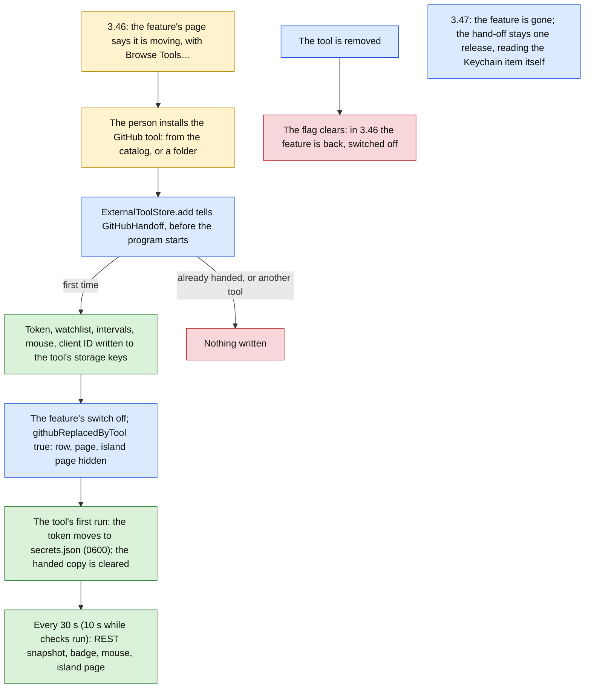

# Tools for everyone (stage E: the GitHub tool) Implementation Plan

> **For agentic workers:** REQUIRED SUB-SKILL: Use superpowers:subagent-driven-development (recommended) or superpowers:executing-plans to implement this plan task-by-task. Steps use checkbox (`- [ ]`) syntax for tracking.

**Goal:** The app's GitHub feature becomes a tool from outside: a program of protocol 2, `dev.vitruvian.github`, developed in `apps/desktop/vitruvian-tool-github`, released from its own public mirror as a zip the catalog pins, drawn by the app in the island's Tools page and in the tool's detail. The release that offers it (3.46) says so on the feature's page and, when the tool is installed, hands it the person's sign-in and settings once and hides the feature. The release after (3.47) removes the feature: fifteen files, 4,300 lines.

**Architecture:** The tool is Swift on the Swift kit, which gains one thing for it, a timer the kit's one thread runs between messages (`Tool.every`). Everything the tool decides is in a library, `GitHubToolCore`, behind a `ToolHost` protocol and a `Transport` protocol, so its tests drive it with a recording host and a transport that answers itself; `main.swift` only wires the kit's handlers, two panels, two commands and the timer to it. The app gains one service, `GitHubHandoff`, called by the tool store before an added tool's program starts: it writes the feature's token and settings into the tool's own `storage` keys, the one thing the app lets a tool read, turns the feature's switch off and marks it replaced, which hides its row, its page and its island page while the tool is installed. The catalog's schema admits protocol 2; the entry pins the mirror's release asset. The removal deletes the feature and keeps the hand-off one release more.



Green is done, amber waits for the person, red is nothing done, blue is in progress.

**What a person sees:** in 3.46, at the top of Settings › GitHub, one new text saying the feature is becoming a tool and what moves, with Browse Tools…; the catalog's sheet lists "GitHub" by VitruvianSoftware; after Install and the agreement sheet, the GitHub page, its row in the Features hub and its island page are gone, a tile "GitHub" with a badge sits after the quick tools on the island's Tools page, its page lists the watched repositories and the person's pull requests, and the tool's detail shows "Connected as @them" without a second sign-in, with the watched repositories, poll intervals and mouse settings the app draws. In 3.47 nothing of the feature is anywhere. The mock-ups are `docs/superpowers/specs/2026-10-12-vitruvian-tools-for-everyone-stage-e-mockups.html`, delivered beside this plan; open them beside each view.

**Tech Stack:** Swift 6 (strict concurrency) for the tool and the app; the Swift kit (`VitruvianToolKit`) and protocol (`VitruvianToolProtocol`); XCTest for the tool, the app's own `TestSuite` harness; Python 3 for the catalog, the mirror-workflow and version tests and the conformance script; Go for repo-config; Copybara and release-please as stages A and C used them; Bazel 9.3.0 with `--config=macos-app`.

**Spec:** `docs/superpowers/specs/2026-10-12-vitruvian-tools-for-everyone-design.md`: section 11, row E; section 9, "GitHub, first"; section 3, decisions 1, 9, 10, 12, 15 to 20 and 22; sections 12 and 13; section 14, questions 2, 3 and 5. This plan builds stage E and nothing more; stage F (Nexus Agent, HomeSpeaker) follows it.

**Release:** five pull requests, in this order, each squash-merged, so its title is the commit that counts.

| Pull request | Tasks | Title (the squash commit) | Cuts |
|---|---|---|---|
| A | 4a | `feat(repo-config): a public repository for the GitHub tool, with its export key` | Repo Config Apply makes the mirror and its key. Merge alone, first, and wait for the apply (the two-PR order stage A used). |
| B | 1 | `feat(vitruvian-sdk): a tool can act on a timer` | An SDK release, the one `Package.swift` and `version_test.py` name (decision 4). Wait for the mirror's `v` tag before C. |
| C | 2, 3, 4b | `feat(vitruvian-tool-github): the GitHub tool, released from its mirror` | Nothing of the app. The export runs on merge; release-please opens the tool's release PR for 1.0.0, which merges itself; the mirror's `release.yml` tags `v1.0.0` and attaches `github-tool-1.0.0.zip`. |
| D | 5, 6, 7 | `feat(desktop): the GitHub feature hands over to the GitHub tool` | A minor release of the app, 3.46.0. Task 6 needs the asset of C's release for its checksum. |
| E, one release later | 8 | `feat(desktop): the GitHub feature is the GitHub tool from the catalog` | The next minor release of the app, 3.47.0. Not before 3.46.0 has shipped. |

Workers are `wren` for code, `forge` for Tasks 4a and 4b (CI, Bazel, Copybara, `repo-config`), and `compass` for Task 7.

Paths that start with `Sources/`, `Tests/`, `Tools/`, `bazel/` or name `BUILD`, `AGENTS.md`, `README.md` or `UPSTREAM.md` alone are relative to `apps/desktop/vitruvian/`. Every other path is from the repository root.

## Decisions this plan makes

The design's decisions stand. These are the ones it leaves open, or where the code forced something else. Each says whether it follows the design, adds to it, or differs from it, in those words. Task 7 records them in the design's stage table.

| # | Decision | Why |
|---|---|---|
| 1 | **The tool is Swift, on the Swift kit.** The feature is Swift, 4,300 lines with 1,156 lines of tests, and its models, colour rules, device flow and mouse code port line for line; the Swift kit is the reference and the only one with `panels` until stage D's Task 12 lands; a Swift tool is one binary with nothing to install, where a Python or TypeScript tool needs its runtime on the Mac. **Follows the design** (decision 20, section 9), which gives no language, read with section 5.3's "the Swift kit is the reference". | Rust would also give one binary, and nothing of the feature is Rust. |
| 2 | **The tool lives in the monorepo at `apps/desktop/vitruvian-tool-github` and is exported to `VitruvianSoftware/vitruvian-tool-github`**, a public export-only Copybara mirror in SQUASH mode, as `packages/vitruvian-sdk` is; the mirror's own `release.yml` tags `vX.Y.Z` from the exported release-please manifest, builds the universal binary, zips the folder and attaches `github-tool-X.Y.Z.zip` with its `.sha256`. `repo-config` makes the repository and the export key (Task 4a, `forge`). **Differs from the design**'s words, section 9, "a new repository holding the tool", in where the work is done; the repository the design names exists and holds the releases. | The monorepo gives it CI, review, the licence gate and the drift tests; the catalog's schema takes a download only from a GitHub release of a `VitruvianSoftware` repository, which the mirror is. `apps/desktop/` because it is a Mac program; `apps/desktop/AGENTS.md`'s DMG contract is for app bundles and does not apply, which the tool's `AGENTS.md` says. |
| 3 | **GPL-3.0-or-later**, the app's licence, with the app's two-line header; `tools/license/verify.sh` exempts the folder as it does `apps/desktop/vitruvian/`, and the folder's `BUILD` keeps everything private. **Follows the design**, section 14, question 3's default. | The tool carries the feature's code. Nothing MIT may link `:GitHubToolCore`; the tool links the MIT kit, the one direction allowed. |
| 4 | **The kit gains `Tool.every(seconds:_:)`**: a handler the kit's one thread runs between messages, never while a handler runs or waits for the app, not before the hello, on `Wire.next`'s deadline; a handler that runs late runs once; an error it throws goes to the tool's log. It is `feat(vitruvian-sdk)` and cuts an SDK release; the tool's `Package.swift` depends on the kit `from:` that version, and `version_test.py` holds the line to it. release-please bumps the minor before 1.0 (`bump-minor-pre-major`), so stage D's merge cut 0.11.0, not the design's 1.0.0; Task 1's commit carries the footer `Release-As: 1.0.0` (its pull request is one commit, so the footer reaches the squash commit whole), and that release is the SDK's 1.0.0. The plan writes `1.0.0`; **if the mirror tags another version, set `Package.swift` and `version_test.py` to it**. **Adds to the design** (section 8.4). | Stage D's plan named this as the first thing E needs from the kit. The four other kits follow, as D's Task 12 does. |
| 5 | **The token is a 0600 file, `secrets.json`, in the folder the app gives the tool for its own files; the tool never touches the Keychain.** **Differs from the design**, section 9, which names a Keychain item with the 0600 file as the fallback. | A program signed ad hoc is a new program to the Keychain with every release, which would ask the person each time or refuse in silence; HomeSpeaker's reason. The app's own Keychain store needed a fallback for the same cause. |
| 6 | **The hand-off carries everything the feature kept**, not the token and watchlist alone: the watched repositories, both poll intervals, the mouse switch, its command's path, five mouse lights, the idle behaviour and the client ID, each as one of the tool's declared preferences, written through the tool's `storage` keys by `GitHubHandoff` before the program's first run; the token under `migratedToken`, a preference with no title, which the tool moves and clears on its first run. **Adds to the design**, section 9 ("token and watchlist"). | Decision 20 says the migration carries the person's settings; the mouse settings are settings. |
| 7 | **While the tool is installed the feature is hidden, not only switched off**: `AppFeature.isAvailable(in:)` is false for a replaced feature, so its Features row, its Settings page and its island page go; removing the tool clears the flag and the feature is back, switched off, its Keychain token untouched. A tool added again is handed the settings again. **Adds to the design** (decision 20 says "the built-in switch is turned off"). | Two GitHubs for one release, one of them polling and lighting the mouse, is worse than none. The person who wants the feature back removes the tool. |
| 8 | **The hand-off runs for a tool added from a folder as for one from the catalog**, by id alone. **Adds to the design** ("when the catalogue tool is installed"). | A build of the tool a person tries by hand, and every by-hand check below, needs it before the catalog lists the tool. |
| 9 | **The tool's Settings panel is the account alone**; the eleven other settings are titled preferences the app draws in the detail, in the person's language, above it. **Adds to the design**, which has "a settings panel for the account and the watchlist". | The app's own fields are the same controls, in fifteen languages, with no page from the tool; and a panel has no picker. |
| 10 | **The mouse's ten pickers become five one-line settings in the mouse command's own words**: `green`, `breathe orange`, `breathe blue 9` (a breathe speed, 0 to 9), and `restore` or `off` for nothing watched; a line that is no light falls back to its default. The command is found on the Mac as the feature found it (the path set, the app's copy in `Contents/Helpers`, PATH, `~/.local/bin`, Homebrew), not shipped in the zip; the app keeps bundling it. **Adds to the design** (section 9, "the GravaStar call as an `open`-free child process"). | A picker block does not exist (gap 1); the words are the command's. Shipping the binary would make the mirror build a second package that has no mirror of its own. |
| 11 | **Signing in through the browser does not move**: the tool signs in with the GitHub CLI's login (read from `hosts.yml`, once, and never again after a sign-out in the same run), a token typed into a secret field, or a code (the device flow, which needs the client ID). The feature's island page, its place in a saved layout and its `h` key do not move either; the tool's page is a tile on the Tools page. The app's one new text says both; the tool's panel says the first. **Follows the design** read with stage D's as-built (a tool's island page is a tile). | `vitruvian://github/callback` is the app bundle's URL scheme, and the relay that redeemed the code is gone. |
| 12 | **The watched repositories are one text field, `owner/name, owner/name`**; a JSON array, what the feature kept, is read too, so the handed value reads; an empty field watches the default, as the feature did. The island page lists at most the newest 100 pull requests, titles cut to 120 characters, with a plain subtitle `owner/name · @author`: a list of 200 rows with a subtitle in fifteen languages was over the page's 256 KB. | |
| 13 | **`$HOME` is the person's home when it is set**, for the CLI's `hosts.yml` and the mouse search (`Paths.home`); `NSHomeDirectory()` reads the account's and found this Mac's real GitHub login under a test's scratch home, which signed the tool in with it. The conformance test runs the program under a scratch `HOME` on a `block-network` target. **Adds to the design.** | A test must never reach GitHub with a live token; this one did, read-only, once, before the rule. |
| 14 | **The catalog's schema admits `"protocol": "2"`**; its test's "a protocol the app has not" case moves to `"3"`. The entry's `minimumAppVersion` is `3.46.0`, the release pull request D cuts, and its `sha256` and `size` are the release asset's, read off the mirror's release notes, which print them. **Follows the design** (section 7). | The app shows an entry only when it speaks its protocol and is new enough. |
| 15 | **The app's new text is one**, `movesToTool`, a field of `NotchGitHubStrings` in all fifteen languages, so it goes with the feature in 3.47. The fourteen other languages were written with the English; nobody who reads them has reviewed them. The tool's words are its own, `Words.swift`: the feature's 23 texts with their fourteen translations carried over, and 22 new ones written with the English. | |
| 16 | **The removal keeps the hand-off one release more**, reading the token from the feature's Keychain store (`GitHubTokenStore.swift` stays) and the feature's other preference keys, which stay declared; the switch, the relay address and everything else go. The `vitruvian` URL scheme stays in `Info.plist`. Stage F removes the hand-off and the keys. **Adds to the design** (section 9, "the release after removes `AppFeature.notchGitHub` and the 4,300 lines"). | A person who updates from 3.45 to 3.47 would otherwise sign in again. |
| 17 | **The mirror has no key to the Homebrew tap and asks for no identity token**: it publishes a zip to its own releases and nothing else; `mirror_workflows_test` holds every job to that. **Follows the design** (decision 22). | |
| 18 | **The tests stay in the suites they extend**: `platform` grows from 820 checks to 836 (`GitHubHandoffTests`), the `github` suite stays at 225 in 3.46 and goes in 3.47 (`TESTS OK (49 suites)`, then 48); the tool's own XCTest runs 59 tests. One `pipeline_unit`, `vitruvian-tool-github`, is added for the tool's folder, which is a new package; `.github/workflows/presubmit.yaml` is regenerated for it and for nothing else. | |
| 19 | **Not in stage E:** the four other kits' timers; a web panel; pictures (avatars); re-running a pull request's checks; the arrow keys on the island tile; anything only a person can check, which is the list "By hand". | Stage F and later. |

## What the protocol lacks

Nothing in this plan changes the protocol. Where the tool wanted something the protocol has not, it does without, as said; each is a gap for a later protocol change with its full path (`packages/vitruvian-sdk/CONTRIBUTING.md`), the smallest additive change named.

| # | Gap | Done without | Smallest additive change |
|---|---|---|---|
| 1 | No choice among fixed words: a preference is text, a number or a switch, and a page has no picker block. | The mouse lights are text in the mouse command's words (decision 10). | **Closed 2026-10-13**, by `docs/superpowers/plans/2026-10-13-vitruvian-tool-resting-status-and-choice.md`: `options` on a `string` preference, drawn as a pop-up, and a `choice` block whose pick is the event `change`. Not the `"type": "choice"` this row proposed: every released app refuses a manifest with a preference type it does not know. The GitHub tool adopts them in that plan's Task 8. |
| 2 | A tool cannot keep a secret with the app: `storage` is UserDefaults, and a value a tool is handed sits there until the tool clears it. | The tool keeps the token in a 0600 file; the hand-off's copy lives in defaults until the tool's first run, which is the next launch at most. | A preference `"type": "secret"`, kept by the app outside the defaults plist and never shown. |
| 3 | A tool cannot send the person to its own settings: the island page can only say where they are. | The signed-out island page says, in words, where to sign in. | A request `app/openSettings` with `{ "panel": "settings" }`, behind no `uses`, that opens the tool's detail. |
| 4 | A badge is a count or a dot: it cannot say "waiting for approval". | The page says it in a caption; the mouse says it in its light. | **Closed 2026-10-13**, by the same plan: the request `ui/status`, a small mark on the closed island in the app's own style, whose state `attention` says it. The badge is as it was. |

## Global Constraints

- **Everything in this plan was built and run before it was written down.** The tree at `9641d606f` (the branch `feat/vitruvian-protocol-2`, stage D built, the Python kit drawing) was checked out in a locked worktree of its own, each task was committed in order on a detached head, and each task's state was built and tested by itself on a Mac16,5 with macOS 27.0, Xcode 27.0, Swift 6.4 and Bazel 9.3.0. The check counts in each task are from those runs. The failing output in each "watch it fail" step is what the build or the test printed when the task's tests were put on the task before it: a recording, cut to its first lines. Every regression listed was planted and seen to fail its test. At the end the full unit tests, `selftest`, the app's builds, the package's every test, the tool's every test, the licence gate, `//tools/conformance:check`, `//:tidy` and the workflow generator were run; "What was run for this plan" under Task 7 gives each result. Four things were not done. Nobody opened the app, so no tile, page, notice or mouse light was seen: the list "By hand" is all of it. Nothing ran on a CI runner, and no mirror exists yet, so the mirror's workflows ran only as `mirror_workflows_test` runs them. Nothing reached GitHub, by rule, after the one read-only call decision 13 records. Nobody who reads the fourteen other languages has read the new texts. If the base has moved and a listing no longer fits, make the smallest change that keeps its meaning and record it as a deviation.
- **How to read a listing.** A block that starts with a licence header is a whole file. A block that starts with `diff --git` is a change to a file that exists, as `git diff` prints it: a line that starts with `-` goes, a line that starts with `+` comes in, and the others are there to find the place. Save the block to a file and run `git apply <file>` from the repository root, or make the change by hand. Each is a change from the state the task before left. Every listing was taken by a script from the commits the tests ran on, not typed, and the script fails when a file a commit touched has no listing in its task. Task 8's deletions are `git rm` lines, not diffs of 5,500 removed lines. The one file not listed is the mock-ups page of Task 7, delivered beside this plan.
- **Licences.** Everything under `apps/desktop/vitruvian/` and `apps/desktop/vitruvian-tool-github/` is GPL-3.0-or-later; every new file there starts with exactly:
  ```swift
  // SPDX-License-Identifier: GPL-3.0-or-later
  // Copyright (C) 2026 VitruvianSoftware
  ```
  `catalog-info.yaml` alone carries the MIT header: it is metadata the conformance check reads, not the tool's code. Everything under `packages/vitruvian-sdk/` is MIT with the package's own header. Code flows one way: the tool links the kit; nothing is copied from the app's or the tool's folder into the package. Never edit an existing `Copyright (C) 2026 Vorssaint` header.
- **The protocol.** No task changes `packages/vitruvian-sdk/protocol/`, `Sources/VitruvianToolProtocol/` or the app's pin; `tool_protocol_pin_test` passes at every task without being touched. Task 1 changes the kit only.
- **`UPSTREAM.md`.** Every change to a file whose header says `Copyright (C) 2026 Vorssaint` is named under "Modifications" in the same commit. Task 5 changes five such files (`Core/FeatureCatalog.swift`, `Core/DefaultsKey.swift`, `Core/Defaults.swift`, `UI/Settings/FeatureHubSettings.swift`, `Tests/mutation_checks.py`); Task 8 changes seventeen, and deletes none, since every deleted file is VitruvianSoftware's. Each task's listing holds the exact entry. Check the header of every file you change; do not trust this list.
- **What a person sees changes only where a task says so.** With no GitHub tool installed, 3.46 is as 3.45 but for the notice at the top of Settings › GitHub; `platform` keeps every one of its 820 checks and only gains.
- **One `pipeline_unit` is added**, `vitruvian-tool-github` (Task 3, `xcode-27`, persona `platform`), and `bazel run //tools/pipeline:gen -- --format=workflow --output-file=.github/workflows/presubmit.yaml` is run in Tasks 3 and 4b, which commit what it writes; at every other task it must leave the file unchanged. Keep round brackets out of that call's comments.
- **Layers and access.** In the app, `Core <- Design <- Services <- UI <- App`, all in Swift 6 mode; what another module or the tests use is `package`; a `package` type a test builds needs a `package` initializer written out (Task 5 writes one for `ExternalToolStore.Installed`). In the tool, `GitHubToolCore` is one module in Swift 6 mode, `public` where `main.swift` or the tests reach it; `main.swift` holds no decision.
- **The main thread.** The store and the hand-off are `@MainActor` and never wait; the hand-off runs inside `ExternalToolStore.add`, before `activate`. The tool works on the kit's one thread: a call to GitHub waits on it (`URLSessionTransport`, 15 seconds at most), which is what a tool that polls does while it waits; the mouse command is started and not waited for.
- **No network in a test, and no login of this Mac's.** The tool's tests answer every request themselves (`FakeTransport`); `conformance_test` runs the program with `HOME` set to a scratch folder on a target tagged `block-network`; the app's tests never load a Keychain item. A test that fetches is a failure, not a slow pass.
- **Strings.** A text a person reads that is the app's own is a field of a strings struct in all fifteen languages; the tool's are in `Words.swift`, keyed by the app's language tags with `en` first, and `WordsTests` holds every key to all fifteen. Use the typographic apostrophe (’) and the ellipsis character (…), and no em-dash. French puts `\u{00A0}` before `:`, `?`, `!` and `;`. A tool's words are the tool's: the app draws them as written.
- **Tests.** The app's tests are as stage D's: synchronous `static func run(_ suite: TestSuite)` reached from `Tests/TestGroups.swift`, no file read as text, nothing drawn, every file under `FileManager.default.temporaryDirectory` in a folder the test makes and removes, nothing under `~/Library/Application Support/com.vitruviansoftware.vitruvian`. A test's `UserDefaults` suite is named `com.vitruviansoftware.vitruvian.tests.<something>` with a literal prefix and its persistent domain removed first, or the `harness` suite fails it as unswept. The tool's tests are XCTest; a `Tool` over pipes is served on a thread of its own and ended with a goodbye.
- **Build and test through Bazel only**, from the repository root, one command at a time. A full run of the unit tests needs the display awake and the screen unlocked: start it with `(caffeinate -u -d -t 900 &);`. The suites a task names:
  ```sh
  bazel test --config=macos-app //apps/desktop/vitruvian:unit_tests --test_arg=--suite=platform --test_arg=--suite=github --test_output=errors
  grep -aE "^(platform|github): |TESTS" bazel-testlogs/apps/desktop/vitruvian/unit_tests/test.log
  bazel test //apps/desktop/vitruvian:source_lints_test //apps/desktop/vitruvian:sources_in_sync_test //apps/desktop/vitruvian:tool_protocol_pin_test //apps/desktop/vitruvian:upstream_test
  ```
  Never put `--test_arg` on a command that also names the source tests. The tool's tests:
  ```sh
  bazel test --config=macos-app //apps/desktop/vitruvian-tool-github:GitHubToolCoreTests //apps/desktop/vitruvian-tool-github:conformance_test //apps/desktop/vitruvian-tool-github:version_test //apps/desktop/vitruvian-tool-github:mirror_workflows_test --test_output=errors
  grep -E 'Executed .* tests' bazel-testlogs/apps/desktop/vitruvian-tool-github/GitHubToolCoreTests/test.log | tail -1
  ```
  The tool's targets are `manual` and macOS-only: `bazel test //apps/desktop/vitruvian-tool-github/...` runs none of them; name them. New Swift files need no edit to `BUILD`: each module's sources are a glob.
- **Do not launch the app from a task**, and do not write to the preferences domain `com.vitruviansoftware.vitruvian` or create anything under the app's real support folder. The checks that need the running app are "By hand".
- **Planted regressions.** The app's go in `Tests/mutation_checks.py`, which quotes source lines exactly: Task 5 adds two, Task 8 takes one away. For each: apply it by hand, run the suite it names, confirm it fails with the sixth field among the messages, undo it by hand, and confirm `git diff --stat -- <file>` shows only the task's own change. The kit's and the tool's cannot go there, since the app's tests do not run them: Tasks 1 and 3 give each as a step, with the test that must fail. If a regression is not caught, stop and report; do not adjust a test to fit.
- **Formatting and gates.** After editing a `.py`, `.json`, `.yml`, `.yaml` or `BUILD` file run `bazel run //tools/format -- <path>`. Write a JSON file by adding to it as text, never by loading and dumping it whole. Task 7 runs `bazel run //tools/license:check`, `bazel run //tools/license:verify`, `bazel run //tools/conformance:check` and `bazel run //:tidy`. On this base `//:tidy` adds one unrelated line, `Cryptodome: pycryptodomex`, to `gazelle_python.yaml`: undo it by hand and do not commit it. `bazel run //tools/owners -- --out .github/CODEOWNERS` would also drop two rows added by hand before this stage (the Antigravity app's and the site's, which have no `OWNERS` file): Task 2 adds its row by hand instead, and that drift is flagged apart from this plan.
- **Git.** Never `git stash`, `git reset` or `git restore`; undo an edit by hand. Commits are authored as the agent the task names, one per task, with identity and commit in one command. In a worktree the keys are in the main checkout:
  ```sh
  export AGENT_KEY_DIR=/Users/james/Workspace/gh/application/vitruvian/vitruvian-core/tools/sync-env-secrets/agent-keys; eval "$(bazel run //tools/agent-app -- env wren 2>/dev/null)"; git add <files> && git commit -m "<title>"
  ```
- **Signing and cost.** The tool's binary is signed ad hoc by the linker, as the app is; nothing signs or notarizes anything; the mirror, its releases and its Actions minutes are free. The release's zip is installed by the app from a verified download, which sets no quarantine (decision 14 of the design); a zip a browser downloaded is the person's to clear.

## Review Focus

Where a mistake costs most. Each has a test in the task named.

1. **A test must never reach GitHub with a login of this Mac's.** `Paths.home` reads `$HOME` first and `CLIAccount.defaultHostsURL` is under it (Task 3, `testTheHomeFolderIsTheEnvironmentsFirst`, and a regression); `conformance_test` sets a scratch `HOME` and the target blocks the network (Task 3). Read `GitHubTool.start` yourself: nothing it reads comes from outside `parts`.
2. **The handed token leaves the app's defaults.** The tool moves it into `secrets.json` on its first run and writes `""` back, and never replaces a token it already keeps (Task 3, two tests, and a regression); the file is 0600 in a 0700 folder (Task 2, and a regression); `AccessToken` never prints its value (Task 2). The hand-off writes the token only when there is one, and never logs it (Task 5, `whatIsHandedIsWhatTheToolReads`; grep `GitHubHandoff.swift` for `token` in a log line: there is none).
3. **The hand-off runs once, before the program starts, and for the GitHub tool alone.** `ExternalToolStore.add` tells `Parts.added` before `activate` (Task 5, `theStoreTellsBeforeTheProgramStarts`); a second add, an update, hands nothing; another tool's id hands nothing; a manifest that lacks a preference is handed the rest and the log names what it did not take (Task 5, `otherToolsAndAnUpdateHandNothing`).
4. **The feature comes back when the tool goes, and nothing of it is reachable after 3.47.** `toolRemoved` clears the flag and `isAvailable` is true again (Task 5, `removalBringsTheFeatureBackOff`); in 3.47 a saved island layout that names `github` reads as nothing, as any name the app lacks does (Task 8, the check added to `FeatureCatalogTests`), and the compiler holds the rest: every arm of `notchGitHub` and `.github` is gone or the app does not build.
5. **The catalog pins the release's bytes, not the by-hand build's.** The entry's `sha256` and `size` in Task 6 are the build's of this plan and are to be replaced by the asset's; the pull request's `catalog-check` downloads the asset and refuses a mismatch (stage C's workflow, unchanged). Nothing here can prove it before the release exists: say in the pull request which run proved it.

## The strings

The one text this stage adds to the app, a field of `NotchGitHubStrings` (Task 5), with its English; the fourteen other languages are in Task 5's listing. The mock-ups use exactly these words.

| Key | English |
|---|---|
| `movesToTool` | GitHub is becoming a tool from the catalog. Install it under Features, Tools from outside: your sign-in, watched repositories and mouse settings move with it, this page goes, and its island page becomes a tile on the island’s Tools page. Signing in through the browser does not move: the tool signs in with the GitHub CLI, a token or a code. |

Words the app already has, used as they are: `ExternalToolStrings.browseButton`, "Browse Tools…", the button under it; the agreement sheet, the catalog sheet and the tool's detail as stages C and D made them.

The tool's words (`Words.swift`, 45 keys, fifteen languages each) and its manifest's titles (two commands, eleven preferences, fifteen languages each) are the tool's own and are never translated by the app. The ones carried from the feature keep its fourteen translations; the 22 new keys and the twelve new titles were written with the English.

---

### Task 1: The kit's timer

**Worker:** `wren`. **Commit:** `feat(vitruvian-sdk): a tool can act on a timer`. Pull request B, alone: it cuts an SDK release, the one Task 3's `Package.swift` and `version_test.py` name.

**Files:**
- Modify: `packages/vitruvian-sdk/Sources/VitruvianToolKit/Tool.swift`
- Modify: `packages/vitruvian-sdk/Tests/VitruvianToolKitTests/ToolTests.swift`
- Modify: `packages/vitruvian-sdk/docs/writing-a-tool.md`
- Modify: `apps/web/vitruviansoftware-dev/tools/guide.md` (written by the site sync)

**Interfaces:**
- Consumes: `Tool`, `Wire.next(before:)`, `App.log`, `CommandRefused` (the kit).
- Produces: `Tool.every(seconds: TimeInterval, _ handler: @escaping Handler)`. The handler is `(App) throws -> Void`, as a command's. It runs on the thread that runs the tool, between messages, never while a command's or a panel's handler runs or waits for the app, and not before the app has said hello; a handler that runs late runs once; an error it throws is written to the tool's log and the timer goes on. `seconds` under 0 reads as 0.

A tool that polls needs to act with no message to answer. The kit reads its link with `poll` and a deadline already (`Wire.next(before:)`); the timer is that deadline: `serve()` waits until the first timer is due, runs the timers that are due, and goes back to reading. Inside `call`, where a handler waits for an answer, the deadline is the answer's, so a timer never runs under a handler. The timers' first times are set at the hello, so a handler may call the app.

- [ ] **Step 1: Write the failing tests**

Three tests on a link of two pipes, which stay open until the test closes them, served on a thread of the test's own.

In `packages/vitruvian-sdk/Tests/VitruvianToolKitTests/ToolTests.swift`:

```diff
diff --git a/packages/vitruvian-sdk/Tests/VitruvianToolKitTests/ToolTests.swift b/packages/vitruvian-sdk/Tests/VitruvianToolKitTests/ToolTests.swift
index 78f170ab6..08fedf42e 100644
--- a/packages/vitruvian-sdk/Tests/VitruvianToolKitTests/ToolTests.swift
+++ b/packages/vitruvian-sdk/Tests/VitruvianToolKitTests/ToolTests.swift
@@ -495,3 +495,148 @@ final class PanelTests: XCTestCase {
         XCTAssertEqual(UIBlock.kinds.count, 12)
     }
 }
+
+// MARK: - Timers
+
+/// A link of two pipes, which stay open until the test closes them, so a
+/// timer has time to run. The tool serves on a thread of its own; the test
+/// is the app.
+private final class LiveBench {
+    private let fromApp = Pipe()
+    private let toApp = Pipe()
+    private var read = Data()
+    private let lock = NSLock()
+    private var status: Int32?
+
+    let tool: Tool
+
+    init(_ build: (Tool) -> Void) {
+        tool = Tool(version: "9.9.9", input: fromApp.fileHandleForReading, output: toApp.fileHandleForWriting)
+        build(tool)
+        // What the tool writes is read as it comes, so a full pipe never
+        // holds the tool.
+        let handle = toApp.fileHandleForReading
+        Thread.detachNewThread { [self] in
+            while true {
+                let piece = handle.availableData
+                if piece.isEmpty { return }
+                lock.withLock { read.append(piece) }
+            }
+        }
+    }
+
+    func serve() {
+        Thread.detachNewThread { [self] in
+            let ended = tool.serve()
+            lock.withLock { status = ended }
+        }
+    }
+
+    func app(_ line: String) {
+        fromApp.fileHandleForWriting.write(Data((line + "\n").utf8))
+    }
+
+    func hello() {
+        app(#"{"jsonrpc":"2.0","id":"hello","method":"initialize","params":{"protocolVersions":["1","2"],"language":"en-US","dataFolder":"/tmp/kit-data"}}"#)
+    }
+
+    /// Says goodbye, closes the link, and waits for the tool to stop.
+    func goodbye() -> Int32? {
+        app(#"{"jsonrpc":"2.0","method":"shutdown"}"#)
+        try? fromApp.fileHandleForWriting.close()
+        let until = Date().addingTimeInterval(5)
+        while Date() < until {
+            if let status = lock.withLock({ status }) {
+                try? toApp.fileHandleForWriting.close()
+                Thread.sleep(forTimeInterval: 0.05)
+                return status
+            }
+            Thread.sleep(forTimeInterval: 0.01)
+        }
+        return nil
+    }
+
+    func written() throws -> [RPCMessage] {
+        let text = String(decoding: lock.withLock { read }, as: UTF8.self)
+        return try text.split(separator: "\n").map { try LineFraming.message(from: Data($0.utf8)) }
+    }
+}
+
+extension ToolTests {
+    private func logs(_ messages: [RPCMessage]) -> [String] {
+        messages.compactMap { message in
+            guard case .notice("log", let params) = message else { return nil }
+            return params?["message"]?.stringValue
+        }
+    }
+
+    func testATimerRunsBetweenMessagesAndCountsFromTheHello() throws {
+        // Guarded by the tool's one thread: read after serve() has returned.
+        nonisolated(unsafe) var ticks = 0
+        let bench = LiveBench { tool in
+            tool.every(seconds: 0.05) { app in
+                ticks += 1
+                app.log("tick \(ticks)")
+            }
+        }
+        bench.serve()
+        // Before the hello the timer is not running.
+        Thread.sleep(forTimeInterval: 0.2)
+        bench.hello()
+        Thread.sleep(forTimeInterval: 0.3)
+        XCTAssertEqual(bench.goodbye(), 0)
+        let written = try bench.written()
+        XCTAssertEqual(ticks, logs(written).count, "each run of the timer wrote its line")
+        XCTAssertTrue((3...8).contains(ticks), "a timer of 50 ms ran about six times in 300 ms, not \(ticks)")
+        guard case .result(id: .string("hello"), _)? = written.first else {
+            return XCTFail("the hello is answered before any timer runs: \(written.first.map(String.init(describing:)) ?? "nothing")")
+        }
+    }
+
+    func testATimerDoesNotRunWhileAHandlerWaitsForTheApp() throws {
+        nonisolated(unsafe) var ticks = 0
+        nonisolated(unsafe) var ticksWhenTheCommandRan = -1
+        let bench = LiveBench { tool in
+            tool.every(seconds: 0.05) { app in
+                ticks += 1
+                app.log("tick")
+            }
+            tool.command("copy") { app in
+                _ = try app.clipboardText()
+                ticksWhenTheCommandRan = ticks
+            }
+        }
+        bench.serve()
+        bench.hello()
+        bench.app(#"{"jsonrpc":"2.0","id":2,"method":"command/run","params":{"command":"copy"}}"#)
+        // The handler waits for the clipboard for 300 ms: six timer runs' worth.
+        Thread.sleep(forTimeInterval: 0.3)
+        bench.app(#"{"jsonrpc":"2.0","id":1,"result":{"text":"x"}}"#)
+        Thread.sleep(forTimeInterval: 0.2)
+        XCTAssertEqual(bench.goodbye(), 0)
+        let written = try bench.written()
+        XCTAssertEqual(ticksWhenTheCommandRan, 0, "no timer ran while the handler waited for its answer")
+        XCTAssertGreaterThanOrEqual(ticks, 1, "the timer ran once the handler had returned")
+        let answered = written.firstIndex { if case .result(id: .number(2), _) = $0 { return true } else { return false } }
+        let firstLog = written.firstIndex { if case .notice("log", _) = $0 { return true } else { return false } }
+        XCTAssertNotNil(answered)
+        XCTAssertTrue(firstLog.map { $0 > (answered ?? .max) } ?? false, "every line of the timer came after the command's answer")
+    }
+
+    func testATimersErrorIsLoggedAndTheTimerGoesOn() throws {
+        nonisolated(unsafe) var ticks = 0
+        let bench = LiveBench { tool in
+            tool.every(seconds: 0.05) { _ in
+                ticks += 1
+                throw CommandRefused("not now")
+            }
+        }
+        bench.serve()
+        bench.hello()
+        Thread.sleep(forTimeInterval: 0.3)
+        XCTAssertEqual(bench.goodbye(), 0)
+        let lines = logs(try bench.written())
+        XCTAssertEqual(lines.count, ticks)
+        XCTAssertTrue(ticks >= 2 && lines.allSatisfy { $0.contains("not now") }, "\(lines)")
+    }
+}
```


- [ ] **Step 2: Watch them fail**

Run: `bazel test --config=macos-app //packages/vitruvian-sdk:VitruvianToolKitTests --test_output=errors`

Expected, cut to its first lines:

```
packages/vitruvian-sdk/Tests/VitruvianToolKitTests/ToolTests.swift:577:18: error: value of type 'Tool' has no member 'every'
packages/vitruvian-sdk/Tests/VitruvianToolKitTests/ToolTests.swift:600:18: error: value of type 'Tool' has no member 'every'
packages/vitruvian-sdk/Tests/VitruvianToolKitTests/ToolTests.swift:629:18: error: value of type 'Tool' has no member 'every'
```

- [ ] **Step 3: The timer, in the kit**

In `packages/vitruvian-sdk/Sources/VitruvianToolKit/Tool.swift`:

```diff
diff --git a/packages/vitruvian-sdk/Sources/VitruvianToolKit/Tool.swift b/packages/vitruvian-sdk/Sources/VitruvianToolKit/Tool.swift
index a1fe8a2ba..cd16b0f12 100644
--- a/packages/vitruvian-sdk/Sources/VitruvianToolKit/Tool.swift
+++ b/packages/vitruvian-sdk/Sources/VitruvianToolKit/Tool.swift
@@ -78,6 +78,9 @@ public final class Tool {
     private var handlers: [String: Handler] = [:]
     /// The tool's panels, by id, as `panel(_:onOpen:onEvent:)` made them.
     var panels: [String: Panel] = [:]
+    /// What `every(seconds:_:)` set up: each with when it next runs, by the
+    /// clock `Wire.now` reads. Nil until the app has said hello.
+    private var timers: [(seconds: TimeInterval, handler: Handler, nextAt: TimeInterval?)] = []
     /// Held so that the two ends stay open for as long as the tool lives:
     /// a file handle closes its descriptor when it is let go.
     private let ends: [FileHandle]
@@ -100,6 +103,18 @@ public final class Tool {
         handlers[id] = handler
     }
 
+    /// Runs `handler` every `seconds`, on the thread that runs the tool,
+    /// between messages: never while a command or a panel's handler is
+    /// running or waiting for the app's answer, and not before the app has
+    /// said hello. A handler that runs late is not run twice to catch up.
+    /// An error it throws is written to the tool's log and the timer goes
+    /// on. For a tool that polls, as one that watches a service does; ask
+    /// for a few seconds at least, so the tool is not the app's busiest
+    /// part.
+    public func every(seconds: TimeInterval, _ handler: @escaping Handler) {
+        timers.append((max(0, seconds), handler, nil))
+    }
+
     /// Reads and answers until the app says goodbye, then exits with 0.
     public func run() -> Never {
         exit(serve())
@@ -115,14 +130,35 @@ public final class Tool {
                 handle(kept.removeFirst())
                 continue
             }
-            switch wire.next(before: nil) {
+            switch wire.next(before: nextTimer) {
             case .message(let message): handle(message)
-            case .ended, .late: stopping = true
+            case .late: runTimers()
+            case .ended: stopping = true
             }
         }
         return 0
     }
 
+    /// When the first timer is due, or nil with none set up or none started.
+    private var nextTimer: TimeInterval? {
+        timers.compactMap(\.nextAt).min()
+    }
+
+    /// Runs each timer that is due, once, and sets its next time from now,
+    /// not from when it was due.
+    private func runTimers() {
+        for index in timers.indices {
+            guard let due = timers[index].nextAt, due <= Wire.now else { continue }
+            timers[index].nextAt = Wire.now + timers[index].seconds
+            do {
+                try timers[index].handler(App(tool: self))
+            } catch {
+                App(tool: self).log("a timer's handler failed: \(error)")
+            }
+            if stopping { return }
+        }
+    }
+
     private func handle(_ message: RPCMessage) {
         switch message {
         case .request(let id, let method, let params):
@@ -171,6 +207,8 @@ public final class Tool {
         dataFolder = URL(fileURLWithPath: hello.dataFolder, isDirectory: true)
         greeted = true
         answer(id, InitializeResult(protocolVersion: picked, toolVersion: version))
+        // The timers count from the hello, so a handler may call the app.
+        for index in timers.indices { timers[index].nextAt = Wire.now + timers[index].seconds }
         onStart?(App(tool: self))
     }
 
```


- [ ] **Step 4: Run the kit's tests**

Run: `bazel test --config=macos-app //packages/vitruvian-sdk:VitruvianToolKitTests --test_output=errors`
Expected: `PASSED`; `grep -E 'Executed .* tests' bazel-testlogs/packages/vitruvian-sdk/VitruvianToolKitTests/test.log | tail -1` says `Executed 23 tests, with 0 failures`; it said 20.

- [ ] **Step 5: The guide, and the site's copy of it**

`guide_test` fails while a public call of the kit is not in the guide's text, and `//tools/sync-site-tools:in_sync_test` fails while the site's copy of the guide is stale.

In `packages/vitruvian-sdk/docs/writing-a-tool.md`:

````diff
diff --git a/packages/vitruvian-sdk/docs/writing-a-tool.md b/packages/vitruvian-sdk/docs/writing-a-tool.md
index 1e63d7164..3f9a4eafc 100644
--- a/packages/vitruvian-sdk/docs/writing-a-tool.md
+++ b/packages/vitruvian-sdk/docs/writing-a-tool.md
@@ -197,6 +197,15 @@ one: the kit follows `language/changed` by itself. Set
 `tool.onLanguageChanged` before `run()` only when your tool must do
 something at that moment.
 
+A tool that watches something, a service it polls or a folder it reads,
+sets a timer before `run()`: `tool.every(seconds: 30) { app in … }`. The
+handler runs on the kit's one thread, between messages: never while a
+command or a panel's handler is running or waiting for the app, and not
+before the app has said hello, so it may call the app like any handler. A
+handler that runs late runs once, not again to catch up; an error it
+throws goes to the tool's log and the timer goes on. Ask for a few seconds
+at least.
+
 ### In TypeScript, with the kit
 
 ```sh
````


Run `bazel run //tools/sync-site-tools:sync`; it writes `apps/web/vitruviansoftware-dev/tools/guide.md` (and reports the protocol page unchanged). The change it writes:

In `apps/web/vitruviansoftware-dev/tools/guide.md`:

````diff
diff --git a/apps/web/vitruviansoftware-dev/tools/guide.md b/apps/web/vitruviansoftware-dev/tools/guide.md
index db83301ee..4cb5918b8 100644
--- a/apps/web/vitruviansoftware-dev/tools/guide.md
+++ b/apps/web/vitruviansoftware-dev/tools/guide.md
@@ -208,6 +208,15 @@ one: the kit follows `language/changed` by itself. Set
 `tool.onLanguageChanged` before `run()` only when your tool must do
 something at that moment.
 
+A tool that watches something, a service it polls or a folder it reads,
+sets a timer before `run()`: `tool.every(seconds: 30) { app in … }`. The
+handler runs on the kit's one thread, between messages: never while a
+command or a panel's handler is running or waiting for the app, and not
+before the app has said hello, so it may call the app like any handler. A
+handler that runs late runs once, not again to catch up; an error it
+throws goes to the tool's log and the timer goes on. Ask for a few seconds
+at least.
+
 ### In TypeScript, with the kit
 
 ```sh
````


Run: `bazel test //packages/vitruvian-sdk:guide_test //tools/sync-site-tools:in_sync_test --config=macos-app //packages/vitruvian-sdk:VitruvianToolKitTests --test_output=errors`
Expected: three `PASSED`.

- [ ] **Step 6: Plant a regression and watch the tests catch it**

In `Tool.swift`, remove the line `for index in timers.indices { timers[index].nextAt = Wire.now + timers[index].seconds }` from `greet`, so no timer ever starts. Run the kit's tests.
Expected: `FAILED`, with `testATimerRunsBetweenMessagesAndCountsFromTheHello … a timer of 50 ms ran about six times in 300 ms, not 0` and `testATimerDoesNotRunWhileAHandlerWaitsForTheApp … the timer ran once the handler had returned` among the failures. Put the line back; `git diff --stat -- packages/vitruvian-sdk/Sources/VitruvianToolKit/Tool.swift` shows only this task's change.

- [ ] **Step 7: Commit**

```sh
export AGENT_KEY_DIR=/Users/james/Workspace/gh/application/vitruvian/vitruvian-core/tools/sync-env-secrets/agent-keys; eval "$(bazel run //tools/agent-app -- env wren 2>/dev/null)"; git add packages/vitruvian-sdk/Sources/VitruvianToolKit/Tool.swift packages/vitruvian-sdk/Tests/VitruvianToolKitTests/ToolTests.swift packages/vitruvian-sdk/docs/writing-a-tool.md apps/web/vitruviansoftware-dev/tools/guide.md && git commit -m "feat(vitruvian-sdk): a tool can act on a timer"
```

Open pull request B with that title, alone. When it has merged and release-please's pull request for the SDK has merged itself, note the version the mirror tagged: Task 3's `Package.swift` and `version_test.py` say `1.0.0` and must say that version.

---

### Task 2: The tool's core, from the app's feature

**Worker:** `wren`. **Commit:** `feat(vitruvian-tool-github): the GitHub tool's core, from the app's feature`. Pull request C, with Tasks 3 and 4b; cuts no release of the app and none of the SDK.

**Files:**
- Create: `apps/desktop/vitruvian-tool-github/` with `LICENSE` (the app's, GPL-3.0), `README.md`, `AGENTS.md`, `OWNERS`, `catalog-info.yaml`, `mkdocs.yml`, `docs/index.md`, `.gitignore`, `BUILD`, `Package.swift`
- Create: `apps/desktop/vitruvian-tool-github/Sources/GitHubToolCore/{Models,Watchlist,Secrets,Mouse,Auth,API,Words}.swift`
- Create: `apps/desktop/vitruvian-tool-github/Tests/GitHubToolCoreTests/{VerdictTests,WatchlistAndSecretsTests,MouseTests,AuthTests,APITests,WordsTests}.swift`
- Modify: `packages/vitruvian-sdk/BUILD` (the kit and the protocol visible to the tool's package)
- Modify: `tools/license/verify.sh` (the folder exempt from the MIT header check), `.github/CODEOWNERS` (one row, by hand), `catalog-info.yaml` at the root (the Location list)

**Interfaces:**
- Consumes: `VitruvianToolProtocol` (`UIText`, `LocalizedText`), nothing of the kit yet.
- Produces, all `public` in `GitHubToolCore`:
  - `Models.swift`: `RepoKey`, `GitHubIdentity`, `CheckStatus`, `CheckConclusion`, `CheckRun` (with `workflowRunID`), `ReviewState`, `PullRequest`, `Verdict`, `RepoState`, `Verdicts` (`verdict(for:)` three ways, `aggregate`, `awaitsApproval`, `concerns`), `GitHubSummary` (with `Repository.failedRunIDs`, `badgeCount`)
  - `Watchlist.parse(_:) -> [RepoKey]`, `.text(_:)`, `.defaultRepository`, `.defaultText`
  - `SecretStore(folder:)`: `token() -> String?`, `save(token:) throws`, `clear()`
  - `MouseCommand.locate(configured:appCopy:environment:home:isExecutable:)`, `.configuredIsIgnored`; `MouseLight.parse(_:)`, `.arguments`; `MouseSettings` (five lines); `MouseDriver(executor:)`, `.update(summary:settings:force:)`, `.restore()`, `MouseDriver.run(binary:arguments:)`
  - `Auth.swift`: `AccessToken`, `Paths.home` (Task 3 adds it), `CLIAccount.read(hostsFile:)`, `.parse(_:)`, `DeviceCode`, `DevicePollResult`, `DeviceFlowFailure`, `DeviceFlowWaiting`, `DeviceFlowInput`, `DeviceFlowState` (`next(_:now:)`, `shouldPoll(now:)`), `AuthFailure`, `AuthState`
  - `API.swift`: `Transport` (`send(_:) throws -> (Data, HTTPURLResponse)`), `APIError`, `URLSessionTransport(session:timeout:)`, `GitHubAPI(transport:apiURL:webURL:)` with `identity(token:)`, `snapshot(repo:token:known:now:)`, `rerunFailedJobs(repo:runIDs:token:)`, `deviceCode(clientID:)`, `pollDeviceCode(clientID:deviceCode:)`
  - `Words.text(_:)`, `.format(_:_:)`, `.plain(_:language:_:)`, `.languages`, `Words.table`

The feature's models (`GitHubModels.swift`), the colour rules of its reducer, its device flow (`GitHubOAuthState.swift`), its mouse (`GitHubMouseBinary.swift`, `GitHubPeripheralSink.swift`) and its REST client (`GitHubAPIClient.swift`) come over as they are, `package` made `public`, without the relay events and the SSE parser the app no longer used, and without the OAuth browser flow (decision 11). The REST client is synchronous: the kit's one thread waits on `URLSessionTransport` with a semaphore and a timeout. `Words.swift` is generated once, by hand, from `NotchGitHubStrings.swift` for the carried keys; it is a plain table from then on. The folder trips three gates of the repository (`check.sh`): the app boundary in `BUILD`, `catalog-info.yaml` with an owner that matches CODEOWNERS and a listing in the root Location file, and a `mkdocs.yml` its `techdocs-ref` points at; this task satisfies each.

- [ ] **Step 1: Write the failing tests**

Create `apps/desktop/vitruvian-tool-github/Tests/GitHubToolCoreTests/APITests.swift`:

```swift
// SPDX-License-Identifier: GPL-3.0-or-later
// Copyright (C) 2026 VitruvianSoftware

import XCTest

@testable import GitHubToolCore

/// A transport that answers from a table by the request's path, and keeps
/// every request it was given.
final class FakeTransport: Transport {
    var answers: [String: (Int, String)] = [:]
    var etag: String?
    var requests: [URLRequest] = []
    var fails = false

    func send(_ request: URLRequest) throws -> (Data, HTTPURLResponse) {
        requests.append(request)
        if fails { throw URLError(.notConnectedToInternet) }
        let path = request.url!.path + (request.url!.query.map { "?" + $0 } ?? "")
        let (status, body) = answers[path] ?? answers[request.url!.path] ?? (404, "{}")
        var headers: [String: String] = [:]
        if let etag { headers["ETag"] = etag }
        let response = HTTPURLResponse(url: request.url!, statusCode: status, httpVersion: nil, headerFields: headers)!
        return (Data(body.utf8), response)
    }
}

final class APITests: XCTestCase {
    let repo = RepoKey(owner: "acme", name: "web")
    let transport = FakeTransport()
    lazy var api = GitHubAPI(transport: transport, apiURL: URL(string: "https://api.test")!, webURL: URL(string: "https://web.test")!)

    func testIdentityReadsTheLoginAndTheTeamsAndRefusesA401() throws {
        transport.answers["/user"] = (200, #"{"login": "James"}"#)
        transport.answers["/user/teams"] = (200, #"[{"slug": "platform-team", "organization": {"login": "VitruvianSoftware"}}, {"slug": "lone"}]"#)
        let me = try api.identity(token: "t")
        XCTAssertEqual(me.login, "james")
        XCTAssertEqual(me.teams, ["vitruviansoftware/platform-team", "lone"])
        XCTAssertEqual(transport.requests.first?.value(forHTTPHeaderField: "Authorization"), "Bearer t")
        XCTAssertEqual(transport.requests.first?.value(forHTTPHeaderField: "X-GitHub-Api-Version"), "2022-11-28")
        transport.answers["/user"] = (401, "{}")
        XCTAssertThrowsError(try api.identity(token: "dead")) { XCTAssertEqual($0 as? APIError, .refused(status: 401)) }
        transport.fails = true
        XCTAssertThrowsError(try api.identity(token: "t")) { XCTAssertEqual($0 as? APIError, .unreachable) }
    }

    func testSnapshotReadsTheBranchItsChecksAndThePullRequests() throws {
        transport.answers["/repos/acme/web"] = (200, #"{"default_branch": "trunk"}"#)
        transport.answers["/repos/acme/web/commits/trunk"] = (200, #"{"sha": "head1"}"#)
        transport.answers["/repos/acme/web/commits/head1/check-runs"] = (200, #"{"check_runs": [{"id": 1, "name": "lint", "head_sha": "head1", "status": "completed", "conclusion": "success", "html_url": "https://x/1"}]}"#)
        transport.answers["/repos/acme/web/actions/runs?branch=trunk&per_page=10"] = (200, #"{"workflow_runs": [{"id": 50, "name": "ci", "head_sha": "head1", "status": "completed", "conclusion": "failure", "html_url": null}, {"id": 51, "name": "old", "head_sha": "head0", "status": "completed", "conclusion": "success", "html_url": null}]}"#)
        transport.answers["/repos/acme/web/actions/runs?branch=trunk&per_page=10&status=waiting"] = (200, #"{"workflow_runs": [{"id": 52, "name": "deploy", "head_sha": "head0", "status": "waiting", "conclusion": null, "html_url": null}]}"#)
        transport.answers["/repos/acme/web/pulls?state=open&per_page=20"] = (200, #"[{"number": 7, "title": "Fix", "draft": true, "html_url": "https://x/pull/7", "user": {"login": "Ana"}, "head": {"sha": "p7"}, "requested_reviewers": [{"login": "James"}], "requested_teams": [{"slug": "Platform-Team"}]}]"#)
        let now = Date(timeIntervalSince1970: 5)
        let state = try XCTUnwrap(try api.snapshot(repo: repo, token: "t", now: now))
        XCTAssertEqual(state.defaultBranch, "trunk")
        XCTAssertEqual(state.headSHA, "head1")
        XCTAssertEqual(Set(state.checks.keys), ["check_run:1", "workflow_run:50", "workflow_run:52"],
                       "the head's runs and the one waiting on an older commit, not the old finished one")
        XCTAssertEqual(state.checks["workflow_run:50"]?.workflowRunID, 50)
        XCTAssertEqual(state.checks["workflow_run:52"]?.status, .waiting)
        XCTAssertEqual(state.pullRequests[7]?.author, "Ana")
        XCTAssertEqual(state.pullRequests[7]?.requestedReviewers, ["james"])
        XCTAssertEqual(state.pullRequests[7]?.requestedTeams, ["platform-team"])
        XCTAssertEqual(state.pullRequests[7]?.isDraft, true)
        XCTAssertEqual(state.updatedAt, now)
        XCTAssertEqual(Verdicts.verdict(for: state), .red)

        // Known: the repository is not asked for its branch again.
        transport.requests.removeAll()
        _ = try api.snapshot(repo: repo, token: "t", known: state, now: now)
        XCTAssertFalse(transport.requests.contains { $0.url?.path == "/repos/acme/web" })
    }

    func testSnapshotIsNilWhenTheRepositoryCannotBeReadAndThrowsOn401() throws {
        transport.answers["/repos/acme/web"] = (404, "{}")
        XCTAssertNil(try api.snapshot(repo: repo, token: "t"))
        transport.answers["/repos/acme/web"] = (401, "{}")
        XCTAssertThrowsError(try api.snapshot(repo: repo, token: "t")) { XCTAssertEqual($0 as? APIError, .refused(status: 401)) }
        transport.answers["/repos/acme/web"] = (200, #"{"default_branch": "main"}"#)
        transport.answers["/repos/acme/web/commits/main"] = (401, "{}")
        XCTAssertThrowsError(try api.snapshot(repo: repo, token: "t"))
    }

    func testETagsAreSentBackOnGETs() throws {
        transport.etag = "W/\"1\""
        transport.answers["/user"] = (200, #"{"login": "me"}"#)
        _ = try api.identity(token: "t")
        _ = try api.identity(token: "t")
        XCTAssertNil(transport.requests[0].value(forHTTPHeaderField: "If-None-Match"))
        XCTAssertEqual(transport.requests[2].value(forHTTPHeaderField: "If-None-Match"), "W/\"1\"")
    }

    func testRerunFailedJobsPostsForEachRunAndKeepsTheAccepted() {
        transport.answers["/repos/acme/web/actions/runs/50/rerun-failed-jobs"] = (201, "")
        transport.answers["/repos/acme/web/actions/runs/51/rerun-failed-jobs"] = (403, "{}")
        XCTAssertEqual(api.rerunFailedJobs(repo: repo, runIDs: [50, 51], token: "t"), [50])
        XCTAssertEqual(transport.requests.map(\.httpMethod), ["POST", "POST"])
        XCTAssertNil(transport.requests[0].value(forHTTPHeaderField: "If-None-Match"))
    }

    func testTheDeviceFlowRequestsAreForms() throws {
        transport.answers["/login/device/code"] = (200, #"{"device_code": "d", "user_code": "ABCD-1234", "verification_uri": "https://github.com/login/device", "expires_in": 899, "interval": 5}"#)
        let code = try api.deviceCode(clientID: "Iv1.app")
        XCTAssertEqual(code.userCode, "ABCD-1234")
        XCTAssertEqual(code.expiresIn, 899)
        let request = try XCTUnwrap(transport.requests.last)
        XCTAssertEqual(request.httpMethod, "POST")
        XCTAssertEqual(request.value(forHTTPHeaderField: "Content-Type"), "application/x-www-form-urlencoded")
        XCTAssertEqual(String(decoding: request.httpBody ?? Data(), as: UTF8.self), "client_id=Iv1.app")

        transport.answers["/login/oauth/access_token"] = (200, #"{"error": "authorization_pending"}"#)
        XCTAssertEqual(api.pollDeviceCode(clientID: "Iv1.app", deviceCode: "d"), .pending)
        XCTAssertEqual(String(decoding: transport.requests.last?.httpBody ?? Data(), as: UTF8.self),
                       "client_id=Iv1.app&device_code=d&grant_type=urn:ietf:params:oauth:grant-type:device_code")
        transport.answers["/login/oauth/access_token"] = (200, #"{"access_token": "gho_new"}"#)
        XCTAssertEqual(api.pollDeviceCode(clientID: "Iv1.app", deviceCode: "d"), .token(AccessToken("gho_new")))
        transport.fails = true
        XCTAssertEqual(api.pollDeviceCode(clientID: "Iv1.app", deviceCode: "d"), .pending, "a blip is still waiting")
        XCTAssertThrowsError(try api.deviceCode(clientID: "Iv1.app")) { XCTAssertEqual($0 as? APIError, .unreachable) }
        transport.fails = false
        transport.answers["/login/device/code"] = (200, #"{"error": "device_flow_disabled"}"#)
        XCTAssertThrowsError(try api.deviceCode(clientID: "Iv1.app")) {
            XCTAssertEqual($0 as? GitHubAPI.DeviceCodeRefused, GitHubAPI.DeviceCodeRefused(reason: "device_flow_disabled"))
        }
    }
}
```

Create `apps/desktop/vitruvian-tool-github/Tests/GitHubToolCoreTests/AuthTests.swift`:

```swift
// SPDX-License-Identifier: GPL-3.0-or-later
// Copyright (C) 2026 VitruvianSoftware

import XCTest

@testable import GitHubToolCore

final class AuthTests: XCTestCase {
    func testTheCLIsHostsFileGivesItsLoginAndToken() {
        let account = CLIAccount.parse("""
            github.com:
                user: james
                oauth_token: gho_abc
                git_protocol: https
            """)
        XCTAssertEqual(account?.login, "james")
        XCTAssertEqual(account?.token, "gho_abc")
        XCTAssertNil(CLIAccount.parse("github.com:\n    user: james\n"), "no token, no account")
        XCTAssertEqual(CLIAccount.parse("github.com:\n    oauth_token: gho_x\n")?.login, "", "a token without a user")
        XCTAssertNil(CLIAccount.read(hostsFile: URL(fileURLWithPath: "/nonexistent/hosts.yml")))
    }

    func testDeviceFlowStateMachine() {
        let start = Date(timeIntervalSince1970: 1_000)
        let code = DeviceCode(deviceCode: "dev", userCode: "ABCD-1234", verificationURI: URL(string: "https://github.com/login/device")!,
                              expiresIn: 900, interval: 5)
        var flow = DeviceFlowState.idle.next(.start, now: start)
        XCTAssertEqual(flow, .requestingCode)
        flow = flow.next(.codeIssued(code), now: start)
        guard case .awaitingUser(let waiting) = flow else { return XCTFail("\(flow)") }
        XCTAssertEqual(waiting.userCode, "ABCD-1234")
        XCTAssertEqual(waiting.nextPollAt, start.addingTimeInterval(5))
        XCTAssertEqual(waiting.expiresAt, start.addingTimeInterval(900))
        XCTAssertFalse(flow.shouldPoll(now: start.addingTimeInterval(4)))
        XCTAssertTrue(flow.shouldPoll(now: start.addingTimeInterval(5)))
        flow = flow.next(.poll(.slowDown), now: start.addingTimeInterval(5))
        guard case .awaitingUser(let slower) = flow else { return XCTFail("\(flow)") }
        XCTAssertEqual(slower.interval, 10, "slow_down adds five seconds")
        XCTAssertEqual(slower.nextPollAt, start.addingTimeInterval(15))
        XCTAssertEqual(flow.next(.poll(.pending), now: start.addingTimeInterval(1_000)), .failed(.expired),
                       "a poll after the expiry is expired, whatever it says")
        XCTAssertEqual(flow.next(.tick, now: start.addingTimeInterval(901)), .failed(.expired))
        XCTAssertEqual(flow.next(.poll(.denied), now: start.addingTimeInterval(20)), .failed(.denied))
        XCTAssertEqual(flow.next(.poll(.token(AccessToken("gho_t"))), now: start.addingTimeInterval(20)),
                       .authorized(AccessToken("gho_t")))
        XCTAssertEqual(flow.next(.cancel, now: start), .idle)
        XCTAssertEqual(DeviceFlowState.requestingCode.next(.codeRequestFailed("device_flow_disabled"), now: start),
                       .failed(.other("device_flow_disabled")))
        XCTAssertEqual(DeviceFlowState.failed(.denied).next(.start, now: start), .requestingCode)
        XCTAssertEqual(DeviceFlowState.idle.next(.tick, now: start), .idle, "an input a state does not take changes nothing")
    }

    func testPollResultsReadGitHubsErrors() {
        XCTAssertEqual(DevicePollResult(errorCode: "authorization_pending"), .pending)
        XCTAssertEqual(DevicePollResult(errorCode: "slow_down"), .slowDown)
        XCTAssertEqual(DevicePollResult(errorCode: "access_denied"), .denied)
        XCTAssertEqual(DevicePollResult(errorCode: "expired_token"), .expired)
        XCTAssertEqual(DevicePollResult(errorCode: "token_expired"), .expired)
        XCTAssertEqual(DevicePollResult(errorCode: "weird"), .failure("weird"))
    }
}
```

Create `apps/desktop/vitruvian-tool-github/Tests/GitHubToolCoreTests/MouseTests.swift`:

```swift
// SPDX-License-Identifier: GPL-3.0-or-later
// Copyright (C) 2026 VitruvianSoftware

import XCTest

@testable import GitHubToolCore

final class MouseTests: XCTestCase {
    func testLocateTriesTheConfiguredPathThenTheAppsCopyThenPATHThenTheUsualPlaces() {
        let home = "/Users/me"
        func locate(configured: String, executable: Set<String>) -> String? {
            MouseCommand.locate(configured: configured, environment: ["PATH": "/usr/bin:relative:/opt/x/bin"], home: home,
                                isExecutable: { executable.contains($0) })
        }
        XCTAssertEqual(locate(configured: "~/tools/gm", executable: ["/Users/me/tools/gm"]), "/Users/me/tools/gm")
        XCTAssertEqual(locate(configured: "", executable: [MouseCommand.appCopy]), MouseCommand.appCopy)
        XCTAssertEqual(locate(configured: "", executable: ["/opt/x/bin/gravastar-mouse"]), "/opt/x/bin/gravastar-mouse")
        XCTAssertEqual(locate(configured: "", executable: ["/Users/me/.local/bin/gravastar-mouse"]),
                       "/Users/me/.local/bin/gravastar-mouse")
        XCTAssertNil(locate(configured: "", executable: ["relative/gravastar-mouse"]), "a relative PATH entry never counts")
        XCTAssertNil(locate(configured: "/nope", executable: []))
        XCTAssertTrue(MouseCommand.configuredIsIgnored(configured: "/nope", home: home, isExecutable: { _ in false }))
        XCTAssertFalse(MouseCommand.configuredIsIgnored(configured: "", home: home, isExecutable: { _ in false }))
    }

    func testALightIsReadAsThePersonWritesIt() {
        XCTAssertEqual(MouseLight.parse("green"), MouseLight(color: "green"))
        XCTAssertEqual(MouseLight.parse(" Breathe Orange "), MouseLight(color: "orange", breathes: true))
        XCTAssertEqual(MouseLight.parse("breathe blue 9"), MouseLight(color: "blue", breathes: true, speed: 9))
        XCTAssertEqual(MouseLight.parse("breathe blue 40")?.speed, 9, "the speed is held to 0 to 9")
        XCTAssertNil(MouseLight.parse(""))
        XCTAssertNil(MouseLight.parse("blue 9"), "a solid colour has no speed")
        XCTAssertNil(MouseLight.parse("breathe blue fast"))
        XCTAssertEqual(MouseLight.parse("breathe blue 3")?.arguments, ["breathe", "blue", "--speed", "3"])
        XCTAssertEqual(MouseLight.parse("cyan")?.arguments, ["color", "cyan"])
    }

    func testTheCommandsForEachVerdictAreTheFeatures() {
        var settings = MouseSettings()
        XCTAssertEqual(MouseDriver.arguments(verdict: .green, awaitingApproval: false, settings: settings), ["color", "green"])
        XCTAssertEqual(MouseDriver.arguments(verdict: .amber, awaitingApproval: false, settings: settings), ["breathe", "orange"])
        XCTAssertEqual(MouseDriver.arguments(verdict: .red, awaitingApproval: false, settings: settings), ["breathe", "red"])
        XCTAssertEqual(MouseDriver.arguments(verdict: .grey, awaitingApproval: false, settings: settings), ["restore"])
        settings.idle = " Off "
        XCTAssertEqual(MouseDriver.arguments(verdict: .grey, awaitingApproval: false, settings: settings), ["off"])
        XCTAssertEqual(MouseDriver.arguments(verdict: .red, awaitingApproval: true, settings: settings),
                       ["breathe", "blue", "--speed", "9"], "approval outranks red")
        settings.approval = "breathe purple"
        XCTAssertEqual(MouseDriver.arguments(verdict: .green, awaitingApproval: true, settings: settings), ["breathe", "purple"])
        settings.success = "not a light at all"
        XCTAssertEqual(MouseDriver.arguments(verdict: .green, awaitingApproval: false, settings: settings), ["color", "green"],
                       "a setting that is no light falls back to its default")
    }

    func testARepeatedStateWritesNothingUnlessForcedAndRestoreForgets() {
        var sent: [[String]] = []
        let driver = MouseDriver { sent.append($0) }
        let settings = MouseSettings()
        driver.update(verdict: .green, settings: settings)
        driver.update(verdict: .green, settings: settings)
        XCTAssertEqual(sent, [["color", "green"]])
        driver.update(verdict: .green, settings: settings, force: true)
        XCTAssertEqual(sent.count, 2, "the first snapshot after a start writes again: the mouse keeps its last light")
        driver.update(verdict: .red, awaitingApproval: true, settings: settings)
        driver.update(verdict: .amber, awaitingApproval: true, settings: settings)
        XCTAssertEqual(sent.count, 3, "a verdict that moves behind a wait writes nothing")
        driver.update(verdict: .amber, settings: settings)
        XCTAssertEqual(sent.last, ["breathe", "orange"], "when the wait clears, the verdict is written")
        driver.restore()
        XCTAssertEqual(sent.last, ["restore"])
        driver.update(verdict: .amber, settings: settings)
        XCTAssertEqual(sent.count, 6, "after a restore the same verdict is written again")
    }
}
```

Create `apps/desktop/vitruvian-tool-github/Tests/GitHubToolCoreTests/VerdictTests.swift`:

```swift
// SPDX-License-Identifier: GPL-3.0-or-later
// Copyright (C) 2026 VitruvianSoftware

import XCTest

@testable import GitHubToolCore

/// The colour rules, as the app's `GitHubCoreTests` held them.
final class VerdictTests: XCTestCase {
    static let repo = RepoKey(owner: "VitruvianSoftware", name: "vitruvian-core")
    static let head = "abc123"

    func check(_ id: Int64, sha: String = head, status: String = "completed", conclusion: String? = "success",
               runID: Int64? = nil) -> CheckRun {
        CheckRun(key: "check_run:\(id)", name: "ci", headSHA: sha, status: CheckStatus(raw: status),
                 conclusion: conclusion.map(CheckConclusion.init(raw:)), htmlURL: nil, workflowRunID: runID)
    }

    func state(_ checks: [CheckRun]) -> RepoState {
        RepoState(repo: Self.repo, defaultBranch: "main", headSHA: Self.head,
                  checks: Dictionary(uniqueKeysWithValues: checks.map { ($0.key, $0) }))
    }

    func testCancelledOnMainIsRedNotGreen() {
        XCTAssertEqual(Verdicts.verdict(for: [check(1), check(2, conclusion: "cancelled")]), .red)
    }

    func testEveryFailingConclusionIsRed() {
        for raw in ["failure", "timed_out", "cancelled", "action_required", "stale", "startup_failure"] {
            XCTAssertEqual(Verdicts.verdict(for: [check(1, conclusion: raw)]), .red, raw)
        }
    }

    func testRedWinsOverRunning() {
        XCTAssertEqual(Verdicts.verdict(for: [check(1, status: "in_progress", conclusion: nil),
                                              check(2, conclusion: "failure")]), .red)
    }

    func testEveryRunningStatusIsAmber() {
        for raw in ["queued", "in_progress", "waiting", "requested", "pending"] {
            XCTAssertEqual(Verdicts.verdict(for: [check(1), check(2, status: raw, conclusion: nil)]), .amber, raw)
        }
    }

    func testGreenNeedsAtLeastOneCheckAllPassing() {
        XCTAssertEqual(Verdicts.verdict(for: [CheckRun]()), .grey)
        XCTAssertEqual(Verdicts.verdict(for: [check(1), check(2, conclusion: "neutral"), check(3, conclusion: "skipped")]),
                       .green)
        XCTAssertEqual(Verdicts.verdict(for: [check(1, conclusion: "surprise")]), .grey, "an unknown conclusion is never green")
    }

    func testNoStateIsGrey() {
        XCTAssertEqual(Verdicts.verdict(for: nil as RepoState?), .grey)
        XCTAssertFalse(Verdicts.awaitsApproval(nil as RepoState?))
    }

    func testAggregateRanksRedAmberGreenGrey() {
        XCTAssertEqual(Verdicts.aggregate([.green, .amber, .red]), .red)
        XCTAssertEqual(Verdicts.aggregate([.green, .amber]), .amber)
        XCTAssertEqual(Verdicts.aggregate([.green, .green]), .green)
        XCTAssertEqual(Verdicts.aggregate([.green, .grey]), .grey)
        XCTAssertEqual(Verdicts.aggregate([]), .grey)
    }

    func testWaitingIsAwaitingApprovalAndApartFromTheVerdict() {
        let waiting = state([check(1, status: "waiting", conclusion: nil), check(2, conclusion: "failure")])
        XCTAssertTrue(Verdicts.awaitsApproval(waiting))
        XCTAssertEqual(Verdicts.verdict(for: waiting), .red, "a failed check beside the wait still makes it red")
        var pr = state([check(1)])
        pr.pullRequests[7] = PullRequest(number: 7, title: "t", author: "a", headSHA: "pr7", isDraft: false, htmlURL: nil,
                                         requestedReviewers: [], requestedTeams: [],
                                         checks: ["w": check(9, sha: "pr7", status: "waiting", conclusion: nil)])
        XCTAssertTrue(Verdicts.awaitsApproval(pr), "a pull request's wait counts too")
    }

    func testConcernsIsAuthoredOrReviewRequestedOrTeamRequested() {
        let me = GitHubIdentity(login: "James", teams: ["VitruvianSoftware/platform-team"])
        func pr(author: String = "someone", reviewers: Set<String> = [], teams: Set<String> = []) -> PullRequest {
            PullRequest(number: 1, title: "t", author: author, headSHA: "s", isDraft: false, htmlURL: nil,
                        requestedReviewers: reviewers, requestedTeams: teams)
        }
        XCTAssertTrue(Verdicts.concerns(pr(author: "james"), in: Self.repo, identity: me))
        XCTAssertTrue(Verdicts.concerns(pr(reviewers: ["JAMES"]), in: Self.repo, identity: me))
        XCTAssertTrue(Verdicts.concerns(pr(teams: ["Platform-Team"]), in: Self.repo, identity: me))
        XCTAssertFalse(Verdicts.concerns(pr(teams: ["platform-team"]), in: RepoKey(owner: "other", name: "x"), identity: me),
                       "a team is the repository's organisation's")
        XCTAssertFalse(Verdicts.concerns(pr(), in: Self.repo, identity: me))
    }

    func testSummaryCoversEveryWatchedRepositoryInOrderAndCountsTheBadge() {
        let other = RepoKey(owner: "acme", name: "web")
        var red = state([check(1, conclusion: "failure", runID: 500), check(2, status: "in_progress", conclusion: nil)])
        red.pullRequests[3] = PullRequest(number: 3, title: "t", author: "a", headSHA: "p3", isDraft: false, htmlURL: nil,
                                          requestedReviewers: [], requestedTeams: [],
                                          checks: ["f": check(8, sha: "p3", conclusion: "failure")])
        red.pullRequests[9] = PullRequest(number: 9, title: "u", author: "a", headSHA: "p9", isDraft: true, htmlURL: nil,
                                          requestedReviewers: [], requestedTeams: [])
        let summary = GitHubSummary(states: [Self.repo: red], watched: [other, Self.repo])
        XCTAssertEqual(summary.repositories.map(\.repo), [other, Self.repo])
        XCTAssertEqual(summary.repositories.map(\.verdict), [.grey, .red])
        XCTAssertEqual(summary.repositories[1].failed, 1)
        XCTAssertEqual(summary.repositories[1].running, 1)
        XCTAssertEqual(summary.repositories[1].failedRunIDs, [500])
        XCTAssertEqual(summary.pullRequests.map(\.pullRequest.number), [9, 3], "newest first")
        XCTAssertEqual(summary.pullRequests.map(\.verdict), [.grey, .red])
        XCTAssertEqual(summary.aggregate, .red)
        XCTAssertEqual(summary.badgeCount, 2, "one red pull request and one red default branch")
    }

    func testRepoKeyIsCaseless() {
        XCTAssertEqual(RepoKey(fullName: "Acme/Web"), RepoKey(owner: "acme", name: "web"))
        XCTAssertNil(RepoKey(fullName: "acme"))
        XCTAssertNil(RepoKey(fullName: "acme/"))
        XCTAssertNil(RepoKey(fullName: "a cme/web"))
        XCTAssertEqual(RepoKey(fullName: " acme/web ")?.fullName, "acme/web")
    }

    func testReviewStateChangesRequestedOutranksApproval() {
        var pr = PullRequest(number: 1, title: "t", author: "a", headSHA: "s", isDraft: false, htmlURL: nil,
                             requestedReviewers: [], requestedTeams: [])
        XCTAssertEqual(pr.reviewState, .pending)
        pr.reviews["b"] = .approved
        XCTAssertEqual(pr.reviewState, .approved)
        pr.reviews["c"] = .changesRequested
        XCTAssertEqual(pr.reviewState, .changesRequested)
    }
}
```

Create `apps/desktop/vitruvian-tool-github/Tests/GitHubToolCoreTests/WatchlistAndSecretsTests.swift`:

```swift
// SPDX-License-Identifier: GPL-3.0-or-later
// Copyright (C) 2026 VitruvianSoftware

import XCTest

@testable import GitHubToolCore

final class WatchlistTests: XCTestCase {
    func testCommasSpacesAndLinesSeparate() {
        XCTAssertEqual(Watchlist.parse("acme/web, acme/api\nacme/worker acme/web;x/y").map(\.fullName),
                       ["acme/web", "acme/api", "acme/worker", "x/y"])
    }

    func testTheAppsJSONArrayIsReadToo() {
        XCTAssertEqual(Watchlist.parse(#"["VitruvianSoftware/vitruvian-core", "acme/web"]"#).map(\.fullName),
                       ["VitruvianSoftware/vitruvian-core", "acme/web"])
    }

    func testEmptyAndMalformedGiveNothing() {
        XCTAssertEqual(Watchlist.parse(""), [])
        XCTAssertEqual(Watchlist.parse("  ,  "), [])
        XCTAssertEqual(Watchlist.parse("nota repo, /x, y/").map(\.fullName), [])
    }

    func testTextIsCommaSeparated() {
        XCTAssertEqual(Watchlist.text([RepoKey(owner: "a", name: "b"), RepoKey(owner: "c", name: "d")]), "a/b, c/d")
        XCTAssertEqual(Watchlist.parse(Watchlist.defaultText), [Watchlist.defaultRepository])
    }
}

final class SecretStoreTests: XCTestCase {
    private var folder: URL!

    override func setUp() {
        folder = FileManager.default.temporaryDirectory
            .appendingPathComponent("github-tool-secrets-\(UUID().uuidString)", isDirectory: true)
    }

    override func tearDown() {
        try? FileManager.default.removeItem(at: folder)
    }

    func testATokenIsKeptForTheOwnerAloneAndCleared() throws {
        let store = SecretStore(folder: folder.appendingPathComponent("data", isDirectory: true))
        XCTAssertNil(store.token())
        try store.save(token: "gho_secret")
        XCTAssertEqual(store.token(), "gho_secret")
        let file = try FileManager.default.attributesOfItem(atPath: store.fileURL.path)
        XCTAssertEqual((file[.posixPermissions] as? Int).map { $0 & 0o777 }, 0o600)
        let parent = try FileManager.default.attributesOfItem(atPath: store.fileURL.deletingLastPathComponent().path)
        XCTAssertEqual((parent[.posixPermissions] as? Int).map { $0 & 0o777 }, 0o700)
        store.clear()
        XCTAssertNil(store.token())
        store.clear()
    }

    func testAnEmptyOrUnreadableFileIsNoToken() throws {
        let store = SecretStore(folder: folder)
        try FileManager.default.createDirectory(at: folder, withIntermediateDirectories: true)
        try Data(#"{"token": ""}"#.utf8).write(to: store.fileURL)
        XCTAssertNil(store.token())
        try Data("not json".utf8).write(to: store.fileURL)
        XCTAssertNil(store.token())
    }

    func testTheTokenNeverShowsInADescription() {
        XCTAssertEqual("\(AccessToken("gho_x"))", "AccessToken(redacted)")
        XCTAssertFalse(String(reflecting: AccessToken("gho_x")).contains("gho_x"))
    }
}
```

Create `apps/desktop/vitruvian-tool-github/Tests/GitHubToolCoreTests/WordsTests.swift`:

```swift
// SPDX-License-Identifier: GPL-3.0-or-later
// Copyright (C) 2026 VitruvianSoftware

import XCTest

@testable import GitHubToolCore

final class WordsTests: XCTestCase {
    func testEveryTextIsInEveryLanguageWithEnglishFirst() {
        XCTAssertEqual(Words.languages.first, "en")
        XCTAssertEqual(Words.languages.count, 15)
        XCTAssertEqual(Words.table.count, 46)
        for (key, entry) in Words.table {
            XCTAssertEqual(Set(entry.keys), Set(Words.languages), key)
            for (language, text) in entry {
                XCTAssertFalse(text.trimmingCharacters(in: .whitespaces).isEmpty, "\(key) in \(language)")
                XCTAssertFalse(text.contains(" - ") || text.contains("—"), "\(key) in \(language): no dash as punctuation")
                XCTAssertFalse(text.contains("..."), "\(key) in \(language): the ellipsis character")
                XCTAssertEqual(text.components(separatedBy: "%@").count, entry["en"]!.components(separatedBy: "%@").count,
                               "\(key) in \(language) has the English's places")
            }
        }
    }

    func testFormatFillsEachLanguage() {
        let text = Words.format("connectedAsFormat", "james")
        XCTAssertEqual(text.text(for: "en-US"), "Connected as @james")
        XCTAssertEqual(text.text(for: "fr"), "Connecté en tant que @james")
        XCTAssertEqual(Words.plain("checksFormat", language: "de", "3", "1", "2"), "3 bestanden, 1 fehlgeschlagen, 2 laufen")
        XCTAssertEqual(Words.text("nothing-of-the-kind").text(for: "en"), "nothing-of-the-kind", "a missing key is seen")
    }

    func testFrenchPutsANoBreakSpaceBeforeItsColons() {
        for (key, entry) in Words.table {
            let french = entry["fr"]!
            for (index, character) in french.enumerated() where ":;?!".contains(character) {
                let before = french[french.index(french.startIndex, offsetBy: index - 1)]
                XCTAssertTrue(before == "\u{00A0}" || index == 0 || "/:".contains(before)
                                  || french.hasPrefix("ghp_") || key == "mouseMissingHomebrew",
                              "\(key): a French \(character) wants a no-break space before it")
            }
        }
    }
}
```


- [ ] **Step 2: Watch them fail**

Run: `bazel test --config=macos-app //apps/desktop/vitruvian-tool-github:GitHubToolCoreTests --test_output=errors`

Expected: the package does not exist yet.

```
ERROR: no such package 'apps/desktop/vitruvian-tool-github': BUILD file not found in any of the following directories. Add a BUILD file to a directory to mark it as a package.
```

- [ ] **Step 3: The core**

Create `apps/desktop/vitruvian-tool-github/Sources/GitHubToolCore/API.swift`:

```swift
// SPDX-License-Identifier: GPL-3.0-or-later
// Copyright (C) 2026 VitruvianSoftware

import Foundation

/// One HTTP exchange, answered before it returns. The tool sends through
/// `URLSession`; tests answer themselves, so no test reaches the network.
public protocol Transport {
    func send(_ request: URLRequest) throws -> (Data, HTTPURLResponse)
}

/// Why a request could not be made or read.
public enum APIError: Error, Equatable, Sendable {
    /// No answer at all.
    case unreachable
    /// An answer that was not HTTP, or not the JSON asked for.
    case malformed
    /// GitHub answered with this status.
    case refused(status: Int)
}

/// `URLSession`, waited on. The tool works on one thread and a poll is the
/// only thing it does while it waits, so waiting is the simple and right
/// thing; `timeout` bounds it.
public struct URLSessionTransport: Transport {
    private let session: URLSession
    private let timeout: TimeInterval

    public init(session: URLSession = .shared, timeout: TimeInterval = 15) {
        self.session = session
        self.timeout = timeout
    }

    public func send(_ request: URLRequest) throws -> (Data, HTTPURLResponse) {
        var request = request
        request.timeoutInterval = timeout
        let done = DispatchSemaphore(value: 0)
        // Written by the session's queue, read after the semaphore: the
        // semaphore orders the two.
        nonisolated(unsafe) var answer: (Data, URLResponse)?
        nonisolated(unsafe) var failure: Error?
        session.dataTask(with: request) { data, response, error in
            if let data, let response { answer = (data, response) } else { failure = error }
            done.signal()
        }.resume()
        _ = done.wait(timeout: .now() + timeout + 5)
        guard let answer else { throw failure.map { _ in APIError.unreachable } ?? APIError.unreachable }
        guard let http = answer.1 as? HTTPURLResponse else { throw APIError.malformed }
        return (answer.0, http)
    }
}

/// GitHub's REST API, read with conditional requests (ETags), and the two
/// device-flow requests. Every call waits for its answer.
public final class GitHubAPI {
    public static let defaultAPIURL = URL(string: "https://api.github.com")!
    public static let defaultWebURL = URL(string: "https://github.com")!
    public static let deviceGrantType = "urn:ietf:params:oauth:grant-type:device_code"

    private let transport: any Transport
    private let apiURL: URL
    private let webURL: URL
    private var etags: [URL: String] = [:]

    public init(transport: any Transport = URLSessionTransport(), apiURL: URL = defaultAPIURL,
                webURL: URL = defaultWebURL) {
        self.transport = transport
        self.apiURL = apiURL
        self.webURL = webURL
    }

    // MARK: Who

    /// `GET /user`, and the teams when the token may read them.
    public func identity(token: String) throws -> GitHubIdentity {
        let (data, response) = try send(url: apiURL.appendingPathComponent("user"), token: token)
        guard response.statusCode == 200 else { throw APIError.refused(status: response.statusCode) }
        struct User: Decodable { let login: String }
        guard let user = try? JSONDecoder().decode(User.self, from: data) else { throw APIError.malformed }
        var teams: Set<String> = []
        if let (teamData, teamResponse) = try? send(url: apiURL.appendingPathComponent("user/teams"), token: token),
           teamResponse.statusCode == 200 {
            struct Team: Decodable {
                let slug: String
                let organization: Org?
                struct Org: Decodable { let login: String }
            }
            for team in (try? JSONDecoder().decode([Team].self, from: teamData)) ?? [] {
                teams.insert(team.organization.map { "\($0.login)/\(team.slug)" } ?? team.slug)
            }
        }
        return GitHubIdentity(login: user.login, teams: teams)
    }

    // MARK: A repository

    /// A snapshot of the default branch, its checks and the open pull
    /// requests; nil when the repository could not be read (a status other
    /// than 200 and 401). A 401 is thrown: the token is dead.
    public func snapshot(repo: RepoKey, token: String, known: RepoState? = nil, now: Date = Date()) throws -> RepoState? {
        let base = apiURL.appendingPathComponent("repos/\(repo.owner)/\(repo.name)")
        let defaultBranch: String
        if let known {
            defaultBranch = known.defaultBranch
        } else {
            let (data, response) = try send(url: base, token: token)
            guard response.statusCode == 200 else {
                if response.statusCode == 401 { throw APIError.refused(status: 401) }
                return nil
            }
            struct Info: Decodable { let default_branch: String }
            guard let info = try? JSONDecoder().decode(Info.self, from: data) else { return nil }
            defaultBranch = info.default_branch
        }

        let (commitData, commitResponse) = try send(url: base.appendingPathComponent("commits/\(defaultBranch)"), token: token)
        guard commitResponse.statusCode == 200 else {
            if commitResponse.statusCode == 401 { throw APIError.refused(status: 401) }
            return nil
        }
        struct Commit: Decodable { let sha: String }
        guard let headSHA = (try? JSONDecoder().decode(Commit.self, from: commitData))?.sha else { return nil }

        var checks: [String: CheckRun] = [:]
        struct Run: Decodable {
            let id: Int64
            let name: String
            let head_sha: String
            let status: String
            let conclusion: String?
            let html_url: String?
        }
        if let (data, response) = try? send(url: base.appendingPathComponent("commits/\(headSHA)/check-runs"), token: token),
           response.statusCode == 200 {
            struct CheckRuns: Decodable { let check_runs: [Run] }
            for run in (try? JSONDecoder().decode(CheckRuns.self, from: data))?.check_runs ?? [] {
                checks["check_run:\(run.id)"] = CheckRun(
                    key: "check_run:\(run.id)", name: run.name, headSHA: run.head_sha,
                    status: CheckStatus(raw: run.status), conclusion: run.conclusion.map(CheckConclusion.init(raw:)),
                    htmlURL: run.html_url.flatMap(URL.init(string:)))
            }
        }
        // The head commit's workflow runs, plus any paused for approval on
        // an earlier commit: a deploy often still waits at its gate after
        // the next push has moved the branch on.
        struct WorkflowRuns: Decodable { let workflow_runs: [Run] }
        for status in [nil, "waiting"] {
            var parts = URLComponents(url: base.appendingPathComponent("actions/runs"), resolvingAgainstBaseURL: false)
            parts?.queryItems = [URLQueryItem(name: "branch", value: defaultBranch), URLQueryItem(name: "per_page", value: "10")]
                + (status.map { [URLQueryItem(name: "status", value: $0)] } ?? [])
            guard let url = parts?.url, let (data, response) = try? send(url: url, token: token), response.statusCode == 200,
                  let decoded = try? JSONDecoder().decode(WorkflowRuns.self, from: data) else { continue }
            for run in decoded.workflow_runs
            where run.head_sha == headSHA || CheckStatus(raw: run.status).isAwaitingApproval {
                checks["workflow_run:\(run.id)"] = CheckRun(
                    key: "workflow_run:\(run.id)", name: run.name, headSHA: run.head_sha,
                    status: CheckStatus(raw: run.status), conclusion: run.conclusion.map(CheckConclusion.init(raw:)),
                    htmlURL: run.html_url.flatMap(URL.init(string:)), workflowRunID: run.id)
            }
        }

        var pulls: [Int: PullRequest] = [:]
        var pullParts = URLComponents(url: base.appendingPathComponent("pulls"), resolvingAgainstBaseURL: false)
        pullParts?.queryItems = [URLQueryItem(name: "state", value: "open"), URLQueryItem(name: "per_page", value: "20")]
        if let url = pullParts?.url, let (data, response) = try? send(url: url, token: token), response.statusCode == 200 {
            struct Pull: Decodable {
                let number: Int
                let title: String
                let draft: Bool?
                let html_url: String?
                struct User: Decodable { let login: String }
                let user: User?
                struct Head: Decodable { let sha: String }
                let head: Head?
                struct Reviewer: Decodable { let login: String }
                let requested_reviewers: [Reviewer]?
                struct Team: Decodable { let slug: String }
                let requested_teams: [Team]?
            }
            for pull in (try? JSONDecoder().decode([Pull].self, from: data)) ?? [] {
                pulls[pull.number] = PullRequest(
                    number: pull.number, title: pull.title, author: pull.user?.login ?? "",
                    headSHA: pull.head?.sha ?? "", isDraft: pull.draft ?? false,
                    htmlURL: pull.html_url.flatMap(URL.init(string:)),
                    requestedReviewers: Set((pull.requested_reviewers ?? []).map(\.login)),
                    requestedTeams: Set((pull.requested_teams ?? []).map(\.slug)))
            }
        }
        return RepoState(repo: repo, defaultBranch: defaultBranch, headSHA: headSHA, checks: checks,
                         pullRequests: pulls, updatedAt: now)
    }

    /// `POST /repos/{owner}/{repo}/actions/runs/{id}/rerun-failed-jobs` for
    /// each run. The ids of the runs GitHub accepted.
    @discardableResult
    public func rerunFailedJobs(repo: RepoKey, runIDs: [Int64], token: String) -> [Int64] {
        runIDs.filter { id in
            let url = apiURL.appendingPathComponent("repos/\(repo.owner)/\(repo.name)/actions/runs/\(id)/rerun-failed-jobs")
            guard let (_, response) = try? send(url: url, token: token, method: "POST") else { return false }
            return response.statusCode == 201
        }
    }

    // MARK: A code

    /// `POST https://github.com/login/device/code`.
    public func deviceCode(clientID: String) throws -> DeviceCode {
        let request = Self.form(webURL.appendingPathComponent("login/device/code"), ["client_id": clientID])
        let data: Data
        do { (data, _) = try transport.send(request) } catch { throw APIError.unreachable }
        struct Answer: Decodable {
            let device_code: String?
            let user_code: String?
            let verification_uri: String?
            let expires_in: Int?
            let interval: Int?
            let error: String?
        }
        let answer = try? JSONDecoder().decode(Answer.self, from: data)
        guard let answer, let deviceCode = answer.device_code, let userCode = answer.user_code,
              let uri = answer.verification_uri.flatMap(URL.init(string:)) else {
            throw DeviceCodeRefused(reason: answer?.error ?? "no_device_code")
        }
        return DeviceCode(deviceCode: deviceCode, userCode: userCode, verificationURI: uri,
                          expiresIn: TimeInterval(answer.expires_in ?? 900), interval: TimeInterval(answer.interval ?? 5))
    }

    /// GitHub would not start the code sign-in; `reason` is its `error`.
    public struct DeviceCodeRefused: Error, Equatable, Sendable {
        public let reason: String
    }

    /// One `POST https://github.com/login/oauth/access_token`. A network
    /// blip is read as "still waiting", so the code stays usable until it
    /// expires.
    public func pollDeviceCode(clientID: String, deviceCode: String) -> DevicePollResult {
        let request = Self.form(webURL.appendingPathComponent("login/oauth/access_token"),
                                ["client_id": clientID, "device_code": deviceCode, "grant_type": Self.deviceGrantType])
        guard let (data, _) = try? transport.send(request) else { return .pending }
        struct Answer: Decodable {
            let access_token: String?
            let error: String?
        }
        guard let answer = try? JSONDecoder().decode(Answer.self, from: data) else { return .failure("unreadable_response") }
        if let token = answer.access_token, !token.isEmpty { return .token(AccessToken(token)) }
        return DevicePollResult(errorCode: answer.error ?? "no_token")
    }

    // MARK: Plumbing

    private func send(url: URL, token: String, method: String = "GET") throws -> (Data, HTTPURLResponse) {
        var request = URLRequest(url: url)
        request.httpMethod = method
        request.setValue("Bearer \(token)", forHTTPHeaderField: "Authorization")
        request.setValue("application/vnd.github+json", forHTTPHeaderField: "Accept")
        request.setValue("2022-11-28", forHTTPHeaderField: "X-GitHub-Api-Version")
        if method == "GET", let etag = etags[url] { request.setValue(etag, forHTTPHeaderField: "If-None-Match") }
        let (data, response): (Data, HTTPURLResponse)
        do { (data, response) = try transport.send(request) } catch { throw APIError.unreachable }
        if method == "GET", let etag = response.value(forHTTPHeaderField: "ETag") { etags[url] = etag }
        return (data, response)
    }

    static func form(_ url: URL, _ fields: [String: String]) -> URLRequest {
        var components = URLComponents()
        components.queryItems = fields.sorted { $0.key < $1.key }.map { URLQueryItem(name: $0.key, value: $0.value) }
        var request = URLRequest(url: url)
        request.httpMethod = "POST"
        request.setValue("application/x-www-form-urlencoded", forHTTPHeaderField: "Content-Type")
        request.setValue("application/json", forHTTPHeaderField: "Accept")
        request.httpBody = Data((components.percentEncodedQuery ?? "").utf8)
        return request
    }
}
```

Create `apps/desktop/vitruvian-tool-github/Sources/GitHubToolCore/Auth.swift`:

```swift
// SPDX-License-Identifier: GPL-3.0-or-later
// Copyright (C) 2026 VitruvianSoftware

import Foundation

// Signing in, as values. The three ways in: the GitHub CLI's saved login,
// a token the person pastes, and GitHub's device flow (RFC 8628), "a code".
// The app's fourth way, GitHub's authorize page in a browser window ending
// on `vitruvian://github/callback`, cannot move here: a custom URL scheme
// belongs to an app bundle, and the relay that redeemed the code is gone.

/// A GitHub user token. Its description never shows the value, so a logged
/// state cannot leak it.
public struct AccessToken: Sendable, Equatable, CustomStringConvertible, CustomDebugStringConvertible {
    public let value: String

    public init(_ value: String) { self.value = value }

    public var description: String { "AccessToken(redacted)" }
    public var debugDescription: String { description }
}

/// The GitHub CLI's saved login, read from its `hosts.yml`.
public enum CLIAccount {
    /// Where the GitHub CLI keeps its login.
    public static let defaultHostsURL = URL(
        fileURLWithPath: ("~/.config/gh/hosts.yml" as NSString).expandingTildeInPath)

    /// The login and the token for github.com, or nil without a token.
    public static func read(hostsFile: URL = defaultHostsURL) -> (login: String, token: String)? {
        guard let content = try? String(contentsOf: hostsFile, encoding: .utf8) else { return nil }
        return parse(content)
    }

    public static func parse(_ content: String) -> (login: String, token: String)? {
        var user: String?
        var token: String?
        for line in content.components(separatedBy: .newlines) {
            let trimmed = line.trimmingCharacters(in: .whitespaces)
            if trimmed.hasPrefix("user:") {
                user = trimmed.dropFirst("user:".count).trimmingCharacters(in: .whitespaces)
            } else if trimmed.hasPrefix("oauth_token:") {
                token = trimmed.dropFirst("oauth_token:".count).trimmingCharacters(in: .whitespaces)
            }
        }
        guard let token, !token.isEmpty else { return nil }
        return (login: user ?? "", token: token)
    }
}

// MARK: - Device flow (RFC 8628)

/// GitHub's answer to `POST /login/device/code`.
public struct DeviceCode: Sendable, Equatable {
    public let deviceCode: String
    public let userCode: String
    public let verificationURI: URL
    public let expiresIn: TimeInterval
    public let interval: TimeInterval

    public init(deviceCode: String, userCode: String, verificationURI: URL, expiresIn: TimeInterval,
                interval: TimeInterval) {
        self.deviceCode = deviceCode
        self.userCode = userCode
        self.verificationURI = verificationURI
        self.expiresIn = expiresIn
        self.interval = interval
    }
}

/// What one poll of `POST /login/oauth/access_token` said.
public enum DevicePollResult: Sendable, Equatable {
    case pending
    case slowDown
    case denied
    case expired
    case token(AccessToken)
    case failure(String)

    /// GitHub's `error` value.
    public init(errorCode: String) {
        switch errorCode {
        case "authorization_pending": self = .pending
        case "slow_down": self = .slowDown
        case "access_denied": self = .denied
        case "expired_token", "token_expired": self = .expired
        default: self = .failure(errorCode)
        }
    }
}

public enum DeviceFlowFailure: Sendable, Equatable {
    case denied
    case expired
    case other(String)
}

/// A device-flow sign-in waiting for the person to enter the code.
public struct DeviceFlowWaiting: Sendable, Equatable {
    public let deviceCode: String
    public let userCode: String
    public let verificationURI: URL
    public let interval: TimeInterval
    public let nextPollAt: Date
    public let expiresAt: Date

    public init(deviceCode: String, userCode: String, verificationURI: URL, interval: TimeInterval,
                nextPollAt: Date, expiresAt: Date) {
        self.deviceCode = deviceCode
        self.userCode = userCode
        self.verificationURI = verificationURI
        self.interval = interval
        self.nextPollAt = nextPollAt
        self.expiresAt = expiresAt
    }
}

public enum DeviceFlowInput: Sendable, Equatable {
    case start
    case codeIssued(DeviceCode)
    case codeRequestFailed(String)
    case poll(DevicePollResult)
    /// Time passed; the code may have expired.
    case tick
    case cancel
}

/// The device flow as a value. The tool performs the requests the state asks
/// for (a code while `requestingCode`, a poll when `shouldPoll`) and feeds
/// back what came of them; the times come from the tool's clock.
public enum DeviceFlowState: Sendable, Equatable {
    case idle
    case requestingCode
    case awaitingUser(DeviceFlowWaiting)
    case authorized(AccessToken)
    case failed(DeviceFlowFailure)

    /// RFC 8628 §3.5: each `slow_down` adds five seconds.
    public static let slowDownStep: TimeInterval = 5

    public func next(_ input: DeviceFlowInput, now: Date) -> DeviceFlowState {
        if input == .cancel { return .idle }
        switch (self, input) {
        case (.idle, .start), (.failed, .start), (.authorized, .start):
            return .requestingCode
        case (.requestingCode, .codeIssued(let code)):
            return .awaitingUser(DeviceFlowWaiting(
                deviceCode: code.deviceCode, userCode: code.userCode, verificationURI: code.verificationURI,
                interval: code.interval, nextPollAt: now.addingTimeInterval(code.interval),
                expiresAt: now.addingTimeInterval(code.expiresIn)))
        case (.requestingCode, .codeRequestFailed(let reason)):
            return .failed(.other(reason))
        case (.awaitingUser(let waiting), .tick):
            return now >= waiting.expiresAt ? .failed(.expired) : self
        case (.awaitingUser(let waiting), .poll(let result)):
            switch result {
            case .token(let token): return .authorized(token)
            case .denied: return .failed(.denied)
            case .expired: return .failed(.expired)
            case .failure(let code): return .failed(.other(code))
            case .pending, .slowDown:
                if now >= waiting.expiresAt { return .failed(.expired) }
                let interval = waiting.interval + (result == .slowDown ? Self.slowDownStep : 0)
                return .awaitingUser(DeviceFlowWaiting(
                    deviceCode: waiting.deviceCode, userCode: waiting.userCode,
                    verificationURI: waiting.verificationURI, interval: interval,
                    nextPollAt: now.addingTimeInterval(interval), expiresAt: waiting.expiresAt))
            }
        default:
            return self
        }
    }

    /// Whether a poll is due.
    public func shouldPoll(now: Date) -> Bool {
        guard case .awaitingUser(let waiting) = self else { return false }
        return now >= waiting.nextPollAt && now < waiting.expiresAt
    }
}

// MARK: - The sign-in as the panels show it

/// Why a sign-in did not finish.
public enum AuthFailure: Sendable, Equatable {
    /// The `clientID` preference is empty: a code needs the GitHub App's
    /// client ID.
    case notConfigured
    /// No answer from github.com or api.github.com.
    case unreachable
    /// GitHub answered with an HTTP error other than 401.
    case refused(status: Int)
    /// GitHub said the token is dead.
    case tokenRejected
    case deviceFlow(DeviceFlowFailure)
}

/// Where the sign-in stands, for the Settings panel.
public enum AuthState: Sendable, Equatable {
    case signedOut
    /// Checking a token with GitHub.
    case checking
    /// "A code": the code to type at the page.
    case deviceFlow(userCode: String, verificationURL: URL)
    case signedIn(login: String)
    case failed(AuthFailure)

    public var isSignedIn: Bool {
        if case .signedIn = self { return true }
        return false
    }
}
```

Create `apps/desktop/vitruvian-tool-github/Sources/GitHubToolCore/Models.swift`:

```swift
// SPDX-License-Identifier: GPL-3.0-or-later
// Copyright (C) 2026 VitruvianSoftware

import Foundation

// The values behind the GitHub tool: which repositories, their checks on
// the default branch, the pull requests that concern the signed-in person,
// and the colour each comes to. Plain values; nothing here reads the clock
// or the network. They came from the Vitruvian app's GitHub feature
// (`Core/GitHub/GitHubModels.swift` and the verdict rules of
// `GitHubReducer.swift`), without the relay events the app no longer used.

/// A repository, `owner/name`. GitHub treats both parts without case, so two
/// keys that differ only in case are the same key; the spelling given first is
/// the one shown.
public struct RepoKey: Hashable, Sendable, Comparable, CustomStringConvertible {
    public let owner: String
    public let name: String

    public init(owner: String, name: String) {
        self.owner = owner
        self.name = name
    }

    /// `owner/name`, trimmed: exactly one slash with text on both sides.
    public init?(fullName: String) {
        let parts = fullName.trimmingCharacters(in: .whitespacesAndNewlines)
            .split(separator: "/", omittingEmptySubsequences: false)
        guard parts.count == 2, !parts[0].isEmpty, !parts[1].isEmpty,
              !parts.contains(where: { $0.contains(where: \.isWhitespace) }) else { return nil }
        self.init(owner: String(parts[0]), name: String(parts[1]))
    }

    public var fullName: String { "\(owner)/\(name)" }
    public var description: String { fullName }

    private var folded: String { fullName.lowercased() }

    public static func == (lhs: RepoKey, rhs: RepoKey) -> Bool { lhs.folded == rhs.folded }
    public func hash(into hasher: inout Hasher) { hasher.combine(folded) }
    public static func < (lhs: RepoKey, rhs: RepoKey) -> Bool { lhs.folded < rhs.folded }
}

/// Who is signed in: their login and the teams they belong to, each written
/// `org/team-slug`. Both are compared without case.
public struct GitHubIdentity: Sendable, Equatable {
    public let login: String
    public let teams: Set<String>

    public init(login: String, teams: Set<String>) {
        self.login = login.lowercased()
        self.teams = Set(teams.map { $0.lowercased() })
    }
}

/// Where a check run, a workflow run or a commit status stands. GitHub's raw
/// spellings, so a value the rules do not name survives as `.other`.
public enum CheckStatus: Sendable, Equatable {
    case queued, inProgress, completed, waiting, requested, pending
    case other(String)

    public init(raw: String) {
        switch raw.lowercased() {
        case "queued": self = .queued
        case "in_progress": self = .inProgress
        case "completed": self = .completed
        case "waiting": self = .waiting
        case "requested": self = .requested
        case "pending": self = .pending
        default: self = .other(raw)
        }
    }

    /// Still to run or running: amber when nothing is red.
    public var isRunning: Bool {
        switch self {
        case .queued, .inProgress, .waiting, .requested, .pending: true
        case .completed, .other: false
        }
    }

    /// Paused until someone lets it go on: a deployment protection rule
    /// holds the run back. It still counts as running, so the verdict stays
    /// amber; the mouse puts it first.
    public var isAwaitingApproval: Bool { self == .waiting }
}

/// How a finished check ended.
public enum CheckConclusion: Sendable, Equatable {
    case success, neutral, skipped
    case failure, timedOut, cancelled, actionRequired, stale, startupFailure
    case other(String)

    public init(raw: String) {
        switch raw.lowercased() {
        case "success": self = .success
        case "neutral": self = .neutral
        case "skipped": self = .skipped
        case "failure": self = .failure
        case "timed_out": self = .timedOut
        case "cancelled": self = .cancelled
        case "action_required": self = .actionRequired
        case "stale": self = .stale
        case "startup_failure": self = .startupFailure
        default: self = .other(raw)
        }
    }

    /// Red: cancelled counts as failed, and so does a workflow that could
    /// not start.
    public var isFailing: Bool {
        switch self {
        case .failure, .timedOut, .cancelled, .actionRequired, .stale, .startupFailure: true
        case .success, .neutral, .skipped, .other: false
        }
    }

    /// Counts toward green.
    public var isPassing: Bool {
        switch self {
        case .success, .neutral, .skipped: true
        default: false
        }
    }
}

/// One check on a commit: a check run or a workflow run. `key` is unique per
/// commit and source.
public struct CheckRun: Sendable, Equatable {
    public let key: String
    public var name: String
    public var headSHA: String
    public var status: CheckStatus
    public var conclusion: CheckConclusion?
    public var htmlURL: URL?
    /// For a workflow run, its id, which `rerun-failed-jobs` takes.
    public var workflowRunID: Int64?

    public init(key: String, name: String, headSHA: String, status: CheckStatus,
                conclusion: CheckConclusion?, htmlURL: URL?, workflowRunID: Int64? = nil) {
        self.key = key
        self.name = name
        self.headSHA = headSHA
        self.status = status
        self.conclusion = conclusion
        self.htmlURL = htmlURL
        self.workflowRunID = workflowRunID
    }
}

/// A pull request's review standing.
public enum ReviewState: Sendable, Equatable {
    case approved, changesRequested, pending
}

/// An open pull request the signed-in person wrote or was asked to review.
public struct PullRequest: Sendable, Equatable {
    public let number: Int
    public var title: String
    public var author: String
    public var headSHA: String
    public var isDraft: Bool
    public var htmlURL: URL?
    /// Logins, lowercased.
    public var requestedReviewers: Set<String>
    /// Team slugs in the repository's organisation, lowercased.
    public var requestedTeams: Set<String>
    /// Each reviewer's latest approval or change request, by lowercased login.
    public var reviews: [String: ReviewState]
    /// The checks on `headSHA`, by `CheckRun.key`.
    public var checks: [String: CheckRun]

    public init(number: Int, title: String, author: String, headSHA: String, isDraft: Bool,
                htmlURL: URL?, requestedReviewers: Set<String>, requestedTeams: Set<String>,
                reviews: [String: ReviewState] = [:], checks: [String: CheckRun] = [:]) {
        self.number = number
        self.title = title
        self.author = author
        self.headSHA = headSHA
        self.isDraft = isDraft
        self.htmlURL = htmlURL
        self.requestedReviewers = Set(requestedReviewers.map { $0.lowercased() })
        self.requestedTeams = Set(requestedTeams.map { $0.lowercased() })
        self.reviews = reviews
        self.checks = checks
    }

    /// Changes requested by anyone outranks approvals; with neither, pending.
    public var reviewState: ReviewState {
        if reviews.values.contains(.changesRequested) { return .changesRequested }
        if reviews.values.contains(.approved) { return .approved }
        return .pending
    }
}

/// The colour a repository, a pull request or everything together comes to.
public enum Verdict: Sendable, Equatable, CaseIterable {
    case red, amber, green, grey
}

/// One watched repository: its default branch's head and that head's checks,
/// and the pull requests that concern the person. The REST snapshot builds it.
public struct RepoState: Sendable, Equatable {
    public let repo: RepoKey
    public var defaultBranch: String
    /// The default branch's head. Nil until a snapshot names it.
    public var headSHA: String?
    /// The checks on `headSHA`, by `CheckRun.key`.
    public var checks: [String: CheckRun]
    public var pullRequests: [Int: PullRequest]
    /// When the snapshot was taken, by the clock the caller gave.
    public var updatedAt: Date?

    public init(repo: RepoKey, defaultBranch: String, headSHA: String?,
                checks: [String: CheckRun] = [:], pullRequests: [Int: PullRequest] = [:],
                updatedAt: Date? = nil) {
        self.repo = repo
        self.defaultBranch = defaultBranch
        self.headSHA = headSHA
        self.checks = checks
        self.pullRequests = pullRequests
        self.updatedAt = updatedAt
    }
}

/// The rules that turn checks into a colour. Pure functions.
public enum Verdicts {
    /// Red if any check failed, timed out, was cancelled, needs action or went
    /// stale; else amber if any is queued, running, waiting, requested or
    /// pending; else green if there is at least one and all passed (success,
    /// neutral or skipped); else grey.
    public static func verdict(for checks: some Sequence<CheckRun>) -> Verdict {
        var any = false
        var running = false
        var allPassed = true
        for check in checks {
            any = true
            if check.conclusion?.isFailing == true { return .red }
            if check.status.isRunning {
                running = true
                allPassed = false
            } else if !(check.status == .completed && check.conclusion?.isPassing == true) {
                allPassed = false
            }
        }
        if running { return .amber }
        return any && allPassed ? .green : .grey
    }

    /// The colour of the default branch; grey for a repository with no state.
    public static func verdict(for state: RepoState?) -> Verdict {
        guard let state else { return .grey }
        return verdict(for: state.checks.values)
    }

    /// The colour of a pull request's own head.
    public static func verdict(for pullRequest: PullRequest) -> Verdict {
        verdict(for: pullRequest.checks.values)
    }

    /// For the mouse and the badge: red if any is red, else amber if any is
    /// amber, else green if all are green, else grey.
    public static func aggregate(_ verdicts: [Verdict]) -> Verdict {
        if verdicts.contains(.red) { return .red }
        if verdicts.contains(.amber) { return .amber }
        if !verdicts.isEmpty, verdicts.allSatisfy({ $0 == .green }) { return .green }
        return .grey
    }

    /// Whether any of the checks is paused for approval (`waiting`). Asked
    /// apart from the verdict, which a failed check beside it still makes red.
    public static func awaitsApproval(_ checks: some Sequence<CheckRun>) -> Bool {
        checks.contains { $0.status.isAwaitingApproval }
    }

    /// Whether the default branch's head or a pull request's head has a check
    /// paused for approval; false for a repository with no state.
    public static func awaitsApproval(_ state: RepoState?) -> Bool {
        guard let state else { return false }
        return awaitsApproval(state.checks.values)
            || state.pullRequests.values.contains { awaitsApproval($0.checks.values) }
    }

    /// Whether a pull request is the person's: written by them, or their
    /// review or one of their teams' (in this repository's organisation) is
    /// requested.
    public static func concerns(_ pullRequest: PullRequest, in repo: RepoKey, identity: GitHubIdentity) -> Bool {
        if pullRequest.author.lowercased() == identity.login { return true }
        if pullRequest.requestedReviewers.contains(identity.login) { return true }
        let owner = repo.owner.lowercased()
        return pullRequest.requestedTeams.contains { identity.teams.contains("\(owner)/\($0)") }
    }
}

/// What the island page, the badge and the mouse show: each watched
/// repository's colour and counts, the pull request rows, and the aggregate.
public struct GitHubSummary: Sendable, Equatable {
    public struct Repository: Sendable, Equatable {
        public let repo: RepoKey
        public let verdict: Verdict
        public let passed: Int
        public let failed: Int
        public let running: Int
        public let updatedAt: Date?
        /// The ids of the workflow runs that failed, for re-running them.
        public let failedRunIDs: [Int64]

        public init(repo: RepoKey, verdict: Verdict, passed: Int, failed: Int, running: Int, updatedAt: Date?,
                    failedRunIDs: [Int64]) {
            self.repo = repo
            self.verdict = verdict
            self.passed = passed
            self.failed = failed
            self.running = running
            self.updatedAt = updatedAt
            self.failedRunIDs = failedRunIDs
        }
    }

    public struct PullRequestRow: Sendable, Equatable {
        public let repo: RepoKey
        public let pullRequest: PullRequest
        public let verdict: Verdict

        public init(repo: RepoKey, pullRequest: PullRequest, verdict: Verdict) {
            self.repo = repo
            self.pullRequest = pullRequest
            self.verdict = verdict
        }
    }

    public let repositories: [Repository]
    /// Newest number first within a repository, repositories in watch order.
    public let pullRequests: [PullRequestRow]
    public let aggregate: Verdict
    /// Whether a check on a watched repository's default branch, or on one of
    /// the pull request rows, is paused for approval.
    public let awaitingApproval: Bool

    /// `watched` gives the order and the set; a watched repository with no
    /// state yet is grey, and a state for an unwatched one is left out.
    public init(states: [RepoKey: RepoState], watched: [RepoKey]) {
        var repositories: [Repository] = []
        var rows: [PullRequestRow] = []
        var awaitingApproval = false
        for repo in watched {
            let state = states[repo]
            if Verdicts.awaitsApproval(state) { awaitingApproval = true }
            let checks = state.map { Array($0.checks.values) } ?? []
            repositories.append(Repository(
                repo: repo,
                verdict: Verdicts.verdict(for: state),
                passed: checks.filter { $0.status == .completed && $0.conclusion?.isPassing == true }.count,
                failed: checks.filter { $0.conclusion?.isFailing == true }.count,
                running: checks.filter { $0.status.isRunning && $0.conclusion?.isFailing != true }.count,
                updatedAt: state?.updatedAt,
                failedRunIDs: checks.filter { $0.conclusion?.isFailing == true }.compactMap(\.workflowRunID).sorted()))
            for pr in (state?.pullRequests.values.sorted { $0.number > $1.number } ?? []) {
                rows.append(PullRequestRow(repo: repo, pullRequest: pr, verdict: Verdicts.verdict(for: pr)))
            }
        }
        self.repositories = repositories
        self.pullRequests = rows
        self.aggregate = Verdicts.aggregate(repositories.map(\.verdict))
        self.awaitingApproval = awaitingApproval
    }

    /// What the badge shows: the number of pull requests whose checks are
    /// red, plus the watched repositories whose default branch is red.
    public var badgeCount: Int {
        pullRequests.filter { $0.verdict == .red }.count + repositories.filter { $0.verdict == .red }.count
    }
}
```

Create `apps/desktop/vitruvian-tool-github/Sources/GitHubToolCore/Mouse.swift`:

```swift
// SPDX-License-Identifier: GPL-3.0-or-later
// Copyright (C) 2026 VitruvianSoftware

import Foundation

/// Where the GravaStar mouse command lives on this Mac. It is built from
/// `packages/peripherals` in vitruvian-core; the Vitruvian app carries a
/// copy in `Contents/Helpers`, Homebrew installs one
/// (`brew install vitruviansoftware/tap/gravastar-mouse`), and the package's
/// README puts one in `~/.local/bin`.
public enum MouseCommand {
    public static let name = "gravastar-mouse"
    /// The app's own copy, when the app is where it is usually installed.
    public static let appCopy = "/Applications/Vitruvian.app/Contents/Helpers/gravastar-mouse"

    /// Install locations a program started by the app does not have on its
    /// PATH, in the order they are tried.
    public static func searchDirectories(home: String) -> [String] {
        [(home as NSString).appendingPathComponent(".local/bin"), "/opt/homebrew/bin", "/usr/local/bin",
         (home as NSString).appendingPathComponent("bin")]
    }

    /// The configured path first (`~` expanded), then the app's own copy,
    /// then each absolute PATH entry, then the usual install locations. Nil
    /// when none is executable, so the mouse is simply left alone.
    public static func locate(configured: String, appCopy: String = appCopy, environment: [String: String],
                              home: String, isExecutable: (String) -> Bool) -> String? {
        let trimmed = configured.trimmingCharacters(in: .whitespacesAndNewlines)
        if !trimmed.isEmpty {
            let explicit = expandingTilde(trimmed, home: home)
            if isExecutable(explicit) { return explicit }
        }
        if isExecutable(appCopy) { return appCopy }
        // A relative PATH entry would resolve against the tool's working
        // directory, so only absolute ones count.
        let path = (environment["PATH"] ?? "").split(separator: ":").map(String.init).filter { $0.hasPrefix("/") }
        var seen = Set<String>()
        return (path + searchDirectories(home: home))
            .filter { seen.insert($0).inserted }
            .map { ($0 as NSString).appendingPathComponent(name) }
            .first(where: isExecutable)
    }

    /// True when a path is configured and does not run, so `locate` passed
    /// over it.
    public static func configuredIsIgnored(configured: String, home: String, isExecutable: (String) -> Bool) -> Bool {
        let trimmed = configured.trimmingCharacters(in: .whitespacesAndNewlines)
        return !trimmed.isEmpty && !isExecutable(expandingTilde(trimmed, home: home))
    }

    private static func expandingTilde(_ path: String, home: String) -> String {
        if path == "~" { return home }
        if path.hasPrefix("~/") { return (home as NSString).appendingPathComponent(String(path.dropFirst(2))) }
        return path
    }
}

/// One light, as the person writes it in a mouse setting and as the mouse
/// command takes it: `green`, `breathe orange`, or `breathe blue 9` (a
/// breathe speed of 0 to 9). A word the mouse command does not know is
/// passed to it as written; the command refuses it and the mouse keeps its
/// light.
public struct MouseLight: Equatable, Sendable {
    public let color: String
    public let breathes: Bool
    public let speed: Int?

    public init(color: String, breathes: Bool = false, speed: Int? = nil) {
        self.color = color
        self.breathes = breathes
        self.speed = speed
    }

    /// Nil for empty text, or text with more words than a light has.
    public static func parse(_ text: String) -> MouseLight? {
        var words = text.lowercased().split(whereSeparator: \.isWhitespace).map(String.init)
        guard !words.isEmpty else { return nil }
        let breathes = words.first == "breathe"
        if breathes { words.removeFirst() }
        var speed: Int?
        if words.count == 2, breathes, let number = Int(words[1]) {
            speed = min(9, max(0, number))
            words.removeLast()
        }
        guard words.count == 1 else { return nil }
        return MouseLight(color: words[0], breathes: breathes, speed: speed)
    }

    /// The mouse command's arguments: `breathe <colour> [--speed n]` or
    /// `color <colour>`.
    public var arguments: [String] {
        guard breathes else { return ["color", color] }
        var arguments = ["breathe", color]
        if let speed { arguments += ["--speed", String(speed)] }
        return arguments
    }
}

/// How the mouse shows each verdict: the five preferences the manifest
/// declares, read as the person typed them. One that cannot be read as a
/// light falls back to the default for its verdict.
public struct MouseSettings: Equatable, Sendable {
    public static let defaults = MouseSettings()

    public var success = "green"
    public var running = "breathe orange"
    public var failure = "breathe red"
    /// While a check waits for approval. It outranks every verdict.
    public var approval = "breathe blue 9"
    /// `restore` puts the person's own lighting back when nothing is
    /// watched; `off` turns the light off.
    public var idle = "restore"

    public init() {}

    public init(success: String, running: String, failure: String, approval: String, idle: String) {
        self.success = success
        self.running = running
        self.failure = failure
        self.approval = approval
        self.idle = idle
    }
}

/// Turns a verdict into one `gravastar-mouse` command, and sends it once:
/// a repeated state writes nothing, unless forced, because the mouse keeps
/// its last light across runs and the first snapshot after a start must
/// always write.
public final class MouseDriver {
    public typealias Executor = ([String]) -> Void

    private enum Shown: Equatable {
        case awaitingApproval
        case verdict(Verdict)
    }

    private var lastShown: Shown?
    private let executor: Executor

    /// `executor` runs one command, such as `["color", "green"]`.
    public init(executor: @escaping Executor) {
        self.executor = executor
    }

    /// The command for a verdict. A check waiting for approval outranks
    /// every verdict, red included.
    public static func arguments(verdict: Verdict, awaitingApproval: Bool, settings: MouseSettings) -> [String] {
        func light(_ text: String, or fallback: String) -> [String] {
            (MouseLight.parse(text) ?? MouseLight.parse(fallback) ?? MouseLight(color: "green")).arguments
        }
        if awaitingApproval { return light(settings.approval, or: MouseSettings.defaults.approval) }
        switch verdict {
        case .green: return light(settings.success, or: MouseSettings.defaults.success)
        case .amber: return light(settings.running, or: MouseSettings.defaults.running)
        case .red: return light(settings.failure, or: MouseSettings.defaults.failure)
        case .grey: return settings.idle.trimmingCharacters(in: .whitespaces).lowercased() == "off" ? ["off"] : ["restore"]
        }
    }

    /// Shows what a summary comes to.
    public func update(summary: GitHubSummary, settings: MouseSettings, force: Bool = false) {
        update(verdict: summary.aggregate, awaitingApproval: summary.awaitingApproval, settings: settings, force: force)
    }

    public func update(verdict: Verdict, awaitingApproval: Bool = false, settings: MouseSettings, force: Bool = false) {
        let shown: Shown = awaitingApproval ? .awaitingApproval : .verdict(verdict)
        guard force || shown != lastShown else { return }
        lastShown = shown
        executor(Self.arguments(verdict: verdict, awaitingApproval: awaitingApproval, settings: settings))
    }

    /// Puts the person's own lighting back, and forgets what was shown.
    public func restore() {
        lastShown = nil
        executor(["restore"])
    }

    /// Runs the command at `binary` with `arguments`, and does not wait for
    /// it. The tool's one thread stays free; the mouse answers in its own
    /// time.
    public static func run(binary: String, arguments: [String]) {
        let process = Process()
        process.executableURL = URL(fileURLWithPath: binary)
        process.arguments = arguments
        process.standardOutput = FileHandle.nullDevice
        process.standardError = FileHandle.nullDevice
        try? process.run()
    }
}
```

Create `apps/desktop/vitruvian-tool-github/Sources/GitHubToolCore/Secrets.swift`:

```swift
// SPDX-License-Identifier: GPL-3.0-or-later
// Copyright (C) 2026 VitruvianSoftware

import Foundation

/// Where the GitHub token lives between runs: `secrets.json` in the folder
/// the app gives the tool for its own files, readable by its owner alone
/// (0600, in a 0700 folder).
///
/// Why not the Keychain: the tool is a program signed ad hoc, and every
/// release is a new program to the Keychain, which would ask the person
/// to allow it each time, or refuse in silence. A file the person alone can
/// read, in their own Application Support folder, is what `gh` and `gcloud`
/// do, and what HomeSpeaker does. The app's feature kept the token in the
/// Keychain and hands it to the tool once through `storage`; the tool keeps
/// it here from then on and clears the handed copy.
public final class SecretStore {
    public static let fileName = "secrets.json"

    public let fileURL: URL

    private struct Secrets: Codable {
        var token: String?
    }

    public init(folder: URL) {
        fileURL = folder.appendingPathComponent(Self.fileName)
    }

    /// The saved token, or nil when there is none.
    public func token() -> String? {
        guard let data = try? Data(contentsOf: fileURL),
              let secrets = try? JSONDecoder().decode(Secrets.self, from: data),
              let token = secrets.token, !token.isEmpty else { return nil }
        return token
    }

    /// Keeps the token. Nothing but the person can read the file after.
    public func save(token: String) throws {
        let folder = fileURL.deletingLastPathComponent()
        try FileManager.default.createDirectory(at: folder, withIntermediateDirectories: true,
                                                attributes: [.posixPermissions: 0o700])
        let data = try JSONEncoder().encode(Secrets(token: token))
        try data.write(to: fileURL, options: .atomic)
        try FileManager.default.setAttributes([.posixPermissions: 0o600], ofItemAtPath: fileURL.path)
    }

    /// Forgets the token. Forgetting one that is not there is not an error.
    public func clear() {
        try? FileManager.default.removeItem(at: fileURL)
    }
}
```

Create `apps/desktop/vitruvian-tool-github/Sources/GitHubToolCore/Watchlist.swift`:

```swift
// SPDX-License-Identifier: GPL-3.0-or-later
// Copyright (C) 2026 VitruvianSoftware

import Foundation

/// The watched repositories, as the `watchlist` preference holds them. The
/// person types them in the tool's detail in Settings, `owner/name` with
/// commas, spaces or lines between; the app's GitHub feature handed them
/// over as a JSON array of the same names, which is read too.
public enum Watchlist {
    public static let defaultRepository = RepoKey(owner: "VitruvianSoftware", name: "vitruvian-core")
    public static let defaultText = defaultRepository.fullName

    /// The repositories named, in order, each once. Empty for empty text.
    public static func parse(_ text: String) -> [RepoKey] {
        var names: [String]
        if let data = text.data(using: .utf8), let array = try? JSONDecoder().decode([String].self, from: data) {
            names = array
        } else {
            names = text.split(whereSeparator: { $0 == "," || $0.isNewline || $0.isWhitespace || $0 == ";" })
                .map(String.init)
        }
        var seen = Set<RepoKey>()
        var result: [RepoKey] = []
        for name in names {
            guard let key = RepoKey(fullName: name), seen.insert(key).inserted else { continue }
            result.append(key)
        }
        return result
    }

    /// `owner/name, owner/name`: what the preference reads best as.
    public static func text(_ repos: [RepoKey]) -> String {
        repos.map(\.fullName).joined(separator: ", ")
    }
}
```

Create `apps/desktop/vitruvian-tool-github/Sources/GitHubToolCore/Words.swift`:

```swift
// SPDX-License-Identifier: GPL-3.0-or-later
// Copyright (C) 2026 VitruvianSoftware

import Foundation
import VitruvianToolProtocol

/// The tool's words, in the fifteen languages the Vitruvian app speaks. Each
/// is a map of language tags with English, as a page's text may be, so the
/// app draws the person's language. The ones the app's GitHub feature had
/// (`NotchGitHubStrings.swift`) came with their fourteen translations; the
/// ones new to the tool were written with the English and have not been
/// read by readers of the other languages. The app never translates a
/// tool's words.
public enum Words {
    /// The language tags every text has, English first.
    public static let languages = ["en", "pt-BR", "tr", "ru", "es", "sk", "de", "fr", "it", "ja", "ko", "uk", "zh-Hans", "zh-TW", "zh-HK"]

    /// A text by its key. A key that is not here is a mistake in the tool, and
    /// is drawn as the key, so it is seen.
    public static func text(_ key: String) -> UIText {
        guard let entry = table[key] else { return .plain(key) }
        return .languages(LocalizedText(entry))
    }

    /// A text with its `%@` places filled, in order, the same in every language.
    public static func format(_ key: String, _ arguments: String...) -> UIText {
        guard let entry = table[key] else { return .plain(key) }
        return .languages(LocalizedText(entry.mapValues { fill($0, arguments) }))
    }

    /// One language's text, for a message or the log.
    public static func plain(_ key: String, language: String, _ arguments: String...) -> String {
        fill(text(key).text(for: language), arguments)
    }

    static func fill(_ text: String, _ arguments: [String]) -> String {
        var filled = text
        for argument in arguments {
            guard let place = filled.range(of: "%@") else { break }
            filled.replaceSubrange(place, with: argument)
        }
        return filled
    }

    static let table: [String: [String: String]] = [
        "account": [
            "en": "Account",
            "pt-BR": "Conta",
            "tr": "Hesap",
            "ru": "Учётная запись",
            "es": "Cuenta",
            "sk": "Účet",
            "de": "Konto",
            "fr": "Compte",
            "it": "Account",
            "ja": "アカウント",
            "ko": "계정",
            "uk": "Обліковий запис",
            "zh-Hans": "账户",
            "zh-TW": "帳戶",
            "zh-HK": "帳戶",
        ],
        "approved": [
            "en": "Approved",
            "pt-BR": "Aprovado",
            "tr": "Onaylandı",
            "ru": "Одобрен",
            "es": "Aprobado",
            "sk": "Schválené",
            "de": "Genehmigt",
            "fr": "Approuvée",
            "it": "Approvata",
            "ja": "承認済み",
            "ko": "승인됨",
            "uk": "Схвалено",
            "zh-Hans": "已批准",
            "zh-TW": "已核准",
            "zh-HK": "已核准",
        ],
        "awaitingApproval": [
            "en": "Waiting for approval",
            "pt-BR": "Aguardando aprovação",
            "tr": "Onay bekleniyor",
            "ru": "Ожидает одобрения",
            "es": "Esperando aprobación",
            "sk": "Čaká na schválenie",
            "de": "Wartet auf Freigabe",
            "fr": "En attente d’approbation",
            "it": "In attesa di approvazione",
            "ja": "承認待ち",
            "ko": "승인 대기 중",
            "uk": "Очікує на схвалення",
            "zh-Hans": "等待批准",
            "zh-TW": "等待核准",
            "zh-HK": "等待核准",
        ],
        "browserStays": [
            "en": "Signing in through the browser does not move here: use the GitHub CLI, a token or a code.",
            "pt-BR": "O login pelo navegador não vem para cá: use a CLI do GitHub, um token ou um código.",
            "tr": "Tarayıcıyla oturum açma buraya taşınmaz: GitHub CLI, bir belirteç veya bir kod kullanın.",
            "ru": "Вход через браузер сюда не переносится: используйте GitHub CLI, токен или код.",
            "es": "El inicio de sesión por el navegador no pasa aquí: usa GitHub CLI, un token o un código.",
            "sk": "Prihlásenie cez prehliadač sa sem nepresúva: použite GitHub CLI, token alebo kód.",
            "de": "Die Anmeldung über den Browser gibt es hier nicht: nutze die GitHub-CLI, ein Token oder einen Code.",
            "fr": "La connexion par le navigateur ne vient pas ici\u{00A0}: utilisez GitHub CLI, un jeton ou un code.",
            "it": "L’accesso dal browser non arriva qui: usa GitHub CLI, un token o un codice.",
            "ja": "ブラウザーでのサインインはここにはありません。GitHub CLI、トークン、またはコードを使ってください。",
            "ko": "브라우저를 통한 로그인은 여기로 오지 않습니다. GitHub CLI, 토큰 또는 코드를 사용하세요.",
            "uk": "Вхід через браузер сюди не переноситься: скористайтеся GitHub CLI, токеном або кодом.",
            "zh-Hans": "通过浏览器登录不会迁移到这里：请使用 GitHub CLI、令牌或代码。",
            "zh-TW": "透過瀏覽器登入不會搬到這裡：請使用 GitHub CLI、權杖或代碼。",
            "zh-HK": "透過瀏覽器登入不會搬到這裡：請使用 GitHub CLI、權杖或代碼。",
        ],
        "byFormat": [
            "en": "%@ · by @%@",
            "pt-BR": "%@ · de @%@",
            "tr": "%@ · @%@ tarafından",
            "ru": "%@ · от @%@",
            "es": "%@ · de @%@",
            "sk": "%@ · od @%@",
            "de": "%@ · von @%@",
            "fr": "%@ · par @%@",
            "it": "%@ · di @%@",
            "ja": "%@ · @%@ による",
            "ko": "%@ · @%@ 작성",
            "uk": "%@ · від @%@",
            "zh-Hans": "%@ · 来自 @%@",
            "zh-TW": "%@ · 來自 @%@",
            "zh-HK": "%@ · 來自 @%@",
        ],
        "cancel": [
            "en": "Cancel",
            "pt-BR": "Cancelar",
            "tr": "Vazgeç",
            "ru": "Отменить",
            "es": "Cancelar",
            "sk": "Zrušiť",
            "de": "Abbrechen",
            "fr": "Annuler",
            "it": "Annulla",
            "ja": "キャンセル",
            "ko": "취소",
            "uk": "Скасувати",
            "zh-Hans": "取消",
            "zh-TW": "取消",
            "zh-HK": "取消",
        ],
        "changesRequested": [
            "en": "Changes requested",
            "pt-BR": "Mudanças solicitadas",
            "tr": "Değişiklik istendi",
            "ru": "Запрошены изменения",
            "es": "Cambios solicitados",
            "sk": "Vyžiadané zmeny",
            "de": "Änderungen erbeten",
            "fr": "Modifications demandées",
            "it": "Modifiche richieste",
            "ja": "変更が要求されました",
            "ko": "변경 요청됨",
            "uk": "Запитано зміни",
            "zh-Hans": "已请求更改",
            "zh-TW": "已要求修改",
            "zh-HK": "已要求修改",
        ],
        "checksFormat": [
            "en": "%@ passed, %@ failed, %@ running",
            "pt-BR": "%@ passaram, %@ falharam, %@ em andamento",
            "tr": "%@ geçti, %@ başarısız, %@ çalışıyor",
            "ru": "%@ пройдено, %@ не пройдено, %@ выполняется",
            "es": "%@ superadas, %@ fallidas, %@ en curso",
            "sk": "%@ prešlo, %@ zlyhalo, %@ beží",
            "de": "%@ bestanden, %@ fehlgeschlagen, %@ laufen",
            "fr": "%@ réussies, %@ échouées, %@ en cours",
            "it": "%@ superati, %@ falliti, %@ in corso",
            "ja": "成功 %@、失敗 %@、実行中 %@",
            "ko": "통과 %@, 실패 %@, 실행 중 %@",
            "uk": "%@ пройдено, %@ не пройдено, %@ виконується",
            "zh-Hans": "%@ 通过，%@ 失败，%@ 运行中",
            "zh-TW": "%@ 通過，%@ 失敗，%@ 執行中",
            "zh-HK": "%@ 通過，%@ 失敗，%@ 執行中",
        ],
        "codeExpired": [
            "en": "The code expired. Ask for a new one.",
            "pt-BR": "O código expirou. Peça um novo.",
            "tr": "Kodun süresi doldu. Yeni bir kod isteyin.",
            "ru": "Срок действия кода истёк. Запросите новый.",
            "es": "El código caducó. Pide uno nuevo.",
            "sk": "Platnosť kódu vypršala. Vyžiadajte si nový.",
            "de": "Der Code ist abgelaufen. Fordere einen neuen an.",
            "fr": "Le code a expiré. Demandez-en un nouveau.",
            "it": "Il codice è scaduto. Richiedine uno nuovo.",
            "ja": "コードの有効期限が切れました。新しいコードを取得してください。",
            "ko": "코드가 만료되었습니다. 새 코드를 요청하세요.",
            "uk": "Термін дії коду минув. Запросіть новий.",
            "zh-Hans": "代码已过期。请获取新代码。",
            "zh-TW": "代碼已過期。請取得新代碼。",
            "zh-HK": "代碼已過期。請取得新代碼。",
        ],
        "codeHint": [
            "en": "Enter this code on GitHub to finish connecting.",
            "pt-BR": "Digite este código no GitHub para concluir a conexão.",
            "tr": "Bağlantıyı tamamlamak için bu kodu GitHub’a girin.",
            "ru": "Введите этот код на GitHub, чтобы завершить подключение.",
            "es": "Introduce este código en GitHub para terminar de conectar.",
            "sk": "Zadajte tento kód na GitHube a dokončite pripojenie.",
            "de": "Gib diesen Code auf GitHub ein, um die Verbindung abzuschließen.",
            "fr": "Saisissez ce code sur GitHub pour terminer la connexion.",
            "it": "Inserisci questo codice su GitHub per completare la connessione.",
            "ja": "接続を完了するには、このコードを GitHub に入力してください。",
            "ko": "연결을 마치려면 GitHub에 이 코드를 입력하세요.",
            "uk": "Введіть цей код на GitHub, щоб завершити під’єднання.",
            "zh-Hans": "在 GitHub 上输入此代码以完成连接。",
            "zh-TW": "在 GitHub 上輸入此代碼以完成連線。",
            "zh-HK": "在 GitHub 上輸入此代碼以完成連線。",
        ],
        "connectedAsFormat": [
            "en": "Connected as @%@",
            "pt-BR": "Conectado como @%@",
            "tr": "@%@ olarak bağlı",
            "ru": "Подключено как @%@",
            "es": "Conectado como @%@",
            "sk": "Pripojené ako @%@",
            "de": "Verbunden als @%@",
            "fr": "Connecté en tant que @%@",
            "it": "Connesso come @%@",
            "ja": "@%@ として接続済み",
            "ko": "@%@(으)로 연결됨",
            "uk": "Під’єднано як @%@",
            "zh-Hans": "已连接为 @%@",
            "zh-TW": "已連線為 @%@",
            "zh-HK": "已連線為 @%@",
        ],
        "connecting": [
            "en": "Connecting…",
            "pt-BR": "Conectando…",
            "tr": "Bağlanıyor…",
            "ru": "Подключение…",
            "es": "Conectando…",
            "sk": "Pripája sa…",
            "de": "Verbinden …",
            "fr": "Connexion…",
            "it": "Connessione…",
            "ja": "接続中…",
            "ko": "연결 중…",
            "uk": "Під’єднання…",
            "zh-Hans": "正在连接…",
            "zh-TW": "正在連線…",
            "zh-HK": "正在連線…",
        ],
        "copy": [
            "en": "Copy",
            "pt-BR": "Copiar",
            "tr": "Kopyala",
            "ru": "Скопировать",
            "es": "Copiar",
            "sk": "Kopírovať",
            "de": "Kopieren",
            "fr": "Copier",
            "it": "Copia",
            "ja": "コピー",
            "ko": "복사",
            "uk": "Скопіювати",
            "zh-Hans": "拷贝",
            "zh-TW": "拷貝",
            "zh-HK": "拷貝",
        ],
        "denied": [
            "en": "GitHub access wasn’t allowed.",
            "pt-BR": "O acesso ao GitHub não foi permitido.",
            "tr": "GitHub erişimine izin verilmedi.",
            "ru": "Доступ к GitHub не разрешён.",
            "es": "No se permitió el acceso a GitHub.",
            "sk": "Prístup ku GitHubu nebol povolený.",
            "de": "Der Zugriff auf GitHub wurde nicht erlaubt.",
            "fr": "L’accès à GitHub n’a pas été autorisé.",
            "it": "L’accesso a GitHub non è stato consentito.",
            "ja": "GitHub へのアクセスは許可されませんでした。",
            "ko": "GitHub 접근이 허용되지 않았습니다.",
            "uk": "Доступ до GitHub не дозволено.",
            "zh-Hans": "未允许访问 GitHub。",
            "zh-TW": "未允許存取 GitHub。",
            "zh-HK": "未允許存取 GitHub。",
        ],
        "description": [
            "en": "Shows whether main is green on the repositories you watch and where your pull requests stand.",
            "pt-BR": "Mostra se a main está verde nos repositórios que você acompanha e em que pé estão seus pull requests.",
            "tr": "İzlediğiniz depolarda main’in yeşil olup olmadığını ve pull request’lerinizin durumunu gösterir.",
            "ru": "Показывает, зелёная ли main в отслеживаемых репозиториях и в каком состоянии ваши pull request.",
            "es": "Muestra si main está en verde en los repositorios que sigues y en qué punto están tus pull requests.",
            "sk": "Ukazuje, či je main zelená v repozitároch, ktoré sledujete, a ako sú na tom vaše pull requesty.",
            "de": "Zeigt, ob main in den beobachteten Repositorys grün ist und wo deine Pull Requests stehen.",
            "fr": "Indique si main est au vert dans les dépôts que vous suivez et où en sont vos pull requests.",
            "it": "Mostra se main è verde nei repository che segui e a che punto sono le tue pull request.",
            "ja": "監視しているリポジトリで main がグリーンかどうかと、プルリクエストの状況を表示します。",
            "ko": "지켜보는 저장소에서 main이 초록색인지, 내 풀 리퀘스트가 어디까지 왔는지 보여 줍니다.",
            "uk": "Показує, чи зелена main у репозиторіях, за якими ви стежите, і на якому етапі ваші pull request.",
            "zh-Hans": "显示你关注的仓库中 main 是否为绿色，以及你的拉取请求进展如何。",
            "zh-TW": "顯示你關注的儲存庫中 main 是否為綠色，以及你的拉取要求進度如何。",
            "zh-HK": "顯示你關注的儲存庫中 main 是否為綠色，以及你的拉取要求進度如何。",
        ],
        "deviceFlowFormat": [
            "en": "GitHub couldn’t start the code sign-in (%@).",
            "pt-BR": "O GitHub não conseguiu iniciar o login por código (%@).",
            "tr": "GitHub kodla oturum açmayı başlatamadı (%@).",
            "ru": "GitHub не смог начать вход по коду (%@).",
            "es": "GitHub no pudo iniciar el inicio de sesión con código (%@).",
            "sk": "GitHub nedokázal spustiť prihlásenie kódom (%@).",
            "de": "GitHub konnte die Anmeldung per Code nicht starten (%@).",
            "fr": "GitHub n’a pas pu lancer la connexion par code (%@).",
            "it": "GitHub non è riuscito ad avviare l’accesso con codice (%@).",
            "ja": "GitHub はコードによるサインインを開始できませんでした（%@）。",
            "ko": "GitHub가 코드 로그인을 시작하지 못했습니다(%@).",
            "uk": "GitHub не зміг почати вхід за кодом (%@).",
            "zh-Hans": "GitHub 无法开始代码登录（%@）。",
            "zh-TW": "GitHub 無法開始代碼登入（%@）。",
            "zh-HK": "GitHub 無法開始代碼登入（%@）。",
        ],
        "disconnect": [
            "en": "Disconnect",
            "pt-BR": "Desconectar",
            "tr": "Bağlantıyı Kes",
            "ru": "Отключить",
            "es": "Desconectar",
            "sk": "Odpojiť",
            "de": "Trennen",
            "fr": "Déconnecter",
            "it": "Disconnetti",
            "ja": "接続解除",
            "ko": "연결 해제",
            "uk": "Від’єднати",
            "zh-Hans": "断开连接",
            "zh-TW": "中斷連線",
            "zh-HK": "中斷連線",
        ],
        "draft": [
            "en": "Draft",
            "pt-BR": "Rascunho",
            "tr": "Taslak",
            "ru": "Черновик",
            "es": "Borrador",
            "sk": "Koncept",
            "de": "Entwurf",
            "fr": "Brouillon",
            "it": "Bozza",
            "ja": "下書き",
            "ko": "초안",
            "uk": "Чернетка",
            "zh-Hans": "草稿",
            "zh-TW": "草稿",
            "zh-HK": "草稿",
        ],
        "gitHubRefusedFormat": [
            "en": "GitHub refused the request (HTTP %@).",
            "pt-BR": "O GitHub recusou o pedido (HTTP %@).",
            "tr": "GitHub isteği reddetti (HTTP %@).",
            "ru": "GitHub отклонил запрос (HTTP %@).",
            "es": "GitHub rechazó la solicitud (HTTP %@).",
            "sk": "GitHub odmietol požiadavku (HTTP %@).",
            "de": "GitHub hat die Anfrage abgelehnt (HTTP %@).",
            "fr": "GitHub a refusé la requête (HTTP %@).",
            "it": "GitHub ha rifiutato la richiesta (HTTP %@).",
            "ja": "GitHub がリクエストを拒否しました（HTTP %@）。",
            "ko": "GitHub가 요청을 거부했습니다(HTTP %@).",
            "uk": "GitHub відхилив запит (HTTP %@).",
            "zh-Hans": "GitHub 拒绝了请求（HTTP %@）。",
            "zh-TW": "GitHub 拒絕了要求（HTTP %@）。",
            "zh-HK": "GitHub 拒絕了要求（HTTP %@）。",
        ],
        "gitHubUnreachable": [
            "en": "Couldn’t reach GitHub. Check your connection and try again.",
            "pt-BR": "Não foi possível acessar o GitHub. Verifique sua conexão e tente de novo.",
            "tr": "GitHub’a ulaşılamadı. Bağlantınızı kontrol edip yeniden deneyin.",
            "ru": "Не удалось связаться с GitHub. Проверьте подключение и попробуйте снова.",
            "es": "No se pudo contactar con GitHub. Revisa tu conexión e inténtalo de nuevo.",
            "sk": "GitHub je nedostupný. Skontrolujte pripojenie a skúste to znova.",
            "de": "GitHub ist nicht erreichbar. Prüfe deine Verbindung und versuche es erneut.",
            "fr": "Impossible de joindre GitHub. Vérifiez votre connexion et réessayez.",
            "it": "Impossibile raggiungere GitHub. Controlla la connessione e riprova.",
            "ja": "GitHub に接続できませんでした。接続を確認してもう一度お試しください。",
            "ko": "GitHub에 연결할 수 없습니다. 연결 상태를 확인하고 다시 시도하세요.",
            "uk": "Не вдалося зв’язатися з GitHub. Перевірте з’єднання і спробуйте ще раз.",
            "zh-Hans": "无法连接 GitHub。请检查网络连接后重试。",
            "zh-TW": "無法連線至 GitHub。請檢查網路連線後重試。",
            "zh-HK": "無法連線至 GitHub。請檢查網絡連線後重試。",
        ],
        "mouseCommandFoundFormat": [
            "en": "Using %@",
            "pt-BR": "Usando %@",
            "tr": "Kullanılan: %@",
            "ru": "Используется %@",
            "es": "Usando %@",
            "sk": "Používa sa %@",
            "de": "Verwendet %@",
            "fr": "Utilise %@",
            "it": "In uso: %@",
            "ja": "使用中: %@",
            "ko": "사용 중: %@",
            "uk": "Використовується %@",
            "zh-Hans": "正在使用 %@",
            "zh-TW": "正在使用 %@",
            "zh-HK": "正在使用 %@",
        ],
        "mouseCommandIgnored": [
            "en": "The path above isn’t a command that can run, so it is ignored.",
            "pt-BR": "O caminho acima não é um comando que possa ser executado, por isso é ignorado.",
            "tr": "Yukarıdaki yol çalıştırılabilir bir komut değil, bu yüzden yok sayılıyor.",
            "ru": "Путь выше не является командой, которую можно запустить, поэтому он не используется.",
            "es": "La ruta de arriba no es un comando que se pueda ejecutar, así que se ignora.",
            "sk": "Cesta vyššie nie je príkaz, ktorý sa dá spustiť, preto sa ignoruje.",
            "de": "Der Pfad oben ist kein ausführbarer Befehl und wird daher ignoriert.",
            "fr": "Le chemin ci-dessus n’est pas une commande exécutable, il est donc ignoré.",
            "it": "Il percorso qui sopra non è un comando eseguibile, quindi viene ignorato.",
            "ja": "上のパスは実行できるコマンドではないため、無視されます。",
            "ko": "위 경로는 실행할 수 있는 명령이 아니므로 무시됩니다.",
            "uk": "Шлях вище не є командою, яку можна запустити, тому він не використовується.",
            "zh-Hans": "上面的路径不是可运行的命令，因此已被忽略。",
            "zh-TW": "上方的路徑不是可執行的指令，因此已略過。",
            "zh-HK": "上方的路徑不是可執行的指令，因此已略過。",
        ],
        "mouseCommandMissing": [
            "en": "gravastar-mouse isn’t installed, so the mouse is left as it is. Build it from packages/peripherals in vitruvian-core, or choose where it is.",
            "pt-BR": "O gravastar-mouse não está instalado, então o mouse fica como está. Compile-o a partir de packages/peripherals no vitruvian-core ou escolha onde ele está.",
            "tr": "gravastar-mouse yüklü değil, bu yüzden fare olduğu gibi kalır. vitruvian-core içindeki packages/peripherals’tan derleyin veya konumunu seçin.",
            "ru": "gravastar-mouse не установлен, поэтому подсветка мыши не меняется. Соберите его из packages/peripherals в vitruvian-core или укажите, где он находится.",
            "es": "gravastar-mouse no está instalado, así que el ratón se queda como está. Compílalo desde packages/peripherals en vitruvian-core o elige dónde está.",
            "sk": "gravastar-mouse nie je nainštalovaný, preto myš zostane bez zmeny. Zostavte ho z packages/peripherals vo vitruvian-core alebo vyberte, kde sa nachádza.",
            "de": "gravastar-mouse ist nicht installiert, daher bleibt die Maus unverändert. Baue es aus packages/peripherals in vitruvian-core oder wähle aus, wo es liegt.",
            "fr": "gravastar-mouse n’est pas installé, la souris reste donc telle quelle. Compilez-le depuis packages/peripherals dans vitruvian-core, ou choisissez son emplacement.",
            "it": "gravastar-mouse non è installato, quindi il mouse resta com’è. Compilalo da packages/peripherals in vitruvian-core o scegli dove si trova.",
            "ja": "gravastar-mouse がインストールされていないため、マウスは変更されません。vitruvian-core の packages/peripherals からビルドするか、場所を選択してください。",
            "ko": "gravastar-mouse가 설치되어 있지 않아 마우스는 그대로 유지됩니다. vitruvian-core의 packages/peripherals에서 빌드하거나 위치를 선택하세요.",
            "uk": "gravastar-mouse не встановлено, тож підсвітка миші не змінюється. Зберіть його з packages/peripherals у vitruvian-core або вкажіть, де він розташований.",
            "zh-Hans": "未安装 gravastar-mouse，因此鼠标保持不变。请从 vitruvian-core 的 packages/peripherals 构建，或选择其位置。",
            "zh-TW": "尚未安裝 gravastar-mouse，因此滑鼠維持不變。請從 vitruvian-core 的 packages/peripherals 建置，或選擇其位置。",
            "zh-HK": "尚未安裝 gravastar-mouse，因此滑鼠維持不變。請從 vitruvian-core 的 packages/peripherals 建置，或選擇其位置。",
        ],
        "mouseFoundFormat": [
            "en": "Mouse command: %@",
            "pt-BR": "Comando do mouse: %@",
            "tr": "Fare komutu: %@",
            "ru": "Команда мыши: %@",
            "es": "Comando del ratón: %@",
            "sk": "Príkaz myši: %@",
            "de": "Mausbefehl: %@",
            "fr": "Commande de la souris\u{00A0}: %@",
            "it": "Comando del mouse: %@",
            "ja": "マウスのコマンド：%@",
            "ko": "마우스 명령: %@",
            "uk": "Команда миші: %@",
            "zh-Hans": "鼠标命令：%@",
            "zh-TW": "滑鼠指令：%@",
            "zh-HK": "滑鼠指令：%@",
        ],
        "mouseMissingHomebrew": [
            "en": "gravastar-mouse isn’t installed, so the mouse is left as it is. Install it with brew install vitruviansoftware/tap/gravastar-mouse, or set its path.",
            "pt-BR": "O gravastar-mouse não está instalado, então o mouse fica como está. Instale com brew install vitruviansoftware/tap/gravastar-mouse ou informe o caminho.",
            "tr": "gravastar-mouse kurulu değil, bu yüzden fareye dokunulmuyor. brew install vitruviansoftware/tap/gravastar-mouse ile kurun veya yolunu belirtin.",
            "ru": "gravastar-mouse не установлен, поэтому мышь остаётся как есть. Установите его: brew install vitruviansoftware/tap/gravastar-mouse, или укажите путь.",
            "es": "gravastar-mouse no está instalado, así que el ratón se queda como está. Instálalo con brew install vitruviansoftware/tap/gravastar-mouse o indica su ruta.",
            "sk": "gravastar-mouse nie je nainštalovaný, preto myš zostane bez zmeny. Nainštalujte ho cez brew install vitruviansoftware/tap/gravastar-mouse alebo zadajte jeho cestu.",
            "de": "gravastar-mouse ist nicht installiert, die Maus bleibt wie sie ist. Installiere es mit brew install vitruviansoftware/tap/gravastar-mouse oder gib seinen Pfad an.",
            "fr": "gravastar-mouse n’est pas installé, la souris reste telle quelle. Installez-le avec brew install vitruviansoftware/tap/gravastar-mouse ou indiquez son chemin.",
            "it": "gravastar-mouse non è installato, quindi il mouse resta com’è. Installalo con brew install vitruviansoftware/tap/gravastar-mouse o indica il suo percorso.",
            "ja": "gravastar-mouse がインストールされていないため、マウスはそのままです。brew install vitruviansoftware/tap/gravastar-mouse でインストールするか、パスを設定してください。",
            "ko": "gravastar-mouse가 설치되어 있지 않아 마우스는 그대로 둡니다. brew install vitruviansoftware/tap/gravastar-mouse로 설치하거나 경로를 설정하세요.",
            "uk": "gravastar-mouse не встановлено, тому миша залишається як є. Встановіть його: brew install vitruviansoftware/tap/gravastar-mouse, або вкажіть шлях.",
            "zh-Hans": "未安装 gravastar-mouse，鼠标保持原样。请用 brew install vitruviansoftware/tap/gravastar-mouse 安装，或设置其路径。",
            "zh-TW": "未安裝 gravastar-mouse，滑鼠保持原樣。請用 brew install vitruviansoftware/tap/gravastar-mouse 安裝，或設定其路徑。",
            "zh-HK": "未安裝 gravastar-mouse，滑鼠保持原樣。請用 brew install vitruviansoftware/tap/gravastar-mouse 安裝，或設定其路徑。",
        ],
        "noChecks": [
            "en": "No checks yet",
            "pt-BR": "Ainda sem verificações",
            "tr": "Henüz denetim yok",
            "ru": "Проверок пока нет",
            "es": "Aún sin comprobaciones",
            "sk": "Zatiaľ žiadne kontroly",
            "de": "Noch keine Prüfungen",
            "fr": "Pas encore de vérification",
            "it": "Ancora nessun controllo",
            "ja": "まだチェックはありません",
            "ko": "아직 검사 없음",
            "uk": "Перевірок ще немає",
            "zh-Hans": "暂无检查",
            "zh-TW": "尚無檢查",
            "zh-HK": "尚無檢查",
        ],
        "noPulls": [
            "en": "No pull requests need you.",
            "pt-BR": "Nenhum pull request precisa de você.",
            "tr": "Sizi bekleyen pull request yok.",
            "ru": "Нет пул-реквестов, ждущих вас.",
            "es": "Ningún pull request te necesita.",
            "sk": "Žiadny pull request vás nepotrebuje.",
            "de": "Kein Pull Request braucht dich.",
            "fr": "Aucune pull request n’a besoin de vous.",
            "it": "Nessuna pull request ha bisogno di te.",
            "ja": "あなたの対応が必要なプルリクエストはありません。",
            "ko": "처리할 풀 리퀘스트가 없습니다.",
            "uk": "Немає пул-реквестів, що чекають на вас.",
            "zh-Hans": "没有需要你处理的拉取请求。",
            "zh-TW": "沒有需要你處理的拉取請求。",
            "zh-HK": "沒有需要你處理的拉取請求。",
        ],
        "noRepositories": [
            "en": "No repositories are watched.",
            "pt-BR": "Nenhum repositório acompanhado.",
            "tr": "İzlenen depo yok.",
            "ru": "Нет отслеживаемых репозиториев.",
            "es": "No sigues ningún repositorio.",
            "sk": "Nesledujete žiadny repozitár.",
            "de": "Es werden keine Repositorys beobachtet.",
            "fr": "Aucun dépôt n’est suivi.",
            "it": "Nessun repository seguito.",
            "ja": "監視中のリポジトリはありません。",
            "ko": "지켜보는 저장소가 없습니다.",
            "uk": "Немає відстежуваних репозиторіїв.",
            "zh-Hans": "未关注任何仓库。",
            "zh-TW": "未關注任何儲存庫。",
            "zh-HK": "未關注任何儲存庫。",
        ],
        "notConfigured": [
            "en": "GitHub App not configured",
            "pt-BR": "App do GitHub não configurado",
            "tr": "GitHub App yapılandırılmadı",
            "ru": "Приложение GitHub не настроено",
            "es": "App de GitHub sin configurar",
            "sk": "Aplikácia GitHub nie je nastavená",
            "de": "GitHub-App nicht eingerichtet",
            "fr": "App GitHub non configurée",
            "it": "App GitHub non configurata",
            "ja": "GitHub App が未設定です",
            "ko": "GitHub 앱이 설정되지 않음",
            "uk": "Застосунок GitHub не налаштовано",
            "zh-Hans": "GitHub App 尚未配置",
            "zh-TW": "GitHub App 尚未設定",
            "zh-HK": "GitHub App 尚未設定",
        ],
        "notConfiguredHint": [
            "en": "Add the GitHub App’s client ID under Advanced to connect.",
            "pt-BR": "Adicione o client ID do App do GitHub em Avançado para conectar.",
            "tr": "Bağlanmak için GitHub App’in client ID’sini Gelişmiş bölümüne ekleyin.",
            "ru": "Чтобы подключиться, укажите client ID приложения GitHub в разделе «Дополнительно».",
            "es": "Añade el client ID de la App de GitHub en Avanzado para conectar.",
            "sk": "Pre pripojenie pridajte client ID aplikácie GitHub v časti Pokročilé.",
            "de": "Trage unter „Erweitert“ die Client-ID der GitHub-App ein, um zu verbinden.",
            "fr": "Ajoutez le client ID de l’app GitHub dans Avancé pour vous connecter.",
            "it": "Aggiungi il client ID dell’app GitHub in Avanzate per connetterti.",
            "ja": "接続するには、「詳細」に GitHub App のクライアント ID を追加してください。",
            "ko": "연결하려면 고급에 GitHub 앱의 클라이언트 ID를 추가하세요.",
            "uk": "Щоб під’єднатися, додайте client ID застосунку GitHub у розділі «Додатково».",
            "zh-Hans": "要连接，请在“高级”中添加 GitHub App 的客户端 ID。",
            "zh-TW": "若要連線，請在「進階」中加入 GitHub App 的用戶端 ID。",
            "zh-HK": "如要連線，請在「進階」中加入 GitHub App 的用戶端 ID。",
        ],
        "notConnected": [
            "en": "Not connected",
            "pt-BR": "Não conectado",
            "tr": "Bağlı değil",
            "ru": "Не подключено",
            "es": "No conectado",
            "sk": "Nepripojené",
            "de": "Nicht verbunden",
            "fr": "Non connecté",
            "it": "Non connesso",
            "ja": "未接続",
            "ko": "연결되지 않음",
            "uk": "Не під’єднано",
            "zh-Hans": "未连接",
            "zh-TW": "未連線",
            "zh-HK": "未連線",
        ],
        "notSignedInIsland": [
            "en": "Not signed in. Sign in under Settings, Features, Tools from outside, GitHub.",
            "pt-BR": "Não conectado. Entre em Ajustes, Recursos, Ferramentas de fora, GitHub.",
            "tr": "Oturum açılmadı. Ayarlar, Özellikler, Dışarıdan araçlar, GitHub altından oturum açın.",
            "ru": "Вход не выполнен. Войдите в Настройках, Функции, Внешние инструменты, GitHub.",
            "es": "Sin iniciar sesión. Inicia sesión en Ajustes, Funciones, Herramientas externas, GitHub.",
            "sk": "Neprihlásené. Prihláste sa v Nastaveniach, Funkcie, Nástroje zvonka, GitHub.",
            "de": "Nicht angemeldet. Melde dich unter Einstellungen, Funktionen, Werkzeuge von außen, GitHub an.",
            "fr": "Non connecté. Connectez-vous dans Réglages, Fonctions, Outils externes, GitHub.",
            "it": "Non hai effettuato l’accesso. Accedi in Impostazioni, Funzioni, Strumenti esterni, GitHub.",
            "ja": "サインインしていません。設定、機能、外部ツール、GitHub からサインインしてください。",
            "ko": "로그인되지 않았습니다. 설정, 기능, 외부 도구, GitHub에서 로그인하세요.",
            "uk": "Вхід не виконано. Увійдіть у Налаштуваннях, Функції, Зовнішні інструменти, GitHub.",
            "zh-Hans": "未登录。请在设置、功能、外部工具、GitHub 中登录。",
            "zh-TW": "未登入。請在設定、功能、外部工具、GitHub 中登入。",
            "zh-HK": "未登入。請在設定、功能、外部工具、GitHub 中登入。",
        ],
        "openDevicePage": [
            "en": "Open github.com/login/device",
            "pt-BR": "Abrir github.com/login/device",
            "tr": "github.com/login/device’ı aç",
            "ru": "Открыть github.com/login/device",
            "es": "Abrir github.com/login/device",
            "sk": "Otvoriť github.com/login/device",
            "de": "github.com/login/device öffnen",
            "fr": "Ouvrir github.com/login/device",
            "it": "Apri github.com/login/device",
            "ja": "github.com/login/device を開く",
            "ko": "github.com/login/device 열기",
            "uk": "Відкрити github.com/login/device",
            "zh-Hans": "打开 github.com/login/device",
            "zh-TW": "打開 github.com/login/device",
            "zh-HK": "打開 github.com/login/device",
        ],
        "pullRequests": [
            "en": "Pull requests",
            "pt-BR": "Pull requests",
            "tr": "Pull request’ler",
            "ru": "Пул-реквесты",
            "es": "Pull requests",
            "sk": "Pull requesty",
            "de": "Pull Requests",
            "fr": "Pull requests",
            "it": "Pull request",
            "ja": "プルリクエスト",
            "ko": "풀 리퀘스트",
            "uk": "Пул-реквести",
            "zh-Hans": "拉取请求",
            "zh-TW": "拉取請求",
            "zh-HK": "拉取請求",
        ],
        "refresh": [
            "en": "Refresh",
            "pt-BR": "Atualizar",
            "tr": "Yenile",
            "ru": "Обновить",
            "es": "Actualizar",
            "sk": "Obnoviť",
            "de": "Aktualisieren",
            "fr": "Actualiser",
            "it": "Aggiorna",
            "ja": "更新",
            "ko": "새로 고침",
            "uk": "Оновити",
            "zh-Hans": "刷新",
            "zh-TW": "重新整理",
            "zh-HK": "重新整理",
        ],
        "refreshed": [
            "en": "GitHub refreshed",
            "pt-BR": "GitHub atualizado",
            "tr": "GitHub yenilendi",
            "ru": "GitHub обновлён",
            "es": "GitHub actualizado",
            "sk": "GitHub obnovený",
            "de": "GitHub aktualisiert",
            "fr": "GitHub actualisé",
            "it": "GitHub aggiornato",
            "ja": "GitHub を更新しました",
            "ko": "GitHub를 새로 고쳤습니다",
            "uk": "GitHub оновлено",
            "zh-Hans": "已刷新 GitHub",
            "zh-TW": "已重新整理 GitHub",
            "zh-HK": "已重新整理 GitHub",
        ],
        "rerunFailed": [
            "en": "Re-run failed checks",
            "pt-BR": "Reexecutar as verificações que falharam",
            "tr": "Başarısız denetimleri yeniden çalıştır",
            "ru": "Перезапустить неудавшиеся проверки",
            "es": "Repetir las comprobaciones fallidas",
            "sk": "Znova spustiť neúspešné kontroly",
            "de": "Fehlgeschlagene Prüfungen erneut ausführen",
            "fr": "Relancer les vérifications échouées",
            "it": "Riesegui i controlli falliti",
            "ja": "失敗したチェックを再実行",
            "ko": "실패한 검사 다시 실행",
            "uk": "Перезапустити невдалі перевірки",
            "zh-Hans": "重新运行失败的检查",
            "zh-TW": "重新執行失敗的檢查",
            "zh-HK": "重新執行失敗的檢查",
        ],
        "rerunStartedFormat": [
            "en": "Re-running %@ failed runs",
            "pt-BR": "Reexecutando %@ execuções que falharam",
            "tr": "%@ başarısız çalıştırma yeniden başlatıldı",
            "ru": "Перезапуск неудавшихся запусков: %@",
            "es": "Repitiendo %@ ejecuciones fallidas",
            "sk": "Znova sa spúšťa %@ neúspešných behov",
            "de": "%@ fehlgeschlagene Läufe werden erneut ausgeführt",
            "fr": "Relance de %@ exécutions échouées",
            "it": "Riesecuzione di %@ run falliti",
            "ja": "失敗した %@ 件の実行を再実行しています",
            "ko": "실패한 실행 %@개를 다시 실행하는 중",
            "uk": "Перезапуск невдалих запусків: %@",
            "zh-Hans": "正在重新运行 %@ 个失败的运行",
            "zh-TW": "正在重新執行 %@ 個失敗的執行",
            "zh-HK": "正在重新執行 %@ 個失敗的執行",
        ],
        "reviewPending": [
            "en": "Review pending",
            "pt-BR": "Revisão pendente",
            "tr": "İnceleme bekliyor",
            "ru": "Ожидает ревью",
            "es": "Revisión pendiente",
            "sk": "Čaká na kontrolu",
            "de": "Review ausstehend",
            "fr": "Relecture en attente",
            "it": "Revisione in attesa",
            "ja": "レビュー待ち",
            "ko": "리뷰 대기 중",
            "uk": "Очікує на рев’ю",
            "zh-Hans": "等待审查",
            "zh-TW": "等待審查",
            "zh-HK": "等待審查",
        ],
        "token": [
            "en": "Token",
            "pt-BR": "Token",
            "tr": "Belirteç",
            "ru": "Токен",
            "es": "Token",
            "sk": "Token",
            "de": "Token",
            "fr": "Jeton",
            "it": "Token",
            "ja": "トークン",
            "ko": "토큰",
            "uk": "Токен",
            "zh-Hans": "令牌",
            "zh-TW": "權杖",
            "zh-HK": "權杖",
        ],
        "tokenPlaceholder": [
            "en": "ghp_… or gho_…, then Return",
            "pt-BR": "ghp_… ou gho_…, depois Return",
            "tr": "ghp_… veya gho_…, sonra Return",
            "ru": "ghp_… или gho_…, затем Return",
            "es": "ghp_… o gho_…, luego Intro",
            "sk": "ghp_… alebo gho_…, potom Return",
            "de": "ghp_… oder gho_…, dann Eingabetaste",
            "fr": "ghp_… ou gho_…, puis Retour",
            "it": "ghp_… o gho_…, poi Invio",
            "ja": "ghp_… か gho_… を入力して Return",
            "ko": "ghp_… 또는 gho_…, 그 다음 Return",
            "uk": "ghp_… або gho_…, потім Return",
            "zh-Hans": "ghp_… 或 gho_…，然后按回车",
            "zh-TW": "ghp_… 或 gho_…，然後按 Return",
            "zh-HK": "ghp_… 或 gho_…，然後按 Return",
        ],
        "tokenRejected": [
            "en": "GitHub no longer accepts the saved token. Sign in again.",
            "pt-BR": "O GitHub não aceita mais o token salvo. Entre de novo.",
            "tr": "GitHub kayıtlı belirteci artık kabul etmiyor. Yeniden oturum açın.",
            "ru": "GitHub больше не принимает сохранённый токен. Войдите снова.",
            "es": "GitHub ya no acepta el token guardado. Inicia sesión de nuevo.",
            "sk": "GitHub už uložený token neprijíma. Prihláste sa znova.",
            "de": "GitHub nimmt das gespeicherte Token nicht mehr an. Melde dich erneut an.",
            "fr": "GitHub n’accepte plus le jeton enregistré. Reconnectez-vous.",
            "it": "GitHub non accetta più il token salvato. Accedi di nuovo.",
            "ja": "保存したトークンは GitHub に受け付けられなくなりました。もう一度サインインしてください。",
            "ko": "저장된 토큰을 GitHub가 더 이상 받지 않습니다. 다시 로그인하세요.",
            "uk": "GitHub більше не приймає збережений токен. Увійдіть знову.",
            "zh-Hans": "GitHub 不再接受已保存的令牌。请重新登录。",
            "zh-TW": "GitHub 不再接受已儲存的權杖。請重新登入。",
            "zh-HK": "GitHub 不再接受已儲存的權杖。請重新登入。",
        ],
        "tryAgain": [
            "en": "Try Again",
            "pt-BR": "Tentar de Novo",
            "tr": "Yeniden Dene",
            "ru": "Повторить",
            "es": "Reintentar",
            "sk": "Skúsiť znova",
            "de": "Erneut versuchen",
            "fr": "Réessayer",
            "it": "Riprova",
            "ja": "再試行",
            "ko": "다시 시도",
            "uk": "Повторити",
            "zh-Hans": "重试",
            "zh-TW": "重試",
            "zh-HK": "重試",
        ],
        "useCLIFormat": [
            "en": "Use the GitHub CLI login (@%@)",
            "pt-BR": "Usar o login da CLI do GitHub (@%@)",
            "tr": "GitHub CLI oturumunu kullan (@%@)",
            "ru": "Использовать вход GitHub CLI (@%@)",
            "es": "Usar el inicio de sesión de GitHub CLI (@%@)",
            "sk": "Použiť prihlásenie GitHub CLI (@%@)",
            "de": "Anmeldung der GitHub-CLI verwenden (@%@)",
            "fr": "Utiliser la connexion de GitHub CLI (@%@)",
            "it": "Usa l’accesso di GitHub CLI (@%@)",
            "ja": "GitHub CLI のログインを使う（@%@）",
            "ko": "GitHub CLI 로그인 사용(@%@)",
            "uk": "Використати вхід GitHub CLI (@%@)",
            "zh-Hans": "使用 GitHub CLI 的登录（@%@）",
            "zh-TW": "使用 GitHub CLI 的登入（@%@）",
            "zh-HK": "使用 GitHub CLI 的登入（@%@）",
        ],
        "useCode": [
            "en": "Use a code instead",
            "pt-BR": "Usar um código",
            "tr": "Bunun yerine kod kullan",
            "ru": "Войти по коду",
            "es": "Usar un código",
            "sk": "Použiť kód",
            "de": "Stattdessen einen Code verwenden",
            "fr": "Utiliser un code",
            "it": "Usa un codice",
            "ja": "代わりにコードを使う",
            "ko": "대신 코드 사용",
            "uk": "Увійти за кодом",
            "zh-Hans": "改用代码",
            "zh-TW": "改用代碼",
            "zh-HK": "改用代碼",
        ],
        "watchedRepositories": [
            "en": "Watched repositories",
            "pt-BR": "Repositórios acompanhados",
            "tr": "İzlenen depolar",
            "ru": "Отслеживаемые репозитории",
            "es": "Repositorios seguidos",
            "sk": "Sledované repozitáre",
            "de": "Beobachtete Repositorys",
            "fr": "Dépôts suivis",
            "it": "Repository seguiti",
            "ja": "監視中のリポジトリ",
            "ko": "지켜보는 저장소",
            "uk": "Відстежувані репозиторії",
            "zh-Hans": "关注的仓库",
            "zh-TW": "關注的儲存庫",
            "zh-HK": "關注的儲存庫",
        ],
    ]
}
```


- [ ] **Step 4: The folder, its build, and the gates it trips**

In `.github/CODEOWNERS`:

```diff
diff --git a/.github/CODEOWNERS b/.github/CODEOWNERS
index 8852a3022..d75eed6be 100644
--- a/.github/CODEOWNERS
+++ b/.github/CODEOWNERS
@@ -31,6 +31,7 @@
 /apps/cli/homelab/ @VitruvianSoftware/homelab-team @VitruvianSoftware/platform-team
 /apps/desktop/antigravity/ @VitruvianSoftware/platform-team
 /apps/desktop/nexus-agent/ @VitruvianSoftware/nexus-agent-team @VitruvianSoftware/platform-team
+/apps/desktop/vitruvian-tool-github/ @VitruvianSoftware/platform-team
 /apps/embedded/esp32-s3/ @VitruvianSoftware/platform-team
 /apps/mcp/roborock/ @VitruvianSoftware/platform-team
 /apps/mcp/slack/ @VitruvianSoftware/mcp-slack-team @VitruvianSoftware/platform-team
```

Create `apps/desktop/vitruvian-tool-github/.gitignore`:

```
.build/
```

Create `apps/desktop/vitruvian-tool-github/AGENTS.md`:

```markdown
# Agent guide: apps/desktop/vitruvian-tool-github

This guide adds to the root `AGENTS.md` and to `apps/desktop/AGENTS.md` for
this subtree. The 6-point release artifact contract there is for app
bundles; this is a tool, and its one artifact is a zip (see "Releases").

## Hard rules

- **This directory is GPL-3.0-or-later**, like `apps/desktop/vitruvian`,
  because its code came from that app's GitHub feature. New files get
  `// SPDX-License-Identifier: GPL-3.0-or-later` and
  `// Copyright (C) 2026 VitruvianSoftware`. Never copy code from here into
  an MIT part of the repository; `tools/license/verify.sh` exempts this
  folder from the MIT header check, and nothing MIT may link `:GitHubToolCore`.
- **It links the kit, and nothing of the app.** `//packages/vitruvian-sdk:VitruvianToolKit`
  and `:VitruvianToolProtocol` are visible to this package for that; the
  dependency runs MIT into GPL and never back.
- **Never change the protocol here.** A thing the tool needs that the
  protocol lacks is a change to `packages/vitruvian-sdk` with its full path
  (`packages/vitruvian-sdk/CONTRIBUTING.md`).
- **`BUILD` and `Package.swift` mirror each other**, target for target. The
  monorepo builds with Bazel against the local kit; the mirror builds with
  `swift build` against the published kit, from the version `Package.swift`
  names. `version_test.py` holds the manifest's version, `Version.swift` and
  the kit version to each other.

## Shape

- `Sources/GitHubToolCore`: everything but the link. Pure where it can be:
  the models and colour rules (`Models.swift`), the watchlist, the secret
  store (a 0600 file), the mouse (`MouseCommand`, `MouseDriver`), the
  sign-in values (`Auth.swift`), the REST client over a `Transport`
  (`API.swift`), the words in fifteen languages (`Words.swift`), the pages
  (`Pages.swift`), and `GitHubTool`, which holds the state and takes a
  `Host` so the tests drive it without a process.
- `Sources/github-tool/main.swift`: the program. It builds a `Tool` from the
  kit, its two panels and three commands, and a timer that polls; nothing
  else. Keep it thin.
- `Tests/GitHubToolCoreTests`: XCTest, no network, no process: a transport
  that answers itself, a mouse that records, a host that records.
- The tool's words are its own, in `Words.swift`, keyed by the app's
  language tags with English first; `WordsTests` holds every key to all
  fifteen. The app draws them as written and never translates them.

## Building and testing

- `bazel test --config=macos-app //apps/desktop/vitruvian-tool-github/...`
  runs the tests, builds the tool's folder and puts it through the
  conformance script. Everything is `manual` and macOS-only; the pipeline
  unit `vitruvian-tool-github` runs it on the `xcode-27` lane.
- To try it in the app: build `:tool-folder`, then Settings, Features, Tools
  from outside, Add a Tool…, and pick
  `bazel-bin/apps/desktop/vitruvian-tool-github/built/github`.
- `python3 packages/vitruvian-sdk/conformance/conformance.py bazel-bin/apps/desktop/vitruvian-tool-github/built/github`
  is what `:conformance_test` runs.

## Releases

`release-please` (component `vitruvian-tool-github`, tag
`vitruvian-tool-github-vX.Y.Z`) writes the version into
`.release-please-manifest.json`, `vitruvian-tool.json` and `Version.swift`.
Copybara exports this folder to `VitruvianSoftware/vitruvian-tool-github`,
whose own `release.yml` tags `vX.Y.Z`, builds the universal binary, zips the
tool's folder as `github-tool-X.Y.Z.zip` and attaches it with its `.sha256`.
The catalog entry (`catalog/tools.json`) pins that zip; listing a new
version is a pull request there, with the asset's size and checksum.
```

Create `apps/desktop/vitruvian-tool-github/BUILD`:

```python
# SPDX-License-Identifier: GPL-3.0-or-later
# Copyright (C) 2026 VitruvianSoftware
#
# The GitHub tool for the Vitruvian app: a program of protocol 2 that draws
# the person's pull requests in the island and signs in from a Settings
# panel. Swift has no Gazelle, so this file is written by hand.
#
# Everything here is GPL-3.0-or-later and private: the tool carries code from
# the app's GitHub feature, and nothing MIT may link it. It links the MIT kit,
# which is the one direction allowed. The targets are macOS-only and
# `manual`, like the app's: a Linux `bazel build //...` never names them.
#
# gazelle:ignore

load("@aspect_rules_py//py:defs.bzl", "py_test")
load("@build_bazel_rules_swift//swift:swift_binary.bzl", "swift_binary")
load("@build_bazel_rules_swift//swift:swift_library.bzl", "swift_library")
load("@build_bazel_rules_swift//swift:swift_test.bzl", "swift_test")
load("//tools/pipeline:defs.bzl", "pipeline_unit")

package(default_visibility = ["//apps/desktop/vitruvian-tool-github:__subpackages__"])

MACOS_ONLY = ["@platforms//os:macos"]

# What the tool knows, apart from the link to the app: the repositories and
# their colours, the sign-in, the mouse, the REST client, the words and the
# pages. Pure where it can be, so the tests reach it without a process.
swift_library(
    name = "GitHubToolCore",
    srcs = glob(["Sources/GitHubToolCore/*.swift"]),
    features = ["swift.enable_v6"],
    module_name = "GitHubToolCore",
    tags = ["manual"],
    target_compatible_with = MACOS_ONLY,
    deps = [
        "//packages/vitruvian-sdk:VitruvianToolKit",
        "//packages/vitruvian-sdk:VitruvianToolProtocol",
    ],
)

# Against a transport that answers itself, a mouse that records what it was
# told, and files in the temporary folder. Nothing here reaches the network.
swift_test(
    name = "GitHubToolCoreTests",
    size = "small",
    srcs = glob(["Tests/GitHubToolCoreTests/*.swift"]),
    tags = ["manual"],
    target_compatible_with = MACOS_ONLY,
    deps = [
        ":GitHubToolCore",
        "//packages/vitruvian-sdk:VitruvianToolKit",
        "//packages/vitruvian-sdk:VitruvianToolProtocol",
    ],
)
```

Create `apps/desktop/vitruvian-tool-github/LICENSE`:

```
                    GNU GENERAL PUBLIC LICENSE
                       Version 3, 29 June 2007

 Copyright (C) 2007 Free Software Foundation, Inc. <https://fsf.org/>
 Everyone is permitted to copy and distribute verbatim copies
 of this license document, but changing it is not allowed.

                            Preamble

  The GNU General Public License is a free, copyleft license for
software and other kinds of works.

  The licenses for most software and other practical works are designed
to take away your freedom to share and change the works.  By contrast,
the GNU General Public License is intended to guarantee your freedom to
share and change all versions of a program--to make sure it remains free
software for all its users.  We, the Free Software Foundation, use the
GNU General Public License for most of our software; it applies also to
any other work released this way by its authors.  You can apply it to
your programs, too.

  When we speak of free software, we are referring to freedom, not
price.  Our General Public Licenses are designed to make sure that you
have the freedom to distribute copies of free software (and charge for
them if you wish), that you receive source code or can get it if you
want it, that you can change the software or use pieces of it in new
free programs, and that you know you can do these things.

  To protect your rights, we need to prevent others from denying you
these rights or asking you to surrender the rights.  Therefore, you have
certain responsibilities if you distribute copies of the software, or if
you modify it: responsibilities to respect the freedom of others.

  For example, if you distribute copies of such a program, whether
gratis or for a fee, you must pass on to the recipients the same
freedoms that you received.  You must make sure that they, too, receive
or can get the source code.  And you must show them these terms so they
know their rights.

  Developers that use the GNU GPL protect your rights with two steps:
(1) assert copyright on the software, and (2) offer you this License
giving you legal permission to copy, distribute and/or modify it.

  For the developers' and authors' protection, the GPL clearly explains
that there is no warranty for this free software.  For both users' and
authors' sake, the GPL requires that modified versions be marked as
changed, so that their problems will not be attributed erroneously to
authors of previous versions.

  Some devices are designed to deny users access to install or run
modified versions of the software inside them, although the manufacturer
can do so.  This is fundamentally incompatible with the aim of
protecting users' freedom to change the software.  The systematic
pattern of such abuse occurs in the area of products for individuals to
use, which is precisely where it is most unacceptable.  Therefore, we
have designed this version of the GPL to prohibit the practice for those
products.  If such problems arise substantially in other domains, we
stand ready to extend this provision to those domains in future versions
of the GPL, as needed to protect the freedom of users.

  Finally, every program is threatened constantly by software patents.
States should not allow patents to restrict development and use of
software on general-purpose computers, but in those that do, we wish to
avoid the special danger that patents applied to a free program could
make it effectively proprietary.  To prevent this, the GPL assures that
patents cannot be used to render the program non-free.

  The precise terms and conditions for copying, distribution and
modification follow.

                       TERMS AND CONDITIONS

  0. Definitions.

  "This License" refers to version 3 of the GNU General Public License.

  "Copyright" also means copyright-like laws that apply to other kinds of
works, such as semiconductor masks.

  "The Program" refers to any copyrightable work licensed under this
License.  Each licensee is addressed as "you".  "Licensees" and
"recipients" may be individuals or organizations.

  To "modify" a work means to copy from or adapt all or part of the work
in a fashion requiring copyright permission, other than the making of an
exact copy.  The resulting work is called a "modified version" of the
earlier work or a work "based on" the earlier work.

  A "covered work" means either the unmodified Program or a work based
on the Program.

  To "propagate" a work means to do anything with it that, without
permission, would make you directly or secondarily liable for
infringement under applicable copyright law, except executing it on a
computer or modifying a private copy.  Propagation includes copying,
distribution (with or without modification), making available to the
public, and in some countries other activities as well.

  To "convey" a work means any kind of propagation that enables other
parties to make or receive copies.  Mere interaction with a user through
a computer network, with no transfer of a copy, is not conveying.

  An interactive user interface displays "Appropriate Legal Notices"
to the extent that it includes a convenient and prominently visible
feature that (1) displays an appropriate copyright notice, and (2)
tells the user that there is no warranty for the work (except to the
extent that warranties are provided), that licensees may convey the
work under this License, and how to view a copy of this License.  If
the interface presents a list of user commands or options, such as a
menu, a prominent item in the list meets this criterion.

  1. Source Code.

  The "source code" for a work means the preferred form of the work
for making modifications to it.  "Object code" means any non-source
form of a work.

  A "Standard Interface" means an interface that either is an official
standard defined by a recognized standards body, or, in the case of
interfaces specified for a particular programming language, one that
is widely used among developers working in that language.

  The "System Libraries" of an executable work include anything, other
than the work as a whole, that (a) is included in the normal form of
packaging a Major Component, but which is not part of that Major
Component, and (b) serves only to enable use of the work with that
Major Component, or to implement a Standard Interface for which an
implementation is available to the public in source code form.  A
"Major Component", in this context, means a major essential component
(kernel, window system, and so on) of the specific operating system
(if any) on which the executable work runs, or a compiler used to
produce the work, or an object code interpreter used to run it.

  The "Corresponding Source" for a work in object code form means all
the source code needed to generate, install, and (for an executable
work) run the object code and to modify the work, including scripts to
control those activities.  However, it does not include the work's
System Libraries, or general-purpose tools or generally available free
programs which are used unmodified in performing those activities but
which are not part of the work.  For example, Corresponding Source
includes interface definition files associated with source files for
the work, and the source code for shared libraries and dynamically
linked subprograms that the work is specifically designed to require,
such as by intimate data communication or control flow between those
subprograms and other parts of the work.

  The Corresponding Source need not include anything that users
can regenerate automatically from other parts of the Corresponding
Source.

  The Corresponding Source for a work in source code form is that
same work.

  2. Basic Permissions.

  All rights granted under this License are granted for the term of
copyright on the Program, and are irrevocable provided the stated
conditions are met.  This License explicitly affirms your unlimited
permission to run the unmodified Program.  The output from running a
covered work is covered by this License only if the output, given its
content, constitutes a covered work.  This License acknowledges your
rights of fair use or other equivalent, as provided by copyright law.

  You may make, run and propagate covered works that you do not
convey, without conditions so long as your license otherwise remains
in force.  You may convey covered works to others for the sole purpose
of having them make modifications exclusively for you, or provide you
with facilities for running those works, provided that you comply with
the terms of this License in conveying all material for which you do
not control copyright.  Those thus making or running the covered works
for you must do so exclusively on your behalf, under your direction
and control, on terms that prohibit them from making any copies of
your copyrighted material outside their relationship with you.

  Conveying under any other circumstances is permitted solely under
the conditions stated below.  Sublicensing is not allowed; section 10
makes it unnecessary.

  3. Protecting Users' Legal Rights From Anti-Circumvention Law.

  No covered work shall be deemed part of an effective technological
measure under any applicable law fulfilling obligations under article
11 of the WIPO copyright treaty adopted on 20 December 1996, or
similar laws prohibiting or restricting circumvention of such
measures.

  When you convey a covered work, you waive any legal power to forbid
circumvention of technological measures to the extent such circumvention
is effected by exercising rights under this License with respect to
the covered work, and you disclaim any intention to limit operation or
modification of the work as a means of enforcing, against the work's
users, your or third parties' legal rights to forbid circumvention of
technological measures.

  4. Conveying Verbatim Copies.

  You may convey verbatim copies of the Program's source code as you
receive it, in any medium, provided that you conspicuously and
appropriately publish on each copy an appropriate copyright notice;
keep intact all notices stating that this License and any
non-permissive terms added in accord with section 7 apply to the code;
keep intact all notices of the absence of any warranty; and give all
recipients a copy of this License along with the Program.

  You may charge any price or no price for each copy that you convey,
and you may offer support or warranty protection for a fee.

  5. Conveying Modified Source Versions.

  You may convey a work based on the Program, or the modifications to
produce it from the Program, in the form of source code under the
terms of section 4, provided that you also meet all of these conditions:

    a) The work must carry prominent notices stating that you modified
    it, and giving a relevant date.

    b) The work must carry prominent notices stating that it is
    released under this License and any conditions added under section
    7.  This requirement modifies the requirement in section 4 to
    "keep intact all notices".

    c) You must license the entire work, as a whole, under this
    License to anyone who comes into possession of a copy.  This
    License will therefore apply, along with any applicable section 7
    additional terms, to the whole of the work, and all its parts,
    regardless of how they are packaged.  This License gives no
    permission to license the work in any other way, but it does not
    invalidate such permission if you have separately received it.

    d) If the work has interactive user interfaces, each must display
    Appropriate Legal Notices; however, if the Program has interactive
    interfaces that do not display Appropriate Legal Notices, your
    work need not make them do so.

  A compilation of a covered work with other separate and independent
works, which are not by their nature extensions of the covered work,
and which are not combined with it such as to form a larger program,
in or on a volume of a storage or distribution medium, is called an
"aggregate" if the compilation and its resulting copyright are not
used to limit the access or legal rights of the compilation's users
beyond what the individual works permit.  Inclusion of a covered work
in an aggregate does not cause this License to apply to the other
parts of the aggregate.

  6. Conveying Non-Source Forms.

  You may convey a covered work in object code form under the terms
of sections 4 and 5, provided that you also convey the
machine-readable Corresponding Source under the terms of this License,
in one of these ways:

    a) Convey the object code in, or embodied in, a physical product
    (including a physical distribution medium), accompanied by the
    Corresponding Source fixed on a durable physical medium
    customarily used for software interchange.

    b) Convey the object code in, or embodied in, a physical product
    (including a physical distribution medium), accompanied by a
    written offer, valid for at least three years and valid for as
    long as you offer spare parts or customer support for that product
    model, to give anyone who possesses the object code either (1) a
    copy of the Corresponding Source for all the software in the
    product that is covered by this License, on a durable physical
    medium customarily used for software interchange, for a price no
    more than your reasonable cost of physically performing this
    conveying of source, or (2) access to copy the
    Corresponding Source from a network server at no charge.

    c) Convey individual copies of the object code with a copy of the
    written offer to provide the Corresponding Source.  This
    alternative is allowed only occasionally and noncommercially, and
    only if you received the object code with such an offer, in accord
    with subsection 6b.

    d) Convey the object code by offering access from a designated
    place (gratis or for a charge), and offer equivalent access to the
    Corresponding Source in the same way through the same place at no
    further charge.  You need not require recipients to copy the
    Corresponding Source along with the object code.  If the place to
    copy the object code is a network server, the Corresponding Source
    may be on a different server (operated by you or a third party)
    that supports equivalent copying facilities, provided you maintain
    clear directions next to the object code saying where to find the
    Corresponding Source.  Regardless of what server hosts the
    Corresponding Source, you remain obligated to ensure that it is
    available for as long as needed to satisfy these requirements.

    e) Convey the object code using peer-to-peer transmission, provided
    you inform other peers where the object code and Corresponding
    Source of the work are being offered to the general public at no
    charge under subsection 6d.

  A separable portion of the object code, whose source code is excluded
from the Corresponding Source as a System Library, need not be
included in conveying the object code work.

  A "User Product" is either (1) a "consumer product", which means any
tangible personal property which is normally used for personal, family,
or household purposes, or (2) anything designed or sold for incorporation
into a dwelling.  In determining whether a product is a consumer product,
doubtful cases shall be resolved in favor of coverage.  For a particular
product received by a particular user, "normally used" refers to a
typical or common use of that class of product, regardless of the status
of the particular user or of the way in which the particular user
actually uses, or expects or is expected to use, the product.  A product
is a consumer product regardless of whether the product has substantial
commercial, industrial or non-consumer uses, unless such uses represent
the only significant mode of use of the product.

  "Installation Information" for a User Product means any methods,
procedures, authorization keys, or other information required to install
and execute modified versions of a covered work in that User Product from
a modified version of its Corresponding Source.  The information must
suffice to ensure that the continued functioning of the modified object
code is in no case prevented or interfered with solely because
modification has been made.

  If you convey an object code work under this section in, or with, or
specifically for use in, a User Product, and the conveying occurs as
part of a transaction in which the right of possession and use of the
User Product is transferred to the recipient in perpetuity or for a
fixed term (regardless of how the transaction is characterized), the
Corresponding Source conveyed under this section must be accompanied
by the Installation Information.  But this requirement does not apply
if neither you nor any third party retains the ability to install
modified object code on the User Product (for example, the work has
been installed in ROM).

  The requirement to provide Installation Information does not include a
requirement to continue to provide support service, warranty, or updates
for a work that has been modified or installed by the recipient, or for
the User Product in which it has been modified or installed.  Access to a
network may be denied when the modification itself materially and
adversely affects the operation of the network or violates the rules and
protocols for communication across the network.

  Corresponding Source conveyed, and Installation Information provided,
in accord with this section must be in a format that is publicly
documented (and with an implementation available to the public in source
code form), and must require no special password or key for unpacking,
reading or copying.

  7. Additional Terms.

  "Additional permissions" are terms that supplement the terms of this
License by making exceptions from one or more of its conditions.
Additional permissions that are applicable to the entire Program shall
be treated as though they were included in this License, to the extent
that they are valid under applicable law.  If additional permissions
apply only to part of the Program, that part may be used separately
under those permissions, but the entire Program remains governed by
this License without regard to the additional permissions.

  When you convey a copy of a covered work, you may at your option
remove any additional permissions from that copy, or from any part of
it.  (Additional permissions may be written to require their own
removal in certain cases when you modify the work.)  You may place
additional permissions on material, added by you to a covered work,
for which you have or can give appropriate copyright permission.

  Notwithstanding any other provision of this License, for material you
add to a covered work, you may (if authorized by the copyright holders of
that material) supplement the terms of this License with terms:

    a) Disclaiming warranty or limiting liability differently from the
    terms of sections 15 and 16 of this License; or

    b) Requiring preservation of specified reasonable legal notices or
    author attributions in that material or in the Appropriate Legal
    Notices displayed by works containing it; or

    c) Prohibiting misrepresentation of the origin of that material, or
    requiring that modified versions of such material be marked in
    reasonable ways as different from the original version; or

    d) Limiting the use for publicity purposes of names of licensors or
    authors of the material; or

    e) Declining to grant rights under trademark law for use of some
    trade names, trademarks, or service marks; or

    f) Requiring indemnification of licensors and authors of that
    material by anyone who conveys the material (or modified versions of
    it) with contractual assumptions of liability to the recipient, for
    any liability that these contractual assumptions directly impose on
    those licensors and authors.

  All other non-permissive additional terms are considered "further
restrictions" within the meaning of section 10.  If the Program as you
received it, or any part of it, contains a notice stating that it is
governed by this License along with a term that is a further
restriction, you may remove that term.  If a license document contains
a further restriction but permits relicensing or conveying under this
License, you may add to a covered work material governed by the terms
of that license document, provided that the further restriction does
not survive such relicensing or conveying.

  If you add terms to a covered work in accord with this section, you
must place, in the relevant source files, a statement of the
additional terms that apply to those files, or a notice indicating
where to find the applicable terms.

  Additional terms, permissive or non-permissive, may be stated in the
form of a separately written license, or stated as exceptions;
the above requirements apply either way.

  8. Termination.

  You may not propagate or modify a covered work except as expressly
provided under this License.  Any attempt otherwise to propagate or
modify it is void, and will automatically terminate your rights under
this License (including any patent licenses granted under the third
paragraph of section 11).

  However, if you cease all violation of this License, then your
license from a particular copyright holder is reinstated (a)
provisionally, unless and until the copyright holder explicitly and
finally terminates your license, and (b) permanently, if the copyright
holder fails to notify you of the violation by some reasonable means
prior to 60 days after the cessation.

  Moreover, your license from a particular copyright holder is
reinstated permanently if the copyright holder notifies you of the
violation by some reasonable means, this is the first time you have
received notice of violation of this License (for any work) from that
copyright holder, and you cure the violation prior to 30 days after
your receipt of the notice.

  Termination of your rights under this section does not terminate the
licenses of parties who have received copies or rights from you under
this License.  If your rights have been terminated and not permanently
reinstated, you do not qualify to receive new licenses for the same
material under section 10.

  9. Acceptance Not Required for Having Copies.

  You are not required to accept this License in order to receive or
run a copy of the Program.  Ancillary propagation of a covered work
occurring solely as a consequence of using peer-to-peer transmission
to receive a copy likewise does not require acceptance.  However,
nothing other than this License grants you permission to propagate or
modify any covered work.  These actions infringe copyright if you do
not accept this License.  Therefore, by modifying or propagating a
covered work, you indicate your acceptance of this License to do so.

  10. Automatic Licensing of Downstream Recipients.

  Each time you convey a covered work, the recipient automatically
receives a license from the original licensors, to run, modify and
propagate that work, subject to this License.  You are not responsible
for enforcing compliance by third parties with this License.

  An "entity transaction" is a transaction transferring control of an
organization, or substantially all assets of one, or subdividing an
organization, or merging organizations.  If propagation of a covered
work results from an entity transaction, each party to that
transaction who receives a copy of the work also receives whatever
licenses to the work the party's predecessor in interest had or could
give under the previous paragraph, plus a right to possession of the
Corresponding Source of the work from the predecessor in interest, if
the predecessor has it or can get it with reasonable efforts.

  You may not impose any further restrictions on the exercise of the
rights granted or affirmed under this License.  For example, you may
not impose a license fee, royalty, or other charge for exercise of
rights granted under this License, and you may not initiate litigation
(including a cross-claim or counterclaim in a lawsuit) alleging that
any patent claim is infringed by making, using, selling, offering for
sale, or importing the Program or any portion of it.

  11. Patents.

  A "contributor" is a copyright holder who authorizes use under this
License of the Program or a work on which the Program is based.  The
work thus licensed is called the contributor's "contributor version".

  A contributor's "essential patent claims" are all patent claims
owned or controlled by the contributor, whether already acquired or
hereafter acquired, that would be infringed by some manner, permitted
by this License, of making, using, or selling its contributor version,
but do not include claims that would be infringed only as a
consequence of further modification of the contributor version.  For
purposes of this definition, "control" includes the right to grant
patent sublicenses in a manner consistent with the requirements of
this License.

  Each contributor grants you a non-exclusive, worldwide, royalty-free
patent license under the contributor's essential patent claims, to
make, use, sell, offer for sale, import and otherwise run, modify and
propagate the contents of its contributor version.

  In the following three paragraphs, a "patent license" is any express
agreement or commitment, however denominated, not to enforce a patent
(such as an express permission to practice a patent or covenant not to
sue for patent infringement).  To "grant" such a patent license to a
party means to make such an agreement or commitment not to enforce a
patent against the party.

  If you convey a covered work, knowingly relying on a patent license,
and the Corresponding Source of the work is not available for anyone
to copy, free of charge and under the terms of this License, through a
publicly available network server or other readily accessible means,
then you must either (1) cause the Corresponding Source to be so
available, or (2) arrange to deprive yourself of the benefit of the
patent license for this particular work, or (3) arrange, in a manner
consistent with the requirements of this License, to extend the patent
license to downstream recipients.  "Knowingly relying" means you have
actual knowledge that, but for the patent license, your conveying the
covered work in a country, or your recipient's use of the covered work
in a country, would infringe one or more identifiable patents in that
country that you have reason to believe are valid.

  If, pursuant to or in connection with a single transaction or
arrangement, you convey, or propagate by procuring conveyance of, a
covered work, and grant a patent license to some of the parties
receiving the covered work authorizing them to use, propagate, modify
or convey a specific copy of the covered work, then the patent license
you grant is automatically extended to all recipients of the covered
work and works based on it.

  A patent license is "discriminatory" if it does not include within
the scope of its coverage, prohibits the exercise of, or is
conditioned on the non-exercise of one or more of the rights that are
specifically granted under this License.  You may not convey a covered
work if you are a party to an arrangement with a third party that is
in the business of distributing software, under which you make payment
to the third party based on the extent of your activity of conveying
the work, and under which the third party grants, to any of the
parties who would receive the covered work from you, a discriminatory
patent license (a) in connection with copies of the covered work
conveyed by you (or copies made from those copies), or (b) primarily
for and in connection with specific products or compilations that
contain the covered work, unless you entered into that arrangement,
or that patent license was granted, prior to 28 March 2007.

  Nothing in this License shall be construed as excluding or limiting
any implied license or other defenses to infringement that may
otherwise be available to you under applicable patent law.

  12. No Surrender of Others' Freedom.

  If conditions are imposed on you (whether by court order, agreement or
otherwise) that contradict the conditions of this License, they do not
excuse you from the conditions of this License.  If you cannot convey a
covered work so as to satisfy simultaneously your obligations under this
License and any other pertinent obligations, then as a consequence you may
not convey it at all.  For example, if you agree to terms that obligate you
to collect a royalty for further conveying from those to whom you convey
the Program, the only way you could satisfy both those terms and this
License would be to refrain entirely from conveying the Program.

  13. Use with the GNU Affero General Public License.

  Notwithstanding any other provision of this License, you have
permission to link or combine any covered work with a work licensed
under version 3 of the GNU Affero General Public License into a single
combined work, and to convey the resulting work.  The terms of this
License will continue to apply to the part which is the covered work,
but the special requirements of the GNU Affero General Public License,
section 13, concerning interaction through a network will apply to the
combination as such.

  14. Revised Versions of this License.

  The Free Software Foundation may publish revised and/or new versions of
the GNU General Public License from time to time.  Such new versions will
be similar in spirit to the present version, but may differ in detail to
address new problems or concerns.

  Each version is given a distinguishing version number.  If the
Program specifies that a certain numbered version of the GNU General
Public License "or any later version" applies to it, you have the
option of following the terms and conditions either of that numbered
version or of any later version published by the Free Software
Foundation.  If the Program does not specify a version number of the
GNU General Public License, you may choose any version ever published
by the Free Software Foundation.

  If the Program specifies that a proxy can decide which future
versions of the GNU General Public License can be used, that proxy's
public statement of acceptance of a version permanently authorizes you
to choose that version for the Program.

  Later license versions may give you additional or different
permissions.  However, no additional obligations are imposed on any
author or copyright holder as a result of your choosing to follow a
later version.

  15. Disclaimer of Warranty.

  THERE IS NO WARRANTY FOR THE PROGRAM, TO THE EXTENT PERMITTED BY
APPLICABLE LAW.  EXCEPT WHEN OTHERWISE STATED IN WRITING THE COPYRIGHT
HOLDERS AND/OR OTHER PARTIES PROVIDE THE PROGRAM "AS IS" WITHOUT WARRANTY
OF ANY KIND, EITHER EXPRESSED OR IMPLIED, INCLUDING, BUT NOT LIMITED TO,
THE IMPLIED WARRANTIES OF MERCHANTABILITY AND FITNESS FOR A PARTICULAR
PURPOSE.  THE ENTIRE RISK AS TO THE QUALITY AND PERFORMANCE OF THE PROGRAM
IS WITH YOU.  SHOULD THE PROGRAM PROVE DEFECTIVE, YOU ASSUME THE COST OF
ALL NECESSARY SERVICING, REPAIR OR CORRECTION.

  16. Limitation of Liability.

  IN NO EVENT UNLESS REQUIRED BY APPLICABLE LAW OR AGREED TO IN WRITING
WILL ANY COPYRIGHT HOLDER, OR ANY OTHER PARTY WHO MODIFIES AND/OR CONVEYS
THE PROGRAM AS PERMITTED ABOVE, BE LIABLE TO YOU FOR DAMAGES, INCLUDING ANY
GENERAL, SPECIAL, INCIDENTAL OR CONSEQUENTIAL DAMAGES ARISING OUT OF THE
USE OR INABILITY TO USE THE PROGRAM (INCLUDING BUT NOT LIMITED TO LOSS OF
DATA OR DATA BEING RENDERED INACCURATE OR LOSSES SUSTAINED BY YOU OR THIRD
PARTIES OR A FAILURE OF THE PROGRAM TO OPERATE WITH ANY OTHER PROGRAMS),
EVEN IF SUCH HOLDER OR OTHER PARTY HAS BEEN ADVISED OF THE POSSIBILITY OF
SUCH DAMAGES.

  17. Interpretation of Sections 15 and 16.

  If the disclaimer of warranty and limitation of liability provided
above cannot be given local legal effect according to their terms,
reviewing courts shall apply local law that most closely approximates
an absolute waiver of all civil liability in connection with the
Program, unless a warranty or assumption of liability accompanies a
copy of the Program in return for a fee.

                     END OF TERMS AND CONDITIONS

            How to Apply These Terms to Your New Programs

  If you develop a new program, and you want it to be of the greatest
possible use to the public, the best way to achieve this is to make it
free software which everyone can redistribute and change under these terms.

  To do so, attach the following notices to the program.  It is safest
to attach them to the start of each source file to most effectively
state the exclusion of warranty; and each file should have at least
the "copyright" line and a pointer to where the full notice is found.

    <one line to give the program's name and a brief idea of what it does.>
    Copyright (C) <year>  <name of author>

    This program is free software: you can redistribute it and/or modify
    it under the terms of the GNU General Public License as published by
    the Free Software Foundation, either version 3 of the License, or
    (at your option) any later version.

    This program is distributed in the hope that it will be useful,
    but WITHOUT ANY WARRANTY; without even the implied warranty of
    MERCHANTABILITY or FITNESS FOR A PARTICULAR PURPOSE.  See the
    GNU General Public License for more details.

    You should have received a copy of the GNU General Public License
    along with this program.  If not, see <https://www.gnu.org/licenses/>.

Also add information on how to contact you by electronic and paper mail.

  If the program does terminal interaction, make it output a short
notice like this when it starts in an interactive mode:

    <program>  Copyright (C) <year>  <name of author>
    This program comes with ABSOLUTELY NO WARRANTY; for details type `show w'.
    This is free software, and you are welcome to redistribute it
    under certain conditions; type `show c' for details.

The hypothetical commands `show w' and `show c' should show the appropriate
parts of the General Public License.  Of course, your program's commands
might be different; for a GUI interface, you would use an "about box".

  You should also get your employer (if you work as a programmer) or school,
if any, to sign a "copyright disclaimer" for the program, if necessary.
For more information on this, and how to apply and follow the GNU GPL, see
<https://www.gnu.org/licenses/>.

  The GNU General Public License does not permit incorporating your program
into proprietary programs.  If your program is a subroutine library, you
may consider it more useful to permit linking proprietary applications with
the library.  If this is what you want to do, use the GNU Lesser General
Public License instead of this License.  But first, please read
<https://www.gnu.org/licenses/why-not-lgpl.html>.
```

Create `apps/desktop/vitruvian-tool-github/OWNERS`:

```yaml
approvers:
  - @VitruvianSoftware/platform-team
```

Create `apps/desktop/vitruvian-tool-github/Package.swift`:

```swift
// swift-tools-version: 6.0
// SPDX-License-Identifier: GPL-3.0-or-later
// Copyright (C) 2026 VitruvianSoftware

import PackageDescription

// MUST MIRROR apps/desktop/vitruvian-tool-github/BUILD, target for target.
// The monorepo builds this with Bazel against the kit in packages/vitruvian-sdk;
// the mirror, VitruvianSoftware/vitruvian-tool-github, builds it with
// `swift build` against the published kit, from the version below. A target
// added to BUILD but not here (or the reverse) breaks one of the two in
// silence (see packages/vitruvian-sdk/Package.swift).
let package = Package(
    name: "vitruvian-tool-github",
    platforms: [.macOS(.v14)],
    products: [
        .executable(name: "github-tool", targets: ["github-tool"]),
    ],
    dependencies: [
        // The kit's `Tool.every(seconds:)` came with 1.0.0 (`version_test.py`
        // holds this line to it).
        .package(url: "https://github.com/VitruvianSoftware/vitruvian-sdk", from: "1.0.0"),
    ],
    targets: [
        .target(
            name: "GitHubToolCore",
            dependencies: [
                .product(name: "VitruvianToolKit", package: "vitruvian-sdk"),
                .product(name: "VitruvianToolProtocol", package: "vitruvian-sdk"),
            ],
            path: "Sources/GitHubToolCore"
        ),
        .executableTarget(
            name: "github-tool",
            dependencies: ["GitHubToolCore"],
            path: "Sources/github-tool"
        ),
        .testTarget(
            name: "GitHubToolCoreTests",
            dependencies: ["GitHubToolCore"],
            path: "Tests/GitHubToolCoreTests",
            swiftSettings: [.swiftLanguageMode(.v5)]
        ),
    ]
)
```

Create `apps/desktop/vitruvian-tool-github/README.md`:

```markdown
# The GitHub tool

Your pull requests and the checks on `main`, in the Vitruvian app's Dynamic
Island, and on a GravaStar mouse's light. A tool from outside, written to
protocol 2 with the Swift kit: the app draws its pages; the tool polls
GitHub, signs you in and drives the mouse.

It took over from the app's own GitHub feature (Vitruvian 3.46 offers it;
3.47 removes the feature). The code came with it, which is why this folder is
GPL-3.0-or-later like the app, not MIT like the kit it links.

## Get it

In the app: Settings, Features, Tools from outside, Browse Tools…, GitHub,
Install. The app verifies the download against the signed catalog and shows
the same agreement sheet as for any tool. Nothing here is audited by that:
the tool runs as you, with every permission the app has.

By hand: the zip on a [release](https://github.com/VitruvianSoftware/vitruvian-tool-github/releases),
unpacked anywhere, then Add a Tool… in the same place.

## What it does

- **In the island**, on the Tools page, a tile "GitHub": each watched
  repository with the colour of its `main` (green, amber, red, grey) and
  what passed, failed and runs; then the pull requests you wrote or were
  asked to review, each with its checks' colour and its review standing. A
  tap opens the pull request. "Refresh" asks GitHub now; "Re-run failed
  checks" re-runs the failed jobs of `main`'s workflow runs. The tile's
  badge counts what is red.
- **In Settings**, in the tool's detail: the account (sign in with the
  GitHub CLI's login, a token, or a code; sign out), and below it the
  settings the app draws for the tool: the watched repositories, the two
  poll intervals, and the mouse's command, colours and styles.
- **The mouse**: with "Show status on the GravaStar mouse" on, the light
  follows the colour of everything together, and a check waiting for
  approval outranks it. The command is found as the app's feature found it:
  the path you set, the app's own copy, PATH, `~/.local/bin`, Homebrew.

Signing in through a browser window does not exist here: a custom URL
scheme belongs to an app, and the relay that redeemed the code is gone. The
GitHub CLI's login (`gh auth login`), a token, or a code (the device flow,
which needs the GitHub App's client ID under its setting) are the three ways
in. The token is kept in `secrets.json`, readable by you alone, in the folder
the app gives the tool, never in the Keychain: a program signed ad hoc is a
new program to the Keychain with every release.

## From the app's feature

When the app installs this tool from the catalog while its GitHub feature is
on, it hands over, once, through the tool's `storage`: the token, the
watched repositories, the poll intervals, the mouse settings and the client
ID, and turns the feature off. The tool moves the token into `secrets.json`
on its first run and clears the handed copy. The feature's island page, its
place in your island layout and its `h` key do not move: the tool's page is
a tile on the island's Tools page.

## Build

In vitruvian-core: `bazel build --config=macos-app //apps/desktop/vitruvian-tool-github:tool-folder`
leaves the tool's folder, with `vitruvian-tool.json` and `bin/tool`, under
`bazel-bin/apps/desktop/vitruvian-tool-github/built/github/`. Tests:
`bazel test --config=macos-app //apps/desktop/vitruvian-tool-github/...`.

Here, in the mirror: `swift build -c release` against the published kit, as
`release.yml` does; the release attaches `github-tool-X.Y.Z.zip` and its
SHA-256, which the catalog entry pins.
```

Create `apps/desktop/vitruvian-tool-github/catalog-info.yaml`:

```yaml
# Copyright (c) 2026 VitruvianSoftware
#
# Permission is hereby granted, free of charge, to any person obtaining a copy
# of this software and associated documentation files (the "Software"), to deal
# in the Software without restriction, including without limitation the rights
# to use, copy, modify, merge, publish, distribute, sublicense, and/or sell
# copies of the Software, and to permit persons to whom the Software is
# furnished to do so, subject to the following conditions:
#
# The above copyright notice and this permission notice shall be included in
# all copies or substantial portions of the Software.
#
# THE SOFTWARE IS PROVIDED "AS IS", WITHOUT WARRANTY OF ANY KIND, EXPRESS OR
# IMPLIED, INCLUDING BUT NOT LIMITED TO THE WARRANTIES OF MERCHANTABILITY,
# FITNESS FOR A PARTICULAR PURPOSE AND NONINFRINGEMENT. IN NO EVENT SHALL THE
# AUTHORS OR COPYRIGHT HOLDERS BE LIABLE FOR ANY CLAIM, DAMAGES OR OTHER
# LIABILITY, WHETHER IN AN ACTION OF CONTRACT, TORT OR OTHERWISE, ARISING FROM,
# OUT OF OR IN CONNECTION WITH THE SOFTWARE OR THE USE OR OTHER DEALINGS IN THE
# SOFTWARE.

# Machine-readable app metadata (#500): the single per-app source for
# ownership and release model. Backstage-compatible Component; consumed by
# tools/conformance (owner must match .github/CODEOWNERS). This file alone is
# MIT: it is metadata, not the tool's code, which is GPL-3.0-or-later.
apiVersion: backstage.io/v1alpha1
kind: Component
metadata:
  name: vitruvian-tool-github
  description: The GitHub tool for the Vitruvian app (Swift, protocol 2) — a zip on a GitHub release of its mirror, listed in catalog/tools.json
  annotations:
    github.com/project-slug: VitruvianSoftware/vitruvian-core
    backstage.io/techdocs-ref: dir:.
    vitruvian.dev/release-workflow: vitruvian-tool-github-release.yaml
    vitruvian.dev/release-model: zip-github-releases catalog
    vitruvian.dev/mirror: VitruvianSoftware/vitruvian-tool-github
  links:
    - url: https://github.com/VitruvianSoftware/vitruvian-tool-github
      title: GitHub Mirror
      icon: github
    - url: https://github.com/VitruvianSoftware/vitruvian-tool-github/releases
      title: Releases
      icon: card_giftcard
spec:
  type: application
  lifecycle: production
  owner: platform-team
  system: vitruvian
```

Create `apps/desktop/vitruvian-tool-github/docs/index.md`:

```markdown
# The GitHub tool

The GitHub tool for the Vitruvian app: pull requests and checks in the
Dynamic Island, and a GravaStar mouse as a status light. A tool from outside,
written to protocol 2 with the Swift kit, developed in
`apps/desktop/vitruvian-tool-github` of vitruvian-core and released from its
mirror, `VitruvianSoftware/vitruvian-tool-github`, as the zip the tool
catalog pins.

The folder's `README.md` says what it does, how to get it, what moved from
the app's GitHub feature and what did not, and how it is built and released;
`AGENTS.md` carries the rules for changing it. This page exists so Backstage
can build the folder's TechDocs; those two files are the documentation.
```

Create `apps/desktop/vitruvian-tool-github/mkdocs.yml`:

```yaml
# SPDX-License-Identifier: GPL-3.0-or-later
# Copyright (C) 2026 VitruvianSoftware
#
# Backstage TechDocs for the GitHub tool: what catalog-info.yaml's
# techdocs-ref points at. The pages are docs/; the README is the one that
# matters, and docs/index.md says so.
site_name: vitruvian-tool-github
site_description: The GitHub tool for the Vitruvian app (Swift, protocol 2), listed in the tool catalog
repo_url: https://github.com/VitruvianSoftware/vitruvian-core
edit_uri: edit/main/apps/desktop/vitruvian-tool-github/docs
docs_dir: docs
plugins:
  - techdocs-core
```

In `catalog-info.yaml`:

```diff
diff --git a/catalog-info.yaml b/catalog-info.yaml
index 5237cb829..bfd41c435 100755
--- a/catalog-info.yaml
+++ b/catalog-info.yaml
@@ -49,6 +49,7 @@ spec:
     - ./apps/mcp/slack/catalog-info.yaml
     - ./apps/mcp/roborock/catalog-info.yaml
     - ./apps/desktop/nexus-agent/catalog-info.yaml
+    - ./apps/desktop/vitruvian-tool-github/catalog-info.yaml
     - ./apps/desktop/antigravity/plugins/gh-watch/catalog-info.yaml
     - ./apps/web/oauth-user-inspector/catalog-info.yaml
     - ./apps/web/vitruviansoftware-dev/catalog-info.yaml
```

In `packages/vitruvian-sdk/BUILD`:

```diff
diff --git a/packages/vitruvian-sdk/BUILD b/packages/vitruvian-sdk/BUILD
index 294d95404..a33e8564a 100644
--- a/packages/vitruvian-sdk/BUILD
+++ b/packages/vitruvian-sdk/BUILD
@@ -107,7 +107,10 @@ swift_library(
     features = ["swift.enable_v6"],
     module_name = "VitruvianToolProtocol",
     target_compatible_with = ["@platforms//os:macos"],
-    visibility = ["//apps/desktop/vitruvian:__pkg__"],
+    visibility = [
+        "//apps/desktop/vitruvian:__pkg__",
+        "//apps/desktop/vitruvian-tool-github:__pkg__",
+    ],
 )
 
 # What a tool is written with, in Swift: declare commands, handle them, call
@@ -119,6 +122,7 @@ swift_library(
     features = ["swift.enable_v6"],
     module_name = "VitruvianToolKit",
     target_compatible_with = ["@platforms//os:macos"],
+    visibility = ["//apps/desktop/vitruvian-tool-github:__pkg__"],
     deps = [":VitruvianToolProtocol"],
 )
 
```

In `tools/license/verify.sh`:

```diff
diff --git a/tools/license/verify.sh b/tools/license/verify.sh
index 72b02e2ca..b1e8106bc 100755
--- a/tools/license/verify.sh
+++ b/tools/license/verify.sh
@@ -91,6 +91,9 @@ done < <(git ls-files '*.go' '*.ts' '*.tsx' '*.js' '*.mjs' '*.cjs' '*.swift' |
   # apps/desktop/vitruvian is an imported GPL-3.0-or-later fork: its upstream
   # headers must be kept verbatim (GPL), so it is exempt like pulumi/ above.
   grep -vE '^apps/desktop/vitruvian/' |
+  # The GitHub tool carries code from that fork, so it is GPL-3.0-or-later too
+  # (apps/desktop/vitruvian-tool-github/LICENSE); its headers say so.
+  grep -vE '^apps/desktop/vitruvian-tool-github/' |
   # Nexus Agent's vendored copy of Mermaid: another holder's MIT file, shipped
   # unmodified (apps/desktop/nexus-agent/THIRD_PARTY_NOTICES.md).
   grep -vE '^apps/desktop/nexus-agent/macos/Sources/NexusAgentUI/Resources/')
```


- [ ] **Step 5: Run the tests and the gates**

Run: `bazel run //tools/format -- apps/desktop/vitruvian-tool-github/BUILD packages/vitruvian-sdk/BUILD`, then `bazel test --config=macos-app //apps/desktop/vitruvian-tool-github:GitHubToolCoreTests --test_output=errors`
Expected: `PASSED`; `grep -E 'Executed .* tests' bazel-testlogs/apps/desktop/vitruvian-tool-github/GitHubToolCoreTests/test.log | tail -1` says `Executed 35 tests, with 0 failures`.

Run: `bazel run //tools/license:verify` and `bazel run //tools/license:check`
Expected: `license-verify: OK`, and the check prints nothing to fix.

Run: `bazel run //tools/conformance:check 2>&1 | grep -E 'vitruvian-tool-github|FAIL —'`
Expected: three ✓ rows for the folder (`BUILD … found boundary`, `catalog-info.yaml … name + owner match CODEOWNERS; listed in the root Location`, `catalog-info.yaml … techdocs-ref resolves to valid mkdocs.yml`) and no `FAIL —` line.

- [ ] **Step 6: Plant a regression and watch the tests catch it**

In `Secrets.swift`, remove the line `try FileManager.default.setAttributes([.posixPermissions: 0o600], ofItemAtPath: fileURL.path)`. Run the tool's tests.
Expected: `FAILED`, with `SecretStoreTests testATokenIsKeptForTheOwnerAloneAndCleared … XCTAssertEqual failed: ("Optional(420)") is not equal to ("Optional(384)")` (420 is 0644, the mode a file gets without it). Put the line back.

- [ ] **Step 7: Commit**

```sh
export AGENT_KEY_DIR=/Users/james/Workspace/gh/application/vitruvian/vitruvian-core/tools/sync-env-secrets/agent-keys; eval "$(bazel run //tools/agent-app -- env wren 2>/dev/null)"; git add apps/desktop/vitruvian-tool-github .github/CODEOWNERS catalog-info.yaml packages/vitruvian-sdk/BUILD tools/license/verify.sh && git commit -m "feat(vitruvian-tool-github): the GitHub tool's core, from the app's feature"
```

---

### Task 3: The tool draws, polls and signs in

**Worker:** `wren`. **Commit:** `feat(vitruvian-tool-github): the tool draws, polls and signs in`. Pull request C.

**Files:**
- Create: `apps/desktop/vitruvian-tool-github/vitruvian-tool.json`, `Sources/GitHubToolCore/{Pages,GitHubTool,Version}.swift`, `Sources/github-tool/main.swift`, `conformance_test.py`, `version_test.py`
- Create: `Tests/GitHubToolCoreTests/{PagesTests,GitHubToolTests}.swift`
- Modify: `apps/desktop/vitruvian-tool-github/BUILD` (the program, the folder, three tests, the pipeline unit), `Sources/GitHubToolCore/Auth.swift` (`Paths.home`), `Sources/GitHubToolCore/Words.swift` (one key goes), `Tests/GitHubToolCoreTests/{AuthTests,WordsTests}.swift`
- Modify: `packages/vitruvian-sdk/BUILD` (`vitruvian-tool` and the conformance script visible to the tool's package), `.github/workflows/presubmit.yaml` (generated)

**Interfaces:**
- Consumes: Task 2's types; the kit's `Tool`, `App`, `Panel`, `PanelEvent`, `PanelAnswer`, `UITree { }`, `Tool.every`; the protocol's `UIListRow`, `UILimits`, `JSONValue`.
- Produces:
  - `ToolHost` (protocol): `language`, `value(_:) -> JSONValue?`, `setValue(_:for:)`, `showMessage(_:icon:)`, `open(_:) -> Bool`, `log(_:)`, `badge(count:dot:)`, `render(panel:_:)`
  - `GitHubTool(parts: Parts)`: `start()`, `tick()`, `refresh()`, `openPulls()`, `signOut()`, `preferencesChanged(_:)`, `islandPage() -> UITree`, `islandEvent(_:) -> PanelAnswer`, `settingsPage()`, `settingsEvent(_:)`, `settingsInput()`, `mouseCommand()`, `watched`, `auth`, `summary`, `nextPollAt`; `GitHubTool.Preference.*` (the twelve ids), `.islandPanel == "status"`, `.settingsPanel == "settings"`, `.tickSeconds == 5`
  - `GitHubTool.Parts(host:api:secrets:cliHosts:now:environment:home:isExecutable:runMouse:)`
  - `Pages.island(summary:auth:)`, `Pages.settings(_:)`, `Pages.SettingsInput`, `Pages.failureText(_:)`, the block ids (`refresh`, `rerun`, `pulls`, `useCLI`, `token`, `useCode`, `cancel`, `signOut`), `Pages.repoRow`, `.pullRow`, `.repo(ofRow:)`, `.pull(ofRow:)`, `.maxPullRows == 100`, `.maxTitleLength == 120`
  - `ToolVersion.current`, held to the manifest by `version_test.py`
  - The manifest: id `dev.vitruvian.github`, protocol 2, `uses` `notify`, `open`, `storage`; commands `refresh`, `openPulls`; panels `status` (island) and `settings`; twelve preferences, `migratedToken` the one with no title; `activation` `onLaunch`; `runtime.exec` `bin/tool`
  - Bazel: `:github-tool`, `:tool-folder` (leaves `built/github/vitruvian-tool.json` and `built/github/bin/tool`), `:conformance_test`, `:version_test`, the pipeline unit `vitruvian-tool-github`

The state machine is one class, `GitHubTool`, with everything injectable; `main.swift` adapts the kit's `App` and `Panel`s to `ToolHost` and does nothing else. On `start` the tool takes a handed token (decision 6), signs in with what it keeps or with the CLI's login, and polls; the kit's timer calls `tick` every five seconds, which polls when due (30 seconds, 10 while checks run, never under 5), or polls GitHub for a code the person is entering. A poll takes a snapshot per watched repository, sets the badge, writes the mouse when the colour changed (always on the first snapshot), and sends the island page again when it is open. The pages are pure functions of the state (`Pages`), so the tests read them as the app would. `conformance_test` copies the built folder (Bazel lays it out as links, which `validate` refuses as the app would), runs `vitruvian-tool validate` and the SDK's conformance script on the copy, under a scratch `HOME`, with the network blocked.

- [ ] **Step 1: Write the failing tests**

In `apps/desktop/vitruvian-tool-github/Tests/GitHubToolCoreTests/AuthTests.swift`:

```diff
diff --git a/apps/desktop/vitruvian-tool-github/Tests/GitHubToolCoreTests/AuthTests.swift b/apps/desktop/vitruvian-tool-github/Tests/GitHubToolCoreTests/AuthTests.swift
index 833efcd6d..5df7a99ff 100644
--- a/apps/desktop/vitruvian-tool-github/Tests/GitHubToolCoreTests/AuthTests.swift
+++ b/apps/desktop/vitruvian-tool-github/Tests/GitHubToolCoreTests/AuthTests.swift
@@ -20,6 +20,17 @@ final class AuthTests: XCTestCase {
         XCTAssertNil(CLIAccount.read(hostsFile: URL(fileURLWithPath: "/nonexistent/hosts.yml")))
     }
 
+    func testTheHomeFolderIsTheEnvironmentsFirst() {
+        let before = ProcessInfo.processInfo.environment["HOME"]
+        defer { if let before { setenv("HOME", before, 1) } else { unsetenv("HOME") } }
+        setenv("HOME", "/tmp/a-scratch-home", 1)
+        XCTAssertEqual(Paths.home, "/tmp/a-scratch-home")
+        XCTAssertEqual(CLIAccount.defaultHostsURL.path, "/tmp/a-scratch-home/.config/gh/hosts.yml",
+                       "a test's scratch home never finds the person's real login")
+        setenv("HOME", "", 1)
+        XCTAssertEqual(Paths.home, NSHomeDirectory(), "an empty HOME is the account's")
+    }
+
     func testDeviceFlowStateMachine() {
         let start = Date(timeIntervalSince1970: 1_000)
         let code = DeviceCode(deviceCode: "dev", userCode: "ABCD-1234", verificationURI: URL(string: "https://github.com/login/device")!,
```

Create `apps/desktop/vitruvian-tool-github/Tests/GitHubToolCoreTests/GitHubToolTests.swift`:

```swift
// SPDX-License-Identifier: GPL-3.0-or-later
// Copyright (C) 2026 VitruvianSoftware

import XCTest

import VitruvianToolKit
import VitruvianToolProtocol
@testable import GitHubToolCore

/// The app, recording. Preferences are a dictionary; pages and messages are
/// kept as they come.
final class FakeHost: ToolHost {
    var language = "en-US"
    var values: [String: JSONValue] = [:]
    var messages: [String] = []
    var opened: [String] = []
    var logs: [String] = []
    var badges: [Int?] = []
    var rendered: [(panel: String, tree: UITree)] = []

    func value(_ key: String) -> JSONValue? { values[key] }
    func setValue(_ value: JSONValue, for key: String) { values[key] = value }
    func showMessage(_ message: String, icon: String) { messages.append(message) }
    func open(_ url: String) -> Bool { opened.append(url); return true }
    func log(_ message: String) { logs.append(message) }
    func badge(count: Int?, dot: Bool) { badges.append(count) }
    func render(panel: String, _ tree: UITree) { rendered.append((panel, tree)) }
}

final class GitHubToolTests: XCTestCase {
    private var folder: URL!
    private let host = FakeHost()
    private let transport = FakeTransport()
    private var mouse: [[String]] = []
    private var now = Date(timeIntervalSince1970: 1_000_000)
    private var tool: GitHubTool!
    private var secrets: SecretStore!
    private var hosts: URL!

    override func setUp() {
        folder = FileManager.default.temporaryDirectory.appendingPathComponent("github-tool-\(UUID().uuidString)", isDirectory: true)
        try? FileManager.default.createDirectory(at: folder, withIntermediateDirectories: true)
        secrets = SecretStore(folder: folder.appendingPathComponent("data", isDirectory: true))
        hosts = folder.appendingPathComponent("hosts.yml")
        answerGitHub()
        tool = make()
    }

    override func tearDown() {
        try? FileManager.default.removeItem(at: folder)
    }

    private func make() -> GitHubTool {
        GitHubTool(parts: .init(host: host, api: GitHubAPI(transport: transport, apiURL: URL(string: "https://api.test")!,
                                                            webURL: URL(string: "https://web.test")!),
                                secrets: secrets, cliHosts: hosts, now: { [unowned self] in now },
                                environment: ["PATH": "/usr/bin"], home: "/Users/me",
                                isExecutable: { $0 == "/usr/bin/gravastar-mouse" },
                                runMouse: { [unowned self] binary, arguments in mouse.append([binary] + arguments) }))
    }

    /// GitHub as a fake: one repository, green, with one pull request.
    private func answerGitHub(login: String = "james", conclusion: String = "success") {
        transport.answers["/user"] = (200, #"{"login": "\#(login)"}"#)
        transport.answers["/user/teams"] = (200, "[]")
        transport.answers["/repos/VitruvianSoftware/vitruvian-core"] = (200, #"{"default_branch": "main"}"#)
        transport.answers["/repos/VitruvianSoftware/vitruvian-core/commits/main"] = (200, #"{"sha": "h1"}"#)
        transport.answers["/repos/VitruvianSoftware/vitruvian-core/commits/h1/check-runs"] = (200, #"{"check_runs": []}"#)
        transport.answers["/repos/VitruvianSoftware/vitruvian-core/actions/runs?branch=main&per_page=10"] =
            (200, #"{"workflow_runs": [{"id": 9, "name": "ci", "head_sha": "h1", "status": "completed", "conclusion": "\#(conclusion)", "html_url": null}]}"#)
        transport.answers["/repos/VitruvianSoftware/vitruvian-core/actions/runs?branch=main&per_page=10&status=waiting"] =
            (200, #"{"workflow_runs": []}"#)
        transport.answers["/repos/VitruvianSoftware/vitruvian-core/pulls?state=open&per_page=20"] =
            (200, #"[{"number": 3, "title": "Fix", "draft": false, "html_url": "https://github.com/VitruvianSoftware/vitruvian-core/pull/3", "user": {"login": "james"}, "head": {"sha": "p3"}, "requested_reviewers": [], "requested_teams": []}]"#)
    }

    private func pathsAsked() -> [String] { transport.requests.map { $0.url!.path } }

    // MARK: Starting

    func testAStartWithNothingSavedAndNoCLIStaysSignedOut() {
        tool.start()
        XCTAssertEqual(tool.auth, .signedOut)
        XCTAssertEqual(pathsAsked(), [], "nothing is asked of GitHub without a token")
        XCTAssertEqual(tool.islandPage().kinds, ["text"])
    }

    func testTheTokenTheAppHandedOverIsTakenKeptAndCleared() {
        host.values[GitHubTool.Preference.migratedToken] = .string("gho_fromapp")
        tool.start()
        XCTAssertEqual(secrets.token(), "gho_fromapp", "kept in the tool's own file")
        XCTAssertEqual(host.values[GitHubTool.Preference.migratedToken], .string(""), "and cleared where the app put it")
        XCTAssertEqual(tool.auth, .signedIn(login: "james"))
        XCTAssertEqual(transport.requests.first?.value(forHTTPHeaderField: "Authorization"), "Bearer gho_fromapp")
        XCTAssertTrue(host.logs.contains { $0.contains("handed over") })
    }

    func testAHandedTokenNeverReplacesOneTheToolAlreadyKeeps() throws {
        try secrets.save(token: "gho_mine")
        host.values[GitHubTool.Preference.migratedToken] = .string("gho_fromapp")
        tool.start()
        XCTAssertEqual(secrets.token(), "gho_mine")
        XCTAssertEqual(host.values[GitHubTool.Preference.migratedToken], .string(""), "the handed copy is cleared all the same")
    }

    func testASavedTokenSignsInAndPollsAndSetsTheBadgeAndTheMouse() throws {
        try secrets.save(token: "gho_saved")
        answerGitHub(conclusion: "failure")
        tool.start()
        XCTAssertEqual(tool.auth, .signedIn(login: "james"))
        XCTAssertEqual(tool.summary.repositories.map(\.verdict), [.red])
        XCTAssertEqual(tool.summary.pullRequests.map(\.pullRequest.number), [3])
        XCTAssertEqual(host.badges, [1], "one red default branch")
        XCTAssertEqual(mouse, [["/usr/bin/gravastar-mouse", "breathe", "red"]], "the first snapshot writes the mouse")
        XCTAssertEqual(host.rendered.map(\.panel), ["settings", "status", "settings"],
                       "the Settings panel while checking, the island after the poll, then Settings signed in")
        XCTAssertEqual(tool.islandPage().ids, ["repo:VitruvianSoftware/vitruvian-core", "pulls", "refresh", "rerun"])
    }

    func testTheCLIsLoginSignsInWhenNothingIsSaved() throws {
        try "github.com:\n    user: james\n    oauth_token: gho_cli\n".write(to: hosts, atomically: true, encoding: .utf8)
        tool.start()
        XCTAssertEqual(tool.auth, .signedIn(login: "james"))
        XCTAssertEqual(secrets.token(), "gho_cli", "a login GitHub confirmed is kept")
    }

    func testARejectedSavedTokenIsDroppedAndTheCLIsIsNotRetriedOnceRejected() throws {
        try secrets.save(token: "gho_dead")
        transport.answers["/user"] = (401, "{}")
        tool.start()
        XCTAssertEqual(tool.auth, .failed(.tokenRejected))
        XCTAssertNil(secrets.token(), "a dead token is forgotten")
        XCTAssertEqual(host.badges, [])
        try "github.com:\n    oauth_token: gho_dead\n".write(to: hosts, atomically: true, encoding: .utf8)
        tool = make()
        tool.start()
        XCTAssertEqual(tool.auth, .failed(.tokenRejected))
    }

    func testAnUnreachableGitHubKeepsTheTokenAndTriesAgainWhenDue() throws {
        try secrets.save(token: "gho_saved")
        transport.fails = true
        tool.start()
        XCTAssertEqual(tool.auth, .failed(.unreachable))
        XCTAssertEqual(secrets.token(), "gho_saved")
        transport.fails = false
        tool.tick()
        XCTAssertEqual(tool.auth, .failed(.unreachable), "not before the poll is due")
        now = now.addingTimeInterval(31)
        tool.tick()
        XCTAssertEqual(tool.auth, .signedIn(login: "james"))
    }

    // MARK: Polling

    func testPollsArePacedByThePreferencesAndFasterWhileChecksRun() throws {
        try secrets.save(token: "gho_saved")
        host.values[GitHubTool.Preference.pollInterval] = .number(60)
        host.values[GitHubTool.Preference.pollActiveInterval] = .number(7)
        tool.start()
        XCTAssertEqual(tool.nextPollAt, now.addingTimeInterval(60))
        let asked = transport.requests.count
        now = now.addingTimeInterval(59)
        tool.tick()
        XCTAssertEqual(transport.requests.count, asked, "not yet")
        transport.answers["/repos/VitruvianSoftware/vitruvian-core/actions/runs?branch=main&per_page=10"] =
            (200, #"{"workflow_runs": [{"id": 9, "name": "ci", "head_sha": "h1", "status": "in_progress", "conclusion": null, "html_url": null}]}"#)
        now = now.addingTimeInterval(1)
        tool.tick()
        XCTAssertGreaterThan(transport.requests.count, asked)
        XCTAssertEqual(tool.summary.repositories.first?.verdict, .amber)
        XCTAssertEqual(tool.nextPollAt, now.addingTimeInterval(7), "the active pace while something runs")
        XCTAssertEqual(mouse.last, ["/usr/bin/gravastar-mouse", "breathe", "orange"])
        host.values[GitHubTool.Preference.pollActiveInterval] = .number(1)
        now = now.addingTimeInterval(7)
        tool.tick()
        XCTAssertEqual(tool.nextPollAt, now.addingTimeInterval(5), "never faster than five seconds")
    }

    func testRefreshAsksNowAndSaysSo() throws {
        try secrets.save(token: "gho_saved")
        tool.start()
        let asked = transport.requests.count
        tool.refresh()
        XCTAssertGreaterThan(transport.requests.count, asked)
        XCTAssertEqual(host.messages, ["GitHub refreshed"])
        tool.signOut()
        tool.refresh()
        XCTAssertEqual(host.messages.count, 1, "nothing to refresh when signed out")
    }

    func testA401WhilePollingSignsOutWithoutTheCLIJumpingBackIn() throws {
        try secrets.save(token: "gho_saved")
        tool.start()
        transport.answers["/repos/VitruvianSoftware/vitruvian-core/commits/main"] = (401, "{}")
        now = now.addingTimeInterval(31)
        tool.tick()
        XCTAssertEqual(tool.auth, .failed(.tokenRejected))
        XCTAssertNil(secrets.token())
        XCTAssertNil(tool.nextPollAt)
    }

    func testTheWatchlistAndTheMousePreferencesAreReadWhenTheyChange() throws {
        try secrets.save(token: "gho_saved")
        host.values[GitHubTool.Preference.watchlist] = .string("  ")
        tool.start()
        XCTAssertEqual(tool.watched, [Watchlist.defaultRepository], "an empty watchlist watches the default")
        host.values[GitHubTool.Preference.watchlist] = .string("acme/web")
        transport.answers["/repos/acme/web"] = (404, "{}")
        tool.preferencesChanged([GitHubTool.Preference.watchlist])
        XCTAssertEqual(tool.summary.repositories.map(\.repo.fullName), ["acme/web"], "the list follows the preference at once")
        XCTAssertEqual(tool.summary.repositories.first?.verdict, .grey)
        XCTAssertEqual(tool.nextPollAt, now, "and a poll is due")
        tool.tick()
        XCTAssertTrue(host.logs.contains { $0.contains("could not read acme/web") })
        host.values[GitHubTool.Preference.mouseIndicator] = .bool(false)
        tool.preferencesChanged([GitHubTool.Preference.mouseIndicator])
        XCTAssertEqual(mouse.last, ["/usr/bin/gravastar-mouse", "restore"], "off puts the person's light back")
        host.values[GitHubTool.Preference.mouseIndicator] = .bool(true)
        host.values[GitHubTool.Preference.mouseIdle] = .string("off")
        tool.preferencesChanged([GitHubTool.Preference.mouseIdle])
        XCTAssertEqual(mouse.last, ["/usr/bin/gravastar-mouse", "off"])
    }

    // MARK: The island

    func testIslandEventsOpenRefreshAndRerun() throws {
        try secrets.save(token: "gho_saved")
        answerGitHub(conclusion: "failure")
        transport.answers["/repos/VitruvianSoftware/vitruvian-core/actions/runs/9/rerun-failed-jobs"] = (201, "")
        tool.start()
        XCTAssertEqual(tool.islandEvent(PanelEvent(block: "pulls", kind: .tap, value: .string("pr:VitruvianSoftware/vitruvian-core#3"))),
                       .keep)
        XCTAssertEqual(host.opened, ["https://github.com/VitruvianSoftware/vitruvian-core/pull/3"])
        XCTAssertEqual(tool.islandEvent(PanelEvent(block: "repo:VitruvianSoftware/vitruvian-core", kind: .tap)), .keep)
        XCTAssertEqual(host.opened.last, "https://github.com/VitruvianSoftware/vitruvian-core/actions")
        XCTAssertEqual(tool.islandEvent(PanelEvent(block: "rerun", kind: .tap)), .keep)
        XCTAssertEqual(host.messages.last, "Re-running 1 failed runs")
        XCTAssertEqual(tool.nextPollAt, now, "a poll is due after a re-run")
        guard case .page(let page) = tool.islandEvent(PanelEvent(block: "refresh", kind: .tap)) else { return XCTFail() }
        XCTAssertEqual(page.ids.first, "repo:VitruvianSoftware/vitruvian-core")
        XCTAssertEqual(tool.islandEvent(PanelEvent(block: "pulls", kind: .tap, value: .string("pr:nobody/x#1"))), .keep)
        XCTAssertEqual(host.opened.count, 2, "a row the tool does not know opens nothing")
        tool.openPulls()
        XCTAssertEqual(host.opened.last, "https://github.com/pulls")
    }

    // MARK: Settings

    func testSigningInWithATokenAndOut() {
        tool.start()
        guard case .page(let page) = tool.settingsEvent(PanelEvent(block: "token", kind: .submit, value: .string(" gho_typed "))) else {
            return XCTFail()
        }
        XCTAssertEqual(tool.auth, .signedIn(login: "james"))
        XCTAssertEqual(page.ids, ["signOut"])
        XCTAssertEqual(secrets.token(), "gho_typed")
        XCTAssertEqual(tool.settingsEvent(PanelEvent(block: "token", kind: .submit, value: .string("  "))), .keep,
                       "an empty token is nothing")
        _ = tool.settingsEvent(PanelEvent(block: "signOut", kind: .tap))
        XCTAssertEqual(tool.auth, .signedOut)
        XCTAssertNil(secrets.token())
        XCTAssertEqual(host.badges.last ?? 0, nil, "the badge goes")
        XCTAssertEqual(mouse.last, ["/usr/bin/gravastar-mouse", "restore"])
        XCTAssertEqual(tool.islandPage().kinds, ["text"])
    }

    func testSignedOutOnPurposeTheCLIDoesNotSignBackInUntilAsked() throws {
        try "github.com:\n    user: james\n    oauth_token: gho_cli\n".write(to: hosts, atomically: true, encoding: .utf8)
        tool.start()
        tool.signOut()
        tool.start()
        XCTAssertEqual(tool.auth, .signedOut, "not by itself")
        XCTAssertEqual(tool.settingsInput().cliLogin, "james", "but the button is offered")
        _ = tool.settingsEvent(PanelEvent(block: "useCLI", kind: .tap))
        XCTAssertEqual(tool.auth, .signedIn(login: "james"))
    }

    func testSigningInWithACode() {
        host.values[GitHubTool.Preference.clientID] = .string("Iv1.app")
        transport.answers["/login/device/code"] = (200, #"{"device_code": "d", "user_code": "ABCD-1234", "verification_uri": "https://github.com/login/device", "expires_in": 900, "interval": 5}"#)
        transport.answers["/login/oauth/access_token"] = (200, #"{"error": "authorization_pending"}"#)
        tool.start()
        guard case .page(let page) = tool.settingsEvent(PanelEvent(block: "useCode", kind: .tap)) else { return XCTFail() }
        XCTAssertEqual(tool.auth, .deviceFlow(userCode: "ABCD-1234", verificationURL: URL(string: "https://github.com/login/device")!))
        XCTAssertEqual(page.english(2), "ABCD-1234")
        let asked = transport.requests.count
        tool.tick()
        XCTAssertEqual(transport.requests.count, asked, "no poll before the interval")
        now = now.addingTimeInterval(5)
        tool.tick()
        XCTAssertEqual(transport.requests.count, asked + 1)
        transport.answers["/login/oauth/access_token"] = (200, #"{"access_token": "gho_code"}"#)
        now = now.addingTimeInterval(5)
        tool.tick()
        XCTAssertEqual(tool.auth, .signedIn(login: "james"))
        XCTAssertEqual(secrets.token(), "gho_code")
        XCTAssertEqual(host.rendered.last?.panel, "settings", "the panel is drawn again when the sign-in lands")
    }

    func testACodeNeedsAClientIDAndCanBeCancelledOrDenied() {
        tool.start()
        _ = tool.settingsEvent(PanelEvent(block: "useCode", kind: .tap))
        XCTAssertEqual(tool.auth, .failed(.notConfigured))
        host.values[GitHubTool.Preference.clientID] = .string("Iv1.app")
        transport.answers["/login/device/code"] = (200, #"{"device_code": "d", "user_code": "ABCD-1234", "verification_uri": "https://github.com/login/device", "expires_in": 900, "interval": 5}"#)
        _ = tool.settingsEvent(PanelEvent(block: "useCode", kind: .tap))
        _ = tool.settingsEvent(PanelEvent(block: "cancel", kind: .tap))
        XCTAssertEqual(tool.auth, .signedOut)
        _ = tool.settingsEvent(PanelEvent(block: "useCode", kind: .tap))
        transport.answers["/login/oauth/access_token"] = (200, #"{"error": "access_denied"}"#)
        now = now.addingTimeInterval(5)
        tool.tick()
        XCTAssertEqual(tool.auth, .failed(.deviceFlow(.denied)))
        transport.answers["/login/device/code"] = (200, #"{"error": "device_flow_disabled"}"#)
        _ = tool.settingsEvent(PanelEvent(block: "useCode", kind: .tap))
        XCTAssertEqual(tool.auth, .failed(.deviceFlow(.other("device_flow_disabled"))))
    }

    func testTheSettingsInputNamesTheMouseCommandInUse() {
        XCTAssertEqual(tool.settingsInput().mouseCommand, "/usr/bin/gravastar-mouse")
        host.values[GitHubTool.Preference.mouseCommand] = .string("/nope")
        XCTAssertEqual(tool.settingsInput().mouseCommand, "/usr/bin/gravastar-mouse")
        XCTAssertTrue(tool.settingsInput().mouseConfiguredIgnored)
    }
}
```

Create `apps/desktop/vitruvian-tool-github/Tests/GitHubToolCoreTests/PagesTests.swift`:

```swift
// SPDX-License-Identifier: GPL-3.0-or-later
// Copyright (C) 2026 VitruvianSoftware

import XCTest

import VitruvianToolProtocol
@testable import GitHubToolCore

/// What a page holds, read back as the app reads it: the kinds in order,
/// and the ids the events will name.
extension UITree {
    var kinds: [String] { blocks.map(\.type) }
    var ids: [String] { blocks.compactMap(\.id) }
    func english(_ index: Int) -> String? {
        switch blocks[index].content {
        case .text(let block): return block.text.text(for: "en")
        case .heading(let block): return block.text.text(for: "en")
        case .button(let block): return block.title.text(for: "en")
        case .row(let block): return block.title.text(for: "en")
        case .link(let block): return block.title.text(for: "en")
        default: return nil
        }
    }
}

final class PagesTests: XCTestCase {
    static let repo = RepoKey(owner: "acme", name: "web")

    func summary(red: Bool = false, pulls: Int = 0, failedRun: Bool = false) -> GitHubSummary {
        var checks: [String: CheckRun] = ["a": CheckRun(key: "a", name: "ci", headSHA: "h", status: .completed,
                                                         conclusion: .success, htmlURL: nil)]
        if red {
            checks["b"] = CheckRun(key: "b", name: "deploy", headSHA: "h", status: .completed, conclusion: .failure,
                                   htmlURL: nil, workflowRunID: failedRun ? 77 : nil)
        }
        var state = RepoState(repo: Self.repo, defaultBranch: "main", headSHA: "h", checks: checks)
        for number in 0..<pulls {
            state.pullRequests[number + 1] = PullRequest(
                number: number + 1, title: "Change \(number + 1)", author: "ana", headSHA: "p\(number)", isDraft: number == 0,
                htmlURL: URL(string: "https://github.com/acme/web/pull/\(number + 1)"), requestedReviewers: [],
                requestedTeams: [], reviews: number == 1 ? ["bo": .approved] : [:])
        }
        return GitHubSummary(states: [Self.repo: state], watched: [Self.repo])
    }

    func testTheIslandPageWhenSignedOut() {
        let page = Pages.island(summary: summary(), auth: .signedOut)
        XCTAssertEqual(page.kinds, ["text"])
        XCTAssertEqual(page.english(0), Words.table["notSignedInIsland"]?["en"])
        let failed = Pages.island(summary: summary(), auth: .failed(.unreachable))
        XCTAssertEqual(failed.kinds, ["text", "text"], "a failure is said under it")
    }

    func testTheIslandPageListsRepositoriesThenPullRequestsThenButtons() {
        let page = Pages.island(summary: summary(red: true, pulls: 2, failedRun: true), auth: .signedIn(login: "me"))
        XCTAssertEqual(page.kinds, ["row", "heading", "list", "button", "button"])
        XCTAssertEqual(page.ids, ["repo:acme/web", "pulls", "refresh", "rerun"])
        XCTAssertEqual(page.english(0), "acme/web")
        guard case .row(let row) = page.blocks[0].content else { return XCTFail() }
        XCTAssertEqual(row.subtitle?.text(for: "en"), "1 passed, 1 failed, 0 running")
        XCTAssertEqual(row.icon, "xmark.circle.fill")
        guard case .list(let list) = page.blocks[2].content else { return XCTFail() }
        XCTAssertEqual(list.rows.map(\.id), ["pr:acme/web#2", "pr:acme/web#1"], "newest first")
        XCTAssertEqual(list.rows[0].title.text(for: "en"), "#2 Change 2")
        XCTAssertEqual(list.rows[0].subtitle?.text(for: "en"), "acme/web · @ana")
        XCTAssertEqual(list.rows[0].trailing?.text(for: "en"), "Approved")
        XCTAssertEqual(list.rows[1].trailing?.text(for: "en"), "Draft", "a draft says so before its review")
        XCTAssertEqual(list.rows[0].icon, "circle.dashed", "a pull request with no checks is grey")
        guard case .button(let rerun) = page.blocks[4].content else { return XCTFail() }
        XCTAssertEqual(rerun.style, .destructive)
        XCTAssertEqual(Pages.pull(ofRow: "pr:acme/web#2")?.number, 2)
        XCTAssertEqual(Pages.pull(ofRow: "pr:acme/web#2")?.repo, Self.repo)
        XCTAssertNil(Pages.pull(ofRow: "repo:acme/web"))
        XCTAssertEqual(Pages.repo(ofRow: "repo:acme/web"), Self.repo)
    }

    func testTheIslandPageWithoutPullRequestsOrFailures() {
        let page = Pages.island(summary: summary(), auth: .signedIn(login: "me"))
        XCTAssertEqual(page.kinds, ["row", "heading", "text", "button"])
        XCTAssertEqual(page.english(2), "No pull requests need you.")
        XCTAssertEqual(page.ids, ["repo:acme/web", "refresh"], "no re-run button without a failed run")
        let green = Pages.island(summary: summary(red: true), auth: .signedIn(login: "me"))
        XCTAssertEqual(green.ids, ["repo:acme/web", "refresh"], "a failed check run, not a workflow run, cannot be re-run")
    }

    func testThePageStaysWithinTheProtocolsLimits() throws {
        var state = RepoState(repo: Self.repo, defaultBranch: "main", headSHA: "h")
        for number in 1...300 {
            state.pullRequests[number] = PullRequest(number: number, title: String(repeating: "x", count: 200), author: "a",
                                                     headSHA: "p", isDraft: false, htmlURL: nil, requestedReviewers: [],
                                                     requestedTeams: [])
        }
        let page = Pages.island(summary: GitHubSummary(states: [Self.repo: state], watched: [Self.repo]), auth: .signedIn(login: "me"))
        XCTAssertLessThanOrEqual(page.blocks.count, UILimits.maxBlocks)
        guard case .list(let list) = page.blocks[2].content else { return XCTFail() }
        XCTAssertEqual(list.rows.count, Pages.maxPullRows, "the list is cut to the newest a page may hold")
        XCTAssertEqual(list.rows.first?.id, "pr:acme/web#300", "the newest come first")
        XCTAssertEqual(list.rows.first?.title.text(for: "en").count, "#300 ".count + Pages.maxTitleLength)
        let bytes = try JSONEncoder().encode(page).count
        XCTAssertLessThanOrEqual(bytes, UILimits.maxTreeBytes)
    }

    func testTheSettingsPanelInEachState() {
        let out = Pages.settings(.init(auth: .signedOut, cliLogin: "james", mouseCommand: "/opt/homebrew/bin/gravastar-mouse"))
        XCTAssertEqual(out.kinds, ["heading", "text", "button", "field", "button", "text", "divider", "text"])
        XCTAssertEqual(out.ids, ["useCLI", "token", "useCode"])
        XCTAssertEqual(out.english(2), "Use the GitHub CLI login (@james)")
        guard case .field(let field) = out.blocks[3].content else { return XCTFail() }
        XCTAssertEqual(field.kind, .secret)
        XCTAssertEqual(out.english(7), "Mouse command: /opt/homebrew/bin/gravastar-mouse")

        let noCLI = Pages.settings(.init(auth: .signedOut, mouseConfiguredIgnored: true))
        XCTAssertEqual(noCLI.ids, ["token", "useCode"])
        XCTAssertEqual(noCLI.kinds.last, "text")
        XCTAssertEqual(noCLI.english(noCLI.blocks.count - 2), Words.table["mouseMissingHomebrew"]?["en"])
        XCTAssertEqual(noCLI.english(noCLI.blocks.count - 1), Words.table["mouseCommandIgnored"]?["en"])

        let checking = Pages.settings(.init(auth: .checking))
        XCTAssertEqual(checking.kinds, ["heading", "text", "progress", "text", "divider", "text"])

        let code = Pages.settings(.init(auth: .deviceFlow(userCode: "ABCD-1234", verificationURL: URL(string: "https://github.com/login/device")!)))
        XCTAssertEqual(code.kinds, ["heading", "text", "text", "link", "button", "text", "divider", "text"])
        XCTAssertEqual(code.english(2), "ABCD-1234")
        XCTAssertEqual(code.ids, ["cancel"])
        guard case .link(let link) = code.blocks[3].content else { return XCTFail() }
        XCTAssertEqual(link.url, "https://github.com/login/device")

        let signedIn = Pages.settings(.init(auth: .signedIn(login: "james")))
        XCTAssertEqual(signedIn.kinds, ["heading", "text", "button", "text", "divider", "text"])
        XCTAssertEqual(signedIn.english(1), "Connected as @james")
        XCTAssertEqual(signedIn.ids, ["signOut"])

        let failed = Pages.settings(.init(auth: .failed(.refused(status: 403)), cliLogin: "james"))
        XCTAssertEqual(failed.english(1), "GitHub refused the request (HTTP 403).")
        XCTAssertEqual(failed.ids, ["useCLI", "token", "useCode"], "a failure offers the ways in again")
        XCTAssertEqual(Pages.failureText(.notConfigured).text(for: "en"), Words.table["notConfiguredHint"]?["en"])
        XCTAssertEqual(Pages.failureText(.deviceFlow(.other("device_flow_disabled"))).text(for: "en"),
                       "GitHub couldn’t start the code sign-in (device_flow_disabled).")
    }

    func testEveryWordOnAPageIsInFifteenLanguagesOrThePersonsOwn() {
        let page = Pages.island(summary: summary(red: true, pulls: 1, failedRun: true), auth: .signedIn(login: "me"))
        for block in page.blocks {
            switch block.content {
            case .heading(let b): assertTranslated(b.text)
            case .button(let b): assertTranslated(b.title)
            case .text(let b): assertTranslated(b.text)
            case .list(let b): for row in b.rows { assertTranslated(row.trailing) }
            default: break
            }
        }
    }

    private func assertTranslated(_ text: UIText?, file: StaticString = #filePath, line: UInt = #line) {
        guard let text else { return }
        guard case .languages(let localized) = text else { return XCTFail("\(text) is plain", file: file, line: line) }
        XCTAssertEqual(Set(localized.byLanguage.keys), Set(Words.languages), file: file, line: line)
    }
}
```

In `apps/desktop/vitruvian-tool-github/Tests/GitHubToolCoreTests/WordsTests.swift`:

```diff
diff --git a/apps/desktop/vitruvian-tool-github/Tests/GitHubToolCoreTests/WordsTests.swift b/apps/desktop/vitruvian-tool-github/Tests/GitHubToolCoreTests/WordsTests.swift
index d8da305ff..82df573a7 100644
--- a/apps/desktop/vitruvian-tool-github/Tests/GitHubToolCoreTests/WordsTests.swift
+++ b/apps/desktop/vitruvian-tool-github/Tests/GitHubToolCoreTests/WordsTests.swift
@@ -9,7 +9,7 @@ final class WordsTests: XCTestCase {
     func testEveryTextIsInEveryLanguageWithEnglishFirst() {
         XCTAssertEqual(Words.languages.first, "en")
         XCTAssertEqual(Words.languages.count, 15)
-        XCTAssertEqual(Words.table.count, 46)
+        XCTAssertEqual(Words.table.count, 45)
         for (key, entry) in Words.table {
             XCTAssertEqual(Set(entry.keys), Set(Words.languages), key)
             for (language, text) in entry {
```


- [ ] **Step 2: Watch them fail**

Run: `bazel test --config=macos-app //apps/desktop/vitruvian-tool-github:GitHubToolCoreTests --test_output=errors`

Expected, among the first lines:

```
error: cannot find 'Pages' in scope
error: type 'Equatable' has no member 'keep'
```

- [ ] **Step 3: The pages, the tool, its version, the program**

In `apps/desktop/vitruvian-tool-github/Sources/GitHubToolCore/Auth.swift`:

```diff
diff --git a/apps/desktop/vitruvian-tool-github/Sources/GitHubToolCore/Auth.swift b/apps/desktop/vitruvian-tool-github/Sources/GitHubToolCore/Auth.swift
index 9a386c9f9..f67a42d7c 100644
--- a/apps/desktop/vitruvian-tool-github/Sources/GitHubToolCore/Auth.swift
+++ b/apps/desktop/vitruvian-tool-github/Sources/GitHubToolCore/Auth.swift
@@ -20,11 +20,23 @@ public struct AccessToken: Sendable, Equatable, CustomStringConvertible, CustomD
     public var debugDescription: String { description }
 }
 
+/// Where the person's files are.
+public enum Paths {
+    /// The home folder: `$HOME` when it is set, as a test or a launcher sets
+    /// it, else the account's. `NSHomeDirectory()` alone reads the account's
+    /// and would find the person's real logins under a test's scratch home.
+    public static var home: String {
+        if let home = ProcessInfo.processInfo.environment["HOME"], !home.isEmpty { return home }
+        return NSHomeDirectory()
+    }
+}
+
 /// The GitHub CLI's saved login, read from its `hosts.yml`.
 public enum CLIAccount {
-    /// Where the GitHub CLI keeps its login.
-    public static let defaultHostsURL = URL(
-        fileURLWithPath: ("~/.config/gh/hosts.yml" as NSString).expandingTildeInPath)
+    /// Where the GitHub CLI keeps its login, under `Paths.home`.
+    public static var defaultHostsURL: URL {
+        URL(fileURLWithPath: Paths.home, isDirectory: true).appendingPathComponent(".config/gh/hosts.yml")
+    }
 
     /// The login and the token for github.com, or nil without a token.
     public static func read(hostsFile: URL = defaultHostsURL) -> (login: String, token: String)? {
```

Create `apps/desktop/vitruvian-tool-github/Sources/GitHubToolCore/GitHubTool.swift`:

```swift
// SPDX-License-Identifier: GPL-3.0-or-later
// Copyright (C) 2026 VitruvianSoftware

import Foundation
import VitruvianToolKit
import VitruvianToolProtocol

/// The app, as the tool reaches it: the requests the tool makes, behind a
/// protocol so the tests stand in for the app. `main.swift` makes one over
/// the kit's `App` and `Panel`s.
public protocol ToolHost: AnyObject {
    var language: String { get }
    /// One of the manifest's preferences; nil when the app refused.
    func value(_ key: String) -> JSONValue?
    func setValue(_ value: JSONValue, for key: String)
    func showMessage(_ message: String, icon: String)
    @discardableResult
    func open(_ url: String) -> Bool
    func log(_ message: String)
    func badge(count: Int?, dot: Bool)
    /// A new page for a panel, when it is open; nothing otherwise.
    func render(panel: String, _ tree: UITree)
}

/// The tool: what it knows and what it does. One instance, used from the
/// one thread the kit runs on. The kit's handlers and timer call in; the
/// pages are read from `Pages`.
public final class GitHubTool {
    public static let islandPanel = "status"
    public static let settingsPanel = "settings"
    /// How often the kit's timer calls `tick()`; the polls are paced on it.
    public static let tickSeconds: TimeInterval = 5

    /// The manifest's preferences, by id.
    public enum Preference {
        public static let watchlist = "watchlist"
        public static let pollInterval = "pollInterval"
        public static let pollActiveInterval = "pollActiveInterval"
        public static let mouseIndicator = "mouseIndicator"
        public static let mouseCommand = "mouseCommand"
        public static let mouseSuccess = "mouseSuccess"
        public static let mouseRunning = "mouseRunning"
        public static let mouseFailure = "mouseFailure"
        public static let mouseApproval = "mouseApproval"
        public static let mouseIdle = "mouseIdle"
        public static let clientID = "clientID"
        /// The app's GitHub feature's token, handed over once (no title, so
        /// it is never shown). The tool moves it to its secret store and
        /// clears it.
        public static let migratedToken = "migratedToken"
    }

    /// What the tool is made of, so a test gives it a host that records, a
    /// transport that answers itself, a mouse that records and files of
    /// its own.
    public struct Parts {
        public var host: ToolHost
        public var api: GitHubAPI
        public var secrets: SecretStore
        public var cliHosts: URL
        public var now: () -> Date
        public var environment: [String: String]
        public var home: String
        public var isExecutable: (String) -> Bool
        /// Runs the mouse command at a path with arguments.
        public var runMouse: (String, [String]) -> Void

        public init(host: ToolHost, api: GitHubAPI, secrets: SecretStore, cliHosts: URL = CLIAccount.defaultHostsURL,
                    now: @escaping () -> Date = { Date() },
                    environment: [String: String] = ProcessInfo.processInfo.environment,
                    home: String = Paths.home,
                    isExecutable: @escaping (String) -> Bool = { FileManager.default.isExecutableFile(atPath: $0) },
                    runMouse: @escaping (String, [String]) -> Void = MouseDriver.run(binary:arguments:)) {
            self.host = host
            self.api = api
            self.secrets = secrets
            self.cliHosts = cliHosts
            self.now = now
            self.environment = environment
            self.home = home
            self.isExecutable = isExecutable
            self.runMouse = runMouse
        }
    }

    public private(set) var auth: AuthState = .signedOut
    public private(set) var states: [RepoKey: RepoState] = [:]
    public private(set) var summary = GitHubSummary(states: [:], watched: [])
    /// When the next poll is due; nil until signed in.
    public private(set) var nextPollAt: Date?

    private let parts: Parts
    private let mouse: MouseDriver
    private var token: String?
    private var identity: GitHubIdentity?
    private var deviceFlow: DeviceFlowState = .idle
    private var clientIDInFlow = ""
    /// The first snapshot after a start always writes the mouse.
    private var firstSnapshot = true
    /// The person signed out on purpose this run: the CLI's login must not
    /// sign them straight back in.
    private var cliDeclined = false
    /// The last token GitHub answered 401 to; never tried again by itself.
    private var rejectedToken: String?

    public init(parts: Parts) {
        self.parts = parts
        let run = parts.runMouse
        var binary: String?
        mouse = MouseDriver { arguments in
            if let binary { run(binary, arguments) }
        }
        locateMouse = { binary = $0 }
    }

    /// Tells the mouse driver which command to run; set at each use.
    private var locateMouse: (String?) -> Void

    // MARK: Preferences

    private var host: ToolHost { parts.host }

    private func string(_ key: String, _ fallback: String = "") -> String {
        host.value(key)?.stringValue ?? fallback
    }

    private func int(_ key: String, _ fallback: Int) -> Int {
        host.value(key)?.numberValue.flatMap { Int(exactly: $0) } ?? fallback
    }

    private func bool(_ key: String, _ fallback: Bool) -> Bool {
        host.value(key)?.boolValue ?? fallback
    }

    /// The watched repositories. An empty preference watches the default,
    /// as the app's feature did.
    public var watched: [RepoKey] {
        let parsed = Watchlist.parse(string(Preference.watchlist, Watchlist.defaultText))
        return parsed.isEmpty ? [Watchlist.defaultRepository] : parsed
    }

    private var mouseSettings: MouseSettings {
        let defaults = MouseSettings.defaults
        return MouseSettings(success: string(Preference.mouseSuccess, defaults.success),
                             running: string(Preference.mouseRunning, defaults.running),
                             failure: string(Preference.mouseFailure, defaults.failure),
                             approval: string(Preference.mouseApproval, defaults.approval),
                             idle: string(Preference.mouseIdle, defaults.idle))
    }

    /// The mouse command this Mac would run now, or nil when none is found.
    public func mouseCommand() -> String? {
        MouseCommand.locate(configured: string(Preference.mouseCommand), environment: parts.environment,
                            home: parts.home, isExecutable: parts.isExecutable)
    }

    // MARK: Starting

    /// After the app's hello: takes what the app's feature handed over,
    /// signs in with what is saved or with the GitHub CLI's login, and polls.
    public func start() {
        takeHandedToken()
        if let saved = parts.secrets.token() {
            signIn(with: saved, save: false)
        } else {
            signInWithCLIIfPossible()
        }
    }

    private func takeHandedToken() {
        let handed = string(Preference.migratedToken)
        guard !handed.isEmpty else { return }
        if parts.secrets.token() == nil {
            do {
                try parts.secrets.save(token: handed)
                host.log("took the sign-in the app handed over")
            } catch {
                host.log("could not keep the sign-in the app handed over: \(error)")
                return
            }
        }
        host.setValue(.string(""), for: Preference.migratedToken)
    }

    private func signInWithCLIIfPossible() {
        guard !cliDeclined, let account = CLIAccount.read(hostsFile: parts.cliHosts),
              account.token != rejectedToken else { return }
        signIn(with: account.token, save: true)
    }

    /// `GET /user` with the token. Signed in on 200, and the token is kept;
    /// on 401 the token is dropped; on no answer the token stays and the
    /// next poll tries again.
    private func signIn(with token: String, save: Bool) {
        auth = .checking
        self.token = token
        identity = nil
        renderSettings()
        do {
            let me = try parts.api.identity(token: token)
            identity = me
            auth = .signedIn(login: me.login)
            if save { try? parts.secrets.save(token: token) }
            nextPollAt = parts.now()
            poll()
        } catch APIError.refused(status: 401) {
            rejectedToken = token
            self.token = nil
            parts.secrets.clear()
            auth = .failed(.tokenRejected)
        } catch APIError.refused(let status) {
            auth = .failed(.refused(status: status))
        } catch {
            auth = .failed(.unreachable)
            nextPollAt = parts.now().addingTimeInterval(TimeInterval(int(Preference.pollInterval, 30)))
        }
        renderSettings()
    }

    public func signOut() {
        cliDeclined = true
        token = nil
        identity = nil
        rejectedToken = nil
        parts.secrets.clear()
        deviceFlow = .idle
        auth = .signedOut
        states = [:]
        summary = GitHubSummary(states: [:], watched: watched)
        nextPollAt = nil
        host.badge(count: nil, dot: false)
        if bool(Preference.mouseIndicator, true) {
            locateMouse(mouseCommand())
            mouse.restore()
        }
        renderIsland()
        renderSettings()
    }

    // MARK: Polling

    /// The kit's timer: a device flow's poll when one is due, else a poll
    /// of GitHub when one is due.
    public func tick() {
        let now = parts.now()
        if case .awaitingUser = deviceFlow {
            deviceFlow = deviceFlow.next(.tick, now: now)
            if deviceFlow.shouldPoll(now: now), case .awaitingUser(let waiting) = deviceFlow {
                let result = parts.api.pollDeviceCode(clientID: clientIDInFlow, deviceCode: waiting.deviceCode)
                deviceFlow = deviceFlow.next(.poll(result), now: parts.now())
            }
            switch deviceFlow {
            case .authorized(let token):
                deviceFlow = .idle
                signIn(with: token.value, save: true)
            case .failed(let failure):
                deviceFlow = .idle
                auth = .failed(.deviceFlow(failure))
                renderSettings()
            case .awaitingUser, .idle, .requestingCode:
                break
            }
            return
        }
        if let due = nextPollAt, now >= due, token != nil {
            if identity == nil, let token { signIn(with: token, save: false) } else { poll() }
        }
    }

    /// Asks GitHub now, whatever the pace.
    public func refresh() {
        guard token != nil else { return }
        if identity == nil, let token { signIn(with: token, save: false) } else { poll() }
        host.showMessage(Words.plain("refreshed", language: host.language), icon: "arrow.triangle.branch")
    }

    /// Opens the person's pull requests on GitHub.
    public func openPulls() {
        host.open("https://github.com/pulls")
    }

    private func poll() {
        guard let token, identity != nil else { return }
        let watched = watched
        var next = states
        for repo in watched {
            do {
                if let updated = try parts.api.snapshot(repo: repo, token: token, known: states[repo], now: parts.now()) {
                    next[repo] = updated
                } else {
                    host.log("could not read \(repo.fullName): GitHub did not give it")
                }
            } catch APIError.refused(status: 401) {
                rejectedToken = token
                self.token = nil
                identity = nil
                parts.secrets.clear()
                auth = .failed(.tokenRejected)
                nextPollAt = nil
                renderSettings()
                return
            } catch {
                host.log("could not read \(repo.fullName): \(error)")
            }
        }
        states = next.filter { watched.contains($0.key) }
        summary = GitHubSummary(states: states, watched: watched)
        let active = summary.repositories.contains { $0.running > 0 }
        let seconds = max(5, active ? int(Preference.pollActiveInterval, 10) : int(Preference.pollInterval, 30))
        nextPollAt = parts.now().addingTimeInterval(TimeInterval(seconds))
        host.badge(count: summary.badgeCount == 0 ? nil : summary.badgeCount, dot: false)
        if bool(Preference.mouseIndicator, true) {
            locateMouse(mouseCommand())
            mouse.update(summary: summary, settings: mouseSettings, force: firstSnapshot)
        }
        firstSnapshot = false
        renderIsland()
    }

    /// The person changed a preference in the tool's detail.
    public func preferencesChanged(_ ids: [String]) {
        if ids.contains(Preference.watchlist) {
            summary = GitHubSummary(states: states, watched: watched)
            nextPollAt = parts.now()
            renderIsland()
        }
        if ids.contains(Preference.mouseIndicator) {
            locateMouse(mouseCommand())
            if bool(Preference.mouseIndicator, true) {
                mouse.update(summary: summary, settings: mouseSettings, force: true)
            } else {
                mouse.restore()
            }
        }
        if ids.contains(where: { $0.hasPrefix("mouse") }) {
            locateMouse(mouseCommand())
            if bool(Preference.mouseIndicator, true) { mouse.update(summary: summary, settings: mouseSettings, force: true) }
            renderSettings()
        }
    }

    // MARK: The island

    public func islandPage() -> UITree {
        Pages.island(summary: summary, auth: auth)
    }

    public func islandEvent(_ event: PanelEvent) -> PanelAnswer {
        switch (event.block, event.kind) {
        case (Pages.refreshButton?, .tap):
            refresh()
            return .page(islandPage())
        case (Pages.rerunButton?, .tap):
            guard let token else { return .keep }
            var started = 0
            for repository in summary.repositories where !repository.failedRunIDs.isEmpty {
                started += parts.api.rerunFailedJobs(repo: repository.repo, runIDs: repository.failedRunIDs, token: token).count
            }
            host.showMessage(Words.plain("rerunStartedFormat", language: host.language, String(started)),
                             icon: "arrow.clockwise")
            nextPollAt = parts.now()
            return .keep
        case (Pages.pullsList?, .tap):
            guard let id = event.row, let named = Pages.pull(ofRow: id),
                  let url = states[named.repo]?.pullRequests[named.number]?.htmlURL else { return .keep }
            host.open(url.absoluteString)
            return .keep
        case (let id?, .tap):
            guard let repo = Pages.repo(ofRow: id) else { return .keep }
            host.open("https://github.com/\(repo.fullName)/actions")
            return .keep
        default:
            return .keep
        }
    }

    private func renderIsland() {
        host.render(panel: Self.islandPanel, islandPage())
    }

    // MARK: Settings

    public func settingsInput() -> Pages.SettingsInput {
        Pages.SettingsInput(
            auth: auth,
            cliLogin: auth.isSignedIn ? nil : CLIAccount.read(hostsFile: parts.cliHosts)?.login,
            mouseCommand: mouseCommand(),
            mouseConfiguredIgnored: MouseCommand.configuredIsIgnored(configured: string(Preference.mouseCommand),
                                                                     home: parts.home, isExecutable: parts.isExecutable))
    }

    public func settingsPage() -> UITree {
        Pages.settings(settingsInput())
    }

    public func settingsEvent(_ event: PanelEvent) -> PanelAnswer {
        switch (event.block, event.kind) {
        case (Pages.useCLIButton?, .tap):
            guard let account = CLIAccount.read(hostsFile: parts.cliHosts) else { return .keep }
            cliDeclined = false
            signIn(with: account.token, save: true)
        case (Pages.tokenField?, .submit):
            let typed = (event.text ?? "").trimmingCharacters(in: .whitespacesAndNewlines)
            guard !typed.isEmpty else { return .keep }
            signIn(with: typed, save: true)
        case (Pages.useCodeButton?, .tap):
            startCode()
        case (Pages.cancelButton?, .tap):
            deviceFlow = .idle
            auth = .signedOut
        case (Pages.signOutButton?, .tap):
            signOut()
        default:
            return .keep
        }
        return .page(settingsPage())
    }

    private func startCode() {
        let clientID = string(Preference.clientID).trimmingCharacters(in: .whitespacesAndNewlines)
        guard !clientID.isEmpty else {
            auth = .failed(.notConfigured)
            return
        }
        clientIDInFlow = clientID
        deviceFlow = DeviceFlowState.idle.next(.start, now: parts.now())
        do {
            let issued = try parts.api.deviceCode(clientID: clientID)
            deviceFlow = deviceFlow.next(.codeIssued(issued), now: parts.now())
            auth = .deviceFlow(userCode: issued.userCode, verificationURL: issued.verificationURI)
        } catch let refused as GitHubAPI.DeviceCodeRefused {
            deviceFlow = .idle
            auth = .failed(.deviceFlow(.other(refused.reason)))
        } catch {
            deviceFlow = .idle
            auth = .failed(.unreachable)
        }
    }

    private func renderSettings() {
        host.render(panel: Self.settingsPanel, settingsPage())
    }
}
```

Create `apps/desktop/vitruvian-tool-github/Sources/GitHubToolCore/Pages.swift`:

```swift
// SPDX-License-Identifier: GPL-3.0-or-later
// Copyright (C) 2026 VitruvianSoftware

import Foundation
import VitruvianToolKit
import VitruvianToolProtocol

/// The two pages the app draws for the tool, as pure functions of what the
/// tool knows. The island page lists the watched repositories and the
/// person's pull requests; the Settings panel is the account. Every word
/// is `Words`, so the app draws the person's language.
public enum Pages {
    // The ids the events name.
    public static let refreshButton = "refresh"
    public static let rerunButton = "rerun"
    public static let pullsList = "pulls"
    public static let useCLIButton = "useCLI"
    public static let tokenField = "token"
    public static let useCodeButton = "useCode"
    public static let cancelButton = "cancel"
    public static let signOutButton = "signOut"
    /// The newest pull requests a page lists, and the most of a title it
    /// shows: a page is at most 256 KB and a list 200 rows, and each row's
    /// standing is in fifteen languages.
    public static let maxPullRows = 100
    public static let maxTitleLength = 120

    /// The SF Symbol for a colour.
    public static func icon(for verdict: Verdict) -> String {
        switch verdict {
        case .green: return "checkmark.circle.fill"
        case .amber: return "clock.fill"
        case .red: return "xmark.circle.fill"
        case .grey: return "circle.dashed"
        }
    }

    /// A repository row's id, and the repository it names.
    public static func repoRow(_ repo: RepoKey) -> String { "repo:\(repo.fullName)" }
    public static func repo(ofRow id: String) -> RepoKey? {
        guard id.hasPrefix("repo:") else { return nil }
        return RepoKey(fullName: String(id.dropFirst("repo:".count)))
    }

    /// A pull request row's id, and what it names.
    public static func pullRow(_ repo: RepoKey, _ number: Int) -> String { "pr:\(repo.fullName)#\(number)" }
    public static func pull(ofRow id: String) -> (repo: RepoKey, number: Int)? {
        guard id.hasPrefix("pr:"), let hash = id.lastIndex(of: "#"),
              let repo = RepoKey(fullName: String(id[id.index(id.startIndex, offsetBy: 3)..<hash])),
              let number = Int(id[id.index(after: hash)...]) else { return nil }
        return (repo, number)
    }

    // MARK: The island

    public static func island(summary: GitHubSummary, auth: AuthState) -> UITree {
        guard auth.isSignedIn else {
            return UITree {
                text(Words.text("notSignedInIsland"), style: .secondary)
                if case .failed(let failure) = auth { text(failureText(failure), style: .caption) }
            }
        }
        return UITree {
            for repository in summary.repositories {
                row(repoRow(repository.repo), .plain(repository.repo.fullName),
                    subtitle: repository.passed + repository.failed + repository.running == 0
                        ? Words.text("noChecks")
                        : Words.format("checksFormat", String(repository.passed), String(repository.failed),
                                       String(repository.running)),
                    icon: icon(for: repository.verdict))
            }
            if summary.awaitingApproval { text(Words.text("awaitingApproval"), style: .caption) }
            heading(Words.text("pullRequests"))
            if summary.pullRequests.isEmpty {
                text(Words.text("noPulls"), style: .secondary)
            } else {
                list(pullsList, summary.pullRequests.prefix(maxPullRows).map { row in
                    let pull = row.pullRequest
                    let standing: String
                    switch pull.reviewState {
                    case .approved: standing = "approved"
                    case .changesRequested: standing = "changesRequested"
                    case .pending: standing = "reviewPending"
                    }
                    return UIListRow(id: pullRow(row.repo, pull.number),
                                     title: .plain("#\(pull.number) \(pull.title.prefix(maxTitleLength))"),
                                     subtitle: .plain("\(row.repo.fullName) · @\(pull.author)"),
                                     icon: icon(for: row.verdict),
                                     trailing: Words.text(pull.isDraft ? "draft" : standing))
                })
            }
            button(refreshButton, Words.text("refresh"))
            if summary.repositories.contains(where: { !$0.failedRunIDs.isEmpty }) {
                button(rerunButton, Words.text("rerunFailed"), style: .destructive)
            }
        }
    }

    // MARK: Settings

    /// What the Settings panel is drawn from.
    public struct SettingsInput: Equatable, Sendable {
        public var auth: AuthState
        /// The GitHub CLI's login, when it has one.
        public var cliLogin: String?
        /// The mouse command in use, or nil when none was found.
        public var mouseCommand: String?
        /// The path the person set does not run.
        public var mouseConfiguredIgnored: Bool

        public init(auth: AuthState, cliLogin: String? = nil, mouseCommand: String? = nil,
                    mouseConfiguredIgnored: Bool = false) {
            self.auth = auth
            self.cliLogin = cliLogin
            self.mouseCommand = mouseCommand
            self.mouseConfiguredIgnored = mouseConfiguredIgnored
        }
    }

    public static func settings(_ input: SettingsInput) -> UITree {
        UITree {
            heading(Words.text("account"))
            switch input.auth {
            case .signedOut:
                text(Words.text("notConnected"), style: .secondary)
                signInControls(input)
            case .checking:
                text(Words.text("connecting"), style: .secondary)
                progress()
            case .deviceFlow(let userCode, let verificationURL):
                text(Words.text("codeHint"))
                text(.plain(userCode), style: .monospaced)
                link(Words.text("openDevicePage"), url: verificationURL.absoluteString)
                button(cancelButton, Words.text("cancel"))
            case .signedIn(let login):
                text(Words.format("connectedAsFormat", login))
                button(signOutButton, Words.text("disconnect"), style: .destructive)
            case .failed(let failure):
                text(failureText(failure), style: .secondary)
                signInControls(input)
            }
            text(Words.text("browserStays"), style: .caption)
            divider()
            if let command = input.mouseCommand {
                text(Words.format("mouseFoundFormat", command), style: .caption)
            } else {
                text(Words.text("mouseMissingHomebrew"), style: .caption)
            }
            if input.mouseConfiguredIgnored { text(Words.text("mouseCommandIgnored"), style: .caption) }
        }
    }

    @UITreeBuilder
    private static func signInControls(_ input: SettingsInput) -> [UIBlock] {
        if let login = input.cliLogin {
            button(useCLIButton, Words.format("useCLIFormat", login), style: .prominent)
        }
        field(tokenField, title: Words.text("token"), placeholder: Words.text("tokenPlaceholder"), kind: .secret)
        button(useCodeButton, Words.text("useCode"))
    }

    /// What Settings says about a sign-in that did not finish.
    public static func failureText(_ failure: AuthFailure) -> UIText {
        switch failure {
        case .notConfigured: return Words.text("notConfiguredHint")
        case .unreachable: return Words.text("gitHubUnreachable")
        case .refused(let status): return Words.format("gitHubRefusedFormat", String(status))
        case .tokenRejected: return Words.text("tokenRejected")
        case .deviceFlow(.denied): return Words.text("denied")
        case .deviceFlow(.expired): return Words.text("codeExpired")
        case .deviceFlow(.other(let reason)): return Words.format("deviceFlowFormat", reason)
        }
    }
}
```

Create `apps/desktop/vitruvian-tool-github/Sources/GitHubToolCore/Version.swift`:

```swift
// SPDX-License-Identifier: GPL-3.0-or-later
// Copyright (C) 2026 VitruvianSoftware

/// The tool's version, as its manifest gives it. release-please writes both
/// (`release-please-config.json`), and `version_test.py` holds them to each
/// other.
public enum ToolVersion {
    public static let current = "1.0.0" // x-release-please-version
}
```

In `apps/desktop/vitruvian-tool-github/Sources/GitHubToolCore/Words.swift`:

```diff
diff --git a/apps/desktop/vitruvian-tool-github/Sources/GitHubToolCore/Words.swift b/apps/desktop/vitruvian-tool-github/Sources/GitHubToolCore/Words.swift
index 9a49f51e8..128cd0d72 100644
--- a/apps/desktop/vitruvian-tool-github/Sources/GitHubToolCore/Words.swift
+++ b/apps/desktop/vitruvian-tool-github/Sources/GitHubToolCore/Words.swift
@@ -111,23 +111,6 @@ public enum Words {
             "zh-TW": "透過瀏覽器登入不會搬到這裡：請使用 GitHub CLI、權杖或代碼。",
             "zh-HK": "透過瀏覽器登入不會搬到這裡：請使用 GitHub CLI、權杖或代碼。",
         ],
-        "byFormat": [
-            "en": "%@ · by @%@",
-            "pt-BR": "%@ · de @%@",
-            "tr": "%@ · @%@ tarafından",
-            "ru": "%@ · от @%@",
-            "es": "%@ · de @%@",
-            "sk": "%@ · od @%@",
-            "de": "%@ · von @%@",
-            "fr": "%@ · par @%@",
-            "it": "%@ · di @%@",
-            "ja": "%@ · @%@ による",
-            "ko": "%@ · @%@ 작성",
-            "uk": "%@ · від @%@",
-            "zh-Hans": "%@ · 来自 @%@",
-            "zh-TW": "%@ · 來自 @%@",
-            "zh-HK": "%@ · 來自 @%@",
-        ],
         "cancel": [
             "en": "Cancel",
             "pt-BR": "Cancelar",
```

Create `apps/desktop/vitruvian-tool-github/Sources/github-tool/main.swift`:

```swift
// SPDX-License-Identifier: GPL-3.0-or-later
// Copyright (C) 2026 VitruvianSoftware

// The GitHub tool's program: the kit's loop around `GitHubTool`. Everything
// it decides is in GitHubToolCore, where the tests reach it; this file only
// wires the kit's handlers, panels and timer to it.

import Foundation
import GitHubToolCore
import VitruvianToolKit
import VitruvianToolProtocol

/// The app, through the kit. The kit hands an `App` to each handler; the
/// latest one is kept, since each is the same link.
final class KitHost: ToolHost {
    var app: App?
    var panels: [String: Panel] = [:]

    var language: String { app?.language ?? "en" }

    func value(_ key: String) -> JSONValue? {
        try? app?.value(key)
    }

    func setValue(_ value: JSONValue, for key: String) {
        try? app?.setValue(value, for: key)
    }

    func showMessage(_ message: String, icon: String) {
        try? app?.showMessage(message, icon: icon)
    }

    func open(_ url: String) -> Bool {
        (try? app?.open(url)) ?? false
    }

    func log(_ message: String) {
        app?.log(message)
    }

    func badge(count: Int?, dot: Bool) {
        try? panels[GitHubTool.islandPanel]?.badge(count: count, dot: dot)
    }

    func render(panel: String, _ tree: UITree) {
        panels[panel]?.render(tree)
    }
}

let tool = Tool(version: ToolVersion.current)
let host = KitHost()
let dataFolder = URL(fileURLWithPath: FileManager.default.currentDirectoryPath, isDirectory: true)
let github = GitHubTool(parts: GitHubTool.Parts(host: host, api: GitHubAPI(), secrets: SecretStore(folder: dataFolder)))

host.panels[GitHubTool.islandPanel] = tool.panel(GitHubTool.islandPanel, onOpen: { app, _ in
    host.app = app
    return github.islandPage()
}, onEvent: { app, _, event in
    host.app = app
    return github.islandEvent(event)
})
host.panels[GitHubTool.settingsPanel] = tool.panel(GitHubTool.settingsPanel, onOpen: { app, _ in
    host.app = app
    return github.settingsPage()
}, onEvent: { app, _, event in
    host.app = app
    return github.settingsEvent(event)
})
tool.command("refresh") { app in
    host.app = app
    github.refresh()
}
tool.command("openPulls") { app in
    host.app = app
    github.openPulls()
}
tool.onStart = { app in
    host.app = app
    github.start()
}
tool.onPreferencesChanged = { app, values in
    host.app = app
    github.preferencesChanged(Array(values.keys))
}
tool.every(seconds: GitHubTool.tickSeconds) { app in
    host.app = app
    github.tick()
}
tool.run()
```


- [ ] **Step 4: The manifest, the build, the two Python tests, the pipeline unit**

In `.github/workflows/presubmit.yaml`:

```diff
diff --git a/.github/workflows/presubmit.yaml b/.github/workflows/presubmit.yaml
index 00e8207e8..f61f89954 100644
--- a/.github/workflows/presubmit.yaml
+++ b/.github/workflows/presubmit.yaml
@@ -126,7 +126,7 @@ jobs:
           PR_BASE_SHA: ${{ github.event.pull_request.base.sha }}
           MQ_BASE_SHA: ${{ github.event.merge_group.base_sha }}
           PUSH_BEFORE: ${{ github.event.before }}
-          ALL_UNITS: '["antigravity-gh-watch","backstage-backend","design-system","backstage-app","design-system-android","devx-cli","gods-eye-view","homelab","mcp-slack-service","nexus-agent-src","nexus-agent-macos","oauth-user-inspector","peripherals","pulumi-repo-config","remote","remote-boot","remote-mac-agent","remote-mac-menu","tabula-shared","tabula-api","tabula-cli","tabula-extension","tabula-web","vitruvian-desktop-macos","vitruvian-sdk"]'
+          ALL_UNITS: '["antigravity-gh-watch","backstage-backend","design-system","backstage-app","design-system-android","devx-cli","gods-eye-view","homelab","mcp-slack-service","nexus-agent-src","nexus-agent-macos","oauth-user-inspector","peripherals","pulumi-repo-config","remote","remote-boot","remote-mac-agent","remote-mac-menu","tabula-shared","tabula-api","tabula-cli","tabula-extension","tabula-web","vitruvian-desktop-macos","vitruvian-sdk","vitruvian-tool-github"]'
         run: |
           set +e -u -o pipefail
           case "$EVENT_NAME" in
@@ -1214,6 +1214,37 @@ jobs:
           fi
           bazel test "${extra_flags[@]}" "${cache_flags[@]}" //packages/vitruvian-sdk/go/toolkit:toolkit_test //packages/vitruvian-sdk/kits/rust:protocol_test //packages/vitruvian-sdk/kits/rust:tool_test //packages/vitruvian-sdk/kits/typescript:kit_test //tools/sdk-codegen:in_sync_test //tools/sdk-codegen:sdk_codegen_test //packages/vitruvian-sdk:VitruvianToolCLITests //packages/vitruvian-sdk:VitruvianToolKitTests //packages/vitruvian-sdk:VitruvianToolProtocolTests //packages/vitruvian-sdk:conformance_test //packages/vitruvian-sdk:go_kit_vet_test //packages/vitruvian-sdk:go_sample_test //packages/vitruvian-sdk:go_template_test //packages/vitruvian-sdk:guide_test //packages/vitruvian-sdk:init_test //packages/vitruvian-sdk:kit_samples_test //packages/vitruvian-sdk:mirror_workflows_test //packages/vitruvian-sdk:protocol_examples_test //packages/vitruvian-sdk:python_kit_apple_python_test //packages/vitruvian-sdk:python_kit_test //packages/vitruvian-sdk:release_version_test //packages/vitruvian-sdk:rust_sample_test //packages/vitruvian-sdk:samples_test //packages/vitruvian-sdk:swift_samples_test //packages/vitruvian-sdk:swift_template_test //packages/vitruvian-sdk:templates_in_sync_test || { rc=$?; if [ $rc -eq 4 ]; then bazel build "${extra_flags[@]}" "${cache_flags[@]}" //packages/vitruvian-sdk/go/toolkit:toolkit_test //packages/vitruvian-sdk/kits/rust:protocol_test //packages/vitruvian-sdk/kits/rust:tool_test //packages/vitruvian-sdk/kits/typescript:kit_test //tools/sdk-codegen:in_sync_test //tools/sdk-codegen:sdk_codegen_test //packages/vitruvian-sdk:VitruvianToolCLITests //packages/vitruvian-sdk:VitruvianToolKitTests //packages/vitruvian-sdk:VitruvianToolProtocolTests //packages/vitruvian-sdk:conformance_test //packages/vitruvian-sdk:go_kit_vet_test //packages/vitruvian-sdk:go_sample_test //packages/vitruvian-sdk:go_template_test //packages/vitruvian-sdk:guide_test //packages/vitruvian-sdk:init_test //packages/vitruvian-sdk:kit_samples_test //packages/vitruvian-sdk:mirror_workflows_test //packages/vitruvian-sdk:protocol_examples_test //packages/vitruvian-sdk:python_kit_apple_python_test //packages/vitruvian-sdk:python_kit_test //packages/vitruvian-sdk:release_version_test //packages/vitruvian-sdk:rust_sample_test //packages/vitruvian-sdk:samples_test //packages/vitruvian-sdk:swift_samples_test //packages/vitruvian-sdk:swift_template_test //packages/vitruvian-sdk:templates_in_sync_test; else exit $rc; fi; }
 
+  unit-vitruvian-tool-github:
+    name: vitruvian-tool-github
+    runs-on: xcode-27
+    timeout-minutes: 30
+    needs: [plan]
+    if: ${{ always() && !cancelled() && (needs.plan.result != 'success' || contains(fromJSON(needs.plan.outputs.units || '[]'), 'vitruvian-tool-github')) }}
+    env:
+      BUILDBUDDY_API_KEY: ${{ secrets.BUILDBUDDY_API_KEY }}
+    steps:
+      - uses: actions/checkout@3d3c42e5aac5ba805825da76410c181273ba90b1 # v7.0.1
+        with:
+          persist-credentials: false
+          fetch-depth: 0
+
+      - name: Select the pinned Xcode
+        uses: ./.github/actions/select-xcode
+
+      - name: Set up Bazel
+        uses: ./.github/actions/setup-bazel
+
+      - name: Build & Test Unit vitruvian-tool-github
+        run: |
+          set -euo pipefail
+          cache_flags=()
+          extra_flags=()
+          extra_flags=(--config=macos-app)
+          if [ -n "${BUILDBUDDY_API_KEY}" ]; then
+            cache_flags=(--config=remotecache-ci "--remote_header=x-buildbuddy-api-key=${BUILDBUDDY_API_KEY}")
+          fi
+          bazel test "${extra_flags[@]}" "${cache_flags[@]}" //apps/desktop/vitruvian-tool-github:GitHubToolCoreTests //apps/desktop/vitruvian-tool-github:conformance_test //apps/desktop/vitruvian-tool-github:github-tool //apps/desktop/vitruvian-tool-github:version_test || { rc=$?; if [ $rc -eq 4 ]; then bazel build "${extra_flags[@]}" "${cache_flags[@]}" //apps/desktop/vitruvian-tool-github:GitHubToolCoreTests //apps/desktop/vitruvian-tool-github:conformance_test //apps/desktop/vitruvian-tool-github:github-tool //apps/desktop/vitruvian-tool-github:version_test; else exit $rc; fi; }
+
   rdeps-map:
     name: plan/rdeps-map
     if: ${{ github.event_name == 'push' && github.ref == 'refs/heads/main' }}
@@ -1261,7 +1292,7 @@ jobs:
 
   gate:
     name: gate/all-required-passed
-    needs: [plan, unit-antigravity-gh-watch, unit-backstage-backend, unit-design-system, unit-backstage-app, unit-design-system-android, unit-devx-cli, unit-gods-eye-view, unit-homelab, unit-mcp-slack-service, unit-nexus-agent-src, unit-nexus-agent-macos, unit-oauth-user-inspector, unit-peripherals, unit-pulumi-repo-config, unit-remote, unit-remote-boot, unit-remote-mac-agent, unit-remote-mac-menu, unit-tabula-shared, unit-tabula-api, unit-tabula-cli, unit-tabula-extension, unit-tabula-web, unit-vitruvian-desktop-macos, unit-vitruvian-sdk]
+    needs: [plan, unit-antigravity-gh-watch, unit-backstage-backend, unit-design-system, unit-backstage-app, unit-design-system-android, unit-devx-cli, unit-gods-eye-view, unit-homelab, unit-mcp-slack-service, unit-nexus-agent-src, unit-nexus-agent-macos, unit-oauth-user-inspector, unit-peripherals, unit-pulumi-repo-config, unit-remote, unit-remote-boot, unit-remote-mac-agent, unit-remote-mac-menu, unit-tabula-shared, unit-tabula-api, unit-tabula-cli, unit-tabula-extension, unit-tabula-web, unit-vitruvian-desktop-macos, unit-vitruvian-sdk, unit-vitruvian-tool-github]
     if: always()
     runs-on: ubuntu-26.04
     timeout-minutes: 5
```

In `apps/desktop/vitruvian-tool-github/BUILD`:

```diff
diff --git a/apps/desktop/vitruvian-tool-github/BUILD b/apps/desktop/vitruvian-tool-github/BUILD
index bac83fde6..ae2244eb2 100644
--- a/apps/desktop/vitruvian-tool-github/BUILD
+++ b/apps/desktop/vitruvian-tool-github/BUILD
@@ -52,3 +52,93 @@ swift_test(
         "//packages/vitruvian-sdk:VitruvianToolProtocol",
     ],
 )
+
+# The program: the kit's loop around GitHubToolCore, and nothing else.
+swift_binary(
+    name = "github-tool",
+    srcs = glob(["Sources/github-tool/*.swift"]),
+    features = ["swift.enable_v6"],
+    module_name = "GitHubToolProgram",
+    tags = ["manual"],
+    target_compatible_with = MACOS_ONLY,
+    deps = [
+        ":GitHubToolCore",
+        "//packages/vitruvian-sdk:VitruvianToolKit",
+        "//packages/vitruvian-sdk:VitruvianToolProtocol",
+    ],
+)
+
+# The tool as a folder the app can add: the manifest and bin/tool, as the
+# mirror's release zips them.
+#
+#   bazel build --config=macos-app //apps/desktop/vitruvian-tool-github:tool-folder
+#
+# leaves bazel-bin/apps/desktop/vitruvian-tool-github/built/github/.
+genrule(
+    name = "tool-folder",
+    srcs = [
+        "vitruvian-tool.json",
+        ":github-tool",
+    ],
+    outs = [
+        "built/github/vitruvian-tool.json",
+        "built/github/bin/tool",
+    ],
+    cmd = "cp $(location vitruvian-tool.json) $(RULEDIR)/built/github/vitruvian-tool.json && cp $(location :github-tool) $(RULEDIR)/built/github/bin/tool",
+    tags = ["manual"],
+    target_compatible_with = MACOS_ONLY,
+)
+
+# The built folder through `vitruvian-tool validate` and the conformance
+# script: the handshake, a command, an unknown command, the island panel
+# opened and tapped, refusals, and a clean exit. It starts the real program.
+py_test(
+    name = "conformance_test",
+    size = "small",
+    srcs = ["conformance_test.py"],
+    args = [
+        "$(rootpath built/github/vitruvian-tool.json)",
+        "$(rootpath //packages/vitruvian-sdk:conformance/conformance.py)",
+        "$(rootpath //packages/vitruvian-sdk:vitruvian-tool)",
+    ],
+    data = [
+        "built/github/vitruvian-tool.json",
+        ":tool-folder",
+        "//packages/vitruvian-sdk:conformance/conformance.py",
+        "//packages/vitruvian-sdk:vitruvian-tool",
+    ],
+    main = "conformance_test.py",
+    tags = [
+        "block-network",
+        "manual",
+    ],
+    target_compatible_with = MACOS_ONLY,
+)
+
+# The version is one number in three files, and the kit it builds against
+# is new enough. Not tied to macOS: the Linux lane runs it too.
+py_test(
+    name = "version_test",
+    size = "small",
+    srcs = ["version_test.py"],
+    data = [
+        "Package.swift",
+        "Sources/GitHubToolCore/Version.swift",
+        "vitruvian-tool.json",
+    ],
+    main = "version_test.py",
+)
+
+pipeline_unit(
+    name = "vitruvian-tool-github",
+    persona = "platform",
+    runner = "xcode-27",
+    test_targets = [
+        ":GitHubToolCoreTests",
+        ":conformance_test",
+        ":github-tool",
+        ":version_test",
+    ],
+    tier = "L1",
+    timeout_minutes = 30,
+)
```

Create `apps/desktop/vitruvian-tool-github/conformance_test.py`:

```python
#!/usr/bin/env python3
# SPDX-License-Identifier: GPL-3.0-or-later
# Copyright (C) 2026 VitruvianSoftware

"""The built tool is a tool the app can add, and it speaks the protocol.

    conformance_test.py <built vitruvian-tool.json> <conformance.py> <vitruvian-tool>

Runs `vitruvian-tool validate` on the built folder, then the SDK's
conformance script, which plays the app to the real program: the handshake,
the `refresh` command (answered, signed out, with nothing asked of
GitHub), an unknown command, the island panel opened and its page read, the
refusals, and a clean exit. Nothing reaches the network: signed out, the
tool asks GitHub nothing.
"""

import os
import shutil
import subprocess
import sys
import tempfile


def main():
    manifest, conformance, validate = sys.argv[1:4]
    built = os.path.dirname(os.path.abspath(manifest))
    # Bazel lays the built folder out as links; the app runs a copy, and
    # `validate` refuses a program that is a link out of the folder. So the
    # folder is copied, as the app copies it, and the copy is judged.
    scratch = tempfile.mkdtemp(dir=os.environ.get("TEST_TMPDIR"))
    folder = os.path.join(scratch, "github")
    shutil.copytree(built, folder, symlinks=False)
    # A home of its own: the tool reads the GitHub CLI's login from
    # ~/.config/gh/hosts.yml, and with this Mac's it would sign in, which is
    # the network. The target also blocks the network, so a mistake here is
    # a failure, not a quiet fetch.
    env = dict(os.environ, HOME=scratch)
    failed = 0
    for name, command in [
        ("validate", [os.path.abspath(validate), "validate", folder]),
        ("conformance", [sys.executable, os.path.abspath(conformance), folder]),
    ]:
        done = subprocess.run(
            command, capture_output=True, text=True, timeout=120, check=False, env=env
        )
        print(f"--- {name}: exit {done.returncode}\n{done.stdout}{done.stderr}")
        if done.returncode != 0:
            failed += 1
    if failed:
        print(f"{failed} of 2 checks failed")
        return 1
    print("the built GitHub tool validates and passes the conformance script")
    return 0


if __name__ == "__main__":
    sys.exit(main())
```

Create `apps/desktop/vitruvian-tool-github/version_test.py`:

```python
#!/usr/bin/env python3
# SPDX-License-Identifier: GPL-3.0-or-later
# Copyright (C) 2026 VitruvianSoftware

"""The tool's version is one number, kept in files that must agree.

    version_test.py

release-please writes it into .release-please-manifest.json and, through
the extra-files of release-please-config.json, into vitruvian-tool.json
(what the app and the catalog read) and Version.swift (what the tool says
at `initialize`). Before the first release the manifest says 0.0.0 and the
version is the config's initial-version. The catalog's CI refuses a zip
whose manifest's version is not the entry's; this finds the same mistake
before it merges.

Package.swift names the kit the mirror builds against; `Tool.every`, which
the tool needs, came with the kit the line below names, so an older one
fails here.
"""

import json
import os
import re
import sys

HERE = os.path.dirname(os.path.abspath(__file__))
# The SDK release that carries Tool.every(seconds:).
KIT_WITH_TIMERS = (1, 1, 0)


def read(name):
    with open(os.path.join(HERE, name), encoding="utf-8") as handle:
        return handle.read()


def semver(text):
    match = re.match(r"^(\d+)\.(\d+)\.(\d+)$", text or "")
    return tuple(int(part) for part in match.groups()) if match else None


def main():
    problems = []
    manifest_version = json.loads(read("vitruvian-tool.json")).get("version")
    swift = re.search(
        r'current = "([^"]+)" // x-release-please-version',
        read("Sources/GitHubToolCore/Version.swift"),
    )
    if not swift:
        problems.append(
            'Version.swift has no `current = "X.Y.Z" // x-release-please-version` line'
        )
    elif swift.group(1) != manifest_version:
        problems.append(
            f"Version.swift says {swift.group(1)}, vitruvian-tool.json says {manifest_version}"
        )
    if semver(manifest_version) is None:
        problems.append(
            f"vitruvian-tool.json's version {manifest_version!r} is not X.Y.Z"
        )
    if os.path.exists(os.path.join(HERE, ".release-please-manifest.json")):
        released = next(
            iter(json.loads(read(".release-please-manifest.json")).values()), None
        )
        config = json.loads(read("release-please-config.json"))
        package = next(iter(config["packages"].values()))
        expected = package.get("initial-version") if released == "0.0.0" else released
        if expected != manifest_version:
            problems.append(
                f"release-please says the version is {expected}, vitruvian-tool.json says {manifest_version}"
            )
        extra = [
            entry["path"] if isinstance(entry, dict) else entry
            for entry in package.get("extra-files", [])
        ]
        for needed in ("vitruvian-tool.json", "Sources/GitHubToolCore/Version.swift"):
            if needed not in extra:
                problems.append(
                    f"release-please-config.json does not write the version into {needed}"
                )
    kit = re.search(r'vitruvian-sdk", from: "([^"]+)"', read("Package.swift"))
    if not kit:
        problems.append(
            "Package.swift does not depend on VitruvianSoftware/vitruvian-sdk with `from:`"
        )
    elif (semver(kit.group(1)) or (0, 0, 0)) < KIT_WITH_TIMERS:
        problems.append(
            f"Package.swift builds against kit {kit.group(1)}, before Tool.every came ({'.'.join(map(str, KIT_WITH_TIMERS))})"
        )
    for problem in problems:
        print(problem)
    if problems:
        return 1
    print(
        f"the tool is {manifest_version}, in every file that says so, against a kit with timers"
    )
    return 0


if __name__ == "__main__":
    sys.exit(main())
```

Create `apps/desktop/vitruvian-tool-github/vitruvian-tool.json`:

```json
{
  "id": "dev.vitruvian.github",
  "name": {
    "en": "GitHub"
  },
  "description": {
    "en": "Shows whether main is green on the repositories you watch and where your pull requests stand.",
    "pt-BR": "Mostra se a main está verde nos repositórios que você acompanha e em que pé estão seus pull requests.",
    "tr": "İzlediğiniz depolarda main’in yeşil olup olmadığını ve pull request’lerinizin durumunu gösterir.",
    "ru": "Показывает, зелёная ли main в отслеживаемых репозиториях и в каком состоянии ваши pull request.",
    "es": "Muestra si main está en verde en los repositorios que sigues y en qué punto están tus pull requests.",
    "sk": "Ukazuje, či je main zelená v repozitároch, ktoré sledujete, a ako sú na tom vaše pull requesty.",
    "de": "Zeigt, ob main in den beobachteten Repositorys grün ist und wo deine Pull Requests stehen.",
    "fr": "Indique si main est au vert dans les dépôts que vous suivez et où en sont vos pull requests.",
    "it": "Mostra se main è verde nei repository che segui e a che punto sono le tue pull request.",
    "ja": "監視しているリポジトリで main がグリーンかどうかと、プルリクエストの状況を表示します。",
    "ko": "지켜보는 저장소에서 main이 초록색인지, 내 풀 리퀘스트가 어디까지 왔는지 보여 줍니다.",
    "uk": "Показує, чи зелена main у репозиторіях, за якими ви стежите, і на якому етапі ваші pull request.",
    "zh-Hans": "显示你关注的仓库中 main 是否为绿色，以及你的拉取请求进展如何。",
    "zh-TW": "顯示你關注的儲存庫中 main 是否為綠色，以及你的拉取要求進度如何。",
    "zh-HK": "顯示你關注的儲存庫中 main 是否為綠色，以及你的拉取要求進度如何。"
  },
  "version": "1.0.0",
  "protocol": "2",
  "publisher": "VitruvianSoftware",
  "license": "GPL-3.0-or-later",
  "icon": "arrow.triangle.branch",
  "uses": ["notify", "open", "storage"],
  "contributes": {
    "commands": [
      {
        "id": "refresh",
        "title": {
          "en": "Refresh GitHub",
          "pt-BR": "Atualizar o GitHub",
          "tr": "GitHub’ı yenile",
          "ru": "Обновить GitHub",
          "es": "Actualizar GitHub",
          "sk": "Obnoviť GitHub",
          "de": "GitHub aktualisieren",
          "fr": "Actualiser GitHub",
          "it": "Aggiorna GitHub",
          "ja": "GitHub を更新",
          "ko": "GitHub 새로 고침",
          "uk": "Оновити GitHub",
          "zh-Hans": "刷新 GitHub",
          "zh-TW": "重新整理 GitHub",
          "zh-HK": "重新整理 GitHub"
        },
        "icon": "arrow.clockwise",
        "surfaces": ["commandBar"]
      },
      {
        "id": "openPulls",
        "title": {
          "en": "Open my pull requests",
          "pt-BR": "Abrir meus pull requests",
          "tr": "Pull request’lerimi aç",
          "ru": "Открыть мои пул-реквесты",
          "es": "Abrir mis pull requests",
          "sk": "Otvoriť moje pull requesty",
          "de": "Meine Pull Requests öffnen",
          "fr": "Ouvrir mes pull requests",
          "it": "Apri le mie pull request",
          "ja": "自分のプルリクエストを開く",
          "ko": "내 풀 리퀘스트 열기",
          "uk": "Відкрити мої пул-реквести",
          "zh-Hans": "打开我的拉取请求",
          "zh-TW": "打開我的拉取請求",
          "zh-HK": "打開我的拉取請求"
        },
        "icon": "arrow.triangle.pull",
        "surfaces": ["commandBar", "quickPanel"]
      }
    ],
    "panels": [
      {
        "id": "status",
        "title": {
          "en": "GitHub"
        },
        "placement": "island",
        "icon": "arrow.triangle.branch"
      },
      {
        "id": "settings",
        "title": {
          "en": "GitHub"
        },
        "placement": "settings"
      }
    ]
  },
  "preferences": [
    {
      "id": "watchlist",
      "title": {
        "en": "Watched repositories",
        "pt-BR": "Repositórios acompanhados",
        "tr": "İzlenen depolar",
        "ru": "Отслеживаемые репозитории",
        "es": "Repositorios seguidos",
        "sk": "Sledované repozitáre",
        "de": "Beobachtete Repositorys",
        "fr": "Dépôts suivis",
        "it": "Repository seguiti",
        "ja": "監視中のリポジトリ",
        "ko": "지켜보는 저장소",
        "uk": "Відстежувані репозиторії",
        "zh-Hans": "关注的仓库",
        "zh-TW": "關注的儲存庫",
        "zh-HK": "關注的儲存庫"
      },
      "type": "string",
      "default": "VitruvianSoftware/vitruvian-core"
    },
    {
      "id": "pollInterval",
      "title": {
        "en": "Poll every (seconds)",
        "pt-BR": "Consultar a cada (segundos)",
        "tr": "Sorgulama aralığı (saniye)",
        "ru": "Опрашивать каждые (секунд)",
        "es": "Consultar cada (segundos)",
        "sk": "Pýtať sa každých (sekúnd)",
        "de": "Abfrage alle (Sekunden)",
        "fr": "Interroger toutes les (secondes)",
        "it": "Interroga ogni (secondi)",
        "ja": "問い合わせ間隔（秒）",
        "ko": "확인 주기(초)",
        "uk": "Опитувати кожні (секунд)",
        "zh-Hans": "轮询间隔（秒）",
        "zh-TW": "輪詢間隔（秒）",
        "zh-HK": "輪詢間隔（秒）"
      },
      "type": "integer",
      "default": 30
    },
    {
      "id": "pollActiveInterval",
      "title": {
        "en": "Poll every while checks run (seconds)",
        "pt-BR": "Consultar a cada, com verificações em curso (segundos)",
        "tr": "Denetimler çalışırken sorgulama aralığı (saniye)",
        "ru": "Опрашивать каждые, пока идут проверки (секунд)",
        "es": "Consultar cada, con comprobaciones en curso (segundos)",
        "sk": "Pýtať sa každých, kým bežia kontroly (sekúnd)",
        "de": "Abfrage alle, solange Prüfungen laufen (Sekunden)",
        "fr": "Interroger toutes les, pendant les vérifications (secondes)",
        "it": "Interroga ogni, con controlli in corso (secondi)",
        "ja": "チェック実行中の問い合わせ間隔（秒）",
        "ko": "검사 실행 중 확인 주기(초)",
        "uk": "Опитувати кожні, поки тривають перевірки (секунд)",
        "zh-Hans": "检查运行时的轮询间隔（秒）",
        "zh-TW": "檢查執行時的輪詢間隔（秒）",
        "zh-HK": "檢查執行時的輪詢間隔（秒）"
      },
      "type": "integer",
      "default": 10
    },
    {
      "id": "mouseIndicator",
      "title": {
        "en": "Show status on the GravaStar mouse",
        "pt-BR": "Mostrar o status no mouse GravaStar",
        "tr": "Durumu GravaStar farede göster",
        "ru": "Показывать статус на мыши GravaStar",
        "es": "Mostrar el estado en el ratón GravaStar",
        "sk": "Zobraziť stav na myši GravaStar",
        "de": "Status auf der GravaStar-Maus zeigen",
        "fr": "Afficher l’état sur la souris GravaStar",
        "it": "Mostra lo stato sul mouse GravaStar",
        "ja": "GravaStar マウスに状態を表示",
        "ko": "GravaStar 마우스에 상태 표시",
        "uk": "Показувати стан на миші GravaStar",
        "zh-Hans": "在 GravaStar 鼠标上显示状态",
        "zh-TW": "在 GravaStar 滑鼠上顯示狀態",
        "zh-HK": "在 GravaStar 滑鼠上顯示狀態"
      },
      "type": "boolean",
      "default": true
    },
    {
      "id": "mouseCommand",
      "title": {
        "en": "Mouse command",
        "pt-BR": "Comando do mouse",
        "tr": "Fare komutu",
        "ru": "Команда мыши",
        "es": "Comando del ratón",
        "sk": "Príkaz myši",
        "de": "Maus-Befehl",
        "fr": "Commande de la souris",
        "it": "Comando del mouse",
        "ja": "マウスコマンド",
        "ko": "마우스 명령",
        "uk": "Команда миші",
        "zh-Hans": "鼠标命令",
        "zh-TW": "滑鼠指令",
        "zh-HK": "滑鼠指令"
      },
      "type": "string",
      "default": ""
    },
    {
      "id": "mouseSuccess",
      "title": {
        "en": "Mouse when green",
        "pt-BR": "Mouse quando verde",
        "tr": "Yeşilken fare",
        "ru": "Мышь при зелёном",
        "es": "Ratón en verde",
        "sk": "Myš pri zelenej",
        "de": "Maus bei Grün",
        "fr": "Souris au vert",
        "it": "Mouse sul verde",
        "ja": "緑のときのマウス",
        "ko": "초록일 때 마우스",
        "uk": "Миша при зеленому",
        "zh-Hans": "绿色时的鼠标",
        "zh-TW": "綠色時的滑鼠",
        "zh-HK": "綠色時的滑鼠"
      },
      "type": "string",
      "default": "green"
    },
    {
      "id": "mouseRunning",
      "title": {
        "en": "Mouse when amber",
        "pt-BR": "Mouse quando âmbar",
        "tr": "Kehribarken fare",
        "ru": "Мышь при жёлтом",
        "es": "Ratón en ámbar",
        "sk": "Myš pri oranžovej",
        "de": "Maus bei Gelb",
        "fr": "Souris à l’orange",
        "it": "Mouse sull’ambra",
        "ja": "黄色のときのマウス",
        "ko": "주황일 때 마우스",
        "uk": "Миша при жовтому",
        "zh-Hans": "琥珀色时的鼠标",
        "zh-TW": "琥珀色時的滑鼠",
        "zh-HK": "琥珀色時的滑鼠"
      },
      "type": "string",
      "default": "breathe orange"
    },
    {
      "id": "mouseFailure",
      "title": {
        "en": "Mouse when red",
        "pt-BR": "Mouse quando vermelho",
        "tr": "Kırmızıyken fare",
        "ru": "Мышь при красном",
        "es": "Ratón en rojo",
        "sk": "Myš pri červenej",
        "de": "Maus bei Rot",
        "fr": "Souris au rouge",
        "it": "Mouse sul rosso",
        "ja": "赤のときのマウス",
        "ko": "빨강일 때 마우스",
        "uk": "Миша при червоному",
        "zh-Hans": "红色时的鼠标",
        "zh-TW": "紅色時的滑鼠",
        "zh-HK": "紅色時的滑鼠"
      },
      "type": "string",
      "default": "breathe red"
    },
    {
      "id": "mouseApproval",
      "title": {
        "en": "Mouse while waiting for approval",
        "pt-BR": "Mouse enquanto aguarda aprovação",
        "tr": "Onay beklenirken fare",
        "ru": "Мышь при ожидании одобрения",
        "es": "Ratón mientras espera aprobación",
        "sk": "Myš počas čakania na schválenie",
        "de": "Maus beim Warten auf Freigabe",
        "fr": "Souris en attente d’approbation",
        "it": "Mouse in attesa di approvazione",
        "ja": "承認待ちのときのマウス",
        "ko": "승인 대기 중 마우스",
        "uk": "Миша під час очікування схвалення",
        "zh-Hans": "等待批准时的鼠标",
        "zh-TW": "等待核准時的滑鼠",
        "zh-HK": "等待核准時的滑鼠"
      },
      "type": "string",
      "default": "breathe blue 9"
    },
    {
      "id": "mouseIdle",
      "title": {
        "en": "Mouse when nothing is watched (restore or off)",
        "pt-BR": "Mouse quando nada é acompanhado (restore ou off)",
        "tr": "Hiçbir şey izlenmezken fare (restore veya off)",
        "ru": "Мышь, когда ничего не отслеживается (restore или off)",
        "es": "Ratón cuando no se sigue nada (restore u off)",
        "sk": "Myš, keď sa nič nesleduje (restore alebo off)",
        "de": "Maus, wenn nichts beobachtet wird (restore oder off)",
        "fr": "Souris quand rien n’est suivi (restore ou off)",
        "it": "Mouse quando non si segue nulla (restore o off)",
        "ja": "何も監視していないときのマウス（restore か off）",
        "ko": "아무것도 보지 않을 때 마우스(restore 또는 off)",
        "uk": "Миша, коли нічого не відстежується (restore або off)",
        "zh-Hans": "未关注任何内容时的鼠标（restore 或 off）",
        "zh-TW": "未關注任何內容時的滑鼠（restore 或 off）",
        "zh-HK": "未關注任何內容時的滑鼠（restore 或 off）"
      },
      "type": "string",
      "default": "restore"
    },
    {
      "id": "clientID",
      "title": {
        "en": "Client ID",
        "pt-BR": "Client ID",
        "tr": "Client ID",
        "ru": "Client ID",
        "es": "Client ID",
        "sk": "Client ID",
        "de": "Client-ID",
        "fr": "Client ID",
        "it": "Client ID",
        "ja": "クライアント ID",
        "ko": "클라이언트 ID",
        "uk": "Client ID",
        "zh-Hans": "客户端 ID",
        "zh-TW": "用戶端 ID",
        "zh-HK": "用戶端 ID"
      },
      "type": "string",
      "default": ""
    },
    {
      "id": "migratedToken",
      "type": "string",
      "default": ""
    }
  ],
  "activation": ["onLaunch"],
  "runtime": {
    "kind": "external",
    "exec": "bin/tool"
  }
}
```

In `packages/vitruvian-sdk/BUILD`:

```diff
diff --git a/packages/vitruvian-sdk/BUILD b/packages/vitruvian-sdk/BUILD
index a33e8564a..6776a11d6 100644
--- a/packages/vitruvian-sdk/BUILD
+++ b/packages/vitruvian-sdk/BUILD
@@ -187,9 +187,18 @@ swift_binary(
     module_name = "VitruvianToolCommandLine",
     tags = ["manual"],
     target_compatible_with = ["@platforms//os:macos"],
+    # The GitHub tool's folder test runs `validate` on what it built.
+    visibility = ["//apps/desktop/vitruvian-tool-github:__pkg__"],
     deps = [":VitruvianToolCLI"],
 )
 
+# The GitHub tool's folder test runs the conformance script on what it built,
+# as the samples tests here do.
+exports_files(
+    ["conformance/conformance.py"],
+    visibility = ["//apps/desktop/vitruvian-tool-github:__pkg__"],
+)
+
 # macOS-only and `manual`, like every swift_test in the repository, so the
 # Linux lane never names it; the `vitruvian-sdk` pipeline unit below runs it by
 # explicit label on xcode-27.
```


- [ ] **Step 5: Run everything of the tool**

Run: `bazel run //tools/format -- apps/desktop/vitruvian-tool-github/BUILD apps/desktop/vitruvian-tool-github/vitruvian-tool.json apps/desktop/vitruvian-tool-github/conformance_test.py apps/desktop/vitruvian-tool-github/version_test.py packages/vitruvian-sdk/BUILD`, then the tool's tests (Global Constraints).
Expected: three `PASSED`; `Executed 59 tests, with 0 failures`; in `bazel-testlogs/apps/desktop/vitruvian-tool-github/conformance_test/test.log`:

```
ok       manifest: dev.vitruvian.github 1.0.0, 2 commands
ok       program: bin/tool
ok       folder: 3 things, 2491 KB
ok       handshake: version 2, tool 1.0.0
ok       a command: refresh: ran
ok       unknown: failure -32602
ok       a panel: status: a page of 1 blocks
ok       refusals: 6 refused
ok       shutdown: exited with 0
the built GitHub tool validates and passes the conformance script
```

"a page of 1 blocks" is the signed-out page. A page of 2 blocks there means the program signed in and could not reach GitHub: it found a login, which Review Focus 1 forbids.

Run: `bazel run //tools/pipeline:gen -- --format=workflow --output-file=.github/workflows/presubmit.yaml`; commit what it writes (the unit `vitruvian-tool-github` and its place in `ALL_UNITS`).

- [ ] **Step 6: Plant three regressions and watch the tests catch each**

Each: apply, run `GitHubToolCoreTests`, read the failure, put it back.

1. In `GitHubTool.swift`, `takeHandedToken`, remove `host.setValue(.string(""), for: Preference.migratedToken)`. Expected: `GitHubToolTests testTheTokenTheAppHandedOverIsTakenKeptAndCleared … is not equal to ("Optional(VitruvianToolProtocol.JSONValue.string("")))` and `testAHandedTokenNeverReplacesOneTheToolAlreadyKeeps` likewise.
2. In `Pages.swift`, change `summary.pullRequests.prefix(maxPullRows).map` to `summary.pullRequests.map`. Expected: `PagesTests testThePageStaysWithinTheProtocolsLimits … ("300") is not equal to ("100") - the list is cut to the newest a page may hold`.
3. In `Auth.swift`, `Paths.home`, remove the line `if let home = ProcessInfo.processInfo.environment["HOME"], !home.isEmpty { return home }`. Expected: `AuthTests testTheHomeFolderIsTheEnvironmentsFirst … ("/Users/<you>") is not equal to ("/tmp/a-scratch-home")`, and under it the `hosts.yml` path.

- [ ] **Step 7: Commit**

```sh
export AGENT_KEY_DIR=/Users/james/Workspace/gh/application/vitruvian/vitruvian-core/tools/sync-env-secrets/agent-keys; eval "$(bazel run //tools/agent-app -- env wren 2>/dev/null)"; git add apps/desktop/vitruvian-tool-github packages/vitruvian-sdk/BUILD .github/workflows/presubmit.yaml && git commit -m "feat(vitruvian-tool-github): the tool draws, polls and signs in"
```

---

### Task 4a: The mirror's repository and key, in repo-config

**Worker:** `forge`. **Commit:** `feat(repo-config): a public repository for the GitHub tool, with its export key`. **Pull request A, alone, and first:** Repo Config Apply runs on merge and makes the repository, its deploy key, the secret `VITRUVIAN_TOOL_GITHUB_SYNC_SSH_KEY` in this repository and the mirror's read-only `main`. Nothing of Task 4b may merge before the apply is green, or the first export runs without its key (stage A's order).

**Files:**
- Modify: `infrastructure/pulumi/platform/repo-config/internal/copybara_sync/sync.go`
- Modify: `infrastructure/pulumi/platform/repo-config/internal/copybara_sync/sync_test.go`

**Interfaces:**
- Consumes: the `syncedProjects` list and its fields (`OneWay`, `CreateRepo`, `Description`, `HomebrewTapKey`).
- Produces: the project `vitruvian-tool-github`: public, one-way, created as code, with no tap key.

- [ ] **Step 1: Write the failing test**

In `infrastructure/pulumi/platform/repo-config/internal/copybara_sync/sync_test.go`:

```diff
diff --git a/infrastructure/pulumi/platform/repo-config/internal/copybara_sync/sync_test.go b/infrastructure/pulumi/platform/repo-config/internal/copybara_sync/sync_test.go
index 0fd6b5910..acc034b98 100644
--- a/infrastructure/pulumi/platform/repo-config/internal/copybara_sync/sync_test.go
+++ b/infrastructure/pulumi/platform/repo-config/internal/copybara_sync/sync_test.go
@@ -111,6 +111,34 @@ func TestTheSDKMirrorIsMadePublicWithItsExportKey(t *testing.T) {
 	}
 }
 
+// The GitHub tool's mirror is a public repository this package makes, with
+// the export's write key on it and the key's private half in the monorepo,
+// and no key to the tap: its release is a zip the catalog pins.
+func TestTheGitHubToolMirrorIsMadePublicWithItsExportKeyAndNoTapKey(t *testing.T) {
+	got := run(t)
+	if r := got["vitruvian-tool-github"]; r.typeToken != "github:index/repository:Repository" {
+		t.Fatalf("vitruvian-tool-github is %q, want a github repository", r.typeToken)
+	}
+	if v := text(t, got, "vitruvian-tool-github", "visibility"); v != "public" {
+		t.Errorf("visibility is %q, want public: the app downloads the release's zip with no account", v)
+	}
+	if v := text(t, got, "vitruvian-tool-github-standalone-deploy-key", "repository"); v != "vitruvian-tool-github" {
+		t.Errorf("the export key is on %q, want vitruvian-tool-github", v)
+	}
+	if v := text(t, got, "vitruvian-tool-github-sync-ssh-key-secret", "secretName"); v != "VITRUVIAN_TOOL_GITHUB_SYNC_SSH_KEY" {
+		t.Errorf("the export secret is %q, want VITRUVIAN_TOOL_GITHUB_SYNC_SSH_KEY", v)
+	}
+	if _, ok := got["vitruvian-tool-github-mirror-readonly"]; !ok {
+		t.Error("the mirror's main is not made read-only")
+	}
+	if _, ok := got["vitruvian-tool-github-dispatch-app-private-key-secret"]; ok {
+		t.Error("an export-only mirror must not hold the App's key")
+	}
+	if _, ok := got["vitruvian-tool-github-homebrew-tap-key"]; ok {
+		t.Error("the GitHub tool's mirror must hold no key to the tap: it publishes a zip, not a formula")
+	}
+}
+
 // The mirror's release.yml writes its formula with a key that can write the
 // tap and nothing else.
 func TestTheSDKMirrorHoldsAWriteKeyToTheTapOnly(t *testing.T) {
```


- [ ] **Step 2: Watch it fail**

Run: `bazel test //infrastructure/pulumi/platform/repo-config:test --test_output=errors`
Expected: `FAILED`, with `vitruvian-tool-github is "", want a github repository`, the test's own first message for a project that is not in the list. Not recorded: this plan's author wrote the entry and the test together and ran them once, green.

- [ ] **Step 3: The entry**

In `infrastructure/pulumi/platform/repo-config/internal/copybara_sync/sync.go`:

```diff
diff --git a/infrastructure/pulumi/platform/repo-config/internal/copybara_sync/sync.go b/infrastructure/pulumi/platform/repo-config/internal/copybara_sync/sync.go
index 00d179a12..c79f9c5fd 100644
--- a/infrastructure/pulumi/platform/repo-config/internal/copybara_sync/sync.go
+++ b/infrastructure/pulumi/platform/repo-config/internal/copybara_sync/sync.go
@@ -207,6 +207,20 @@ var syncedProjects = []syncedProject{
 		HomebrewTapKey: true,
 		Description:    "Build tools for the Vitruvian Mac app: the protocol, the Swift kit and the vitruvian-tool command",
 	},
+	{
+		// The GitHub tool for the Vitruvian app (apps/desktop/vitruvian-tool-github).
+		// Export-only: developed here, released from the mirror, whose own
+		// release.yml tags vX.Y.Z and attaches the tool's zip, which
+		// catalog/tools.json pins by checksum. No tap key: nothing of it goes
+		// to Homebrew. Name uppercase-snakes to
+		// VITRUVIAN_TOOL_GITHUB_SYNC_SSH_KEY, consumed by
+		// copybara-export-vitruvian-tool-github.yaml.
+		Name:           "vitruvian-tool-github",
+		StandaloneRepo: "vitruvian-tool-github",
+		OneWay:         true,
+		CreateRepo:     true,
+		Description:    "The GitHub tool for the Vitruvian Mac app: pull requests and checks in the Dynamic Island, and a GravaStar mouse as a status light",
+	},
 }
 
 // secretPrefix converts a project name into the UPPER_SNAKE prefix used for its
```


- [ ] **Step 4: Run the Go tests**

Run: `bazel test //infrastructure/pulumi/platform/repo-config:test --test_output=errors`
Expected: `PASSED`, with `ok … internal/copybara_sync` among the packages.

- [ ] **Step 5: Commit, and open pull request A**

```sh
export AGENT_KEY_DIR=/Users/james/Workspace/gh/application/vitruvian/vitruvian-core/tools/sync-env-secrets/agent-keys; eval "$(bazel run //tools/agent-app -- env forge 2>/dev/null)"; git add infrastructure/pulumi/platform/repo-config/internal/copybara_sync && git commit -m "feat(repo-config): a public repository for the GitHub tool, with its export key"
```

---

### Task 4b: The mirror's workflows, the export, and release-please

**Worker:** `forge`. **Commit:** `feat(ci): export apps/desktop/vitruvian-tool-github to VitruvianSoftware/vitruvian-tool-github, and release it`. Pull request C, after A's apply is green and B's SDK tag exists. Editing `copy.bara.sky` re-runs every mirror's export, harmlessly.

**Files:**
- Create: `apps/desktop/vitruvian-tool-github/.github/workflows/ci.yml`, `.github/workflows/release.yml` (mirror-owned, live only there), `mirror_workflows_test.py`, `release-please-config.json`, `.release-please-manifest.json` (`0.0.0`, which reads as "never released"; `initial-version` is `1.0.0`)
- Create: `.github/workflows/copybara-export-vitruvian-tool-github.yaml`, `.github/workflows/vitruvian-tool-github-release.yaml`
- Modify: `tools/copybara/copy.bara.sky` (the component, export-only, SQUASH), `.github/workflows/copybara-config-smoketest.yaml` (its list), `.github/workflows/notify-ci-issues.yaml` (`MIRRORS`), `.github/dependabot.yml` (the nested workflows folder), `docs/admin/copybara-sync.md` (the table), `apps/desktop/vitruvian-tool-github/BUILD` (the mirror test in the unit), `.github/workflows/presubmit.yaml` (generated)

**Interfaces:**
- Consumes: `_copybara-export.yaml` (`component`, `copybara-options`, `sync_ssh_key`); `mint-sync-app-token`; release-please's `simple` type with `include-component-in-tag`.
- Produces: tag `vitruvian-tool-github-vX.Y.Z` here; on the mirror, `vX.Y.Z`, a release `GitHub tool X.Y.Z` with `github-tool-X.Y.Z.zip`, `.sha256`, the source tarball and its `.sha256`, and release notes that print `size` and `sha256` for the catalog entry. `release-please-config.json`'s `bootstrap-sha` is the commit the tool's work started from on `main`: set it to the parent of Task 2's commit there, not to the value in the listing, which is the branch's base.

The mirror's `release.yml` is the SDK's with the tap and the kits taken out: `detect` is the same step, the release job builds the universal binary, checks `version_test.py` and the manifest against the manifest, zips the folder with `vitruvian-tool.json` at its top (the catalog's rule), writes notes with the two numbers the catalog needs, tags through the API and creates the release; a `verify` job downloads the asset as the app would, checks it against its checksum, unpacks it and runs `vitruvian-tool validate` from Homebrew on it. `ci.yml` builds against the published kit, which is what a person cloning the mirror gets, and puts the built folder through the conformance script from the kit SwiftPM checked out. `mirror_workflows_test.py` runs `detect` and the notes step as written, with bash and git, and holds what each workflow may write.

- [ ] **Step 1: Write the failing test**

Create `apps/desktop/vitruvian-tool-github/mirror_workflows_test.py`:

```python
#!/usr/bin/env python3
# SPDX-License-Identifier: GPL-3.0-or-later
# Copyright (C) 2026 VitruvianSoftware

"""The mirror's workflows release a version once, never 0.0.0, and write
nowhere they need not.

    mirror_workflows_test.py

.github/workflows/ci.yml and release.yml run only in
VitruvianSoftware/vitruvian-tool-github, so nothing in this repository runs
them. This test reads them as YAML and runs the `detect` step of release.yml,
the shell exactly as written, with bash and git, in a repository it makes in
a temporary folder, once for each kind of manifest. It runs the release
notes step the same way, with and without a CHANGELOG.md. It also holds what
limits the damage of a mistake: the workflows may only read; only the
release job may write, and only contents; no job asks for an identity token;
no checkout keeps its credentials; every action is pinned to a commit.
"""

import json
import os
import re
import subprocess
import sys
import tempfile

import yaml

HERE = os.path.dirname(os.path.abspath(__file__))
WORKFLOWS = os.path.join(HERE, ".github", "workflows")


def load(name):
    with open(os.path.join(WORKFLOWS, name), encoding="utf-8") as handle:
        return yaml.safe_load(handle)


def step(workflow, job, key, value):
    for candidate in workflow["jobs"][job]["steps"]:
        if candidate.get(key) == value:
            return candidate["run"]
    raise SystemExit(f"release.yml's {job} job has no step with {key} {value!r}")


def run_step(script, root, env):
    return subprocess.run(
        ["bash", "--noprofile", "--norc", "-eo", "pipefail", "-c", script],
        cwd=root,
        env={"PATH": os.environ.get("PATH", "/usr/bin:/bin"), **env},
        capture_output=True,
        text=True,
        timeout=30,
        check=False,
    )


def detect(script, manifest, tags=()):
    with tempfile.TemporaryDirectory(dir=os.environ.get("TEST_TMPDIR")) as root:

        def git(*words):
            subprocess.run(
                ["git", "-c", "user.name=t", "-c", "user.email=t@t", *words],
                cwd=root,
                check=True,
                capture_output=True,
            )

        git("init", "-q")
        if manifest is not None:
            with open(os.path.join(root, ".release-please-manifest.json"), "w") as f:
                json.dump({"apps/desktop/vitruvian-tool-github": manifest}, f)
        with open(os.path.join(root, "README.md"), "w") as f:
            f.write("x\n")
        git("add", "-A")
        git("commit", "-q", "-m", "m")
        for tag in tags:
            git("tag", tag)
        output = os.path.join(root, ".output")
        open(output, "w").close()
        done = run_step(script, root, {"GITHUB_OUTPUT": output})
        with open(output) as f:
            return done.returncode, f.read().strip(), done.stdout + done.stderr


def detect_problems(release):
    script = step(release, "detect", "id", "detect")
    problems = []
    for manifest, tags, status, wanted in [
        (None, (), 0, ""),
        ("0.0.0", (), 0, ""),
        ("1.0.0", (), 0, "version=1.0.0"),
        ("1.0.0", ("v1.0.0",), 0, ""),
        ("1.0.0", ("vitruvian-tool-github-v1.0.0",), 0, "version=1.0.0"),
        ("1.0", (), 1, ""),
    ]:
        got_status, got, printed = detect(script, manifest, tags)
        if (got_status, got) != (status, wanted):
            problems.append(
                f"detect with manifest {manifest} and tags {list(tags)}: exit {got_status} and {got!r}, "
                f"want exit {status} and {wanted!r}\n{printed}"
            )
    return problems


NO_CHANGES = "has no section for 1.0.0"
FIRST = "# Changelog\n\n## 1.0.0 (2026-11-02)\n\n\n### Features\n\n* the GitHub tool ([#1](https://x/1))\n"
LATER = (
    "# Changelog\n\n## [1.0.0](https://x/compare/v1.0.0...v1.0.0) (2026-12-01)\n\n\n### Features\n\n* later\n\n"
    "## [1.0.0](https://x/compare/v0.9.0...v1.0.0) (2026-11-02)\n\n\n### Bug Fixes\n\n* a fix in 1.0.0\n"
)


def notes_problems(release):
    script = step(release, "release", "name", "Write the release notes")
    problems = []
    for name, changelog, wanted, unwanted in [
        ("no CHANGELOG.md", None, [NO_CHANGES], []),
        ("a first release", FIRST, ["## Features", "the GitHub tool"], [NO_CHANGES]),
        (
            "a later release",
            LATER,
            ["## Bug Fixes", "a fix in 1.0.0"],
            [NO_CHANGES, "later"],
        ),
    ]:
        with tempfile.TemporaryDirectory(dir=os.environ.get("TEST_TMPDIR")) as root:
            if changelog is not None:
                with open(os.path.join(root, "CHANGELOG.md"), "w") as f:
                    f.write(changelog)
            done = run_step(
                script,
                root,
                {
                    "RUNNER_TEMP": root,
                    "V": "1.0.0",
                    "ASSET": "github-tool-1.0.0.zip",
                    "ASSET_SIZE": "1234",
                    "ASSET_SHA256": "ab" * 32,
                },
            )
            text = ""
            if os.path.exists(os.path.join(root, "notes.md")):
                with open(os.path.join(root, "notes.md")) as f:
                    text = f.read()
        if done.returncode != 0:
            problems.append(
                f"notes with {name}: exit {done.returncode}\n{done.stdout}{done.stderr}"
            )
            continue
        for line in ["Browse Tools", "`size`: 1234, `sha256`: " + "ab" * 32, *wanted]:
            if line not in text:
                problems.append(f"notes with {name}: no {line!r}\n{text}")
        for line in unwanted:
            if line in text:
                problems.append(f"notes with {name}: has {line!r}\n{text}")
    return problems


def limit_problems(name, workflow):
    problems = []
    if workflow.get("permissions") != {"contents": "read"}:
        problems.append(f"{name}: the workflow's permissions are not contents: read")
    for job_name, job in workflow["jobs"].items():
        writes = sorted(
            k for k, v in (job.get("permissions") or {}).items() if v == "write"
        )
        allowed = {("release.yml", "release"): ["contents"]}.get((name, job_name), [])
        if writes != allowed:
            problems.append(f"{name}: job {job_name} may write {writes}, not {allowed}")
        if "id-token" in (job.get("permissions") or {}):
            problems.append(
                f"{name}: job {job_name} asks for an identity token; nothing here publishes to a registry"
            )
        for item in job["steps"]:
            uses = item.get("uses")
            if not uses:
                continue
            if not re.fullmatch(r"[\w.-]+/[\w./-]+@[0-9a-f]{40}", uses):
                problems.append(f"{name}: {uses} is not pinned to a commit")
            if (
                uses.startswith("actions/checkout@")
                and (item.get("with") or {}).get("persist-credentials") is not False
            ):
                problems.append(
                    f"{name}: job {job_name} checks out with its credentials kept"
                )
    return problems


def main():
    release = load("release.yml")
    problems = detect_problems(release) + notes_problems(release)
    for name in ("ci.yml", "release.yml"):
        problems += limit_problems(name, load(name))
    for problem in problems:
        print(problem, file=sys.stderr)
    print("mirror workflows: " + ("FAILED" if problems else "OK"))
    return 1 if problems else 0


if __name__ == "__main__":
    sys.exit(main())
```


- [ ] **Step 2: Watch it fail**

Add the test's target to `BUILD` first (it is in Step 4's listing of `BUILD`), then run: `bazel test //apps/desktop/vitruvian-tool-github:mirror_workflows_test --test_output=errors`
Expected: Bazel refuses the two `data` files that do not exist yet (`missing input file`). Not recorded: this plan's author wrote the test with the workflows; its first run failed on the mistake Step 6 plants, which is the recording there.

- [ ] **Step 3: The mirror's two workflows**

Create `apps/desktop/vitruvian-tool-github/.github/workflows/ci.yml`:

```yaml
# SPDX-License-Identifier: GPL-3.0-or-later
# Copyright (C) 2026 VitruvianSoftware

# The GitHub tool's own CI in its mirror, VitruvianSoftware/vitruvian-tool-github.
# This file is written in vitruvian-core at
# apps/desktop/vitruvian-tool-github/.github/workflows/ci.yml and reaches the
# mirror's root with every Copybara export; it runs only there. It builds
# against the published kit (Package.swift), as a person cloning the mirror
# would, so a kit the mirror cannot resolve is a red run here before a
# release.
name: ci

on:
  push:
    branches: [main]
  pull_request:

permissions:
  contents: read

concurrency:
  group: ${{ github.workflow }}-${{ github.event_name }}-${{ github.event_name == 'pull_request' && github.ref || github.sha }}
  cancel-in-progress: ${{ github.event_name == 'pull_request' }}

jobs:
  swift:
    runs-on: macos-26
    timeout-minutes: 30
    steps:
      - uses: actions/checkout@3d3c42e5aac5ba805825da76410c181273ba90b1 # v7.0.1
        with:
          persist-credentials: false

      - name: Which Swift
        run: swift --version

      - name: Build the tool and its tests, against the published kit
        run: swift build --build-tests

      - name: swift test
        run: swift test --skip-build

      - name: The version is one number
        run: python3 version_test.py

      # The tool as a folder, through the SDK's conformance script, taken
      # from the kit SwiftPM resolved: the same script the monorepo runs.
      - name: The built tool against the conformance script
        run: |
          bin="$(swift build --show-bin-path)"
          folder="$RUNNER_TEMP/built/github"
          mkdir -p "$folder/bin"
          cp vitruvian-tool.json "$folder/"
          cp "$bin/github-tool" "$folder/bin/tool"
          sdk="$(find .build/checkouts -maxdepth 1 -name 'vitruvian-sdk*' -type d | head -1)"
          test -n "$sdk"
          HOME="$RUNNER_TEMP/home" python3 "$sdk/conformance/conformance.py" "$folder"
```

Create `apps/desktop/vitruvian-tool-github/.github/workflows/release.yml`:

````yaml
# SPDX-License-Identifier: GPL-3.0-or-later
# Copyright (C) 2026 VitruvianSoftware

# Publish-on-version-bump for the vitruvian-tool-github mirror. This file is
# written in vitruvian-core at
# apps/desktop/vitruvian-tool-github/.github/workflows/release.yml and reaches
# the mirror's root with every Copybara export; it runs only there.
#
# vitruvian-core's release-please writes the tool's version into
# .release-please-manifest.json (and CHANGELOG.md, vitruvian-tool.json and
# Version.swift); the export brings it here. When that version has no tag yet
# this workflow:
#   1. tags the exported commit vX.Y.Z;
#   2. builds the tool for Apple silicon and Intel in one binary, checks it
#      is the version, zips the tool's folder (vitruvian-tool.json at the top,
#      bin/tool, LICENSE, README.md) as github-tool-X.Y.Z.zip, and attaches it
#      with its .sha256 and the source to a GitHub release whose notes carry
#      the size and checksum a catalog entry pins;
#   3. downloads the asset as the app would, checks it against its checksum,
#      unpacks it and runs vitruvian-tool validate on it.
# A manifest of 0.0.0 means no release yet. Every other run is a no-op of a few
# seconds. It never writes to main, and it holds no key to anything but this
# repository's releases.
name: release

on:
  push:
    branches: [main]
  workflow_dispatch:

permissions:
  contents: read

concurrency:
  group: ${{ github.workflow }}-${{ github.ref }}
  cancel-in-progress: false

jobs:
  detect:
    runs-on: ubuntu-latest
    timeout-minutes: 5
    outputs:
      version: ${{ steps.detect.outputs.version }}
    steps:
      - uses: actions/checkout@3d3c42e5aac5ba805825da76410c181273ba90b1 # v7.0.1
        with:
          fetch-depth: 0
          persist-credentials: false

      - id: detect
        name: A version in the manifest with no tag yet
        run: |
          if [ ! -f .release-please-manifest.json ]; then
            echo "No manifest: nothing has been released."
            exit 0
          fi
          V="$(jq -r 'to_entries[0].value' .release-please-manifest.json)"
          case "$V" in
            "" | null | 0.0.0)
              echo "The manifest says '${V}': no release yet."
              exit 0
              ;;
          esac
          if ! [[ "$V" =~ ^[0-9]+\.[0-9]+\.[0-9]+$ ]]; then
            echo "::error::The manifest's version '$V' is not X.Y.Z."
            exit 1
          fi
          if git rev-parse -q --verify "refs/tags/v$V" >/dev/null; then
            echo "v$V is already released."
            exit 0
          fi
          echo "version=$V" >> "$GITHUB_OUTPUT"
          echo "New release: v$V."

  release:
    needs: detect
    if: needs.detect.outputs.version
    runs-on: macos-26
    timeout-minutes: 30
    permissions:
      contents: write
    env:
      V: ${{ needs.detect.outputs.version }}
    steps:
      - uses: actions/checkout@3d3c42e5aac5ba805825da76410c181273ba90b1 # v7.0.1
        with:
          persist-credentials: false

      - name: Which Swift
        run: swift --version

      - name: The manifest and Version.swift say this version
        run: |
          python3 version_test.py
          manifest="$(python3 -c 'import json; print(json.load(open("vitruvian-tool.json"))["version"])')"
          if [ "$manifest" != "$V" ]; then
            echo "::error::vitruvian-tool.json says $manifest, the release manifest says $V."
            exit 1
          fi

      # The SwiftPM way to one binary for both architectures. The binary is
      # signed ad hoc by the linker; nothing here signs it with an identity.
      - name: Build the tool for Apple silicon and Intel
        run: |
          swift build -c release --arch arm64 --arch x86_64 --product github-tool
          bin="$(swift build -c release --arch arm64 --arch x86_64 --show-bin-path)/github-tool"
          archs="$(lipo -archs "$bin")"
          for arch in arm64 x86_64; do
            case " $archs " in
              *" $arch "*) ;;
              *) echo "::error::$bin is '$archs', missing $arch"; exit 1 ;;
            esac
          done
          echo "BIN=$bin" >> "$GITHUB_ENV"

      # The zip is the tool's folder with the manifest at its top, as the
      # catalog's README asks: no folder of its own, no links.
      - name: Zip the tool's folder and the source
        run: |
          dist="$RUNNER_TEMP/dist"
          mkdir -p "$dist/github/bin"
          cp vitruvian-tool.json LICENSE README.md "$dist/github/"
          cp "$BIN" "$dist/github/bin/tool"
          chmod 755 "$dist/github/bin/tool"
          asset="github-tool-$V.zip"
          (cd "$dist/github" && zip -r -X "../$asset" .)
          source="vitruvian-tool-github-$V.tar.gz"
          git archive --format=tar.gz --prefix="vitruvian-tool-github-$V/" -o "$dist/$source" "$GITHUB_SHA"
          (cd "$dist" && shasum -a 256 "$asset" > "$asset.sha256" && shasum -a 256 "$source" > "$source.sha256")
          echo "ASSET=$asset" >> "$GITHUB_ENV"
          echo "ASSET_SHA256=$(cut -d' ' -f1 "$dist/$asset.sha256")" >> "$GITHUB_ENV"
          echo "ASSET_SIZE=$(stat -f %z "$dist/$asset")" >> "$GITHUB_ENV"
          echo "DIST=$dist" >> "$GITHUB_ENV"
          cat "$dist"/*.sha256

      - name: Write the release notes
        run: |
          notes="$RUNNER_TEMP/notes.md"
          {
            echo "The GitHub tool for the Vitruvian app, version $V."
            echo
            echo "## Install it"
            echo
            echo "In Vitruvian: Settings, Features, Tools from outside, Browse Tools…, GitHub. The app checks the download against the catalog's pinned checksum and shows its agreement sheet."
            echo
            echo "By hand: download \`$ASSET\` below, check it, unpack it and add the folder with Add a Tool…:"
            echo
            echo '```sh'
            echo "shasum -a 256 -c $ASSET.sha256"
            echo "unzip $ASSET -d github"
            echo '```'
            echo
            echo "## For the catalog entry"
            echo
            echo "\`size\`: $ASSET_SIZE, \`sha256\`: $ASSET_SHA256"
            echo
            # This version's section of CHANGELOG.md, without its heading.
            # release-please heads a first release "## 1.0.0 (date)" and a
            # later one "## [1.0.1](compare link) (date)". A first release can
            # come before the file does, so a missing file or section is said
            # plainly instead of failing the step.
            changes=""
            if [ -f CHANGELOG.md ]; then
              changes=$(awk -v v="$V" '
                /^## / {
                  if (inside) exit
                  h = $2; sub(/^\[/, "", h); sub(/\].*$/, "", h)
                  if (h == v) { inside = 1; next }
                }
                inside { print }
              ' CHANGELOG.md | sed 's/^###/##/')
            fi
            if [ -n "$(printf '%s' "$changes" | tr -d '[:space:]')" ]; then
              printf '%s\n' "$changes"
            else
              echo "This release has no list of changes: CHANGELOG.md has no section for $V."
            fi
          } > "$notes"
          cat "$notes"

      # Made through the API with the job's token, so nothing is pushed from
      # the checkout. Creating a tag that exists fails, which refuses a release
      # that raced another.
      - name: Tag v${{ env.V }}
        env:
          GH_TOKEN: ${{ github.token }}
        run: |
          gh api "repos/$GITHUB_REPOSITORY/git/refs" -f ref="refs/tags/v$V" -f sha="$GITHUB_SHA" >/dev/null
          echo "tagged v$V at $GITHUB_SHA"

      - name: Create the release
        env:
          GH_TOKEN: ${{ github.token }}
        run: |
          gh release create "v$V" --repo "$GITHUB_REPOSITORY" --verify-tag \
            --title "GitHub tool $V" --notes-file "$RUNNER_TEMP/notes.md" \
            "$DIST/$ASSET" "$DIST/$ASSET.sha256" \
            "$DIST/vitruvian-tool-github-$V.tar.gz" "$DIST/vitruvian-tool-github-$V.tar.gz.sha256"

  # What the app does with the release: fetch the zip, check it, unpack it,
  # and judge the folder, on a Mac with nothing of ours on it.
  verify:
    needs: [detect, release]
    runs-on: macos-26
    timeout-minutes: 30
    env:
      V: ${{ needs.detect.outputs.version }}
      GH_TOKEN: ${{ github.token }}
    steps:
      - name: The download matches its checksum and validates
        run: |
          cd "$RUNNER_TEMP"
          gh release download "v$V" --repo "$GITHUB_REPOSITORY" --pattern "github-tool-$V.zip*"
          shasum -a 256 -c "github-tool-$V.zip.sha256"
          unzip -q "github-tool-$V.zip" -d github
          test -f github/vitruvian-tool.json
          test -x github/bin/tool
          lipo -archs github/bin/tool
          brew install VitruvianSoftware/tap/vitruvian-tool
          vitruvian-tool validate github
````


- [ ] **Step 4: The export, the release machinery, the lists**

In `.github/dependabot.yml`:

```diff
diff --git a/.github/dependabot.yml b/.github/dependabot.yml
index 5edf954ed..0e715d198 100644
--- a/.github/dependabot.yml
+++ b/.github/dependabot.yml
@@ -79,6 +79,7 @@ updates:
       - "/packages/pulumi/examples/go-foundation/build"
       - "/packages/pulumi/examples/ts-foundation/.github/workflows"
       - "/packages/pulumi/examples/ts-foundation/build"
+      - "/apps/desktop/vitruvian-tool-github/.github/workflows"
       - "/packages/vitruvian-sdk/.github/workflows"
     schedule:
       interval: "weekly"
```

In `.github/workflows/copybara-config-smoketest.yaml`:

```diff
diff --git a/.github/workflows/copybara-config-smoketest.yaml b/.github/workflows/copybara-config-smoketest.yaml
index 97e3f78fa..fcd89d355 100644
--- a/.github/workflows/copybara-config-smoketest.yaml
+++ b/.github/workflows/copybara-config-smoketest.yaml
@@ -101,7 +101,7 @@ jobs:
                     echo "::error::copy.bara.sky failed to load (never reached configuration validation)"
                     exit 1
                   fi
-                  for wf in export_devx export_gh_watch export_homelab export_mcp_roborock export_mcp_slack export_nexus_agent export_oauth_user_inspector export_pulumi_library export_pulumi_go_example_foundation export_pulumi_ts_example_foundation export_site_vitruviansoftware_dev export_vitruvian_sdk; do
+                  for wf in export_devx export_gh_watch export_homelab export_mcp_roborock export_mcp_slack export_nexus_agent export_oauth_user_inspector export_pulumi_library export_pulumi_go_example_foundation export_pulumi_ts_example_foundation export_site_vitruviansoftware_dev export_vitruvian_sdk export_vitruvian_tool_github; do
                     grep -q "$wf" <<<"$out" || {
                       echo "::error::expected migration '$wf' missing from the config — load incomplete"
                       exit 1
```

Create `.github/workflows/copybara-export-vitruvian-tool-github.yaml`:

```yaml
# Copyright (c) 2026 VitruvianSoftware
#
# Permission is hereby granted, free of charge, to any person obtaining a copy
# of this software and associated documentation files (the "Software"), to deal
# in the Software without restriction, including without limitation the rights
# to use, copy, modify, merge, publish, distribute, sublicense, and/or sell
# copies of the Software, and to permit persons to whom the Software is
# furnished to do so, subject to the following conditions:
#
# The above copyright notice and this permission notice shall be included in
# all copies or substantial portions of the Software.
#
# THE SOFTWARE IS PROVIDED "AS IS", WITHOUT WARRANTY OF ANY KIND, EXPRESS OR
# IMPLIED, INCLUDING BUT NOT LIMITED TO THE WARRANTIES OF MERCHANTABILITY,
# FITNESS FOR A PARTICULAR PURPOSE AND NONINFRINGEMENT. IN NO EVENT SHALL THE
# AUTHORS OR COPYRIGHT HOLDERS BE LIABLE FOR ANY CLAIM, DAMAGES OR OTHER
# LIABILITY, WHETHER IN AN ACTION OF CONTRACT, TORT OR OTHERWISE, ARISING FROM,
# OUT OF OR IN CONNECTION WITH THE SOFTWARE OR THE USE OR OTHER DEALINGS IN THE
# SOFTWARE.

name: Copybara Export (vitruvian-tool-github)

# EXPORT-ONLY mirror: monorepo apps/desktop/vitruvian-tool-github/ -> VitruvianSoftware/
# vitruvian-tool-github (repo root) on every push under that subtree. Thin caller --
# logic lives in _copybara-export.yaml; the export_vitruvian_tool_github workflow
# is defined in tools/copybara/copy.bara.sky.
#
# The mirror is where the GitHub tool is released from: its own release.yml
# (exported with everything else) tags vX.Y.Z, builds the tool and attaches
# the zip that catalog/tools.json pins, when the exported manifest has a new
# version. A green run here means "pushed to the mirror", not "released".
on:
    push:
        branches: [main]
        paths: ["apps/desktop/vitruvian-tool-github/**", "tools/copybara/copy.bara.sky"]
    workflow_dispatch:
        inputs:
            copybara-options:
                description: "Copybara CLI options. Re-seed a lost MONOREPO_REV_ID baseline with '--init-history --force --ignore-noop' (SQUASH mode lands it as one commit)."
                default: "--ignore-noop"
                required: false

permissions:
    contents: read

concurrency:
    group: copybara-export-vitruvian-tool-github
    cancel-in-progress: false

jobs:
    export:
        uses: ./.github/workflows/_copybara-export.yaml
        with:
            component: vitruvian-tool-github
            copybara-options: ${{ inputs['copybara-options'] || github.event.inputs['copybara-options'] || '--force --ignore-noop' }}
        secrets:
            sync_ssh_key: ${{ secrets.VITRUVIAN_TOOL_GITHUB_SYNC_SSH_KEY }}
```

In `.github/workflows/notify-ci-issues.yaml`:

```diff
diff --git a/.github/workflows/notify-ci-issues.yaml b/.github/workflows/notify-ci-issues.yaml
index 8a593c10f..ee5d35d39 100644
--- a/.github/workflows/notify-ci-issues.yaml
+++ b/.github/workflows/notify-ci-issues.yaml
@@ -131,4 +131,5 @@ jobs:
             VitruvianSoftware/pulumi_ts-example-foundation
             VitruvianSoftware/site-vitruviansoftware-dev
             VitruvianSoftware/vitruvian-sdk
+            VitruvianSoftware/vitruvian-tool-github
         run: bash tools/ci/notify-ci-issues.sh
```

In `.github/workflows/presubmit.yaml`:

```diff
diff --git a/.github/workflows/presubmit.yaml b/.github/workflows/presubmit.yaml
index f61f89954..305bfd87a 100644
--- a/.github/workflows/presubmit.yaml
+++ b/.github/workflows/presubmit.yaml
@@ -1243,7 +1243,7 @@ jobs:
           if [ -n "${BUILDBUDDY_API_KEY}" ]; then
             cache_flags=(--config=remotecache-ci "--remote_header=x-buildbuddy-api-key=${BUILDBUDDY_API_KEY}")
           fi
-          bazel test "${extra_flags[@]}" "${cache_flags[@]}" //apps/desktop/vitruvian-tool-github:GitHubToolCoreTests //apps/desktop/vitruvian-tool-github:conformance_test //apps/desktop/vitruvian-tool-github:github-tool //apps/desktop/vitruvian-tool-github:version_test || { rc=$?; if [ $rc -eq 4 ]; then bazel build "${extra_flags[@]}" "${cache_flags[@]}" //apps/desktop/vitruvian-tool-github:GitHubToolCoreTests //apps/desktop/vitruvian-tool-github:conformance_test //apps/desktop/vitruvian-tool-github:github-tool //apps/desktop/vitruvian-tool-github:version_test; else exit $rc; fi; }
+          bazel test "${extra_flags[@]}" "${cache_flags[@]}" //apps/desktop/vitruvian-tool-github:GitHubToolCoreTests //apps/desktop/vitruvian-tool-github:conformance_test //apps/desktop/vitruvian-tool-github:github-tool //apps/desktop/vitruvian-tool-github:mirror_workflows_test //apps/desktop/vitruvian-tool-github:version_test || { rc=$?; if [ $rc -eq 4 ]; then bazel build "${extra_flags[@]}" "${cache_flags[@]}" //apps/desktop/vitruvian-tool-github:GitHubToolCoreTests //apps/desktop/vitruvian-tool-github:conformance_test //apps/desktop/vitruvian-tool-github:github-tool //apps/desktop/vitruvian-tool-github:mirror_workflows_test //apps/desktop/vitruvian-tool-github:version_test; else exit $rc; fi; }
 
   rdeps-map:
     name: plan/rdeps-map
```

Create `.github/workflows/vitruvian-tool-github-release.yaml`:

```yaml
# Copyright (c) 2026 VitruvianSoftware
#
# Permission is hereby granted, free of charge, to any person obtaining a copy
# of this software and associated documentation files (the "Software"), to deal
# in the Software without restriction, including without limitation the rights
# to use, copy, modify, merge, publish, distribute, sublicense, and/or sell
# copies of the Software, and to permit persons to whom the Software is
# furnished to do so, subject to the following conditions:
#
# The above copyright notice and this permission notice shall be included in
# all copies or substantial portions of the Software.
#
# THE SOFTWARE IS PROVIDED "AS IS", WITHOUT WARRANTY OF ANY KIND, EXPRESS OR
# IMPLIED, INCLUDING BUT NOT LIMITED TO THE WARRANTIES OF MERCHANTABILITY,
# FITNESS FOR A PARTICULAR PURPOSE AND NONINFRINGEMENT. IN NO EVENT SHALL THE
# AUTHORS OR COPYRIGHT HOLDERS BE LIABLE FOR ANY CLAIM, DAMAGES OR OTHER
# LIABILITY, WHETHER IN AN ACTION OF CONTRACT, TORT OR OTHERWISE, ARISING FROM,
# OUT OF OR IN CONNECTION WITH THE SOFTWARE OR THE USE OR OTHER DEALINGS IN THE
# SOFTWARE.

# release-please for the GitHub tool (apps/desktop/vitruvian-tool-github):
# authors the release PR from conventional commits under that folder and,
# when that PR merges, cuts the GitHub Release tagged
# vitruvian-tool-github-vX.Y.Z here.
#
# This is RELEASE MACHINERY, not delivery: it builds and publishes nothing. The
# release PR writes the version into .release-please-manifest.json,
# CHANGELOG.md, vitruvian-tool.json and Version.swift; Copybara exports them
# to VitruvianSoftware/vitruvian-tool-github, whose own release.yml (exported
# from apps/desktop/vitruvian-tool-github/.github/workflows/) tags vX.Y.Z
# there and attaches the tool's zip, which catalog/tools.json then pins.
#
# The first release is 1.0.0: the manifest starts at 0.0.0, which release-please
# reads as "never released", and the config's initial-version names 1.0.0.
# bootstrap-sha stops its first look back at the commit the tool's work
# started from. Release PRs merge themselves (release-pr-automerge.yaml);
# label one do-not-automerge to hold it.
name: vitruvian-tool-github-release

on:
  push:
    branches: [main]
    paths:
      - "apps/desktop/vitruvian-tool-github/**"
      - ".github/workflows/vitruvian-tool-github-release.yaml"
  workflow_dispatch:

permissions:
  contents: write
  pull-requests: write

jobs:
  release-please:
    runs-on: ubuntu-26.04
    timeout-minutes: 15
    # Never cancel a release run; serialize them on the branch so rapid merges
    # to main cannot race the release PR / tag creation (issue #461).
    concurrency:
      group: ${{ github.workflow }}-${{ github.ref }}
      cancel-in-progress: false
    steps:
      # `mint-sync-app-token` is a LOCAL composite action; GitHub can't resolve
      # `uses: ./...` without the repo already checked out onto the runner.
      - uses: actions/checkout@3d3c42e5aac5ba805825da76410c181273ba90b1 # v7.0.1
        with:
          persist-credentials: false

      # release-please PRs must be authored by an App (not GITHUB_TOKEN) so the
      # PR triggers the merge queue's required checks. No fallback: a
      # GITHUB_TOKEN-authored release PR can never enter the merge queue.
      - name: Mint App token for the release PR
        id: app-token
        uses: ./.github/actions/mint-sync-app-token
        with:
          private-key: ${{ secrets.SYNC_APP_PRIVATE_KEY }}

      - uses: googleapis/release-please-action@45996ed1f6d02564a971a2fa1b5860e934307cf7 # v5.0.0
        with:
          token: ${{ steps.app-token.outputs.token }}
          config-file: apps/desktop/vitruvian-tool-github/release-please-config.json
          manifest-file: apps/desktop/vitruvian-tool-github/.release-please-manifest.json
          target-branch: main
```

Create `apps/desktop/vitruvian-tool-github/.release-please-manifest.json`:

```json
{
  "apps/desktop/vitruvian-tool-github": "0.0.0"
}
```

In `apps/desktop/vitruvian-tool-github/BUILD`:

```diff
diff --git a/apps/desktop/vitruvian-tool-github/BUILD b/apps/desktop/vitruvian-tool-github/BUILD
index ae2244eb2..062fe321d 100644
--- a/apps/desktop/vitruvian-tool-github/BUILD
+++ b/apps/desktop/vitruvian-tool-github/BUILD
@@ -129,6 +129,24 @@ py_test(
     main = "version_test.py",
 )
 
+# The mirror's own workflows (.github/workflows/, which run only in
+# VitruvianSoftware/vitruvian-tool-github): release.yml's `detect` and notes
+# steps, run as written with bash and git, and what each workflow may write.
+# Not tied to macOS. It runs bash and git on the machine, and the remote
+# execution image has no jq.
+py_test(
+    name = "mirror_workflows_test",
+    size = "small",
+    srcs = ["mirror_workflows_test.py"],
+    data = [
+        ".github/workflows/ci.yml",
+        ".github/workflows/release.yml",
+    ],
+    main = "mirror_workflows_test.py",
+    tags = ["no-remote-exec"],
+    deps = ["@pip//pyyaml"],
+)
+
 pipeline_unit(
     name = "vitruvian-tool-github",
     persona = "platform",
@@ -137,6 +155,7 @@ pipeline_unit(
         ":GitHubToolCoreTests",
         ":conformance_test",
         ":github-tool",
+        ":mirror_workflows_test",
         ":version_test",
     ],
     tier = "L1",
```

Create `apps/desktop/vitruvian-tool-github/release-please-config.json`:

```json
{
  "$schema": "https://raw.githubusercontent.com/googleapis/release-please/main/schemas/config.json",
  "release-type": "simple",
  "bump-minor-pre-major": true,
  "include-component-in-tag": true,
  "include-v-in-tag": true,
  "tag-separator": "-",
  "bootstrap-sha": "9641d606fccefc3d1ccda41bbe4ade54e69e8295",
  "packages": {
    "apps/desktop/vitruvian-tool-github": {
      "package-name": "vitruvian-tool-github",
      "component": "vitruvian-tool-github",
      "changelog-path": "CHANGELOG.md",
      "initial-version": "1.0.0",
      "exclude-paths": ["apps/desktop/vitruvian-tool-github/.github"],
      "extra-files": [
        "Sources/GitHubToolCore/Version.swift",
        {
          "type": "json",
          "path": "vitruvian-tool.json",
          "jsonpath": "$.version"
        }
      ]
    }
  }
}
```

In `docs/admin/copybara-sync.md`:

```diff
diff --git a/docs/admin/copybara-sync.md b/docs/admin/copybara-sync.md
index 3dba93151..7a1bcd14b 100644
--- a/docs/admin/copybara-sync.md
+++ b/docs/admin/copybara-sync.md
@@ -21,7 +21,7 @@ bidirectionally — see [§0 Sync shapes](#0-sync-shapes-what-replaced-bidirecti
 | Shape | Flag | Components | Generates |
 |---|---|---|---|
 | **One-way w/ PR-import** | `is_one_way=True` | `mcp-slack`, `mcp-roborock`, `devx`, `homelab`, `nexus-agent`, `oauth-user-inspector` | `export_<comp>` (push to mirror `main`) + `import_pr_<comp>` (a labelled mirror PR → a **monorepo PR**, `CHANGE_REQUEST` mode) |
-| **Export-only** | `export_only=True` | `pulumi-library`, `pulumi_go-example-foundation`, `pulumi_ts-example-foundation`, `site-vitruviansoftware-dev`, `gh-watch`, `vitruvian-sdk` | `export_<comp>` only — no import path of any kind |
+| **Export-only** | `export_only=True` | `pulumi-library`, `pulumi_go-example-foundation`, `pulumi_ts-example-foundation`, `site-vitruviansoftware-dev`, `gh-watch`, `vitruvian-sdk`, `vitruvian-tool-github` | `export_<comp>` only — no import path of any kind |
 | **Bidirectional** | `is_one_way=False` | *(none)* | legacy shape, retained as a knob only |
 
 There is deliberately **no push-to-`main` `import_<comp>`** for any component. External
```

In `tools/copybara/copy.bara.sky`:

```diff
diff --git a/tools/copybara/copy.bara.sky b/tools/copybara/copy.bara.sky
index c273eed84..50153a9d2 100644
--- a/tools/copybara/copy.bara.sky
+++ b/tools/copybara/copy.bara.sky
@@ -563,6 +563,22 @@ COMPONENTS = [
         "standalone_only": [],
         "export_only": True,
     },
+    # vitruvian-tool-github: EXPORT-ONLY mirror of apps/desktop/vitruvian-tool-github,
+    # the GitHub tool for the Vitruvian app. The folder becomes the mirror's
+    # root, which is the shape `swift build` needs: Package.swift at the top.
+    # The mirror's own release.yml (exported from the subtree) tags vX.Y.Z
+    # from the exported .release-please-manifest.json and attaches the tool's
+    # zip, which catalog/tools.json pins. Contributions are pull requests to
+    # this repository (the tool's AGENTS.md), so there is no import path.
+    {
+        "name": "vitruvian-tool-github",
+        "repo": "vitruvian-tool-github",
+        "subtree": "apps/desktop/vitruvian-tool-github",
+        "standalone_rev_id": "VITRUVIAN_TOOL_GITHUB_REV_ID",
+        "mode": "SQUASH",
+        "standalone_only": [],
+        "export_only": True,
+    },
 ]
 
 def _make_skip_guard(workflow_name, peer_label, origin_desc):
```


- [ ] **Step 5: Run the tests and the checks**

Run: `bazel run //tools/format -- apps/desktop/vitruvian-tool-github/BUILD apps/desktop/vitruvian-tool-github/release-please-config.json apps/desktop/vitruvian-tool-github/.release-please-manifest.json apps/desktop/vitruvian-tool-github/mirror_workflows_test.py apps/desktop/vitruvian-tool-github/.github/workflows/ci.yml apps/desktop/vitruvian-tool-github/.github/workflows/release.yml .github/workflows/vitruvian-tool-github-release.yaml .github/workflows/copybara-export-vitruvian-tool-github.yaml .github/dependabot.yml tools/copybara/copy.bara.sky`
Run: `bazel test //apps/desktop/vitruvian-tool-github:mirror_workflows_test //apps/desktop/vitruvian-tool-github:version_test --test_output=errors`
Expected: two `PASSED`; the log says `mirror workflows: OK`, and `version_test` now also reads the release-please files (`the tool is 1.0.0, in every file that says so, against a kit with timers`).
Run: `bazel run //tools/pipeline:gen -- --format=workflow --output-file=.github/workflows/presubmit.yaml`; commit what it writes.
Run: `bazel run //tools/conformance:check 2>&1 | grep -E 'copybara|MIRRORS|FAIL —'`
Expected: `every mirrored component is in the smoke test's expected list and in notify-ci-issues' MIRRORS`, and no `FAIL —`.

- [ ] **Step 6: Plant a regression and watch the test catch it**

In the mirror's `release.yml`, notes step, take the four backslashes out of the line that prints the catalog's two numbers (the one that starts `echo "\`size\`:`), so that bash reads the backticks as command substitution and runs `size` as a command. Run `mirror_workflows_test`.
Expected: `FAILED`, with `notes with no CHANGELOG.md: no '` followed by the size line, and the same for the two other changelogs; the notes hold `__TEXT __DATA …`, the output of `size`. Put the backslashes back. This is the mistake the plan's author made first, and the test's first run caught it.

- [ ] **Step 7: Commit**

```sh
export AGENT_KEY_DIR=/Users/james/Workspace/gh/application/vitruvian/vitruvian-core/tools/sync-env-secrets/agent-keys; eval "$(bazel run //tools/agent-app -- env forge 2>/dev/null)"; git add apps/desktop/vitruvian-tool-github .github tools/copybara docs/admin && git commit -m "feat(ci): export apps/desktop/vitruvian-tool-github to VitruvianSoftware/vitruvian-tool-github, and release it"
```

Open pull request C with Tasks 2, 3 and 4b, titled `feat(vitruvian-tool-github): the GitHub tool, released from its mirror`. After it merges: the export runs (`Copybara Export (vitruvian-tool-github)`), release-please opens `chore(main): release vitruvian-tool-github 1.0.0`, which merges itself, the export runs again, and the mirror's `release` workflow tags `v1.0.0` and attaches the zip. Its `verify` job is the proof the release installs. Read `size` and `sha256` off the release notes for Task 6.

---

### Task 5: The feature hands over, and hides, in the app

**Worker:** `wren`. **Commit:** `feat(desktop): the GitHub feature hands its sign-in and settings to the GitHub tool`. Pull request D.

**Files:**
- Create: `Services/GitHub/GitHubHandoff.swift`, `Tests/GitHubHandoffTests.swift`
- Modify: `Core/Preferences.swift`, `Core/DefaultsKey.swift`, `Core/Defaults.swift` (the flag `githubReplacedByTool`), `Core/FeatureCatalog.swift` (`isReplaced(in:)`, `isAvailable(in:)`), `UI/Settings/FeatureHubSettings.swift` (the two member lists), `Core/NotchGitHubStrings.swift` (`movesToTool`), `UI/Settings/GitHubSettingsView.swift` (the notice), `Services/Platform/External/ExternalToolStore.swift` (`Parts.added`, `Parts.removed`, `Installed`'s initializer), `Tests/ExternalToolStoreTests.swift` (the bench records both), `Tests/TestGroups.swift` (`platform`), `Tests/mutation_checks.py` (two), `UPSTREAM.md`

**Interfaces:**
- Consumes: `ExternalToolStore.add`/`remove`, `StorageAccess` (its internal `init(gate:manifest:backing:)`, from inside Services), `CapabilityBroker.shared.backings.storage`, `GitHubAuthService.shared.currentToken()` and `.cancel()`, `ExternalToolManifest.storageKey(tool:preference:)`, `GitHubWatchlist.decode`, `ToolBrokerTests.PreferenceBox`.
- Produces:
  - `Preferences.githubReplacedByTool` (`Bool`, false); `AppFeature.isReplaced(in:)`; `isAvailable(in:)` false while replaced
  - `ExternalToolStore.Parts.added: (Installed, CatalogueOrigin?) -> Void` (called before `activate`), `.removed: (ToolID) -> Void` (after the program is gone); `Installed.init(tool:files:data:)` is `package`
  - `GitHubHandoff.toolID`, `.Key.*`, `.Parts(defaults:token:backing:featureOff:log:)`, `.Parts.live`, `.Outcome` (`notTheTool`, `alreadyReplaced`, `handed([String])`), `perform(_:from:parts:) -> Outcome`, `toolRemoved(_:defaults:)`, `values(defaults:token:) -> [String: PreferenceDeclaration.Value]`
  - `NotchGitHubStrings.movesToTool`

`values` is the pure part: every preference the tool declares, from the feature's defaults, the watchlist as `owner/name, owner/name` and each mouse light as one line (decision 10); the token only when there is one. `perform` writes them through a `StorageAccess` built over the tool's own manifest, so a key the manifest lacks or a value of another kind is refused as it would be for the tool, and logged; then the flag, the switch, and `featureOff`, which is `GitHubAuthService.cancel()` (the sign-in stops, `GitHubService` stops polling and puts the mouse back; the Keychain item stays). The store calls it for every added tool; `notTheTool` is the usual answer.

- [ ] **Step 1: Write the failing tests, and the two regressions**

In `apps/desktop/vitruvian/Tests/ExternalToolStoreTests.swift`:

```diff
diff --git a/apps/desktop/vitruvian/Tests/ExternalToolStoreTests.swift b/apps/desktop/vitruvian/Tests/ExternalToolStoreTests.swift
index 6d7fbd148..afc659b36 100644
--- a/apps/desktop/vitruvian/Tests/ExternalToolStoreTests.swift
+++ b/apps/desktop/vitruvian/Tests/ExternalToolStoreTests.swift
@@ -66,6 +66,10 @@ enum ExternalToolStoreTests {
         var waits: [TimeInterval] = []
         /// The language the app is in, as the store reads it.
         var language = "fr"
+        /// Each tool the store said it added, with whether a program had
+        /// been started by then, and each it said it removed.
+        var added: [(id: ToolID, programStarted: Bool)] = []
+        var removed: [ToolID] = []
         /// What the store asked to be told of a change of language with.
         var languageWatcher: (@MainActor (String) -> Void)?
         /// The shortcuts people gave to tool commands, over this bench's
@@ -121,7 +125,11 @@ enum ExternalToolStoreTests {
                     languageWatcher = $0
                     return nil
                 },
-                panels: { [unowned self] in panels }))
+                panels: { [unowned self] in panels },
+                added: { [unowned self] installed, _ in
+                    added.append((installed.tool.manifest.id, !started.isEmpty))
+                },
+                removed: { [unowned self] in removed.append($0) }))
             panels = ToolPanelHost(parts: .init(
                 clock: clock, limits: limits,
                 tool: { [unowned self] in store.tool($0) },
```

Create `apps/desktop/vitruvian/Tests/GitHubHandoffTests.swift`:

```swift
// SPDX-License-Identifier: GPL-3.0-or-later
// Copyright (C) 2026 VitruvianSoftware

import Foundation
import VitruvianCore
import VitruvianServices
import VitruvianToolProtocol

/// The GitHub feature hands its sign-in and settings to the GitHub tool
/// once, through the tool's storage, and is hidden while the tool is
/// installed.
enum GitHubHandoffTests {
    static func run(_ suite: TestSuite) {
        handsEverythingOnceAndHidesTheFeature(suite)
        whatIsHandedIsWhatTheToolReads(suite)
        otherToolsAndAnUpdateHandNothing(suite)
        removalBringsTheFeatureBackOff(suite)
        theStoreTellsBeforeTheProgramStarts(suite)
    }

    /// The GitHub tool's manifest: its preferences, as `vitruvian-tool.json`
    /// in apps/desktop/vitruvian-tool-github declares them, with the one
    /// that has no title.
    static let manifest = Data(#"""
        {"id": "dev.vitruvian.github", "name": {"en": "GitHub"}, "version": "1.0.0", "protocol": "2",
         "publisher": "VitruvianSoftware", "uses": ["notify", "open", "storage"],
         "contributes": {"commands": [{"id": "refresh", "title": {"en": "Refresh GitHub"}}],
                         "panels": [{"id": "status", "title": {"en": "GitHub"}, "placement": "island"},
                                    {"id": "settings", "title": {"en": "GitHub"}, "placement": "settings"}]},
         "preferences": [
           {"id": "watchlist", "title": {"en": "Watched repositories"}, "type": "string", "default": "VitruvianSoftware/vitruvian-core"},
           {"id": "pollInterval", "title": {"en": "Poll every (seconds)"}, "type": "integer", "default": 30},
           {"id": "pollActiveInterval", "title": {"en": "Poll every while checks run (seconds)"}, "type": "integer", "default": 10},
           {"id": "mouseIndicator", "title": {"en": "Show status on the GravaStar mouse"}, "type": "boolean", "default": true},
           {"id": "mouseCommand", "title": {"en": "Mouse command"}, "type": "string", "default": ""},
           {"id": "mouseSuccess", "title": {"en": "Mouse when green"}, "type": "string", "default": "green"},
           {"id": "mouseRunning", "title": {"en": "Mouse when amber"}, "type": "string", "default": "breathe orange"},
           {"id": "mouseFailure", "title": {"en": "Mouse when red"}, "type": "string", "default": "breathe red"},
           {"id": "mouseApproval", "title": {"en": "Mouse while waiting for approval"}, "type": "string", "default": "breathe blue 9"},
           {"id": "mouseIdle", "title": {"en": "Mouse when nothing is watched (restore or off)"}, "type": "string", "default": "restore"},
           {"id": "clientID", "title": {"en": "Client ID"}, "type": "string", "default": ""},
           {"id": "migratedToken", "type": "string", "default": ""}
         ],
         "activation": ["onLaunch"], "runtime": {"kind": "external", "exec": "bin/tool"}}
        """#.utf8)

    /// A folder holding the GitHub tool's manifest and an empty program,
    /// read as the store reads it; nil when the manifest is refused.
    static func installedTool(manifest: Data = manifest, in root: URL) -> ExternalToolStore.Installed? {
        let folder = root.appendingPathComponent("github", isDirectory: true)
        try? FileManager.default.createDirectory(at: folder.appendingPathComponent("bin"), withIntermediateDirectories: true)
        try? manifest.write(to: folder.appendingPathComponent("vitruvian-tool.json"))
        FileManager.default.createFile(atPath: folder.appendingPathComponent("bin/tool").path, contents: Data(),
                                       attributes: [.posixPermissions: 0o755])
        guard case .success(let tool) = ExternalToolManifest.read(folder: folder) else { return nil }
        return ExternalToolStore.Installed(tool: tool, files: folder, data: root.appendingPathComponent("data"))
    }

    /// Defaults of their own, with the feature installed, on and set up as
    /// a person might have it.
    static func defaults(_ name: String) -> UserDefaults {
        let domain = "com.vitruviansoftware.vitruvian.tests.github.handoff.\(name)"
        let defaults = UserDefaults(suiteName: domain)!
        defaults.removePersistentDomain(forName: domain)
        defaults.register(defaults: Defaults.registeredDefaults)
        defaults.set(true, forKey: AppFeature.notchGitHub.availabilityKey)
        defaults.set(true, forKey: AppFeature.notch.availabilityKey)
        defaults[Preferences.notchGitHubEnabled] = true
        defaults[Preferences.githubWatchedRepositories] = #"["acme/web", "Acme/API"]"#
        defaults[Preferences.githubPollInterval] = 45
        defaults[Preferences.githubMouseRunningMode] = "fixed"
        defaults[Preferences.githubMouseApprovalColor] = "Purple"
        defaults[Preferences.githubMouseApprovalSpeed] = 12
        defaults[Preferences.githubMouseIdleBehavior] = "off"
        defaults[Preferences.githubMouseBinaryPath] = "~/bin/gm"
        defaults[Preferences.githubClientID] = "Iv1.app"
        return defaults
    }

    /// A storage backing over a dictionary, with what it was given.
    typealias Box = ToolBrokerTests.PreferenceBox

    static func backing(_ box: Box) -> StorageAccess.Backing {
        StorageAccess.Backing(read: { box.values[$0] }, write: { box.values[$0] = $1 })
    }

    static func parts(_ defaults: UserDefaults, token: String?, box: Box, off: @escaping () -> Void = {},
                      log: @escaping (String) -> Void = { _ in }) -> GitHubHandoff.Parts {
        GitHubHandoff.Parts(defaults: defaults, token: { token }, backing: backing(box), featureOff: off, log: log)
    }

    static func scratch() -> URL {
        let root = FileManager.default.temporaryDirectory
            .appendingPathComponent("vitruvian-github-handoff-\(UUID().uuidString)", isDirectory: true)
        try? FileManager.default.createDirectory(at: root, withIntermediateDirectories: true)
        return root
    }

    static func handsEverythingOnceAndHidesTheFeature(_ suite: TestSuite) {
        let root = scratch()
        defer { try? FileManager.default.removeItem(at: root) }
        let defaults = defaults("hands")
        let box = Box()
        var turnedOff = 0
        var logged: [String] = []
        guard let tool = installedTool(in: root) else { return suite.expect(false, "the GitHub tool's manifest reads") }
        suite.expect(AppFeature.notchGitHub.isAvailable(in: defaults) && NotchModule.github.isAvailable(in: defaults),
                     "before: the feature is installed and its island page is there")
        let origin = CatalogueOrigin(id: "dev.vitruvian.github", version: "1.0.0", source: "https://x", download: "https://x/z.zip")
        let outcome = GitHubHandoff.perform(tool, from: origin, parts: parts(defaults, token: "gho_feature", box: box,
                                                                              off: { turnedOff += 1 }, log: { logged.append($0) }))
        suite.expect(outcome == .handed(["clientID", "migratedToken", "mouseApproval", "mouseCommand", "mouseFailure",
                                         "mouseIdle", "mouseIndicator", "mouseRunning", "mouseSuccess", "pollActiveInterval",
                                         "pollInterval", "watchlist"]),
                     "every preference the tool declares is written, the token among them: \(outcome)")
        let key = { ExternalToolManifest.storageKey(tool: GitHubHandoff.toolID, preference: $0) }
        suite.expect(box.values[key("migratedToken")] as? String == "gho_feature"
                         && box.values[key("watchlist")] as? String == "acme/web, Acme/API"
                         && box.values[key("pollInterval")] as? Int == 45
                         && box.values[key("pollActiveInterval")] as? Int == 10
                         && box.values[key("mouseIndicator")] as? Bool == true
                         && box.values[key("mouseCommand")] as? String == "~/bin/gm"
                         && box.values[key("clientID")] as? String == "Iv1.app",
                     "under the tool's keys, as the tool reads them: \(box.values)")
        suite.expect(defaults[Preferences.githubReplacedByTool] && !defaults[Preferences.notchGitHubEnabled] && turnedOff == 1,
                     "the feature is marked replaced, its switch off, and its sign-in stopped")
        suite.expect(!AppFeature.notchGitHub.isAvailable(in: defaults) && !NotchModule.github.isAvailable(in: defaults)
                         && AppFeature.notchGitHub.isReplaced(in: defaults) && defaults.bool(forKey: AppFeature.notchGitHub.availabilityKey)
                         && AppFeature.notch.isAvailable(in: defaults) && !AppFeature.notch.isReplaced(in: defaults),
                     "after: the feature and its island page are hidden, though still installed; nothing else is")
        suite.expect(logged.contains { $0.contains("version 1.0.0 from the catalog") },
                     "the log says what was handed over, and from where: \(logged)")
    }

    static func whatIsHandedIsWhatTheToolReads(_ suite: TestSuite) {
        let defaults = defaults("values")
        let values = GitHubHandoff.values(defaults: defaults, token: "gho_x")
        suite.expect(values["mouseSuccess"] == .string("green") && values["mouseRunning"] == .string("orange")
                         && values["mouseFailure"] == .string("breathe red") && values["mouseApproval"] == .string("breathe purple 9")
                         && values["mouseIdle"] == .string("off"),
                     "each mouse light is one line the tool reads: the colour, breathe before it, the speed after, held to 9: \(values)")
        suite.expect(GitHubHandoff.values(defaults: defaults, token: nil)["migratedToken"] == nil
                         && GitHubHandoff.values(defaults: defaults, token: "")["migratedToken"] == nil,
                     "no token, nothing handed as one")
        defaults[Preferences.githubWatchedRepositories] = "garbage"
        suite.expect(GitHubHandoff.values(defaults: defaults, token: nil)["watchlist"] == .string("VitruvianSoftware/vitruvian-core"),
                     "an unreadable watchlist is handed as the feature read it: the default")
    }

    static func otherToolsAndAnUpdateHandNothing(_ suite: TestSuite) {
        let root = scratch()
        defer { try? FileManager.default.removeItem(at: root) }
        let defaults = defaults("others")
        let box = Box()
        let other = Data(String(decoding: manifest, as: UTF8.self)
            .replacingOccurrences(of: "dev.vitruvian.github", with: "com.acme.deploys").utf8)
        guard let deploys = installedTool(manifest: other, in: root) else { return suite.expect(false, "the other manifest reads") }
        suite.expect(GitHubHandoff.perform(deploys, from: nil, parts: parts(defaults, token: "gho_x", box: box)) == .notTheTool
                         && box.values.isEmpty && !defaults[Preferences.githubReplacedByTool],
                     "another tool gets nothing, and the feature stays")
        guard let github = installedTool(in: root) else { return suite.expect(false, "the GitHub tool's manifest reads") }
        _ = GitHubHandoff.perform(github, from: nil, parts: parts(defaults, token: "gho_x", box: box))
        box.values = [:]
        suite.expect(GitHubHandoff.perform(github, from: nil, parts: parts(defaults, token: "gho_y", box: box)) == .alreadyReplaced
                         && box.values.isEmpty,
                     "the tool updated, or added again: nothing is handed a second time")
        // The manifest without its last preference, as an older tool's.
        let older = Data(String(decoding: manifest, as: UTF8.self)
            .replacingOccurrences(of: ",\n   {\"id\": \"migratedToken\", \"type\": \"string\", \"default\": \"\"}", with: "").utf8)
        let fresh = self.defaults("older")
        var logged: [String] = []
        guard let old = installedTool(manifest: older, in: root) else { return suite.expect(false, "the older manifest reads") }
        let outcome = GitHubHandoff.perform(old, from: nil, parts: parts(fresh, token: "gho_x", box: Box(), log: { logged.append($0) }))
        suite.expect(outcome == .handed(["clientID", "mouseApproval", "mouseCommand", "mouseFailure", "mouseIdle", "mouseIndicator",
                                         "mouseRunning", "mouseSuccess", "pollActiveInterval", "pollInterval", "watchlist"])
                         && logged.contains { $0.contains("does not take migratedToken") },
                     "a tool whose manifest lacks a preference is handed the rest, and the log names what it did not take: \(outcome)")
    }

    static func removalBringsTheFeatureBackOff(_ suite: TestSuite) {
        let defaults = defaults("removal")
        defaults[Preferences.githubReplacedByTool] = true
        defaults[Preferences.notchGitHubEnabled] = false
        GitHubHandoff.toolRemoved(ToolID("com.acme.deploys")!, defaults: defaults)
        suite.expect(defaults[Preferences.githubReplacedByTool], "another tool's removal changes nothing")
        GitHubHandoff.toolRemoved(GitHubHandoff.toolID, defaults: defaults)
        suite.expect(!defaults[Preferences.githubReplacedByTool] && AppFeature.notchGitHub.isAvailable(in: defaults)
                         && !defaults[Preferences.notchGitHubEnabled],
                     "the GitHub tool's removal brings the feature back, switched off")
    }

    static func theStoreTellsBeforeTheProgramStarts(_ suite: TestSuite) {
        let bench = ExternalToolStoreTests.Bench()
        defer { bench.close() }
        let folder = bench.folder("github", manifest: manifest, exec: "bin/tool")
        guard case .success = bench.add(folder) else { return suite.expect(false, "the GitHub tool is added") }
        suite.expect(bench.added.map(\.id) == [GitHubHandoff.toolID] && bench.added.first?.programStarted == false,
                     "the store tells of the added tool before its program starts, so what is handed is there for its first run")
        _ = bench.store.remove(GitHubHandoff.toolID, deletingData: true)
        suite.expect(bench.removed == [GitHubHandoff.toolID], "and of its removal")
    }
}
```

In `apps/desktop/vitruvian/Tests/TestGroups.swift`:

```diff
diff --git a/apps/desktop/vitruvian/Tests/TestGroups.swift b/apps/desktop/vitruvian/Tests/TestGroups.swift
index 3dd3bdc8a..39e8012ed 100644
--- a/apps/desktop/vitruvian/Tests/TestGroups.swift
+++ b/apps/desktop/vitruvian/Tests/TestGroups.swift
@@ -172,6 +172,7 @@ enum TestGroups {
                 ToolBrokerTests.run(suite)
                 ExternalToolManifestTests.run(suite)
                 ToolPanelTests.run(suite)
+                GitHubHandoffTests.run(suite)
             }),
             ("tool-runtime", {
                 ToolRuntimeTests.run(suite)
```

In `apps/desktop/vitruvian/Tests/mutation_checks.py`:

```diff
diff --git a/apps/desktop/vitruvian/Tests/mutation_checks.py b/apps/desktop/vitruvian/Tests/mutation_checks.py
index c84e5939f..c09952851 100644
--- a/apps/desktop/vitruvian/Tests/mutation_checks.py
+++ b/apps/desktop/vitruvian/Tests/mutation_checks.py
@@ -29,6 +29,13 @@ ROOT = WORKSPACE / "apps/desktop/vitruvian"
 UNIT_TESTS = "//apps/desktop/vitruvian:unit_tests"
 
 MUTATIONS = [
+    ("the GitHub hand-off forgets the token", "platform", "Sources/Vitruvian/Services/GitHub/GitHubHandoff.swift",
+     "        if let token, !token.isEmpty { values[Key.migratedToken] = .string(token) }\n", "",
+     "under the tool's keys, as the tool reads them"),
+    ("a feature a tool replaced stays listed", "platform", "Sources/Vitruvian/Core/FeatureCatalog.swift",
+     "        defaults.bool(forKey: availabilityKey) && !isReplaced(in: defaults)",
+     "        defaults.bool(forKey: availabilityKey)",
+     "after: the feature and its island page are hidden, though still installed; nothing else is"),
     ("compact rail eagerly builds history", "notch", "Sources/Vitruvian/UI/Notch/NotchComponents.swift",
      "                    LazyHStack(alignment: .top, spacing: spacing) {",
      "                    HStack(alignment: .top, spacing: spacing) {",
```


- [ ] **Step 2: Watch them fail**

Run the `platform` suite (Global Constraints).

Expected, among the first lines:

```
error: value of type 'AppFeature' has no member 'isReplaced'
error: extra arguments at positions #14, #15 in call
error: cannot infer type of closure parameter 'installed' without a type annotation
```

- [ ] **Step 3: The hand-off, the flag, the hiding, the hooks, the notice**

In `apps/desktop/vitruvian/Sources/Vitruvian/Core/Defaults.swift`:

```diff
diff --git a/apps/desktop/vitruvian/Sources/Vitruvian/Core/Defaults.swift b/apps/desktop/vitruvian/Sources/Vitruvian/Core/Defaults.swift
index 40d11945a..b270a1ee8 100644
--- a/apps/desktop/vitruvian/Sources/Vitruvian/Core/Defaults.swift
+++ b/apps/desktop/vitruvian/Sources/Vitruvian/Core/Defaults.swift
@@ -1027,6 +1027,7 @@ package enum Defaults {
         DefaultsKey.githubMouseApprovalMode: Preferences.githubMouseApprovalMode.defaultValue,
         DefaultsKey.githubMouseApprovalSpeed: Preferences.githubMouseApprovalSpeed.defaultValue,
         DefaultsKey.githubMouseBinaryPath: Preferences.githubMouseBinaryPath.defaultValue,
+        DefaultsKey.githubReplacedByTool: Preferences.githubReplacedByTool.defaultValue,
     ]
 
     package static func register() {
```

In `apps/desktop/vitruvian/Sources/Vitruvian/Core/DefaultsKey.swift`:

```diff
diff --git a/apps/desktop/vitruvian/Sources/Vitruvian/Core/DefaultsKey.swift b/apps/desktop/vitruvian/Sources/Vitruvian/Core/DefaultsKey.swift
index dc84a3e20..94aca6770 100644
--- a/apps/desktop/vitruvian/Sources/Vitruvian/Core/DefaultsKey.swift
+++ b/apps/desktop/vitruvian/Sources/Vitruvian/Core/DefaultsKey.swift
@@ -970,6 +970,7 @@ package enum DefaultsKey {
     package static let githubMouseApprovalMode = "githubMouseApprovalMode"
     package static let githubMouseApprovalSpeed = "githubMouseApprovalSpeed"
     package static let githubMouseBinaryPath = "githubMouseBinaryPath"
+    package static let githubReplacedByTool = "githubReplacedByTool"
 
     /// Features hub availability layer, one key per AppFeature raw value.
     /// Registered true: unavailable features vanish from every surface and
```

In `apps/desktop/vitruvian/Sources/Vitruvian/Core/FeatureCatalog.swift`:

```diff
diff --git a/apps/desktop/vitruvian/Sources/Vitruvian/Core/FeatureCatalog.swift b/apps/desktop/vitruvian/Sources/Vitruvian/Core/FeatureCatalog.swift
index e27c9e0b8..2baaec30e 100644
--- a/apps/desktop/vitruvian/Sources/Vitruvian/Core/FeatureCatalog.swift
+++ b/apps/desktop/vitruvian/Sources/Vitruvian/Core/FeatureCatalog.swift
@@ -226,7 +226,16 @@ extension AppFeature {
     }
 
     package func isAvailable(in defaults: UserDefaults) -> Bool {
-        defaults.bool(forKey: availabilityKey)
+        defaults.bool(forKey: availabilityKey) && !isReplaced(in: defaults)
+    }
+
+    /// A feature a tool from the catalog has taken over: it is hidden, its
+    /// island page and Settings page with it, for as long as the tool is
+    /// installed, and comes back, switched off, when the tool is removed.
+    /// GitHub, until the release after the tool's first: the feature's
+    /// sign-in and settings were handed to the tool (`GitHubHandoff`).
+    package func isReplaced(in defaults: UserDefaults = .standard) -> Bool {
+        self == .notchGitHub && defaults[Preferences.githubReplacedByTool]
     }
 
     /// The feature's own enable keys; any one being true means the feature is
```

In `apps/desktop/vitruvian/Sources/Vitruvian/Core/NotchGitHubStrings.swift`:

```diff
diff --git a/apps/desktop/vitruvian/Sources/Vitruvian/Core/NotchGitHubStrings.swift b/apps/desktop/vitruvian/Sources/Vitruvian/Core/NotchGitHubStrings.swift
index e341169be..f4fed7783 100644
--- a/apps/desktop/vitruvian/Sources/Vitruvian/Core/NotchGitHubStrings.swift
+++ b/apps/desktop/vitruvian/Sources/Vitruvian/Core/NotchGitHubStrings.swift
@@ -56,6 +56,9 @@ package struct NotchGitHubStrings {
     /// `%@` is GitHub's `error` value, such as `device_flow_disabled`.
     package let deviceFlowFormat: String
     package let invalidRelayURL: String
+    /// Shown at the top of the page while the GitHub tool from the catalog
+    /// is not installed: what moves to it, and what does not.
+    package let movesToTool: String
 
     package func mouseCommandFound(_ path: String) -> String {
         String(format: mouseCommandFoundFormat, locale: Locale.current, path)
@@ -135,7 +138,8 @@ extension FeatureStrings {
             gitHubRefusedFormat: "GitHub refused the request (HTTP %@).",
             keychainFormat: "The Keychain couldn’t keep the sign-in (error %@).",
             deviceFlowFormat: "GitHub couldn’t start the code sign-in (%@).",
-            invalidRelayURL: "The relay URL under Advanced isn’t a valid web address.")
+            invalidRelayURL: "The relay URL under Advanced isn’t a valid web address.",
+            movesToTool: "GitHub is becoming a tool from the catalog. Install it under Features, Tools from outside: your sign-in, watched repositories and mouse settings move with it, this page goes, and its island page becomes a tile on the island’s Tools page. Signing in through the browser does not move: the tool signs in with the GitHub CLI, a token or a code.")
         case .ptBR: return NotchGitHubStrings(
             title: "GitHub",
             description: "Mostra se a main está verde nos repositórios que você acompanha e em que pé estão seus pull requests.",
@@ -178,7 +182,8 @@ extension FeatureStrings {
             gitHubRefusedFormat: "O GitHub recusou o pedido (HTTP %@).",
             keychainFormat: "O Keychain não conseguiu guardar o login (erro %@).",
             deviceFlowFormat: "O GitHub não conseguiu iniciar o login por código (%@).",
-            invalidRelayURL: "A URL do relay em Avançado não é um endereço web válido.")
+            invalidRelayURL: "A URL do relay em Avançado não é um endereço web válido.",
+            movesToTool: "O GitHub está virando uma ferramenta do catálogo. Instale-a em Recursos, Ferramentas de fora: seu login, os repositórios acompanhados e os ajustes do mouse vão junto, esta página some, e a página da ilha vira um bloco na página Ferramentas da ilha. O login pelo navegador não vai: a ferramenta entra com a CLI do GitHub, um token ou um código.")
         case .es: return NotchGitHubStrings(
             title: "GitHub",
             description: "Muestra si main está en verde en los repositorios que sigues y en qué punto están tus pull requests.",
@@ -221,7 +226,8 @@ extension FeatureStrings {
             gitHubRefusedFormat: "GitHub rechazó la solicitud (HTTP %@).",
             keychainFormat: "El llavero no pudo guardar el inicio de sesión (error %@).",
             deviceFlowFormat: "GitHub no pudo iniciar el inicio de sesión con código (%@).",
-            invalidRelayURL: "La URL del relay en Avanzado no es una dirección web válida.")
+            invalidRelayURL: "La URL del relay en Avanzado no es una dirección web válida.",
+            movesToTool: "GitHub pasa a ser una herramienta del catálogo. Instálala en Funciones, Herramientas externas: tu inicio de sesión, los repositorios seguidos y los ajustes del ratón pasan con ella, esta página desaparece y su página en la isla pasa a ser un mosaico en la página Herramientas de la isla. El inicio de sesión por el navegador no pasa: la herramienta inicia sesión con GitHub CLI, un token o un código.")
         case .sk: return NotchGitHubStrings(
             title: "GitHub",
             description: "Ukazuje, či je main zelená v repozitároch, ktoré sledujete, a ako sú na tom vaše pull requesty.",
@@ -264,7 +270,8 @@ extension FeatureStrings {
             gitHubRefusedFormat: "GitHub odmietol požiadavku (HTTP %@).",
             keychainFormat: "Kľúčenka nedokázala uložiť prihlásenie (chyba %@).",
             deviceFlowFormat: "GitHub nedokázal spustiť prihlásenie kódom (%@).",
-            invalidRelayURL: "URL relay v časti Pokročilé nie je platná webová adresa.")
+            invalidRelayURL: "URL relay v časti Pokročilé nie je platná webová adresa.",
+            movesToTool: "GitHub sa stáva nástrojom z katalógu. Nainštalujte ho v časti Funkcie, Nástroje zvonka: prihlásenie, sledované repozitáre a nastavenia myši prejdú s ním, táto stránka zmizne a jeho stránka na ostrove sa stane dlaždicou na stránke Nástroje. Prihlásenie cez prehliadač sa neprenáša: nástroj sa prihlasuje cez GitHub CLI, token alebo kód.")
         case .de: return NotchGitHubStrings(
             title: "GitHub",
             description: "Zeigt, ob main in den beobachteten Repositorys grün ist und wo deine Pull Requests stehen.",
@@ -307,7 +314,8 @@ extension FeatureStrings {
             gitHubRefusedFormat: "GitHub hat die Anfrage abgelehnt (HTTP %@).",
             keychainFormat: "Der Schlüsselbund konnte die Anmeldung nicht speichern (Fehler %@).",
             deviceFlowFormat: "GitHub konnte die Anmeldung per Code nicht starten (%@).",
-            invalidRelayURL: "Die Relay-URL unter „Erweitert“ ist keine gültige Webadresse.")
+            invalidRelayURL: "Die Relay-URL unter „Erweitert“ ist keine gültige Webadresse.",
+            movesToTool: "GitHub wird ein Werkzeug aus dem Katalog. Installiere es unter Funktionen, Werkzeuge von außen: deine Anmeldung, die beobachteten Repositorys und die Mauseinstellungen ziehen mit um, diese Seite verschwindet, und seine Inselseite wird eine Kachel auf der Werkzeuge-Seite der Insel. Die Anmeldung über den Browser zieht nicht um: das Werkzeug meldet sich mit der GitHub-CLI, einem Token oder einem Code an.")
         case .fr: return NotchGitHubStrings(
             title: "GitHub",
             description: "Indique si main est au vert dans les dépôts que vous suivez et où en sont vos pull requests.",
@@ -350,7 +358,8 @@ extension FeatureStrings {
             gitHubRefusedFormat: "GitHub a refusé la requête (HTTP %@).",
             keychainFormat: "Le trousseau n’a pas pu conserver la connexion (erreur %@).",
             deviceFlowFormat: "GitHub n’a pas pu lancer la connexion par code (%@).",
-            invalidRelayURL: "L’URL du relais dans Avancé n’est pas une adresse web valide.")
+            invalidRelayURL: "L’URL du relais dans Avancé n’est pas une adresse web valide.",
+            movesToTool: "GitHub devient un outil du catalogue. Installez-le dans Fonctions, Outils externes : votre connexion, les dépôts suivis et les réglages de la souris le suivent, cette page disparaît, et sa page de l’île devient une tuile sur la page Outils de l’île. La connexion par le navigateur ne suit pas : l’outil se connecte avec GitHub CLI, un jeton ou un code.")
         case .it: return NotchGitHubStrings(
             title: "GitHub",
             description: "Mostra se main è verde nei repository che segui e a che punto sono le tue pull request.",
@@ -393,7 +402,8 @@ extension FeatureStrings {
             gitHubRefusedFormat: "GitHub ha rifiutato la richiesta (HTTP %@).",
             keychainFormat: "Il portachiavi non è riuscito a conservare l’accesso (errore %@).",
             deviceFlowFormat: "GitHub non è riuscito ad avviare l’accesso con codice (%@).",
-            invalidRelayURL: "L’URL del relay in Avanzate non è un indirizzo web valido.")
+            invalidRelayURL: "L’URL del relay in Avanzate non è un indirizzo web valido.",
+            movesToTool: "GitHub diventa uno strumento del catalogo. Installalo in Funzioni, Strumenti esterni: l’accesso, i repository seguiti e le impostazioni del mouse passano con lui, questa pagina sparisce e la sua pagina nell’isola diventa un riquadro nella pagina Strumenti dell’isola. L’accesso dal browser non passa: lo strumento accede con GitHub CLI, un token o un codice.")
         case .ru: return NotchGitHubStrings(
             title: "GitHub",
             description: "Показывает, зелёная ли main в отслеживаемых репозиториях и в каком состоянии ваши pull request.",
@@ -436,7 +446,8 @@ extension FeatureStrings {
             gitHubRefusedFormat: "GitHub отклонил запрос (HTTP %@).",
             keychainFormat: "Связке ключей не удалось сохранить вход (ошибка %@).",
             deviceFlowFormat: "GitHub не смог начать вход по коду (%@).",
-            invalidRelayURL: "URL ретранслятора в разделе «Дополнительно» не является веб-адресом.")
+            invalidRelayURL: "URL ретранслятора в разделе «Дополнительно» не является веб-адресом.",
+            movesToTool: "GitHub становится инструментом из каталога. Установите его в разделе Функции, Внешние инструменты: вход, отслеживаемые репозитории и настройки мыши перейдут к нему, эта страница исчезнет, а его страница на острове станет плиткой на странице Инструменты. Вход через браузер не переносится: инструмент входит через GitHub CLI, токен или код.")
         case .tr: return NotchGitHubStrings(
             title: "GitHub",
             description: "İzlediğiniz depolarda main’in yeşil olup olmadığını ve pull request’lerinizin durumunu gösterir.",
@@ -479,7 +490,8 @@ extension FeatureStrings {
             gitHubRefusedFormat: "GitHub isteği reddetti (HTTP %@).",
             keychainFormat: "Anahtar Zinciri oturum açmayı saklayamadı (hata %@).",
             deviceFlowFormat: "GitHub kodla oturum açmayı başlatamadı (%@).",
-            invalidRelayURL: "Gelişmiş bölümündeki aktarıcı URL’si geçerli bir web adresi değil.")
+            invalidRelayURL: "Gelişmiş bölümündeki aktarıcı URL’si geçerli bir web adresi değil.",
+            movesToTool: "GitHub, katalogdan bir araç oluyor. Özellikler, Dışarıdan araçlar altından kurun: oturumunuz, izlenen depolar ve fare ayarları onunla taşınır, bu sayfa kalkar ve adadaki sayfası adanın Araçlar sayfasında bir karo olur. Tarayıcıyla oturum açma taşınmaz: araç GitHub CLI, bir belirteç veya bir kodla oturum açar.")
         case .ja: return NotchGitHubStrings(
             title: "GitHub",
             description: "監視しているリポジトリで main がグリーンかどうかと、プルリクエストの状況を表示します。",
@@ -522,7 +534,8 @@ extension FeatureStrings {
             gitHubRefusedFormat: "GitHub がリクエストを拒否しました（HTTP %@）。",
             keychainFormat: "キーチェーンにサインイン情報を保存できませんでした（エラー %@）。",
             deviceFlowFormat: "GitHub はコードによるサインインを開始できませんでした（%@）。",
-            invalidRelayURL: "「詳細」のリレー URL が有効な Web アドレスではありません。")
+            invalidRelayURL: "「詳細」のリレー URL が有効な Web アドレスではありません。",
+            movesToTool: "GitHub はカタログのツールになります。設定、機能、外部ツールからインストールしてください。サインイン、監視中のリポジトリ、マウスの設定はツールに引き継がれ、このページはなくなり、アイランドのページはアイランドの「ツール」ページのタイルになります。ブラウザーでのサインインは引き継がれません。ツールは GitHub CLI、トークン、またはコードでサインインします。")
         case .ko: return NotchGitHubStrings(
             title: "GitHub",
             description: "지켜보는 저장소에서 main이 초록색인지, 내 풀 리퀘스트가 어디까지 왔는지 보여 줍니다.",
@@ -565,7 +578,8 @@ extension FeatureStrings {
             gitHubRefusedFormat: "GitHub가 요청을 거부했습니다(HTTP %@).",
             keychainFormat: "키체인에 로그인 정보를 보관하지 못했습니다(오류 %@).",
             deviceFlowFormat: "GitHub가 코드 로그인을 시작하지 못했습니다(%@).",
-            invalidRelayURL: "고급의 릴레이 URL이 올바른 웹 주소가 아닙니다.")
+            invalidRelayURL: "고급의 릴레이 URL이 올바른 웹 주소가 아닙니다.",
+            movesToTool: "GitHub는 카탈로그의 도구가 됩니다. 기능, 외부 도구에서 설치하세요. 로그인, 보는 저장소, 마우스 설정이 함께 옮겨지고, 이 페이지는 사라지며, 아일랜드의 페이지는 아일랜드 도구 페이지의 타일이 됩니다. 브라우저를 통한 로그인은 옮겨지지 않습니다. 도구는 GitHub CLI, 토큰 또는 코드로 로그인합니다.")
         case .uk: return NotchGitHubStrings(
             title: "GitHub",
             description: "Показує, чи зелена main у репозиторіях, за якими ви стежите, і на якому етапі ваші pull request.",
@@ -608,7 +622,8 @@ extension FeatureStrings {
             gitHubRefusedFormat: "GitHub відхилив запит (HTTP %@).",
             keychainFormat: "Звʼязці ключів не вдалося зберегти вхід (помилка %@).",
             deviceFlowFormat: "GitHub не зміг почати вхід за кодом (%@).",
-            invalidRelayURL: "URL ретранслятора в розділі «Додатково» не є вебадресою.")
+            invalidRelayURL: "URL ретранслятора в розділі «Додатково» не є вебадресою.",
+            movesToTool: "GitHub стає інструментом із каталогу. Установіть його в розділі Функції, Зовнішні інструменти: вхід, відстежувані репозиторії та налаштування миші перейдуть до нього, ця сторінка зникне, а його сторінка на острові стане плиткою на сторінці Інструменти. Вхід через браузер не переноситься: інструмент входить через GitHub CLI, токен або код.")
         case .zhHans: return NotchGitHubStrings(
             title: "GitHub",
             description: "显示你关注的仓库中 main 是否为绿色，以及你的拉取请求进展如何。",
@@ -651,7 +666,8 @@ extension FeatureStrings {
             gitHubRefusedFormat: "GitHub 拒绝了请求（HTTP %@）。",
             keychainFormat: "钥匙串无法保存登录信息（错误 %@）。",
             deviceFlowFormat: "GitHub 无法开始代码登录（%@）。",
-            invalidRelayURL: "“高级”中的中继 URL 不是有效的网址。")
+            invalidRelayURL: "“高级”中的中继 URL 不是有效的网址。",
+            movesToTool: "GitHub 将成为目录中的一个工具。请在功能、外部工具中安装它：你的登录、关注的仓库和鼠标设置会随之迁移，此页面将消失，它在岛上的页面将变为岛上“工具”页面中的一个磁贴。通过浏览器登录不会迁移：该工具使用 GitHub CLI、令牌或代码登录。")
         case .zhTW: return NotchGitHubStrings(
             title: "GitHub",
             description: "顯示你關注的儲存庫中 main 是否為綠色，以及你的拉取要求進度如何。",
@@ -694,7 +710,8 @@ extension FeatureStrings {
             gitHubRefusedFormat: "GitHub 拒絕了要求（HTTP %@）。",
             keychainFormat: "鑰匙圈無法儲存登入資訊（錯誤 %@）。",
             deviceFlowFormat: "GitHub 無法開始代碼登入（%@）。",
-            invalidRelayURL: "「進階」中的中繼 URL 不是有效的網址。")
+            invalidRelayURL: "「進階」中的中繼 URL 不是有效的網址。",
+            movesToTool: "GitHub 將成為目錄中的工具。請在功能、外部工具中安裝它：你的登入、關注的儲存庫和滑鼠設定會隨之搬移，此頁面將消失，它在島上的頁面將成為島上「工具」頁面中的一個方塊。透過瀏覽器登入不會搬移：該工具以 GitHub CLI、權杖或代碼登入。")
         case .zhHK: return NotchGitHubStrings(
             title: "GitHub",
             description: "顯示你關注的儲存庫中 main 是否為綠色，以及你的拉取要求進度如何。",
@@ -737,7 +754,8 @@ extension FeatureStrings {
             gitHubRefusedFormat: "GitHub 拒絕了要求（HTTP %@）。",
             keychainFormat: "鑰匙圈無法儲存登入資訊（錯誤 %@）。",
             deviceFlowFormat: "GitHub 無法開始代碼登入（%@）。",
-            invalidRelayURL: "「進階」中的中繼 URL 不是有效的網址。")
+            invalidRelayURL: "「進階」中的中繼 URL 不是有效的網址。",
+            movesToTool: "GitHub 將成為目錄中的工具。請在功能、外部工具中安裝它：你的登入、關注的儲存庫和滑鼠設定會隨之搬移，此頁面將消失，它在島上的頁面將成為島上「工具」頁面中的一個方塊。透過瀏覽器登入不會搬移：該工具以 GitHub CLI、權杖或代碼登入。")
         }
     }
 }
```

In `apps/desktop/vitruvian/Sources/Vitruvian/Core/Preferences.swift`:

```diff
diff --git a/apps/desktop/vitruvian/Sources/Vitruvian/Core/Preferences.swift b/apps/desktop/vitruvian/Sources/Vitruvian/Core/Preferences.swift
index d59822f04..94a359631 100644
--- a/apps/desktop/vitruvian/Sources/Vitruvian/Core/Preferences.swift
+++ b/apps/desktop/vitruvian/Sources/Vitruvian/Core/Preferences.swift
@@ -953,4 +953,9 @@ package enum Preferences {
     /// Empty searches for it (`GitHubMouseBinary.locate`).
     package static let githubMouseBinaryPath = Preference(
         DefaultsKey.githubMouseBinaryPath, default: "")
+    /// True once the GitHub tool from the catalog (`dev.vitruvian.github`)
+    /// is installed and the feature has handed it the sign-in and the
+    /// settings: the feature is then hidden, its switch off, until the tool
+    /// is removed (`GitHubHandoff`).
+    package static let githubReplacedByTool = Preference(DefaultsKey.githubReplacedByTool, default: false)
 }
```

Create `apps/desktop/vitruvian/Sources/Vitruvian/Services/GitHub/GitHubHandoff.swift`:

```swift
// SPDX-License-Identifier: GPL-3.0-or-later
// Copyright (C) 2026 VitruvianSoftware

import Foundation
import os
import VitruvianCore
import VitruvianToolProtocol

/// The GitHub feature hands what it kept to the GitHub tool
/// (`dev.vitruvian.github`), once, when the tool is added: the token, the
/// watched repositories, the poll intervals, the mouse settings and the
/// client ID, each written as one of the tool's own preferences through
/// `storage`, the only thing the app lets a tool read. The feature's switch
/// goes off and the feature is hidden (`AppFeature.isReplaced`) until the
/// tool is removed. The tool moves the token into a file of its own on its
/// first run and clears the handed copy; the feature's Keychain item stays,
/// so turning the tool off and the feature back on costs nothing.
///
/// What does not move: signing in through a browser window, which needs
/// the app's URL scheme; the feature's page in the island, which becomes a
/// tile on the island's Tools page; and the `h` key that opened it.
/// Design: `docs/superpowers/specs/2026-10-12-vitruvian-tools-for-everyone-design.md`,
/// section 9.
@MainActor
package enum GitHubHandoff {
    package static let toolID = ToolID("dev.vitruvian.github")!

    /// The tool's preferences, by the ids its manifest declares.
    package enum Key {
        package static let migratedToken = "migratedToken"
        package static let watchlist = "watchlist"
        package static let pollInterval = "pollInterval"
        package static let pollActiveInterval = "pollActiveInterval"
        package static let mouseIndicator = "mouseIndicator"
        package static let mouseCommand = "mouseCommand"
        package static let mouseSuccess = "mouseSuccess"
        package static let mouseRunning = "mouseRunning"
        package static let mouseFailure = "mouseFailure"
        package static let mouseApproval = "mouseApproval"
        package static let mouseIdle = "mouseIdle"
        package static let clientID = "clientID"
    }

    package struct Parts {
        package var defaults: UserDefaults
        /// The feature's token, from its Keychain item; nil with none.
        package var token: () -> String?
        /// Where a tool's preferences are kept: the broker's storage backing.
        package var backing: StorageAccess.Backing
        /// Stops the feature's sign-in and its polling, now.
        package var featureOff: () -> Void
        package var log: (String) -> Void

        package init(defaults: UserDefaults, token: @escaping () -> String?, backing: StorageAccess.Backing,
                     featureOff: @escaping () -> Void, log: @escaping (String) -> Void) {
            self.defaults = defaults
            self.token = token
            self.backing = backing
            self.featureOff = featureOff
            self.log = log
        }

        @MainActor package static let live = Parts(
            defaults: .standard,
            token: { GitHubAuthService.shared.currentToken() },
            backing: CapabilityBroker.shared.backings.storage,
            featureOff: { GitHubAuthService.shared.cancel() },
            log: { Logger(subsystem: Bundle.main.bundleIdentifier ?? "vitruvian", category: "github-handoff").notice("\($0, privacy: .public)") })
    }

    package enum Outcome: Equatable, Sendable {
        /// Not the GitHub tool: nothing to do.
        case notTheTool
        /// The feature was handed over already; the tool was updated.
        case alreadyReplaced
        /// Handed over, these preferences written. A preference the tool's
        /// manifest does not declare is left out and logged.
        case handed([String])
    }

    /// Writes the feature's settings into the tool's storage, turns the
    /// feature off and hides it. Called by the tool store before the tool's
    /// program starts, for a tool added from the catalog or from a folder
    /// alike: a build of the tool a person tries by hand gets the same.
    @discardableResult
    package static func perform(_ installed: ExternalToolStore.Installed, from origin: CatalogueOrigin?,
                                parts: Parts) -> Outcome {
        guard installed.tool.manifest.id == toolID else { return .notTheTool }
        guard !parts.defaults[Preferences.githubReplacedByTool] else { return .alreadyReplaced }
        // The tool's own storage, by its manifest's keys and kinds: a value
        // of another kind, or a key the manifest lacks, is refused as it
        // would be for the tool.
        let storage = StorageAccess(gate: { nil }, manifest: installed.tool.manifest, backing: parts.backing)
        var written: [String] = []
        for (name, value) in values(defaults: parts.defaults, token: parts.token()) {
            let key = ExternalToolManifest.storageKey(tool: toolID, preference: name)
            if let problem = storage.set(value, for: key) {
                parts.log("the GitHub tool does not take \(name): \(problem)")
            } else {
                written.append(name)
            }
        }
        parts.defaults[Preferences.githubReplacedByTool] = true
        parts.defaults[Preferences.notchGitHubEnabled] = false
        parts.featureOff()
        parts.log("handed the GitHub feature's settings to the GitHub tool"
            + (origin.map { ", version \($0.version) from the catalog" } ?? ", added from a folder"))
        return .handed(written.sorted())
    }

    /// The tool was removed: the feature comes back, switched off, with
    /// its token still in the Keychain.
    package static func toolRemoved(_ id: ToolID, defaults: UserDefaults) {
        guard id == toolID, defaults[Preferences.githubReplacedByTool] else { return }
        defaults[Preferences.githubReplacedByTool] = false
    }

    /// What is handed over, by the tool's preference ids, from the
    /// feature's preferences and its token. The watched repositories go as
    /// the tool's field shows them, `owner/name, owner/name`; each mouse
    /// light as the tool reads it, `green` or `breathe orange` or
    /// `breathe blue 9`. The token goes only when there is one.
    package static func values(defaults: UserDefaults, token: String?) -> [String: PreferenceDeclaration.Value] {
        var values: [String: PreferenceDeclaration.Value] = [
            Key.watchlist: .string(GitHubWatchlist.decode(defaults[Preferences.githubWatchedRepositories])
                .map(\.fullName).joined(separator: ", ")),
            Key.pollInterval: .int(defaults[Preferences.githubPollInterval]),
            Key.pollActiveInterval: .int(defaults[Preferences.githubPollActiveInterval]),
            Key.mouseIndicator: .bool(defaults[Preferences.githubMouseIndicator]),
            Key.mouseCommand: .string(defaults[Preferences.githubMouseBinaryPath]),
            Key.mouseSuccess: .string(light(defaults[Preferences.githubMouseSuccessColor],
                                            defaults[Preferences.githubMouseSuccessMode])),
            Key.mouseRunning: .string(light(defaults[Preferences.githubMouseRunningColor],
                                            defaults[Preferences.githubMouseRunningMode])),
            Key.mouseFailure: .string(light(defaults[Preferences.githubMouseFailureColor],
                                            defaults[Preferences.githubMouseFailureMode])),
            Key.mouseApproval: .string(light(defaults[Preferences.githubMouseApprovalColor],
                                             defaults[Preferences.githubMouseApprovalMode],
                                             speed: defaults[Preferences.githubMouseApprovalSpeed])),
            Key.mouseIdle: .string(defaults[Preferences.githubMouseIdleBehavior]),
            Key.clientID: .string(defaults[Preferences.githubClientID]),
        ]
        if let token, !token.isEmpty { values[Key.migratedToken] = .string(token) }
        return values
    }

    /// One light as the tool's setting reads: `breathe <colour> [speed]`
    /// for the breathe style, else the colour alone.
    static func light(_ color: String, _ mode: String, speed: Int? = nil) -> String {
        let color = color.trimmingCharacters(in: .whitespacesAndNewlines).lowercased()
        guard mode.trimmingCharacters(in: .whitespacesAndNewlines).lowercased() == "breathe" else { return color }
        return speed.map { "breathe \(color) \(min(9, max(0, $0)))" } ?? "breathe \(color)"
    }
}
```

In `apps/desktop/vitruvian/Sources/Vitruvian/Services/Platform/External/ExternalToolStore.swift`:

```diff
diff --git a/apps/desktop/vitruvian/Sources/Vitruvian/Services/Platform/External/ExternalToolStore.swift b/apps/desktop/vitruvian/Sources/Vitruvian/Services/Platform/External/ExternalToolStore.swift
index a91461c56..bf5e6fdb3 100644
--- a/apps/desktop/vitruvian/Sources/Vitruvian/Services/Platform/External/ExternalToolStore.swift
+++ b/apps/desktop/vitruvian/Sources/Vitruvian/Services/Platform/External/ExternalToolStore.swift
@@ -89,6 +89,12 @@ package final class ExternalToolStore {
         package let files: URL
         /// The folder the tool keeps what it saves in, and runs in.
         package let data: URL
+
+        package init(tool: ExternalToolManifest, files: URL, data: URL) {
+            self.tool = tool
+            self.files = files
+            self.data = data
+        }
     }
 
     /// A tool the person added, as Settings lists it.
@@ -136,6 +142,12 @@ package final class ExternalToolStore {
         package var watchLanguage: @MainActor (@escaping @MainActor (String) -> Void) -> Any?
         /// What draws the tools' panels and badges; nil where nothing does.
         package var panels: @MainActor () -> ToolPanelHost?
+        /// Told of a tool just added, with the catalog entry it came from,
+        /// before its program is started: a feature of the app's that the
+        /// tool takes over hands it what it kept here (`GitHubHandoff`).
+        package var added: @MainActor (Installed, CatalogueOrigin?) -> Void
+        /// Told of a tool just removed, after its program is gone.
+        package var removed: @MainActor (ToolID) -> Void
 
         package init(folders: ToolFolders?, host: @escaping @MainActor () -> ToolHost,
                      registry: @escaping @MainActor () -> ToolRegistry,
@@ -147,7 +159,9 @@ package final class ExternalToolStore {
                      forgetPreferences: @escaping @MainActor (ToolID) -> Void = { _ in },
                      forgetShortcuts: @escaping @MainActor (ToolID) -> Void = { _ in },
                      watchLanguage: @escaping @MainActor (@escaping @MainActor (String) -> Void) -> Any? = { _ in nil },
-                     panels: @escaping @MainActor () -> ToolPanelHost? = { nil }) {
+                     panels: @escaping @MainActor () -> ToolPanelHost? = { nil },
+                     added: @escaping @MainActor (Installed, CatalogueOrigin?) -> Void = { _, _ in },
+                     removed: @escaping @MainActor (ToolID) -> Void = { _ in }) {
             self.folders = folders
             self.host = host
             self.registry = registry
@@ -161,6 +175,8 @@ package final class ExternalToolStore {
             self.forgetShortcuts = forgetShortcuts
             self.watchLanguage = watchLanguage
             self.panels = panels
+            self.added = added
+            self.removed = removed
         }
 
         /// The app as it is. That a tool stopped working is also a line
@@ -181,7 +197,9 @@ package final class ExternalToolStore {
             forgetPreferences: { ExternalToolStore.forgetPreferences(of: $0, in: .standard) },
             forgetShortcuts: { ToolShortcutRegistrar.shared.forget($0) },
             watchLanguage: { ExternalToolStore.watch(L10n.shared.$language, then: $0) },
-            panels: { .shared })
+            panels: { .shared },
+            added: { installed, origin in GitHubHandoff.perform(installed, from: origin, parts: .live) },
+            removed: { GitHubHandoff.toolRemoved($0, defaults: .standard) })
     }
 
     /// Hears each language the app changes to, as its tag, on the main
@@ -412,6 +430,9 @@ package final class ExternalToolStore {
         held.remove(id)
         resting[id] = nil
         let entry = Installed(tool: tool, files: place.files, data: place.data)
+        // Before the program starts, so what is handed over is there for
+        // its first run.
+        parts.added(entry, offer.catalogue)
         let record = records.first { $0.id == id.rawValue }
         if record?.isOn == false {
             // Updated while switched off: it stays off.
@@ -500,6 +521,7 @@ package final class ExternalToolStore {
         // it saved does, whatever kept the folder.
         let dataFolder = parts.folders?.place(for: id)?.data
         if data, !left.contains(where: { $0 == dataFolder }) { parts.forgetPreferences(id) }
+        parts.removed(id)
         parts.registry().noteAvailabilityChanged()
         // A program that would not stop comes first: it is the one case
         // where something of the tool may still be running.
```

In `apps/desktop/vitruvian/Sources/Vitruvian/UI/Settings/FeatureHubSettings.swift`:

```diff
diff --git a/apps/desktop/vitruvian/Sources/Vitruvian/UI/Settings/FeatureHubSettings.swift b/apps/desktop/vitruvian/Sources/Vitruvian/UI/Settings/FeatureHubSettings.swift
index 93ce11a81..83cd3d62a 100644
--- a/apps/desktop/vitruvian/Sources/Vitruvian/UI/Settings/FeatureHubSettings.swift
+++ b/apps/desktop/vitruvian/Sources/Vitruvian/UI/Settings/FeatureHubSettings.swift
@@ -328,7 +328,7 @@ package struct FeatureHubSettings: View {
     /// The island stays near the top, with its additions in a group the user
     /// can close when they want a shorter catalog.
     private var dynamicIslandCard: some View {
-        let members = AppFeature.features(in: .dynamicIsland)
+        let members = AppFeature.features(in: .dynamicIsland).filter { !$0.isReplaced() }
         let installed = members.filter(\.isAvailable).count
         return SettingsCard {
             groupHeader(.dynamicIsland, installed: installed, total: members.count)
@@ -359,7 +359,7 @@ package struct FeatureHubSettings: View {
     /// Groups start open; LazyVStack builds distant groups as they enter view.
     /// Closing a group removes its feature rows until the user reopens it.
     private func groupCard(_ group: FeatureGroup) -> some View {
-        let members = AppFeature.features(in: group)
+        let members = AppFeature.features(in: group).filter { !$0.isReplaced() }
         let installed = members.filter(\.isAvailable).count
         return SettingsCard {
             DisclosureGroup(isExpanded: Binding(
```

In `apps/desktop/vitruvian/Sources/Vitruvian/UI/Settings/GitHubSettingsView.swift`:

```diff
diff --git a/apps/desktop/vitruvian/Sources/Vitruvian/UI/Settings/GitHubSettingsView.swift b/apps/desktop/vitruvian/Sources/Vitruvian/UI/Settings/GitHubSettingsView.swift
index 6b8ed75e5..54a9a91e5 100644
--- a/apps/desktop/vitruvian/Sources/Vitruvian/UI/Settings/GitHubSettingsView.swift
+++ b/apps/desktop/vitruvian/Sources/Vitruvian/UI/Settings/GitHubSettingsView.swift
@@ -30,6 +30,7 @@ package struct GitHubSettingsView: View {
     @AppStorage(Preferences.githubMouseApprovalMode) private var approvalMode: String
     @AppStorage(Preferences.githubMouseApprovalSpeed) private var approvalSpeed: Int
     @AppStorage(Preferences.githubMouseBinaryPath) private var mouseBinaryPath: String
+    @AppStorage(Preferences.githubReplacedByTool) private var replacedByTool: Bool
 
     private let colorOptions = ["green", "cyan", "blue", "purple", "magenta", "yellow", "orange", "red", "white", "pink"]
 
@@ -44,6 +45,20 @@ package struct GitHubSettingsView: View {
     package var body: some View {
         ScrollView {
             VStack(alignment: .leading, spacing: 20) {
+                // The feature is becoming the GitHub tool from the catalog:
+                // said here, with the way to it, until the tool is installed,
+                // when this page goes (`GitHubHandoff`).
+                if !replacedByTool {
+                    SettingsCard {
+                        Text(text.movesToTool)
+                            .font(.callout)
+                            .fixedSize(horizontal: false, vertical: true)
+                        Button(FeatureStrings.externalTools(l10n.language).browseButton) {
+                            SettingsRouter.shared.page = .features
+                        }
+                    }
+                }
+
                 // Header & Feature Enablement
                 SettingsCard {
                     Toggle("GitHub Status & Actions", isOn: $enabled)
```


- [ ] **Step 4: `UPSTREAM.md`**

In `apps/desktop/vitruvian/UPSTREAM.md`:

```diff
diff --git a/apps/desktop/vitruvian/UPSTREAM.md b/apps/desktop/vitruvian/UPSTREAM.md
index 81b4b9e98..22a0d405a 100644
--- a/apps/desktop/vitruvian/UPSTREAM.md
+++ b/apps/desktop/vitruvian/UPSTREAM.md
@@ -136,6 +136,11 @@ byte identical to upstream except `.gitignore` (listed below). Left out:
 GPL-3.0 §5(a) requires a notice that the work was modified, with a date. This log
 is that notice. Add an entry for every change to upstream files.
 
+- **2026-10-13**: Tools for everyone, stage E (`docs/superpowers/plans/2026-10-12-vitruvian-tools-for-everyone-stage-e.md`): the GitHub feature becomes the GitHub tool from the catalog (`apps/desktop/vitruvian-tool-github`, id `dev.vitruvian.github`). New: `Services/GitHub/GitHubHandoff.swift`, which hands the feature's token, watched repositories, poll intervals, mouse settings and client ID to the tool through its `storage` once, when the tool is added, turns the feature's switch off and marks it replaced. Upstream files:
+  - `Core/FeatureCatalog.swift`: `isReplaced(in:)`, and `isAvailable(in:)` is false for a replaced feature, so its island page, Settings page and Features row are hidden while the tool is installed. `Core/DefaultsKey.swift`, `Core/Defaults.swift`: the key `githubReplacedByTool` and its default, false.
+  - `UI/Settings/FeatureHubSettings.swift`: the two lists of a group's members leave out a replaced feature.
+  - `Tests/mutation_checks.py`: two mutations, a hand-off that forgets the token, and a replaced feature that stays listed.
+  - Not upstream's: `Services/Platform/External/ExternalToolStore.swift` tells of an added tool before its program starts and of a removed one (`Parts.added`, `Parts.removed`); `Core/NotchGitHubStrings.swift` has one new text in all fifteen languages, `movesToTool`; `UI/Settings/GitHubSettingsView.swift` says it at the top of the page, with Browse Tools…; `Core/Preferences.swift` declares the flag; `Tests/GitHubHandoffTests.swift` is new, in the `platform` suite.
 - **2026-10-12**: Tools for everyone, stage D (`docs/superpowers/plans/2026-10-12-vitruvian-tools-for-everyone-stage-d.md`): protocol 2, a tool that can draw. The tool protocol's sources changed in `packages/vitruvian-sdk` (MIT, written by VitruvianSoftware), and the pin follows (`bazel/tool_protocol.sha256`, 868f1a82fa5a): a manifest may say `"protocol": "2"` and contribute `panels`, each in the island, in Settings or in a window, drawn by the app from blocks or shown as a web page from the tool's folder; five messages, `ui/open`, `ui/event`, `ui/close`, `ui/render` and `ui/badge`; the twelve kinds of block (`Panels.swift`); nine new `ManifestProblem` cases. The app offers versions 1 and 2 at `initialize`, and a tool of protocol 1 is read and run as before. The files of the app this changes that carry an upstream header are named in the lines below (the island's, for the tile and the windows); the rest were written by VitruvianSoftware and have none.
   - New: `Core/Platform/ToolPanel.swift`, a tool's panel as the app holds it. `Core/Platform/ExternalToolManifest.swift` reads a manifest's panels onto it. `Services/Platform/External/ExternalToolCalls.swift` answers `ui/badge` behind `notify`, as not available for now. `Tests/ExternalToolManifestTests.swift`, `ExternalToolCallsTests.swift`, `ExternalToolStoreTests.swift`; `Tests/mutation_checks.py`: one mutation (a manifest of protocol 1 with panels read).
   - `Core/Platform/ToolPanel.swift`: a page a tool sends is read within its limits, 256 KB and 200 blocks, with a block of a later kind kept for its fallback (`ToolPanelTree`); a web panel may go to files of its tool's folder and nowhere else (`ToolWebPolicy`); a picture is a file of the folder or a `data:` address (`ToolPanelImage`). With `Tests/ToolPanelTests.swift`; `Tests/mutation_checks.py`: four mutations.
```


- [ ] **Step 5: Run the suites and the source tests**

Run: `bazel run //tools/format -- apps/desktop/vitruvian/Tests/mutation_checks.py`, then the `platform` and `github` suites, then the four source tests (Global Constraints).
Expected: `platform: OK (836 checks …)`, `github: OK (225 checks …)`, `TESTS OK (2 suites)`; four `PASSED`.
Run also: `bazel test --config=macos-app //apps/desktop/vitruvian:unit_tests --test_arg=--suite=settings --test_arg=--suite=notch --test_arg=--suite=tool-runtime --test_arg=--suite=harness --test_output=errors`
Expected: `settings: OK (477 checks …)`, `notch: OK (70953 checks …)`, `tool-runtime: OK (862 checks …)`, `harness: OK (350 checks …)`. The `harness` suite fails a test whose defaults suite is not literal and swept (Global Constraints, Tests); `GitHubHandoffTests.defaults` is.

- [ ] **Step 6: Plant the two regressions and watch the suite catch each**

1. "the GitHub hand-off forgets the token": in `GitHubHandoff.swift`, remove the line `if let token, !token.isEmpty { values[Key.migratedToken] = .string(token) }`. Run the `platform` suite. Expected: `FAILED`, with `GitHubHandoffTests.swift:110: every preference the tool declares is written, the token among them` and `:115: under the tool's keys, as the tool reads them`. Put it back.
2. "a feature a tool replaced stays listed": in `FeatureCatalog.swift`, change `defaults.bool(forKey: availabilityKey) && !isReplaced(in: defaults)` to `defaults.bool(forKey: availabilityKey)`. Expected: `FAILED`, with `GitHubHandoffTests.swift:125: after: the feature and its island page are hidden, though still installed; nothing else is`. Put it back.

`git diff --stat -- apps/desktop/vitruvian/Sources/Vitruvian/Services/GitHub/GitHubHandoff.swift apps/desktop/vitruvian/Sources/Vitruvian/Core/FeatureCatalog.swift` shows only this task's changes.

- [ ] **Step 7: Commit**

```sh
export AGENT_KEY_DIR=/Users/james/Workspace/gh/application/vitruvian/vitruvian-core/tools/sync-env-secrets/agent-keys; eval "$(bazel run //tools/agent-app -- env wren 2>/dev/null)"; git add apps/desktop/vitruvian && git commit -m "feat(desktop): the GitHub feature hands its sign-in and settings to the GitHub tool"
```

---

### Task 6: The catalog entry

**Worker:** `wren`. **Commit:** `feat(catalog): the GitHub tool`. Pull request D; needs the asset of pull request C's release.

**Files:**
- Modify: `catalog/catalog.schema.json` (`protocol` admits `"2"`), `catalog/catalog_test.py` (the refused protocol is `"3"`), `catalog/tools.json` (the entry, `generated` set to now)
- Modify: `apps/web/vitruviansoftware-dev/_data/tools.yml` (written by the site sync)

**Interfaces:**
- Consumes: the tool's `vitruvian-tool.json` (the entry copies `id`, `name`, `description` as `summary`, `version`, `protocol`, `publisher`, `uses`, each command's `id` and `title`); the mirror's release (`download.url`, `sha256`, `size`).
- Produces: the entry `dev.vitruvian.github`, `minimumAppVersion` `3.46.0`.

The listing's `sha256` and `size` are those of the zip this plan's author built by hand the way `release.yml` builds it (`9a3ec1c9…85fba`, 623,536 bytes). **Replace both with the release asset's**, which the release notes print and `shasum -a 256` and `stat -f %z` of the downloaded asset confirm; `catalog-check` on the pull request downloads the asset and refuses anything else. Set `generated` to now, in UTC.

- [ ] **Step 1: The schema admits protocol 2, and the entry**

The test cannot fail first here: a case the old schema refuses, the new one refuses too. The schema and the entry come first, and the test that then fails is the one that held the old rule.

In `apps/web/vitruviansoftware-dev/_data/tools.yml`:

```diff
diff --git a/apps/web/vitruviansoftware-dev/_data/tools.yml b/apps/web/vitruviansoftware-dev/_data/tools.yml
index 750c79937..0bc3e9135 100644
--- a/apps/web/vitruviansoftware-dev/_data/tools.yml
+++ b/apps/web/vitruviansoftware-dev/_data/tools.yml
@@ -1,6 +1,6 @@
 # Written by tools/sync-site-tools from catalog/tools.json. Do not edit:
 #   bazel run //tools/sync-site-tools:sync
-generated: "2026-10-13T07:47:51Z"
+generated: "2026-10-13T10:33:42Z"
 public_key: "ysvqcMifelrOyxEx01sOS4B5VN585nBLKkdaaT0xyWY="
 tools:
   - id: "dev.vitruvian.reference"
@@ -14,3 +14,16 @@ tools:
     sha256: "5e067d38391a5d87dc17bf507844322b43c5a4e9fc8e47cd6b76196e12283c95"
     uses:
       - "Show messages and play the alert sound"
+  - id: "dev.vitruvian.github"
+    name: "GitHub"
+    publisher: "VitruvianSoftware"
+    summary: "Shows whether main is green on the repositories you watch and where your pull requests stand."
+    version: "1.0.0"
+    source: "https://github.com/VitruvianSoftware/vitruvian-tool-github"
+    download: "https://github.com/VitruvianSoftware/vitruvian-tool-github/releases/download/v1.0.0/github-tool-1.0.0.zip"
+    size: "609 KB"
+    sha256: "9a3ec1c99e89812ee1665546babb0be191b7f275757b75a745d8e2de18285fba"
+    uses:
+      - "Show messages and play the alert sound"
+      - "Open links"
+      - "Save its own settings"
```

In `catalog/catalog.schema.json`:

```diff
diff --git a/catalog/catalog.schema.json b/catalog/catalog.schema.json
index cb505332c..992a36163 100644
--- a/catalog/catalog.schema.json
+++ b/catalog/catalog.schema.json
@@ -72,8 +72,8 @@
           "$ref": "#/$defs/version"
         },
         "protocol": {
-          "description": "The manifest's protocol, copied.",
-          "enum": ["1"]
+          "description": "The manifest's protocol, copied. An app that does not speak it does not show the entry.",
+          "enum": ["1", "2"]
         },
         "minimumAppVersion": {
           "description": "The oldest Vitruvian that may install it. An older one does not show it.",
```

In `catalog/tools.json`:

```diff
diff --git a/catalog/tools.json b/catalog/tools.json
index 0dfc981c1..05e4dad90 100644
--- a/catalog/tools.json
+++ b/catalog/tools.json
@@ -1,6 +1,6 @@
 {
   "version": 1,
-  "generated": "2026-10-13T07:47:51Z",
+  "generated": "2026-10-13T10:33:42Z",
   "tools": [
     {
       "id": "dev.vitruvian.reference",
@@ -29,6 +29,82 @@
           }
         }
       ]
+    },
+    {
+      "id": "dev.vitruvian.github",
+      "name": {
+        "en": "GitHub"
+      },
+      "publisher": "VitruvianSoftware",
+      "summary": {
+        "en": "Shows whether main is green on the repositories you watch and where your pull requests stand.",
+        "pt-BR": "Mostra se a main está verde nos repositórios que você acompanha e em que pé estão seus pull requests.",
+        "tr": "İzlediğiniz depolarda main’in yeşil olup olmadığını ve pull request’lerinizin durumunu gösterir.",
+        "ru": "Показывает, зелёная ли main в отслеживаемых репозиториях и в каком состоянии ваши pull request.",
+        "es": "Muestra si main está en verde en los repositorios que sigues y en qué punto están tus pull requests.",
+        "sk": "Ukazuje, či je main zelená v repozitároch, ktoré sledujete, a ako sú na tom vaše pull requesty.",
+        "de": "Zeigt, ob main in den beobachteten Repositorys grün ist und wo deine Pull Requests stehen.",
+        "fr": "Indique si main est au vert dans les dépôts que vous suivez et où en sont vos pull requests.",
+        "it": "Mostra se main è verde nei repository che segui e a che punto sono le tue pull request.",
+        "ja": "監視しているリポジトリで main がグリーンかどうかと、プルリクエストの状況を表示します。",
+        "ko": "지켜보는 저장소에서 main이 초록색인지, 내 풀 리퀘스트가 어디까지 왔는지 보여 줍니다.",
+        "uk": "Показує, чи зелена main у репозиторіях, за якими ви стежите, і на якому етапі ваші pull request.",
+        "zh-Hans": "显示你关注的仓库中 main 是否为绿色，以及你的拉取请求进展如何。",
+        "zh-TW": "顯示你關注的儲存庫中 main 是否為綠色，以及你的拉取要求進度如何。",
+        "zh-HK": "顯示你關注的儲存庫中 main 是否為綠色，以及你的拉取要求進度如何。"
+      },
+      "version": "1.0.0",
+      "protocol": "2",
+      "minimumAppVersion": "3.46.0",
+      "source": "https://github.com/VitruvianSoftware/vitruvian-tool-github",
+      "download": {
+        "url": "https://github.com/VitruvianSoftware/vitruvian-tool-github/releases/download/v1.0.0/github-tool-1.0.0.zip",
+        "sha256": "9a3ec1c99e89812ee1665546babb0be191b7f275757b75a745d8e2de18285fba",
+        "size": 623536
+      },
+      "uses": ["notify", "open", "storage"],
+      "commands": [
+        {
+          "id": "refresh",
+          "title": {
+            "en": "Refresh GitHub",
+            "pt-BR": "Atualizar o GitHub",
+            "tr": "GitHub’ı yenile",
+            "ru": "Обновить GitHub",
+            "es": "Actualizar GitHub",
+            "sk": "Obnoviť GitHub",
+            "de": "GitHub aktualisieren",
+            "fr": "Actualiser GitHub",
+            "it": "Aggiorna GitHub",
+            "ja": "GitHub を更新",
+            "ko": "GitHub 새로 고침",
+            "uk": "Оновити GitHub",
+            "zh-Hans": "刷新 GitHub",
+            "zh-TW": "重新整理 GitHub",
+            "zh-HK": "重新整理 GitHub"
+          }
+        },
+        {
+          "id": "openPulls",
+          "title": {
+            "en": "Open my pull requests",
+            "pt-BR": "Abrir meus pull requests",
+            "tr": "Pull request’lerimi aç",
+            "ru": "Открыть мои пул-реквесты",
+            "es": "Abrir mis pull requests",
+            "sk": "Otvoriť moje pull requesty",
+            "de": "Meine Pull Requests öffnen",
+            "fr": "Ouvrir mes pull requests",
+            "it": "Apri le mie pull request",
+            "ja": "自分のプルリクエストを開く",
+            "ko": "내 풀 리퀘스트 열기",
+            "uk": "Відкрити мої пул-реквести",
+            "zh-Hans": "打开我的拉取请求",
+            "zh-TW": "打開我的拉取請求",
+            "zh-HK": "打開我的拉取請求"
+          }
+        }
+      ]
     }
   ]
 }
```


- [ ] **Step 2: Watch the old rule fail**

Run: `bazel run //tools/format -- catalog/tools.json catalog/catalog.schema.json`, then `bazel test //catalog:catalog_test --test_output=errors`
Expected: `FAILED`, with `AssertionError: [] == [] : a protocol the app has not`: the case written `"2"` is no longer refused.

- [ ] **Step 3: Move the refused protocol to 3**

In `catalog/catalog_test.py`:

```diff
diff --git a/catalog/catalog_test.py b/catalog/catalog_test.py
index 76e7f455d..4d2e7db23 100644
--- a/catalog/catalog_test.py
+++ b/catalog/catalog_test.py
@@ -97,7 +97,7 @@ class CatalogTest(unittest.TestCase):
             "an id with no dot": entry(id="reference"),
             "a version that is not semver": entry(version="1.0"),
             "an app version that is not semver": entry(minimumAppVersion="3.43"),
-            "a protocol the app has not": entry(protocol="2"),
+            "a protocol the app has not": entry(protocol="3"),
             "a summary with no English": entry(summary={"fr": "Bonjour"}),
             "a download over http": entry(
                 download__url=GOOD["download"]["url"].replace("https", "http")
```


- [ ] **Step 4: Run the catalog's tests and the site sync**

Run: `bazel run //tools/sync-site-tools:sync`, then `bazel test //catalog/... //tools/sync-site-tools:in_sync_test --test_output=errors`
Expected: five `PASSED` (`catalog_test`, `check_downloads_test`, `rehearse_test`, `signing_test`, `in_sync_test`); the sync wrote `_data/tools.yml` as listed. The app's reader needs no change: it shows an entry whose protocol it speaks (`ProtocolVersion.supported` is `["1", "2"]`) and whose `minimumAppVersion` it meets.

- [ ] **Step 5: Commit**

```sh
export AGENT_KEY_DIR=/Users/james/Workspace/gh/application/vitruvian/vitruvian-core/tools/sync-env-secrets/agent-keys; eval "$(bazel run //tools/agent-app -- env wren 2>/dev/null)"; git add catalog apps/web/vitruviansoftware-dev && git commit -m "feat(catalog): the GitHub tool"
```

---

### Task 7: Mark the design, keep the mock-ups, and run everything

**Worker:** `compass`. **Commit:** `docs(desktop): the GitHub tool, in the design and its mock-ups`. Pull request D, last.

**Files:**
- Modify: `docs/superpowers/specs/2026-10-12-vitruvian-tools-for-everyone-design.md` (row E, and "Stage E, as built")
- Create: `docs/superpowers/specs/2026-10-12-vitruvian-tools-for-everyone-stage-e-mockups.html` (the page delivered beside this plan, copied as it is)

- [ ] **Step 1: The design's row and paragraph, and the mock-ups beside it**

In `docs/superpowers/specs/2026-10-12-vitruvian-tools-for-everyone-design.md`:

```diff
diff --git a/docs/superpowers/specs/2026-10-12-vitruvian-tools-for-everyone-design.md b/docs/superpowers/specs/2026-10-12-vitruvian-tools-for-everyone-design.md
index 4fc08ab33..2d3f25de0 100644
--- a/docs/superpowers/specs/2026-10-12-vitruvian-tools-for-everyone-design.md
+++ b/docs/superpowers/specs/2026-10-12-vitruvian-tools-for-everyone-design.md
@@ -561,7 +561,7 @@ the dependency order; James approves each plan before it is built.
 | **B. Kits** | **Built.** Part one (B1, `docs/superpowers/plans/2026-10-12-vitruvian-tools-for-everyone-stage-b1.md`): the generator, the TypeScript and Python kits, their samples, `init` for both, publishing to npm and PyPI. Part two (B2, `docs/superpowers/plans/2026-10-12-vitruvian-tools-for-everyone-stage-b2.md`): the Go and Rust kits, their samples, `init` for both, publishing to crates.io; the Go kit by the `go/vX.Y.Z` tag. `tools/sdk-codegen`; the TypeScript, Python, Go and Rust kits, samples, conformance in CI, registry publishing; `init` templates for each; the examples pages. Two plans if it reads better: B1 TypeScript and Python (registries exist), B2 Go and Rust. | A tool's author | SDK 0.10.0 |
 | **C. Catalogue** | **Built.** `catalog/`, its schema and CI checks, signing, the website page, `CatalogueInstaller`, `CatalogueWatch`, "Browse Tools…", updates, the twelve strings, the privacy page. Mock-ups first. | Everyone | A minor app release |
 | **D. Protocol 2** | **Built** (`docs/superpowers/plans/2026-10-12-vitruvian-tools-for-everyone-stage-d.md`), but for the four kits after Swift, which wait for B1 and B2. Mock-ups; the manifest and messages; the renderer, the web panel and the bridge; island, Settings and window placements; the kits' `panels` API and the `hello-panel` samples; the conformance check; the docs. | Everyone with a protocol 2 tool | SDK 1.0.0; a minor app release |
-| **E. The GitHub tool** | The tool in its own repository, its catalogue entry, the migration, then the removal a release later. | Everyone who used the GitHub feature | Two minor app releases |
+| **E. The GitHub tool** | **Built** (`docs/superpowers/plans/2026-10-12-vitruvian-tools-for-everyone-stage-e.md`), the removal one release after the rest. The tool in its own folder, exported to its own repository; its catalogue entry; the migration; then the removal a release later. | Everyone who used the GitHub feature | Two minor app releases |
 | **F. Nexus Agent and HomeSpeaker** | As E, one at a time. | Their users | Minor app releases |
 
 **Stage A, as built.** The plan is
@@ -659,6 +659,44 @@ its plan:
 - The `panels` API is built in Swift; TypeScript, Python, Go and Rust follow
   B1 and B2, with the Swift kit as the reference.
 
+**Stage E, as built.** The plan is
+`docs/superpowers/plans/2026-10-12-vitruvian-tools-for-everyone-stage-e.md`,
+its mock-ups `docs/superpowers/specs/2026-10-12-vitruvian-tools-for-everyone-stage-e-mockups.html`.
+Where it differs from section 9, each a decision of its plan:
+
+- The tool is developed in the monorepo, `apps/desktop/vitruvian-tool-github`,
+  and exported to `VitruvianSoftware/vitruvian-tool-github` by Copybara, as
+  the SDK is; the mirror's own `release.yml` tags, builds and attaches the
+  zip the catalogue pins. It is GPL-3.0-or-later, the licence gate exempting
+  the folder as it does the app's.
+- It is written in Swift with the Swift kit, which gained `Tool.every(seconds:)`
+  for it: a tool that polls needed a timer the kit's one thread runs between
+  messages.
+- The token is kept in a 0600 file in the tool's data folder, never in the
+  Keychain: a program signed ad hoc is a new program to the Keychain with
+  every release. The app's feature hands its Keychain token over once,
+  through `storage`, under a preference with no title; the tool moves it
+  and clears the handed copy on its first run.
+- The migration carries everything the feature kept, not the token and
+  watchlist alone: the poll intervals, the mouse settings and the client ID,
+  each as one of the tool's titled preferences, which the app draws in the
+  tool's detail; the tool's own Settings panel is the account alone. While
+  the tool is installed the feature is hidden (its page, its row, its island
+  page), not only switched off; removing the tool brings it back, off.
+- The mouse's ten pickers became five one-line settings in the mouse
+  command's own words (`green`, `breathe orange`, `breathe blue 9`); the
+  command is found on the Mac as the feature found it, not shipped in the zip.
+- Signing in through the browser does not move: a custom URL scheme belongs
+  to an app, and the relay is gone. The feature's island page, its place in
+  a saved layout and its `h` key do not move either: the tool's page is a
+  tile on the Tools page. The app's one new text says so.
+- The catalogue's schema admits `"protocol": "2"`; the app's one new text is
+  `movesToTool`, in fifteen languages.
+- The removal keeps the hand-off one release more, reading the Keychain
+  item and the feature's old preference keys, for a person who skipped the
+  release that offered the tool; stage F removes it. The app keeps shipping
+  the `gravastar-mouse` helper the tool finds.
+
 What can start before a stage is approved: nothing is built, but the
 mock-ups for C and D can be drawn while A and B are being built, as Stage
 C's were.
```

Create `docs/superpowers/specs/2026-10-12-vitruvian-tools-for-everyone-stage-e-mockups.html`: the mock-ups page delivered beside this plan, copied as it is (511 lines; it is not repeated here).


- [ ] **Step 2: Run everything**

Everything below was run for this plan at this state, the one pull request D ships, and at Task 8's state, the one pull request E ships. Run them again and compare.

**What was run for this plan**, in the locked worktree, on a Mac16,5 with macOS 27.0, Xcode 27.0, Swift 6.4 and Bazel 9.3.0. Use it to tell a difference you caused from one that was already there.

| What | Result |
|---|---|
| The kit's tests at Task 1 | `VitruvianToolKitTests`: 23 tests (20 before); `guide_test`, `in_sync_test` pass |
| The tool's tests at Tasks 2 and 3 | 35 tests, then 59; `conformance_test` with its nine `ok` lines and "a page of 1 blocks"; `version_test`; `mirror_workflows_test` at Task 4b |
| The Go tests at Task 4a | `//infrastructure/pulumi/platform/repo-config:test` passes, `copybara_sync` among its packages |
| Each task's tests on the task before it | Fail, as each "watch it fail" step records |
| The nine regressions (one in the kit, four in the tool, one in the mirror's workflow, two in the app at Task 5, and the app's first kept at Task 8) | Each failed the test it names, with its message |
| The app's suites at Task 5 | `platform` 836 (820 before), `github` 225, `settings` 477, `notch` 70953, `tool-runtime` 862, `harness` 350; the four source tests pass |
| The full unit tests, `selftest`, at this task | `TESTS OK (49 suites)`, `PREFERENCE CLEANUP TESTS OK`, `UNINSTALL SPACES TESTS OK`; `selftest` passes |
| `:Vitruvian`, `:VitruvianLibWithSampleTool`, `:by-hand` | Build, at Task 5's state and at Task 8's |
| `source_lints_test`, `sources_in_sync_test`, `upstream_test`, `tool_protocol_pin_test` | Pass at every task of the app |
| Every test of the package, at the end | `VitruvianToolProtocolTests`, `VitruvianToolKitTests`, `VitruvianToolCLITests`, `swift_samples_test`, `init_test`, `swift_template_test`, `protocol_examples_test`, `conformance_test`, `samples_test`, `templates_in_sync_test`, `guide_test`, `mirror_workflows_test`, `release_version_test`: all pass |
| The catalog, at Task 6 | `//catalog/...` five tests and `//tools/sync-site-tools:in_sync_test` pass |
| `//tools/license:check`, `//tools/license:verify` | `license-verify: OK`; the check prints nothing |
| `//tools/conformance:check` | No `✗` row; the tool's three rows ✓ (boundary, owner and Location, TechDocs) |
| `//:tidy` | Added the one `Cryptodome: pycryptodomex` line, and nothing of this stage's |
| The workflow generator | `.github/workflows/presubmit.yaml` unchanged after Task 4b |
| `~/Library/Application Support/com.vitruviansoftware.vitruvian` | Untouched: no test wrote to the real support folder |
| The mock-up page | Written beside this plan; opened in no browser by the author |
| The full unit tests at Task 8 | `TESTS OK (48 suites)`; `features` 1178 |
| Anything on a CI runner, anything in the running app, a real mirror, a real release, a real mouse, a real GitHub | Not done |

- [ ] **Step 3: Commit, and open pull request D**

```sh
export AGENT_KEY_DIR=/Users/james/Workspace/gh/application/vitruvian/vitruvian-core/tools/sync-env-secrets/agent-keys; eval "$(bazel run //tools/agent-app -- env compass 2>/dev/null)"; git add docs/superpowers && git commit -m "docs(desktop): the GitHub tool, in the design and its mock-ups"
```

One pull request for Tasks 5, 6 and 7, titled `feat(desktop): the GitHub feature hands over to the GitHub tool`. `main` takes squash merges, so that title is the commit, and it cuts a minor release of the app, 3.46.0, the one the catalog entry names. The description states what a person can now do, with the mock-up page's path; what was run and on which Mac; which `catalog-check` run proved the asset; each item of "By hand" as done, by whom and on what, or not done; and that the new texts in fourteen languages were written with the English and not reviewed by readers of them.

---

### Task 8: The feature is gone (ships one release after the rest)

**Worker:** `wren`. **Commit:** `feat(desktop): the GitHub feature is the GitHub tool from the catalog`. **Pull request E, one release later:** not before 3.46.0 has shipped, so that a person updating sees the notice and the hand-off before the feature goes. It cuts 3.47.0.

**Files:**
- Delete: `Core/GitHub/{GitHubAuthError,GitHubEvent,GitHubModels,GitHubMouseBinary,GitHubOAuthState,GitHubReducer,GitHubWatchlist}.swift`, `Core/NotchGitHubStrings.swift`, `Services/GitHub/{GitHubAPIClient,GitHubAuthService,GitHubPeripheralSink,GitHubService}.swift`, `UI/Notch/NotchGitHubView.swift`, `UI/Settings/GitHubSettingsView.swift`, `Tests/GitHubCoreTests.swift` (fifteen files, all VitruvianSoftware's)
- Keep: `Services/GitHub/GitHubTokenStore.swift` and `GitHubHandoff.swift` (decision 16)
- Modify: `Core/FeatureCatalog.swift`, `Core/Settings/FeatureVisibilitySupport.swift`, `Core/Notch/NotchSupport.swift`, `Core/NotchEditorStrings.swift`, `Core/FeaturePresets.swift`, `Core/SettingsBackupSupport.swift`, `Core/Preferences.swift`, `Core/DefaultsKey.swift`, `Core/Defaults.swift`, `Services/FeatureRuntime.swift`, `Services/Settings/FeatureHubText.swift`, `Services/Settings/SettingsDirectory.swift`, `Services/GitHub/GitHubHandoff.swift`, `UI/Notch/NotchAgentStrip.swift`, `UI/Notch/NotchView.swift`, `UI/Settings/FeatureHubSettings.swift`, `UI/Settings/NotchContentEditor.swift`, `UI/Settings/NotchSettings.swift`, `UI/Settings/SettingsView.swift`, `Tests/FeatureCatalogTests.swift`, `Tests/GitHubHandoffTests.swift`, `Tests/SourceNames.swift`, `Tests/TestGroups.swift`, `Tests/mutation_checks.py`, `UPSTREAM.md`

**Interfaces:**
- Consumes: Task 5's `GitHubHandoff`, `KeychainGitHubTokenStore.load()`.
- Produces: `AppFeature` without `notchGitHub` (78 cases), `NotchModule` without `github`, `SettingsPage` without `github`, `FeatureRuntime.Binding` without `gitHubAuth`; `GitHubHandoff.Parts(defaults:token:backing:log:)` (no `featureOff`), `.Parts.live` reading the Keychain store, `Outcome.alreadyHanded`; `Preferences.githubReplacedByTool` meaning "handed once"; the feature's other preferences declared still, read by the hand-off alone.

The compiler does most of the work: with the case `notchGitHub` gone, every arm that named it stops the build, and the listing is each of them taken out. What the compiler cannot see: a saved island layout may still name `github`, and `NotchQuickAction(id:)` answers nil for it, as for any name the app lacks, which the layout's reader drops (the check added to `FeatureCatalogTests`); `Tests/SourceNames.swift` lists the symbols the sources draw, and four go with the feature (`source_lints_test` says which); the agent strip's resting wing drew the feature's light and selected its page on a tap, both gone; the `github` suite goes (`TESTS OK (48 suites)`); the hand-off's test loses its expectations about hiding, and its `defaults` no longer sets the feature up.

- [ ] **Step 1: Delete the feature's files**

Deleted, with `git rm`:

```sh
git rm apps/desktop/vitruvian/Sources/Vitruvian/Core/GitHub/GitHubAuthError.swift \
  apps/desktop/vitruvian/Sources/Vitruvian/Core/GitHub/GitHubEvent.swift \
  apps/desktop/vitruvian/Sources/Vitruvian/Core/GitHub/GitHubModels.swift \
  apps/desktop/vitruvian/Sources/Vitruvian/Core/GitHub/GitHubMouseBinary.swift \
  apps/desktop/vitruvian/Sources/Vitruvian/Core/GitHub/GitHubOAuthState.swift \
  apps/desktop/vitruvian/Sources/Vitruvian/Core/GitHub/GitHubReducer.swift \
  apps/desktop/vitruvian/Sources/Vitruvian/Core/GitHub/GitHubWatchlist.swift \
  apps/desktop/vitruvian/Sources/Vitruvian/Core/NotchGitHubStrings.swift \
  apps/desktop/vitruvian/Sources/Vitruvian/Services/GitHub/GitHubAPIClient.swift \
  apps/desktop/vitruvian/Sources/Vitruvian/Services/GitHub/GitHubAuthService.swift \
  apps/desktop/vitruvian/Sources/Vitruvian/Services/GitHub/GitHubPeripheralSink.swift \
  apps/desktop/vitruvian/Sources/Vitruvian/Services/GitHub/GitHubService.swift \
  apps/desktop/vitruvian/Sources/Vitruvian/UI/Notch/NotchGitHubView.swift \
  apps/desktop/vitruvian/Sources/Vitruvian/UI/Settings/GitHubSettingsView.swift \
  apps/desktop/vitruvian/Tests/GitHubCoreTests.swift
```


- [ ] **Step 2: Write the tests as they are after the feature**

In `apps/desktop/vitruvian/Tests/FeatureCatalogTests.swift`:

```diff
diff --git a/apps/desktop/vitruvian/Tests/FeatureCatalogTests.swift b/apps/desktop/vitruvian/Tests/FeatureCatalogTests.swift
index 8ab1924e9..fa388384a 100644
--- a/apps/desktop/vitruvian/Tests/FeatureCatalogTests.swift
+++ b/apps/desktop/vitruvian/Tests/FeatureCatalogTests.swift
@@ -450,7 +450,7 @@ enum FeatureCatalogTests {
 
         // MARK: Features hub catalog
 
-        suite.expect(AppFeature.allCases.count == 79, "feature catalog has 79 features")
+        suite.expect(AppFeature.allCases.count == 78, "feature catalog has 78 features")
         suite.expect(Set(AppFeature.allCases.map(\.rawValue)).count == AppFeature.allCases.count,
                "feature ids are unique")
         suite.expect(AppFeature.allCases.map(\.rawValue) == [
@@ -463,7 +463,7 @@ enum FeatureCatalogTests {
             "keepAwake", "brightness", "extraBrightness", "bluetoothSleep",
             "quickLauncher", "quickToggles", "colorPicker", "screenOCR", "cleaningMode", "mediaTools",
             "cleaner", "uninstaller", "homebrew", "appUpdates", "screenshot", "cameraPreview",
-            "radialMenu", "scratchpad", "commandBar", "screenRecorder", "wallpaper", "killProcess", "portManager", "nexusAgent", "notch", "notchCalendar", "notchNotifications", "notchGestures", "notchTimer", "notchAccessories", "notchLyrics", "notchQueue", "notchLiveEqualizer", "notchDownloads", "notchAgents", "notchWatch", "notchGitHub", "notchMascot",
+            "radialMenu", "scratchpad", "commandBar", "screenRecorder", "wallpaper", "killProcess", "portManager", "nexusAgent", "notch", "notchCalendar", "notchNotifications", "notchGestures", "notchTimer", "notchAccessories", "notchLyrics", "notchQueue", "notchLiveEqualizer", "notchDownloads", "notchAgents", "notchWatch", "notchMascot",
             "monitorCPU", "monitorGPU", "monitorMemory", "monitorNetwork", "monitorDisk", "monitorPower",
             "connectedDevices", "fanControl",
         ], "feature ids are stable (they persist inside availability keys)")
@@ -715,13 +715,13 @@ enum FeatureCatalogTests {
         suite.expect(AppFeature.features(in: .dynamicIsland) == [
             .notch, .notchCalendar, .notchNotifications, .notchGestures, .notchTimer,
             .notchAccessories, .notchLyrics, .notchQueue, .notchLiveEqualizer, .notchDownloads, .notchAgents, .notchWatch,
-            .notchGitHub, .notchMascot,
+            .notchMascot,
         ], "the Dynamic Island heads its own hub section, followed by its extensions")
         suite.expect(AppFeature.dynamicIslandExtensions
                 == Array(AppFeature.features(in: .dynamicIsland).dropFirst()),
                "the Dynamic Island's extensions are every other feature of its section")
         suite.expect(AppFeature.notch.initialInstallGroup
-                        == AppFeature.features(in: .dynamicIsland).filter { $0 != .notchMascot && $0 != .notchGitHub }
+                        == AppFeature.features(in: .dynamicIsland).filter { $0 != .notchMascot }
                      && AppFeature.mixer.initialInstallGroup == [.mixer],
                      "choosing the island for the first time includes its extensions without changing other features")
         suite.expect(AppFeature.dynamicIslandExtensions.contains(.notchMascot)
@@ -731,13 +731,8 @@ enum FeatureCatalogTests {
                         && AppFeature.notchMascot.settingsDestination == FeatureSettingsDestination(.notchMascot)
                         && FeatureVisibilitySupport.features(for: .notchMascot) == [.notchMascot],
                      "the companion leaves with the island but only comes when picked, with a page of its own")
-        suite.expect(AppFeature.dynamicIslandExtensions.contains(.notchGitHub)
-                        && !AppFeature.notch.initialInstallGroup.contains(.notchGitHub)
-                        && AppFeature.notchGitHub.permissions.isEmpty
-                        && AppFeature.notchGitHub.enabledKeys == [DefaultsKey.notchGitHubEnabled]
-                        && AppFeature.notchGitHub.settingsDestination == FeatureSettingsDestination(.github)
-                        && FeatureVisibilitySupport.features(for: .github) == [.notchGitHub],
-                     "GitHub leaves with the island but only comes when picked, with a page of its own")
+        suite.expect(NotchModule(rawValue: "github") == nil && NotchQuickAction(id: "github") == nil,
+                     "a saved island layout from before 3.47 may still name the GitHub page; it reads as nothing, as any name the app lacks does")
         suite.expect(AppPermission.allCases.map(\.rawValue) == [
             "accessibility", "screenRecording", "fullDiskAccess", "filesAndFolders", "notifications",
             "automationFinder", "automationTerminal", "automationPlayback", "audioCapture", "microphone", "camera",
```

In `apps/desktop/vitruvian/Tests/GitHubHandoffTests.swift`:

```diff
diff --git a/apps/desktop/vitruvian/Tests/GitHubHandoffTests.swift b/apps/desktop/vitruvian/Tests/GitHubHandoffTests.swift
index 44baed8bb..a12e763bd 100644
--- a/apps/desktop/vitruvian/Tests/GitHubHandoffTests.swift
+++ b/apps/desktop/vitruvian/Tests/GitHubHandoffTests.swift
@@ -6,15 +6,14 @@ import VitruvianCore
 import VitruvianServices
 import VitruvianToolProtocol
 
-/// The GitHub feature hands its sign-in and settings to the GitHub tool
-/// once, through the tool's storage, and is hidden while the tool is
-/// installed.
+/// What the GitHub feature kept goes to the GitHub tool once, through the
+/// tool's storage, when the tool is added.
 enum GitHubHandoffTests {
     static func run(_ suite: TestSuite) {
-        handsEverythingOnceAndHidesTheFeature(suite)
+        handsEverythingOnce(suite)
         whatIsHandedIsWhatTheToolReads(suite)
         otherToolsAndAnUpdateHandNothing(suite)
-        removalBringsTheFeatureBackOff(suite)
+        removalLetsItBeHandedAgain(suite)
         theStoreTellsBeforeTheProgramStarts(suite)
     }
 
@@ -63,9 +62,7 @@ enum GitHubHandoffTests {
         let defaults = UserDefaults(suiteName: domain)!
         defaults.removePersistentDomain(forName: domain)
         defaults.register(defaults: Defaults.registeredDefaults)
-        defaults.set(true, forKey: AppFeature.notchGitHub.availabilityKey)
         defaults.set(true, forKey: AppFeature.notch.availabilityKey)
-        defaults[Preferences.notchGitHubEnabled] = true
         defaults[Preferences.githubWatchedRepositories] = #"["acme/web", "Acme/API"]"#
         defaults[Preferences.githubPollInterval] = 45
         defaults[Preferences.githubMouseRunningMode] = "fixed"
@@ -84,9 +81,9 @@ enum GitHubHandoffTests {
         StorageAccess.Backing(read: { box.values[$0] }, write: { box.values[$0] = $1 })
     }
 
-    static func parts(_ defaults: UserDefaults, token: String?, box: Box, off: @escaping () -> Void = {},
+    static func parts(_ defaults: UserDefaults, token: String?, box: Box,
                       log: @escaping (String) -> Void = { _ in }) -> GitHubHandoff.Parts {
-        GitHubHandoff.Parts(defaults: defaults, token: { token }, backing: backing(box), featureOff: off, log: log)
+        GitHubHandoff.Parts(defaults: defaults, token: { token }, backing: backing(box), log: log)
     }
 
     static func scratch() -> URL {
@@ -96,19 +93,16 @@ enum GitHubHandoffTests {
         return root
     }
 
-    static func handsEverythingOnceAndHidesTheFeature(_ suite: TestSuite) {
+    static func handsEverythingOnce(_ suite: TestSuite) {
         let root = scratch()
         defer { try? FileManager.default.removeItem(at: root) }
         let defaults = defaults("hands")
         let box = Box()
-        var turnedOff = 0
         var logged: [String] = []
         guard let tool = installedTool(in: root) else { return suite.expect(false, "the GitHub tool's manifest reads") }
-        suite.expect(AppFeature.notchGitHub.isAvailable(in: defaults) && NotchModule.github.isAvailable(in: defaults),
-                     "before: the feature is installed and its island page is there")
         let origin = CatalogueOrigin(id: "dev.vitruvian.github", version: "1.0.0", source: "https://x", download: "https://x/z.zip")
         let outcome = GitHubHandoff.perform(tool, from: origin, parts: parts(defaults, token: "gho_feature", box: box,
-                                                                              off: { turnedOff += 1 }, log: { logged.append($0) }))
+                                                                              log: { logged.append($0) }))
         suite.expect(outcome == .handed(["clientID", "migratedToken", "mouseApproval", "mouseCommand", "mouseFailure",
                                          "mouseIdle", "mouseIndicator", "mouseRunning", "mouseSuccess", "pollActiveInterval",
                                          "pollInterval", "watchlist"]),
@@ -122,12 +116,7 @@ enum GitHubHandoffTests {
                          && box.values[key("mouseCommand")] as? String == "~/bin/gm"
                          && box.values[key("clientID")] as? String == "Iv1.app",
                      "under the tool's keys, as the tool reads them: \(box.values)")
-        suite.expect(defaults[Preferences.githubReplacedByTool] && !defaults[Preferences.notchGitHubEnabled] && turnedOff == 1,
-                     "the feature is marked replaced, its switch off, and its sign-in stopped")
-        suite.expect(!AppFeature.notchGitHub.isAvailable(in: defaults) && !NotchModule.github.isAvailable(in: defaults)
-                         && AppFeature.notchGitHub.isReplaced(in: defaults) && defaults.bool(forKey: AppFeature.notchGitHub.availabilityKey)
-                         && AppFeature.notch.isAvailable(in: defaults) && !AppFeature.notch.isReplaced(in: defaults),
-                     "after: the feature and its island page are hidden, though still installed; nothing else is")
+        suite.expect(defaults[Preferences.githubReplacedByTool], "it is marked handed, so it is not handed twice")
         suite.expect(logged.contains { $0.contains("version 1.0.0 from the catalog") },
                      "the log says what was handed over, and from where: \(logged)")
     }
@@ -157,11 +146,11 @@ enum GitHubHandoffTests {
         guard let deploys = installedTool(manifest: other, in: root) else { return suite.expect(false, "the other manifest reads") }
         suite.expect(GitHubHandoff.perform(deploys, from: nil, parts: parts(defaults, token: "gho_x", box: box)) == .notTheTool
                          && box.values.isEmpty && !defaults[Preferences.githubReplacedByTool],
-                     "another tool gets nothing, and the feature stays")
+                     "another tool gets nothing")
         guard let github = installedTool(in: root) else { return suite.expect(false, "the GitHub tool's manifest reads") }
         _ = GitHubHandoff.perform(github, from: nil, parts: parts(defaults, token: "gho_x", box: box))
         box.values = [:]
-        suite.expect(GitHubHandoff.perform(github, from: nil, parts: parts(defaults, token: "gho_y", box: box)) == .alreadyReplaced
+        suite.expect(GitHubHandoff.perform(github, from: nil, parts: parts(defaults, token: "gho_y", box: box)) == .alreadyHanded
                          && box.values.isEmpty,
                      "the tool updated, or added again: nothing is handed a second time")
         // The manifest without its last preference, as an older tool's.
@@ -177,16 +166,13 @@ enum GitHubHandoffTests {
                      "a tool whose manifest lacks a preference is handed the rest, and the log names what it did not take: \(outcome)")
     }
 
-    static func removalBringsTheFeatureBackOff(_ suite: TestSuite) {
+    static func removalLetsItBeHandedAgain(_ suite: TestSuite) {
         let defaults = defaults("removal")
         defaults[Preferences.githubReplacedByTool] = true
-        defaults[Preferences.notchGitHubEnabled] = false
         GitHubHandoff.toolRemoved(ToolID("com.acme.deploys")!, defaults: defaults)
         suite.expect(defaults[Preferences.githubReplacedByTool], "another tool's removal changes nothing")
         GitHubHandoff.toolRemoved(GitHubHandoff.toolID, defaults: defaults)
-        suite.expect(!defaults[Preferences.githubReplacedByTool] && AppFeature.notchGitHub.isAvailable(in: defaults)
-                         && !defaults[Preferences.notchGitHubEnabled],
-                     "the GitHub tool's removal brings the feature back, switched off")
+        suite.expect(!defaults[Preferences.githubReplacedByTool], "the GitHub tool's removal lets it be handed the settings again")
     }
 
     static func theStoreTellsBeforeTheProgramStarts(_ suite: TestSuite) {
```

In `apps/desktop/vitruvian/Tests/SourceNames.swift`:

```diff
diff --git a/apps/desktop/vitruvian/Tests/SourceNames.swift b/apps/desktop/vitruvian/Tests/SourceNames.swift
index e49fff0e3..5c132ae98 100644
--- a/apps/desktop/vitruvian/Tests/SourceNames.swift
+++ b/apps/desktop/vitruvian/Tests/SourceNames.swift
@@ -25,8 +25,6 @@ enum SourceNames {
         "arrow.down.to.line",
         "arrow.forward.circle",
         "arrow.right",
-        "arrow.triangle.2.circlepath",
-        "arrow.triangle.branch",
         "arrow.triangle.swap",
         "arrow.up",
         "arrow.up.circle.fill",
@@ -50,7 +48,6 @@ enum SourceNames {
         "checkmark",
         "checkmark.circle.fill",
         "checkmark.seal",
-        "checkmark.seal.fill",
         "chevron.backward",
         "chevron.backward.circle.fill",
         "chevron.down",
@@ -143,7 +140,6 @@ enum SourceNames {
         "timer",
         "trash",
         "trash.square",
-        "tray",
         "tray.full",
         "viewfinder",
         "waveform.badge.exclamationmark",
```

In `apps/desktop/vitruvian/Tests/TestGroups.swift`:

```diff
diff --git a/apps/desktop/vitruvian/Tests/TestGroups.swift b/apps/desktop/vitruvian/Tests/TestGroups.swift
index 39e8012ed..5de52e798 100644
--- a/apps/desktop/vitruvian/Tests/TestGroups.swift
+++ b/apps/desktop/vitruvian/Tests/TestGroups.swift
@@ -61,7 +61,6 @@ enum TestGroups {
         "keep-awake",
         "wallpaper",
         "emoji",
-        "github",
     ]
 
     /// The suites a run asks for, or all of them. `bazel/run_unit_tests.sh`
@@ -272,7 +271,6 @@ enum TestGroups {
             }),
             ("wallpaper", { WallpaperContract.run(suite) }),
             ("emoji", { CommandBarEmojiContract.run(suite) }),
-            ("github", { GitHubCoreTests.run(suite) }),
         ]
     }
 }
```

In `apps/desktop/vitruvian/Tests/mutation_checks.py`:

```diff
diff --git a/apps/desktop/vitruvian/Tests/mutation_checks.py b/apps/desktop/vitruvian/Tests/mutation_checks.py
index c09952851..2f38e4616 100644
--- a/apps/desktop/vitruvian/Tests/mutation_checks.py
+++ b/apps/desktop/vitruvian/Tests/mutation_checks.py
@@ -32,10 +32,6 @@ MUTATIONS = [
     ("the GitHub hand-off forgets the token", "platform", "Sources/Vitruvian/Services/GitHub/GitHubHandoff.swift",
      "        if let token, !token.isEmpty { values[Key.migratedToken] = .string(token) }\n", "",
      "under the tool's keys, as the tool reads them"),
-    ("a feature a tool replaced stays listed", "platform", "Sources/Vitruvian/Core/FeatureCatalog.swift",
-     "        defaults.bool(forKey: availabilityKey) && !isReplaced(in: defaults)",
-     "        defaults.bool(forKey: availabilityKey)",
-     "after: the feature and its island page are hidden, though still installed; nothing else is"),
     ("compact rail eagerly builds history", "notch", "Sources/Vitruvian/UI/Notch/NotchComponents.swift",
      "                    LazyHStack(alignment: .top, spacing: spacing) {",
      "                    HStack(alignment: .top, spacing: spacing) {",
```


- [ ] **Step 3: Watch the build fail**

Run the `features` suite (Global Constraints, with `--test_arg=--suite=features`).

Expected, among the first lines:

```
apps/desktop/vitruvian/Tests/GitHubHandoffTests.swift:153:117: error: type 'GitHubHandoff.Outcome' has no member 'alreadyHanded'
apps/desktop/vitruvian/Tests/GitHubHandoffTests.swift:86:88: error: missing argument for parameter 'featureOff' in call
```

and, with the sources still naming the deleted types, `cannot find type 'GitHubService' in scope` and its kin.

- [ ] **Step 4: Every arm, and the hand-off for after the feature**

In `apps/desktop/vitruvian/Sources/Vitruvian/Core/Defaults.swift`:

```diff
diff --git a/apps/desktop/vitruvian/Sources/Vitruvian/Core/Defaults.swift b/apps/desktop/vitruvian/Sources/Vitruvian/Core/Defaults.swift
index b270a1ee8..34da90187 100644
--- a/apps/desktop/vitruvian/Sources/Vitruvian/Core/Defaults.swift
+++ b/apps/desktop/vitruvian/Sources/Vitruvian/Core/Defaults.swift
@@ -523,7 +523,6 @@ package enum Defaults {
         DefaultsKey.notchQueueEnabled: Preferences.notchQueueEnabled.defaultValue,
         DefaultsKey.notchDownloadsEnabled: Preferences.notchDownloadsEnabled.defaultValue,
         DefaultsKey.notchWatchEnabled: Preferences.notchWatchEnabled.defaultValue,
-        DefaultsKey.notchGitHubEnabled: Preferences.notchGitHubEnabled.defaultValue,
         DefaultsKey.notchWatchSound: Preferences.notchWatchSound.defaultValue,
         DefaultsKey.notchWatchCondition: Preferences.notchWatchCondition.defaultValue,
         DefaultsKey.notchEnabled: Preferences.notchEnabled.defaultValue,
@@ -1011,7 +1010,6 @@ package enum Defaults {
         DefaultsKey.commandBarRowShortcuts: Preferences.commandBarRowShortcuts.defaultValue,
         DefaultsKey.toolCommandShortcuts: Preferences.toolCommandShortcuts.defaultValue,
         DefaultsKey.githubWatchedRepositories: Preferences.githubWatchedRepositories.defaultValue,
-        DefaultsKey.githubRelayURL: Preferences.githubRelayURL.defaultValue,
         DefaultsKey.githubMouseIndicator: Preferences.githubMouseIndicator.defaultValue,
         DefaultsKey.githubClientID: Preferences.githubClientID.defaultValue,
         DefaultsKey.githubPollInterval: Preferences.githubPollInterval.defaultValue,
```

In `apps/desktop/vitruvian/Sources/Vitruvian/Core/DefaultsKey.swift`:

```diff
diff --git a/apps/desktop/vitruvian/Sources/Vitruvian/Core/DefaultsKey.swift b/apps/desktop/vitruvian/Sources/Vitruvian/Core/DefaultsKey.swift
index 94aca6770..3a1277d98 100644
--- a/apps/desktop/vitruvian/Sources/Vitruvian/Core/DefaultsKey.swift
+++ b/apps/desktop/vitruvian/Sources/Vitruvian/Core/DefaultsKey.swift
@@ -856,7 +856,6 @@ package enum DefaultsKey {
     package static let notchDownloadsFolderBookmark = "notchDownloadsFolderBookmark"
     // Watch: any part of any window read live in the island.
     package static let notchWatchEnabled = "notchWatchEnabled"
-    package static let notchGitHubEnabled = "notchGitHubEnabled"
     package static let notchWatchSound = "notchWatchSound"
     package static let notchWatchCondition = "notchWatchCondition"
     package static let notchCalendarEnabled = "notchCalendarEnabled"
@@ -954,7 +953,6 @@ package enum DefaultsKey {
 
     // GitHub in the notch
     package static let githubWatchedRepositories = "githubWatchedRepositories"
-    package static let githubRelayURL = "githubRelayURL"
     package static let githubMouseIndicator = "githubMouseIndicator"
     package static let githubClientID = "githubClientID"
     package static let githubPollInterval = "githubPollInterval"
```

In `apps/desktop/vitruvian/Sources/Vitruvian/Core/FeatureCatalog.swift`:

```diff
diff --git a/apps/desktop/vitruvian/Sources/Vitruvian/Core/FeatureCatalog.swift b/apps/desktop/vitruvian/Sources/Vitruvian/Core/FeatureCatalog.swift
index 2baaec30e..7889af92b 100644
--- a/apps/desktop/vitruvian/Sources/Vitruvian/Core/FeatureCatalog.swift
+++ b/apps/desktop/vitruvian/Sources/Vitruvian/Core/FeatureCatalog.swift
@@ -31,7 +31,7 @@ package enum AppFeature: String, CaseIterable {
          commandBar, screenRecorder, wallpaper, killProcess, portManager, nexusAgent
     // Dynamic Island, then its extensions
     case notch, notchCalendar, notchNotifications, notchGestures, notchTimer, notchAccessories, notchLyrics,
-         notchQueue, notchLiveEqualizer, notchDownloads, notchAgents, notchWatch, notchGitHub, notchMascot
+         notchQueue, notchLiveEqualizer, notchDownloads, notchAgents, notchWatch, notchMascot
     // System monitor, one entry per metric family (temperatures live with
     // their parent metric: CPU temp with CPU, battery temp with power).
     case monitorCPU, monitorGPU, monitorMemory, monitorNetwork, monitorDisk, monitorPower, connectedDevices, fanControl
@@ -82,10 +82,8 @@ extension AppFeature {
                     ).isEmpty)
         // Watch asks when an area is chosen and checks on every reading. The
         // companion uses no permission at all.
-        // GitHub asks for no grant at all: it talks to the network and keeps
-        // its token in a Keychain item it owns.
         case .screenOCR, .cleaningMode, .screenshot, .commandBar, .screenRecorder, .wallpaper, .notchWatch,
-             .notchGitHub, .notchMascot:
+             .notchMascot:
             return false
         default:
             return true
@@ -119,7 +117,7 @@ extension AppFeature {
             return .tools
         case .notch, .notchCalendar, .notchNotifications, .notchGestures, .notchTimer, .notchAccessories,
              .notchLyrics, .notchQueue, .notchLiveEqualizer, .notchDownloads, .notchAgents, .notchWatch,
-             .notchGitHub, .notchMascot:
+             .notchMascot:
             return .dynamicIsland
         case .monitorCPU, .monitorGPU, .monitorMemory, .monitorNetwork, .monitorDisk, .monitorPower,
              .connectedDevices, .fanControl:
@@ -194,8 +192,6 @@ extension AppFeature {
         case .notchCalendar: return "calendar"
         case .notchAgents: return "sparkles"
         case .notchWatch: return "eye"
-        // A branch: it reads as git, and as "main" and the pull requests off it.
-        case .notchGitHub: return "arrow.triangle.branch"
         case .notchMascot: return "face.smiling"
         case .notch: return "macbook"
         case .radialMenu: return "circle.grid.cross"
@@ -226,16 +222,7 @@ extension AppFeature {
     }
 
     package func isAvailable(in defaults: UserDefaults) -> Bool {
-        defaults.bool(forKey: availabilityKey) && !isReplaced(in: defaults)
-    }
-
-    /// A feature a tool from the catalog has taken over: it is hidden, its
-    /// island page and Settings page with it, for as long as the tool is
-    /// installed, and comes back, switched off, when the tool is removed.
-    /// GitHub, until the release after the tool's first: the feature's
-    /// sign-in and settings were handed to the tool (`GitHubHandoff`).
-    package func isReplaced(in defaults: UserDefaults = .standard) -> Bool {
-        self == .notchGitHub && defaults[Preferences.githubReplacedByTool]
+        defaults.bool(forKey: availabilityKey)
     }
 
     /// The feature's own enable keys; any one being true means the feature is
@@ -280,7 +267,6 @@ extension AppFeature {
         case .notchCalendar: return [DefaultsKey.notchCalendarEnabled]
         case .notchAgents: return [DefaultsKey.notchAgentsEnabled]
         case .notchWatch: return [DefaultsKey.notchWatchEnabled]
-        case .notchGitHub: return [DefaultsKey.notchGitHubEnabled]
         case .notchMascot: return [DefaultsKey.notchMascotEnabled]
         case .notch: return [DefaultsKey.notchEnabled]
         case .radialMenu: return [DefaultsKey.radialMenuEnabled]
@@ -350,9 +336,6 @@ extension AppFeature {
         case .notchAgents: return []
         // It only draws, and hears of what happens from the island itself.
         case .notchMascot: return []
-        // It reaches GitHub and its relay over the network and keeps the
-        // sign-in in a Keychain item of its own: no system grant.
-        case .notchGitHub: return []
         // The bars read the player's own audio output, which macOS gates
         // behind the same permission the mixer and the recorder ask for.
         case .notchLiveEqualizer: return [.audioCapture]
@@ -447,10 +430,10 @@ extension AppFeature {
     }
 
     /// The extensions a first install of the island brings along. The
-    /// companion changes how the closed island looks at rest, and GitHub
-    /// needs a sign-in, so each only comes when someone picks it.
+    /// companion changes how the closed island looks at rest, so it only
+    /// comes when someone picks it.
     package static var dynamicIslandInitialExtensions: [AppFeature] {
-        dynamicIslandExtensions.filter { $0 != .notchMascot && $0 != .notchGitHub }
+        dynamicIslandExtensions.filter { $0 != .notchMascot }
     }
 
     package var initialInstallGroup: [AppFeature] {
@@ -516,8 +499,7 @@ extension AppFeature {
              .connectedDevices:
             return true
         case .focusFollowsMouse, .scrollHorizontal, .linearScroll, .diskImageInstaller, .audioPriority,
-             .wallpaper, .killProcess, .portManager, .nexusAgent, .fanControl, .spacesOrder, .notchMascot,
-             .notchGitHub:
+             .wallpaper, .killProcess, .portManager, .nexusAgent, .fanControl, .spacesOrder, .notchMascot:
             return false
         }
     }
```

In `apps/desktop/vitruvian/Sources/Vitruvian/Core/FeaturePresets.swift`:

```diff
diff --git a/apps/desktop/vitruvian/Sources/Vitruvian/Core/FeaturePresets.swift b/apps/desktop/vitruvian/Sources/Vitruvian/Core/FeaturePresets.swift
index 8f29cee4f..b4c4842bf 100644
--- a/apps/desktop/vitruvian/Sources/Vitruvian/Core/FeaturePresets.swift
+++ b/apps/desktop/vitruvian/Sources/Vitruvian/Core/FeaturePresets.swift
@@ -123,7 +123,6 @@ extension AppFeature {
         case .notchWatch: return .idle
         // Signing in waits on the person; nothing runs at rest yet. The event
         // stream (package B) is one idle connection, not a timer.
-        case .notchGitHub: return .idle
         // A blink every few seconds and a visit every few minutes, both
         // drawn by Core Animation, with one timer waiting for the next visit.
         case .notchMascot: return .periodic
```

In `apps/desktop/vitruvian/Sources/Vitruvian/Core/Notch/NotchSupport.swift`:

```diff
diff --git a/apps/desktop/vitruvian/Sources/Vitruvian/Core/Notch/NotchSupport.swift b/apps/desktop/vitruvian/Sources/Vitruvian/Core/Notch/NotchSupport.swift
index aa99a93f8..6c3717a98 100644
--- a/apps/desktop/vitruvian/Sources/Vitruvian/Core/Notch/NotchSupport.swift
+++ b/apps/desktop/vitruvian/Sources/Vitruvian/Core/Notch/NotchSupport.swift
@@ -7,7 +7,7 @@ import Foundation
 import CoreGraphics
 
 package enum NotchModule: String, CaseIterable, Identifiable {
-    case controls, mixer, music, clipboard, captures, files, system, tools, calendar, notifications, timer, camera, downloads, scratchpad, agents, watch, github
+    case controls, mixer, music, clipboard, captures, files, system, tools, calendar, notifications, timer, camera, downloads, scratchpad, agents, watch
     package var id: String { rawValue }
 
     package var symbol: String {
@@ -31,7 +31,6 @@ package enum NotchModule: String, CaseIterable, Identifiable {
         case .scratchpad: return "note.text"
         case .agents: return "sparkles"
         case .watch: return "eye"
-        case .github: return "arrow.triangle.branch"
         }
     }
 
@@ -54,7 +53,6 @@ package enum NotchModule: String, CaseIterable, Identifiable {
         case .scratchpad: return "p"
         case .agents: return "g"
         case .watch: return "o"
-        case .github: return "h"
         }
     }
 
@@ -78,7 +76,6 @@ package enum NotchModule: String, CaseIterable, Identifiable {
         case .scratchpad: return AppFeature.scratchpad.isAvailable(in: defaults)
         case .agents: return AppFeature.notchAgents.isAvailable(in: defaults)
         case .watch: return AppFeature.notchWatch.isAvailable(in: defaults)
-        case .github: return AppFeature.notchGitHub.isAvailable(in: defaults)
         case .system:
             return [.monitorCPU, .monitorGPU, .monitorMemory, .monitorNetwork,
                     .monitorDisk, .monitorPower, .fanControl, .connectedDevices].contains { (feature: AppFeature) in
@@ -107,7 +104,6 @@ extension NotchModule {
         case .scratchpad: return FeatureStrings.scratchpad(language).pageTitle
         case .agents: return FeatureStrings.notchAgents(language).title
         case .watch: return FeatureStrings.notchWatch(language).title
-        case .github: return FeatureStrings.notchGitHub(language).title
         }
     }
 }
@@ -2479,7 +2475,7 @@ package struct NotchGeometry: Equatable {
                 // Only the cards a person chose; a short set leaves a short island.
                 contentHeight = min(budget, agentsHeight.map { $0 > 0 ? $0 : NotchLayout.emptyHeight } ?? budget)
             // Lists and previews fill the chosen content budget.
-            case .mixer, .calendar, .clipboard, .captures, .files, .notifications, .downloads, .camera, .scratchpad, .watch, .github:
+            case .mixer, .calendar, .clipboard, .captures, .files, .notifications, .downloads, .camera, .scratchpad, .watch:
                 contentHeight = budget
             }
         }
```

In `apps/desktop/vitruvian/Sources/Vitruvian/Core/NotchEditorStrings.swift`:

```diff
diff --git a/apps/desktop/vitruvian/Sources/Vitruvian/Core/NotchEditorStrings.swift b/apps/desktop/vitruvian/Sources/Vitruvian/Core/NotchEditorStrings.swift
index baffbe710..dd6a97b12 100644
--- a/apps/desktop/vitruvian/Sources/Vitruvian/Core/NotchEditorStrings.swift
+++ b/apps/desktop/vitruvian/Sources/Vitruvian/Core/NotchEditorStrings.swift
@@ -68,7 +68,6 @@ package struct NotchEditorStrings {
     package let scratchpadSummary: String
     package let agentsSummary: String
     package let watchSummary: String
-    package var githubSummary: String { "GitHub workflow runs, presubmit checks, and merge queue status." }
 
     package func enableFeature(_ title: String) -> String { String(format: enableFeatureFormat, title) }
     package func enableSetting(_ title: String) -> String { String(format: enableSettingFormat, title) }
@@ -93,7 +92,6 @@ package struct NotchEditorStrings {
         case .scratchpad: return scratchpadSummary
         case .agents: return agentsSummary
         case .watch: return watchSummary
-        case .github: return githubSummary
         }
     }
 }
```

In `apps/desktop/vitruvian/Sources/Vitruvian/Core/Preferences.swift`:

```diff
diff --git a/apps/desktop/vitruvian/Sources/Vitruvian/Core/Preferences.swift b/apps/desktop/vitruvian/Sources/Vitruvian/Core/Preferences.swift
index 94a359631..374f599c1 100644
--- a/apps/desktop/vitruvian/Sources/Vitruvian/Core/Preferences.swift
+++ b/apps/desktop/vitruvian/Sources/Vitruvian/Core/Preferences.swift
@@ -162,7 +162,6 @@ package enum Preferences {
     package static let notchWatchSound = Preference(DefaultsKey.notchWatchSound, default: true)
     /// On once the feature is installed, like the other island extensions;
     /// the feature itself is opt-in (`AppFeature.installedByDefault`).
-    package static let notchGitHubEnabled = Preference(DefaultsKey.notchGitHubEnabled, default: true)
     package static let notchEnabled = Preference(DefaultsKey.notchEnabled, default: false)
     package static let notchOpenOnHover = Preference(DefaultsKey.notchOpenOnHover, default: false)
     package static let notchHideInFullscreen = Preference(DefaultsKey.notchHideInFullscreen, default: false)
@@ -911,11 +910,12 @@ package enum Preferences {
     package static let commandBarRowShortcuts = Preference(DefaultsKey.commandBarRowShortcuts, default: "")
     package static let toolCommandShortcuts = Preference(DefaultsKey.toolCommandShortcuts, default: "")
 
-    // GitHub in the notch
+    // The GitHub feature's settings, kept one release after the feature
+    // went (stage E), so the hand-off to the GitHub tool from the catalog
+    // (`GitHubHandoff`) still reaches a person who skipped the release that
+    // offered it. Nothing else reads them; stage F removes them.
     package static let githubWatchedRepositories = Preference(
-        DefaultsKey.githubWatchedRepositories, default: GitHubWatchlist.defaultEncoded)
-    package static let githubRelayURL = Preference(
-        DefaultsKey.githubRelayURL, default: "https://github-relay.ipv1337.dev")
+        DefaultsKey.githubWatchedRepositories, default: #"["VitruvianSoftware/vitruvian-core"]"#)
     package static let githubMouseIndicator = Preference(
         DefaultsKey.githubMouseIndicator, default: true)
     /// The GitHub App's OAuth client ID. Empty until the App is registered
@@ -954,8 +954,8 @@ package enum Preferences {
     package static let githubMouseBinaryPath = Preference(
         DefaultsKey.githubMouseBinaryPath, default: "")
     /// True once the GitHub tool from the catalog (`dev.vitruvian.github`)
-    /// is installed and the feature has handed it the sign-in and the
-    /// settings: the feature is then hidden, its switch off, until the tool
-    /// is removed (`GitHubHandoff`).
+    /// has been handed the feature's sign-in and settings; cleared when the
+    /// tool is removed, so a tool added again is handed them again
+    /// (`GitHubHandoff`).
     package static let githubReplacedByTool = Preference(DefaultsKey.githubReplacedByTool, default: false)
 }
```

In `apps/desktop/vitruvian/Sources/Vitruvian/Core/Settings/FeatureVisibilitySupport.swift`:

```diff
diff --git a/apps/desktop/vitruvian/Sources/Vitruvian/Core/Settings/FeatureVisibilitySupport.swift b/apps/desktop/vitruvian/Sources/Vitruvian/Core/Settings/FeatureVisibilitySupport.swift
index b6f0cd258..fec83ca62 100644
--- a/apps/desktop/vitruvian/Sources/Vitruvian/Core/Settings/FeatureVisibilitySupport.swift
+++ b/apps/desktop/vitruvian/Sources/Vitruvian/Core/Settings/FeatureVisibilitySupport.swift
@@ -8,7 +8,7 @@ import Foundation
 /// below and the unit tests can reason about pages without pulling UI in.
 package enum SettingsPage: Hashable {
     case general, features, energy, monitor
-    case mouse, switcher, dock, keyDebounce, superKey, cutPaste, autoQuit, quitProtection, cleaner, uninstaller, urlCleaner, homebrew, appUpdates, media, clipboard, windowLayout, shelf, quickTools, textSnippets, screenshot, radialMenu, commandBar, killProcess, portManager, nexusAgent, github, notch, notchMascot
+    case mouse, switcher, dock, keyDebounce, superKey, cutPaste, autoQuit, quitProtection, cleaner, uninstaller, urlCleaner, homebrew, appUpdates, media, clipboard, windowLayout, shelf, quickTools, textSnippets, screenshot, radialMenu, commandBar, killProcess, portManager, nexusAgent, notch, notchMascot
     case shortcuts, advanced, about, releaseNotes, support
 }
 
@@ -387,7 +387,6 @@ extension AppFeature {
             return FeatureSettingsDestination(.quickTools, sectionAnchor: .wallpaper)
         case .notch, .notchCalendar, .notchNotifications, .notchGestures, .notchTimer, .notchAccessories, .notchLyrics, .notchQueue, .notchLiveEqualizer, .notchDownloads, .notchAgents, .notchWatch: return FeatureSettingsDestination(.notch)
         case .notchMascot: return FeatureSettingsDestination(.notchMascot)
-        case .notchGitHub: return FeatureSettingsDestination(.github)
         case .radialMenu: return FeatureSettingsDestination(.radialMenu)
         case .scratchpad:
             return FeatureSettingsDestination(.quickTools, sectionAnchor: .scratchpad)
@@ -438,7 +437,6 @@ package enum FeatureVisibilitySupport {
         case .killProcess: return [.killProcess]
         case .portManager: return [.portManager]
         case .nexusAgent: return [.nexusAgent]
-        case .github: return [.notchGitHub]
         case .keyDebounce: return [.keyboardDebounce]
         case .superKey: return [.superKey]
         case .textSnippets: return [.textSnippets]
```

In `apps/desktop/vitruvian/Sources/Vitruvian/Core/SettingsBackupSupport.swift`:

```diff
diff --git a/apps/desktop/vitruvian/Sources/Vitruvian/Core/SettingsBackupSupport.swift b/apps/desktop/vitruvian/Sources/Vitruvian/Core/SettingsBackupSupport.swift
index 05d1af7aa..7b2d0a508 100644
--- a/apps/desktop/vitruvian/Sources/Vitruvian/Core/SettingsBackupSupport.swift
+++ b/apps/desktop/vitruvian/Sources/Vitruvian/Core/SettingsBackupSupport.swift
@@ -160,7 +160,6 @@ package enum SettingsBackupSupport {
         // command. The chosen provider (just an id) is harmless and travels.
         DefaultsKey.nexusAgentSavedProviders,
         // So is where the GravaStar mouse command is installed.
-        DefaultsKey.githubMouseBinaryPath,
         // A local watermark file is authority on this Mac, not portable data.
         DefaultsKey.mediaImageWatermarkLogoPath,
         DefaultsKey.simulateUpdate,
```

In `apps/desktop/vitruvian/Sources/Vitruvian/Services/FeatureRuntime.swift`:

```diff
diff --git a/apps/desktop/vitruvian/Sources/Vitruvian/Services/FeatureRuntime.swift b/apps/desktop/vitruvian/Sources/Vitruvian/Services/FeatureRuntime.swift
index 7eda8fec9..ed8c67b6d 100644
--- a/apps/desktop/vitruvian/Sources/Vitruvian/Services/FeatureRuntime.swift
+++ b/apps/desktop/vitruvian/Sources/Vitruvian/Services/FeatureRuntime.swift
@@ -402,11 +402,6 @@ package final class FeatureRuntime: ObservableObject {
         case .notchCalendar: return islandExtension(stopping: .stopNotchCalendar)
         case .notchAgents: return islandExtension(stopping: .stopAgentUsage)
         case .notchWatch: return islandExtension(stopping: .stopNotchWatch)
-        // Only the sign-in exists so far, and it lives outside the island:
-        // installing checks a saved token, uninstalling stops a sign-in in
-        // progress. The strip and page (package C) add `.notch` here through
-        // `islandExtension`, and package B wires GitHubService here.
-        case .notchGitHub: return [.gitHubAuth]
         // Leaving folds the wings it rests in, and coming back greets.
         case .notchMascot: return islandExtension(stopping: nil)
         case .scratchpad: return [.scratchpad]
@@ -504,7 +499,6 @@ package final class FeatureRuntime: ObservableObject {
         case .stopNotchCalendar: NotchCalendarService.shared.stop()
         case .stopAgentUsage: AgentUsageService.shared.stop()
         case .stopNotchWatch: NotchWatchService.shared.stop()
-        case .gitHubAuth: GitHubAuthService.shared.syncWithPreferences()
         case .scratchpad: ScratchpadService.shared.syncWithPreferences()
         case .commandBar: CommandBarService.shared.syncWithPreferences()
         case .nexusAgent: NexusAgentService.shared.syncWithPreferences()
@@ -541,7 +535,6 @@ package enum FeatureBindingAction: Hashable {
     case cameraPreview, wallpaper, radialMenu
     case notch, stopNotchTimer, stopNotchAccessories, stopNotchLyrics, notchQueue, notchAudioLevel
     case stopNotchNotifications, stopNotchDownloads, stopNotchCalendar, stopAgentUsage, stopNotchWatch
-    case gitHubAuth
     case scratchpad, commandBar, nexusAgent
     case cleanerScheduler, whatsAppScheduler, whatsAppOrganizer, resetWhatsAppDownloads, stopWhatsAppOrganizer
     case appUpdates, monitorPlan, monitorAlerts, fanControl
```

In `apps/desktop/vitruvian/Sources/Vitruvian/Services/GitHub/GitHubHandoff.swift`:

```diff
diff --git a/apps/desktop/vitruvian/Sources/Vitruvian/Services/GitHub/GitHubHandoff.swift b/apps/desktop/vitruvian/Sources/Vitruvian/Services/GitHub/GitHubHandoff.swift
index e31cf97ab..5d2eb4722 100644
--- a/apps/desktop/vitruvian/Sources/Vitruvian/Services/GitHub/GitHubHandoff.swift
+++ b/apps/desktop/vitruvian/Sources/Vitruvian/Services/GitHub/GitHubHandoff.swift
@@ -6,19 +6,17 @@ import os
 import VitruvianCore
 import VitruvianToolProtocol
 
-/// The GitHub feature hands what it kept to the GitHub tool
-/// (`dev.vitruvian.github`), once, when the tool is added: the token, the
-/// watched repositories, the poll intervals, the mouse settings and the
-/// client ID, each written as one of the tool's own preferences through
-/// `storage`, the only thing the app lets a tool read. The feature's switch
-/// goes off and the feature is hidden (`AppFeature.isReplaced`) until the
-/// tool is removed. The tool moves the token into a file of its own on its
-/// first run and clears the handed copy; the feature's Keychain item stays,
-/// so turning the tool off and the feature back on costs nothing.
+/// What the GitHub feature kept goes to the GitHub tool
+/// (`dev.vitruvian.github`), once, when the tool is added: the token from
+/// the feature's Keychain item, the watched repositories, the poll
+/// intervals, the mouse settings and the client ID, each written as one of
+/// the tool's own preferences through `storage`, the only thing the app
+/// lets a tool read. The tool moves the token into a file of its own on its
+/// first run and clears the handed copy.
 ///
-/// What does not move: signing in through a browser window, which needs
-/// the app's URL scheme; the feature's page in the island, which becomes a
-/// tile on the island's Tools page; and the `h` key that opened it.
+/// The feature itself went in 3.47; this stays one release more, for a
+/// person who skipped 3.46, where the feature offered the tool. Stage F
+/// removes it with the feature's preferences and its Keychain store.
 /// Design: `docs/superpowers/specs/2026-10-12-vitruvian-tools-for-everyone-design.md`,
 /// section 9.
 @MainActor
@@ -47,46 +45,41 @@ package enum GitHubHandoff {
         package var token: () -> String?
         /// Where a tool's preferences are kept: the broker's storage backing.
         package var backing: StorageAccess.Backing
-        /// Stops the feature's sign-in and its polling, now.
-        package var featureOff: () -> Void
         package var log: (String) -> Void
 
         package init(defaults: UserDefaults, token: @escaping () -> String?, backing: StorageAccess.Backing,
-                     featureOff: @escaping () -> Void, log: @escaping (String) -> Void) {
+                     log: @escaping (String) -> Void) {
             self.defaults = defaults
             self.token = token
             self.backing = backing
-            self.featureOff = featureOff
             self.log = log
         }
 
         @MainActor package static let live = Parts(
             defaults: .standard,
-            token: { GitHubAuthService.shared.currentToken() },
+            token: { try? KeychainGitHubTokenStore().load() },
             backing: CapabilityBroker.shared.backings.storage,
-            featureOff: { GitHubAuthService.shared.cancel() },
             log: { Logger(subsystem: Bundle.main.bundleIdentifier ?? "vitruvian", category: "github-handoff").notice("\($0, privacy: .public)") })
     }
 
     package enum Outcome: Equatable, Sendable {
         /// Not the GitHub tool: nothing to do.
         case notTheTool
-        /// The feature was handed over already; the tool was updated.
-        case alreadyReplaced
+        /// Handed over already; the tool was updated.
+        case alreadyHanded
         /// Handed over, these preferences written. A preference the tool's
         /// manifest does not declare is left out and logged.
         case handed([String])
     }
 
-    /// Writes the feature's settings into the tool's storage, turns the
-    /// feature off and hides it. Called by the tool store before the tool's
-    /// program starts, for a tool added from the catalog or from a folder
-    /// alike: a build of the tool a person tries by hand gets the same.
+    /// Writes the feature's settings into the tool's storage. Called by the
+    /// tool store before the tool's program starts, for a tool added from
+    /// the catalog or from a folder alike.
     @discardableResult
     package static func perform(_ installed: ExternalToolStore.Installed, from origin: CatalogueOrigin?,
                                 parts: Parts) -> Outcome {
         guard installed.tool.manifest.id == toolID else { return .notTheTool }
-        guard !parts.defaults[Preferences.githubReplacedByTool] else { return .alreadyReplaced }
+        guard !parts.defaults[Preferences.githubReplacedByTool] else { return .alreadyHanded }
         // The tool's own storage, by its manifest's keys and kinds: a value
         // of another kind, or a key the manifest lacks, is refused as it
         // would be for the tool.
@@ -101,15 +94,12 @@ package enum GitHubHandoff {
             }
         }
         parts.defaults[Preferences.githubReplacedByTool] = true
-        parts.defaults[Preferences.notchGitHubEnabled] = false
-        parts.featureOff()
         parts.log("handed the GitHub feature's settings to the GitHub tool"
             + (origin.map { ", version \($0.version) from the catalog" } ?? ", added from a folder"))
         return .handed(written.sorted())
     }
 
-    /// The tool was removed: the feature comes back, switched off, with
-    /// its token still in the Keychain.
+    /// The tool was removed: added again, it is handed the settings again.
     package static func toolRemoved(_ id: ToolID, defaults: UserDefaults) {
         guard id == toolID, defaults[Preferences.githubReplacedByTool] else { return }
         defaults[Preferences.githubReplacedByTool] = false
@@ -122,8 +112,7 @@ package enum GitHubHandoff {
     /// `breathe blue 9`. The token goes only when there is one.
     package static func values(defaults: UserDefaults, token: String?) -> [String: PreferenceDeclaration.Value] {
         var values: [String: PreferenceDeclaration.Value] = [
-            Key.watchlist: .string(GitHubWatchlist.decode(defaults[Preferences.githubWatchedRepositories])
-                .map(\.fullName).joined(separator: ", ")),
+            Key.watchlist: .string(watchlist(defaults[Preferences.githubWatchedRepositories])),
             Key.pollInterval: .int(defaults[Preferences.githubPollInterval]),
             Key.pollActiveInterval: .int(defaults[Preferences.githubPollActiveInterval]),
             Key.mouseIndicator: .bool(defaults[Preferences.githubMouseIndicator]),
@@ -144,6 +133,19 @@ package enum GitHubHandoff {
         return values
     }
 
+    /// The feature's watchlist, a JSON array of `owner/name`, as the tool's
+    /// field reads it: `owner/name, owner/name`. What cannot be read is the
+    /// feature's default, as the feature read it.
+    static func watchlist(_ raw: String) -> String {
+        guard let data = raw.data(using: .utf8), let names = try? JSONDecoder().decode([String].self, from: data) else {
+            return "VitruvianSoftware/vitruvian-core"
+        }
+        var seen = Set<String>()
+        return names.map { $0.trimmingCharacters(in: .whitespacesAndNewlines) }
+            .filter { $0.split(separator: "/").count == 2 && seen.insert($0.lowercased()).inserted }
+            .joined(separator: ", ")
+    }
+
     /// One light as the tool's setting reads: `breathe <colour> [speed]`
     /// for the breathe style, else the colour alone.
     static func light(_ color: String, _ mode: String, speed: Int? = nil) -> String {
```

In `apps/desktop/vitruvian/Sources/Vitruvian/Services/Settings/FeatureHubText.swift`:

```diff
diff --git a/apps/desktop/vitruvian/Sources/Vitruvian/Services/Settings/FeatureHubText.swift b/apps/desktop/vitruvian/Sources/Vitruvian/Services/Settings/FeatureHubText.swift
index 7005d4c4b..3d20840de 100644
--- a/apps/desktop/vitruvian/Sources/Vitruvian/Services/Settings/FeatureHubText.swift
+++ b/apps/desktop/vitruvian/Sources/Vitruvian/Services/Settings/FeatureHubText.swift
@@ -70,7 +70,6 @@ extension AppFeature {
         case .notchCalendar: return FeatureStrings.notchCalendar(L10n.shared.language).title
         case .notchAgents: return FeatureStrings.notchAgents(L10n.shared.language).title
         case .notchWatch: return FeatureStrings.notchWatch(L10n.shared.language).title
-        case .notchGitHub: return FeatureStrings.notchGitHub(L10n.shared.language).title
         case .notchMascot: return FeatureStrings.notchMascot(L10n.shared.language).title
         case .notch: return FeatureStrings.notch(L10n.shared.language).title
         case .radialMenu: return FeatureStrings.radialMenu(L10n.shared.language).pageTitle
@@ -156,7 +155,6 @@ extension AppFeature {
         case .notchCalendar: return FeatureStrings.notchCalendar(L10n.shared.language).description
         case .notchAgents: return FeatureStrings.notchAgents(L10n.shared.language).hubDescription
         case .notchWatch: return FeatureStrings.notchWatch(L10n.shared.language).description
-        case .notchGitHub: return FeatureStrings.notchGitHub(L10n.shared.language).description
         case .notchMascot: return FeatureStrings.notchMascot(L10n.shared.language).hubDescription
         case .notch: return FeatureStrings.notch(L10n.shared.language).description
         case .radialMenu: return FeatureStrings.radialMenu(L10n.shared.language).hubDescription
```

In `apps/desktop/vitruvian/Sources/Vitruvian/Services/Settings/SettingsDirectory.swift`:

```diff
diff --git a/apps/desktop/vitruvian/Sources/Vitruvian/Services/Settings/SettingsDirectory.swift b/apps/desktop/vitruvian/Sources/Vitruvian/Services/Settings/SettingsDirectory.swift
index fbc21e848..71f54c321 100644
--- a/apps/desktop/vitruvian/Sources/Vitruvian/Services/Settings/SettingsDirectory.swift
+++ b/apps/desktop/vitruvian/Sources/Vitruvian/Services/Settings/SettingsDirectory.swift
@@ -366,10 +366,6 @@ package enum SettingsDirectory {
                                       keywords: [FeatureStrings.nexusAgent(language).quickPromptTitle,
                                                  FeatureStrings.nexusAgent(language).botSection,
                                                  "Telegram", "bot", "agy", "Antigravity", "AI", "agent"]),
-                SettingsDirectoryItem(page: .github,
-                                      title: FeatureStrings.notchGitHub(language).title,
-                                      icon: "arrow.triangle.branch",
-                                      keywords: ["github", "pr", "pull request", "ci", "checks", "workflow", "actions", "repo"]),
             ]),
             (categories.utilities, [
                 SettingsDirectoryItem(page: .notch,
```

In `apps/desktop/vitruvian/Sources/Vitruvian/UI/Notch/NotchAgentStrip.swift`:

```diff
diff --git a/apps/desktop/vitruvian/Sources/Vitruvian/UI/Notch/NotchAgentStrip.swift b/apps/desktop/vitruvian/Sources/Vitruvian/UI/Notch/NotchAgentStrip.swift
index 1f72289b8..8e6bf3183 100644
--- a/apps/desktop/vitruvian/Sources/Vitruvian/UI/Notch/NotchAgentStrip.swift
+++ b/apps/desktop/vitruvian/Sources/Vitruvian/UI/Notch/NotchAgentStrip.swift
@@ -127,7 +127,6 @@ package struct NotchAgentRestingWing: View {
     package let leading: Bool
     @ObservedObject private var usage = AgentUsageService.shared
     @ObservedObject private var nexusSession = NexusAgentService.shared.session
-    @ObservedObject private var gitHub = GitHubService.shared
     @AppStorage(Preferences.notchAgentsLimitDisplay) private var display: String
     @AppStorage(Preferences.notchAgentsLimitFocus) private var focus: String
 
@@ -137,12 +136,8 @@ package struct NotchAgentRestingWing: View {
         }
         .contentShape(Rectangle())
         .onTapGesture {
-            if gitHub.summary.aggregate == .red || gitHub.summary.aggregate == .amber {
-                NotchService.shared.select(.github)
-            } else {
-                NotchService.shared.agentTab = .chat
-                NotchService.shared.select(.agents)
-            }
+            NotchService.shared.agentTab = .chat
+            NotchService.shared.select(.agents)
         }
     }
 
@@ -196,10 +191,7 @@ package struct NotchAgentRestingWing: View {
             let (remaining, used) = remainingUsageFraction(for: provider, snapshot: snapshot, now: now)
             let tint = agentLimitTint(provider, usedFraction: used)
             if leading {
-                HStack(spacing: 3) {
-                    NotchAgentMark(provider: provider, size: 10, tint: tint)
-                    NotchGitHubRestingIndicator()
-                }
+                NotchAgentMark(provider: provider, size: 10, tint: tint)
             } else {
                 Text(AgentFormat.percent(remaining))
                     .font(.system(size: 9, weight: .medium))
@@ -213,48 +205,3 @@ package struct NotchAgentRestingWing: View {
 }
 
 package typealias NotchRestingWing = NotchAgentRestingWing
-
-/// Live activity indicator in the resting wing showing GitHub repository pipeline status:
-/// - Green checkmark when watched repo pipeline on `main` is clean.
-/// - Amber breathing spinner (`arrow.triangle.branch`) when presubmits are running.
-/// - Red alert glyph (`exclamationmark.triangle.fill`) when a check fails on watched branches.
-package struct NotchGitHubRestingIndicator: View {
-    @ObservedObject private var gitHub = GitHubService.shared
-    @Environment(\.accessibilityReduceMotion) private var reduceMotion
-    @State private var breathing = false
-
-    package init() {}
-
-    private var indicatorVerdict: Verdict? {
-        guard !gitHub.watchedRepositories.isEmpty else { return nil }
-        return gitHub.summary.aggregate
-    }
-
-    package var body: some View {
-        if let verdict = indicatorVerdict {
-            switch verdict {
-            case .green:
-                Image(systemName: "checkmark")
-                    .font(.system(size: 8, weight: .bold))
-                    .foregroundStyle(.green)
-            case .amber:
-                Image(systemName: "arrow.triangle.branch")
-                    .font(.system(size: 9, weight: .medium))
-                    .foregroundStyle(.orange)
-                    .scaleEffect(breathing && !reduceMotion ? 1.15 : 0.9)
-                    .opacity(breathing && !reduceMotion ? 1.0 : 0.65)
-                    .onAppear {
-                        withAnimation(.easeInOut(duration: 0.9).repeatForever(autoreverses: true)) {
-                            breathing = true
-                        }
-                    }
-            case .red:
-                Image(systemName: "exclamationmark.triangle.fill")
-                    .font(.system(size: 8, weight: .bold))
-                    .foregroundStyle(.red)
-            case .grey:
-                EmptyView()
-            }
-        }
-    }
-}
```

In `apps/desktop/vitruvian/Sources/Vitruvian/UI/Notch/NotchView.swift`:

```diff
diff --git a/apps/desktop/vitruvian/Sources/Vitruvian/UI/Notch/NotchView.swift b/apps/desktop/vitruvian/Sources/Vitruvian/UI/Notch/NotchView.swift
index 4b0483858..10bfe478f 100644
--- a/apps/desktop/vitruvian/Sources/Vitruvian/UI/Notch/NotchView.swift
+++ b/apps/desktop/vitruvian/Sources/Vitruvian/UI/Notch/NotchView.swift
@@ -638,7 +638,6 @@ package struct NotchView: View {
             case .scratchpad: NotchScratchpadView(service: service)
             case .agents: NotchAgentsView(size: pageSize)
             case .watch: NotchWatchView(size: pageSize)
-            case .github: NotchGitHubView(size: pageSize)
             }
         }
     }
```

In `apps/desktop/vitruvian/Sources/Vitruvian/UI/Settings/FeatureHubSettings.swift`:

```diff
diff --git a/apps/desktop/vitruvian/Sources/Vitruvian/UI/Settings/FeatureHubSettings.swift b/apps/desktop/vitruvian/Sources/Vitruvian/UI/Settings/FeatureHubSettings.swift
index 83cd3d62a..93ce11a81 100644
--- a/apps/desktop/vitruvian/Sources/Vitruvian/UI/Settings/FeatureHubSettings.swift
+++ b/apps/desktop/vitruvian/Sources/Vitruvian/UI/Settings/FeatureHubSettings.swift
@@ -328,7 +328,7 @@ package struct FeatureHubSettings: View {
     /// The island stays near the top, with its additions in a group the user
     /// can close when they want a shorter catalog.
     private var dynamicIslandCard: some View {
-        let members = AppFeature.features(in: .dynamicIsland).filter { !$0.isReplaced() }
+        let members = AppFeature.features(in: .dynamicIsland)
         let installed = members.filter(\.isAvailable).count
         return SettingsCard {
             groupHeader(.dynamicIsland, installed: installed, total: members.count)
@@ -359,7 +359,7 @@ package struct FeatureHubSettings: View {
     /// Groups start open; LazyVStack builds distant groups as they enter view.
     /// Closing a group removes its feature rows until the user reopens it.
     private func groupCard(_ group: FeatureGroup) -> some View {
-        let members = AppFeature.features(in: group).filter { !$0.isReplaced() }
+        let members = AppFeature.features(in: group)
         let installed = members.filter(\.isAvailable).count
         return SettingsCard {
             DisclosureGroup(isExpanded: Binding(
```

In `apps/desktop/vitruvian/Sources/Vitruvian/UI/Settings/NotchContentEditor.swift`:

```diff
diff --git a/apps/desktop/vitruvian/Sources/Vitruvian/UI/Settings/NotchContentEditor.swift b/apps/desktop/vitruvian/Sources/Vitruvian/UI/Settings/NotchContentEditor.swift
index f9055e90b..e61711585 100644
--- a/apps/desktop/vitruvian/Sources/Vitruvian/UI/Settings/NotchContentEditor.swift
+++ b/apps/desktop/vitruvian/Sources/Vitruvian/UI/Settings/NotchContentEditor.swift
@@ -191,7 +191,6 @@ package struct NotchPagePreview: View {
             }
         // The live area belongs to the island; the preview explains it instead.
         case .watch: NotchWatchView(size: size)
-        case .github: NotchGitHubView(size: size)
         }
     }
 
@@ -386,7 +385,6 @@ extension NotchModule {
         case .scratchpad: return .yellow
         case .agents: return Color(red: 0.85, green: 0.47, blue: 0.34)
         case .watch: return .purple
-        case .github: return Color(red: 0.47, green: 0.32, blue: 0.70)
         }
     }
 
```

In `apps/desktop/vitruvian/Sources/Vitruvian/UI/Settings/NotchSettings.swift`:

```diff
diff --git a/apps/desktop/vitruvian/Sources/Vitruvian/UI/Settings/NotchSettings.swift b/apps/desktop/vitruvian/Sources/Vitruvian/UI/Settings/NotchSettings.swift
index f83159e09..66dae0f0d 100644
--- a/apps/desktop/vitruvian/Sources/Vitruvian/UI/Settings/NotchSettings.swift
+++ b/apps/desktop/vitruvian/Sources/Vitruvian/UI/Settings/NotchSettings.swift
@@ -479,7 +479,7 @@ package struct NotchSettings: View {
         case .watch:
             NotchWatchSettingsControls()
                 .toggleStyle(TrailingSwitchToggleStyle())
-        case .mixer, .system, .tools, .github:
+        case .mixer, .system, .tools:
             EmptyView()
         }
     }
@@ -751,7 +751,6 @@ package struct NotchSettings: View {
         case .scratchpad: return .scratchpad
         case .agents: return .notchAgents
         case .watch: return .notchWatch
-        case .github: return .notchGitHub
         }
     }
 
```

In `apps/desktop/vitruvian/Sources/Vitruvian/UI/Settings/SettingsView.swift`:

```diff
diff --git a/apps/desktop/vitruvian/Sources/Vitruvian/UI/Settings/SettingsView.swift b/apps/desktop/vitruvian/Sources/Vitruvian/UI/Settings/SettingsView.swift
index 27910bbc4..1e65208f7 100644
--- a/apps/desktop/vitruvian/Sources/Vitruvian/UI/Settings/SettingsView.swift
+++ b/apps/desktop/vitruvian/Sources/Vitruvian/UI/Settings/SettingsView.swift
@@ -570,7 +570,6 @@ package struct SettingsView: View {
         case .killProcess: KillProcessView()
         case .portManager: PortManagerView()
         case .nexusAgent: NexusAgentSettingsView()
-        case .github: GitHubSettingsView()
         case .urlCleaner: URLCleanerSettings()
         case .cleaner: CleanerSettings()
         case .homebrew: HomebrewSettings()
```


- [ ] **Step 5: `UPSTREAM.md`**

In `apps/desktop/vitruvian/UPSTREAM.md`:

```diff
diff --git a/apps/desktop/vitruvian/UPSTREAM.md b/apps/desktop/vitruvian/UPSTREAM.md
index 22a0d405a..ea5139ee8 100644
--- a/apps/desktop/vitruvian/UPSTREAM.md
+++ b/apps/desktop/vitruvian/UPSTREAM.md
@@ -136,6 +136,8 @@ byte identical to upstream except `.gitignore` (listed below). Left out:
 GPL-3.0 §5(a) requires a notice that the work was modified, with a date. This log
 is that notice. Add an entry for every change to upstream files.
 
+- **2026-10-13** (ships one release after the entry below): Tools for everyone, stage E, the removal: the GitHub feature is gone, the GitHub tool from the catalog having taken its place. Deleted, all VitruvianSoftware's: `Core/GitHub/` but `GitHubTokenStore.swift`, `Services/GitHub/` but the token store and `GitHubHandoff.swift`, `UI/Notch/NotchGitHubView.swift`, `UI/Settings/GitHubSettingsView.swift`, `Core/NotchGitHubStrings.swift`, `Tests/GitHubCoreTests.swift` and the `github` suite. Upstream files:
+  - `Core/FeatureCatalog.swift`: the case `notchGitHub` and every arm of it; `isReplaced(in:)` and its part of `isAvailable(in:)` go with it. `Core/Settings/FeatureVisibilitySupport.swift`: the page `github`. `Core/Notch/NotchSupport.swift`: the island module `github` and its arms; a saved layout naming it is read without it, as any name the app lacks is. `Core/NotchEditorStrings.swift`, `UI/Settings/NotchContentEditor.swift`, `UI/Settings/NotchSettings.swift`, `UI/Notch/NotchView.swift`, `UI/Settings/SettingsView.swift`, `Services/Settings/SettingsDirectory.swift`, `Services/Settings/FeatureHubText.swift`, `Services/FeatureRuntime.swift`, `Core/FeaturePresets.swift`, `Core/SettingsBackupSupport.swift`: their arms for it. `UI/Notch/NotchAgentStrip.swift`: the resting wing's GitHub light and its tap. `UI/Settings/FeatureHubSettings.swift`: the replaced filter goes. `Core/DefaultsKey.swift`, `Core/Defaults.swift`: the switch and the relay address go; the feature's other keys stay one release for the hand-off, which now reads the token from the Keychain store itself. `Tests/FeatureCatalogTests.swift`, `Tests/mutation_checks.py`: what named the feature.
 - **2026-10-13**: Tools for everyone, stage E (`docs/superpowers/plans/2026-10-12-vitruvian-tools-for-everyone-stage-e.md`): the GitHub feature becomes the GitHub tool from the catalog (`apps/desktop/vitruvian-tool-github`, id `dev.vitruvian.github`). New: `Services/GitHub/GitHubHandoff.swift`, which hands the feature's token, watched repositories, poll intervals, mouse settings and client ID to the tool through its `storage` once, when the tool is added, turns the feature's switch off and marks it replaced. Upstream files:
   - `Core/FeatureCatalog.swift`: `isReplaced(in:)`, and `isAvailable(in:)` is false for a replaced feature, so its island page, Settings page and Features row are hidden while the tool is installed. `Core/DefaultsKey.swift`, `Core/Defaults.swift`: the key `githubReplacedByTool` and its default, false.
   - `UI/Settings/FeatureHubSettings.swift`: the two lists of a group's members leave out a replaced feature.
```


- [ ] **Step 6: Run everything of the app**

Run: `bazel run //tools/format -- apps/desktop/vitruvian/Tests/mutation_checks.py`, then `bazel run //apps/desktop/vitruvian:sync_sources` (it rewrites `bazel/sources.bzl` for the files that went; commit it if it changed), then the four source tests, then `(caffeinate -u -d -t 900 &); bazel test --config=macos-app //apps/desktop/vitruvian:unit_tests //apps/desktop/vitruvian:selftest --test_output=errors`.
Expected: four `PASSED`; `TESTS OK (48 suites)` with `features: OK (1178 checks …)` and `harness: OK (350 checks …)`; `selftest` passes. Then `bazel build --config=macos-app //apps/desktop/vitruvian:Vitruvian //apps/desktop/vitruvian:VitruvianLibWithSampleTool //apps/desktop/vitruvian:by-hand` builds, and `bazel run //tools/license:verify` says OK.

- [ ] **Step 7: The regression that stays, and the one that goes**

`Tests/mutation_checks.py` keeps "the GitHub hand-off forgets the token" (its line still exists) and loses "a feature a tool replaced stays listed" (its line is gone). Apply the one kept by hand, run the `platform` suite, expect `GitHubHandoffTests.swift:… every preference the tool declares is written, the token among them`, and put it back.

- [ ] **Step 8: Commit, and open pull request E one release later**

```sh
export AGENT_KEY_DIR=/Users/james/Workspace/gh/application/vitruvian/vitruvian-core/tools/sync-env-secrets/agent-keys; eval "$(bazel run //tools/agent-app -- env wren 2>/dev/null)"; git add -A apps/desktop/vitruvian && git commit -m "feat(desktop): the GitHub feature is the GitHub tool from the catalog"
```

The pull request's title is the commit's; it cuts 3.47.0. Its description names the release it follows and the by-hand checks 10 and 11 as done.

---

## What stage E leaves for stage F

- **The four other kits have no timer.** `Tool.every` is Swift's; TypeScript, Python, Go and Rust follow, with the Swift kit as the reference, as stage D's Task 12 does for `panels`.
- **The hand-off and the feature's preference keys, and `GitHubTokenStore.swift`,** stay one release and go in F.
- **The `vitruvian` URL scheme** stays in `Info.plist` with nothing behind it; F decides.
- **A person who removes the GitHub tool in 3.47 has no GitHub** until they install it again; the catalog's row says Install.
- **The four gaps** under "What the protocol lacks", for a protocol change with its full path.
- **Nobody has seen any of it.** The list below is all that is left.

## By hand

No agent can do these: the app is a menu-bar app the automation cannot see, the `by-hand` command reaches Settings and the Features page but not the island, and nothing reaches GitHub or a mouse. Each is one action and what to expect. Record each in the pull request with the Mac and the macOS version, or say it was not done. Do them in a build of pull request D's branch (checks 1 to 9) and of pull request E's (10 and 11), in light and in dark appearance, with the mock-up page open beside it.

The tool is `bazel build --config=macos-app //apps/desktop/vitruvian-tool-github:tool-folder`, which leaves `bazel-bin/apps/desktop/vitruvian-tool-github/built/github`. A GitHub login this Mac has (`gh auth status`) is enough; the feature's own sign-in is where it was.

1. **With the GitHub feature on and signed in, open Settings › GitHub.** The notice of mock-up (e) is at the top, with Browse Tools…; the button opens the Features page. Nothing else of the page has changed.
2. **Add `built/github` under Tools from outside and agree.** At once: the GitHub page is gone from the sidebar, the GitHub row is gone from the hub's Dynamic Island group, and the island's own GitHub page is gone from its list, while the tool's row says Running. In the tool's detail, "Connected as @you" without a sign-in, the watched repositories as the feature had them, the mouse settings as five lines (mock-up (c)). `defaults read com.vitruviansoftware.vitruvian "dev.vitruvian.github/migratedToken"` prints nothing or an empty string, and `~/Library/Application Support/com.vitruviansoftware.vitruvian/ToolData/dev.vitruvian.github/secrets.json` exists with mode `-rw-------`.
3. **Open the island's Tools page.** A tile "GitHub" after the quick tools, with a badge when something is red (mock-up (a)). Click it: the page of mock-up (b): a row per watched repository, the pull requests, Refresh. Click a pull request: it opens in the browser. Click a repository's row: its Actions page opens. Click Refresh: "GitHub refreshed" shows.
4. **With a GravaStar mouse.** The light follows the colour of everything together, within a poll; a check waiting for approval breathes blue. Turn "Show status on the GravaStar mouse" off in the detail: the light goes back to yours; on: it comes back. Set "Mouse when green" to `breathe cyan`: the next green poll breathes cyan.
5. **Sign out in the account panel, then in again each way.** Disconnect: the island page says it is not signed in, the badge goes, the light goes back. "Use the GitHub CLI login (@you)": signed in at once. Disconnect, type a token in the field and press Return: signed in. Disconnect, set a client ID under its setting, "Use a code instead": the code shows as mock-up (d); enter it at the link; within ten seconds the panel says "Connected as @you" by itself.
6. **Remove the tool.** The GitHub page, its hub row and its island page are back, the feature's switch off, and turning it on signs it in with its old token: nothing of the feature was lost. Add the tool again: it is handed the settings again (its detail shows "Connected as @you").
7. **Change the app's language to German** with the tool's detail open. Its titles and its panel follow at once; the island page's words too.
8. **Run `pkill -f built/github/bin/tool`** with the island page open. The page closes and the tiles come back; the tile stays, its badge with it; the tool's row says Running again within a minute (it is `onLaunch`).
9. **Browse Tools…** (once pull request D's catalog is deployed): the sheet lists "GitHub", VitruvianSoftware, 1.0.0, with Install (mock-up (f)); Install fetches the release's zip, the agreement sheet says it came from the catalog, and the result is check 2's.
10. **In a build of 3.47 (pull request E), with the tool installed:** nothing named GitHub but the tool anywhere in Settings, the hub or the island's page list; an island layout saved in 3.46 that still had the GitHub page loads without complaint; the tool works as in checks 3 to 5.
11. **In the same build, play a person who skipped 3.46:** remove the tool, keep its data, then `defaults write com.vitruviansoftware.vitruvian githubReplacedByTool -bool false`, keep the Keychain item "Vitruvian GitHub sign-in", and add the tool again. Its detail shows "Connected as @you": the hand-off read the Keychain item itself.
12. **Run `bazel run --config=macos-app //apps/desktop/vitruvian:by-hand -- tools`.** It reaches the Tools from outside card with the tool listed. It has no step for the island, the mouse or GitHub: checks 3 to 5 are a person's.
