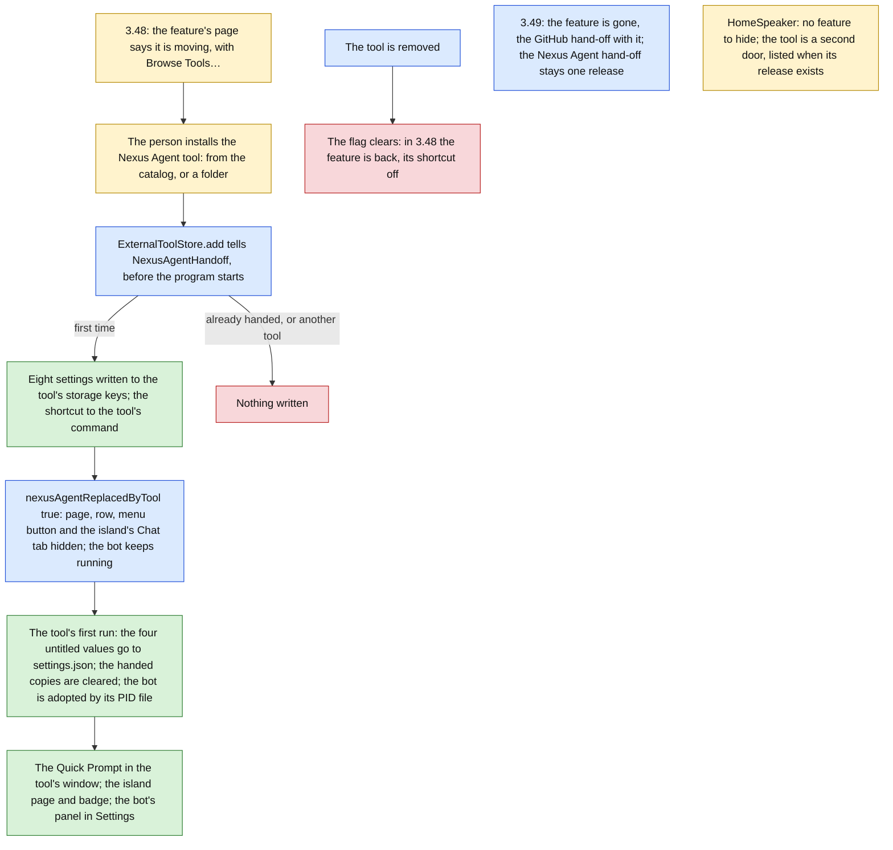

# Tools for everyone (stage F: the Nexus Agent and HomeSpeaker tools) Implementation Plan

> **For agentic workers:** REQUIRED SUB-SKILL: Use superpowers:subagent-driven-development (recommended) or superpowers:executing-plans to implement this plan task-by-task. Steps use checkbox (`- [ ]`) syntax for tracking.

**Status (2026-10-14): built for HomeSpeaker; the Nexus Agent part moved to James's separate effort.** Shipped: Task 1, the kit's waker (#3203, SDK 1.1.0); Tasks 8 and 9, the HomeSpeaker tool and its release asset (#3211, HomeSpeaker 1.13.0; #3230, 1.13.1); Task 10, its catalogue entry (#3239); and Task 11's GitHub part, the hand-off, its keys and the Keychain store (#3284; the feature itself went in Vitruvian 3.49.0, #3207). The `vitruvian` URL scheme is being removed in a separate pull request. Tasks 2 to 6, the Nexus Agent parts of Task 11, and Task 12 moved to James's own effort on 2026-10-14: the tool reached `main` (#3210) and the catalogue (#3237) and was taken off it again (#3263); the hand-over was not merged here. HomeSpeaker's checks by hand (13 to 17 below) have no record in a pull request or the issue. Task 7 is the design's "Stage F, as built" (`docs/superpowers/specs/2026-10-12-vitruvian-tools-for-everyone-design.md`, section 11); this plan: #3190.

**Goal:** Two more of the app's own become tools from outside, one after the other, the way stage E moved the GitHub feature. The app's Nexus Agent feature becomes a tool of protocol 2, `dev.vitruvian.nexus-agent`, built in the standalone app's own package (`apps/desktop/nexus-agent/macos`) on the shared engine and chat, released from the standalone's mirror beside the app, its Quick Prompt a window of its own process; the release that offers it (3.48) says so on the feature's page and hands the tool the person's settings and shortcut when it is installed, and the release after (3.49) removes the feature, 6,400 lines, with the GitHub hand-off stage E left. HomeSpeaker, which was never a feature of the app, gains a tool beside it, `dev.vitruvian.homespeaker`, in its own folder and its own release, that speaks through HomeSpeaker's program and keeps its switches, quiet hours and volume at hand in the island. Both are catalog entries.

**Architecture:** The kit gains one thing both tools need, `ToolWaker.later`: work handed to the kit's thread from any thread, a window's or a child process's, which wakes the kit's wait through a pipe. The Nexus Agent tool is AppKit on the main thread (the window, the main-actor engine) with the kit's loop on a thread of its own; every handler hops to the main thread and waits, and everything the engine says goes back through the waker; the main thread never waits on the kit. Its core, `NexusAgentToolCore`, holds the settings host over `settings.json`, the two pages and the state machine behind a `ToolLink` and a `QuickPromptWindow` protocol, so its tests drive it with an engine whose world is in memory. The HomeSpeaker tool runs the kit on its main thread and HomeSpeaker's program as a child it does not wait for; its core, `HomeSpeakerToolCore`, holds the settings file both share, the driver over HomeSpeaker's flags, the pages and the state machine behind the same kind of protocols. The app gains one service, `NexusAgentHandoff`, called by the tool store as `GitHubHandoff` was: it writes the feature's settings into the tool's own `storage` keys, gives the tool's `quickPrompt` command the feature's shortcut in the app's own shortcut list, and marks the feature replaced, which hides it while the tool is installed; the bot the feature started keeps running for the tool to adopt. The catalog gains two entries; the removal deletes the feature, the GitHub hand-off, the GitHub keys and the URL scheme, and keeps the Nexus Agent hand-off one release more.



Green is done, amber waits for the person, red is nothing done, blue is in progress.

**What a person sees:** in 3.48, at the top of Settings › Nexus Agent, one new text saying the feature is becoming a tool and what moves, with Browse Tools…; the catalog's sheet lists "Nexus Agent" by VitruvianSoftware; after Install and the agreement sheet, the Nexus Agent page, its row in the Features hub, its button in the menu panel and the Chat tab of the island's AI page are gone, a tile "Nexus Agent" sits after the quick tools on the island's Tools page with a badge while a turn waits for approval, its page shows the bot, the agent and the recent sessions with a button to the Quick Prompt, the Quick Prompt is a window of the tool's own, and the tool's detail shows the bot folder, auto-start, plan and worktree mode as the app draws them, with the bot's state, log and `.env` under them. "HomeSpeaker" is a second entry in the catalog: its tile's page says something on the default speaker, switches broadcasting and quiet hours, mutes and sets the volume and picks the speaker, and its detail holds HomeSpeaker's General tab. In 3.49 nothing of the feature is anywhere. The mock-ups are `docs/superpowers/specs/2026-10-12-vitruvian-tools-for-everyone-stage-f-mockups.html`, delivered beside this plan; open them beside each view.

**Tech Stack:** Swift 6 (strict concurrency) for both tools and the app; the Swift kit (`VitruvianToolKit`) and protocol (`VitruvianToolProtocol`); the shared Nexus Agent libraries (`NexusAgentCore`, `NexusAgentUI`, MIT) and `HomeSpeakerCore`; XCTest for the tools, the app's own `TestSuite` harness; Python 3 for the catalog, the conformance, version and drift tests; Bash for HomeSpeaker's release script and its test; Copybara and release-please as stages A, C and E used them; Bazel 9.3.0 with `--config=macos-app`.

**Spec:** `docs/superpowers/specs/2026-10-12-vitruvian-tools-for-everyone-design.md`: section 11, row F; section 9, "Nexus Agent, second" and "HomeSpeaker, third"; section 3, decisions 1, 9, 10, 12, 15 to 20 and 22; sections 12 and 13; section 8.4 (the kits). The stage E plan is this plan's model in every respect (`docs/superpowers/plans/2026-10-12-vitruvian-tools-for-everyone-stage-e.md`); where this plan says "as E", that plan's decision and its reasons stand. This plan builds stage F and nothing more.

**Release:** seven pull requests, in this order, each squash-merged, so its title is the commit that counts.

| Pull request | Tasks | Title (the squash commit) | Cuts |
|---|---|---|---|
| A | 1 | `feat(vitruvian-sdk): a tool can hand work to its thread from another` | An SDK release, the one both tools' `Package.swift` and `version_test.py` name: 1.2.0 if stage E's cut 1.1.0. **Wait for the mirror's `v` tag before B and D:** both packages resolve the kit from it, and `mirror_build_test` and HomeSpeaker's `swift test` lane fail until it exists. |
| B | 2, 3, 4 | `feat(nexus-agent): the Nexus Agent tool, released from the standalone's mirror` | A release of the standalone, 1.22.0 if its last was 1.21.0; the mirror's `release.yml` tags `v1.22.0`, builds the app and the tool, and attaches `nexus-agent-tool-1.22.0.zip` with its `.sha256`. Nothing of the app. |
| C | 5, 6, 7 | `feat(desktop): the Nexus Agent feature hands over to the Nexus Agent tool` | A minor release of the app, 3.48.0. Task 6 needs the asset of B's release for its checksum. |
| D | 8, 9 | `feat(home-speaker): a tool for the Vitruvian app, released with the app` | A release of HomeSpeaker, 1.13.0 if its last was 1.12.0; `home-speaker-release.yaml` attaches `HomeSpeaker-1.13.0-tool.zip` with the app's own artifacts. Nothing of the app. |
| E | 10 | `feat(catalog): the HomeSpeaker tool` | The catalog alone; needs the asset of D's release. No app release. |
| F, one release later | 11 | `feat(desktop): the Nexus Agent feature is the Nexus Agent tool from the catalog` | The next minor release of the app, 3.49.0. Not before 3.48.0 has shipped. |
| G, one release later | 12 | `chore(desktop): the Nexus Agent hand-off goes` | Rides the app's next release after 3.49.0. Not before 3.49.0 has shipped. |

Workers are `wren` for code, `forge` for Tasks 4 and 9 (the mirror's release and its rehearsal; HomeSpeaker's release script and lane), and `compass` for Task 7.

Paths that start with `Sources/`, `Tests/`, `Tools/`, `bazel/` or name `BUILD`, `AGENTS.md` or `UPSTREAM.md` alone are relative to `apps/desktop/vitruvian/`. Every other path is from the repository root.

## Decisions this plan makes

The design's decisions stand, and so do stage E's where they apply: a row that says "as E" takes E's decision of that number and its reasons. Each says whether it follows the design, adds to it, or differs from it. Task 7 records them in the design's stage table.

| # | Decision | Why |
|---|---|---|
| 1 | **Both tools are Swift, on the Swift kit.** As E (decision 1): the Nexus Agent feature is Swift on a Swift library, HomeSpeaker is Swift, and a Swift tool is one binary. **Follows the design.** | |
| 2 | **The Nexus Agent tool lives in the standalone app's package, `apps/desktop/nexus-agent/macos`, as a third product, and the standalone's mirror releases it beside the app** as `nexus-agent-tool-X.Y.Z.zip` at the app's version, from the same `release.yml`. **Differs from E** (decision 2, a folder and a mirror of its own) **and follows the design**, section 9: "it is already its own app and mirror". | SwiftPM resolves a package only from a repository's root, and the shared libraries the tool is built on sit in the standalone's `macos/`: a tool of its own could build against them with Bazel here and with nothing on its mirror. Inside the package it builds both ways; `mirror_build_test` builds it with SwiftPM here. |
| 3 | **The HomeSpeaker tool lives in HomeSpeaker's folder, `apps/desktop/home-speaker`, as a third product, and HomeSpeaker's own release in this repository attaches it** as `HomeSpeaker-X.Y.Z-tool.zip`, a name the shared packaging helper checksums and uploads with the app's own artifacts. No mirror, no repository, no key: **differs from E** (decision 2) and **adds to the design** (section 9, "a `vitruvian-tool.json` beside its binary"). | HomeSpeaker has no mirror and never did; the catalog takes a zip from a release of any `VitruvianSoftware` repository, which this one is. A mirror for the tool alone would be the only mirror of a thing that releases from here. |
| 4 | **Both tools are MIT**, their packages' licence. The Nexus Agent tool's words are the feature's fifty-six texts in fifteen languages, copied out of `Core/NexusAgentStrings.swift` and released under MIT by their copyright holder, VitruvianSoftware, which wrote all of them, as the shared libraries were on 2026-10-09; `UPSTREAM.md` records it. Nothing of the feature's GPL glue is copied: the window is the standalone's own (MIT), written again around the shared chat. **Differs from E** (decision 3, GPL). | Everything the tool is built on is MIT; the one GPL thing it wanted was its words, and the app's own rule (`AGENTS.md`) lets a file VitruvianSoftware wrote leave when the log says so. GPL would have put the tool outside the package, which decision 2 rules out. **Open question for James**: whether to release the words under MIT; without it the tool is English-only, as HomeSpeaker's is. |
| 5 | **The kit gains `ToolWaker.later`**: `tool.waker` takes work from any thread and runs it on the kit's thread as soon as it is between messages, after the hello, waking the kit's wait through a pipe the wire polls beside standard input; never while a handler runs or waits for the app; an error it throws goes to the tool's log. It is `feat(vitruvian-sdk)` and cuts an SDK release; both packages depend on the kit `from:` that version, and each `version_test.py` holds the line to it. As E's decision 4 in shape. **Adds to the design** (section 8.4). | A tool with a window has AppKit on its main thread and the kit elsewhere; a tool that starts a program is told of its end on a thread of the system's. Without the waker both would poll with `every`, a second late at best. |
| 6 | **The Nexus Agent tool is AppKit on the main thread and the kit on a thread of its own; the main thread never waits on the kit.** A handler hops to the main thread with `DispatchQueue.main.sync` and waits; the engine's and the window's news go back through the waker (`WakerLink`); the handed preferences are read on the kit's thread at the hello and given to the core whole; a titled preference the chat changes (plan mode, worktree mode) goes back to the app through `storage/set` so its copy follows. **The HomeSpeaker tool runs the kit on the main thread** and starts HomeSpeaker's program without waiting; the program's end comes back through the waker. **Adds to the design.** | The engine and the chat are `@MainActor`; a kit that blocks the main thread in `poll` would never let them run. HomeSpeaker's tool has no window and nothing on the main actor. |
| 7 | **The hand-off carries the feature's eight settings and its shortcut**: the bot folder, auto-start, plan mode, worktree mode (the four the manifest titles, which the app draws and keeps), the provider chosen, the person's own providers, the prompt history and the archived Claude sessions (the four without a title, handed once and taken into the tool's `settings.json` on its first run, the handed copies cleared); and the Quick Prompt's shortcut, when its switch is on, written as the shortcut of the tool's `quickPrompt` command in the app's own list (`ToolCommandShortcuts`), which is the app's to keep. **Adds to the design** (decision 20) and to E's decision 6. | The settings are the person's; the shortcut is the one thing a tool cannot take for itself (gap 4), and the app's list is where a person gives a tool's command one anyway. |
| 8 | **While the tool is installed the feature is hidden, not only switched off**, as E (decision 7): `isReplaced(in:)` is back for Nexus Agent, its page, its Features row, its menu panel button and the island's Chat tab go; removing the tool brings it back, its shortcut off. **The Telegram bot the feature started is not stopped**: `syncWithPreferences` for a replaced feature closes the window and the chat and leaves the bot, which the tool adopts through the PID file both share, as the standalone and the feature always did for each other. **Differs from E** in that one point (E stopped the feature's polling and put the mouse back). | Two Nexus Agents for one release, both answering the hotkey, is worse than none; a bot stopped and started again drops the conversation it is in. |
| 9 | **The hand-off runs for a tool added from a folder as for one from the catalog**, by id alone. As E (decision 8). | |
| 10 | **The tool's settings panel is the feature's page without the four titled settings**: the bot's state, log and problem, Start, Stop, Restart and Open Log, and the part of its `.env` a person changes, with Save enabled only when the draft differs. Approval mode and reasoning effort are lists of rows with a check (gap 1, as E's decision 10 did for the mouse); a word in the file the page has no name for is a row of its own. **Adds to the design** ("a settings panel"). | The app's own fields are the same controls in fifteen languages; the rest needs the engine. |
| 11 | **The island page is the way to the Quick Prompt and a glance at the bot and the agent**: a prominent button, the agent's state or the first line of its last reply, the bot with Start or Stop, and the ten newest sessions, a tap resuming one in the window; the badge is 1 while a turn waits for approval and a dot while a reply arrives. **The chat in the island's AI page does not move**: the page keeps its telemetry and loses its Chat segment and pop-out; dock-to-notch goes. **A turn is told with the app's message (`notify/hud`)**, the "done" sound played by the tool itself, and no notch notice or system notification (gap 2). **Follows the design** ("commands, a settings panel, and an island badge; its windows stay its own") read with stage D's as-built. | A block cannot hold a streaming chat, and a tool's process cannot draw in the app's page; the design chose the window. |
| 12 | **The HomeSpeaker tool drives HomeSpeaker's program and edits the file both share**, never Google: `--say` for what is typed or the clipboard (deliberate, so it overrides quiet hours as HomeSpeaker's own box does), `--volume`, `--set-volume`, `--mute` and `--unmute` for the speaker, the contract the Mac agent already uses; `~/.gemini/speaker_broadcast.json`, read before each page and written whole as HomeSpeaker writes it, for broadcasting, quiet hours and their times, the default speaker, the speech length, the outputs, the announcement volume and media pause. One job at a time; a second is refused saying what runs. Its words are English, as HomeSpeaker's are; it declares no preference. **Adds to the design** (section 9, "commands and a settings panel"). | One sign-in, one keeper of the secrets, and the menu bar app follows a change within a second, as it follows the phone's. |
| 13 | **A test must never reach this Mac's HomeSpeaker, home or conversations.** Both conformance tests run the program under a scratch `HOME` and `CFFIXED_USER_HOME` on a `block-network` target; the HomeSpeaker tool also reads `HOMESPEAKER_PROGRAM`, which names the program to drive or, set and empty, no HomeSpeaker at all, whatever Launch Services knows, and its conformance test fails a run in which the command was not refused. As E's decision 13 in spirit. **Adds to the design.** | Launch Services finds the installed app by its bundle id in any home; without the seam the planted regression of Task 8 drove this Mac's HomeSpeaker, which spoke nothing only because its own settings and secrets live under the scratch home too. |
| 14 | **The catalog's two entries**: Nexus Agent at `minimumAppVersion` 3.48.0, the release pull request C cuts, pinning the standalone mirror's asset; HomeSpeaker at 3.45.0, the release stage D cut (protocol 2 is all it needs), pinning HomeSpeaker's own release in this repository. Each entry's `sha256` and `size` are the by-hand build's and are to be replaced by the asset's, which the release notes print; `catalog-check` refuses a mismatch. As E's decision 14. | |
| 15 | **The app's new text is one**, `movesToTool`, a field of `NexusAgentFeatureStrings` in all fifteen languages, so it goes with the feature in 3.49; the fourteen other languages were written with the English and nobody who reads them has reviewed them. As E (decision 15). The Nexus Agent tool's seven new keys and its manifest's titles were written with the English too; HomeSpeaker's are English only. | |
| 16 | **The removal (3.49) takes the Nexus Agent feature and what stage E left**: `GitHubHandoff.swift`, `GitHubTokenStore.swift`, the GitHub feature's keys, the `vitruvian` URL scheme (nothing behind it since 3.47), and the app's link to the standalone's libraries with its pin. **The Nexus Agent hand-off stays one release more**, reading the feature's keys, which stay declared and out of backups, and goes with them in Task 12 after 3.49 has shipped. As E (decision 16), carried one step further. | A person who updates from 3.47 to 3.49 would otherwise lose their settings. |
| 17 | **No new key anywhere**: the standalone's mirror uploads the tool's zip with the token its release already holds; HomeSpeaker's release uploads with the job's own token. As E (decision 17). | |
| 18 | **The tests stay in the suites they extend**: `platform` grows from 836 checks to 850 (`NexusAgentHandoffTests`) in 3.48, is 832 after the removal and 816 after Task 12; `features` is 1177 in 3.49 (77 features); `TESTS OK (48 suites)` at the removal; the Nexus Agent tool's XCTest runs 20 tests, HomeSpeaker's 19. The pipeline unit `nexus-agent-macos` gains five targets and `.github/workflows/presubmit.yaml` is regenerated for it (Task 3) and for the app's unit losing the pin (Task 11); HomeSpeaker's targets are named in `ci.yaml`'s macOS lane by label (Task 9). | |
| 19 | **Not in stage F:** the four other kits' waker; a picker or time block; a chat in the island; HomeSpeaker's translations; re-reading HomeSpeaker's history; a window panel for either tool; anything only a person can check, which is the list "By hand". | Later stages. |

## What the protocol lacks

Nothing in this plan changes the protocol. Where a tool wanted something the protocol has not, it does without, as said; each is a gap for a later change with its full path (`packages/vitruvian-sdk/CONTRIBUTING.md`), the smallest additive change named. Stage E's four gaps stand; the first is met twice more here.

| # | Gap | Done without | Smallest additive change |
|---|---|---|---|
| 1 | No choice among fixed words (E's gap 1). | Approval mode, reasoning effort and speech length are lists of rows with a check mark. | As E: a preference `"type": "choice"` with `"options"`, or a `choice` block. |
| 2 | A tool cannot post a notch notice or a system notification: `notify/hud` is the app's small HUD, and a program that is no bundle has no notification centre of its own. | A finished or waiting turn shows the HUD with the feature's own title; the "done" sound is the tool's. | A request `notify/notice` with `{ title, detail?, icon? }` under `notify`, drawn as a notch notice as the feature's were. |
| 3 | A tool cannot draw inside an app page: the island's AI page had a Chat tab the feature filled. | The tab goes; the island page is the way to the window. | None that is small: a web panel in a page is a protocol change of its own. |
| 4 | A tool cannot register a global shortcut, and cannot read or set the one the app gives its command. | The app's own shortcut list holds it, and the hand-off writes it there, from inside the app. | Nothing needed: the app's list is the right keeper. |
| 5 | The kit tells a tool nothing when the app closes a panel: `ui/close` is handled inside the kit (`Panel.isOpen`), with no callback. | Each tool polls `isOpen` every five seconds and stops drawing a closed page. | `Panel.onClose` in the kit, a kit change, not a protocol one. |
| 6 | A command carries no text: "Say this" cannot be a command. | A field on the island page, and a command that speaks the clipboard. | `command/run` params `text?`, filled from a command bar query. |

## Global Constraints

- **Everything in this plan was built and run before it was written down.** The tree at `a80bc6e09` (the branch `feat/vitruvian-protocol-2`, stage D built, all five kits drawing) was checked out in a locked worktree of its own, stage E's nine task commits were replayed onto it cleanly (`8d6034b6d`, the state after 3.47, since stage F follows stage E), each task of this plan was committed in order on that detached head, and each task's state was built and tested by itself on a Mac16,5 with macOS 27.0, Xcode 27.0, Swift 6.4 and Bazel 9.3.0. The check counts in each task are from those runs. The failing output quoted in a regression step is what the test printed with the regression planted: a recording, cut to its first lines; every regression listed was planted and seen to fail its test. A "watch it fail" step whose test was not run on the task before it says what to expect, in words, and quotes nothing: the tests of Tasks 2, 5 and 8 were run against their own first drafts, and the lines they printed then are given where they taught something. At the end the full unit tests, `selftest`, the app's builds, the package's every test, both tools' every test, the licence gates, `//tools/conformance:check`, `//:tidy` and the workflow generator were run; "What was run for this plan" under Task 7 gives each result. Five things were not done. Nobody opened the app, so no tile, page, window, notice or speaker was seen: the list "By hand" is all of it. Nothing ran on a CI runner; no release exists, so the mirror's and HomeSpeaker's release steps ran only as their tests run them, and `mirror_build_test` could not resolve the unpublished kit (Task 3 records the line). Nothing reached a Google speaker, by rule, after the one run decision 13 records. Nobody who reads the fourteen other languages has read the new texts. The worktree's commits were never pushed and no branch holds them. If the base has moved and a listing no longer fits, make the smallest change that keeps its meaning and record it as a deviation.
- **How to read a listing.** A block that starts with a licence header is a whole file. A block that starts with `diff --git` is a change to a file that exists, as `git diff` prints it: a line that starts with `-` goes, a line that starts with `+` comes in, and the others are there to find the place. Save the block to a file and run `git apply <file>` from the repository root, or make the change by hand. Each is a change from the state the task before left. Every listing was taken by a script from the commits the tests ran on, not typed, and the script fails when a file a commit touched has no listing in its task. Task 11's deletions are `git rm` lines, not diffs of 6,400 removed lines. The one file not listed is the mock-ups page of Task 7, delivered beside this plan.
- **Licences.** Everything under `apps/desktop/vitruvian/` is GPL-3.0-or-later with the app's two-line header; everything under `apps/desktop/nexus-agent/`, `apps/desktop/home-speaker/` and `packages/vitruvian-sdk/` is MIT with the full MIT header those folders use. Code flows one way: the tools link the kit and their own app's libraries; nothing is copied from the app's folder into either tool but the words decision 4 names, and `UPSTREAM.md` records those. Never edit an existing `Copyright (C) 2026 Vorssaint` header.
- **The protocol.** No task changes `packages/vitruvian-sdk/protocol/`, `Sources/VitruvianToolProtocol/` or the app's pin; `tool_protocol_pin_test` passes at every task without being touched. Task 1 changes the kit only.
- **`UPSTREAM.md`.** Every change to a file whose header says `Copyright (C) 2026 Vorssaint` is named under "Modifications" in the same commit. Task 5 changes seven such files, Task 11 nineteen, Task 12 three; each task's listing holds the exact entry. Check the header of every file you change; do not trust this list.
- **What a person sees changes only where a task says so.** With no Nexus Agent tool installed, 3.48 is as 3.47 but for the notice at the top of Settings › Nexus Agent; `platform` keeps every one of its 836 checks and only gains.
- **Pipeline units and lanes.** `nexus-agent-macos` gains `:NexusAgentToolTests`, `:nexus-agent-tool`, `:tool_conformance_test`, `:tool_version_test` (Task 3); the app's unit loses `:nexus_agent_shared_pin_test` (Task 11); `bazel run //tools/pipeline:gen -- --format=workflow --output-file=.github/workflows/presubmit.yaml` is run in those two tasks, which commit what it writes, and at every other task it must leave the file unchanged. HomeSpeaker has no unit: its targets are `manual` and named in `.github/workflows/ci.yaml`'s macOS lane (Task 9). Keep round brackets out of that call's comments.
- **Layers and access.** In the app, `Core <- Design <- Services <- UI <- App`, all in Swift 6 mode; what another module or the tests use is `package`. In the tools, each core is one module in Swift 6 mode, `public` where `main.swift` or the tests reach it; `main.swift` holds no decision. The shared Nexus Agent libraries import no module of the tool's.
- **Threads.** The app's store and the hand-off are `@MainActor` and never wait. The Nexus Agent tool: AppKit and the engine on the main thread, the kit on its own; a handler hops to the main thread and waits; the main thread never waits on the kit; what crosses threads is `Sendable`. The HomeSpeaker tool: the kit on the main thread; HomeSpeaker's program is started and not waited for; its end comes back through `Parts.later`, the one place the tool is named from another thread.
- **No network in a test, and nothing of this Mac's.** The tools' tests answer everything themselves; both `tool_conformance_test`s run the program under a scratch `HOME` and `CFFIXED_USER_HOME` on a `block-network` target, HomeSpeaker's with `HOMESPEAKER_PROGRAM` set and empty and a guard that the command was refused; the app's tests never load a Keychain item. A test that speaks, fetches or lists this Mac's conversations is a failure, not a slow pass.
- **Strings.** A text a person reads that is the app's own is a field of a strings struct in all fifteen languages; the Nexus Agent tool's are in `Words.swift`, keyed by the app's language tags with `en` first, and `WordsTests` holds every key to all fifteen; HomeSpeaker's are English in its pages and manifest. Use the typographic apostrophe (’) and the ellipsis character (…), and no em-dash. French puts `\u{00A0}` before `:`, `?`, `!` and `;` (the app's `source_lints_test` holds it). A tool's words are the tool's: the app draws them as written.
- **Tests.** The app's tests are as stage E's: synchronous `static func run(_ suite: TestSuite)` reached from `Tests/TestGroups.swift`, no file read as text, nothing drawn, every file under `FileManager.default.temporaryDirectory` in a folder the test makes and removes, nothing under `~/Library/Application Support/com.vitruviansoftware.vitruvian`. A test's `UserDefaults` suite is named `com.vitruviansoftware.vitruvian.tests.<something>` with a literal prefix and its persistent domain removed first. The tools' tests are XCTest, with an engine over files held in memory (Nexus Agent) and a driver and a store that answer themselves (HomeSpeaker).
- **Build and test through Bazel only**, from the repository root, one command at a time. A full run of the unit tests needs the display awake and the screen unlocked: start it with `(caffeinate -u -d -t 900 &);`. The suites a task names:
  ```sh
  bazel test --config=macos-app //apps/desktop/vitruvian:unit_tests --test_arg=--suite=platform --test_arg=--suite=features --test_arg=--suite=settings --test_output=errors
  grep -aE "^(platform|features|settings): |TESTS" bazel-testlogs/apps/desktop/vitruvian/unit_tests/test.log
  bazel test //apps/desktop/vitruvian:source_lints_test //apps/desktop/vitruvian:sources_in_sync_test //apps/desktop/vitruvian:tool_protocol_pin_test //apps/desktop/vitruvian:upstream_test
  ```
  Never put `--test_arg` on a command that also names the source tests. The Nexus Agent tool's tests:
  ```sh
  bazel test --config=macos-app //apps/desktop/nexus-agent/macos:NexusAgentToolTests //apps/desktop/nexus-agent/macos:tool_conformance_test //apps/desktop/nexus-agent/macos:tool_version_test //apps/desktop/nexus-agent/macos:NexusAgentTests --test_output=errors
  grep -E 'Executed .* tests' bazel-testlogs/apps/desktop/nexus-agent/macos/NexusAgentToolTests/test.log | tail -1
  ```
  HomeSpeaker's:
  ```sh
  bazel test --config=macos-app //apps/desktop/home-speaker:HomeSpeakerToolTests //apps/desktop/home-speaker:tool_conformance_test //apps/desktop/home-speaker:tool_version_test //apps/desktop/home-speaker:zip_tool_test --test_output=errors
  ```
  `//apps/desktop/home-speaker:HomeSpeakerTests`, the app's own Bazel target, fails on this Mac at the base too (it reads sources by path that are not in its runfiles; CI never runs it, `scripts/test.sh` is its lane): it is not this plan's and not a check. All the tools' targets are `manual` and macOS-only: `bazel test //apps/desktop/nexus-agent/...` runs none of them; name them. New Swift files need no edit to `BUILD`: each module's sources are a glob.
- **Do not launch the app or HomeSpeaker from a task**, and do not write to the preferences domain `com.vitruviansoftware.vitruvian`, to `~/.gemini/speaker_broadcast.json`, or under either app's real support folder. The checks that need a running app are "By hand".
- **Planted regressions.** The app's go in `Tests/mutation_checks.py`, which quotes source lines exactly: Task 5 adds two, Task 11 takes three away (E's one and these two), Task 12 none. For each: apply it by hand, run the suite it names, confirm it fails with the sixth field among the messages, undo it by hand, and confirm `git diff --stat -- <file>` shows only the task's own change. The kit's, the tools' and the workflows' cannot go there, since the app's tests do not run them: Tasks 1, 2, 3, 4, 8 and 9 give each as a step, with the test that must fail. If a regression is not caught, stop and report; do not adjust a test to fit. Never restore a file with `git checkout -- <file>` to undo a planted line: it restores everything you changed in that file (it did, once, while this plan was built).
- **Formatting and gates.** After editing a `.py`, `.json`, `.yml`, `.yaml`, `.sh` or `BUILD` file run `bazel run //tools/format -- <path>`. Write a JSON file by adding to it as text, never by loading and dumping it whole. Task 7 runs `bazel run //tools/license:check`, `bazel run //tools/license:verify`, `bazel run //tools/conformance:check` and `bazel run //:tidy`. On this base `//:tidy` adds one unrelated line, `Cryptodome: pycryptodomex`, to `gazelle_python.yaml`: undo it (that file you did not edit, so `git checkout -- gazelle_python.yaml` is safe) and do not commit it.
- **Git.** Never `git stash`, `git reset` or `git restore`; undo an edit by hand. Commits are authored as the agent the task names, one per task, with identity and commit in one command. In a worktree the keys are in the main checkout:
  ```sh
  export AGENT_KEY_DIR=/Users/james/Workspace/gh/application/vitruvian/vitruvian-core/tools/sync-env-secrets/agent-keys; eval "$(bazel run //tools/agent-app -- env wren 2>/dev/null)"; git add <files> && git commit -m "<title>"
  ```
- **Signing and cost.** Both tools' binaries are signed ad hoc by the linker; nothing signs or notarizes anything; the mirror, HomeSpeaker's release and their Actions minutes are free. A release's zip is installed by the app from a verified download, which sets no quarantine (decision 14 of the design).

## Review Focus

Where a mistake costs most. Each has a test in the task named.

1. **A test must never speak, list this Mac's conversations or drive this Mac's HomeSpeaker.** Both conformance tests set a scratch `HOME` and `CFFIXED_USER_HOME` on a `block-network` target (Tasks 3 and 8); HomeSpeaker's sets `HOMESPEAKER_PROGRAM` empty, `ProcessDriver.locate` honours it first (Task 8, `testHomeSpeakerIsFoundByLaunchServicesThenInTheUsualPlaces`, and a regression), and the test fails a run whose command was not refused. Read `main.swift` of each tool yourself: the Nexus Agent tool's engine is `.live` over the home the environment gives it, and nothing else of either reads outside its parts.
2. **The hand-off runs once, before the program starts, and for the Nexus Agent tool alone; the handed copies leave the app's defaults.** `ExternalToolStore.add` tells `Parts.added` before `activate` (Task 5, `theStoreTellsBeforeTheProgramStarts`); a second add or another tool's id hands nothing; a manifest that lacks a preference is handed the rest and the log says so (Task 5, `otherToolsAndAnUpdateHandNothing`); the tool takes the four untitled values on its first run only and writes `""` back (Task 2, `testTheFirstRunTakesEverythingHandedAndWritesTheFile`, `testALaterRunTakesTheTitledPreferencesOnly…`, and a regression; Task 3, `testStartTakesTheHandedSettingsClearsThemAndStartsTheBotWhenAsked`).
3. **The bot survives the hand-off and the tool adopts it.** `syncWithPreferences` for a replaced feature calls `stopForQuit`, not `stopAfterUninstall` (Task 5, read `NexusAgentService.swift`); the tool's `start` calls `startOncePerLaunch`, which adopts a running bot by its PID file and starts one only when asked (Task 2, `testStartTakesTheHandedSettings…` and `testCommandsOpenTheWindowAndDriveTheBot`).
4. **The feature comes back when the tool goes, and nothing of it is reachable after 3.49.** `toolRemoved` clears the flag and `isAvailable` is true again (Task 5, `removalBringsTheFeatureBackOff`); in 3.49 the feature count is 77 and the AI page is its telemetry alone (Task 11, `FeatureCatalogTests`, and the compiler holds the rest: every arm of `.nexusAgent` is gone or the app does not build).
5. **The catalog pins the release's bytes, and the kit the packages name exists.** The entries' `sha256` and `size` in Tasks 6 and 10 are this plan's by-hand builds, to be replaced by the assets'; `catalog-check` downloads and refuses a mismatch. Each `version_test.py` holds `Package.swift` to a kit of 1.2.0 or later; `mirror_build_test` and HomeSpeaker's `swift test` lane resolve it from the mirror, so pull request A's release comes first.

## The strings

The one text this stage adds to the app, a field of `NexusAgentFeatureStrings` (Task 5), with its English; the fourteen other languages are in Task 5's listing. The mock-ups use exactly these words.

| Key | English |
|---|---|
| `movesToTool` | Nexus Agent is becoming a tool from the catalog. Install it under Features, Tools from outside: the bot folder, starting the bot with the app, plan and worktree mode, your providers, prompt history and archived sessions move with it, and so does the Quick Prompt’s shortcut; this page goes, and the Quick Prompt is the tool’s own window. The chat in the island’s AI page does not move: the page keeps its telemetry. |

Words the app already has, used as they are: `ExternalToolStrings.browseButton`, "Browse Tools…", the button under it; the agreement sheet, the catalog sheet and the tool's detail as stages C and D made them.

The Nexus Agent tool's words (`Words.swift`, 63 keys, fifteen languages each: 56 carried from the feature with their fourteen translations, 7 new, written with the English) and its manifest's titles (four commands, two panels, four titled preferences, the description, fifteen languages each) are the tool's own and are never translated by the app. HomeSpeaker's are English, in its pages, its manifest and its catalog entry.

---

### Task 1: The kit's waker

**Worker:** `wren`. **Commit:** `feat(vitruvian-sdk): a tool can hand work to its thread from another`. Pull request A, alone; cuts an SDK release.

**Files:**
- Modify: `packages/vitruvian-sdk/Sources/VitruvianToolKit/Wire.swift` (the wake pipe beside standard input), `packages/vitruvian-sdk/Sources/VitruvianToolKit/Tool.swift` (`ToolWaker`, `Tool.waker`, the loop drains what was handed), `packages/vitruvian-sdk/docs/writing-a-tool.md` (one paragraph; the site's copy is synced in Task 6, as E's Task 6 synced E's)
- Test: `packages/vitruvian-sdk/Tests/VitruvianToolKitTests/ToolTests.swift` (three tests, on `LiveBench`)

**Interfaces:**
- Consumes: `Wire.next(before:)`, `Tool.serve`, `Tool.call`, `Tool.every` (stage E's), `LiveBench` (stage E's test bench of two pipes).
- Produces: `Wire.Next.woken`; `Wire.init(input:output:wake:)`; `public final class ToolWaker: @unchecked Sendable` with `later(_ work: @escaping @Sendable (App) throws -> Void)`; `public let waker: ToolWaker` on `Tool`; the loop runs handed work at its top, after the hello, never while a handler waits.

The wire polls two descriptors, standard input and the reading end of a pipe the tool makes; a byte written to the pipe ends the wait with `.woken`, and the wire empties the pipe (non-blocking) so however many wakes were asked are one. `ToolWaker` keeps a locked queue and the writing end; `later` appends and writes a byte. The loop calls `runHanded()` at its top: nothing before the hello (no app to call), each piece of work with an `App`, an error logged and the rest still run. In `call`'s wait, `.woken` continues the wait: handed work waits for the handler, as a timer does.

- [ ] **Step 1: Write the failing tests**

In `packages/vitruvian-sdk/Tests/VitruvianToolKitTests/ToolTests.swift`:

```diff
diff --git a/packages/vitruvian-sdk/Tests/VitruvianToolKitTests/ToolTests.swift b/packages/vitruvian-sdk/Tests/VitruvianToolKitTests/ToolTests.swift
index 08fedf42e..203ce68f5 100644
--- a/packages/vitruvian-sdk/Tests/VitruvianToolKitTests/ToolTests.swift
+++ b/packages/vitruvian-sdk/Tests/VitruvianToolKitTests/ToolTests.swift
@@ -640,3 +640,80 @@ extension ToolTests {
         XCTAssertTrue(ticks >= 2 && lines.allSatisfy { $0.contains("not now") }, "\(lines)")
     }
 }
+
+// MARK: - Work handed from another thread
+
+extension ToolTests {
+    func testWorkHandedFromAnotherThreadRunsOnTheToolsThreadAfterTheHello() throws {
+        // Written on the tool's one thread; read after serve() has returned.
+        nonisolated(unsafe) var commandThread: Thread?
+        nonisolated(unsafe) var handedThread: Thread?
+        nonisolated(unsafe) var waker: ToolWaker?
+        let bench = LiveBench { tool in
+            waker = tool.waker
+            tool.command("mark") { app in
+                commandThread = Thread.current
+                app.log("mark")
+            }
+        }
+        bench.serve()
+        // Handed before the hello: held until the app has said it.
+        waker?.later { app in
+            handedThread = Thread.current
+            app.log("handed")
+        }
+        Thread.sleep(forTimeInterval: 0.2)
+        XCTAssertEqual(logs(try bench.written()).count, 0, "nothing handed over runs before the hello")
+        bench.hello()
+        bench.app(#"{"jsonrpc":"2.0","id":2,"method":"command/run","params":{"command":"mark"}}"#)
+        Thread.sleep(forTimeInterval: 0.2)
+        waker?.later { app in app.log("handed again") }
+        Thread.sleep(forTimeInterval: 0.2)
+        XCTAssertEqual(bench.goodbye(), 0)
+        XCTAssertEqual(logs(try bench.written()), ["handed", "mark", "handed again"])
+        XCTAssertNotNil(handedThread)
+        XCTAssertTrue(handedThread === commandThread, "handed work runs on the thread the handlers run on")
+        XCTAssertFalse(handedThread === Thread.current, "and not on the thread that handed it")
+    }
+
+    func testWorkHandedWhileAHandlerWaitsRunsAfterTheHandler() throws {
+        nonisolated(unsafe) var waker: ToolWaker?
+        let bench = LiveBench { tool in
+            waker = tool.waker
+            tool.command("copy") { app in
+                _ = try app.clipboardText()
+                app.log("command done")
+            }
+        }
+        bench.serve()
+        bench.hello()
+        bench.app(#"{"jsonrpc":"2.0","id":2,"method":"command/run","params":{"command":"copy"}}"#)
+        Thread.sleep(forTimeInterval: 0.1)
+        // The handler is waiting for the clipboard: this must not cut in.
+        waker?.later { app in app.log("handed") }
+        Thread.sleep(forTimeInterval: 0.2)
+        bench.app(#"{"jsonrpc":"2.0","id":1,"result":{"text":"x"}}"#)
+        Thread.sleep(forTimeInterval: 0.2)
+        XCTAssertEqual(bench.goodbye(), 0)
+        let written = try bench.written()
+        XCTAssertEqual(logs(written), ["command done", "handed"], "the handler finishes first")
+        let answered = written.firstIndex { if case .result(id: .number(2), _) = $0 { return true } else { return false } }
+        let handed = written.firstIndex { if case .notice("log", let params) = $0 { return params?["message"]?.stringValue == "handed" } else { return false } }
+        XCTAssertTrue((answered ?? .max) < (handed ?? .min), "the command's answer goes out before the handed work runs")
+    }
+
+    func testAnErrorInHandedWorkIsLoggedAndTheRestStillRuns() throws {
+        nonisolated(unsafe) var waker: ToolWaker?
+        let bench = LiveBench { tool in waker = tool.waker }
+        bench.serve()
+        bench.hello()
+        Thread.sleep(forTimeInterval: 0.1)
+        waker?.later { _ in throw CommandRefused("not now") }
+        waker?.later { app in app.log("after") }
+        Thread.sleep(forTimeInterval: 0.2)
+        XCTAssertEqual(bench.goodbye(), 0)
+        let lines = logs(try bench.written())
+        XCTAssertEqual(lines.count, 2)
+        XCTAssertTrue(lines.first?.contains("not now") == true && lines.last == "after", "\(lines)")
+    }
+}
```


- [ ] **Step 2: Watch them fail**

Run: `bazel test --config=macos-app //packages/vitruvian-sdk:VitruvianToolKitTests --test_output=errors`
Expected: the test target does not build: `Tool` has no member `waker` and there is no `ToolWaker`.

- [ ] **Step 3: The wire, the waker, the loop, the guide**

In `packages/vitruvian-sdk/Sources/VitruvianToolKit/Tool.swift`:

```diff
diff --git a/packages/vitruvian-sdk/Sources/VitruvianToolKit/Tool.swift b/packages/vitruvian-sdk/Sources/VitruvianToolKit/Tool.swift
index cd16b0f12..10ec22909 100644
--- a/packages/vitruvian-sdk/Sources/VitruvianToolKit/Tool.swift
+++ b/packages/vitruvian-sdk/Sources/VitruvianToolKit/Tool.swift
@@ -53,7 +53,8 @@ public enum AppUnreachable: Error, Equatable, Sendable {
 /// until the answer has come. Nothing here starts a thread or a task, so
 /// there is nothing for a handler to wait on that could be waiting on it.
 /// What the app sends while a handler waits is kept and handled after the
-/// handler returns. Do not use a `Tool` or an `App` from another thread.
+/// handler returns. Do not use a `Tool` or an `App` from another thread:
+/// another thread hands work to the tool's through `waker`.
 public final class Tool {
     public typealias Handler = (App) throws -> Void
 
@@ -84,6 +85,10 @@ public final class Tool {
     /// Held so that the two ends stay open for as long as the tool lives:
     /// a file handle closes its descriptor when it is let go.
     private let ends: [FileHandle]
+    /// Written to by `waker` to end a wait; read by the wire.
+    private let wakePipe = Pipe()
+    /// Takes work from any thread and runs it on this one (`ToolWaker`).
+    public let waker: ToolWaker
     private var wire: Wire
     private var lastID = 0
     /// What came while a handler waited for an answer, in the order it came.
@@ -95,7 +100,11 @@ public final class Tool {
     public init(version: String, input: FileHandle = .standardInput, output: FileHandle = .standardOutput) {
         self.version = version
         ends = [input, output]
-        wire = Wire(input: input.fileDescriptor, output: output.fileDescriptor)
+        let wake = wakePipe.fileHandleForReading.fileDescriptor
+        // Emptied without blocking after each wake, however many were asked.
+        _ = fcntl(wake, F_SETFL, fcntl(wake, F_GETFL) | O_NONBLOCK)
+        waker = ToolWaker(pipe: wakePipe.fileHandleForWriting.fileDescriptor)
+        wire = Wire(input: input.fileDescriptor, output: output.fileDescriptor, wake: wake)
     }
 
     /// Says what a command does. `id` is the one the manifest gives it.
@@ -130,15 +139,34 @@ public final class Tool {
                 handle(kept.removeFirst())
                 continue
             }
+            runHanded()
+            if stopping { break }
             switch wire.next(before: nextTimer) {
             case .message(let message): handle(message)
             case .late: runTimers()
+            // What was handed over is run at the top of the loop.
+            case .woken: break
             case .ended: stopping = true
             }
         }
         return 0
     }
 
+    /// Runs what other threads handed over, in order, once the app has
+    /// said hello: before it there is no app to call. An error is logged
+    /// and the rest still runs.
+    private func runHanded() {
+        guard greeted else { return }
+        for work in waker.take() {
+            do {
+                try work(App(tool: self))
+            } catch {
+                App(tool: self).log("work handed to the tool failed: \(error)")
+            }
+            if stopping { return }
+        }
+    }
+
     /// When the first timer is due, or nil with none set up or none started.
     private var nextTimer: TimeInterval? {
         timers.compactMap(\.nextAt).min()
@@ -265,6 +293,9 @@ public final class Tool {
                 throw AppUnreachable.linkClosed
             case .late:
                 throw AppUnreachable.noAnswer(seconds: answerSeconds)
+            // Handed work waits for the handler, as a timer does.
+            case .woken:
+                continue
             case .message(.result(let answered, let value)) where answered == id:
                 return value
             case .message(.failure(let answered, let error)) where answered == id:
@@ -287,6 +318,39 @@ public final class Tool {
     }
 }
 
+/// The one part of a `Tool` another thread may use. `later` takes work from
+/// any thread, a window's or a child process's, and the tool runs it on its
+/// own thread as soon as it is between messages: never while a handler is
+/// running or waiting for the app, and not before the app has said hello.
+/// The work is handed an `App` and may call it like any handler; an error
+/// it throws goes to the tool's log. What it captures must be `Sendable`,
+/// as it crosses threads.
+public final class ToolWaker: @unchecked Sendable {
+    private let lock = NSLock()
+    private var queue: [@Sendable (App) throws -> Void] = []
+    private let pipe: Int32
+
+    init(pipe: Int32) {
+        self.pipe = pipe
+    }
+
+    /// Runs `work` on the tool's thread, after whatever it is doing.
+    public func later(_ work: @escaping @Sendable (App) throws -> Void) {
+        lock.withLock { queue.append(work) }
+        var byte: UInt8 = 1
+        _ = write(pipe, &byte, 1)
+    }
+
+    /// Everything handed over so far, in order, and the queue emptied.
+    func take() -> [@Sendable (App) throws -> Void] {
+        lock.withLock {
+            let taken = queue
+            queue.removeAll()
+            return taken
+        }
+    }
+}
+
 /// The app, as a handler sees it. Each method is one request of the
 /// protocol. Any of them can be refused: the failure the app answered with
 /// is thrown, as an `RPCErrorObject`, and `RefusalCode(error)` says which
```

In `packages/vitruvian-sdk/Sources/VitruvianToolKit/Wire.swift`:

```diff
diff --git a/packages/vitruvian-sdk/Sources/VitruvianToolKit/Wire.swift b/packages/vitruvian-sdk/Sources/VitruvianToolKit/Wire.swift
index d3c843537..1c0784ad1 100644
--- a/packages/vitruvian-sdk/Sources/VitruvianToolKit/Wire.swift
+++ b/packages/vitruvian-sdk/Sources/VitruvianToolKit/Wire.swift
@@ -25,8 +25,9 @@ import VitruvianToolProtocol
 /// descriptor and written to another, a line each.
 ///
 /// It is used from one thread. Reading waits, with `poll`, until a message
-/// has come, the link has ended, or the time given has passed. It never
-/// waits longer than it is told to.
+/// has come, the link has ended, the time given has passed, or another
+/// thread has written to the wake pipe. It never waits longer than it is
+/// told to.
 struct Wire {
     enum Next: Equatable {
         case message(RPCMessage)
@@ -34,17 +35,22 @@ struct Wire {
         case ended
         /// The time given passed first.
         case late
+        /// Another thread asked for the wait to end (`ToolWaker`).
+        case woken
     }
 
     private let input: Int32
     private let output: Int32
+    /// The reading end of the wake pipe, non-blocking; -1 with none.
+    private let wake: Int32
     private var splitter = LineSplitter()
     private var lines: [Data] = []
     private(set) var ended = false
 
-    init(input: Int32, output: Int32) {
+    init(input: Int32, output: Int32, wake: Int32 = -1) {
         self.input = input
         self.output = output
+        self.wake = wake
     }
 
     /// Seconds since the Mac started: a clock nobody can set.
@@ -65,13 +71,22 @@ struct Wire {
                 if left <= 0 { return .late }
                 wait = Int32(min((left * 1000).rounded(.up), 3_600_000))
             }
-            var waiting = pollfd(fd: input, events: Int16(POLLIN), revents: 0)
-            let ready = poll(&waiting, 1, wait)
+            var waiting = [pollfd(fd: input, events: Int16(POLLIN), revents: 0)]
+            if wake >= 0 { waiting.append(pollfd(fd: wake, events: Int16(POLLIN), revents: 0)) }
+            let ready = poll(&waiting, nfds_t(waiting.count), wait)
             if ready == 0 { continue }
             if ready < 0 {
                 if errno != EINTR { ended = true }
                 continue
             }
+            // A message first: the wake only asks that the wait end, and the
+            // caller sees what was handed over whichever comes back.
+            if waiting[0].revents == 0, waiting.count == 2, waiting[1].revents != 0 {
+                // Every byte written since the last wake is one wake.
+                var bytes = [UInt8](repeating: 0, count: 64)
+                while read(wake, &bytes, bytes.count) > 0 {}
+                return .woken
+            }
             var buffer = [UInt8](repeating: 0, count: 65_536)
             let count = read(input, &buffer, buffer.count)
             if count < 0, errno == EINTR { continue }
```

In `packages/vitruvian-sdk/docs/writing-a-tool.md`:

````diff
diff --git a/packages/vitruvian-sdk/docs/writing-a-tool.md b/packages/vitruvian-sdk/docs/writing-a-tool.md
index 074a49070..0143ba03e 100644
--- a/packages/vitruvian-sdk/docs/writing-a-tool.md
+++ b/packages/vitruvian-sdk/docs/writing-a-tool.md
@@ -206,6 +206,13 @@ handler that runs late runs once, not again to catch up; an error it
 throws goes to the tool's log and the timer goes on. Ask for a few seconds
 at least.
 
+A tool with a thread of its own, one that shows a window or waits on a
+child process, hands work to the kit's thread with
+`tool.waker.later { app in … }`, from any thread. The work runs on the
+kit's thread as soon as it is between messages, after the hello, and may
+call the app like any handler; an error it throws goes to the tool's log.
+Nothing else of a `Tool` may be used from another thread.
+
 ### In TypeScript, with the kit
 
 ```sh
````


- [ ] **Step 4: Watch them pass**

Run: `bazel test --config=macos-app //packages/vitruvian-sdk:VitruvianToolKitTests //packages/vitruvian-sdk:guide_test --test_output=errors; grep -E 'Executed .* tests' bazel-testlogs/packages/vitruvian-sdk/VitruvianToolKitTests/test.log | tail -1`
Expected: both PASSED; `Executed 26 tests, with 0 failures` (23 before).

- [ ] **Step 5: Plant the regression and watch it fail**

In `Tool.swift`'s `serve`, take out the two lines `runHanded()` and `if stopping { break }` at the top of the loop, run Step 4's first command, and read:

```
ToolTests.swift:673: XCTAssertEqual failed: ("["mark"]") is not equal to ("["handed", "mark", "handed again"]")
ToolTests.swift:699: XCTAssertEqual failed: ("["command done"]") is not equal to ("["command done", "handed"]") - the handler finishes first
ToolTests.swift:716: XCTAssertEqual failed: ("0") is not equal to ("2")
```

Put the two lines back by hand (not with `git checkout`: the file holds the task's other changes). `git diff --stat -- packages/vitruvian-sdk/Sources/VitruvianToolKit/Tool.swift` shows the task's own change only.

- [ ] **Step 6: Commit**

```sh
export AGENT_KEY_DIR=/Users/james/Workspace/gh/application/vitruvian/vitruvian-core/tools/sync-env-secrets/agent-keys; eval "$(bazel run //tools/agent-app -- env wren 2>/dev/null)"; git add packages/vitruvian-sdk && git commit -m "feat(vitruvian-sdk): a tool can hand work to its thread from another"
```

Pull request A is this commit alone. Its description says what a tool author can now do and that the next release is the one Tasks 3 and 8 depend on. **When the mirror has tagged it, read the version off the tag**: if it is not 1.2.0, set `from: "…"` in both `Package.swift` files and `KIT_WITH_WAKER` in both `version_test.py` files to it (Tasks 3 and 8).

---

### Task 2: The Nexus Agent tool's core, on the shared engine

**Worker:** `wren`. **Commit:** `feat(nexus-agent): the Nexus Agent tool's core, on the shared engine`. Pull request B, with Tasks 3 and 4; cuts no release of the app and none of the SDK.

**Files:**
- Create: `apps/desktop/nexus-agent/macos/Sources/NexusAgentToolCore/{Words,ToolSettings,Pages,NexusAgentTool,Version}.swift`
- Create: `apps/desktop/nexus-agent/macos/Tests/NexusAgentToolTests/{WordsTests,ToolSettingsTests,PagesTests,NexusAgentToolTests}.swift`
- Modify: `apps/desktop/nexus-agent/macos/BUILD` (`:NexusAgentToolCore`, `:NexusAgentToolTests`), `apps/desktop/nexus-agent/macos/Package.swift` (the kit as a dependency, the two targets), `packages/vitruvian-sdk/BUILD` (the kit and the protocol visible to the package), `UPSTREAM.md` (the words leaving)

**Interfaces:**
- Consumes: `NexusAgentCore` (`NexusAgentEngine`, `NexusAgentHost`, `NexusAgentHostStrings`, `NexusAgentTurnNotice`, `NexusAgentConfiguration`, `NexusAgentApprovalMode`, `NexusAgentEffort`, `NexusAgentCLIProvider`, `NexusAgentSessionSummary`, `NexusAgentQuickPromptSession`); the kit's `UITree { }`, `PanelEvent`, `PanelAnswer`, `CommandRefused`; the protocol's `UIText`, `UIListRow`, `UILimits`, `JSONValue`.
- Produces, all `public` in `NexusAgentToolCore`:
  - `Words.text(_:_:)`, `.format(_:_:_:)`, `.languages`, `.keys` (63), `.table`
  - `ToolSettings(folder:log:)`: a `NexusAgentHost`; `Key.*` (eight ids, `titled` and `untitled`), `Values`, `values`, `isFirstRun`, `language`, `preferenceChanged`, `onApproval`, `onFinished`; `apply(handed:) -> [String]` (the untitled keys taken), `changed(_:)`, `strings(for:)`
  - `Pages.Status`, `Pages.island(_:language:)`, `Pages.settings(_:draft:saved:logLines:language:)`, `Pages.Block.*` (fifteen ids), `.botLine`, `.sessionRows`, `.approvalName`, `.effortName`, `.effortRows`, `.effortChoice(ofRow:)`, `.maxSessionRows == 10`, `.maxTitleLength == 80`
  - `ToolLink` (protocol: `badge(count:dot:)`, `render(panel:_:)`, `showMessage(_:icon:)`, `log(_:)`, `setValue(_:for:)`, `setRunnable(_:)`), `QuickPromptWindow` (protocol: `isVisible`, `show()`, `hide()`, `toggle()`), `ToolEngine` (the engine with `chatIsVisible`)
  - `NexusAgentTool(parts:)`: `islandPanel == "agent"`, `settingsPanel == "settings"` (both `nonisolated`), `Command.*` (`quickPrompt`, `newChat`, `startBot`, `stopBot`, `all`), `Parts(link:settings:engine:window:chooseFolder:playDone:)`, `start(language:handed:)`, `preferencesChanged(_:)`, `languageChanged(_:)`, `stop()`, `run(command:) throws`, `islandPage()`, `islandEvent(_:)`, `settingsPage()`, `settingsEvent(_:)`, `panelClosed(_:)`, `status()`, `openPanels`, `awaitingApproval`, `draft`
  - `ToolVersion.current`

The tool's words are generated once from the feature's `NexusAgentStrings.swift` (the fifty-six keys its pages and chat show, all fifteen languages, with the feature's three dots made the ellipsis the tool's own rule asks for) and seven new keys; from then on `Words.swift` is a plain table. `ToolSettings` is the engine's host: the four titled preferences come from the app (`apply`, `changed`) and a change the chat makes to one goes back through `preferenceChanged`; the four untitled ones are taken from what the app hands over on the first run only and kept in `settings.json` in the tool's data folder from then on. `NexusAgentTool` ties the engine, the host, the window and the link: it watches the engine's publishers and draws an open page again, sets what may run (`startBot` or `stopBot`), the badge (1 while a turn waits for approval, a dot while a reply arrives), and tells a finished or waiting turn with the app's message.

- [ ] **Step 1: Write the failing tests**

Create `apps/desktop/nexus-agent/macos/Tests/NexusAgentToolTests/NexusAgentToolTests.swift`:

```swift
// Copyright (c) 2026 VitruvianSoftware
//
// Permission is hereby granted, free of charge, to any person obtaining a copy
// of this software and associated documentation files (the "Software"), to deal
// in the Software without restriction, including without limitation the rights
// to use, copy, modify, merge, publish, distribute, sublicense, and/or sell
// copies of the Software, and to permit persons to whom the Software is
// furnished to do so, subject to the following conditions:
//
// The above copyright notice and this permission notice shall be included in
// all copies or substantial portions of the Software.
//
// THE SOFTWARE IS PROVIDED "AS IS", WITHOUT WARRANTY OF ANY KIND, EXPRESS OR
// IMPLIED, INCLUDING BUT NOT LIMITED TO THE WARRANTIES OF MERCHANTABILITY,
// FITNESS FOR A PARTICULAR PURPOSE AND NONINFRINGEMENT. IN NO EVENT SHALL THE
// AUTHORS OR COPYRIGHT HOLDERS BE LIABLE FOR ANY CLAIM, DAMAGES OR OTHER
// LIABILITY, WHETHER IN AN ACTION OF CONTRACT, TORT OR OTHERWISE, ARISING FROM,
// OUT OF OR IN CONNECTION WITH THE SOFTWARE OR THE USE OR OTHER DEALINGS IN THE
// SOFTWARE.

import XCTest

import NexusAgentCore
import NexusAgentToolCore
import VitruvianToolKit
import VitruvianToolProtocol

@MainActor
final class NexusAgentToolTests: XCTestCase {
    /// The app, recording.
    final class Link: ToolLink {
        var badges: [(count: Int?, dot: Bool)] = []
        var rendered: [(panel: String, tree: UITree)] = []
        var messages: [String] = []
        var logged: [String] = []
        var written: [(key: String, value: JSONValue)] = []
        var runnable: [[String]] = []

        func badge(count: Int?, dot: Bool) { badges.append((count, dot)) }
        func render(panel: String, _ tree: UITree) { rendered.append((panel, tree)) }
        func showMessage(_ message: String, icon: String) { messages.append(message) }
        func log(_ message: String) { logged.append(message) }
        func setValue(_ value: JSONValue, for key: String) { written.append((key, value)) }
        func setRunnable(_ commands: [String]) { runnable.append(commands) }
    }

    /// The window, recording.
    final class Window: QuickPromptWindow {
        var isVisible = false
        var shows = 0
        func show() { isVisible = true; shows += 1 }
        func hide() { isVisible = false }
        func toggle() { isVisible.toggle(); if isVisible { shows += 1 } }
    }

    /// A Mac in memory, as the app's tests have it: files, the bot's
    /// process, and the delayed work, run by hand.
    @MainActor
    final class Rig {
        var files: [String: String] = [:]
        var executables: Set<String> = []
        var aliveNode: Set<Int32> = []
        var launches: [String] = []
        var exitHandlers: [Int32: @MainActor @Sendable (Int32) -> Void] = [:]
        var nextPID: Int32 = 500
        var pending: [@MainActor () -> Void] = []
        var opened: [String] = []
        var sessionList: [NexusAgentSessionSummary] = []
        let home = "/Users/rig"
        let state = "/Users/rig/Library/Application Support/NexusAgent"
        var bot: String { home + "/.config/nexus-agent" }

        func installBot(token: String = "1:real") {
            files[bot] = ""
            files[bot + "/src/bot.js"] = "// bot"
            files[bot + "/.env"] = "TELEGRAM_BOT_TOKEN=\(token)\nAGY_TIMEOUT_MS=1\n"
            executables.insert("/opt/homebrew/bin/node")
        }

        func drain() {
            while !pending.isEmpty { pending.removeFirst()() }
        }

        var environment: NexusAgentEngine.Environment {
            NexusAgentEngine.Environment(
                defaults: UserDefaults(suiteName: "com.vitruviansoftware.nexus-agent.tool-tests")!,
                home: home,
                processEnvironment: ["PATH": "/usr/bin"],
                stateDirectory: state,
                isExecutable: { [unowned self] in executables.contains($0) },
                fileExists: { [unowned self] in files[$0] != nil },
                readFile: { [unowned self] in files[$0] },
                readTail: { [unowned self] path, _ in files[path] },
                writePrivateFile: { [unowned self] path, content in
                    guard files[(path as NSString).deletingLastPathComponent] != nil || path.hasPrefix(state) else { return false }
                    files[path] = content
                    return true
                },
                removeFile: { [unowned self] in files[$0] = nil },
                isBotProcess: { [unowned self] in aliveNode.contains($0) },
                signal: { [unowned self] pid, signal in if signal == SIGKILL { aliveNode.remove(pid) } },
                launchBot: { [unowned self] node, directory, _, _, onExit in
                    nextPID += 1
                    launches.append(directory)
                    aliveNode.insert(nextPID)
                    exitHandlers[nextPID] = onExit
                    return nextPID
                },
                schedule: { [unowned self] _, work in pending.append(work) },
                openFile: { [unowned self] in opened.append($0) },
                launchAgent: { _, _, _, _, _, _ in NexusAgentRunningAgent(terminate: {}) },
                listSessions: { [unowned self] _, _, _ in sessionList })
        }
    }

    private var folder: URL!
    private var rig: Rig!
    private var link: Link!
    private var window: Window!
    private var settings: ToolSettings!
    private var engine: ToolEngine!
    private var chosenFolder: String?

    override func setUp() {
        folder = FileManager.default.temporaryDirectory
            .appendingPathComponent("nexus-agent-tool-\(UUID().uuidString)", isDirectory: true)
        try? FileManager.default.createDirectory(at: folder, withIntermediateDirectories: true)
        rig = Rig()
        link = Link()
        window = Window()
        settings = ToolSettings(folder: folder)
        engine = ToolEngine(environment: rig.environment, host: settings)
    }

    override func tearDown() {
        try? FileManager.default.removeItem(at: folder)
    }

    private func tool() -> NexusAgentTool {
        NexusAgentTool(parts: .init(link: link, settings: settings, engine: engine, window: window,
                                    chooseFolder: { [unowned self] in chosenFolder }))
    }

    /// Lets the engine's publishers reach the tool on the main queue.
    private func settle() {
        let until = Date().addingTimeInterval(0.05)
        while Date() < until { RunLoop.main.run(mode: .default, before: Date().addingTimeInterval(0.005)) }
    }

    func testStartTakesTheHandedSettingsClearsThemAndStartsTheBotWhenAsked() {
        rig.installBot()
        let tool = tool()
        tool.start(language: "fr", handed: ["autoStart": .bool(true), "promptHistory": .string(#"["hi"]"#),
                                            "chosenProvider": .string("not a uuid")])
        XCTAssertEqual(link.written.map(\.key), ["chosenProvider", "promptHistory"], "the untitled copies are cleared, in order")
        XCTAssertEqual(link.written.map(\.value), [.string(""), .string("")])
        XCTAssertEqual(settings.promptHistory, ["hi"])
        XCTAssertEqual(rig.launches, [rig.bot], "auto-start starts the bot")
        XCTAssertTrue(engine.isRunning)
        XCTAssertEqual(link.runnable.last, ["quickPrompt", "newChat", "stopBot"])
        XCTAssertEqual(link.badges.last?.dot, false)
        XCTAssertTrue(link.logged.contains { $0.contains("chosenProvider, promptHistory") })
        XCTAssertEqual(tool.language, "fr")
        // A second hello in the same run does not start anything twice.
        tool.start(language: "fr", handed: [:])
        XCTAssertEqual(rig.launches.count, 1)
    }

    func testCommandsOpenTheWindowAndDriveTheBot() throws {
        rig.installBot()
        let tool = tool()
        tool.start(language: "en", handed: [:])
        XCTAssertFalse(engine.isRunning, "not asked to start at launch")
        XCTAssertEqual(link.runnable.last, ["quickPrompt", "newChat", "startBot"])
        try tool.run(command: "quickPrompt")
        XCTAssertTrue(window.isVisible)
        try tool.run(command: "quickPrompt")
        XCTAssertFalse(window.isVisible, "the command toggles")
        try tool.run(command: "newChat")
        XCTAssertTrue(window.isVisible)
        XCTAssertThrowsError(try tool.run(command: "stopBot")) { XCTAssertTrue($0 is CommandRefused) }
        try tool.run(command: "startBot")
        XCTAssertTrue(engine.isRunning)
        settle()
        XCTAssertEqual(link.runnable.last, ["quickPrompt", "newChat", "stopBot"])
        XCTAssertThrowsError(try tool.run(command: "startBot"))
        XCTAssertThrowsError(try tool.run(command: "nothing"))
    }

    func testTheIslandPageOpensTheWindowResumesASessionAndFollowsTheBot() {
        rig.installBot()
        rig.sessionList = [NexusAgentSessionSummary(id: "s1", title: "Fix", preview: "", steps: 1, modified: nil, isArchived: false)]
        let tool = tool()
        tool.start(language: "en", handed: [:])
        let page = tool.islandPage()
        XCTAssertEqual(tool.openPanels, ["agent"])
        XCTAssertEqual(page.blocks.compactMap(\.id), ["open", "startBot", "sessions"])
        XCTAssertEqual(tool.islandEvent(PanelEvent(block: "open", kind: .tap)), .keep)
        XCTAssertEqual(window.shows, 1)
        XCTAssertEqual(tool.islandEvent(PanelEvent(block: "sessions", kind: .tap, value: .string("s1"))), .keep)
        XCTAssertEqual(window.shows, 2)
        XCTAssertEqual(engine.session.conversationID, "s1", "the row's session is resumed")
        guard case .page(let after) = tool.islandEvent(PanelEvent(block: "startBot", kind: .tap)) else { return XCTFail("no page") }
        XCTAssertEqual(after.blocks.compactMap(\.id), ["open", "stopBot", "sessions"])
        XCTAssertTrue(engine.isRunning)
        settle()
        XCTAssertEqual(link.rendered.last?.panel, "agent", "the bot's change is drawn again while the page is open")
        tool.panelClosed("agent")
        XCTAssertEqual(tool.openPanels, [])
        link.rendered.removeAll()
        engine.stop()
        settle()
        XCTAssertTrue(link.rendered.isEmpty, "nothing is drawn for a closed page")
    }

    func testTheSettingsPanelEditsTheEnvAndSavesIt() throws {
        rig.installBot()
        let tool = tool()
        tool.start(language: "en", handed: [:])
        _ = tool.settingsPage()
        XCTAssertEqual(tool.draft.botToken, "1:real")
        _ = tool.settingsEvent(PanelEvent(block: "token", kind: .submit, value: .string("1:new")))
        _ = tool.settingsEvent(PanelEvent(block: "approval", kind: .tap, value: .string("plan")))
        _ = tool.settingsEvent(PanelEvent(block: "effort", kind: .tap, value: .string("high")))
        chosenFolder = "/Users/rig/work"
        _ = tool.settingsEvent(PanelEvent(block: "chooseFolder", kind: .tap))
        XCTAssertEqual(tool.draft.workingDirectory, "/Users/rig/work")
        XCTAssertEqual(tool.draft.approvalMode, .plan)
        XCTAssertEqual(tool.draft.effort, .high)
        guard case .page(let page) = tool.settingsEvent(PanelEvent(block: "save", kind: .tap)) else { return XCTFail("no page") }
        let env = try XCTUnwrap(rig.files[rig.bot + "/.env"])
        XCTAssertTrue(env.contains("TELEGRAM_BOT_TOKEN=1:new") && env.contains("plan") && env.contains("high"), env)
        XCTAssertEqual(tool.draft, engine.configuration, "the draft is the saved file again")
        guard case .button(let save)? = page.blocks.first(where: { $0.id == "save" })?.content else { return XCTFail("no Save") }
        XCTAssertEqual(save.enabled, false)
        XCTAssertEqual(tool.settingsEvent(PanelEvent(block: "save", kind: .tap)), .keep, "nothing to save")
        XCTAssertEqual(tool.settingsEvent(PanelEvent(block: "openLog", kind: .tap)), .keep)
        XCTAssertEqual(rig.opened, [], "no log yet, nothing to open")
        rig.files[engine.logPath] = "started"
        XCTAssertEqual(tool.settingsEvent(PanelEvent(block: "openLog", kind: .tap)), .keep)
        XCTAssertEqual(rig.opened, [engine.logPath])
    }

    func testAChangedBotFolderIsReadAgainAndPlanModeReachesTheChat() {
        rig.installBot()
        rig.files["/Users/rig/other"] = ""
        rig.files["/Users/rig/other/src/bot.js"] = "// bot"
        rig.files["/Users/rig/other/.env"] = "TELEGRAM_BOT_TOKEN=2:other\n"
        let tool = tool()
        tool.start(language: "en", handed: [:])
        _ = tool.settingsPage()
        tool.preferencesChanged(["botDirectory": .string("/Users/rig/other"), "planMode": .bool(true)])
        XCTAssertEqual(tool.draft.botToken, "2:other")
        XCTAssertTrue(engine.session.planMode)
        XCTAssertEqual(link.rendered.last?.panel, "settings")
        // The chat turns plan mode off: the app's copy follows.
        engine.session.planMode = false
        XCTAssertEqual(link.written.last?.key, "planMode")
        XCTAssertEqual(link.written.last?.value, .bool(false))
    }

    func testTurnsAreToldWithTheBadgeAndAMessage() {
        rig.installBot()
        let tool = tool()
        tool.start(language: "de", handed: [:])
        link.messages.removeAll()
        settings.turnNeedsApproval(NexusAgentTurnNotice(providerName: "agy", text: "rm -rf", failed: false, endedCleanly: false))
        XCTAssertTrue(tool.awaitingApproval)
        XCTAssertEqual(link.badges.last?.count, 1)
        XCTAssertEqual(link.messages, ["agy — Approval Required"])
        XCTAssertTrue(tool.status().awaitingApproval)
        settings.turnFinished(NexusAgentTurnNotice(providerName: "agy", text: "done", failed: false, endedCleanly: true), isChatVisible: true)
        XCTAssertFalse(tool.awaitingApproval)
        XCTAssertEqual(link.badges.last?.count, nil)
        XCTAssertEqual(link.messages.count, 1, "a reply the person saw is not announced")
        settings.turnFinished(NexusAgentTurnNotice(providerName: "agy", text: "done", failed: false, endedCleanly: true), isChatVisible: false)
        XCTAssertEqual(link.messages.last, "agy — Done")
        settings.turnFinished(NexusAgentTurnNotice(providerName: "agy", text: "", failed: true, endedCleanly: false), isChatVisible: true)
        XCTAssertEqual(link.messages.last, "agy — Failed", "a failure is always said")
    }

    func testLanguageAndStopReachTheEngine() {
        rig.installBot()
        let tool = tool()
        tool.start(language: "en", handed: [:])
        _ = tool.islandPage()
        link.rendered.removeAll()
        tool.languageChanged("ja")
        XCTAssertEqual(settings.language, "ja")
        XCTAssertEqual(link.rendered.count, 1)
        window.show()
        tool.stop()
        XCTAssertFalse(window.isVisible)
    }
}
```

Create `apps/desktop/nexus-agent/macos/Tests/NexusAgentToolTests/PagesTests.swift`:

```swift
// Copyright (c) 2026 VitruvianSoftware
//
// Permission is hereby granted, free of charge, to any person obtaining a copy
// of this software and associated documentation files (the "Software"), to deal
// in the Software without restriction, including without limitation the rights
// to use, copy, modify, merge, publish, distribute, sublicense, and/or sell
// copies of the Software, and to permit persons to whom the Software is
// furnished to do so, subject to the following conditions:
//
// The above copyright notice and this permission notice shall be included in
// all copies or substantial portions of the Software.
//
// THE SOFTWARE IS PROVIDED "AS IS", WITHOUT WARRANTY OF ANY KIND, EXPRESS OR
// IMPLIED, INCLUDING BUT NOT LIMITED TO THE WARRANTIES OF MERCHANTABILITY,
// FITNESS FOR A PARTICULAR PURPOSE AND NONINFRINGEMENT. IN NO EVENT SHALL THE
// AUTHORS OR COPYRIGHT HOLDERS BE LIABLE FOR ANY CLAIM, DAMAGES OR OTHER
// LIABILITY, WHETHER IN AN ACTION OF CONTRACT, TORT OR OTHERWISE, ARISING FROM,
// OUT OF OR IN CONNECTION WITH THE SOFTWARE OR THE USE OR OTHER DEALINGS IN THE
// SOFTWARE.

import XCTest

import NexusAgentCore
import NexusAgentToolCore
import VitruvianToolKit
import VitruvianToolProtocol

final class PagesTests: XCTestCase {
    private func ids(_ tree: UITree) -> [String] { tree.blocks.compactMap(\.id) }

    private func texts(_ tree: UITree, language: String = "en") -> [String] {
        tree.blocks.compactMap { block in
            switch block.content {
            case .text(let text): return text.text.text(for: language)
            case .heading(let heading): return heading.text.text(for: language)
            case .button(let button): return button.title.text(for: language)
            case .row(let row): return row.title.text(for: language) + " " + (row.subtitle?.text(for: language) ?? "")
            default: return nil
            }
        }
    }

    func testTheIslandPageSaysWhatTheBotAndTheAgentAreDoing() {
        var status = Pages.Status()
        let stopped = Pages.island(status, language: "en")
        XCTAssertEqual(ids(stopped), ["open", "startBot"])
        XCTAssertTrue(texts(stopped).contains("Telegram bot Stopped"))
        status.isRunning = true
        status.pid = 42
        status.replyStreaming = true
        status.problem = "No bot was found in this folder."
        status.sessions = [NexusAgentSessionSummary(id: "s1", title: "Fix the build", preview: "I will look", steps: 3,
                                                    modified: nil, isArchived: false)]
        let running = Pages.island(status, language: "en")
        XCTAssertEqual(ids(running), ["open", "stopBot", "sessions"])
        XCTAssertTrue(texts(running).contains("A reply is arriving…"))
        XCTAssertTrue(texts(running).contains("Telegram bot Running · PID 42"))
        XCTAssertTrue(texts(running).contains("No bot was found in this folder."))
        status.replyStreaming = false
        status.awaitingApproval = true
        XCTAssertTrue(texts(Pages.island(status, language: "fr")).contains(Words.text("awaitingApproval", "fr")))
        status.awaitingApproval = false
        status.lastReply = "First line of the reply\nSecond line"
        XCTAssertTrue(texts(Pages.island(status, language: "en")).contains("Last reply: First line of the reply"))
    }

    func testSessionsAreAtMostTenWithTitlesCutAndTheUntitledNamed() {
        let sessions = (1...14).map {
            NexusAgentSessionSummary(id: "s\($0)", title: $0 == 1 ? "" : String(repeating: "x", count: 200),
                                     preview: "", steps: 0, modified: nil, isArchived: false)
        }
        let rows = Pages.sessionRows(sessions, language: "de")
        XCTAssertEqual(rows.count, Pages.maxSessionRows)
        XCTAssertEqual(rows.first?.title.text(for: "de"), Words.text("untitledSession", "de"))
        XCTAssertEqual(rows[1].title.text(for: "de").count, Pages.maxTitleLength)
        XCTAssertTrue(rows[1].title.text(for: "de").hasSuffix("…"))
        XCTAssertNil(rows.first?.subtitle, "no preview, no subtitle")
    }

    func testTheSettingsPanelDrawsTheEnvWithSaveOnlyWhenItChanged() {
        var saved = NexusAgentConfiguration(botToken: "1:abc", allowedUserIDs: "7", workingDirectory: "/w",
                                            approvalMode: .plan, model: "", effort: .high)
        let same = Pages.settings(Pages.Status(), draft: saved, saved: saved, logLines: [], language: "en")
        XCTAssertEqual(ids(same), ["startBot", "openLog", "token", "allowedUsers", "workingFolder", "chooseFolder",
                                   "approval", "model", "effort", "save"])
        guard case .button(let save)? = same.blocks.first(where: { $0.id == "save" })?.content else { return XCTFail("no Save") }
        XCTAssertEqual(save.enabled, false)
        guard case .field(let token)? = same.blocks.first(where: { $0.id == "token" })?.content else { return XCTFail("no token") }
        XCTAssertEqual(token.kind, FieldBlock.Kind.secret)
        XCTAssertEqual(token.value, "1:abc")
        guard case .list(let approval)? = same.blocks.first(where: { $0.id == "approval" })?.content else { return XCTFail("no list") }
        XCTAssertEqual(approval.rows.map(\.id), ["yolo", "accept-edits", "plan", "default"])
        XCTAssertEqual(approval.rows.map { $0.trailing?.text(for: "en") }, [nil, nil, "✓", nil])
        guard case .list(let effort)? = same.blocks.first(where: { $0.id == "effort" })?.content else { return XCTFail("no list") }
        XCTAssertEqual(effort.rows.map(\.id), ["automatic", "low", "medium", "high"])
        XCTAssertEqual(effort.rows.last?.trailing?.text(for: "en"), "✓")
        XCTAssertTrue(texts(same).contains("Nothing logged yet."))

        var draft = saved
        draft.model = "gemini"
        var status = Pages.Status()
        status.isRunning = true
        status.needsRestart = true
        let changed = Pages.settings(status, draft: draft, saved: saved, logLines: ["a", "b"], language: "en")
        XCTAssertEqual(ids(changed).prefix(2), ["restartBot", "stopBot"])
        guard case .button(let save2)? = changed.blocks.first(where: { $0.id == "save" })?.content else { return XCTFail("no Save") }
        XCTAssertEqual(save2.enabled, true)
        XCTAssertTrue(texts(changed).contains("a\nb") && texts(changed).contains("Saved. Restart the bot to use the new settings."))
        saved.model = "x"
    }

    func testEffortRowsAndTheirChoices() {
        XCTAssertEqual(Pages.effortChoice(ofRow: "automatic"), "")
        XCTAssertEqual(Pages.effortChoice(ofRow: "low"), "low")
        XCTAssertEqual(Pages.effortChoice(ofRow: "written:max"), "max")
        XCTAssertEqual(Pages.approvalName(.yolo, language: "en"), "Run everything without asking")
        XCTAssertEqual(Pages.effortName(.automatic, language: "en"), "Automatic")
    }

    func testBothPagesAreWithinTheProtocolsLimitsInEveryLanguage() throws {
        var status = Pages.Status()
        status.sessions = (1...10).map {
            NexusAgentSessionSummary(id: "s\($0)", title: String(repeating: "t", count: 80), preview: String(repeating: "p", count: 80),
                                     steps: 0, modified: nil, isArchived: false)
        }
        status.problem = "x"
        status.needsRestart = true
        let configuration = NexusAgentConfiguration(botToken: String(repeating: "t", count: 60), allowedUserIDs: "1,2,3",
                                                    workingDirectory: "/Users/someone/Work", model: "gemini-3", effort: .low)
        for language in Words.languages {
            for tree in [Pages.island(status, language: language),
                         Pages.settings(status, draft: configuration, saved: NexusAgentConfiguration(),
                                        logLines: Array(repeating: String(repeating: "l", count: 120), count: 8), language: language)] {
                let bytes = try JSONEncoder().encode(tree).count
                XCTAssertLessThan(bytes, UILimits.maxTreeBytes, language)
                XCTAssertLessThanOrEqual(tree.blocks.count, UILimits.maxBlocks, language)
            }
        }
    }
}
```

Create `apps/desktop/nexus-agent/macos/Tests/NexusAgentToolTests/ToolSettingsTests.swift`:

```swift
// Copyright (c) 2026 VitruvianSoftware
//
// Permission is hereby granted, free of charge, to any person obtaining a copy
// of this software and associated documentation files (the "Software"), to deal
// in the Software without restriction, including without limitation the rights
// to use, copy, modify, merge, publish, distribute, sublicense, and/or sell
// copies of the Software, and to permit persons to whom the Software is
// furnished to do so, subject to the following conditions:
//
// The above copyright notice and this permission notice shall be included in
// all copies or substantial portions of the Software.
//
// THE SOFTWARE IS PROVIDED "AS IS", WITHOUT WARRANTY OF ANY KIND, EXPRESS OR
// IMPLIED, INCLUDING BUT NOT LIMITED TO THE WARRANTIES OF MERCHANTABILITY,
// FITNESS FOR A PARTICULAR PURPOSE AND NONINFRINGEMENT. IN NO EVENT SHALL THE
// AUTHORS OR COPYRIGHT HOLDERS BE LIABLE FOR ANY CLAIM, DAMAGES OR OTHER
// LIABILITY, WHETHER IN AN ACTION OF CONTRACT, TORT OR OTHERWISE, ARISING FROM,
// OUT OF OR IN CONNECTION WITH THE SOFTWARE OR THE USE OR OTHER DEALINGS IN THE
// SOFTWARE.

import XCTest

import NexusAgentCore
import NexusAgentToolCore
import VitruvianToolProtocol

@MainActor
final class ToolSettingsTests: XCTestCase {
    private var folder: URL!

    override func setUp() {
        folder = FileManager.default.temporaryDirectory
            .appendingPathComponent("nexus-agent-tool-settings-\(UUID().uuidString)", isDirectory: true)
        try? FileManager.default.createDirectory(at: folder, withIntermediateDirectories: true)
    }

    override func tearDown() {
        try? FileManager.default.removeItem(at: folder)
    }

    /// What the app's feature hands over, as its hand-off writes it.
    private let handed: [String: JSONValue] = [
        "botDirectory": .string("~/bots/nexus"),
        "autoStart": .bool(true),
        "planMode": .bool(true),
        "worktreeMode": .bool(false),
        "chosenProvider": .string("00000000-0000-0000-0000-000000000003"),
        "savedProviders": .string(#"[{"id":"11111111-1111-1111-1111-111111111111","name":"Mine","commandTemplate":"mine -p \"{prompt}\"","isBuiltIn":false}]"#),
        "promptHistory": .string(#"["first","second"]"#),
        "hiddenClaudeSessions": .string(#"["abc"]"#),
    ]

    func testTheFirstRunTakesEverythingHandedAndWritesTheFile() throws {
        let settings = ToolSettings(folder: folder)
        XCTAssertTrue(settings.isFirstRun)
        let taken = settings.apply(handed: handed)
        XCTAssertEqual(taken, ["chosenProvider", "hiddenClaudeSessions", "promptHistory", "savedProviders"])
        XCTAssertFalse(settings.isFirstRun)
        XCTAssertEqual(settings.configuredBotDirectory, "~/bots/nexus")
        XCTAssertTrue(settings.startsBotAtLaunch && settings.planMode && !settings.worktreeMode)
        XCTAssertEqual(settings.chosenProviderID, UUID(uuidString: "00000000-0000-0000-0000-000000000003"))
        XCTAssertEqual(settings.savedProviders.map(\.name), ["Mine"])
        XCTAssertEqual(settings.promptHistory, ["first", "second"])
        XCTAssertEqual(settings.hiddenClaudeSessionIDs, ["abc"])
        let data = try Data(contentsOf: folder.appendingPathComponent(ToolSettings.fileName))
        let again = ToolSettings(folder: folder)
        XCTAssertFalse(again.isFirstRun)
        XCTAssertEqual(again.values, settings.values, "the file holds all of it: \(String(decoding: data, as: UTF8.self))")
    }

    func testALaterRunTakesTheTitledPreferencesOnlyAndTheFileIsTheTruthForTheRest() {
        let first = ToolSettings(folder: folder)
        _ = first.apply(handed: handed)
        first.promptHistory = ["first", "second", "third"]
        let later = ToolSettings(folder: folder)
        var changed = handed
        changed["botDirectory"] = .string("")
        changed["planMode"] = .bool(false)
        changed["promptHistory"] = .string(#"["stale"]"#)
        XCTAssertEqual(later.apply(handed: changed), [], "nothing untitled is taken twice")
        XCTAssertEqual(later.configuredBotDirectory, "")
        XCTAssertFalse(later.planMode)
        XCTAssertEqual(later.promptHistory, ["first", "second", "third"], "the file's history, not the stale handed copy")
    }

    func testAValueOfTheWrongKindIsLeftOutAndLogged() {
        var logged: [String] = []
        let settings = ToolSettings(folder: folder, log: { logged.append($0) })
        let taken = settings.apply(handed: ["autoStart": .string("yes"), "promptHistory": .string("not json"),
                                            "hiddenClaudeSessions": .string(#"["x"]"#)])
        XCTAssertEqual(taken, ["hiddenClaudeSessions"])
        XCTAssertFalse(settings.startsBotAtLaunch)
        XCTAssertEqual(settings.promptHistory, [])
        XCTAssertEqual(logged.count, 2, "\(logged)")
    }

    func testAChangeTheToolMakesToATitledPreferenceIsToldToTheApp() {
        let settings = ToolSettings(folder: folder)
        _ = settings.apply(handed: [:])
        var told: [(String, JSONValue)] = []
        settings.preferenceChanged = { told.append(($0, $1)) }
        settings.planMode = true
        settings.planMode = true
        settings.worktreeMode = true
        settings.promptHistory = ["a"]
        XCTAssertEqual(told.map(\.0), ["planMode", "worktreeMode"], "each titled change once; an untitled one never")
        XCTAssertEqual(told.map(\.1), [.bool(true), .bool(true)])
        // The person changed one in the app: taken, and not told back.
        settings.changed(["planMode": .bool(false), "promptHistory": .string("[]")])
        XCTAssertFalse(settings.planMode)
        XCTAssertEqual(settings.promptHistory, ["a"], "an untitled key in a change is ignored")
        XCTAssertEqual(told.count, 2)
    }

    func testTheHostsStringsFollowTheLanguage() {
        let settings = ToolSettings(folder: folder)
        settings.language = "de"
        XCTAssertEqual(settings.strings.untitledSession, Words.text("untitledSession", "de"))
        XCTAssertEqual(settings.strings.missingAgent, Words.text("missingAgent", "de"))
        XCTAssertEqual(settings.strings.doneTitleSuffix, NexusAgentHostStrings().doneTitleSuffix, "the rest is the shared English")
        var approvals = 0
        settings.onApproval = { _ in approvals += 1 }
        settings.turnNeedsApproval(NexusAgentTurnNotice(providerName: "agy", text: "rm", failed: false, endedCleanly: false))
        XCTAssertEqual(approvals, 1)
    }
}
```

Create `apps/desktop/nexus-agent/macos/Tests/NexusAgentToolTests/WordsTests.swift`:

```swift
// Copyright (c) 2026 VitruvianSoftware
//
// Permission is hereby granted, free of charge, to any person obtaining a copy
// of this software and associated documentation files (the "Software"), to deal
// in the Software without restriction, including without limitation the rights
// to use, copy, modify, merge, publish, distribute, sublicense, and/or sell
// copies of the Software, and to permit persons to whom the Software is
// furnished to do so, subject to the following conditions:
//
// The above copyright notice and this permission notice shall be included in
// all copies or substantial portions of the Software.
//
// THE SOFTWARE IS PROVIDED "AS IS", WITHOUT WARRANTY OF ANY KIND, EXPRESS OR
// IMPLIED, INCLUDING BUT NOT LIMITED TO THE WARRANTIES OF MERCHANTABILITY,
// FITNESS FOR A PARTICULAR PURPOSE AND NONINFRINGEMENT. IN NO EVENT SHALL THE
// AUTHORS OR COPYRIGHT HOLDERS BE LIABLE FOR ANY CLAIM, DAMAGES OR OTHER
// LIABILITY, WHETHER IN AN ACTION OF CONTRACT, TORT OR OTHERWISE, ARISING FROM,
// OUT OF OR IN CONNECTION WITH THE SOFTWARE OR THE USE OR OTHER DEALINGS IN THE
// SOFTWARE.

import XCTest

import NexusAgentToolCore

final class WordsTests: XCTestCase {
    func testEveryKeyIsInAllFifteenLanguagesAndEnglishIsFirst() {
        XCTAssertEqual(Words.languages.count, 15)
        XCTAssertEqual(Words.languages.first, "en")
        XCTAssertEqual(Set(Words.languages), Set(Words.table.keys))
        for language in Words.languages {
            let missing = Words.keys.filter { Words.table[language]?[$0]?.isEmpty ?? true }
            XCTAssertEqual(missing, [], "\(language) lacks \(missing)")
        }
        XCTAssertEqual(Set(Words.keys).count, Words.keys.count, "no key twice")
    }

    func testTheWordsAreTypesetAsTheAppsAre() {
        for (language, words) in Words.table {
            for (key, word) in words {
                XCTAssertFalse(word.contains("..."), "\(language).\(key) uses three dots, not an ellipsis")
                XCTAssertFalse(word.contains(" - ") || word.contains("—"), "\(language).\(key) has a dash")
                XCTAssertFalse(word.contains("\n"), "\(language).\(key) breaks a line")
            }
        }
    }

    func testARegionTagAndAnUnknownTagReadAsEnglish() {
        XCTAssertEqual(Words.text("start", "en-US"), Words.text("start", "en"))
        XCTAssertEqual(Words.text("start", "xx"), Words.text("start", "en"))
        XCTAssertEqual(Words.text("nothing", "fr"), "nothing", "an unknown key is itself")
        XCTAssertEqual(Words.text("start", "de"), "Starten")
    }
}
```


- [ ] **Step 2: Watch them fail**

Run: `bazel test --config=macos-app //apps/desktop/nexus-agent/macos:NexusAgentToolTests --test_output=errors`
Expected: no such target until the `BUILD` of Step 3 exists; with it and without the sources, the test target does not build (no module `NexusAgentToolCore`).

- [ ] **Step 3: The words, the host, the pages, the tool, the targets, the log**

In `apps/desktop/nexus-agent/macos/BUILD`:

```diff
diff --git a/apps/desktop/nexus-agent/macos/BUILD b/apps/desktop/nexus-agent/macos/BUILD
index 819bb95fc..4c1ffb4dc 100644
--- a/apps/desktop/nexus-agent/macos/BUILD
+++ b/apps/desktop/nexus-agent/macos/BUILD
@@ -75,6 +75,44 @@ filegroup(
     visibility = ["//apps/desktop/vitruvian:__pkg__"],
 )
 
+# The Nexus Agent tool for the Vitruvian app (docs/superpowers/plans/2026-10-12-vitruvian-tools-for-everyone-stage-f.md):
+# what it knows, apart from the link to the app. The settings host over
+# settings.json, the two pages, the words in fifteen languages, and the
+# state machine behind a link protocol, so the tests drive it without a
+# process. Swift 6 mode, as the core. It links the MIT kit and protocol
+# (packages/vitruvian-sdk) and the shared libraries, and nothing of the
+# Vitruvian app.
+swift_library(
+    name = "NexusAgentToolCore",
+    srcs = glob(["Sources/NexusAgentToolCore/**/*.swift"]),
+    features = ["swift.enable_v6"],
+    module_name = "NexusAgentToolCore",
+    tags = ["manual"],
+    target_compatible_with = ["@platforms//os:macos"],
+    deps = [
+        ":NexusAgentCore",
+        "//packages/vitruvian-sdk:VitruvianToolKit",
+        "//packages/vitruvian-sdk:VitruvianToolProtocol",
+    ],
+)
+
+# Against an engine over files held in memory, a link that records and a
+# window that records. Nothing here starts a process or reaches the home
+# folder.
+swift_test(
+    name = "NexusAgentToolTests",
+    size = "small",
+    srcs = glob(["Tests/NexusAgentToolTests/**/*.swift"]),
+    tags = ["manual"],
+    target_compatible_with = ["@platforms//os:macos"],
+    deps = [
+        ":NexusAgentCore",
+        ":NexusAgentToolCore",
+        "//packages/vitruvian-sdk:VitruvianToolKit",
+        "//packages/vitruvian-sdk:VitruvianToolProtocol",
+    ],
+)
+
 # NexusAgent is a dependency-free SwiftUI/AppKit menu-bar agent (LSUIElement).
 # Swift has no Gazelle, so this BUILD file is hand-written. The library is
 # constrained to macOS so a Linux `bazel build //...` skips it instead of
```

In `apps/desktop/nexus-agent/macos/Package.swift`:

```diff
diff --git a/apps/desktop/nexus-agent/macos/Package.swift b/apps/desktop/nexus-agent/macos/Package.swift
index 895e19d51..c62e439b3 100644
--- a/apps/desktop/nexus-agent/macos/Package.swift
+++ b/apps/desktop/nexus-agent/macos/Package.swift
@@ -24,6 +24,12 @@ import PackageDescription
 let package = Package(
     name: "NexusAgent",
     platforms: [.macOS(.v14)],
+    dependencies: [
+        // The Vitruvian tool kit, for the tool target below. The kit's
+        // `ToolWaker` came with 1.2.0 (`tool/version_test.py` holds this
+        // line to it).
+        .package(url: "https://github.com/VitruvianSoftware/vitruvian-sdk", from: "1.2.0"),
+    ],
     targets: [
         // MUST MIRROR nexus-agent/macos/BUILD. These sources have TWO build
         // definitions -- Bazel for the monorepo, SwiftPM for the exported
@@ -52,6 +58,17 @@ let package = Package(
                 .copy("Resources/mermaid-LICENSE.txt"),
             ]
         ),
+        // The Nexus Agent tool for the Vitruvian app: its core, on the two
+        // shared libraries and the kit. Swift 6 mode, as the core.
+        .target(
+            name: "NexusAgentToolCore",
+            dependencies: [
+                "NexusAgentCore",
+                .product(name: "VitruvianToolKit", package: "vitruvian-sdk"),
+                .product(name: "VitruvianToolProtocol", package: "vitruvian-sdk"),
+            ],
+            path: "Sources/NexusAgentToolCore"
+        ),
         .executableTarget(
             name: "NexusAgent",
             dependencies: ["NexusAgentCore", "NexusAgentUI"],
@@ -64,6 +81,12 @@ let package = Package(
         // because that is how Bazel compiles them. They find the shared
         // sources and `../testdata` from their own file's path, so nothing is
         // copied; `swift build` does not compile this target.
+        // The tool's tests, Swift 6 mode as the core they test.
+        .testTarget(
+            name: "NexusAgentToolTests",
+            dependencies: ["NexusAgentCore", "NexusAgentToolCore"],
+            path: "Tests/NexusAgentToolTests"
+        ),
         .testTarget(
             name: "NexusAgentTests",
             dependencies: ["NexusAgentCore", "NexusAgentUI"],
```

Create `apps/desktop/nexus-agent/macos/Sources/NexusAgentToolCore/NexusAgentTool.swift`:

```swift
// Copyright (c) 2026 VitruvianSoftware
//
// Permission is hereby granted, free of charge, to any person obtaining a copy
// of this software and associated documentation files (the "Software"), to deal
// in the Software without restriction, including without limitation the rights
// to use, copy, modify, merge, publish, distribute, sublicense, and/or sell
// copies of the Software, and to permit persons to whom the Software is
// furnished to do so, subject to the following conditions:
//
// The above copyright notice and this permission notice shall be included in
// all copies or substantial portions of the Software.
//
// THE SOFTWARE IS PROVIDED "AS IS", WITHOUT WARRANTY OF ANY KIND, EXPRESS OR
// IMPLIED, INCLUDING BUT NOT LIMITED TO THE WARRANTIES OF MERCHANTABILITY,
// FITNESS FOR A PARTICULAR PURPOSE AND NONINFRINGEMENT. IN NO EVENT SHALL THE
// AUTHORS OR COPYRIGHT HOLDERS BE LIABLE FOR ANY CLAIM, DAMAGES OR OTHER
// LIABILITY, WHETHER IN AN ACTION OF CONTRACT, TORT OR OTHERWISE, ARISING FROM,
// OUT OF OR IN CONNECTION WITH THE SOFTWARE OR THE USE OR OTHER DEALINGS IN THE
// SOFTWARE.

import Combine
import Foundation
import NexusAgentCore
import VitruvianToolKit
import VitruvianToolProtocol

/// The app, as the tool's core reaches it, on the main thread. The program
/// answers each over the kit's waker, on the kit's thread; the tests record.
@MainActor
public protocol ToolLink: AnyObject {
    func badge(count: Int?, dot: Bool)
    func render(panel: String, _ tree: UITree)
    func showMessage(_ message: String, icon: String)
    func log(_ message: String)
    func setValue(_ value: JSONValue, for key: String)
    func setRunnable(_ commands: [String])
}

/// The Quick Prompt's window, which the program owns.
@MainActor
public protocol QuickPromptWindow: AnyObject {
    var isVisible: Bool { get }
    func show()
    func hide()
    func toggle()
}

/// The shared engine with the one thing the tool adds: whether its window
/// shows the chat, which decides how a finished turn is told.
@MainActor
public final class ToolEngine: NexusAgentEngine {
    public var chatIsVisible: () -> Bool = { false }
    override public var isChatVisible: Bool { chatIsVisible() }
}

/// What the tool is: the engine, its settings, the app and the window,
/// tied together. Everything a handler of the kit's does comes here, on
/// the main thread, and everything the engine says goes back to the app
/// through the link. `main.swift` wires it and decides nothing.
@MainActor
public final class NexusAgentTool {
    public static let islandPanel = "agent"
    public static let settingsPanel = "settings"

    public enum Command {
        public static let quickPrompt = "quickPrompt"
        public static let newChat = "newChat"
        public static let startBot = "startBot"
        public static let stopBot = "stopBot"
        public static let all = [quickPrompt, newChat, startBot, stopBot]
    }

    public struct Parts {
        public var link: ToolLink
        public var settings: ToolSettings
        public var engine: ToolEngine
        public var window: QuickPromptWindow
        /// Asks the person for a folder; nil when they cancelled.
        public var chooseFolder: () -> String?
        /// Plays the "done" sound.
        public var playDone: () -> Void

        public init(link: ToolLink, settings: ToolSettings, engine: ToolEngine, window: QuickPromptWindow,
                    chooseFolder: @escaping () -> String? = { nil }, playDone: @escaping () -> Void = {}) {
            self.link = link
            self.settings = settings
            self.engine = engine
            self.window = window
            self.chooseFolder = chooseFolder
            self.playDone = playDone
        }
    }

    public let parts: Parts
    public private(set) var language = "en"
    public private(set) var openPanels: Set<String> = []
    public private(set) var awaitingApproval = false
    /// The `.env` as the person is editing it in the settings panel.
    public private(set) var draft = NexusAgentConfiguration()
    private var watching: Set<AnyCancellable> = []
    private var started = false

    public init(parts: Parts) {
        self.parts = parts
        parts.engine.chatIsVisible = { [weak window = parts.window] in window?.isVisible ?? false }
        parts.settings.preferenceChanged = { [weak self] key, value in self?.parts.link.setValue(value, for: key) }
        parts.settings.onApproval = { [weak self] notice in self?.turnNeedsApproval(notice) }
        parts.settings.onFinished = { [weak self] notice, visible in self?.turnFinished(notice, isChatVisible: visible) }
    }

    // MARK: - The app's messages

    /// The app said hello: takes what it handed over, starts the engine
    /// (and the bot, when asked for), and tells the app what may run. The
    /// handed copies of the untitled preferences are cleared once taken.
    public func start(language: String, handed: [String: JSONValue]) {
        self.language = language
        parts.settings.language = language
        let taken = parts.settings.apply(handed: handed)
        for key in taken { parts.link.setValue(.string(""), for: key) }
        if !taken.isEmpty { parts.link.log("took the feature's \(taken.joined(separator: ", ")) into settings.json") }
        if !started {
            started = true
            watch()
            parts.engine.load()
            draft = parts.engine.configuration
            parts.engine.startOncePerLaunch()
        }
        runnableChanged()
        badgeChanged()
    }

    public func preferencesChanged(_ values: [String: JSONValue]) {
        let before = parts.settings.values
        parts.settings.changed(values)
        if before.botDirectory != parts.settings.values.botDirectory {
            parts.engine.load()
            draft = parts.engine.configuration
            refreshOpenPanels()
        }
        if !before.planMode, parts.settings.values.planMode != before.planMode {
            parts.engine.session.planMode = parts.settings.values.planMode
        } else if before.planMode != parts.settings.values.planMode {
            parts.engine.session.planMode = parts.settings.values.planMode
        }
        if before.worktreeMode != parts.settings.values.worktreeMode {
            parts.engine.session.worktreeMode = parts.settings.values.worktreeMode
        }
    }

    public func languageChanged(_ language: String) {
        self.language = language
        parts.settings.language = language
        refreshOpenPanels()
    }

    /// The app said goodbye.
    public func stop() {
        parts.window.hide()
        parts.engine.stopForQuit()
    }

    public func run(command: String) throws {
        switch command {
        case Command.quickPrompt: parts.window.toggle()
        case Command.newChat:
            parts.engine.session.newChat()
            parts.window.show()
        case Command.startBot:
            guard !parts.engine.isRunning else { throw CommandRefused(Words.text("statusRunning", language)) }
            parts.engine.start()
        case Command.stopBot:
            guard parts.engine.isRunning else { throw CommandRefused(Words.text("statusStopped", language)) }
            parts.engine.stop()
        default: throw CommandRefused("no such command")
        }
    }

    // MARK: - Panels

    public func islandPage() -> UITree {
        openPanels.insert(Self.islandPanel)
        parts.engine.startPolling()
        parts.engine.session.refreshSessions(configuration: parts.engine.configuration)
        return Pages.island(status(), language: language)
    }

    public func islandEvent(_ event: PanelEvent) -> PanelAnswer {
        switch event.block {
        case Pages.Block.open?:
            parts.window.show()
            return .keep
        case Pages.Block.newChat?:
            parts.engine.session.newChat()
            parts.window.show()
            return .keep
        case Pages.Block.startBot?:
            parts.engine.start()
        case Pages.Block.stopBot?:
            parts.engine.stop()
        case Pages.Block.sessions?:
            guard let id = event.row, let summary = parts.engine.session.sessions.first(where: { $0.id == id }) else { return .keep }
            parts.engine.session.resume(summary, configuration: parts.engine.configuration)
            parts.window.show()
            return .keep
        default:
            return .keep
        }
        return .page(Pages.island(status(), language: language))
    }

    public func settingsPage() -> UITree {
        openPanels.insert(Self.settingsPanel)
        parts.engine.startPolling()
        draft = parts.engine.configuration
        return settingsTree()
    }

    public func settingsEvent(_ event: PanelEvent) -> PanelAnswer {
        switch event.block {
        case Pages.Block.startBot?: parts.engine.start()
        case Pages.Block.stopBot?: parts.engine.stop()
        case Pages.Block.restartBot?: parts.engine.restart()
        case Pages.Block.openLog?:
            parts.engine.openLog()
            return .keep
        case Pages.Block.token?: draft.botToken = event.text ?? draft.botToken
        case Pages.Block.allowedUsers?: draft.allowedUserIDs = event.text ?? draft.allowedUserIDs
        case Pages.Block.workingFolder?: draft.workingDirectory = event.text ?? draft.workingDirectory
        case Pages.Block.model?: draft.model = event.text ?? draft.model
        case Pages.Block.chooseFolder?:
            guard let folder = parts.chooseFolder() else { return .keep }
            draft.workingDirectory = folder
        case Pages.Block.approval?:
            guard let id = event.row, let mode = NexusAgentApprovalMode(rawValue: id) else { return .keep }
            draft.approvalMode = mode
        case Pages.Block.effort?:
            guard let id = event.row else { return .keep }
            draft.effortChoice = Pages.effortChoice(ofRow: id)
        case Pages.Block.save?:
            guard draft != parts.engine.configuration else { return .keep }
            if parts.engine.save(draft) { draft = parts.engine.configuration }
        default:
            return .keep
        }
        return .page(settingsTree())
    }

    public func panelClosed(_ panel: String) {
        openPanels.remove(panel)
        if openPanels.isEmpty { parts.engine.stopPolling() }
    }

    private func settingsTree() -> UITree {
        Pages.settings(status(), draft: draft, saved: parts.engine.configuration,
                       logLines: parts.engine.logLines, language: language)
    }

    /// What the pages show, read off the engine now.
    public func status() -> Pages.Status {
        var status = Pages.Status()
        status.isRunning = parts.engine.isRunning
        status.pid = parts.engine.pid
        status.problem = parts.engine.problemDescription
        status.needsRestart = parts.engine.needsRestart
        status.replyStreaming = parts.engine.session.isRunning
        status.awaitingApproval = awaitingApproval
        status.lastReply = parts.engine.session.messages.last { $0.role == .agent && !$0.isError }?.text
        status.sessions = parts.engine.session.sessions
        return status
    }

    // MARK: - What the engine says

    private func watch() {
        let engine = parts.engine
        let session = engine.session
        Publishers.MergeMany(
            engine.$isRunning.map { _ in () }.eraseToAnyPublisher(),
            engine.$pid.map { _ in () }.eraseToAnyPublisher(),
            engine.$problem.map { _ in () }.eraseToAnyPublisher(),
            engine.$logLines.map { _ in () }.eraseToAnyPublisher(),
            engine.$needsRestart.map { _ in () }.eraseToAnyPublisher(),
            session.$sessions.map { _ in () }.eraseToAnyPublisher())
            .dropFirst(6)
            .receive(on: DispatchQueue.main)
            .sink { [weak self] in self?.refreshOpenPanels() }
            .store(in: &watching)
        engine.$isRunning.dropFirst().receive(on: DispatchQueue.main)
            .sink { [weak self] _ in self?.runnableChanged() }
            .store(in: &watching)
        session.$isRunning.dropFirst().receive(on: DispatchQueue.main)
            .sink { [weak self] running in
                guard let self else { return }
                if running { awaitingApproval = false }
                badgeChanged()
                refreshOpenPanels()
            }
            .store(in: &watching)
    }

    private func refreshOpenPanels() {
        if openPanels.contains(Self.islandPanel) {
            parts.link.render(panel: Self.islandPanel, Pages.island(status(), language: language))
        }
        if openPanels.contains(Self.settingsPanel) {
            parts.link.render(panel: Self.settingsPanel, settingsTree())
        }
    }

    private func runnableChanged() {
        parts.link.setRunnable([Command.quickPrompt, Command.newChat,
                                parts.engine.isRunning ? Command.stopBot : Command.startBot])
    }

    /// One while a turn waits for approval; a dot while a reply arrives.
    private func badgeChanged() {
        if awaitingApproval {
            parts.link.badge(count: 1, dot: false)
        } else {
            parts.link.badge(count: nil, dot: parts.engine.session.isRunning)
        }
    }

    private func turnNeedsApproval(_ notice: NexusAgentTurnNotice) {
        awaitingApproval = true
        badgeChanged()
        refreshOpenPanels()
        parts.link.showMessage(parts.settings.strings.approvalRequiredTitle(provider: notice.providerName),
                               icon: "hand.raised.fill")
    }

    private func turnFinished(_ notice: NexusAgentTurnNotice, isChatVisible: Bool) {
        awaitingApproval = false
        badgeChanged()
        refreshOpenPanels()
        let strings = parts.settings.strings
        let title = notice.failed ? strings.failedTitle(provider: notice.providerName)
            : strings.doneTitle(provider: notice.providerName)
        if notice.endedCleanly { parts.playDone() }
        // The person who can see the chat has seen the reply.
        guard !isChatVisible || notice.failed else { return }
        parts.link.showMessage(title, icon: notice.failed ? "exclamationmark.triangle.fill" : "sparkles")
    }
}
```

Create `apps/desktop/nexus-agent/macos/Sources/NexusAgentToolCore/Pages.swift`:

```swift
// Copyright (c) 2026 VitruvianSoftware
//
// Permission is hereby granted, free of charge, to any person obtaining a copy
// of this software and associated documentation files (the "Software"), to deal
// in the Software without restriction, including without limitation the rights
// to use, copy, modify, merge, publish, distribute, sublicense, and/or sell
// copies of the Software, and to permit persons to whom the Software is
// furnished to do so, subject to the following conditions:
//
// The above copyright notice and this permission notice shall be included in
// all copies or substantial portions of the Software.
//
// THE SOFTWARE IS PROVIDED "AS IS", WITHOUT WARRANTY OF ANY KIND, EXPRESS OR
// IMPLIED, INCLUDING BUT NOT LIMITED TO THE WARRANTIES OF MERCHANTABILITY,
// FITNESS FOR A PARTICULAR PURPOSE AND NONINFRINGEMENT. IN NO EVENT SHALL THE
// AUTHORS OR COPYRIGHT HOLDERS BE LIABLE FOR ANY CLAIM, DAMAGES OR OTHER
// LIABILITY, WHETHER IN AN ACTION OF CONTRACT, TORT OR OTHERWISE, ARISING FROM,
// OUT OF OR IN CONNECTION WITH THE SOFTWARE OR THE USE OR OTHER DEALINGS IN THE
// SOFTWARE.

import Foundation
import NexusAgentCore
import VitruvianToolKit
import VitruvianToolProtocol

/// The tool's two pages, as pure functions of what the tool knows: the app
/// draws them, in its own style, from the blocks. The ids are the blocks a
/// person can act on; `NexusAgentTool` answers each.
public enum Pages {
    /// What the island page and the top of the settings panel say.
    public struct Status: Equatable, Sendable {
        public var isRunning = false
        public var pid: Int32?
        /// Why the bot could not start or the settings be saved, in words.
        public var problem: String?
        public var needsRestart = false
        public var replyStreaming = false
        public var awaitingApproval = false
        /// The first line of the agent's last reply, if any.
        public var lastReply: String?
        /// Recent conversations, newest first, as the chat lists them.
        public var sessions: [NexusAgentSessionSummary] = []

        public init() {}
    }

    public static let maxSessionRows = 10
    public static let maxTitleLength = 80

    public enum Block {
        public static let open = "open"
        public static let newChat = "newChat"
        public static let startBot = "startBot"
        public static let stopBot = "stopBot"
        public static let restartBot = "restartBot"
        public static let openLog = "openLog"
        public static let sessions = "sessions"
        public static let token = "token"
        public static let allowedUsers = "allowedUsers"
        public static let workingFolder = "workingFolder"
        public static let chooseFolder = "chooseFolder"
        public static let approval = "approval"
        public static let model = "model"
        public static let effort = "effort"
        public static let save = "save"
    }

    // MARK: - The island page

    public static func island(_ status: Status, language: String) -> UITree {
        let word = { (key: String) in Words.text(key, language) }
        return UITree {
            heading("Nexus Agent")
            button(Block.open, UIText.plain(word("openQuickPrompt")), style: .prominent)
            if status.awaitingApproval {
                text(UIText.plain(word("awaitingApproval")), style: .secondary)
            } else if status.replyStreaming {
                text(UIText.plain(word("replyStreaming")), style: .secondary)
            } else if let reply = status.lastReply {
                text(UIText.plain("\(word("lastReply")): \(cut(reply))"), style: .secondary, lines: 2)
            }
            divider()
            row(nil, UIText.plain(word("bot")), subtitle: UIText.plain(botLine(status, language: language)),
                icon: status.isRunning ? "paperplane.fill" : "paperplane")
            if status.isRunning {
                button(Block.stopBot, UIText.plain(word("stop")))
            } else {
                button(Block.startBot, UIText.plain(word("start")))
            }
            if let problem = status.problem {
                text(UIText.plain(problem), style: .caption)
            }
            if !status.sessions.isEmpty {
                divider()
                text(UIText.plain(word("recentSessions")), style: .caption)
                list(Block.sessions, sessionRows(status.sessions, language: language))
            }
        }
    }

    /// The bot's state as one line: "Running · PID 123" or "Stopped".
    public static func botLine(_ status: Status, language: String) -> String {
        guard status.isRunning else { return Words.text("statusStopped", language) }
        return status.pid.map { "\(Words.text("statusRunning", language)) · PID \($0)" }
            ?? Words.text("statusRunning", language)
    }

    /// The newest sessions, at most ten, titles cut to 80 characters.
    public static func sessionRows(_ sessions: [NexusAgentSessionSummary], language: String) -> [UIListRow] {
        sessions.prefix(maxSessionRows).map { summary in
            let title = summary.title.isEmpty ? Words.text("untitledSession", language) : summary.title
            return UIListRow(id: summary.id, title: UIText.plain(cut(title)),
                             subtitle: summary.preview.isEmpty ? nil : UIText.plain(cut(summary.preview)),
                             icon: "bubble.left")
        }
    }

    static func cut(_ text: String) -> String {
        let line = text.components(separatedBy: .newlines).first { !$0.trimmingCharacters(in: .whitespaces).isEmpty } ?? text
        return line.count > maxTitleLength ? String(line.prefix(maxTitleLength - 1)) + "…" : line
    }

    // MARK: - The settings panel

    /// The bot's status and log, and the part of its `.env` a person
    /// changes, with Save. The bot folder, start at launch, plan mode and
    /// worktree mode are the app's own fields, above this panel.
    public static func settings(_ status: Status, draft: NexusAgentConfiguration, saved: NexusAgentConfiguration,
                                logLines: [String], language: String) -> UITree {
        let word = { (key: String) in Words.text(key, language) }
        return UITree {
            row(nil, UIText.plain(word("bot")), subtitle: UIText.plain(botLine(status, language: language)),
                icon: status.isRunning ? "paperplane.fill" : "paperplane")
            if status.isRunning {
                button(Block.restartBot, UIText.plain(word("restart")))
                button(Block.stopBot, UIText.plain(word("stop")))
            } else {
                button(Block.startBot, UIText.plain(word("start")))
            }
            if let problem = status.problem {
                text(UIText.plain(problem), style: .caption)
            }
            if status.needsRestart {
                text(UIText.plain(word("savedRestartHint")), style: .caption)
            }
            text(UIText.plain(word("recentLog")), style: .caption)
            text(UIText.plain(logLines.isEmpty ? word("logEmpty") : logLines.suffix(8).joined(separator: "\n")),
                 style: .monospaced, lines: 8)
            button(Block.openLog, UIText.plain(word("openLog")))
            divider()
            heading(UIText.plain(word("configurationSection")))
            field(Block.token, title: UIText.plain(word("token")), value: draft.botToken, kind: .secret)
            text(UIText.plain(word("tokenCaption")), style: .caption)
            field(Block.allowedUsers, title: UIText.plain(word("allowedUsers")), value: draft.allowedUserIDs)
            text(UIText.plain(word("allowedUsersCaption")), style: .caption)
            field(Block.workingFolder, title: UIText.plain(word("workingFolder")), value: draft.workingDirectory)
            button(Block.chooseFolder, UIText.plain(word("choose")))
            text(UIText.plain(word("workingFolderCaption")), style: .caption)
            text(UIText.plain(word("approvalMode")), style: .secondary)
            list(Block.approval, NexusAgentApprovalMode.allCases.map { mode in
                UIListRow(id: mode.rawValue, title: UIText.plain(approvalName(mode, language: language)),
                          trailing: mode == draft.approvalMode ? "✓" : nil)
            })
            field(Block.model, title: UIText.plain(word("model")), value: draft.model,
                  placeholder: UIText.plain(word("modelPlaceholder")))
            text(UIText.plain(word("effort")), style: .secondary)
            list(Block.effort, effortRows(draft, language: language))
            button(Block.save, UIText.plain(word("save")), style: .prominent, enabled: draft != saved)
            text(UIText.plain(word("notInstalledHere")), style: .caption)
        }
    }

    public static func approvalName(_ mode: NexusAgentApprovalMode, language: String) -> String {
        switch mode {
        case .yolo: return Words.text("approvalYolo", language)
        case .acceptEdits: return Words.text("approvalAcceptEdits", language)
        case .plan: return Words.text("approvalPlan", language)
        case .standard: return Words.text("approvalDefault", language)
        }
    }

    public static func effortName(_ effort: NexusAgentEffort, language: String) -> String {
        switch effort {
        case .automatic: return Words.text("effortAutomatic", language)
        case .low: return Words.text("effortLow", language)
        case .medium: return Words.text("effortMedium", language)
        case .high: return Words.text("effortHigh", language)
        }
    }

    /// One row per effort, and one more for a word the file has that is
    /// none of them (`max`), shown as itself, as the app's page did.
    public static func effortRows(_ draft: NexusAgentConfiguration, language: String) -> [UIListRow] {
        var rows = NexusAgentEffort.allCases.map { effort in
            UIListRow(id: effort.rawValue.isEmpty ? "automatic" : effort.rawValue,
                      title: UIText.plain(effortName(effort, language: language)),
                      trailing: draft.effortChoice == effort.rawValue ? "✓" : nil)
        }
        if let written = draft.unnamedEffort {
            rows.append(UIListRow(id: "written:" + written, title: UIText.plain("\(written) (from .env)"), trailing: "✓"))
        }
        return rows
    }

    /// The effort a tapped row stands for: the row's id, or the file's own
    /// word for the row that shows it.
    public static func effortChoice(ofRow id: String) -> String {
        if id == "automatic" { return "" }
        if id.hasPrefix("written:") { return String(id.dropFirst("written:".count)) }
        return id
    }
}
```

Create `apps/desktop/nexus-agent/macos/Sources/NexusAgentToolCore/ToolSettings.swift`:

```swift
// Copyright (c) 2026 VitruvianSoftware
//
// Permission is hereby granted, free of charge, to any person obtaining a copy
// of this software and associated documentation files (the "Software"), to deal
// in the Software without restriction, including without limitation the rights
// to use, copy, modify, merge, publish, distribute, sublicense, and/or sell
// copies of the Software, and to permit persons to whom the Software is
// furnished to do so, subject to the following conditions:
//
// The above copyright notice and this permission notice shall be included in
// all copies or substantial portions of the Software.
//
// THE SOFTWARE IS PROVIDED "AS IS", WITHOUT WARRANTY OF ANY KIND, EXPRESS OR
// IMPLIED, INCLUDING BUT NOT LIMITED TO THE WARRANTIES OF MERCHANTABILITY,
// FITNESS FOR A PARTICULAR PURPOSE AND NONINFRINGEMENT. IN NO EVENT SHALL THE
// AUTHORS OR COPYRIGHT HOLDERS BE LIABLE FOR ANY CLAIM, DAMAGES OR OTHER
// LIABILITY, WHETHER IN AN ACTION OF CONTRACT, TORT OR OTHERWISE, ARISING FROM,
// OUT OF OR IN CONNECTION WITH THE SOFTWARE OR THE USE OR OTHER DEALINGS IN THE
// SOFTWARE.

import Foundation
import NexusAgentCore
import VitruvianToolProtocol

/// What the shared engine asks its app, answered by the tool: the settings
/// the Vitruvian app draws and hands over (`storage`), and the ones only
/// the tool keeps, in `settings.json` in the folder the app gives it.
///
/// Four preferences have a title in the manifest, so the app draws them in
/// the tool's detail and is their keeper: the bot folder, starting the bot
/// at launch, plan mode and worktree mode. They are read from what the app
/// hands over at every start and on every `preferences/changed`, and when
/// the chat changes one (plan mode, worktree mode) the tool tells the app
/// through `preferenceChanged`, so the app's copy follows. The four others
/// have no title: the provider chosen, the providers of the person's own,
/// the prompt history and the archived Claude sessions. The app's Nexus
/// Agent feature hands them over once, on the tool's first run; from then
/// on this file is the one copy, and the handed copies are cleared.
@MainActor
public final class ToolSettings: NexusAgentHost {
    /// The preferences, by the ids the manifest declares.
    public enum Key {
        public static let botDirectory = "botDirectory"
        public static let autoStart = "autoStart"
        public static let planMode = "planMode"
        public static let worktreeMode = "worktreeMode"
        public static let chosenProvider = "chosenProvider"
        public static let savedProviders = "savedProviders"
        public static let promptHistory = "promptHistory"
        public static let hiddenClaudeSessions = "hiddenClaudeSessions"
        /// The ones the app draws and keeps.
        public static let titled = [botDirectory, autoStart, planMode, worktreeMode]
        /// The ones handed over once.
        public static let untitled = [chosenProvider, savedProviders, promptHistory, hiddenClaudeSessions]
    }

    /// Everything kept, as `settings.json` holds it.
    public struct Values: Codable, Equatable, Sendable {
        public var botDirectory = ""
        public var autoStart = false
        public var planMode = false
        public var worktreeMode = false
        public var chosenProvider = ""
        public var savedProviders: [NexusAgentCLIProvider] = []
        public var promptHistory: [String] = []
        public var hiddenClaudeSessions: [String] = []

        public init() {}
    }

    public static let fileName = "settings.json"

    public private(set) var values: Values
    /// True until the first `apply(handed:)` has written the file: the
    /// untitled preferences are then taken from what the app handed over.
    public private(set) var isFirstRun: Bool
    /// The app's language, as a tag; the host's strings follow it.
    public var language = "en"
    /// Told of a titled preference the tool changed itself, with the value
    /// the app should keep.
    public var preferenceChanged: (String, JSONValue) -> Void = { _, _ in }
    /// Told of a turn that stopped for approval, and of one that ended,
    /// with whether the chat was on screen.
    public var onApproval: (NexusAgentTurnNotice) -> Void = { _ in }
    public var onFinished: (NexusAgentTurnNotice, Bool) -> Void = { _, _ in }

    private let file: URL
    private let log: (String) -> Void

    /// Reads `settings.json` in `folder`, if there is one.
    public init(folder: URL, log: @escaping (String) -> Void = { _ in }) {
        file = folder.appendingPathComponent(Self.fileName)
        self.log = log
        if let data = try? Data(contentsOf: file), let read = try? JSONDecoder().decode(Values.self, from: data) {
            values = read
            isFirstRun = false
        } else {
            values = Values()
            isFirstRun = true
        }
    }

    // MARK: - What the app hands over

    /// Takes what the app handed over: the titled preferences always, the
    /// untitled ones on the first run only, and writes the file. Returns
    /// the untitled keys that were taken, for the caller to clear in the
    /// app's storage. A value of the wrong kind is left out and logged.
    @discardableResult
    public func apply(handed: [String: JSONValue]) -> [String] {
        var taken: [String] = []
        for (key, value) in handed where Key.titled.contains(key) {
            if !take(key, value) { log("the preference \(key) is not of its kind: \(value)") }
        }
        if isFirstRun {
            for (key, value) in handed where Key.untitled.contains(key) {
                guard let text = value.stringValue, !text.isEmpty else { continue }
                if take(key, value) { taken.append(key) } else { log("the handed \(key) could not be read") }
            }
        }
        isFirstRun = false
        save()
        return taken.sorted()
    }

    /// The person changed a titled preference in the app.
    public func changed(_ handed: [String: JSONValue]) {
        for (key, value) in handed where Key.titled.contains(key) {
            if !take(key, value) { log("the preference \(key) is not of its kind: \(value)") }
        }
        save()
    }

    private func take(_ key: String, _ value: JSONValue) -> Bool {
        switch key {
        case Key.botDirectory:
            guard let text = value.stringValue else { return false }
            values.botDirectory = text
        case Key.autoStart:
            guard let flag = value.boolValue else { return false }
            values.autoStart = flag
        case Key.planMode:
            guard let flag = value.boolValue else { return false }
            values.planMode = flag
        case Key.worktreeMode:
            guard let flag = value.boolValue else { return false }
            values.worktreeMode = flag
        case Key.chosenProvider:
            guard let text = value.stringValue else { return false }
            values.chosenProvider = text
        case Key.savedProviders:
            guard let list = Self.decode([NexusAgentCLIProvider].self, value) else { return false }
            values.savedProviders = list
        case Key.promptHistory:
            guard let list = Self.decode([String].self, value) else { return false }
            values.promptHistory = list
        case Key.hiddenClaudeSessions:
            guard let list = Self.decode([String].self, value) else { return false }
            values.hiddenClaudeSessions = list
        default:
            return false
        }
        return true
    }

    /// A handed list is JSON text, as the app's feature kept it.
    private static func decode<Value: Decodable>(_ type: Value.Type, _ value: JSONValue) -> Value? {
        guard let text = value.stringValue, let data = text.data(using: .utf8) else { return nil }
        return try? JSONDecoder().decode(type, from: data)
    }

    private func save() {
        let encoder = JSONEncoder()
        encoder.outputFormatting = [.prettyPrinted, .sortedKeys]
        guard let data = try? encoder.encode(values) else { return }
        do {
            try data.write(to: file, options: .atomic)
        } catch {
            log("settings.json could not be written: \(error)")
        }
    }

    // MARK: - NexusAgentHost

    public var configuredBotDirectory: String { values.botDirectory }

    public var startsBotAtLaunch: Bool { values.autoStart }

    public var planMode: Bool {
        get { values.planMode }
        set {
            guard values.planMode != newValue else { return }
            values.planMode = newValue
            save()
            preferenceChanged(Key.planMode, .bool(newValue))
        }
    }

    public var worktreeMode: Bool {
        get { values.worktreeMode }
        set {
            guard values.worktreeMode != newValue else { return }
            values.worktreeMode = newValue
            save()
            preferenceChanged(Key.worktreeMode, .bool(newValue))
        }
    }

    public var hiddenClaudeSessionIDs: [String] {
        get { values.hiddenClaudeSessions }
        set {
            values.hiddenClaudeSessions = newValue
            save()
        }
    }

    public var chosenProviderID: UUID? {
        get { UUID(uuidString: values.chosenProvider) }
        set {
            values.chosenProvider = newValue?.uuidString ?? ""
            save()
        }
    }

    public var savedProviders: [NexusAgentCLIProvider] {
        get { values.savedProviders }
        set {
            values.savedProviders = newValue
            save()
        }
    }

    public var promptHistory: [String] {
        get { values.promptHistory }
        set {
            values.promptHistory = newValue
            save()
        }
    }

    public var strings: NexusAgentHostStrings { Self.strings(for: language) }

    /// The engine's text in `language`: the tool's words where it has
    /// them, and the shared English for the rest.
    public static func strings(for language: String) -> NexusAgentHostStrings {
        NexusAgentHostStrings(untitledSession: Words.text("untitledSession", language),
                              missingAgent: Words.text("missingAgent", language),
                              agentFailed: Words.text("agentFailed", language),
                              replyStopped: Words.text("replyStopped", language),
                              emptyReply: Words.text("emptyReply", language))
    }

    public func turnNeedsApproval(_ notice: NexusAgentTurnNotice) {
        onApproval(notice)
    }

    public func turnFinished(_ notice: NexusAgentTurnNotice, isChatVisible: Bool) {
        onFinished(notice, isChatVisible)
    }
}
```

Create `apps/desktop/nexus-agent/macos/Sources/NexusAgentToolCore/Version.swift`:

```swift
// Copyright (c) 2026 VitruvianSoftware
//
// Permission is hereby granted, free of charge, to any person obtaining a copy
// of this software and associated documentation files (the "Software"), to deal
// in the Software without restriction, including without limitation the rights
// to use, copy, modify, merge, publish, distribute, sublicense, and/or sell
// copies of the Software, and to permit persons to whom the Software is
// furnished to do so, subject to the following conditions:
//
// The above copyright notice and this permission notice shall be included in
// all copies or substantial portions of the Software.
//
// THE SOFTWARE IS PROVIDED "AS IS", WITHOUT WARRANTY OF ANY KIND, EXPRESS OR
// IMPLIED, INCLUDING BUT NOT LIMITED TO THE WARRANTIES OF MERCHANTABILITY,
// FITNESS FOR A PARTICULAR PURPOSE AND NONINFRINGEMENT. IN NO EVENT SHALL THE
// AUTHORS OR COPYRIGHT HOLDERS BE LIABLE FOR ANY CLAIM, DAMAGES OR OTHER
// LIABILITY, WHETHER IN AN ACTION OF CONTRACT, TORT OR OTHERWISE, ARISING FROM,
// OUT OF OR IN CONNECTION WITH THE SOFTWARE OR THE USE OR OTHER DEALINGS IN THE
// SOFTWARE.

/// The tool's version, which its manifest says too: `version_test.py` holds
/// the two to each other and to the standalone app's.
public enum ToolVersion {
    /// Auto-managed by release-please. Do not edit manually.
    public static let current = "1.21.0" // x-release-please-version
}
```

Create `apps/desktop/nexus-agent/macos/Sources/NexusAgentToolCore/Words.swift`:

```swift
// Copyright (c) 2026 VitruvianSoftware
//
// Permission is hereby granted, free of charge, to any person obtaining a copy
// of this software and associated documentation files (the "Software"), to deal
// in the Software without restriction, including without limitation the rights
// to use, copy, modify, merge, publish, distribute, sublicense, and/or sell
// copies of the Software, and to permit persons to whom the Software is
// furnished to do so, subject to the following conditions:
//
// The above copyright notice and this permission notice shall be included in
// all copies or substantial portions of the Software.
//
// THE SOFTWARE IS PROVIDED "AS IS", WITHOUT WARRANTY OF ANY KIND, EXPRESS OR
// IMPLIED, INCLUDING BUT NOT LIMITED TO THE WARRANTIES OF MERCHANTABILITY,
// FITNESS FOR A PARTICULAR PURPOSE AND NONINFRINGEMENT. IN NO EVENT SHALL THE
// AUTHORS OR COPYRIGHT HOLDERS BE LIABLE FOR ANY CLAIM, DAMAGES OR OTHER
// LIABILITY, WHETHER IN AN ACTION OF CONTRACT, TORT OR OTHERWISE, ARISING FROM,
// OUT OF OR IN CONNECTION WITH THE SOFTWARE OR THE USE OR OTHER DEALINGS IN THE
// SOFTWARE.
//
// The tool's words, in the fifteen languages the Vitruvian app speaks. The
// fifty-six keys the app's Nexus Agent feature had were written by
// VitruvianSoftware for that app and released under MIT with this file on
// 2026-10-13 (apps/desktop/vitruvian/UPSTREAM.md); the seven others were
// written with the English. The app draws them as written and never
// translates them.

/// A word of the tool's, by key and by the app's language tag. `text`
/// answers in the language asked for, or in English when the tag is one
/// the table lacks: the app's tags are these fifteen, and a region tag such
/// as `en-US` is read as its language.
public enum Words {
    /// The languages, English first.
    public static let languages = ["en", "pt-BR", "tr", "ru", "es", "sk", "de", "fr", "it", "ja", "ko", "uk", "zh-Hans", "zh-TW", "zh-HK"]

    /// Every key, as the panels use them.
    public static let keys = [
        "quickPromptTitle",
        "statusRunning",
        "statusStopped",
        "start",
        "stop",
        "restart",
        "openLog",
        "recentLog",
        "logEmpty",
        "configurationSection",
        "token",
        "tokenCaption",
        "allowedUsers",
        "allowedUsersCaption",
        "workingFolder",
        "workingFolderCaption",
        "choose",
        "approvalMode",
        "approvalYolo",
        "approvalAcceptEdits",
        "approvalPlan",
        "approvalDefault",
        "model",
        "modelPlaceholder",
        "effort",
        "effortAutomatic",
        "effortLow",
        "effortMedium",
        "effortHigh",
        "save",
        "savedRestartHint",
        "saveFailed",
        "botFolder",
        "botFolderCaption",
        "autoStart",
        "missingToken",
        "missingBot",
        "missingNode",
        "startFailed",
        "missingAgent",
        "promptPlaceholder",
        "send",
        "stopReply",
        "newChat",
        "thinking",
        "working",
        "replyStopped",
        "emptyReply",
        "agentFailed",
        "sessionsToggle",
        "planModeOn",
        "planModeOff",
        "sessionsFilter",
        "noSessions",
        "followUpPlaceholder",
        "untitledSession",
        "openQuickPrompt",
        "recentSessions",
        "replyStreaming",
        "awaitingApproval",
        "lastReply",
        "bot",
        "notInstalledHere",
    ]

    public static func text(_ key: String, _ language: String) -> String {
        let tag = language == "en-US" ? "en" : language
        if let word = table[tag]?[key] { return word }
        return table["en"]?[key] ?? key
    }

    /// `text`, with each `%@` replaced by the next of `arguments`.
    public static func format(_ key: String, _ language: String, _ arguments: String...) -> String {
        var text = text(key, language)
        for argument in arguments {
            guard let range = text.range(of: "%@") else { break }
            text.replaceSubrange(range, with: argument)
        }
        return text
    }

    public static let table: [String: [String: String]] = [
        "en": [
            "quickPromptTitle": "Agent Quick Prompt",
            "statusRunning": "Running",
            "statusStopped": "Stopped",
            "start": "Start",
            "stop": "Stop",
            "restart": "Restart",
            "openLog": "Open Log",
            "recentLog": "Recent log",
            "logEmpty": "Nothing logged yet.",
            "configurationSection": "Bot settings",
            "token": "Bot token",
            "tokenCaption": "From @BotFather. Kept only in the bot’s .env file, never in Vitruvian’s settings or backups.",
            "allowedUsers": "Allowed user IDs",
            "allowedUsersCaption": "Comma-separated Telegram user IDs. Left empty, anyone who finds the bot can use it.",
            "workingFolder": "Working folder",
            "workingFolderCaption": "The folder the agent works in.",
            "choose": "Choose…",
            "approvalMode": "Approval mode",
            "approvalYolo": "Run everything without asking",
            "approvalAcceptEdits": "Accept file edits",
            "approvalPlan": "Plan only",
            "approvalDefault": "Agent default",
            "model": "Model",
            "modelPlaceholder": "Agent default",
            "effort": "Reasoning effort",
            "effortAutomatic": "Automatic",
            "effortLow": "Low",
            "effortMedium": "Medium",
            "effortHigh": "High",
            "save": "Save",
            "savedRestartHint": "Saved. Restart the bot to use the new settings.",
            "saveFailed": "Could not write the bot’s .env file.",
            "botFolder": "Bot folder",
            "botFolderCaption": "Where nexus-agent is installed. Empty uses ~/.config/nexus-agent.",
            "autoStart": "Start the bot when Vitruvian opens",
            "missingToken": "Add a bot token to start the bot.",
            "missingBot": "No bot was found in this folder.",
            "missingNode": "Node.js was not found. Install it with Homebrew.",
            "startFailed": "The bot could not start. Its log may say why.",
            "missingAgent": "The Antigravity CLI (agy) was not found.",
            "promptPlaceholder": "Ask Antigravity anything…",
            "send": "Send",
            "stopReply": "Stop",
            "newChat": "New chat",
            "thinking": "Thinking…",
            "working": "Working…",
            "replyStopped": "Reply stopped.",
            "emptyReply": "The agent returned no reply.",
            "agentFailed": "The agent stopped with an error.",
            "sessionsToggle": "Recent sessions",
            "planModeOn": "Plan mode on (read-only)",
            "planModeOff": "Turn on plan mode",
            "sessionsFilter": "Filter sessions",
            "noSessions": "No recent sessions",
            "followUpPlaceholder": "Ask a follow-up…",
            "untitledSession": "Untitled",
            "openQuickPrompt": "Open the Quick Prompt",
            "recentSessions": "Recent sessions",
            "replyStreaming": "A reply is arriving…",
            "awaitingApproval": "Waiting for your approval in the Quick Prompt",
            "lastReply": "Last reply",
            "bot": "Telegram bot",
            "notInstalledHere": "Vitruvian keeps these settings: the bot folder, starting the bot with the app, plan mode and worktree mode are above, in the tool’s own settings.",
        ],
        "pt-BR": [
            "quickPromptTitle": "Prompt rápido do agente",
            "statusRunning": "Em execução",
            "statusStopped": "Parado",
            "start": "Iniciar",
            "stop": "Parar",
            "restart": "Reiniciar",
            "openLog": "Abrir registro",
            "recentLog": "Registro recente",
            "logEmpty": "Nada registrado ainda.",
            "configurationSection": "Ajustes do bot",
            "token": "Token do bot",
            "tokenCaption": "Do @BotFather. Guardado só no arquivo .env do bot, nunca nos ajustes nem nos backups do Vitruvian.",
            "allowedUsers": "IDs de usuário permitidos",
            "allowedUsersCaption": "IDs de usuário do Telegram separados por vírgula. Vazio, qualquer pessoa que encontrar o bot pode usá-lo.",
            "workingFolder": "Pasta de trabalho",
            "workingFolderCaption": "A pasta em que o agente trabalha.",
            "choose": "Escolher…",
            "approvalMode": "Modo de aprovação",
            "approvalYolo": "Executar tudo sem perguntar",
            "approvalAcceptEdits": "Aceitar edições de arquivos",
            "approvalPlan": "Só planejar",
            "approvalDefault": "Padrão do agente",
            "model": "Modelo",
            "modelPlaceholder": "Padrão do agente",
            "effort": "Esforço de raciocínio",
            "effortAutomatic": "Automático",
            "effortLow": "Baixo",
            "effortMedium": "Médio",
            "effortHigh": "Alto",
            "save": "Salvar",
            "savedRestartHint": "Salvo. Reinicie o bot para usar os novos ajustes.",
            "saveFailed": "Não foi possível gravar o arquivo .env do bot.",
            "botFolder": "Pasta do bot",
            "botFolderCaption": "Onde o nexus-agent está instalado. Vazio usa ~/.config/nexus-agent.",
            "autoStart": "Iniciar o bot quando o Vitruvian abrir",
            "missingToken": "Adicione um token para iniciar o bot.",
            "missingBot": "Nenhum bot foi encontrado nesta pasta.",
            "missingNode": "O Node.js não foi encontrado. Instale-o com o Homebrew.",
            "startFailed": "O bot não pôde iniciar. O registro pode dizer por quê.",
            "missingAgent": "A CLI do Antigravity (agy) não foi encontrada.",
            "promptPlaceholder": "Pergunte qualquer coisa ao Antigravity…",
            "send": "Enviar",
            "stopReply": "Parar",
            "newChat": "Nova conversa",
            "thinking": "Pensando…",
            "working": "Trabalhando…",
            "replyStopped": "Resposta interrompida.",
            "emptyReply": "O agente não respondeu nada.",
            "agentFailed": "O agente parou com um erro.",
            "sessionsToggle": "Sessões recentes",
            "planModeOn": "Modo de plano ativado (somente leitura)",
            "planModeOff": "Ativar modo de plano",
            "sessionsFilter": "Filtrar sessões",
            "noSessions": "Nenhuma sessão recente",
            "followUpPlaceholder": "Faça uma pergunta de acompanhamento…",
            "untitledSession": "Sem título",
            "openQuickPrompt": "Abrir o Quick Prompt",
            "recentSessions": "Sessões recentes",
            "replyStreaming": "Uma resposta está chegando…",
            "awaitingApproval": "Aguardando sua aprovação no Quick Prompt",
            "lastReply": "Última resposta",
            "bot": "Bot do Telegram",
            "notInstalledHere": "O Vitruvian guarda estes ajustes: a pasta do bot, iniciar o bot com o app, o modo plano e o modo worktree estão acima, nos ajustes da própria ferramenta.",
        ],
        "tr": [
            "quickPromptTitle": "Ajan Hızlı İstemi",
            "statusRunning": "Çalışıyor",
            "statusStopped": "Durduruldu",
            "start": "Başlat",
            "stop": "Durdur",
            "restart": "Yeniden başlat",
            "openLog": "Günlüğü aç",
            "recentLog": "Son günlük",
            "logEmpty": "Henüz günlüğe bir şey yazılmadı.",
            "configurationSection": "Bot ayarları",
            "token": "Bot belirteci",
            "tokenCaption": "@BotFather’dan alınır. Yalnızca botun .env dosyasında tutulur, Vitruvian ayarlarında veya yedeklerinde asla tutulmaz.",
            "allowedUsers": "İzin verilen kullanıcı kimlikleri",
            "allowedUsersCaption": "Virgülle ayrılmış Telegram kullanıcı kimlikleri. Boş bırakılırsa botu bulan herkes kullanabilir.",
            "workingFolder": "Çalışma klasörü",
            "workingFolderCaption": "Ajanın çalıştığı klasör.",
            "choose": "Seç…",
            "approvalMode": "Onay modu",
            "approvalYolo": "Sormadan her şeyi çalıştır",
            "approvalAcceptEdits": "Dosya düzenlemelerini kabul et",
            "approvalPlan": "Yalnızca planla",
            "approvalDefault": "Ajan varsayılanı",
            "model": "Model",
            "modelPlaceholder": "Ajan varsayılanı",
            "effort": "Akıl yürütme çabası",
            "effortAutomatic": "Otomatik",
            "effortLow": "Düşük",
            "effortMedium": "Orta",
            "effortHigh": "Yüksek",
            "save": "Kaydet",
            "savedRestartHint": "Kaydedildi. Yeni ayarları kullanmak için botu yeniden başlatın.",
            "saveFailed": "Botun .env dosyası yazılamadı.",
            "botFolder": "Bot klasörü",
            "botFolderCaption": "nexus-agent’ın kurulu olduğu yer. Boş bırakılırsa ~/.config/nexus-agent kullanılır.",
            "autoStart": "Vitruvian açıldığında botu başlat",
            "missingToken": "Botu başlatmak için bir bot belirteci ekleyin.",
            "missingBot": "Bu klasörde bot bulunamadı.",
            "missingNode": "Node.js bulunamadı. Homebrew ile kurun.",
            "startFailed": "Bot başlatılamadı. Nedeni günlükte yazıyor olabilir.",
            "missingAgent": "Antigravity CLI (agy) bulunamadı.",
            "promptPlaceholder": "Antigravity’ye her şeyi sorun…",
            "send": "Gönder",
            "stopReply": "Durdur",
            "newChat": "Yeni sohbet",
            "thinking": "Düşünüyor…",
            "working": "Çalışıyor…",
            "replyStopped": "Yanıt durduruldu.",
            "emptyReply": "Ajan yanıt vermedi.",
            "agentFailed": "Ajan bir hatayla durdu.",
            "sessionsToggle": "Son oturumlar",
            "planModeOn": "Plan modu açık (salt okunur)",
            "planModeOff": "Plan modunu aç",
            "sessionsFilter": "Oturumları filtrele",
            "noSessions": "Son oturum yok",
            "followUpPlaceholder": "Devam sorusu sorun…",
            "untitledSession": "Adsız",
            "openQuickPrompt": "Quick Prompt’u aç",
            "recentSessions": "Son oturumlar",
            "replyStreaming": "Bir yanıt geliyor…",
            "awaitingApproval": "Quick Prompt’ta onayınız bekleniyor",
            "lastReply": "Son yanıt",
            "bot": "Telegram botu",
            "notInstalledHere": "Bu ayarları Vitruvian tutar: bot klasörü, botu uygulamayla başlatma, plan modu ve worktree modu yukarıda, aracın kendi ayarlarında.",
        ],
        "ru": [
            "quickPromptTitle": "Быстрый запрос к агенту",
            "statusRunning": "Работает",
            "statusStopped": "Остановлен",
            "start": "Запустить",
            "stop": "Остановить",
            "restart": "Перезапустить",
            "openLog": "Открыть журнал",
            "recentLog": "Последние записи журнала",
            "logEmpty": "В журнале пока пусто.",
            "configurationSection": "Настройки бота",
            "token": "Токен бота",
            "tokenCaption": "Выдаётся @BotFather. Хранится только в файле .env бота и никогда не попадает в настройки или резервные копии Vitruvian.",
            "allowedUsers": "Разрешённые ID пользователей",
            "allowedUsersCaption": "ID пользователей Telegram через запятую. Если оставить пустым, ботом сможет пользоваться любой, кто его найдёт.",
            "workingFolder": "Рабочая папка",
            "workingFolderCaption": "Папка, в которой работает агент.",
            "choose": "Выбрать…",
            "approvalMode": "Режим подтверждения",
            "approvalYolo": "Выполнять всё без вопросов",
            "approvalAcceptEdits": "Принимать правки файлов",
            "approvalPlan": "Только план",
            "approvalDefault": "По умолчанию агента",
            "model": "Модель",
            "modelPlaceholder": "По умолчанию агента",
            "effort": "Глубина рассуждений",
            "effortAutomatic": "Автоматически",
            "effortLow": "Низкая",
            "effortMedium": "Средняя",
            "effortHigh": "Высокая",
            "save": "Сохранить",
            "savedRestartHint": "Сохранено. Перезапустите бота, чтобы применить новые настройки.",
            "saveFailed": "Не удалось записать файл .env бота.",
            "botFolder": "Папка бота",
            "botFolderCaption": "Где установлен nexus-agent. Если пусто, используется ~/.config/nexus-agent.",
            "autoStart": "Запускать бота при открытии Vitruvian",
            "missingToken": "Добавьте токен бота, чтобы запустить его.",
            "missingBot": "В этой папке бот не найден.",
            "missingNode": "Node.js не найден. Установите его через Homebrew.",
            "startFailed": "Не удалось запустить бота. Причина может быть в журнале.",
            "missingAgent": "Antigravity CLI (agy) не найден.",
            "promptPlaceholder": "Спросите Antigravity о чём угодно…",
            "send": "Отправить",
            "stopReply": "Остановить",
            "newChat": "Новый чат",
            "thinking": "Думает…",
            "working": "Работает…",
            "replyStopped": "Ответ остановлен.",
            "emptyReply": "Агент ничего не ответил.",
            "agentFailed": "Агент остановился с ошибкой.",
            "sessionsToggle": "Недавние сеансы",
            "planModeOn": "Режим плана включён (только чтение)",
            "planModeOff": "Включить режим плана",
            "sessionsFilter": "Фильтр сеансов",
            "noSessions": "Нет недавних сеансов",
            "followUpPlaceholder": "Задайте уточняющий вопрос…",
            "untitledSession": "Без названия",
            "openQuickPrompt": "Открыть Quick Prompt",
            "recentSessions": "Недавние сеансы",
            "replyStreaming": "Ответ приходит…",
            "awaitingApproval": "Ожидает вашего одобрения в Quick Prompt",
            "lastReply": "Последний ответ",
            "bot": "Бот Telegram",
            "notInstalledHere": "Эти настройки хранит Vitruvian: папка бота, запуск бота вместе с приложением, режим плана и режим worktree находятся выше, в настройках самого инструмента.",
        ],
        "es": [
            "quickPromptTitle": "Prompt rápido del agente",
            "statusRunning": "En ejecución",
            "statusStopped": "Detenido",
            "start": "Iniciar",
            "stop": "Detener",
            "restart": "Reiniciar",
            "openLog": "Abrir registro",
            "recentLog": "Registro reciente",
            "logEmpty": "Aún no hay nada registrado.",
            "configurationSection": "Ajustes del bot",
            "token": "Token del bot",
            "tokenCaption": "De @BotFather. Se guarda solo en el archivo .env del bot, nunca en los ajustes ni en las copias de seguridad de Vitruvian.",
            "allowedUsers": "ID de usuario permitidos",
            "allowedUsersCaption": "ID de usuario de Telegram separados por comas. Si lo dejas vacío, cualquiera que encuentre el bot podrá usarlo.",
            "workingFolder": "Carpeta de trabajo",
            "workingFolderCaption": "La carpeta en la que trabaja el agente.",
            "choose": "Elegir…",
            "approvalMode": "Modo de aprobación",
            "approvalYolo": "Ejecutar todo sin preguntar",
            "approvalAcceptEdits": "Aceptar ediciones de archivos",
            "approvalPlan": "Solo planificar",
            "approvalDefault": "Predeterminado del agente",
            "model": "Modelo",
            "modelPlaceholder": "Predeterminado del agente",
            "effort": "Esfuerzo de razonamiento",
            "effortAutomatic": "Automático",
            "effortLow": "Bajo",
            "effortMedium": "Medio",
            "effortHigh": "Alto",
            "save": "Guardar",
            "savedRestartHint": "Guardado. Reinicia el bot para usar los nuevos ajustes.",
            "saveFailed": "No se pudo escribir el archivo .env del bot.",
            "botFolder": "Carpeta del bot",
            "botFolderCaption": "Donde está instalado nexus-agent. Vacío usa ~/.config/nexus-agent.",
            "autoStart": "Iniciar el bot al abrir Vitruvian",
            "missingToken": "Añade un token para iniciar el bot.",
            "missingBot": "No se encontró ningún bot en esta carpeta.",
            "missingNode": "No se encontró Node.js. Instálalo con Homebrew.",
            "startFailed": "El bot no pudo iniciarse. El registro puede indicar por qué.",
            "missingAgent": "No se encontró la CLI de Antigravity (agy).",
            "promptPlaceholder": "Pregunta lo que quieras a Antigravity…",
            "send": "Enviar",
            "stopReply": "Detener",
            "newChat": "Nueva conversación",
            "thinking": "Pensando…",
            "working": "Trabajando…",
            "replyStopped": "Respuesta detenida.",
            "emptyReply": "El agente no devolvió ninguna respuesta.",
            "agentFailed": "El agente se detuvo con un error.",
            "sessionsToggle": "Sesiones recientes",
            "planModeOn": "Modo plan activado (solo lectura)",
            "planModeOff": "Activar modo plan",
            "sessionsFilter": "Filtrar sesiones",
            "noSessions": "No hay sesiones recientes",
            "followUpPlaceholder": "Haz una pregunta de seguimiento…",
            "untitledSession": "Sin título",
            "openQuickPrompt": "Abrir el Quick Prompt",
            "recentSessions": "Sesiones recientes",
            "replyStreaming": "Está llegando una respuesta…",
            "awaitingApproval": "Esperando tu aprobación en el Quick Prompt",
            "lastReply": "Última respuesta",
            "bot": "Bot de Telegram",
            "notInstalledHere": "Vitruvian guarda estos ajustes: la carpeta del bot, iniciar el bot con la app, el modo plan y el modo worktree están arriba, en los ajustes de la herramienta.",
        ],
        "sk": [
            "quickPromptTitle": "Rýchla výzva agentovi",
            "statusRunning": "Beží",
            "statusStopped": "Zastavený",
            "start": "Spustiť",
            "stop": "Zastaviť",
            "restart": "Reštartovať",
            "openLog": "Otvoriť záznam",
            "recentLog": "Posledný záznam",
            "logEmpty": "Zatiaľ nič nezaznamenané.",
            "configurationSection": "Nastavenia bota",
            "token": "Token bota",
            "tokenCaption": "Od @BotFather. Uložený iba v súbore .env bota, nikdy v nastaveniach ani zálohách Vitruvianu.",
            "allowedUsers": "Povolené ID používateľov",
            "allowedUsersCaption": "ID používateľov Telegramu oddelené čiarkami. Ak necháte prázdne, bota môže používať ktokoľvek, kto ho nájde.",
            "workingFolder": "Pracovný priečinok",
            "workingFolderCaption": "Priečinok, v ktorom agent pracuje.",
            "choose": "Vybrať…",
            "approvalMode": "Režim schvaľovania",
            "approvalYolo": "Spúšťať všetko bez pýtania",
            "approvalAcceptEdits": "Prijímať úpravy súborov",
            "approvalPlan": "Iba plánovať",
            "approvalDefault": "Predvolené agentom",
            "model": "Model",
            "modelPlaceholder": "Predvolené agentom",
            "effort": "Úsilie uvažovania",
            "effortAutomatic": "Automaticky",
            "effortLow": "Nízke",
            "effortMedium": "Stredné",
            "effortHigh": "Vysoké",
            "save": "Uložiť",
            "savedRestartHint": "Uložené. Reštartujte bota, aby použil nové nastavenia.",
            "saveFailed": "Súbor .env bota sa nepodarilo zapísať.",
            "botFolder": "Priečinok bota",
            "botFolderCaption": "Kde je nainštalovaný nexus-agent. Prázdne použije ~/.config/nexus-agent.",
            "autoStart": "Spustiť bota pri otvorení Vitruvianu",
            "missingToken": "Na spustenie bota pridajte token bota.",
            "missingBot": "V tomto priečinku sa nenašiel žiadny bot.",
            "missingNode": "Node.js sa nenašiel. Nainštalujte ho cez Homebrew.",
            "startFailed": "Bota sa nepodarilo spustiť. Príčina môže byť v zázname.",
            "missingAgent": "Antigravity CLI (agy) sa nenašlo.",
            "promptPlaceholder": "Opýtajte sa Antigravity na čokoľvek…",
            "send": "Odoslať",
            "stopReply": "Zastaviť",
            "newChat": "Nový rozhovor",
            "thinking": "Premýšľa…",
            "working": "Pracuje…",
            "replyStopped": "Odpoveď zastavená.",
            "emptyReply": "Agent nevrátil žiadnu odpoveď.",
            "agentFailed": "Agent sa zastavil s chybou.",
            "sessionsToggle": "Nedávne relácie",
            "planModeOn": "Režim plánu zapnutý (iba na čítanie)",
            "planModeOff": "Zapnúť režim plánu",
            "sessionsFilter": "Filtrovať relácie",
            "noSessions": "Žiadne nedávne relácie",
            "followUpPlaceholder": "Položte doplňujúcu otázku…",
            "untitledSession": "Bez názvu",
            "openQuickPrompt": "Otvoriť Quick Prompt",
            "recentSessions": "Nedávne relácie",
            "replyStreaming": "Prichádza odpoveď…",
            "awaitingApproval": "Čaká na vaše schválenie v Quick Prompt",
            "lastReply": "Posledná odpoveď",
            "bot": "Telegram bot",
            "notInstalledHere": "Tieto nastavenia drží Vitruvian: priečinok bota, spustenie bota s aplikáciou, režim plánu a režim worktree sú vyššie, v nastaveniach samotného nástroja.",
        ],
        "de": [
            "quickPromptTitle": "Agent-Schnell-Prompt",
            "statusRunning": "Läuft",
            "statusStopped": "Gestoppt",
            "start": "Starten",
            "stop": "Stoppen",
            "restart": "Neu starten",
            "openLog": "Protokoll öffnen",
            "recentLog": "Letzte Protokolleinträge",
            "logEmpty": "Noch nichts protokolliert.",
            "configurationSection": "Bot-Einstellungen",
            "token": "Bot-Token",
            "tokenCaption": "Von @BotFather. Nur in der .env-Datei des Bots gespeichert, nie in den Einstellungen oder Backups von Vitruvian.",
            "allowedUsers": "Erlaubte Benutzer-IDs",
            "allowedUsersCaption": "Telegram-Benutzer-IDs, durch Kommas getrennt. Leer kann jeder den Bot nutzen, der ihn findet.",
            "workingFolder": "Arbeitsordner",
            "workingFolderCaption": "Der Ordner, in dem der Agent arbeitet.",
            "choose": "Auswählen…",
            "approvalMode": "Freigabemodus",
            "approvalYolo": "Alles ohne Nachfrage ausführen",
            "approvalAcceptEdits": "Dateiänderungen annehmen",
            "approvalPlan": "Nur planen",
            "approvalDefault": "Standard des Agenten",
            "model": "Modell",
            "modelPlaceholder": "Standard des Agenten",
            "effort": "Denkaufwand",
            "effortAutomatic": "Automatisch",
            "effortLow": "Niedrig",
            "effortMedium": "Mittel",
            "effortHigh": "Hoch",
            "save": "Sichern",
            "savedRestartHint": "Gesichert. Starte den Bot neu, um die neuen Einstellungen zu verwenden.",
            "saveFailed": "Die .env-Datei des Bots konnte nicht geschrieben werden.",
            "botFolder": "Bot-Ordner",
            "botFolderCaption": "Wo nexus-agent installiert ist. Leer verwendet ~/.config/nexus-agent.",
            "autoStart": "Bot beim Öffnen von Vitruvian starten",
            "missingToken": "Füge ein Bot-Token hinzu, um den Bot zu starten.",
            "missingBot": "In diesem Ordner wurde kein Bot gefunden.",
            "missingNode": "Node.js wurde nicht gefunden. Installiere es mit Homebrew.",
            "startFailed": "Der Bot konnte nicht starten. Das Protokoll nennt vielleicht den Grund.",
            "missingAgent": "Die Antigravity-CLI (agy) wurde nicht gefunden.",
            "promptPlaceholder": "Frag Antigravity alles…",
            "send": "Senden",
            "stopReply": "Stoppen",
            "newChat": "Neuer Chat",
            "thinking": "Denkt nach…",
            "working": "Arbeitet…",
            "replyStopped": "Antwort gestoppt.",
            "emptyReply": "Der Agent hat nichts geantwortet.",
            "agentFailed": "Der Agent wurde mit einem Fehler beendet.",
            "sessionsToggle": "Letzte Sitzungen",
            "planModeOn": "Planmodus an (nur lesen)",
            "planModeOff": "Planmodus einschalten",
            "sessionsFilter": "Sitzungen filtern",
            "noSessions": "Keine letzten Sitzungen",
            "followUpPlaceholder": "Stell eine Folgefrage…",
            "untitledSession": "Ohne Titel",
            "openQuickPrompt": "Quick Prompt öffnen",
            "recentSessions": "Letzte Sitzungen",
            "replyStreaming": "Eine Antwort kommt an…",
            "awaitingApproval": "Wartet im Quick Prompt auf deine Freigabe",
            "lastReply": "Letzte Antwort",
            "bot": "Telegram-Bot",
            "notInstalledHere": "Diese Einstellungen hält Vitruvian: der Bot-Ordner, der Start des Bots mit der App, der Planmodus und der Worktree-Modus stehen oben, in den eigenen Einstellungen des Werkzeugs.",
        ],
        "fr": [
            "quickPromptTitle": "Prompt rapide de l’agent",
            "statusRunning": "En cours",
            "statusStopped": "Arrêté",
            "start": "Démarrer",
            "stop": "Arrêter",
            "restart": "Redémarrer",
            "openLog": "Ouvrir le journal",
            "recentLog": "Journal récent",
            "logEmpty": "Rien n’a encore été journalisé.",
            "configurationSection": "Réglages du bot",
            "token": "Jeton du bot",
            "tokenCaption": "Fourni par @BotFather. Conservé uniquement dans le fichier .env du bot, jamais dans les réglages ni les sauvegardes de Vitruvian.",
            "allowedUsers": "Identifiants autorisés",
            "allowedUsersCaption": "Identifiants d’utilisateur Telegram séparés par des virgules. Vide, toute personne qui trouve le bot peut l’utiliser.",
            "workingFolder": "Dossier de travail",
            "workingFolderCaption": "Le dossier dans lequel l’agent travaille.",
            "choose": "Choisir…",
            "approvalMode": "Mode d’approbation",
            "approvalYolo": "Tout exécuter sans demander",
            "approvalAcceptEdits": "Accepter les modifications de fichiers",
            "approvalPlan": "Planifier seulement",
            "approvalDefault": "Par défaut de l’agent",
            "model": "Modèle",
            "modelPlaceholder": "Par défaut de l’agent",
            "effort": "Effort de raisonnement",
            "effortAutomatic": "Automatique",
            "effortLow": "Faible",
            "effortMedium": "Moyen",
            "effortHigh": "Élevé",
            "save": "Enregistrer",
            "savedRestartHint": "Enregistré. Redémarrez le bot pour appliquer les nouveaux réglages.",
            "saveFailed": "Impossible d’écrire le fichier .env du bot.",
            "botFolder": "Dossier du bot",
            "botFolderCaption": "Emplacement de nexus-agent. Vide utilise ~/.config/nexus-agent.",
            "autoStart": "Démarrer le bot à l’ouverture de Vitruvian",
            "missingToken": "Ajoutez un jeton pour démarrer le bot.",
            "missingBot": "Aucun bot trouvé dans ce dossier.",
            "missingNode": "Node.js est introuvable. Installez-le avec Homebrew.",
            "startFailed": "Le bot n’a pas pu démarrer. Le journal en donne peut-être la raison.",
            "missingAgent": "La CLI Antigravity (agy) est introuvable.",
            "promptPlaceholder": "Demandez n’importe quoi à Antigravity…",
            "send": "Envoyer",
            "stopReply": "Arrêter",
            "newChat": "Nouvelle conversation",
            "thinking": "Réflexion…",
            "working": "Travail en cours…",
            "replyStopped": "Réponse interrompue.",
            "emptyReply": "L’agent n’a rien répondu.",
            "agentFailed": "L’agent s’est arrêté sur une erreur.",
            "sessionsToggle": "Sessions récentes",
            "planModeOn": "Mode plan activé (lecture seule)",
            "planModeOff": "Activer le mode plan",
            "sessionsFilter": "Filtrer les sessions",
            "noSessions": "Aucune session récente",
            "followUpPlaceholder": "Posez une question de suivi…",
            "untitledSession": "Sans titre",
            "openQuickPrompt": "Ouvrir le Quick Prompt",
            "recentSessions": "Sessions récentes",
            "replyStreaming": "Une réponse arrive…",
            "awaitingApproval": "En attente de votre approbation dans le Quick Prompt",
            "lastReply": "Dernière réponse",
            "bot": "Bot Telegram",
            "notInstalledHere": "Vitruvian garde ces réglages : le dossier du bot, le démarrage du bot avec l’app, le mode plan et le mode worktree sont au-dessus, dans les réglages de l’outil.",
        ],
        "it": [
            "quickPromptTitle": "Prompt rapido dell’agente",
            "statusRunning": "In esecuzione",
            "statusStopped": "Fermato",
            "start": "Avvia",
            "stop": "Ferma",
            "restart": "Riavvia",
            "openLog": "Apri registro",
            "recentLog": "Registro recente",
            "logEmpty": "Ancora nulla nel registro.",
            "configurationSection": "Impostazioni del bot",
            "token": "Token del bot",
            "tokenCaption": "Fornito da @BotFather. Salvato solo nel file .env del bot, mai nelle impostazioni o nei backup di Vitruvian.",
            "allowedUsers": "ID utente consentiti",
            "allowedUsersCaption": "ID utente Telegram separati da virgole. Se vuoto, chiunque trovi il bot può usarlo.",
            "workingFolder": "Cartella di lavoro",
            "workingFolderCaption": "La cartella in cui lavora l’agente.",
            "choose": "Scegli…",
            "approvalMode": "Modalità di approvazione",
            "approvalYolo": "Esegui tutto senza chiedere",
            "approvalAcceptEdits": "Accetta le modifiche ai file",
            "approvalPlan": "Solo pianificazione",
            "approvalDefault": "Predefinita dell’agente",
            "model": "Modello",
            "modelPlaceholder": "Predefinito dell’agente",
            "effort": "Impegno di ragionamento",
            "effortAutomatic": "Automatico",
            "effortLow": "Basso",
            "effortMedium": "Medio",
            "effortHigh": "Alto",
            "save": "Salva",
            "savedRestartHint": "Salvato. Riavvia il bot per usare le nuove impostazioni.",
            "saveFailed": "Impossibile scrivere il file .env del bot.",
            "botFolder": "Cartella del bot",
            "botFolderCaption": "Dove è installato nexus-agent. Se vuota, usa ~/.config/nexus-agent.",
            "autoStart": "Avvia il bot all’apertura di Vitruvian",
            "missingToken": "Aggiungi un token per avviare il bot.",
            "missingBot": "Nessun bot trovato in questa cartella.",
            "missingNode": "Node.js non trovato. Installalo con Homebrew.",
            "startFailed": "Impossibile avviare il bot. Il registro potrebbe spiegare perché.",
            "missingAgent": "La CLI di Antigravity (agy) non è stata trovata.",
            "promptPlaceholder": "Chiedi qualsiasi cosa ad Antigravity…",
            "send": "Invia",
            "stopReply": "Ferma",
            "newChat": "Nuova chat",
            "thinking": "Sto pensando…",
            "working": "Al lavoro…",
            "replyStopped": "Risposta interrotta.",
            "emptyReply": "L’agente non ha restituito alcuna risposta.",
            "agentFailed": "L’agente si è fermato con un errore.",
            "sessionsToggle": "Sessioni recenti",
            "planModeOn": "Modalità piano attiva (sola lettura)",
            "planModeOff": "Attiva la modalità piano",
            "sessionsFilter": "Filtra sessioni",
            "noSessions": "Nessuna sessione recente",
            "followUpPlaceholder": "Fai una domanda di approfondimento…",
            "untitledSession": "Senza titolo",
            "openQuickPrompt": "Apri il Quick Prompt",
            "recentSessions": "Sessioni recenti",
            "replyStreaming": "Sta arrivando una risposta…",
            "awaitingApproval": "In attesa della tua approvazione nel Quick Prompt",
            "lastReply": "Ultima risposta",
            "bot": "Bot Telegram",
            "notInstalledHere": "Vitruvian conserva queste impostazioni: la cartella del bot, l’avvio del bot con l’app, la modalità piano e la modalità worktree sono sopra, nelle impostazioni dello strumento.",
        ],
        "ja": [
            "quickPromptTitle": "エージェントのクイックプロンプト",
            "statusRunning": "実行中",
            "statusStopped": "停止中",
            "start": "開始",
            "stop": "停止",
            "restart": "再起動",
            "openLog": "ログを開く",
            "recentLog": "最近のログ",
            "logEmpty": "まだログはありません。",
            "configurationSection": "ボットの設定",
            "token": "ボットトークン",
            "tokenCaption": "@BotFather から取得します。ボットの .env ファイルにのみ保存され、Vitruvian の設定やバックアップには含まれません。",
            "allowedUsers": "許可するユーザー ID",
            "allowedUsersCaption": "Telegram のユーザー ID をカンマ区切りで入力します。空にすると、ボットを見つけた誰もが使えます。",
            "workingFolder": "作業フォルダ",
            "workingFolderCaption": "エージェントが作業するフォルダです。",
            "choose": "選択…",
            "approvalMode": "承認モード",
            "approvalYolo": "確認せずにすべて実行",
            "approvalAcceptEdits": "ファイルの編集を承認",
            "approvalPlan": "計画のみ",
            "approvalDefault": "エージェントのデフォルト",
            "model": "モデル",
            "modelPlaceholder": "エージェントのデフォルト",
            "effort": "推論の深さ",
            "effortAutomatic": "自動",
            "effortLow": "低",
            "effortMedium": "中",
            "effortHigh": "高",
            "save": "保存",
            "savedRestartHint": "保存しました。新しい設定を使うにはボットを再起動してください。",
            "saveFailed": "ボットの .env ファイルに書き込めませんでした。",
            "botFolder": "ボットのフォルダ",
            "botFolderCaption": "nexus-agent のインストール先です。空の場合は ~/.config/nexus-agent を使います。",
            "autoStart": "Vitruvian の起動時にボットを開始",
            "missingToken": "ボットを開始するにはトークンを追加してください。",
            "missingBot": "このフォルダにボットが見つかりません。",
            "missingNode": "Node.js が見つかりません。Homebrew でインストールしてください。",
            "startFailed": "ボットを開始できませんでした。理由はログに記録されている可能性があります。",
            "missingAgent": "Antigravity CLI (agy) が見つかりません。",
            "promptPlaceholder": "Antigravity に何でも質問…",
            "send": "送信",
            "stopReply": "停止",
            "newChat": "新しいチャット",
            "thinking": "考え中…",
            "working": "作業中…",
            "replyStopped": "返答を停止しました。",
            "emptyReply": "エージェントから返答がありませんでした。",
            "agentFailed": "エージェントはエラーで停止しました。",
            "sessionsToggle": "最近のセッション",
            "planModeOn": "プランモード オン(読み取り専用)",
            "planModeOff": "プランモードをオンにする",
            "sessionsFilter": "セッションを絞り込む",
            "noSessions": "最近のセッションはありません",
            "followUpPlaceholder": "追加で質問…",
            "untitledSession": "無題",
            "openQuickPrompt": "Quick Prompt を開く",
            "recentSessions": "最近のセッション",
            "replyStreaming": "返信が届いています…",
            "awaitingApproval": "Quick Prompt で承認を待っています",
            "lastReply": "最後の返信",
            "bot": "Telegram ボット",
            "notInstalledHere": "これらの設定は Vitruvian が保持します。ボットのフォルダー、アプリと同時にボットを起動する設定、プランモード、ワークツリーモードは上のツール自体の設定にあります。",
        ],
        "ko": [
            "quickPromptTitle": "에이전트 빠른 프롬프트",
            "statusRunning": "실행 중",
            "statusStopped": "중지됨",
            "start": "시작",
            "stop": "중지",
            "restart": "다시 시작",
            "openLog": "로그 열기",
            "recentLog": "최근 로그",
            "logEmpty": "아직 기록된 내용이 없습니다.",
            "configurationSection": "봇 설정",
            "token": "봇 토큰",
            "tokenCaption": "@BotFather에서 받습니다. 봇의 .env 파일에만 저장되며 Vitruvian 설정이나 백업에는 저장되지 않습니다.",
            "allowedUsers": "허용된 사용자 ID",
            "allowedUsersCaption": "쉼표로 구분한 Telegram 사용자 ID입니다. 비워 두면 봇을 찾은 누구나 사용할 수 있습니다.",
            "workingFolder": "작업 폴더",
            "workingFolderCaption": "에이전트가 작업하는 폴더입니다.",
            "choose": "선택…",
            "approvalMode": "승인 모드",
            "approvalYolo": "묻지 않고 모두 실행",
            "approvalAcceptEdits": "파일 편집 허용",
            "approvalPlan": "계획만",
            "approvalDefault": "에이전트 기본값",
            "model": "모델",
            "modelPlaceholder": "에이전트 기본값",
            "effort": "추론 강도",
            "effortAutomatic": "자동",
            "effortLow": "낮음",
            "effortMedium": "보통",
            "effortHigh": "높음",
            "save": "저장",
            "savedRestartHint": "저장했습니다. 새 설정을 사용하려면 봇을 다시 시작하세요.",
            "saveFailed": "봇의 .env 파일을 쓸 수 없습니다.",
            "botFolder": "봇 폴더",
            "botFolderCaption": "nexus-agent가 설치된 위치입니다. 비워 두면 ~/.config/nexus-agent를 사용합니다.",
            "autoStart": "Vitruvian을 열 때 봇 시작",
            "missingToken": "봇을 시작하려면 봇 토큰을 추가하세요.",
            "missingBot": "이 폴더에서 봇을 찾을 수 없습니다.",
            "missingNode": "Node.js를 찾을 수 없습니다. Homebrew로 설치하세요.",
            "startFailed": "봇을 시작할 수 없습니다. 로그에 이유가 있을 수 있습니다.",
            "missingAgent": "Antigravity CLI(agy)를 찾을 수 없습니다.",
            "promptPlaceholder": "Antigravity에게 무엇이든 물어보세요…",
            "send": "보내기",
            "stopReply": "중지",
            "newChat": "새 채팅",
            "thinking": "생각 중…",
            "working": "작업 중…",
            "replyStopped": "답변을 중지했습니다.",
            "emptyReply": "에이전트가 답변하지 않았습니다.",
            "agentFailed": "에이전트가 오류로 중지되었습니다.",
            "sessionsToggle": "최근 세션",
            "planModeOn": "계획 모드 켜짐(읽기 전용)",
            "planModeOff": "계획 모드 켜기",
            "sessionsFilter": "세션 필터",
            "noSessions": "최근 세션 없음",
            "followUpPlaceholder": "후속 질문하기…",
            "untitledSession": "제목 없음",
            "openQuickPrompt": "Quick Prompt 열기",
            "recentSessions": "최근 세션",
            "replyStreaming": "답장이 도착하는 중…",
            "awaitingApproval": "Quick Prompt에서 승인을 기다리는 중",
            "lastReply": "마지막 답장",
            "bot": "Telegram 봇",
            "notInstalledHere": "이 설정은 Vitruvian이 보관합니다. 봇 폴더, 앱과 함께 봇 시작, 플랜 모드, 워크트리 모드는 위쪽 도구 자체 설정에 있습니다.",
        ],
        "uk": [
            "quickPromptTitle": "Швидкий запит до агента",
            "statusRunning": "Працює",
            "statusStopped": "Зупинено",
            "start": "Запустити",
            "stop": "Зупинити",
            "restart": "Перезапустити",
            "openLog": "Відкрити журнал",
            "recentLog": "Останні записи журналу",
            "logEmpty": "У журналі поки порожньо.",
            "configurationSection": "Налаштування бота",
            "token": "Токен бота",
            "tokenCaption": "Видає @BotFather. Зберігається лише у файлі .env бота й ніколи не потрапляє до налаштувань чи резервних копій Vitruvian.",
            "allowedUsers": "Дозволені ID користувачів",
            "allowedUsersCaption": "ID користувачів Telegram через кому. Якщо залишити порожнім, ботом зможе користуватися будь-хто, хто його знайде.",
            "workingFolder": "Робоча папка",
            "workingFolderCaption": "Папка, у якій працює агент.",
            "choose": "Вибрати…",
            "approvalMode": "Режим підтвердження",
            "approvalYolo": "Виконувати все без запитань",
            "approvalAcceptEdits": "Приймати зміни файлів",
            "approvalPlan": "Лише план",
            "approvalDefault": "Типово для агента",
            "model": "Модель",
            "modelPlaceholder": "Типово для агента",
            "effort": "Глибина міркувань",
            "effortAutomatic": "Автоматично",
            "effortLow": "Низька",
            "effortMedium": "Середня",
            "effortHigh": "Висока",
            "save": "Зберегти",
            "savedRestartHint": "Збережено. Перезапустіть бота, щоб застосувати нові налаштування.",
            "saveFailed": "Не вдалося записати файл .env бота.",
            "botFolder": "Папка бота",
            "botFolderCaption": "Де встановлено nexus-agent. Якщо порожньо, використовується ~/.config/nexus-agent.",
            "autoStart": "Запускати бота під час відкриття Vitruvian",
            "missingToken": "Додайте токен бота, щоб запустити його.",
            "missingBot": "У цій папці бота не знайдено.",
            "missingNode": "Node.js не знайдено. Установіть його через Homebrew.",
            "startFailed": "Не вдалося запустити бота. Причина може бути в журналі.",
            "missingAgent": "Antigravity CLI (agy) не знайдено.",
            "promptPlaceholder": "Запитайте Antigravity про що завгодно…",
            "send": "Надіслати",
            "stopReply": "Зупинити",
            "newChat": "Новий чат",
            "thinking": "Думає…",
            "working": "Працює…",
            "replyStopped": "Відповідь зупинено.",
            "emptyReply": "Агент нічого не відповів.",
            "agentFailed": "Агент зупинився з помилкою.",
            "sessionsToggle": "Нещодавні сеанси",
            "planModeOn": "Режим плану ввімкнено (лише читання)",
            "planModeOff": "Увімкнути режим плану",
            "sessionsFilter": "Фільтр сеансів",
            "noSessions": "Немає нещодавніх сеансів",
            "followUpPlaceholder": "Поставте уточнювальне запитання…",
            "untitledSession": "Без назви",
            "openQuickPrompt": "Відкрити Quick Prompt",
            "recentSessions": "Нещодавні сеанси",
            "replyStreaming": "Відповідь надходить…",
            "awaitingApproval": "Очікує вашого схвалення в Quick Prompt",
            "lastReply": "Остання відповідь",
            "bot": "Бот Telegram",
            "notInstalledHere": "Ці налаштування зберігає Vitruvian: тека бота, запуск бота разом із застосунком, режим плану та режим worktree розташовані вище, у налаштуваннях самого інструмента.",
        ],
        "zh-Hans": [
            "quickPromptTitle": "智能体快速提问",
            "statusRunning": "正在运行",
            "statusStopped": "已停止",
            "start": "启动",
            "stop": "停止",
            "restart": "重新启动",
            "openLog": "打开日志",
            "recentLog": "最近日志",
            "logEmpty": "尚无日志。",
            "configurationSection": "机器人设置",
            "token": "机器人令牌",
            "tokenCaption": "从 @BotFather 获取。仅保存在机器人的 .env 文件中，绝不会写入 Vitruvian 的设置或备份。",
            "allowedUsers": "允许的用户 ID",
            "allowedUsersCaption": "以逗号分隔的 Telegram 用户 ID。留空时，任何找到该机器人的人都能使用它。",
            "workingFolder": "工作文件夹",
            "workingFolderCaption": "智能体工作的文件夹。",
            "choose": "选取…",
            "approvalMode": "审批模式",
            "approvalYolo": "全部执行，不再询问",
            "approvalAcceptEdits": "接受文件编辑",
            "approvalPlan": "仅规划",
            "approvalDefault": "智能体默认",
            "model": "模型",
            "modelPlaceholder": "智能体默认",
            "effort": "推理强度",
            "effortAutomatic": "自动",
            "effortLow": "低",
            "effortMedium": "中",
            "effortHigh": "高",
            "save": "保存",
            "savedRestartHint": "已保存。重新启动机器人以使用新设置。",
            "saveFailed": "无法写入机器人的 .env 文件。",
            "botFolder": "机器人文件夹",
            "botFolderCaption": "nexus-agent 的安装位置。留空则使用 ~/.config/nexus-agent。",
            "autoStart": "打开 Vitruvian 时启动机器人",
            "missingToken": "添加机器人令牌以启动机器人。",
            "missingBot": "此文件夹中未找到机器人。",
            "missingNode": "未找到 Node.js。请使用 Homebrew 安装。",
            "startFailed": "机器人无法启动。日志中可能有原因。",
            "missingAgent": "未找到 Antigravity CLI (agy)。",
            "promptPlaceholder": "向 Antigravity 提问任何问题…",
            "send": "发送",
            "stopReply": "停止",
            "newChat": "新对话",
            "thinking": "正在思考…",
            "working": "正在处理…",
            "replyStopped": "回复已停止。",
            "emptyReply": "智能体没有返回回复。",
            "agentFailed": "智能体因错误而停止。",
            "sessionsToggle": "最近的会话",
            "planModeOn": "计划模式已开启(只读)",
            "planModeOff": "开启计划模式",
            "sessionsFilter": "筛选会话",
            "noSessions": "没有最近的会话",
            "followUpPlaceholder": "继续提问…",
            "untitledSession": "无标题",
            "openQuickPrompt": "打开 Quick Prompt",
            "recentSessions": "最近的会话",
            "replyStreaming": "回复正在到达…",
            "awaitingApproval": "正在 Quick Prompt 中等待你的批准",
            "lastReply": "最后一条回复",
            "bot": "Telegram 机器人",
            "notInstalledHere": "这些设置由 Vitruvian 保存：机器人文件夹、随应用启动机器人、计划模式和工作树模式在上方工具自身的设置中。",
        ],
        "zh-TW": [
            "quickPromptTitle": "代理程式快速提問",
            "statusRunning": "執行中",
            "statusStopped": "已停止",
            "start": "啟動",
            "stop": "停止",
            "restart": "重新啟動",
            "openLog": "打開記錄",
            "recentLog": "最近記錄",
            "logEmpty": "尚無記錄。",
            "configurationSection": "機器人設定",
            "token": "機器人權杖",
            "tokenCaption": "從 @BotFather 取得。只儲存在機器人的 .env 檔案中，絕不會寫入 Vitruvian 的設定或備份。",
            "allowedUsers": "允許的使用者 ID",
            "allowedUsersCaption": "以逗號分隔的 Telegram 使用者 ID。留空時，任何找到此機器人的人都能使用它。",
            "workingFolder": "工作檔案夾",
            "workingFolderCaption": "代理程式工作的檔案夾。",
            "choose": "選擇…",
            "approvalMode": "核准模式",
            "approvalYolo": "全部執行，不再詢問",
            "approvalAcceptEdits": "接受檔案編輯",
            "approvalPlan": "僅規劃",
            "approvalDefault": "代理程式預設",
            "model": "模型",
            "modelPlaceholder": "代理程式預設",
            "effort": "推理強度",
            "effortAutomatic": "自動",
            "effortLow": "低",
            "effortMedium": "中",
            "effortHigh": "高",
            "save": "儲存",
            "savedRestartHint": "已儲存。重新啟動機器人以使用新設定。",
            "saveFailed": "無法寫入機器人的 .env 檔案。",
            "botFolder": "機器人檔案夾",
            "botFolderCaption": "nexus-agent 的安裝位置。留空則使用 ~/.config/nexus-agent。",
            "autoStart": "打開 Vitruvian 時啟動機器人",
            "missingToken": "加入機器人權杖以啟動機器人。",
            "missingBot": "此檔案夾中找不到機器人。",
            "missingNode": "找不到 Node.js。請使用 Homebrew 安裝。",
            "startFailed": "機器人無法啟動。記錄中可能有原因。",
            "missingAgent": "找不到 Antigravity CLI (agy)。",
            "promptPlaceholder": "向 Antigravity 提出任何問題…",
            "send": "傳送",
            "stopReply": "停止",
            "newChat": "新對話",
            "thinking": "正在思考…",
            "working": "正在處理…",
            "replyStopped": "回覆已停止。",
            "emptyReply": "代理程式沒有傳回回覆。",
            "agentFailed": "代理程式因錯誤而停止。",
            "sessionsToggle": "最近的工作階段",
            "planModeOn": "計畫模式已開啟(唯讀)",
            "planModeOff": "開啟計畫模式",
            "sessionsFilter": "篩選工作階段",
            "noSessions": "沒有最近的工作階段",
            "followUpPlaceholder": "繼續提問…",
            "untitledSession": "未命名",
            "openQuickPrompt": "打開 Quick Prompt",
            "recentSessions": "最近的工作階段",
            "replyStreaming": "回覆正在送達…",
            "awaitingApproval": "正在 Quick Prompt 中等待你的核准",
            "lastReply": "最後一則回覆",
            "bot": "Telegram 機器人",
            "notInstalledHere": "這些設定由 Vitruvian 保存：機器人資料夾、隨 App 啟動機器人、計畫模式和工作樹模式在上方工具自身的設定中。",
        ],
        "zh-HK": [
            "quickPromptTitle": "代理程式快速提問",
            "statusRunning": "執行中",
            "statusStopped": "已停止",
            "start": "啟動",
            "stop": "停止",
            "restart": "重新啟動",
            "openLog": "打開記錄",
            "recentLog": "最近記錄",
            "logEmpty": "尚未有記錄。",
            "configurationSection": "機械人設定",
            "token": "機械人權杖",
            "tokenCaption": "從 @BotFather 取得。只會儲存在機械人的 .env 檔案中，絕不會寫入 Vitruvian 的設定或備份。",
            "allowedUsers": "允許的使用者 ID",
            "allowedUsersCaption": "以逗號分隔的 Telegram 使用者 ID。留空時，任何找到此機械人的人都可以使用。",
            "workingFolder": "工作資料夾",
            "workingFolderCaption": "代理程式工作的資料夾。",
            "choose": "選擇…",
            "approvalMode": "批准模式",
            "approvalYolo": "全部執行，不再詢問",
            "approvalAcceptEdits": "接受檔案編輯",
            "approvalPlan": "只作規劃",
            "approvalDefault": "代理程式預設",
            "model": "模型",
            "modelPlaceholder": "代理程式預設",
            "effort": "推理強度",
            "effortAutomatic": "自動",
            "effortLow": "低",
            "effortMedium": "中",
            "effortHigh": "高",
            "save": "儲存",
            "savedRestartHint": "已儲存。重新啟動機械人以使用新設定。",
            "saveFailed": "無法寫入機械人的 .env 檔案。",
            "botFolder": "機械人資料夾",
            "botFolderCaption": "nexus-agent 的安裝位置。留空則使用 ~/.config/nexus-agent。",
            "autoStart": "打開 Vitruvian 時啟動機械人",
            "missingToken": "加入機械人權杖以啟動機械人。",
            "missingBot": "此資料夾中找不到機械人。",
            "missingNode": "找不到 Node.js。請使用 Homebrew 安裝。",
            "startFailed": "機械人無法啟動。記錄中可能有原因。",
            "missingAgent": "找不到 Antigravity CLI (agy)。",
            "promptPlaceholder": "向 Antigravity 提出任何問題…",
            "send": "傳送",
            "stopReply": "停止",
            "newChat": "新對話",
            "thinking": "正在思考…",
            "working": "正在處理…",
            "replyStopped": "回覆已停止。",
            "emptyReply": "代理程式沒有傳回回覆。",
            "agentFailed": "代理程式因錯誤而停止。",
            "sessionsToggle": "最近的工作階段",
            "planModeOn": "計劃模式已開啟(唯讀)",
            "planModeOff": "開啟計劃模式",
            "sessionsFilter": "篩選工作階段",
            "noSessions": "沒有最近的工作階段",
            "followUpPlaceholder": "繼續提問…",
            "untitledSession": "未命名",
            "openQuickPrompt": "打開 Quick Prompt",
            "recentSessions": "最近的工作階段",
            "replyStreaming": "回覆正在送達…",
            "awaitingApproval": "正在 Quick Prompt 中等待你的核准",
            "lastReply": "最後一則回覆",
            "bot": "Telegram 機器人",
            "notInstalledHere": "這些設定由 Vitruvian 保存：機器人資料夾、隨 App 啟動機器人、計畫模式和工作樹模式在上方工具自身的設定中。",
        ],
    ]
}
```

In `apps/desktop/vitruvian/UPSTREAM.md`:

```diff
diff --git a/apps/desktop/vitruvian/UPSTREAM.md b/apps/desktop/vitruvian/UPSTREAM.md
index ea5139ee8..277e9c347 100644
--- a/apps/desktop/vitruvian/UPSTREAM.md
+++ b/apps/desktop/vitruvian/UPSTREAM.md
@@ -136,6 +136,7 @@ byte identical to upstream except `.gitignore` (listed below). Left out:
 GPL-3.0 §5(a) requires a notice that the work was modified, with a date. This log
 is that notice. Add an entry for every change to upstream files.
 
+- **2026-10-13**: Tools for everyone, stage F (`docs/superpowers/plans/2026-10-12-vitruvian-tools-for-everyone-stage-f.md`), the Nexus Agent tool: the fifty-six texts of `Core/NexusAgentStrings.swift` that the tool's pages and chat show, in all fifteen languages, were copied to `apps/desktop/nexus-agent/macos/Sources/NexusAgentToolCore/Words.swift` and released under MIT by their copyright holder, VitruvianSoftware, which wrote all of them; the app's file is unchanged until the feature goes. Nothing upstream wrote left this folder.
 - **2026-10-13** (ships one release after the entry below): Tools for everyone, stage E, the removal: the GitHub feature is gone, the GitHub tool from the catalog having taken its place. Deleted, all VitruvianSoftware's: `Core/GitHub/` but `GitHubTokenStore.swift`, `Services/GitHub/` but the token store and `GitHubHandoff.swift`, `UI/Notch/NotchGitHubView.swift`, `UI/Settings/GitHubSettingsView.swift`, `Core/NotchGitHubStrings.swift`, `Tests/GitHubCoreTests.swift` and the `github` suite. Upstream files:
   - `Core/FeatureCatalog.swift`: the case `notchGitHub` and every arm of it; `isReplaced(in:)` and its part of `isAvailable(in:)` go with it. `Core/Settings/FeatureVisibilitySupport.swift`: the page `github`. `Core/Notch/NotchSupport.swift`: the island module `github` and its arms; a saved layout naming it is read without it, as any name the app lacks is. `Core/NotchEditorStrings.swift`, `UI/Settings/NotchContentEditor.swift`, `UI/Settings/NotchSettings.swift`, `UI/Notch/NotchView.swift`, `UI/Settings/SettingsView.swift`, `Services/Settings/SettingsDirectory.swift`, `Services/Settings/FeatureHubText.swift`, `Services/FeatureRuntime.swift`, `Core/FeaturePresets.swift`, `Core/SettingsBackupSupport.swift`: their arms for it. `UI/Notch/NotchAgentStrip.swift`: the resting wing's GitHub light and its tap. `UI/Settings/FeatureHubSettings.swift`: the replaced filter goes. `Core/DefaultsKey.swift`, `Core/Defaults.swift`: the switch and the relay address go; the feature's other keys stay one release for the hand-off, which now reads the token from the Keychain store itself. `Tests/FeatureCatalogTests.swift`, `Tests/mutation_checks.py`: what named the feature.
 - **2026-10-13**: Tools for everyone, stage E (`docs/superpowers/plans/2026-10-12-vitruvian-tools-for-everyone-stage-e.md`): the GitHub feature becomes the GitHub tool from the catalog (`apps/desktop/vitruvian-tool-github`, id `dev.vitruvian.github`). New: `Services/GitHub/GitHubHandoff.swift`, which hands the feature's token, watched repositories, poll intervals, mouse settings and client ID to the tool through its `storage` once, when the tool is added, turns the feature's switch off and marks it replaced. Upstream files:
```

In `packages/vitruvian-sdk/BUILD`:

```diff
diff --git a/packages/vitruvian-sdk/BUILD b/packages/vitruvian-sdk/BUILD
index 32f3eb9cc..d6a1a0775 100644
--- a/packages/vitruvian-sdk/BUILD
+++ b/packages/vitruvian-sdk/BUILD
@@ -108,6 +108,7 @@ swift_library(
     module_name = "VitruvianToolProtocol",
     target_compatible_with = ["@platforms//os:macos"],
     visibility = [
+        "//apps/desktop/nexus-agent/macos:__pkg__",
         "//apps/desktop/vitruvian:__pkg__",
         "//apps/desktop/vitruvian-tool-github:__pkg__",
     ],
@@ -122,7 +123,10 @@ swift_library(
     features = ["swift.enable_v6"],
     module_name = "VitruvianToolKit",
     target_compatible_with = ["@platforms//os:macos"],
-    visibility = ["//apps/desktop/vitruvian-tool-github:__pkg__"],
+    visibility = [
+        "//apps/desktop/nexus-agent/macos:__pkg__",
+        "//apps/desktop/vitruvian-tool-github:__pkg__",
+    ],
     deps = [":VitruvianToolProtocol"],
 )
 
```


- [ ] **Step 4: Watch them pass**

Run: `bazel test --config=macos-app //apps/desktop/nexus-agent/macos:NexusAgentToolTests --test_output=errors; grep -E 'Executed .* tests' bazel-testlogs/apps/desktop/nexus-agent/macos/NexusAgentToolTests/test.log | tail -1`
Expected: PASSED; `Executed 20 tests, with 0 failures` (7 of the tool, 5 of the pages, 5 of the host, 3 of the words). The first draft of this task carried the feature's `promptPlaceholder` with its three dots into every language, and `WordsTests` said so fifteen times (`en.promptPlaceholder uses three dots, not an ellipsis`): the listing has the ellipsis.

- [ ] **Step 5: Plant the regression and watch it fail**

In `ToolSettings.swift`'s `apply(handed:)`, change `if isFirstRun {` to `if true {`, run Step 4's first command, and read:

```
ToolSettingsTests.swift:80: XCTAssertEqual failed: ("["chosenProvider", "hiddenClaudeSessions", "promptHistory", "savedProviders"]") is not equal to ("[]") - nothing untitled is taken twice
ToolSettingsTests.swift:83: XCTAssertEqual failed: ("["stale"]") is not equal to ("["first", "second", "third"]") - the file's history, not the stale handed copy
```

Put `if isFirstRun {` back by hand.

- [ ] **Step 6: Commit**

```sh
export AGENT_KEY_DIR=/Users/james/Workspace/gh/application/vitruvian/vitruvian-core/tools/sync-env-secrets/agent-keys; eval "$(bazel run //tools/agent-app -- env wren 2>/dev/null)"; git add apps/desktop/nexus-agent/macos packages/vitruvian-sdk/BUILD apps/desktop/vitruvian/UPSTREAM.md && git commit -m "feat(nexus-agent): the Nexus Agent tool's core, on the shared engine"
```

---

### Task 3: The tool draws, runs the bot and opens its window

**Worker:** `wren`. **Commit:** `feat(nexus-agent): the Nexus Agent tool draws, runs the bot and opens its window`. Pull request B.

**Files:**
- Create: `apps/desktop/nexus-agent/macos/Sources/NexusAgentTool/{main,ToolWindowController}.swift`, `apps/desktop/nexus-agent/macos/tool/{vitruvian-tool.json,conformance_test.py,version_test.py}`
- Modify: `apps/desktop/nexus-agent/macos/BUILD` (`:nexus-agent-tool`, `:tool-folder`, `:tool_conformance_test`, `:tool_version_test`, the pipeline unit; `:NexusAgentTests` leaves the tool's tests out), `apps/desktop/nexus-agent/macos/Package.swift` (the executable target and product; `NexusAgentTests` excludes the tool's tests), `apps/desktop/nexus-agent/BUILD` (`:release_please_config`, a filegroup), `apps/desktop/nexus-agent/release-please-config.json` (the tool's two version files), `packages/vitruvian-sdk/BUILD` (`vitruvian-tool` and the conformance script visible to the package), `.github/workflows/presubmit.yaml` (generated)

**Interfaces:**
- Consumes: Task 2's types; the kit's `Tool`, `App`, `Panel` (`isOpen`, `render`, `badge`), `ToolWaker.later` (Task 1); `NexusAgentUI` (`NexusAgentChatView`, `NexusAgentChatChrome`, `NexusAgentChatStrings`); `NexusAgentQuickPromptLayout`.
- Produces:
  - `Kit` (the tool and its panels, used from the kit's thread alone), `WakerLink: ToolLink` (each call handed to the kit's thread), `onMain(_:)` (the kit's thread waits on the main thread, never the reverse), `handed(_:)` (reads the eight preferences at the hello)
  - `ToolWindowController: QuickPromptWindow` (the floating panel around the shared chat; Esc, ⌘W, ⌘N, click outside, pin; `languageChanged()`)
  - The manifest: id `dev.vitruvian.nexus-agent`, protocol 2, MIT, icon `paperplane`, `uses` `notify` and `storage`; commands `quickPrompt`, `newChat`, `startBot`, `stopBot`; panels `agent` (island) and `settings`; eight preferences, four titled; `activation` `onLaunch`; `runtime.exec` `bin/tool`; the description is the feature's hub description in fifteen languages
  - Bazel: `:nexus-agent-tool`, `:tool-folder` (leaves `built/nexus-agent/vitruvian-tool.json`, `bin/tool` and `bin/mermaid.min.js`, where the chat's diagram cards look for an executable that is no bundle), `:tool_conformance_test`, `:tool_version_test`; the pipeline unit `nexus-agent-macos` gains them and `:NexusAgentToolTests`

`main.swift` makes an `NSApplication` with the accessory policy, the engine over `.live`, the settings over the data folder, the window and the tool, wires the kit's panels and commands to the core through `onMain`, hands the eight preferences to `start` at the hello, reconciles closed panels every five seconds (gap 5), runs the kit on a thread of its own, and ends from the main thread when the kit's loop returns. `version_test.py` holds the manifest, the tool's `Version.swift` and the app's to one number, which is the app's (the tool is released with it), holds `release-please-config.json` to writing both, and `Package.swift` to a kit with a waker. `conformance_test` copies the built folder, runs `vitruvian-tool validate` and the SDK's conformance script on it under a scratch `HOME` and `CFFIXED_USER_HOME`, with the network blocked.

- [ ] **Step 1: Write the failing tests**

Create `apps/desktop/nexus-agent/macos/tool/conformance_test.py`:

```python
#!/usr/bin/env python3
# Copyright (c) 2026 VitruvianSoftware
#
# Permission is hereby granted, free of charge, to any person obtaining a copy
# of this software and associated documentation files (the "Software"), to deal
# in the Software without restriction, including without limitation the rights
# to use, copy, modify, merge, publish, distribute, sublicense, and/or sell
# copies of the Software, and to permit persons to whom the Software is
# furnished to do so, subject to the following conditions:
#
# The above copyright notice and this permission notice shall be included in
# all copies or substantial portions of the Software.
#
# THE SOFTWARE IS PROVIDED "AS IS", WITHOUT WARRANTY OF ANY KIND, EXPRESS OR
# IMPLIED, INCLUDING BUT NOT LIMITED TO THE WARRANTIES OF MERCHANTABILITY,
# FITNESS FOR A PARTICULAR PURPOSE AND NONINFRINGEMENT. IN NO EVENT SHALL THE
# AUTHORS OR COPYRIGHT HOLDERS BE LIABLE FOR ANY CLAIM, DAMAGES OR OTHER
# LIABILITY, WHETHER IN AN ACTION OF CONTRACT, TORT OR OTHERWISE, ARISING FROM,
# OUT OF OR IN CONNECTION WITH THE SOFTWARE OR THE USE OR OTHER DEALINGS IN THE
# SOFTWARE.

"""The built Nexus Agent tool is a tool the app can add, and it speaks the protocol.

    conformance_test.py <built vitruvian-tool.json> <conformance.py> <vitruvian-tool>

Runs `vitruvian-tool validate` on the built folder, then the SDK's
conformance script, which plays the app to the real program: the handshake,
the `quickPrompt` command (answered: the window is shown, on a screen
nobody looks at), an unknown command, the island panel opened and its page
read, its first button tapped, the refusals, and a clean exit. The program
runs under a home of its own, so it finds no bot, no `.env` and no
conversations of this Mac's, and starts nothing: the bot starts only when
asked to, and nothing asks.
"""

import os
import shutil
import subprocess
import sys
import tempfile


def main():
    manifest, conformance, validate = sys.argv[1:4]
    built = os.path.dirname(os.path.abspath(manifest))
    # Bazel lays the built folder out as links; the app runs a copy, and
    # `validate` refuses a program that is a link out of the folder. So the
    # folder is copied, as the app copies it, and the copy is judged.
    scratch = tempfile.mkdtemp(dir=os.environ.get("TEST_TMPDIR"))
    folder = os.path.join(scratch, "nexus-agent")
    shutil.copytree(built, folder, symlinks=False)
    home = os.path.join(scratch, "home")
    os.makedirs(home)
    # A home of its own: the engine reads ~/.config/nexus-agent and the
    # agent CLIs' conversations under the home, and with this Mac's it
    # would list them. CFFIXED_USER_HOME is what NSHomeDirectory() reads.
    env = dict(os.environ, HOME=home, CFFIXED_USER_HOME=home)
    failed = 0
    for name, command in [
        ("validate", [os.path.abspath(validate), "validate", folder]),
        ("conformance", [sys.executable, os.path.abspath(conformance), folder]),
    ]:
        done = subprocess.run(
            command, capture_output=True, text=True, timeout=180, check=False, env=env
        )
        print(f"--- {name}: exit {done.returncode}\n{done.stdout}{done.stderr}")
        if done.returncode != 0:
            failed += 1
    if failed:
        print(f"{failed} of 2 checks failed")
        return 1
    print("the built Nexus Agent tool validates and passes the conformance script")
    return 0


if __name__ == "__main__":
    sys.exit(main())
```

Create `apps/desktop/nexus-agent/macos/tool/version_test.py`:

```python
#!/usr/bin/env python3
# Copyright (c) 2026 VitruvianSoftware
#
# Permission is hereby granted, free of charge, to any person obtaining a copy
# of this software and associated documentation files (the "Software"), to deal
# in the Software without restriction, including without limitation the rights
# to use, copy, modify, merge, publish, distribute, sublicense, and/or sell
# copies of the Software, and to permit persons to whom the Software is
# furnished to do so, subject to the following conditions:
#
# The above copyright notice and this permission notice shall be included in
# all copies or substantial portions of the Software.
#
# THE SOFTWARE IS PROVIDED "AS IS", WITHOUT WARRANTY OF ANY KIND, EXPRESS OR
# IMPLIED, INCLUDING BUT NOT LIMITED TO THE WARRANTIES OF MERCHANTABILITY,
# FITNESS FOR A PARTICULAR PURPOSE AND NONINFRINGEMENT. IN NO EVENT SHALL THE
# AUTHORS OR COPYRIGHT HOLDERS BE LIABLE FOR ANY CLAIM, DAMAGES OR OTHER
# LIABILITY, WHETHER IN AN ACTION OF CONTRACT, TORT OR OTHERWISE, ARISING FROM,
# OUT OF OR IN CONNECTION WITH THE SOFTWARE OR THE USE OR OTHER DEALINGS IN THE
# SOFTWARE.

"""The tool's version is the standalone app's, in every file that says it.

    version_test.py

The tool is released with the app, from the app's mirror, so it has the
app's version: release-please writes it into macos/Sources/NexusAgent/Version.swift
and, from this change on, into the tool's manifest (tool/vitruvian-tool.json)
and the tool's Version.swift, through the extra-files of
release-please-config.json. The catalog's CI refuses a zip whose manifest's
version is not the entry's; this finds the same mistake before it merges.

Package.swift names the kit the mirror builds against; `ToolWaker`, which
the tool needs, came with the kit the line below names, so an older one
fails here.
"""

import json
import os
import re
import sys

HERE = os.path.dirname(os.path.abspath(__file__))
MACOS = os.path.dirname(HERE)
APP = os.path.dirname(MACOS)
# The SDK release that carries ToolWaker.
KIT_WITH_WAKER = (1, 2, 0)


def read(path):
    with open(path, encoding="utf-8") as handle:
        return handle.read()


def semver(text):
    match = re.match(r"^(\d+)\.(\d+)\.(\d+)$", text or "")
    return tuple(int(part) for part in match.groups()) if match else None


def version_line(path):
    match = re.search(r'"([^"]+)" // x-release-please-version', read(path))
    return match.group(1) if match else None


def main():
    problems = []
    manifest_version = json.loads(read(os.path.join(HERE, "vitruvian-tool.json"))).get(
        "version"
    )
    tool_version = version_line(
        os.path.join(MACOS, "Sources/NexusAgentToolCore/Version.swift")
    )
    app_version = version_line(os.path.join(MACOS, "Sources/NexusAgent/Version.swift"))
    if semver(manifest_version) is None:
        problems.append(
            f"vitruvian-tool.json's version {manifest_version!r} is not X.Y.Z"
        )
    if tool_version != manifest_version:
        problems.append(
            f"the tool's Version.swift says {tool_version}, vitruvian-tool.json says {manifest_version}"
        )
    if app_version != manifest_version:
        problems.append(
            f"the app's Version.swift says {app_version}, vitruvian-tool.json says {manifest_version}"
        )
    config = json.loads(read(os.path.join(APP, "release-please-config.json")))
    package = next(iter(config["packages"].values()))
    extra = [
        entry["path"] if isinstance(entry, dict) else entry
        for entry in package.get("extra-files", [])
    ]
    for needed in (
        "macos/tool/vitruvian-tool.json",
        "macos/Sources/NexusAgentToolCore/Version.swift",
    ):
        if needed not in extra:
            problems.append(
                f"release-please-config.json does not write the version into {needed}"
            )
    kit = re.search(
        r'vitruvian-sdk", from: "([^"]+)"', read(os.path.join(MACOS, "Package.swift"))
    )
    if not kit:
        problems.append(
            "Package.swift does not depend on VitruvianSoftware/vitruvian-sdk with `from:`"
        )
    elif (semver(kit.group(1)) or (0, 0, 0)) < KIT_WITH_WAKER:
        problems.append(
            f"Package.swift builds against kit {kit.group(1)}, before ToolWaker came ({'.'.join(map(str, KIT_WITH_WAKER))})"
        )
    for problem in problems:
        print(problem)
    if problems:
        return 1
    print(
        f"the tool is {manifest_version}, the app's version, in every file that says so, against a kit with a waker"
    )
    return 0


if __name__ == "__main__":
    sys.exit(main())
```


- [ ] **Step 2: Watch them fail**

Run: `bazel test --config=macos-app //apps/desktop/nexus-agent/macos:tool_version_test //apps/desktop/nexus-agent/macos:tool_conformance_test --test_output=errors`
Expected: no such targets until Step 3's `BUILD`; with it and without the program, `:tool-folder` cannot be built.

- [ ] **Step 3: The program, the window, the manifest, the targets, the version writes**

In `.github/workflows/presubmit.yaml`:

```diff
diff --git a/.github/workflows/presubmit.yaml b/.github/workflows/presubmit.yaml
index 305bfd87a..0eb2818d7 100644
--- a/.github/workflows/presubmit.yaml
+++ b/.github/workflows/presubmit.yaml
@@ -641,7 +641,7 @@ jobs:
           if [ -n "${BUILDBUDDY_API_KEY}" ]; then
             cache_flags=(--config=remotecache-ci "--remote_header=x-buildbuddy-api-key=${BUILDBUDDY_API_KEY}")
           fi
-          bazel test "${extra_flags[@]}" "${cache_flags[@]}" //apps/desktop/nexus-agent/macos:NexusAgentTests //apps/desktop/nexus-agent/macos:mirror_build_test || { rc=$?; if [ $rc -eq 4 ]; then bazel build "${extra_flags[@]}" "${cache_flags[@]}" //apps/desktop/nexus-agent/macos:NexusAgentTests //apps/desktop/nexus-agent/macos:mirror_build_test; else exit $rc; fi; }
+          bazel test "${extra_flags[@]}" "${cache_flags[@]}" //apps/desktop/nexus-agent/macos:NexusAgentTests //apps/desktop/nexus-agent/macos:NexusAgentToolTests //apps/desktop/nexus-agent/macos:mirror_build_test //apps/desktop/nexus-agent/macos:nexus-agent-tool //apps/desktop/nexus-agent/macos:tool_conformance_test //apps/desktop/nexus-agent/macos:tool_version_test || { rc=$?; if [ $rc -eq 4 ]; then bazel build "${extra_flags[@]}" "${cache_flags[@]}" //apps/desktop/nexus-agent/macos:NexusAgentTests //apps/desktop/nexus-agent/macos:NexusAgentToolTests //apps/desktop/nexus-agent/macos:mirror_build_test //apps/desktop/nexus-agent/macos:nexus-agent-tool //apps/desktop/nexus-agent/macos:tool_conformance_test //apps/desktop/nexus-agent/macos:tool_version_test; else exit $rc; fi; }
 
   unit-oauth-user-inspector:
     name: oauth-user-inspector
```

In `apps/desktop/nexus-agent/BUILD`:

```diff
diff --git a/apps/desktop/nexus-agent/BUILD b/apps/desktop/nexus-agent/BUILD
index e2ef02b11..b30942c76 100644
--- a/apps/desktop/nexus-agent/BUILD
+++ b/apps/desktop/nexus-agent/BUILD
@@ -59,3 +59,12 @@ doctor(
         "git",
     ],
 )
+
+# The tool's version test (macos/tool/version_test.py) holds release-please
+# to writing the tool's version where the app's goes. A filegroup for the
+# reason release_workflow is one.
+filegroup(
+    name = "release_please_config",
+    srcs = ["release-please-config.json"],
+    visibility = ["//apps/desktop/nexus-agent/macos:__pkg__"],
+)
```

In `apps/desktop/nexus-agent/macos/BUILD`:

```diff
diff --git a/apps/desktop/nexus-agent/macos/BUILD b/apps/desktop/nexus-agent/macos/BUILD
index 4c1ffb4dc..f6ca94e98 100644
--- a/apps/desktop/nexus-agent/macos/BUILD
+++ b/apps/desktop/nexus-agent/macos/BUILD
@@ -1,4 +1,6 @@
+load("@aspect_rules_py//py:defs.bzl", "py_test")
 load("@build_bazel_rules_apple//apple:macos.bzl", "macos_application")
+load("@build_bazel_rules_swift//swift:swift_binary.bzl", "swift_binary")
 load("@build_bazel_rules_swift//swift:swift_library.bzl", "swift_library")
 load("@build_bazel_rules_swift//swift:swift_test.bzl", "swift_test")
 load("@rules_shell//shell:sh_test.bzl", "sh_test")
@@ -113,6 +115,93 @@ swift_test(
     ],
 )
 
+# The tool's program: AppKit on the main thread for the Quick Prompt's
+# window, the kit's loop on a thread of its own, and NexusAgentToolCore
+# between them; nothing else.
+swift_binary(
+    name = "nexus-agent-tool",
+    srcs = glob(["Sources/NexusAgentTool/*.swift"]),
+    features = ["swift.enable_v6"],
+    module_name = "NexusAgentToolProgram",
+    tags = ["manual"],
+    target_compatible_with = ["@platforms//os:macos"],
+    deps = [
+        ":NexusAgentCore",
+        ":NexusAgentToolCore",
+        ":NexusAgentUI",
+        "//packages/vitruvian-sdk:VitruvianToolKit",
+        "//packages/vitruvian-sdk:VitruvianToolProtocol",
+    ],
+)
+
+# The tool as a folder the app can add: the manifest, bin/tool, and the
+# copy of Mermaid the chat's diagram cards draw with beside the program,
+# where NexusAgentMermaidPage looks for an executable that is no bundle.
+# The mirror's release zips the same three.
+#
+#   bazel build --config=macos-app //apps/desktop/nexus-agent/macos:tool-folder
+#
+# leaves bazel-bin/apps/desktop/nexus-agent/macos/built/nexus-agent/.
+genrule(
+    name = "tool-folder",
+    srcs = [
+        "tool/vitruvian-tool.json",
+        "Sources/NexusAgentUI/Resources/mermaid.min.js",
+        ":nexus-agent-tool",
+    ],
+    outs = [
+        "built/nexus-agent/vitruvian-tool.json",
+        "built/nexus-agent/bin/tool",
+        "built/nexus-agent/bin/mermaid.min.js",
+    ],
+    cmd = "cp $(location tool/vitruvian-tool.json) $(RULEDIR)/built/nexus-agent/vitruvian-tool.json && cp $(location :nexus-agent-tool) $(RULEDIR)/built/nexus-agent/bin/tool && cp $(location Sources/NexusAgentUI/Resources/mermaid.min.js) $(RULEDIR)/built/nexus-agent/bin/mermaid.min.js",
+    tags = ["manual"],
+    target_compatible_with = ["@platforms//os:macos"],
+)
+
+# The built folder through `vitruvian-tool validate` and the conformance
+# script, under a home of its own: the handshake, a command, an unknown
+# command, the island panel opened and tapped, refusals, and a clean exit.
+# It starts the real program.
+py_test(
+    name = "tool_conformance_test",
+    size = "medium",
+    srcs = ["tool/conformance_test.py"],
+    args = [
+        "$(rootpath built/nexus-agent/vitruvian-tool.json)",
+        "$(rootpath //packages/vitruvian-sdk:conformance/conformance.py)",
+        "$(rootpath //packages/vitruvian-sdk:vitruvian-tool)",
+    ],
+    data = [
+        "built/nexus-agent/vitruvian-tool.json",
+        ":tool-folder",
+        "//packages/vitruvian-sdk:conformance/conformance.py",
+        "//packages/vitruvian-sdk:vitruvian-tool",
+    ],
+    main = "tool/conformance_test.py",
+    tags = [
+        "block-network",
+        "manual",
+    ],
+    target_compatible_with = ["@platforms//os:macos"],
+)
+
+# The tool's version is the app's, in the manifest, the tool's Version.swift
+# and the app's; and release-please writes all three. Not tied to macOS.
+py_test(
+    name = "tool_version_test",
+    size = "small",
+    srcs = ["tool/version_test.py"],
+    data = [
+        "Package.swift",
+        "Sources/NexusAgent/Version.swift",
+        "Sources/NexusAgentToolCore/Version.swift",
+        "tool/vitruvian-tool.json",
+        "//apps/desktop/nexus-agent:release_please_config",
+    ],
+    main = "tool/version_test.py",
+)
+
 # NexusAgent is a dependency-free SwiftUI/AppKit menu-bar agent (LSUIElement).
 # Swift has no Gazelle, so this BUILD file is hand-written. The library is
 # constrained to macOS so a Linux `bazel build //...` skips it instead of
@@ -140,7 +229,12 @@ alias(
 # explicit label (#807).
 swift_test(
     name = "NexusAgentTests",
-    srcs = glob(["Tests/**/*.swift"]),
+    # The tool's tests are a target of their own, below: they link the
+    # tool's core, which this target does not.
+    srcs = glob(
+        ["Tests/**/*.swift"],
+        exclude = ["Tests/NexusAgentToolTests/**"],
+    ),
     # EngineHostTests reads the shared sources to prove they name no app's
     # saved-settings key and only run tools that exist. SharedCasesTests reads
     # the examples it shares with the bot's tests. ChatSymbolsTests reads the
@@ -256,7 +350,11 @@ pipeline_unit(
     runner = "xcode-27",
     test_targets = [
         ":NexusAgentTests",
+        ":NexusAgentToolTests",
         ":mirror_build_test",
+        ":nexus-agent-tool",
+        ":tool_conformance_test",
+        ":tool_version_test",
     ],
     tier = "L1",
     timeout_minutes = 30,
```

In `apps/desktop/nexus-agent/macos/Package.swift`:

```diff
diff --git a/apps/desktop/nexus-agent/macos/Package.swift b/apps/desktop/nexus-agent/macos/Package.swift
index c62e439b3..bc6c09928 100644
--- a/apps/desktop/nexus-agent/macos/Package.swift
+++ b/apps/desktop/nexus-agent/macos/Package.swift
@@ -24,6 +24,11 @@ import PackageDescription
 let package = Package(
     name: "NexusAgent",
     platforms: [.macOS(.v14)],
+    products: [
+        // The tool for the Vitruvian app; the app is built by `swift build`
+        // as the executable target below, as before.
+        .executable(name: "nexus-agent-tool", targets: ["NexusAgentTool"]),
+    ],
     dependencies: [
         // The Vitruvian tool kit, for the tool target below. The kit's
         // `ToolWaker` came with 1.2.0 (`tool/version_test.py` holds this
@@ -69,6 +74,18 @@ let package = Package(
             ],
             path: "Sources/NexusAgentToolCore"
         ),
+        // The tool's program. Swift 6 mode, as the core.
+        .executableTarget(
+            name: "NexusAgentTool",
+            dependencies: [
+                "NexusAgentCore",
+                "NexusAgentToolCore",
+                "NexusAgentUI",
+                .product(name: "VitruvianToolKit", package: "vitruvian-sdk"),
+                .product(name: "VitruvianToolProtocol", package: "vitruvian-sdk"),
+            ],
+            path: "Sources/NexusAgentTool"
+        ),
         .executableTarget(
             name: "NexusAgent",
             dependencies: ["NexusAgentCore", "NexusAgentUI"],
@@ -91,6 +108,8 @@ let package = Package(
             name: "NexusAgentTests",
             dependencies: ["NexusAgentCore", "NexusAgentUI"],
             path: "Tests",
+            // The tool's tests are the target above, on the tool's core.
+            exclude: ["NexusAgentToolTests"],
             swiftSettings: [.swiftLanguageMode(.v5)]
         ),
     ]
```

Create `apps/desktop/nexus-agent/macos/Sources/NexusAgentTool/ToolWindowController.swift`:

```swift
// Copyright (c) 2026 VitruvianSoftware
//
// Permission is hereby granted, free of charge, to any person obtaining a copy
// of this software and associated documentation files (the "Software"), to deal
// in the Software without restriction, including without limitation the rights
// to use, copy, modify, merge, publish, distribute, sublicense, and/or sell
// copies of the Software, and to permit persons to whom the Software is
// furnished to do so, subject to the following conditions:
//
// The above copyright notice and this permission notice shall be included in
// all copies or substantial portions of the Software.
//
// THE SOFTWARE IS PROVIDED "AS IS", WITHOUT WARRANTY OF ANY KIND, EXPRESS OR
// IMPLIED, INCLUDING BUT NOT LIMITED TO THE WARRANTIES OF MERCHANTABILITY,
// FITNESS FOR A PARTICULAR PURPOSE AND NONINFRINGEMENT. IN NO EVENT SHALL THE
// AUTHORS OR COPYRIGHT HOLDERS BE LIABLE FOR ANY CLAIM, DAMAGES OR OTHER
// LIABILITY, WHETHER IN AN ACTION OF CONTRACT, TORT OR OTHERWISE, ARISING FROM,
// OUT OF OR IN CONNECTION WITH THE SOFTWARE OR THE USE OR OTHER DEALINGS IN THE
// SOFTWARE.

import AppKit
import Carbon.HIToolbox
import Combine
import NexusAgentCore
import NexusAgentToolCore
import NexusAgentUI
import SwiftUI

/// Borderless panels refuse key status by default; the prompt needs it so
/// typing and Esc work without activating anything.
private final class QuickPromptPanel: NSPanel {
    override var canBecomeKey: Bool { true }
}

private struct ChatBackdrop: NSViewRepresentable {
    func makeNSView(context: Context) -> NSVisualEffectView {
        let view = NSVisualEffectView()
        view.material = .popover
        view.blendingMode = .behindWindow
        view.state = .active
        view.wantsLayer = true
        view.layer?.cornerRadius = NexusAgentQuickPromptLayout.cornerRadius
        view.layer?.cornerCurve = .continuous
        view.layer?.masksToBounds = true
        return view
    }

    func updateNSView(_ nsView: NSVisualEffectView, context: Context) {}
}

/// The Quick Prompt's floating window: the shared chat view on the tool's
/// engine, in a panel of the tool's own process. Esc and ⌘W close it, ⌘N
/// starts a chat, a click outside closes it unless it is pinned. The
/// standalone app's window, without its hotkey: the app gives the tool's
/// command a shortcut.
@MainActor
final class ToolWindowController: NSObject, NSWindowDelegate, QuickPromptWindow {
    private typealias Layout = NexusAgentQuickPromptLayout

    private let engine: ToolEngine
    private var language: () -> String
    private var panel: NSPanel?
    private var hosting: NSHostingView<NexusAgentChatView>?
    private var modeObserver: AnyCancellable?
    private var keyMonitor: Any?
    private var localClickMonitor: Any?
    private var outsideClickMonitor: Any?
    private var isPinned = false {
        didSet { if let panel { panel.level = .floating; hosting?.rootView = chatView() } }
    }

    init(engine: ToolEngine, language: @escaping () -> String) {
        self.engine = engine
        self.language = language
        super.init()
    }

    var isVisible: Bool { panel?.isVisible == true }

    /// The app's language changed: the chat's words follow.
    func languageChanged() {
        hosting?.rootView = chatView()
    }

    func toggle() {
        if isVisible, panel?.isKeyWindow == true { hide() } else { show() }
    }

    func show() {
        let panel = ensurePanel()
        installMonitors(for: panel)
        if !panel.isVisible || !NSScreen.screens.contains(where: { $0.visibleFrame.intersects(panel.frame) }) {
            apply(engine.session.mode, to: panel, frame: Layout.initialFrame(for: engine.session.mode, screen: screenFrame),
                  animated: false)
        }
        panel.orderFrontRegardless()
        panel.makeKey()
        engine.session.focusSerial += 1
        if engine.session.conversationID != nil, engine.session.mode == .chat {
            engine.session.startTranscriptFollower(provider: engine.configuration.activeProvider)
        }
    }

    func hide() {
        engine.session.stopTranscriptFollower()
        guard let panel else { return }
        removeMonitors()
        panel.orderOut(nil)
    }

    private var screenFrame: NSRect {
        NSScreen.main?.visibleFrame ?? NSScreen.screens.first?.visibleFrame ?? NSRect(x: 0, y: 0, width: 1440, height: 900)
    }

    private func chatView() -> NexusAgentChatView {
        let tag = language()
        var strings = NexusAgentChatStrings()
        for (keyPath, key) in Self.chatWords { strings[keyPath: keyPath] = Words.text(key, tag) }
        strings.noMatchingSessions = Words.text("noSessions", tag)
        return NexusAgentChatView(
            engine: engine, strings: strings,
            chrome: NexusAgentChatChrome(
                backdrop: AnyView(ChatBackdrop()),
                isPinned: Binding(get: { [weak self] in self?.isPinned ?? false }, set: { [weak self] in self?.isPinned = $0 }),
                showWindow: { [weak self] in self?.show() },
                errorScheme: "nexus-agent-error",
                offersClearAll: false))
    }

    /// The chat's words the tool has in fifteen languages, by the field
    /// each fills; the rest keep the shared view's English.
    private static let chatWords: [(WritableKeyPath<NexusAgentChatStrings, String>, String)] = [
        (\.quickPromptTitle, "quickPromptTitle"), (\.workingFolder, "workingFolder"), (\.send, "send"),
        (\.stopReply, "stopReply"), (\.newChat, "newChat"), (\.thinking, "thinking"), (\.working, "working"),
        (\.agentFailed, "agentFailed"), (\.sessionsToggle, "sessionsToggle"), (\.planModeOn, "planModeOn"),
        (\.planModeOff, "planModeOff"), (\.sessionsFilter, "sessionsFilter"), (\.noSessions, "noSessions"),
        (\.untitledSession, "untitledSession"), (\.retry, "retry"), (\.worktreeModeOn, "worktreeModeOn"),
        (\.worktreeModeOff, "worktreeModeOff"), (\.worktreeContext, "worktreeContext"), (\.planContext, "planContext"),
    ]

    private func ensurePanel() -> NSPanel {
        if let panel { return panel }
        let mode = engine.session.mode
        let size = Layout.size(for: mode)
        let panel = QuickPromptPanel(contentRect: NSRect(origin: .zero, size: size),
                                     styleMask: [.borderless, .nonactivatingPanel, .fullSizeContentView],
                                     backing: .buffered, defer: false)
        panel.title = "Nexus Agent"
        panel.isReleasedWhenClosed = false
        panel.isMovableByWindowBackground = true
        panel.hidesOnDeactivate = false
        panel.level = .floating
        panel.backgroundColor = .clear
        panel.isOpaque = false
        panel.hasShadow = true
        panel.appearance = NSAppearance(named: .darkAqua)
        panel.collectionBehavior = [.canJoinAllSpaces, .fullScreenAuxiliary, .ignoresCycle]
        panel.delegate = self
        let container = NSView(frame: NSRect(origin: .zero, size: size))
        container.wantsLayer = true
        container.layer?.backgroundColor = CGColor.clear
        container.autoresizingMask = [.width, .height]
        let hosting = NSHostingView(rootView: chatView())
        hosting.sizingOptions = []
        hosting.wantsLayer = true
        hosting.layer?.backgroundColor = CGColor.clear
        hosting.autoresizingMask = [.width, .height]
        hosting.frame = container.bounds
        container.addSubview(hosting)
        panel.contentView = container
        self.panel = panel
        self.hosting = hosting
        apply(mode, to: panel, frame: Layout.initialFrame(for: mode, screen: screenFrame), animated: false)
        modeObserver = engine.session.$mode.removeDuplicates().dropFirst().sink { [weak self, weak panel] mode in
            guard let self, let panel else { return }
            let screen = panel.screen?.visibleFrame ?? screenFrame
            apply(mode, to: panel, frame: Layout.frame(for: mode, from: panel.frame, screen: screen), animated: panel.isVisible)
            if mode == .chat, engine.session.conversationID != nil {
                engine.session.startTranscriptFollower(provider: engine.configuration.activeProvider)
            } else if mode != .chat {
                engine.session.stopTranscriptFollower()
            }
        }
        return panel
    }

    private func apply(_ mode: NexusAgentQuickPromptMode, to panel: NSPanel, frame: CGRect, animated: Bool) {
        if Layout.isResizable(mode) {
            panel.styleMask.insert(.resizable)
            panel.minSize = Layout.chatMinimumSize
            panel.maxSize = Layout.chatMaximumSize
        } else {
            panel.styleMask.remove(.resizable)
            panel.minSize = frame.size
            panel.maxSize = frame.size
        }
        panel.setFrame(frame, display: true, animate: animated && !NSWorkspace.shared.accessibilityDisplayShouldReduceMotion)
        panel.invalidateShadow()
    }

    func windowWillResize(_ sender: NSWindow, to frameSize: NSSize) -> NSSize {
        guard Layout.isResizable(engine.session.mode) else { return sender.frame.size }
        return NSSize(width: min(max(Layout.chatMinimumSize.width, frameSize.width), Layout.chatMaximumSize.width),
                      height: min(max(Layout.chatMinimumSize.height, frameSize.height), Layout.chatMaximumSize.height))
    }

    private func installMonitors(for panel: NSPanel) {
        removeMonitors()
        keyMonitor = NSEvent.addLocalMonitorForEvents(matching: .keyDown) { [weak self, weak panel] event in
            guard let self, let panel, event.window === panel else { return event }
            let flags = event.modifierFlags.intersection(.deviceIndependentFlagsMask)
            let isCmdW = flags == .command && event.charactersIgnoringModifiers == "w"
            let isCmdN = flags == .command && event.charactersIgnoringModifiers == "n"
            if isCmdN {
                engine.session.newChat()
                return nil
            }
            guard event.keyCode == UInt16(kVK_Escape) || isCmdW else { return event }
            if let editor = panel.firstResponder as? NSTextView, editor.hasMarkedText() { return event }
            if !isCmdW, engine.session.pressEscape(stoppingReply: false) != .dismiss { return nil }
            hide()
            return nil
        }
        let mouseEvents: NSEvent.EventTypeMask = [.leftMouseDown, .rightMouseDown, .otherMouseDown]
        localClickMonitor = NSEvent.addLocalMonitorForEvents(matching: mouseEvents) { [weak self, weak panel] event in
            guard let self, let panel, panel.isVisible, !isPinned else { return event }
            if event.window !== panel, !Self.mouseIsInside(panel) { hide() }
            return event
        }
        outsideClickMonitor = NSEvent.addGlobalMonitorForEvents(matching: mouseEvents) { [weak self, weak panel] event in
            guard let self, let panel, panel.isVisible, !isPinned else { return }
            if event.windowNumber != panel.windowNumber, !Self.mouseIsInside(panel) { hide() }
        }
    }

    private static func mouseIsInside(_ panel: NSPanel) -> Bool {
        panel.frame.insetBy(dx: -2, dy: -2).contains(NSEvent.mouseLocation)
    }

    private func removeMonitors() {
        for monitor in [keyMonitor, localClickMonitor, outsideClickMonitor].compactMap({ $0 }) { NSEvent.removeMonitor(monitor) }
        keyMonitor = nil
        localClickMonitor = nil
        outsideClickMonitor = nil
    }
}
```

Create `apps/desktop/nexus-agent/macos/Sources/NexusAgentTool/main.swift`:

```swift
// Copyright (c) 2026 VitruvianSoftware
//
// Permission is hereby granted, free of charge, to any person obtaining a copy
// of this software and associated documentation files (the "Software"), to deal
// in the Software without restriction, including without limitation the rights
// to use, copy, modify, merge, publish, distribute, sublicense, and/or sell
// copies of the Software, and to permit persons to whom the Software is
// furnished to do so, subject to the following conditions:
//
// The above copyright notice and this permission notice shall be included in
// all copies or substantial portions of the Software.
//
// THE SOFTWARE IS PROVIDED "AS IS", WITHOUT WARRANTY OF ANY KIND, EXPRESS OR
// IMPLIED, INCLUDING BUT NOT LIMITED TO THE WARRANTIES OF MERCHANTABILITY,
// FITNESS FOR A PARTICULAR PURPOSE AND NONINFRINGEMENT. IN NO EVENT SHALL THE
// AUTHORS OR COPYRIGHT HOLDERS BE LIABLE FOR ANY CLAIM, DAMAGES OR OTHER
// LIABILITY, WHETHER IN AN ACTION OF CONTRACT, TORT OR OTHERWISE, ARISING FROM,
// OUT OF OR IN CONNECTION WITH THE SOFTWARE OR THE USE OR OTHER DEALINGS IN THE
// SOFTWARE.

// The Nexus Agent tool's program: AppKit on the main thread, for the Quick
// Prompt's window and the engine's main-actor work; the kit's loop on a
// thread of its own, which hands each message to the main thread and
// takes what the main thread has for the app through the kit's waker.
// Everything it decides is in NexusAgentToolCore, where the tests reach it.

import AppKit
import Foundation
import NexusAgentCore
import NexusAgentToolCore
import VitruvianToolKit
import VitruvianToolProtocol

/// The kit's objects, used from its thread alone. The box crosses threads
/// so that handed work can reach them; nothing inside is touched elsewhere.
final class Kit: @unchecked Sendable {
    let tool = Tool(version: ToolVersion.current)
    var panels: [String: Panel] = [:]
}

/// The app, from the main thread: each call is handed to the kit's thread.
@MainActor
final class WakerLink: ToolLink {
    private let kit: Kit

    init(kit: Kit) {
        self.kit = kit
    }

    func badge(count: Int?, dot: Bool) {
        kit.tool.waker.later { [kit] _ in try? kit.panels[NexusAgentTool.islandPanel]?.badge(count: count, dot: dot) }
    }

    func render(panel: String, _ tree: UITree) {
        kit.tool.waker.later { [kit] _ in _ = kit.panels[panel]?.render(tree) }
    }

    func showMessage(_ message: String, icon: String) {
        kit.tool.waker.later { app in try? app.showMessage(message, icon: icon) }
    }

    func log(_ message: String) {
        kit.tool.waker.later { app in app.log(message) }
    }

    func setValue(_ value: JSONValue, for key: String) {
        kit.tool.waker.later { app in try? app.setValue(value, for: key) }
    }

    func setRunnable(_ commands: [String]) {
        kit.tool.waker.later { app in app.setRunnable(commands) }
    }
}

/// Runs `work` on the main thread and waits for it: the kit's thread is
/// the only one that waits on the main thread, never the other way.
func onMain<Value: Sendable>(_ work: @MainActor () throws -> Value) rethrows -> Value {
    try DispatchQueue.main.sync { try MainActor.assumeIsolated(work) }
}

/// Reads the preferences the manifest declares, for `start`.
func handed(_ app: App) -> [String: JSONValue] {
    var values: [String: JSONValue] = [:]
    for key in ToolSettings.Key.titled + ToolSettings.Key.untitled {
        if let value = try? app.value(key) { values[key] = value }
    }
    return values
}

let kit = Kit()
let application = NSApplication.shared
application.setActivationPolicy(.accessory)
let dataFolder = URL(fileURLWithPath: FileManager.default.currentDirectoryPath, isDirectory: true)
let link = WakerLink(kit: kit)
let settings = ToolSettings(folder: dataFolder, log: { message in link.log(message) })
let engine = ToolEngine(environment: .live, host: settings)
nonisolated(unsafe) var languageTag = "en"
let window = ToolWindowController(engine: engine, language: { languageTag })
let nexus = NexusAgentTool(parts: .init(
    link: link, settings: settings, engine: engine, window: window,
    chooseFolder: {
        let panel = NSOpenPanel()
        panel.canChooseFiles = false
        panel.canChooseDirectories = true
        panel.canCreateDirectories = true
        panel.allowsMultipleSelection = false
        return panel.runModal() == .OK ? panel.url?.path : nil
    },
    playDone: { NSSound(named: "Tink")?.play() }))

let tool = kit.tool
kit.panels[NexusAgentTool.islandPanel] = tool.panel(NexusAgentTool.islandPanel, onOpen: { _, _ in
    onMain { nexus.islandPage() }
}, onEvent: { _, _, event in
    onMain { nexus.islandEvent(event) }
})
kit.panels[NexusAgentTool.settingsPanel] = tool.panel(NexusAgentTool.settingsPanel, onOpen: { _, _ in
    onMain { nexus.settingsPage() }
}, onEvent: { _, _, event in
    onMain { nexus.settingsEvent(event) }
})
for command in NexusAgentTool.Command.all {
    tool.command(command) { _ in try onMain { try nexus.run(command: command) } }
}
tool.onStart = { app in
    let language = app.language
    let values = handed(app)
    onMain {
        languageTag = language
        nexus.start(language: language, handed: values)
    }
}
tool.onPreferencesChanged = { _, values in onMain { nexus.preferencesChanged(values) } }
tool.onLanguageChanged = { app in
    let language = app.language
    onMain {
        languageTag = language
        nexus.languageChanged(language)
        window.languageChanged()
    }
}
// A panel the app closed: the tool stops drawing it.
tool.every(seconds: 5) { _ in
    let open = Set(kit.panels.filter { $0.value.isOpen }.map(\.key))
    onMain { for panel in nexus.openPanels.subtracting(open) { nexus.panelClosed(panel) } }
}

// The kit on its own thread; the app says goodbye, and the program ends
// from the main thread, after the engine has let the bot be.
Thread.detachNewThread {
    let status = kit.tool.serve()
    DispatchQueue.main.async {
        nexus.stop()
        exit(status)
    }
}
application.run()
```

In `apps/desktop/nexus-agent/macos/Sources/NexusAgentToolCore/NexusAgentTool.swift`:

```diff
diff --git a/apps/desktop/nexus-agent/macos/Sources/NexusAgentToolCore/NexusAgentTool.swift b/apps/desktop/nexus-agent/macos/Sources/NexusAgentToolCore/NexusAgentTool.swift
index e6d839ca6..32981d539 100644
--- a/apps/desktop/nexus-agent/macos/Sources/NexusAgentToolCore/NexusAgentTool.swift
+++ b/apps/desktop/nexus-agent/macos/Sources/NexusAgentToolCore/NexusAgentTool.swift
@@ -59,8 +59,8 @@ public final class ToolEngine: NexusAgentEngine {
 /// through the link. `main.swift` wires it and decides nothing.
 @MainActor
 public final class NexusAgentTool {
-    public static let islandPanel = "agent"
-    public static let settingsPanel = "settings"
+    public nonisolated static let islandPanel = "agent"
+    public nonisolated static let settingsPanel = "settings"
 
     public enum Command {
         public static let quickPrompt = "quickPrompt"
```

Create `apps/desktop/nexus-agent/macos/tool/vitruvian-tool.json`:

```json
{
  "id": "dev.vitruvian.nexus-agent",
  "name": {
    "en": "Nexus Agent"
  },
  "description": {
    "en": "Run your Telegram bot for the Antigravity agent and ask the agent from anywhere with a Quick Prompt",
    "pt-BR": "Execute seu bot do Telegram para o agente Antigravity e pergunte ao agente de qualquer lugar com um Prompt rápido",
    "tr": "Antigravity ajanı için Telegram botunuzu çalıştırın ve Hızlı İstem ile ajana her yerden sorun",
    "ru": "Запускайте Telegram-бота для агента Antigravity и обращайтесь к агенту откуда угодно через быстрый запрос",
    "es": "Ejecuta tu bot de Telegram para el agente Antigravity y pregunta al agente desde cualquier lugar con un Prompt rápido",
    "sk": "Spúšťajte svojho Telegram bota pre agenta Antigravity a pýtajte sa agenta odkiaľkoľvek cez Rýchlu výzvu",
    "de": "Betreibe deinen Telegram-Bot für den Antigravity-Agenten und frag den Agenten von überall mit einem Schnell-Prompt",
    "fr": "Faites tourner votre bot Telegram pour l’agent Antigravity et interrogez l’agent depuis n’importe où avec un Prompt rapide",
    "it": "Esegui il tuo bot Telegram per l’agente Antigravity e chiedi all’agente da qualsiasi punto con un Prompt rapido",
    "ja": "Antigravity エージェント用の Telegram ボットを実行し、クイックプロンプトでどこからでもエージェントに質問します",
    "ko": "Antigravity 에이전트용 Telegram 봇을 실행하고 빠른 프롬프트로 어디서나 에이전트에게 질문합니다",
    "uk": "Запускайте Telegram-бота для агента Antigravity і звертайтеся до агента звідусіль через швидкий запит",
    "zh-Hans": "为 Antigravity 智能体运行你的 Telegram 机器人，并通过快速提问随时随地向智能体提问",
    "zh-TW": "為 Antigravity 代理程式執行你的 Telegram 機器人，並透過快速提問隨時隨地向代理程式提問",
    "zh-HK": "為 Antigravity 代理程式執行你的 Telegram 機械人，並透過快速提問隨時隨地向代理程式提問"
  },
  "version": "1.21.0",
  "protocol": "2",
  "publisher": "VitruvianSoftware",
  "license": "MIT",
  "icon": "paperplane",
  "uses": ["notify", "storage"],
  "contributes": {
    "commands": [
      {
        "id": "quickPrompt",
        "title": {
          "en": "Open the Quick Prompt",
          "pt-BR": "Abrir o Quick Prompt",
          "tr": "Quick Prompt’u aç",
          "ru": "Открыть Quick Prompt",
          "es": "Abrir el Quick Prompt",
          "sk": "Otvoriť Quick Prompt",
          "de": "Quick Prompt öffnen",
          "fr": "Ouvrir le Quick Prompt",
          "it": "Apri il Quick Prompt",
          "ja": "Quick Prompt を開く",
          "ko": "Quick Prompt 열기",
          "uk": "Відкрити Quick Prompt",
          "zh-Hans": "打开 Quick Prompt",
          "zh-TW": "打開 Quick Prompt",
          "zh-HK": "打開 Quick Prompt"
        },
        "icon": "paperplane",
        "surfaces": ["commandBar", "quickPanel"]
      },
      {
        "id": "newChat",
        "title": {
          "en": "New chat with the agent",
          "pt-BR": "Nova conversa com o agente",
          "tr": "Ajanla yeni sohbet",
          "ru": "Новый чат с агентом",
          "es": "Nuevo chat con el agente",
          "sk": "Nový chat s agentom",
          "de": "Neuer Chat mit dem Agenten",
          "fr": "Nouvelle conversation avec l’agent",
          "it": "Nuova chat con l’agente",
          "ja": "エージェントと新しいチャット",
          "ko": "에이전트와 새 채팅",
          "uk": "Новий чат з агентом",
          "zh-Hans": "与智能体开始新对话",
          "zh-TW": "與代理程式開始新對話",
          "zh-HK": "與代理程式開始新對話"
        },
        "icon": "plus.bubble",
        "surfaces": ["commandBar"]
      },
      {
        "id": "startBot",
        "title": {
          "en": "Start the Telegram bot",
          "pt-BR": "Iniciar o bot do Telegram",
          "tr": "Telegram botunu başlat",
          "ru": "Запустить бота Telegram",
          "es": "Iniciar el bot de Telegram",
          "sk": "Spustiť Telegram bota",
          "de": "Den Telegram-Bot starten",
          "fr": "Démarrer le bot Telegram",
          "it": "Avvia il bot Telegram",
          "ja": "Telegram ボットを起動",
          "ko": "Telegram 봇 시작",
          "uk": "Запустити бота Telegram",
          "zh-Hans": "启动 Telegram 机器人",
          "zh-TW": "啟動 Telegram 機器人",
          "zh-HK": "啟動 Telegram 機器人"
        },
        "icon": "play",
        "surfaces": ["commandBar"]
      },
      {
        "id": "stopBot",
        "title": {
          "en": "Stop the Telegram bot",
          "pt-BR": "Parar o bot do Telegram",
          "tr": "Telegram botunu durdur",
          "ru": "Остановить бота Telegram",
          "es": "Detener el bot de Telegram",
          "sk": "Zastaviť Telegram bota",
          "de": "Den Telegram-Bot anhalten",
          "fr": "Arrêter le bot Telegram",
          "it": "Ferma il bot Telegram",
          "ja": "Telegram ボットを停止",
          "ko": "Telegram 봇 중지",
          "uk": "Зупинити бота Telegram",
          "zh-Hans": "停止 Telegram 机器人",
          "zh-TW": "停止 Telegram 機器人",
          "zh-HK": "停止 Telegram 機器人"
        },
        "icon": "stop",
        "surfaces": ["commandBar"]
      }
    ],
    "panels": [
      {
        "id": "agent",
        "title": {
          "en": "Nexus Agent",
          "pt-BR": "Nexus Agent",
          "tr": "Nexus Agent",
          "ru": "Nexus Agent",
          "es": "Nexus Agent",
          "sk": "Nexus Agent",
          "de": "Nexus Agent",
          "fr": "Nexus Agent",
          "it": "Nexus Agent",
          "ja": "Nexus Agent",
          "ko": "Nexus Agent",
          "uk": "Nexus Agent",
          "zh-Hans": "Nexus Agent",
          "zh-TW": "Nexus Agent",
          "zh-HK": "Nexus Agent"
        },
        "placement": "island",
        "icon": "paperplane"
      },
      {
        "id": "settings",
        "title": {
          "en": "Nexus Agent",
          "pt-BR": "Nexus Agent",
          "tr": "Nexus Agent",
          "ru": "Nexus Agent",
          "es": "Nexus Agent",
          "sk": "Nexus Agent",
          "de": "Nexus Agent",
          "fr": "Nexus Agent",
          "it": "Nexus Agent",
          "ja": "Nexus Agent",
          "ko": "Nexus Agent",
          "uk": "Nexus Agent",
          "zh-Hans": "Nexus Agent",
          "zh-TW": "Nexus Agent",
          "zh-HK": "Nexus Agent"
        },
        "placement": "settings"
      }
    ]
  },
  "preferences": [
    {
      "id": "botDirectory",
      "title": {
        "en": "Bot folder",
        "pt-BR": "Pasta do bot",
        "tr": "Bot klasörü",
        "ru": "Папка бота",
        "es": "Carpeta del bot",
        "sk": "Priečinok bota",
        "de": "Bot-Ordner",
        "fr": "Dossier du bot",
        "it": "Cartella del bot",
        "ja": "ボットのフォルダ",
        "ko": "봇 폴더",
        "uk": "Папка бота",
        "zh-Hans": "机器人文件夹",
        "zh-TW": "機器人檔案夾",
        "zh-HK": "機械人資料夾"
      },
      "type": "string",
      "default": ""
    },
    {
      "id": "autoStart",
      "title": {
        "en": "Start the bot when Vitruvian opens",
        "pt-BR": "Iniciar o bot quando o Vitruvian abrir",
        "tr": "Vitruvian açıldığında botu başlat",
        "ru": "Запускать бота при открытии Vitruvian",
        "es": "Iniciar el bot al abrir Vitruvian",
        "sk": "Spustiť bota pri otvorení Vitruvianu",
        "de": "Bot beim Öffnen von Vitruvian starten",
        "fr": "Démarrer le bot à l’ouverture de Vitruvian",
        "it": "Avvia il bot all’apertura di Vitruvian",
        "ja": "Vitruvian の起動時にボットを開始",
        "ko": "Vitruvian을 열 때 봇 시작",
        "uk": "Запускати бота під час відкриття Vitruvian",
        "zh-Hans": "打开 Vitruvian 时启动机器人",
        "zh-TW": "打開 Vitruvian 時啟動機器人",
        "zh-HK": "打開 Vitruvian 時啟動機械人"
      },
      "type": "boolean",
      "default": false
    },
    {
      "id": "planMode",
      "title": {
        "en": "Plan mode",
        "pt-BR": "Modo plano",
        "tr": "Plan modu",
        "ru": "Режим плана",
        "es": "Modo plan",
        "sk": "Režim plánu",
        "de": "Planmodus",
        "fr": "Mode plan",
        "it": "Modalità piano",
        "ja": "プランモード",
        "ko": "플랜 모드",
        "uk": "Режим плану",
        "zh-Hans": "计划模式",
        "zh-TW": "計畫模式",
        "zh-HK": "計畫模式"
      },
      "type": "boolean",
      "default": false
    },
    {
      "id": "worktreeMode",
      "title": {
        "en": "Worktree mode",
        "pt-BR": "Modo worktree",
        "tr": "Worktree modu",
        "ru": "Режим worktree",
        "es": "Modo worktree",
        "sk": "Režim worktree",
        "de": "Worktree-Modus",
        "fr": "Mode worktree",
        "it": "Modalità worktree",
        "ja": "ワークツリーモード",
        "ko": "워크트리 모드",
        "uk": "Режим worktree",
        "zh-Hans": "工作树模式",
        "zh-TW": "工作樹模式",
        "zh-HK": "工作樹模式"
      },
      "type": "boolean",
      "default": false
    },
    {
      "id": "chosenProvider",
      "type": "string",
      "default": ""
    },
    {
      "id": "savedProviders",
      "type": "string",
      "default": ""
    },
    {
      "id": "promptHistory",
      "type": "string",
      "default": ""
    },
    {
      "id": "hiddenClaudeSessions",
      "type": "string",
      "default": ""
    }
  ],
  "activation": ["onLaunch"],
  "runtime": {
    "kind": "external",
    "exec": "bin/tool"
  }
}
```

In `apps/desktop/nexus-agent/release-please-config.json`:

```diff
diff --git a/apps/desktop/nexus-agent/release-please-config.json b/apps/desktop/nexus-agent/release-please-config.json
index c6acb3f7f..b77ee96b1 100644
--- a/apps/desktop/nexus-agent/release-please-config.json
+++ b/apps/desktop/nexus-agent/release-please-config.json
@@ -15,6 +15,15 @@
         {
           "type": "generic",
           "path": "macos/Sources/NexusAgent/Version.swift"
+        },
+        {
+          "type": "generic",
+          "path": "macos/Sources/NexusAgentToolCore/Version.swift"
+        },
+        {
+          "type": "json",
+          "path": "macos/tool/vitruvian-tool.json",
+          "jsonpath": "$.version"
         }
       ]
     }
```

In `packages/vitruvian-sdk/BUILD`:

```diff
diff --git a/packages/vitruvian-sdk/BUILD b/packages/vitruvian-sdk/BUILD
index d6a1a0775..a4f654308 100644
--- a/packages/vitruvian-sdk/BUILD
+++ b/packages/vitruvian-sdk/BUILD
@@ -188,16 +188,23 @@ swift_binary(
     module_name = "VitruvianToolCommandLine",
     tags = ["manual"],
     target_compatible_with = ["@platforms//os:macos"],
-    # The GitHub tool's folder test runs `validate` on what it built.
-    visibility = ["//apps/desktop/vitruvian-tool-github:__pkg__"],
+    # The GitHub and Nexus Agent tools' folder tests run `validate` on what
+    # they built.
+    visibility = [
+        "//apps/desktop/nexus-agent/macos:__pkg__",
+        "//apps/desktop/vitruvian-tool-github:__pkg__",
+    ],
     deps = [":VitruvianToolCLI"],
 )
 
-# The GitHub tool's folder test runs the conformance script on what it built,
-# as the samples tests here do.
+# The GitHub and Nexus Agent tools' folder tests run the conformance script
+# on what they built, as the samples tests here do.
 exports_files(
     ["conformance/conformance.py"],
-    visibility = ["//apps/desktop/vitruvian-tool-github:__pkg__"],
+    visibility = [
+        "//apps/desktop/nexus-agent/macos:__pkg__",
+        "//apps/desktop/vitruvian-tool-github:__pkg__",
+    ],
 )
 
 # macOS-only and `manual`, like every swift_test in the repository, so the
```


Then `bazel run //tools/pipeline:gen -- --format=workflow --output-file=.github/workflows/presubmit.yaml`: it changes the `nexus-agent-macos` job's one line, and nothing else.

- [ ] **Step 4: Watch them pass**

Run: `bazel test --config=macos-app //apps/desktop/nexus-agent/macos:tool_conformance_test //apps/desktop/nexus-agent/macos:tool_version_test //apps/desktop/nexus-agent/macos:NexusAgentToolTests //apps/desktop/nexus-agent/macos:NexusAgentTests --test_output=errors; grep -E '^(ok|---|the built)' bazel-testlogs/apps/desktop/nexus-agent/macos/tool_conformance_test/test.log`
Expected: all four PASSED (`NexusAgentTests`: 263 tests, 1 skipped, as before), and:

```
--- validate: exit 0
ok       manifest: dev.vitruvian.nexus-agent 1.21.0, 4 commands
ok       program: bin/tool
ok       folder: 4 things, 12068 KB
--- conformance: exit 0
ok       handshake: version 2, tool 1.21.0
ok       a command: quickPrompt: ran
ok       unknown: failure -32602
ok       a panel: agent: a page of 5 blocks, and a new page after a tap on open
ok       refusals: the tool asked the app for nothing, so nothing was refused
ok       shutdown: exited with 0
the built Nexus Agent tool validates and passes the conformance script
```

The tap on `open` shows the Quick Prompt in the test's process, on a screen nobody looks at, and the next page is the same page: that is what the island page does.

- [ ] **Step 5: The package builds with SwiftPM, as the mirror builds it**

`bazel test --config=macos-app //apps/desktop/nexus-agent/macos:mirror_build_test` fails until pull request A's release exists, at the first step: `error: Dependencies could not be resolved because no versions of 'vitruvian-sdk' match the requirement 1.2.0..<2.0.0`. Prove the package itself with the kit at a local path, outside the tree: copy `macos/` and `testdata/` and `packages/vitruvian-sdk/` to a scratch folder, change `.package(url: … from: "1.2.0")` to `.package(path: "../../vitruvian-sdk")` in the copy's `Package.swift`, and run `xcrun swift build --build-tests`, `xcrun swift build --product nexus-agent-tool` and `xcrun swift test` there.
Expected: `Build complete!`; `swift test` runs the tool's 20 tests as their own bundle (`Test Suite 'NexusAgentToolTests.xctest' passed … Executed 20 tests`) and the app's 263. Once the kit is tagged, `mirror_build_test` runs this itself.

- [ ] **Step 6: Plant the regression and watch it fail**

In `main.swift`, register the island panel under `"agents"` instead of `NexusAgentTool.islandPanel`, run `bazel test --config=macos-app //apps/desktop/nexus-agent/macos:tool_conformance_test --test_output=errors`, and read the conformance stop after the command: `ok a command: quickPrompt: ran` then `--- conformance: exit 1` (the panel `agent` is declared and nobody answers it). Put `NexusAgentTool.islandPanel` back by hand.

- [ ] **Step 7: Commit**

```sh
export AGENT_KEY_DIR=/Users/james/Workspace/gh/application/vitruvian/vitruvian-core/tools/sync-env-secrets/agent-keys; eval "$(bazel run //tools/agent-app -- env wren 2>/dev/null)"; git add apps/desktop/nexus-agent packages/vitruvian-sdk/BUILD .github/workflows/presubmit.yaml && git commit -m "feat(nexus-agent): the Nexus Agent tool draws, runs the bot and opens its window"
```

---

### Task 4: The mirror releases the tool's zip, and the rehearsal follows

**Worker:** `forge`. **Commit:** `feat(ci): the Nexus Agent mirror releases the tool's zip, and the rehearsal follows`. Pull request B.

**Files:**
- Modify: `apps/desktop/nexus-agent/.github/workflows/release.yml` (the mirror's: the tool uploaded per architecture, made universal, zipped with the manifest and Mermaid, uploaded with its `.sha256`, and the release notes told what the catalog pins), `.github/workflows/nexus-agent-mirror-toolchain.yaml` (the rehearsal: the same shared steps, and a step that judges the folder with `vitruvian-tool validate` and the conformance script, from the kit SwiftPM resolved), `tools/ci/nexus_agent_release_rehearsal_test.py` (the shared, release-only and rehearsal-only lists; the three uploaded paths; the zip step)

**Interfaces:**
- Consumes: the standalone's existing release (`detect`, `build-macos`, `package`), its token `RELEASE_AUTOMATION_TOKEN`, Task 3's `tool/vitruvian-tool.json` and `nexus-agent-tool` product, `NexusAgentUI/Resources/mermaid.min.js`.
- Produces: the release asset `nexus-agent-tool-X.Y.Z.zip` with `nexus-agent-tool-X.Y.Z.zip.sha256`, and a section "The tool for the Vitruvian app" in the release notes with `size` and `sha256`; the rehearsal's `Check the tool's folder`; `in step: 10 shared steps in 2 jobs`.

The drift test reads both files and compares every shared step line for line, so the three shared changes (the third uploaded path, the tool's `lipo`, the new step `Zip the tool's folder`) are made identically in both, the rehearsal with the repository's path prefix and its made-up version. `Say what the catalog entry pins` is release-only: it edits the generated notes through the API. `Check the tool's folder` is rehearsal-only: it builds `vitruvian-tool` from the resolved kit checkout and judges the zip's contents as the app would, under a home of its own.

- [ ] **Step 1: Write the failing test**

In `tools/ci/nexus_agent_release_rehearsal_test.py`:

```diff
diff --git a/tools/ci/nexus_agent_release_rehearsal_test.py b/tools/ci/nexus_agent_release_rehearsal_test.py
index c0c9258a5..28312940d 100644
--- a/tools/ci/nexus_agent_release_rehearsal_test.py
+++ b/tools/ci/nexus_agent_release_rehearsal_test.py
@@ -57,11 +57,16 @@ SHARED = {
         "Install create-dmg",
         "Create DMGs",
         "Create ZIP for auto-updater",
+        "Zip the tool's folder",
     ],
 }
 
 # Steps only the release has: they publish, with the mirror's token.
-RELEASE_ONLY = {"Upload release assets", "Update Homebrew Cask"}
+RELEASE_ONLY = {
+    "Upload release assets",
+    "Say what the catalog entry pins",
+    "Update Homebrew Cask",
+}
 
 # Steps only the rehearsal has: what it prints and what it checks.
 REHEARSAL_ONLY = {
@@ -72,6 +77,9 @@ REHEARSAL_ONLY = {
     # The rehearsal starts the app it packaged; a release starts nothing.
     "Start the packaged app",
     "Check the app inside the ZIP",
+    # The rehearsal judges the tool's folder as the Vitruvian app would; a
+    # release attaches its zip and judges nothing.
+    "Check the tool's folder",
 }
 
 # Where the package is in this repository. The mirror has it at its root.
@@ -255,7 +263,8 @@ def looked_at_what_matters(release_text):
                 break
             paths.append(line)
     expect(
-        "two uploaded paths, the executable and the resource folder", len(paths) == 2
+        "three uploaded paths: the executable, the resource folder and the tool",
+        len(paths) == 3,
     )
     expect(
         "`if-no-files-found: error` on the upload",
@@ -278,6 +287,13 @@ def looked_at_what_matters(release_text):
         if line.startswith("macos/scripts/bundle.sh ")
     ]
     expect("three bundle.sh calls", len(calls) == 3)
+    expect(
+        "the tool's zip, with the manifest at its top",
+        any(
+            line.startswith('(cd "$folder" && zip -r -X')
+            for line in body("Zip the tool's folder")
+        ),
+    )
     return problems
 
 
```


- [ ] **Step 2: Watch it fail**

Run: `bazel test //tools/ci:nexus_agent_release_rehearsal_test --test_output=all`
Expected: `out of step`: both files lack `Zip the tool's folder`, and `release.yml` has two uploaded paths, not three.

- [ ] **Step 3: The release and the rehearsal**

In `.github/workflows/nexus-agent-mirror-toolchain.yaml`:

```diff
diff --git a/.github/workflows/nexus-agent-mirror-toolchain.yaml b/.github/workflows/nexus-agent-mirror-toolchain.yaml
index cc734709a..efb12e92a 100644
--- a/.github/workflows/nexus-agent-mirror-toolchain.yaml
+++ b/.github/workflows/nexus-agent-mirror-toolchain.yaml
@@ -114,6 +114,7 @@ jobs:
           path: |
             apps/desktop/nexus-agent/macos/.build/release/NexusAgent
             apps/desktop/nexus-agent/macos/.build/release/NexusAgent_NexusAgentUI.bundle
+            apps/desktop/nexus-agent/macos/.build/release/nexus-agent-tool
           if-no-files-found: error
           retention-days: 1
 
@@ -171,6 +172,12 @@ jobs:
           lipo -info /tmp/universal/NexusAgent
           # The resources are the same files for both architectures.
           cp -R /tmp/arm64/NexusAgent_NexusAgentUI.bundle /tmp/universal/
+          # The tool for the Vitruvian app, one binary for both as well.
+          lipo -create \
+            /tmp/arm64/nexus-agent-tool \
+            /tmp/x86_64/nexus-agent-tool \
+            -output /tmp/universal/nexus-agent-tool
+          lipo -info /tmp/universal/nexus-agent-tool
 
       - name: Assemble .app bundles
         run: |
@@ -313,6 +320,50 @@ jobs:
           cd "${GITHUB_WORKSPACE}"
           ls -lh *.zip
 
+      # The tool as the Vitruvian app installs it: a zip of its folder with
+      # vitruvian-tool.json at the top, bin/tool, and the copy of Mermaid
+      # the chat's diagram cards draw with beside the program, where it
+      # looks for an executable that is no bundle. The zip is what the
+      # app's catalog (catalog/tools.json in vitruvian-core) pins by its
+      # size and checksum, which the sidecar and the release notes carry.
+      - name: Zip the tool's folder
+        run: |
+          VERSION="0.0.0-rehearsal"
+          folder="/tmp/tool/nexus-agent"
+          mkdir -p "$folder/bin"
+          cp apps/desktop/nexus-agent/macos/tool/vitruvian-tool.json "$folder/"
+          cp /tmp/universal/nexus-agent-tool "$folder/bin/tool"
+          chmod 755 "$folder/bin/tool"
+          cp apps/desktop/nexus-agent/macos/Sources/NexusAgentUI/Resources/mermaid.min.js "$folder/bin/"
+          asset="nexus-agent-tool-${VERSION}.zip"
+          (cd "$folder" && zip -r -X "${GITHUB_WORKSPACE}/${asset}" .)
+          cd "${GITHUB_WORKSPACE}"
+          shasum -a 256 "$asset" > "$asset.sha256"
+          cat "$asset.sha256"
+          ls -l "$asset"
+
+      # What the Vitruvian app does with the zip, on a Mac with nothing of
+      # ours on it: unpack it, judge the folder with `vitruvian-tool
+      # validate`, built from the kit SwiftPM resolved, and play the app to
+      # the program with the SDK's conformance script, under a home of its
+      # own. A release attaches the zip and judges nothing.
+      - name: Check the tool's folder
+        run: |
+          set -euo pipefail
+          mkdir -p "$RUNNER_TEMP/tool"
+          ditto -x -k nexus-agent-tool-0.0.0-rehearsal.zip "$RUNNER_TEMP/tool"
+          test -f "$RUNNER_TEMP/tool/vitruvian-tool.json"
+          test -x "$RUNNER_TEMP/tool/bin/tool"
+          test -f "$RUNNER_TEMP/tool/bin/mermaid.min.js"
+          lipo -archs "$RUNNER_TEMP/tool/bin/tool"
+          sdk="$(find apps/desktop/nexus-agent/macos/.build/checkouts -maxdepth 1 -name 'vitruvian-sdk*' -type d | head -1)"
+          test -n "$sdk"
+          swift build --package-path "$sdk" --product vitruvian-tool
+          "$(swift build --package-path "$sdk" --show-bin-path)/vitruvian-tool" validate "$RUNNER_TEMP/tool"
+          mkdir -p "$RUNNER_TEMP/tool-home"
+          HOME="$RUNNER_TEMP/tool-home" CFFIXED_USER_HOME="$RUNNER_TEMP/tool-home" \
+            python3 "$sdk/conformance/conformance.py" "$RUNNER_TEMP/tool"
+
       # The ZIP is what an installed app updates itself from, so the app that
       # comes back out of it is checked as well: `zip` must have kept the
       # resource folder and the signature.
```

In `apps/desktop/nexus-agent/.github/workflows/release.yml`:

```diff
diff --git a/apps/desktop/nexus-agent/.github/workflows/release.yml b/apps/desktop/nexus-agent/.github/workflows/release.yml
index bcefb6ff4..19cfacd5b 100644
--- a/apps/desktop/nexus-agent/.github/workflows/release.yml
+++ b/apps/desktop/nexus-agent/.github/workflows/release.yml
@@ -116,6 +116,7 @@ jobs:
           path: |
             macos/.build/release/NexusAgent
             macos/.build/release/NexusAgent_NexusAgentUI.bundle
+            macos/.build/release/nexus-agent-tool
           if-no-files-found: error
 
   package:
@@ -149,6 +150,12 @@ jobs:
           lipo -info /tmp/universal/NexusAgent
           # The resources are the same files for both architectures.
           cp -R /tmp/arm64/NexusAgent_NexusAgentUI.bundle /tmp/universal/
+          # The tool for the Vitruvian app, one binary for both as well.
+          lipo -create \
+            /tmp/arm64/nexus-agent-tool \
+            /tmp/x86_64/nexus-agent-tool \
+            -output /tmp/universal/nexus-agent-tool
+          lipo -info /tmp/universal/nexus-agent-tool
 
       - name: Assemble .app bundles
         run: |
@@ -197,6 +204,28 @@ jobs:
           cd "${GITHUB_WORKSPACE}"
           ls -lh *.zip
 
+      # The tool as the Vitruvian app installs it: a zip of its folder with
+      # vitruvian-tool.json at the top, bin/tool, and the copy of Mermaid
+      # the chat's diagram cards draw with beside the program, where it
+      # looks for an executable that is no bundle. The zip is what the
+      # app's catalog (catalog/tools.json in vitruvian-core) pins by its
+      # size and checksum, which the sidecar and the release notes carry.
+      - name: Zip the tool's folder
+        run: |
+          VERSION="${{ needs.detect.outputs.version }}"
+          folder="/tmp/tool/nexus-agent"
+          mkdir -p "$folder/bin"
+          cp macos/tool/vitruvian-tool.json "$folder/"
+          cp /tmp/universal/nexus-agent-tool "$folder/bin/tool"
+          chmod 755 "$folder/bin/tool"
+          cp macos/Sources/NexusAgentUI/Resources/mermaid.min.js "$folder/bin/"
+          asset="nexus-agent-tool-${VERSION}.zip"
+          (cd "$folder" && zip -r -X "${GITHUB_WORKSPACE}/${asset}" .)
+          cd "${GITHUB_WORKSPACE}"
+          shasum -a 256 "$asset" > "$asset.sha256"
+          cat "$asset.sha256"
+          ls -l "$asset"
+
       - name: Upload release assets
         env:
           GH_TOKEN: ${{ secrets.RELEASE_AUTOMATION_TOKEN }}
@@ -204,11 +233,27 @@ jobs:
           VERSION="${{ needs.detect.outputs.version }}"
           TAG="v${VERSION}"
 
-          for f in *.dmg *.zip; do
+          for f in *.dmg *.zip *.sha256; do
             echo "Uploading $f..."
             gh release upload "$TAG" "$f" --clobber
           done
 
+      # What a catalog entry for the tool pins, appended to the generated
+      # notes, so a pull request to vitruvian-core can copy it off the
+      # release page.
+      - name: Say what the catalog entry pins
+        env:
+          GH_TOKEN: ${{ secrets.RELEASE_AUTOMATION_TOKEN }}
+        run: |
+          VERSION="${{ needs.detect.outputs.version }}"
+          TAG="v${VERSION}"
+          asset="nexus-agent-tool-${VERSION}.zip"
+          size="$(stat -f %z "$asset")"
+          sha256="$(cut -d' ' -f1 "$asset.sha256")"
+          notes="$(gh release view "$TAG" --json body -q .body)"
+          printf '%s\n\n## The tool for the Vitruvian app\n\n`%s`: `size`: %s, `sha256`: %s\n' "$notes" "$asset" "$size" "$sha256" > /tmp/notes.md
+          gh release edit "$TAG" --notes-file /tmp/notes.md
+
       - name: Update Homebrew Cask
         env:
           GH_TOKEN: ${{ secrets.RELEASE_AUTOMATION_TOKEN }}
```


- [ ] **Step 4: Watch it pass**

Run: `bazel run //tools/format -- tools/ci/nexus_agent_release_rehearsal_test.py .github/workflows/nexus-agent-mirror-toolchain.yaml apps/desktop/nexus-agent/.github/workflows/release.yml; bazel test //tools/ci:nexus_agent_release_rehearsal_test --test_output=all`
Expected: PASSED, `in step: 10 shared steps in 2 jobs`.

- [ ] **Step 5: Plant the regression and watch it fail**

In the rehearsal, rename the step `Zip the tool's folder` to `Zip the tool folder`, run Step 4's test, and read `The release (…) and its rehearsal (…) are out of step: - the rehearsal, job `package`: the steps are …`. Put the name back by hand.

- [ ] **Step 6: Commit**

```sh
export AGENT_KEY_DIR=/Users/james/Workspace/gh/application/vitruvian/vitruvian-core/tools/sync-env-secrets/agent-keys; eval "$(bazel run //tools/agent-app -- env forge 2>/dev/null)"; git add .github/workflows/nexus-agent-mirror-toolchain.yaml apps/desktop/nexus-agent/.github/workflows/release.yml tools/ci/nexus_agent_release_rehearsal_test.py && git commit -m "feat(ci): the Nexus Agent mirror releases the tool's zip, and the rehearsal follows"
```

One pull request for Tasks 2, 3 and 4, titled `feat(nexus-agent): the Nexus Agent tool, released from the standalone's mirror`, after pull request A's release is tagged. Its description names the `Nexus Agent Mirror Toolchain` run that rehearsed the zip and judged the folder, and says `mirror_build_test` resolved the kit. On merge, release-please opens the standalone's release pull request; when that merges, the mirror's `release.yml` tags the version and attaches the zip. Read `size` and `sha256` off the release notes for Task 6.

---

### Task 5: The feature hands over, and hides, in the app

**Worker:** `wren`. **Commit:** `feat(desktop): the Nexus Agent feature hands its settings to the Nexus Agent tool`. Pull request C.

**Files:**
- Create: `Services/NexusAgent/NexusAgentHandoff.swift`, `Tests/NexusAgentHandoffTests.swift`
- Modify: `Core/Preferences.swift`, `Core/DefaultsKey.swift`, `Core/Defaults.swift` (the flag `nexusAgentReplacedByTool`), `Core/FeatureCatalog.swift` (`isReplaced(in:)`, `isAvailable(in:)`), `UI/Settings/FeatureHubSettings.swift` (the two member lists), `UI/MenuPanel/MenuPanelView.swift` (the utility button), `UI/Notch/NotchAgentsView.swift` and `UI/Notch/NotchAgentStrip.swift` (the AI page's Chat tab), `Services/NexusAgent/NexusAgentService.swift` (a replaced feature keeps its bot), `Core/NexusAgentStrings.swift` (`movesToTool`), `UI/NexusAgent/NexusAgentSettingsView.swift` (the notice), `Services/Platform/External/ExternalToolStore.swift` (`Parts.live` tells both hand-offs), `Tests/TestGroups.swift` (`platform`), `Tests/mutation_checks.py` (two), `UPSTREAM.md`

**Interfaces:**
- Consumes: stage E's `ExternalToolStore.Parts.added`/`.removed`, `StorageAccess`, `CapabilityBroker.shared.backings.storage`, `ExternalToolManifest.storageKey(tool:preference:)`, `ToolCommandShortcuts.load/save`, `ToolShortcutRegistrar.shared.sync()`, `GlobalShortcut(storageValue:)`, `VitruvianNexusAgentHost.savedHiddenClaudeSessionIDs`, `NexusAgentService.shared.syncWithPreferences()`, `ToolBrokerTests.PreferenceBox`, `ExternalToolStoreTests.Bench`.
- Produces:
  - `Preferences.nexusAgentReplacedByTool` (`Bool`, false); `AppFeature.isReplaced(in:)` for `.nexusAgent`; `isAvailable(in:)` false while replaced
  - `NexusAgentHandoff.toolID`, `.quickPromptCommand`, `.Key.*` (eight), `.Parts(defaults:hiddenClaudeSessions:backing:saveShortcut:featureOff:log:)`, `.Parts.live`, `.Outcome` (`notTheTool`, `alreadyReplaced`, `handed([String], shortcut: Bool)`), `perform(_:from:parts:)`, `toolRemoved(_:defaults:featureBack:)`, `values(defaults:hiddenClaudeSessions:)`, `shortcut(defaults:)`
  - `NexusAgentFeatureStrings.movesToTool`

`values` is the pure part: the eight preferences from the feature's defaults, the lists as JSON text, the providers as the JSON the feature saved. `shortcut(defaults:)` reads the saved text from the defaults it is given (not `GlobalShortcut.saved`, which reads the app's standard defaults: the first draft did, and the tests said `the Quick Prompt's shortcut is given to the tool's command` twice). `perform` writes them through a `StorageAccess` over the tool's own manifest, gives the tool's command the shortcut, sets the flag, turns the shortcut's switch off and calls `featureOff`, which is `syncWithPreferences`: for a replaced feature it closes the window and the chat and leaves the bot, and sets the island's tab to telemetry. The store calls it for every added tool; `notTheTool` is the usual answer.

- [ ] **Step 1: Write the failing tests, and the two regressions**

Create `apps/desktop/vitruvian/Tests/NexusAgentHandoffTests.swift`:

```swift
// SPDX-License-Identifier: GPL-3.0-or-later
// Copyright (C) 2026 VitruvianSoftware

import Foundation
import VitruvianCore
import VitruvianServices
import VitruvianToolProtocol

/// The Nexus Agent feature hands its settings to the Nexus Agent tool
/// once, through the tool's storage, and is hidden while the tool is
/// installed.
enum NexusAgentHandoffTests {
    static func run(_ suite: TestSuite) {
        handsEverythingOnceAndHidesTheFeature(suite)
        whatIsHandedIsWhatTheToolReads(suite)
        otherToolsAndAnUpdateHandNothing(suite)
        removalBringsTheFeatureBackOff(suite)
        theStoreTellsBeforeTheProgramStarts(suite)
    }

    /// The Nexus Agent tool's manifest: its preferences, as
    /// `macos/tool/vitruvian-tool.json` in apps/desktop/nexus-agent declares
    /// them, four with a title and four without.
    static let manifest = Data(#"""
        {"id": "dev.vitruvian.nexus-agent", "name": {"en": "Nexus Agent"}, "version": "1.22.0", "protocol": "2",
         "publisher": "VitruvianSoftware", "uses": ["notify", "storage"],
         "contributes": {"commands": [{"id": "quickPrompt", "title": {"en": "Open the Quick Prompt"}}],
                         "panels": [{"id": "agent", "title": {"en": "Nexus Agent"}, "placement": "island"},
                                    {"id": "settings", "title": {"en": "Nexus Agent"}, "placement": "settings"}]},
         "preferences": [
           {"id": "botDirectory", "title": {"en": "Bot folder"}, "type": "string", "default": ""},
           {"id": "autoStart", "title": {"en": "Start the bot when Vitruvian opens"}, "type": "boolean", "default": false},
           {"id": "planMode", "title": {"en": "Plan mode"}, "type": "boolean", "default": false},
           {"id": "worktreeMode", "title": {"en": "Worktree mode"}, "type": "boolean", "default": false},
           {"id": "chosenProvider", "type": "string", "default": ""},
           {"id": "savedProviders", "type": "string", "default": ""},
           {"id": "promptHistory", "type": "string", "default": ""},
           {"id": "hiddenClaudeSessions", "type": "string", "default": ""}
         ],
         "activation": ["onLaunch"], "runtime": {"kind": "external", "exec": "bin/tool"}}
        """#.utf8)

    static func installedTool(manifest: Data = manifest, in root: URL) -> ExternalToolStore.Installed? {
        let folder = root.appendingPathComponent("nexus-agent", isDirectory: true)
        try? FileManager.default.createDirectory(at: folder.appendingPathComponent("bin"), withIntermediateDirectories: true)
        try? manifest.write(to: folder.appendingPathComponent("vitruvian-tool.json"))
        FileManager.default.createFile(atPath: folder.appendingPathComponent("bin/tool").path, contents: Data(),
                                       attributes: [.posixPermissions: 0o755])
        guard case .success(let tool) = ExternalToolManifest.read(folder: folder) else { return nil }
        return ExternalToolStore.Installed(tool: tool, files: folder, data: root.appendingPathComponent("data"))
    }

    /// Defaults of their own, with the feature installed, on and set up as
    /// a person might have it: a bot folder, the bot at launch, plan mode,
    /// a provider of their own chosen, a history, and the shortcut on.
    static func defaults(_ name: String) -> UserDefaults {
        let domain = "com.vitruviansoftware.vitruvian.tests.nexus-agent.handoff.\(name)"
        let defaults = UserDefaults(suiteName: domain)!
        defaults.removePersistentDomain(forName: domain)
        defaults.register(defaults: Defaults.registeredDefaults)
        defaults.set(true, forKey: AppFeature.nexusAgent.availabilityKey)
        defaults[Preferences.nexusAgentBotDirectory] = "~/bots/nexus"
        defaults[Preferences.nexusAgentAutoStart] = true
        defaults[Preferences.nexusAgentPlanMode] = true
        defaults[Preferences.nexusAgentChosenProvider] = "11111111-1111-1111-1111-111111111111"
        defaults[Preferences.nexusAgentSavedProviders] = Data(#"[{"id":"11111111-1111-1111-1111-111111111111","name":"Mine","commandTemplate":"mine -p \"{prompt}\"","isBuiltIn":false}]"#.utf8)
        defaults[Preferences.nexusAgentPromptHistory] = ["first", "second"]
        defaults[Preferences.nexusAgentShortcutEnabled] = true
        defaults[Preferences.nexusAgentShortcut] = GlobalShortcut(keyCode: 49, modifiers: [.command, .shift]).storageValue
        return defaults
    }

    typealias Box = ToolBrokerTests.PreferenceBox

    static func backing(_ box: Box) -> StorageAccess.Backing {
        StorageAccess.Backing(read: { box.values[$0] }, write: { box.values[$0] = $1 })
    }

    final class Recorder {
        var shortcuts: [GlobalShortcut] = []
        var turnedOff = 0
        var logged: [String] = []
    }

    static func parts(_ defaults: UserDefaults, box: Box, recorder: Recorder,
                      hidden: [String] = ["abc"]) -> NexusAgentHandoff.Parts {
        NexusAgentHandoff.Parts(defaults: defaults, hiddenClaudeSessions: { hidden }, backing: backing(box),
                                saveShortcut: { recorder.shortcuts.append($0) },
                                featureOff: { recorder.turnedOff += 1 },
                                log: { recorder.logged.append($0) })
    }

    static func scratch() -> URL {
        let root = FileManager.default.temporaryDirectory
            .appendingPathComponent("vitruvian-nexus-agent-handoff-\(UUID().uuidString)", isDirectory: true)
        try? FileManager.default.createDirectory(at: root, withIntermediateDirectories: true)
        return root
    }

    static func handsEverythingOnceAndHidesTheFeature(_ suite: TestSuite) {
        let root = scratch()
        defer { try? FileManager.default.removeItem(at: root) }
        let defaults = defaults("hands")
        let box = Box()
        let recorder = Recorder()
        guard let tool = installedTool(in: root) else { return suite.expect(false, "the Nexus Agent tool's manifest reads") }
        suite.expect(AppFeature.nexusAgent.isAvailable(in: defaults), "before: the feature is installed")
        let origin = CatalogueOrigin(id: "dev.vitruvian.nexus-agent", version: "1.22.0", source: "https://x", download: "https://x/z.zip")
        let outcome = NexusAgentHandoff.perform(tool, from: origin, parts: parts(defaults, box: box, recorder: recorder))
        suite.expect(outcome == .handed(["autoStart", "botDirectory", "chosenProvider", "hiddenClaudeSessions", "planMode",
                                         "promptHistory", "savedProviders", "worktreeMode"], shortcut: true),
                     "every preference the tool declares is written, and the shortcut goes with them: \(outcome)")
        let key = { ExternalToolManifest.storageKey(tool: NexusAgentHandoff.toolID, preference: $0) }
        suite.expect(box.values[key("botDirectory")] as? String == "~/bots/nexus"
                         && box.values[key("autoStart")] as? Bool == true
                         && box.values[key("planMode")] as? Bool == true
                         && box.values[key("worktreeMode")] as? Bool == false
                         && box.values[key("chosenProvider")] as? String == "11111111-1111-1111-1111-111111111111"
                         && (box.values[key("savedProviders")] as? String)?.contains("\"name\":\"Mine\"") == true
                         && box.values[key("promptHistory")] as? String == #"["first","second"]"#
                         && box.values[key("hiddenClaudeSessions")] as? String == #"["abc"]"#,
                     "under the tool's keys, as the tool reads them: \(box.values)")
        suite.expect(recorder.shortcuts == [GlobalShortcut(keyCode: 49, modifiers: [.command, .shift])],
                     "the Quick Prompt's shortcut is given to the tool's command")
        suite.expect(defaults[Preferences.nexusAgentReplacedByTool] && !defaults[Preferences.nexusAgentShortcutEnabled]
                         && recorder.turnedOff == 1,
                     "the feature is marked replaced, its shortcut off, and told to hide")
        suite.expect(!AppFeature.nexusAgent.isAvailable(in: defaults) && AppFeature.nexusAgent.isReplaced(in: defaults)
                         && defaults.bool(forKey: AppFeature.nexusAgent.availabilityKey)
                         && !AppFeature.notch.isReplaced(in: defaults),
                     "after: the feature is hidden, though still installed; nothing else is")
        suite.expect(recorder.logged.contains { $0.contains("version 1.22.0 from the catalog") },
                     "the log says what was handed over, and from where: \(recorder.logged)")
    }

    static func whatIsHandedIsWhatTheToolReads(_ suite: TestSuite) {
        let defaults = defaults("values")
        defaults[Preferences.nexusAgentSavedProviders] = Data()
        defaults[Preferences.nexusAgentPromptHistory] = []
        let values = NexusAgentHandoff.values(defaults: defaults, hiddenClaudeSessions: [])
        suite.expect(values["savedProviders"] == .string("") && values["promptHistory"] == .string("")
                         && values["hiddenClaudeSessions"] == .string(""),
                     "nothing saved is handed as nothing, not as an empty list: \(values)")
        suite.expect(NexusAgentHandoff.shortcut(defaults: defaults) == GlobalShortcut(keyCode: 49, modifiers: [.command, .shift]),
                     "the shortcut as saved")
        defaults[Preferences.nexusAgentShortcutEnabled] = false
        suite.expect(NexusAgentHandoff.shortcut(defaults: defaults) == nil, "no shortcut while its switch is off")
        defaults[Preferences.nexusAgentShortcutEnabled] = true
        defaults[Preferences.nexusAgentShortcut] = "not a shortcut"
        suite.expect(NexusAgentHandoff.shortcut(defaults: defaults) == .nexusAgentDefault,
                     "an unreadable saved shortcut is the feature's default, as the feature read it")
    }

    static func otherToolsAndAnUpdateHandNothing(_ suite: TestSuite) {
        let root = scratch()
        defer { try? FileManager.default.removeItem(at: root) }
        let defaults = defaults("others")
        let box = Box()
        let recorder = Recorder()
        let other = Data(String(decoding: manifest, as: UTF8.self)
            .replacingOccurrences(of: "dev.vitruvian.nexus-agent", with: "com.acme.deploys").utf8)
        guard let deploys = installedTool(manifest: other, in: root) else { return suite.expect(false, "the other manifest reads") }
        suite.expect(NexusAgentHandoff.perform(deploys, from: nil, parts: parts(defaults, box: box, recorder: recorder)) == .notTheTool
                         && box.values.isEmpty && !defaults[Preferences.nexusAgentReplacedByTool] && recorder.turnedOff == 0,
                     "another tool gets nothing, and the feature stays")
        guard let nexus = installedTool(in: root) else { return suite.expect(false, "the Nexus Agent tool's manifest reads") }
        _ = NexusAgentHandoff.perform(nexus, from: nil, parts: parts(defaults, box: box, recorder: recorder))
        box.values = [:]
        suite.expect(NexusAgentHandoff.perform(nexus, from: nil, parts: parts(defaults, box: box, recorder: recorder)) == .alreadyReplaced
                         && box.values.isEmpty && recorder.turnedOff == 1,
                     "the tool updated, or added again: nothing is handed a second time")
        // The manifest without its last preference, as an older tool's.
        let older = Data(String(decoding: manifest, as: UTF8.self)
            .replacingOccurrences(of: ",\n   {\"id\": \"hiddenClaudeSessions\", \"type\": \"string\", \"default\": \"\"}", with: "").utf8)
        let fresh = self.defaults("older")
        let older_recorder = Recorder()
        guard let old = installedTool(manifest: older, in: root) else { return suite.expect(false, "the older manifest reads") }
        let outcome = NexusAgentHandoff.perform(old, from: nil, parts: parts(fresh, box: Box(), recorder: older_recorder))
        suite.expect(outcome == .handed(["autoStart", "botDirectory", "chosenProvider", "planMode", "promptHistory",
                                         "savedProviders", "worktreeMode"], shortcut: true)
                         && older_recorder.logged.contains { $0.contains("does not take hiddenClaudeSessions") },
                     "a tool whose manifest lacks a preference is handed the rest, and the log names what it did not take: \(outcome)")
    }

    static func removalBringsTheFeatureBackOff(_ suite: TestSuite) {
        let defaults = defaults("removal")
        defaults[Preferences.nexusAgentReplacedByTool] = true
        defaults[Preferences.nexusAgentShortcutEnabled] = false
        var back = 0
        NexusAgentHandoff.toolRemoved(ToolID("com.acme.deploys")!, defaults: defaults, featureBack: { back += 1 })
        suite.expect(defaults[Preferences.nexusAgentReplacedByTool] && back == 0, "another tool's removal changes nothing")
        NexusAgentHandoff.toolRemoved(NexusAgentHandoff.toolID, defaults: defaults, featureBack: { back += 1 })
        suite.expect(!defaults[Preferences.nexusAgentReplacedByTool] && AppFeature.nexusAgent.isAvailable(in: defaults)
                         && !defaults[Preferences.nexusAgentShortcutEnabled] && back == 1,
                     "the Nexus Agent tool's removal brings the feature back, its shortcut off")
    }

    static func theStoreTellsBeforeTheProgramStarts(_ suite: TestSuite) {
        let bench = ExternalToolStoreTests.Bench()
        defer { bench.close() }
        let folder = bench.folder("nexus-agent", manifest: manifest, exec: "bin/tool")
        guard case .success = bench.add(folder) else { return suite.expect(false, "the Nexus Agent tool is added") }
        suite.expect(bench.added.map(\.id) == [NexusAgentHandoff.toolID] && bench.added.first?.programStarted == false,
                     "the store tells of the added tool before its program starts, so what is handed is there for its first run")
        _ = bench.store.remove(NexusAgentHandoff.toolID, deletingData: true)
        suite.expect(bench.removed == [NexusAgentHandoff.toolID], "and of its removal")
    }
}
```

In `apps/desktop/vitruvian/Tests/TestGroups.swift`:

```diff
diff --git a/apps/desktop/vitruvian/Tests/TestGroups.swift b/apps/desktop/vitruvian/Tests/TestGroups.swift
index 5de52e798..751642f01 100644
--- a/apps/desktop/vitruvian/Tests/TestGroups.swift
+++ b/apps/desktop/vitruvian/Tests/TestGroups.swift
@@ -172,6 +172,7 @@ enum TestGroups {
                 ExternalToolManifestTests.run(suite)
                 ToolPanelTests.run(suite)
                 GitHubHandoffTests.run(suite)
+                NexusAgentHandoffTests.run(suite)
             }),
             ("tool-runtime", {
                 ToolRuntimeTests.run(suite)
```

In `apps/desktop/vitruvian/Tests/mutation_checks.py`:

```diff
diff --git a/apps/desktop/vitruvian/Tests/mutation_checks.py b/apps/desktop/vitruvian/Tests/mutation_checks.py
index 2f38e4616..9a26b0a8f 100644
--- a/apps/desktop/vitruvian/Tests/mutation_checks.py
+++ b/apps/desktop/vitruvian/Tests/mutation_checks.py
@@ -29,6 +29,13 @@ ROOT = WORKSPACE / "apps/desktop/vitruvian"
 UNIT_TESTS = "//apps/desktop/vitruvian:unit_tests"
 
 MUTATIONS = [
+    ("the Nexus Agent hand-off forgets the shortcut", "platform", "Sources/Vitruvian/Services/NexusAgent/NexusAgentHandoff.swift",
+     "        if let shortcut { parts.saveShortcut(shortcut) }\n", "",
+     "the Quick Prompt's shortcut is given to the tool's command"),
+    ("a feature a tool replaced stays listed", "platform", "Sources/Vitruvian/Core/FeatureCatalog.swift",
+     "        defaults.bool(forKey: availabilityKey) && !isReplaced(in: defaults)",
+     "        defaults.bool(forKey: availabilityKey)",
+     "after: the feature is hidden, though still installed; nothing else is"),
     ("the GitHub hand-off forgets the token", "platform", "Sources/Vitruvian/Services/GitHub/GitHubHandoff.swift",
      "        if let token, !token.isEmpty { values[Key.migratedToken] = .string(token) }\n", "",
      "under the tool's keys, as the tool reads them"),
```


- [ ] **Step 2: Watch them fail**

Run: `bazel test --config=macos-app //apps/desktop/vitruvian:unit_tests --test_arg=--suite=platform --test_output=errors`
Expected: the tests do not build: there is no `NexusAgentHandoff`, and `AppFeature` has no `isReplaced(in:)` (stage E's removal took it).

- [ ] **Step 3: The hand-off, the flag, the hiding, the notice**

In `apps/desktop/vitruvian/Sources/Vitruvian/Core/Defaults.swift`:

```diff
diff --git a/apps/desktop/vitruvian/Sources/Vitruvian/Core/Defaults.swift b/apps/desktop/vitruvian/Sources/Vitruvian/Core/Defaults.swift
index 34da90187..3b27c5015 100644
--- a/apps/desktop/vitruvian/Sources/Vitruvian/Core/Defaults.swift
+++ b/apps/desktop/vitruvian/Sources/Vitruvian/Core/Defaults.swift
@@ -883,6 +883,7 @@ package enum Defaults {
         DefaultsKey.nexusAgentPromptHistory: Preferences.nexusAgentPromptHistory.defaultValue,
         DefaultsKey.nexusAgentBotDirectory: Preferences.nexusAgentBotDirectory.defaultValue,
         DefaultsKey.panelUtilityNexusAgent: Preferences.panelUtilityNexusAgent.defaultValue,
+        DefaultsKey.nexusAgentReplacedByTool: Preferences.nexusAgentReplacedByTool.defaultValue,
         DefaultsKey.screenshotShowCaptureMenuOnShortcut: Preferences.screenshotShowCaptureMenuOnShortcut.defaultValue,
         DefaultsKey.recorderShowCaptureMenuOnShortcut: Preferences.recorderShowCaptureMenuOnShortcut.defaultValue,
         DefaultsKey.screenOCRShowCaptureMenuOnShortcut: Preferences.screenOCRShowCaptureMenuOnShortcut.defaultValue,
```

In `apps/desktop/vitruvian/Sources/Vitruvian/Core/DefaultsKey.swift`:

```diff
diff --git a/apps/desktop/vitruvian/Sources/Vitruvian/Core/DefaultsKey.swift b/apps/desktop/vitruvian/Sources/Vitruvian/Core/DefaultsKey.swift
index 3a1277d98..e7dd82681 100644
--- a/apps/desktop/vitruvian/Sources/Vitruvian/Core/DefaultsKey.swift
+++ b/apps/desktop/vitruvian/Sources/Vitruvian/Core/DefaultsKey.swift
@@ -739,6 +739,7 @@ package enum DefaultsKey {
     // Machine state, never exported: a folder on this Mac.
     package static let nexusAgentBotDirectory = "nexusAgentBotDirectory"
     package static let panelUtilityNexusAgent = "panelUtilityNexusAgent"
+    package static let nexusAgentReplacedByTool = "nexusAgentReplacedByTool"
 
     // Window Layout — snapping, global shortcuts and optional pointer gestures.
     package static let windowLayoutShortcutsEnabled = "windowLayoutShortcutsEnabled"
```

In `apps/desktop/vitruvian/Sources/Vitruvian/Core/FeatureCatalog.swift`:

```diff
diff --git a/apps/desktop/vitruvian/Sources/Vitruvian/Core/FeatureCatalog.swift b/apps/desktop/vitruvian/Sources/Vitruvian/Core/FeatureCatalog.swift
index 7889af92b..372d926c9 100644
--- a/apps/desktop/vitruvian/Sources/Vitruvian/Core/FeatureCatalog.swift
+++ b/apps/desktop/vitruvian/Sources/Vitruvian/Core/FeatureCatalog.swift
@@ -222,7 +222,17 @@ extension AppFeature {
     }
 
     package func isAvailable(in defaults: UserDefaults) -> Bool {
-        defaults.bool(forKey: availabilityKey)
+        defaults.bool(forKey: availabilityKey) && !isReplaced(in: defaults)
+    }
+
+    /// A feature a tool from the catalog has taken over: it is hidden, its
+    /// Settings page, its Features row and its places in the menu panel and
+    /// the island with it, for as long as the tool is installed, and comes
+    /// back, switched off, when the tool is removed. Nexus Agent, until the
+    /// release after the tool's first: the feature's settings were handed to
+    /// the tool (`NexusAgentHandoff`).
+    package func isReplaced(in defaults: UserDefaults = .standard) -> Bool {
+        self == .nexusAgent && defaults[Preferences.nexusAgentReplacedByTool]
     }
 
     /// The feature's own enable keys; any one being true means the feature is
```

In `apps/desktop/vitruvian/Sources/Vitruvian/Core/NexusAgentStrings.swift`:

```diff
diff --git a/apps/desktop/vitruvian/Sources/Vitruvian/Core/NexusAgentStrings.swift b/apps/desktop/vitruvian/Sources/Vitruvian/Core/NexusAgentStrings.swift
index dfec9adf1..d7364761f 100644
--- a/apps/desktop/vitruvian/Sources/Vitruvian/Core/NexusAgentStrings.swift
+++ b/apps/desktop/vitruvian/Sources/Vitruvian/Core/NexusAgentStrings.swift
@@ -66,6 +66,9 @@ package struct NexusAgentFeatureStrings {
     package let noSessions: String
     package let followUpPlaceholder: String
     package let untitledSession: String
+    /// Shown at the top of the page while the Nexus Agent tool from the
+    /// catalog is not installed: what moves to it, and what does not.
+    package let movesToTool: String
 
     package var pinWindow: String { "Pin window" }
     package var unpinWindow: String { "Unpin window" }
@@ -187,7 +190,8 @@ extension NexusAgentFeatureStrings {
         sessionsFilter: "Filter sessions",
         noSessions: "No recent sessions",
         followUpPlaceholder: "Ask a follow-up…",
-        untitledSession: "Untitled"
+        untitledSession: "Untitled",
+        movesToTool: "Nexus Agent is becoming a tool from the catalog. Install it under Features, Tools from outside: the bot folder, starting the bot with the app, plan and worktree mode, your providers, prompt history and archived sessions move with it, and so does the Quick Prompt’s shortcut; this page goes, and the Quick Prompt is the tool’s own window. The chat in the island’s AI page does not move: the page keeps its telemetry."
     )
 
     package static let ptBR = NexusAgentFeatureStrings(
@@ -252,7 +256,8 @@ extension NexusAgentFeatureStrings {
         sessionsFilter: "Filtrar sessões",
         noSessions: "Nenhuma sessão recente",
         followUpPlaceholder: "Faça uma pergunta de acompanhamento…",
-        untitledSession: "Sem título"
+        untitledSession: "Sem título",
+        movesToTool: "O Nexus Agent está virando uma ferramenta do catálogo. Instale-a em Recursos, Ferramentas de fora: a pasta do bot, iniciar o bot com o app, o modo plano e o modo worktree, seus provedores, o histórico de prompts e as sessões arquivadas vão junto, e o atalho do Quick Prompt também; esta página some, e o Quick Prompt é a janela da própria ferramenta. O chat na página de IA da ilha não vai: a página mantém sua telemetria."
     )
 
     package static let tr = NexusAgentFeatureStrings(
@@ -317,7 +322,8 @@ extension NexusAgentFeatureStrings {
         sessionsFilter: "Oturumları filtrele",
         noSessions: "Son oturum yok",
         followUpPlaceholder: "Devam sorusu sorun…",
-        untitledSession: "Adsız"
+        untitledSession: "Adsız",
+        movesToTool: "Nexus Agent, katalogdan bir araç oluyor. Özellikler, Dışarıdan araçlar altından kurun: bot klasörü, botu uygulamayla başlatma, plan ve worktree modu, sağlayıcılarınız, istem geçmişi ve arşivlenen oturumlar onunla taşınır, Quick Prompt kısayolu da öyle; bu sayfa kalkar ve Quick Prompt aracın kendi penceresi olur. Adanın yapay zekâ sayfasındaki sohbet taşınmaz: sayfa telemetrisini korur."
     )
 
     package static let ru = NexusAgentFeatureStrings(
@@ -382,7 +388,8 @@ extension NexusAgentFeatureStrings {
         sessionsFilter: "Фильтр сеансов",
         noSessions: "Нет недавних сеансов",
         followUpPlaceholder: "Задайте уточняющий вопрос…",
-        untitledSession: "Без названия"
+        untitledSession: "Без названия",
+        movesToTool: "Nexus Agent становится инструментом из каталога. Установите его в разделе Функции, Внешние инструменты: папка бота, запуск бота вместе с приложением, режимы плана и worktree, ваши провайдеры, история запросов и архивированные сеансы перейдут к нему, как и сочетание клавиш Quick Prompt; эта страница исчезнет, а Quick Prompt станет окном самого инструмента. Чат на странице ИИ острова не переносится: страница сохраняет телеметрию."
     )
 
     package static let es = NexusAgentFeatureStrings(
@@ -447,7 +454,8 @@ extension NexusAgentFeatureStrings {
         sessionsFilter: "Filtrar sesiones",
         noSessions: "No hay sesiones recientes",
         followUpPlaceholder: "Haz una pregunta de seguimiento…",
-        untitledSession: "Sin título"
+        untitledSession: "Sin título",
+        movesToTool: "Nexus Agent pasa a ser una herramienta del catálogo. Instálala en Funciones, Herramientas externas: la carpeta del bot, iniciar el bot con la app, los modos plan y worktree, tus proveedores, el historial de prompts y las sesiones archivadas pasan con ella, y también el atajo del Quick Prompt; esta página desaparece y el Quick Prompt es la ventana de la propia herramienta. El chat de la página de IA de la isla no pasa: la página conserva su telemetría."
     )
 
     package static let sk = NexusAgentFeatureStrings(
@@ -512,7 +520,8 @@ extension NexusAgentFeatureStrings {
         sessionsFilter: "Filtrovať relácie",
         noSessions: "Žiadne nedávne relácie",
         followUpPlaceholder: "Položte doplňujúcu otázku…",
-        untitledSession: "Bez názvu"
+        untitledSession: "Bez názvu",
+        movesToTool: "Nexus Agent sa stáva nástrojom z katalógu. Nainštalujte ho v časti Funkcie, Nástroje zvonka: priečinok bota, spúšťanie bota s aplikáciou, režimy plánu a worktree, vaši poskytovatelia, história promptov a archivované relácie prejdú s ním, a tiež skratka Quick Prompt; táto stránka zmizne a Quick Prompt je vlastné okno nástroja. Chat na stránke AI na ostrove sa neprenáša: stránka si ponechá telemetriu."
     )
 
     package static let de = NexusAgentFeatureStrings(
@@ -577,7 +586,8 @@ extension NexusAgentFeatureStrings {
         sessionsFilter: "Sitzungen filtern",
         noSessions: "Keine letzten Sitzungen",
         followUpPlaceholder: "Stell eine Folgefrage…",
-        untitledSession: "Ohne Titel"
+        untitledSession: "Ohne Titel",
+        movesToTool: "Nexus Agent wird ein Werkzeug aus dem Katalog. Installiere es unter Funktionen, Werkzeuge von außen: der Bot-Ordner, der Start des Bots mit der App, Plan- und Worktree-Modus, deine Anbieter, der Prompt-Verlauf und die archivierten Sitzungen ziehen mit um, ebenso das Tastenkürzel des Quick Prompt; diese Seite verschwindet, und der Quick Prompt ist das eigene Fenster des Werkzeugs. Der Chat auf der KI-Seite der Insel zieht nicht um: die Seite behält ihre Telemetrie."
     )
 
     package static let fr = NexusAgentFeatureStrings(
@@ -642,7 +652,8 @@ extension NexusAgentFeatureStrings {
         sessionsFilter: "Filtrer les sessions",
         noSessions: "Aucune session récente",
         followUpPlaceholder: "Posez une question de suivi…",
-        untitledSession: "Sans titre"
+        untitledSession: "Sans titre",
+        movesToTool: "Nexus Agent devient un outil du catalogue. Installez-le dans Fonctions, Outils externes\u{00A0}: le dossier du bot, le démarrage du bot avec l’app, les modes plan et worktree, vos fournisseurs, l’historique des prompts et les sessions archivées le suivent, ainsi que le raccourci du Quick Prompt\u{00A0}; cette page disparaît, et le Quick Prompt est la fenêtre de l’outil. La conversation de la page IA de l’île ne suit pas\u{00A0}: la page garde sa télémétrie."
     )
 
     package static let it = NexusAgentFeatureStrings(
@@ -707,7 +718,8 @@ extension NexusAgentFeatureStrings {
         sessionsFilter: "Filtra sessioni",
         noSessions: "Nessuna sessione recente",
         followUpPlaceholder: "Fai una domanda di approfondimento…",
-        untitledSession: "Senza titolo"
+        untitledSession: "Senza titolo",
+        movesToTool: "Nexus Agent diventa uno strumento del catalogo. Installalo in Funzioni, Strumenti esterni: la cartella del bot, l’avvio del bot con l’app, le modalità piano e worktree, i tuoi provider, la cronologia dei prompt e le sessioni archiviate passano con lui, e anche la scorciatoia del Quick Prompt; questa pagina sparisce e il Quick Prompt è la finestra dello strumento. La chat nella pagina IA dell’isola non passa: la pagina conserva la telemetria."
     )
 
     package static let ja = NexusAgentFeatureStrings(
@@ -772,7 +784,8 @@ extension NexusAgentFeatureStrings {
         sessionsFilter: "セッションを絞り込む",
         noSessions: "最近のセッションはありません",
         followUpPlaceholder: "追加で質問…",
-        untitledSession: "無題"
+        untitledSession: "無題",
+        movesToTool: "Nexus Agent はカタログのツールになります。設定、機能、外部ツールからインストールしてください。ボットのフォルダー、アプリと同時にボットを起動する設定、プランモードとワークツリーモード、プロバイダー、プロンプト履歴、アーカイブ済みのセッションは Quick Prompt のショートカットとともにツールに引き継がれ、このページはなくなり、Quick Prompt はツール自体のウィンドウになります。アイランドの AI ページのチャットは引き継がれません。ページにはテレメトリーが残ります。"
     )
 
     package static let ko = NexusAgentFeatureStrings(
@@ -837,7 +850,8 @@ extension NexusAgentFeatureStrings {
         sessionsFilter: "세션 필터",
         noSessions: "최근 세션 없음",
         followUpPlaceholder: "후속 질문하기…",
-        untitledSession: "제목 없음"
+        untitledSession: "제목 없음",
+        movesToTool: "Nexus Agent는 카탈로그의 도구가 됩니다. 기능, 외부 도구에서 설치하세요. 봇 폴더, 앱과 함께 봇 시작, 플랜 모드와 워크트리 모드, 프로바이더, 프롬프트 기록, 보관된 세션이 Quick Prompt 단축키와 함께 옮겨지고, 이 페이지는 사라지며, Quick Prompt는 도구 자체의 창이 됩니다. 아일랜드 AI 페이지의 채팅은 옮겨지지 않습니다. 페이지에는 텔레메트리가 남습니다."
     )
 
     package static let uk = NexusAgentFeatureStrings(
@@ -902,7 +916,8 @@ extension NexusAgentFeatureStrings {
         sessionsFilter: "Фільтр сеансів",
         noSessions: "Немає нещодавніх сеансів",
         followUpPlaceholder: "Поставте уточнювальне запитання…",
-        untitledSession: "Без назви"
+        untitledSession: "Без назви",
+        movesToTool: "Nexus Agent стає інструментом із каталогу. Установіть його в розділі Функції, Зовнішні інструменти: тека бота, запуск бота разом із застосунком, режими плану та worktree, ваші провайдери, історія запитів і архівовані сеанси перейдуть до нього, як і сполучення клавіш Quick Prompt; ця сторінка зникне, а Quick Prompt стане вікном самого інструмента. Чат на сторінці ШІ острова не переноситься: сторінка зберігає телеметрію."
     )
 
     package static let zhHans = NexusAgentFeatureStrings(
@@ -967,7 +982,8 @@ extension NexusAgentFeatureStrings {
         sessionsFilter: "筛选会话",
         noSessions: "没有最近的会话",
         followUpPlaceholder: "继续提问…",
-        untitledSession: "无标题"
+        untitledSession: "无标题",
+        movesToTool: "Nexus Agent 将成为目录中的一个工具。请在功能、外部工具中安装它：机器人文件夹、随应用启动机器人、计划模式和工作树模式、你的提供方、提示历史和已归档的会话会随之迁移，Quick Prompt 的快捷键也一样；此页面将消失，Quick Prompt 将成为该工具自己的窗口。岛上 AI 页面中的聊天不会迁移：该页面保留其遥测。"
     )
 
     package static let zhTW = NexusAgentFeatureStrings(
@@ -1032,7 +1048,8 @@ extension NexusAgentFeatureStrings {
         sessionsFilter: "篩選工作階段",
         noSessions: "沒有最近的工作階段",
         followUpPlaceholder: "繼續提問…",
-        untitledSession: "未命名"
+        untitledSession: "未命名",
+        movesToTool: "Nexus Agent 將成為目錄中的工具。請在功能、外部工具中安裝它：機器人資料夾、隨 App 啟動機器人、計畫模式和工作樹模式、你的提供者、提示記錄和已封存的工作階段會隨之搬移，Quick Prompt 的快速鍵也一樣；此頁面將消失，Quick Prompt 將成為該工具自己的視窗。島上 AI 頁面中的聊天不會搬移：該頁面保留其遙測。"
     )
 
     package static let zhHK = NexusAgentFeatureStrings(
@@ -1097,6 +1114,7 @@ extension NexusAgentFeatureStrings {
         sessionsFilter: "篩選工作階段",
         noSessions: "沒有最近的工作階段",
         followUpPlaceholder: "繼續提問…",
-        untitledSession: "未命名"
+        untitledSession: "未命名",
+        movesToTool: "Nexus Agent 將成為目錄中的工具。請在功能、外部工具中安裝它：機器人資料夾、隨 App 啟動機器人、計畫模式和工作樹模式、你的提供者、提示記錄和已封存的工作階段會隨之搬移，Quick Prompt 的快速鍵也一樣；此頁面將消失，Quick Prompt 將成為該工具自己的視窗。島上 AI 頁面中的聊天不會搬移：該頁面保留其遙測。"
     )
 }
```

In `apps/desktop/vitruvian/Sources/Vitruvian/Core/Preferences.swift`:

```diff
diff --git a/apps/desktop/vitruvian/Sources/Vitruvian/Core/Preferences.swift b/apps/desktop/vitruvian/Sources/Vitruvian/Core/Preferences.swift
index 374f599c1..310b59bc6 100644
--- a/apps/desktop/vitruvian/Sources/Vitruvian/Core/Preferences.swift
+++ b/apps/desktop/vitruvian/Sources/Vitruvian/Core/Preferences.swift
@@ -376,6 +376,11 @@ package enum Preferences {
     /// Empty means the bot's standard home, `~/.config/nexus-agent`.
     package static let nexusAgentBotDirectory = Preference(DefaultsKey.nexusAgentBotDirectory, default: "")
     package static let panelUtilityNexusAgent = Preference(DefaultsKey.panelUtilityNexusAgent, default: true)
+    /// True once the Nexus Agent tool from the catalog (`dev.vitruvian.nexus-agent`)
+    /// is installed and the feature has handed it its settings: the feature
+    /// is then hidden, its shortcut off, until the tool is removed
+    /// (`NexusAgentHandoff`).
+    package static let nexusAgentReplacedByTool = Preference(DefaultsKey.nexusAgentReplacedByTool, default: false)
     package static let screenshotShowCaptureMenuOnShortcut = Preference(DefaultsKey.screenshotShowCaptureMenuOnShortcut, default: true)
     package static let recorderShowCaptureMenuOnShortcut = Preference(DefaultsKey.recorderShowCaptureMenuOnShortcut, default: true)
     package static let screenOCRShowCaptureMenuOnShortcut = Preference(DefaultsKey.screenOCRShowCaptureMenuOnShortcut, default: true)
```

Create `apps/desktop/vitruvian/Sources/Vitruvian/Services/NexusAgent/NexusAgentHandoff.swift`:

```swift
// SPDX-License-Identifier: GPL-3.0-or-later
// Copyright (C) 2026 VitruvianSoftware

import Foundation
import os
import VitruvianCore
import VitruvianToolProtocol

/// What the Nexus Agent feature kept goes to the Nexus Agent tool
/// (`dev.vitruvian.nexus-agent`), once, when the tool is added: the bot
/// folder, whether the bot starts with the app, plan mode, worktree mode,
/// the provider chosen, the providers of the person's own, the prompt
/// history and the archived Claude sessions, each written as one of the
/// tool's own preferences through `storage`, the only thing the app lets a
/// tool read; and the Quick Prompt's shortcut, when it is on, written as
/// the shortcut of the tool's `quickPrompt` command, which is the app's
/// own to keep. The tool takes the four untitled ones into a file of its
/// own on its first run and clears the handed copies.
///
/// While the tool is installed the feature is hidden: its page, its row in
/// the Features hub, its button in the menu panel and the chat in the
/// island's AI page; the Telegram bot it started keeps running, and the
/// tool adopts it through the PID file both share. Removing the tool brings
/// the feature back, its shortcut off.
/// Design: `docs/superpowers/specs/2026-10-12-vitruvian-tools-for-everyone-design.md`,
/// section 9.
@MainActor
package enum NexusAgentHandoff {
    package static let toolID = ToolID("dev.vitruvian.nexus-agent")!
    /// The tool's command the Quick Prompt's shortcut goes to.
    package static let quickPromptCommand = CommandID(tool: toolID, name: "quickPrompt")!

    /// The tool's preferences, by the ids its manifest declares.
    package enum Key {
        package static let botDirectory = "botDirectory"
        package static let autoStart = "autoStart"
        package static let planMode = "planMode"
        package static let worktreeMode = "worktreeMode"
        package static let chosenProvider = "chosenProvider"
        package static let savedProviders = "savedProviders"
        package static let promptHistory = "promptHistory"
        package static let hiddenClaudeSessions = "hiddenClaudeSessions"
    }

    package struct Parts {
        package var defaults: UserDefaults
        /// The archived Claude sessions, which the feature kept in the
        /// app's own defaults whatever `defaults` is.
        package var hiddenClaudeSessions: () -> [String]
        /// Where a tool's preferences are kept: the broker's storage backing.
        package var backing: StorageAccess.Backing
        /// Gives the tool's command the shortcut the feature had.
        package var saveShortcut: (GlobalShortcut) -> Void
        /// Hides the feature: the window, the hotkey; the bot stays.
        package var featureOff: () -> Void
        package var log: (String) -> Void

        package init(defaults: UserDefaults, hiddenClaudeSessions: @escaping () -> [String],
                     backing: StorageAccess.Backing, saveShortcut: @escaping (GlobalShortcut) -> Void,
                     featureOff: @escaping () -> Void, log: @escaping (String) -> Void) {
            self.defaults = defaults
            self.hiddenClaudeSessions = hiddenClaudeSessions
            self.backing = backing
            self.saveShortcut = saveShortcut
            self.featureOff = featureOff
            self.log = log
        }

        @MainActor package static let live = Parts(
            defaults: .standard,
            hiddenClaudeSessions: { VitruvianNexusAgentHost.savedHiddenClaudeSessionIDs },
            backing: CapabilityBroker.shared.backings.storage,
            saveShortcut: { shortcut in
                var shortcuts = ToolCommandShortcuts.load(from: .standard)
                shortcuts[quickPromptCommand.rawValue] = shortcut
                ToolCommandShortcuts.save(shortcuts, to: .standard)
                ToolShortcutRegistrar.shared.sync()
            },
            featureOff: { NexusAgentService.shared.syncWithPreferences() },
            log: { Logger(subsystem: Bundle.main.bundleIdentifier ?? "vitruvian", category: "nexus-agent-handoff").notice("\($0, privacy: .public)") })
    }

    package enum Outcome: Equatable, Sendable {
        /// Not the Nexus Agent tool: nothing to do.
        case notTheTool
        /// Handed over already; the tool was updated.
        case alreadyReplaced
        /// Handed over, these preferences written, and whether the
        /// shortcut went with them. A preference the tool's manifest does
        /// not declare is left out and logged.
        case handed([String], shortcut: Bool)
    }

    /// Writes the feature's settings into the tool's storage and hides the
    /// feature. Called by the tool store before the tool's program starts,
    /// for a tool added from the catalog or from a folder alike.
    @discardableResult
    package static func perform(_ installed: ExternalToolStore.Installed, from origin: CatalogueOrigin?,
                                parts: Parts) -> Outcome {
        guard installed.tool.manifest.id == toolID else { return .notTheTool }
        guard !parts.defaults[Preferences.nexusAgentReplacedByTool] else { return .alreadyReplaced }
        // The tool's own storage, by its manifest's keys and kinds: a value
        // of another kind, or a key the manifest lacks, is refused as it
        // would be for the tool.
        let storage = StorageAccess(gate: { nil }, manifest: installed.tool.manifest, backing: parts.backing)
        var written: [String] = []
        for (name, value) in values(defaults: parts.defaults, hiddenClaudeSessions: parts.hiddenClaudeSessions()) {
            let key = ExternalToolManifest.storageKey(tool: toolID, preference: name)
            if let problem = storage.set(value, for: key) {
                parts.log("the Nexus Agent tool does not take \(name): \(problem)")
            } else {
                written.append(name)
            }
        }
        let shortcut = shortcut(defaults: parts.defaults)
        if let shortcut { parts.saveShortcut(shortcut) }
        parts.defaults[Preferences.nexusAgentReplacedByTool] = true
        parts.defaults[Preferences.nexusAgentShortcutEnabled] = false
        parts.featureOff()
        parts.log("handed the Nexus Agent feature's settings to the Nexus Agent tool"
            + (origin.map { ", version \($0.version) from the catalog" } ?? ", added from a folder"))
        return .handed(written.sorted(), shortcut: shortcut != nil)
    }

    /// The tool was removed: the feature is back, its shortcut off, and a
    /// tool added again is handed the settings again.
    package static func toolRemoved(_ id: ToolID, defaults: UserDefaults, featureBack: () -> Void) {
        guard id == toolID, defaults[Preferences.nexusAgentReplacedByTool] else { return }
        defaults[Preferences.nexusAgentReplacedByTool] = false
        featureBack()
    }

    /// What is handed over, by the tool's preference ids, from the
    /// feature's preferences. The lists go as JSON text, as the feature
    /// kept them; the providers as the JSON the feature saved, when it
    /// saved any.
    package static func values(defaults: UserDefaults, hiddenClaudeSessions: [String]) -> [String: PreferenceDeclaration.Value] {
        var values: [String: PreferenceDeclaration.Value] = [
            Key.botDirectory: .string(defaults[Preferences.nexusAgentBotDirectory]),
            Key.autoStart: .bool(defaults[Preferences.nexusAgentAutoStart]),
            Key.planMode: .bool(defaults[Preferences.nexusAgentPlanMode]),
            Key.worktreeMode: .bool(defaults[Preferences.nexusAgentWorktreeMode]),
            Key.chosenProvider: .string(defaults[Preferences.nexusAgentChosenProvider]),
            Key.promptHistory: .string(json(defaults[Preferences.nexusAgentPromptHistory])),
            Key.hiddenClaudeSessions: .string(json(hiddenClaudeSessions)),
        ]
        let providers = defaults[Preferences.nexusAgentSavedProviders]
        values[Key.savedProviders] = .string(providers.isEmpty ? "" : String(decoding: providers, as: UTF8.self))
        return values
    }

    /// The Quick Prompt's shortcut, when its switch is on; nil otherwise.
    /// Read from `defaults`, as the feature read it: a saved text that is no
    /// shortcut is the feature's default.
    package static func shortcut(defaults: UserDefaults) -> GlobalShortcut? {
        guard defaults[Preferences.nexusAgentShortcutEnabled] else { return nil }
        return GlobalShortcut(storageValue: defaults[Preferences.nexusAgentShortcut]) ?? .nexusAgentDefault
    }

    private static func json(_ list: [String]) -> String {
        guard !list.isEmpty, let data = try? JSONEncoder().encode(list) else { return "" }
        return String(decoding: data, as: UTF8.self)
    }
}
```

In `apps/desktop/vitruvian/Sources/Vitruvian/Services/NexusAgent/NexusAgentService.swift`:

```diff
diff --git a/apps/desktop/vitruvian/Sources/Vitruvian/Services/NexusAgent/NexusAgentService.swift b/apps/desktop/vitruvian/Sources/Vitruvian/Services/NexusAgent/NexusAgentService.swift
index 0e4c7dc2f..109e725cc 100644
--- a/apps/desktop/vitruvian/Sources/Vitruvian/Services/NexusAgent/NexusAgentService.swift
+++ b/apps/desktop/vitruvian/Sources/Vitruvian/Services/NexusAgent/NexusAgentService.swift
@@ -70,9 +70,17 @@ package final class NexusAgentService: NexusAgentEngine, NSWindowDelegate {
         shortcutRegistrationFailed = !hotkey.sync(enabled: enabled, shortcut: shortcut,
                                                   storageKey: DefaultsKey.nexusAgentShortcut)
         guard available else {
-            // Uninstalled in the hub: nothing stays resident, the bot included.
             hideQuickPrompt()
-            stopAfterUninstall()
+            if AppFeature.nexusAgent.isReplaced(in: defaults) {
+                // The Nexus Agent tool has taken over: the window and the
+                // chat go, and the bot stays for the tool to adopt through
+                // the PID file both share (`NexusAgentHandoff`).
+                stopForQuit()
+                NotchService.shared.agentTab = .telemetry
+            } else {
+                // Uninstalled in the hub: nothing stays resident, the bot included.
+                stopAfterUninstall()
+            }
             panel = nil
             return
         }
```

In `apps/desktop/vitruvian/Sources/Vitruvian/Services/Platform/External/ExternalToolStore.swift`:

```diff
diff --git a/apps/desktop/vitruvian/Sources/Vitruvian/Services/Platform/External/ExternalToolStore.swift b/apps/desktop/vitruvian/Sources/Vitruvian/Services/Platform/External/ExternalToolStore.swift
index bf5e6fdb3..3bdbf6d95 100644
--- a/apps/desktop/vitruvian/Sources/Vitruvian/Services/Platform/External/ExternalToolStore.swift
+++ b/apps/desktop/vitruvian/Sources/Vitruvian/Services/Platform/External/ExternalToolStore.swift
@@ -198,8 +198,15 @@ package final class ExternalToolStore {
             forgetShortcuts: { ToolShortcutRegistrar.shared.forget($0) },
             watchLanguage: { ExternalToolStore.watch(L10n.shared.$language, then: $0) },
             panels: { .shared },
-            added: { installed, origin in GitHubHandoff.perform(installed, from: origin, parts: .live) },
-            removed: { GitHubHandoff.toolRemoved($0, defaults: .standard) })
+            added: { installed, origin in
+                GitHubHandoff.perform(installed, from: origin, parts: .live)
+                NexusAgentHandoff.perform(installed, from: origin, parts: .live)
+            },
+            removed: { id in
+                GitHubHandoff.toolRemoved(id, defaults: .standard)
+                NexusAgentHandoff.toolRemoved(id, defaults: .standard,
+                                              featureBack: { NexusAgentService.shared.syncWithPreferences() })
+            })
     }
 
     /// Hears each language the app changes to, as its tag, on the main
```

In `apps/desktop/vitruvian/Sources/Vitruvian/UI/MenuPanel/MenuPanelView.swift`:

```diff
diff --git a/apps/desktop/vitruvian/Sources/Vitruvian/UI/MenuPanel/MenuPanelView.swift b/apps/desktop/vitruvian/Sources/Vitruvian/UI/MenuPanel/MenuPanelView.swift
index 144928a76..e8481371f 100644
--- a/apps/desktop/vitruvian/Sources/Vitruvian/UI/MenuPanel/MenuPanelView.swift
+++ b/apps/desktop/vitruvian/Sources/Vitruvian/UI/MenuPanel/MenuPanelView.swift
@@ -783,7 +783,8 @@ package struct UtilitiesSection: View {
         case .screenshot: return showScreenshot
         case .screenRecorder: return showScreenRecorder
         case .portManager: return showPortManager
-        case .nexusAgent: return showNexusAgent
+        // Hidden while the Nexus Agent tool from the catalog has taken over.
+        case .nexusAgent: return showNexusAgent && !AppFeature.nexusAgent.isReplaced()
         }
     }
 
```

In `apps/desktop/vitruvian/Sources/Vitruvian/UI/NexusAgent/NexusAgentSettingsView.swift`:

```diff
diff --git a/apps/desktop/vitruvian/Sources/Vitruvian/UI/NexusAgent/NexusAgentSettingsView.swift b/apps/desktop/vitruvian/Sources/Vitruvian/UI/NexusAgent/NexusAgentSettingsView.swift
index 426a048d8..a046c4ec8 100644
--- a/apps/desktop/vitruvian/Sources/Vitruvian/UI/NexusAgent/NexusAgentSettingsView.swift
+++ b/apps/desktop/vitruvian/Sources/Vitruvian/UI/NexusAgent/NexusAgentSettingsView.swift
@@ -20,6 +20,7 @@ package struct NexusAgentSettingsView: View {
     @AppStorage(Preferences.nexusAgentShortcutEnabled) private var shortcutEnabled: Bool
     @AppStorage(Preferences.nexusAgentAutoStart) private var autoStart: Bool
     @AppStorage(Preferences.nexusAgentBotDirectory) private var botDirectory: String
+    @AppStorage(Preferences.nexusAgentReplacedByTool) private var replacedByTool: Bool
     @State private var draft = NexusAgentConfiguration()
 
     package init() {}
@@ -28,6 +29,19 @@ package struct NexusAgentSettingsView: View {
 
     package var body: some View {
         Form {
+            // The feature is becoming the Nexus Agent tool from the catalog:
+            // said here, with the way to it, until the tool is installed,
+            // when this page goes (`NexusAgentHandoff`).
+            if !replacedByTool {
+                Section {
+                    Text(strings.movesToTool)
+                        .font(.callout)
+                        .fixedSize(horizontal: false, vertical: true)
+                    Button(FeatureStrings.externalTools(l10n.language).browseButton) {
+                        SettingsRouter.shared.page = .features
+                    }
+                }
+            }
             botSection
             configurationSection
             quickPromptSection
```

In `apps/desktop/vitruvian/Sources/Vitruvian/UI/Notch/NotchAgentStrip.swift`:

```diff
diff --git a/apps/desktop/vitruvian/Sources/Vitruvian/UI/Notch/NotchAgentStrip.swift b/apps/desktop/vitruvian/Sources/Vitruvian/UI/Notch/NotchAgentStrip.swift
index 8e6bf3183..3b6232b43 100644
--- a/apps/desktop/vitruvian/Sources/Vitruvian/UI/Notch/NotchAgentStrip.swift
+++ b/apps/desktop/vitruvian/Sources/Vitruvian/UI/Notch/NotchAgentStrip.swift
@@ -136,7 +136,9 @@ package struct NotchAgentRestingWing: View {
         }
         .contentShape(Rectangle())
         .onTapGesture {
-            NotchService.shared.agentTab = .chat
+            // The chat tab is the feature's; with the Nexus Agent tool in
+            // its place the page has only its telemetry.
+            NotchService.shared.agentTab = AppFeature.nexusAgent.isReplaced() ? .telemetry : .chat
             NotchService.shared.select(.agents)
         }
     }
```

In `apps/desktop/vitruvian/Sources/Vitruvian/UI/Notch/NotchAgentsView.swift`:

```diff
diff --git a/apps/desktop/vitruvian/Sources/Vitruvian/UI/Notch/NotchAgentsView.swift b/apps/desktop/vitruvian/Sources/Vitruvian/UI/Notch/NotchAgentsView.swift
index 5997e6888..dcdabf1f4 100644
--- a/apps/desktop/vitruvian/Sources/Vitruvian/UI/Notch/NotchAgentsView.swift
+++ b/apps/desktop/vitruvian/Sources/Vitruvian/UI/Notch/NotchAgentsView.swift
@@ -42,19 +42,27 @@ package struct NotchAgentsView: View {
         return NotchAgentSupport.pageRows(providers: providers, width: size.width)
     }
 
+    /// The chat tab is the Nexus Agent feature's. While the Nexus Agent
+    /// tool from the catalog has taken its place the page is its telemetry
+    /// alone, whatever tab was chosen.
+    private var chatAvailable: Bool { !AppFeature.nexusAgent.isReplaced() }
+    private var tab: NotchAgentTab { chatAvailable ? notchService.agentTab : .telemetry }
+
     package var body: some View {
         VStack(spacing: 8) {
             HStack(spacing: 10) {
                 Spacer()
-                Picker("Mode", selection: $notchService.agentTab) {
-                    Label("Chat", systemImage: "bubble.left.and.bubble.right.fill").tag(NotchAgentTab.chat)
-                    Label("Telemetry", systemImage: "chart.bar.fill").tag(NotchAgentTab.telemetry)
+                if chatAvailable {
+                    Picker("Mode", selection: $notchService.agentTab) {
+                        Label("Chat", systemImage: "bubble.left.and.bubble.right.fill").tag(NotchAgentTab.chat)
+                        Label("Telemetry", systemImage: "chart.bar.fill").tag(NotchAgentTab.telemetry)
+                    }
+                    .pickerStyle(.segmented)
+                    .labelsHidden()
+                    .frame(maxWidth: 220)
                 }
-                .pickerStyle(.segmented)
-                .labelsHidden()
-                .frame(maxWidth: 220)
 
-                if notchService.agentTab == .chat {
+                if tab == .chat {
                     Button {
                         notchService.popOutToQuickPrompt()
                     } label: {
@@ -74,7 +82,7 @@ package struct NotchAgentsView: View {
             .padding(.top, 4)
             .padding(.horizontal, 16)
 
-            if notchService.agentTab == .chat {
+            if tab == .chat {
                 NexusAgentQuickPromptView(embeddedInNotch: true)
                     .frame(maxWidth: .infinity, maxHeight: .infinity)
             } else {
```

In `apps/desktop/vitruvian/Sources/Vitruvian/UI/Settings/FeatureHubSettings.swift`:

```diff
diff --git a/apps/desktop/vitruvian/Sources/Vitruvian/UI/Settings/FeatureHubSettings.swift b/apps/desktop/vitruvian/Sources/Vitruvian/UI/Settings/FeatureHubSettings.swift
index 93ce11a81..83cd3d62a 100644
--- a/apps/desktop/vitruvian/Sources/Vitruvian/UI/Settings/FeatureHubSettings.swift
+++ b/apps/desktop/vitruvian/Sources/Vitruvian/UI/Settings/FeatureHubSettings.swift
@@ -328,7 +328,7 @@ package struct FeatureHubSettings: View {
     /// The island stays near the top, with its additions in a group the user
     /// can close when they want a shorter catalog.
     private var dynamicIslandCard: some View {
-        let members = AppFeature.features(in: .dynamicIsland)
+        let members = AppFeature.features(in: .dynamicIsland).filter { !$0.isReplaced() }
         let installed = members.filter(\.isAvailable).count
         return SettingsCard {
             groupHeader(.dynamicIsland, installed: installed, total: members.count)
@@ -359,7 +359,7 @@ package struct FeatureHubSettings: View {
     /// Groups start open; LazyVStack builds distant groups as they enter view.
     /// Closing a group removes its feature rows until the user reopens it.
     private func groupCard(_ group: FeatureGroup) -> some View {
-        let members = AppFeature.features(in: group)
+        let members = AppFeature.features(in: group).filter { !$0.isReplaced() }
         let installed = members.filter(\.isAvailable).count
         return SettingsCard {
             DisclosureGroup(isExpanded: Binding(
```

In `apps/desktop/vitruvian/UPSTREAM.md`:

```diff
diff --git a/apps/desktop/vitruvian/UPSTREAM.md b/apps/desktop/vitruvian/UPSTREAM.md
index 277e9c347..1e801551b 100644
--- a/apps/desktop/vitruvian/UPSTREAM.md
+++ b/apps/desktop/vitruvian/UPSTREAM.md
@@ -136,7 +136,12 @@ byte identical to upstream except `.gitignore` (listed below). Left out:
 GPL-3.0 §5(a) requires a notice that the work was modified, with a date. This log
 is that notice. Add an entry for every change to upstream files.
 
-- **2026-10-13**: Tools for everyone, stage F (`docs/superpowers/plans/2026-10-12-vitruvian-tools-for-everyone-stage-f.md`), the Nexus Agent tool: the fifty-six texts of `Core/NexusAgentStrings.swift` that the tool's pages and chat show, in all fifteen languages, were copied to `apps/desktop/nexus-agent/macos/Sources/NexusAgentToolCore/Words.swift` and released under MIT by their copyright holder, VitruvianSoftware, which wrote all of them; the app's file is unchanged until the feature goes. Nothing upstream wrote left this folder.
+- **2026-10-13**: Tools for everyone, stage F (`docs/superpowers/plans/2026-10-12-vitruvian-tools-for-everyone-stage-f.md`): the Nexus Agent feature becomes the Nexus Agent tool from the catalog (`apps/desktop/nexus-agent/macos`, id `dev.vitruvian.nexus-agent`). New: `Services/NexusAgent/NexusAgentHandoff.swift`, which hands the feature's bot folder, auto-start, plan and worktree mode, provider, providers, prompt history and archived sessions to the tool through its `storage` once, when the tool is added, gives the tool's `quickPrompt` command the feature's shortcut, turns the shortcut's switch off and marks the feature replaced. Upstream files:
+  - `Core/FeatureCatalog.swift`: `isReplaced(in:)` is back, for Nexus Agent, and `isAvailable(in:)` is false for a replaced feature, so its Settings page and Features row are hidden while the tool is installed. `Core/DefaultsKey.swift`, `Core/Defaults.swift`: the key `nexusAgentReplacedByTool` and its default, false.
+  - `UI/Settings/FeatureHubSettings.swift`: the two lists of a group's members leave out a replaced feature. `UI/MenuPanel/MenuPanelView.swift`: the utility button goes while replaced. `UI/Notch/NotchAgentsView.swift`, `UI/Notch/NotchAgentStrip.swift`: the AI page's Chat tab and the resting wing's way to it go while replaced; the page keeps its telemetry.
+  - `Tests/mutation_checks.py`: two mutations, a hand-off that forgets the shortcut, and a replaced feature that stays listed.
+  - Not upstream's: `Services/Platform/External/ExternalToolStore.swift` tells both hand-offs; `Services/NexusAgent/NexusAgentService.swift` keeps the bot running for a replaced feature; `Core/NexusAgentStrings.swift` has one new text in all fifteen languages, `movesToTool`; `UI/NexusAgent/NexusAgentSettingsView.swift` says it at the top of the page, with Browse Tools…; `Core/Preferences.swift` declares the flag; `Tests/NexusAgentHandoffTests.swift` is new, in the `platform` suite.
+- **2026-10-13**: Tools for everyone, stage F, the Nexus Agent tool's words: the fifty-six texts of `Core/NexusAgentStrings.swift` that the tool's pages and chat show, in all fifteen languages, were copied to `apps/desktop/nexus-agent/macos/Sources/NexusAgentToolCore/Words.swift` and released under MIT by their copyright holder, VitruvianSoftware, which wrote all of them; the app's file is unchanged until the feature goes. Nothing upstream wrote left this folder.
 - **2026-10-13** (ships one release after the entry below): Tools for everyone, stage E, the removal: the GitHub feature is gone, the GitHub tool from the catalog having taken its place. Deleted, all VitruvianSoftware's: `Core/GitHub/` but `GitHubTokenStore.swift`, `Services/GitHub/` but the token store and `GitHubHandoff.swift`, `UI/Notch/NotchGitHubView.swift`, `UI/Settings/GitHubSettingsView.swift`, `Core/NotchGitHubStrings.swift`, `Tests/GitHubCoreTests.swift` and the `github` suite. Upstream files:
   - `Core/FeatureCatalog.swift`: the case `notchGitHub` and every arm of it; `isReplaced(in:)` and its part of `isAvailable(in:)` go with it. `Core/Settings/FeatureVisibilitySupport.swift`: the page `github`. `Core/Notch/NotchSupport.swift`: the island module `github` and its arms; a saved layout naming it is read without it, as any name the app lacks is. `Core/NotchEditorStrings.swift`, `UI/Settings/NotchContentEditor.swift`, `UI/Settings/NotchSettings.swift`, `UI/Notch/NotchView.swift`, `UI/Settings/SettingsView.swift`, `Services/Settings/SettingsDirectory.swift`, `Services/Settings/FeatureHubText.swift`, `Services/FeatureRuntime.swift`, `Core/FeaturePresets.swift`, `Core/SettingsBackupSupport.swift`: their arms for it. `UI/Notch/NotchAgentStrip.swift`: the resting wing's GitHub light and its tap. `UI/Settings/FeatureHubSettings.swift`: the replaced filter goes. `Core/DefaultsKey.swift`, `Core/Defaults.swift`: the switch and the relay address go; the feature's other keys stay one release for the hand-off, which now reads the token from the Keychain store itself. `Tests/FeatureCatalogTests.swift`, `Tests/mutation_checks.py`: what named the feature.
 - **2026-10-13**: Tools for everyone, stage E (`docs/superpowers/plans/2026-10-12-vitruvian-tools-for-everyone-stage-e.md`): the GitHub feature becomes the GitHub tool from the catalog (`apps/desktop/vitruvian-tool-github`, id `dev.vitruvian.github`). New: `Services/GitHub/GitHubHandoff.swift`, which hands the feature's token, watched repositories, poll intervals, mouse settings and client ID to the tool through its `storage` once, when the tool is added, turns the feature's switch off and marks it replaced. Upstream files:
```


- [ ] **Step 4: Watch them pass**

Run the suites command of the constraints with `--suite=platform --suite=features --suite=settings`, and the four source tests.
Expected: `platform: OK (850 checks …)` (836 before), `features: OK`, `settings: OK (477 checks …)`; the four source tests PASSED (`source_lints_test` refused the first draft's French, which lacked the no-break space before `:` and `;`: the listing has it). Then `bazel build --config=macos-app //apps/desktop/vitruvian:Vitruvian`: builds.

- [ ] **Step 5: The two planted regressions**

Each as `Tests/mutation_checks.py` quotes it: take the line `if let shortcut { parts.saveShortcut(shortcut) }` out of `NexusAgentHandoff.swift`, run the `platform` suite, read `NexusAgentHandoffTests.swift:123: the Quick Prompt's shortcut is given to the tool's command`, put it back by hand; change `isAvailable(in:)` to `defaults.bool(forKey: availabilityKey)` alone, run it, read `NexusAgentHandoffTests.swift:128: after: the feature is hidden, though still installed; nothing else is`, put it back by hand. `git diff --stat` on each file shows the task's own change only.

- [ ] **Step 6: Commit**

```sh
export AGENT_KEY_DIR=/Users/james/Workspace/gh/application/vitruvian/vitruvian-core/tools/sync-env-secrets/agent-keys; eval "$(bazel run //tools/agent-app -- env wren 2>/dev/null)"; git add apps/desktop/vitruvian && git commit -m "feat(desktop): the Nexus Agent feature hands its settings to the Nexus Agent tool"
```

---

### Task 6: The catalog entry for the Nexus Agent tool

**Worker:** `wren`. **Commit:** `feat(catalog): the Nexus Agent tool`. Pull request C; needs the asset of pull request B's release.

**Files:**
- Modify: `catalog/tools.json` (the entry, `generated` set to now), `apps/web/vitruviansoftware-dev/_data/tools.yml` and `apps/web/vitruviansoftware-dev/tools/guide.md` (written by the site sync: the entry, and Task 1's paragraph of the guide)

**Interfaces:**
- Consumes: the tool's `vitruvian-tool.json` (the entry copies `id`, `name`, `description` as `summary`, `publisher`, `uses`, each command's `id` and `title`); the mirror's release (`download.url`, `sha256`, `size`).
- Produces: the entry `dev.vitruvian.nexus-agent`, version 1.22.0, `minimumAppVersion` 3.48.0, `source` the standalone's mirror.

The listing's `version` is the release pull request B cuts (1.22.0 if the standalone's last was 1.21.0; the manifest in Task 3 still says 1.21.0, which release-please bumps). Its `sha256` and `size` are those of the zip this plan's author built by hand the way `release.yml` builds it (`22b05a5d…fc5bf1`, 3,070,083 bytes). **Replace all three with the release's**, which the notes print and `shasum -a 256` and `stat -f %z` of the downloaded asset confirm; `catalog-check` on the pull request downloads the asset and refuses anything else. Set `generated` to now, in UTC.

- [ ] **Step 1: The entry, and the site's copy**

In `apps/web/vitruviansoftware-dev/_data/tools.yml`:

```diff
diff --git a/apps/web/vitruviansoftware-dev/_data/tools.yml b/apps/web/vitruviansoftware-dev/_data/tools.yml
index 0bc3e9135..c84878098 100644
--- a/apps/web/vitruviansoftware-dev/_data/tools.yml
+++ b/apps/web/vitruviansoftware-dev/_data/tools.yml
@@ -1,6 +1,6 @@
 # Written by tools/sync-site-tools from catalog/tools.json. Do not edit:
 #   bazel run //tools/sync-site-tools:sync
-generated: "2026-10-13T10:33:42Z"
+generated: "2026-10-13T12:27:39Z"
 public_key: "ysvqcMifelrOyxEx01sOS4B5VN585nBLKkdaaT0xyWY="
 tools:
   - id: "dev.vitruvian.reference"
@@ -27,3 +27,15 @@ tools:
       - "Show messages and play the alert sound"
       - "Open links"
       - "Save its own settings"
+  - id: "dev.vitruvian.nexus-agent"
+    name: "Nexus Agent"
+    publisher: "VitruvianSoftware"
+    summary: "Run your Telegram bot for the Antigravity agent and ask the agent from anywhere with a Quick Prompt"
+    version: "1.22.0"
+    source: "https://github.com/VitruvianSoftware/nexus-agent"
+    download: "https://github.com/VitruvianSoftware/nexus-agent/releases/download/v1.22.0/nexus-agent-tool-1.22.0.zip"
+    size: "2.9 MB"
+    sha256: "22b05a5d246518ef8d6d3fd23dfe4665bd6d703f0cf02adea7279c7a11fc5bf1"
+    uses:
+      - "Show messages and play the alert sound"
+      - "Save its own settings"
```

In `apps/web/vitruviansoftware-dev/tools/guide.md`:

````diff
diff --git a/apps/web/vitruviansoftware-dev/tools/guide.md b/apps/web/vitruviansoftware-dev/tools/guide.md
index daf5343c4..0baa132c7 100644
--- a/apps/web/vitruviansoftware-dev/tools/guide.md
+++ b/apps/web/vitruviansoftware-dev/tools/guide.md
@@ -217,6 +217,13 @@ handler that runs late runs once, not again to catch up; an error it
 throws goes to the tool's log and the timer goes on. Ask for a few seconds
 at least.
 
+A tool with a thread of its own, one that shows a window or waits on a
+child process, hands work to the kit's thread with
+`tool.waker.later { app in … }`, from any thread. The work runs on the
+kit's thread as soon as it is between messages, after the hello, and may
+call the app like any handler; an error it throws goes to the tool's log.
+Nothing else of a `Tool` may be used from another thread.
+
 ### In TypeScript, with the kit
 
 ```sh
````

In `catalog/tools.json`:

```diff
diff --git a/catalog/tools.json b/catalog/tools.json
index 05e4dad90..bc8ed89ab 100644
--- a/catalog/tools.json
+++ b/catalog/tools.json
@@ -1,6 +1,6 @@
 {
   "version": 1,
-  "generated": "2026-10-13T10:33:42Z",
+  "generated": "2026-10-13T12:27:39Z",
   "tools": [
     {
       "id": "dev.vitruvian.reference",
@@ -105,6 +105,122 @@
           }
         }
       ]
+    },
+    {
+      "id": "dev.vitruvian.nexus-agent",
+      "name": {
+        "en": "Nexus Agent"
+      },
+      "publisher": "VitruvianSoftware",
+      "summary": {
+        "en": "Run your Telegram bot for the Antigravity agent and ask the agent from anywhere with a Quick Prompt",
+        "pt-BR": "Execute seu bot do Telegram para o agente Antigravity e pergunte ao agente de qualquer lugar com um Prompt rápido",
+        "tr": "Antigravity ajanı için Telegram botunuzu çalıştırın ve Hızlı İstem ile ajana her yerden sorun",
+        "ru": "Запускайте Telegram-бота для агента Antigravity и обращайтесь к агенту откуда угодно через быстрый запрос",
+        "es": "Ejecuta tu bot de Telegram para el agente Antigravity y pregunta al agente desde cualquier lugar con un Prompt rápido",
+        "sk": "Spúšťajte svojho Telegram bota pre agenta Antigravity a pýtajte sa agenta odkiaľkoľvek cez Rýchlu výzvu",
+        "de": "Betreibe deinen Telegram-Bot für den Antigravity-Agenten und frag den Agenten von überall mit einem Schnell-Prompt",
+        "fr": "Faites tourner votre bot Telegram pour l’agent Antigravity et interrogez l’agent depuis n’importe où avec un Prompt rapide",
+        "it": "Esegui il tuo bot Telegram per l’agente Antigravity e chiedi all’agente da qualsiasi punto con un Prompt rapido",
+        "ja": "Antigravity エージェント用の Telegram ボットを実行し、クイックプロンプトでどこからでもエージェントに質問します",
+        "ko": "Antigravity 에이전트용 Telegram 봇을 실행하고 빠른 프롬프트로 어디서나 에이전트에게 질문합니다",
+        "uk": "Запускайте Telegram-бота для агента Antigravity і звертайтеся до агента звідусіль через швидкий запит",
+        "zh-Hans": "为 Antigravity 智能体运行你的 Telegram 机器人，并通过快速提问随时随地向智能体提问",
+        "zh-TW": "為 Antigravity 代理程式執行你的 Telegram 機器人，並透過快速提問隨時隨地向代理程式提問",
+        "zh-HK": "為 Antigravity 代理程式執行你的 Telegram 機械人，並透過快速提問隨時隨地向代理程式提問"
+      },
+      "version": "1.22.0",
+      "protocol": "2",
+      "minimumAppVersion": "3.48.0",
+      "source": "https://github.com/VitruvianSoftware/nexus-agent",
+      "download": {
+        "url": "https://github.com/VitruvianSoftware/nexus-agent/releases/download/v1.22.0/nexus-agent-tool-1.22.0.zip",
+        "sha256": "22b05a5d246518ef8d6d3fd23dfe4665bd6d703f0cf02adea7279c7a11fc5bf1",
+        "size": 3070083
+      },
+      "uses": ["notify", "storage"],
+      "commands": [
+        {
+          "id": "quickPrompt",
+          "title": {
+            "en": "Open the Quick Prompt",
+            "pt-BR": "Abrir o Quick Prompt",
+            "tr": "Quick Prompt’u aç",
+            "ru": "Открыть Quick Prompt",
+            "es": "Abrir el Quick Prompt",
+            "sk": "Otvoriť Quick Prompt",
+            "de": "Quick Prompt öffnen",
+            "fr": "Ouvrir le Quick Prompt",
+            "it": "Apri il Quick Prompt",
+            "ja": "Quick Prompt を開く",
+            "ko": "Quick Prompt 열기",
+            "uk": "Відкрити Quick Prompt",
+            "zh-Hans": "打开 Quick Prompt",
+            "zh-TW": "打開 Quick Prompt",
+            "zh-HK": "打開 Quick Prompt"
+          }
+        },
+        {
+          "id": "newChat",
+          "title": {
+            "en": "New chat with the agent",
+            "pt-BR": "Nova conversa com o agente",
+            "tr": "Ajanla yeni sohbet",
+            "ru": "Новый чат с агентом",
+            "es": "Nuevo chat con el agente",
+            "sk": "Nový chat s agentom",
+            "de": "Neuer Chat mit dem Agenten",
+            "fr": "Nouvelle conversation avec l’agent",
+            "it": "Nuova chat con l’agente",
+            "ja": "エージェントと新しいチャット",
+            "ko": "에이전트와 새 채팅",
+            "uk": "Новий чат з агентом",
+            "zh-Hans": "与智能体开始新对话",
+            "zh-TW": "與代理程式開始新對話",
+            "zh-HK": "與代理程式開始新對話"
+          }
+        },
+        {
+          "id": "startBot",
+          "title": {
+            "en": "Start the Telegram bot",
+            "pt-BR": "Iniciar o bot do Telegram",
+            "tr": "Telegram botunu başlat",
+            "ru": "Запустить бота Telegram",
+            "es": "Iniciar el bot de Telegram",
+            "sk": "Spustiť Telegram bota",
+            "de": "Den Telegram-Bot starten",
+            "fr": "Démarrer le bot Telegram",
+            "it": "Avvia il bot Telegram",
+            "ja": "Telegram ボットを起動",
+            "ko": "Telegram 봇 시작",
+            "uk": "Запустити бота Telegram",
+            "zh-Hans": "启动 Telegram 机器人",
+            "zh-TW": "啟動 Telegram 機器人",
+            "zh-HK": "啟動 Telegram 機器人"
+          }
+        },
+        {
+          "id": "stopBot",
+          "title": {
+            "en": "Stop the Telegram bot",
+            "pt-BR": "Parar o bot do Telegram",
+            "tr": "Telegram botunu durdur",
+            "ru": "Остановить бота Telegram",
+            "es": "Detener el bot de Telegram",
+            "sk": "Zastaviť Telegram bota",
+            "de": "Den Telegram-Bot anhalten",
+            "fr": "Arrêter le bot Telegram",
+            "it": "Ferma il bot Telegram",
+            "ja": "Telegram ボットを停止",
+            "ko": "Telegram 봇 중지",
+            "uk": "Зупинити бота Telegram",
+            "zh-Hans": "停止 Telegram 机器人",
+            "zh-TW": "停止 Telegram 機器人",
+            "zh-HK": "停止 Telegram 機器人"
+          }
+        }
+      ]
     }
   ]
 }
```


- [ ] **Step 2: Watch the catalog's tests pass**

Run: `bazel run //tools/format -- catalog/tools.json; bazel run //tools/sync-site-tools:sync; bazel test //catalog/... //tools/sync-site-tools:in_sync_test --test_output=errors`
Expected: `catalog_test`, `check_downloads_test`, `rehearse_test`, `signing_test` and `in_sync_test` PASSED. The sync also writes Task 1's paragraph into the site's guide, which `in_sync_test` has waited for since Task 1.

- [ ] **Step 3: Commit**

```sh
export AGENT_KEY_DIR=/Users/james/Workspace/gh/application/vitruvian/vitruvian-core/tools/sync-env-secrets/agent-keys; eval "$(bazel run //tools/agent-app -- env wren 2>/dev/null)"; git add catalog apps/web/vitruviansoftware-dev && git commit -m "feat(catalog): the Nexus Agent tool"
```

---
### Task 7: Mark the design, keep the mock-ups, and run everything

**Worker:** `compass`. **Commit:** `docs(desktop): the Nexus Agent and HomeSpeaker tools, in the design and their mock-ups`. Pull request C, last.

**Files:**
- Modify: `docs/superpowers/specs/2026-10-12-vitruvian-tools-for-everyone-design.md` (row F, and "Stage F, as built")
- Create: `docs/superpowers/specs/2026-10-12-vitruvian-tools-for-everyone-stage-f-mockups.html` (the page delivered beside this plan, copied as it is)

- [ ] **Step 1: The design's row and paragraph, and the mock-ups beside it**

In `docs/superpowers/specs/2026-10-12-vitruvian-tools-for-everyone-design.md`:

```diff
diff --git a/docs/superpowers/specs/2026-10-12-vitruvian-tools-for-everyone-design.md b/docs/superpowers/specs/2026-10-12-vitruvian-tools-for-everyone-design.md
index 9514c5b4f..384a72db5 100644
--- a/docs/superpowers/specs/2026-10-12-vitruvian-tools-for-everyone-design.md
+++ b/docs/superpowers/specs/2026-10-12-vitruvian-tools-for-everyone-design.md
@@ -562,7 +562,7 @@ the dependency order; James approves each plan before it is built.
 | **C. Catalogue** | **Built.** `catalog/`, its schema and CI checks, signing, the website page, `CatalogueInstaller`, `CatalogueWatch`, "Browse Tools…", updates, the twelve strings, the privacy page. Mock-ups first. | Everyone | A minor app release |
 | **D. Protocol 2** | **Built** (`docs/superpowers/plans/2026-10-12-vitruvian-tools-for-everyone-stage-d.md`), but for the four kits after Swift, which wait for B1 and B2. Mock-ups; the manifest and messages; the renderer, the web panel and the bridge; island, Settings and window placements; the kits' `panels` API and the `hello-panel` samples; the conformance check; the docs. | Everyone with a protocol 2 tool | SDK 1.0.0; a minor app release |
 | **E. The GitHub tool** | **Built** (`docs/superpowers/plans/2026-10-12-vitruvian-tools-for-everyone-stage-e.md`), the removal one release after the rest. The tool in its own folder, exported to its own repository; its catalogue entry; the migration; then the removal a release later. | Everyone who used the GitHub feature | Two minor app releases |
-| **F. Nexus Agent and HomeSpeaker** | As E, one at a time. | Their users | Minor app releases |
+| **F. Nexus Agent and HomeSpeaker** | **Built** (`docs/superpowers/plans/2026-10-12-vitruvian-tools-for-everyone-stage-f.md`), the Nexus Agent removal one release after the rest and its hand-off one more. As E, one at a time: the Nexus Agent tool in the standalone app's own package and mirror, the HomeSpeaker tool in HomeSpeaker's own folder and release; their catalogue entries; the Nexus Agent migration, then the removal a release later. | Their users | Minor app releases |
 
 **Stage A, as built.** The plan is
 `docs/superpowers/plans/2026-10-12-vitruvian-tools-for-everyone-stage-a.md`;
@@ -696,6 +696,49 @@ Where it differs from section 9, each a decision of its plan:
   release that offered the tool; stage F removes it. The app keeps shipping
   the `gravastar-mouse` helper the tool finds.
 
+**Stage F, as built.** The plan is
+`docs/superpowers/plans/2026-10-12-vitruvian-tools-for-everyone-stage-f.md`,
+its mock-ups `docs/superpowers/specs/2026-10-12-vitruvian-tools-for-everyone-stage-f-mockups.html`.
+Where it differs from section 9, each a decision of its plan:
+
+- The Nexus Agent tool is not a repository of its own: it is a third
+  product of the standalone app's package, `apps/desktop/nexus-agent/macos`
+  (MIT), on the two shared libraries and the kit, and the standalone's
+  mirror releases it beside the app, `nexus-agent-tool-X.Y.Z.zip`, at the
+  app's version. SwiftPM resolves a package only from a repository's root,
+  and the shared libraries live in the standalone's `macos/`, so no other
+  package could build against them. Its words are the feature's fifteen
+  languages, released under MIT by their copyright holder, as the shared
+  libraries were.
+- The HomeSpeaker tool is a third product of HomeSpeaker's own package,
+  MIT, released by HomeSpeaker's own release in this repository as a second
+  asset, `HomeSpeaker-X.Y.Z-tool.zip`; HomeSpeaker has no mirror, and the
+  catalogue takes a release of any VitruvianSoftware repository. It drives
+  HomeSpeaker's program (`--say`, `--volume` and the rest, the Mac agent's
+  contract) and edits the settings file both share; its words are English,
+  as HomeSpeaker's are. HomeSpeaker was never a feature of the app, so
+  nothing is hidden or removed for it.
+- The kit gained `ToolWaker.later`: a tool with a thread of its own, a
+  window's or a child process's, hands work to the kit's thread, which
+  wakes from its wait. Both tools need it: Nexus Agent's window is AppKit
+  on the main thread, and HomeSpeaker's program ends on a thread of the
+  system's.
+- The Nexus Agent tool's Quick Prompt is a floating panel of the tool's own
+  process, the standalone app's window around the shared chat; the chat in
+  the island's AI page does not move, the page keeps its telemetry, and the
+  tool's island page is the way to the window and a glance at the bot and
+  the agent. A turn is told with the app's message (`notify/hud`), not a
+  notch notice or a system notification, which a tool cannot post.
+- The hand-off carries the feature's eight settings and the Quick Prompt's
+  shortcut, which goes to the tool's `quickPrompt` command in the app's own
+  shortcut list. The Telegram bot the feature started is not stopped: the
+  tool adopts it through the PID file both share. While the tool is
+  installed the feature is hidden, as the GitHub feature was.
+- The removal (3.49) takes the Nexus Agent feature and the GitHub hand-off
+  stage E kept one release, with the GitHub feature's keys, its Keychain
+  store and the `vitruvian` URL scheme; the Nexus Agent hand-off stays one
+  release more and goes with its keys in the change after.
+
 What can start before a stage is approved: nothing is built, but the
 mock-ups for C and D can be drawn while A and B are being built, as Stage
 C's were.
```


Create `docs/superpowers/specs/2026-10-12-vitruvian-tools-for-everyone-stage-f-mockups.html`: the mock-ups page delivered beside this plan, copied as it is (625 lines; it is not repeated here).

- [ ] **Step 2: Run everything**

Everything below was run for this plan at this state, the one pull request C ships, and again at Task 11's state (pull request F) and Task 12's (pull request G). Run them again and compare.

**What was run for this plan**, in the locked worktree, on a Mac16,5 with macOS 27.0, Xcode 27.0, Swift 6.4 and Bazel 9.3.0. Use it to tell a difference you caused from one that was already there.

| What | Result |
|---|---|
| The kit's tests at Task 1 | `VitruvianToolKitTests`: 26 tests (23 before); `guide_test` passes |
| The Nexus Agent tool's tests at Tasks 2 and 3 | 20 tests; `tool_conformance_test` with its nine `ok` lines and "a page of 5 blocks, and a new page after a tap on open"; `tool_version_test`; `NexusAgentTests` 263 tests, 1 skipped, as before |
| The package with SwiftPM, the kit at a local path (Task 3) | `swift build --build-tests`, `swift build --product nexus-agent-tool`, `swift test`: 20 tests of the tool's bundle and 263 of the app's; `mirror_build_test` itself: fails to resolve the unpublished kit, as recorded |
| The rehearsal drift test at Task 4 | `in step: 10 shared steps in 2 jobs` |
| The HomeSpeaker tool's tests at Tasks 8 and 9 | 19 tests; `tool_conformance_test` with "sayClipboard: refused, HomeSpeaker is not installed" and "a page of 3 blocks"; `tool_version_test`; `zip_tool_test` |
| Each task's tests on the task before it | Fail, as each "watch it fail" step says |
| The nine regressions (one in the kit, one in each tool's core, one in each tool's program or packaging, one in the rehearsal, two in the app at Task 5, and the kept ones at Tasks 11 and 12) | Each failed the test it names, with its message |
| The app's suites at Task 5 | `platform` 850 (836 before), `features` 1177, `settings` 477; the four source tests pass |
| `:Vitruvian`, `:by-hand`, `selftest` | Build at Task 5's state and at Tasks 11's and 12's; `selftest` passes at Task 11's |
| `source_lints_test`, `sources_in_sync_test`, `upstream_test`, `tool_protocol_pin_test` | Pass at every task of the app |
| Every test of the package, at the end | `VitruvianToolProtocolTests`, `VitruvianToolKitTests`, `VitruvianToolCLITests`, `swift_samples_test`, `conformance_test`, `samples_test`, `guide_test`, `mirror_workflows_test`, `release_version_test`, `templates_in_sync_test`, `//tools/sdk-codegen:in_sync_test`; the GitHub tool's `version_test` and `mirror_workflows_test`: all pass |
| The catalog, at Tasks 6 and 10 | `//catalog/...` four tests and `//tools/sync-site-tools:in_sync_test` pass |
| `//tools/license:check`, `//tools/license:verify` | `license-verify: OK`; the check prints nothing |
| `//tools/conformance:check` | No `✗` row |
| `//:tidy` | Added the one `Cryptodome: pycryptodomex` line, and nothing of this stage's |
| The workflow generator | `.github/workflows/presubmit.yaml` changed at Tasks 3 and 11 only, as their listings show |
| The full unit tests at Task 11 | `TESTS OK (48 suites)`, `PREFERENCE CLEANUP TESTS OK`, `UNINSTALL SPACES TESTS OK`; `platform` 832, `features` 1177, `notch` 70114 |
| `platform` at Task 12 | 816 |
| `~/Library/Application Support/com.vitruviansoftware.vitruvian`, `~/.gemini/speaker_broadcast.json`, this Mac's HomeSpeaker | Untouched: no test wrote to the real support folder or the shared file; the one run that reached the installed HomeSpeaker (Task 8's regression, before the guard) spoke nothing, its settings and secrets being under the scratch home |
| The mock-up page | Written beside this plan; its tags balance; opened in no browser by the author |
| Anything on a CI runner, in the running app, in HomeSpeaker, a real mirror run, a real release, a real speaker, a real bot | Not done |

- [ ] **Step 3: Commit, and open pull request C**

```sh
export AGENT_KEY_DIR=/Users/james/Workspace/gh/application/vitruvian/vitruvian-core/tools/sync-env-secrets/agent-keys; eval "$(bazel run //tools/agent-app -- env compass 2>/dev/null)"; git add docs/superpowers && git commit -m "docs(desktop): the Nexus Agent and HomeSpeaker tools, in the design and their mock-ups"
```

One pull request for Tasks 5, 6 and 7, titled `feat(desktop): the Nexus Agent feature hands over to the Nexus Agent tool`. `main` takes squash merges, so that title is the commit, and it cuts a minor release of the app, 3.48.0, the one the catalog entry names. The description states what a person can now do, with the mock-up page's path; what was run and on which Mac; which `catalog-check` run proved the asset; each item of "By hand" as done, by whom and on what, or not done; and that the new texts in fourteen languages were written with the English and not reviewed by readers of them.

---

### Task 8: HomeSpeaker's tool, beside the app

**Worker:** `wren`. **Commit:** `feat(home-speaker): a tool for the Vitruvian app, beside the app`. Pull request D, with Task 9; cuts no release of the app and none of the SDK.

**Files:**
- Create: `apps/desktop/home-speaker/Sources/HomeSpeakerToolCore/{Version,Config,Speaker,Pages,HomeSpeakerTool}.swift`, `apps/desktop/home-speaker/Sources/HomeSpeakerTool/main.swift`, `apps/desktop/home-speaker/tool/{vitruvian-tool.json,conformance_test.py,version_test.py}`
- Create: `apps/desktop/home-speaker/Tests/HomeSpeakerToolTests/{ConfigTests,DriverTests,PagesTests,HomeSpeakerToolTests}.swift`
- Modify: `apps/desktop/home-speaker/BUILD` (`:HomeSpeakerToolCore`, `:HomeSpeakerToolTests`, `:homespeaker-tool`, `:tool-folder`, `:tool_conformance_test`, `:tool_version_test`; `:HomeSpeakerTests` leaves the tool's tests out), `apps/desktop/home-speaker/Package.swift` (the kit as a dependency, the three targets, the product), `apps/desktop/home-speaker/release-please-config.json` (the tool's two version files), `packages/vitruvian-sdk/BUILD` (the kit, the protocol, `vitruvian-tool` and the conformance script visible to the package)

**Interfaces:**
- Consumes: `HomeSpeakerCore` (`SpeakerConfig` and its `effective…` accessors, `SpeakerDevice`, `SpeechLength`, `ConfigManager.defaultConfigURL()`, `isInQuietHours(at:)`, `uniqueTargets()`); the kit's `Tool`, `App` (`clipboardText`, `showMessage`, `log`), `Panel`, `ToolWaker.later` (Task 1), `UITree { }`, `PanelEvent`, `PanelAnswer`, `CommandRefused`; the protocol's `UIText`, `UIListRow`, `UILimits`.
- Produces, all `public` in `HomeSpeakerToolCore`:
  - `ConfigStore` (protocol: `load() -> SpeakerConfig?`, `save(_:) throws`), `FileConfigStore(url:)`, `SpeakerConfig.quietHour(_:)`
  - `Job` (`say`, `volume`, `setVolume`, `mute`, `unmute`), `Volume`, `JobResult` (`spoke`, `notSpoken`, `volume`, `unavailable`), `SpeakerDriver` (protocol: `isInstalled`, `run(_:then:)`), `ProcessDriver(binary:)` with `locate(environment:known:home:isExecutable:)`, `programVariable == "HOMESPEAKER_PROGRAM"`, `arguments(for:)`, `result(of:status:output:error:)`
  - `Pages.Status`, `Pages.island(_:)`, `Pages.settings(_:)`, `Pages.Block.*` (seventeen ids), `.busyLine`, `.volumeLine`, `.speakerRows`, `.releases`, `.maxSpeakerRows == 20`
  - `ToolLink` (protocol: `render`, `showMessage`, `log`, `clipboardText`), `HomeSpeakerTool(parts:)`: `islandPanel == "speaker"`, `settingsPanel == "settings"`, `Command.*` (`sayClipboard`, `toggleBroadcasting`, `mute`, `unmute`, `toggleQuietHours`, `all`), `Parts(link:store:driver:later:now:)`, `start()`, `run(command:) throws`, `islandPage()`, `islandEvent(_:)`, `settingsPage()`, `settingsEvent(_:)`, `panelClosed(_:)`, `finished(_:_:)`, `status()`, `config`, `volume`, `busy`, `notice`, `openPanels`
  - `ToolVersion.current`
  - The manifest: id `dev.vitruvian.homespeaker`, protocol 2, MIT, icon `hifispeaker.2`, `uses` `notify`, `clipboard.read` and `open`; five commands; panels `speaker` (island) and `settings`; no preference; `activation` `onLaunch`; `runtime.exec` `bin/tool`
  - Bazel: `:homespeaker-tool`, `:tool-folder` (leaves `built/homespeaker/vitruvian-tool.json` and `bin/tool`), `:tool_conformance_test`, `:tool_version_test`

`ProcessDriver` starts HomeSpeaker's program with the flag of the job and does not wait; the program's end is turned into a `JobResult` (the line `--say` printed, or why not, in HomeSpeaker's words; the volume JSON, or its `reason`) and given to `then` on a thread of the system's; the tool hands it back to its own thread through `Parts.later`. `locate` honours `HOMESPEAKER_PROGRAM` first (decision 13), then the app Launch Services knows, then the usual places. `HomeSpeakerTool` reads the shared file before each page and each change, so the phone's and the app's changes are seen; writes it whole as HomeSpeaker writes it; runs one job at a time and refuses a second saying what runs; speaks only when broadcasting is on and HomeSpeaker is there; and draws an open page again when a job ends.

- [ ] **Step 1: Write the failing tests**

Create `apps/desktop/home-speaker/Tests/HomeSpeakerToolTests/ConfigTests.swift`:

```swift
// Copyright (c) 2026 VitruvianSoftware
//
// Permission is hereby granted, free of charge, to any person obtaining a copy
// of this software and associated documentation files (the "Software"), to deal
// in the Software without restriction, including without limitation the rights
// to use, copy, modify, merge, publish, distribute, sublicense, and/or sell
// copies of the Software, and to permit persons to whom the Software is
// furnished to do so, subject to the following conditions:
//
// The above copyright notice and this permission notice shall be included in
// all copies or substantial portions of the Software.
//
// THE SOFTWARE IS PROVIDED "AS IS", WITHOUT WARRANTY OF ANY KIND, EXPRESS OR
// IMPLIED, INCLUDING BUT NOT LIMITED TO THE WARRANTIES OF MERCHANTABILITY,
// FITNESS FOR A PARTICULAR PURPOSE AND NONINFRINGEMENT. IN NO EVENT SHALL THE
// AUTHORS OR COPYRIGHT HOLDERS BE LIABLE FOR ANY CLAIM, DAMAGES OR OTHER
// LIABILITY, WHETHER IN AN ACTION OF CONTRACT, TORT OR OTHERWISE, ARISING FROM,
// OUT OF OR IN CONNECTION WITH THE SOFTWARE OR THE USE OR OTHER DEALINGS IN THE
// SOFTWARE.

import XCTest

import HomeSpeakerCore
import HomeSpeakerToolCore

final class ConfigTests: XCTestCase {
    private var folder: URL!

    override func setUp() {
        folder = FileManager.default.temporaryDirectory
            .appendingPathComponent("homespeaker-tool-config-\(UUID().uuidString)", isDirectory: true)
    }

    override func tearDown() {
        try? FileManager.default.removeItem(at: folder)
    }

    func testTheFileIsReadAndWrittenAsTheAppWritesIt() throws {
        let store = FileConfigStore(url: folder.appendingPathComponent(".gemini/speaker_broadcast.json"))
        XCTAssertNil(store.load(), "no file yet")
        var config = SpeakerConfig(enabled: true, defaultTarget: "kitchen", structureId: "s1", structureName: "Home",
                                   targets: ["kitchen": SpeakerDevice(id: "d1", type: "SpeakerDevice", name: "Kitchen", room: "Kitchen")],
                                   speechLength: .headline, quietHoursEnabled: true, quietHoursStart: "22:00", quietHoursEnd: "07:00")
        config.effectiveSpeakLocal = true
        try store.save(config)
        let text = try String(contentsOf: store.url, encoding: .utf8)
        XCTAssertTrue(text.contains("\"default_target\" : \"kitchen\"") && text.contains("\"speech_length\" : \"headline\"")
                          && text.contains("\"speak_local\" : true"), "the app's keys, pretty and sorted:\n\(text)")
        XCTAssertEqual(store.load(), config)
    }

    func testAnUnreadableFileReadsAsNothing() throws {
        let url = folder.appendingPathComponent("speaker_broadcast.json")
        try FileManager.default.createDirectory(at: folder, withIntermediateDirectories: true)
        try Data("not json".utf8).write(to: url)
        XCTAssertNil(FileConfigStore(url: url).load())
    }

    func testAQuietHourIsHHmm() {
        XCTAssertEqual(SpeakerConfig.quietHour(" 22:30 "), "22:30")
        XCTAssertEqual(SpeakerConfig.quietHour("7:05"), "7:05")
        XCTAssertNil(SpeakerConfig.quietHour("25:00"))
        XCTAssertNil(SpeakerConfig.quietHour("ten"))
    }
}
```

Create `apps/desktop/home-speaker/Tests/HomeSpeakerToolTests/DriverTests.swift`:

```swift
// Copyright (c) 2026 VitruvianSoftware
//
// Permission is hereby granted, free of charge, to any person obtaining a copy
// of this software and associated documentation files (the "Software"), to deal
// in the Software without restriction, including without limitation the rights
// to use, copy, modify, merge, publish, distribute, sublicense, and/or sell
// copies of the Software, and to permit persons to whom the Software is
// furnished to do so, subject to the following conditions:
//
// The above copyright notice and this permission notice shall be included in
// all copies or substantial portions of the Software.
//
// THE SOFTWARE IS PROVIDED "AS IS", WITHOUT WARRANTY OF ANY KIND, EXPRESS OR
// IMPLIED, INCLUDING BUT NOT LIMITED TO THE WARRANTIES OF MERCHANTABILITY,
// FITNESS FOR A PARTICULAR PURPOSE AND NONINFRINGEMENT. IN NO EVENT SHALL THE
// AUTHORS OR COPYRIGHT HOLDERS BE LIABLE FOR ANY CLAIM, DAMAGES OR OTHER
// LIABILITY, WHETHER IN AN ACTION OF CONTRACT, TORT OR OTHERWISE, ARISING FROM,
// OUT OF OR IN CONNECTION WITH THE SOFTWARE OR THE USE OR OTHER DEALINGS IN THE
// SOFTWARE.

import XCTest

import HomeSpeakerToolCore

final class DriverTests: XCTestCase {
    func testEachJobIsHomeSpeakersOwnFlag() {
        XCTAssertEqual(ProcessDriver.arguments(for: .say("dinner is ready")), ["--say", "dinner is ready"])
        XCTAssertEqual(ProcessDriver.arguments(for: .volume), ["--volume"])
        XCTAssertEqual(ProcessDriver.arguments(for: .setVolume(140)), ["--set-volume", "100"], "held to 0 to 100")
        XCTAssertEqual(ProcessDriver.arguments(for: .setVolume(-3)), ["--set-volume", "0"])
        XCTAssertEqual(ProcessDriver.arguments(for: .mute), ["--mute"])
        XCTAssertEqual(ProcessDriver.arguments(for: .unmute), ["--unmute"])
    }

    func testWhatSayPrintsIsReadAsHomeSpeakerMeansIt() {
        XCTAssertEqual(ProcessDriver.result(of: .say("x"), status: 0, output: "sent to Kitchen\n", error: ""), .spoke("sent to Kitchen"))
        XCTAssertEqual(ProcessDriver.result(of: .say("x"), status: 0, output: "", error: "Quiet hours active until 07:00. Nothing spoken.\n"),
                       .notSpoken("Quiet hours active until 07:00. Nothing spoken."))
        XCTAssertEqual(ProcessDriver.result(of: .say("x"), status: 1, output: "", error: "broadcasting is switched off\n"),
                       .notSpoken("broadcasting is switched off"))
        XCTAssertEqual(ProcessDriver.result(of: .say("x"), status: 1, output: "error: timed out", error: ""), .notSpoken("error: timed out"))
    }

    func testTheVolumeJSONIsReadAndItsRefusalsAreWords() {
        let read = ProcessDriver.result(of: .volume, status: 0,
                                        output: #"{"available":true,"muted":false,"online":true,"percent":40,"speaker":"Kitchen"}"#, error: "")
        XCTAssertEqual(read, .volume(Volume(speaker: "Kitchen", percent: 40, muted: false, online: true)))
        XCTAssertEqual(ProcessDriver.result(of: .setVolume(20), status: 1,
                                            output: #"{"available":false,"reason":"no default speaker; open HomeSpeaker and pick one"}"#, error: ""),
                       .unavailable("no default speaker; open HomeSpeaker and pick one"))
        XCTAssertEqual(ProcessDriver.result(of: .mute, status: 1, output: "", error: "crashed"), .unavailable("crashed"))
        XCTAssertEqual(ProcessDriver.result(of: .unmute, status: 0, output: "", error: ""), .unavailable("HomeSpeaker printed no answer"))
    }

    func testHomeSpeakerIsFoundByLaunchServicesThenInTheUsualPlaces() {
        let known = URL(fileURLWithPath: "/Users/me/Apps/HomeSpeaker.app")
        let executables: Set<String> = ["/Users/me/Apps/HomeSpeaker.app/Contents/MacOS/HomeSpeaker",
                                        "/Users/me/Applications/HomeSpeaker.app/Contents/MacOS/HomeSpeaker"]
        XCTAssertEqual(ProcessDriver.locate(environment: [:], known: { known }, home: "/Users/me", isExecutable: executables.contains)?.path,
                       "/Users/me/Apps/HomeSpeaker.app/Contents/MacOS/HomeSpeaker")
        XCTAssertEqual(ProcessDriver.locate(environment: [:], known: { nil }, home: "/Users/me", isExecutable: executables.contains)?.path,
                       "/Users/me/Applications/HomeSpeaker.app/Contents/MacOS/HomeSpeaker")
        XCTAssertNil(ProcessDriver.locate(environment: [:], known: { nil }, home: "/Users/nobody", isExecutable: { _ in false }))
        // The environment names a build, or, empty, no HomeSpeaker at all.
        XCTAssertEqual(ProcessDriver.locate(environment: ["HOMESPEAKER_PROGRAM": "/tmp/HomeSpeaker"], known: { known },
                                            home: "/Users/me", isExecutable: { $0 == "/tmp/HomeSpeaker" })?.path, "/tmp/HomeSpeaker")
        XCTAssertNil(ProcessDriver.locate(environment: ["HOMESPEAKER_PROGRAM": ""], known: { known }, home: "/Users/me",
                                          isExecutable: executables.contains), "set and empty: this Mac's HomeSpeaker is not used")
        XCTAssertFalse(ProcessDriver(binary: nil).isInstalled)
    }

    func testAMissingProgramAnswersWithoutStartingAnything() {
        let done = expectation(description: "answered")
        ProcessDriver(binary: nil).run(.volume) { result in
            XCTAssertEqual(result, .unavailable("HomeSpeaker is not installed"))
            done.fulfill()
        }
        wait(for: [done], timeout: 1)
    }
}
```

Create `apps/desktop/home-speaker/Tests/HomeSpeakerToolTests/HomeSpeakerToolTests.swift`:

```swift
// Copyright (c) 2026 VitruvianSoftware
//
// Permission is hereby granted, free of charge, to any person obtaining a copy
// of this software and associated documentation files (the "Software"), to deal
// in the Software without restriction, including without limitation the rights
// to use, copy, modify, merge, publish, distribute, sublicense, and/or sell
// copies of the Software, and to permit persons to whom the Software is
// furnished to do so, subject to the following conditions:
//
// The above copyright notice and this permission notice shall be included in
// all copies or substantial portions of the Software.
//
// THE SOFTWARE IS PROVIDED "AS IS", WITHOUT WARRANTY OF ANY KIND, EXPRESS OR
// IMPLIED, INCLUDING BUT NOT LIMITED TO THE WARRANTIES OF MERCHANTABILITY,
// FITNESS FOR A PARTICULAR PURPOSE AND NONINFRINGEMENT. IN NO EVENT SHALL THE
// AUTHORS OR COPYRIGHT HOLDERS BE LIABLE FOR ANY CLAIM, DAMAGES OR OTHER
// LIABILITY, WHETHER IN AN ACTION OF CONTRACT, TORT OR OTHERWISE, ARISING FROM,
// OUT OF OR IN CONNECTION WITH THE SOFTWARE OR THE USE OR OTHER DEALINGS IN THE
// SOFTWARE.

import XCTest

import HomeSpeakerCore
import HomeSpeakerToolCore
import VitruvianToolKit
import VitruvianToolProtocol

final class HomeSpeakerToolTests: XCTestCase {
    final class Link: ToolLink {
        var rendered: [(panel: String, tree: UITree)] = []
        var messages: [String] = []
        var logged: [String] = []
        var clipboard: String?
        func render(panel: String, _ tree: UITree) { rendered.append((panel, tree)) }
        func showMessage(_ message: String, icon: String) { messages.append(message) }
        func log(_ message: String) { logged.append(message) }
        func clipboardText() -> String? { clipboard }
    }

    final class Store: ConfigStore {
        var config: SpeakerConfig?
        var saves = 0
        var refuses = false
        func load() -> SpeakerConfig? { config }
        func save(_ config: SpeakerConfig) throws {
            if refuses { throw CocoaError(.fileWriteNoPermission) }
            self.config = config
            saves += 1
        }
    }

    /// A HomeSpeaker that records what it was asked and answers when told.
    final class Driver: SpeakerDriver {
        var isInstalled = true
        var jobs: [Job] = []
        var pending: [(Job, @Sendable (JobResult) -> Void)] = []
        func run(_ job: Job, then: @escaping @Sendable (JobResult) -> Void) {
            jobs.append(job)
            pending.append((job, then))
        }
        func answer(_ result: JobResult) {
            let (_, then) = pending.removeFirst()
            then(result)
        }
    }

    private var link: Link!
    private var store: Store!
    private var driver: Driver!
    private var now = Date(timeIntervalSince1970: 1_700_000_000)

    override func setUp() {
        link = Link()
        store = Store()
        driver = Driver()
        store.config = SpeakerConfig(enabled: true, defaultTarget: "kitchen", structureId: "s1",
                                     targets: ["kitchen": SpeakerDevice(id: "d1", type: "SpeakerDevice", name: "Kitchen"),
                                               "office": SpeakerDevice(id: "d2", type: "SpeakerDevice", name: "Office")])
    }

    private func tool() -> HomeSpeakerTool {
        HomeSpeakerTool(parts: .init(link: link, store: store, driver: driver, later: { $0() }, now: { [now] in now }))
    }

    func testStartReadsTheVolumeOnceAndSaysWhenHomeSpeakerIsMissing() {
        let tool = tool()
        tool.start()
        XCTAssertEqual(driver.jobs, [.volume])
        XCTAssertEqual(tool.busy, .volume)
        driver.answer(.volume(Volume(speaker: "Kitchen", percent: 30, muted: false, online: true)))
        XCTAssertNil(tool.busy)
        XCTAssertEqual(tool.volume?.percent, 30)
        driver.isInstalled = false
        let missing = self.tool()
        missing.start()
        XCTAssertEqual(driver.jobs.count, 1, "nothing asked of a HomeSpeaker that is not there")
        XCTAssertTrue(link.logged.contains { $0.contains("not installed") })
        XCTAssertThrowsError(try missing.run(command: "mute"))
    }

    func testSayingGoesThroughHomeSpeakerAndIsToldWhereItWasHeard() throws {
        let tool = tool()
        tool.start()
        driver.answer(.volume(Volume(speaker: "Kitchen", percent: 30)))
        _ = tool.islandPage()
        guard case .page(let page) = tool.islandEvent(PanelEvent(block: "say", kind: .submit, value: .string("  dinner  "))) else {
            return XCTFail("no page")
        }
        XCTAssertEqual(driver.jobs.last, .say("dinner"))
        XCTAssertEqual(tool.busy, .say("dinner"))
        XCTAssertTrue(page.blocks.contains { if case .text(let t) = $0.content { return t.text.text(for: "en") == "Speaking…" } else { return false } })
        driver.answer(.spoke("sent to Kitchen"))
        XCTAssertNil(tool.busy)
        XCTAssertEqual(tool.notice, "Sent to Kitchen")
        XCTAssertEqual(link.messages.last, "Sent to Kitchen")
        XCTAssertEqual(link.rendered.last?.panel, "speaker", "the open page is drawn again")
        // Quiet hours hold an automated announcement; what is typed is deliberate, and HomeSpeaker says what it did.
        _ = tool.islandEvent(PanelEvent(block: "say", kind: .submit, value: .string("again")))
        driver.answer(.notSpoken("Quiet hours active until 07:00. Nothing spoken."))
        XCTAssertEqual(link.messages.last, "Quiet hours active until 07:00. Nothing spoken.")
        XCTAssertEqual(tool.islandEvent(PanelEvent(block: "say", kind: .submit, value: .string("   "))), .keep, "nothing to say")
    }

    func testTheClipboardCommandSpeaksTheClipboardOrRefuses() throws {
        let tool = tool()
        tool.start()
        driver.answer(.volume(Volume(speaker: "Kitchen")))
        XCTAssertThrowsError(try tool.run(command: "sayClipboard")) { XCTAssertTrue("\($0)".contains("no text")) }
        link.clipboard = "read me"
        try tool.run(command: "sayClipboard")
        XCTAssertEqual(driver.jobs.last, .say("read me"))
        driver.answer(.spoke("sent to Kitchen"))
        store.config?.enabled = false
        XCTAssertThrowsError(try tool.run(command: "sayClipboard")) { XCTAssertTrue("\($0)".contains("switched off")) }
    }

    func testSwitchesAndVolumeChangeTheFileAndHomeSpeaker() throws {
        let tool = tool()
        tool.start()
        driver.answer(.volume(Volume(speaker: "Kitchen", percent: 30, muted: false)))
        try tool.run(command: "toggleBroadcasting")
        XCTAssertEqual(store.config?.enabled, false)
        XCTAssertEqual(link.messages.last, "Broadcasting off")
        try tool.run(command: "toggleQuietHours")
        XCTAssertEqual(store.config?.quietHoursEnabled, true)
        _ = tool.islandPage()
        _ = tool.islandEvent(PanelEvent(block: "broadcasting", kind: .toggle, value: .bool(true)))
        XCTAssertEqual(store.config?.enabled, true)
        _ = tool.islandEvent(PanelEvent(block: "volume", kind: .submit, value: .string("55")))
        XCTAssertEqual(driver.jobs.last, .setVolume(55))
        driver.answer(.volume(Volume(speaker: "Kitchen", percent: 55, muted: false)))
        XCTAssertEqual(tool.volume?.percent, 55)
        guard case .page(let bad) = tool.islandEvent(PanelEvent(block: "volume", kind: .submit, value: .string("loud"))) else { return XCTFail() }
        XCTAssertEqual(driver.jobs.count, 2, "a volume that is no number asks nothing")
        XCTAssertTrue(bad.blocks.contains { if case .text(let t) = $0.content { return t.text.text(for: "en").contains("0 to 100") } else { return false } })
        try tool.run(command: "mute")
        XCTAssertEqual(driver.jobs.last, .mute)
        XCTAssertThrowsError(try tool.run(command: "unmute")) { XCTAssertTrue("\($0)".contains("busy"), "one job at a time: \($0)") }
        driver.answer(.volume(Volume(speaker: "Kitchen", percent: 55, muted: true)))
        try tool.run(command: "unmute")
        XCTAssertEqual(driver.jobs.last, .unmute)
    }

    func testPickingASpeakerSavesItAndReadsItsVolume() {
        let tool = tool()
        tool.start()
        driver.answer(.volume(Volume(speaker: "Kitchen", percent: 30)))
        _ = tool.islandPage()
        _ = tool.islandEvent(PanelEvent(block: "speakers", kind: .tap, value: .string("office")))
        XCTAssertEqual(store.config?.defaultTarget, "office")
        XCTAssertEqual(driver.jobs.last, .volume)
        XCTAssertNil(tool.volume, "the old speaker's reading is gone until the new one answers")
        XCTAssertEqual(tool.islandEvent(PanelEvent(block: "speakers", kind: .tap, value: .string("nowhere"))), .keep)
    }

    func testTheSettingsPanelWritesTheFileAndKeepsItOnARefusal() {
        let tool = tool()
        tool.start()
        driver.answer(.volume(Volume(speaker: "Kitchen")))
        _ = tool.settingsPage()
        _ = tool.settingsEvent(PanelEvent(block: "speechLength", kind: .tap, value: .string("full")))
        _ = tool.settingsEvent(PanelEvent(block: "speakLocal", kind: .toggle, value: .bool(true)))
        _ = tool.settingsEvent(PanelEvent(block: "quietStart", kind: .submit, value: .string("23:15")))
        XCTAssertEqual(tool.settingsEvent(PanelEvent(block: "quietEnd", kind: .submit, value: .string("soon"))), .keep)
        XCTAssertEqual(store.config?.effectiveSpeechLength, .full)
        XCTAssertEqual(store.config?.effectiveSpeakLocal, true)
        XCTAssertEqual(store.config?.quietHoursStart, "23:15")
        XCTAssertEqual(store.saves, 3)
        store.refuses = true
        _ = tool.settingsEvent(PanelEvent(block: "pauseMedia", kind: .toggle, value: .bool(true)))
        XCTAssertEqual(store.config?.effectivePauseMedia, false)
        XCTAssertEqual(tool.config.effectivePauseMedia, false, "read back from the file")
        XCTAssertTrue(link.logged.contains { $0.contains("could not be saved") })
    }

    func testTheFileIsReadAgainBeforeEachPageSoThePhoneAndTheAppAreSeen() {
        let tool = tool()
        tool.start()
        driver.answer(.volume(Volume(speaker: "Kitchen")))
        store.config?.enabled = false
        let page = tool.islandPage()
        guard case .toggle(let broadcasting)? = page.blocks.first(where: { $0.id == "broadcasting" })?.content else { return XCTFail("no toggle") }
        XCTAssertFalse(broadcasting.value)
        tool.panelClosed("speaker")
        link.rendered.removeAll()
        tool.finished(.volume, .unavailable("gone"))
        XCTAssertTrue(link.rendered.isEmpty, "nothing is drawn for a closed page")
        XCTAssertEqual(tool.notice, "Gone")
    }
}
```

Create `apps/desktop/home-speaker/Tests/HomeSpeakerToolTests/PagesTests.swift`:

```swift
// Copyright (c) 2026 VitruvianSoftware
//
// Permission is hereby granted, free of charge, to any person obtaining a copy
// of this software and associated documentation files (the "Software"), to deal
// in the Software without restriction, including without limitation the rights
// to use, copy, modify, merge, publish, distribute, sublicense, and/or sell
// copies of the Software, and to permit persons to whom the Software is
// furnished to do so, subject to the following conditions:
//
// The above copyright notice and this permission notice shall be included in
// all copies or substantial portions of the Software.
//
// THE SOFTWARE IS PROVIDED "AS IS", WITHOUT WARRANTY OF ANY KIND, EXPRESS OR
// IMPLIED, INCLUDING BUT NOT LIMITED TO THE WARRANTIES OF MERCHANTABILITY,
// FITNESS FOR A PARTICULAR PURPOSE AND NONINFRINGEMENT. IN NO EVENT SHALL THE
// AUTHORS OR COPYRIGHT HOLDERS BE LIABLE FOR ANY CLAIM, DAMAGES OR OTHER
// LIABILITY, WHETHER IN AN ACTION OF CONTRACT, TORT OR OTHERWISE, ARISING FROM,
// OUT OF OR IN CONNECTION WITH THE SOFTWARE OR THE USE OR OTHER DEALINGS IN THE
// SOFTWARE.

import XCTest

import HomeSpeakerCore
import HomeSpeakerToolCore
import VitruvianToolKit
import VitruvianToolProtocol

final class PagesTests: XCTestCase {
    private func ids(_ tree: UITree) -> [String] { tree.blocks.compactMap(\.id) }

    private func texts(_ tree: UITree) -> [String] {
        tree.blocks.compactMap { block in
            switch block.content {
            case .text(let text): return text.text.text(for: "en")
            case .heading(let heading): return heading.text.text(for: "en")
            case .row(let row): return row.title.text(for: "en") + " · " + (row.subtitle?.text(for: "en") ?? "")
            case .link(let link): return link.title.text(for: "en")
            default: return nil
            }
        }
    }

    private var configured: SpeakerConfig {
        SpeakerConfig(enabled: true, defaultTarget: "kitchen", structureId: "s1",
                      targets: ["kitchen": SpeakerDevice(id: "d1", type: "SpeakerDevice", name: "Kitchen", room: "Kitchen"),
                                "all": SpeakerDevice(id: "structure@s1", type: "Structure", name: "Whole Home")],
                      quietHoursEnabled: true, quietHoursStart: "22:00", quietHoursEnd: "07:00")
    }

    func testWithoutHomeSpeakerTheIslandPageSaysSoAndLinksToIt() {
        var status = Pages.Status()
        status.installed = false
        let page = Pages.island(status)
        XCTAssertEqual(ids(page), [])
        XCTAssertTrue(texts(page).contains("Get HomeSpeaker"))
        XCTAssertTrue(texts(page).contains { $0.contains("not installed") })
    }

    func testTheIslandPageHasTheFieldTheSwitchesAndTheSpeaker() {
        var status = Pages.Status()
        status.config = configured
        status.volume = Volume(speaker: "Kitchen", percent: 40, muted: false, online: true)
        status.quietNow = true
        let page = Pages.island(status)
        XCTAssertEqual(ids(page), ["say", "broadcasting", "quiet", "mute", "volume", "refresh", "speakers"])
        XCTAssertTrue(texts(page).contains("Kitchen · Volume 40 %"))
        XCTAssertTrue(texts(page).contains("Quiet hours until 07:00: what you type still plays"))
        guard case .list(let speakers)? = page.blocks.first(where: { $0.id == "speakers" })?.content else { return XCTFail("no list") }
        XCTAssertEqual(speakers.rows.map(\.id), ["kitchen", "all"], "the person's speaker first, the whole home after")
        XCTAssertEqual(speakers.rows.first?.trailing?.text(for: "en"), "✓")
        status.volume?.muted = true
        XCTAssertTrue(ids(Pages.island(status)).contains("unmute"))
        XCTAssertTrue(texts(Pages.island(status)).contains("Kitchen · Muted"))
        status.volume = Volume(speaker: "Kitchen", online: false)
        XCTAssertTrue(texts(Pages.island(status)).contains("Kitchen · Offline"))
        status.busy = .say("x")
        status.notice = "Sent to Kitchen"
        XCTAssertTrue(texts(Pages.island(status)).contains("Speaking…") && texts(Pages.island(status)).contains("Sent to Kitchen"))
        status.config.defaultTarget = ""
        XCTAssertEqual(ids(Pages.island(status)), ["say", "broadcasting", "quiet", "speakers"], "no speaker, no volume controls")
    }

    func testTheSettingsPanelDrawsTheFileAsHomeSpeakersPageDoes() {
        var status = Pages.Status()
        status.config = configured
        status.config.effectiveAnnounceVolumeEnabled = true
        let page = Pages.settings(status)
        XCTAssertEqual(ids(page), ["speechLength", "speakHome", "speakLocal", "announceVolume", "announceLevel", "pauseMedia",
                                   "quiet", "quietStart", "quietEnd"])
        guard case .list(let lengths)? = page.blocks.first(where: { $0.id == "speechLength" })?.content else { return XCTFail("no list") }
        XCTAssertEqual(lengths.rows.map(\.id), ["headline", "summary", "full"])
        XCTAssertEqual(lengths.rows.map { $0.trailing?.text(for: "en") }, [nil, "✓", nil], "summary is the default")
        guard case .field(let level)? = page.blocks.first(where: { $0.id == "announceLevel" })?.content else { return XCTFail("no field") }
        XCTAssertEqual(level.value, "60")
        status.config.effectiveAnnounceVolumeEnabled = false
        XCTAssertFalse(ids(Pages.settings(status)).contains("announceLevel"))
    }

    func testBothPagesAreWithinTheProtocolsLimits() throws {
        var status = Pages.Status()
        status.config = configured
        for index in 0..<40 {
            status.config.targets["speaker\(index)"] = SpeakerDevice(id: "d\(index)", type: "SpeakerDevice",
                                                                      name: String(repeating: "n", count: 60), room: String(repeating: "r", count: 40))
        }
        status.notice = String(repeating: "x", count: 300)
        for tree in [Pages.island(status), Pages.settings(status)] {
            XCTAssertLessThan(try JSONEncoder().encode(tree).count, UILimits.maxTreeBytes)
            XCTAssertLessThanOrEqual(tree.blocks.count, UILimits.maxBlocks)
        }
        guard case .list(let speakers)? = Pages.island(status).blocks.first(where: { $0.id == "speakers" })?.content else { return XCTFail("no list") }
        XCTAssertEqual(speakers.rows.count, Pages.maxSpeakerRows)
    }
}
```

Create `apps/desktop/home-speaker/tool/conformance_test.py`:

```python
#!/usr/bin/env python3
# Copyright (c) 2026 VitruvianSoftware
#
# Permission is hereby granted, free of charge, to any person obtaining a copy
# of this software and associated documentation files (the "Software"), to deal
# in the Software without restriction, including without limitation the rights
# to use, copy, modify, merge, publish, distribute, sublicense, and/or sell
# copies of the Software, and to permit persons to whom the Software is
# furnished to do so, subject to the following conditions:
#
# The above copyright notice and this permission notice shall be included in
# all copies or substantial portions of the Software.
#
# THE SOFTWARE IS PROVIDED "AS IS", WITHOUT WARRANTY OF ANY KIND, EXPRESS OR
# IMPLIED, INCLUDING BUT NOT LIMITED TO THE WARRANTIES OF MERCHANTABILITY,
# FITNESS FOR A PARTICULAR PURPOSE AND NONINFRINGEMENT. IN NO EVENT SHALL THE
# AUTHORS OR COPYRIGHT HOLDERS BE LIABLE FOR ANY CLAIM, DAMAGES OR OTHER
# LIABILITY, WHETHER IN AN ACTION OF CONTRACT, TORT OR OTHERWISE, ARISING FROM,
# OUT OF OR IN CONNECTION WITH THE SOFTWARE OR THE USE OR OTHER DEALINGS IN THE
# SOFTWARE.

"""The built HomeSpeaker tool is a tool the app can add, and it speaks the protocol.

    conformance_test.py <built vitruvian-tool.json> <conformance.py> <vitruvian-tool>

Runs `vitruvian-tool validate` on the built folder, then the SDK's
conformance script, which plays the app to the real program: the handshake,
the `sayClipboard` command (answered with a refusal: as far as the program
is allowed to see, HomeSpeaker is not installed), an unknown command, the
island panel opened and its page read, the refusals, and a clean exit. The
program runs under a home of its own with no settings file in it, and
`HOMESPEAKER_PROGRAM` set and empty keeps it off the HomeSpeaker Launch
Services would find on this Mac, so it speaks on nothing of this Mac's.
"""

import os
import shutil
import subprocess
import sys
import tempfile


def main():
    manifest, conformance, validate = sys.argv[1:4]
    built = os.path.dirname(os.path.abspath(manifest))
    # Bazel lays the built folder out as links; the app runs a copy, and
    # `validate` refuses a program that is a link out of the folder. So the
    # folder is copied, as the app copies it, and the copy is judged.
    scratch = tempfile.mkdtemp(dir=os.environ.get("TEST_TMPDIR"))
    folder = os.path.join(scratch, "homespeaker")
    shutil.copytree(built, folder, symlinks=False)
    home = os.path.join(scratch, "home")
    os.makedirs(home)
    # A home of its own: the tool reads ~/.gemini/speaker_broadcast.json
    # and looks in ~/Applications, and with this Mac's home it would find
    # both. CFFIXED_USER_HOME is what NSHomeDirectory() reads. Launch
    # Services would still know this Mac's HomeSpeaker by its bundle id,
    # whatever the home: HOMESPEAKER_PROGRAM, set and empty, keeps the tool
    # off it, so nothing here can speak.
    env = dict(os.environ, HOME=home, CFFIXED_USER_HOME=home, HOMESPEAKER_PROGRAM="")
    failed = 0
    for name, command in [
        ("validate", [os.path.abspath(validate), "validate", folder]),
        ("conformance", [sys.executable, os.path.abspath(conformance), folder]),
    ]:
        done = subprocess.run(
            command, capture_output=True, text=True, timeout=180, check=False, env=env
        )
        print(f"--- {name}: exit {done.returncode}\n{done.stdout}{done.stderr}")
        if done.returncode != 0:
            failed += 1
        # The command must have been refused, not run: a run means the
        # program found a HomeSpeaker, which no test may drive.
        if name == "conformance" and "sayClipboard: refused" not in done.stdout:
            print(
                "the sayClipboard command was not refused: the program found a HomeSpeaker to drive"
            )
            failed += 1
    if failed:
        print(f"{failed} of 2 checks failed")
        return 1
    print("the built HomeSpeaker tool validates and passes the conformance script")
    return 0


if __name__ == "__main__":
    sys.exit(main())
```

Create `apps/desktop/home-speaker/tool/version_test.py`:

```python
#!/usr/bin/env python3
# Copyright (c) 2026 VitruvianSoftware
#
# Permission is hereby granted, free of charge, to any person obtaining a copy
# of this software and associated documentation files (the "Software"), to deal
# in the Software without restriction, including without limitation the rights
# to use, copy, modify, merge, publish, distribute, sublicense, and/or sell
# copies of the Software, and to permit persons to whom the Software is
# furnished to do so, subject to the following conditions:
#
# The above copyright notice and this permission notice shall be included in
# all copies or substantial portions of the Software.
#
# THE SOFTWARE IS PROVIDED "AS IS", WITHOUT WARRANTY OF ANY KIND, EXPRESS OR
# IMPLIED, INCLUDING BUT NOT LIMITED TO THE WARRANTIES OF MERCHANTABILITY,
# FITNESS FOR A PARTICULAR PURPOSE AND NONINFRINGEMENT. IN NO EVENT SHALL THE
# AUTHORS OR COPYRIGHT HOLDERS BE LIABLE FOR ANY CLAIM, DAMAGES OR OTHER
# LIABILITY, WHETHER IN AN ACTION OF CONTRACT, TORT OR OTHERWISE, ARISING FROM,
# OUT OF OR IN CONNECTION WITH THE SOFTWARE OR THE USE OR OTHER DEALINGS IN THE
# SOFTWARE.

"""The tool's version is the standalone app's, in every file that says it.

    version_test.py

The tool is released with the app, from the app's mirror, so it has the
app's version: release-please writes it into Sources/HomeSpeakerCore/Version.swift
and, from this change on, into the tool's manifest (tool/vitruvian-tool.json)
and the tool's Version.swift, through the extra-files of
release-please-config.json. The catalog's CI refuses a zip whose manifest's
version is not the entry's; this finds the same mistake before it merges.

Package.swift names the kit the mirror builds against; `ToolWaker`, which
the tool needs, came with the kit the line below names, so an older one
fails here.
"""

import json
import os
import re
import sys

HERE = os.path.dirname(os.path.abspath(__file__))
APP = os.path.dirname(HERE)
MACOS = APP
# The SDK release that carries ToolWaker.
KIT_WITH_WAKER = (1, 2, 0)


def read(path):
    with open(path, encoding="utf-8") as handle:
        return handle.read()


def semver(text):
    match = re.match(r"^(\d+)\.(\d+)\.(\d+)$", text or "")
    return tuple(int(part) for part in match.groups()) if match else None


def version_line(path):
    match = re.search(r'"([^"]+)" // x-release-please-version', read(path))
    return match.group(1) if match else None


def main():
    problems = []
    manifest_version = json.loads(read(os.path.join(HERE, "vitruvian-tool.json"))).get(
        "version"
    )
    tool_version = version_line(
        os.path.join(MACOS, "Sources/HomeSpeakerToolCore/Version.swift")
    )
    app_version = version_line(
        os.path.join(MACOS, "Sources/HomeSpeakerCore/Version.swift")
    )
    if semver(manifest_version) is None:
        problems.append(
            f"vitruvian-tool.json's version {manifest_version!r} is not X.Y.Z"
        )
    if tool_version != manifest_version:
        problems.append(
            f"the tool's Version.swift says {tool_version}, vitruvian-tool.json says {manifest_version}"
        )
    if app_version != manifest_version:
        problems.append(
            f"the app's Version.swift says {app_version}, vitruvian-tool.json says {manifest_version}"
        )
    config = json.loads(read(os.path.join(APP, "release-please-config.json")))
    package = next(iter(config["packages"].values()))
    extra = [
        entry["path"] if isinstance(entry, dict) else entry
        for entry in package.get("extra-files", [])
    ]
    for needed in (
        "tool/vitruvian-tool.json",
        "Sources/HomeSpeakerToolCore/Version.swift",
    ):
        if needed not in extra:
            problems.append(
                f"release-please-config.json does not write the version into {needed}"
            )
    kit = re.search(
        r'vitruvian-sdk", from: "([^"]+)"', read(os.path.join(MACOS, "Package.swift"))
    )
    if not kit:
        problems.append(
            "Package.swift does not depend on VitruvianSoftware/vitruvian-sdk with `from:`"
        )
    elif (semver(kit.group(1)) or (0, 0, 0)) < KIT_WITH_WAKER:
        problems.append(
            f"Package.swift builds against kit {kit.group(1)}, before ToolWaker came ({'.'.join(map(str, KIT_WITH_WAKER))})"
        )
    for problem in problems:
        print(problem)
    if problems:
        return 1
    print(
        f"the tool is {manifest_version}, the app's version, in every file that says so, against a kit with a waker"
    )
    return 0


if __name__ == "__main__":
    sys.exit(main())
```


- [ ] **Step 2: Watch them fail**

Run: `bazel test --config=macos-app //apps/desktop/home-speaker:HomeSpeakerToolTests --test_output=errors`
Expected: no such target until Step 3's `BUILD`; with it and without the sources, the test target does not build.

- [ ] **Step 3: The core, the program, the manifest, the targets, the version writes**

In `apps/desktop/home-speaker/BUILD`:

```diff
diff --git a/apps/desktop/home-speaker/BUILD b/apps/desktop/home-speaker/BUILD
index 4068401d8..c018a06ce 100644
--- a/apps/desktop/home-speaker/BUILD
+++ b/apps/desktop/home-speaker/BUILD
@@ -1,4 +1,6 @@
+load("@aspect_rules_py//py:defs.bzl", "py_test")
 load("@build_bazel_rules_apple//apple:macos.bzl", "macos_application")
+load("@build_bazel_rules_swift//swift:swift_binary.bzl", "swift_binary")
 load("@build_bazel_rules_swift//swift:swift_library.bzl", "swift_library")
 load("@build_bazel_rules_swift//swift:swift_test.bzl", "swift_test")
 load("@rules_shell//shell:sh_binary.bzl", "sh_binary")
@@ -21,12 +23,133 @@ swift_library(
 
 swift_test(
     name = "HomeSpeakerTests",
-    srcs = glob(["Tests/**/*.swift"]),
+    # The tool's tests are a target of their own, below: they link the
+    # tool's core, which this target does not.
+    srcs = glob(
+        ["Tests/**/*.swift"],
+        exclude = ["Tests/HomeSpeakerToolTests/**"],
+    ),
     tags = ["manual"],
     target_compatible_with = ["@platforms//os:macos"],
     deps = [":HomeSpeakerCore"],
 )
 
+# The HomeSpeaker tool for the Vitruvian app (docs/superpowers/plans/2026-10-12-vitruvian-tools-for-everyone-stage-f.md):
+# a second door to this app. What it knows, apart from the link to the
+# app: the settings file both share, HomeSpeaker's program and its flags,
+# the two pages, and the state machine behind a link protocol, so the tests
+# drive it without a process. It links the MIT kit and protocol
+# (packages/vitruvian-sdk) and HomeSpeakerCore, for the settings' shape.
+swift_library(
+    name = "HomeSpeakerToolCore",
+    srcs = glob(["Sources/HomeSpeakerToolCore/**/*.swift"]),
+    features = ["swift.enable_v6"],
+    module_name = "HomeSpeakerToolCore",
+    tags = ["manual"],
+    target_compatible_with = ["@platforms//os:macos"],
+    deps = [
+        ":HomeSpeakerCore",
+        "//packages/vitruvian-sdk:VitruvianToolKit",
+        "//packages/vitruvian-sdk:VitruvianToolProtocol",
+    ],
+)
+
+# Against a settings file in the temporary folder, a driver that answers
+# itself and a link that records. Nothing here starts HomeSpeaker.
+swift_test(
+    name = "HomeSpeakerToolTests",
+    size = "small",
+    srcs = glob(["Tests/HomeSpeakerToolTests/**/*.swift"]),
+    tags = ["manual"],
+    target_compatible_with = ["@platforms//os:macos"],
+    deps = [
+        ":HomeSpeakerCore",
+        ":HomeSpeakerToolCore",
+        "//packages/vitruvian-sdk:VitruvianToolKit",
+        "//packages/vitruvian-sdk:VitruvianToolProtocol",
+    ],
+)
+
+# The tool's program: the kit's loop around HomeSpeakerToolCore, and
+# nothing else.
+swift_binary(
+    name = "homespeaker-tool",
+    srcs = glob(["Sources/HomeSpeakerTool/*.swift"]),
+    features = ["swift.enable_v6"],
+    module_name = "HomeSpeakerToolProgram",
+    tags = ["manual"],
+    target_compatible_with = ["@platforms//os:macos"],
+    deps = [
+        ":HomeSpeakerToolCore",
+        "//packages/vitruvian-sdk:VitruvianToolKit",
+        "//packages/vitruvian-sdk:VitruvianToolProtocol",
+    ],
+)
+
+# The tool as a folder the app can add: the manifest and bin/tool, as the
+# release zips them (scripts/publish.sh).
+#
+#   bazel build --config=macos-app //apps/desktop/home-speaker:tool-folder
+#
+# leaves bazel-bin/apps/desktop/home-speaker/built/homespeaker/.
+genrule(
+    name = "tool-folder",
+    srcs = [
+        "tool/vitruvian-tool.json",
+        ":homespeaker-tool",
+    ],
+    outs = [
+        "built/homespeaker/vitruvian-tool.json",
+        "built/homespeaker/bin/tool",
+    ],
+    cmd = "cp $(location tool/vitruvian-tool.json) $(RULEDIR)/built/homespeaker/vitruvian-tool.json && cp $(location :homespeaker-tool) $(RULEDIR)/built/homespeaker/bin/tool",
+    tags = ["manual"],
+    target_compatible_with = ["@platforms//os:macos"],
+)
+
+# The built folder through `vitruvian-tool validate` and the conformance
+# script, under a home of its own with no HomeSpeaker in it: the handshake,
+# a command, an unknown command, the island panel opened and tapped,
+# refusals, and a clean exit. It starts the real program.
+py_test(
+    name = "tool_conformance_test",
+    size = "medium",
+    srcs = ["tool/conformance_test.py"],
+    args = [
+        "$(rootpath built/homespeaker/vitruvian-tool.json)",
+        "$(rootpath //packages/vitruvian-sdk:conformance/conformance.py)",
+        "$(rootpath //packages/vitruvian-sdk:vitruvian-tool)",
+    ],
+    data = [
+        "built/homespeaker/vitruvian-tool.json",
+        ":tool-folder",
+        "//packages/vitruvian-sdk:conformance/conformance.py",
+        "//packages/vitruvian-sdk:vitruvian-tool",
+    ],
+    main = "tool/conformance_test.py",
+    tags = [
+        "block-network",
+        "manual",
+    ],
+    target_compatible_with = ["@platforms//os:macos"],
+)
+
+# The tool's version is the app's, in the manifest, the tool's Version.swift
+# and the app's; and release-please writes all three. Not tied to macOS.
+py_test(
+    name = "tool_version_test",
+    size = "small",
+    srcs = ["tool/version_test.py"],
+    data = [
+        "Package.swift",
+        "Sources/HomeSpeakerCore/Version.swift",
+        "Sources/HomeSpeakerToolCore/Version.swift",
+        "release-please-config.json",
+        "tool/vitruvian-tool.json",
+    ],
+    main = "tool/version_test.py",
+)
+
 macos_application(
     name = "HomeSpeaker",
     bundle_id = "com.vitruviansoftware.homespeaker",
```

In `apps/desktop/home-speaker/Package.swift`:

```diff
diff --git a/apps/desktop/home-speaker/Package.swift b/apps/desktop/home-speaker/Package.swift
index 80a7ac54e..64d6ed2e8 100644
--- a/apps/desktop/home-speaker/Package.swift
+++ b/apps/desktop/home-speaker/Package.swift
@@ -24,6 +24,17 @@ import PackageDescription
 let package = Package(
     name: "HomeSpeaker",
     platforms: [.macOS(.v14)],
+    products: [
+        // The tool for the Vitruvian app; the app itself is the executable
+        // target below, built by `swift build` as before.
+        .executable(name: "homespeaker-tool", targets: ["HomeSpeakerTool"]),
+    ],
+    dependencies: [
+        // The Vitruvian tool kit, for the tool targets below. The kit's
+        // `ToolWaker` came with 1.2.0 (`tool/version_test.py` holds this
+        // line to it).
+        .package(url: "https://github.com/VitruvianSoftware/vitruvian-sdk", from: "1.2.0"),
+    ],
     targets: [
         .target(
             name: "HomeSpeakerCore",
@@ -34,6 +45,27 @@ let package = Package(
             dependencies: ["HomeSpeakerCore"],
             path: "Sources/HomeSpeaker"
         ),
+        // The HomeSpeaker tool for the Vitruvian app: its core, its
+        // program and its tests. MUST MIRROR BUILD, target for target.
+        .target(
+            name: "HomeSpeakerToolCore",
+            dependencies: [
+                "HomeSpeakerCore",
+                .product(name: "VitruvianToolKit", package: "vitruvian-sdk"),
+                .product(name: "VitruvianToolProtocol", package: "vitruvian-sdk"),
+            ],
+            path: "Sources/HomeSpeakerToolCore"
+        ),
+        .executableTarget(
+            name: "HomeSpeakerTool",
+            dependencies: ["HomeSpeakerToolCore"],
+            path: "Sources/HomeSpeakerTool"
+        ),
+        .testTarget(
+            name: "HomeSpeakerToolTests",
+            dependencies: ["HomeSpeakerCore", "HomeSpeakerToolCore"],
+            path: "Tests/HomeSpeakerToolTests"
+        ),
         .testTarget(
             name: "HomeSpeakerTests",
             dependencies: ["HomeSpeakerCore"],
```

Create `apps/desktop/home-speaker/Sources/HomeSpeakerTool/main.swift`:

```swift
// Copyright (c) 2026 VitruvianSoftware
//
// Permission is hereby granted, free of charge, to any person obtaining a copy
// of this software and associated documentation files (the "Software"), to deal
// in the Software without restriction, including without limitation the rights
// to use, copy, modify, merge, publish, distribute, sublicense, and/or sell
// copies of the Software, and to permit persons to whom the Software is
// furnished to do so, subject to the following conditions:
//
// The above copyright notice and this permission notice shall be included in
// all copies or substantial portions of the Software.
//
// THE SOFTWARE IS PROVIDED "AS IS", WITHOUT WARRANTY OF ANY KIND, EXPRESS OR
// IMPLIED, INCLUDING BUT NOT LIMITED TO THE WARRANTIES OF MERCHANTABILITY,
// FITNESS FOR A PARTICULAR PURPOSE AND NONINFRINGEMENT. IN NO EVENT SHALL THE
// AUTHORS OR COPYRIGHT HOLDERS BE LIABLE FOR ANY CLAIM, DAMAGES OR OTHER
// LIABILITY, WHETHER IN AN ACTION OF CONTRACT, TORT OR OTHERWISE, ARISING FROM,
// OUT OF OR IN CONNECTION WITH THE SOFTWARE OR THE USE OR OTHER DEALINGS IN THE
// SOFTWARE.

// The HomeSpeaker tool's program: the kit's loop around `HomeSpeakerTool`,
// on the main thread. HomeSpeaker's program is started and not waited for;
// its end is handed to the kit's thread through the kit's waker.

import AppKit
import Foundation
import HomeSpeakerToolCore
import VitruvianToolKit
import VitruvianToolProtocol

/// The app, through the kit. The kit hands an `App` to each handler; the
/// latest one is kept, since each is the same link.
final class KitLink: ToolLink {
    var app: App?
    var panels: [String: Panel] = [:]

    func render(panel: String, _ tree: UITree) { _ = panels[panel]?.render(tree) }
    func showMessage(_ message: String, icon: String) { try? app?.showMessage(message, icon: icon) }
    func log(_ message: String) { app?.log(message) }
    func clipboardText() -> String? { (try? app?.clipboardText()) ?? nil }
}

let tool = Tool(version: ToolVersion.current)
let link = KitLink()
let binary = ProcessDriver.locate(
    environment: ProcessInfo.processInfo.environment,
    known: { NSWorkspace.shared.urlForApplication(withBundleIdentifier: ProcessDriver.bundleID) },
    home: NSHomeDirectory(),
    isExecutable: { FileManager.default.isExecutableFile(atPath: $0) })
let waker = tool.waker
let speaker = HomeSpeakerTool(parts: .init(
    link: link, store: FileConfigStore(), driver: ProcessDriver(binary: binary),
    later: { work in waker.later { _ in work() } }))

link.panels[HomeSpeakerTool.islandPanel] = tool.panel(HomeSpeakerTool.islandPanel, onOpen: { app, _ in
    link.app = app
    return speaker.islandPage()
}, onEvent: { app, _, event in
    link.app = app
    return speaker.islandEvent(event)
})
link.panels[HomeSpeakerTool.settingsPanel] = tool.panel(HomeSpeakerTool.settingsPanel, onOpen: { app, _ in
    link.app = app
    return speaker.settingsPage()
}, onEvent: { app, _, event in
    link.app = app
    return speaker.settingsEvent(event)
})
for command in HomeSpeakerTool.Command.all {
    tool.command(command) { app in
        link.app = app
        try speaker.run(command: command)
    }
}
tool.onStart = { app in
    link.app = app
    speaker.start()
}
// A panel the app closed: the tool stops drawing it.
tool.every(seconds: 5) { _ in
    for (id, panel) in link.panels where !panel.isOpen { speaker.panelClosed(id) }
}
tool.run()
```

Create `apps/desktop/home-speaker/Sources/HomeSpeakerToolCore/Config.swift`:

```swift
// Copyright (c) 2026 VitruvianSoftware
//
// Permission is hereby granted, free of charge, to any person obtaining a copy
// of this software and associated documentation files (the "Software"), to deal
// in the Software without restriction, including without limitation the rights
// to use, copy, modify, merge, publish, distribute, sublicense, and/or sell
// copies of the Software, and to permit persons to whom the Software is
// furnished to do so, subject to the following conditions:
//
// The above copyright notice and this permission notice shall be included in
// all copies or substantial portions of the Software.
//
// THE SOFTWARE IS PROVIDED "AS IS", WITHOUT WARRANTY OF ANY KIND, EXPRESS OR
// IMPLIED, INCLUDING BUT NOT LIMITED TO THE WARRANTIES OF MERCHANTABILITY,
// FITNESS FOR A PARTICULAR PURPOSE AND NONINFRINGEMENT. IN NO EVENT SHALL THE
// AUTHORS OR COPYRIGHT HOLDERS BE LIABLE FOR ANY CLAIM, DAMAGES OR OTHER
// LIABILITY, WHETHER IN AN ACTION OF CONTRACT, TORT OR OTHERWISE, ARISING FROM,
// OUT OF OR IN CONNECTION WITH THE SOFTWARE OR THE USE OR OTHER DEALINGS IN THE
// SOFTWARE.

import Foundation
import HomeSpeakerCore

/// HomeSpeaker's settings file, `~/.gemini/speaker_broadcast.json`: the
/// contract the app, the `speaker-broadcast` command and the Mac agent
/// share. The tool reads it before each page and writes it back whole, as
/// the app does; the app watches the folder and follows within a second.
public protocol ConfigStore: AnyObject {
    /// Nil when there is no file, or none that reads.
    func load() -> SpeakerConfig?
    func save(_ config: SpeakerConfig) throws
}

public final class FileConfigStore: ConfigStore {
    public let url: URL

    public init(url: URL = ConfigManager.defaultConfigURL()) {
        self.url = url
    }

    public func load() -> SpeakerConfig? {
        guard let data = try? Data(contentsOf: url) else { return nil }
        return try? JSONDecoder().decode(SpeakerConfig.self, from: data)
    }

    /// Written as the app writes it: pretty, keys sorted, in one move.
    public func save(_ config: SpeakerConfig) throws {
        let folder = url.deletingLastPathComponent()
        if !FileManager.default.fileExists(atPath: folder.path) {
            try FileManager.default.createDirectory(at: folder, withIntermediateDirectories: true)
        }
        let encoder = JSONEncoder()
        encoder.outputFormatting = [.prettyPrinted, .sortedKeys]
        try encoder.encode(config).write(to: url, options: .atomic)
    }
}

extension SpeakerConfig {
    /// "HH:mm", as the file keeps a quiet hour; nil for anything else.
    public static func quietHour(_ text: String) -> String? {
        Self.minutesSinceMidnight(text) == nil ? nil : text.trimmingCharacters(in: .whitespaces)
    }
}
```

Create `apps/desktop/home-speaker/Sources/HomeSpeakerToolCore/HomeSpeakerTool.swift`:

```swift
// Copyright (c) 2026 VitruvianSoftware
//
// Permission is hereby granted, free of charge, to any person obtaining a copy
// of this software and associated documentation files (the "Software"), to deal
// in the Software without restriction, including without limitation the rights
// to use, copy, modify, merge, publish, distribute, sublicense, and/or sell
// copies of the Software, and to permit persons to whom the Software is
// furnished to do so, subject to the following conditions:
//
// The above copyright notice and this permission notice shall be included in
// all copies or substantial portions of the Software.
//
// THE SOFTWARE IS PROVIDED "AS IS", WITHOUT WARRANTY OF ANY KIND, EXPRESS OR
// IMPLIED, INCLUDING BUT NOT LIMITED TO THE WARRANTIES OF MERCHANTABILITY,
// FITNESS FOR A PARTICULAR PURPOSE AND NONINFRINGEMENT. IN NO EVENT SHALL THE
// AUTHORS OR COPYRIGHT HOLDERS BE LIABLE FOR ANY CLAIM, DAMAGES OR OTHER
// LIABILITY, WHETHER IN AN ACTION OF CONTRACT, TORT OR OTHERWISE, ARISING FROM,
// OUT OF OR IN CONNECTION WITH THE SOFTWARE OR THE USE OR OTHER DEALINGS IN THE
// SOFTWARE.

import Foundation
import HomeSpeakerCore
import VitruvianToolKit
import VitruvianToolProtocol

/// The app, as the tool's core reaches it. The program answers each over
/// the kit; the tests record.
public protocol ToolLink: AnyObject {
    func render(panel: String, _ tree: UITree)
    func showMessage(_ message: String, icon: String)
    func log(_ message: String)
    func clipboardText() -> String?
}

/// What the tool is: HomeSpeaker's settings file, HomeSpeaker's program,
/// and the app, tied together. Everything a handler of the kit's does
/// comes here, on the kit's thread; a job's end comes back through
/// `Parts.later`, which the program hands to the kit's thread. That hop is
/// the one place the tool is named from another thread, and nothing of it
/// is read there: hence `@unchecked Sendable`.
public final class HomeSpeakerTool: @unchecked Sendable {
    public static let islandPanel = "speaker"
    public static let settingsPanel = "settings"

    public enum Command {
        public static let sayClipboard = "sayClipboard"
        public static let toggleBroadcasting = "toggleBroadcasting"
        public static let mute = "mute"
        public static let unmute = "unmute"
        public static let toggleQuietHours = "toggleQuietHours"
        public static let all = [sayClipboard, toggleBroadcasting, mute, unmute, toggleQuietHours]
    }

    public struct Parts {
        public var link: ToolLink
        public var store: ConfigStore
        public var driver: SpeakerDriver
        /// Runs work on the kit's thread, from any thread.
        public var later: @Sendable (@escaping @Sendable () -> Void) -> Void
        public var now: () -> Date

        public init(link: ToolLink, store: ConfigStore, driver: SpeakerDriver,
                    later: @escaping @Sendable (@escaping @Sendable () -> Void) -> Void, now: @escaping () -> Date = Date.init) {
            self.link = link
            self.store = store
            self.driver = driver
            self.later = later
            self.now = now
        }
    }

    public let parts: Parts
    public private(set) var config = SpeakerConfig()
    public private(set) var volume: Volume?
    public private(set) var busy: Job?
    public private(set) var notice: String?
    public private(set) var openPanels: Set<String> = []

    public init(parts: Parts) {
        self.parts = parts
    }

    // MARK: - The app's messages

    public func start() {
        reload()
        if parts.driver.isInstalled, config.defaultDevice != nil { try? run(.volume) }
        if !parts.driver.isInstalled { parts.link.log("HomeSpeaker is not installed: the tool can only show its settings") }
    }

    public func run(command: String) throws {
        switch command {
        case Command.sayClipboard:
            guard let text = parts.link.clipboardText()?.trimmingCharacters(in: .whitespacesAndNewlines), !text.isEmpty else {
                throw CommandRefused("the clipboard holds no text")
            }
            try say(text)
        case Command.toggleBroadcasting:
            reload()
            config.enabled.toggle()
            try save()
            parts.link.showMessage(config.enabled ? "Broadcasting on" : "Broadcasting off", icon: "hifispeaker.2")
        case Command.toggleQuietHours:
            reload()
            config.quietHoursEnabled = !(config.quietHoursEnabled ?? false)
            try save()
            parts.link.showMessage(config.quietHoursEnabled == true ? "Quiet hours on" : "Quiet hours off", icon: "moon.zzz")
        case Command.mute: try speakerJob(.mute)
        case Command.unmute: try speakerJob(.unmute)
        default: throw CommandRefused("no such command")
        }
    }

    // MARK: - Panels

    public func islandPage() -> UITree {
        openPanels.insert(Self.islandPanel)
        reload()
        if parts.driver.isInstalled, config.defaultDevice != nil, volume == nil, busy == nil { try? run(.volume) }
        return Pages.island(status())
    }

    public func islandEvent(_ event: PanelEvent) -> PanelAnswer {
        do {
            switch event.block {
            case Pages.Block.say?:
                guard let text = event.text?.trimmingCharacters(in: .whitespacesAndNewlines), !text.isEmpty else { return .keep }
                try say(text)
            case Pages.Block.broadcasting?:
                guard let isOn = event.isOn else { return .keep }
                reload()
                config.enabled = isOn
                try save()
            case Pages.Block.quiet?:
                guard let isOn = event.isOn else { return .keep }
                reload()
                config.quietHoursEnabled = isOn
                try save()
            case Pages.Block.mute?: try speakerJob(.mute)
            case Pages.Block.unmute?: try speakerJob(.unmute)
            case Pages.Block.refresh?: try speakerJob(.volume)
            case Pages.Block.volume?:
                guard let text = event.text, let level = Int(text.trimmingCharacters(in: .whitespaces)), (0...100).contains(level) else {
                    notice = "A volume is a whole number from 0 to 100"
                    return .page(Pages.island(status()))
                }
                try speakerJob(.setVolume(level))
            case Pages.Block.speakers?:
                guard let key = event.row else { return .keep }
                reload()
                guard config.targets[key] != nil else { return .keep }
                config.defaultTarget = key
                try save()
                volume = nil
                if parts.driver.isInstalled { try run(.volume) }
            default:
                return .keep
            }
        } catch {
            notice = "\(error)"
        }
        return .page(Pages.island(status()))
    }

    public func settingsPage() -> UITree {
        openPanels.insert(Self.settingsPanel)
        reload()
        return Pages.settings(status())
    }

    public func settingsEvent(_ event: PanelEvent) -> PanelAnswer {
        reload()
        switch event.block {
        case Pages.Block.speechLength?:
            guard let id = event.row, let length = SpeechLength(rawValue: id) else { return .keep }
            config.effectiveSpeechLength = length
        case Pages.Block.speakHome?:
            guard let isOn = event.isOn else { return .keep }
            config.effectiveSpeakHome = isOn
        case Pages.Block.speakLocal?:
            guard let isOn = event.isOn else { return .keep }
            config.effectiveSpeakLocal = isOn
        case Pages.Block.announceVolume?:
            guard let isOn = event.isOn else { return .keep }
            config.effectiveAnnounceVolumeEnabled = isOn
        case Pages.Block.announceLevel?:
            guard let text = event.text, let level = Int(text.trimmingCharacters(in: .whitespaces)) else { return .keep }
            config.effectiveAnnounceVolume = level
        case Pages.Block.pauseMedia?:
            guard let isOn = event.isOn else { return .keep }
            config.effectivePauseMedia = isOn
        case Pages.Block.quiet?:
            guard let isOn = event.isOn else { return .keep }
            config.quietHoursEnabled = isOn
        case Pages.Block.quietStart?:
            guard let text = event.text, let hour = SpeakerConfig.quietHour(text) else { return .keep }
            config.quietHoursStart = hour
        case Pages.Block.quietEnd?:
            guard let text = event.text, let hour = SpeakerConfig.quietHour(text) else { return .keep }
            config.quietHoursEnd = hour
        default:
            return .keep
        }
        do {
            try save()
        } catch {
            parts.link.log("the settings could not be saved: \(error)")
            reload()
        }
        return .page(Pages.settings(status()))
    }

    public func panelClosed(_ panel: String) {
        openPanels.remove(panel)
    }

    // MARK: - HomeSpeaker's program

    /// HomeSpeaker's program ended a job: what it said, drawn again.
    public func finished(_ job: Job, _ result: JobResult) {
        if busy == job { busy = nil }
        switch result {
        case .spoke(let where_):
            notice = where_.capitalizingFirst
            parts.link.showMessage(notice ?? "Spoken", icon: "hifispeaker.2")
        case .notSpoken(let why):
            notice = why.isEmpty ? "Not spoken" : why.capitalizingFirst
            parts.link.showMessage(notice ?? "Not spoken", icon: "speaker.slash")
        case .volume(let read):
            volume = read
            if case .setVolume = job { notice = nil }
        case .unavailable(let why):
            volume = nil
            notice = why.capitalizingFirst
        }
        refreshOpenPanels()
    }

    public func status() -> Pages.Status {
        var status = Pages.Status()
        status.installed = parts.driver.isInstalled
        status.config = config
        status.volume = volume
        status.busy = busy
        status.notice = notice
        status.quietNow = config.isInQuietHours(at: parts.now())
        return status
    }

    private func say(_ text: String) throws {
        guard parts.driver.isInstalled else { throw CommandRefused("HomeSpeaker is not installed") }
        reload()
        guard config.enabled else { throw CommandRefused("broadcasting is switched off") }
        try run(.say(text))
    }

    private func speakerJob(_ job: Job) throws {
        guard parts.driver.isInstalled else { throw CommandRefused("HomeSpeaker is not installed") }
        reload()
        guard config.defaultDevice != nil else { throw CommandRefused("no default speaker; pick one in HomeSpeaker") }
        try run(job)
    }

    /// One job at a time: HomeSpeaker's program takes seconds, and two at
    /// once would read a volume the other is setting. A second is refused,
    /// saying what is still running.
    private func run(_ job: Job) throws {
        if let busy { throw CommandRefused("HomeSpeaker is busy: \(Pages.busyLine(busy))") }
        busy = job
        notice = nil
        let later = parts.later
        parts.driver.run(job) { [weak self] result in
            later { [weak self] in self?.finished(job, result) }
        }
    }

    private func reload() {
        if let read = parts.store.load() { config = read }
    }

    private func save() throws {
        try parts.store.save(config)
    }

    private func refreshOpenPanels() {
        if openPanels.contains(Self.islandPanel) { parts.link.render(panel: Self.islandPanel, Pages.island(status())) }
        if openPanels.contains(Self.settingsPanel) { parts.link.render(panel: Self.settingsPanel, Pages.settings(status())) }
    }
}

extension String {
    var capitalizingFirst: String {
        guard let first = first else { return self }
        return first.uppercased() + dropFirst()
    }
}
```

Create `apps/desktop/home-speaker/Sources/HomeSpeakerToolCore/Pages.swift`:

```swift
// Copyright (c) 2026 VitruvianSoftware
//
// Permission is hereby granted, free of charge, to any person obtaining a copy
// of this software and associated documentation files (the "Software"), to deal
// in the Software without restriction, including without limitation the rights
// to use, copy, modify, merge, publish, distribute, sublicense, and/or sell
// copies of the Software, and to permit persons to whom the Software is
// furnished to do so, subject to the following conditions:
//
// The above copyright notice and this permission notice shall be included in
// all copies or substantial portions of the Software.
//
// THE SOFTWARE IS PROVIDED "AS IS", WITHOUT WARRANTY OF ANY KIND, EXPRESS OR
// IMPLIED, INCLUDING BUT NOT LIMITED TO THE WARRANTIES OF MERCHANTABILITY,
// FITNESS FOR A PARTICULAR PURPOSE AND NONINFRINGEMENT. IN NO EVENT SHALL THE
// AUTHORS OR COPYRIGHT HOLDERS BE LIABLE FOR ANY CLAIM, DAMAGES OR OTHER
// LIABILITY, WHETHER IN AN ACTION OF CONTRACT, TORT OR OTHERWISE, ARISING FROM,
// OUT OF OR IN CONNECTION WITH THE SOFTWARE OR THE USE OR OTHER DEALINGS IN THE
// SOFTWARE.

import Foundation
import HomeSpeakerCore
import VitruvianToolKit
import VitruvianToolProtocol

/// The tool's two pages, pure functions of what it knows. English, as
/// HomeSpeaker is.
public enum Pages {
    public struct Status: Equatable {
        public var installed = true
        public var config = SpeakerConfig()
        public var volume: Volume?
        /// What HomeSpeaker is doing for the tool right now, if anything.
        public var busy: Job?
        /// The last thing worth saying: where a text was spoken, or why not.
        public var notice: String?
        public var quietNow = false

        public init() {}
    }

    public static let releases = "https://github.com/VitruvianSoftware/vitruvian-core/releases?q=home-speaker"
    public static let maxSpeakerRows = 20

    public enum Block {
        public static let say = "say"
        public static let broadcasting = "broadcasting"
        public static let quiet = "quiet"
        public static let mute = "mute"
        public static let unmute = "unmute"
        public static let volume = "volume"
        public static let refresh = "refresh"
        public static let speakers = "speakers"
        public static let speechLength = "speechLength"
        public static let speakHome = "speakHome"
        public static let speakLocal = "speakLocal"
        public static let announceVolume = "announceVolume"
        public static let announceLevel = "announceLevel"
        public static let pauseMedia = "pauseMedia"
        public static let quietStart = "quietStart"
        public static let quietEnd = "quietEnd"
    }

    // MARK: - The island page

    public static func island(_ status: Status) -> UITree {
        UITree {
            heading("HomeSpeaker")
            if !status.installed {
                text("HomeSpeaker is not installed on this Mac. The tool speaks through it.", style: .secondary)
                link("Get HomeSpeaker", url: releases)
            } else {
                field(Block.say, title: "Say something", value: "", placeholder: "Type it and press Return")
                if let notice = status.notice { text(UIText.plain(notice), style: .caption) }
                if let busy = status.busy { text(UIText.plain(busyLine(busy)), style: .caption) }
                toggle(Block.broadcasting, "Broadcasting", isOn: status.config.enabled)
                toggle(Block.quiet, "Quiet hours", isOn: status.config.quietHoursEnabled ?? false)
                if status.quietNow, let until = status.config.quietHoursEnd {
                    text(UIText.plain("Quiet hours until \(until): what you type still plays"), style: .caption)
                }
                divider()
                row(nil, UIText.plain(status.config.defaultDevice?.name ?? "No speaker picked"),
                    subtitle: UIText.plain(volumeLine(status)), icon: "hifispeaker.2")
                if status.config.defaultDevice != nil {
                    if status.volume?.muted == true {
                        button(Block.unmute, "Unmute")
                    } else {
                        button(Block.mute, "Mute")
                    }
                    field(Block.volume, title: "Volume (0 to 100)", value: status.volume?.percent.map(String.init) ?? "",
                          placeholder: "Type a level and press Return", kind: .number)
                    button(Block.refresh, "Read the volume")
                }
                let speakers = status.config.uniqueTargets()
                if !speakers.isEmpty {
                    text("Speak on", style: .caption)
                    list(Block.speakers, speakerRows(speakers, chosen: status.config.defaultTarget))
                }
            }
        }
    }

    public static func busyLine(_ job: Job) -> String {
        switch job {
        case .say: return "Speaking…"
        case .volume: return "Reading the volume…"
        case .setVolume(let level): return "Setting the volume to \(level) %…"
        case .mute: return "Muting…"
        case .unmute: return "Unmuting…"
        }
    }

    /// "Volume 40 %", "Muted", "Offline", or that it has not been read.
    public static func volumeLine(_ status: Status) -> String {
        guard status.config.defaultDevice != nil else { return "Pick one in HomeSpeaker, or below" }
        guard let volume = status.volume else { return "Volume not read yet" }
        if volume.online == false { return "Offline" }
        if volume.muted == true { return "Muted" }
        return volume.percent.map { "Volume \($0) %" } ?? "Volume unknown"
    }

    public static func speakerRows(_ speakers: [(key: String, device: SpeakerDevice)], chosen: String) -> [UIListRow] {
        speakers.prefix(maxSpeakerRows).map { entry in
            UIListRow(id: entry.key, title: UIText.plain(entry.device.displayLine),
                      icon: entry.device.isWholeHome ? "house" : "hifispeaker",
                      trailing: entry.key == chosen ? "✓" : nil)
        }
    }

    // MARK: - The settings panel

    public static func settings(_ status: Status) -> UITree {
        let config = status.config
        return UITree {
            if !status.installed {
                text("HomeSpeaker is not installed on this Mac; these are its settings, which it reads too.", style: .caption)
            }
            text("How much of a reply to speak", style: .secondary)
            list(Block.speechLength, SpeechLength.allCases.map { length in
                UIListRow(id: length.rawValue, title: UIText.plain(length.label),
                          trailing: length == config.effectiveSpeechLength ? "✓" : nil)
            })
            toggle(Block.speakHome, "Home speakers", isOn: config.effectiveSpeakHome)
            toggle(Block.speakLocal, "This Mac", isOn: config.effectiveSpeakLocal)
            toggle(Block.announceVolume, "Announce at a set volume", isOn: config.effectiveAnnounceVolumeEnabled)
            if config.effectiveAnnounceVolumeEnabled {
                field(Block.announceLevel, title: "Announcement volume (0 to 100)", value: String(config.effectiveAnnounceVolume),
                      kind: .number)
                text("The speaker goes back to its own volume when the announcement ends. Needs HomeSpeaker running to put it back.",
                     style: .caption)
            }
            toggle(Block.pauseMedia, "Pause media while announcing", isOn: config.effectivePauseMedia)
            divider()
            toggle(Block.quiet, "Quiet hours", isOn: config.quietHoursEnabled ?? false)
            field(Block.quietStart, title: "From (HH:mm)", value: config.quietHoursStart ?? "22:00")
            field(Block.quietEnd, title: "Until (HH:mm)", value: config.quietHoursEnd ?? "07:00")
            text("Automated announcements are held during quiet hours. What you type yourself still plays.", style: .caption)
            text("Signing in, finding speakers and the Slack and Google Chat monitors stay in HomeSpeaker.", style: .caption)
        }
    }
}
```

Create `apps/desktop/home-speaker/Sources/HomeSpeakerToolCore/Speaker.swift`:

```swift
// Copyright (c) 2026 VitruvianSoftware
//
// Permission is hereby granted, free of charge, to any person obtaining a copy
// of this software and associated documentation files (the "Software"), to deal
// in the Software without restriction, including without limitation the rights
// to use, copy, modify, merge, publish, distribute, sublicense, and/or sell
// copies of the Software, and to permit persons to whom the Software is
// furnished to do so, subject to the following conditions:
//
// The above copyright notice and this permission notice shall be included in
// all copies or substantial portions of the Software.
//
// THE SOFTWARE IS PROVIDED "AS IS", WITHOUT WARRANTY OF ANY KIND, EXPRESS OR
// IMPLIED, INCLUDING BUT NOT LIMITED TO THE WARRANTIES OF MERCHANTABILITY,
// FITNESS FOR A PARTICULAR PURPOSE AND NONINFRINGEMENT. IN NO EVENT SHALL THE
// AUTHORS OR COPYRIGHT HOLDERS BE LIABLE FOR ANY CLAIM, DAMAGES OR OTHER
// LIABILITY, WHETHER IN AN ACTION OF CONTRACT, TORT OR OTHERWISE, ARISING FROM,
// OUT OF OR IN CONNECTION WITH THE SOFTWARE OR THE USE OR OTHER DEALINGS IN THE
// SOFTWARE.

import Foundation

/// One thing the tool asks HomeSpeaker's program to do, as its flags do.
public enum Job: Equatable, Sendable {
    case say(String)
    case volume
    case setVolume(Int)
    case mute
    case unmute
}

/// The default speaker's volume, as `HomeSpeaker --volume` prints it.
public struct Volume: Equatable, Sendable {
    public var speaker: String
    public var percent: Int?
    public var muted: Bool?
    public var online: Bool?

    public init(speaker: String, percent: Int? = nil, muted: Bool? = nil, online: Bool? = nil) {
        self.speaker = speaker
        self.percent = percent
        self.muted = muted
        self.online = online
    }
}

public enum JobResult: Equatable, Sendable {
    /// Spoken; the line HomeSpeaker printed says where.
    case spoke(String)
    /// Not spoken, and why, in HomeSpeaker's words.
    case notSpoken(String)
    case volume(Volume)
    /// The volume could not be read or set: why, in HomeSpeaker's words.
    case unavailable(String)
}

/// Runs jobs on HomeSpeaker's program and answers later, from any thread.
public protocol SpeakerDriver: AnyObject {
    /// HomeSpeaker is on this Mac.
    var isInstalled: Bool { get }
    func run(_ job: Job, then: @escaping @Sendable (JobResult) -> Void)
}

/// Drives the HomeSpeaker that is installed, through its program, as the
/// Mac agent does for the phone: `--say` speaks with the person's sign-in
/// and default speaker, `--volume` and the rest answer with JSON. The
/// program is started and not waited for; its end is reported to `then`
/// on a thread of the system's.
public final class ProcessDriver: SpeakerDriver {
    public static let bundleID = "com.vitruviansoftware.homespeaker"
    public static let usualPlaces = ["/Applications/HomeSpeaker.app", "~/Applications/HomeSpeaker.app"]

    public let binary: URL?

    public init(binary: URL?) {
        self.binary = binary
    }

    public var isInstalled: Bool { binary != nil }

    /// The environment variable that names the program to drive instead of
    /// the installed app: a build of HomeSpeaker's, or, set and empty, no
    /// HomeSpeaker at all, which is how a test keeps the tool off this Mac's.
    public static let programVariable = "HOMESPEAKER_PROGRAM"

    /// HomeSpeaker's program: the one the environment names, else the app
    /// Launch Services knows by its bundle id, else the app in one of the
    /// usual places; nil with none.
    public static func locate(environment: [String: String], known: () -> URL?, home: String,
                              isExecutable: (String) -> Bool) -> URL? {
        if let named = environment[programVariable] {
            let path = named.trimmingCharacters(in: .whitespaces)
            return !path.isEmpty && isExecutable(path) ? URL(fileURLWithPath: path) : nil
        }
        var candidates: [URL] = []
        if let known = known() { candidates.append(known) }
        candidates += usualPlaces.map { URL(fileURLWithPath: $0.replacingOccurrences(of: "~", with: home)) }
        for app in candidates {
            let program = app.appendingPathComponent("Contents/MacOS/HomeSpeaker")
            if isExecutable(program.path) { return program }
        }
        return nil
    }

    public static func arguments(for job: Job) -> [String] {
        switch job {
        case .say(let text): return ["--say", text]
        case .volume: return ["--volume"]
        case .setVolume(let level): return ["--set-volume", String(min(100, max(0, level)))]
        case .mute: return ["--mute"]
        case .unmute: return ["--unmute"]
        }
    }

    /// What the program's end means for `job`.
    public static func result(of job: Job, status: Int32, output: String, error: String) -> JobResult {
        let said = output.trimmingCharacters(in: .whitespacesAndNewlines)
        let complained = error.trimmingCharacters(in: .whitespacesAndNewlines)
        switch job {
        case .say:
            // `--say` exits 0 when something was heard, or nothing was
            // meant to be (quiet hours, no outputs); what it printed says.
            if status == 0 {
                return said.isEmpty ? .notSpoken(complained) : .spoke(said)
            }
            return .notSpoken(complained.isEmpty ? said : complained)
        case .volume, .setVolume, .mute, .unmute:
            guard let data = said.data(using: .utf8),
                  let object = try? JSONSerialization.jsonObject(with: data) as? [String: Any] else {
                return .unavailable(complained.isEmpty ? "HomeSpeaker printed no answer" : complained)
            }
            guard object["available"] as? Bool == true else {
                return .unavailable(object["reason"] as? String ?? "the speaker is not available")
            }
            return .volume(Volume(speaker: object["speaker"] as? String ?? "", percent: object["percent"] as? Int,
                                  muted: object["muted"] as? Bool, online: object["online"] as? Bool))
        }
    }

    public func run(_ job: Job, then: @escaping @Sendable (JobResult) -> Void) {
        guard let binary else { return then(.unavailable("HomeSpeaker is not installed")) }
        let process = Process()
        process.executableURL = binary
        process.arguments = Self.arguments(for: job)
        let output = Pipe()
        let error = Pipe()
        process.standardOutput = output
        process.standardError = error
        process.standardInput = FileHandle.nullDevice
        process.terminationHandler = { process in
            let printed = String(decoding: output.fileHandleForReading.readDataToEndOfFile(), as: UTF8.self)
            let complained = String(decoding: error.fileHandleForReading.readDataToEndOfFile(), as: UTF8.self)
            then(Self.result(of: job, status: process.terminationStatus, output: printed, error: complained))
        }
        do {
            try process.run()
        } catch {
            then(.unavailable("HomeSpeaker could not be started: \(error.localizedDescription)"))
        }
    }
}
```

Create `apps/desktop/home-speaker/Sources/HomeSpeakerToolCore/Version.swift`:

```swift
// Copyright (c) 2026 VitruvianSoftware
//
// Permission is hereby granted, free of charge, to any person obtaining a copy
// of this software and associated documentation files (the "Software"), to deal
// in the Software without restriction, including without limitation the rights
// to use, copy, modify, merge, publish, distribute, sublicense, and/or sell
// copies of the Software, and to permit persons to whom the Software is
// furnished to do so, subject to the following conditions:
//
// The above copyright notice and this permission notice shall be included in
// all copies or substantial portions of the Software.
//
// THE SOFTWARE IS PROVIDED "AS IS", WITHOUT WARRANTY OF ANY KIND, EXPRESS OR
// IMPLIED, INCLUDING BUT NOT LIMITED TO THE WARRANTIES OF MERCHANTABILITY,
// FITNESS FOR A PARTICULAR PURPOSE AND NONINFRINGEMENT. IN NO EVENT SHALL THE
// AUTHORS OR COPYRIGHT HOLDERS BE LIABLE FOR ANY CLAIM, DAMAGES OR OTHER
// LIABILITY, WHETHER IN AN ACTION OF CONTRACT, TORT OR OTHERWISE, ARISING FROM,
// OUT OF OR IN CONNECTION WITH THE SOFTWARE OR THE USE OR OTHER DEALINGS IN THE
// SOFTWARE.

/// The tool's version, which is HomeSpeaker's: its manifest says it too,
/// and `tool/version_test.py` holds the three to each other.
public enum ToolVersion {
    /// Auto-managed by release-please. Do not edit manually.
    public static let current = "1.12.0" // x-release-please-version
}
```

In `apps/desktop/home-speaker/release-please-config.json`:

```diff
diff --git a/apps/desktop/home-speaker/release-please-config.json b/apps/desktop/home-speaker/release-please-config.json
index 4e039fc42..ad74da8b2 100644
--- a/apps/desktop/home-speaker/release-please-config.json
+++ b/apps/desktop/home-speaker/release-please-config.json
@@ -16,6 +16,15 @@
           "type": "generic",
           "path": "Sources/HomeSpeakerCore/Version.swift"
         },
+        {
+          "type": "generic",
+          "path": "Sources/HomeSpeakerToolCore/Version.swift"
+        },
+        {
+          "type": "json",
+          "path": "tool/vitruvian-tool.json",
+          "jsonpath": "$.version"
+        },
         {
           "type": "xml",
           "path": "Resources/Info.plist",
```

Create `apps/desktop/home-speaker/tool/vitruvian-tool.json`:

```json
{
  "id": "dev.vitruvian.homespeaker",
  "name": { "en": "HomeSpeaker" },
  "description": {
    "en": "Speaks what you type, or the clipboard, on your Google Home speakers through HomeSpeaker, and keeps broadcasting, quiet hours and the volume at hand."
  },
  "version": "1.12.0",
  "protocol": "2",
  "publisher": "VitruvianSoftware",
  "license": "MIT",
  "icon": "hifispeaker.2",
  "uses": ["notify", "clipboard.read", "open"],
  "contributes": {
    "commands": [
      {
        "id": "sayClipboard",
        "title": { "en": "Speak the clipboard" },
        "icon": "hifispeaker.2",
        "surfaces": ["commandBar", "quickPanel"]
      },
      {
        "id": "toggleBroadcasting",
        "title": { "en": "Turn broadcasting on or off" },
        "icon": "power",
        "surfaces": ["commandBar"]
      },
      {
        "id": "mute",
        "title": { "en": "Mute the speaker" },
        "icon": "speaker.slash",
        "surfaces": ["commandBar"]
      },
      {
        "id": "unmute",
        "title": { "en": "Unmute the speaker" },
        "icon": "speaker.wave.2",
        "surfaces": ["commandBar"]
      },
      {
        "id": "toggleQuietHours",
        "title": { "en": "Turn quiet hours on or off" },
        "icon": "moon.zzz",
        "surfaces": ["commandBar"]
      }
    ],
    "panels": [
      {
        "id": "speaker",
        "title": { "en": "HomeSpeaker" },
        "placement": "island",
        "icon": "hifispeaker.2"
      },
      {
        "id": "settings",
        "title": { "en": "HomeSpeaker" },
        "placement": "settings"
      }
    ]
  },
  "activation": ["onLaunch"],
  "runtime": { "kind": "external", "exec": "bin/tool" }
}
```

In `packages/vitruvian-sdk/BUILD`:

```diff
diff --git a/packages/vitruvian-sdk/BUILD b/packages/vitruvian-sdk/BUILD
index a4f654308..ce35982b6 100644
--- a/packages/vitruvian-sdk/BUILD
+++ b/packages/vitruvian-sdk/BUILD
@@ -108,6 +108,7 @@ swift_library(
     module_name = "VitruvianToolProtocol",
     target_compatible_with = ["@platforms//os:macos"],
     visibility = [
+        "//apps/desktop/home-speaker:__pkg__",
         "//apps/desktop/nexus-agent/macos:__pkg__",
         "//apps/desktop/vitruvian:__pkg__",
         "//apps/desktop/vitruvian-tool-github:__pkg__",
@@ -124,6 +125,7 @@ swift_library(
     module_name = "VitruvianToolKit",
     target_compatible_with = ["@platforms//os:macos"],
     visibility = [
+        "//apps/desktop/home-speaker:__pkg__",
         "//apps/desktop/nexus-agent/macos:__pkg__",
         "//apps/desktop/vitruvian-tool-github:__pkg__",
     ],
@@ -188,20 +190,22 @@ swift_binary(
     module_name = "VitruvianToolCommandLine",
     tags = ["manual"],
     target_compatible_with = ["@platforms//os:macos"],
-    # The GitHub and Nexus Agent tools' folder tests run `validate` on what
-    # they built.
+    # The GitHub, Nexus Agent and HomeSpeaker tools' folder tests run
+    # `validate` on what they built.
     visibility = [
+        "//apps/desktop/home-speaker:__pkg__",
         "//apps/desktop/nexus-agent/macos:__pkg__",
         "//apps/desktop/vitruvian-tool-github:__pkg__",
     ],
     deps = [":VitruvianToolCLI"],
 )
 
-# The GitHub and Nexus Agent tools' folder tests run the conformance script
-# on what they built, as the samples tests here do.
+# The GitHub, Nexus Agent and HomeSpeaker tools' folder tests run the
+# conformance script on what they built, as the samples tests here do.
 exports_files(
     ["conformance/conformance.py"],
     visibility = [
+        "//apps/desktop/home-speaker:__pkg__",
         "//apps/desktop/nexus-agent/macos:__pkg__",
         "//apps/desktop/vitruvian-tool-github:__pkg__",
     ],
```


- [ ] **Step 4: Watch them pass**

Run: `bazel test --config=macos-app //apps/desktop/home-speaker:HomeSpeakerToolTests //apps/desktop/home-speaker:tool_conformance_test //apps/desktop/home-speaker:tool_version_test --test_output=errors; grep -E 'Executed .* tests' bazel-testlogs/apps/desktop/home-speaker/HomeSpeakerToolTests/test.log | tail -1; grep -E '^(ok|---|the built)' bazel-testlogs/apps/desktop/home-speaker/tool_conformance_test/test.log`
Expected: all three PASSED; `Executed 19 tests, with 0 failures` (7 of the tool, 5 of the driver, 4 of the pages, 3 of the config), and:

```
--- validate: exit 0
ok       manifest: dev.vitruvian.homespeaker 1.12.0, 5 commands
ok       program: bin/tool
ok       folder: 3 things, 3248 KB
--- conformance: exit 0
ok       handshake: version 2, tool 1.12.0
ok       a command: sayClipboard: refused, HomeSpeaker is not installed
ok       unknown: failure -32602
ok       a panel: speaker: a page of 3 blocks
ok       refusals: 1 refused
ok       shutdown: exited with 0
the built HomeSpeaker tool validates and passes the conformance script
```

The first draft of this task let the program find this Mac's HomeSpeaker through Launch Services, and the conformance run printed `sayClipboard: ran`: the `HOMESPEAKER_PROGRAM` seam and the test's guard against a run came from that. `mirror_build_test` has no counterpart here; `scripts/test.sh` (`swift test`) runs the tool's XCTest once the kit is published, in CI's macOS lane.

- [ ] **Step 5: Plant the regression and watch it fail**

In `Speaker.swift`'s `locate`, take out the four lines that read `environment[programVariable]`, run `bazel test --config=macos-app //apps/desktop/home-speaker:HomeSpeakerToolTests //apps/desktop/home-speaker:tool_conformance_test --test_output=errors`, and read:

```
DriverTests.swift:65: XCTAssertEqual failed: ("nil") is not equal to ("Optional("/tmp/HomeSpeaker")")
DriverTests.swift:67: XCTAssertNil failed: "file:///Users/me/Apps/HomeSpeaker.app/Contents/MacOS/HomeSpeaker" - set and empty: this Mac's HomeSpeaker is not used
```

and the conformance test's own line, `the sayClipboard command was not refused: the program found a HomeSpeaker to drive`, when a HomeSpeaker is installed on the Mac. Put the four lines back by hand. Do not plant this with HomeSpeaker signed in and broadcasting on in the scratch home: the home is scratch, so it is not, but read decision 13 first.

- [ ] **Step 6: Commit**

```sh
export AGENT_KEY_DIR=/Users/james/Workspace/gh/application/vitruvian/vitruvian-core/tools/sync-env-secrets/agent-keys; eval "$(bazel run //tools/agent-app -- env wren 2>/dev/null)"; git add apps/desktop/home-speaker packages/vitruvian-sdk/BUILD && git commit -m "feat(home-speaker): a tool for the Vitruvian app, beside the app"
```

---

### Task 9: HomeSpeaker's release attaches the tool's zip

**Worker:** `forge`. **Commit:** `feat(home-speaker): the release attaches the tool's zip`. Pull request D.

**Files:**
- Create: `apps/desktop/home-speaker/scripts/zip-tool.sh`, `apps/desktop/home-speaker/scripts/zip-tool_test.sh`
- Modify: `apps/desktop/home-speaker/scripts/publish.sh` (zips the tool after the app's binary is built), `apps/desktop/home-speaker/BUILD` (`:zip_tool_test`), `.github/workflows/ci.yaml` (the macOS lane names the tool's four tests)

**Interfaces:**
- Consumes: `publish.sh`'s universal build (`swift build -c release --arch arm64 --arch x86_64` builds every product, the tool among them), `tools/desktop-package/package-desktop.sh` (checksums and uploads `HomeSpeaker-<version>*.zip` with the app's artifacts, unchanged), Task 8's manifest.
- Produces: `HomeSpeaker-X.Y.Z-tool.zip` in `dist/`, with the manifest at its top and `bin/tool`, its `.sha256` beside it, uploaded to the release `home-speaker-vX.Y.Z` in this repository; `zip-tool.sh` prints `size:` and `sha256:` for the catalog entry and refuses a version the manifest does not say.

- [ ] **Step 1: Write the failing test**

Create `apps/desktop/home-speaker/scripts/zip-tool_test.sh`:

```bash
#!/usr/bin/env bash
# Copyright (c) 2026 VitruvianSoftware
#
# Permission is hereby granted, free of charge, to any person obtaining a copy
# of this software and associated documentation files (the "Software"), to deal
# in the Software without restriction, including without limitation the rights
# to use, copy, modify, merge, publish, distribute, sublicense, and/or sell
# copies of the Software, and to permit persons to whom the Software is
# furnished to do so, subject to the following conditions:
#
# The above copyright notice and this permission notice shall be included in
# all copies or substantial portions of the Software.
#
# THE SOFTWARE IS PROVIDED "AS IS", WITHOUT WARRANTY OF ANY KIND, EXPRESS OR
# IMPLIED, INCLUDING BUT NOT LIMITED TO THE WARRANTIES OF MERCHANTABILITY,
# FITNESS FOR A PARTICULAR PURPOSE AND NONINFRINGEMENT. IN NO EVENT SHALL THE
# AUTHORS OR COPYRIGHT HOLDERS BE LIABLE FOR ANY CLAIM, DAMAGES OR OTHER
# LIABILITY, WHETHER IN AN ACTION OF CONTRACT, TORT OR OTHERWISE, ARISING FROM,
# OUT OF OR IN CONNECTION WITH THE SOFTWARE OR THE USE OR OTHER DEALINGS IN THE
# SOFTWARE.

# zip-tool.sh writes the zip the catalog pins: the manifest at the top,
# bin/tool runnable, no folder of its own and no links; the name the
# packaging helper uploads; and it refuses a version the manifest does not
# say. Run against a stand-in binary; nothing is built.
set -euo pipefail

here="$TEST_SRCDIR/$TEST_WORKSPACE/apps/desktop/home-speaker"
version="$(sed -n 's/.*"version": *"\([^"]*\)".*/\1/p' "$here/tool/vitruvian-tool.json" | head -1)"
work="$TEST_TMPDIR/work"
mkdir -p "$work"
printf '#!/bin/sh\necho tool\n' >"$work/tool-binary"
chmod 755 "$work/tool-binary"

out="$(bash "$here/scripts/zip-tool.sh" "$work/tool-binary" "$version" "$work/dist")"
asset="$work/dist/HomeSpeaker-$version-tool.zip"
test -f "$asset" || {
	echo "no $asset"
	exit 1
}
grep -q '^size: [0-9][0-9]*$' <<<"$out" || {
	echo "no size line: $out"
	exit 1
}
grep -qE '^sha256: [0-9a-f]{64}$' <<<"$out" || {
	echo "no sha256 line: $out"
	exit 1
}
listed="$(unzip -Z1 "$asset" | sort | tr '\n' ' ')"
test "$listed" = "bin/ bin/tool vitruvian-tool.json " || {
	echo "the zip holds: $listed"
	exit 1
}
mkdir -p "$work/unpacked"
unzip -q "$asset" -d "$work/unpacked"
test -x "$work/unpacked/bin/tool" || {
	echo "bin/tool is not runnable"
	exit 1
}
test "$("$work/unpacked/bin/tool")" = "tool" || {
	echo "bin/tool is not the binary given"
	exit 1
}

if bash "$here/scripts/zip-tool.sh" "$work/tool-binary" "0.0.1" "$work/dist2" >/dev/null 2>&1; then
	echo "a version the manifest does not say was accepted"
	exit 1
fi
echo "zip-tool: OK (HomeSpeaker-$version-tool.zip, with the manifest at the top)"
```


- [ ] **Step 2: Watch it fail**

Run: `bazel test --config=macos-app //apps/desktop/home-speaker:zip_tool_test --test_output=all`
Expected: no such target until Step 3's `BUILD`; with it and without the script, the test cannot find `scripts/zip-tool.sh`.

- [ ] **Step 3: The script, the release, the lane**

In `.github/workflows/ci.yaml`:

```diff
diff --git a/.github/workflows/ci.yaml b/.github/workflows/ci.yaml
index 76e86d8f2..a71ead576 100644
--- a/.github/workflows/ci.yaml
+++ b/.github/workflows/ci.yaml
@@ -417,6 +417,10 @@ jobs:
           # The Bitwarden -> HomeSpeaker secrets sync, against a fake `bw`.
           # `bazel build .../...` above compiles it but never RUNS it.
           bazel test "${cache[@]}" --config=macos-app //apps/desktop/home-speaker:sync_secrets_test
+          # The HomeSpeaker tool for the Vitruvian app: its tests, the built
+          # folder through the conformance script, and the release's zip of
+          # it. All `manual`, so named here.
+          bazel test "${cache[@]}" --config=macos-app //apps/desktop/home-speaker:HomeSpeakerToolTests //apps/desktop/home-speaker:tool_conformance_test //apps/desktop/home-speaker:tool_version_test //apps/desktop/home-speaker:zip_tool_test
           (cd apps/desktop/home-speaker && ./scripts/publish.sh --dry-run)
 
           # Vitruvian Remote menu bar app: the .app bundle is `manual`, so build
```

In `apps/desktop/home-speaker/BUILD`:

```diff
diff --git a/apps/desktop/home-speaker/BUILD b/apps/desktop/home-speaker/BUILD
index c018a06ce..4e748cdb5 100644
--- a/apps/desktop/home-speaker/BUILD
+++ b/apps/desktop/home-speaker/BUILD
@@ -161,6 +161,21 @@ macos_application(
     deps = [":HomeSpeakerLib"],
 )
 
+# The release's zip of the tool (scripts/zip-tool.sh), against a stand-in
+# binary: what it holds, what it is called, and the version it refuses.
+# macOS-only and `manual`, as sync_secrets_test is, for the same reasons.
+sh_test(
+    name = "zip_tool_test",
+    size = "small",
+    srcs = ["scripts/zip-tool_test.sh"],
+    data = [
+        "scripts/zip-tool.sh",
+        "tool/vitruvian-tool.json",
+    ],
+    tags = ["manual"],
+    target_compatible_with = ["@platforms//os:macos"],
+)
+
 # `bazel run //apps/desktop/home-speaker:sync-secrets` -- put HomeSpeaker's
 # Slack user token on this Mac from Bitwarden, so the vault is the only place
 # it lives. Uses the session //tools/sync-env-secrets:unlock caches.
```

In `apps/desktop/home-speaker/scripts/publish.sh`:

```diff
diff --git a/apps/desktop/home-speaker/scripts/publish.sh b/apps/desktop/home-speaker/scripts/publish.sh
index fca943d0c..a3207fbd6 100755
--- a/apps/desktop/home-speaker/scripts/publish.sh
+++ b/apps/desktop/home-speaker/scripts/publish.sh
@@ -66,6 +66,13 @@ echo "==> Assembling standalone HomeSpeaker.app bundles (universal, arm64, x86_6
 rm -rf dist
 mkdir -p dist/stage-universal dist/stage-arm64 dist/stage-x86_64
 
+# The HomeSpeaker tool for the Vitruvian app, beside the app: one zip of its
+# folder, named so the packaging helper below uploads it with the rest.
+echo "==> Zipping the HomeSpeaker tool for the Vitruvian app"
+TOOL_BIN="$(dirname "${BIN}")/homespeaker-tool"
+lipo -info "${TOOL_BIN}"
+HOMESPEAKER_REQUIRE_UNIVERSAL=1 ./scripts/zip-tool.sh "${TOOL_BIN}" "${VERSION}" ./dist
+
 HOMESPEAKER_REQUIRE_UNIVERSAL=1 ./scripts/bundle.sh "${BIN}" "${VERSION}" ./dist/stage-universal
 ./scripts/bundle.sh "${BIN_ARM64}" "${VERSION}" ./dist/stage-arm64
 ./scripts/bundle.sh "${BIN_X86_64}" "${VERSION}" ./dist/stage-x86_64
```

Create `apps/desktop/home-speaker/scripts/zip-tool.sh`:

```bash
#!/usr/bin/env bash
# Copyright (c) 2026 VitruvianSoftware
#
# Permission is hereby granted, free of charge, to any person obtaining a copy
# of this software and associated documentation files (the "Software"), to deal
# in the Software without restriction, including without limitation the rights
# to use, copy, modify, merge, publish, distribute, sublicense, and/or sell
# copies of the Software, and to permit persons to whom the Software is
# furnished to do so, subject to the following conditions:
#
# The above copyright notice and this permission notice shall be included in
# all copies or substantial portions of the Software.
#
# THE SOFTWARE IS PROVIDED "AS IS", WITHOUT WARRANTY OF ANY KIND, EXPRESS OR
# IMPLIED, INCLUDING BUT NOT LIMITED TO THE WARRANTIES OF MERCHANTABILITY,
# FITNESS FOR A PARTICULAR PURPOSE AND NONINFRINGEMENT. IN NO EVENT SHALL THE
# AUTHORS OR COPYRIGHT HOLDERS BE LIABLE FOR ANY CLAIM, DAMAGES OR OTHER
# LIABILITY, WHETHER IN AN ACTION OF CONTRACT, TORT OR OTHERWISE, ARISING FROM,
# OUT OF OR IN CONNECTION WITH THE SOFTWARE OR THE USE OR OTHER DEALINGS IN THE
# SOFTWARE.

# The HomeSpeaker tool for the Vitruvian app, as the app installs it: a zip
# of the tool's folder with vitruvian-tool.json at the top and bin/tool, no
# folder of its own, no links. Named HomeSpeaker-<version>-tool.zip so the
# shared packaging helper (tools/desktop-package) checksums and uploads it
# with the app's own artifacts, which it finds by that prefix.
#
#   scripts/zip-tool.sh <universal homespeaker-tool binary> <version> <dist dir>
#
# Prints the zip's size and SHA-256, which a catalog entry
# (catalog/tools.json) pins.
set -euo pipefail

BINARY="${1:?Usage: zip-tool.sh <homespeaker-tool binary> <version> <dist dir>}"
VERSION="${2:?Missing version}"
DIST="${3:?Missing dist dir}"

SCRIPT_DIR="$(cd "$(dirname "${BASH_SOURCE[0]}")" && pwd)"
APP_DIR="$(cd "${SCRIPT_DIR}/.." && pwd)"
MANIFEST="${APP_DIR}/tool/vitruvian-tool.json"

if [[ "${HOMESPEAKER_REQUIRE_UNIVERSAL:-0}" == "1" ]]; then
	archs="$(lipo -archs "${BINARY}")"
	if [[ "${archs}" != *arm64* || "${archs}" != *x86_64* ]]; then
		echo "error: expected a universal tool binary, got: ${archs}" >&2
		exit 1
	fi
fi

manifest_version="$(sed -n 's/.*"version": *"\([^"]*\)".*/\1/p' "${MANIFEST}" | head -1)"
if [[ "${manifest_version}" != "${VERSION}" ]]; then
	echo "error: tool/vitruvian-tool.json says ${manifest_version}, the release is ${VERSION}" >&2
	exit 1
fi

STAGE="$(mktemp -d)"
trap 'rm -rf "${STAGE}"' EXIT
mkdir -p "${STAGE}/homespeaker/bin"
cp "${MANIFEST}" "${STAGE}/homespeaker/vitruvian-tool.json"
cp "${BINARY}" "${STAGE}/homespeaker/bin/tool"
chmod 755 "${STAGE}/homespeaker/bin/tool"

mkdir -p "${DIST}"
ASSET="${DIST}/HomeSpeaker-${VERSION}-tool.zip"
rm -f "${ASSET}"
(cd "${STAGE}/homespeaker" && zip -q -r -X "${ASSET}" .)

echo "==> ${ASSET}"
echo "size: $(stat -f %z "${ASSET}")"
echo "sha256: $(shasum -a 256 "${ASSET}" | cut -d' ' -f1)"
```


- [ ] **Step 4: Watch it pass**

Run: `bazel run //tools/format -- apps/desktop/home-speaker/BUILD apps/desktop/home-speaker/scripts/zip-tool.sh apps/desktop/home-speaker/scripts/zip-tool_test.sh apps/desktop/home-speaker/scripts/publish.sh .github/workflows/ci.yaml; bazel test --config=macos-app //apps/desktop/home-speaker:zip_tool_test --test_output=all`
Expected: PASSED, `zip-tool: OK (HomeSpeaker-1.12.0-tool.zip, with the manifest at the top)`. `./scripts/publish.sh --dry-run` from the folder, which CI's lane runs on every pull request, builds the tool and zips it once the kit is published.

- [ ] **Step 5: Plant the regression and watch it fail**

In `zip-tool.sh`, name the asset `homespeaker-tool-${VERSION}.zip`, run Step 4's test, and read `no …/work/dist/HomeSpeaker-1.12.0-tool.zip`: the helper would not upload it. Put the name back by hand.

- [ ] **Step 6: Commit**

```sh
export AGENT_KEY_DIR=/Users/james/Workspace/gh/application/vitruvian/vitruvian-core/tools/sync-env-secrets/agent-keys; eval "$(bazel run //tools/agent-app -- env forge 2>/dev/null)"; git add apps/desktop/home-speaker .github/workflows/ci.yaml && git commit -m "feat(home-speaker): the release attaches the tool's zip"
```

One pull request for Tasks 8 and 9, titled `feat(home-speaker): a tool for the Vitruvian app, released with the app`, after pull request A's release is tagged. On merge, release-please opens HomeSpeaker's release pull request; when that merges, `home-speaker-release.yaml` runs `publish.sh`, which attaches the tool's zip with the rest. Read `size` and `sha256` off `zip-tool.sh`'s lines in the job's log, or off the `.sha256` asset, for Task 10.

---

### Task 10: The catalog entry for the HomeSpeaker tool

**Worker:** `wren`. **Commit:** `feat(catalog): the HomeSpeaker tool`. Pull request E, alone; needs the asset of pull request D's release.

**Files:**
- Modify: `catalog/tools.json` (the entry, `generated` set to now), `apps/web/vitruviansoftware-dev/_data/tools.yml` (written by the site sync)

**Interfaces:**
- Consumes: the tool's `vitruvian-tool.json`; HomeSpeaker's release in this repository (`download.url` under `home-speaker-vX.Y.Z`, `sha256`, `size`).
- Produces: the entry `dev.vitruvian.homespeaker`, version 1.13.0, `minimumAppVersion` 3.45.0, `source` HomeSpeaker's folder in this repository.

The listing's `version` is the release pull request D cuts (1.13.0 if HomeSpeaker's last was 1.12.0). Its `sha256` and `size` are those of the zip this plan's author built by hand the way `zip-tool.sh` builds it (`3ca91728…3e577f`, 916,618 bytes). **Replace all three with the release's**; `catalog-check` refuses anything else. Set `generated` to now, in UTC. The entry needs nothing of the app that 3.45 has not: protocol 2.

- [ ] **Step 1: The entry, and the site's copy**

In `apps/web/vitruviansoftware-dev/_data/tools.yml`:

```diff
diff --git a/apps/web/vitruviansoftware-dev/_data/tools.yml b/apps/web/vitruviansoftware-dev/_data/tools.yml
index c84878098..06d162c65 100644
--- a/apps/web/vitruviansoftware-dev/_data/tools.yml
+++ b/apps/web/vitruviansoftware-dev/_data/tools.yml
@@ -1,6 +1,6 @@
 # Written by tools/sync-site-tools from catalog/tools.json. Do not edit:
 #   bazel run //tools/sync-site-tools:sync
-generated: "2026-10-13T12:27:39Z"
+generated: "2026-10-13T12:39:25Z"
 public_key: "ysvqcMifelrOyxEx01sOS4B5VN585nBLKkdaaT0xyWY="
 tools:
   - id: "dev.vitruvian.reference"
@@ -39,3 +39,16 @@ tools:
     uses:
       - "Show messages and play the alert sound"
       - "Save its own settings"
+  - id: "dev.vitruvian.homespeaker"
+    name: "HomeSpeaker"
+    publisher: "VitruvianSoftware"
+    summary: "Speaks what you type, or the clipboard, on your Google Home speakers through HomeSpeaker, and keeps broadcasting, quiet hours and the volume at hand."
+    version: "1.13.0"
+    source: "https://github.com/VitruvianSoftware/vitruvian-core/tree/main/apps/desktop/home-speaker"
+    download: "https://github.com/VitruvianSoftware/vitruvian-core/releases/download/home-speaker-v1.13.0/HomeSpeaker-1.13.0-tool.zip"
+    size: "895 KB"
+    sha256: "3ca917281d2ec4090a302c5b9652d1008d781ac0b89b33008df8707a4a3e577f"
+    uses:
+      - "Show messages and play the alert sound"
+      - "Read the clipboard"
+      - "Open links"
```

In `catalog/tools.json`:

```diff
diff --git a/catalog/tools.json b/catalog/tools.json
index bc8ed89ab..b5b537f3b 100644
--- a/catalog/tools.json
+++ b/catalog/tools.json
@@ -1,6 +1,6 @@
 {
   "version": 1,
-  "generated": "2026-10-13T12:27:39Z",
+  "generated": "2026-10-13T12:39:25Z",
   "tools": [
     {
       "id": "dev.vitruvian.reference",
@@ -221,6 +221,58 @@
           }
         }
       ]
+    },
+    {
+      "id": "dev.vitruvian.homespeaker",
+      "name": {
+        "en": "HomeSpeaker"
+      },
+      "publisher": "VitruvianSoftware",
+      "summary": {
+        "en": "Speaks what you type, or the clipboard, on your Google Home speakers through HomeSpeaker, and keeps broadcasting, quiet hours and the volume at hand."
+      },
+      "version": "1.13.0",
+      "protocol": "2",
+      "minimumAppVersion": "3.45.0",
+      "source": "https://github.com/VitruvianSoftware/vitruvian-core/tree/main/apps/desktop/home-speaker",
+      "download": {
+        "url": "https://github.com/VitruvianSoftware/vitruvian-core/releases/download/home-speaker-v1.13.0/HomeSpeaker-1.13.0-tool.zip",
+        "sha256": "3ca917281d2ec4090a302c5b9652d1008d781ac0b89b33008df8707a4a3e577f",
+        "size": 916618
+      },
+      "uses": ["notify", "clipboard.read", "open"],
+      "commands": [
+        {
+          "id": "sayClipboard",
+          "title": {
+            "en": "Speak the clipboard"
+          }
+        },
+        {
+          "id": "toggleBroadcasting",
+          "title": {
+            "en": "Turn broadcasting on or off"
+          }
+        },
+        {
+          "id": "mute",
+          "title": {
+            "en": "Mute the speaker"
+          }
+        },
+        {
+          "id": "unmute",
+          "title": {
+            "en": "Unmute the speaker"
+          }
+        },
+        {
+          "id": "toggleQuietHours",
+          "title": {
+            "en": "Turn quiet hours on or off"
+          }
+        }
+      ]
     }
   ]
 }
```


- [ ] **Step 2: Watch the catalog's tests pass**

Run: `bazel run //tools/format -- catalog/tools.json; bazel run //tools/sync-site-tools:sync; bazel test //catalog/... //tools/sync-site-tools:in_sync_test --test_output=errors`
Expected: all five PASSED.

- [ ] **Step 3: Commit, and open pull request E**

```sh
export AGENT_KEY_DIR=/Users/james/Workspace/gh/application/vitruvian/vitruvian-core/tools/sync-env-secrets/agent-keys; eval "$(bazel run //tools/agent-app -- env wren 2>/dev/null)"; git add catalog apps/web/vitruviansoftware-dev && git commit -m "feat(catalog): the HomeSpeaker tool"
```

Titled as the commit. It cuts no release of the app; the site deploys the signed list. Its description names the `catalog-check` run that proved the asset.

---

### Task 11: The feature is gone (ships one release after the rest)

**Worker:** `wren`. **Commit:** `feat(desktop): the Nexus Agent feature is the Nexus Agent tool from the catalog`. **Pull request F, one release later:** not before 3.48.0 has shipped, so that a person updating sees the notice and the hand-off before the feature goes. It cuts 3.49.0.

**Files:**
- Delete: `Services/NexusAgent/{NexusAgentService,VitruvianNexusAgentHost}.swift`, `UI/NexusAgent/{NexusAgentQuickPromptView,NexusAgentSettingsView}.swift`, `Core/NexusAgentStrings.swift`, `Core/NexusAgentCoreExport.swift`, `Tools/NexusAgentChatSnapshots.swift`, `Tools/NexusAgentWindowRun.swift`, `Tools/NexusAgentWindowRun-Info.plist`, `Tests/NexusAgentTests.swift`, `bazel/nexus_agent_shared.sha256`; stage E's `Services/GitHub/{GitHubHandoff,GitHubTokenStore}.swift`, `Tests/GitHubHandoffTests.swift` (fourteen files, all VitruvianSoftware's)
- Keep: `Services/NexusAgent/NexusAgentHandoff.swift` and `Tests/NexusAgentHandoffTests.swift` (decision 16), without the hiding
- Modify: `Core/FeatureCatalog.swift`, `Core/FeaturePresets.swift`, `Core/GlobalShortcut.swift`, `Core/SettingsBackupSupport.swift`, `Core/Settings/FeatureVisibilitySupport.swift`, `Core/Notch/NotchAgentSupport.swift`, `Core/Preferences.swift`, `Core/DefaultsKey.swift`, `Core/Defaults.swift`, `App/AppDelegate.swift`, `Services/FeatureRuntime.swift`, `Services/SelfUninstall.swift`, `Services/ServiceViews.swift`, `Services/Settings/FeatureHubText.swift`, `Services/Settings/SettingsDirectory.swift`, `Services/MenuPanel/PanelLayoutStore.swift`, `Services/Notch/NotchService.swift`, `Services/NexusAgent/NexusAgentHandoff.swift`, `Services/Platform/External/ExternalToolStore.swift`, `UI/MenuPanel/MenuPanelView.swift`, `UI/Notch/NotchAgentsView.swift`, `UI/Notch/NotchAgentStrip.swift`, `UI/Settings/FeatureHubSettings.swift`, `UI/Settings/SettingsView.swift`, `UI/UIServiceViewFactory.swift`, `Resources/Info.plist`, `BUILD`, `build.sh`, `bazel/sources.bzl`, `bazel/pin_nexus_agent_shared.py`, `AGENTS.md`, `UPSTREAM.md`, `Tests/FeatureCatalogTests.swift`, `Tests/NexusAgentHandoffTests.swift`, `Tests/TestGroups.swift`, `Tests/mutation_checks.py`, `.github/workflows/presubmit.yaml` (generated)

**Interfaces:**
- Consumes: Task 5's `NexusAgentHandoff`.
- Produces: `AppFeature` without `nexusAgent` (77 cases), `GlobalShortcutRole` without `nexusAgent` (`GlobalShortcut.nexusAgentDefault` stays, for the hand-off), `SettingsPage` and `FeatureRuntime.Binding` without it, `NotchService` without `agentTab` and `popOutToQuickPrompt`, no `NotchAgentTab`; `NexusAgentHandoff.Parts(defaults:hiddenClaudeSessions:backing:saveShortcut:log:)` (no `featureOff`), `.Parts.hiddenClaudeSessionsKey`, `.Outcome.alreadyHanded`, `toolRemoved(_:defaults:)`; `Preferences.nexusAgentReplacedByTool` meaning "handed once"; the feature's other preferences declared still, out of backups, read by the hand-off alone; the GitHub feature's keys, its Keychain store and the `vitruvian` URL scheme gone; the app links nothing of `apps/desktop/nexus-agent`, and `pin_nexus_agent_shared.py` pins the tool protocol alone.

The compiler does most of the work: with the case `nexusAgent` gone, every arm that named it stops the build, and the listing is each of them taken out. What the compiler cannot see: a multi-line arm whose label a script took out leaves its body under the case before it (`FeaturePresets.swift` did, as a dead `return`; the listing has the arm whole); the AI page's `NotchAgentsView` is its telemetry alone, and the resting wing no longer watches the chat's session; `MenuPanelView` loses the utility button and its switch; `SettingsBackupSupport` keeps the feature's three machine-and-private keys out of backups while they stay; the `platform` suite loses the GitHub hand-off's checks and the hiding ones (832); the feature count is 77; the pin on the standalone's sources and the app's `app_holds_mermaid_test` go with the link, and the pipeline unit with them.

- [ ] **Step 1: Delete the files**

Deleted, with `git rm`:

```sh
git rm apps/desktop/vitruvian/Sources/Vitruvian/Core/NexusAgentCoreExport.swift \
  apps/desktop/vitruvian/Sources/Vitruvian/Core/NexusAgentStrings.swift \
  apps/desktop/vitruvian/Sources/Vitruvian/Services/GitHub/GitHubHandoff.swift \
  apps/desktop/vitruvian/Sources/Vitruvian/Services/GitHub/GitHubTokenStore.swift \
  apps/desktop/vitruvian/Sources/Vitruvian/Services/NexusAgent/NexusAgentService.swift \
  apps/desktop/vitruvian/Sources/Vitruvian/Services/NexusAgent/VitruvianNexusAgentHost.swift \
  apps/desktop/vitruvian/Sources/Vitruvian/UI/NexusAgent/NexusAgentQuickPromptView.swift \
  apps/desktop/vitruvian/Sources/Vitruvian/UI/NexusAgent/NexusAgentSettingsView.swift \
  apps/desktop/vitruvian/Tests/GitHubHandoffTests.swift \
  apps/desktop/vitruvian/Tests/NexusAgentTests.swift \
  apps/desktop/vitruvian/Tools/NexusAgentChatSnapshots.swift \
  apps/desktop/vitruvian/Tools/NexusAgentWindowRun-Info.plist \
  apps/desktop/vitruvian/Tools/NexusAgentWindowRun.swift \
  apps/desktop/vitruvian/bazel/nexus_agent_shared.sha256
```


- [ ] **Step 2: Write the tests as they are after the feature**

In `apps/desktop/vitruvian/Tests/FeatureCatalogTests.swift`:

```diff
diff --git a/apps/desktop/vitruvian/Tests/FeatureCatalogTests.swift b/apps/desktop/vitruvian/Tests/FeatureCatalogTests.swift
index 9dce2f9e8..124e71703 100644
--- a/apps/desktop/vitruvian/Tests/FeatureCatalogTests.swift
+++ b/apps/desktop/vitruvian/Tests/FeatureCatalogTests.swift
@@ -450,7 +450,7 @@ enum FeatureCatalogTests {
 
         // MARK: Features hub catalog
 
-        suite.expect(AppFeature.allCases.count == 78, "feature catalog has 78 features")
+        suite.expect(AppFeature.allCases.count == 77, "feature catalog has 77 features")
         suite.expect(Set(AppFeature.allCases.map(\.rawValue)).count == AppFeature.allCases.count,
                "feature ids are unique")
         suite.expect(AppFeature.allCases.map(\.rawValue) == [
@@ -463,7 +463,7 @@ enum FeatureCatalogTests {
             "keepAwake", "brightness", "extraBrightness", "bluetoothSleep",
             "quickLauncher", "quickToggles", "colorPicker", "screenOCR", "cleaningMode", "mediaTools",
             "cleaner", "uninstaller", "homebrew", "appUpdates", "screenshot", "cameraPreview",
-            "radialMenu", "scratchpad", "commandBar", "screenRecorder", "wallpaper", "killProcess", "portManager", "nexusAgent", "notch", "notchCalendar", "notchNotifications", "notchGestures", "notchTimer", "notchAccessories", "notchLyrics", "notchQueue", "notchLiveEqualizer", "notchDownloads", "notchAgents", "notchWatch", "notchMascot",
+            "radialMenu", "scratchpad", "commandBar", "screenRecorder", "wallpaper", "killProcess", "portManager", "notch", "notchCalendar", "notchNotifications", "notchGestures", "notchTimer", "notchAccessories", "notchLyrics", "notchQueue", "notchLiveEqualizer", "notchDownloads", "notchAgents", "notchWatch", "notchMascot",
             "monitorCPU", "monitorGPU", "monitorMemory", "monitorNetwork", "monitorDisk", "monitorPower",
             "connectedDevices", "fanControl",
         ], "feature ids are stable (they persist inside availability keys)")
```

In `apps/desktop/vitruvian/Tests/NexusAgentHandoffTests.swift`:

```diff
diff --git a/apps/desktop/vitruvian/Tests/NexusAgentHandoffTests.swift b/apps/desktop/vitruvian/Tests/NexusAgentHandoffTests.swift
index cbc69ab1c..b57467933 100644
--- a/apps/desktop/vitruvian/Tests/NexusAgentHandoffTests.swift
+++ b/apps/desktop/vitruvian/Tests/NexusAgentHandoffTests.swift
@@ -6,15 +6,14 @@ import VitruvianCore
 import VitruvianServices
 import VitruvianToolProtocol
 
-/// The Nexus Agent feature hands its settings to the Nexus Agent tool
-/// once, through the tool's storage, and is hidden while the tool is
-/// installed.
+/// What the Nexus Agent feature kept goes to the Nexus Agent tool once,
+/// through the tool's storage, when the tool is added.
 enum NexusAgentHandoffTests {
     static func run(_ suite: TestSuite) {
-        handsEverythingOnceAndHidesTheFeature(suite)
+        handsEverythingOnce(suite)
         whatIsHandedIsWhatTheToolReads(suite)
         otherToolsAndAnUpdateHandNothing(suite)
-        removalBringsTheFeatureBackOff(suite)
+        removalLetsItBeHandedAgain(suite)
         theStoreTellsBeforeTheProgramStarts(suite)
     }
 
@@ -58,7 +57,6 @@ enum NexusAgentHandoffTests {
         let defaults = UserDefaults(suiteName: domain)!
         defaults.removePersistentDomain(forName: domain)
         defaults.register(defaults: Defaults.registeredDefaults)
-        defaults.set(true, forKey: AppFeature.nexusAgent.availabilityKey)
         defaults[Preferences.nexusAgentBotDirectory] = "~/bots/nexus"
         defaults[Preferences.nexusAgentAutoStart] = true
         defaults[Preferences.nexusAgentPlanMode] = true
@@ -78,7 +76,6 @@ enum NexusAgentHandoffTests {
 
     final class Recorder {
         var shortcuts: [GlobalShortcut] = []
-        var turnedOff = 0
         var logged: [String] = []
     }
 
@@ -86,7 +83,6 @@ enum NexusAgentHandoffTests {
                       hidden: [String] = ["abc"]) -> NexusAgentHandoff.Parts {
         NexusAgentHandoff.Parts(defaults: defaults, hiddenClaudeSessions: { hidden }, backing: backing(box),
                                 saveShortcut: { recorder.shortcuts.append($0) },
-                                featureOff: { recorder.turnedOff += 1 },
                                 log: { recorder.logged.append($0) })
     }
 
@@ -97,14 +93,13 @@ enum NexusAgentHandoffTests {
         return root
     }
 
-    static func handsEverythingOnceAndHidesTheFeature(_ suite: TestSuite) {
+    static func handsEverythingOnce(_ suite: TestSuite) {
         let root = scratch()
         defer { try? FileManager.default.removeItem(at: root) }
         let defaults = defaults("hands")
         let box = Box()
         let recorder = Recorder()
         guard let tool = installedTool(in: root) else { return suite.expect(false, "the Nexus Agent tool's manifest reads") }
-        suite.expect(AppFeature.nexusAgent.isAvailable(in: defaults), "before: the feature is installed")
         let origin = CatalogueOrigin(id: "dev.vitruvian.nexus-agent", version: "1.22.0", source: "https://x", download: "https://x/z.zip")
         let outcome = NexusAgentHandoff.perform(tool, from: origin, parts: parts(defaults, box: box, recorder: recorder))
         suite.expect(outcome == .handed(["autoStart", "botDirectory", "chosenProvider", "hiddenClaudeSessions", "planMode",
@@ -122,13 +117,7 @@ enum NexusAgentHandoffTests {
                      "under the tool's keys, as the tool reads them: \(box.values)")
         suite.expect(recorder.shortcuts == [GlobalShortcut(keyCode: 49, modifiers: [.command, .shift])],
                      "the Quick Prompt's shortcut is given to the tool's command")
-        suite.expect(defaults[Preferences.nexusAgentReplacedByTool] && !defaults[Preferences.nexusAgentShortcutEnabled]
-                         && recorder.turnedOff == 1,
-                     "the feature is marked replaced, its shortcut off, and told to hide")
-        suite.expect(!AppFeature.nexusAgent.isAvailable(in: defaults) && AppFeature.nexusAgent.isReplaced(in: defaults)
-                         && defaults.bool(forKey: AppFeature.nexusAgent.availabilityKey)
-                         && !AppFeature.notch.isReplaced(in: defaults),
-                     "after: the feature is hidden, though still installed; nothing else is")
+        suite.expect(defaults[Preferences.nexusAgentReplacedByTool], "it is marked handed, so it is not handed twice")
         suite.expect(recorder.logged.contains { $0.contains("version 1.22.0 from the catalog") },
                      "the log says what was handed over, and from where: \(recorder.logged)")
     }
@@ -161,13 +150,13 @@ enum NexusAgentHandoffTests {
             .replacingOccurrences(of: "dev.vitruvian.nexus-agent", with: "com.acme.deploys").utf8)
         guard let deploys = installedTool(manifest: other, in: root) else { return suite.expect(false, "the other manifest reads") }
         suite.expect(NexusAgentHandoff.perform(deploys, from: nil, parts: parts(defaults, box: box, recorder: recorder)) == .notTheTool
-                         && box.values.isEmpty && !defaults[Preferences.nexusAgentReplacedByTool] && recorder.turnedOff == 0,
-                     "another tool gets nothing, and the feature stays")
+                         && box.values.isEmpty && !defaults[Preferences.nexusAgentReplacedByTool],
+                     "another tool gets nothing")
         guard let nexus = installedTool(in: root) else { return suite.expect(false, "the Nexus Agent tool's manifest reads") }
         _ = NexusAgentHandoff.perform(nexus, from: nil, parts: parts(defaults, box: box, recorder: recorder))
         box.values = [:]
-        suite.expect(NexusAgentHandoff.perform(nexus, from: nil, parts: parts(defaults, box: box, recorder: recorder)) == .alreadyReplaced
-                         && box.values.isEmpty && recorder.turnedOff == 1,
+        suite.expect(NexusAgentHandoff.perform(nexus, from: nil, parts: parts(defaults, box: box, recorder: recorder)) == .alreadyHanded
+                         && box.values.isEmpty,
                      "the tool updated, or added again: nothing is handed a second time")
         // The manifest without its last preference, as an older tool's.
         let older = Data(String(decoding: manifest, as: UTF8.self)
@@ -182,17 +171,13 @@ enum NexusAgentHandoffTests {
                      "a tool whose manifest lacks a preference is handed the rest, and the log names what it did not take: \(outcome)")
     }
 
-    static func removalBringsTheFeatureBackOff(_ suite: TestSuite) {
+    static func removalLetsItBeHandedAgain(_ suite: TestSuite) {
         let defaults = defaults("removal")
         defaults[Preferences.nexusAgentReplacedByTool] = true
-        defaults[Preferences.nexusAgentShortcutEnabled] = false
-        var back = 0
-        NexusAgentHandoff.toolRemoved(ToolID("com.acme.deploys")!, defaults: defaults, featureBack: { back += 1 })
-        suite.expect(defaults[Preferences.nexusAgentReplacedByTool] && back == 0, "another tool's removal changes nothing")
-        NexusAgentHandoff.toolRemoved(NexusAgentHandoff.toolID, defaults: defaults, featureBack: { back += 1 })
-        suite.expect(!defaults[Preferences.nexusAgentReplacedByTool] && AppFeature.nexusAgent.isAvailable(in: defaults)
-                         && !defaults[Preferences.nexusAgentShortcutEnabled] && back == 1,
-                     "the Nexus Agent tool's removal brings the feature back, its shortcut off")
+        NexusAgentHandoff.toolRemoved(ToolID("com.acme.deploys")!, defaults: defaults)
+        suite.expect(defaults[Preferences.nexusAgentReplacedByTool], "another tool's removal changes nothing")
+        NexusAgentHandoff.toolRemoved(NexusAgentHandoff.toolID, defaults: defaults)
+        suite.expect(!defaults[Preferences.nexusAgentReplacedByTool], "the Nexus Agent tool's removal lets it be handed the settings again")
     }
 
     static func theStoreTellsBeforeTheProgramStarts(_ suite: TestSuite) {
```

In `apps/desktop/vitruvian/Tests/TestGroups.swift`:

```diff
diff --git a/apps/desktop/vitruvian/Tests/TestGroups.swift b/apps/desktop/vitruvian/Tests/TestGroups.swift
index 751642f01..5580e8d03 100644
--- a/apps/desktop/vitruvian/Tests/TestGroups.swift
+++ b/apps/desktop/vitruvian/Tests/TestGroups.swift
@@ -171,7 +171,6 @@ enum TestGroups {
                 ToolBrokerTests.run(suite)
                 ExternalToolManifestTests.run(suite)
                 ToolPanelTests.run(suite)
-                GitHubHandoffTests.run(suite)
                 NexusAgentHandoffTests.run(suite)
             }),
             ("tool-runtime", {
@@ -198,7 +197,6 @@ enum TestGroups {
             ("utilities", {
                 UtilitiesFeatureTests.run(suite)
                 PortManagerRefreshTests.run(suite)
-                NexusAgentTests.run(suite)
             }),
             ("settings", {
                 SettingsFeatureTests.run(suite)
```

In `apps/desktop/vitruvian/Tests/mutation_checks.py`:

```diff
diff --git a/apps/desktop/vitruvian/Tests/mutation_checks.py b/apps/desktop/vitruvian/Tests/mutation_checks.py
index 9a26b0a8f..a30985d14 100644
--- a/apps/desktop/vitruvian/Tests/mutation_checks.py
+++ b/apps/desktop/vitruvian/Tests/mutation_checks.py
@@ -32,13 +32,6 @@ MUTATIONS = [
     ("the Nexus Agent hand-off forgets the shortcut", "platform", "Sources/Vitruvian/Services/NexusAgent/NexusAgentHandoff.swift",
      "        if let shortcut { parts.saveShortcut(shortcut) }\n", "",
      "the Quick Prompt's shortcut is given to the tool's command"),
-    ("a feature a tool replaced stays listed", "platform", "Sources/Vitruvian/Core/FeatureCatalog.swift",
-     "        defaults.bool(forKey: availabilityKey) && !isReplaced(in: defaults)",
-     "        defaults.bool(forKey: availabilityKey)",
-     "after: the feature is hidden, though still installed; nothing else is"),
-    ("the GitHub hand-off forgets the token", "platform", "Sources/Vitruvian/Services/GitHub/GitHubHandoff.swift",
-     "        if let token, !token.isEmpty { values[Key.migratedToken] = .string(token) }\n", "",
-     "under the tool's keys, as the tool reads them"),
     ("compact rail eagerly builds history", "notch", "Sources/Vitruvian/UI/Notch/NotchComponents.swift",
      "                    LazyHStack(alignment: .top, spacing: spacing) {",
      "                    HStack(alignment: .top, spacing: spacing) {",
```


- [ ] **Step 3: Watch them fail**

Run: `bazel test --config=macos-app //apps/desktop/vitruvian:unit_tests --test_arg=--suite=platform --test_arg=--suite=features --test_output=errors`
Expected: the app does not build: the deleted files are still named by their arms, and `features` would say 78 features.

- [ ] **Step 4: Take every arm out, and the link**

In `.github/workflows/presubmit.yaml`:

```diff
diff --git a/.github/workflows/presubmit.yaml b/.github/workflows/presubmit.yaml
index 0eb2818d7..4b034d1ca 100644
--- a/.github/workflows/presubmit.yaml
+++ b/.github/workflows/presubmit.yaml
@@ -1181,7 +1181,7 @@ jobs:
             cache_flags=(--config=remotecache-ci "--remote_header=x-buildbuddy-api-key=${BUILDBUDDY_API_KEY}")
           fi
           extra_flags+=("--experimental_ui_max_stdouterr_bytes=-1")
-          bazel test "${extra_flags[@]}" "${cache_flags[@]}" //apps/desktop/vitruvian:Vitruvian //apps/desktop/vitruvian:VitruvianLibWithSampleTool //apps/desktop/vitruvian:app_holds_mermaid_test //apps/desktop/vitruvian:by-hand //apps/desktop/vitruvian:fan_helper_selftest //apps/desktop/vitruvian:selftest //apps/desktop/vitruvian:source_lints_test //apps/desktop/vitruvian:sources_in_sync_test //apps/desktop/vitruvian:nexus_agent_shared_pin_test //apps/desktop/vitruvian:tool_protocol_pin_test //apps/desktop/vitruvian:unit_tests || { rc=$?; if [ $rc -eq 4 ]; then bazel build "${extra_flags[@]}" "${cache_flags[@]}" //apps/desktop/vitruvian:Vitruvian //apps/desktop/vitruvian:VitruvianLibWithSampleTool //apps/desktop/vitruvian:app_holds_mermaid_test //apps/desktop/vitruvian:by-hand //apps/desktop/vitruvian:fan_helper_selftest //apps/desktop/vitruvian:selftest //apps/desktop/vitruvian:source_lints_test //apps/desktop/vitruvian:sources_in_sync_test //apps/desktop/vitruvian:nexus_agent_shared_pin_test //apps/desktop/vitruvian:tool_protocol_pin_test //apps/desktop/vitruvian:unit_tests; else exit $rc; fi; }
+          bazel test "${extra_flags[@]}" "${cache_flags[@]}" //apps/desktop/vitruvian:Vitruvian //apps/desktop/vitruvian:VitruvianLibWithSampleTool //apps/desktop/vitruvian:by-hand //apps/desktop/vitruvian:fan_helper_selftest //apps/desktop/vitruvian:selftest //apps/desktop/vitruvian:source_lints_test //apps/desktop/vitruvian:sources_in_sync_test //apps/desktop/vitruvian:tool_protocol_pin_test //apps/desktop/vitruvian:unit_tests || { rc=$?; if [ $rc -eq 4 ]; then bazel build "${extra_flags[@]}" "${cache_flags[@]}" //apps/desktop/vitruvian:Vitruvian //apps/desktop/vitruvian:VitruvianLibWithSampleTool //apps/desktop/vitruvian:by-hand //apps/desktop/vitruvian:fan_helper_selftest //apps/desktop/vitruvian:selftest //apps/desktop/vitruvian:source_lints_test //apps/desktop/vitruvian:sources_in_sync_test //apps/desktop/vitruvian:tool_protocol_pin_test //apps/desktop/vitruvian:unit_tests; else exit $rc; fi; }
 
   unit-vitruvian-sdk:
     name: vitruvian-sdk
```

In `apps/desktop/vitruvian/AGENTS.md`:

```diff
diff --git a/apps/desktop/vitruvian/AGENTS.md b/apps/desktop/vitruvian/AGENTS.md
index 290870f87..5883e74ee 100644
--- a/apps/desktop/vitruvian/AGENTS.md
+++ b/apps/desktop/vitruvian/AGENTS.md
@@ -279,25 +279,17 @@ This guide adds to the root `AGENTS.md` for this subtree. Read
   rule about how all of the code is written, not about what one piece of it
   does, is a lint: add it there, with a mutation that shows it fails.
 
-## Features that are also standalone apps
+## Features that were also standalone apps
 
-Nexus Agent ships twice: as its own app (`apps/desktop/nexus-agent`) and as a
-feature here. The code both share lives in the standalone's folder, under MIT,
-and this app holds only what is specific to it.
-
-- Change a shared rule in `apps/desktop/nexus-agent/macos/Sources/NexusAgentCore`,
-  never by copying it back here.
-- Shared code takes its settings, text, theme and host hooks as inputs. It
-  never imports a `Vitruvian*` module.
-- `build.sh` and `Package.swift` here cannot see the shared library. Bazel is
-  the only build of this app; `build.sh` stays as the source list upstream's
-  tests read.
-- After changing shared code, run
-  `bazel run //apps/desktop/vitruvian:pin_nexus_agent_shared` and add a line to
-  the log in `UPSTREAM.md`. `nexus_agent_shared_pin_test` fails until you do.
-- Nothing upstream wrote may leave this folder. A file leaves only if
-  VitruvianSoftware wrote all of it, and `UPSTREAM.md` records it.
-- The next standalone app that becomes a feature here follows the same shape.
+Nexus Agent shipped twice, as its own app (`apps/desktop/nexus-agent`) and
+as a feature here, until tools for everyone, stage F, made it the Nexus
+Agent tool from the catalog (`apps/desktop/nexus-agent/macos`, id
+`dev.vitruvian.nexus-agent`): the shared code stays in the standalone's
+folder, this app links none of it, and the one thing of the feature left
+here is `Services/NexusAgent/NexusAgentHandoff.swift`, which hands a person
+who skipped the release that offered the tool their old settings. A
+standalone app that would become a feature here is a tool instead
+(`docs/superpowers/specs/2026-10-12-vitruvian-tools-for-everyone-design.md`).
 
 ## Tools that run as their own programs
 
```

In `apps/desktop/vitruvian/BUILD`:

```diff
diff --git a/apps/desktop/vitruvian/BUILD b/apps/desktop/vitruvian/BUILD
index 331e7bf70..20ac2a287 100644
--- a/apps/desktop/vitruvian/BUILD
+++ b/apps/desktop/vitruvian/BUILD
@@ -10,9 +10,6 @@
 #   :selftest             the assembled app's `--selftest` health check
 #   :fan_helper_selftest  the fan helper's own `--selftest`
 #   :sources_in_sync_test bazel/sources.bzl still matches build.sh (Linux-safe)
-#   :nexus_agent_shared_pin_test
-#                         the shared Nexus Agent sources match the pin in
-#                         bazel/nexus_agent_shared.sha256 (Linux-safe)
 #   :tool_protocol_pin_test
 #                         the tool protocol's Swift sources match the pin in
 #                         bazel/tool_protocol.sha256 (Linux-safe)
@@ -113,7 +110,6 @@ swift_library(
     target_compatible_with = MACOS_ONLY,
     deps = [
         ":FanControlKit",
-        "//apps/desktop/nexus-agent/macos:NexusAgentCore",
         # The tool protocol's types (MIT, packages/vitruvian-sdk): the app and
         # a tool read each message from one definition. Core imports it by
         # name where it is used; it is not re-exported.
@@ -188,10 +184,6 @@ swift_library(
         # The tool protocol's types: the agreement sheet shows a tool's own
         # words, which its manifest file carries in several languages.
         "//packages/vitruvian-sdk:VitruvianToolProtocol",
-        # The Nexus Agent chat view, shared with the standalone app. Only this
-        # module may depend on it: it is SwiftUI, and the layers below are not
-        # all views.
-        "//apps/desktop/nexus-agent/macos:NexusAgentUI",
     ],
 )
 
@@ -400,86 +392,6 @@ swift_binary(
     target_compatible_with = MACOS_ONLY,
 )
 
-# Draws the Nexus Agent chat in fixed states and writes each as a PNG, to
-# compare before and after a change that should not alter its look:
-#   bazel run --config=macos-app //apps/desktop/vitruvian:nexus_agent_chat_snapshots -- <output folder>
-# A script like MakeIcon, so it is compiled as main.swift the same way. It is
-# in the app's Swift package because the view and the service are `package`.
-genrule(
-    name = "nexus_agent_chat_snapshots_main",
-    srcs = ["Tools/NexusAgentChatSnapshots.swift"],
-    outs = ["nexus_agent_chat_snapshots_src/main.swift"],
-    cmd = "cp $< $@",
-)
-
-swift_binary(
-    name = "nexus_agent_chat_snapshots",
-    package_name = SWIFT_PACKAGE,
-    srcs = [":nexus_agent_chat_snapshots_main"],
-    copts = [
-        "-default-isolation",
-        "MainActor",
-    ],
-    features = ["swift.enable_v6"],
-    tags = ["manual"],
-    target_compatible_with = MACOS_ONLY,
-    deps = [
-        ":VitruvianCore",
-        ":VitruvianDesign",
-        ":VitruvianServices",
-        ":VitruvianUI",
-        "//apps/desktop/nexus-agent/macos:NexusAgentUI",
-    ],
-)
-
-# Shows the real Quick Prompt window for a few seconds and checks typing, Esc,
-# ⌘W and a diagram in it, with a stand-in agent and files held in memory
-# (Tools/NexusAgentWindowRun.swift says what is real and what stands in). A
-# developer's tool that puts a window on the screen, so it is run by hand and
-# is in no test or pipeline unit:
-#   bazel run --config=macos-app //apps/desktop/vitruvian:nexus_agent_window_run -- [<Vitruvian.zip>]
-# A script like the snapshot tool, compiled as main.swift the same way. It is
-# an app and not a plain program because the chat finds its copy of Mermaid in
-# the main bundle's resources, which is where rules_apple puts a library's
-# `data` for an app and nowhere a plain program looks.
-genrule(
-    name = "nexus_agent_window_run_main",
-    srcs = ["Tools/NexusAgentWindowRun.swift"],
-    outs = ["nexus_agent_window_run_src/main.swift"],
-    cmd = "cp $< $@",
-)
-
-swift_library(
-    name = "nexus_agent_window_run_lib",
-    package_name = SWIFT_PACKAGE,
-    srcs = [":nexus_agent_window_run_main"],
-    copts = [
-        "-default-isolation",
-        "MainActor",
-    ],
-    features = ["swift.enable_v6"],
-    module_name = "NexusAgentWindowRun",
-    tags = ["manual"],
-    target_compatible_with = MACOS_ONLY,
-    deps = [
-        ":VitruvianCore",
-        ":VitruvianDesign",
-        ":VitruvianServices",
-        ":VitruvianUI",
-        "//apps/desktop/nexus-agent/macos:NexusAgentUI",
-    ],
-)
-
-# Its own bundle identifier, so its settings are never the app's.
-macos_application(
-    name = "nexus_agent_window_run",
-    bundle_id = BUNDLE_ID + ".tools.nexus-agent-window-run",
-    infoplists = ["Tools/NexusAgentWindowRun-Info.plist"],
-    minimum_os_version = "14.0",
-    tags = ["manual"],
-    deps = [":nexus_agent_window_run_lib"],
-)
-
 genrule(
     name = "icons",
     srcs = glob(["Resources/Brand/*.png"]),
@@ -635,8 +547,6 @@ swift_test(
         ":VitruvianNowPlayingLib",
         ":VitruvianServices",
         ":VitruvianUI",
-        # NexusAgentTests checks what the app hands the shared chat view.
-        "//apps/desktop/nexus-agent/macos:NexusAgentUI",
         # ExternalToolManifestTests names the manifest file's own types.
         "//packages/vitruvian-sdk:VitruvianToolProtocol",
     ],
@@ -698,27 +608,6 @@ sh_test(
     target_compatible_with = MACOS_ONLY,
 )
 
-# The app holds the copy of Mermaid the shared chat view ships: its diagram
-# cards draw with it, and an app without it still builds, signs and opens. The
-# script is the standalone Nexus Agent app's, run here on this app's archive,
-# which `:Vitruvian` in the unit below has already built.
-sh_test(
-    name = "app_holds_mermaid_test",
-    size = "small",
-    srcs = ["//apps/desktop/nexus-agent/macos:scripts/bazel_app_holds_mermaid_test.sh"],
-    args = [
-        "Vitruvian",
-        "$(rootpaths :Vitruvian)",
-        "$(rootpaths //apps/desktop/nexus-agent/macos:shared_ui_resources)",
-    ],
-    data = [
-        ":Vitruvian",
-        "//apps/desktop/nexus-agent/macos:shared_ui_resources",
-    ],
-    tags = ["manual"],
-    target_compatible_with = MACOS_ONLY,
-)
-
 sh_test(
     name = "fan_helper_selftest",
     size = "small",
@@ -751,38 +640,6 @@ py_test(
     main = "bazel/sync_sources.py",
 )
 
-# Every change to the shared Nexus Agent sources must also change this folder,
-# or this app would never release it (bazel/pin_nexus_agent_shared.py). Both
-# shared libraries are pinned: the engine and the chat view, with the files the
-# chat view ships beside its code (the copy of Mermaid that draws diagrams).
-SHARED_NEXUS_AGENT = [
-    "//apps/desktop/nexus-agent/macos:shared_sources",
-    "//apps/desktop/nexus-agent/macos:shared_ui_resources",
-    "//apps/desktop/nexus-agent/macos:shared_ui_sources",
-]
-
-SHARED_NEXUS_AGENT_PATHS = ["$(rootpaths %s)" % group for group in SHARED_NEXUS_AGENT]
-
-py_binary(
-    name = "pin_nexus_agent_shared",
-    srcs = ["bazel/pin_nexus_agent_shared.py"],
-    args = SHARED_NEXUS_AGENT_PATHS,
-    data = SHARED_NEXUS_AGENT,
-    main = "bazel/pin_nexus_agent_shared.py",
-)
-
-py_test(
-    name = "nexus_agent_shared_pin_test",
-    size = "small",
-    srcs = ["bazel/pin_nexus_agent_shared.py"],
-    args = [
-        "--check",
-        "$(rootpath bazel/nexus_agent_shared.sha256)",
-    ] + SHARED_NEXUS_AGENT_PATHS,
-    data = ["bazel/nexus_agent_shared.sha256"] + SHARED_NEXUS_AGENT,
-    main = "bazel/pin_nexus_agent_shared.py",
-)
-
 # The same guard for the tool protocol's Swift sources (packages/vitruvian-sdk),
 # which VitruvianCore links. It does two jobs. A change to them must also
 # change this folder, or this app would never release it. And it is the only
@@ -883,13 +740,11 @@ pipeline_unit(
     test_targets = [
         ":Vitruvian",
         ":VitruvianLibWithSampleTool",
-        ":app_holds_mermaid_test",
         ":by-hand",
         ":fan_helper_selftest",
         ":selftest",
         ":source_lints_test",
         ":sources_in_sync_test",
-        ":nexus_agent_shared_pin_test",
         ":tool_protocol_pin_test",
         ":unit_tests",
     ],
```

In `apps/desktop/vitruvian/Resources/Info.plist`:

```diff
diff --git a/apps/desktop/vitruvian/Resources/Info.plist b/apps/desktop/vitruvian/Resources/Info.plist
index 8d9fcbe46..be78762fe 100644
--- a/apps/desktop/vitruvian/Resources/Info.plist
+++ b/apps/desktop/vitruvian/Resources/Info.plist
@@ -82,16 +82,5 @@
 	<string>© 2026 Vorssaint</string>
 	<key>NSPrincipalClass</key>
 	<string>NSApplication</string>
-	<key>CFBundleURLTypes</key>
-	<array>
-		<dict>
-			<key>CFBundleURLName</key>
-			<string>com.vitruviansoftware.vitruvian</string>
-			<key>CFBundleURLSchemes</key>
-			<array>
-				<string>vitruvian</string>
-			</array>
-		</dict>
-	</array>
 </dict>
 </plist>
```

In `apps/desktop/vitruvian/Sources/Vitruvian/App/AppDelegate.swift`:

```diff
diff --git a/apps/desktop/vitruvian/Sources/Vitruvian/App/AppDelegate.swift b/apps/desktop/vitruvian/Sources/Vitruvian/App/AppDelegate.swift
index 3c51abe04..f0082b372 100644
--- a/apps/desktop/vitruvian/Sources/Vitruvian/App/AppDelegate.swift
+++ b/apps/desktop/vitruvian/Sources/Vitruvian/App/AppDelegate.swift
@@ -357,7 +357,6 @@ final class AppDelegate: NSObject, NSApplicationDelegate, NSPopoverDelegate, NSW
         // Ends a Quick Prompt reply in flight. The Telegram bot is left
         // running, as the standalone app leaves it; its PID file lets the
         // next launch adopt it.
-        if AppFeature.nexusAgent.isAvailable { NexusAgentService.shared.prepareForQuit() }
         // Every macOS shortcut a feature took over goes back now, whichever
         // feature held it; not all of them suspend here.
         SystemShortcutTakeover.restoreAll()
```

In `apps/desktop/vitruvian/Sources/Vitruvian/Core/Defaults.swift`:

```diff
diff --git a/apps/desktop/vitruvian/Sources/Vitruvian/Core/Defaults.swift b/apps/desktop/vitruvian/Sources/Vitruvian/Core/Defaults.swift
index 3b27c5015..46efdc423 100644
--- a/apps/desktop/vitruvian/Sources/Vitruvian/Core/Defaults.swift
+++ b/apps/desktop/vitruvian/Sources/Vitruvian/Core/Defaults.swift
@@ -882,7 +882,6 @@ package enum Defaults {
         DefaultsKey.nexusAgentWorktreeMode: Preferences.nexusAgentWorktreeMode.defaultValue,
         DefaultsKey.nexusAgentPromptHistory: Preferences.nexusAgentPromptHistory.defaultValue,
         DefaultsKey.nexusAgentBotDirectory: Preferences.nexusAgentBotDirectory.defaultValue,
-        DefaultsKey.panelUtilityNexusAgent: Preferences.panelUtilityNexusAgent.defaultValue,
         DefaultsKey.nexusAgentReplacedByTool: Preferences.nexusAgentReplacedByTool.defaultValue,
         DefaultsKey.screenshotShowCaptureMenuOnShortcut: Preferences.screenshotShowCaptureMenuOnShortcut.defaultValue,
         DefaultsKey.recorderShowCaptureMenuOnShortcut: Preferences.recorderShowCaptureMenuOnShortcut.defaultValue,
@@ -1010,23 +1009,6 @@ package enum Defaults {
         DefaultsKey.commandBarLinks: Preferences.commandBarLinks.defaultValue,
         DefaultsKey.commandBarRowShortcuts: Preferences.commandBarRowShortcuts.defaultValue,
         DefaultsKey.toolCommandShortcuts: Preferences.toolCommandShortcuts.defaultValue,
-        DefaultsKey.githubWatchedRepositories: Preferences.githubWatchedRepositories.defaultValue,
-        DefaultsKey.githubMouseIndicator: Preferences.githubMouseIndicator.defaultValue,
-        DefaultsKey.githubClientID: Preferences.githubClientID.defaultValue,
-        DefaultsKey.githubPollInterval: Preferences.githubPollInterval.defaultValue,
-        DefaultsKey.githubPollActiveInterval: Preferences.githubPollActiveInterval.defaultValue,
-        DefaultsKey.githubMouseSuccessColor: Preferences.githubMouseSuccessColor.defaultValue,
-        DefaultsKey.githubMouseSuccessMode: Preferences.githubMouseSuccessMode.defaultValue,
-        DefaultsKey.githubMouseRunningColor: Preferences.githubMouseRunningColor.defaultValue,
-        DefaultsKey.githubMouseRunningMode: Preferences.githubMouseRunningMode.defaultValue,
-        DefaultsKey.githubMouseFailureColor: Preferences.githubMouseFailureColor.defaultValue,
-        DefaultsKey.githubMouseFailureMode: Preferences.githubMouseFailureMode.defaultValue,
-        DefaultsKey.githubMouseIdleBehavior: Preferences.githubMouseIdleBehavior.defaultValue,
-        DefaultsKey.githubMouseApprovalColor: Preferences.githubMouseApprovalColor.defaultValue,
-        DefaultsKey.githubMouseApprovalMode: Preferences.githubMouseApprovalMode.defaultValue,
-        DefaultsKey.githubMouseApprovalSpeed: Preferences.githubMouseApprovalSpeed.defaultValue,
-        DefaultsKey.githubMouseBinaryPath: Preferences.githubMouseBinaryPath.defaultValue,
-        DefaultsKey.githubReplacedByTool: Preferences.githubReplacedByTool.defaultValue,
     ]
 
     package static func register() {
```

In `apps/desktop/vitruvian/Sources/Vitruvian/Core/DefaultsKey.swift`:

```diff
diff --git a/apps/desktop/vitruvian/Sources/Vitruvian/Core/DefaultsKey.swift b/apps/desktop/vitruvian/Sources/Vitruvian/Core/DefaultsKey.swift
index e7dd82681..24f1093f9 100644
--- a/apps/desktop/vitruvian/Sources/Vitruvian/Core/DefaultsKey.swift
+++ b/apps/desktop/vitruvian/Sources/Vitruvian/Core/DefaultsKey.swift
@@ -738,7 +738,6 @@ package enum DefaultsKey {
     package static let nexusAgentPromptHistory = "nexusAgentPromptHistory"
     // Machine state, never exported: a folder on this Mac.
     package static let nexusAgentBotDirectory = "nexusAgentBotDirectory"
-    package static let panelUtilityNexusAgent = "panelUtilityNexusAgent"
     package static let nexusAgentReplacedByTool = "nexusAgentReplacedByTool"
 
     // Window Layout — snapping, global shortcuts and optional pointer gestures.
@@ -952,24 +951,6 @@ package enum DefaultsKey {
     package static let simulateUpdate = "simulateUpdate"
     package static let simulateBetaUI = "simulateBetaUI"
 
-    // GitHub in the notch
-    package static let githubWatchedRepositories = "githubWatchedRepositories"
-    package static let githubMouseIndicator = "githubMouseIndicator"
-    package static let githubClientID = "githubClientID"
-    package static let githubPollInterval = "githubPollInterval"
-    package static let githubPollActiveInterval = "githubPollActiveInterval"
-    package static let githubMouseSuccessColor = "githubMouseSuccessColor"
-    package static let githubMouseSuccessMode = "githubMouseSuccessMode"
-    package static let githubMouseRunningColor = "githubMouseRunningColor"
-    package static let githubMouseRunningMode = "githubMouseRunningMode"
-    package static let githubMouseFailureColor = "githubMouseFailureColor"
-    package static let githubMouseFailureMode = "githubMouseFailureMode"
-    package static let githubMouseIdleBehavior = "githubMouseIdleBehavior"
-    package static let githubMouseApprovalColor = "githubMouseApprovalColor"
-    package static let githubMouseApprovalMode = "githubMouseApprovalMode"
-    package static let githubMouseApprovalSpeed = "githubMouseApprovalSpeed"
-    package static let githubMouseBinaryPath = "githubMouseBinaryPath"
-    package static let githubReplacedByTool = "githubReplacedByTool"
 
     /// Features hub availability layer, one key per AppFeature raw value.
     /// Registered true: unavailable features vanish from every surface and
```

In `apps/desktop/vitruvian/Sources/Vitruvian/Core/FeatureCatalog.swift`:

```diff
diff --git a/apps/desktop/vitruvian/Sources/Vitruvian/Core/FeatureCatalog.swift b/apps/desktop/vitruvian/Sources/Vitruvian/Core/FeatureCatalog.swift
index 372d926c9..39cae18e1 100644
--- a/apps/desktop/vitruvian/Sources/Vitruvian/Core/FeatureCatalog.swift
+++ b/apps/desktop/vitruvian/Sources/Vitruvian/Core/FeatureCatalog.swift
@@ -28,7 +28,7 @@ package enum AppFeature: String, CaseIterable {
     // Tools
     case quickLauncher, quickToggles, colorPicker, screenOCR, cleaningMode, mediaTools,
          cleaner, uninstaller, homebrew, appUpdates, screenshot, cameraPreview, radialMenu, scratchpad,
-         commandBar, screenRecorder, wallpaper, killProcess, portManager, nexusAgent
+         commandBar, screenRecorder, wallpaper, killProcess, portManager
     // Dynamic Island, then its extensions
     case notch, notchCalendar, notchNotifications, notchGestures, notchTimer, notchAccessories, notchLyrics,
          notchQueue, notchLiveEqualizer, notchDownloads, notchAgents, notchWatch, notchMascot
@@ -113,7 +113,7 @@ extension AppFeature {
             return .energyDisplay
         case .quickLauncher, .quickToggles, .colorPicker, .screenOCR, .cleaningMode, .mediaTools,
              .cleaner, .uninstaller, .homebrew, .appUpdates, .screenshot, .cameraPreview, .radialMenu,
-             .scratchpad, .commandBar, .screenRecorder, .wallpaper, .killProcess, .portManager, .nexusAgent:
+             .scratchpad, .commandBar, .screenRecorder, .wallpaper, .killProcess, .portManager:
             return .tools
         case .notch, .notchCalendar, .notchNotifications, .notchGestures, .notchTimer, .notchAccessories,
              .notchLyrics, .notchQueue, .notchLiveEqualizer, .notchDownloads, .notchAgents, .notchWatch,
@@ -199,7 +199,6 @@ extension AppFeature {
         case .commandBar: return "command"
         case .killProcess: return "xmark.octagon"
         case .portManager: return "network"
-        case .nexusAgent: return "paperplane"
         case .monitorCPU: return "cpu"
         case .monitorGPU: return "rectangle.connected.to.line.below"
         case .monitorMemory: return "memorychip"
@@ -222,17 +221,7 @@ extension AppFeature {
     }
 
     package func isAvailable(in defaults: UserDefaults) -> Bool {
-        defaults.bool(forKey: availabilityKey) && !isReplaced(in: defaults)
-    }
-
-    /// A feature a tool from the catalog has taken over: it is hidden, its
-    /// Settings page, its Features row and its places in the menu panel and
-    /// the island with it, for as long as the tool is installed, and comes
-    /// back, switched off, when the tool is removed. Nexus Agent, until the
-    /// release after the tool's first: the feature's settings were handed to
-    /// the tool (`NexusAgentHandoff`).
-    package func isReplaced(in defaults: UserDefaults = .standard) -> Bool {
-        self == .nexusAgent && defaults[Preferences.nexusAgentReplacedByTool]
+        defaults.bool(forKey: availabilityKey)
     }
 
     /// The feature's own enable keys; any one being true means the feature is
@@ -297,7 +286,7 @@ extension AppFeature {
         case .windowLayout, .diskImageInstaller, .mixer, .micMute, .keepAwake,
              .quickLauncher, .quickToggles, .colorPicker, .screenOCR, .cleaningMode, .mediaTools,
              .cleaner, .uninstaller, .homebrew, .appUpdates, .screenshot, .cameraPreview, .scratchpad,
-             .commandBar, .screenRecorder, .wallpaper, .killProcess, .portManager, .nexusAgent,
+             .commandBar, .screenRecorder, .wallpaper, .killProcess, .portManager,
              .monitorCPU, .monitorGPU, .monitorMemory, .monitorNetwork, .monitorDisk, .monitorPower,
              .connectedDevices, .fanControl:
             return []
@@ -396,13 +385,6 @@ extension AppFeature {
              .scratchpad, .wallpaper, .monitorGPU, .monitorNetwork, .connectedDevices, .fanControl, .killProcess,
              .portManager:
             return []
-        // The bot and the agent CLI run as ordinary child processes, their
-        // files sit in the home folder and the shortcut is a Carbon hotkey,
-        // so nothing here needs a grant up front. A working folder inside a
-        // protected location (Documents, Desktop) prompts contextually, the
-        // first time the agent reads it.
-        case .nexusAgent:
-            return []
         }
     }
 
@@ -509,7 +491,7 @@ extension AppFeature {
              .connectedDevices:
             return true
         case .focusFollowsMouse, .scrollHorizontal, .linearScroll, .diskImageInstaller, .audioPriority,
-             .wallpaper, .killProcess, .portManager, .nexusAgent, .fanControl, .spacesOrder, .notchMascot:
+             .wallpaper, .killProcess, .portManager, .fanControl, .spacesOrder, .notchMascot:
             return false
         }
     }
```

In `apps/desktop/vitruvian/Sources/Vitruvian/Core/FeaturePresets.swift`:

```diff
diff --git a/apps/desktop/vitruvian/Sources/Vitruvian/Core/FeaturePresets.swift b/apps/desktop/vitruvian/Sources/Vitruvian/Core/FeaturePresets.swift
index b4c4842bf..ba5c41545 100644
--- a/apps/desktop/vitruvian/Sources/Vitruvian/Core/FeaturePresets.swift
+++ b/apps/desktop/vitruvian/Sources/Vitruvian/Core/FeaturePresets.swift
@@ -153,10 +153,6 @@ extension AppFeature {
              .cameraPreview, .scratchpad, .commandBar, .screenRecorder, .wallpaper, .fanControl,
              .diskImageInstaller, .killProcess, .portManager:
             return .idle
-        // The bot is a process of its own; inside the app only a hotkey waits,
-        // and the log is read while its Settings page is open.
-        case .nexusAgent:
-            return .idle
         case .appUpdates:
             // The list is on demand; only a background schedule keeps a timer.
             return AppUpdatesSupport.CheckFrequency.sanitized(
```

In `apps/desktop/vitruvian/Sources/Vitruvian/Core/GlobalShortcut.swift`:

```diff
diff --git a/apps/desktop/vitruvian/Sources/Vitruvian/Core/GlobalShortcut.swift b/apps/desktop/vitruvian/Sources/Vitruvian/Core/GlobalShortcut.swift
index 5d1528ea9..57ea09fdd 100644
--- a/apps/desktop/vitruvian/Sources/Vitruvian/Core/GlobalShortcut.swift
+++ b/apps/desktop/vitruvian/Sources/Vitruvian/Core/GlobalShortcut.swift
@@ -766,7 +766,6 @@ package enum GlobalShortcutRole: CaseIterable, Identifiable {
     case snippetLibrary
     case commandBar
     case screenRecorder
-    case nexusAgent
     case displayBrightnessDecrease
     case displayBrightnessIncrease
     case keyboardBrightnessDecrease
@@ -801,7 +800,6 @@ package enum GlobalShortcutRole: CaseIterable, Identifiable {
         case .snippetLibrary: return DefaultsKey.snippetLibraryShortcut
         case .commandBar: return DefaultsKey.commandBarShortcut
         case .screenRecorder: return DefaultsKey.recorderShortcut
-        case .nexusAgent: return DefaultsKey.nexusAgentShortcut
         case .displayBrightnessDecrease: return DefaultsKey.displayBrightnessDecreaseShortcut
         case .displayBrightnessIncrease: return DefaultsKey.displayBrightnessIncreaseShortcut
         case .keyboardBrightnessDecrease: return DefaultsKey.keyboardBrightnessDecreaseShortcut
@@ -836,7 +834,6 @@ package enum GlobalShortcutRole: CaseIterable, Identifiable {
         case .snippetLibrary: return .snippetLibraryDefault
         case .commandBar: return .commandBarDefault
         case .screenRecorder: return .screenRecorderDefault
-        case .nexusAgent: return .nexusAgentDefault
         case .displayBrightnessDecrease: return .displayBrightnessDecreaseDefault
         case .displayBrightnessIncrease: return .displayBrightnessIncreaseDefault
         case .keyboardBrightnessDecrease: return .keyboardBrightnessDecreaseDefault
@@ -896,7 +893,6 @@ package enum GlobalShortcutRole: CaseIterable, Identifiable {
         case .snippetLibrary: return FeatureStrings.snippets(L10n.shared.language).libraryTitle
         case .commandBar: return FeatureStrings.commandBar(L10n.shared.language).pageTitle
         case .screenRecorder: return FeatureStrings.recorder(L10n.shared.language).pageTitle
-        case .nexusAgent: return FeatureStrings.nexusAgent(L10n.shared.language).quickPromptTitle
         case .displayBrightnessDecrease:
             return FeatureStrings.brightness(L10n.shared.language).displayBrightnessDecrease
         case .displayBrightnessIncrease:
@@ -958,7 +954,6 @@ package enum GlobalShortcutRole: CaseIterable, Identifiable {
         case .snippetLibrary: return [DefaultsKey.snippetLibraryEnabled]
         case .commandBar: return [DefaultsKey.commandBarShortcutEnabled]
         case .screenRecorder: return [DefaultsKey.recorderShortcutEnabled]
-        case .nexusAgent: return [DefaultsKey.nexusAgentShortcutEnabled]
         case .displayBrightnessDecrease, .displayBrightnessIncrease:
             return [DefaultsKey.brightnessControlEnabled, DefaultsKey.displayBrightnessShortcutsEnabled]
         case .keyboardBrightnessDecrease, .keyboardBrightnessIncrease:
@@ -992,7 +987,6 @@ package enum GlobalShortcutRole: CaseIterable, Identifiable {
         case .snippetLibrary: return .textSnippets
         case .commandBar: return .commandBar
         case .screenRecorder: return .screenRecorder
-        case .nexusAgent: return .nexusAgent
         case .displayBrightnessDecrease, .displayBrightnessIncrease: return .brightness
         case .keyboardBrightnessDecrease, .keyboardBrightnessIncrease: return .brightness
         case .pointerNextDisplay: return .windowLayout
```

In `apps/desktop/vitruvian/Sources/Vitruvian/Core/Notch/NotchAgentSupport.swift`:

```diff
diff --git a/apps/desktop/vitruvian/Sources/Vitruvian/Core/Notch/NotchAgentSupport.swift b/apps/desktop/vitruvian/Sources/Vitruvian/Core/Notch/NotchAgentSupport.swift
index 61d8df376..1893a12fd 100644
--- a/apps/desktop/vitruvian/Sources/Vitruvian/Core/Notch/NotchAgentSupport.swift
+++ b/apps/desktop/vitruvian/Sources/Vitruvian/Core/Notch/NotchAgentSupport.swift
@@ -50,13 +50,6 @@ package enum NotchAgentLimitFocus: String, CaseIterable, Identifiable {
 }
 
 /// Which view the Notch AI Agents page shows: an interactive chat/prompt surface, or usage telemetry cards.
-package enum NotchAgentTab: String, CaseIterable, Identifiable {
-    case chat
-    case telemetry
-
-    package var id: String { rawValue }
-}
-
 /// Which agent provider's metrics to show on the Notch AI Agents telemetry page.
 package enum NotchTelemetryFilter: String, CaseIterable, Identifiable {
     case antigravity
```

In `apps/desktop/vitruvian/Sources/Vitruvian/Core/Preferences.swift`:

```diff
diff --git a/apps/desktop/vitruvian/Sources/Vitruvian/Core/Preferences.swift b/apps/desktop/vitruvian/Sources/Vitruvian/Core/Preferences.swift
index 310b59bc6..3ae585c42 100644
--- a/apps/desktop/vitruvian/Sources/Vitruvian/Core/Preferences.swift
+++ b/apps/desktop/vitruvian/Sources/Vitruvian/Core/Preferences.swift
@@ -375,7 +375,6 @@ package enum Preferences {
     package static let nexusAgentPromptHistory = Preference(DefaultsKey.nexusAgentPromptHistory, default: [String]())
     /// Empty means the bot's standard home, `~/.config/nexus-agent`.
     package static let nexusAgentBotDirectory = Preference(DefaultsKey.nexusAgentBotDirectory, default: "")
-    package static let panelUtilityNexusAgent = Preference(DefaultsKey.panelUtilityNexusAgent, default: true)
     /// True once the Nexus Agent tool from the catalog (`dev.vitruvian.nexus-agent`)
     /// is installed and the feature has handed it its settings: the feature
     /// is then hidden, its shortcut off, until the tool is removed
@@ -915,52 +914,4 @@ package enum Preferences {
     package static let commandBarRowShortcuts = Preference(DefaultsKey.commandBarRowShortcuts, default: "")
     package static let toolCommandShortcuts = Preference(DefaultsKey.toolCommandShortcuts, default: "")
 
-    // The GitHub feature's settings, kept one release after the feature
-    // went (stage E), so the hand-off to the GitHub tool from the catalog
-    // (`GitHubHandoff`) still reaches a person who skipped the release that
-    // offered it. Nothing else reads them; stage F removes them.
-    package static let githubWatchedRepositories = Preference(
-        DefaultsKey.githubWatchedRepositories, default: #"["VitruvianSoftware/vitruvian-core"]"#)
-    package static let githubMouseIndicator = Preference(
-        DefaultsKey.githubMouseIndicator, default: true)
-    /// The GitHub App's OAuth client ID. Empty until the App is registered
-    /// (design spec §4.3); while it is empty, Settings says so and Connect is
-    /// off. A client ID is public, so it travels in a backup like any setting.
-    package static let githubClientID = Preference(DefaultsKey.githubClientID, default: "")
-    package static let githubPollInterval = Preference(
-        DefaultsKey.githubPollInterval, default: 30)
-    package static let githubPollActiveInterval = Preference(
-        DefaultsKey.githubPollActiveInterval, default: 10)
-    package static let githubMouseSuccessColor = Preference(
-        DefaultsKey.githubMouseSuccessColor, default: "green")
-    package static let githubMouseSuccessMode = Preference(
-        DefaultsKey.githubMouseSuccessMode, default: "fixed")
-    package static let githubMouseRunningColor = Preference(
-        DefaultsKey.githubMouseRunningColor, default: "orange")
-    package static let githubMouseRunningMode = Preference(
-        DefaultsKey.githubMouseRunningMode, default: "breathe")
-    package static let githubMouseFailureColor = Preference(
-        DefaultsKey.githubMouseFailureColor, default: "red")
-    package static let githubMouseFailureMode = Preference(
-        DefaultsKey.githubMouseFailureMode, default: "breathe")
-    package static let githubMouseIdleBehavior = Preference(
-        DefaultsKey.githubMouseIdleBehavior, default: "restore")
-    /// Something is paused for approval. The mouse's breathe speed runs 0-9;
-    /// 9 is what tells this apart from the other breathing states, which
-    /// leave the speed to the mouse command (5).
-    package static let githubMouseApprovalColor = Preference(
-        DefaultsKey.githubMouseApprovalColor, default: "blue")
-    package static let githubMouseApprovalMode = Preference(
-        DefaultsKey.githubMouseApprovalMode, default: "breathe")
-    package static let githubMouseApprovalSpeed = Preference(
-        DefaultsKey.githubMouseApprovalSpeed, default: 9)
-    /// The `gravastar-mouse` command, to use another than the app's own copy.
-    /// Empty searches for it (`GitHubMouseBinary.locate`).
-    package static let githubMouseBinaryPath = Preference(
-        DefaultsKey.githubMouseBinaryPath, default: "")
-    /// True once the GitHub tool from the catalog (`dev.vitruvian.github`)
-    /// has been handed the feature's sign-in and settings; cleared when the
-    /// tool is removed, so a tool added again is handed them again
-    /// (`GitHubHandoff`).
-    package static let githubReplacedByTool = Preference(DefaultsKey.githubReplacedByTool, default: false)
 }
```

In `apps/desktop/vitruvian/Sources/Vitruvian/Core/Settings/FeatureVisibilitySupport.swift`:

```diff
diff --git a/apps/desktop/vitruvian/Sources/Vitruvian/Core/Settings/FeatureVisibilitySupport.swift b/apps/desktop/vitruvian/Sources/Vitruvian/Core/Settings/FeatureVisibilitySupport.swift
index fec83ca62..cae94907b 100644
--- a/apps/desktop/vitruvian/Sources/Vitruvian/Core/Settings/FeatureVisibilitySupport.swift
+++ b/apps/desktop/vitruvian/Sources/Vitruvian/Core/Settings/FeatureVisibilitySupport.swift
@@ -8,7 +8,7 @@ import Foundation
 /// below and the unit tests can reason about pages without pulling UI in.
 package enum SettingsPage: Hashable {
     case general, features, energy, monitor
-    case mouse, switcher, dock, keyDebounce, superKey, cutPaste, autoQuit, quitProtection, cleaner, uninstaller, urlCleaner, homebrew, appUpdates, media, clipboard, windowLayout, shelf, quickTools, textSnippets, screenshot, radialMenu, commandBar, killProcess, portManager, nexusAgent, notch, notchMascot
+    case mouse, switcher, dock, keyDebounce, superKey, cutPaste, autoQuit, quitProtection, cleaner, uninstaller, urlCleaner, homebrew, appUpdates, media, clipboard, windowLayout, shelf, quickTools, textSnippets, screenshot, radialMenu, commandBar, killProcess, portManager, notch, notchMascot
     case shortcuts, advanced, about, releaseNotes, support
 }
 
@@ -376,7 +376,6 @@ extension AppFeature {
         case .uninstaller: return FeatureSettingsDestination(.uninstaller)
         case .killProcess: return FeatureSettingsDestination(.killProcess)
         case .portManager: return FeatureSettingsDestination(.portManager)
-        case .nexusAgent: return FeatureSettingsDestination(.nexusAgent)
         case .homebrew: return FeatureSettingsDestination(.homebrew)
         case .appUpdates: return FeatureSettingsDestination(.appUpdates)
         case .screenshot:
@@ -436,7 +435,6 @@ package enum FeatureVisibilitySupport {
         case .uninstaller: return [.uninstaller]
         case .killProcess: return [.killProcess]
         case .portManager: return [.portManager]
-        case .nexusAgent: return [.nexusAgent]
         case .keyDebounce: return [.keyboardDebounce]
         case .superKey: return [.superKey]
         case .textSnippets: return [.textSnippets]
```

In `apps/desktop/vitruvian/Sources/Vitruvian/Core/SettingsBackupSupport.swift`:

```diff
diff --git a/apps/desktop/vitruvian/Sources/Vitruvian/Core/SettingsBackupSupport.swift b/apps/desktop/vitruvian/Sources/Vitruvian/Core/SettingsBackupSupport.swift
index 7b2d0a508..8c1188142 100644
--- a/apps/desktop/vitruvian/Sources/Vitruvian/Core/SettingsBackupSupport.swift
+++ b/apps/desktop/vitruvian/Sources/Vitruvian/Core/SettingsBackupSupport.swift
@@ -145,21 +145,18 @@ package enum SettingsBackupSupport {
         // Restoring it elsewhere could search a different volume or trigger a
         // protected-folder prompt without a fresh choice.
         DefaultsKey.commandBarFileScopes,
+        // The Nexus Agent feature's keys, kept one release for the hand-off to
+        // the Nexus Agent tool: the bot folder is this Mac's, the prompts are
+        // private content, and a saved provider's command is run as a program.
+        DefaultsKey.nexusAgentBotDirectory,
+        DefaultsKey.nexusAgentPromptHistory,
+        DefaultsKey.nexusAgentSavedProviders,
         DefaultsKey.notchDownloadsFolderBookmark,
         DefaultsKey.wallpaperOwnBookmarks,
         DefaultsKey.wallpaperExcludedOwnPaths,
         DefaultsKey.recorderSaveFolder,
         DefaultsKey.screenshotSaveFolder,
         DefaultsKey.musicBlockReplacementPath,
-        // Where the Nexus Agent bot is installed is a folder on this Mac.
-        DefaultsKey.nexusAgentBotDirectory,
-        // What the user typed to the agent is private content, not a setting.
-        DefaultsKey.nexusAgentPromptHistory,
-        // A saved provider's command template is RUN as a program, so a backup
-        // must not carry it: importing someone else's file would install a
-        // command. The chosen provider (just an id) is harmless and travels.
-        DefaultsKey.nexusAgentSavedProviders,
-        // So is where the GravaStar mouse command is installed.
         // A local watermark file is authority on this Mac, not portable data.
         DefaultsKey.mediaImageWatermarkLogoPath,
         DefaultsKey.simulateUpdate,
```

In `apps/desktop/vitruvian/Sources/Vitruvian/Services/FeatureRuntime.swift`:

```diff
diff --git a/apps/desktop/vitruvian/Sources/Vitruvian/Services/FeatureRuntime.swift b/apps/desktop/vitruvian/Sources/Vitruvian/Services/FeatureRuntime.swift
index ed8c67b6d..f37faa799 100644
--- a/apps/desktop/vitruvian/Sources/Vitruvian/Services/FeatureRuntime.swift
+++ b/apps/desktop/vitruvian/Sources/Vitruvian/Services/FeatureRuntime.swift
@@ -407,7 +407,6 @@ package final class FeatureRuntime: ObservableObject {
         case .scratchpad: return [.scratchpad]
         case .commandBar: return [.commandBar]
         // Its hotkey, the auto-start and, on uninstall, stopping the bot.
-        case .nexusAgent: return [.nexusAgent]
         case .cleaner:
             let schedules: [FeatureBindingAction] = [.cleanerScheduler, .whatsAppScheduler, .whatsAppOrganizer]
             let keepsDownloads = AppFeature.cleaner.isAvailable(in: defaults)
@@ -501,7 +500,6 @@ package final class FeatureRuntime: ObservableObject {
         case .stopNotchWatch: NotchWatchService.shared.stop()
         case .scratchpad: ScratchpadService.shared.syncWithPreferences()
         case .commandBar: CommandBarService.shared.syncWithPreferences()
-        case .nexusAgent: NexusAgentService.shared.syncWithPreferences()
         case .cleanerScheduler: CleanerScheduler.shared.syncWithPreferences()
         case .whatsAppScheduler: WhatsAppDownloadScheduler.shared.syncWithPreferences()
         case .whatsAppOrganizer: WhatsAppDownloadOrganizer.shared.syncWithPreferences()
@@ -535,7 +533,7 @@ package enum FeatureBindingAction: Hashable {
     case cameraPreview, wallpaper, radialMenu
     case notch, stopNotchTimer, stopNotchAccessories, stopNotchLyrics, notchQueue, notchAudioLevel
     case stopNotchNotifications, stopNotchDownloads, stopNotchCalendar, stopAgentUsage, stopNotchWatch
-    case scratchpad, commandBar, nexusAgent
+    case scratchpad, commandBar
     case cleanerScheduler, whatsAppScheduler, whatsAppOrganizer, resetWhatsAppDownloads, stopWhatsAppOrganizer
     case appUpdates, monitorPlan, monitorAlerts, fanControl
     /// A feature that has become a tool: the tool host starts or stops it.
```

In `apps/desktop/vitruvian/Sources/Vitruvian/Services/MenuPanel/PanelLayoutStore.swift`:

```diff
diff --git a/apps/desktop/vitruvian/Sources/Vitruvian/Services/MenuPanel/PanelLayoutStore.swift b/apps/desktop/vitruvian/Sources/Vitruvian/Services/MenuPanel/PanelLayoutStore.swift
index 3dc5e2580..1eecd9696 100644
--- a/apps/desktop/vitruvian/Sources/Vitruvian/Services/MenuPanel/PanelLayoutStore.swift
+++ b/apps/desktop/vitruvian/Sources/Vitruvian/Services/MenuPanel/PanelLayoutStore.swift
@@ -95,7 +95,7 @@ package enum PanelSectionID: String, CaseIterable, Identifiable, Hashable {
                                  .clipboardHistory,
                                  .windowLayout, .uninstaller, .urlCleaner, .cleaningMode, .screenOCR,
                                  .colorPicker, .screenshot, .screenRecorder,
-                                 .cameraPreview, .scratchpad, .commandBar, .portManager, .nexusAgent]
+                                 .cameraPreview, .scratchpad, .commandBar, .portManager]
         case .controls: return [.scrollInverter, .linearScroll, .focusFollowsMouse, .mouseAcceleration, .mouseNavigation, .mouseButtonShortcuts, .switcher,
                                 .finderCutPaste, .autoQuit,
                                 .shelf, .windowMaximizer, .dockPreview, .keyboardDebounce, .dockClick, .spacesOrder,
```

In `apps/desktop/vitruvian/Sources/Vitruvian/Services/NexusAgent/NexusAgentHandoff.swift`:

```diff
diff --git a/apps/desktop/vitruvian/Sources/Vitruvian/Services/NexusAgent/NexusAgentHandoff.swift b/apps/desktop/vitruvian/Sources/Vitruvian/Services/NexusAgent/NexusAgentHandoff.swift
index 0ac7bb509..11d873126 100644
--- a/apps/desktop/vitruvian/Sources/Vitruvian/Services/NexusAgent/NexusAgentHandoff.swift
+++ b/apps/desktop/vitruvian/Sources/Vitruvian/Services/NexusAgent/NexusAgentHandoff.swift
@@ -17,11 +17,11 @@ import VitruvianToolProtocol
 /// own to keep. The tool takes the four untitled ones into a file of its
 /// own on its first run and clears the handed copies.
 ///
-/// While the tool is installed the feature is hidden: its page, its row in
-/// the Features hub, its button in the menu panel and the chat in the
-/// island's AI page; the Telegram bot it started keeps running, and the
-/// tool adopts it through the PID file both share. Removing the tool brings
-/// the feature back, its shortcut off.
+/// The feature itself went in 3.49; this stays one release more, for a
+/// person who skipped 3.48, where the feature offered the tool, reading the
+/// feature's old preference keys, which stay declared for it. The Telegram
+/// bot a person had running is the tool's to adopt through the PID file
+/// both share.
 /// Design: `docs/superpowers/specs/2026-10-12-vitruvian-tools-for-everyone-design.md`,
 /// section 9.
 @MainActor
@@ -51,24 +51,25 @@ package enum NexusAgentHandoff {
         package var backing: StorageAccess.Backing
         /// Gives the tool's command the shortcut the feature had.
         package var saveShortcut: (GlobalShortcut) -> Void
-        /// Hides the feature: the window, the hotkey; the bot stays.
-        package var featureOff: () -> Void
         package var log: (String) -> Void
 
         package init(defaults: UserDefaults, hiddenClaudeSessions: @escaping () -> [String],
                      backing: StorageAccess.Backing, saveShortcut: @escaping (GlobalShortcut) -> Void,
-                     featureOff: @escaping () -> Void, log: @escaping (String) -> Void) {
+                     log: @escaping (String) -> Void) {
             self.defaults = defaults
             self.hiddenClaudeSessions = hiddenClaudeSessions
             self.backing = backing
             self.saveShortcut = saveShortcut
-            self.featureOff = featureOff
             self.log = log
         }
 
+        /// The key the feature's host kept the archived Claude sessions
+        /// under, in the app's own defaults.
+        package static let hiddenClaudeSessionsKey = "vitruvian.claude.hiddenSessionIds"
+
         @MainActor package static let live = Parts(
             defaults: .standard,
-            hiddenClaudeSessions: { VitruvianNexusAgentHost.savedHiddenClaudeSessionIDs },
+            hiddenClaudeSessions: { UserDefaults.standard.stringArray(forKey: hiddenClaudeSessionsKey) ?? [] },
             backing: CapabilityBroker.shared.backings.storage,
             saveShortcut: { shortcut in
                 var shortcuts = ToolCommandShortcuts.load(from: .standard)
@@ -76,7 +77,6 @@ package enum NexusAgentHandoff {
                 ToolCommandShortcuts.save(shortcuts, to: .standard)
                 ToolShortcutRegistrar.shared.sync()
             },
-            featureOff: { NexusAgentService.shared.syncWithPreferences() },
             log: { Logger(subsystem: Bundle.main.bundleIdentifier ?? "vitruvian", category: "nexus-agent-handoff").notice("\($0, privacy: .public)") })
     }
 
@@ -84,21 +84,21 @@ package enum NexusAgentHandoff {
         /// Not the Nexus Agent tool: nothing to do.
         case notTheTool
         /// Handed over already; the tool was updated.
-        case alreadyReplaced
+        case alreadyHanded
         /// Handed over, these preferences written, and whether the
         /// shortcut went with them. A preference the tool's manifest does
         /// not declare is left out and logged.
         case handed([String], shortcut: Bool)
     }
 
-    /// Writes the feature's settings into the tool's storage and hides the
-    /// feature. Called by the tool store before the tool's program starts,
-    /// for a tool added from the catalog or from a folder alike.
+    /// Writes the feature's settings into the tool's storage. Called by the
+    /// tool store before the tool's program starts, for a tool added from
+    /// the catalog or from a folder alike.
     @discardableResult
     package static func perform(_ installed: ExternalToolStore.Installed, from origin: CatalogueOrigin?,
                                 parts: Parts) -> Outcome {
         guard installed.tool.manifest.id == toolID else { return .notTheTool }
-        guard !parts.defaults[Preferences.nexusAgentReplacedByTool] else { return .alreadyReplaced }
+        guard !parts.defaults[Preferences.nexusAgentReplacedByTool] else { return .alreadyHanded }
         // The tool's own storage, by its manifest's keys and kinds: a value
         // of another kind, or a key the manifest lacks, is refused as it
         // would be for the tool.
@@ -115,19 +115,15 @@ package enum NexusAgentHandoff {
         let shortcut = shortcut(defaults: parts.defaults)
         if let shortcut { parts.saveShortcut(shortcut) }
         parts.defaults[Preferences.nexusAgentReplacedByTool] = true
-        parts.defaults[Preferences.nexusAgentShortcutEnabled] = false
-        parts.featureOff()
         parts.log("handed the Nexus Agent feature's settings to the Nexus Agent tool"
             + (origin.map { ", version \($0.version) from the catalog" } ?? ", added from a folder"))
         return .handed(written.sorted(), shortcut: shortcut != nil)
     }
 
-    /// The tool was removed: the feature is back, its shortcut off, and a
-    /// tool added again is handed the settings again.
-    package static func toolRemoved(_ id: ToolID, defaults: UserDefaults, featureBack: () -> Void) {
+    /// The tool was removed: added again, it is handed the settings again.
+    package static func toolRemoved(_ id: ToolID, defaults: UserDefaults) {
         guard id == toolID, defaults[Preferences.nexusAgentReplacedByTool] else { return }
         defaults[Preferences.nexusAgentReplacedByTool] = false
-        featureBack()
     }
 
     /// What is handed over, by the tool's preference ids, from the
```

In `apps/desktop/vitruvian/Sources/Vitruvian/Services/Notch/NotchService.swift`:

```diff
diff --git a/apps/desktop/vitruvian/Sources/Vitruvian/Services/Notch/NotchService.swift b/apps/desktop/vitruvian/Sources/Vitruvian/Services/Notch/NotchService.swift
index 2fec94e37..6ffb99f17 100644
--- a/apps/desktop/vitruvian/Sources/Vitruvian/Services/Notch/NotchService.swift
+++ b/apps/desktop/vitruvian/Sources/Vitruvian/Services/Notch/NotchService.swift
@@ -300,11 +300,6 @@ package final class NotchService: ObservableObject {
     package var captureControlsCollapsed: Bool { captureState.collapsed }
     package var captureSelectionInProgress: Bool { captureState.selectionInProgress }
     @Published package var pinned = false
-    @Published package var agentTab: NotchAgentTab = .chat
-    package func popOutToQuickPrompt() {
-        collapse()
-        NexusAgentService.shared.showQuickPrompt()
-    }
     @Published package private(set) var selected: NotchModule = .controls
     @Published package private(set) var showingAppPanel = false
     @Published package private(set) var showingSections = false
@@ -1223,7 +1218,7 @@ package final class NotchService: ObservableObject {
                                      timerMode: services.timerSession.hasSession
                                         ? services.timerSession.mode : NotchTimerSupport.savedMode(in: defaults),
                                      agentsHeight: module == .agents && !detail && !panel
-                                        ? (agentTab == .chat ? nil : agentsContentHeight(width: geometry.contentWidth)) : nil)
+                                        ? agentsContentHeight(width: geometry.contentWidth) : nil)
     }
 
     /// The AI page is as tall as the cards it shows; nil while the logs are
```

In `apps/desktop/vitruvian/Sources/Vitruvian/Services/Platform/External/ExternalToolStore.swift`:

```diff
diff --git a/apps/desktop/vitruvian/Sources/Vitruvian/Services/Platform/External/ExternalToolStore.swift b/apps/desktop/vitruvian/Sources/Vitruvian/Services/Platform/External/ExternalToolStore.swift
index 3bdbf6d95..6ef0d2052 100644
--- a/apps/desktop/vitruvian/Sources/Vitruvian/Services/Platform/External/ExternalToolStore.swift
+++ b/apps/desktop/vitruvian/Sources/Vitruvian/Services/Platform/External/ExternalToolStore.swift
@@ -144,7 +144,7 @@ package final class ExternalToolStore {
         package var panels: @MainActor () -> ToolPanelHost?
         /// Told of a tool just added, with the catalog entry it came from,
         /// before its program is started: a feature of the app's that the
-        /// tool takes over hands it what it kept here (`GitHubHandoff`).
+        /// tool takes over hands it what it kept here (`NexusAgentHandoff`).
         package var added: @MainActor (Installed, CatalogueOrigin?) -> Void
         /// Told of a tool just removed, after its program is gone.
         package var removed: @MainActor (ToolID) -> Void
@@ -198,15 +198,8 @@ package final class ExternalToolStore {
             forgetShortcuts: { ToolShortcutRegistrar.shared.forget($0) },
             watchLanguage: { ExternalToolStore.watch(L10n.shared.$language, then: $0) },
             panels: { .shared },
-            added: { installed, origin in
-                GitHubHandoff.perform(installed, from: origin, parts: .live)
-                NexusAgentHandoff.perform(installed, from: origin, parts: .live)
-            },
-            removed: { id in
-                GitHubHandoff.toolRemoved(id, defaults: .standard)
-                NexusAgentHandoff.toolRemoved(id, defaults: .standard,
-                                              featureBack: { NexusAgentService.shared.syncWithPreferences() })
-            })
+            added: { installed, origin in NexusAgentHandoff.perform(installed, from: origin, parts: .live) },
+            removed: { NexusAgentHandoff.toolRemoved($0, defaults: .standard) })
     }
 
     /// Hears each language the app changes to, as its tag, on the main
```

In `apps/desktop/vitruvian/Sources/Vitruvian/Services/SelfUninstall.swift`:

```diff
diff --git a/apps/desktop/vitruvian/Sources/Vitruvian/Services/SelfUninstall.swift b/apps/desktop/vitruvian/Sources/Vitruvian/Services/SelfUninstall.swift
index 76142c91c..681064d75 100644
--- a/apps/desktop/vitruvian/Sources/Vitruvian/Services/SelfUninstall.swift
+++ b/apps/desktop/vitruvian/Sources/Vitruvian/Services/SelfUninstall.swift
@@ -115,7 +115,7 @@ package enum SelfUninstall {
         case appSwitcher, dockPreview, brightnessKeys, autoQuit, finderCutPaste, finderRename
         case keyboardDebounce, mouseClickDebounce, superKey, dockClick, middleClick, quitProtection
         case pastePlain, snippetLibrary, textSnippets, screenCapture, recentCaptures, quickLauncher
-        case screenText, cameraPreview, radialMenu, scratchpad, commandBar, nexusAgent, preciseVolumeRoller, micMute
+        case screenText, cameraPreview, radialMenu, scratchpad, commandBar, preciseVolumeRoller, micMute
     }
 
     /// What the real steps ask of the Mac: the input teardown, the brightness
@@ -341,7 +341,6 @@ package enum SelfUninstall {
         case .radialMenu: RadialMenuService.shared.suspend()
         case .scratchpad: ScratchpadService.shared.suspend()
         case .commandBar: CommandBarService.shared.suspend()
-        case .nexusAgent: NexusAgentService.shared.suspend()
         case .preciseVolumeRoller: PreciseVolumeRollerService.shared.suspend()
         case .micMute:
             // Leaving the mic cut after the app is gone would strand the user
```

In `apps/desktop/vitruvian/Sources/Vitruvian/Services/ServiceViews.swift`:

```diff
diff --git a/apps/desktop/vitruvian/Sources/Vitruvian/Services/ServiceViews.swift b/apps/desktop/vitruvian/Sources/Vitruvian/Services/ServiceViews.swift
index 906d26e08..2f13a2c4a 100644
--- a/apps/desktop/vitruvian/Sources/Vitruvian/Services/ServiceViews.swift
+++ b/apps/desktop/vitruvian/Sources/Vitruvian/Services/ServiceViews.swift
@@ -26,7 +26,6 @@ package protocol ServiceViewFactory {
     func clipboardQuickPanel() -> AnyView
     func snippetLibrary() -> AnyView
     func scratchpad() -> AnyView
-    func nexusAgentQuickPrompt() -> AnyView
     func quickLauncher() -> AnyView
     func radialMenu() -> AnyView
     func cameraPreview() -> AnyView
```

In `apps/desktop/vitruvian/Sources/Vitruvian/Services/Settings/FeatureHubText.swift`:

```diff
diff --git a/apps/desktop/vitruvian/Sources/Vitruvian/Services/Settings/FeatureHubText.swift b/apps/desktop/vitruvian/Sources/Vitruvian/Services/Settings/FeatureHubText.swift
index 3d20840de..b948336b5 100644
--- a/apps/desktop/vitruvian/Sources/Vitruvian/Services/Settings/FeatureHubText.swift
+++ b/apps/desktop/vitruvian/Sources/Vitruvian/Services/Settings/FeatureHubText.swift
@@ -81,7 +81,6 @@ extension AppFeature {
         case .uninstaller: return s.uninstallerName
         case .killProcess: return FeatureStrings.killProcess(L10n.shared.language).pageTitle
         case .portManager: return FeatureStrings.portManager(L10n.shared.language).title
-        case .nexusAgent: return FeatureStrings.nexusAgent(L10n.shared.language).title
         case .homebrew: return s.homebrewName
         case .appUpdates: return FeatureStrings.appUpdates(L10n.shared.language).pageTitle
         case .monitorCPU: return s.monitorShowCPU
@@ -172,7 +171,6 @@ extension AppFeature {
         case .uninstaller: return hub.descUninstaller
         case .killProcess: return FeatureStrings.killProcess(L10n.shared.language).hubDescription
         case .portManager: return FeatureStrings.portManager(L10n.shared.language).hubDescription
-        case .nexusAgent: return FeatureStrings.nexusAgent(L10n.shared.language).hubDescription
         case .homebrew: return hub.descHomebrew
         case .appUpdates: return FeatureStrings.appUpdates(L10n.shared.language).hubDescription
         case .monitorCPU: return hub.descMonitorCPU
```

In `apps/desktop/vitruvian/Sources/Vitruvian/Services/Settings/SettingsDirectory.swift`:

```diff
diff --git a/apps/desktop/vitruvian/Sources/Vitruvian/Services/Settings/SettingsDirectory.swift b/apps/desktop/vitruvian/Sources/Vitruvian/Services/Settings/SettingsDirectory.swift
index 71f54c321..ee2ac8a3a 100644
--- a/apps/desktop/vitruvian/Sources/Vitruvian/Services/Settings/SettingsDirectory.swift
+++ b/apps/desktop/vitruvian/Sources/Vitruvian/Services/Settings/SettingsDirectory.swift
@@ -360,12 +360,6 @@ package enum SettingsDirectory {
                                       title: FeatureStrings.portManager(language).title,
                                       icon: "network",
                                       keywords: ["port", "ports", "listening", "socket", "PID", "kill port"]),
-                SettingsDirectoryItem(page: .nexusAgent,
-                                      title: FeatureStrings.nexusAgent(language).title,
-                                      icon: "paperplane",
-                                      keywords: [FeatureStrings.nexusAgent(language).quickPromptTitle,
-                                                 FeatureStrings.nexusAgent(language).botSection,
-                                                 "Telegram", "bot", "agy", "Antigravity", "AI", "agent"]),
             ]),
             (categories.utilities, [
                 SettingsDirectoryItem(page: .notch,
```

In `apps/desktop/vitruvian/Sources/Vitruvian/UI/MenuPanel/MenuPanelView.swift`:

```diff
diff --git a/apps/desktop/vitruvian/Sources/Vitruvian/UI/MenuPanel/MenuPanelView.swift b/apps/desktop/vitruvian/Sources/Vitruvian/UI/MenuPanel/MenuPanelView.swift
index e8481371f..53607bd24 100644
--- a/apps/desktop/vitruvian/Sources/Vitruvian/UI/MenuPanel/MenuPanelView.swift
+++ b/apps/desktop/vitruvian/Sources/Vitruvian/UI/MenuPanel/MenuPanelView.swift
@@ -555,7 +555,7 @@ private enum UtilityPanelItem: String, PanelOrderItem, CaseIterable, Identifiabl
     // are migrated once without disturbing the rest of the user's layout.
     case screenshot, quickLauncher, appUpdates, cleaner, homebrew, media, clipboard, windowLayout,
          uninstaller, cleanURL, cleaning, screenOCR, colorPicker, cameraPreview, scratchpad,
-         commandBar, screenRecorder, portManager, nexusAgent
+         commandBar, screenRecorder, portManager
 
     var id: String { rawValue }
 
@@ -581,7 +581,6 @@ private enum UtilityPanelItem: String, PanelOrderItem, CaseIterable, Identifiabl
         case .scratchpad: return .scratchpad
         case .commandBar: return .commandBar
         case .portManager: return .portManager
-        case .nexusAgent: return .nexusAgent
         }
     }
 }
@@ -618,7 +617,6 @@ package struct UtilitiesSection: View {
     @AppStorage(Preferences.panelUtilityCommandBar) private var showCommandBar: Bool
     @AppStorage(Preferences.panelUtilityScreenRecorder) private var showScreenRecorder: Bool
     @AppStorage(Preferences.panelUtilityPortManager) private var showPortManager: Bool
-    @AppStorage(Preferences.panelUtilityNexusAgent) private var showNexusAgent: Bool
     @ObservedObject private var recorder = ScreenRecorderService.shared
     @AppStorage(Preferences.clipboardHistoryEnabled) private var clipboardEnabled: Bool
     @AppStorage(DefaultsKey.panelUtilityOrder) private var utilityOrderRaw = ""
@@ -783,8 +781,6 @@ package struct UtilitiesSection: View {
         case .screenshot: return showScreenshot
         case .screenRecorder: return showScreenRecorder
         case .portManager: return showPortManager
-        // Hidden while the Nexus Agent tool from the catalog has taken over.
-        case .nexusAgent: return showNexusAgent && !AppFeature.nexusAgent.isReplaced()
         }
     }
 
@@ -1029,20 +1025,6 @@ package struct UtilitiesSection: View {
                                 showsDragHandle: true,
                                 visibility: $showPortManager,
                                 action: { showPortManagerPanel = true })
-        case .nexusAgent:
-            UtilityActionButton(title: FeatureStrings.nexusAgent(l10n.language).title,
-                                caption: FeatureStrings.nexusAgent(l10n.language).panelCaption,
-                                systemImage: "paperplane",
-                                isEditing: editing,
-                                showsDragHandle: true,
-                                visibility: $showNexusAgent,
-                                shortcutHint: shortcutHint(.nexusAgent),
-                                action: {
-                                    appShell()?.closePopover()
-                                    DispatchQueue.main.asyncAfter(deadline: .now() + 0.15) {
-                                        NexusAgentService.shared.showQuickPrompt()
-                                    }
-                                })
         }
     }
 
@@ -1120,7 +1102,6 @@ package struct UtilitiesSection: View {
         showQuickLauncher = true
         showCommandBar = true
         showPortManager = true
-        showNexusAgent = true
     }
 
     private func grantAccessibility() {
```

In `apps/desktop/vitruvian/Sources/Vitruvian/UI/Notch/NotchAgentStrip.swift`:

```diff
diff --git a/apps/desktop/vitruvian/Sources/Vitruvian/UI/Notch/NotchAgentStrip.swift b/apps/desktop/vitruvian/Sources/Vitruvian/UI/Notch/NotchAgentStrip.swift
index 3b6232b43..903189aa8 100644
--- a/apps/desktop/vitruvian/Sources/Vitruvian/UI/Notch/NotchAgentStrip.swift
+++ b/apps/desktop/vitruvian/Sources/Vitruvian/UI/Notch/NotchAgentStrip.swift
@@ -126,19 +126,15 @@ package struct NotchAgentReadoutTimeline<Content: View>: View {
 package struct NotchAgentRestingWing: View {
     package let leading: Bool
     @ObservedObject private var usage = AgentUsageService.shared
-    @ObservedObject private var nexusSession = NexusAgentService.shared.session
     @AppStorage(Preferences.notchAgentsLimitDisplay) private var display: String
     @AppStorage(Preferences.notchAgentsLimitFocus) private var focus: String
 
     package var body: some View {
-        TimelineView(.periodic(from: .now, by: nexusSession.isRunning ? 1 : 6)) { context in
+        TimelineView(.periodic(from: .now, by: 6)) { context in
             content(now: context.date)
         }
         .contentShape(Rectangle())
         .onTapGesture {
-            // The chat tab is the feature's; with the Nexus Agent tool in
-            // its place the page has only its telemetry.
-            NotchService.shared.agentTab = AppFeature.nexusAgent.isReplaced() ? .telemetry : .chat
             NotchService.shared.select(.agents)
         }
     }
@@ -171,37 +167,20 @@ package struct NotchAgentRestingWing: View {
     }
 
     @ViewBuilder private func content(now: Date) -> some View {
-        if nexusSession.isRunning {
-            if leading {
-                Image(systemName: "sparkles")
-                    .font(.system(size: 10, weight: .semibold))
-                    .foregroundStyle(LinearGradient(colors: [.blue, .purple], startPoint: .topLeading, endPoint: .bottomTrailing))
-                    .scaleEffect(nexusSession.elapsedSeconds % 2 == 0 ? 1.15 : 0.85)
-                    .animation(.easeInOut(duration: 0.8).repeatForever(autoreverses: true), value: nexusSession.elapsedSeconds)
-            } else {
-                let badge = nexusSession.activity ?? "\(nexusSession.elapsedSeconds)s"
-                Text(badge)
-                    .font(.system(size: 9, weight: .semibold, design: .monospaced))
-                    .foregroundStyle(.white)
-                    .lineLimit(1)
-                    .minimumScaleFactor(0.7)
-            }
+        let snapshot = usage.snapshot
+        let providers = activeRestingProviders(snapshot: snapshot)
+        let provider = activeProvider(from: providers, now: now)
+        let (remaining, used) = remainingUsageFraction(for: provider, snapshot: snapshot, now: now)
+        let tint = agentLimitTint(provider, usedFraction: used)
+        if leading {
+            NotchAgentMark(provider: provider, size: 10, tint: tint)
         } else {
-            let snapshot = usage.snapshot
-            let providers = activeRestingProviders(snapshot: snapshot)
-            let provider = activeProvider(from: providers, now: now)
-            let (remaining, used) = remainingUsageFraction(for: provider, snapshot: snapshot, now: now)
-            let tint = agentLimitTint(provider, usedFraction: used)
-            if leading {
-                NotchAgentMark(provider: provider, size: 10, tint: tint)
-            } else {
-                Text(AgentFormat.percent(remaining))
-                    .font(.system(size: 9, weight: .medium))
-                    .monospacedDigit()
-                    .foregroundStyle(tint == provider.tint ? .white : tint)
-                    .lineLimit(1)
-                    .minimumScaleFactor(0.7)
-            }
+            Text(AgentFormat.percent(remaining))
+                .font(.system(size: 9, weight: .medium))
+                .monospacedDigit()
+                .foregroundStyle(tint == provider.tint ? .white : tint)
+                .lineLimit(1)
+                .minimumScaleFactor(0.7)
         }
     }
 }
```

In `apps/desktop/vitruvian/Sources/Vitruvian/UI/Notch/NotchAgentsView.swift`:

```diff
diff --git a/apps/desktop/vitruvian/Sources/Vitruvian/UI/Notch/NotchAgentsView.swift b/apps/desktop/vitruvian/Sources/Vitruvian/UI/Notch/NotchAgentsView.swift
index dcdabf1f4..46ade8463 100644
--- a/apps/desktop/vitruvian/Sources/Vitruvian/UI/Notch/NotchAgentsView.swift
+++ b/apps/desktop/vitruvian/Sources/Vitruvian/UI/Notch/NotchAgentsView.swift
@@ -42,53 +42,10 @@ package struct NotchAgentsView: View {
         return NotchAgentSupport.pageRows(providers: providers, width: size.width)
     }
 
-    /// The chat tab is the Nexus Agent feature's. While the Nexus Agent
-    /// tool from the catalog has taken its place the page is its telemetry
-    /// alone, whatever tab was chosen.
-    private var chatAvailable: Bool { !AppFeature.nexusAgent.isReplaced() }
-    private var tab: NotchAgentTab { chatAvailable ? notchService.agentTab : .telemetry }
-
     package var body: some View {
         VStack(spacing: 8) {
-            HStack(spacing: 10) {
-                Spacer()
-                if chatAvailable {
-                    Picker("Mode", selection: $notchService.agentTab) {
-                        Label("Chat", systemImage: "bubble.left.and.bubble.right.fill").tag(NotchAgentTab.chat)
-                        Label("Telemetry", systemImage: "chart.bar.fill").tag(NotchAgentTab.telemetry)
-                    }
-                    .pickerStyle(.segmented)
-                    .labelsHidden()
-                    .frame(maxWidth: 220)
-                }
-
-                if tab == .chat {
-                    Button {
-                        notchService.popOutToQuickPrompt()
-                    } label: {
-                        Image(systemName: "arrow.up.forward.app")
-                            .font(.system(size: 13, weight: .medium))
-                            .foregroundStyle(Color(red: 0.85, green: 0.47, blue: 0.34))
-                            .padding(4)
-                            .background(Color.white.opacity(0.06), in: RoundedRectangle(cornerRadius: 6))
-                    }
-                    .buttonStyle(.plain)
-                    .help("Pop out to floating window (⌃Space)")
-                } else {
-                    Spacer().frame(width: 25)
-                }
-                Spacer()
-            }
-            .padding(.top, 4)
-            .padding(.horizontal, 16)
-
-            if tab == .chat {
-                NexusAgentQuickPromptView(embeddedInNotch: true)
-                    .frame(maxWidth: .infinity, maxHeight: .infinity)
-            } else {
-                telemetryFilterBar
-                telemetryContent
-            }
+            telemetryFilterBar
+            telemetryContent
         }
         .frame(width: size.width, height: size.height, alignment: .top)
         .environment(\.locale, l10n.language.formattingLocale())
```

In `apps/desktop/vitruvian/Sources/Vitruvian/UI/Settings/FeatureHubSettings.swift`:

```diff
diff --git a/apps/desktop/vitruvian/Sources/Vitruvian/UI/Settings/FeatureHubSettings.swift b/apps/desktop/vitruvian/Sources/Vitruvian/UI/Settings/FeatureHubSettings.swift
index 83cd3d62a..93ce11a81 100644
--- a/apps/desktop/vitruvian/Sources/Vitruvian/UI/Settings/FeatureHubSettings.swift
+++ b/apps/desktop/vitruvian/Sources/Vitruvian/UI/Settings/FeatureHubSettings.swift
@@ -328,7 +328,7 @@ package struct FeatureHubSettings: View {
     /// The island stays near the top, with its additions in a group the user
     /// can close when they want a shorter catalog.
     private var dynamicIslandCard: some View {
-        let members = AppFeature.features(in: .dynamicIsland).filter { !$0.isReplaced() }
+        let members = AppFeature.features(in: .dynamicIsland)
         let installed = members.filter(\.isAvailable).count
         return SettingsCard {
             groupHeader(.dynamicIsland, installed: installed, total: members.count)
@@ -359,7 +359,7 @@ package struct FeatureHubSettings: View {
     /// Groups start open; LazyVStack builds distant groups as they enter view.
     /// Closing a group removes its feature rows until the user reopens it.
     private func groupCard(_ group: FeatureGroup) -> some View {
-        let members = AppFeature.features(in: group).filter { !$0.isReplaced() }
+        let members = AppFeature.features(in: group)
         let installed = members.filter(\.isAvailable).count
         return SettingsCard {
             DisclosureGroup(isExpanded: Binding(
```

In `apps/desktop/vitruvian/Sources/Vitruvian/UI/Settings/SettingsView.swift`:

```diff
diff --git a/apps/desktop/vitruvian/Sources/Vitruvian/UI/Settings/SettingsView.swift b/apps/desktop/vitruvian/Sources/Vitruvian/UI/Settings/SettingsView.swift
index 1e65208f7..984166564 100644
--- a/apps/desktop/vitruvian/Sources/Vitruvian/UI/Settings/SettingsView.swift
+++ b/apps/desktop/vitruvian/Sources/Vitruvian/UI/Settings/SettingsView.swift
@@ -569,7 +569,6 @@ package struct SettingsView: View {
         case .uninstaller: UninstallerView()
         case .killProcess: KillProcessView()
         case .portManager: PortManagerView()
-        case .nexusAgent: NexusAgentSettingsView()
         case .urlCleaner: URLCleanerSettings()
         case .cleaner: CleanerSettings()
         case .homebrew: HomebrewSettings()
```

In `apps/desktop/vitruvian/Sources/Vitruvian/UI/UIServiceViewFactory.swift`:

```diff
diff --git a/apps/desktop/vitruvian/Sources/Vitruvian/UI/UIServiceViewFactory.swift b/apps/desktop/vitruvian/Sources/Vitruvian/UI/UIServiceViewFactory.swift
index ee532be87..a47a0ca62 100644
--- a/apps/desktop/vitruvian/Sources/Vitruvian/UI/UIServiceViewFactory.swift
+++ b/apps/desktop/vitruvian/Sources/Vitruvian/UI/UIServiceViewFactory.swift
@@ -45,9 +45,6 @@ package struct UIServiceViewFactory: ServiceViewFactory {
         AnyView(ScratchpadView())
     }
 
-    package func nexusAgentQuickPrompt() -> AnyView {
-        AnyView(NexusAgentQuickPromptView())
-    }
 
     package func quickLauncher() -> AnyView {
         AnyView(QuickLauncherView())
```

In `apps/desktop/vitruvian/UPSTREAM.md`:

```diff
diff --git a/apps/desktop/vitruvian/UPSTREAM.md b/apps/desktop/vitruvian/UPSTREAM.md
index 1e801551b..eac3735b0 100644
--- a/apps/desktop/vitruvian/UPSTREAM.md
+++ b/apps/desktop/vitruvian/UPSTREAM.md
@@ -136,6 +136,8 @@ byte identical to upstream except `.gitignore` (listed below). Left out:
 GPL-3.0 §5(a) requires a notice that the work was modified, with a date. This log
 is that notice. Add an entry for every change to upstream files.
 
+- **2026-10-13** (ships one release after the entry below): Tools for everyone, stage F, the removal: the Nexus Agent feature is gone, the Nexus Agent tool from the catalog having taken its place; and the GitHub hand-off stage E kept one release goes with it. Deleted, all VitruvianSoftware's: `Services/NexusAgent/NexusAgentService.swift` and `VitruvianNexusAgentHost.swift`, `UI/NexusAgent/`, `Core/NexusAgentStrings.swift`, `Core/NexusAgentCoreExport.swift`, `Tools/NexusAgentChatSnapshots.swift`, `Tools/NexusAgentWindowRun.swift` and its plist, `Tests/NexusAgentTests.swift`, `bazel/nexus_agent_shared.sha256`; `Services/GitHub/GitHubHandoff.swift` and `GitHubTokenStore.swift`, `Tests/GitHubHandoffTests.swift`. The app links nothing of `apps/desktop/nexus-agent` any more, and the pin on its shared sources goes with the link. Upstream files:
+  - `Core/FeatureCatalog.swift`: the case `nexusAgent` and every arm of it; `isReplaced(in:)` and its part of `isAvailable(in:)` go with it. `Core/Settings/FeatureVisibilitySupport.swift`: the page `nexusAgent`. `Core/GlobalShortcut.swift`: the role `nexusAgent`; its default combination stays, for the hand-off. `Core/FeaturePresets.swift`, `Core/SettingsBackupSupport.swift`, `Services/FeatureRuntime.swift`, `Services/SelfUninstall.swift`, `Services/Settings/FeatureHubText.swift`, `Services/Settings/SettingsDirectory.swift`, `Services/MenuPanel/PanelLayoutStore.swift`, `UI/Settings/SettingsView.swift`, `App/AppDelegate.swift`: their arms for it. `UI/MenuPanel/MenuPanelView.swift`: the utility button and its switch. `UI/Notch/NotchAgentsView.swift`: the AI page is its telemetry alone, the Chat tab and the pop-out gone. `UI/Notch/NotchAgentStrip.swift`: the resting wing no longer reads the chat's session. `Services/Notch/NotchService.swift`: `agentTab` and `popOutToQuickPrompt`. `Core/Notch/NotchAgentSupport.swift`: `NotchAgentTab`. `UI/Settings/FeatureHubSettings.swift`: the replaced filter goes. `Core/DefaultsKey.swift`, `Core/Defaults.swift`: the menu panel's switch goes; the feature's other keys stay one release for the hand-off, which now reads the archived sessions' key itself; the GitHub feature's keys go. `Resources/Info.plist`: the `vitruvian` URL scheme, with nothing behind it since 3.47. `Tests/FeatureCatalogTests.swift`, `Tests/mutation_checks.py`: what named the feature and the GitHub hand-off.
 - **2026-10-13**: Tools for everyone, stage F (`docs/superpowers/plans/2026-10-12-vitruvian-tools-for-everyone-stage-f.md`): the Nexus Agent feature becomes the Nexus Agent tool from the catalog (`apps/desktop/nexus-agent/macos`, id `dev.vitruvian.nexus-agent`). New: `Services/NexusAgent/NexusAgentHandoff.swift`, which hands the feature's bot folder, auto-start, plan and worktree mode, provider, providers, prompt history and archived sessions to the tool through its `storage` once, when the tool is added, gives the tool's `quickPrompt` command the feature's shortcut, turns the shortcut's switch off and marks the feature replaced. Upstream files:
   - `Core/FeatureCatalog.swift`: `isReplaced(in:)` is back, for Nexus Agent, and `isAvailable(in:)` is false for a replaced feature, so its Settings page and Features row are hidden while the tool is installed. `Core/DefaultsKey.swift`, `Core/Defaults.swift`: the key `nexusAgentReplacedByTool` and its default, false.
   - `UI/Settings/FeatureHubSettings.swift`: the two lists of a group's members leave out a replaced feature. `UI/MenuPanel/MenuPanelView.swift`: the utility button goes while replaced. `UI/Notch/NotchAgentsView.swift`, `UI/Notch/NotchAgentStrip.swift`: the AI page's Chat tab and the resting wing's way to it go while replaced; the page keeps its telemetry.
```

In `apps/desktop/vitruvian/bazel/pin_nexus_agent_shared.py`:

```diff
diff --git a/apps/desktop/vitruvian/bazel/pin_nexus_agent_shared.py b/apps/desktop/vitruvian/bazel/pin_nexus_agent_shared.py
index 2a6c33059..5789f7173 100644
--- a/apps/desktop/vitruvian/bazel/pin_nexus_agent_shared.py
+++ b/apps/desktop/vitruvian/bazel/pin_nexus_agent_shared.py
@@ -3,12 +3,13 @@
 # Copyright (C) 2026 VitruvianSoftware
 """Pins the sources this app is built from that live outside its folder.
 
-Two sets of them do: the shared Nexus Agent code, in apps/desktop/nexus-agent,
-and the tool protocol's Swift code, in packages/vitruvian-sdk. This app is
-tested and released only when a file under apps/desktop/vitruvian changes, so
-a change made only there would reach neither this app's tests nor its next
+One set does: the tool protocol's Swift code, in packages/vitruvian-sdk. (The
+shared Nexus Agent code was another until the Nexus Agent feature became the
+Nexus Agent tool from the catalog, in stage F of tools for everyone.) This app
+is tested and released only when a file under apps/desktop/vitruvian changes,
+so a change made only there would reach neither this app's tests nor its next
 release, with nothing saying so. A pin makes every such change also change
-this folder. `--name` says which set; the default is the Nexus Agent's.
+this folder. `--name` says which set.
 """
 
 import argparse
@@ -19,7 +20,6 @@ from pathlib import Path
 
 # Each set: what to call it, and the target that pins it again.
 PINS = {
-    "nexus_agent_shared": ("The shared Nexus Agent code", "pin_nexus_agent_shared"),
     "tool_protocol": ("The tool protocol's Swift code", "pin_tool_protocol"),
 }
 
@@ -37,7 +37,7 @@ def digest(paths):
 def main():
     parser = argparse.ArgumentParser()
     parser.add_argument("--check", metavar="PIN_FILE")
-    parser.add_argument("--name", default="nexus_agent_shared", choices=sorted(PINS))
+    parser.add_argument("--name", default="tool_protocol", choices=sorted(PINS))
     parser.add_argument("sources", nargs="+")
     args = parser.parse_args()
     current = digest(args.sources)
```

In `apps/desktop/vitruvian/bazel/sources.bzl`:

```diff
diff --git a/apps/desktop/vitruvian/bazel/sources.bzl b/apps/desktop/vitruvian/bazel/sources.bzl
index eb23788ee..4238fd6cb 100644
--- a/apps/desktop/vitruvian/bazel/sources.bzl
+++ b/apps/desktop/vitruvian/bazel/sources.bzl
@@ -149,7 +149,6 @@ TEST_PRODUCTION_SOURCES = [
     "Sources/Vitruvian/Core/FeatureStrings.swift",
     "Sources/Vitruvian/Core/KillProcessStrings.swift",
     "Sources/Vitruvian/Core/PortManagerStrings.swift",
-    "Sources/Vitruvian/Core/NexusAgentStrings.swift",
     "Sources/Vitruvian/Core/WhatsAppDownloadStrings.swift",
     "Sources/Vitruvian/Core/WhatsAppOrganizerStrings.swift",
     "Sources/Vitruvian/Core/ReleaseNotes.swift",
```

In `apps/desktop/vitruvian/build.sh`:

```diff
diff --git a/apps/desktop/vitruvian/build.sh b/apps/desktop/vitruvian/build.sh
index f31f4a072..ab01592bb 100755
--- a/apps/desktop/vitruvian/build.sh
+++ b/apps/desktop/vitruvian/build.sh
@@ -393,7 +393,6 @@ if (( TEST )); then
         Sources/Vitruvian/Core/FeatureStrings.swift
         Sources/Vitruvian/Core/KillProcessStrings.swift
         Sources/Vitruvian/Core/PortManagerStrings.swift
-        Sources/Vitruvian/Core/NexusAgentStrings.swift
         Sources/Vitruvian/Core/WhatsAppDownloadStrings.swift
         Sources/Vitruvian/Core/WhatsAppOrganizerStrings.swift
         Sources/Vitruvian/Core/ReleaseNotes.swift
```


Then `bazel run //tools/format -- apps/desktop/vitruvian/BUILD apps/desktop/vitruvian/Tests/mutation_checks.py apps/desktop/vitruvian/bazel/pin_nexus_agent_shared.py` and `bazel run //tools/pipeline:gen -- --format=workflow --output-file=.github/workflows/presubmit.yaml`: it changes the `vitruvian-desktop-macos` job's one line, the pin gone, and nothing else.

- [ ] **Step 5: Watch them pass, and everything else**

Run the suites command of the constraints with `--suite=platform --suite=features --suite=settings`, then the four source tests, then `bazel build --config=macos-app //apps/desktop/vitruvian:Vitruvian //apps/desktop/vitruvian:by-hand`, then the full unit tests with `caffeinate`, then `bazel test --config=macos-app //apps/desktop/vitruvian:selftest`.
Expected: `platform: OK (832 checks …)`, `features: OK (1177 checks …)`, `settings: OK (477 checks …)`; the four source tests PASSED; both build; `TESTS OK (48 suites)`; `selftest` PASSED. With the dead `return` of `FeaturePresets.swift` in, the `features` suite failed six checks in fan control and the scroll-axes migration: the listing has the arm whole, and they pass.

- [ ] **Step 6: Commit**

```sh
export AGENT_KEY_DIR=/Users/james/Workspace/gh/application/vitruvian/vitruvian-core/tools/sync-env-secrets/agent-keys; eval "$(bazel run //tools/agent-app -- env wren 2>/dev/null)"; git add apps/desktop/vitruvian .github/workflows/presubmit.yaml && git commit -m "feat(desktop): the Nexus Agent feature is the Nexus Agent tool from the catalog"
```

Pull request F is this commit alone, titled as it is; it cuts 3.49.0. Its description names what went, that the GitHub hand-off and keys of stage E went with it, that the Nexus Agent hand-off stays one release, and each item of "By hand" numbered 13 to 15 as done or not.

---

### Task 12: The hand-off goes (ships one release after Task 11)

**Worker:** `wren`. **Commit:** `chore(desktop): the Nexus Agent hand-off goes`. **Pull request G, one release later:** not before 3.49.0 has shipped.

**Files:**
- Delete: `Services/NexusAgent/NexusAgentHandoff.swift`, `Tests/NexusAgentHandoffTests.swift`
- Modify: `Core/Preferences.swift`, `Core/DefaultsKey.swift`, `Core/Defaults.swift`, `Core/SettingsBackupSupport.swift` (the feature's ten keys), `Core/GlobalShortcut.swift` (`nexusAgentDefault`), `Services/Platform/External/ExternalToolStore.swift` (`Parts.live` hands nothing over; the hooks stay), `Tests/LocalizationFeatureContractTests.swift`, `Tests/TestGroups.swift`, `Tests/mutation_checks.py` (the hand-off's), `AGENTS.md`, `UPSTREAM.md`

**Interfaces:**
- Produces: `ExternalToolStore.Parts.live` with `added: { _, _ in }` and `removed: { _ in }`, kept for the next feature that becomes a tool; nothing named `nexusAgent` in the app but the folder `Services/NexusAgent/`, now empty, which git drops.

- [ ] **Step 1: Delete the hand-off and its tests, take the keys out**

Deleted, with `git rm`:

```sh
git rm apps/desktop/vitruvian/Sources/Vitruvian/Services/NexusAgent/NexusAgentHandoff.swift \
  apps/desktop/vitruvian/Tests/NexusAgentHandoffTests.swift
```

In `apps/desktop/vitruvian/AGENTS.md`:

```diff
diff --git a/apps/desktop/vitruvian/AGENTS.md b/apps/desktop/vitruvian/AGENTS.md
index 5883e74ee..eb1a2aa0c 100644
--- a/apps/desktop/vitruvian/AGENTS.md
+++ b/apps/desktop/vitruvian/AGENTS.md
@@ -285,9 +285,7 @@ Nexus Agent shipped twice, as its own app (`apps/desktop/nexus-agent`) and
 as a feature here, until tools for everyone, stage F, made it the Nexus
 Agent tool from the catalog (`apps/desktop/nexus-agent/macos`, id
 `dev.vitruvian.nexus-agent`): the shared code stays in the standalone's
-folder, this app links none of it, and the one thing of the feature left
-here is `Services/NexusAgent/NexusAgentHandoff.swift`, which hands a person
-who skipped the release that offered the tool their old settings. A
+folder and this app links none of it. A
 standalone app that would become a feature here is a tool instead
 (`docs/superpowers/specs/2026-10-12-vitruvian-tools-for-everyone-design.md`).
 
```

In `apps/desktop/vitruvian/Sources/Vitruvian/Core/Defaults.swift`:

```diff
diff --git a/apps/desktop/vitruvian/Sources/Vitruvian/Core/Defaults.swift b/apps/desktop/vitruvian/Sources/Vitruvian/Core/Defaults.swift
index 46efdc423..cadf0a7d0 100644
--- a/apps/desktop/vitruvian/Sources/Vitruvian/Core/Defaults.swift
+++ b/apps/desktop/vitruvian/Sources/Vitruvian/Core/Defaults.swift
@@ -873,16 +873,6 @@ package enum Defaults {
         DefaultsKey.recorderSharingEnabled: Preferences.recorderSharingEnabled.defaultValue,
         DefaultsKey.panelUtilityScreenRecorder: Preferences.panelUtilityScreenRecorder.defaultValue,
         DefaultsKey.panelUtilityPortManager: Preferences.panelUtilityPortManager.defaultValue,
-        DefaultsKey.nexusAgentShortcutEnabled: Preferences.nexusAgentShortcutEnabled.defaultValue,
-        DefaultsKey.nexusAgentShortcut: Preferences.nexusAgentShortcut.defaultValue,
-        DefaultsKey.nexusAgentAutoStart: Preferences.nexusAgentAutoStart.defaultValue,
-        DefaultsKey.nexusAgentPlanMode: Preferences.nexusAgentPlanMode.defaultValue,
-        DefaultsKey.nexusAgentChosenProvider: Preferences.nexusAgentChosenProvider.defaultValue,
-        DefaultsKey.nexusAgentSavedProviders: Preferences.nexusAgentSavedProviders.defaultValue,
-        DefaultsKey.nexusAgentWorktreeMode: Preferences.nexusAgentWorktreeMode.defaultValue,
-        DefaultsKey.nexusAgentPromptHistory: Preferences.nexusAgentPromptHistory.defaultValue,
-        DefaultsKey.nexusAgentBotDirectory: Preferences.nexusAgentBotDirectory.defaultValue,
-        DefaultsKey.nexusAgentReplacedByTool: Preferences.nexusAgentReplacedByTool.defaultValue,
         DefaultsKey.screenshotShowCaptureMenuOnShortcut: Preferences.screenshotShowCaptureMenuOnShortcut.defaultValue,
         DefaultsKey.recorderShowCaptureMenuOnShortcut: Preferences.recorderShowCaptureMenuOnShortcut.defaultValue,
         DefaultsKey.screenOCRShowCaptureMenuOnShortcut: Preferences.screenOCRShowCaptureMenuOnShortcut.defaultValue,
```

In `apps/desktop/vitruvian/Sources/Vitruvian/Core/DefaultsKey.swift`:

```diff
diff --git a/apps/desktop/vitruvian/Sources/Vitruvian/Core/DefaultsKey.swift b/apps/desktop/vitruvian/Sources/Vitruvian/Core/DefaultsKey.swift
index 24f1093f9..7047f076f 100644
--- a/apps/desktop/vitruvian/Sources/Vitruvian/Core/DefaultsKey.swift
+++ b/apps/desktop/vitruvian/Sources/Vitruvian/Core/DefaultsKey.swift
@@ -719,26 +719,6 @@ package enum DefaultsKey {
     package static let panelUtilityScreenRecorder = "panelUtilityScreenRecorder"
     package static let panelUtilityPortManager = "panelUtilityPortManager"
 
-    // Nexus Agent — the Telegram bot and the Quick Prompt. The bot's own
-    // settings (token, allowed users, agent options) live in its .env file,
-    // never here, so the token stays out of preferences and backups.
-    package static let nexusAgentShortcutEnabled = "nexusAgentShortcutEnabled"
-    package static let nexusAgentShortcut = "nexusAgentShortcut"
-    package static let nexusAgentAutoStart = "nexusAgentAutoStart"
-    /// Quick Prompt turns run agy in plan mode (read-only) while on.
-    package static let nexusAgentPlanMode = "nexusAgentPlanMode"
-    /// The provider the Quick Prompt last ran, as its id's text; empty until one is chosen.
-    package static let nexusAgentChosenProvider = "nexusAgentChosenProvider"
-    /// Providers beyond the three built in, and built-in ones with an edited command, as JSON.
-    /// Never exported: a command here is run as a program.
-    package static let nexusAgentSavedProviders = "nexusAgentSavedProviders"
-    /// Quick Prompt turns run in an isolated git worktree while on.
-    package static let nexusAgentWorktreeMode = "nexusAgentWorktreeMode"
-    // Private content, never exported: the last prompts the user sent.
-    package static let nexusAgentPromptHistory = "nexusAgentPromptHistory"
-    // Machine state, never exported: a folder on this Mac.
-    package static let nexusAgentBotDirectory = "nexusAgentBotDirectory"
-    package static let nexusAgentReplacedByTool = "nexusAgentReplacedByTool"
 
     // Window Layout — snapping, global shortcuts and optional pointer gestures.
     package static let windowLayoutShortcutsEnabled = "windowLayoutShortcutsEnabled"
```

In `apps/desktop/vitruvian/Sources/Vitruvian/Core/GlobalShortcut.swift`:

```diff
diff --git a/apps/desktop/vitruvian/Sources/Vitruvian/Core/GlobalShortcut.swift b/apps/desktop/vitruvian/Sources/Vitruvian/Core/GlobalShortcut.swift
index 57ea09fdd..ef925843e 100644
--- a/apps/desktop/vitruvian/Sources/Vitruvian/Core/GlobalShortcut.swift
+++ b/apps/desktop/vitruvian/Sources/Vitruvian/Core/GlobalShortcut.swift
@@ -234,9 +234,6 @@ package struct GlobalShortcut: Equatable, Hashable {
     // layer, matching how the system numbers its own capture keys.
     package static let screenRecorderDefault = GlobalShortcut(keyCode: Int64(kVK_ANSI_5),
                                                       modifiers: [.control, .option, .command])
-    // Control-Space for the Quick Prompt spotlight HUD.
-    package static let nexusAgentDefault = GlobalShortcut(keyCode: Int64(kVK_Space),
-                                                  modifiers: [.control])
 
     package static func saved(for key: String, fallback: GlobalShortcut) -> GlobalShortcut {
         if let raw = UserDefaults.standard.string(forKey: key),
```

In `apps/desktop/vitruvian/Sources/Vitruvian/Core/Preferences.swift`:

```diff
diff --git a/apps/desktop/vitruvian/Sources/Vitruvian/Core/Preferences.swift b/apps/desktop/vitruvian/Sources/Vitruvian/Core/Preferences.swift
index 3ae585c42..f59a18c9d 100644
--- a/apps/desktop/vitruvian/Sources/Vitruvian/Core/Preferences.swift
+++ b/apps/desktop/vitruvian/Sources/Vitruvian/Core/Preferences.swift
@@ -363,23 +363,6 @@ package enum Preferences {
     package static let recorderSharingEnabled = Preference(DefaultsKey.recorderSharingEnabled, default: true)
     package static let panelUtilityScreenRecorder = Preference(DefaultsKey.panelUtilityScreenRecorder, default: true)
     package static let panelUtilityPortManager = Preference(DefaultsKey.panelUtilityPortManager, default: true)
-    package static let nexusAgentShortcutEnabled = Preference(DefaultsKey.nexusAgentShortcutEnabled, default: false)
-    package static let nexusAgentAutoStart = Preference(DefaultsKey.nexusAgentAutoStart, default: false)
-    package static let nexusAgentPlanMode = Preference(DefaultsKey.nexusAgentPlanMode, default: false)
-    /// Empty means no provider was ever chosen, which runs Antigravity.
-    package static let nexusAgentChosenProvider = Preference(DefaultsKey.nexusAgentChosenProvider, default: "")
-    /// Empty means none saved: the three built-in providers as they ship.
-    package static let nexusAgentSavedProviders = Preference(DefaultsKey.nexusAgentSavedProviders, default: Data())
-    package static let nexusAgentWorktreeMode = Preference(DefaultsKey.nexusAgentWorktreeMode, default: false)
-    /// The last prompts sent from the Quick Prompt, oldest first, for the up and down arrows.
-    package static let nexusAgentPromptHistory = Preference(DefaultsKey.nexusAgentPromptHistory, default: [String]())
-    /// Empty means the bot's standard home, `~/.config/nexus-agent`.
-    package static let nexusAgentBotDirectory = Preference(DefaultsKey.nexusAgentBotDirectory, default: "")
-    /// True once the Nexus Agent tool from the catalog (`dev.vitruvian.nexus-agent`)
-    /// is installed and the feature has handed it its settings: the feature
-    /// is then hidden, its shortcut off, until the tool is removed
-    /// (`NexusAgentHandoff`).
-    package static let nexusAgentReplacedByTool = Preference(DefaultsKey.nexusAgentReplacedByTool, default: false)
     package static let screenshotShowCaptureMenuOnShortcut = Preference(DefaultsKey.screenshotShowCaptureMenuOnShortcut, default: true)
     package static let recorderShowCaptureMenuOnShortcut = Preference(DefaultsKey.recorderShowCaptureMenuOnShortcut, default: true)
     package static let screenOCRShowCaptureMenuOnShortcut = Preference(DefaultsKey.screenOCRShowCaptureMenuOnShortcut, default: true)
@@ -765,8 +748,6 @@ package enum Preferences {
         DefaultsKey.cameraPreviewShortcut, default: GlobalShortcut.cameraPreviewDefault.storageValue)
     package static let scratchpadShortcut = Preference(
         DefaultsKey.scratchpadShortcut, default: GlobalShortcut.scratchpadDefault.storageValue)
-    package static let nexusAgentShortcut = Preference(
-        DefaultsKey.nexusAgentShortcut, default: GlobalShortcut.nexusAgentDefault.storageValue)
     package static let commandBarShortcut = Preference(
         DefaultsKey.commandBarShortcut, default: GlobalShortcut.commandBarDefault.storageValue)
     package static let quickLauncherShortcut = Preference(
```

In `apps/desktop/vitruvian/Sources/Vitruvian/Core/SettingsBackupSupport.swift`:

```diff
diff --git a/apps/desktop/vitruvian/Sources/Vitruvian/Core/SettingsBackupSupport.swift b/apps/desktop/vitruvian/Sources/Vitruvian/Core/SettingsBackupSupport.swift
index 8c1188142..480e29b5c 100644
--- a/apps/desktop/vitruvian/Sources/Vitruvian/Core/SettingsBackupSupport.swift
+++ b/apps/desktop/vitruvian/Sources/Vitruvian/Core/SettingsBackupSupport.swift
@@ -145,12 +145,6 @@ package enum SettingsBackupSupport {
         // Restoring it elsewhere could search a different volume or trigger a
         // protected-folder prompt without a fresh choice.
         DefaultsKey.commandBarFileScopes,
-        // The Nexus Agent feature's keys, kept one release for the hand-off to
-        // the Nexus Agent tool: the bot folder is this Mac's, the prompts are
-        // private content, and a saved provider's command is run as a program.
-        DefaultsKey.nexusAgentBotDirectory,
-        DefaultsKey.nexusAgentPromptHistory,
-        DefaultsKey.nexusAgentSavedProviders,
         DefaultsKey.notchDownloadsFolderBookmark,
         DefaultsKey.wallpaperOwnBookmarks,
         DefaultsKey.wallpaperExcludedOwnPaths,
```

In `apps/desktop/vitruvian/Sources/Vitruvian/Services/Platform/External/ExternalToolStore.swift`:

```diff
diff --git a/apps/desktop/vitruvian/Sources/Vitruvian/Services/Platform/External/ExternalToolStore.swift b/apps/desktop/vitruvian/Sources/Vitruvian/Services/Platform/External/ExternalToolStore.swift
index 6ef0d2052..f4faeb9c2 100644
--- a/apps/desktop/vitruvian/Sources/Vitruvian/Services/Platform/External/ExternalToolStore.swift
+++ b/apps/desktop/vitruvian/Sources/Vitruvian/Services/Platform/External/ExternalToolStore.swift
@@ -144,7 +144,8 @@ package final class ExternalToolStore {
         package var panels: @MainActor () -> ToolPanelHost?
         /// Told of a tool just added, with the catalog entry it came from,
         /// before its program is started: a feature of the app's that the
-        /// tool takes over hands it what it kept here (`NexusAgentHandoff`).
+        /// tool takes over hands it what it kept here (as the GitHub and
+        /// Nexus Agent hand-offs did, one release each).
         package var added: @MainActor (Installed, CatalogueOrigin?) -> Void
         /// Told of a tool just removed, after its program is gone.
         package var removed: @MainActor (ToolID) -> Void
@@ -198,8 +199,10 @@ package final class ExternalToolStore {
             forgetShortcuts: { ToolShortcutRegistrar.shared.forget($0) },
             watchLanguage: { ExternalToolStore.watch(L10n.shared.$language, then: $0) },
             panels: { .shared },
-            added: { installed, origin in NexusAgentHandoff.perform(installed, from: origin, parts: .live) },
-            removed: { NexusAgentHandoff.toolRemoved($0, defaults: .standard) })
+            // No feature hands anything over now: the GitHub and Nexus Agent
+            // hand-offs went with their features. The hooks stay for the next.
+            added: { _, _ in },
+            removed: { _ in })
     }
 
     /// Hears each language the app changes to, as its tag, on the main
```

In `apps/desktop/vitruvian/Tests/LocalizationFeatureContractTests.swift`:

```diff
diff --git a/apps/desktop/vitruvian/Tests/LocalizationFeatureContractTests.swift b/apps/desktop/vitruvian/Tests/LocalizationFeatureContractTests.swift
index c96257d60..d08ca5d30 100644
--- a/apps/desktop/vitruvian/Tests/LocalizationFeatureContractTests.swift
+++ b/apps/desktop/vitruvian/Tests/LocalizationFeatureContractTests.swift
@@ -465,7 +465,6 @@ enum LocalizationFeatureContractTests {
             ("finderRenameDefault", GlobalShortcut.finderRenameDefault),
             ("keepAwakeDefault", GlobalShortcut.keepAwakeDefault),
             ("micMuteDefault", GlobalShortcut.micMuteDefault),
-            ("nexusAgentDefault", GlobalShortcut.nexusAgentDefault),
             ("pastePlainDefault", GlobalShortcut.pastePlainDefault),
             ("pointerNextDisplayDefault", GlobalShortcut.pointerNextDisplayDefault),
             ("quickLauncherDefault", GlobalShortcut.quickLauncherDefault),
```

In `apps/desktop/vitruvian/Tests/TestGroups.swift`:

```diff
diff --git a/apps/desktop/vitruvian/Tests/TestGroups.swift b/apps/desktop/vitruvian/Tests/TestGroups.swift
index 5580e8d03..327a63212 100644
--- a/apps/desktop/vitruvian/Tests/TestGroups.swift
+++ b/apps/desktop/vitruvian/Tests/TestGroups.swift
@@ -171,7 +171,6 @@ enum TestGroups {
                 ToolBrokerTests.run(suite)
                 ExternalToolManifestTests.run(suite)
                 ToolPanelTests.run(suite)
-                NexusAgentHandoffTests.run(suite)
             }),
             ("tool-runtime", {
                 ToolRuntimeTests.run(suite)
```

In `apps/desktop/vitruvian/Tests/mutation_checks.py`:

```diff
diff --git a/apps/desktop/vitruvian/Tests/mutation_checks.py b/apps/desktop/vitruvian/Tests/mutation_checks.py
index a30985d14..c84e5939f 100644
--- a/apps/desktop/vitruvian/Tests/mutation_checks.py
+++ b/apps/desktop/vitruvian/Tests/mutation_checks.py
@@ -29,9 +29,6 @@ ROOT = WORKSPACE / "apps/desktop/vitruvian"
 UNIT_TESTS = "//apps/desktop/vitruvian:unit_tests"
 
 MUTATIONS = [
-    ("the Nexus Agent hand-off forgets the shortcut", "platform", "Sources/Vitruvian/Services/NexusAgent/NexusAgentHandoff.swift",
-     "        if let shortcut { parts.saveShortcut(shortcut) }\n", "",
-     "the Quick Prompt's shortcut is given to the tool's command"),
     ("compact rail eagerly builds history", "notch", "Sources/Vitruvian/UI/Notch/NotchComponents.swift",
      "                    LazyHStack(alignment: .top, spacing: spacing) {",
      "                    HStack(alignment: .top, spacing: spacing) {",
```

In `apps/desktop/vitruvian/UPSTREAM.md`:

```diff
diff --git a/apps/desktop/vitruvian/UPSTREAM.md b/apps/desktop/vitruvian/UPSTREAM.md
index eac3735b0..de4067f23 100644
--- a/apps/desktop/vitruvian/UPSTREAM.md
+++ b/apps/desktop/vitruvian/UPSTREAM.md
@@ -136,6 +136,7 @@ byte identical to upstream except `.gitignore` (listed below). Left out:
 GPL-3.0 §5(a) requires a notice that the work was modified, with a date. This log
 is that notice. Add an entry for every change to upstream files.
 
+- **2026-10-13** (ships one release after the entry below): Tools for everyone, stage F, the last of it: the Nexus Agent hand-off goes, one release after the feature. Deleted, VitruvianSoftware's: `Services/NexusAgent/NexusAgentHandoff.swift`, `Tests/NexusAgentHandoffTests.swift`. Upstream files: `Core/DefaultsKey.swift`, `Core/Defaults.swift`, `Core/SettingsBackupSupport.swift`: the feature's keys. `Core/GlobalShortcut.swift`: the Quick Prompt's default combination. `Tests/LocalizationFeatureContractTests.swift`: its line. Not upstream's: `Core/Preferences.swift`; `Services/Platform/External/ExternalToolStore.swift` hands nothing over, and keeps the hooks; `Tests/TestGroups.swift`.
 - **2026-10-13** (ships one release after the entry below): Tools for everyone, stage F, the removal: the Nexus Agent feature is gone, the Nexus Agent tool from the catalog having taken its place; and the GitHub hand-off stage E kept one release goes with it. Deleted, all VitruvianSoftware's: `Services/NexusAgent/NexusAgentService.swift` and `VitruvianNexusAgentHost.swift`, `UI/NexusAgent/`, `Core/NexusAgentStrings.swift`, `Core/NexusAgentCoreExport.swift`, `Tools/NexusAgentChatSnapshots.swift`, `Tools/NexusAgentWindowRun.swift` and its plist, `Tests/NexusAgentTests.swift`, `bazel/nexus_agent_shared.sha256`; `Services/GitHub/GitHubHandoff.swift` and `GitHubTokenStore.swift`, `Tests/GitHubHandoffTests.swift`. The app links nothing of `apps/desktop/nexus-agent` any more, and the pin on its shared sources goes with the link. Upstream files:
   - `Core/FeatureCatalog.swift`: the case `nexusAgent` and every arm of it; `isReplaced(in:)` and its part of `isAvailable(in:)` go with it. `Core/Settings/FeatureVisibilitySupport.swift`: the page `nexusAgent`. `Core/GlobalShortcut.swift`: the role `nexusAgent`; its default combination stays, for the hand-off. `Core/FeaturePresets.swift`, `Core/SettingsBackupSupport.swift`, `Services/FeatureRuntime.swift`, `Services/SelfUninstall.swift`, `Services/Settings/FeatureHubText.swift`, `Services/Settings/SettingsDirectory.swift`, `Services/MenuPanel/PanelLayoutStore.swift`, `UI/Settings/SettingsView.swift`, `App/AppDelegate.swift`: their arms for it. `UI/MenuPanel/MenuPanelView.swift`: the utility button and its switch. `UI/Notch/NotchAgentsView.swift`: the AI page is its telemetry alone, the Chat tab and the pop-out gone. `UI/Notch/NotchAgentStrip.swift`: the resting wing no longer reads the chat's session. `Services/Notch/NotchService.swift`: `agentTab` and `popOutToQuickPrompt`. `Core/Notch/NotchAgentSupport.swift`: `NotchAgentTab`. `UI/Settings/FeatureHubSettings.swift`: the replaced filter goes. `Core/DefaultsKey.swift`, `Core/Defaults.swift`: the menu panel's switch goes; the feature's other keys stay one release for the hand-off, which now reads the archived sessions' key itself; the GitHub feature's keys go. `Resources/Info.plist`: the `vitruvian` URL scheme, with nothing behind it since 3.47. `Tests/FeatureCatalogTests.swift`, `Tests/mutation_checks.py`: what named the feature and the GitHub hand-off.
 - **2026-10-13**: Tools for everyone, stage F (`docs/superpowers/plans/2026-10-12-vitruvian-tools-for-everyone-stage-f.md`): the Nexus Agent feature becomes the Nexus Agent tool from the catalog (`apps/desktop/nexus-agent/macos`, id `dev.vitruvian.nexus-agent`). New: `Services/NexusAgent/NexusAgentHandoff.swift`, which hands the feature's bot folder, auto-start, plan and worktree mode, provider, providers, prompt history and archived sessions to the tool through its `storage` once, when the tool is added, gives the tool's `quickPrompt` command the feature's shortcut, turns the shortcut's switch off and marks the feature replaced. Upstream files:
```


- [ ] **Step 2: Watch everything pass**

Run the suites command of the constraints with `--suite=platform --suite=features --suite=settings`, then the three source tests other than the pin (`source_lints_test`, `sources_in_sync_test`, `upstream_test`).
Expected: `platform: OK (816 checks …)`, `features: OK (1177 checks …)`, `settings: OK (477 checks …)`; the source tests PASSED. The regression kept from Task 5 is gone with the file it mutated.

- [ ] **Step 3: Commit**

```sh
export AGENT_KEY_DIR=/Users/james/Workspace/gh/application/vitruvian/vitruvian-core/tools/sync-env-secrets/agent-keys; eval "$(bazel run //tools/agent-app -- env wren 2>/dev/null)"; git add apps/desktop/vitruvian && git commit -m "chore(desktop): the Nexus Agent hand-off goes"
```

Pull request G is this commit alone. It rides the app's next release.

---

## What stage F leaves

- **The four other kits have no waker.** `ToolWaker.later` is Swift's; TypeScript, Python, Go and Rust follow, with the Swift kit as the reference, as stage D's Task 12 does for `panels` and stage E's note for `every`.
- **The six gaps** under "What the protocol lacks", for a protocol or kit change with its full path. Gap 2 (a notch notice) is the one a person will miss first: the feature's turns were notch notices.
- **Nexus Agent's chat in the island** is gone for good unless gap 3 is met; the Quick Prompt is the tool's window.
- **A person who removes the Nexus Agent tool in 3.49 has no Nexus Agent** until they install it again; the catalog's row says Install. Their Telegram bot, if running, runs on.
- **HomeSpeaker's words are English.** A translation is HomeSpeaker's to make first.
- **The design's section 9 names repositories of their own for these tools.** Neither has one; Task 7's paragraph says why.
- **Nobody has seen any of it.** The list below is all that is left.

## By hand

No agent can do these: the app is a menu-bar app the automation cannot see, the `by-hand` command reaches Settings and the Features page but not the island, nothing may speak on a speaker, and nothing may run the Telegram bot of this Mac's. Each is one action and what to expect. Record each in the pull request with the Mac and the macOS version, or say it was not done. Do them in a build of pull request C's branch (checks 1 to 12), of pull request D's (13 to 17), and of pull request F's (18 and 19), in light and in dark appearance, with the mock-up page open beside it.

The Nexus Agent tool is `bazel build --config=macos-app //apps/desktop/nexus-agent/macos:tool-folder`, which leaves `bazel-bin/apps/desktop/nexus-agent/macos/built/nexus-agent`; HomeSpeaker's is `bazel build --config=macos-app //apps/desktop/home-speaker:tool-folder`, which leaves `bazel-bin/apps/desktop/home-speaker/built/homespeaker`. A bot folder with a `.env` (`~/.config/nexus-agent`) and the Antigravity CLI are enough for the first; HomeSpeaker installed, signed in and with a speaker picked, for the second.

1. **With the Nexus Agent feature on, the bot running and the shortcut on, open Settings › Nexus Agent.** The notice of mock-up (e) is at the top, with Browse Tools…; the button opens the Features page. Nothing else of the page has changed.
2. **Add `built/nexus-agent` under Tools from outside and agree.** At once: the Nexus Agent page is gone from the sidebar, its row from the hub's Tools group, its button from the menu panel, and the island's AI page shows telemetry alone, no Chat segment; the tool's row says Running. The bot is still running (`pgrep -f src/bot.js`). In the tool's detail: Bot folder, Start the bot when Vitruvian opens, Plan mode and Worktree mode as the feature had them; under them the bot's state "Running · PID …", its log, and the `.env` as the feature's page showed it (mock-up (d)). Under Shortcuts, the tool's "Open the Quick Prompt" holds the shortcut the feature had. `defaults read com.vitruviansoftware.vitruvian "dev.vitruvian.nexus-agent/promptHistory"` prints an empty string, and `~/Library/Application Support/com.vitruviansoftware.vitruvian/ToolData/dev.vitruvian.nexus-agent/settings.json` holds the history and the providers.
3. **Press the shortcut.** The Quick Prompt opens, dark, as mock-up (c): the same chat, with the person's prompt history on the arrow keys. Esc closes it; the shortcut again opens it; ⌘N starts a chat; a click outside closes it unless pinned.
4. **Ask the agent something in it.** The reply streams; the island's tile shows a dot while it does; when it ends, the HUD says "agy — Done" only if the window was hidden, and the "done" sound plays. Hide the window, ask again: the HUD says it.
5. **Set the approval mode to "Agent default" in the detail's panel, Save, and ask for something that needs a tool.** The turn stops; the tile's badge says 1; the island page says "Waiting for your approval in the Quick Prompt"; approve in the window: the badge goes.
6. **Open the island's Tools page and the tile.** The page of mock-up (b): Open the Quick Prompt, the last reply's first line, the bot's row with Stop, the recent sessions. Tap a session: the window opens on it. Tap Stop: the bot stops within three seconds and the row says Stopped with Start; tap Start: Running again. Change "Plan mode" in the detail: the chat's plan button follows; turn it off in the chat: the detail's switch follows.
7. **Change the app's language to German** with the tool's detail open. Its titles, its panel and the island page follow at once; the Quick Prompt's words too.
8. **Run `pkill -f built/nexus-agent/bin/tool`** with the island page open. The page closes and the tiles come back; the tool's row says Running again within a minute (it is `onLaunch`); the bot was not stopped.
9. **Remove the tool.** The Nexus Agent page, its hub row, its menu button and the island's Chat tab are back, the feature's shortcut switch off, and turning it on works with the old shortcut; the bot still runs; nothing of the feature was lost. Add the tool again: it is handed the settings again.
10. **Browse Tools…** (once pull request C's catalog is deployed): the sheet lists "Nexus Agent", VitruvianSoftware, 1.22.0, with Install (mock-up (h)); Install fetches the release's zip, the agreement sheet says it came from the catalog, and the result is check 2's.
11. **Run `bazel run --config=macos-app //apps/desktop/vitruvian:by-hand -- tools`.** It reaches the Tools from outside card with the tool listed. It has no step for the island, the window or the bot: checks 3 to 9 are a person's.
12. **With the standalone Nexus Agent app also installed and running**, add the tool: both see the same bot, as the feature and the standalone always did; neither stops the other's.
13. **Add `built/homespeaker` under Tools from outside and agree**, with HomeSpeaker running and signed in. The tool's row says Running; its detail holds mock-up (g): the speech length row checked as HomeSpeaker's General tab has it, the outputs, the volume and media switches, quiet hours with its times. Change the speech length here: HomeSpeaker's General tab follows within a second; change it there: this panel follows when reopened.
14. **Open the island's Tools page and the HomeSpeaker tile.** The page of mock-up (f): the default speaker with its volume read, Mute, Read the volume, the volume field, the speakers. Type "dinner is ready" and press Return: the speaker says it; the page says "Sent to Kitchen" (your speaker's name) and the HUD says the same. Tap Mute: "Muted" within ten seconds; type 40 into the volume field: "Volume 40 %". Tap another speaker: it is the default, in HomeSpeaker's menu bar too.
15. **Turn Broadcasting off on the page, then type something.** The page says "broadcasting is switched off" and nothing speaks; turn it on again. Turn Quiet hours on with a window that covers now: the page says what you type still plays, and it does.
16. **Copy a sentence, then run "Speak the clipboard" from the command bar.** The speaker says it. With an empty clipboard: the command bar says the command was refused.
17. **Quit HomeSpeaker, then open the tile.** The page still works: the file is read, "Say something" starts HomeSpeaker's program for one announcement. Move HomeSpeaker.app to the Trash (then put it back): the page says HomeSpeaker is not installed, with Get HomeSpeaker.
18. **In a build of 3.49 (pull request F), with the Nexus Agent tool installed:** nothing named Nexus Agent but the tool anywhere in Settings, the hub, the menu panel or the island's AI page, which is its telemetry alone; the tool works as in checks 3 to 6; the GitHub feature's Keychain item "Vitruvian GitHub sign-in" is left where it is (the app no longer reads it).
19. **In the same build, play a person who skipped 3.48:** remove the tool, keep its data, then `defaults write com.vitruviansoftware.vitruvian nexusAgentReplacedByTool -bool false`, and add the tool again. Its detail shows the bot folder and the switches the feature had: the hand-off read the feature's keys itself.
