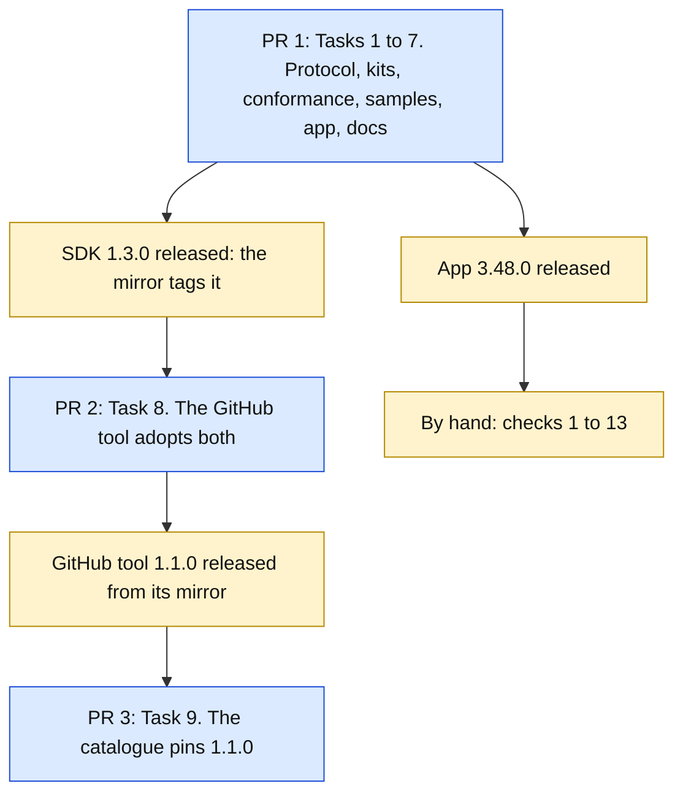

# A tool's status on the closed island, and a choice among fixed options: Implementation Plan

> **For agentic workers:** REQUIRED SUB-SKILL: Use superpowers:subagent-driven-development (recommended) or superpowers:executing-plans to implement this plan task-by-task. Steps use checkbox (`- [ ]`) syntax for tracking.

**Goal:** A tool from outside can show a small status mark on the closed island, as the built-in GitHub feature does, and can offer a pop-up menu, both as a setting in its detail and as a block on a page. Both stay inside protocol 2. A tool that uses them still installs and runs on Vitruvian 3.46 and 3.47. The GitHub tool adopts both as the proof.

**The design:** `docs/superpowers/specs/2026-10-13-vitruvian-tool-resting-status-and-choice-design.md`. Read its sections 1, 3 and 4 before any task. Section numbers below are that document's.

**Architecture:** The protocol gains one request (`ui/status`), one block (`choice`), one manifest key under `contributes` (`status`), one key on a text preference (`options`) and one field in the hello (`features`). An older app ignores each key and answers the request with "unknown method"; that is what makes the change safe (section 3). In the app, `ToolPanelHost` keeps each tool's last status beside its badge and clears it when the tool's program ends; a pure function in `Core` picks the one mark the resting wing draws; the wing's view draws it and routes the click. The tool's detail draws a `Picker` where a preference has options. Every kit gains the call, the block builder and `supports`.



Blue is a pull request an agent opens. Amber waits for a person: a release to merge, or a check at the screen.

## Decisions this plan makes

The design's 21 decisions stand. These are the ones a worker trips over, and what this plan adds.

| # | Decision | Why |
|---|---|---|
| 1 | **A picker setting is `"type": "string"` with `"options"`. Nothing in this plan adds a preference type.** | Every released app refuses a manifest with a type it does not know (section 3, row b). |
| 2 | **Tasks 1 to 7 are one pull request**, titled `feat(vitruvian-sdk): a tool can show a status on the closed island and offer a choice`, with the line `Releases: vitruvian-sdk, vitruvian` in its description. | A new message does not compile until the app handles it, and the app's pin of the protocol sources is in the app's folder. So the protocol cannot land without touching `apps/desktop/vitruvian`, and a `feat` that touches it releases the app. Better that release carries the feature than nothing. |
| 3 | **Task 1 leaves the app answering `ui/status` with -32601 and drawing a `choice` block as its fallback.** Tasks 4 and 5 make them real. | Each task must build and pass by itself. Until Task 4 the app honestly does not have the feature, and it does not say it has: `features` is sent from Task 4. |
| 4 | **The protocol's name for the hello's list is `ProtocolFeature`**, not `AppFeature`. | `AppFeature` is the app's own type (`Core/FeatureCatalog.swift`), and the app imports the protocol module. |
| 5 | **The app's new words are six, in `ExternalToolStrings`, in all fifteen languages.** The fourteen other languages are written with the English and reviewed by nobody. | The agreement sheet, the detail's switch, and four words for VoiceOver when a tool gives no text. |
| 6 | **The wing shows one mark.** `RestingStatus.winner` decides which; the view draws it. | Section 7. |
| 7 | **The GitHub tool keeps `"minimumAppVersion": "3.46.0"`**, and its colour option titles are English only. | Decision 20 and section 9 of the design. |
| 8 | **Kit call names in Task 2 are proposals.** Fit each kit's idiom; say in the report where a name differs. What may not differ: the call sends nothing and reports "not shown" when the hello lacked `ui.status`. | The kits were read for their badge calls, not built against. |
| 9 | **Not in this plan:** a status under Battery, Music or "nothing"; a second mark; options on a number setting; a shared list of options; removing the built-in GitHub feature. | Section 11. |

## Global Constraints

- **Nothing in this plan was built.** Unlike stages D and E, the listings a worker would cut and apply do not exist. Every statement about code that exists today was checked against `origin/main` at `5b617f063` (which is the tag `vitruvian-v3.47.0`). Everything about code to be written is a design. Where a step says "expected", it is what the design implies, not a recording. The section "Not verified" at the end lists what to distrust first. If the code contradicts the plan, the code is right: stop and report BLOCKED with what you found.
- **TDD.** Each task: the failing test first, kept as RED evidence; then the code; then GREEN. Every rule's test must be able to fail: plant the task's regressions, see the named test fail with the named message, undo by hand, `git diff --stat` shows only the task's change.
- **The path a protocol change takes** is `packages/vitruvian-sdk/CONTRIBUTING.md`, "A change to the protocol". Its table row for the kits is out of date (it says the generator "arrives in the next release"); the test is `//tools/sdk-codegen:in_sync_test`. Task 6 fixes the row.
- **Licences.** `packages/vitruvian-sdk/` is MIT, with the header `Sources/VitruvianToolProtocol/LineFraming.swift` carries. `apps/desktop/vitruvian/` and `apps/desktop/vitruvian-tool-github/` are GPL-3.0-or-later, with the two-line header. Nothing is copied from the app or the tool into the package.
- **`UPSTREAM.md`.** A changed app file whose header says `Copyright (C) 2026 Vorssaint` is named under "Modifications" in the same commit. Known ones here: `UI/Notch/NotchAgentStrip.swift` and `Tests/mutation_checks.py`. `Services/Notch/NotchService.swift` and `UI/Notch/NotchView.swift` are Vorssaint's too; this plan does not need to change them, and a worker who finds they must says why. Check the header of every file you change; do not trust this list.
- **The pin.** Any change under `packages/vitruvian-sdk/Sources/VitruvianToolProtocol` needs `bazel run //apps/desktop/vitruvian:pin_tool_protocol` and an `UPSTREAM.md` log line in the same commit. Only Task 1 changes those sources.
- **Layers.** In the app, `Core <- Design <- Services <- UI <- App`, Swift 6 mode. What another module or a test uses is `package`. `ToolPanelHost` and the store are `@MainActor` and never wait.
- **Strings.** A text of the app's that a person reads is a field of a strings struct in all fifteen languages. Typographic apostrophe (’) and ellipsis (…), no em-dash. French puts `\u{00A0}` before `:`, `?`, `!` and `;`. A tool's words are the tool's and are drawn as written, cut to one line with `ToolOwnWords.oneLine`.
- **Tests.** The app's tests are synchronous `static func run(_ suite: TestSuite)` reached from `Tests/TestGroups.swift`; a new test file is added to the `platform` group there by hand. Nothing is drawn, nothing is launched, no network, nothing written under `~/Library/Application Support/com.vitruviansoftware.vitruvian`. A test's `UserDefaults` suite is named `com.vitruviansoftware.vitruvian.tests.<something>` and its domain is removed first.
- **Build and test through Bazel only**, from the repository root, one command at a time. A full run of the app's unit tests needs the display awake: start it with `(caffeinate -u -d -t 900 &);`. Never put `--test_arg` on a command that also names the source tests.

  The app:
  ```sh
  bazel test --config=macos-app //apps/desktop/vitruvian:unit_tests --test_arg=--suite=platform --test_arg=--suite=notch --test_arg=--suite=agents --test_output=errors
  grep -aE "^(platform|notch|agents): |TESTS" bazel-testlogs/apps/desktop/vitruvian/unit_tests/test.log
  bazel test //apps/desktop/vitruvian:source_lints_test //apps/desktop/vitruvian:sources_in_sync_test //apps/desktop/vitruvian:tool_protocol_pin_test //apps/desktop/vitruvian:upstream_test
  ```
  The package, the two lines of `CONTRIBUTING.md`, "Checking a change", plus the generator and the kits:
  ```sh
  bazel test --config=macos-app //packages/vitruvian-sdk:VitruvianToolProtocolTests //packages/vitruvian-sdk:VitruvianToolKitTests //packages/vitruvian-sdk:VitruvianToolCLITests //packages/vitruvian-sdk:swift_samples_test //packages/vitruvian-sdk:init_test //packages/vitruvian-sdk:swift_template_test
  bazel test //packages/vitruvian-sdk:protocol_examples_test //packages/vitruvian-sdk:conformance_test //packages/vitruvian-sdk:samples_test //packages/vitruvian-sdk:templates_in_sync_test //packages/vitruvian-sdk:guide_test //packages/vitruvian-sdk:release_version_test //packages/vitruvian-sdk:mirror_workflows_test //tools/sync-site-tools:in_sync_test
  bazel test //tools/sdk-codegen:in_sync_test //tools/sdk-codegen:sdk_codegen_test //packages/vitruvian-sdk:python_kit_test //packages/vitruvian-sdk:kit_samples_test //packages/vitruvian-sdk:go_kit_vet_test //packages/vitruvian-sdk/go/toolkit:toolkit_test //packages/vitruvian-sdk/kits/rust:tool_test //packages/vitruvian-sdk/kits/rust:protocol_test //packages/vitruvian-sdk/kits/typescript:kit_test
  ```
  The target names on the third line were read from the `BUILD` files, not run. If one is wrong, `bazel query 'tests(//packages/vitruvian-sdk/...)'` lists them.
- **Do not launch or drive the app from a task.** What needs the running app is "By hand", and James is asked first.
- **Planted regressions.** The app's and the protocol module's go in `apps/desktop/vitruvian/Tests/mutation_checks.py`, each a tuple of name, suite, file, the exact source line, its replacement, and the test message that must appear. The kits' and the tool's are steps in their tasks. If one is not caught, stop and report; do not bend a test to fit.
- **Formatting and gates.** After editing a `.py`, `.json`, `.yml` or `BUILD` file: `bazel run //tools/format -- <path>`. Add to a JSON file as text; never load and dump it whole. After adding a file: `bazel run //tools/license:check` and `:verify`. After a `.go` file is added: `bazel run //:gazelle`. `bazel run //:tidy` must leave nothing to commit (it may add one unrelated `Cryptodome: pycryptodomex` line to `gazelle_python.yaml`: undo it by hand). No task adds a `pipeline_unit`, so `bazel run //tools/pipeline:gen -- --format=workflow --output-file=.github/workflows/presubmit.yaml --check` must pass untouched.
- **Git.** Work only in the worktree your dispatch names. Never `git stash`, `git reset`, `git restore`, `git checkout <branch>`, rebase or force-push. Stage each file by path. One commit per task, with the title the task gives, as the agent it names, identity and commit in one command:
  ```sh
  export AGENT_KEY_DIR=/Users/james/Workspace/gh/application/vitruvian/vitruvian-core/tools/sync-env-secrets/agent-keys; eval "$(bazel run //tools/agent-app -- env wren 2>/dev/null)"; git add <files> && git commit -m "<title>"
  ```
  End each message with the `Co-Authored-By` trailer your dispatch gives.
- **Cost.** Nothing here costs money: no Developer ID, no new repository, no new secret, no registry touched by hand.

## Review Focus

Where a mistake costs most. Each has a test in the task named.

1. **Nothing that works today is refused.** No existing example, sample or first-party manifest changes its verdict; the new manifest rules fire only on the two new keys (Task 1: every existing example in `protocol/examples/` keeps its `valid`; `ToolFolderExamplesTests` unchanged). Read `ToolManifestFile.problems()` yourself: no existing branch moved.
2. **An older app is described truthfully, and the kits rely on nothing else.** A kit's status call sends nothing when the hello had no `ui.status` (Task 2, one test per kit, and a planted regression each). The conformance script plays an older app and the reference tool and every sample survive it (Task 3).
3. **A status never outlives its program.** `ToolPanelHost.toolEnded` clears it, and `forget` does too (Task 4, `aStatusGoesWhenTheProgramEnds`, and a regression).
4. **A tool that did not declare a status cannot put one up, and a person's switch is obeyed.** (Task 4, `anUndeclaredStatusIsRefused`, `aSwitchedOffStatusIsKeptAndNotDrawn`, two regressions.)
5. **A stored value is never rewritten by the app.** A value that is no option's is shown as written, and only a person's pick changes it (Task 5, `aStoredValueThatIsNoOptionIsShownAsWritten`, and a regression). `storage/set` of such a value is still accepted (Task 4).
6. **With no tool status, the closed island is exactly as it is today.** `RestingStatus.winner` with no tool gives the built-in or nothing, and the wing's click falls through to today's code (Task 4's pure tests; Task 5 changes `NotchAgentRestingWing` only by adding the tool's case in front).
7. **Every stored mouse value still reads.** Each of the GitHub tool's option values parses as a `MouseLight`, each default is an option, and what `GitHubHandoff.light` writes for the ten colours is an option (Task 8).
8. **The catalogue pins the release's bytes.** Task 9's `sha256` and `size` are the mirror's asset's; `catalog-check` downloads and compares.

## The strings

The app's new texts, fields of `ExternalToolStrings` (Task 5), with their English. The fourteen other languages are written in Task 5.

| Key | English | Where |
|---|---|---|
| `showStatusInIsland` | Show its status on the closed Dynamic Island | The switch in the tool's detail |
| `agreeShowsStatus` | It shows a small status mark on the closed Dynamic Island. | The agreement sheet, and the tool's detail |
| `markOK` | OK | VoiceOver, when the tool gives no text |
| `markBusy` | Working | the same |
| `markAttention` | Needs attention | the same |
| `markFailure` | Failed | the same |

The GitHub tool's new words (Task 8, `Words.swift`, fifteen languages each): `statusOK` "All checks pass", `statusBusy` "Checks are running", `statusAttention` "A check is waiting for approval", `statusFailure` "A check failed". Its option titles are in its manifest: `mouseIdle`'s two in fifteen languages, the colours' in English.

---

### Task 1: The protocol, written down, and everything that must agree with it

**Worker:** `wren`. **Commit:** `feat(vitruvian-sdk): the protocol gains ui/status, a choice block and options on a preference`. First commit of pull request 1.

**Files:**
- Modify: `packages/vitruvian-sdk/protocol/manifest.schema.json`, `messages.schema.json`, `methods.json`
- Modify: `packages/vitruvian-sdk/protocol/examples/manifests.json`, `messages.json`
- Modify: `packages/vitruvian-sdk/Sources/VitruvianToolProtocol/Messages.swift`, `Panels.swift`, `ToolManifestFile.swift`
- Modify: `packages/vitruvian-sdk/Tests/VitruvianToolProtocolTests/ManifestFileTests.swift`, `ProtocolExamplesTests.swift`
- Modify: `packages/vitruvian-sdk/Sources/VitruvianToolKit/AppRequests.swift` (the list a test holds against `ToolMethod`)
- Modify: `packages/vitruvian-sdk/Tests/VitruvianToolKitTests/ToolTests.swift` (`UIBlock.kinds.count` is 13)
- Modify: `packages/vitruvian-sdk/Sources/VitruvianToolCLI/Desk.swift` (its `switch` over `ToolMethod` gains an arm, as `ui/badge`'s at line 88)
- Modify: `tools/sdk-codegen/model.py` (`ENUMS`), `tools/sdk-codegen/sdk_codegen_test.py`
- Regenerate: every file `bazel run //tools/sdk-codegen` writes under `packages/vitruvian-sdk/kits/*/…/generated/` and `go/toolkit/protocol_gen.go`
- Modify: `packages/vitruvian-sdk/docs/writing-a-tool.md` (reference rows only: "The manifest, field by field", "What a tool sends", "The twelve kinds of block" becomes thirteen), `packages/vitruvian-sdk/protocol/README.md`
- Regenerate: `apps/web/vitruviansoftware-dev/tools/guide.md`, `protocol.md` with `bazel run //tools/sync-site-tools:sync`
- Modify: `apps/desktop/vitruvian/bazel/tool_protocol.sha256` (by `pin_tool_protocol`), `apps/desktop/vitruvian/UPSTREAM.md`
- Modify: `apps/desktop/vitruvian/Sources/Vitruvian/Services/Platform/External/ExternalToolCalls.swift` (one arm), `UI/ToolPanels/BlockTreeView.swift` (one arm)
- Modify: `apps/desktop/vitruvian/Tests/ExternalToolCallsTests.swift`, `ToolPanelTests.swift`, `mutation_checks.py`

**Interfaces:**
- Consumes: `ToolManifestFile`, `ManifestProblem`, `ManifestRules`, `ManifestLimits`, `UIBlock`, `UILimits`, `UIText`, `LocalizedText`, `ToolMethod`, `InitializeParams`, `Bounded` (the protocol module); `model.ENUMS` (the generator).
- Produces, in the schemas (the names every later task uses):
  - `methods.json`: `{"method": "ui/status", "sender": "tool", "kind": "request", "uses": null, "params": "uiStatusParams", "result": "empty"}`. Its `about` says six `ui/` messages.
  - `messages.schema.json`: `uiStatusParams` (`state` required, enum `none`, `ok`, `busy`, `attention`, `failure`; `text` a `uiText`; `icon` a string); `choiceBlock` (`value` and `options` required; `title` a `uiText`; `options` 1 to 64 of `uiChoiceOption`; `enabled`); `uiChoiceOption` (`value`, a string of at most 128, and `title`, a `uiText`, both required); `uiBlock` gains the `choice` branch and its description says thirteen kinds; `initializeParams` gains `features`, an array of strings, not required, not an enum, described as "what this app has beyond the first release of the protocol version; a name the tool does not know is ignored; an app before 3.48 sends none".
  - `manifest.schema.json`: `contributes.status`, a `statusContribution` (`placement` required, enum `island`); `preference.options`, 1 to 64 of `preferenceOption` (`value`, a string of at most 128 with no control character; `title`, a `localizedText` under the rule a preference's title has); two `allOf` branches: a manifest of protocol 1 has no `contributes.status`, and a preference whose `type` is not `string` has no `options`. The top description gains the two rules JSON Schema cannot say: no two options of one preference share a value, and a preference with options has a default that is one of them.
- Produces, in Swift (`VitruvianToolProtocol`):
  - `ToolMethod.uiStatus = "ui/status"`: `sender` is `.tool`, `isAnswered` is true.
  - `public enum StatusState: String, Codable, CaseIterable, Sendable { case none, ok, busy, attention, failure }`
  - `public struct UIStatusParams: Codable, Equatable, Sendable { public let state: StatusState; public let text: UIText?; public let icon: String?; public init(state:text:icon:) }`
  - `public enum StatusPlacement: String, CaseIterable, Sendable { case island }`
  - `public enum ProtocolFeature: String, CaseIterable, Sendable { case status = "ui.status", choice = "ui.choice", preferenceOptions = "preferences.options" }`
  - `InitializeParams.features: [String]?`, last in `init`, defaulting to nil, left out of the JSON when nil.
  - `ToolManifestFile.Contributes.status: Status?`, with `public struct Status: Codable, Equatable, Sendable { public let placement: String }`
  - `ToolManifestFile.Preference.options: [Option]?`, with `public struct Option: Codable, Equatable, Sendable { public let value: String; public let title: LocalizedText }`
  - `ManifestLimits.maxOptions = 64`, `ManifestLimits.maxOptionValueLength = 128`; `ManifestRules.isWellFormedOptionValue(_:)` (at most 128 code points, none a control character; empty is allowed)
  - `ManifestProblem` gains `statusNeedsProtocol2(String)`, `unknownStatusPlacement(String)`, `optionsNeedString(preference: String)`, `optionCountOutOfRange(preference: String, count: Int)`, `optionValueNotWellFormed(preference: String)`, `duplicateOption(preference: String, value: String)`, `optionTitleNotWellFormed(preference: String)`, `defaultNotAnOption(preference: String)`. An option's title with no `en`, or blank, is the existing `noEnglish` and `blankText`, with the field `preferences[<id>].options[<n>].title`.
  - `public struct UIChoiceOption: Codable, Equatable, Sendable { public let value: String; public let title: UIText }`
  - `public struct ChoiceBlock: Codable, Equatable, Sendable { public let title: UIText?; public let value: String; public let options: [UIChoiceOption]; public let enabled: Bool? }`, whose decoder throws for no option, more than `UILimits.maxChoiceOptions` (64), a value over 128 code points, or two options with one value.
  - `UIBlock.Content.choice(ChoiceBlock)`; `UIBlock.kinds` ends with `"choice"`; `UIBlock.kindsWithID` holds `"choice"`.
  - `extension UIStatusParams: AppRequest` (`Answer` is `EmptyObject`), and `AppRequests.methods` lists it.
- Produces, in the generator: `ENUMS[("uiStatusParams", "state")] = "StatusState"` and `ENUMS[("statusContribution", "placement")] = "StatusPlacement"`.
- Produces, in the app, only what compiling needs: `ExternalToolCalls.serve` answers `.uiStatus` with -32601 "unknown method" (it joins nothing: it is a tool's request, so it gets its own arm with a comment naming Task 4); `BlockTreeContent` maps `.choice` to its fallback exactly as `.unknown` is mapped at line 129. If another exhaustive `switch` stops compiling, add the smallest arm and name it in the report.

The examples carry the proof. `protocol_examples_test` and `ProtocolExamplesTests` both fail a field no valid example uses, so each new field needs one.

- [ ] **Step 1: Write the failing examples and tests**

  In `protocol/examples/manifests.json`, valid: a protocol 2 manifest with `contributes.status`; a `string` preference with two options, each title in two languages; an option whose value is empty. Invalid, each naming its `problem`: `statusNeedsProtocol2` (protocol 1 with a status); `unknownStatusPlacement` (`"placement": "menuBar"`); `optionsNeedString` (options on a `boolean`); `optionCountOutOfRange` (an empty list, and one of 65); `optionValueNotWellFormed` (129 characters, and one with a line break); `duplicateOption` with `"schema": false`; `defaultNotAnOption` with `"schema": false`; `optionTitleNotWellFormed` (61 characters); `noEnglish` (an option title with only `fr`).

  In `protocol/examples/messages.json`, valid: `ui/status` for each of the five states, one with `text` as a string, one with `text` as a map, one with `icon`; the hello with `features`; a `ui/render` whose page has a `choice` block using every field; a `ui/event` `change` whose value is an option's. Invalid: `ui/status` with no `state`; with `"state": "broken"`; a `choice` block with no `id`, with no `options`, with an empty `options`.

  In `ManifestFileTests.swift`: one test per new `ManifestProblem`, and `everyExistingManifestStillReads` is not needed, the examples file is that test. In `ProtocolExamplesTests.swift`: whatever its table of kinds and methods needs to name the new ones (line 250 speaks of twelve kinds). In `sdk_codegen_test.py`: the variants list ends with `"choice"`, the `ui/` methods end with `"ui/status"`, and the enums gain `StatusState` and `StatusPlacement`.

  In the app's `ToolPanelTests.swift`: a page with a `choice` block reads, by its kind, with its options; one with 65 options, one with a duplicate value and one with no id are refused and the reason names the place. In `ExternalToolCallsTests.swift`: `ui/status` is answered -32601 for now.

- [ ] **Step 2: Watch them fail.** Run `bazel test //packages/vitruvian-sdk:protocol_examples_test`. Expected: it fails on the first new example, because the schema does not know the field. Keep the output.

- [ ] **Step 3: Write the schemas, then the Swift types, then the rules.** In `ToolManifestFile.problems()`, add the status check beside `panelProblems()` and the option checks inside the preference loop, after the existing `kind.accepts(default)` check so that no existing problem changes its order. Do not touch any existing branch.

- [ ] **Step 4: Regenerate and pin.**
  ```sh
  bazel run //tools/sdk-codegen
  bazel run //apps/desktop/vitruvian:pin_tool_protocol
  bazel run //tools/sync-site-tools:sync
  ```
  Add the `UPSTREAM.md` log line for the pin. Commit every file the three commands wrote.

- [ ] **Step 5: The guide's reference rows.** `guide_test` fails a message the guide never shows and a manifest field it never names. Add: `status` under `contributes` and `options` under a preference in "The manifest, field by field"; `ui/status` in "What a tool sends" with one `json message` block; `choice` in the table of kinds, with the heading's count changed; `features` under `initialize` in "What the app sends". The tutorials are Task 6.

- [ ] **Step 6: Watch everything pass.** The package's three lines of tests from Global Constraints, then the app's `platform` suite and its four source tests. Record `platform`'s check count before and after.

- [ ] **Step 7: Plant the regressions.** Add to `mutation_checks.py`, each against `../../../packages/vitruvian-sdk/Sources/VitruvianToolProtocol/…` as the existing protocol entries are, and each seen to fail in `platform`:
  1. "options on a setting that is not text are accepted": remove the line that appends `optionsNeedString`.
  2. "a default that is no option is accepted": remove the line that appends `defaultNotAnOption`.
  3. "a choice with no id is read": take `"choice"` out of `kindsWithID`.
  4. "a manifest of protocol 1 may declare a status": remove the `statusNeedsProtocol2` guard.

  These need app-side tests that reach each rule; `ExternalToolManifestTests.refusals` is where the existing manifest cases are (line 145). Add the four cases there.

- [ ] **Step 8: Commit**, with `git status --short` first.

**As built (2026-10-13).** Where the code proved the plan wrong:

- **This commit alone leaves four kit tests red; Task 2's commit makes them green.** Every kit holds a test that each request a tool may send has a call (`every_request_a_tool_may_send_has_a_call` in Rust, `TestEveryRequestAToolMaySendHasACall` in Go, and the count of calls in Python and TypeScript). So `ui/status` in `methods.json` fails them until the kit has the call. Tasks 1 and 2 were built together and committed apart, by file. Decision 3 ("each task must build and pass by itself") does not hold between these two.
- **`Desk.swift` answers `ui/status` for real already**, not in Task 3. `DeskTests.testEveryRequestATooMaySendIsAnswered` holds that the desk answers every request a tool may send, so an arm that refused it would have needed that test bent. The desk says "the app would show <state> on the closed island", and refuses a tool whose manifest declares none with -32602.
- **`Sources/VitruvianToolCLI/Words.swift` gained eight sentences.** Its `switch` over `ManifestProblem` is exhaustive; the plan's list of files did not name it.
- **`tools/sdk-codegen/emitters/python.py` had a bug this change was the first to reach.** A call whose argument is a closed list of names (`state: StatusState`) named a type the file never imported. Fixed, with a test (`test_every_name_a_python_call_uses_is_imported`) that was seen to fail without the fix.
- **A choice's duplicate values have no example in `messages.json`.** JSON Schema cannot say the rule and the file has no `schema: false` mark for messages, so the schema's description says it and the Swift tests hold it (`testAChoiceIsHeldToItsRules`, and the app's `ToolPanelTests.choices`).
- **The app's `ExternalToolCallsTests.refusals` changed on purpose.** It held that every request a tool makes is refused with -32001 when its service is not in `uses`. `ui/status` needs no service, so the test now says so by name.
- **More examples than the plan lists**, each naming its problem: a status with no placement, an option with no title, a blank option title, sixty-four options with a value of 128 characters, a choice with only what is required.
- `platform` ran 879 checks after this task and `tool-runtime` 863. The counts before were not run separately: this task adds 14 expectations to the first and one to the second, so they were 865 and 862.
- **The plan's test command leaves out the suite most of this lives in.** `ExternalToolCallsTests`, `ExternalToolStoreTests`, `ToolPanelHostTests`, the settings and the screens tests are in `tool-runtime`, not `platform`. Every task here ran `--suite=platform --suite=tool-runtime --suite=notch --suite=agents`.

---

### Task 2: Every kit sets a status, builds a choice, and asks what the app has

**Worker:** `wren`. **Commit:** `feat(vitruvian-sdk): every kit sets a status, builds a choice and asks what the app has`.

**Files:**
- Modify: `packages/vitruvian-sdk/Sources/VitruvianToolKit/Tool.swift`, `Panels.swift`; `Tests/VitruvianToolKitTests/ToolTests.swift`
- Modify: `packages/vitruvian-sdk/kits/typescript/src/tool.ts`, `panels.ts`, `index.ts`; `test/tool.test.ts`
- Modify: `packages/vitruvian-sdk/kits/python/vitruvian_tool_kit/tool.py`, `panels.py`, `__init__.py`; `tests/test_tool.py`
- Modify: `packages/vitruvian-sdk/go/toolkit/app.go`, `tool.go`, `ui/ui.go`; `tool_test.go`, `panels_test.go`
- Modify: `packages/vitruvian-sdk/kits/rust/src/app.rs`, `tool.rs`, `panels.rs`, `lib.rs`; `tests/tool.rs`
- Modify: each kit's `README.md` where it lists the calls

**Interfaces:**
- Consumes: Task 1's generated types in each kit (`UIStatusParams`, `StatusState`, `ChoiceBlock`, `UIChoiceOption`, `InitializeParams.features`), and each kit's existing badge call and block builders: Swift `Panel.badge` (`Panels.swift:110`) and `toggle` (`:258`); TypeScript `Panel.badge` (`panels.ts:185`) and `toggle` (`:277`); Python `Panel.badge` (`panels.py:160`) and `toggle` (`:206`); Go `UI.Badge` (`app.go:182`) and `ui.Toggle` (`ui/ui.go:161`); Rust `Ui::badge` (`app.rs:166`) and `toggle` (`panels.rs:521`).
- Produces (proposed names; decision 8):

  | Kit | What the app has | Set the status | Build a choice |
  |---|---|---|---|
  | Swift | `App.supports(_ feature: ProtocolFeature) -> Bool` | `@discardableResult App.status(_ state: StatusState, text: UIText? = nil, icon: String? = nil) throws -> Bool` | `choice(_ id: String, title: UIText? = nil, value: String, options: [UIChoiceOption], enabled: Bool? = nil, fallback: UIText? = nil) -> UIBlock` |
  | TypeScript | `app.supports(feature: string): boolean` | `app.status(state, options?: { text?, icon? }): boolean` | `choice(id, value, options, more?: { title?, enabled?, fallback? }): UIBlock` |
  | Python | `app.supports(feature: str) -> bool` | `app.status(state, text=None, icon=None) -> bool` | `choice(id, value, options, title=None, enabled=None, fallback=None)` |
  | Go | `(*App).Supports(feature string) bool` | `UI.Status(state StatusState, options ...StatusOptions) (bool, error)` | `ui.Choice(id, value string, options []toolkit.UIChoiceOption, more ...ChoiceOptions) toolkit.UIBlock` |
  | Rust | `App::supports(&self, feature: &str) -> bool` | `Ui::status(self, state: StatusState, text: Option<UiText>, icon: Option<&str>) -> Result<bool, ToolError>` | `choice(id, value, options) -> Choice`, with `.title()`, `.enabled()`, `.fallback()` as `Toggle` has |

  In every kit: the hello's `features` are kept beside `language` (an older app's hello has none, which reads as an empty list). The status call returns false and **sends nothing** when `ui.status` is not among them; otherwise it sends `ui/status` and returns true. The choice builder, given no fallback, writes one: the title, a colon and the selected option's title, or the selected title alone. A picked option arrives as the event `change`, which each kit's event already reads as text (Swift `PanelEvent.text`); say so in its doc comment and add nothing.

- [ ] **Step 1: Write the failing tests, per kit.** Four each: after a hello with `features: ["ui.status"]` the status call writes one `ui/status` line and returns true; after a hello with no `features` it writes **nothing** and returns false; `supports` is true only for a name the hello listed; the choice builder's JSON is the example of Task 1, and with no fallback given it has the one described.
- [ ] **Step 2: Watch them fail** (they do not compile, or the call is missing). Keep one kit's output.
- [ ] **Step 3: Write the calls.** No kit's existing call changes.
- [ ] **Step 4: Watch them pass:** the kits' targets on the third test line of Global Constraints, and `VitruvianToolKitTests`.
- [ ] **Step 5: Plant one regression per kit by hand:** make the status call send whatever the hello said. The test "writes nothing for an older app" must fail. Undo by hand.
- [ ] **Step 6: Commit.**

**As built (2026-10-13).** The names, where a kit's idiom or its generated types asked for another:

| Kit | What the app has | Set the status | Build a choice |
|---|---|---|---|
| Swift | `App.supports(_: ProtocolFeature)`, and `supports(_: String)` for a name the kit has no case for | `App.status(_:text:icon:) throws -> Bool`, as proposed | `choice(_:title:value:options:enabled:fallback:)`, and `UIBlock.choice` |
| TypeScript | `app.supports(feature)`; the names are `Feature.status`, `.choice`, `.preferenceOptions` | `app.status(state, { text, icon })` | `choice(id, value, options, { title, enabled, fallback })` |
| Python | `app.supports(feature)`; the names are `Feature.STATUS`, `.CHOICE`, `.PREFERENCE_OPTIONS` | `app.status(state, text=None, icon=None)` | `choice(id, value, options, title=None, enabled=None, fallback=None)` |
| Go | `(*App).Supports(feature string)`; `FeatureStatus`, `FeatureChoice`, `FeaturePreferenceOptions` | `UI.Status(state string, options ...StatusOptions) (shown bool, err error)` | `ui.Choice(id, value, options, more ...ChoiceOptions)` |
| Rust | `App::supports(&self, feature: &str)`; `features::STATUS`, `CHOICE`, `PREFERENCE_OPTIONS` | `Ui::status(self, state: &str, text: Option<UiText>, icon: Option<&str>) -> Result<bool, ToolError>` | `choice(id, value, options) -> Choice`, with `.title()`, `.enabled()`, `.fallback()` |

- **Go and Rust take the state as text**, with constants (`toolkit.StatusBusy`, `status::BUSY`). The generator gives those two kits no type for a closed list of names: `state` is a `string` and a `String` in the generated params, as a button's style is.
- **TypeScript and Python have two calls, and only one is the kit's.** Their calls on `app` are generated, one for each message, so `app.ui.status(...)` exists and is the bare request: it is sent whatever the app said, and an older app refuses it with -32601. `app.status(...)` is the kit's call, which sends nothing to an app without `ui.status`. Each one's doc comment says so. It is what Swift's `App.send` and Go's `App.Send` already are.
- **In TypeScript `supports` and `status` are not enumerable on `app`.** The kit's test of the calls lists `Object.keys(app)` and holds it to the protocol's messages; the two are the kit's own and not messages.
- **Go's `ChoiceOptions` has `Disabled`, not `Enabled`**, as its `ButtonOptions` and `ToggleOptions` do.
- **Rust's `Choice` is written by hand**, not with the `writing!` macro the other blocks use: it writes its fallback when it joins a page, after its title is known.
- **Rust's `every_request_a_tool_may_send_has_a_call` changed on purpose**: its hello now says `ui.status`, since the kit sends no status to an app that does not.
- **The written fallback is in every language either text has.** A title in two languages with a plain option title gives a fallback in those two languages.
- **Each kit's README** gained a short paragraph; only the TypeScript and Python ones listed calls before.

Step 5, the planted regression in each kit (the status call sends whatever the hello said), and the test that failed:

| Kit | Failed |
|---|---|
| Swift | `testAStatusWritesNothingForAnOlderApp` |
| TypeScript | "a status writes nothing for an older app", and "… for an app that has other things" |
| Python | `test_a_status_writes_nothing_for_an_older_app`, and `…_for_an_app_that_has_other_things` |
| Go | `TestAStatusWritesNothingForAnOlderApp` |
| Rust | `a_status_writes_nothing_for_an_older_app` |

---

### Task 3: The conformance script, `vitruvian-tool run`, and the samples

**Worker:** `wren`. **Commit:** `feat(vitruvian-sdk): the conformance script and the samples cover status and choice`.

**Files:**
- Modify: `packages/vitruvian-sdk/conformance/conformance.py`, `conformance_test.py`
- Modify: `packages/vitruvian-sdk/Sources/VitruvianToolCLI/Desk.swift`, `Session.swift`; `Tests/VitruvianToolCLITests/DeskTests.swift`, `RunTests.swift`
- Modify: the five panel samples: `samples/hello-panel-swift/main.swift`, `hello-panel-typescript/bin/tool.mjs`, `hello-panel-python/bin/tool.py`, `hello-panel-go/main.go`, `hello-panel-rust/src/main.rs`, each one's `vitruvian-tool.json`, and the two with a `README.md`
- Modify: `samples/hello-swift/vitruvian-tool.json` and `samples/hello-python-kit/vitruvian-tool.json` (one preference gains `options`), then `bazel run //packages/vitruvian-sdk:sync-templates`
- Modify: `packages/vitruvian-sdk/samples/samples_test.py` only if a sample's expected output is listed there

**Interfaces:**
- Consumes: Tasks 1 and 2. In `conformance.py`: `SERVICES` (line 81), `NEEDS_ID` (line 70), `is_block`, `check_params`, `handshake`.
- Produces:
  - The script's hello carries `"features": ["ui.status", "ui.choice", "preferences.options"]`.
  - `ui/status` is checked: a `state` of the five, `text` a string or a map with `en`, `icon` a string. It is answered `{}` when the manifest declares a status and -32602 when it does not, as the app will.
  - A `choice` block is checked: an id, a `value`, 1 to 64 options with unique values.
  - **One new step, "an older app":** the tool is started again and greeted with a hello that has no `features`; a `ui/status` it sends is answered -32601; it must still answer the hello, run a command and leave on `shutdown`. A tool that stops, or that sends more than a handful of `ui/status` after being refused, fails with a sentence that says why. This is the check that a tool degrades as the design promises.
  - `vitruvian-tool run`'s desk says, for `ui/status`, "the app would show <state> on the closed island", and for a tool with no declared status, that the app would refuse it; its hello carries `features`.
  - Each `hello-panel-*` sample declares `contributes.status`, sets `busy` while its counter runs and `none` after, and shows one `choice` block (with a `field` in its place when `supports("ui.choice")` is false).

- [ ] **Step 1: Write the failing tests.** In `conformance_test.py`: a tool that sends a bad `state` fails; a tool that sends `ui/status` with no declared status is told so; a tool that dies when refused in the "older app" step fails; the reference tool passes all of it unchanged. In `DeskTests.swift`: the two sentences.
- [ ] **Step 2: Watch them fail.**
- [ ] **Step 3: Write the script's changes, then the desk's, then the samples.**
- [ ] **Step 4: Watch them pass:** `conformance_test`, `samples_test`, `kit_samples_test`, `swift_samples_test`, `templates_in_sync_test`, `init_test`, `VitruvianToolCLITests`, `guide_test` (the sample `README.md` files are held to the guide's rules).
- [ ] **Step 5: Plant by hand:** in `conformance.py`, answer the "older app" `ui/status` with `{}`. The test that a refused tool survives must no longer prove anything: confirm the test that checks the answer was -32601 fails. Undo.
- [ ] **Step 6: Commit.**

**As built (2026-10-13).**

- **The panel samples let the person pick the status; they do not set `busy` "while the counter runs".** The counter does nothing that takes time, so that status would have shown for an instant. And by-hand check 1 needs a sample that can show each of the five states. So each `hello-panel-*` sample starts at `ok`, sets it when its program starts (`onStart`), and its island page has a `choice` block, "Status on the closed island", that picks among the five. On an app without `ui.choice` the block is a `field` to type the word in. The status is exercised by the conformance script because it is set at start: `a command: addOne: ran, and set the status: ok`.
- **The panel samples now start with the app** (`"activation": ["onLaunch"]`, was `onCommand`). A status goes when the program ends, and a tool that rests after two idle minutes would lose its mark while the person looked at it. This is what the guide tells an author to do.
- **`hello-swift` and `hello-python-kit` gained a preference; none could "gain options".** Their one preference, `count`, is an integer, and only a `string` preference may have options. They have a new one, `step` ("Count by": One, Two, Five), and their `count` command reads it. It reads the text defensively, since an older app draws a text field and anything may be saved.
- **The desk's part of this task was done in Task 1** (see there). What was left for `vitruvian-tool run` is its hello, which now names all three features.
- **The script fails a `ui/status` from a tool whose manifest declares none**, after answering it with -32602 as the app does. The plan said such a tool "is told so"; a request the app will always refuse is the author's mistake, as a `ui/render` for an undeclared panel already is.
- **"A handful" is five.** More than five `ui/status` to an app that answers each with -32601 fails the older-app step.
- **The older-app step also opens the panel**, and says so when the page holds a `choice` (that app draws its fallback). That is a remark, not a failure.
- **One existing test changed on purpose:** `never_stops_writing` read the script's last line, which is now the older app's. It reads the `shutdown` line by name, and allows the second run to end either of the two ways the first may.
- **`samples_test.WANTED`** holds each panel sample to three lines: its status, its page of five blocks, and that it carried on with an older app and sent it no `ui/status`.
- **The docs' excerpts moved with the samples.** Twenty-six `file=` excerpts in the guide and the samples' READMEs quote the lines that changed; each was moved to the same code as it is now. The two panel READMEs gained a section on the status and the choice. `README.md`'s account of the script says seven checks; the guide said "five" where there were six, and now says seven.
- **Between this merging and SDK 1.3.0 being published, the TypeScript and Python panel samples do not run from the registries.** They pin the kit (`1.2.0` until release-please bumps it) and use calls 1.3.0 adds. In this repository and in the mirror's CI they build against the kit beside them, so every test passes. It is the same window protocol 2's samples had.

Step 5, planted: the older app answers `ui/status` with `{}`. `conformance_test` failed with "a tool that dies when refused is not caught". Reversed.

---

### Task 4: The app keeps a tool's status and a setting's options

**Worker:** `wren`. **Commit:** `feat(desktop): the app keeps a tool's status and a setting's options`. Nothing a person sees changes in this task.

**Files:**
- Create: `apps/desktop/vitruvian/Sources/Vitruvian/Core/Platform/ToolStatus.swift`
- Create: `apps/desktop/vitruvian/Tests/ToolStatusTests.swift`
- Modify: `Sources/Vitruvian/Core/Platform/ExternalToolManifest.swift`
- Modify: `Sources/Vitruvian/Services/Platform/External/ToolRecords.swift`, `ExternalToolStore.swift`, `ExternalToolCalls.swift`, `ToolPanelHost.swift`
- Modify: `Tests/TestGroups.swift`, `ExternalToolManifestTests.swift`, `ExternalToolStoreTests.swift`, `ExternalToolCallsTests.swift`, `ToolPanelHostTests.swift`, `mutation_checks.py`
- Modify: `apps/desktop/vitruvian/UPSTREAM.md` (for `mutation_checks.py`)

**Interfaces:**
- Consumes: Task 1's protocol types. `ExternalToolManifest.tool(from:)` (line 113); `ToolRecord.showsInIsland` and the store's `showsInIsland`, `setShowsInIsland`, `islandPanels` (`ExternalToolStore.swift:590-617`), which are the pattern to copy; `ExternalToolStore.Setting` (line 70) and `settings(of:)` (line 626); the hello at `ExternalToolStore.swift:782`; `onRunEnded` at line 794; `ToolPanelHost.badge`, `toolEnded`, `forget` (`ToolPanelHost.swift:459-482`); `ExternalToolCalls.init`'s `badge` closure; `Verdict` (`Core/GitHub/GitHubModels.swift:197`); `ToolClock`.
- Produces, in `Core`:
  - `package struct PreferenceOption: Equatable, Sendable { package let value: String; package let title: LocalizedText }`
  - `ExternalToolManifest.showsStatus: Bool` (the manifest declares `contributes.status`) and `preferenceOptions: [String: [PreferenceOption]]`, keyed as `preferenceTitles` is.
  - `package struct ToolStatus: Equatable, Sendable { package let state: StatusState; package let text: UIText?; package let icon: String? }`. It is never built with `.none`: none is no status.
  - `package enum RestingMark: Equatable, Sendable { case gitHub(Verdict); case tool(ToolID, ToolStatus) }`
  - `package enum RestingStatus { package static func severity(_ state: StatusState) -> Int; package static func severity(_ verdict: Verdict) -> Int?; package static func winner(gitHub: Verdict?, tools: [(ToolID, ToolStatus)]) -> RestingMark? }`. Severity: `failure` and red 3, `attention` 2, `busy` and amber 1, `ok` and green 0; grey and `nil` are not marks. The highest wins; on a tie the built-in, then the earlier of `tools`.
- Produces, in `Services`:
  - `ToolRecord.showsStatus: Bool?`, nil meaning yes and written only once turned off, as `showsInIsland` is. `ExternalToolStore.showsStatus(_:)`, `setShowsStatus(_:_:)`, and `statusTools() -> [ToolID]`: the tools that are on, are what the person agreed to, declare a status and have it switched on, in the order added.
  - `ExternalToolStore.Setting.options: [PreferenceOption]`, empty for a setting with none.
  - The hello: `features: ProtocolFeature.allCases.map(\.rawValue)`.
  - `ToolPanelHost`: `@Published package private(set) var statuses: [ToolID: ToolStatus]`; `@discardableResult package func status(_ tool: ToolID, _ asked: UIStatusParams) -> Refusal?`, which gives `.noStatus` (a new `Refusal`, -32602, "the manifest declares no status") for a tool whose manifest declares none, removes the entry for `.none`, and otherwise keeps it; `toolEnded` and `forget` both remove the tool's entry. A change is published at most once a second for each tool: the first at once, later ones within the second replaced by the newest and published when the second is up, on `parts.clock`, as `drawing` paces pages.
  - `ExternalToolCalls`: `init` gains `status: @escaping @MainActor (UIStatusParams) -> RPCErrorObject? = { _ in nil }`; the `.uiStatus` arm reads the params (-32602 when they do not read), calls it, and answers its error or `{}`. No `uses` gate.
  - `storage/set` and the detail's save are unchanged: a value that is no option's is saved.

- [ ] **Step 1: Write the failing tests.**
  - `ToolStatusTests` (new, registered in `TestGroups.swift` under `platform`): `noStatusAndNoGitHubIsNoMark`; `theBuiltInAloneIsTheBuiltIn` (each verdict; grey is no mark); `theWorstWins` (every pair of severities); `aTieGoesToTheBuiltInThenTheEarlierTool`; `okIsAMark`.
  - `ExternalToolManifestTests`: a manifest with a status and with options reads into `showsStatus` and `preferenceOptions`; one without reads as before, equal to the same manifest today.
  - `ExternalToolStoreTests`: `theHelloSaysWhatTheAppHas`; `theStatusSwitchIsYesUntilTurnedOff`; `aRecordFromBeforeReadsAsItDid` (a file with no `showsStatus` loads, and saving it writes no such key); `statusToolsLeavesOutASwitchedOffAndAnUndeclaredTool`; `aSettingCarriesItsOptions`; `aValueThatIsNoOptionIsStillSaved`.
  - `ToolPanelHostTests`: `aStatusIsKeptAndReplaced`; `noneTakesItAway`; `anUndeclaredStatusIsRefused`; `aStatusGoesWhenTheProgramEnds`; `aStatusGoesWhenTheToolIsForgotten`; `changesArePublishedOnceASecond` (five within a second: the first and the last are published, on the test's clock).
  - `ExternalToolCallsTests`: `ui/status` reaches the closure and is answered `{}`; its refusal goes back as -32602; params that do not read are -32602 and the closure is not called; it needs nothing in `uses`.
- [ ] **Step 2: Watch them fail.**
- [ ] **Step 3: Write the code.** Wire the store's `ExternalToolCalls` to `parts.panels()?.status(id, $0)?.error`, where `badge` is wired today.
- [ ] **Step 4: Watch them pass:** the app's suites and four source tests. Record `platform`'s count.
- [ ] **Step 5: Plant the regressions** in `mutation_checks.py`, each failing in `platform`:
  1. "a status outlives its program": remove the line in `toolEnded` that clears it. Expected message: `aStatusGoesWhenTheProgramEnds`'s.
  2. "a tool that declared no status may show one": remove the `.noStatus` guard.
  3. "a switched-off status is listed": drop the switch from `statusTools()`.
  4. "the mildest status wins": turn `winner`'s comparison round.
  5. "the app says it has nothing": send the hello without `features`.
- [ ] **Step 6: Commit.**

**As built (2026-10-13).**

- **Four of the five regressions fail in `tool-runtime`, not `platform`**: that is the suite the host's, the store's and the calls' tests are in. Only "the mildest status wins" is `platform`'s. `mutation_checks.py` names the right suite for each.
- **A switched-off status is kept.** The host keeps what the tool sends whether or not the person has the status switched on; `statusTools()` is what leaves the tool out. So switching it on again draws the last status at once, with no restart and without waiting for the tool's next one. By-hand check 6 says "back at the tool's next status": it is back sooner.
- **`ToolStatus` cannot be built with `.none`**: both its initializers are failable and give nil for it.
- **`ExternalToolStoreTests.adding` changed on purpose**: it held the hello's exact params, which now carry `features`.
- **One more test than listed**, `aStatusReachesTheHostAndGoesWithTheProgram`, runs a status through the store's own wiring: the tool's line in, the answer out, the switch, and the end of the program. And `optionsAreNoRuleOnTheValue` holds that `storage/set` still takes a value that is no option's.
- Counts: `platform` 913 (was 879), `tool-runtime` 918 (was 863).

Step 5, each planted and seen to fail:

| Regression | Suite | The check that failed |
|---|---|---|
| a status outlives its program | tool-runtime | "a status goes when the tool's program ends, at once: it never outlives its program" |
| a tool that declared no status may show one | tool-runtime | "a status from a tool whose manifest declares none is refused, and none is kept" |
| a switched-off status is listed | tool-runtime | "a tool whose status the person switched off is left out" |
| the mildest status wins | platform | "of two tools the worse status wins, whichever was added first" |
| the app says it has nothing | tool-runtime | "the hello names what this app has: a status, a choice block and options on a preference" |

---

### Task 5: The closed island draws it, and a setting can be a pop-up

**Worker:** `wren`. **Commit:** `feat(desktop): the closed island shows a tool's status, and a setting can be a pop-up`.

**Files:**
- Create: `apps/desktop/vitruvian/Sources/Vitruvian/UI/ToolPanels/ToolStatusMark.swift`
- Modify: `Sources/Vitruvian/UI/Notch/NotchAgentStrip.swift` (Vorssaint's: name it in `UPSTREAM.md`)
- Modify: `Sources/Vitruvian/UI/ToolPanels/BlockTreeView.swift`
- Modify: `Sources/Vitruvian/UI/Settings/ExternalToolsSection.swift`, `ExternalToolAgreementSheet.swift`
- Modify: `Sources/Vitruvian/Core/ExternalToolStrings.swift`
- Modify: `Tests/ExternalToolSettingsTests.swift`, `ExternalToolScreensTests.swift`, `ExternalToolStringsTests.swift`, `ToolPanelScreensTests.swift`, `ToolStatusTests.swift`, `mutation_checks.py`
- Modify: `apps/desktop/vitruvian/UPSTREAM.md`

**Interfaces:**
- Consumes: Task 4's `ToolPanelHost.statuses`, `ExternalToolStore.statusTools()`, `showsStatus`, `setShowsStatus`, `Setting.options`, `RestingStatus.winner`, `RestingMark`; `NotchAgentRestingWing` and `NotchGitHubRestingIndicator` (`NotchAgentStrip.swift:126-260`); `NotchService.shared.select(_:)` (`NotchService.swift:2157`) and `NotchModule.tools`; `ToolPanelHost.open(_:in:)`; `ExternalToolStore.islandPanels()`; `ExternalToolSetting.Control` (`ExternalToolsSection.swift:91`) and `ExternalToolSettingRow` (`:759`); `ExternalToolDetail` and its `showsInIsland` rows (`:176`, `:980-987`); `ToolAgreementContent` (`ExternalToolAgreementSheet.swift:19`); `BlockTreeContent` (`BlockTreeView.swift:57-131`) and the host's `act(_:block:event:value:)`; `ToolOwnWords.oneLine`; `SettingsMenuRow` (`SettingsCard.swift:207`) for how the app styles a menu.
- Produces:
  - `ExternalToolStrings` gains the six fields of "The strings", in all fifteen languages, and each is in its `all` list (line 195 on) so `ExternalToolStringsTests` holds it.
  - `package struct ToolStatusMarkContent: Equatable` (in `ToolStatusMark.swift`): from a `ToolStatus`, the tool's name, the language and the strings, it gives `symbol` (the tool's `icon` when this Mac has it, else `checkmark`, `arrow.triangle.2.circlepath`, `exclamationmark.circle.fill`, `exclamationmark.triangle.fill`), `pointSize` (8, or 9 for `busy`), `weight` (bold, or medium for `busy`), `tint` (green, orange, yellow, red), `breathes` (only `busy`), and `label` (the tool's name, a colon, and the text cut to one line of 120 characters, or the app's word for the state). Plain values, so the tests check it without drawing.
  - `package struct ToolStatusMark: View`, which draws a `ToolStatusMarkContent` with exactly the modifiers `NotchGitHubRestingIndicator` uses for the matching verdict (lines 236 to 254), the breathing included and stilled by Reduce Motion, plus `.accessibilityLabel(label)` and `.help(label)`.
  - In `NotchAgentRestingWing`: the leading content's `NotchGitHubRestingIndicator()` at line 201 becomes a small private view that asks `RestingStatus.winner(gitHub:tools:)` and draws the built-in indicator for `.gitHub`, a `ToolStatusMark` for `.tool`, nothing for nil. `gitHub` is what `NotchGitHubRestingIndicator.indicatorVerdict` computes today (nil when nothing is watched); move that rule into a `package static` function so both use one. `tools` is `statusTools()` joined with `statuses`. The tap at lines 139 to 146 gains one case in front: when the winner is `.tool(id, status)`, `status.state != .ok`, and `islandPanels()` has a page of that tool, select `.tools` and open that page in the island. Every other case runs the existing lines unchanged.
  - `RestingStatus.opens(_ mark: RestingMark?, pages: [ToolPanelHost.Key]) -> ToolPanelHost.Key?` holds that rule, so it is tested without a view. It is an extension of `RestingStatus` written in `Services`, beside `ToolPanelHost`, because it names `ToolPanelHost.Key`.
  - `ExternalToolSetting.Control` gains `.choice(String, [ExternalToolSetting.Choice])`, where `Choice` is `{ value: String; title: String; isStored: Bool }`. The titles are in the person's language, cut to one line of 60. When the saved value is no option's, the list starts with one more `Choice` holding the value as its own title, `isStored` true. `value` is still `.string`.
  - `ExternalToolSettingRow` draws `.choice` as `Picker(...).pickerStyle(.menu).labelsHidden().controlSize(.small)`, 200 points wide as the text field is, focusable as `.setting(id)`, saving on pick through the existing `commit`.
  - `ExternalToolDetail` gains `showsStatus: Bool?` (nil for a tool that declares none) and `showStatusTitle`; the detail draws the switch under "Show in the Dynamic Island", with `Focus.showsStatus`, and counts it in `listRows`.
  - `ToolAgreementContent` gains `showsStatus: String?`, `strings.agreeShowsStatus` for a tool that declares one. The sheet draws it as one line under the commands list. It is not counted as a list row.
  - `BlockTreeContent.Kind` gains `.choice(id:title:selected:options:enabled:)`, built with the same extra first row for a value that is no option's; the view draws a `Picker` with `.menu` style and reports a pick with `act(key, block: id, event: .change, value: .string(picked))`. Task 1's fallback arm goes.

- [ ] **Step 1: Write the failing tests.**
  - `ToolStatusTests`: `eachStateHasTheBuiltInsLook` (the table of section 5 of the design, number for number); `aToolsIconIsUsedWhenThisMacHasIt`; `theLabelIsTheToolsNameAndItsWords` (and the app's word when there are none, and a 500-character text with a line break becomes one line of 120); `aClickOpensTheToolsPageUnlessItIsOK` (`opens` for each state; nil for the built-in; nil for a tool with no island page; nil for a tool whose page is hidden).
  - `ExternalToolSettingsTests`: `aSettingWithOptionsIsAMenu`; `theTitlesFollowTheLanguage`; `aStoredValueThatIsNoOptionIsShownAsWritten` (first row, selected, and the other rows are the options in order); `aSettingWithNoOptionsIsAsBefore`.
  - `ExternalToolScreensTests`: the agreement sheet says the status line for a tool that declares one and not otherwise; the detail has the switch only for such a tool.
  - `ToolPanelScreensTests`: a `choice` block is a menu with its options, its selected value, and its dimmed state.
  - `ExternalToolStringsTests` already holds every key to fifteen languages; it fails until all six are written.
- [ ] **Step 2: Watch them fail.**
- [ ] **Step 3: Write the code.** In `NotchAgentStrip.swift` change as few lines as the two bullets above need.
- [ ] **Step 4: Watch them pass:** the app's suites (`platform`, `notch`, `agents`) and four source tests; then build the app, which the tests do not: `bazel build --config=macos-app //apps/desktop/vitruvian:Vitruvian //apps/desktop/vitruvian:by-hand`.
- [ ] **Step 5: Plant the regressions** in `mutation_checks.py`:
  1. "a stored value that is no option is dropped from the menu": remove the extra first row. Fails `aStoredValueThatIsNoOptionIsShownAsWritten`.
  2. "a green mark opens the tool's page": remove the `!= .ok` test in `opens`.
  3. "busy does not breathe": make `breathes` false.
  4. "the agreement sheet says nothing of a status": make `showsStatus` nil.
- [ ] **Step 6: Commit.**

**As built (2026-10-13).**

- **The label's colon follows the language in code, not in a seventh string.** The label joins the tool's name and its words. A format string for that (`%1$@: %2$@`) would be the same text in most languages, and `ExternalToolStringsTests` fails any text left as the English. So `ToolStatusMarkContent.colon(in:)` writes `: `, French's no-break space before it, and the full-width colon for Japanese and Chinese. The six strings of the plan are the only new ones.
- **`markOK` is "OK" in English only.** The same test would call "OK" untranslated elsewhere, so each other language says "all is well" in its own words ("In Ordnung", "Tout va bien", "問題なし").
- **`ToolStatusMarkContent` holds its own `Weight` and `Tint`**, two small enums, in place of SwiftUI's `Font.Weight` and `Color`, so the tests compare plain values.
- **A busy mark is a view of its own inside `ToolStatusMark`.** The built-in mark keeps one `breathing` flag for its whole life, so an amber mark that goes and comes back would stand still. A tool's mark changes state far more often; its breathing starts again each time `busy` takes another state's place. The built-in mark is untouched.
- **`RestingStatus.shown(of:statuses:)`** joins `statusTools()` with the host's statuses, in `Core`, so the rule "a switched-off status is kept and not drawn" has a test (`aSwitchedOffStatusIsKeptAndNotDrawn`).
- **The built-in's verdict rule takes plain values:** `NotchGitHubRestingIndicator.verdict(watching:aggregate:)`, tested by `theBuiltInMarkIsWhatItWas`.
- **The tap checks that the island has its Tools page** (`NotchService.modules.contains(.tools)`) before it takes the tool's case. Without the check, a click with the Tools page switched off would have done nothing at all; with it the click falls through to what it does today. It also closes a quick tool that is open on the Tools page (`QuickLauncherService.closeUtility()`), which would otherwise be drawn in place of the tool's page. Neither was run at a screen: by-hand check 4.
- **`ExternalToolSetting.Choice` is the one type for a menu's rows**, in a setting and in a page's `choice` block, and `Choice.menu(selected:options:limit:)` builds both, the extra first row included. A setting's titles are cut to 60 characters, a block's to 120.
- **Picking an option takes the stored row away** (`Control.picking`). The row stood for a value that is no option's; once the person has replaced that value the row has nothing to stand for. Picking the stored row itself keeps everything as it is.
- **The menu's rows are worked out each time the detail is drawn** (`Choice.rows(selected:among:)`), from the setting as it is then and the value the row holds. A row in the detail keeps its control in view state, as a text field's row does, so rows kept there would have stayed in the language the detail was opened in: by-hand check 11 would have failed. Found on reading the code back, after Task 5's commit, and fixed in a commit of its own with a test (`theMenuIsDrawnFromTheSettingAsItIsNow`). What is selected is always one of the rows, also when the tool writes another value while the detail is open.
- **The agreement sheet draws its lists for a tool whose only "row" is the status line.** A tool with no command and no service that declares a status would otherwise have had its line left out.
- **The detail says it with the switch alone.** "The strings" table puts `agreeShowsStatus` in the tool's detail too; there the switch's own words say the same, so the sentence is on the agreement sheet only.
- **Regression 2 is in `ToolPanelHost.swift`**, where `opens` is, and fails in `platform`; regressions 1 and 4 fail in `tool-runtime`.
- Counts: `platform` 942 (was 913), `tool-runtime` 942 (was 918). `bazel build --config=macos-app //apps/desktop/vitruvian:Vitruvian //apps/desktop/vitruvian:by-hand` succeeded.
- **Nothing was drawn.** No view was run, and the app was not launched.

Step 5, each planted and seen to fail:

| Regression | Suite | The check that failed |
|---|---|---|
| a stored value that is no option is dropped from the menu | tool-runtime | "a stored value that is no option is shown as written, as the first row, and selected; the other rows are the options in order" |
| a green mark opens the tool's page | platform | "a green mark asks for nothing: the click does what it does today" |
| busy does not breathe | platform | "busy is the built-in's amber in size and motion: 9 points, medium, orange, breathing" |
| the agreement sheet says nothing of a status | tool-runtime | "the agreement sheet says, in the app's words, that the tool shows a status on the closed island; the line is no row of its lists" |

---

### Task 6: The guide, the protocol's overview, and the records

**Worker:** `compass`. **Commit:** `docs(vitruvian-sdk): how a tool shows a status and offers a choice, and what an older app does`.

**Files:**
- Modify: `packages/vitruvian-sdk/docs/writing-a-tool.md`
- Modify: `packages/vitruvian-sdk/protocol/README.md`
- Modify: `packages/vitruvian-sdk/CONTRIBUTING.md`
- Modify: `packages/vitruvian-sdk/README.md` where it lists what a tool can do
- Regenerate: `apps/web/vitruviansoftware-dev/tools/guide.md`, `protocol.md`, `examples/` with `bazel run //tools/sync-site-tools:sync`
- Modify: `docs/superpowers/plans/2026-10-12-vitruvian-tools-for-everyone-stage-e.md` (the table "What the protocol lacks": rows 1 and 4 say they are closed, and by which change)
- Modify: `docs/superpowers/specs/2026-10-13-vitruvian-tool-resting-status-and-choice-design.md` (its Status line: built, with the pull request's number)

**Interfaces:**
- Consumes: Tasks 1 to 3: the samples are the worked examples, and `guide_test` holds every fenced block to a file or to the schema.
- Produces:
  - In the guide, under "Drawing": a section "A status on the closed island" (declare it, set it, the five states with what each looks like, that it clears when the program ends so a tool that wants it to last starts with the app, that the person can switch it off) and a section "A choice among fixed options" (the block, and the setting). Each has one snippet per kit, cut from the `hello-panel-*` samples with `file=`.
  - A section "What an older app does", which is the table of section 8 of the design in the guide's words, with the rule: never write a preference type the schema does not list.
  - In `protocol/README.md`, "Version 2": the new request, block and keys, and a paragraph on `features`.
  - In `CONTRIBUTING.md`, the kits' row of the table names `//tools/sdk-codegen:in_sync_test`, and "Additive within a version" gains one sentence: a new value in a closed list of the manifest (a `uses` entry, a preference type, a placement) is **not** additive, because an older app refuses the manifest.

- [ ] **Step 1:** Write the sections. Plain words, short sentences, as the guide is.
- [ ] **Step 2:** `bazel run //tools/sync-site-tools:sync`, and commit what it writes.
- [ ] **Step 3:** `bazel test //packages/vitruvian-sdk:guide_test //tools/sync-site-tools:in_sync_test` passes.
- [ ] **Step 4: Commit.**

**As built (2026-10-13).**

- **Written by `wren`, not `compass`**: one worker built Tasks 1 to 7.
- **Parts of this task landed earlier, where a test needed them.** `guide_test` fails a message the guide never shows, so the reference rows and `protocol/README.md`'s section came with Task 1; the samples' excerpts moved with the samples in Task 3, with the two panel READMEs and `README.md`'s account of the conformance script.
- **The guide's three sections are at the end of "Drawing"**, after "A web page": "A status on the closed island", "A choice among fixed options", "What an older app does". Each of the first two has a snippet from every `hello-panel-*` sample, held by `guide_test`.
- **The tables of the kits' calls gained rows** for the status call and `supports`, and the paragraph on the TypeScript and Python kits says which of their two status calls is the kit's.
- **`CONTRIBUTING.md` gained more than the one sentence**: a row for the conformance script and the desk, which also hold the protocol and are not generated, and a paragraph, "Say what the app has".
- **`README.md` said ten samples; there are twelve.** Corrected.
- **The design's Status line** is changed in the commit that follows the pull request being opened, since it names the pull request's number.

---

### Task 7: Run everything, and open pull request 1

**Worker:** `forge`. **Commit:** none, unless a gate needs a fix, which is `chore(vitruvian-sdk): …` and says what it fixed.

- [ ] **Step 1:** Every test line of Global Constraints, in full, with the display awake.
- [ ] **Step 2:** `bazel run //tools/license:check`, `bazel run //tools/license:verify`, `bazel run //tools/conformance:check`, `bazel run //:tidy` (nothing to commit), and the presubmit generator's `--check`.
- [ ] **Step 3:** `bazel run --config=macos-app //apps/desktop/vitruvian:mutation_checks` for the entries Tasks 1, 4 and 5 added. Each must be detected.
- [ ] **Step 4:** Open the pull request against `main`:
  - Title: `feat(vitruvian-sdk): a tool can show a status on the closed island and offer a choice`
  - Description: what a person sees, the table of section 8 of the design, the by-hand checks not yet done, and on a line by itself `Releases: vitruvian-sdk, vitruvian`.
  - The required check `release-scope` must pass. If it names a third product, a task changed a folder it should not have: find the file, do not add the product to the line.
- [ ] **Step 5:** All checks green before anyone is asked to review.

After it merges, release-please opens `chore(main): release vitruvian-sdk 1.3.0` and `chore(main): release vitruvian 3.48.0`. Merge the SDK's first; confirm the mirror tagged `v1.3.0` and `go/v1.3.0`. The app's release goes through its usual gate. **If either version comes out as another number, Task 8 uses the number that was released.**

---

### Task 8: The GitHub tool adopts both (pull request 2, after both releases)

**Worker:** `wren`. **Commit:** `feat(vitruvian-tool-github): the status on the closed island, and pickers for the mouse lights`. **One commit, and the pull request's title is the same**, since a single commit lands under its own message.

**Files:**
- Modify: `apps/desktop/vitruvian-tool-github/vitruvian-tool.json`
- Modify: `apps/desktop/vitruvian-tool-github/Package.swift` (`from: "1.3.0"`), `version_test.py` (the constant `KIT_WITH_TIMERS` becomes the kit this needs, `(1, 3, 0)`, under a name that says so)
- Modify: `Sources/GitHubToolCore/GitHubTool.swift`, `Words.swift`; `Sources/github-tool/main.swift`
- Modify: `Tests/GitHubToolCoreTests/GitHubToolTests.swift`, `MouseTests.swift`, `WordsTests.swift`
- Modify: `apps/desktop/vitruvian-tool-github/README.md`, `AGENTS.md` where they describe the settings

**Interfaces:**
- Consumes: the kit's `App.status` and `App.supports` (Task 2); `ToolHost` (`GitHubTool.swift:11-23`), whose `badge(count:dot:)` is the pattern; `GitHubSummary.aggregate` and `awaitingApproval` (`Models.swift:335-338`); the two places the badge is set (`GitHubTool.swift:231` on sign-out, `:311` after a poll); `MouseLight.parse` (`Mouse.swift:66`); `MouseSettings.defaults`.
- Produces:
  - `ToolHost.status(_ state: StatusState, text: String?, icon: String?)`; `main.swift` wires it to the kit's call and ignores a false.
  - `GitHubTool.status(for summary: GitHubSummary, signedIn: Bool) -> (StatusState, text: String?, icon: String?)`, the table of section 9 of the design: signed out, nothing watched or grey is `none`; awaiting approval is `attention` with `hand.raised.fill`; red is `failure`; amber is `busy` with `arrow.triangle.branch`; green is `ok`. It is sent wherever the badge is, and only when it differs from the last one sent.
  - `Words`: `statusOK`, `statusBusy`, `statusAttention`, `statusFailure`, in fifteen languages.
  - The manifest: `"contributes"` gains `"status": { "placement": "island" }`. `mouseSuccess`, `mouseRunning`, `mouseFailure` gain twenty options each: for each of green, cyan, blue, purple, magenta, yellow, orange, red, white, pink, the value `<colour>` titled `{"en": "<Colour>"}` and the value `breathe <colour>` titled `{"en": "Pulsing <colour>"}`. `mouseApproval` gains the same twenty with the pulsing values written `breathe <colour> 9`. `mouseIdle` gains `restore` ("Restore my lighting") and `off` ("Turn the light off"), in fifteen languages, and its title loses "(restore or off)". Ids, types and defaults do not change. The file stays in the layout release-please writes (`version_test` holds it).

- [ ] **Step 1: Write the failing tests.**
  - `GitHubToolTests`: `theStatusFollowsTheMouse` (the five rows, and that approval outranks red); `theStatusIsSentWithTheBadgeAndNotTwice`; `signingOutTakesTheStatusAway`.
  - `MouseTests`: `everyOptionIsALightTheMouseCommandTakes` (each option value of the four light settings parses with `MouseLight.parse`); `everyDefaultIsAnOption`; `whatTheFeatureHandedOverIsAnOption` (for the ten colours: `<c>` and `breathe <c>` are options of the three, and `<c>` and `breathe <c> 9` of `mouseApproval`); `theManifestFitsWithRoom` (under 49,152 bytes, three quarters of the limit).
  - `WordsTests` holds the four new keys to fifteen languages.
- [ ] **Step 2: Watch them fail.**
- [ ] **Step 3: Write the code and the manifest.**
- [ ] **Step 4: Watch them pass:**
  ```sh
  bazel test --config=macos-app //apps/desktop/vitruvian-tool-github:GitHubToolCoreTests //apps/desktop/vitruvian-tool-github:conformance_test //apps/desktop/vitruvian-tool-github:version_test //apps/desktop/vitruvian-tool-github:mirror_workflows_test --test_output=errors
  ```
  `conformance_test` now also plays the older app (Task 3): the tool must pass that step.
- [ ] **Step 5: Plant by hand:** make approval rank under red. `theStatusFollowsTheMouse` must fail. Undo. Then remove one colour's pulsing option: `whatTheFeatureHandedOverIsAnOption` must fail. Undo.
- [ ] **Step 6: Commit, push, open the pull request.** Only `apps/desktop/vitruvian-tool-github` changes, so `release-scope` needs no `Releases:` line. After it merges, release-please opens `chore(main): release vitruvian-tool-github 1.1.0`; when that merges the mirror publishes `github-tool-1.1.0.zip` and prints its size and checksum.

---

### Task 9: The catalogue pins 1.1.0 (pull request 3)

**Worker:** `forge`. **Commit:** `feat(catalog): the GitHub tool, 1.1.0`. One commit. `catalog/` is no product, so nothing is released.

**Files:**
- Modify: `catalog/tools.json`
- Regenerate: `apps/web/vitruviansoftware-dev/_data/tools.yml` with `bazel run //tools/sync-site-tools:sync`

- [ ] **Step 1:** In the entry `dev.vitruvian.github`: `version` is `1.1.0`; `download.url` is the mirror's `v1.1.0` asset; `sha256` and `size` are that asset's, taken from the file attached to the release, not from a local build. **`minimumAppVersion` stays `3.46.0`.** `generated` is now, in UTC. `uses` and `commands` are unchanged, so they still match the manifest.
- [ ] **Step 2:** `bazel test //catalog/...` passes, and the sync's change is committed.
- [ ] **Step 3:** The check `catalog-check` passes: it downloads the asset, compares, unpacks, validates and compares the manifest with the entry. Say in the pull request which run proved it.

---

## By hand

Only a person at the screen can confirm these. An agent can drive the app through Accessibility, but **James is asked first**, each time. Do them in a build of pull request 1's branch, in light and dark appearance, on the built-in display and on an external one. Record each in the pull request with the Mac and the macOS version, or say it was not done. Checks 9 to 12 need Task 8's build of the tool: `bazel build --config=macos-app //apps/desktop/vitruvian-tool-github:tool-folder`.

1. **The mark's look.** With "While inactive" set to Agents, add a `hello-panel` sample and let it set each state. Each mark sits after the agent mark, the size and colour of the built-in GitHub mark beside a screenshot of it. `busy` breathes; with Reduce Motion on it is still.
2. **It fits.** At every island height the settings offer, and in the capsule on an external display, the mark is whole: not clipped by the wing's curved end, not touching the camera. This is the check behind "one mark" (section 7). Say whether a second would have fitted.
3. **Yellow against orange.** `attention` and `busy` can be told apart at a glance, on the black island, in both appearances.
4. **The click.** With the mark at `failure`, `attention` or `busy`, clicking the wing opens the island on that tool's page. At `ok`, and with no mark, it opens the Agents page as it does today.
5. **It clears.** End the tool's program (`kill` its pid from Activity Monitor). The mark is gone within a second. When the app starts the tool again, the mark comes back with its next status.
6. **The switch.** In the tool's detail turn "Show its status on the closed Dynamic Island" off: the mark goes at once. On: it is back at the tool's next status, with no restart.
7. **Two at once.** With the built-in GitHub feature on and green, and a tool at `failure`: one mark, the tool's red one. Make the tool `ok`: the built-in's tick.
8. **Words.** VoiceOver on the wing reads the tool's name and its text. Hover: say whether a tooltip appears, with "open on hover" off and on. Not appearing is recorded, not a failure.
9. **The pop-up.** In the GitHub tool's detail the five mouse settings are menus. Pick "Pulsing cyan" for green: with a GravaStar mouse, the next green poll breathes cyan; without one, `defaults read com.vitruviansoftware.vitruvian "dev.vitruvian.github/mouseSuccess"` says `breathe cyan`.
10. **A value from before.** Quit the app, `defaults write com.vitruviansoftware.vitruvian "dev.vitruvian.github/mouseApproval" "breathe blue 5"`, start it. The menu shows `breathe blue 5` as its first row, selected. Close the detail: the value is unchanged. Pick an option: it is replaced.
11. **Language.** Change the app's language to German with the detail open. The app's switch and the two `mouseIdle` titles follow at once; the colour titles stay English, as designed.
12. **An older app.** In Vitruvian 3.47.0 as released, add the GitHub tool's 1.1.0 folder. It is added without complaint; the mouse settings are text fields with the same values; there is no mark; the tool's log has no repeated refusal.
13. **A choice on a page.** In a `hello-panel` sample's page the menu opens, the keyboard reaches it, VoiceOver reads its title and its value, and picking redraws the page.

## Not verified

Distrust these first.

- **Nothing in this plan was compiled.** Type names, initializer shapes and file line numbers for code to be written are a design.
- **The kits' call names** (Task 2) follow each kit's badge call as read. No kit was built.
- **The third line of test targets** in Global Constraints was read from the `BUILD` files, not run.
- **Which exhaustive `switch` statements break** when `ToolMethod` and `UIBlock.Content` gain a case: a search found `ExternalToolCalls.swift:37`, `Desk.swift` and `BlockTreeView.swift:96-131`. There may be another.
- **The "older app" step of the conformance script** (Task 3) roughly doubles its run. Whether `conformance_test`'s size still fits its timeout was not checked.
- **Opening a tool's page from the closed island** (`select(.tools)`, then `open(_:in: .island)`), in that order, from a tap on the resting wing, was read and not run. `select` does nothing when the Tools page is off in the island; then the click falls through, which is the intended result but is untested until check 4.
- **One mark fitting** is arithmetic (section 7 of the design). Check 2.
- **`.help` on the island's panel** may never show. Check 8.
- **release-please's changelog wording** for one squashed commit that releases two products.
- **The mirror's CI** for the GitHub tool needs kit 1.3.0 published. That it resolves `from: "1.3.0"` the moment the tag exists was not checked.
- **The translations** of the six app texts and the tool's four are written with the English.
