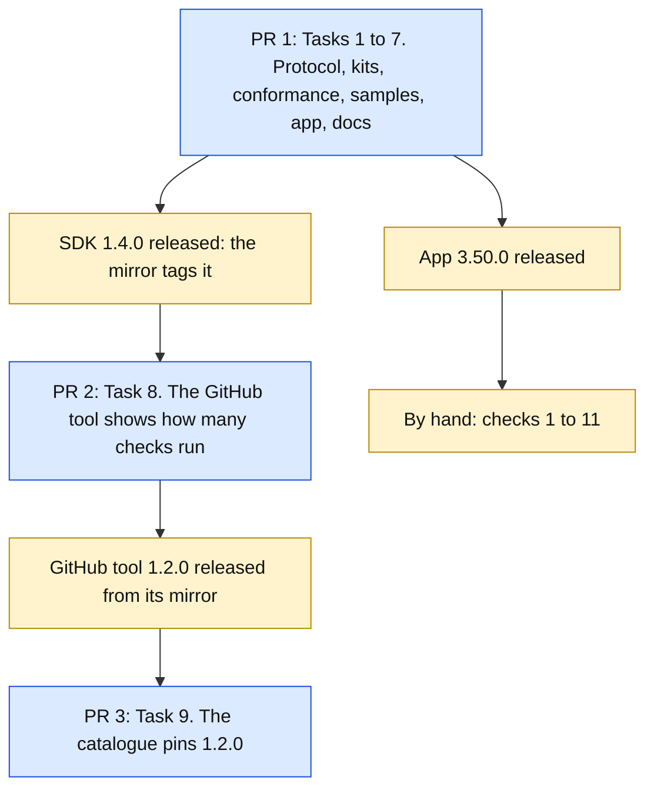

# A tool's words on the closed island: Implementation Plan

> **For agentic workers:** REQUIRED SUB-SKILL: Use superpowers:subagent-driven-development (recommended) or superpowers:executing-plans to implement this plan task-by-task. Steps use checkbox (`- [ ]`) syntax for tracking.

**Goal:** A tool's status can carry a few words, or a start time the app counts seconds from. While that tool's mark is the one on the closed island, the right-hand wing shows them in place of the allowance percent, where and as Nexus Agent's text is drawn today. It stays inside protocol 2. Vitruvian 3.48 and 3.49 draw the mark and ignore the words. The GitHub tool adopts it as the proof.

**The design:** `docs/superpowers/specs/2026-10-14-vitruvian-tool-resting-activity-design.md`. Read its sections 1 to 4 before any task. Section numbers below are that document's.

**Architecture:** `ui/status` gains two optional fields (`activity`, `since`), the status declaration one optional key (`activity: true`), and the hello one feature name (`ui.status.activity`). In the app, `ToolStatus` keeps the two fields; `ToolPanelHost.status` drops words a tool did not declare; a pure function in `Core` decides what the right-hand wing draws; `NotchAgentRestingWing` draws it. Every kit's status call takes the two fields and sends them only to an app that named the feature.



Blue is a pull request an agent opens. Amber waits for a person: a release to merge, or a check at the screen.

## Decisions this plan makes

The design's 23 decisions stand. These are the ones a worker trips over, and what this plan adds.

| # | Decision | Why |
|---|---|---|
| 1 | **No new request, no new `uses` entry, no new preference type, no new closed-list value.** Two fields, one key, one feature name. | Design section 3: each is ignored by 3.48 and 3.49. |
| 2 | **Tasks 1 to 7 are one pull request**, titled `feat(vitruvian-sdk): a tool's status can carry a few words for the closed island`, with the line `Releases: vitruvian-sdk, vitruvian` in its description. | The protocol cannot land without the app's pin moving, as for #3245. |
| 3 | **The app names its features from its own list from Task 1 on**, `ExternalToolStore.features`, holding the three it has. Task 4 adds `ui.status.activity` to it. | Today the hello is `ProtocolFeature.allCases` (`ExternalToolStore.swift:821`). Task 1 adds a case, and the app would claim words it does not yet draw. |
| 4 | **Moving a quoted line moves its planted regression.** Task 1 changes the line `mutation_checks.py` quotes for "the app says it has nothing"; Task 5 the one for "the agreement sheet says nothing of a status". Each task updates that entry in the same commit. | `//apps/desktop/vitruvian:mutation_fixtures_test` fails any entry whose quoted text is not in its file exactly once. |
| 5 | **`RestingStatus.opens` keeps its quoted guard line.** The Nexus fix is a new parameter with a default and a new guard line above the old one. | So the entry "a green mark opens the tool's page" keeps matching. |
| 6 | **Each kit takes `since` as its own time type**: Swift `Date`, TypeScript `Date`, Python `datetime`, Go `time.Time`, Rust `SystemTime`. The kit writes Unix seconds. | No author has to know the unit on the wire, and milliseconds from `Date.now()` cannot slip through. |
| 7 | **Rust gets a new call, `Ui::status_with`, taking a `StatusOptions` struct.** The existing `Ui::status(state, text, icon)` stays as it is. | Adding two positional arguments would break every Rust caller. The generated `UiStatusParams` gains two fields, as `InitializeParams` gained `features` in 1.3.0. |
| 8 | **The conformance script gains no new step.** It checks the two fields' shapes and fails a tool that sends words it did not declare. | A 3.48 or 3.49 app cannot be harmed by the fields (design section 3), so there is nothing for an "app from 3.48" step to catch. The kits' tests hold that the fields are left out for it. |
| 9 | **The app has one new string**, `agreeShowsStatusAndWords`, in fifteen languages. The seconds come from Foundation; the label's comma is `RestingStatus.buttonTitle`'s rule. | `ExternalToolStringsTests` fails a text left as the English, so no format string with nothing to translate. |
| 10 | **The Nexus sparkles' Reduce Motion defect is not fixed here.** | Design section 10, question 8. It is the built-in feature's, not the protocol's. |
| 11 | **Not in this plan:** the Nexus Agent tool, its hand-over, the removal of the built-in; a second switch; minutes; words under Battery, Music or "nothing". | Design section 10. |

## Global Constraints

- **Nothing in this plan was built.** Every statement about code that exists today was checked against `origin/main` at `2798ee0ad`. Everything about code to be written is a design. Where a step says "expected", it is what the design implies. The section "Not verified" lists what to distrust first. If the code contradicts the plan, the code is right: stop and report BLOCKED with what you found.
- **TDD.** Each task: the failing test first, kept as RED evidence; then the code; then GREEN. Every rule's test must be able to fail: plant the task's regressions, see the named test fail with the named message, undo by hand, `git diff --stat` shows only the task's change.
- **The path a protocol change takes** is `packages/vitruvian-sdk/CONTRIBUTING.md`, "A change to the protocol", and its paragraph "Say what the app has". Every row of its table moves in Task 1, 2 or 3.
- **Licences.** `packages/vitruvian-sdk/` is MIT, with the header `Sources/VitruvianToolProtocol/LineFraming.swift` carries. `apps/desktop/vitruvian/` and `apps/desktop/vitruvian-tool-github/` are GPL-3.0-or-later with the two-line header. Nothing is copied from the app or the tool into the package.
- **`UPSTREAM.md`.** A changed app file whose header says `Copyright (C) 2026 Vorssaint` is named under "Modifications" in the same commit. Known here: `UI/Notch/NotchAgentStrip.swift` (Task 5) and `Tests/mutation_checks.py` (Tasks 1, 4, 5). `Services/Notch/NotchService.swift` and `UI/Notch/NotchView.swift` are Vorssaint's too, and this plan does not change them. Check the header of every file you change.
- **The pin.** A change under `packages/vitruvian-sdk/Sources/VitruvianToolProtocol` needs `bazel run //apps/desktop/vitruvian:pin_tool_protocol` and an `UPSTREAM.md` log line in the same commit. Only Task 1 changes those sources.
- **Layers.** In the app, `Core <- Design <- Services <- UI <- App`, Swift 6 mode. What another module or a test uses is `package`. `ToolPanelHost` and the store are `@MainActor` and never wait.
- **Strings.** A text of the app's that a person reads is a field of a strings struct in all fifteen languages. Typographic apostrophe (’) and ellipsis (…), no em-dash. French puts `\u{00A0}` before `:`, `?`, `!` and `;`. A tool's words are the tool's, drawn as written, cut with `ToolOwnWords.oneLine`.
- **Tests.** The app's tests are synchronous `static func run(_ suite: TestSuite)` reached from `Tests/TestGroups.swift`. Most of this lives in `tool-runtime`, not `platform` (the 2026-10-13 plan's "As built", Task 1). Nothing is drawn, nothing is launched, no network, nothing written under `~/Library/Application Support/com.vitruviansoftware.vitruvian`. A test's `UserDefaults` suite is named `com.vitruviansoftware.vitruvian.tests.<something>` and its domain is removed first.
- **Build and test through Bazel only**, from the repository root, one command at a time. A full run of the app's unit tests needs the display awake: start it with `(caffeinate -u -d -t 900 &);`. Never put `--test_arg` on a command that also names the source tests.

  The app:
  ```sh
  bazel test --config=macos-app //apps/desktop/vitruvian:unit_tests --test_arg=--suite=platform --test_arg=--suite=tool-runtime --test_arg=--suite=notch --test_arg=--suite=agents --test_output=errors
  grep -aE "^(platform|tool-runtime|notch|agents): |TESTS" bazel-testlogs/apps/desktop/vitruvian/unit_tests/test.log
  bazel test //apps/desktop/vitruvian:source_lints_test //apps/desktop/vitruvian:sources_in_sync_test //apps/desktop/vitruvian:tool_protocol_pin_test //apps/desktop/vitruvian:upstream_test //apps/desktop/vitruvian:mutation_fixtures_test
  ```
  The package, the generator and the kits:
  ```sh
  bazel test --config=macos-app //packages/vitruvian-sdk:VitruvianToolProtocolTests //packages/vitruvian-sdk:VitruvianToolKitTests //packages/vitruvian-sdk:VitruvianToolCLITests //packages/vitruvian-sdk:swift_samples_test //packages/vitruvian-sdk:init_test //packages/vitruvian-sdk:swift_template_test
  bazel test //packages/vitruvian-sdk:protocol_examples_test //packages/vitruvian-sdk:conformance_test //packages/vitruvian-sdk:samples_test //packages/vitruvian-sdk:templates_in_sync_test //packages/vitruvian-sdk:guide_test //packages/vitruvian-sdk:release_version_test //packages/vitruvian-sdk:mirror_workflows_test //tools/sync-site-tools:in_sync_test
  bazel test //tools/sdk-codegen:in_sync_test //tools/sdk-codegen:sdk_codegen_test //packages/vitruvian-sdk:python_kit_test //packages/vitruvian-sdk:kit_samples_test //packages/vitruvian-sdk:go_kit_vet_test //packages/vitruvian-sdk/go/toolkit:toolkit_test //packages/vitruvian-sdk/kits/rust:tool_test //packages/vitruvian-sdk/kits/rust:protocol_test //packages/vitruvian-sdk/kits/typescript:kit_test
  ```
  These are the 2026-10-13 plan's lines, which its Task 7 ran. They were not run for this plan. If a name is wrong, `bazel query 'tests(//packages/vitruvian-sdk/...)'` lists them.
- **Do not launch or drive the app from a task.** What needs the running app is "By hand", and James is asked first.
- **Planted regressions.** The app's and the protocol module's go in `apps/desktop/vitruvian/Tests/mutation_checks.py`, each a tuple of name, suite, file, the exact source text, its replacement, and the test message that must appear. The quoted text must be in its file exactly once: `//apps/desktop/vitruvian:mutation_fixtures_test` holds that on every pull request. The kits' and the tool's are steps in their tasks. If one is not caught, stop and report; do not bend a test to fit.
- **Formatting and gates.** After editing a `.py`, `.json`, `.yml` or `BUILD` file: `bazel run //tools/format -- <path>`. Add to a JSON file as text; never load and dump it whole. After adding a file: `bazel run //tools/license:check` and `:verify`. After a `.go` file is added: `bazel run //:gazelle`. `bazel run //:tidy` must leave nothing to commit (it may add one unrelated `Cryptodome: pycryptodomex` line to `gazelle_python.yaml`: undo it by hand). No task adds a `pipeline_unit`, so `bazel run //tools/pipeline:gen -- --format=workflow --output-file=.github/workflows/presubmit.yaml --check` must pass untouched.
- **Git.** Work only in the worktree your dispatch names. Never `git stash`, `git reset`, `git restore`, `git checkout <branch>`, rebase or force-push. Stage each file by path. One commit per task, with the title the task gives, as the agent it names, identity and commit in one command:
  ```sh
  export AGENT_KEY_DIR=/Users/james/Workspace/gh/application/vitruvian/vitruvian-core/tools/sync-env-secrets/agent-keys; eval "$(bazel run //tools/agent-app -- env wren 2>/dev/null)"; git add <files> && git commit -m "<title>"
  ```
  End each message with the `Co-Authored-By` trailer your dispatch gives.
- **Cost.** Nothing here costs money: no Developer ID, no new repository, no new secret, no registry touched by hand.

## Review Focus

Where a mistake costs most. Each has a test in the task named.

1. **Nothing that is drawn today stops being drawn.** A status with words the tool did not declare still draws its mark and is answered `{}` (Task 4, `undeclaredWordsAreLeftOutAndTheMarkStays`, and a regression). Every existing example keeps its verdict (Task 1).
2. **An older app is described truthfully.** Each kit sends the status without the two fields to an app that named `ui.status` only, and nothing to one that named nothing (Task 2, one test per kit, a planted regression each).
3. **The app claims only what it draws.** The hello names `ui.status.activity` from Task 4, not Task 1 (Task 1, `theHelloNamesOnlyWhatTheAppHas`; Task 4 changes its expectation on purpose).
4. **The words never outlive their mark.** They go with the status, at the program's end and on `none`, and only the shown mark's words are drawn (Task 4, `theWordsAreTheShownMarks`; Task 5, `aMarkWithoutWordsLeavesThePercent`).
5. **With no words, the closed island is exactly as it is today.** `RestingStatus.rightWing` gives `.allowance` for every case without words, and the wing's clock keeps its six seconds (Task 4's pure tests).
6. **Nexus outranks every tool**, for the drawing and for the click (Task 4, `nexusOutranksATool`; Task 5, `aClickWhileNexusRunsOpensAgents`).
7. **The catalogue pins the release's bytes** (Task 9).

## The strings

The app's one new text, a field of `ExternalToolStrings` (Task 5):

| Key | English | Where |
|---|---|---|
| `agreeShowsStatusAndWords` | It shows a small status mark and a few words on the closed Dynamic Island. | The agreement sheet, in place of `agreeShowsStatus`, for a tool that declares `activity` |

The GitHub tool has no new words: its words are digits.

---

### Task 1: The protocol, written down, and everything that must agree with it

**Worker:** `wren`. **Commit:** `feat(vitruvian-sdk): a status can carry a few words or a start time`. First commit of pull request 1.

**Files:**
- Modify: `packages/vitruvian-sdk/protocol/manifest.schema.json`, `messages.schema.json`
- Modify: `packages/vitruvian-sdk/protocol/examples/manifests.json`, `messages.json`
- Modify: `packages/vitruvian-sdk/Sources/VitruvianToolProtocol/Messages.swift` (`ProtocolFeature`), `Panels.swift` (`UIStatusParams`), `ToolManifestFile.swift` (`Status`)
- Modify: `packages/vitruvian-sdk/Tests/VitruvianToolProtocolTests/ManifestFileTests.swift`, `ProtocolExamplesTests.swift`
- Modify: `packages/vitruvian-sdk/Sources/VitruvianToolCLI/Desk.swift`, `Tests/VitruvianToolCLITests/DeskTests.swift`
- Regenerate: every file `bazel run //tools/sdk-codegen` writes under `packages/vitruvian-sdk/kits/*/…/generated/` and `go/toolkit/protocol_gen.go`
- Modify: `packages/vitruvian-sdk/docs/writing-a-tool.md` (reference rows only), `packages/vitruvian-sdk/protocol/README.md`
- Regenerate: `apps/web/vitruviansoftware-dev/tools/guide.md`, `protocol.md` with `bazel run //tools/sync-site-tools:sync`
- Modify: `apps/desktop/vitruvian/bazel/tool_protocol.sha256` (by `pin_tool_protocol`), `apps/desktop/vitruvian/UPSTREAM.md`
- Modify: `apps/desktop/vitruvian/Sources/Vitruvian/Services/Platform/External/ExternalToolStore.swift` (the hello's list, decision 3)
- Modify: `apps/desktop/vitruvian/Tests/ExternalToolStoreTests.swift`, `Tests/mutation_checks.py`

**Interfaces:**
- Consumes: `UIStatusParams` (`Panels.swift:719-731`), `ToolManifestFile.Status` (`ToolManifestFile.swift:118-120`), `ProtocolFeature` (`Messages.swift:47-54`), `UIText`; the hello at `ExternalToolStore.swift:817-823`.
- Produces, in the schemas:
  - `messages.schema.json`, `uiStatusParams` gains `activity` (a `uiText`; "a few words for the closed island; cut to one line of 12 characters and drawn in about 30 points; blank counts as absent; an app before 3.50 ignores it") and `since` (`"type": "number", "minimum": 0`; "Unix time in seconds; the app shows the seconds since then when there is no activity; a time in the future shows 0; an app before 3.50 ignores it"). Its description gains: "activity and since are drawn only when the manifest's status says activity: true; otherwise they are left out and the mark is drawn".
  - `initializeParams.features`'s description lists `ui.status.activity`.
  - `manifest.schema.json`, `statusContribution` gains `activity`, `"type": "boolean"`: "true: the tool's status may carry words for the closed island, and the agreement sheet says so. An app before 3.50 ignores it."
- Produces, in Swift (`VitruvianToolProtocol`):
  - `ProtocolFeature.statusActivity = "ui.status.activity"`.
  - `UIStatusParams.activity: UIText?` and `UIStatusParams.since: Double?`, both last in `init`, defaulting to nil. A decoder of its own (as `ChoiceBlock` has) throws for a `since` below 0. Every other field reads as now.
  - `ToolManifestFile.Status.activity: Bool?`.
- Produces, in the desk: for `ui/status`, after "the app would show <state> on the closed island", the words `, with the words "<activity>"` or `, counting seconds from <since>`; and for a status with words from a manifest without `activity: true`, `; it would leave the words out: the manifest does not declare them`.
- Produces, in the app: `package static let features: [ProtocolFeature] = [.status, .choice, .preferenceOptions]` on `ExternalToolStore`, and the hello's `features: Self.features.map(\.rawValue)`. Nothing else in the app changes; the app does not read the new fields yet.

- [ ] **Step 1: Write the failing examples and tests.**

  In `protocol/examples/manifests.json`, valid: a status with `"activity": true`; one with `"activity": false`. Invalid: `"activity": "yes"`, whose problem is the existing `malformed`, field `contributes.status.activity` (`ToolManifestFile.swift:485-497`), as for any field of the wrong type.

  In `protocol/examples/messages.json`, valid: `ui/status` with `activity` as a string, as a map, with `since`, with both, and with `since` 0; the hello naming `ui.status.activity`. Invalid: `since` -1; `since` a string; `activity` a number.

  In `ProtocolExamplesTests.swift`: `testAStatusMayCarryWordsAndAStartTime`, and that `ProtocolFeature` lists four names. In `ManifestFileTests.swift`: a status with `activity` reads it; without, it is nil. In `DeskTests.swift`: the three sentences. In the app's `ExternalToolStoreTests.swift`: `theHelloNamesOnlyWhatTheAppHas` holds the hello to the three names of 3.48, not to `ProtocolFeature.allCases`.

- [ ] **Step 2: Watch them fail.** `bazel test //packages/vitruvian-sdk:protocol_examples_test`: expected to fail on the first new example. Keep the output.
- [ ] **Step 3: Write the schemas, then the Swift types, then the desk, then the app's list.**
- [ ] **Step 4: Regenerate and pin.**
  ```sh
  bazel run //tools/sdk-codegen
  bazel run //apps/desktop/vitruvian:pin_tool_protocol
  bazel run //tools/sync-site-tools:sync
  ```
  Add the `UPSTREAM.md` log line for the pin. Commit every file the three commands wrote.
- [ ] **Step 5: The guide's reference rows.** `guide_test` fails a message field the guide never names. Add `activity` under `contributes.status` in "The manifest, field by field", the two fields to `ui/status` in "What a tool sends", and `ui.status.activity` to the hello's `features`. The sections that teach it are Task 6.
- [ ] **Step 6: Move the planted regression whose line changed.** The entry "the app says it has nothing" quotes `features: ProtocolFeature.allCases.map(\\.rawValue)),`. Quote the new line instead, keep its replacement (the hello without `features`) and its message. Run `mutation_fixtures_test`.
- [ ] **Step 7: Plant the new regressions** in `mutation_checks.py`, each seen to fail:
  1. "a start time before 1970 is read": remove the decoder's `since` check (file `../../../packages/vitruvian-sdk/Sources/VitruvianToolProtocol/Panels.swift`, suite `tool-runtime`). It needs an app test that reaches it: in `ExternalToolCallsTests`, `ui/status` with `since` -1 is answered -32602 and the closure is not called.
  2. "the app claims words it does not draw": add `.statusActivity` to `ExternalToolStore.features` (suite `tool-runtime`, `theHelloNamesOnlyWhatTheAppHas`'s message).
- [ ] **Step 8: Watch everything pass.** The package's three lines of tests, then the app's suites and source tests. Record `platform` and `tool-runtime` counts before and after.
- [ ] **Step 9: Commit**, with `git status --short` first.

**As built (2026-10-14).** Where the code proved the plan wrong:

- **Three existing tests changed on purpose, because they list `ProtocolFeature.allCases`.** The desk's hello (`Session.swift`) already names every case, so it names `ui.status.activity` from this task, not Task 3: `RunTests.testTheHelloSaysWhatTheAppHasAndAStatusIsSaid` matches the four names. `ProtocolExamplesTests.testTheHelloMaySayWhatTheAppHas` and the kit's `testSupportsIsTrueOnlyForWhatTheHelloListed` hold four names too. `Session.swift` itself needed no change.
- **`tools/sdk-codegen` had a bug this change was the first to reach.** The TypeScript and Python manifest readers import a fixed list of the shared readers, and the manifest had no boolean field before `contributes.status.activity`: `manifest.ts` called `expectBoolean` and `manifest.py` called `_boolean`, neither imported, so the TypeScript kit did not compile. Both emitters now import the reader of each kind of field the manifest has. The test `test_every_reader_the_manifest_files_call_is_imported` was seen to fail (`['_boolean', 'cls'] != []`, before `cls` was excluded as an argument) without the fix.
- **The Rust kit's `Ui::status` builds `UiStatusParams` field by field**, so it gained `activity: None, since: None` here to compile. Task 2 rewrites it.
- **`guide_test` did not fail without the reference rows**: it holds every top-level manifest field and every example, not each message field. The rows were added all the same, and `protocol/README.md`'s section on what 3.50 added came with them.
- **The desk's sentence keeps `, saying "<text>"` first**, then `, with the words "<activity>"` or `, counting seconds from <since>`. For undeclared words it says the state and then `; it would leave the words out: the manifest does not declare them`, without repeating the words.
- **The app's hello test was renamed**, `theHelloSaysWhatTheAppHas` to `theHelloNamesOnlyWhatTheAppHas`. It keeps its message, which the entry "the app says it has nothing" quotes, and gains one expectation, "the hello does not name a status's words, which this app does not draw yet", for the new entry.
- **`ExternalToolStore.features` is `nonisolated`**: the store is on the main actor and the hello is built in a closure.
- Counts: `platform` 916 (unchanged), `tool-runtime` 962 (was 958).
- Planted, each DETECTED with the driver of the 2026-10-13 plan: "the app says it has nothing" (moved), "a start time before 1970 is read", "the app claims words it does not draw".

---

### Task 2: Every kit sends a status's words to an app that draws them

**Worker:** `wren`. **Commit:** `feat(vitruvian-sdk): every kit sends a status's words to an app that draws them`.

**Files:**
- Modify: `packages/vitruvian-sdk/Sources/VitruvianToolKit/Tool.swift`; `Tests/VitruvianToolKitTests/ToolTests.swift`
- Modify: `packages/vitruvian-sdk/kits/typescript/src/tool.ts`, `index.ts`; `test/tool.test.ts`
- Modify: `packages/vitruvian-sdk/kits/python/vitruvian_tool_kit/tool.py`, `__init__.py`; `tests/test_tool.py`
- Modify: `packages/vitruvian-sdk/go/toolkit/app.go`; `tool_test.go`
- Modify: `packages/vitruvian-sdk/kits/rust/src/app.rs`, `lib.rs`; `tests/tool.rs`
- Modify: each kit's `README.md` where it describes the status call

**Interfaces:**
- Consumes: each kit's status call and feature names as built for 1.3.0 (the 2026-10-13 plan, Task 2, "As built"): Swift `App.status(_:text:icon:)` (`Tool.swift:403`) and `supports`; TypeScript `app.status(state, { text, icon })` and `Feature`; Python `app.status(state, text=None, icon=None)` and `Feature`; Go `UI.Status(state, ...StatusOptions)` (`app.go:235`) and `StatusOptions` (`:215`); Rust `Ui::status(self, state, text, icon)` (`app.rs:225`) and `features`. Task 1's generated fields.
- Produces:

  | Kit | The feature's name | Words and a start time |
  |---|---|---|
  | Swift | `ProtocolFeature.statusActivity` (Task 1) | `App.status(_:text:icon:activity:since:)`, `activity: UIText? = nil, since: Date? = nil` |
  | TypeScript | `Feature.statusActivity` | `StatusOptions` gains `activity?: UIText` and `since?: Date` |
  | Python | `Feature.STATUS_ACTIVITY` | `app.status(state, text=None, icon=None, activity=None, since=None)`, `since` a `datetime` |
  | Go | `FeatureStatusActivity` | `StatusOptions` gains `Activity UIText` and `Since time.Time` (zero is absent) |
  | Rust | `features::STATUS_ACTIVITY` | `Ui::status_with(self, state: &str, options: StatusOptions) -> Result<bool, ToolError>`, `StatusOptions { text, icon, activity, since: Option<SystemTime> }` with `Default`; `Ui::status` unchanged and written over `status_with` |

  In every kit: with no `ui.status`, nothing is sent and the call says false, as now. With `ui.status` but not `ui.status.activity`, the status is sent **without** `activity` and `since`, and the call says true. With both, they are sent. `since` is written as Unix seconds. Each call's doc comment says the words show only on an app that has the feature, and that the manifest must say `"activity": true`.

- [ ] **Step 1: Write the failing tests, per kit.** Three each: after a hello naming `ui.status` and `ui.status.activity`, the call writes one `ui/status` line with both fields, `since` in seconds; after a hello naming `ui.status` only, it writes the line **without** them and says true; after a hello with no `features`, it writes nothing, as today.
- [ ] **Step 2: Watch them fail.** Keep one kit's output.
- [ ] **Step 3: Write the calls.** No existing call changes its behaviour or its signature.
- [ ] **Step 4: Watch them pass:** the kits' targets on the third test line, and `VitruvianToolKitTests`.
- [ ] **Step 5: Plant one regression per kit by hand:** send `activity` whatever the hello said. The test "sends no words to an app from 3.48" must fail. Undo by hand.
- [ ] **Step 6: Commit.**

**As built (2026-10-14).** The calls are the plan's, with these details:

- **Rust's `StatusOptions.icon` is an `Option<String>`**, not `Option<&str>`, so the struct needs no lifetime and has `Default`. `StatusOptions` is exported beside `Ui`. A `since` before 1970 is written as 0, since `SystemTime` cannot say a negative Unix time.
- **The other kits pass a `since` before 1970 through**, and the app refuses it with -32602, which the call then raises or returns as its error. Python reads a naive `datetime` as local time, as `datetime.timestamp` does; its doc comment says so.
- **Go writes `since` as `Unix()` plus the nanoseconds over 1e9**, so a half second is exactly `.5` on the wire; the zero `time.Time` is no start time.
- **Two existing expectations changed on purpose**, beyond Task 1's: the TypeScript and Python tests that list every `Feature` name now list four.
- **Each kit's README gained a short paragraph**, "A few words with the status". The Swift kit has no README of its own; the guide covers it (Task 6).
- RED: every kit failed (Swift, Go and Rust did not compile: `extra arguments at positions #3, #4`, `unknown field Activity`; Python `AttributeError: type object 'Feature' has no attribute 'STATUS_ACTIVITY'`; TypeScript failed on the new tests).

Step 5, planted in each kit (the words sent whatever the hello said), and the test that failed:

| Kit | Failed |
|---|---|
| Swift | `testAStatusSendsNoWordsToAnAppFrom348` |
| TypeScript | `a status sends no words to an app from 3.48` |
| Python | `test_a_status_sends_no_words_to_an_app_from_3_48` |
| Go | `TestAStatusSendsNoWordsToAnAppFrom348` |
| Rust | `a_status_sends_no_words_to_an_app_from_3_48` |

---

### Task 3: The conformance script, the desk's hello, and the samples

**Worker:** `wren`. **Commit:** `feat(vitruvian-sdk): the conformance script and the samples cover a status's words`.

**Files:**
- Modify: `packages/vitruvian-sdk/conformance/conformance.py`, `conformance_test.py`, `README.md` where it lists what the script checks
- Modify: `packages/vitruvian-sdk/Sources/VitruvianToolCLI/Session.swift` (the desk's hello names the fourth feature); `Tests/VitruvianToolCLITests/RunTests.swift`
- Modify: the five panel samples: `samples/hello-panel-swift/main.swift`, `hello-panel-typescript/bin/tool.mjs`, `hello-panel-python/bin/tool.py`, `hello-panel-go/main.go`, `hello-panel-rust/src/main.rs`, each one's `vitruvian-tool.json`, and the panel `README.md` files
- Modify: `packages/vitruvian-sdk/samples/samples_test.py` (`WANTED`, the page's block count)

**Interfaces:**
- Consumes: Tasks 1 and 2. In `conformance.py`: `FEATURES`, `PARAMS` and `OPTIONAL_PARAMS` (`:208-230`), `Run.__init__` (`:357-383`), `Run.status` (`:424-445`).
- Produces:
  - The script's hello names `ui.status.activity`.
  - `OPTIONAL_PARAMS["ui/status"]` gains `activity` (`is_ui_text`) and `since` (a number, not a boolean, at least 0).
  - `Run` keeps `shows_activity` from the manifest. A `ui/status` carrying either field from a tool without `"activity": true` is answered `{}`, as the app does, and then **fails**: "ui/status with words from a tool whose manifest does not declare them. The app draws the mark and leaves the words out: add "activity": true to contributes.status".
  - Each `hello-panel-*` sample declares `"activity": true`. When `supports("ui.status.activity")`, its island page gains a second `choice`, "Words on the closed island": None, The count (the counter's value as `activity`), Seconds (`since` the moment it was picked). It starts at None, so the sample does not take the percent's place until a person asks.
- No new step: decision 8.

- [ ] **Step 1: Write the failing tests.** In `conformance_test.py`: a tool that sends `since` -1 fails; one that sends `activity` as a number fails; one that sends words without declaring them fails with the sentence above; one that declares them and sends them passes; the reference tool passes unchanged. In `RunTests.swift`: the hello names four features.
- [ ] **Step 2: Watch them fail.**
- [ ] **Step 3: Write the script, then the desk's hello, then the samples.**
- [ ] **Step 4: Watch them pass:** `conformance_test`, `samples_test`, `kit_samples_test`, `swift_samples_test`, `templates_in_sync_test`, `init_test`, `VitruvianToolCLITests`, `guide_test`.
- [ ] **Step 5: Plant by hand:** in `conformance.py`, set `shows_activity` true for every tool. The test of the undeclared words must fail. Undo.
- [ ] **Step 6: Commit.**

**As built (2026-10-14).**

- **The desk's hello and `RunTests` moved in Task 1**: the desk names `ProtocolFeature.allCases`, so `Session.swift` needed no change, and its test changed there.
- **The script answers undeclared words with `{}`, then fails the run**, as the plan says, after the state is recorded. A `ui/status` "carries" words when the key `activity` or `since` is present; a bad shape (`since` below 0, not a number, a boolean; `activity` that is not text) fails first, as params that are not the message's.
- **More tests run the samples than the plan's line names**: `go_sample_test` and `rust_sample_test` run the Go and Rust panel samples through the script, and `go_template_test` and `python_kit_apple_python_test` exist too. All pass; each panel sample draws a page of six blocks against the script's hello and five against an older app's.
- **Each sample sends the status again when the count changes**, while "The count" is picked, from the button and from the command `addOne`, so the words follow the counter.
- **29 `file=` excerpts moved with the samples**, in the guide, the panel READMEs and the READMEs of `hello-go`, `hello-rust`, `hello-typescript` and `hello-python-kit`: each now shows the same code as it is now (a small script took each excerpt's first and last line to the file as it is; the Python `show_status` excerpt, whose last line changed, was moved by hand). The two panel READMEs gained a section, "A few words beside the mark", with an excerpt of the second menu. The package `README.md` says what the samples and the script now do.
- **As for 1.3.0, between this merging and SDK 1.4.0 being published, the TypeScript and Python panel samples do not run from the registries**: they pin the kit release-please bumps, and use calls 1.4.0 adds. In this repository and in the mirror's CI they build against the kit beside them.

Step 5, planted: `shows_activity` true for every tool. `conformance_test` failed with "a tool that sends words its manifest does not declare is not told". Reversed.

---

### Task 4: The app keeps a status's words and names what it draws

**Worker:** `wren`. **Commit:** `feat(desktop): the app keeps a status's words and names what it draws`. Nothing a person sees changes in this task.

**Files:**
- Modify: `apps/desktop/vitruvian/Sources/Vitruvian/Core/Platform/ToolStatus.swift`, `Core/Platform/ExternalToolManifest.swift`
- Modify: `Sources/Vitruvian/Services/Platform/External/ToolPanelHost.swift`, `ExternalToolStore.swift`
- Modify: `Tests/ToolStatusTests.swift`, `ToolPanelHostTests.swift`, `ExternalToolStoreTests.swift`, `ExternalToolManifestTests.swift`, `mutation_checks.py`
- Modify: `apps/desktop/vitruvian/UPSTREAM.md` (for `mutation_checks.py`)

**Interfaces:**
- Consumes: Task 1's fields. `ToolStatus` (`ToolStatus.swift:10-31`); `RestingMark`, `RestingStatus.winner`, `words` (`:36-85`); `ExternalToolManifest.showsStatus` (`ExternalToolManifest.swift:62`, `:204`); `ToolPanelHost.status`, `forgetStatus`, `parts.log`, `parts.described` (`ToolPanelHost.swift:523-595`, `:136`); `ToolOwnWords.oneLine` (`ExternalToolManifest.swift:269`).
- Produces, in `Core`:
  - `ToolStatus.activity: UIText?` and `ToolStatus.since: Date?`, both initializers taking them. A blank `activity` is kept as nil.
  - `ExternalToolManifest.showsActivity: Bool`: `contributes.status.activity == true`.
  - `package enum RightWing: Equatable { case allowance; case words(String); case seconds(since: Date) }` and `RestingStatus.rightWing(_ mark: RestingMark?, nexusRunning: Bool) -> RightWing?`: nil while Nexus runs (the wing draws Nexus); otherwise the shown mark's `activity` cut with `ToolOwnWords.oneLine(_, limit: 12)` in the person's language, else its `since`, else `.allowance`. Nil mark is `.allowance`. It takes a `language` argument for the words.
  - `RestingStatus.seconds(since: Date, now: Date, language: AppLanguage) -> String`: `Duration.seconds(max(0, whole seconds between))` formatted with `Duration.UnitsFormatStyle(allowedUnits: [.seconds], width: .narrow)` in the language's locale.
  - `RestingStatus.ticksEverySecond(_ wing: RightWing?) -> Bool`: true only for `.seconds`.
  - `RestingStatus.words` appends the activity, one line of 12, after `buttonTitle`'s separator (", ", or "、" in Japanese and Chinese). No seconds.
- Produces, in `Services`:
  - `ToolPanelHost.status` keeps `activity` and `since` only when `parts.described(tool)?.showsActivity == true`. Otherwise it keeps the status without them and writes once for each run of the program to the tool's log: "the words of its status were left out: the manifest does not declare them". The flag is cleared where `forgetStatus` clears the status.
  - `ExternalToolStore.features` gains `.statusActivity`, and a test holds that it now equals `ProtocolFeature.allCases`, so the next case added to the protocol fails until the app decides.

- [ ] **Step 1: Write the failing tests.**
  - `ToolStatusTests` (`platform`): `aStatusKeepsItsWords`; `blankWordsAreNoWords`; `theRightWingIsTheAllowanceWithNoWords` (nil mark, a mark without words, a mark with only `text`); `wordsBeatSeconds`; `secondsCountFromSince` (English "754s"; Japanese "754秒"); `aFutureSinceCountsFromZero`; `longWordsAreOneLineOfTwelve` (a 500-character text with a line break); `nexusOutranksATool` (nil while Nexus runs); `theWordsAreTheShownMarks` (two tools, the worse one has no words: `.allowance`); `onlySecondsTickEverySecond`; `theButtonSaysTheWordsButNotTheSeconds`.
  - `ExternalToolManifestTests`: a manifest with `"activity": true` reads `showsActivity`; without, false; the rest as before.
  - `ToolPanelHostTests` (`tool-runtime`): `declaredWordsAreKept`; `undeclaredWordsAreLeftOutAndTheMarkStays` (the status is kept, its answer is no refusal, and the log has one line after two such statuses); `aStatusWithoutWordsTakesThemAway`; `theWordsGoWithTheProgram`.
  - `ExternalToolStoreTests`: `theHelloNamesOnlyWhatTheAppHas` now holds four names, on purpose; `theAppHasEveryFeatureOfTheProtocol`.
- [ ] **Step 2: Watch them fail.**
- [ ] **Step 3: Write the code.**
- [ ] **Step 4: Watch them pass:** the app's suites and source tests. Record the counts.
- [ ] **Step 5: Plant the regressions** in `mutation_checks.py`, each seen to fail:
  1. "undeclared words are drawn": drop the `showsActivity` test in `ToolPanelHost.status`. Suite `tool-runtime`, `undeclaredWordsAreLeftOutAndTheMarkStays`'s message.
  2. "seconds beat the tool's words": swap the two cases in `rightWing`. Suite `platform`.
  3. "a future start counts down": remove the `max(0, …)`. Suite `platform`.
  4. "another tool's words sit beside the mark": make `rightWing` read the words of any tool shown, not the winner's. Suite `platform`. If the function's shape gives this regression no single line to change, say so and plant the nearest one.
  5. "the button reads the seconds aloud": append the seconds in `words`. Suite `platform`.
- [ ] **Step 6: Commit.**

**As built (2026-10-14).**

- **`RightWing` is `RestingStatus.RightWing`**, nested, as the tests name it; `RestingStatus.wordsLimit` is the 12.
- **One more function, `RestingStatus.rightWing(tools:nexusRunning:language:)`**, which picks the winner and asks `rightWing` for it. With the plan's shape, `rightWing(_ mark:)` sees one mark, so regression 4 ("another tool's words sit beside the mark") had no line to change. The wing calls the new function (Task 5), so the rule "only the shown mark's words" lives in `Core` and has a test, `theWordsAreTheShownMarks`, and regression 4 is planted there.
- **`RestingStatus.fewWords`** cuts the words, for the wing and for the button alike. `words` puts them after the mark's words with `buttonTitle`'s own rule, so the pause is ", " or "、" by one rule. The mark's tooltip is the same `words`, so it says them too.
- **The seconds are `Locale(identifier: language.rawValue)`'s.** Foundation groups the digits above 999 ("1,000s" in English), where Nexus Agent writes "1000s". Below 1,000 they are the same.
- **The host logs undeclared words when it receives the status**, before the once-a-second pacing, so two statuses in one second still log once. The flag is cleared where the status is (`forgetStatus`: the program's end, and the tool forgotten).
- **`ExternalToolStoreTests.adding` changed on purpose**: it holds the hello's exact params, which now name four features.
- **Task 1's two hello entries moved**: "the app says it has nothing" waits for the hello test's new message, and "the app claims words it does not draw", whose line is now the app's list as built, is "the app forgets words it draws" (the list without `.statusActivity`).
- Counts: `platform` 938 (was 916), `tool-runtime` 970 (was 962).

Step 5, each planted with the driver and DETECTED: "undeclared words are drawn" (`tool-runtime`), "seconds beat the tool's words", "a future start counts down", "another tool's words sit beside the mark", "the button reads the seconds aloud" (`platform`); and the two moved, "the app says it has nothing" and "the app forgets words it draws" (`tool-runtime`).

---

### Task 5: The closed island draws the words, and the agreement sheet says so

**Worker:** `wren`. **Commit:** `feat(desktop): the closed island shows a tool's words or a running count`.

**Files:**
- Modify: `apps/desktop/vitruvian/Sources/Vitruvian/UI/Notch/NotchAgentStrip.swift` (Vorssaint's: name it in `UPSTREAM.md`)
- Modify: `Sources/Vitruvian/Services/Platform/External/ToolPanelHost.swift` (`RestingStatus.opens`)
- Modify: `Sources/Vitruvian/UI/Settings/ExternalToolAgreementSheet.swift`, `Sources/Vitruvian/Core/ExternalToolStrings.swift`
- Modify: `Tests/ToolStatusTests.swift`, `ExternalToolScreensTests.swift`, `ExternalToolStringsTests.swift` (only if its list of keys is written by hand), `mutation_checks.py`
- Modify: `apps/desktop/vitruvian/UPSTREAM.md`

**Interfaces:**
- Consumes: Task 4's `RightWing`, `rightWing`, `seconds`, `ticksEverySecond`. `NotchAgentRestingWing` (`NotchAgentStrip.swift:126-229`): `statusMark` (`:140-143`), the clock (`:146`), the tap (`:150-162`), the Nexus content (`:192-207`) and the percent (`:219-226`). `RestingStatus.opens` (`ToolPanelHost.swift:30-33`). `ToolAgreementContent.showsStatus` (`ExternalToolAgreementSheet.swift:73`, `:125`).
- Produces:
  - In `NotchAgentRestingWing`: the clock ticks every second when `nexusSession.isRunning || RestingStatus.ticksEverySecond(wing)`, else every six, as now. The right-hand content, when not Nexus, switches on `RestingStatus.rightWing(statusMark, nexusRunning: false, language:)`: `.allowance` is the existing lines unchanged; `.words(w)` and `.seconds(since:)` draw `Text(verbatim:)` with exactly the Nexus text's modifiers (`:203-206`). No animation on a change. The left-hand content does not change.
  - `RestingStatus.opens(_:pages:wingShowsNexus: Bool = false)`: a new first line `guard !wingShowsNexus else { return nil }`. The tap passes `nexusSession.isRunning`. The existing guard line stays byte for byte (decision 5).
  - `ExternalToolStrings.agreeShowsStatusAndWords` in fifteen languages; `ToolAgreementContent.showsStatus` is that sentence for a tool that declares `activity`, `agreeShowsStatus` for one that declares only a status, nil otherwise.
- [ ] **Step 1: Write the failing tests.**
  - `ToolStatusTests`: `aClickWhileNexusRunsOpensAgents` (`opens` with `wingShowsNexus: true` is nil for every state); `aMarkWithoutWordsLeavesThePercent`.
  - `ExternalToolScreensTests`: the agreement sheet says the words sentence for a tool that declares `activity`, the 3.48 sentence for one that declares only a status, nothing otherwise.
  - `ExternalToolStringsTests` fails until the new key has fifteen languages.
- [ ] **Step 2: Watch them fail.**
- [ ] **Step 3: Write the code.** In `NotchAgentStrip.swift` change only the clock's period, the right-hand branch and the tap's call.
- [ ] **Step 4: Watch them pass:** the app's suites and source tests; then build the app, which the tests do not: `bazel build --config=macos-app //apps/desktop/vitruvian:Vitruvian //apps/desktop/vitruvian:by-hand`.
- [ ] **Step 5: Move the planted regression whose line changed.** "the agreement sheet says nothing of a status" quotes `        showsStatus = tool.showsStatus ? strings.agreeShowsStatus : nil\n`. Quote the new line, replace it with `nil`, keep the message. Run `mutation_fixtures_test`.
- [ ] **Step 6: Plant the new regressions:**
  1. "a click while Nexus runs follows a hidden mark": remove the `wingShowsNexus` guard. Suite `platform`.
  2. "the sheet says a status but not its words": make the words sentence `agreeShowsStatus`. Suite `tool-runtime`.
- [ ] **Step 7: Commit.**

**As built (2026-10-14).**

- **`NotchAgentStrip.swift` gained two small helpers beside the three changes**: a computed `restingWing` (the wing's `RestingStatus.rightWing(tools:…)`, read by the clock and the right-hand branch) and `restingText(_:)`, the Nexus text's four modifiers on `Text(verbatim:)`, used for the words and the seconds. Nexus's own text, its sparkles, the left-hand wing and the percent's lines are untouched.
- **No animation is added or taken away.** The words change through a published status, never inside an animation, so they are drawn without one. The wing adds no `.transaction` of its own: one would also stop the text following the island's own open and close.
- **`ExternalToolStringsTests` holds the count by hand**: 67 became 68.
- **The sheet's sentence reads `showsActivity` first**: a status that says `"activity": true` is a status, so `agreeShowsStatusAndWords` replaces `agreeShowsStatus` for it, and nothing else changes.
- **The translations of `agreeShowsStatusAndWords` are each built on that language's existing `agreeShowsStatus` sentence**, not reviewed by a speaker.
- **The click fix is not built (design decision 20).** It was built, tested and its regression detected, then taken out again before the pull request opened: the dispatch for this pull request put "the click following a hidden tool mark" among the two built-in Nexus defects that are out of scope, not to be touched, and only noted. So `RestingStatus.opens` and the wing's tap are as on `main`; the test `aClickWhileNexusRunsOpensAgents` and the entry "a click while Nexus runs follows a hidden mark" went with it. By-hand check 6 is not owed by this pull request. The defect is said in the pull request's description.
- Counts: `platform` 942 (was 938), `tool-runtime` 971 (was 970). `bazel build --config=macos-app //apps/desktop/vitruvian:Vitruvian //apps/desktop/vitruvian:by-hand` succeeded.

Steps 5 and 6, each planted with the driver and DETECTED: "the agreement sheet says nothing of a status" (moved, `tool-runtime`), "the sheet says a status but not its words" (`tool-runtime`).

---

### Task 6: The guide, the protocol's overview, and the records

**Worker:** `compass`. **Commit:** `docs(vitruvian-sdk): how a tool puts a few words on the closed island`.

**Files:**
- Modify: `packages/vitruvian-sdk/docs/writing-a-tool.md`, `packages/vitruvian-sdk/protocol/README.md`, `packages/vitruvian-sdk/README.md` where it lists what a tool can do
- Regenerate: `apps/web/vitruviansoftware-dev/tools/guide.md`, `protocol.md`, `examples/` with `bazel run //tools/sync-site-tools:sync`
- Modify: `docs/superpowers/specs/2026-10-14-vitruvian-tool-resting-activity-design.md` (its Status line, in the commit after the pull request opens, since it names its number)

**Produces:**
- In the guide, in "A status on the closed island": a part "A few words with it": declare `"activity": true`; send `activity` or `since`; six characters or fewer, a number is best; what fits (about 30 points); only the shown mark's words are drawn; Nexus Agent outranks every tool; ask `supports("ui.status.activity")`. One snippet per kit, cut from the `hello-panel-*` samples with `file=`.
- In "What an older app does", the rows of design section 7.
- In `protocol/README.md`, "Version 2": the two fields, the key and the feature's name.
- `CONTRIBUTING.md` needs no change: this change is the case its paragraphs describe.
- [ ] **Step 1:** Write the sections. Plain words, short sentences, as the guide is.
- [ ] **Step 2:** `bazel run //tools/sync-site-tools:sync`, and commit what it writes.
- [ ] **Step 3:** `bazel test //packages/vitruvian-sdk:guide_test //tools/sync-site-tools:in_sync_test` passes.
- [ ] **Step 4: Commit.**

**As built (2026-10-14).**

- **Written by `wren`, not `compass`**: one worker built Tasks 1 to 7, as for the 2026-10-13 plan.
- **Parts of this task landed earlier, where a test or a sample needed them**: the reference rows and `protocol/README.md`'s section with Task 1; each kit's README with Task 2; the samples' excerpts, the panel READMEs and `README.md` with Task 3.
- **"A few words with it" is a part of "A status on the closed island"**, after the samples' `onStart` snippet, with a manifest example (held to the schema by `guide_test`) and one snippet per kit: each sample's handler for the second menu.
- **"What an older app does" gained a second table**, with a column for 3.48 and 3.49, since the first one has two columns of apps and these rows need three. Its last bullet says the script and `vitruvian-tool run` say hello as 3.50 does.
- **A stale sentence fixed on the way**: the guide still said "the app's own GitHub mark" competes for the closed island and wins a tie. Pull request #3207 removed it; the guide now says every tool's status competes, and on a tie the tool added first wins.

---

### Task 7: Run everything, and open pull request 1

**Worker:** `forge`. **Commit:** none, unless a gate needs a fix, which is `chore(vitruvian-sdk): …` and says what it fixed.

- [ ] **Step 1:** Every test line of Global Constraints, in full, with the display awake.
- [ ] **Step 2:** `bazel run //tools/license:check`, `bazel run //tools/license:verify`, `bazel run //tools/conformance:check`, `bazel run //:tidy` (nothing to commit), and the presubmit generator's `--check`. `aspect lint --config=lint` on the Python and TypeScript targets touched; report only findings in lines this change wrote.
- [ ] **Step 3:** Every planted regression Tasks 1, 4 and 5 added or moved is detected. Use the 2026-10-13 plan's small driver (Task 7, "As built"): plant, run `unit_tests` with the entry's suite, require Bazel's status 3, "TESTS FAILED" and the entry's message, put the file back. `bazel run :mutation_checks` plants every entry in the file and takes hours.
- [ ] **Step 4:** Open the pull request against `main`:
  - Title: `feat(vitruvian-sdk): a tool's status can carry a few words for the closed island`
  - Description: what a person sees, the table of design section 7, the by-hand checks not yet done, and on a line by itself `Releases: vitruvian-sdk, vitruvian`.
  - The required check `release-scope` must pass. If it names a third product, a task changed a folder it should not have: find the file, do not add the product to the line.
- [ ] **Step 5:** All checks green before anyone is asked to review.

**As built (2026-10-14).** By `wren`, with the label `do-not-automerge` and auto-merge not armed.

- **Run on the tree merged with `main`** (`4d37c5375`, after #3264 merged): the app's whole unit test run (48 suites OK; `platform` 942, `tool-runtime` 971, `notch` 70,141, `agents` 668); the builds of `:Vitruvian`, `:VitruvianLibWithSampleTool` and `:by-hand`; the app's source, pin, upstream and mutation-fixture tests; all 24 tests of the SDK on the macOS lane; the 20 that need no Mac on the plain lane (18 of the SDK's, `//tools/sync-site-tools:in_sync_test` and `//tools/release-scope`'s test); the GitHub tool's 4 tests, the Nexus Agent tool's 6, and 5 of the HomeSpeaker tool's 6; `//tools/conformance:check` (431 ok, 0 fail); `//tools/license:check` and `:verify`; `//:gazelle` (no change); `//:tidy`, which left only the known `Cryptodome` line, reversed by hand; the presubmit generator's `--check`; and `release-scope`, locally, which asked for `Releases: vitruvian, vitruvian-sdk` and named no third product.
- **The plan's test lines leave out four of the SDK's tests**: `go_sample_test`, `rust_sample_test`, `go_template_test` and `python_kit_apple_python_test`. All were run. `go_template_test` builds the Swift command-line tool, so it runs on the macOS lane only.
- **`HomeSpeakerTests` fails on this Mac, not because of this change**: `gwsListsSpacesWhenInstalled` runs the `gws` command installed here against a real Google Chat account, and failed with a `mise` error inside the sandbox. CI has no `gws` and skips it. This branch changes nothing under `apps/desktop/home-speaker`. Its `sync_secrets_test` was not run.
- **`aspect lint` takes the config as `--bazel-flag=--config=lint` in this CLI (2026.26.25)**, against `--base-ref=origin/main`. It found two ESLint errors in lines this change touched: the generated `manifest.ts` imported `expectInteger` and `expectMap` and never used them, an old leftover that the new `expectBoolean` import put inside the diff. Fixed in the emitter, which now imports exactly the readers the file calls, with the generator's test extended to fail an unused import (seen to fail first): `chore(vitruvian-sdk): the TypeScript manifest reader imports only the readers it calls`. After it, no findings.
- **Step 3 used the 2026-10-13 plan's driver.** All ten entries Tasks 1, 4 and 5 added or moved, and kept, were DETECTED on the final tree, and each kit's and the conformance script's planted regression was planted again by hand and DETECTED. The tree was clean after each.
- **Not run:** `:selftest` and `:fan_helper_selftest`, which start the built app, and `bazel run :mutation_checks`, which plants every entry in the file and takes hours; CI runs them. None of the checks by hand: they are owed.

After it merges, release-please opens `chore(main): release vitruvian-sdk 1.4.0` and `chore(main): release vitruvian 3.50.0`. Merge the SDK's first; confirm the mirror tagged `v1.4.0` and `go/v1.4.0`. The app's release goes through its usual gate. **If either version comes out as another number, Tasks 8 and 9 use the number that was released.**

---

### Task 8: The GitHub tool shows how many checks run (pull request 2, after both releases)

**Worker:** `wren`. **Commit:** `feat(vitruvian-tool-github): the closed island shows how many checks are running`. **One commit, and the pull request's title is the same.**

**Files:**
- Modify: `apps/desktop/vitruvian-tool-github/vitruvian-tool.json` (`"activity": true` under `contributes.status`)
- Modify: `apps/desktop/vitruvian-tool-github/Package.swift` (`from: "1.4.0"`), `version_test.py` (`KIT_WITH_STATUS` at line 30 becomes the kit this needs, `(1, 4, 0)`, under a name that says so)
- Modify: `Sources/GitHubToolCore/GitHubTool.swift` (`IslandStatus`, `status(verdict:awaitingApproval:signedIn:)`), `Sources/github-tool/main.swift` (the host's `status`, line 47)
- Modify: `Tests/GitHubToolCoreTests/GitHubToolTests.swift`
- Modify: `apps/desktop/vitruvian-tool-github/README.md` where it describes the mark

**Interfaces:**
- Consumes: the kit's `App.status(_:text:icon:activity:since:)` (Task 2); `IslandStatus` (`GitHubTool.swift:30-42`); `status(for:signedIn:)` and `status(verdict:awaitingApproval:signedIn:)` (`:348-366`); `showStatus` (`:369-374`), which sends only a status that differs from the last; `GitHubSummary.Repository.running` (`Models.swift:303`).
- Produces:
  - `IslandStatus.activity: String?`.
  - `status(verdict:awaitingApproval:running:signedIn:)`: busy carries `activity` the sum of `running` as digits, "99+" over 99, none when it is 0. No other state carries words. `status(for:signedIn:)` passes the sum.
  - `main.swift` passes `activity` to the kit.
- [ ] **Step 1: Write the failing tests.** `busyCarriesHowManyRun` (1, 3, 100); `noOtherStateCarriesWords`; `aChangeOfCountIsSentAndTheSameCountIsNot` (through `showStatus`'s rule).
- [ ] **Step 2: Watch them fail.**
- [ ] **Step 3: Write the code and the manifest.**
- [ ] **Step 4: Watch them pass:**
  ```sh
  bazel test --config=macos-app //apps/desktop/vitruvian-tool-github:GitHubToolCoreTests //apps/desktop/vitruvian-tool-github:conformance_test //apps/desktop/vitruvian-tool-github:version_test //apps/desktop/vitruvian-tool-github:mirror_workflows_test --test_output=errors
  ```
- [ ] **Step 5: Plant by hand:** make busy carry no words. `busyCarriesHowManyRun` must fail. Undo. Then take `"activity": true` out of the manifest: `conformance_test` must fail with the undeclared-words sentence. Undo.
- [ ] **Step 6: Commit, push, open the pull request.** Only `apps/desktop/vitruvian-tool-github` changes, so `release-scope` needs no `Releases:` line. After it merges, release-please opens `chore(main): release vitruvian-tool-github 1.2.0`; when that merges the mirror publishes `github-tool-1.2.0.zip`.

---

### Task 9: The catalogue pins 1.2.0 (pull request 3)

**Worker:** `forge`. **Commit:** `feat(catalog): the GitHub tool, 1.2.0`. One commit. `catalog/` is no product, so nothing is released.

**Files:**
- Modify: `catalog/tools.json`
- Regenerate: `apps/web/vitruviansoftware-dev/_data/tools.yml` with `bazel run //tools/sync-site-tools:sync`

- [ ] **Step 1:** In the entry `dev.vitruvian.github`: `version` is `1.2.0`; `download.url` is the mirror's `v1.2.0` asset; `sha256` and `size` are that asset's, from the file attached to the release, not a local build. **`minimumAppVersion` stays `3.46.0`.** `generated` is now, in UTC.
- [ ] **Step 2:** `bazel test //catalog/...` passes, and the sync's change is committed.
- [ ] **Step 3:** The check `catalog-check` passes. Say in the pull request which run proved it.

---

## By hand

Only a person at the screen can confirm these. An agent can drive the app through Accessibility, but **James is asked first**, each time. Do them in a build of pull request 1's branch, on the built-in display and on an external one. Record each in the pull request with the Mac and the macOS version, or say it was not done. Checks 9 and 10 need Task 8's build: `bazel build --config=macos-app //apps/desktop/vitruvian-tool-github:tool-folder`.

**How to take a picture of the closed island.** While any Claude agent works, the closed island shows that agent's strip in place of its resting wings, so neither the mark nor the words can be seen. The agent running the check is such an agent. So the pictures come from a script started in the background, and the agent ends its turn and goes quiet while it runs, for example:

```sh
out=/private/tmp/claude-501/<session>/scratchpad/island; mkdir -p "$out"
(for i in 1 2 3 4 5 6 7 8; do sleep 30; screencapture -x -R <x>,<y>,<w>,<h> "$out/$i.png"; done) &
```

The next turn reads the frames and uses the ones with no agent strip. How long the strip stays after the agent goes quiet was not found in the code, hence a series and not one frame.

1. **The look.** With "While inactive" set to Agents, add a `hello-panel` sample and pick "The count". The right-hand wing shows the count in white, the same size and font as Nexus Agent's text beside a picture of it. The left-hand wing still shows the agent mark and the sample's mark.
2. **It fits.** At every island height the settings offer, and in the capsule on an external display: "754s" and a six-character word are whole; a twelve-character one shrinks and then ends in "…"; neither touches the camera nor the curved end.
3. **Other scripts.** With the app in Japanese, "754秒" fits; a three-character Japanese word fits.
4. **Seconds.** Pick "Seconds": it counts once a second from 0s. Turn Reduce Motion on: nothing in the words moves.
5. **Who wins.** Two samples: the worse mark with no words shows the percent; the worse mark with words shows its words, never the other's. Start a Nexus session: Nexus's text wins; when it ends, the sample's words are back.
6. **The click.** With a sample at `failure`, start a Nexus session and click the wing: the Agents page opens, not the sample's page.
7. **It clears.** End the tool's program (`kill` its pid). The mark and its words go within a second and the percent is back.
8. **The switch.** "Show its status on the closed Dynamic Island" off: the mark and the words go. On: both back.
9. **VoiceOver.** The island's button reads "Open Dynamic Island, GitHub: Checks are running, 3". With "Seconds" on a sample, the seconds are not read.
10. **An older app.** In Vitruvian 3.49.0 as released, add the GitHub tool's 1.2.0 folder: it is added without complaint, the agreement sheet says the 3.48 sentence, the mark shows while checks run and there are no words, and the tool's log has no refusal.
11. **The agreement sheet.** In the build of pull request 1, adding the GitHub tool 1.2.0 says "It shows a small status mark and a few words on the closed Dynamic Island."

## Not verified

Distrust these first.

- **Nothing in this plan was compiled.** Type names, initializer shapes and line numbers for code to be written are a design. The line numbers for code that exists were read at `2798ee0ad`.
- **The probe of design section 3** is the only code run: the protocol sources of `vitruvian-v3.48.0` and `vitruvian-v3.49.0`, compiled alone and fed the new shapes. The app around them was read, not run.
- **The room in the wing** is arithmetic (design section 2). Checks 2 and 3.
- **Whether `rightWing` can be shaped so that Task 4's regression 4 has one line to change** is unknown until it is written.
- **The cost of renaming the island's button** once a second while a count changes was not measured.
- **The test targets** on the third test line were run by the 2026-10-13 plan, not by this one.
- **release-please's version numbers** (SDK 1.4.0, app 3.50.0, tool 1.2.0) assume nothing else releases first.
- **The translations** of `agreeShowsStatusAndWords` are written with the English.
