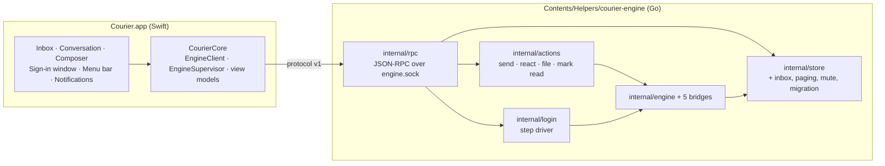

# Courier Milestone 3: a usable app

> **For agentic workers:** REQUIRED SUB-SKILL: Use superpowers:subagent-driven-development (recommended) or superpowers:executing-plans to implement this plan task-by-task. Steps use checkbox (`- [ ]`) syntax for tracking.

**Goal:** Courier.app is good enough for James to read and reply on all five networks all day without opening Beeper. It has an inbox, a conversation view, a composer, notifications, a menu-bar icon, and the sign-in window that Slack and Google Messages need.

**Architecture:**
- **Engine:** milestone 2's engine stays as it is. It gains:
  - the inbox data the store lacks;
  - the outgoing actions the app needs;
  - a login driver the app can step through;
  - a socket server speaking one versioned protocol.
- **App:** a new SwiftUI app. It starts the engine as a helper process, supervises it, and talks to it only over that socket.
- **Protocol:** one shared definition with examples. Go and Swift tests both check against it, so the two sides can't drift.



**Tech Stack:**
- **Engine:** Go 1.26, mautrix v0.31.0 and util v0.10.1. The five bridges stay at their milestone-2 pins.
- **App:** Swift with SwiftPM (tools 5.9), mirrored target for target in Bazel (rules_swift `swift_library` / `swift_test`, rules_apple `macos_application`), like `apps/desktop/home-speaker`. Swift 5 language mode.
- **Frameworks:** SwiftUI and AppKit where SwiftUI falls short. Plus Network.framework (Unix socket), UserNotifications, WebKit and Security (Keychain).

**Spec:** `docs/superpowers/specs/2026-10-15-courier-iteration-1-design.md`, milestone 3 in §7. The interface source is the inventory in `docs/superpowers/specs/2026-10-15-beeper-desktop-inventory/`, which this plan cites as `01 §3` and so on. The milestone-2 plan and its result are the base.

## Global Constraints

- **Earlier constraints:** every Global Constraint in the milestone-1 and milestone-2 plans still applies, including the pins, AGPL headers by hand, gazelle and `bazel mod tidy` after Go changes, `bazel run //:tidy` before every commit, and no real accounts in CI.
- **Swift files** get the same hand-written AGPL header as Go: `// Copyright 2026 VitruvianSoftware` / `// SPDX-License-Identifier: AGPL-3.0-or-later`.
- **Data dir:** the app's data dir is `~/Library/Application Support/Courier` (spec §4). The CLI keeps `Courier-m1` as its default. Devices linked from the CLI are not carried over. One process per data dir, using the same lock for the CLI and the engine binary.
- **Socket:** `<data dir>/engine.sock`, mode `0600`, in a `0700` directory (spec §2). Nothing listens on TCP in this milestone.
- **Minimum macOS** 14.0 (`Package.swift`, `minimum_os_version`, `LSMinimumSystemVersion`), as in the repo's other desktop apps. Bundle id `com.vitruviansoftware.courier`.
- **Branding (spec §8):** no Beeper name, icon or asset anywhere in the app. Behaviour is copied; artwork is not.
- **Strings:** user-facing strings come from `Resources/en.lproj/Localizable.strings` via `String(localized:)`. This follows Vitruvian's `.lproj` precedent; there is no `.xcstrings` precedent in the repo.
- **Telegram credentials:**
  - The app asks for `api_id` and `api_hash` once, stores them in the Keychain (service `com.vitruviansoftware.courier.telegram`), and passes them to the engine only as `COURIER_TELEGRAM_API_ID` / `COURIER_TELEGRAM_API_HASH` in the child environment.
  - They are never logged or written to disk.
- **Hand-testing:** never open a real chat in Beeper while testing Courier (Beeper would send read receipts). Courier's own read receipts are real; James decides when to open chats.
- **Scope:** anything this milestone leaves out stays reachable for milestone 4 without reworking views. The excluded areas are spaces, labels, filters, threads, edit and delete, undo send, ⌘K, ⌘J, themes and Settings beyond the basics.
- **Undo send:** spec §4 holds an outgoing message as pending until an undo window ends. Undo send is a Plus feature, off by default (inventory 01 §5), so in this milestone the window is zero: messages go to the bridge at once. The pending state still exists, so milestone 4 only adds the delay.

## Review Focus

1. **Backfill must not notify.**
   - **Risk:** the first sync pulls in up to 50 messages per chat. A reasonable person expects no notification storm.
   - **Rule:** only live messages notify. That means not from me, received after the app connected, and with a timestamp within 120 s of arrival.
   - **Test:** Task 10 (`testBackfilledMessagesDoNotNotify`).
2. **The change feed drops events when a client is slow.**
   - **Risk:** `Subscribe` buffers 256 changes and drops silently past that.
   - **Rule:** the server must notice a drop and tell the client to resync, so the inbox never silently goes stale.
   - **Test:** Task 4 (`TestSlowClientIsToldToResync`).
3. **The engine restarts while a message is pending.**
   - **Rule:** the app reconnects, re-reads, and shows the message as pending, sent or failed as the store says. It is never lost or duplicated.
   - **Test:** Task 6 (`testReconnectRereadsState`) and Task 1 (`TestPendingSurvivesReopen`).
4. **The user closes the sign-in window mid-flow, or the page needs a source the window can't read.**
   - **Rule:** the login is cancelled on the engine. No half-open pairing is left. The app says calmly what happened.
   - **Test:** Task 9 (`testClosingSignInWindowCancelsLogin`, `testUncapturableSourceSaysSo`).
5. **A big inbox and a long chat must stay fast.**
   - **Rule:** opening the app with 2,000 chats and a chat with 10,000 messages must not lock up.
   - **Test:** Task 1 (`TestInboxAndPagingAreIndexed`). It checks with `EXPLAIN QUERY PLAN` that both queries use an index, and that a 2,000-room inbox returns in under 200 ms on CI.

---

## File structure

```
apps/desktop/courier/
  protocol/protocol.json          methods, params, results, notifications; "version": 1
  protocol/examples/*.json        one request/response or notification per file, used by both sides' tests
  protocol/BUILD                  filegroup + exports for Go and Swift tests
  engine/internal/store/          (modify) migration, inbox, paging, mute, local read
  engine/internal/actions/        send text/reply, react, send file, mark read
  engine/internal/login/          step driver extracted from the CLI (session registry, cookies, fields)
  engine/internal/rpc/            socket server, handshake, method table, change fan-out
  engine/internal/datadir/        the data-dir lock (moved from the CLI)
  engine/cmd/courier-engine/      the helper binary the app runs
  engine/cmd/courier-engine-cli/  (modify) uses internal/login and internal/datadir
  engine/internal/fakenet/        (modify) records receipts, reactions and files; offers a scripted login flow
  app/Package.swift, app/BUILD    CourierCore (library), Courier (app shell), CourierCoreTests
  app/Sources/CourierCore/        EngineClient, EngineSupervisor, Protocol types, view models, policies
  app/Sources/Courier/            SwiftUI views, AppDelegate, menu bar, notifications, sign-in window
  app/Resources/                  Info.plist, AppIcon.icns (original artwork), en.lproj/Localizable.strings
  app/Tests/CourierCoreTests/
  docs/m3-acceptance.md           the milestone-3 subset of the inventory ledger, checked off by hand
  docs/m3-result.md               Task 12 by-hand result
```

---

### Task 1: The store knows what an inbox needs

**Files:**
- Modify: `engine/internal/store/store.go`, `schema.sql`
- Create: `engine/internal/store/migrate.go`, `inbox.go`, `inbox_test.go`

**Interfaces:**
- Produces:

```go
type InboxRow struct {
	Room
	LastTS      time.Time // 0 when the room has no message yet
	Preview     string    // body of the newest message-like event, at most 140 runes
	PreviewKind string    // "text", "image", "video", "audio", "file", "sticker", "reaction", ""
	PreviewMine bool
	Unread      int  // messages from others newer than the read marker
	Muted       bool
}
func (s *Store) Inbox(ctx context.Context) ([]InboxRow, error)                  // newest LastTS first, then CreatedAt
func (s *Store) EventsBefore(ctx context.Context, roomID string, before *Cursor, limit int) ([]Event, *Cursor, error)
type Cursor struct{ TS time.Time; Seq int64 }                                   // nil before = newest page; nil returned = no older page
func (s *Store) MarkReadLocal(ctx context.Context, roomID, eventID string, ts time.Time) error
func (s *Store) SetMuted(ctx context.Context, roomID string, muted bool) error
```

- `Event` gains `Seq int64`.
- `MarkReadLocal` and `SetMuted` publish `Change{Kind: "read"}` and `Change{Kind: "room"}`.
- Changes now carry `Seq` on `event` and `status` kinds.

- [ ] **Step 1: Write the failing tests** in `inbox_test.go`:
  - `TestInboxOrdersByLatestMessage`: room A's newest message is older than room B's, so B comes first. A room with no messages sorts by `created_at` after every room that has one.
  - `TestInboxPreviewAndUnread`: three messages from a ghost after `MarkReadLocal` on the first gives `Unread == 2`. The preview is the newest body. An `m.image` gives `PreviewKind == "image"`. A message from `@me` is not counted and sets `PreviewMine`. Reactions and redactions never become the preview.
  - `TestNetworkReadAlsoClearsUnread`: `SetRead` from the bridge (the existing network read) moves the marker too. The marker is the later of the local and network reads.
  - `TestMutedIsKeptAndPublished`
  - `TestEventsBeforePagesWithoutGapsOrRepeats`: 120 events, pages of 50, give 50, 50 and 20 with a nil final cursor. Their union is exactly the 120 IDs, with equal timestamps broken by `seq`.
  - `TestMigrationFromMilestone2`: open a database created by the milestone-2 schema (fixture SQL in `testdata/m2.sql`). It upgrades to `user_version = 1` and `Inbox` works.
  - `TestPendingSurvivesReopen`
  - `TestInboxAndPagingAreIndexed` (Review Focus 5)
- [ ] **Step 2: Run them to verify they fail.** Run `bazel test //apps/desktop/courier/engine/internal/store:store_test`. Expected: FAIL with undefined `Inbox`.
- [ ] **Step 3: Implement.**
  - **Migration:** `migrate.go` runs ordered migrations keyed by `PRAGMA user_version` inside one transaction. Migration 1 adds:
    - `rooms.last_ts INTEGER NOT NULL DEFAULT 0`, plus `last_event_id`;
    - `room_prefs(room_id PK, muted INTEGER NOT NULL DEFAULT 0)`;
    - `local_reads(room_id PK, event_id, ts)`;
    - index `rooms_last_ts(last_ts DESC, created_at DESC)`.
    - It backfills `last_ts` from `events`.
  - **Keeping `last_ts` current:** `InsertEvent` updates `rooms.last_ts` / `last_event_id` in the same transaction for message-like types only: `m.room.message`, `m.sticker`, and encrypted placeholders.
  - **Unread** counts `m.room.message` / `m.sticker` from senders other than `@me` with `ts` after the read marker. It is one indexed query, not a per-room loop.
- [ ] **Step 4: Run the tests.** Expected: PASS, including under `--@rules_go//go/config:race`.
- [ ] **Step 5: Commit** with `feat(courier): the store keeps what an inbox needs`.

---

### Task 2: The engine can reply, react, send a file and mark read

**Files:**
- Create: `engine/internal/actions/actions.go`, `actions_test.go`
- Modify: `engine/internal/fakenet/fakenet.go`. It records `Receipts`, `Reactions` and `Files` on channels like `Sent`, and its client implements `ReadReceiptHandlingNetworkAPI` and `ReactionHandlingNetworkAPI`.
- Modify: `cmd/courier-engine-cli/main.go`. `send` uses `actions.SendText`; behaviour is unchanged.

**Interfaces:**
- Consumes: `engine.HostForRoom`, `store.InsertEvent`, `store.MarkReadLocal`, and `media.Store.PutStream`.
- Produces:

```go
type Actions struct{ /* engine, store, media */ }
func New(e *engine.Engine, s *store.Store, m *media.Store) *Actions
func (a *Actions) SendText(ctx context.Context, roomID, text, replyTo string) (eventID string, err error)
func (a *Actions) SendFile(ctx context.Context, roomID, path, replyTo string) (eventID string, err error)
func (a *Actions) React(ctx context.Context, roomID, targetEventID, key string) (eventID string, err error)
func (a *Actions) MarkRead(ctx context.Context, roomID string) error // newest event in the room
func (a *Actions) Retry(ctx context.Context, eventID string) error   // failed → pending, re-queued
func (a *Actions) Discard(ctx context.Context, eventID string) error // deletes a failed local message
var ErrNotLinked, ErrBridgeCommand, ErrTooLarge, ErrNotFailed error
```

- [ ] **Step 1: Write the failing tests** in `actions_test.go`, against `fakenet`:
  - `TestSendTextQueuesPendingThenSent`
  - `TestReplyCarriesInReplyTo`: the queued event's content has `m.relates_to.m.in_reply_to.event_id`.
  - `TestReactReachesTheNetwork`
  - `TestSendFileStoresMediaAndSendsMessage`: the content type comes from the file. The cap is 90 MB (inventory 01 §6), and over it is `ErrTooLarge` with nothing stored.
  - `TestMarkReadSendsReceiptAndClearsUnread`
  - `TestRetryRequeuesOnlyFailed`
  - `TestDiscardRemovesOnlyFailed`
  - `TestBridgeCommandPrefixRefused`
  - `TestNotLinkedFailsFast`, under 1 s
- [ ] **Step 2: Run them to verify they fail.**
- [ ] **Step 3: Implement.**
  - **Read receipt:** an ephemeral `EphemeralEventReceipt` with `SourceEphemeral` set (bridgev2 `portal.go` ~:783).
  - **Reaction:** `EventReaction` inserted as `pending` first.
  - **File:** `UploadMedia` into the media store, then an `m.room.message` of the matching msgtype.
  - **Shared checks:** the not-linked check and the `!<network>` refusal move here from the CLI.
- [ ] **Step 4: Run the engine suite.** Run `bazel test //apps/desktop/courier/engine/...`. Expected: PASS.
- [ ] **Step 5: Commit** with `feat(courier): the engine replies, reacts, sends files and marks chats read`.

---

### Task 3: A login driver the app can step through

**Files:**
- Create: `engine/internal/login/login.go` (the session registry), `steps.go` (step to wire shape), `cookies.go` (moved from the CLI), and `login_test.go`
- Modify: `cmd/courier-engine-cli/login.go`. It becomes a thin terminal front end over `internal/login`. Every existing CLI test still passes.

**Interfaces:**
- Produces:

```go
type Step struct { // the wire shape; JSON tags match protocol.json "LoginStep"
	LoginID, StepID, Type, Instructions string // Type: display_and_wait | user_input | cookies | complete | unsupported
	Display *Display     // Kind: qr | emoji | code; Data; ImageURL
	Fields  []Field      // ID, Name, Description, Type, Pattern, Options
	Cookies *CookieStep  // URL, UserAgent, WaitForURL, ExtractJS, Fields[{ID, Required, Sources[{Type, Name, CookieDomain}]}]
	RemoteName string    // on complete
}
type Driver struct{ /* engine, sessions by LoginID */ }
func NewDriver(e *engine.Engine) *Driver
func (d *Driver) Start(ctx context.Context, network, flow string) (Step, error)
func (d *Driver) Submit(ctx context.Context, loginID string, values map[string]string) (Step, error) // user_input or cookies
func (d *Driver) Wait(ctx context.Context, loginID string) (Step, error)                              // display_and_wait
func (d *Driver) Cancel(loginID string)
var ErrAlreadyLinked, ErrUnknownLogin, ErrBadValue error
```

- [ ] **Step 1: Write the failing tests.** `fakenet` gains a scripted login flow `"script"` that yields the steps a test gives it. The tests are:
  - `TestStepsMapToWireShape`: the QR, emoji, fields and cookies steps each give the documented JSON.
  - `TestSubmitValidatesPatternWithoutEchoing`: a bad value is `ErrBadValue`, and the value isn't in the error.
  - `TestCookieValuesAreURLDecodedLikeBridgev2`: the milestone-2 cases move here.
  - `TestCancelOnEveryNonCompleteExit`: cancel, ctx cancel, an unsupported step, and a session idle for 10 minutes.
  - `TestAlreadyLinkedRefusedUnlessLoggedOut`: a login in `LOGGED_OUT` or `BAD_CREDENTIALS` state may re-link (spec §5 Reconnect).
  - `TestWebAuthnIsUnsupportedStep`
- [ ] **Step 2: Run them to verify they fail.**
- [ ] **Step 3: Implement.** Sessions live in a map guarded by a mutex. The idle timeout is 10 minutes and calls `proc.Cancel()`. Field values are never logged.
- [ ] **Step 4: Run the engine suite.** Expected: PASS, with the CLI tests unchanged.
- [ ] **Step 5: Commit** with `refactor(courier): move login stepping out of the CLI so the app can drive it`.

---

### Task 4: One protocol, and the engine's socket server

**Files:**
- Create: `apps/desktop/courier/protocol/protocol.json`, `protocol/examples/*.json` and `protocol/BUILD`
- Create: `engine/internal/rpc/server.go`, `methods.go`, `feed.go`, `server_test.go` and `conformance_test.go`

**Wire rules (pin these in `protocol.json`):**
- **Framing:** JSON-RPC 2.0, one UTF-8 JSON object per line (`\n`). A frame over 4 MiB closes the connection.
- **Handshake:** the first request must be `hello` with `{"protocol": 1, "client": "<name>/<version>"}`, and the result is `{"protocol": 1, "engine": "<version>", "networks": [...]}`.
  - A different `protocol` is error `-32001` "protocol mismatch" with `data: {"engine": 1}`. The app shows "update needed" (spec §5).
  - Any method before `hello` is `-32002`.
- **Methods:**
  - `accounts.list`
  - `inbox.list`
  - `room.events` `{room_id, before?: {ts, seq}, limit ≤ 100}`
  - `room.markRead`
  - `room.setMuted`
  - `message.send` `{room_id, text, reply_to?}`
  - `message.sendFile` `{room_id, path, reply_to?}`
  - `message.react` `{room_id, event_id, key}`
  - `message.retry`
  - `message.discard`
  - `login.start` `{network, flow}`
  - `login.submit` `{login_id, values}`
  - `login.wait`
  - `login.cancel`
- **Paths:** avatars and media are absolute file paths (`avatar_path`, `media_path`). The app is on the same Mac.
- **Notification** `changed` with `{kind: room|event|status|read|bridge|resync, room_id?, event_id?, network?}`. The client re-queries. Every connection subscribes.
- **Account shape:** `{network, display_name, flows, state, error, remote_name, not_started}`. `state` is the bridge's `state_event`, or `NOT_STARTED` with `not_started` holding the engine's reason (for example, Telegram without credentials).
- **Errors:**

| Code | Error |
|---|---|
| `-32010` | `ErrNotLinked` |
| `-32011` | `ErrBridgeCommand` |
| `-32012` | `ErrTooLarge` |
| `-32013` | `ErrAlreadyLinked` |
| `-32014` | `ErrBadValue` |
| `-32015` | `ErrUnknownLogin` |

**Interfaces:**
- Produces: `func Serve(ctx context.Context, ln net.Listener, d Deps) error` with `type Deps struct{ Store *store.Store; Engine *engine.Engine; Actions *actions.Actions; Login *login.Driver; Version string }`.

- [ ] **Step 1: Write the failing tests:**
  - `TestEveryExampleRoundTrips` (`conformance_test.go`): for each `protocol/examples/*.json`, sending its request to a server on `fakenet` gives a response matching the example's result shape. That means the same keys and JSON types; IDs and timestamps are wildcards. Every method and notification in `protocol.json` has at least one example.
  - `TestHelloIsRequiredAndVersioned`
  - `TestOversizeFrameClosesConnection`
  - `TestChangesReachEveryClient`
  - `TestSlowClientIsToldToResync` (Review Focus 2)
  - `TestUnknownMethodIsMethodNotFound`
  - `TestLoginOverTheSocket`: the scripted `fakenet` flow runs end to end through `login.*`.
- [ ] **Step 2: Run them to verify they fail.**
- [ ] **Step 3: Implement.** Each connection gets its own `Subscribe` and a writer goroutine. When `Subscribe` drops (detect it by a full buffer or a gap), send one `resync`. Handle each request on its own goroutine, and keep responses in send order per connection only where the protocol needs it (none do).
- [ ] **Step 4: Run the tests.** Expected: PASS under `-race`.
- [ ] **Step 5: Commit** with `feat(courier): one app protocol, and the engine serves it on a local socket`.

---

### Task 5: The engine helper binary

**Files:**
- Create: `engine/internal/datadir/lock.go` (moved from the CLI's `lock.go`) and `engine/cmd/courier-engine/main.go`, plus `main_test.go`
- Modify: the CLI uses `internal/datadir`.

**Behaviour:**
- **Usage:** `courier-engine --data DIR`.
- **Startup:**
  - Make `DIR` private (`0700`).
  - Take the data-dir lock. If it's held, exit 3 with "another Courier engine is using DIR".
  - Remove a stale `engine.sock`, listen on it, and set `0600`.
  - Start every network in `networks.All()`. Failed networks show as `NOT_STARTED` in `accounts.list`.
  - Serve.
- **Shutdown:** on SIGTERM or SIGINT, stop the server, the engine (bounded by milestone 2's timeouts), and the store, then release the lock and remove the socket.
- **Watchdog:** with `--parent-fd N` (the app passes a pipe), exit when that fd hits EOF, so the engine never outlives a crashed app.
- **Logs:** to stderr at warn level, as JSON lines. No credentials, message text or phone numbers come from Courier's code (milestone-2 finding: the bridge libraries log account IDs, which is acceptable here because the app keeps logs in memory only).

- [ ] **Step 1: Write the failing tests** (they build the binary with `go build` into `t.TempDir()`):
  - `TestServesHelloOnTheSocket`
  - `TestSocketAndDirArePrivate`
  - `TestSecondEngineOnSameDirExits3`
  - `TestStaleSocketIsReplaced`
  - `TestSIGTERMStopsCleanly`: exit 0, the socket is gone and the lock is free.
  - `TestParentPipeClosedStopsEngine`
- [ ] **Step 2: Run them to verify they fail.**
- [ ] **Step 3: Implement.**
- [ ] **Step 4: Run the engine suite.** Expected: PASS.
- [ ] **Step 5: Commit** with `feat(courier): the courier-engine helper the app runs`.

---

### Task 6: The app shell, the engine client and the supervisor

**Files:**
- Create: `app/Package.swift` and `app/BUILD` (mirrored target for target, as in `apps/desktop/home-speaker`)
- Create: `app/Sources/CourierCore/{Protocol.swift, EngineClient.swift, EngineSupervisor.swift, Keychain.swift}`
- Create: `app/Sources/Courier/{App.swift, AppDelegate.swift}`, `app/Resources/{Info.plist, AppIcon.icns, en.lproj/Localizable.strings}`
- Create: `app/Tests/CourierCoreTests/{ProtocolConformanceTests.swift, EngineClientTests.swift, EngineSupervisorTests.swift}`
- Create: `pipeline_unit(name = "courier-app-macos", persona = "frontend", runner = "xcode-27", tier = "L1", timeout_minutes = 60, test_targets = [<CourierCoreTests label>, <app build test>])` in `app/BUILD`. Then regenerate with `bazel run //tools/pipeline:gen`.

**Interfaces:**
- Produces:
  - `Protocol.swift`: `Codable` types named exactly as the shapes in `protocol.json`.

```swift
public actor EngineClient {
    public init(socketPath: String)
    public func connect() async throws               // hello; throws .protocolMismatch(engine:) on -32001
    public func call<P: Encodable, R: Decodable>(_ method: String, _ params: P) async throws -> R
    public var changes: AsyncStream<Change> { get }  // includes .resync
}
public final class EngineSupervisor {           // owns the child process
    public enum State: Equatable { case starting, connected, reconnecting(attempt: Int), updateNeeded, stopped }
    public init(enginePath: String, dataDir: URL, environment: [String: String], launcher: ProcessLaunching)
    public var state: AsyncStream<State> { get }
    public func start(); public func stop()
}
```

  - The backoff before each restart is 1, 2, 4, 8, 16, then 30 s capped, reset after 60 s connected.
  - `ProcessLaunching` is a protocol, so tests use a fake launcher.
- **App behaviour:**
  - It has a Dock icon. `applicationShouldTerminateAfterLastWindowClosed` returns false (spec §2: keeps running with the window closed).
  - The window title area shows "Connecting…" or "Reconnecting…" from the supervisor state (inventory 01 §1).
- **Bundling:** `macos_application` puts the `courier-engine` `go_binary` in `additional_contents` under `"Helpers"`. No Go binary is bundled anywhere in the repo yet. Step 3 proves it works, and if `additional_contents` refuses a `go_binary`, wraps it in a `genrule` copy. An arm64-only helper is fine until milestone 6's universal build.

- [ ] **Step 1: Write the failing tests:**
  - `ProtocolConformanceTests.testEveryExampleDecodesAndReencodes`: it loads `protocol/examples/*.json` through Bazel `data` (SwiftPM gets the path from an env var set in `scripts/test.sh`).
  - `EngineClientTests`, against an in-test Unix-socket server: `testHelloMismatchSurfacesUpdateNeeded`, `testChangesStream`, `testCallErrorsMapToTypedErrors`.
  - `EngineSupervisorTests`: `testCrashRestartsWithBackoff`, `testReconnectRereadsState` (Review Focus 3), `testTelegramCredentialsGoOnlyToChildEnvironment`.
- [ ] **Step 2: Run them to verify they fail.** Run `bazel test --config=macos-app <CourierCoreTests>`.
- [ ] **Step 3: Implement.** The client uses `NWConnection` to `NWEndpoint.unix(path:)` with newline framing. The supervisor passes `--data` and `--parent-fd`, and builds the child environment from `ProcessInfo` plus the Telegram credentials from the Keychain.
- [ ] **Step 4: Build and run tests.** Run `bazel build --config=macos-app //apps/desktop/courier/app:Courier` and confirm `Courier.app/Contents/Helpers/courier-engine` exists and runs `--help`. Then run the tests and expect PASS. Launch the built app by hand once against an empty temp data dir and confirm it reaches "connected" (no accounts).
- [ ] **Step 5: Commit** with `feat(courier): the app starts and supervises its engine`.

---

### Task 7: The inbox

**Files:**
- Create: `app/Sources/CourierCore/InboxModel.swift`, `app/Sources/Courier/{MainWindow.swift, InboxList.swift, InboxRow.swift, AccountBanner.swift}`, and `Tests/CourierCoreTests/InboxModelTests.swift`

**Behaviour (inventory 01 §3, 02 §2.2):**
- **Layout:** two panes, inbox and conversation. The space bar and the right pane are milestone 4.
- **Rows:** avatar (from `avatar_path`, initials otherwise), network badge, name, relative time, preview with a type label (Image, Video, Voice note, File), and an unread count. A muted row has a muted glyph and a greyed count.
- **Order:** newest first.
- **Selection** survives refreshes.
- **Keys:**

| Action | Keys |
|---|---|
| Next chat | ⌘] and ⌘⌥↓ |
| Previous chat | ⌘[ and ⌘⌥↑ |
| Next unread | ⌘U |
| Toggle read | ⌘⇧U |
| Toggle mute | ⌘⇧M |

- **Toggle read** marks the chat read when it's unread. Marking a chat unread is milestone 4, because there is no network mapping yet; when nothing is unread the key does nothing.
- **Accounts:** a per-account banner for `LOGGED_OUT` / `BAD_CREDENTIALS` with **Reconnect**, which starts that network's login (spec §5). For `NOT_STARTED` the banner shows the reason, and for Telegram a **Set up** button.
- **Account status strip:** at the top of the inbox, one small item per linked account with its network icon. It shows "Reconnecting…" while the bridge reports `CONNECTING`, `TRANSIENT_DISCONNECT` or `BRIDGE_UNREACHABLE` (spec §5 "Network drops"), and nothing when `CONNECTED`. The space bar that normally carries this is milestone 4.
- **Empty state:** with no accounts the window shows "Add a network" (spec §3 First run).

- [ ] **Step 1: Write the failing tests:**
  - `InboxModelTests.testOrderAndSelectionSurviveRefresh`
  - `testNextUnreadWraps`
  - `testChangeTriggersSingleRefetch`: a burst of 50 changes in 100 ms causes at most 2 `inbox.list` calls (coalescing).
  - `testResyncRefetchesEverything`
  - `testBannerForLoggedOutAccount`
  - `testReconnectingStatusPerAccount`
- [ ] **Step 2: Run them to verify they fail.**
- [ ] **Step 3: Implement.** The model is `@MainActor ObservableObject`. Views stay thin.
- [ ] **Step 4: Run the tests.** Expected: PASS.
- [ ] **Step 5: Commit** with `feat(courier): the inbox`.

---

### Task 8: The conversation and the composer

**Files:**
- Create: `app/Sources/CourierCore/{Timeline.swift, ComposerModel.swift}` and `app/Sources/Courier/{ConversationView.swift, MessageBubble.swift, ComposerView.swift, AttachmentChip.swift}`
- Create: `Tests/CourierCoreTests/{TimelineTests.swift, ComposerModelTests.swift}`

**Behaviour (inventory 01 §5–§8, 02 §2.4):**
- **Timeline** is built from raw events by `Timeline.build(events:me:) -> [TimelineItem]`:
  - **Applied to their targets:** edits (`m.replace`, shown with "Edited") and redactions (a "Message deleted" placeholder).
  - **Reactions** are grouped as chips under their target, with counts, and mine highlighted.
  - **Replies** show the quoted message above the bubble.
  - **Grouping:** date separators, and a "New" divider at the read marker on open. Consecutive messages from one sender within 5 minutes group, and only the first shows the name and avatar.
  - **Status line** on my messages: Sending, Sent, or Not sent with **Retry** and **Delete**.
- **Media:**
  - Images are shown inline from `media_path`, sized to fit.
  - Other files show as a chip that opens in the default app.
  - Voice notes and videos show as a file chip in this milestone; inline players are milestone 4.
- **Scrolling:** opening a chat shows the newest page. Scrolling to the top loads the next page with `before`. A jump-to-bottom button appears when scrolled up and counts new messages. ⌘↓ jumps to the bottom.
- **Read:** opening a chat while the window is key calls `room.markRead`. A message arriving while the chat is open and the window is key does too.
- **Composer:**
  - **Keys:** Enter sends. ⇧Enter, ⌥Enter and ⌃Enter insert a newline. ⌘R on a selected message, or the bubble's Reply action, starts a reply chip; Esc clears it.
  - **Files:** ⌘O picks files, and drag-and-drop shows "Drop files here to attach". Chips show before sending, the total cap is 90 MB, and files go one `message.sendFile` each.
  - **Reacting:** quick reactions on hover, with the default first.
  - **Emoji** uses the system picker (⌃⌘Space). `:` autocomplete is milestone 4.
  - **Drafts** are kept per chat in memory while the app runs.

- [ ] **Step 1: Write the failing tests:**
  - `TimelineTests`: `testEditReplacesBody`, `testRedactionLeavesPlaceholder`, `testReactionsGroupUnderTarget`, `testReactionToUnknownTargetIsDropped`, `testReplyResolvesQuoted`, `testGroupingAndDateSeparators`, `testNewDividerAtReadMarker`
  - `ComposerModelTests`: `testEnterSendsShiftEnterNewlines`, `testEmptyOrWhitespaceDoesNotSend`, `testOver90MBIsRefusedBeforeSending`, `testReplyChipClearsOnSendAndEscape`, `testDraftKeptPerChat`
- [ ] **Step 2: Run them to verify they fail.**
- [ ] **Step 3: Implement.**
- [ ] **Step 4: Run the tests.** Expected: PASS.
- [ ] **Step 5: Commit** with `feat(courier): the conversation view and composer`.

---

### Task 9: Adding a network, and the sign-in window

**Files:**
- Create: `app/Sources/CourierCore/{LoginFlowModel.swift, CookieCollector.swift}`
- Create: `app/Sources/Courier/{AddNetworkView.swift, LoginStepView.swift, QRCodeView.swift, SignInWindow.swift, TelegramSetupView.swift}`
- Create: `Tests/CourierCoreTests/{LoginFlowModelTests.swift, CookieCollectorTests.swift}`

**Behaviour (spec §2 notes and §5, inventory 01 §16, 03 §1.3):**
- **Add network:** a picker lists the five networks with each one's flows, preferred first (from `accounts.list`).
- **Google Messages** first shows the spec §5 warning: "Google Messages allows one web session. Linking here disconnects it in Beeper." It has **Continue** and **Cancel**.
- **Steps:**
  - `display_and_wait`: a QR code (CoreImage `CIQRCodeGenerator`) or a large emoji or code with "Tap/enter this on your phone". Then `login.wait`.
  - `user_input`: one field per `Field`. Password and token types use `SecureField`. `Pattern` is checked live, and options become a picker.
  - `cookies`: opens the sign-in window.
  - `complete`: "Linked as <remote name>".
  - `unsupported`: the step's advice, and the login is cancelled.
- **Sign-in window:**
  - **Page:** a `WKWebView` with a **non-persistent** `WKWebsiteDataStore`, so nothing outlives the window. It sets `customUserAgent` when given.
  - **Ready:** once the URL matches `WaitForURL` (or every required field is present), it collects the fields.
  - **Sources:**

| Source | How it's read |
|---|---|
| `cookie` | `WKHTTPCookieStore.allCookies()`, filtered by name and `CookieDomain` |
| `local_storage` | JS `localStorage.getItem` |
| `special` | the result of evaluating `ExtractJS` (awaited promise) |
| `request_header` / `request_body` | not captured in this milestone |

  - **Missing required field:** if one can only come from an uncapturable source, it shows "This sign-in needs a step Courier can't do yet" and cancels (Review Focus 4).
  - **Collected:** it calls `login.submit` and closes.
  - **Closed early:** closing the window calls `login.cancel`.
- **Telegram setup:** two fields, `api_id` and `api_hash`, with a link to `https://my.telegram.org`. They are validated like the engine (a positive integer, and 32 hex characters), saved to the Keychain, and then the supervisor restarts the engine with them.

- [ ] **Step 1: Write the failing tests:**
  - `LoginFlowModelTests`, with a scripted client: `testGoogleMessagesWarnsBeforeStart`, `testUserInputValidatesPattern`, `testSecretFieldsUseSecureEntry`, `testUnsupportedStepCancelsWithAdvice`, `testClosingSignInWindowCancelsLogin`
  - `CookieCollectorTests` (pure mapping, given cookies, localStorage and an ExtractJS result): `testCookieSourceByNameAndDomain`, `testSpecialFromExtractJS`, `testUncapturableSourceSaysSo`, `testOptionalMissingIsOmittedNotEmpty`
- [ ] **Step 2: Run them to verify they fail.**
- [ ] **Step 3: Implement.**
- [ ] **Step 4: Run the tests.** Expected: PASS. Then **by hand, with no real account**: open the sign-in window on Slack's sign-in URL and confirm the page loads and closing it cancels.
- [ ] **Step 5: Commit** with `feat(courier): add a network from the app, including the web sign-in window`.

---

### Task 10: Notifications, the Dock badge and the menu-bar icon

**Files:**
- Create: `app/Sources/CourierCore/NotificationPolicy.swift`, `app/Sources/Courier/{Notifier.swift, MenuBar.swift}`, and `Tests/CourierCoreTests/NotificationPolicyTests.swift`

**Behaviour (inventory 02 §1.5, §3.3; 01 §19; 03 §3.4):**
- **When to notify:** `NotificationPolicy.shouldNotify(event:room:context:) -> Bool` is true for a new `m.room.message` or `m.sticker` that meets every condition below.
  - It is not from me.
  - The room is not muted.
  - Its timestamp is after the app connected and within 120 s of arrival (Review Focus 1).
  - That chat is not open while the window is key. This is the "notify when app focused" default on, except for the chat you're looking at.
- **Content:** title = chat name (and sender for groups), body = preview (with a type label for media).
- **Click** opens the window on that chat.
- **Actions:** **Mark as Read** and inline **Reply** (a `UNTextInputNotificationAction` that sends with `message.send`). Reminders are milestone 4.
- **Grouping:** `threadIdentifier` is the room ID.
- **Permission:** asked on first run, and guarded for a process without a bundle (Vitruvian's AppDelegate note).
- **Dock badge:** the number of unread chats (inventory default). It clears to none at zero.
- **Menu bar:** `MenuBarExtra` with an original template icon. The menu shows the unread chats count, **Open Courier**, and **Quit Courier**. **Quit** stops the engine cleanly before exiting.

- [ ] **Step 1: Write the failing tests:**
  - `NotificationPolicyTests`: `testBackfilledMessagesDoNotNotify`, `testOwnMessagesDoNotNotify`, `testMutedDoesNotNotify`, `testOpenAndFocusedChatDoesNotNotify`, `testOtherChatNotifiesWhileFocused`, `testReactionsAndEditsDoNotNotify`, `testBadgeCountsUnreadChatsNotMessages`
- [ ] **Step 2: Run them to verify they fail.**
- [ ] **Step 3: Implement.**
- [ ] **Step 4: Run the tests.** Expected: PASS.
- [ ] **Step 5: Commit** with `feat(courier): notifications, the Dock badge and the menu-bar icon`.

---

### Task 11: Final checks and the acceptance list

- [ ] **Engine:** `bazel test //apps/desktop/courier/...`, `go test -race` over the engine (using the libsignal recipe in `engine/docs/m2-libsignal.md`), `bazel run //:tidy` (clean), the licence check, osv-scanner on the engine, and gitleaks over the branch.
- [ ] **App:** `bazel test --config=macos-app` on the Swift targets. `courier-app-macos` is selected for changes under `apps/desktop/courier/app` and `protocol`, and not for unrelated paths; check with the real planner, as milestone 2 did.
- [ ] **Acceptance list:** write `apps/desktop/courier/docs/m3-acceptance.md`, the milestone-3 subset of `ledger.tsv`, one line per row with a checkbox. Select it this way:
  - the `hotkey` rows for navigation, chat, message and composer actions this plan builds;
  - `setting:notifications` rows this plan builds;
  - `menu:` rows for the window and Quit;
  - `component` rows from 01 §3, §5–§8, §15, §16 and §19 that this plan builds.
  - Rows the plan leaves to milestone 4 are listed separately under "Milestone 4", so nothing is dropped silently.
- [ ] **Commit** with `docs(courier): milestone-3 acceptance list`.

---

### Task 12: James's by-hand check (not for agents)

- **Setup:** install the built app, add all five networks from the app (Telegram setup first), and leave Beeper running beside it.
- **Daily use:** for one working day, read and reply only in Courier. Tick `m3-acceptance.md` as each item is seen working, and note anything wrong.
- **Record** the result in `apps/desktop/courier/docs/m3-result.md`, with no names, numbers or message text.
- **Done when** the spec's milestone-3 bar is met: James reads and replies all day without opening Beeper.
