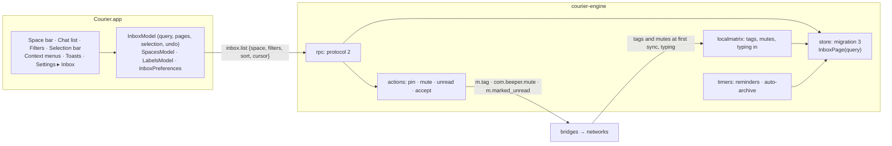

# Courier Milestone 4.1: organise the inbox

> **For agentic workers:** REQUIRED SUB-SKILL: Use superpowers:subagent-driven-development (recommended) or superpowers:executing-plans to implement this plan task-by-task. Steps use checkbox (`- [ ]`) syntax for tracking.

**Goal:** James can sort his chats the way Beeper let him: spaces down the left, labels, pinned chats, archive, low priority, hide, mark unread, filters and sorts, picking many chats at once, message requests, reminders that fire with the window closed, and rules that archive old chats by themselves.

**Architecture:**
- **Engine:** every piece of organisation state is Courier's own and lives in `courier.db`, through one new migration. `inbox.list` becomes a query: a space, filters and a sort, read a page at a time with a cursor. A small timer loop in the engine fires reminders and auto-archive rules.
- **Networks:** where bridgev2 and a bridge can carry a state to the network (pin, mute, marked unread, accepting a request), the engine sends it after the local write, best effort. Everything else stays on this Mac. The table in Global Constraints says which is which, per network, from the pinned bridge sources.
- **App:** the inbox model reads pages for the current query. New models own spaces, labels and preferences. The views add the space bar, the filter menu, multi-select, context menus, toasts and an Inbox pane in Settings.
- **Seam:** a minimal `EntitlementProvider` (Go and Swift, always yes) guards reminders, low priority and auto-archive rules. Later parts reuse it.



**Tech Stack:** as milestone 3. Go 1.26, mautrix v0.31.0, util v0.10.1, the five bridges at their milestone-2 pins. Swift 5 mode, SwiftPM tools 5.9 mirrored in Bazel, SwiftUI with AppKit where SwiftUI falls short, UserNotifications.

**Spec:** `docs/superpowers/specs/2026-10-15-courier-iteration-1-design.md` (§3 interface scope and the stub rule, §4 data, §5 failures, §7 milestone 4 part 4.1, §8 built for strangers and sold directly). The interface source is the inventory in `docs/superpowers/specs/2026-10-15-beeper-desktop-inventory/`, cited as `01 §3`, `02 §3.4.1` and so on. The milestone-3 plan (`docs/superpowers/plans/2026-10-16-courier-m3-usable-app.md`) and the code on `main` are the base.

## Global Constraints

- **Earlier constraints:** every Global Constraint of the milestone-1, -2 and -3 plans still applies (pins, hand-written AGPL headers on Go and Swift, strings in `Resources/en.lproj/Localizable.strings` via `String(localized:)`, data dir, socket, macOS 14, bundle id, no real accounts in CI, never open a real chat in Beeper while testing).
- **Commands are Bazel targets.** Every command a step runs is `bazel test …`, `bazel build …` or `bazel run …`; never `go test`, `swift test` or raw `git`. After Go file changes run `bazel run //:gazelle`; before every commit run `bazel run //:tidy`. Commit with `bazel run //tools/git:commit -- --agent <your agent> -m "<conventional message>" <paths>`.
- **Engine tests:** `bazel test //apps/desktop/courier/engine/...`, and with `--@rules_go//go/config:race` for the store, timers and rpc. **App tests:** `bazel test --config=macos-app //apps/desktop/courier/app:CourierCoreTests`.
- **One migration.** Migration 3 is appended to `migrations` in `engine/internal/store/migrate.go`. `schema.sql` and migrations 1 and 2 are not touched. Add `testdata/m3.sql`: a database at `user_version = 2` with dummy rows.
- **Protocol 2.** `protocol.json` goes to `"protocol": 2`, because `inbox.list`'s result changes meaning: an old app would only ever see the first page. Params stay strict (unknown keys are `-32602`). Every new method, notification kind and error has at least one example in `protocol/examples/`, and both conformance tests keep passing.
- **State is Courier's own.** Pinned, archived, low priority, hidden, marked unread, drafts, labels, spaces layout, per-account Show in Inbox and mute, reminders and auto-archive rules live in `courier.db`. The engine owns them; the app holds no copy beyond what it shows.
- **What reaches a network** (checked in the pinned sources: bridgev2 `portal.go` :910–915 dispatches `m.tag`, `com.beeper.mute` and `m.marked_unread` room account data to `TagHandlingNetworkAPI`, `MuteHandlingNetworkAPI` and `MarkedUnreadHandlingNetworkAPI`; each bridge's `pkg/connector/handlematrix.go` and `chatinfo.go`):

| State | WhatsApp | Signal | Telegram | Google Messages | Slack |
|---|---|---|---|---|---|
| Pin, sent | yes (`BuildPin`) | no | yes (`MessagesToggleDialogPin`) | no | no |
| Mute, sent | yes (`BuildMuteAbs`) | no | yes (`AccountUpdateNotifySettings`) | no | no |
| Marked unread, sent | yes (`BuildMarkChatAsRead`) | no | no | no | no |
| Accept a message request, sent | no | yes | no | no | no |
| Pin, taken in when a chat first arrives | yes | no | yes | yes | no |
| Archived, taken in when a chat first arrives | yes, once `archive_tag` is set (Task 4) | no | no | yes (sent as `m.lowpriority`) | no |
| Mute, taken in when a chat first arrives | yes | no | yes | no | no (its mute-new-channels option is off) |

  - **Local only, on every network:** archive (no bridge reads an archive tag it is sent; WhatsApp's and Telegram's tag handlers look only at `m.favourite`), low priority, hide, labels, reminders, spaces, Show in Inbox, drafts, auto-archive.
  - **Taken in only when a chat first arrives.** The engine keeps the example config's `tag_only_on_create` and `mute_only_on_create` (already pinned by `TestStartBridgeConfigMatchesExampleDefaults`), so a later change on the phone does not fight a change made in Courier. Chats that already exist in James's `courier.db` don't pick up their network pins.
  - **Sending is best effort.** The local write comes first and is the truth. A network that refuses or is offline is logged at warn (network name only) and never reverts the local state or shows an error.
- **Entitlement seam (spec §3).** Reminders, low priority and auto-archive rules are behind `EntitlementProvider`, Go and Swift, whose only implementation says yes. A denial is error `-32022` from the engine. In the app it shows an "Available with a plan" item in place of the action; the subscription screen is part 4.7.
- **Built for strangers (spec §8).** Each new state explains itself in plain words where it is offered (help text on the menu item and the empty state). No jargon, no Beeper name, icon or asset, and Courier's own wording (Task 8 fixes the copy). Label icons are SF Symbols; label colours are system colours.
- **Inferred behaviour** is marked in a code comment `Inferred (inventory 01 §n)` wherever it is implemented:
  - Archived chats come back on a new message; low priority and hidden chats don't (01 §18).
  - Only a message from someone else brings an archived chat back.
  - What Unanswered, No reply and From unknown numbers mean (Task 2).
  - Low-priority and hidden chats don't notify; a reminder notifies even in a muted chat.
  - "If no reply" means "if I haven't sent a message since setting it".
  - The preset reminder times (Task 7).
- **Times:** the engine stores absolute Unix milliseconds. The app works out preset times in the Mac's time zone.
- **Left out of 4.1, and staying reachable without reworking views:**
  - Opening a chat or a space in its own window (4.5). The double-click option "Open in New Window" arrives with it and becomes the default then.
  - "Show WhatsApp Communities / Telegram Topics as separate spaces" (4.5). The store doesn't model the bridges' parent rooms yet.
  - Editing the reminder time suggestions (4.6, with Settings).
  - The ⌘J command bar (4.7): this part registers its commands for it.
  - Send Later contents (4.3): the space and filter exist and are empty.
  - The account menu's Account Settings, Remove Account and Developer items (4.6).
  - Delete chat, Report as Spam, Edit Group and Unmerge (4.5).

## Review Focus

1. **Archive return rules.** A reasonable person expects an archived chat to come back when someone writes. It must not come back because of a backfilled older message, my own message from my phone, a reaction or an edit. Low priority and hidden chats stay where they are. **Test:** Task 1 (`TestOnlyANewMessageFromOthersUnarchives`, `TestLowPriorityAndHiddenIgnoreNewMessages`).
2. **Reminders across quit, sleep and restart.** A reminder that came due while Courier was quit or the Mac slept fires once at the next chance: not zero times, not twice. Go timers can stop counting while a Mac sleeps, so the timer loop never sleeps longer than 30 s and checks the wall clock every time it wakes. **Test:** Task 3 (`TestOverdueReminderFiresOnceAfterRestart`, `TestLoopNeverSleepsLongerThan30s`).
3. **A very large inbox.** The whole inbox in one frame hits the 4 MiB limit near 9,000 chats. At 10,000 chats a page of 500 rows is under 1 MiB, the first page with the Unread filter never reads every message (its query plan uses indexes), and no page repeats or skips a chat that didn't move. **Test:** Task 2 (`TestPagesAt10000ChatsAreQuickAndIndexed`, `TestPagesNeverRepeatOrSkip`) and Task 5 (`TestLargestPageFitsInAFrame`).
4. **Undo undoes exactly what it did.** "Archive all read" on 3,000 chats, then Undo, unarchives those 3,000. It leaves alone the chats that were archived before, and any chat a new message already brought back. **Test:** Task 6 (`testUndoUnarchivesOnlyWhatThatActionArchived`).
5. **A network that won't take the change.** Pinning a WhatsApp chat while WhatsApp is offline pins it in Courier at once, keeps it pinned, and shows no error. Retrying the network isn't attempted; the network catches up when it is next changed. **Test:** Task 4 (`TestPinStaysWhenTheNetworkRefuses`).

---

## File structure

```
apps/desktop/courier/
  protocol/protocol.json, protocol/examples/*.json   (modify) protocol 2: new methods, params, kinds, errors
  engine/internal/store/
    migrate.go                (modify) migration 3
    chatstate.go              pin, archive, low priority, hide, marked unread, drafts, requests, network tags/mutes
    labels.go, spaces.go      labels; spaces layout and per-account/label prefs; space counts
    query.go                  InboxPage: spaces, filters, sorts, cursor, room_ids
    reminders.go, autoarchive.go   reminder rows and firing; rules, due archives, archive-matching
    typing.go                 in-memory typing, with expiry
    inbox.go                  (modify) InboxRow gains the new fields; InsertEvent's archive-return rule lives in store.go
  engine/internal/entitlement/entitlement.go   Feature, Provider, Always
  engine/internal/timers/timers.go             the reminder and auto-archive loop
  engine/internal/localmatrix/intent.go, connector.go   (modify) TagRoom, MuteRoom, MarkUnread, MarkTyping, m.bridge → request
  engine/internal/actions/chatstate.go         pin, mute, marked unread, accept request: local write, then the network
  engine/internal/host/host.go                 (modify) only_bridge_tags
  engine/internal/networks/networks.go         (modify) WhatsApp archive_tag
  engine/internal/fakenet/fakenet.go           (modify) tag, mute, unread and accept handlers; typing; requests; UserLocal
  engine/internal/rpc/methods.go, organise.go  (modify/create) the new methods
  engine/cmd/courier-engine/main.go            (modify) starts timers
  app/Sources/CourierCore/
    Protocol.swift            (modify) protocol-2 types
    Entitlement.swift         Feature, EntitlementProvider, AlwaysEntitled
    InboxQuery.swift          InboxQuery, InboxFilter, InboxSort, Toast
    InboxModel.swift          (modify) pages, query, selection, actions, undo
    SpacesModel.swift, LabelsModel.swift, InboxPreferences.swift, ReminderPresets.swift, CommandSet.swift
    NotificationPolicy.swift, NotificationCoordinator.swift   (modify)
  app/Sources/Courier/
    SpaceBar.swift, EditSpacesWindow.swift, LabelWindows.swift, IconColorPicker.swift
    InboxList.swift, InboxRow.swift, PinnedStrip.swift, FilterMenu.swift, SelectionBar.swift
    ChatContextMenu.swift, RemindMeMenu.swift, ToastView.swift, InboxSettingsPane.swift
    InboxCommands.swift, MainWindow.swift, App.swift, Notifier.swift   (modify)
  app/Tests/CourierCoreTests/   new and extended tests, named in each task
  docs/m4-acceptance.md         per-part acceptance list; 4.1's section is written in Task 10
```

---

### Task 1: The store keeps how chats are organised

**Files:**
- Modify: `engine/internal/store/migrate.go`, `store.go` (InsertEvent), `inbox.go` (InboxRow)
- Create: `engine/internal/store/chatstate.go`, `labels.go`, `spaces.go`, `typing.go`, `chatstate_test.go`, `labels_test.go`, `spaces_test.go`, `testdata/m3.sql`

**Migration 3** (exact shape; everything else follows from it):

```sql
ALTER TABLE rooms ADD COLUMN request INTEGER NOT NULL DEFAULT 0;
ALTER TABLE room_prefs ADD COLUMN pinned_at INTEGER NOT NULL DEFAULT 0;     -- 0 = not pinned; pin order is pinned_at
ALTER TABLE room_prefs ADD COLUMN archived_at INTEGER NOT NULL DEFAULT 0;   -- 0 = not archived
ALTER TABLE room_prefs ADD COLUMN low_priority INTEGER NOT NULL DEFAULT 0;
ALTER TABLE room_prefs ADD COLUMN hidden INTEGER NOT NULL DEFAULT 0;
ALTER TABLE room_prefs ADD COLUMN marked_unread INTEGER NOT NULL DEFAULT 0;
ALTER TABLE room_prefs ADD COLUMN draft TEXT NOT NULL DEFAULT '';
CREATE INDEX room_prefs_place ON room_prefs(hidden, low_priority, archived_at);
CREATE TABLE labels (label_id INTEGER PRIMARY KEY, title TEXT NOT NULL, color INTEGER NOT NULL, icon TEXT NOT NULL,
  muted INTEGER NOT NULL DEFAULT 0, show_in_inbox TEXT NOT NULL DEFAULT 'all', created_at INTEGER NOT NULL);
CREATE TABLE room_labels (room_id TEXT NOT NULL REFERENCES rooms(room_id) ON DELETE CASCADE,
  label_id INTEGER NOT NULL REFERENCES labels(label_id) ON DELETE CASCADE, PRIMARY KEY (room_id, label_id));
CREATE INDEX room_labels_label ON room_labels(label_id);
CREATE TABLE account_prefs (network TEXT PRIMARY KEY, muted INTEGER NOT NULL DEFAULT 0, show_in_inbox TEXT NOT NULL DEFAULT 'all');
CREATE TABLE space_layout (space_id TEXT PRIMARY KEY, position INTEGER NOT NULL, hidden INTEGER NOT NULL DEFAULT 0);
CREATE TABLE reminders (room_id TEXT PRIMARY KEY REFERENCES rooms(room_id) ON DELETE CASCADE, due_at INTEGER NOT NULL,
  condition TEXT NOT NULL, set_at INTEGER NOT NULL, fired_at INTEGER NOT NULL DEFAULT 0);
CREATE INDEX reminders_due ON reminders(fired_at, due_at);
CREATE TABLE auto_archive_rules (rule_id INTEGER PRIMARY KEY, scope TEXT NOT NULL, trigger TEXT NOT NULL,
  chat_type TEXT NOT NULL DEFAULT 'all', duration_ms INTEGER NOT NULL, enabled INTEGER NOT NULL DEFAULT 1);
CREATE TABLE archive_due (room_id TEXT PRIMARY KEY REFERENCES rooms(room_id) ON DELETE CASCADE, due_at INTEGER NOT NULL,
  rule_id INTEGER NOT NULL REFERENCES auto_archive_rules(rule_id) ON DELETE CASCADE);
```

**Interfaces:**
- Produces (every setter publishes `Change{Kind: "room", RoomID}` per changed room; label, layout and account changes publish `Change{Kind: "spaces"}`):

```go
// chatstate.go
func (s *Store) SetClock(now func() time.Time)                     // tests; default time.Now
func (s *Store) SetPinned(ctx context.Context, roomID string, pinned bool) error  // pinning also unarchives
func (s *Store) SetArchived(ctx context.Context, roomIDs []string, archived bool) (changed []string, err error)
func (s *Store) SetLowPriority(ctx context.Context, roomIDs []string, on bool) ([]string, error)
func (s *Store) SetHidden(ctx context.Context, roomIDs []string, on bool) ([]string, error)
func (s *Store) SetMarkedUnread(ctx context.Context, roomIDs []string, on bool) ([]string, error)
func (s *Store) SetDraft(ctx context.Context, roomID, text string) error  // "" clears
func (s *Store) SetRequest(ctx context.Context, roomID string, request bool) error
func (s *Store) ApplyNetworkTag(ctx context.Context, roomID, tag string, on bool) error // m.favourite → pinned, m.lowpriority → archived, others ignored
func (s *Store) ApplyNetworkMute(ctx context.Context, roomID string, until time.Time) error // muted = until is after now
var ErrPinned = errors.New("a pinned chat can't be archived")
type Reminder struct { RoomID, Condition string; DueAt, SetAt, FiredAt time.Time } // Condition: if_no_reply | always; Task 3 sets and fires them
// labels.go
type Label struct { ID int64; Title string; Color int; Icon string; Muted bool; ShowInInbox string }
type LabelUpdate struct { Title *string; Color *int; Icon *string }
func (s *Store) CreateLabel(ctx context.Context, title string, color int, icon string) (Label, error)
func (s *Store) UpdateLabel(ctx context.Context, id int64, u LabelUpdate) error
func (s *Store) DeleteLabel(ctx context.Context, id int64) error   // also its rules and its layout row
func (s *Store) SetLabel(ctx context.Context, roomIDs []string, labelID int64, on bool) ([]string, error)
func (s *Store) Labels(ctx context.Context) ([]Label, error)       // oldest first
var ErrNotFound = errors.New("no such chat or label")
// spaces.go
type Space struct {
	ID, Kind, Title, Network string // Kind: builtin | account | label
	LabelID                  int64
	Color                    int
	Icon                     string
	Hidden, Muted            bool
	ShowInInbox              string // all | dms | none; "" for builtin
	Chats, UnreadChats       int
}
func (s *Store) Spaces(ctx context.Context, networks []string) ([]Space, error) // layout order
func (s *Store) SetSpaceLayout(ctx context.Context, order, hidden []string) error
func (s *Store) UpdateSpace(ctx context.Context, spaceID string, muted *bool, showInInbox *string) error
var ErrBadValue = errors.New("that isn't accepted")
// typing.go
func (s *Store) SetTyping(roomID, userID string, until time.Time) // zero or past until = stopped; publishes "typing"
func (s *Store) TypingIn(roomID string) []string                   // user IDs still typing, sorted
```

- **Values:**
  - **Space IDs:** `inbox`, `reminders`, `requests`, `low_priority`, `send_later`, `archive`, `account:<network>`, `label:<label_id>`.
  - **Default layout:** that built-in order, then accounts in the order of `networks`, then labels oldest first.
  - **Layout rules:** `inbox` cannot be hidden or moved from first (`ErrBadValue`). A space missing from a saved layout goes at the end, visible. `UpdateSpace` on a built-in space is `ErrBadValue`.
  - **Labels:** the title is trimmed, 1–40 characters. Colour is 0–11. Icon is a non-empty SF Symbol name, at most 64 bytes (the app picks from a fixed list).
  - **Drafts:** at most 16,384 characters (`ErrBadValue`).
  - **Space counts:** "Chats" is the space's rows as Task 2 defines them. "Unread chats" counts the chats among them with unread messages or marked unread. Reminders' "Chats" counts its reminders.
- `InboxRow` gains `PinnedAt time.Time`, `Archived, LowPriority, Hidden, MarkedUnread, Request bool`, `Draft string`, `Labels []int64`, `MutedBy, MutedByName string` (`"account"` with the network's display name, or `"label"` with the first muted label's title, by label ID), `Reminder *Reminder` (nil when the chat has none), `UnreadMentions int`, `PreviewMediaURI string`.

- [ ] **Step 1: Write the failing tests**
  - `TestMigrationFromMilestone3`: `testdata/m3.sql` upgrades to `user_version = 3`. Existing mutes survive. `Inbox` still works.
  - `TestOnlyANewMessageFromOthersUnarchives` (Review Focus 1). Archive at T, then:
    - an `m.room.message` from a ghost at T+1 unarchives it, in the same transaction as the insert;
    - from `@me` at T+1: stays archived;
    - a ghost's message at T−1 (backfill): stays archived;
    - a reaction or an `m.replace` edit at T+1: stays archived.
    The unarchive publishes `room`.
  - `TestLowPriorityAndHiddenIgnoreNewMessages`
  - `TestPinnedChatsCannotBeArchived`:
    - `SetArchived([pinned])` is `ErrPinned`;
    - `SetArchived([pinned, plain])` returns `changed == [plain]`;
    - pinning an archived chat unarchives it.
  - `TestSettersReportOnlyRealChanges`: archiving an archived chat returns no ID and publishes nothing. An unknown room ID is `ErrNotFound`.
  - `TestNetworkTagsMapToPinAndArchive`: `m.favourite` on and off; `m.lowpriority` on sets archived; `u.work` changes nothing.
  - `TestNetworkMuteUntil`: `event.MutedForever` and a future time mute; `bridgev2.Unmuted` unmutes.
  - `TestDeletingALabelTakesItOffEveryChat`, `TestLabelValidation`: a 41-character title, colour 12 and an empty icon are each `ErrBadValue`, and nothing is stored.
  - `TestMutedByLabelAndAccount`: a muted label gives `MutedBy "label"`. Account mute wins over label mute. The chat's own `Muted` stays false.
  - `TestSpaceLayoutKeepsInboxFirstAndAddsNewSpacesAtTheEnd`
  - `TestUnreadMentionsCountOnlyUnreadMentionsOfMe`: `m.mentions.user_ids` containing `@me`, and `m.mentions.room: true`, count; a mention of someone else doesn't; a mention before the read marker doesn't.
  - `TestTypingExpires`: typing until now+5 s is listed. After the clock passes it, it is gone, and one `typing` change was published at expiry.
  - `TestDraftIsKeptAndCleared`
- [ ] **Step 2: Run them to verify they fail.** `bazel test //apps/desktop/courier/engine/internal/store:store_test`. Expected: FAIL, undefined `SetArchived`.
- [ ] **Step 3: Implement** in the files above.
  - `room_prefs` rows are upserted, as `SetMuted` does.
  - `InsertEvent` applies the return rule only to an inserted message-like, non-edit event whose sender isn't `@me` and whose ts is after `archived_at`. The same branch deletes the room's `archive_due` row; Task 3 adds the rest.
  - `MutedBy` and `UnreadMentions` are columns of the row query, not per-row Go loops.
  - Typing expiry uses one `time.AfterFunc` per (room, user), replaced when it is renewed.
- [ ] **Step 4: Run the store tests.** Expected: PASS, also with `--@rules_go//go/config:race`.
- [ ] **Step 5: Commit** with `feat(courier): the store keeps pins, archive, labels and spaces`.

---

### Task 2: The inbox is a query, read in pages

**Files:**
- Create: `engine/internal/store/query.go`, `query_test.go`
- Modify: `engine/internal/store/inbox.go`. It keeps `Inbox` (every room, as today) for existing callers and tests.

**Interfaces:**
- Consumes: Task 1's columns.
- Produces:

```go
type InboxQuery struct {
	Space   string   // a Task 1 space ID; "" = "inbox"
	Filters []string // see below
	Sort    string   // newest (default) | oldest | least_time_remaining | most_time_remaining
	RoomIDs []string // when set: exactly these rooms, in any place; Space and Filters are ignored
	After   string   // a cursor from the previous page of the same query; "" = first page
	Limit   int      // 1..500; 0 = 200
}
func (s *Store) InboxPage(ctx context.Context, q InboxQuery) (rows []InboxRow, next string, err error) // next "" = last page
var ErrBadCursor = errors.New("that cursor belongs to another query")
```

**Where a chat is** (first match wins): hidden → `hidden`; `request` → `requests`; low priority → `low_priority`; archived → `archive`; otherwise `inbox`.

**What each space shows:**

| Space | Chats |
|---|---|
| `inbox` | Place `inbox`. The chat's account's Show in Inbox allows it (`all`; `dms` only if one-to-one; `none` never), and so does every one of its labels |
| `account:<n>` | Network `n`, place `inbox`, whatever Show in Inbox says |
| `label:<id>` | Has that label, place `inbox` |
| `reminders` | Has a reminder (set or fired), any place except `hidden` |
| `requests` | Place `requests` |
| `low_priority` | Place `low_priority` |
| `archive` | Place `archive` |
| `send_later` | None until part 4.3 |

**Filters** (OR within a group, AND across groups, the 15th being "All" = no filters):
- **Place group:** `archived`, `low_priority`, `hidden`, `requests`, `reminders`, `send_later`. Any of these replaces the space's place rule with "in any of the places named". The space's account or label still applies.
- **Type group:** `dms` (one-to-one), `groups`.
- **Reply group** (Inferred, 01 §3): `unanswered` (the newest message is from someone else), `no_reply` (the newest message is mine).
- **On their own:**
  - `unread`: unread > 0 or marked unread;
  - `drafts`: draft isn't "";
  - `unknown` (Inferred): a one-to-one chat whose name is "" or matches `^\+?[0-9][0-9 ()\-]{5,}$`;
  - `muted`: muted, or muted by an account or label.
- An unknown filter, space or sort is `ErrBadValue`.

**Order:** pinned chats first, oldest pin first, then:
- `newest`: `last_ts` DESC, `created_at` DESC;
- `oldest`: the reverse;
- `least_time_remaining`: reminder `due_at` ASC;
- `most_time_remaining`: reminder `due_at` DESC.

Chats without a reminder come after those with one. `room_id` breaks every tie. The cursor is base64url JSON `{"q": <hash of space, filters (sorted), sort>, "k": <the last row's sort key>}`. Paging is keyset (`WHERE key > cursor`), never `OFFSET`.

- [ ] **Step 1: Write the failing tests** in `query_test.go`:
  - `TestEachSpaceShowsItsChats`: one table row per space, over a fixture with a chat in every place.
  - `TestShowInInboxPerAccountAndLabel`: account `dms` drops its groups from `inbox` but not from `account:<n>`. A label at `none` drops its chats from `inbox`.
  - `TestFiltersCombineWithinAndAcrossGroups`: `dms+groups` is everything. `unread+dms` is unread DMs. `archived+hidden` in `account:x` is x's archived and hidden chats.
  - `TestUnansweredNoReplyAndUnknown`
  - `TestPinnedComeFirstInPinOrder`
  - `TestSortsByReminderTime`
  - `TestRoomIDsFindAChatInAnyPlace`: a hidden chat is returned by `RoomIDs`.
  - `TestPagesNeverRepeatOrSkip` (Review Focus 3): 1,234 chats in pages of 100 give each ID exactly once. A chat that gets a new message between pages 3 and 4 appears at most once in the union.
  - `TestCursorFromAnotherQueryIsRefused`: `ErrBadCursor`.
  - `TestPagesAt10000ChatsAreQuickAndIndexed` (Review Focus 3): 10,000 rooms with 3 events each. The first page of `{space: inbox, filters: [unread]}` `EXPLAIN QUERY PLAN` has no `SCAN events`; scanning rooms is allowed. That is the real check. The page must also come back within 1 s, a loose ceiling so a busy CI machine never fails it; log the measured time.
- [ ] **Step 2: Run them to verify they fail.** `bazel test //apps/desktop/courier/engine/internal/store:store_test`. Expected: FAIL, undefined `InboxPage`.
- [ ] **Step 3: Implement `InboxPage`.** Build the SQL from fixed fragments per space, filter and sort; no value is ever concatenated into SQL. The row columns are `inboxSQL`'s, plus Task 1's. If the `EXPLAIN QUERY PLAN` check needs another index, add it to migration 3, which hasn't shipped yet.
- [ ] **Step 4: Run the store tests.** Expected: PASS, also with race.
- [ ] **Step 5: Commit** with `feat(courier): the inbox is a query with spaces, filters, sorts and pages`.

---

### Task 3: Reminders and auto-archive run in the engine

**Files:**
- Create: `engine/internal/entitlement/entitlement.go`, `entitlement_test.go`
- Create: `engine/internal/store/reminders.go`, `autoarchive.go`, `reminders_test.go`, `autoarchive_test.go`
- Create: `engine/internal/timers/timers.go`, `timers_test.go`
- Modify: `engine/internal/store/store.go`. InsertEvent and the two read markers schedule `archive_due`.
- Modify: `engine/cmd/courier-engine/main.go`. It starts `timers.Run` with the engine's context, and the shutdown order gains timers before the store.

**Interfaces:**
- Produces:

```go
// entitlement
type Feature string
const (Reminders Feature = "reminders"; SendLater Feature = "send_later"; UndoSend Feature = "undo_send";
       Incognito Feature = "incognito"; LowPriority Feature = "low_priority"; AutoArchive Feature = "auto_archive")
type Provider interface{ Allowed(Feature) bool }
type Always struct{}                     // Allowed is always true
// store/reminders.go (Reminder is Task 1's)
func (s *Store) SetReminder(ctx context.Context, roomIDs []string, due time.Time, condition string) error // replaces; due must be after now and within 5 years
func (s *Store) ClearReminders(ctx context.Context, roomIDs []string) error  // nil = every reminder
func (s *Store) ClearFiredReminder(ctx context.Context, roomID string) error // opening or reading the chat ends a fired one
func (s *Store) NextDue(ctx context.Context) (time.Time, bool, error)        // earliest unfired reminder or archive_due
func (s *Store) FireDueReminders(ctx context.Context) (fired []string, err error)
// store/autoarchive.go
type Rule struct { ID int64; Scope, Trigger, ChatType string; Duration time.Duration; Enabled bool }
func (s *Store) Rules(ctx context.Context) ([]Rule, error)
func (s *Store) SetRule(ctx context.Context, r Rule) (Rule, error)  // ID 0 = new
func (s *Store) DeleteRule(ctx context.Context, id int64) error
type ArchiveMatch struct { Space string; ReadOnly bool; OlderThan time.Duration; DryRun bool }
func (s *Store) ArchiveMatching(ctx context.Context, m ArchiveMatch) ([]string, error)
func (s *Store) ArchiveDue(ctx context.Context) ([]string, error)       // archive_due rows at or before now
func (s *Store) SweepOlderThan(ctx context.Context) ([]string, error)   // every enabled older_than rule
// timers
type Clock interface{ Now() time.Time; After(time.Duration) <-chan time.Time }
func New(s *store.Store, ent entitlement.Provider, clock Clock, log zerolog.Logger) *Timers
func (t *Timers) Run(ctx context.Context)
func (t *Timers) Poke()   // a reminder or rule changed: re-arm now
const MaxSleep = 30 * time.Second
const SweepEvery = 15 * time.Minute
```

- **Reminder firing**, in one transaction per reminder:
  - With `if_no_reply`, a message-like event from `@me` after `set_at` in that room means I replied. The reminder is deleted and nothing else happens.
  - Otherwise:
    - set `fired_at` = now, `marked_unread` = 1 and `archived_at` = 0;
    - publish `room`;
    - publish `Change{Kind: "reminder", RoomID}`.
  - A fired reminder stays as the row's "Reminder" badge until `room.markRead` (Task 5) or `reminder.clear`.
- **Rules:**
  - `scope`: `all`, `account:<n>` or `label:<id>`.
  - `trigger`: `after_reply`, `after_read` or `older_than`.
  - `chat_type`: `all` or `read`.
  - The durations accepted are exact:
    - `after_reply` and `after_read`: 0, 1, 5, 10 and 30 min; 1, 4 and 24 h; 7 days. The app's default is 10 min (02 §1.2).
    - `older_than`: 3, 7, 14 and 28 days; 90 days; 365 days.
  - At most one enabled `after_reply` or `after_read` rule exists, scope `all` (the General setting). An `older_than` rule may exist per space.
- **Scheduling:**
  - A message from `@me` with an enabled `after_reply` rule upserts `archive_due` at ts + duration.
  - A read marker that moves with an enabled `after_read` rule upserts it at now + duration.
  - A message from someone else deletes it (Task 1's branch).
  - Pinned chats are never archived by a rule.
  - `ArchiveMatching` with `ReadOnly` takes only chats with nothing unread and not marked unread. `OlderThan` 0 means any age. It always looks only at place `inbox` in the space; `""` means `inbox`.
- **The loop:** `wait = min(NextDue − now, next sweep − now, MaxSleep)`. After each wait:
  - when `Allowed(Reminders)`: `FireDueReminders`;
  - when `Allowed(AutoArchive)`: `ArchiveDue`, and `SweepOlderThan` once `SweepEvery` has passed. It also sweeps at start.
  - Not allowed means the rows wait, untouched.

- [ ] **Step 1: Write the failing tests:**
  - `TestEveryFeatureIsAllowedByDefault`
  - `TestReminderFiresAtDueTimeAndBringsTheChatBack`: an archived chat comes back marked unread, with `room` and `reminder` published.
  - `TestReminderSkippedWhenIReplied`: `if_no_reply` with a later `@me` message is deleted without firing. `always` fires anyway.
  - `TestOverdueReminderFiresOnceAfterRestart` (Review Focus 2): due while the store was closed, it fires once on the first `FireDueReminders` after reopening, and never again after a second reopen.
  - `TestReminderMustBeInTheFuture`: past and more than 5 years ahead are `ErrBadValue`.
  - `TestAfterReplyArchivesAfterTheDelayUnlessTheyWriteBack`
  - `TestAfterReadArchivesAfterTheDelay`
  - `TestOlderThanRuleArchivesOnlyItsSpace`, `TestReadOnlySkipsUnreadAndMarkedUnread`, `TestRulesNeverArchivePinned`
  - `TestArchiveMatchingDryRunChangesNothing`
  - `TestRuleDurationsAreExact`: 2 minutes is `ErrBadValue`.
  - Timers, with a fake clock: `TestLoopNeverSleepsLongerThan30s` (Review Focus 2), `TestPokeRearmsForAnEarlierReminder`, `TestRemindersWaitWhileNotEntitled` (a deny-all provider: nothing fires; switching to `Always` fires them), `TestSweepRunsAtStartAndEvery15Minutes`.
- [ ] **Step 2: Run them to verify they fail.** `bazel test //apps/desktop/courier/engine/internal/store:store_test //apps/desktop/courier/engine/internal/timers:timers_test //apps/desktop/courier/engine/internal/entitlement:entitlement_test`. Expected: FAIL.
- [ ] **Step 3: Implement.** Run `bazel run //:gazelle` for the two new packages.
- [ ] **Step 4: Run the engine suite.** `bazel test //apps/desktop/courier/engine/...`, with race for the store and timers. Expected: PASS.
- [ ] **Step 5: Commit** with `feat(courier): reminders and auto-archive rules run in the engine`.

---

### Task 4: What reaches the networks, and what comes back

**Files:**
- Modify: `engine/internal/localmatrix/intent.go`, `connector.go` (`applyRoomState`), `intent_test.go`
- Create: `engine/internal/actions/chatstate.go`, `chatstate_test.go`
- Modify: `engine/internal/actions/actions.go`. `MarkRead` also clears marked unread and a fired reminder.
- Modify: `engine/internal/host/host.go`, `host_test.go`; `engine/internal/networks/networks.go`, `networks_test.go`
- Modify: `engine/internal/fakenet/fakenet.go`

**Interfaces:**
- Consumes: Task 1's `SetPinned`, `SetMuted`, `SetMarkedUnread`, `SetRequest`, `ApplyNetworkTag`, `ApplyNetworkMute`, `SetTyping`; Task 3's `ClearFiredReminder`.
- Produces:

```go
func (a *Actions) SetPinned(ctx context.Context, roomID string, pinned bool) error
func (a *Actions) SetMuted(ctx context.Context, roomID string, muted bool) error
func (a *Actions) SetMarkedUnread(ctx context.Context, roomIDs []string, unread bool) ([]string, error)
func (a *Actions) AcceptRequest(ctx context.Context, roomID string) error
func (a *Actions) Syncs(network string) []string // subset of "pin", "mute", "unread", "accept_request", in that order
var ErrNotSupported = errors.New("this network can't do that")
```

- **Sending.** After the store write, if the network's logged-in client implements the bridgev2 interface, queue one event with `h.Bridge.QueueMatrixEvent`. The sender is `ids.Me`, and `Content.Parsed` is set as `actions.stage` does.

| Action | Event type | Content | Interface |
|---|---|---|---|
| pin | `event.AccountDataRoomTags` | `TagEventContent{Tags: {m.favourite: {}}}`, or `{}` to unpin | `TagHandlingNetworkAPI` |
| mute | `event.AccountDataBeeperMute` | `BeeperMuteEventContent{MutedUntil: -1}`, or `0` to unmute | `MuteHandlingNetworkAPI` |
| marked unread | `event.AccountDataMarkedUnread` | `MarkedUnreadEventContent{Unread: …}` | `MarkedUnreadHandlingNetworkAPI` |
| accept request | `event.BeeperAcceptMessageRequest` | `BeeperAcceptMessageRequestEventContent{}` | `MessageRequestAcceptingNetworkAPI` |

  - The send is best effort (Global Constraints).
  - `AcceptRequest` on a network without the interface is `ErrNotSupported`, and nothing changes. Otherwise it clears `request` locally first.
  - `MarkRead` sends `{Unread: false}` only when the chat was marked unread.
- **Taking in:**
  - `TagRoom`, `MuteRoom` and `MarkUnread` act only for the `@me` intent (bridgev2 calls them on the double puppet) and call the store mappers.
  - `MarkTyping` from a ghost calls `SetTyping(room, ghost, now+timeout)`; a timeout of 0 stops it. `@me`'s own typing is ignored.
  - `applyRoomState` for `m.bridge` and `uk.half-shot.bridge` reads `channel["com.beeper.message_request"]` into `SetRequest`.
- **Config:**
  - `host.go` sets `OnlyBridgeTags: []event.RoomTag{event.RoomTagFavourite, event.RoomTagLowPriority}` (the example config's value). Today it is empty, so no tag is ever taken in.
  - The WhatsApp spec's configure hook sets `ArchiveTag = event.RoomTagLowPriority`, so a chat archived on the phone arrives archived.
- **fakenet:**
  - Its client implements the four interfaces, recording on new channels `Tags`, `Mutes`, `Unreads` and `Accepts`. `Refuse bool` makes them return an error.
  - A second constructor, `fakenet.NewPlain()`, implements none of them.
  - It can emit typing, a `ChatInfo` with `MessageRequest`, and `UserLocal` tags and mutes on create.

- [ ] **Step 1: Write the failing tests:**
  - localmatrix: `TestNetworkPinAtCreateBecomesPinned`, `TestNetworkArchiveTagBecomesArchived`, `TestOtherTagsAreIgnored`, `TestOnlyMyTagsAndMutesCount`, `TestGhostTypingIsKeptUntilTimeout`, `TestMessageRequestFromBridgeInfo`
  - actions: `TestPinReachesNetworksThatSyncPins` (pin gives `m.favourite`; unpin gives empty tags), `TestPinOnANetworkWithoutPinsIsLocalOnly` (`NewPlain`: nothing queued, store pinned), `TestPinStaysWhenTheNetworkRefuses` (Review Focus 5), `TestMuteReachesTheNetwork` (−1, then 0), `TestMarkUnreadReachesTheNetworkAndMarkReadClearsIt`, `TestAcceptRequestOnlyWhereSupported`, `TestSyncsFollowTheClient`
  - host: `TestStartBridgeConfigMatchesExampleDefaults` gains `require.Equal(t, []event.RoomTag{"m.favourite", "m.lowpriority"}, c.OnlyBridgeTags)`.
  - networks: `TestWhatsAppArchivedChatsArriveArchived` (the configured `ArchiveTag`), and `TestNetworkSyncTableMatchesTheBridges`. The latter type-asserts a nil pointer of each real client type (`*whatsapp.WhatsAppClient`, `*telegram.TelegramClient`, `*gmessages.GMClient`, `*slack.SlackClient`, and Signal's under its darwin build tag) against the four interfaces. It expects exactly the Global Constraints table, so a bridge bump that changes it fails here.
- [ ] **Step 2: Run them to verify they fail.** `bazel test //apps/desktop/courier/engine/internal/localmatrix:localmatrix_test //apps/desktop/courier/engine/internal/actions:actions_test //apps/desktop/courier/engine/internal/host:host_test //apps/desktop/courier/engine/internal/networks:networks_test`. Expected: FAIL.
- [ ] **Step 3: Implement.** Run `bazel run //:gazelle`. The networks test needs the bridges' connector packages, which `networks` already imports.
- [ ] **Step 4: Run the engine suite.** Expected: PASS. The `networks` test with Signal runs on macOS (the libsignal recipe in `engine/docs/m2-libsignal.md`).
- [ ] **Step 5: Commit** with `feat(courier): pins, mutes, unread marks and request accepts reach the networks that take them`.

---

### Task 5: Protocol 2 and the engine's new methods

**Files:**
- Modify: `protocol/protocol.json`, and add examples to `protocol/examples/`
- Modify: `engine/internal/rpc/methods.go`, `server.go` (`Deps` gains `Timers *timers.Timers` and `Entitlement entitlement.Provider`, default `entitlement.Always{}`). Create `engine/internal/rpc/organise.go` and `organise_test.go`. Modify `conformance_test.go` if its example loader needs the new kinds.

**Protocol changes** (types are named as below in `protocol.json`; Swift names them the same):
- **`hello`:** `protocol` 2. The mismatch example now says `{"engine": 2}`.
- **`Account`** gains `syncs: string[]` (Task 4's `Syncs`).
- **`inbox.list`:**
  - **Params** `InboxListParams {space?, filters?: string[], sort?, cursor?, limit?: int, room_ids?: string[]}`. `room_ids` is 1–100 and excludes the others. `limit` is 1–500.
  - **Result** `InboxResult {rooms: InboxRow[], next_cursor: string|null}`. A bad cursor is `-32602` with data `"cursor"`.
- **`InboxRow`** gains:
  - `pinned`, `archived`, `low_priority`, `hidden`, `marked_unread`, `request`: bool;
  - `draft`: string;
  - `labels`: int[];
  - `muted_by`: `""`, `"account"` or `"label"`, and `muted_by_name`: string;
  - `reminder`: `Reminder|null`, with `Reminder {due_at, condition, fired: bool}`;
  - `typing`: string[] of display names (the members' names, or the localpart);
  - `unread_mentions`: int;
  - `preview_media_path`: the image or sticker thumbnail path, or "".
- **New methods:**

| Method | Params | Result | Errors |
|---|---|---|---|
| `spaces.list` | `Empty` | `SpacesResult {spaces: Space[]}` | |
| `spaces.setLayout` | `SpaceLayoutParams {order, hidden: string[]}` | `Empty` | -32014 |
| `spaces.update` | `SpaceUpdateParams {space_id, muted?, show_in_inbox?}` | `Empty` | -32014, -32020 |
| `labels.create` | `LabelParams {title, color, icon}` | `LabelResult {label_id}` | -32014 |
| `labels.update` | `LabelUpdateParams {label_id, title?, color?, icon?}` | `Empty` | -32014, -32020 |
| `labels.delete` | `LabelIDParams {label_id}` | `Empty` | -32020 |
| `room.setPinned` | `SetPinnedParams {room_id, pinned}` | `Empty` | -32020 |
| `room.setArchived` | `ArchiveParams {room_ids, archived, mark_read?}` | `RoomsChanged {room_ids}` | -32020, -32021 |
| `room.setLowPriority` | `RoomsFlagParams {room_ids, on}` | `RoomsChanged` | -32020, -32022 |
| `room.setHidden` | `RoomsFlagParams` | `RoomsChanged` | -32020 |
| `room.setMarkedUnread` | `RoomsFlagParams` | `RoomsChanged` | -32020 |
| `room.setLabel` | `SetLabelParams {room_ids, label_id, on}` | `RoomsChanged` | -32020 |
| `room.setDraft` | `DraftParams {room_id, text}` | `Empty` | -32014, -32020 |
| `room.acceptRequest` | `RoomParams` | `Empty` | -32020, -32023 |
| `reminder.set` | `ReminderParams {room_ids, due_at, condition, archive?}` | `Empty` | -32014, -32020, -32022 |
| `reminder.clear` | `RoomsParams {room_ids}` | `Empty` | -32020 |
| `reminder.clearAll` | `Empty` | `Empty` | |
| `inbox.archiveMatching` | `ArchiveMatchingParams {space?, read_only, older_than_ms, dry_run}` | `RoomsChanged` | -32014 |
| `inbox.markAllRead` | `SpaceParams {space?}` | `RoomsChanged` | |
| `autoArchive.list` | `Empty` | `RulesResult {rules: AutoArchiveRule[]}` | |
| `autoArchive.set` | `AutoArchiveRule` (with `rule_id` 0 = new) | `AutoArchiveRule` | -32014, -32022 |
| `autoArchive.delete` | `RuleIDParams {rule_id}` | `Empty` | -32020 |

- **Notes on the methods:**
  - `room_ids` is 1–500 everywhere.
  - `room.setArchived` with `mark_read` marks each changed chat read first.
  - `inbox.archiveMatching`'s `older_than_ms` is 0 (any age) or one of Task 3's `older_than` durations; anything else is `-32014`.
  - `reminder.set` with `archive` archives the chats after setting (skipping pinned ones). It is entitled under `Reminders`; `room.setLowPriority` with `on` under `LowPriority`; `autoArchive.set` under `AutoArchive`. Each calls `Timers.Poke()`.
  - `room.markRead` also clears a fired reminder.
  - `room.setMuted` keeps its params and now goes through `Actions.SetMuted`.
- **`Changed.kind`** gains `spaces` (labels, layout or account prefs changed; no room), `typing` (room_id) and `reminder` (room_id: a reminder fired, so notify).
- **New errors:**

| Code | Name | Message |
|---|---|---|
| `-32021` | `pinned` | a pinned chat can't be archived |
| `-32022` | `not_entitled` | this isn't part of your plan |
| `-32023` | `not_supported` | this network can't do that |

- [ ] **Step 1: Write the failing tests:**
  - `TestEveryExampleRoundTrips` and `TestServerSpeaksExactlyTheProtocolsMethods` cover the new methods, through their examples.
  - In `organise_test.go`:
    - `TestInboxListPagesThroughTheCursor`
    - `TestRoomIDsAndSpaceAreExclusive`: both given is `-32602`.
    - `TestLargestPageFitsInAFrame` (Review Focus 3): 500 rows with 140-character previews, 5 labels, a draft of 2,000 characters and 3 typing names each encode to under 1 MiB.
    - `TestBulkLimits`: 0 and 501 room IDs are `-32602`.
    - `TestNotEntitledIsRefusedAndStoresNothing`: a deny-all provider; `reminder.set`, `room.setLowPriority` on and `autoArchive.set` each give `-32022`.
    - `TestArchivingAPinnedChatSaysWhy`
    - `TestAcceptRequestNotSupported`
    - `TestMarkReadClearsAFiredReminder`
- [ ] **Step 2: Run them to verify they fail.** `bazel test //apps/desktop/courier/engine/internal/rpc:rpc_test`. Expected: FAIL.
- [ ] **Step 3: Implement.** Write the handlers in the shape of the existing ones (strict `decode`, `required`, sentinel mapping in `sentinels`). Wire `timers.New` in `courier-engine/main.go` into `Deps`.
- [ ] **Step 4: Run the engine suite with race.** Expected: PASS.
- [ ] **Step 5: Commit** with `feat(courier): protocol 2, with spaces, labels, chat states, reminders and rules`.

---

### Task 6: The app's inbox reads a query, a page at a time

**Files:**
- Modify: `app/Sources/CourierCore/Protocol.swift` (protocol-2 types; `hello` sends 2; `Change` gains `.spaces`, `.typing(roomID:)`, `.reminder(roomID:)`)
- Create: `app/Sources/CourierCore/Entitlement.swift`, `InboxQuery.swift`, `InboxPreferences.swift`
- Modify: `app/Sources/CourierCore/InboxModel.swift`, `ComposerModel.swift` (draft text persists through `room.setDraft`)
- Test: `ProtocolConformanceTests` (unchanged; it covers the new examples), `InboxModelTests` (extended), `InboxSelectionTests.swift`, `EntitlementTests.swift`, `InboxPreferencesTests.swift`

**Interfaces:**
- Consumes: Task 5's protocol.
- Produces:

```swift
public enum Feature: String, CaseIterable, Sendable { case reminders, sendLater = "send_later", undoSend = "undo_send",
    incognito, lowPriority = "low_priority", autoArchive = "auto_archive" }
public protocol EntitlementProvider: Sendable { func isEntitled(_ feature: Feature) -> Bool }
public struct AlwaysEntitled: EntitlementProvider { public init() }
public enum InboxFilter: String, CaseIterable, Sendable { case unread, dms, groups, drafts, unanswered, noReply = "no_reply",
    unknown, muted, hidden, archived, lowPriority = "low_priority", requests, reminders, sendLater = "send_later" }
public enum InboxSort: String, CaseIterable, Sendable { case newest, oldest,
    leastTimeRemaining = "least_time_remaining", mostTimeRemaining = "most_time_remaining" }
public struct InboxQuery: Equatable, Sendable { public var space = "inbox"; public var filters: Set<InboxFilter> = []; public var sort = InboxSort.newest }
public struct Toast: Equatable, Identifiable, Sendable { public let id: UUID; public let message: String; public let canUndo: Bool }
// InboxModel additions
@Published public var query: InboxQuery              // a change reads the first page again; no old cursor is reused
@Published public private(set) var hasMore: Bool
@Published public private(set) var selection: Set<String>
@Published public private(set) var isSelecting: Bool
@Published public private(set) var toast: Toast?
public static let pageSize = 200, refreshPageSize = 500
public func loadMore() async
public func beginSelecting(); public func toggleSelected(_ roomID: String); public func extendSelection(to roomID: String)
public func selectAll(); public func endSelecting()
public var targets: [String] { get }     // the selection while selecting, else the selected chat
public func archive(_ on: Bool) async; public func togglePin() async; public func setLowPriority(_ on: Bool) async
public func setHidden(_ on: Bool) async; public func toggleRead() async; public func setLabel(_ id: Int64, on: Bool) async
public func remind(at due: Date, condition: RemindCondition) async; public func dismissReminder() async
public func acceptRequest() async; public func declineRequest() async        // decline = hide, on this Mac
public func archiveAllRead() async -> Int; public func cycleFilter(); public func toggleUnreadFilter()
public func undo() async
public final class InboxPreferences: ObservableObject {      // UserDefaults, keys "courier.inbox.<name>"
    public init(defaults: UserDefaults = .standard)
    // name = default: showSpaceBar = true, regularPinnedRows = false, showUnreadCounts = true, showPreviews = true,
    // compactList = false, showNetworkIcons = true, colorNetworkIcons = true, hoverAction = .archive,
    // doubleClickAction = .nothing, remindDefault = .ifNoReply, archiveAfterReminder = false,
    // markReadOnArchive = false, afterArchive = .selectNext, afterToggleRead = .selectNext,
    // requestNotifications = true, lastUsedReminder: Date? = nil
}
public enum HoverAction: String, CaseIterable { case archive, toggleRead, menu, nothing }
public enum DoubleClickAction: String, CaseIterable { case archive, toggleRead, toggleMute, toggleLowPriority, nothing }
public enum AfterAction: String, CaseIterable { case selectNext, selectPrevious, closeChat, nothing }
public enum RemindCondition: String, CaseIterable { case ifNoReply = "if_no_reply", always }
```

- **Refresh:** a change re-reads from the top as many rows as are shown (at least `pageSize`), in pages of `refreshPageSize`, coalesced as in milestone 3. Rows are unique by `room_id`; a later page's copy is dropped.
- **Selection after an action:** `afterArchive` and `afterToggleRead` from `InboxPreferences` are applied after archive and toggle read: select next, select previous, close the chat, or nothing.
  - `archive(true)` passes `mark_read` when `markReadOnArchive` is on.
  - `remind` passes `archive` when `archiveAfterReminder` is on.
- **Toggle read** (⌘⇧U): an unread or marked-unread chat is marked read; a read chat is marked unread.
- **Toasts:** "Archived 1 chat" / "Archived N chats", "Moved to Low Priority", "Hidden", "Reminder set for <time>". Each comes with Undo, which reverses exactly the `room_ids` the engine reported changed. The toast goes after 6 s or on the next action. ⌘Z calls `undo()` while one shows.
- **Cycle Filters (⌥Tab):** Unread → Drafts → Unanswered → DMs → Groups → All, as a single-select cycle. ⌘⇧Y toggles Unread alone.
- **Entitlement:** `InboxModel` takes `entitlement: EntitlementProvider = AlwaysEntitled()`. A denied feature's action shows the toast "Available with a plan" and calls nothing.
- **Drafts:** the composer saves the open chat's text through `room.setDraft` 1 s after typing stops, and on switching chats. A chat opened with an empty in-memory draft takes `row.draft`.

- [ ] **Step 1: Write the failing tests:**
  - `InboxModelTests`:
    - `testFirstPageThenLoadMore`
    - `testChangingQueryResetsToFirstPage`: the next call has no cursor.
    - `testRefreshReReadsAsManyRowsAsShown`: 700 shown give calls of 500 + 200.
    - `testRowsAreUniqueAcrossPagesWhenAChatMovesUp`
    - `testCycleFilterOrder`
    - `testToggleReadMarksUnreadWhenRead`
    - `testAfterArchiveSelectsNextByDefault`
    - `testArchivePinnedSaysWhy`: `-32021` gives the toast "Unpin a chat to archive it."
    - `testUndoUnarchivesOnlyWhatThatActionArchived` (Review Focus 4)
    - `testDraftSavedAfterOneSecondAndOnSwitch`
    - `testNotificationLookupUsesRoomIDs`: moved here from the coordinator, and asserted on the wire.
  - `InboxSelectionTests`: `testBeginToggleExtendAndSelectAll`, `testTargetsAreTheSelectionWhileSelecting`, `testEscapeLeavesSelectionFirst`, `testBulkArchiveSendsOneCall`
  - `EntitlementTests`: `testAlwaysEntitledAllowsEveryFeature`, `testDeniedReminderShowsAPlanToastAndCallsNothing`
  - `InboxPreferencesTests`: `testDefaultsMatchTheInventory` (the defaults above; `doubleClickAction` is `.nothing` until 4.5), `testValuesPersistUnderTheirKeys` (a suite-named `UserDefaults`)
- [ ] **Step 2: Run them to verify they fail.** `bazel test --config=macos-app //apps/desktop/courier/app:CourierCoreTests`. Expected: FAIL.
- [ ] **Step 3: Implement.** The model stays `@MainActor`, and views stay thin.
- [ ] **Step 4: Run the tests.** Expected: PASS.
- [ ] **Step 5: Commit** with `feat(courier): the app's inbox reads spaces, filters and sorts a page at a time`.

---

### Task 7: Spaces, labels, preferences and reminder times in the app

**Files:**
- Create: `app/Sources/CourierCore/{SpacesModel.swift, LabelsModel.swift, ReminderPresets.swift, CommandSet.swift}`
- Test: `SpacesModelTests.swift`, `LabelsModelTests.swift`, `ReminderPresetsTests.swift`, `CommandSetTests.swift`

**Interfaces:**
- Produces:

```swift
@MainActor public final class SpacesModel: ObservableObject {
    @Published public private(set) var spaces: [Space]       // visible first, then hidden, as spaces.list orders them
    public var visible: [Space] { get }
    public init(appModel: AppModel, inbox: InboxModel)
    public func select(_ spaceID: String)                     // sets inbox.query.space and clears place filters
    public func selectNumber(_ n: Int)                         // ⌘1–⌘9: the nth visible space; past the end does nothing
    public func selectNextAccount(); public func selectPreviousAccount() // ⌘⇧] / ⌘⇧[: cycle visible spaces, wrapping
    public func saveLayout(order: [String], hidden: [String]) async   // toast "Sidebar updated"
    public func setMuted(_ spaceID: String, _ muted: Bool) async
    public func setShowInInbox(_ spaceID: String, _ value: String) async
}
@MainActor public final class LabelsModel: ObservableObject {
    public static let maxTitle = 40
    public static let colors = 0..<12                          // system red, orange, yellow, green, mint, teal, cyan, blue, indigo, purple, pink, brown
    public static let icons: [String]                          // the 24 SF Symbols below, in this order
    public func create(title: String, color: Int, icon: String) async throws -> Int64
    public func update(_ id: Int64, title: String?, color: Int?, icon: String?) async throws
    public func delete(_ id: Int64) async throws               // the view confirms first
    public func rules(for spaceID: String) -> AutoArchiveRule?
    public func setRule(_ rule: AutoArchiveRule) async throws; public func matchCount(for rule: AutoArchiveRule) async -> Int
}
public enum ReminderPresets { public static func presets(now: Date, calendar: Calendar) -> [(title: String, date: Date)] }
public struct CourierCommand: Identifiable { public let id: String; public let title: String; public let keys: String?
    public let isEnabled: () -> Bool; public let run: () -> Void }
public enum CommandSet { @MainActor public static func inbox(_ inbox: InboxModel, _ spaces: SpacesModel) -> [CourierCommand] }
```

- **Label icons:** `tag`, `star`, `heart`, `bolt`, `flag`, `bookmark`, `briefcase`, `house`, `person.2`, `cart`, `airplane`, `car`, `book`, `graduationcap`, `gamecontroller`, `music.note`, `camera`, `leaf`, `pawprint`, `cup.and.saucer`, `fork.knife`, `gift`, `bell`, `moon`.
- **Reminder presets** (Inferred, 02 §1.2, in the given calendar's time zone):

| Preset | Time | Shown |
|---|---|---|
| In an Hour | now + 1 h | always |
| In Two Hours | now + 2 h | always |
| This Evening | today 18:00 | only before 17:00 |
| Tomorrow | tomorrow 09:00 | always |
| This Weekend | the coming Saturday 09:00 | Monday to Thursday |
| Next Week | the coming Monday 09:00 | always |

  "Last Used <time>" leads the list when `lastUsedReminder` is still in the future.
- **Commands** (registered here, shown in ⌘J by part 4.7; `id` = the ledger name):
  - Archive all chats; Archive all chats older than a week (7 days); Archive all read chats; Mark all chats as read;
  - Next Chat; Show message requests; Toggle space bar; Edit spaces;
  - Filter Chats; Filter by folder type (the place filters); Filter by type (DMs and Groups); Filter by account;
  - Toggle chat selection mode.

- [ ] **Step 1: Write the failing tests:**
  - `SpacesModelTests`: `testSelectNumberSkipsHiddenSpaces`, `testNextAccountWraps`, `testSelectingASpaceClearsPlaceFilters`, `testSavingLayoutShowsSidebarUpdated`
  - `LabelsModelTests`: `testTitleIsTrimmedAndLimitedTo40`, `testColorAndIconMustComeFromTheLists`, `testMatchCountUsesDryRun`
  - `ReminderPresetsTests`, with a fixed `Calendar` in `Europe/London`:
    - Wed 10:00 → all six;
    - Wed 17:30 → no This Evening;
    - Sat 10:00 → no This Weekend, Next Week is Mon 09:00;
    - the clocks-change Sunday in October still gives Tomorrow at 09:00 local.
  - `CommandSetTests`: `testEveryCommandHasALedgerNameAndRuns`
- [ ] **Step 2: Run them to verify they fail.**
- [ ] **Step 3: Implement.**
- [ ] **Step 4: Run the tests.** Expected: PASS.
- [ ] **Step 5: Commit** with `feat(courier): spaces, labels, inbox preferences and reminder times`.

---

### Task 8: The views

**Files:**
- Create: `app/Sources/Courier/{SpaceBar.swift, EditSpacesWindow.swift, LabelWindows.swift, IconColorPicker.swift, PinnedStrip.swift, FilterMenu.swift, SelectionBar.swift, ChatContextMenu.swift, RemindMeMenu.swift, ToastView.swift, InboxSettingsPane.swift}`
- Modify: `app/Sources/Courier/{MainWindow.swift, InboxList.swift, InboxRow.swift, InboxCommands.swift, App.swift, AccountBanner.swift}`; `Resources/en.lproj/Localizable.strings`

**Behaviour:**
- **Layout** (01 §2, §3): space bar | chat list | conversation.
- **Space bar:**
  - **Contents:** one icon per visible space, with counts as tooltips ("%d chats", "%d reminders", "%d requests"). Unread chats show as a badge.
  - **Reconnecting:** an account whose bridge is reconnecting shows a small "Reconnecting…" mark on its icon (spec §5). The milestone-3 status strip shows only while the bar is hidden.
  - **Showing and hiding:** View ▸ Hide/Show Space Bar (⌘S), backed by `showSpaceBar`.
  - **Account menu:** Show in Inbox ▸ All Messages / Only DMs / None (ticked); Mute Space / Unmute Space; Edit Spaces…; Add a Network…; Reconnect (when the account needs it).
  - **Label menu:** Show in Inbox ▸ the same three; Mute / Unmute; Edit Label…; Delete Label. Delete confirms "Delete this label? It comes off every chat. The chats stay."
  - **Built-in space menu:** Edit Spaces…; Show/Hide Space Bar.
- **Edit Spaces window:** titled "Edit Spaces", with a "Search Spaces" field and a drag-to-reorder list. Dragging an entry below the "Hidden" divider hides it; with none hidden, the list reads "No hidden spaces". Inbox stays first. Saving shows "Sidebar updated".
- **Label windows:**
  - **Create:** the title field, a colour row of 12 and an icon grid of 24 (`IconColorPicker`, arrow-key navigable). The explanation reads "Pick a name, a colour and an icon. This is how the label looks everywhere in Courier."
  - **Edit Labels:** the list, with edit and delete.
  - **Nudge:** an empty label space shows a "New label" nudge.
  - **Auto-archive section** of a label or account space: "Archive [all / read] chats older than [3 days … 1 year]", the line "%d chat(s) here already match this rule.", and the button "Archive %d chat(s)".
- **Chat list:**
  - **Header:** a Filter menu with the 14 filters as checkmarks, "All" and "Clear all filters", titled "Filter (N)". Beside it a Display Options menu with the four sorts ("Newest message first", "Oldest message first", "Reminder soonest", "Reminder latest").
  - **Pinned strip:** compact avatars, or full rows with `regularPinnedRows`.
  - **Rows:**
    - avatar: `GroupAvatar` for groups without a picture, `UnknownAvatar` "?" for a chat with no name;
    - network badge (`showNetworkIcons`, `colorNetworkIcons`);
    - "Draft:" prefix;
    - typing dots replacing the preview: "Name is typing…" or "N people are typing…";
    - "@" for unread mentions;
    - a "Reminder" badge once fired;
    - "Message request" plus Accept and Decline buttons;
    - a muted line "Muted by <label>" or "Muted by <account>";
    - a thumbnail (`preview_media_path`);
    - a dot for marked unread.
  - **Settings that shape rows:** `showPreviews`, `showUnreadCounts`, `compactList`.
  - **Loading and paging:** skeleton rows until the first page. Reaching the last 20 rows calls `loadMore()`.
- **Hover and double-click:** the hover button follows `hoverAction`. Double-click follows `doubleClickAction`.
- **Selection:**
  - **Starting it:** x on the pointed chat, ⇧-click or ⇧j/⇧k, ⌘-click, ⌘A, or Begin Selecting.
  - **Header:** "%d chat selected" with Cancel.
  - **Action bar:** Mark as Read, Mark as Unread, Move to Inbox / Move to Low Priority, Remind Me ▸ (presets, Custom…), Dismiss Reminder, Archive / Unarchive, and More ▸ (Mute/Unmute, Hide, Label ▸).
  - **Leaving it:** Esc.
- **Chat context menu** (02 §3.4.1, the 4.1 subset, in this order):
  1. Accept / Decline (requests only)
  2. Archive / Unarchive (⌘E; disabled for pinned, with help "Unpin a chat to archive it")
  3. Mute / Unmute (⌘⇧M), with the disabled reason line
  4. Mark as Read / Unread (⌘⇧U)
  5. Pin / Unpin (⌘P)
  6. Hide / Unhide
  7. Move to Low Priority / Move to Inbox
  8. Label ▸ (ticks, New Label…)
  9. Remind Me ▸ (Last Used, presets, Custom… date picker, Dismiss Reminder)
  10. Begin Selecting
- **Help text** on menu items (spec §8):
  - Archive: "Clears the chat from your inbox until someone writes again."
  - Low Priority: "Keeps the chat out of your inbox, even when new messages arrive."
  - Hide: "Takes the chat out of your inbox without leaving it. Filter ▸ Hidden shows it again."
  - Pin, Mute and Mark as Unread name what reaches the phone: "Also pinned on your phone" or "Pinned on this Mac only", from `Account.syncs`.
- **Empty states** (title / line):

| Where | Title | Line |
|---|---|---|
| Inbox | You're all caught up | New messages show up here. |
| Unread | No unread chats | |
| Drafts | No drafts | A chat shows up here when you start a message and don't send it. |
| Unanswered | Nothing waiting for your answer | |
| No reply | No one owes you a reply | |
| DMs | No one-to-one chats | |
| Groups | No group chats | |
| Unknown | No chats from unknown numbers | |
| Muted | No muted chats | |
| Hidden | No hidden chats | Hide a chat to take it out of your inbox without leaving it. |
| Archive | Nothing archived | Archive a chat to clear it from your inbox. It comes back when someone writes. |
| Low Priority | Nothing in Low Priority | Chats here stay out of your inbox, even when new messages arrive. |
| Requests | No message requests | Messages from people you haven't chatted with before show up here. |
| Reminders | No reminders | Right-click a chat and choose Remind Me. It comes back to your inbox at that time. |
| Send Later | No scheduled messages | Messages you schedule show up here. |
| Label | No chats with this label | Right-click a chat and choose Label. |

- **Toasts** sit at the bottom of the chat list, with Undo where there is one.
- **Keys:**

| Action | Keys |
|---|---|
| Toggle Archive | ⌘E; also plain E when no chat is open and focus isn't in a text field |
| Toggle Pin | ⌘P |
| Archive All Read | ⌘⇧E, after a confirm: "Archive N read chats?" |
| Remind Later | ⌘L (the Remind Me menu on the selected chat) |
| Toggle Space Bar | ⌘S |
| First nine spaces | ⌘1–⌘9 |
| First nine chats | ⌃1–⌃9 |
| Next / previous account | ⌘⇧] / ⌘⇧[ |
| Cycle Filters | ⌥Tab |
| Filter: Unread | ⌘⇧Y |
| Filter By Account | ⌘⌥A: a popover of accounts; picking one selects its space |

  The Chat menu lists them. The Escape cascade gains "leave selection mode" first.
- **Settings ▸ Inbox:** a `Settings` scene with one tab, "Inbox". Part 4.6 adds the other panes and may move rows. Its sections:
  - **Chat list:** show space bar, pinned as full rows, unread counts, previews, compact, network icons, coloured icons, hover action, double-click action.
  - **Archiving:** mark read on archive, after archive, after mark read/unread, auto-archive (Never / After I reply / After I read, plus the delay), and the archive-all tool ("Archive [all/read] chats older than [3 days … 1 year]" with a counting button).
  - **Reminders:** default (If no reply / Always), archive after setting.
  - **Requests:** notify for message requests.

- [ ] **Step 1: Build.** `bazel build --config=macos-app //apps/desktop/courier/app:Courier`. Expected: success, with no new warnings in `Sources/Courier`.
- [ ] **Step 2: Run the app tests.** Expected: PASS, so nothing in CourierCore changed under the views.
- [ ] **Step 3: Check by hand once, launching the built app against an empty temp data dir.** Picking each built-in space and each filter shows its empty state from the table. Creating a label adds its space. Edit Spaces drag-to-hide works and says "Sidebar updated". ⌘S hides the bar.
- [ ] **Step 4: Commit** with `feat(courier): the space bar, filters, selection, context menus and the Inbox settings`.

---

### Task 9: Reminders and requests in notifications, and the badge

**Files:**
- Modify: `app/Sources/CourierCore/{NotificationPolicy.swift, NotificationCoordinator.swift}`, `app/Sources/Courier/Notifier.swift`
- Test: `NotificationPolicyTests`, `NotificationCoordinatorTests` (extended)

**Behaviour:**
- **When a message notifies:**
  - `shouldNotify` is also false when the room is muted by an account or label;
  - also false when it is low priority or hidden (Inferred);
  - also false when it is a request and `requestNotifications` is off.
  - An archived chat notifies as before.
- **Reminder notification:** a `reminder` change posts one notification even in a muted chat (Inferred). The title is the chat name and the body "You asked to be reminded about this chat."
- **Categories:**
  - `message`: Mark as Read, Reply, Remind in 1 Hour, Remind in 8 Hours;
  - `reminder`: Mark as Read, Remind in 1 Hour, Remind in 8 Hours.
  - The remind actions are left out when `isEntitled(.reminders)` is false.
  - They call `reminder.set {room_ids: [r], due_at: now + 3,600,000 or + 28,800,000, condition: remindDefault}`.
- **Lookup:** `NotificationCoordinator` looks a room up with `inbox.list {room_ids: [id]}`, never the whole inbox.
- **Badge:** `badgeCount` counts chats with unread messages or marked unread that aren't muted (by themselves, an account or a label), low priority, hidden or a request.

```swift
public func remind(roomID: String, after seconds: TimeInterval) async   // NotificationCoordinator
public static let remindOneHour: TimeInterval = 3600, remindEightHours: TimeInterval = 28800
```

- [ ] **Step 1: Write the failing tests:**
  - `testMutedByLabelDoesNotNotify`
  - `testLowPriorityAndHiddenDoNotNotify`
  - `testRequestsNotifyOnlyWhenTheSettingIsOn`
  - `testReminderNotifiesEvenWhenMuted`
  - `testRemindInOneAndEightHours`: the due time is exact against the injected clock.
  - `testRemindActionsHiddenWhenNotEntitled`
  - `testLookupAsksForOneRoom`
  - `testBadgeCountsMarkedUnreadAndSkipsLowPriorityHiddenRequests`
- [ ] **Step 2: Run them to verify they fail.**
- [ ] **Step 3: Implement.**
- [ ] **Step 4: Run the tests.** Expected: PASS.
- [ ] **Step 5: Commit** with `feat(courier): reminder notifications, remind-later actions and request notifications`.

---

### Task 10: Final checks and the acceptance list

- [ ] **Engine checks:**
  - `bazel test //apps/desktop/courier/...`, plus race on the store, timers and rpc;
  - `bazel run //:tidy` (clean);
  - the licence check;
  - osv-scanner on the engine;
  - `bazel run //tools/secret-scan -- --range origin/main..HEAD`.
- [ ] **App checks:** `bazel test --config=macos-app` on the Swift targets. Then run the real planner, as milestone 3 did: `courier-app-macos` is selected for changes under `app/` and `protocol/`, and not for unrelated paths.
- [ ] **Acceptance list:** create `apps/desktop/courier/docs/m4-acceptance.md`, one section per part, with each part's section written by its own plan. Write the 4.1 section, one line per row with a checkbox, from `ledger.tsv`:
  - **`hotkey`:** Chat: Toggle Archive, Chat: Toggle Pin, Chat: Archive All Read, Remind Later, Toggle Space Bar, Switch First 9 Spaces Modifier, Switch First 9 Chats Modifier, Select Next Account, Select Previous Account, Cycle Filters, Filter: Unread, Filter By Account. Also the milestone-3 row Chat: Toggle Mark As Read, now with mark unread.
  - **`setting:`:**
    - **appearance:** Show sidebar, Use regular style for pinned chats, Show number of unread messages, Show message previews, Compact chat list, Show network icons, Colorize network icons, Chat action button (on hover) should, On double-clicking a chat;
    - **general:** Default for remind later, Archive after setting reminder on chat, Mark unread chats as read on archive, After archive, Archive, After mark as read/unread;
    - **notifications:** Message request notifications.
  - **`menu:View`:** Hide Space Bar.
  - **`component`:** Badge, BrandTypingIndicator, CheckboxPlus, CreateLabelBrowserWindow, CreateLabelNudgeIcon, Drag, Drop, EditLabelsBrowserWindow, EditSidebar, EditSidebarBrowserWindow, GroupAvatar, IconColorPicker, PinnedThreadListItem, SelectionModeActions, SelectionModeHeader, Skeleton, ThreadPreviewMedia, Toasts, TypingIndicator, UnknownAvatar, UnreadMentionIndicator.
  - **`command`:** Task 7's 13. They are listed without tick boxes, as "registered; shown in ⌘J by 4.7".
  - **Not ledger rows** (the ledger has none for them): the context-menu items of Task 8, the 15 filters, the 4 sorts, low priority, hide, auto-archive rules, message requests, and the five Review Focus items, first.
  - **Carried to later parts**, by name and part: Show WhatsApp Communities / Telegram Topics as separate spaces (4.5); On double-clicking a chat's "Open in New Window" option (4.5); Time suggestions editing (4.6); the §22 icon-library rows (4.7).
  - In `m3-acceptance.md`, remove the rows above from its "Milestone 4" list and add one line pointing to `m4-acceptance.md`.
- [ ] **Commit** with `docs(courier): milestone 4.1 acceptance list`.

---

### Task 11: James's by-hand check (not for agents)

- **Setup:** install the build (`bazel run --config=macos-app //apps/desktop/courier/app:install`) and keep using it as in milestone 3. Your existing chats keep their state. Network pins only come in for chats new to Courier, so pin one chat on your phone in WhatsApp *before* it first reaches Courier if you want to see that.
- **One day of use:** organise the inbox for real: spaces, two labels, pins, archive, low priority, a reminder set for an hour ahead with Courier's window closed, and one auto-archive rule. Tick the 4.1 section of `m4-acceptance.md` as each item is seen working.
- **Check on the phones:** a pin and a mute set in Courier show on WhatsApp and Telegram, and Mark as Unread shows on WhatsApp. Nothing else is expected to.
- **Record** the result in `apps/desktop/courier/docs/m4-1-result.md`, with no names, numbers or message text.
- **Done when** the 4.1 section is ticked, or each unticked row has a reason.
