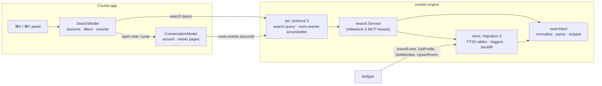

# Courier Milestone 4.2: search

> **For agentic workers:** REQUIRED SUB-SKILL: Use superpowers:subagent-driven-development (recommended) or superpowers:executing-plans to implement this plan task-by-task. Steps use checkbox (`- [ ]`) syntax for tracking.

**Goal:** James presses ⌘K and finds any chat, person or message on this Mac as he types, narrows it by account, type, sender and time, and lands on the exact message in its conversation. ⌘F does the same inside the open chat.

**Architecture:**
- **Engine, index:** three SQLite FTS5 tables in `courier.db` (messages, chat names, people's names), added by one migration. New and edited messages are indexed by the store in the same transaction that writes them; anything that deletes text (a redaction, a deleted chat or event) removes it through SQL triggers, so no path can leave old text behind. Messages already on disk are added by a background job that resumes where it stopped.
- **Engine, queries:** a small `searchtext` package turns what a person types into a safe FTS5 expression (every word quoted, never raw syntax) and makes snippets. A `search` package composes the sections. It is the API milestone 5's MCP calls; `search.query` on the app socket is a thin wrapper over it.
- **Conversation:** `room.events` can read a page around one message and newer pages after it, so a result opens the chat at that message.
- **App:** a `SearchModel` owns ⌘K (debounce, sections, filters, keyboard selection, recents). The conversation model learns to show a window of history away from the newest message and to come back to it.



**Tech Stack:** as milestone 4.1. Go 1.26, mautrix v0.31.0, util v0.10.1, mattn/go-sqlite3 v1.14.52 (bundled SQLite 3.53.4) built with FTS5, `golang.org/x/text/unicode/norm` (already in the graph, v0.42.0, becomes direct). Swift 5 mode, SwiftPM tools 5.9 mirrored in Bazel, SwiftUI with AppKit where SwiftUI falls short.

**Spec:** `docs/superpowers/specs/2026-10-15-courier-iteration-1-design.md` (§3 interface scope and the stub rule, §4 `courier.db` with FTS5 search, §5 failures, §7 part 4.2 "the FTS5 index (§4), search across chats, messages and people, and ⌘K with filters and sections. Milestone 5's MCP reuses it.", §8 built for strangers, sold directly). The interface source is the inventory in `docs/superpowers/specs/2026-10-15-beeper-desktop-inventory/`: `01 §12` (search, command bar, result sections), `02 §2.2` (Search ⌘K, Search: Room ⌘F), `02 §2.6` (command bar commands), `02 §3.1` (app menu Search…), `02 §3.4.1` (chat menu item 11, Search… ⌘F), and the ledger rows named in Task 11. The milestone-4.1 plan (`docs/superpowers/plans/2026-10-17-courier-m4-1-organise-the-inbox.md`) and the code on `main` are the base.

## Global Constraints

- **Earlier constraints:** every Global Constraint of the milestone-1, -2, -3 and -4.1 plans still applies: pins, hand-written AGPL headers on Go and Swift, strings in `Resources/en.lproj/Localizable.strings` via `String(localized:)`, data dir, socket, macOS 14, bundle id, no real accounts in CI, never open a real chat in Beeper while testing, Courier's own wording, no Beeper name or asset. What 4.1 learned holds too: a protocol page may end before its limit to stay under 1 MiB (`fitting`, `maxPageBytes`), and WhatsApp unread marks are never sent.
- **Commands are Bazel targets.** Every command a step runs is `bazel test …`, `bazel build …` or `bazel run …`; never `go test`, `swift test` or raw `git`. After Go file changes run `bazel run //:gazelle`; after a `go.mod` change, `bazel mod tidy` first. Before every commit run `bazel run //:tidy`. Commit with `bazel run //tools/git:commit -- --agent <your agent> -m "<conventional message>" <paths>`.
- **Engine tests:** `bazel test //apps/desktop/courier/engine/...`, and with `--@rules_go//go/config:race` for the store, search and rpc. **App tests:** `bazel test --config=macos-app //apps/desktop/courier/app:CourierCoreTests`.
- **One migration.** Migration 4 is appended to `migrations` in `engine/internal/store/migrate.go`. `schema.sql` and migrations 1–3 are not touched. Add `testdata/m4.sql`: a database at `user_version = 3` with dummy rows (Task 3 lists them).
- **Protocol 3.** `protocol.json` goes to `"protocol": 3`, because the app now relies on a method (`search.query`) and parameters (`room.events` `around` and `after`) that a protocol-2 engine refuses; the handshake must say "update needed" rather than let ⌘K fail. Params stay strict. Every new method, parameter and error case has an example in `protocol/examples/`, and both conformance tests keep passing. No new error codes: `-32602` and `-32020` cover search.
- **What is indexed:** the text a person reads, never media bytes.
  - **Messages:** `m.room.message` (every msgtype) and `m.sticker`, by their `body`. For a reply, the Matrix reply fallback (leading `> ` lines and the blank line after them, only when `m.relates_to.m.in_reply_to` is set) is cut, so a reply isn't found by the words it quotes. An image's or file's body (its caption, or its file name) is indexed. At most the first 16,384 characters. Not indexed: reactions, redactions, state, `m.room.encrypted` placeholders, a failed send that was discarded.
  - **Edits:** an `m.replace` from the original's sender replaces the original's indexed text with `m.new_content.body`; the newest edit by `ts` wins, whichever order they arrive in. A redacted edit puts back the one before it.
  - **Chats:** `rooms.name`. **People:** every ghost (`@me` excluded) by their profile display name and their distinct per-chat member names.
- **How the index matches** (decided; the store and `searchtext` implement exactly this):
  - Tokenizer `unicode61 remove_diacritics 2 categories 'L* N* Co M*'` on every table: case and accents fold ("jose" finds "José", "cafe" finds "café"); combining marks stay inside words, so Hindi and Thai words aren't split.
  - Text and queries are NFKC-normalised in Go first, so full-width "Ｈｅｌｌｏ" finds "hello".
  - Scripts written without spaces (Han, Hiragana, Katakana, Hangul, Thai, Lao, Khmer, Myanmar) get a space around each character before indexing, and a query run in them becomes a phrase of those characters: "東京" finds "東京タワー", and "京タ" finds it too.
  - Emoji and punctuation are not searchable; they separate words. A query of only emoji or punctuation runs no search and says so.
  - All words must match. The last word matches as a prefix while it is still being typed (no trailing space, not in quotes, at least 2 letters). `"two words"` in double quotes is a phrase; an unclosed quote runs to the end. A word the tokenizer would split ("e-mail", "3.14", "o'clock") is a phrase of its parts. `AND`, `OR`, `NOT`, `*`, `:`, `(`, `^` and `NEAR` are ordinary text. At most 500 characters and 16 words are read; the rest is ignored.
  - "Show partial matches" (01 §12) adds, after every full match, messages that match some but not all of the words (Inferred, 01 §12).
  - Messages need at least 2 letters, or one character of a script written without spaces. Chats and people search from the first letter.
  - My own messages are included; the Sent / Received filter narrows them.
  - Every chat is searched, in any place (inbox, archived, low priority, hidden, requests). A result outside the inbox says where it is.
- **Ranking:**
  - **Messages and media: newest first.** Not by relevance: in a chat app the message wanted is usually recent, and FTS5 can walk its matches in rowid order without sorting them, so a common word over a million messages still answers at once and a page never shifts as new messages arrive. A message's rowid encodes its time (Task 3).
  - **Chats and people:** a name that begins with the first word comes first, then the most recent message first.
- **Size and speed budget.** Measured on this Mac with SQLite 3.54.1 and synthetic text (1,000,000 messages, 61 MB of text, 3–18 words each): with no prefix indexes, the message index was 61 MB and the slowest first page (a 1- or 2-letter prefix) took 66 ms; the other queries took 0.1–1 ms. With `prefix='2 3'` the index doubled to 124 MB for the same prefix query in 0.1 ms. **Decision: no prefix indexes.** The budget at 10,000 chats and 1,000,000 messages: the message index stays within 2× the text it holds, and the first page of any query comes back in well under a second. CI checks the budget without timing: query plans (Task 5) and a size ratio at 100,000 messages (Task 5). A wall-clock ceiling of 2 s is logged, never tight.
- **Privacy:** the engine never logs search text, message text or names (counts and durations only). Recent searches live in the app's UserDefaults (as 4.1's preferences do), with "Clear Recent Searches". The index is in `courier.db`, so §8's encryption at rest covers it.
- **Results don't refresh themselves.** A `changed` notification doesn't re-run an open search, so rows never jump under the keyboard. The next keystroke or filter change runs it again.
- **Inferred behaviour** is marked in a code comment `Inferred (inventory 01 §n)` wherever it is implemented: partial matches; "In groups" lists people I have no direct chat with (01 §12 [I]); recent chats are the chats opened most recently; time periods count back from now; Last archived leaves out hidden chats and the open chat (01 §12, [O]).
- **Left out of 4.2, and staying reachable without reworking views:**
  - The Bookmarks section (01 §12): part 4.3, with bookmarks. `SearchSection.Kind` gets the case then.
  - The ⌘J command bar and its "Commands ⌘J" mode switch: part 4.7. This part registers its three commands for it. Part 4.3's formatting keys must not take ⌘K (link) or ⌘F.
  - "Open recently viewed chats" (the ⌘J history picker): part 4.7; ⌘K's Recent section is here.
  - Search inside Settings ("Search Settings", `SearchSuggestions`): part 4.6.
  - Starting a direct chat with someone from "In groups": part 4.5 (⌘N). Here that row opens the group they share with me.
  - The media viewer's caption search: part 4.5.
  - The local API and MCP tools over `search.Service`: milestone 5. Its Go filters already carry what Beeper's `search_messages` takes beyond the app's (several chats, a sender, excluding low priority and muted chats).
  - Not planned in iteration 1: searching history a network never sent Courier, emoji search inside messages, relevance ranking, the hotkey tutorial's "find a chat" page (`ThreadSearchPage`, onboarding).

## Review Focus

1. **Deleted and edited words.** A person expects a deleted message never to come back in search, and an edited message to be found by its new words and not its old ones, whatever order the edit and the message arrived in. A deleted chat leaves nothing behind. **Test:** Task 3 (`TestRedactedMessageLeavesTheIndex`, `TestEditReplacesTheIndexedText`, `TestEditBeforeItsMessageStillWins`, `TestRedactingAnEditPutsBackTheOneBefore`, `TestDeletingAChatLeavesNoText`).
2. **Anything typed is safe.** Quotes, `*`, `-`, `(`, `AND`, `NEAR(`, a lone `"`, a colon, a 10,000-character paste or emoji alone: none is ever an error or a crash, and each returns what a person would expect (literal words, or the calm "emoji aren't searched" line). FTS5 syntax errors are the classic failure here. **Test:** Task 2 (`TestAnyTextIsASafeQuery`, run over a seed corpus and `FuzzMatchExpr`) and Task 5 (`TestStrangeTextNeverFails`, through the real index).
3. **Accents, case, width and scripts.** "jose" finds "José", "CAFE" finds "café", "Ｈｅｌｌｏ" finds "hello", "東京" finds a message saying "東京タワー", and a Hindi word isn't split in two. **Test:** Task 2 (`TestFoldsAccentsCaseAndWidth`, `TestScriptsWithoutSpacesMatchInsideWords`, `TestCombiningMarksStayInWords`) and Task 5 (`TestMatchingEndToEnd`).
4. **A big history, after the update.** Opening the updated Courier on a `courier.db` with a million messages starts as fast as before; new messages are searchable at once; older ones fill in behind; quitting halfway resumes without indexing anything twice; and at 10,000 chats every query walks the index rather than the tables. **Test:** Task 4 (`TestBackfillResumesAndIndexesEachMessageOnce`, `TestEngineServesWhileTheBackfillRuns`) and Task 5 (`TestSearchPlansWalkTheIndex`, `TestIndexStaysWithinTwiceTheText`).
5. **Jumping to an old message.** Choosing a result from last year opens the chat at that message, highlighted, not at the bottom. New messages arriving meanwhile don't move the view; "Jump to latest" and sending a message both go back to the newest. **Test:** Task 9 (`testJumpOpensAroundTheMessage`, `testNewMessagesWhileAwayDoNotMoveTheView`, `testSendingReturnsToTheLatest`).

---

## File structure

```
apps/desktop/courier/
  protocol/protocol.json, protocol/examples/*.json     (modify) protocol 3: search.query, room.events around/after
  engine/go.mod                                        (modify) golang.org/x/text becomes direct
  engine/internal/sqlite/open_test.go                  (modify) FTS5 is compiled in
  engine/internal/searchtext/                          normalise, parse, match expression, snippet (pure Go)
  engine/internal/store/
    migrate.go                (modify) migration 4: FTS5 tables, doc ids, triggers, backfill state
    searchindex.go            index writes: messages, edits, chats, people; the backfill batch
    search.go                 SearchMessages, SearchChats, SearchPeopleInGroups, LastArchived, SearchComplete
    events.go                 EventsAround, EventsAfter
    store.go                  (modify) InsertEvent, redact, UpsertRoom, SetProfile, SetMember, DeleteMember call the indexer
    testdata/m4.sql
  engine/internal/search/search.go                     Service: sections, filters, cursors; RunBackfill
  engine/internal/rpc/search.go                        (create) search.query
  engine/internal/rpc/methods.go, server.go            (modify) room.events around/after; Deps.Search; Protocol = 3
  engine/cmd/courier-engine/main.go                    (modify) starts the backfill
  app/Sources/CourierCore/
    Protocol.swift            (modify) protocol-3 types
    SearchModel.swift         SearchModel, SearchFilterSet, SearchSection, SearchItem, SearchTarget
    RecentSearches.swift      recent searches and recent chats (UserDefaults)
    ConversationModel.swift   (modify) open at a message, newer pages, highlight
    CommandSet.swift          (modify) the three search commands
  app/Sources/Courier/
    SearchPanel.swift, SearchRows.swift, SearchFilterBar.swift
    MainWindow.swift, ConversationView.swift, InboxCommands.swift, ChatContextMenu.swift, App.swift   (modify)
  app/Tests/CourierCoreTests/   new and extended tests, named in each task
  docs/m4-acceptance.md         (modify) the 4.2 section, written in Task 11
tools/go_deps/go-sqlite3-fts5.patch, MODULE.bazel   (Task 1, owned by forge)
```

---

### Task 1: SQLite with FTS5

**Owner:** `forge` (the build-system specialist) makes the `MODULE.bazel` change; wren writes the test and hands forge the failing run.

**Files:**
- Modify: `engine/internal/sqlite/open_test.go`
- Create: `tools/go_deps/go-sqlite3-fts5.patch`; modify `MODULE.bazel` (a `go_deps.module_override` for `github.com/mattn/go-sqlite3`, beside the webp and libsignal overrides, with a comment in their style)

**Why:** mattn/go-sqlite3 v1.14.52 compiles FTS5 only with the `sqlite_fts5` build tag (`sqlite3_opt_fts5.go`: `-DSQLITE_ENABLE_FTS5`), and nothing in the repo sets it, so `courier.db` has no FTS5 today. A repo-wide `--@rules_go//go/config:tags` flag would also work, but it is lost by any build that doesn't read `.bazelrc`; the patch makes FTS5 a property of the dependency. The patch adds `"-DSQLITE_ENABLE_FTS5"` to the `copts` of the gazelle-generated `go_library` in the module's `BUILD.bazel` (go_repository applies patches after gazelle, as the libsignal patch relies on). The bridges' databases use the same library and are unaffected.

- [ ] **Step 1: Write the failing test** `TestFTS5IsCompiledIn`: open a temp database with `sqlite.Open`; `PRAGMA compile_options` lists `ENABLE_FTS5`; `sqlite_version()` is at least 3.43.0 (needed for `contentless_delete`); creating `CREATE VIRTUAL TABLE t USING fts5(x, content='', contentless_delete=1, tokenize="unicode61 remove_diacritics 2 categories 'L* N* Co M*'")` succeeds, and a row inserted then deleted by rowid no longer matches.
- [ ] **Step 2: Run it to verify it fails.** `bazel test //apps/desktop/courier/engine/internal/sqlite:sqlite_test`. Expected: FAIL, `no such module: fts5`.
- [ ] **Step 3: forge adds the patch and the override.**
- [ ] **Step 4: Run the engine suite.** `bazel test //apps/desktop/courier/engine/...`. Expected: PASS, the new test included, on macOS and in the Linux lanes.
- [ ] **Step 5: Commit** with `build(courier): compile SQLite with FTS5 for the search index`.

---

### Task 2: What a person types becomes a safe query

**Files:**
- Create: `engine/internal/searchtext/searchtext.go`, `searchtext_test.go`, `fuzz_test.go`, `testdata/queries.txt`
- Modify: `engine/go.mod` (`golang.org/x/text` direct), then `bazel mod tidy` and gazelle

**Interfaces:**
- Produces:

```go
package searchtext

const MaxQueryRunes = 500 // the rest of a longer query is ignored
const MaxTerms = 16        // so are words past the 16th
const MaxIndexRunes = 16384

// Normalize is what both the index and a query see: NFKC, then a space either side of every character of a
// script written without spaces (Han, Hiragana, Katakana, Hangul, Thai, Lao, Khmer, Myanmar).
func Normalize(s string) string
// Words splits normalised text into the tokens the FTS5 tokenizer makes: runs of letters, numbers, marks and
// private-use characters, case-folded with accents removed (NFKD, drop Mn, lower). Snippets and phrases use it.
func Words(s string) []string

type Term struct {
	Text   string // normalised; for a phrase, its words separated by single spaces
	Phrase bool   // in quotes, or a word that splits into several tokens, or a run of a script without spaces
	Prefix bool   // the last word, still being typed
}
func Parse(q string) []Term          // nil when nothing searchable is left (emoji or punctuation only)
func Letters(terms []Term) int        // letters across terms; a script-without-spaces character counts as 2
// MatchAll / MatchAny are FTS5 expressions over column: every term double-quoted with inner quotes doubled,
// prefix as "abc"*. "" when terms is empty. Never anything else of FTS5's syntax comes from the person.
func MatchAll(column string, terms []Term) string
func MatchAny(column string, terms []Term) string
type Range struct{ Start, Length int } // UTF-16 code units, as AppKit counts them
// Snippet is at most maxRunes of text around the first match (the start of text when none), with "…" where it
// was cut, and the ranges of every matched word or phrase in it.
func Snippet(text string, terms []Term, maxRunes int) (string, []Range)
```

- **Prefix rule:** only the last term, only when the raw query doesn't end in whitespace or a closing quote, the term isn't a phrase, and it has at least 2 runes.
- **Unclosed quote:** the phrase runs to the end of the query.
- [ ] **Step 1: Write the failing tests** (table-driven, exact outputs):
  - `TestParseWordsPhrasesAndPrefix`:
    - `see you` → `[{see} {you, Prefix}]`;
    - `see you ` → no prefix;
    - `"see you" soon` → `[{see you, Phrase} {soon, Prefix}]`;
    - `"see you` → `[{see you, Phrase}]`;
    - `e-mail` → `[{e mail, Phrase}]`;
    - `a` → `[{a}]` (one letter: no prefix).
  - `TestFTSSyntaxIsPlainText`: `AND`, `OR`, `NOT`, `NEAR(a b)`, `a*`, `col:x`, `^start`, `(x)` each give terms of their letters only, and `MatchAll("body", …)` quotes every one: `NEAR(a b)` → `{body}: ("near" AND "a" AND "b")` (the last word has one letter, so no prefix); `meet AND gre` → `{body}: ("meet" AND "and" AND "gre"*)`.
  - `TestQuoteMarksNeverUnbalanceTheExpression`: `he said "hi` → `{body}: ("he" AND "said" AND "hi")`; `""`, `"` and `a"b"c` give an even number of `"`.
  - `TestFoldsAccentsCaseAndWidth` (Review Focus 3): `Words(Normalize("José CAFÉ Ｈｅｌｌｏ"))` is `[jose cafe hello]`.
  - `TestScriptsWithoutSpacesMatchInsideWords` (Review Focus 3): `Normalize("東京タワー")` is `"東 京 タ ワ ー"` (single spaces, trimmed); `Parse("東京")` is one phrase `東 京`; `Parse("猫")` has `Letters` 2.
  - `TestCombiningMarksStayInWords`: `Words("नमस्ते दोस्त")` has 2 words.
  - `TestEmojiAndPunctuationOnlyIsNothing`: `Parse("🎉🎉")`, `Parse("?!…")` and `Parse("")` are nil.
  - `TestLongQueriesAreCut`: 600 runes read as 500; 20 words give 16 terms.
  - `TestSnippetCentresOnTheFirstMatch`: 400-rune text with "dinner" at rune 300, `maxRunes` 160: the snippet starts and ends with "…", contains "dinner", and its one range covers exactly "dinner" in UTF-16 units; a text with an emoji before the match still gives the right UTF-16 start; "José" in the text is highlighted for the term `jose`.
  - `TestAnyTextIsASafeQuery` (Review Focus 2): over a seed corpus kept in `engine/internal/searchtext/testdata/queries.txt`, one query per line, Go-quoted (an exported `filegroup`, so Task 5's test reads the same file as `data`): every printable ASCII character alone; `"`, `""`, `"""`; `*`; `NEAR(`; `a:b`; `-x`; 10,000 × `a`; mixed scripts; invalid UTF-8 bytes. `MatchAll` and `MatchAny` either return "" or an expression whose `"` count is even, has no bare `*` except right after a closing quote, and has no `:` except after `{body}` or `{scope}`. `FuzzMatchExpr` asserts the same over random input.
- [ ] **Step 2: Run them to verify they fail.** `bazel test //apps/desktop/courier/engine/internal/searchtext:searchtext_test`. Expected: FAIL, undefined `Parse`.
- [ ] **Step 3: Implement.** `Words` mirrors unicode61's rule with `unicode.In(r, unicode.L, unicode.N, unicode.M, unicode.Co)`. The script set is `unicode.Han, Hiragana, Katakana, Hangul, Thai, Lao, Khmer, Myanmar`.
- [ ] **Step 4: Run the tests.** Expected: PASS.
- [ ] **Step 5: Commit** with `feat(courier): turn typed text into a safe FTS5 query`.

---

### Task 3: The index, and keeping it true

**Files:**
- Modify: `engine/internal/store/migrate.go` (migration 4), `store.go` (`InsertEvent`, `redact`, `UpsertRoom`, `SetProfile`, `SetMember`, `DeleteMember` call the indexer inside their transaction; the last three gain one)
- Create: `engine/internal/store/searchindex.go`, `searchindex_test.go`, `testdata/m4.sql`

**Migration 4** (exact shape; `editTargetSQL` and `isEditSQL` are new helpers in the style of `notEditSQL`, each guarded by `json_valid`):

```sql
ALTER TABLE events ADD COLUMN doc_id INTEGER;            -- the message's row in search_messages; NULL = not indexed
CREATE UNIQUE INDEX events_doc ON events(doc_id) WHERE doc_id IS NOT NULL;
CREATE INDEX events_edits ON events(<editTargetSQL("content")>, ts) WHERE type = 'm.room.message' AND <isEditSQL("content")>;
CREATE VIRTUAL TABLE search_messages USING fts5(body, scope, content='', contentless_delete=1,
  tokenize="unicode61 remove_diacritics 2 categories 'L* N* Co M*'");
CREATE TABLE chat_docs (doc_id INTEGER PRIMARY KEY, room_id TEXT NOT NULL UNIQUE REFERENCES rooms(room_id) ON DELETE CASCADE);
CREATE VIRTUAL TABLE search_chats USING fts5(name, scope, content='', contentless_delete=1, tokenize=<the same>);
CREATE TABLE people_docs (doc_id INTEGER PRIMARY KEY, user_id TEXT NOT NULL UNIQUE);
CREATE VIRTUAL TABLE search_people USING fts5(name, scope, content='', contentless_delete=1, tokenize=<the same>);
CREATE TABLE search_state (key TEXT PRIMARY KEY, value INTEGER NOT NULL);
INSERT INTO search_state VALUES ('backfill_until', (SELECT COALESCE(MAX(rowid), 0) FROM events)), ('backfill_after', 0);
CREATE TRIGGER events_unindex AFTER DELETE ON events WHEN old.doc_id IS NOT NULL
  BEGIN DELETE FROM search_messages WHERE rowid = old.doc_id; END;
CREATE TRIGGER events_unindex_redacted AFTER UPDATE OF redacted ON events WHEN new.redacted = 1 AND old.doc_id IS NOT NULL
  BEGIN DELETE FROM search_messages WHERE rowid = old.doc_id; UPDATE events SET doc_id = NULL WHERE event_id = new.event_id; END;
CREATE TRIGGER chat_docs_unindex AFTER DELETE ON chat_docs BEGIN DELETE FROM search_chats WHERE rowid = old.doc_id; END;
CREATE TRIGGER people_docs_unindex AFTER DELETE ON people_docs BEGIN DELETE FROM search_people WHERE rowid = old.doc_id; END;
```

The migration indexes nothing itself: text must go through `searchtext.Normalize`, which is Go, and a million messages inside the migration's one transaction would hold up the engine's start. Task 4's backfill does it, for every event with `rowid <= backfill_until`. Events inserted after the migration are indexed by `InsertEvent`.

**Values:**
- **A message's doc id** is `ts_ms << 10 | n`, with `n` the first free value in `0..1023` for that millisecond (`SELECT MAX(doc_id) FROM events WHERE doc_id BETWEEN ts<<10 AND ts<<10|1023`, through `events_doc`). Doc-id order is time order, so the newest match is the first FTS5 yields. A negative `ts` counts as 0. With all 1,024 taken, the message isn't indexed and a warning is logged (count only).
- **Scope tokens**, space-separated in the `scope` column, plain lowercase ASCII so the tokenizer keeps them whole:
  - messages: `all`, `r<16 hex of sha256(room_id)>`, `s<16 hex of sha256(sender)>`, `me` for mine, `n<network>`, and one `k<kind>` per kind: `ktext` (text, notice, emote), `kimage`, `kvideo`, `kaudio`, `kfile`, `ksticker`, plus `klink` when the text contains `http://` or `https://`;
  - chats: `all`, `n<network>`, `dm` or `group`;
  - people: `all`, `n<network>` for each network of a chat they're in.
- **A chat's doc** is re-written on every `UpsertRoom` (its name or `is_direct` may change); an empty name removes it. **A person's doc** is re-written by `SetProfile`, `SetMember` and `DeleteMember` for that user; no names left removes it. Both rows are deleted then inserted under the same doc id.

**Interfaces:**
- Consumes: Task 2's `Normalize`, `MaxIndexRunes`.
- Produces (in package `store`; the exported ones are used by Tasks 4–5 and tests):

```go
func (s *Store) indexEvent(ctx context.Context, e Event) error       // inside InsertEvent's transaction
func (s *Store) applyEdit(ctx context.Context, edit Event) error      // re-indexes the edit's target, if indexed and the edit is its newest
func (s *Store) indexChat(ctx context.Context, r Room) error
func (s *Store) indexPerson(ctx context.Context, userID string) error
// MessageText is an event's own searchable text (its body, reply fallback cut, at most MaxIndexRunes) and its
// kind. ok is false for anything that isn't indexed. Edits are not applied here.
func MessageText(typ string, content json.RawMessage) (text, kind string, ok bool)
// CurrentText is the text as it reads now: the m.new_content.body of the newest edit from the same sender
// (looked up through events_edits), else MessageText.
func (s *Store) CurrentText(ctx context.Context, e Event) (string, error)
```

- [ ] **Step 1: Write the failing tests** in `searchindex_test.go`. A test helper `matches(t, s, expr) []string` returns the event IDs whose doc matches a raw FTS5 expression, newest first.
  - `TestMigrationFromMilestone4_1`: `testdata/m4.sql` (rooms on two networks, ~20 events: text, an image with a caption, a reply, an edit, a redaction, a reaction, an encrypted placeholder, a Japanese message; two profiles and members) upgrades to `user_version = 4`; `backfill_until` is the largest rowid; nothing is indexed yet; `Inbox` still works.
  - `TestNewMessagesAreIndexedAtOnce`: an `m.room.message` "dinner at eight" is found by `"dinner"`; a reaction, a state event and an `m.room.encrypted` event get no doc id.
  - `TestDocIDsFollowTime`: messages inserted out of time order (backfill) still come out of `matches` newest-ts first; three in the same millisecond get `n` 0, 1, 2.
  - `TestReplyFallbackIsNotIndexed`: a reply whose body is `"> <@a> where are you\n\nhome soon"` with `m.in_reply_to` set is found by "home", not "where"; the same body without `m.in_reply_to` is found by both.
  - `TestEditReplacesTheIndexedText` (Review Focus 1): "meet at noon", then an edit to "meet at five": "noon" finds nothing, "five" finds the original event ID (not the edit's). An edit from another sender changes nothing.
  - `TestEditBeforeItsMessageStillWins` (Review Focus 1): the edit is inserted first, then its original: "five" finds it, "noon" doesn't. Of two edits, the later `ts` wins in either arrival order.
  - `TestRedactedMessageLeavesTheIndex` (Review Focus 1): redacting a message removes its doc and sets `doc_id` NULL; a failed redaction (status `failed`) removes nothing.
  - `TestRedactingAnEditPutsBackTheOneBefore`: original "a", edit "b", edit "c"; redacting "c" makes "b" match and "c" not.
  - `TestDeletingAChatLeavesNoText` (Review Focus 1): `DeleteRoom` leaves no match in `search_messages` or `search_chats` for it (`SELECT count(*) FROM search_messages WHERE search_messages MATCH '{scope}: "r…"'` is 0); `DeleteEvent` of a failed send removes its doc.
  - `TestChatAndPeopleDocsFollowTheirNames`: renaming a chat, clearing its name, a ghost's profile name change, a member name only in one group, and the member leaving each leave exactly the expected matches; `@me` is never a person.
  - `TestScopeTokens`: a WhatsApp image with a caption containing a link from `@me` in a group matches `{scope}: "me" AND {scope}: "kimage" AND {scope}: "klink" AND {scope}: "nwhatsapp"`.
  - `TestEditLookupUsesItsIndex`: the `CurrentText` query's `EXPLAIN QUERY PLAN` uses `events_edits`.
- [ ] **Step 2: Run them to verify they fail.** `bazel test //apps/desktop/courier/engine/internal/store:store_test`. Expected: FAIL, undefined `indexEvent`.
- [ ] **Step 3: Implement** `searchindex.go`, and call the indexer from the store methods above. `redact` also calls `applyEdit` for the edit's target when the redacted event is an edit. Run `bazel run //:gazelle`.
- [ ] **Step 4: Run the store tests.** Expected: PASS, also with race.
- [ ] **Step 5: Commit** with `feat(courier): an FTS5 index of messages, chats and people that edits and deletions keep true`.

---

### Task 4: History already on disk fills in behind

**Files:**
- Modify: `engine/internal/store/searchindex.go`, `searchindex_test.go`
- Create: `engine/internal/search/backfill.go`, `backfill_test.go`
- Modify: `engine/cmd/courier-engine/main.go`, `main_test.go`

**Interfaces:**
- Consumes: Task 3's indexer.
- Produces:

```go
// store
// BackfillSearch indexes up to batch things not yet indexed, in one transaction: first chats without a doc, then
// people without one, then events with backfill_after < rowid <= backfill_until (skipping redacted ones and those
// that already have a doc id), moving backfill_after past what it read. done is true once nothing is left.
func (s *Store) BackfillSearch(ctx context.Context, batch int) (done bool, err error)
func (s *Store) SearchComplete(ctx context.Context) (bool, error) // backfill_after >= backfill_until, and no chat or person waits
// search
const BackfillBatch = 2000
const BackfillPause = 20 * time.Millisecond  // between batches, so bridges' writes get the database
const BackfillRetry = 30 * time.Second       // after an error
func RunBackfill(ctx context.Context, s *store.Store, log zerolog.Logger) // returns when done or ctx ends
```

- Each batch's own events are indexed through the same `indexEvent` and `CurrentText` as Task 3, so an edit that arrived before the backfill reached its message is still applied.
- `main.go` starts `RunBackfill` after `FailInterruptedSends`, in a goroutine with the engine's context, and waits for it before the store closes, as the timers do. It logs "search backfill done" with the count and duration, never text.

- [ ] **Step 1: Write the failing tests:**
  - `TestBackfillIndexesTheMilestone4_1Database`: after `BackfillSearch` until done on `m4.sql`: every text message is found by a word of its text, the edited one by its edit, the redacted and the encrypted ones not, the Japanese one by two of its characters; `SearchComplete` is true. With `COURIER_KEEP_DB=1` in its environment it copies the finished database to `TEST_UNDECLARED_OUTPUTS_DIR` (Task 10's by-hand check uses it).
  - `TestBackfillResumesAndIndexesEachMessageOnce` (Review Focus 4): 5,000 events at migration time, batch 1,000: two batches, close the store, reopen, run until done. Every event has a distinct doc id, `SELECT count(*) FROM search_messages` (via `matches("{scope}: \"all\"")`) is 5,000, and a third run indexes nothing.
  - `TestNewMessagesDuringBackfillAreNotIndexedTwice`: an event inserted between two batches is indexed by `InsertEvent` and skipped by the backfill.
  - `TestRunBackfillStopsWithItsContext` and `TestRunBackfillRetriesAfterAnError` (a store closed under it logs one warning and returns once the context ends).
  - `TestEngineServesWhileTheBackfillRuns` (Review Focus 4) in `main_test.go`: with 50,000 unindexed events seeded, the ready line comes before `SearchComplete` is true.
- [ ] **Step 2: Run them to verify they fail.** `bazel test //apps/desktop/courier/engine/internal/store:store_test //apps/desktop/courier/engine/internal/search:search_test //apps/desktop/courier/engine/cmd/courier-engine:courier-engine_test`. Expected: FAIL.
- [ ] **Step 3: Implement.** Run `bazel run //:gazelle` for the new package.
- [ ] **Step 4: Run the engine suite with race.** Expected: PASS.
- [ ] **Step 5: Commit** with `feat(courier): add messages already on this Mac to search, in the background`.

---

### Task 5: Searching the index

**Files:**
- Create: `engine/internal/store/search.go`, `search_test.go`, `searchscale_test.go`

**Interfaces:**
- Consumes: Task 2's `Term`, `MatchAll`, `MatchAny`; Task 3's tables and `CurrentText`.
- Produces:

```go
type MessageQuery struct {
	Terms              []searchtext.Term // may be empty when a positive filter is given
	Partial            bool              // after the full matches, those with some of the words
	RoomIDs            []string          // 0..100
	Networks           []string
	Sender             string            // "" | "me" | "others" | a user ID (milestone 5)
	ChatType           string            // "" | "dm" | "group"
	Kinds, NotKinds    []string          // text image video audio file sticker link
	Since, Until       time.Time         // zero = open; Until is exclusive
	ExcludeLowPriority bool              // milestone 5
	ExcludeMuted       bool              // milestone 5; muted by the chat, its account or a label
	After              string            // the cursor of the previous page of the same query
	Limit              int               // 1..50
}
type MessageHit struct {
	Event              Event
	Text, Kind         string // CurrentText and its kind
	RoomName, Network  string
	IsDirect           bool
	Place              string // inbox | archive | low_priority | hidden | requests (Task 2 of 4.1's "where a chat is")
	MediaURI           string // the image's or video's thumbnail (or the file) for kimage / kvideo, else ""
	Partial            bool   // a partial match
}
func (s *Store) SearchMessages(ctx context.Context, q MessageQuery) ([]MessageHit, string, error) // next "" = last page
type NameQuery struct { Terms []searchtext.Term; Networks []string; ChatType string; Limit int } // Limit 1..100
func (s *Store) SearchChats(ctx context.Context, q NameQuery) ([]InboxRow, error)
type PersonHit struct { UserID, Name, Network, AvatarURI, RoomID, RoomName string; Groups int }
func (s *Store) SearchPeopleInGroups(ctx context.Context, q NameQuery) ([]PersonHit, error)
func (s *Store) LastArchived(ctx context.Context, except string) (InboxRow, bool, error)
var ErrNoQuery = errors.New("nothing to search for")
```

- **The message query** is one statement, `CROSS JOIN` fixing the order so FTS5 drives it:

```sql
SELECT … FROM search_messages f CROSS JOIN events e ON e.doc_id = f.rowid CROSS JOIN rooms r ON r.room_id = e.room_id
  LEFT JOIN room_prefs p ON p.room_id = r.room_id …
WHERE f.search_messages MATCH $1 AND f.rowid < $2 [AND f.rowid >= $3] [post-filters on r and p]
ORDER BY f.rowid DESC LIMIT $n
```

  - `$1` is `MatchAll("body", terms)` AND'ed with the scope part, built from the filters as quoted tokens: rooms as `{scope}: ("r…" OR "r…")`, networks likewise, `"me"` or `NOT "me"`, kinds, `NOT` for `NotKinds`. With no terms, the scope part alone, led by `{scope}: "all"`. No terms and no positive filter is `ErrNoQuery`.
  - `Since` and `Until` become rowid bounds (`ts << 10`), so a time filter costs nothing.
  - Chat type, place and mute are post-filters on `r` and `p` (every chat is about half DMs, so few rows are skipped).
  - **Partial:** phase 0 is `MatchAll`; when it runs out and `Partial` is on, phase 1 is `(MatchAny) NOT (MatchAll)`. Only with 2 terms or more.
  - **Cursor:** base64url JSON `{"q": <hash of everything but After and Limit>, "p": phase, "r": last rowid}`; `ErrBadCursor` for another query's.
- **Chats:** `search_chats` matched with `MatchAll("name", …)` and the scope part, joined to rooms, read in full (at most the chats there are), ordered by "its normalised name starts with the first term" first, then `last_ts` DESC, `room_id`; the first `Limit` go through `InboxPage(RoomIDs)` for whole rows, in that order. DMs whose person matches (`search_people` → their `is_direct` room) join the list, so a DM named by a phone number is found by the person's name.
- **In groups:** people matching, with no `is_direct` chat shared with me, in at least one group. `RoomID` is that group with the newest message; `Groups` counts them. Same order rule.
- **Last archived:** the chat with the largest `archived_at`, not hidden, not `except` (the open chat), or none.

- [ ] **Step 1: Write the failing tests** in `search_test.go`, over a fixture of 3 networks, 12 chats (DMs and groups, one in each place), 200 messages:
  - `TestMatchingEndToEnd` (Review Focus 3): "jose", "CAFE", "Ｈｅｌｌｏ", "東京" and "京タ" each find their message; "dinn" (prefix) finds "dinner"; "dinn " doesn't.
  - `TestAllWordsMustMatchAndPhrasesKeepOrder`: `see soon` finds "see you soon" and "soon, see"; `"see you"` finds only the first.
  - `TestPartialMatchesComeAfterFullOnes`: with `Partial`, the full matches page fully (newest first), then the partial ones, each once, across pages of 3.
  - `TestNewestFirstAndPagesNeverRepeat`: 200 matches in pages of 20 give each event once, newest first; a message inserted between pages doesn't appear in later pages.
  - `TestFiltersNarrowMessages`: one case each: a room, two rooms, a network, me, others, dm, group, `kimage`, `NotKinds [image video]`, `klink`, since/until (exclusive), low priority excluded, muted excluded; and filters with no text (`Kinds [image]` lists every image newest first).
  - `TestEditedMessagesSnippetTheirNewText`: the hit's `Text` is the edit's.
  - `TestStrangeTextNeverFails` (Review Focus 2): every string of Task 2's seed corpus through `Parse` → `SearchMessages`, `SearchChats` and `SearchPeopleInGroups` returns rows or `ErrNoQuery`, never another error.
  - `TestCursorFromAnotherQueryIsRefused`
  - `TestChatsStartingWithTheWordComeFirst`: "an" matches "Anna" and "Book club (Andrew)", not "Joanna's group" (prefixes start at a word); "Anna" comes first because its name begins with the word, though "Book club" has the newer message; two names that both begin with it go newest first.
  - `TestDirectChatFoundByThePersonsName`, `TestInGroupsListsOnlyPeopleWithoutADirectChat`, `TestLastArchivedSkipsHiddenAndTheOpenChat`
- [ ] **Step 2: Write the scale tests** in `searchscale_test.go`. The fixture writes 10,000 chats and 100,000 messages (10 each, Zipf-distributed words from a 30,000-word list, a fixed seed) in one transaction through `indexEvent`.
  - `TestSearchPlansWalkTheIndex` (Review Focus 4): for each of text only; text + room; text + dm; text + network; kinds only; partial phase 1; a second page; since and until: the `EXPLAIN QUERY PLAN` has a `search_messages VIRTUAL TABLE INDEX` line, `events` searched `USING INDEX events_doc`, `rooms` searched by its primary key, and no line with `SCAN e`, `SCAN r`, `SCAN events`, `SCAN rooms` or `TEMP B-TREE`. Chats and In groups have no `SCAN rooms`. That is the real check; each first page must also come back within 2 s, a loose ceiling, with the time logged.
  - `TestIndexStaysWithinTwiceTheText` (Review Focus 4): `PRAGMA page_count × page_size` grows by at most twice the bytes of the indexed message text between before and after indexing (the measured ratio at this size was 1.57, including scope tokens).
- [ ] **Step 3: Run them to verify they fail.** `bazel test //apps/desktop/courier/engine/internal/store:store_test`. Expected: FAIL, undefined `SearchMessages`.
- [ ] **Step 4: Implement `search.go`.** SQL is built from fixed fragments; every value is a bound parameter, and the MATCH expression is one bound parameter built only by `searchtext`. If a plan check needs another index, add it to migration 4, which hasn't shipped.
- [ ] **Step 5: Run the store tests.** Expected: PASS, also with race. Note the logged times in the PR.
- [ ] **Step 6: Commit** with `feat(courier): search messages, chats and people, newest first, through the index`.

---

### Task 6: A chat's history around one message

**Files:**
- Create: `engine/internal/store/events.go`, `events_test.go`

**Interfaces:**
- Produces:

```go
// EventsAround is the page of roomID's history centred on eventID, newest first: up to limit/2 events older than
// it, the event itself, and the rest newer. before is the cursor for the next older page (nil at the oldest); after
// is the newest event of the page (nil when the page has the room's newest event). ErrNotFound when eventID isn't
// in roomID.
func (s *Store) EventsAround(ctx context.Context, roomID, eventID string, limit int) (evs []Event, before, after *Cursor, err error)
// EventsAfter is the limit events just newer than after, newest first, with the cursor of the newest of them (nil
// when that is the room's newest event).
func (s *Store) EventsAfter(ctx context.Context, roomID string, after Cursor, limit int) ([]Event, *Cursor, error)
```

Both order by `(ts, seq)` through `events_room_ts`, as `EventsBefore` does, and read one extra row to know whether more exist.

- [ ] **Step 1: Write the failing tests:** `TestAroundCentresOnTheMessage` (100 events, around the 30th with limit 10: the 4 older, it, 5 newer; both cursors set), `TestAroundAtTheEdges` (the newest: after is nil; the oldest: before is nil), `TestAfterWalksForwardToTheNewest` (paging with `EventsAfter` from the oldest reaches the newest with each event once and ends with nil), `TestEqualTimestampsKeepSeqOrder`, `TestAroundAnEventInAnotherRoomIsNotFound`.
- [ ] **Step 2: Run them to verify they fail.** `bazel test //apps/desktop/courier/engine/internal/store:store_test`. Expected: FAIL.
- [ ] **Step 3: Implement.**
- [ ] **Step 4: Run the store tests.** Expected: PASS.
- [ ] **Step 5: Commit** with `feat(courier): read a chat's history around a message and forward from it`.

---

### Task 7: The search service and protocol 3

**Files:**
- Create: `engine/internal/search/search.go`, `search_test.go`; `engine/internal/rpc/search.go`, `search_test.go`
- Modify: `engine/internal/rpc/server.go` (`Protocol = 3`; `Deps` gains `Search *search.Service`), `methods.go` (`room.events`), `conformance_test.go` if its loader needs it; `engine/cmd/courier-engine/main.go` (`search.New(s)` into `Deps`)
- Modify: `protocol/protocol.json`; add examples

**Interfaces:**
- Consumes: Tasks 2, 5 and 6.
- Produces (the seam milestone 5's MCP calls; nothing in it knows about JSON-RPC):

```go
package search
type Section string
const (Chats Section = "chats"; InGroups Section = "in_groups"; Media Section = "media"; Messages Section = "messages")
type Filters struct {
	RoomIDs, Networks, Kinds  []string
	Sender, ChatType          string
	Since, Until              time.Time
	Partial                   bool
	ExcludeLowPriority, ExcludeMuted bool // milestone 5; the app protocol doesn't carry them
}
type Request struct { Text string; Sections []Section; Filters Filters; Cursor string; Limit int; OpenRoomID string }
type Response struct {
	Chats         []store.InboxRow    // nil when not asked or not run
	InGroups      []store.PersonHit
	Media         *MessagePage
	Messages      *MessagePage
	LastArchived  *store.InboxRow     // only for empty text with no filters
	Complete      bool                // store.SearchComplete
	Hint          string              // "" | "emoji_only" | "need_more_letters"
}
type MessagePage struct { Hits []Hit; Next string }
type Hit struct { store.MessageHit; Snippet string; Ranges []searchtext.Range }
func New(s *store.Store) *Service
func (s *Service) Query(ctx context.Context, r Request) (Response, error)
var ErrBadRequest = errors.New("bad search request") // wrapped with the reason
```

- **Service rules:**
  - Default sections: all four. A cursor needs exactly one section, `media` or `messages`.
  - Limits: chats and in groups 1–100, default 5; messages 1–50, default 20; media 1–50, default 12.
  - Media is `Kinds ∩ {image, video}` (both when none is set). Messages is `NotKinds [image video]`, and keeps the person's other kinds. A kinds filter of only images leaves Messages out.
  - `RoomIDs` leaves out Chats and In groups. `Sender`, `Kinds`, `Since`, `Until` and `Partial` apply to Media and Messages only.
  - Empty text with no filters: only `LastArchived`. Text that `Parse` empties: `Hint "emoji_only"`, nothing run. Under 2 letters: chats and in groups run, messages and media don't, `Hint "need_more_letters"`.
  - Snippets are 160 runes.
- **Protocol additions** (`protocol.json`; Swift names them the same):
  - `hello`: `protocol` 3; the mismatch example says `{"engine": 3}`.
  - `room.events`: `RoomEventsParams` gains `around: string?` (an event ID) and `after: Cursor?`; `before`, `after` and `around` are exclusive (`-32602`). `EventsPage` gains `after: Cursor|null`: "The newest event of this page, to pass as after for the next newer page. null when the page has the chat's newest event." `around` naming an event not in the chat is `-32020`.
  - **`search.query`** `SearchParams` → `SearchResult`, errors `-32020` (a room_ids chat doesn't exist) and the general `-32602`. Doc: "Search this Mac's chats, people and messages. Answers don't change by themselves: run it again for newer results."

| Type | Fields |
|---|---|
| `SearchParams` | `text: string` (0–500 characters; longer is `-32602`), `sections: string[]?` (values `chats`, `in_groups`, `media`, `messages`), `filters: SearchFilters?`, `cursor: string?`, `limit: int?` |
| `SearchFilters` | `room_ids: string[]?` (1–100), `networks: string[]?`, `sender: string?` (`me`, `others`), `chat_type: string?` (`dm`, `group`), `kinds: string[]?` (`text`, `image`, `video`, `audio`, `file`, `sticker`, `link`), `since: int?`, `until: int?` (since < until), `partial: bool?` |
| `SearchResult` | `chats: InboxRow[]|null`, `in_groups: PersonHit[]|null`, `media: MessageHits|null`, `messages: MessageHits|null`, `last_archived: InboxRow|null`, `complete: bool` ("false while older messages are still being added; results may be missing some"), `hint: string` (values `""`, `emoji_only`, `need_more_letters`) |
| `PersonHit` | `user_id`, `name`, `network`, `avatar_path`, `room_id` (their most recent shared group), `room_name`, `groups: int` |
| `MessageHits` | `hits: MessageHit[]`, `next_cursor: string|null` ("A page may hold fewer than limit hits, to stay under 1 MiB.") |
| `MessageHit` | `event_id`, `room_id`, `room_name`, `network`, `is_direct`, `place` (values as `Place`), `sender`, `sender_name`, `mine`, `ts`, `seq`, `kind`, `snippet`, `ranges: TextRange[]`, `media_path`, `partial` |
| `TextRange` | `start: int`, `length: int` ("UTF-16 code units within snippet") |

  - The handler maps `-32602` data reasons: "text is too long", "sections is not one of …", "cursor needs exactly one of media or messages", "cursor is not one this query handed out", "limit must be 1 to N", "since must be before until", "unknown kind/network/sender/chat_type". A hit page is trimmed with `fitting` under `maxPageBytes - pageSlack`, keeping the cursor at the last hit sent.
  - **Examples:** `search.query-home.json` (empty text, last_archived), `search.query.json` (all sections), `search.query-next-page.json`, `search.query-in-chat.json` (room_ids, chats and in_groups null), `search.query-emoji.json` (hint), `search.query-bad-cursor.json`, `room.events-around.json`, `room.events-newer.json`, `room.events-around-not-found.json`, and `hello*.json` at 3.

- [ ] **Step 1: Write the failing tests:**
  - search: `TestDefaultSectionsAndLimits`, `TestMediaAndMessagesSplitByKind`, `TestRoomFilterLeavesOutChatsAndPeople`, `TestEmptyTextGivesOnlyLastArchived`, `TestHints`, `TestCursorNeedsOneSection`, `TestSnippetsHighlightTheWords`, `TestCompleteFollowsTheBackfill`.
  - rpc: `TestEveryExampleRoundTrips` and `TestServerSpeaksExactlyTheProtocolsMethods` cover the new examples. In `search_test.go`: `TestSearchQueryValidatesParams` (one row per `-32602` reason above, and `-32020`), `TestMessagesPageEndsBeforeOneMiB` (50 hits whose chat names are 8,000 characters each: under 1 MiB, fewer than 50, and the next page starts at the first hit left out), `TestRoomEventsAroundAndAfter`, `TestRoomEventsCursorsAreExclusive`.
- [ ] **Step 2: Run them to verify they fail.** `bazel test //apps/desktop/courier/engine/internal/search:search_test //apps/desktop/courier/engine/internal/rpc:rpc_test`. Expected: FAIL.
- [ ] **Step 3: Implement.** Handlers in the shape of the existing ones (strict `decode`, `required`, sentinels); `search.ErrBadRequest` maps to `-32602` with its reason, `store.ErrNoQuery` to an empty result. Paths come from `d.path`, names through `toRows`.
- [ ] **Step 4: Run the engine suite with race.** Expected: PASS.
- [ ] **Step 5: Commit** with `feat(courier): protocol 3, with search.query and room.events around a message`.

---

### Task 8: The app's search model

**Files:**
- Modify: `app/Sources/CourierCore/Protocol.swift` (protocol-3 types; `CourierProtocol.version = 3`; `RoomEventsParams.around`, `.after`; `EventsPage.after`)
- Create: `app/Sources/CourierCore/SearchModel.swift`, `RecentSearches.swift`
- Test: `ProtocolConformanceTests` (unchanged; covers the new examples), `SearchModelTests.swift`, `RecentSearchesTests.swift`

**Interfaces:**
- Consumes: Task 7's protocol.
- Produces:

```swift
public enum SearchPeriod: String, CaseIterable, Sendable { case anyTime, lastHour, lastWeek, last30Days, lastYear
    public func since(now: Date) -> Date? }                    // nil for anyTime; 1 h, 7 d, 30 d, 365 d back
public enum SearchKind: String, CaseIterable, Sendable { case text, image, video, audio, file, sticker, link }
public struct SearchFilterSet: Equatable, Sendable {
    public var networks: Set<String> = []; public var sender: String? = nil      // "me" | "others"
    public var chatType: String? = nil; public var kinds: Set<SearchKind> = []
    public var period: SearchPeriod = .anyTime; public var partial = false
    public var isEmpty: Bool { get }                           // partial doesn't count
}
public enum SearchTarget: Equatable, Sendable { case chat(roomID: String); case message(roomID: String, eventID: String) }
public enum SearchItem: Identifiable, Equatable { case chat(InboxRow), person(PersonHit), message(MessageHit), recentSearch(String) }
public struct SearchSection: Identifiable, Equatable {
    public enum Kind: String, Sendable { case recent, lastArchived, recentSearches, chats, inGroups, media, messages }
    public let kind: Kind; public var items: [SearchItem]; public var canShowMore: Bool
}
@MainActor public final class SearchModel: ObservableObject {
    public enum Phase: Equatable { case closed, home, searching, results, failed }
    @Published public var text: String                         // a change searches after `debounce`
    @Published public var filters: SearchFilterSet             // a change searches at once
    @Published public private(set) var scope: InboxRow?        // ⌘F: the chat searched in
    @Published public private(set) var phase: Phase
    @Published public private(set) var sections: [SearchSection]   // display order; empty sections left out
    @Published public private(set) var selection: SearchItem.ID?
    @Published public private(set) var hint: String            // SearchResult.hint
    @Published public private(set) var complete: Bool
    public static let debounce: Duration = .milliseconds(150)
    public static let searchingDelay: Duration = .milliseconds(300) // "Searching…" only after this
    public init(appModel: AppModel, recents: RecentSearches, open: @escaping @MainActor (SearchTarget) -> Void,
                now: @escaping @Sendable () -> Date = { Date() })
    public func show(in roomID: String? = nil)                 // ⌘K: nil; ⌘F: the open chat (nil = like ⌘K)
    public func close()
    public func moveSelection(_ delta: Int)                    // ↑ ↓ ⌃P ⌃N, across sections, no wrap
    public func moveSection(_ delta: Int)                      // Tab, ⇧Tab: first item of the next/previous section
    public func activate()                                     // Return
    public func showMore(_ kind: SearchSection.Kind) async
    public func escape() -> Bool                               // filters, then text, then the ⌘F scope, then close; true once closed
    public func removeScope()                                  // ⌫ on empty text
}
public final class RecentSearches {                            // UserDefaults "courier.search.recentSearches" (10), "courier.search.recentChats" (8)
    public init(defaults: UserDefaults = .standard)
    public private(set) var searches: [String]; public private(set) var chats: [String]
    public func addSearch(_ text: String); public func addChat(_ roomID: String); public func clearSearches()
}
```

- **Sections, in order** (01 §12, Bookmarks left for 4.3): before typing, Recent (the chats in `recents.chats`, read with `inbox.list {room_ids}`, the open chat left out), Last archived, Recent searches; while searching, Chats, In groups, Media, Messages. Chats and In groups show 5 and "Show more" asks for 100; Media shows 12 and Messages 20, and "Show more" reads the next page by cursor. With `filters.partial` on, the Messages section's partial hits sit under a "Partial matches" divider.
- **Requests:** one `search.query` per change; every change bumps a generation, and an answer for an older generation is dropped. A failure shows `.failed`, and Try Again re-runs it. Time periods become `since` from `now`.
- **Activating:** a chat or a person's group opens `.chat`; a message opens `.message`. Activating adds the text to recent searches (only after a result is opened, so half-typed words aren't kept), and the panel closes. `AppModel.selectedRoomID` changes add to `recents.chats`.
- [ ] **Step 1: Write the failing tests** (against `TestEngineServer`):
  - `testTypingSearchesOnceAfterTheDebounce`: "d", "di", "din" within 150 ms send one request, for "din".
  - `testOlderAnswersAreDropped`: the answer for "di" arriving after the one for "din" changes nothing.
  - `testSectionsInOrderAndEmptyOnesLeftOut`
  - `testHomeShowsRecentLastArchivedAndRecentSearches`: the open chat isn't in Recent.
  - `testFiltersAndPeriodsGoOnTheWire`: last week sends `since` = now − 7 d exactly; kinds and sender as sent.
  - `testScopeSearchesOnlyThatChat`: `show(in:)` sends `room_ids` and shows no Chats or In groups; `removeScope()` widens it.
  - `testSelectionMovesAcrossSectionsAndTabJumps`
  - `testEscapeCascade`: with filters, text and a scope set, four escapes clear them in that order and the fourth closes.
  - `testActivatingAMessageJumpsAndRemembersTheSearch`: `open` receives `.message(room, event)`; `recents.searches.first` is the text.
  - `testShowMoreReadsTheNextPage`: the second request carries the first's `next_cursor` and one section.
  - `testFailureOffersTryAgain`
  - `RecentSearchesTests`: `testKeepsTheNewestTenWithoutDuplicates`, `testClearSearches`, `testKeepsEightRecentChats`.
- [ ] **Step 2: Run them to verify they fail.** `bazel test --config=macos-app //apps/desktop/courier/app:CourierCoreTests`. Expected: FAIL.
- [ ] **Step 3: Implement.** The model stays `@MainActor`; the debounce is a cancelled `Task.sleep`, with an injectable clock for tests if the existing helpers need one.
- [ ] **Step 4: Run the tests.** Expected: PASS.
- [ ] **Step 5: Commit** with `feat(courier): the app's search model, with sections, filters and recents`.

---

### Task 9: A conversation opened at a message

**Files:**
- Modify: `app/Sources/CourierCore/ConversationModel.swift`, `AppModel.swift`
- Test: `ConversationModelTests.swift` (extended)

**Interfaces:**
- Consumes: Task 7's `room.events {around, after}`, Task 8's `SearchTarget`.
- Produces:

```swift
// AppModel
public func open(_ target: SearchTarget)            // sets pendingMessage for a .message, then selectedRoomID
// ConversationModel
@Published public private(set) var isAwayFromLatest: Bool      // showing history that doesn't reach the newest message
@Published public private(set) var highlightedMessageID: String?   // cleared after `highlightDuration`
public struct MessageScrollRequest: Equatable, Sendable { public let messageID: String; public let serial: Int }
@Published public private(set) var scrollToMessageRequest: MessageScrollRequest?   // serial goes up per request
@Published public private(set) var hasNewerWhileAway: Bool     // a new message came while away
public static let highlightDuration: Duration = .seconds(3)
public func loadNewer()                                         // the view reached the bottom while away
```

- **Opening at a message:** `open` reads `room.events {room_id, around: event_id, limit: pageSize}`, sets `isAwayFromLatest = (page.after != nil)`, highlights and asks the view to scroll to the message. Opening a chat already open at a message does the same without reopening the composer.
- **While away:** `event`, `status` and `read` changes for the chat don't read the newest page; an incoming event sets `hasNewerWhileAway`. `loadNewer()` reads `room.events {after}` and adds the page; when its `after` is null the model is at the latest again and live refetches resume. `loadOlder()` works as before. The "New" divider isn't drawn while away.
- **Back to the latest:** `jumpToBottom()` while away re-opens the chat at its newest page (dropping the window) and scrolls down. Sending a message calls it already (`composer.onSubmit`).
- **The message isn't there** (deleted since, `-32020`): open the newest page instead and show the problem `.messageGone` ("That message isn't in this chat any more.").
- [ ] **Step 1: Write the failing tests:**
  - `testJumpOpensAroundTheMessage` (Review Focus 5): the first request is `around`, the target is highlighted and requested for scrolling, and `isAwayFromLatest` is true.
  - `testNewMessagesWhileAwayDoNotMoveTheView` (Review Focus 5): an `event` change sends no newest-page request, keeps `items`, and sets `hasNewerWhileAway`.
  - `testLoadNewerReachesTheLatestAndResumesLiveUpdates`
  - `testSendingReturnsToTheLatest` (Review Focus 5)
  - `testJumpToAMessageInTheOpenChat`
  - `testHighlightClearsAfterThreeSeconds`
  - `testMissingMessageOpensTheNewestPage`
- [ ] **Step 2: Run them to verify they fail.**
- [ ] **Step 3: Implement.** Keep the generation and epoch checks: an `after` page for an older window is dropped like an older page is today.
- [ ] **Step 4: Run the tests.** Expected: PASS, and the existing `ConversationModelTests` unchanged.
- [ ] **Step 5: Commit** with `feat(courier): open a conversation at a message and find the way back to the latest`.

---

### Task 10: The views

**Files:**
- Create: `app/Sources/Courier/{SearchPanel.swift, SearchRows.swift, SearchFilterBar.swift}`
- Modify: `app/Sources/Courier/{MainWindow.swift, ConversationView.swift, InboxCommands.swift, ChatContextMenu.swift, App.swift}`, `app/Sources/CourierCore/CommandSet.swift`, `CommandSetTests.swift`; `Resources/en.lproj/Localizable.strings`

**Behaviour:**
- **The panel** (`GeneralSearch`, `GeneralSearchResults`, 01 §12): an overlay centred near the top of the main window, 640 pt wide, at most 70% of its height, over a light dim; clicking the dim closes it. A search field with `SearchIcon` (`magnifyingglass`), the filter bar under it, then the sections, each with its title and "Show more".
- **Placeholders:** "Search chats, people and messages"; with a scope, "Search this chat" and a chip "In: <chat name> ×".
- **Rows:**
  - **Chat:** avatar, name, network badge, the row's preview line, and a place tag ("Archived", "Low priority", "Hidden", "Request") when not in the inbox.
  - **Person (In groups):** avatar, name, network badge, "In <group>" or "In <group> and %d other groups".
  - **Message (`SelectMessageCommand`):** sender ("You" for mine), chat name, date (today: time; this year: day and month; else the full date), the snippet with its ranges in bold, the place tag. Media rows show the thumbnail (`media_path`) in a grid of 4 per row.
  - **Recent search (`SelectRecentSearchCommand`):** a clock icon and the text; Return puts it in the field. "Clear Recent Searches" sits in that section's title row.
- **Filter bar:** "Accounts" (the linked networks, ticks), "Type" (Text, Photos, Videos, Voice and audio, Files, Links, Stickers), "Sent / Received" (Anyone, Sent by me, Received), "Chats" (All chats, Direct messages, Groups), "Time" (Any time, Last hour, Last week, Last 30 days, Last year). An active chip shows its choice and an ×. The Messages section's title row has "Show partial matches" / "Hide partial matches".
- **States** (title / line), in Courier's words:

| When | Shown |
|---|---|
| Home, nothing recent | "Find any chat, person or message on this Mac." |
| Waiting more than 300 ms | "Searching…" |
| No results | "No matches for “%@”" / "Check the spelling, or try fewer words." |
| No results, with filters | "Nothing matches these filters." with "Clear Filters" |
| `need_more_letters` | under Chats: "Type one more letter to search messages." |
| `emoji_only` | "Search for a word or a name. Emoji and punctuation aren’t searched." |
| `complete` false | a quiet line at the top: "Still adding older messages to search. Some results may be missing." |
| Messages section footer | "Courier searches the messages on this Mac. Older history appears as each network sends it." (the counterpart of 01 §12's limit line) |
| 100 chats shown | "Showing the first 100 chats. Type more to narrow it down." |
| Failed | "Search isn’t working right now." with "Try Again" |

- **Keys in the panel:** ↑ ↓ and ⌃P ⌃N move; Tab ⇧Tab jump sections; Return opens; Esc runs `escape()`; ⌫ on empty text removes the scope; ⌘⌫ clears the text. Typing always goes to the field.
- **Jumping (`JumpToMessage`):** the conversation scrolls to `scrollToMessageRequest` and gives the highlighted bubble a tinted background that fades over `highlightDuration`. While `isAwayFromLatest`, the jump-to-bottom button reads "Jump to latest", with a dot when `hasNewerWhileAway`; reaching the bottom calls `loadNewer()`. The `messageGone` problem shows as the bar's text.
- **Keys and menus:**

| Item | Keys | Where |
|---|---|---|
| Search… | ⌘K | Courier menu, after Settings (02 §3.1's Search…); toggles the panel |
| Search in Chat… | ⌘F | Chat menu; the open chat's scope, or ⌘K with none open. The menu key wins over a text view's Find |
| Search… | ⌘F | chat context menu, item 11 of 02 §3.4.1, after Pin and before Hide |

- **Commands** (registered for ⌘J, part 4.7; `CommandSet.search(_ search: SearchModel, openRoomID: @MainActor () -> String?) -> [CourierCommand]`): "Search chats" (⌘K), "Search messages in all chats" (⌘K), "Search messages in current chat" (⌘F, enabled only with a chat open).
- [ ] **Step 1: Extend `CommandSetTests`:** `testSearchCommandsHaveLedgerNamesAndRun`; in-chat search is disabled with no chat open. Run it: FAIL.
- [ ] **Step 2: Implement** the views, menus and commands. `MainWindow` owns the `SearchModel` overlay; `App.swift` wires `open` to `AppModel.open(_:)`.
- [ ] **Step 3: Build.** `bazel build --config=macos-app //apps/desktop/courier/app:Courier`. Expected: success, no new warnings in `Sources/Courier`.
- [ ] **Step 4: Run the app tests.** Expected: PASS.
- [ ] **Step 5: Check by hand once, with the built app on a temp data dir holding the database Task 4's `TestBackfillIndexesTheMilestone4_1Database` leaves** (run it with `--test_env=COURIER_KEEP_DB=1` and copy `courier.db` from its test outputs in `bazel-testlogs`): ⌘K shows the home state; typing "jose" shows the message; ↓ and Return open the chat at it, highlighted; "Jump to latest" goes back; ⌘F in a chat shows the scope chip; each filter chip narrows the list; Esc steps back as the table says.
- [ ] **Step 6: Commit** with `feat(courier): ⌘K search with sections and filters, ⌘F in a chat, and jumping to a message`.

---

### Task 11: Final checks and the acceptance list

- [ ] **Engine checks:**
  - `bazel test //apps/desktop/courier/...`, plus race on the store, search and rpc;
  - `bazel run //:tidy` (clean);
  - the licence check;
  - osv-scanner on the engine (x/text is now direct);
  - `bazel run //tools/secret-scan -- --range origin/main..HEAD`.
- [ ] **App checks:** `bazel test --config=macos-app` on the Swift targets. Run the real planner, as 4.1 did: `courier-app-macos` is selected for changes under `app/` and `protocol/`; `courier-engine-macos` for `engine/` and for the `MODULE.bazel` change.
- [ ] **Acceptance list:** add the 4.2 section to `apps/desktop/courier/docs/m4-acceptance.md`, in the shape of 4.1's, one checkbox per line:
  - **The five things to check:** the Review Focus list, in plain words, first.
  - **`hotkey`:** Search (⌘K), Search: Room (⌘F).
  - **`menu:Beeper`:** Search… (as Courier ▸ Search…).
  - **`component`:** GeneralSearch, GeneralSearchResults, JumpToMessage, SearchIcon, OutlineSearch, search.tsx (the search icon), SelectMessageCommand, SelectRecentSearchCommand, CommandBarUser (the person row).
  - **`command`:** Search chats, Search messages in all chats, listed without tick boxes as "registered; shown in ⌘J by 4.7".
  - **Not ledger rows:** the sections in order, each filter chip, partial matches, the chat menu's Search…, the states table of Task 10, accents and scripts, the place tags.
  - **Carried to later parts:** Bookmarks section (4.3); SearchSuggestions, Settings search (4.6); Open recently viewed chats and the ⌘J mode switch (4.7); starting a chat from In groups (4.5); MCP search tools (5); ThreadSearchPage, the hotkey tutorial (not planned).
- [ ] **Commit** with `docs(courier): milestone 4.2 acceptance list`.

---

### Task 12: James's by-hand check (not for agents)

- **Setup:** install the build (`bazel run --config=macos-app //apps/desktop/courier/app:install`). On first start Courier adds your existing messages to search in the background; ⌘K says so until it's done.
- **One day of use:** find things the way you would have in Beeper: a person by first name, an old message by two words, a photo with Type ▸ Photos, something you sent last week with Sent by me and Last week, and a word inside one chat with ⌘F. Open an old result and come back with "Jump to latest". Tick the 4.2 section as each item is seen working.
- **Try to break it:** an accented name typed without accents, a pasted paragraph, a lone quote mark, an emoji. Edit a message on your phone and search for its old and new words; delete one and search for it.
- **Record** the result in `apps/desktop/courier/docs/m4-2-result.md`, with no names, numbers or message text, and how long the background indexing took.
- **Done when** the 4.2 section is ticked, or each unticked row has a reason.
