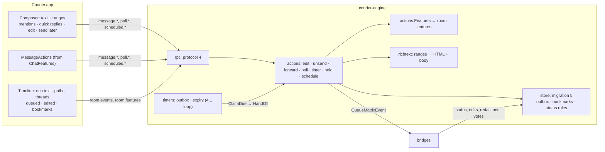

# Courier Milestone 4.3: message actions and composer

> **For agentic workers:** REQUIRED SUB-SKILL: Use superpowers:subagent-driven-development (recommended) or superpowers:executing-plans to implement this plan task-by-task. Steps use checkbox (`- [ ]`) syntax for tracking.

**Goal:** James can do to a message everything Beeper let him: edit it, unsend it or delete it for himself, forward it, bookmark it, see what it said before an edit, reply in a thread, vote in or start a poll, mention someone, format text, drop in a saved reply, take a message back in the seconds after sending, schedule one for later, and set a chat's disappearing timer. Each action is offered only where the chat's network can carry it.

**Architecture:**
- **What a chat can do comes from its bridge.** Every bridge publishes per-chat room features (`com.beeper.room_features`), which bridgev2 also enforces for edits. The engine reads them (stored state first, the live client when none is stored) into one `Features` value. The app greys out or hides actions from it. The engine checks the same value again before sending. Nothing about a network is hard-coded in the app.
- **Engine, store:** one migration adds an outbox (messages held for undo send, and scheduled messages), bookmarks, "deleted for me", disappearing expiry, and indexes for poll votes and threads. The rules that keep the timeline and search true move into the store: a refused edit or unsend is put back, a deleted message leaves the index.
- **Engine, sending:** a `richtext` package turns the composer's text plus formatting ranges into Matrix HTML and a plain body, dropping what the chat's network can't show. 4.1's timer loop also fires the outbox and expires disappearing messages. Each due message is claimed once, in one transaction, before it reaches the bridge.
- **App:** the composer keeps formatting as ranges over plain text, so typed characters are never formatting by accident. Incoming HTML is parsed back into the same ranges. New models own message actions, threads, scheduled messages, polls and quick replies. Protocol 4 carries it all.



**Tech Stack:** as milestone 4.2. Go 1.26, mautrix v0.31.0, util v0.10.1, the five bridges at their milestone-2 pins (whatsapp v0.2609.0, signal v0.2609.0, telegram v0.2609.0, gmessages v0.2609.0, slack v0.2609.1), mattn/go-sqlite3 with FTS5. Swift 5 mode, SwiftPM tools 5.9 mirrored in Bazel, SwiftUI with AppKit (NSTextView) where SwiftUI falls short.

**Spec:** `docs/superpowers/specs/2026-10-15-courier-iteration-1-design.md`: §3 interface scope and the stub rule (Undo send and Send later are behind the entitlement), §4 outgoing messages are pending first and pass to the bridge when the undo window ends, and scheduled sends are engine timers, §5 failures, §7 part 4.3, §8 built for strangers and sold directly. The interface source is the inventory in `docs/superpowers/specs/2026-10-15-beeper-desktop-inventory/`:
- `01 §5`: status line, undo send, scheduled messages, edit history, disappearing countdown;
- `01 §6`: composer, plus menu, formatting, polls, quick replies;
- `01 §7`: message menu, forward, Insert as Draft;
- `01 §9`: disappearing timer;
- `01 §10`: threads;
- `01 §12`: the Bookmarks search section;
- `02 §1.2`, `02 §1.4`: settings;
- `02 §2.2` to `02 §2.5`: keys and trigger characters;
- `02 §2.6`: commands and the Send later picker;
- `02 §3.4.2`: message menu order;
- `03 §1.4`: per-chat room features are the source of truth.

The 4.1 and 4.2 plans and the code on `main` are the base.

## Global Constraints

- **Earlier constraints:** every Global Constraint of the milestone-1 to -4.2 plans still applies: pins, hand-written AGPL headers on Go and Swift, strings in `Resources/en.lproj/Localizable.strings` via `String(localized:)`, data dir, socket, macOS 14, bundle id, no real accounts in CI, never open a real chat in Beeper while testing, Courier's own wording, no Beeper name or asset. So does what they learned: a protocol page may end before 1 MiB (`fitting`, `maxPageBytes`), WhatsApp unread marks are never sent, the engine never logs message text, names or search text, and inferred behaviour carries an `Inferred (inventory 01 §n)` comment.
- **Commands are Bazel targets.** Every step runs `bazel test …`, `bazel build …` or `bazel run …`; never `go test`, `swift test` or raw `git`. After Go file changes run `bazel run //:gazelle`; before every commit, `bazel run //:tidy`. Commit with `bazel run //tools/git:commit -- --agent <your agent> -m "<conventional message>" <paths>`.
- **Engine tests:** `bazel test //apps/desktop/courier/engine/...`, and with `--@rules_go//go/config:race` for the store, actions, timers and rpc. **App tests:** `bazel test --config=macos-app //apps/desktop/courier/app:CourierCoreTests`.
- **No wall-clock asserts.** Every time-dependent test drives an injected clock: `store.SetClock`, `timers.Clock`, the app's `now:` closures. No test sleeps for a window to pass or asserts an elapsed duration. (4.2's merge queue failed on a 60 s backfill test under race.) Concurrency tests (claims, undo) synchronise on channels, never on sleeps.
- **One migration.** Migration 5 is appended to `migrations` in `engine/internal/store/migrate.go`. Nothing earlier is touched. Add `testdata/m5.sql`, a database at `user_version = 4`; Task 1 lists its rows.
- **Protocol 4.** `protocol.json` goes to `"protocol": 4`: the app now relies on methods a protocol-3 engine refuses, and `Event.status` gains a value. Params stay strict. Every new method, parameter, notification kind and error has an example in `protocol/examples/`, and both conformance tests keep passing.
- **Features come from the bridge.** `actions.Features(roomID)` reads the chat's stored `com.beeper.room_features` state (written by `Intent.SendState`, kept current by bridgev2's `UpdateCapabilities`). It asks the logged-in client's `GetCapabilities` only when none is stored. With neither, it is `actions.NoFeatures`: only send, reply and Delete for Me are offered. A level of partial or full counts as supported; unsupported, dropped and rejected don't.
- **What each action reaches.** Checked in the pinned sources: each bridge's `pkg/connector/capabilities.go` and `handlematrix.go`, and bridgev2 `portal.go` (edit checks :1574–1590, reply and thread fallback :1271–1308, redaction :2525). Pinned by Task 4's `TestMessageActionTableMatchesTheBridges`, which fails when a bridge bump changes any cell.

| Action | WhatsApp | Signal | Telegram | Google Messages | Slack |
|---|---|---|---|---|---|
| Edit (mine, text) | within 15 min | within 24 h, at most 10 edits | no limit advertised | no | yes; the workspace may set a limit or turn it off |
| Unsend (delete for everyone; mine) | within 2 days | within 24 h | yes | **no** | yes, unless the workspace forbids it |
| Delete for Me | this Mac only | this Mac only | this Mac only | **this Mac and the phone** | this Mac only |
| Reply | yes; in community announcement groups it becomes a thread reply | yes | yes | RCS chats yes; SMS chats **no** | **becomes a thread reply** |
| Threads (pane, Reply in Thread) | community announcement groups only | no | no | no | every chat |
| Polls: create and vote | 2–12 options of ≤100 characters, one or many answers | 2–10 options of ≤100 characters, one or many answers | no | no | no |
| End poll, hidden results | no | no (an ended poll arriving is shown) | no | no | no |
| Disappearing timer | after sending: 24 h, 7 days, 90 days | after reading: off, 30 s, 5 min, 1 h, 8 h, 1 day, 1 week, 4 weeks (Inferred: the caps allow any length) | after sending: 1–6 days, 1–3 weeks, 1–6 months, 1 year (the 16 values in caps) | no | no |
| Mentions | yes | yes | yes | sent as "@Name" text | yes, plus @room |
| Forward | Courier sends a copy (text, media), no attribution, on every network | | | | |
| Bookmark, edit history, quick replies, send later, undo send | on this Mac, every network | | | | |

- **Surprises found in the pinned sources, and what Courier does about each:**
  1. **Google Messages has no unsend.** Its room features say `delete_for_me: true` and no `delete`. But its `HandleMatrixMessageRemove` accepts every redaction, and only removes the message from the phone's own Messages app. A Courier that trusted "redaction succeeded" would say "unsent" while the other person keeps the message. Courier offers Google Messages only "Delete from This Mac and Your Phone".
  2. **Slack has no plain replies.** `Reply` is unset (unsupported) and `Thread` is full, so bridgev2 turns a reply into a thread reply (`portal.go:1295`). WhatsApp community announcement groups do the same. In such a chat Courier's Reply is "Reply in Thread" and opens the thread pane.
  3. **Polls arrive as text by default.** WhatsApp and Signal bridge a poll as a poll event only with `extev_polls: true`; their example configs say `false`. Otherwise people see "(This message is a poll. Please open WhatsApp to vote.)". Task 4 turns it on. Telegram's bridge has no poll support at all, and its incoming polls stay text ("Open the Telegram app to vote").
  4. **Disappearing messages can outstay their timer.** bridgev2's `DisappearLoop` waits on Go timers for up to an hour (`DisappearCheckInterval`), and 4.1 found Go timers stop counting while a Mac sleeps. So the engine expires after-send messages itself (Task 2), and the app hides any past its time.
  5. **bridgev2 checks edit age and count, but not delete age.** `DeleteMaxAge` is advertised (WhatsApp 2 days, Signal 24 h) but never enforced. The engine refuses an unsend that is too old before it reaches the network.
  6. **Telegram's limits are looser on paper than in fact.** Its caps advertise no edit limit (a source comment notes non-admins can only edit within 48 hours). Its delete always revokes (`Revoke: true`), so deleting someone else's message in a one-to-one chat deletes it for both. Courier offers unsend only on my own messages. A refused edit comes back as a failed edit, not as success.
  7. **Google Messages SMS chats have no replies and no typing.** Those room features are separate from RCS chats'. Reply is hidden there.
  8. **4.1's WhatsApp marked-unread inversion** (`TestWhatsAppBridgeVersionIsTheOneCheckedForUnreadMarks`) still holds at the same pin. I looked for similar inverted flags in the handlers above (edit, redaction, poll vote, disappearing timer) and found none.
- **Undo send** (spec §4; `02 §1.2` "Allow undo send"):
  - The window comes from `ComposerPreferences.undoSendMillis` (values 0, 750, 1000, 2000, 3000, 5000, 10000; default 0, off). It is passed on each `message.send` and `message.sendFile` as `hold_ms`. Anything above 0 needs `entitlement.UndoSend` (`-32022`).
  - A held message is an `events` row with status `queued` plus an `outbox` row due at now + hold. It answers at once.
  - `message.undo` deletes both and hands the text, ranges and reply back to the composer. After the window it is `-32025`.
  - Held messages are never sent twice and never lost. A held message whose window ended while the engine was down is sent at the next start if it is less than `MaxLate` (1 h) late. Otherwise it becomes failed with reason `not sent`, and the app offers Retry and Delete.
  - A lapsed entitlement never strands a held message: the outbox always fires what is already in it.
  - Undo send covers new messages and files, not edits, reactions, polls or deletions.
- **Send later** (spec §4; `01 §5`, `01 §18`, `02 §2.6`):
  - `message.schedule` needs `entitlement.SendLater`. Text with ranges, an optional reply or thread, a time after now and within 5 years (4.1's reminder rule), and a condition: `if_no_reply` (default; `ComposerPreferences.sendLaterDefault`) or `always`.
  - Scheduled messages live only in `outbox` until they fire: not in the timeline, not in search.
  - They fire from 4.1's loop, which never sleeps longer than `timers.MaxSleep` and reads the wall clock each time it wakes. So one that came due during quit or sleep fires once at the next chance.
  - With `if_no_reply`, a message from someone else in the chat after it was set (or last changed) cancels it. It stays listed as canceled, with Send Now and Delete (Inferred, 01 §5 "canceled by reply").
  - **Decided here:** one more than `MaxLate` late is not sent by itself. It waits as missed, with Send Now, Reschedule and Delete, and a notification says so. A message hours late can be wrong, and the person should see it first.
  - The `send_later` space and filter (left empty by 4.1) list chats with a waiting, canceled or missed scheduled message, in any place except hidden, as 4.1's reminders space does.
- **Formatting** (`01 §6`, `02 §2.2`):
  - The composer sends `text` plus `entities`: ranges in UTF-16 code units, of kinds `bold`, `italic`, `strikethrough`, `code`, `pre`, `blockquote`, `bullet_list`, `ordered_list`, `link`, `mention`, `spoiler`. Typed characters (`*`, `_`, `#`, `<b>`, `` ` ``) are always literal text: there is no Markdown.
  - The engine renders the ranges the chat keeps into `formatted_body` (`org.matrix.custom.html`). It writes `body` as plain text without markers: links as "text (url)" when they differ, mentions as "@Name", list lines with "• " or "1. ", quote lines with "> ".
  - A kind the chat doesn't keep is dropped to that plain form. With no kind kept (Google Messages) or no range, no HTML is sent at all. A network's own app may still read marks in plain text (WhatsApp shows `*this*` in bold); Courier never adds them.
  - Formatting kept per network, from each bridge's `Formatting` map (partial counts: the bridge converts):

| | bold, italic, strike, code, code block | quote | lists | link | mention | spoiler |
|---|---|---|---|---|---|---|
| WhatsApp | yes | yes | yes | yes (partial) | yes | no |
| Signal | yes | partial | partial | partial | yes | yes |
| Telegram | yes | yes | partial | yes | yes | yes |
| Google Messages | no | no | no | no | no ("@Name") | no |
| Slack | yes | yes | yes | yes | yes, and @room | no |

- **Search stays true** (4.2's indexer):
  - An edit replaces the indexed text; a failed edit no longer counts (`currentEditSQL` gains `status <> 'failed'`), and failing or retrying an edit re-indexes its message.
  - Unsend, Delete for Me and disappearing expiry set `redacted = 1`, so 4.2's `events_unindex_redacted` trigger removes the text. A failed unsend puts the message back in the index, unless it was also deleted for me or another redaction of it stands.
  - Poll questions and options are indexed as text. Held messages are indexed when held and leave with `message.undo` (the `events_unindex` trigger). Scheduled messages are indexed only once sent.
- **Keys:** formatting must not take ⌘K or ⌘F (4.2). ⌘Z and ⌘⇧Z act on held messages only while one is held in the open chat; otherwise they keep 4.1's toast undo and the text view's undo and redo. Task 12 has the table.
- **Built for strangers (spec §8).** Every greyed action says why, in Courier's words, from the features: "WhatsApp only lets you edit for 15 minutes", "Google Messages can't unsend", "Polls aren't available on Telegram". No error codes or bridge words reach a person. Task 12 fixes the copy.
- **Inferred behaviour** is marked in a code comment wherever it is built: what cancels an `if_no_reply` scheduled message, `MaxLate`, quick-reply variables, Signal's timer list, the five newest bookmarks on the ⌘K home, and "Edit your last message" picking my newest editable text message.

## Review Focus

1. **A change the network refuses never looks done on this Mac.** A refused edit puts the old text back, in the chat and in search. A refused unsend brings the message back, in the chat, the inbox preview and search, and says "Couldn't unsend". It never looks deleted to me while everyone else still has it. An unsend past its network's limit is refused before anything is sent. **Test:** Task 1 (`TestFailedEditPutsBackTheTextAndTheIndex`, `TestFailedUnsendBringsTheMessageBack`, `TestRetriedUnsendDeletesAgain`) and Task 5 (`TestUnsendTooOldIsRefusedBeforeSending`, `TestGoogleMessagesNeverUnsends`).
2. **Undo at the last moment.** Pressing Undo as the window closes does exactly one thing. Either nothing reaches the network and the text is back in the composer, or the message is sent and Undo says it already went. Never both, never neither. Quitting during the window loses nothing. **Test:** Task 2 (`TestClaimAndUndoRaceEndsOneWay`, under race) and Task 6 (`TestHeldMessageSentAfterRestartOnce`, `TestHeldMessageTooLateBecomesNotSent`).
3. **Send later across quit, sleep and restart.** A scheduled message fires once: not zero times, not twice, even if the engine dies mid-hand-off. Under an hour late it goes; over, it waits as missed. With "if no reply" it is canceled when they write first. **Test:** Task 2 (`TestScheduledClaimedOnceAcrossReopen`, `TestCrashAfterClaimNeverSendsTwice`, `TestReplyCancelsIfNoReply`, `TestOverAnHourLateWaitsAsMissed`) and Task 6 (`TestLoopFiresScheduledOnceAfterSleep`).
4. **Plain text stays plain, and formatting degrades readably.** "2*3*4", "snake_case_name", "<b>hi</b>", "#1", "C:\path", a URL with underscores, emoji and right-to-left text all arrive exactly as typed. A bold, linked, mentioned, listed message to Google Messages reads well as plain text, with no stray markers. **Test:** Task 3 (`TestTypedTextIsNeverFormatting`, `TestPlainNetworksGetReadableText`, `FuzzRender`) and Task 8 (`testHTMLRoundTripsTheSharedCases`).
5. **A disappearing message never outstays its timer.** After the Mac sleeps through a message's time, it is gone from the chat, the inbox preview and search when Courier wakes. That holds even though the bridge's own loop is still asleep. **Test:** Task 2 (`TestExpiredMessagesLeaveEverywhere`), Task 6 (`TestLoopExpiresAfterSleep`) and Task 8 (`testMessagePastItsTimerIsHidden`).

---

## File structure

```
apps/desktop/courier/
  protocol/protocol.json, protocol/examples/*.json      (modify) protocol 4
  protocol/richtext/cases.json                          shared render/parse cases (Go and Swift both test them)
  engine/internal/store/
    migrate.go                (modify) migration 5
    store.go                  (modify) InsertEvent: expires_at, thread rule; SetStatus: edit and redaction rules
    deletes.go                SetDeletedForMe, unredact, ExpireDue
    outbox.go                 Hold, Unhold, Schedule, UpdateScheduled, ScheduledIn, DeleteScheduled, ClaimDue, ClaimHeld, ClaimScheduled
    polls.go, threads.go, bookmarks.go, history.go
    events.go, inbox.go       (modify) main timeline leaves out thread replies; ThreadEventsBefore
    query.go, spaces.go       (modify) the send_later space and filter
    reminders.go              (modify) NextDue includes the outbox and expiry
    searchindex.go, search.go (modify) failed edits ignored; polls indexed; BookmarkedOnly
    testdata/m5.sql
  engine/internal/richtext/   Entity, Check, Render (pure Go)
  engine/internal/actions/
    features.go               Features, FeaturesOf, (*Actions).Features
    edit.go, delete.go, forward.go, polls.go, outbox.go, disappear.go
    actions.go                (modify) Send with SendOptions; HandOff
  engine/internal/timers/timers.go     (modify) outbox and expiry in the loop
  engine/internal/networks/networks.go (modify) extev_polls for WhatsApp and Signal
  engine/internal/fakenet/fakenet.go   (modify) edit, redaction, poll and timer handlers; settable room features
  engine/internal/rpc/messages.go      (create) the new message, poll, scheduled and room methods
  engine/internal/rpc/methods.go, server.go, search.go   (modify) protocol 4; room.events thread; bookmarks section
  engine/internal/search/search.go     (modify) Bookmarks section
  engine/cmd/courier-engine/main.go    (modify) timers get the dispatcher
  app/Sources/CourierCore/
    Protocol.swift            (modify) protocol-4 types
    RichText.swift            TextEntity, RichText, RichTextHTML.parse, EntityEditing
    ChatFeatures.swift        ChatFeatures helpers and MessageAction availability
    Timeline.swift            (modify) rich text, polls, threads, queued, failed edits, expiry, deleted-for-me
    ComposerModel.swift       (modify) ranges, mentions, edit mode, thread mode, hold, schedule, quick replies
    ComposerPreferences.swift, QuickReplies.swift, MessageActionsModel.swift, ThreadModel.swift, ScheduledModel.swift, PollDraft.swift
    ConversationModel.swift, CommandSet.swift, SearchModel.swift, NotificationCoordinator.swift   (modify)
  app/Sources/Courier/
    MessageBubble.swift, ComposerView.swift, ConversationView.swift, ConversationCommands.swift   (modify)
    MessageMenu.swift, FormattingBar.swift, MentionPicker.swift, QuickReplyPicker.swift, LinkDialog.swift,
    ForwardPicker.swift, SendLaterPicker.swift, ScheduledStrip.swift, PollCreatorWindow.swift, PollView.swift,
    ThreadPane.swift, EditHistoryView.swift, DisappearingMenu.swift, MessagesSettingsPane.swift
    SearchRows.swift, App.swift, Notifier.swift   (modify)
  app/Tests/CourierCoreTests/   new and extended tests, named in each task
  docs/m4-acceptance.md         (modify) the 4.3 section, written in Task 13
```

---

### Task 1: The store keeps deletes and edits true

**Files:**
- Modify: `engine/internal/store/migrate.go` (migration 5), `store.go` (`InsertEvent`, `SetStatus`), `searchindex.go` (`currentEditSQL`)
- Create: `engine/internal/store/deletes.go`, `deletes_test.go`, `testdata/m5.sql`

**Migration 5** (exact shape; `threadRootSQL` and `isThreadReplySQL` are new helpers in the style of `editTargetSQL`, each guarded by `json_valid`; a thread reply is `rel_type = 'm.thread'` without `com.beeper.broadcast_outside_thread: true`):

```sql
ALTER TABLE events ADD COLUMN deleted_for_me INTEGER NOT NULL DEFAULT 0; -- set with redacted = 1: gone here, no placeholder
ALTER TABLE events ADD COLUMN expires_at INTEGER;                         -- after_send disappearing: ts + timer; NULL = never
CREATE INDEX events_expiry ON events(expires_at) WHERE expires_at IS NOT NULL AND redacted = 0;
CREATE INDEX events_refs ON events(<editTargetSQL("content")>, ts)
  WHERE type IN ('org.matrix.msc3381.poll.response', 'org.matrix.msc3381.poll.end');
CREATE INDEX events_threads ON events(room_id, <threadRootSQL("content")>, ts DESC, seq DESC)
  WHERE type IN ('m.room.message', 'm.sticker') AND <isThreadReplySQL("content")>;
CREATE TABLE outbox (outbox_id INTEGER PRIMARY KEY,
  room_id TEXT NOT NULL REFERENCES rooms(room_id) ON DELETE CASCADE,
  kind TEXT NOT NULL,                    -- undo | later
  event_id TEXT NOT NULL UNIQUE,         -- undo: the queued events row; later: the ID it will be sent as
  type TEXT NOT NULL DEFAULT '', content TEXT NOT NULL DEFAULT '',   -- later only
  due_at INTEGER NOT NULL, set_at INTEGER NOT NULL,
  condition TEXT NOT NULL DEFAULT 'always',                          -- later: if_no_reply | always
  state TEXT NOT NULL DEFAULT 'waiting');                            -- waiting | canceled | missed
CREATE INDEX outbox_due ON outbox(state, due_at);
CREATE INDEX outbox_room ON outbox(room_id, kind);
CREATE TABLE bookmarks (event_id TEXT PRIMARY KEY REFERENCES events(event_id) ON DELETE CASCADE,
  room_id TEXT NOT NULL REFERENCES rooms(room_id) ON DELETE CASCADE, created_at INTEGER NOT NULL);
CREATE INDEX bookmarks_new ON bookmarks(created_at DESC);
UPDATE events SET expires_at = ts + <the content's com.beeper.disappearing_timer.timer>
  WHERE content LIKE '%com.beeper.disappearing_timer%' AND <its type> = 'after_send' AND redacted = 0;
```

**Interfaces:**
- Produces:

```go
// deletes.go
func (s *Store) SetDeletedForMe(ctx context.Context, eventID string) error // redacted = 1 and deleted_for_me = 1, one transaction;
                                                                            // fixes last_event_id; publishes "status"
// store.go (changed behaviour)
func (s *Store) SetStatus(ctx context.Context, eventID, status, reason string) error // now one transaction, with the rules below;
                                                                                     // still sql.ErrNoRows for an unknown event
```

- **InsertEvent** sets `expires_at` for a message whose content has `com.beeper.disappearing_timer` of type `after_send` and timer > 0.
- **SetStatus rules** (the same transaction):
  - **An edit** that goes to failed, or back to pending from failed, calls `applyEdit`, so its message is re-indexed with the newest edit that hasn't failed.
  - **My redaction** (`m.room.redaction`, sender `@me`) going to failed calls `unredact(target)`. It sets `redacted = 0` only if `deleted_for_me = 0` and no other non-failed redaction of it exists (through `events_redacts`). Then it re-indexes with `indexMessage`, re-runs `backfillLastEventSQL` for the room, and publishes `room`.
  - **A failed redaction going back to pending** (Retry) calls `redact` again.
- **Bookmarks** of a redacted message stay, but no bookmark query or search lists a redacted event, so a refused unsend gives the bookmark back. `DeleteEvent` removes them (the foreign key cascades).
- **`testdata/m5.sql`** (`user_version = 4`): rooms on two networks and about 20 events: a text message, an edited one, a failed edit, a redaction; a disappearing after_send message already past its time, one in the future, one after_read; a Slack thread root with two replies and one reply broadcast to the channel; a poll start (`extev` shape) with two votes from one person.

- [ ] **Step 1: Write the failing tests** in `deletes_test.go`:
  - `TestMigrationFromMilestone4_2`: `m5.sql` upgrades to `user_version = 5`. The past after_send message has `expires_at` = ts + timer; the after_read one has NULL. `Inbox` and `SearchMessages` still work.
  - `TestFailedEditPutsBackTheTextAndTheIndex` (Review Focus 1): "meet at noon", then my edit "meet at five", pending. "five" finds it. `SetStatus(edit, failed)`: "noon" finds it again and "five" doesn't. `SetStatus(edit, pending)` (Retry): "five" again.
  - `TestFailedUnsendBringsTheMessageBack` (Review Focus 1): my pending redaction marks the target redacted. It leaves search and the room's `last_event_id`. `SetStatus(redaction, failed)` puts all three back and publishes `room`.
  - `TestRetriedUnsendDeletesAgain`; `TestFailedUnsendLeavesAMessageDeletedForMe` (deleted for me plus a failed redaction: still gone); `TestFailedUnsendLeavesAnotherRedaction` (a network's own redaction of the same target stands); `TestRefusedUnsendKeepsTheBookmark`.
  - `TestDeletedForMeLeavesEverywhere`: `Events` returns it with `DeletedForMe` true (the rpc layer leaves such events out, Task 7); it is unindexed and not unread; the chat preview moves back; it is no longer listed as a bookmark.
- [ ] **Step 2: Run them to verify they fail.** `bazel test //apps/desktop/courier/engine/internal/store:store_test`. Expected: FAIL, undefined `SetDeletedForMe`.
- [ ] **Step 3: Implement.** `Event` gains `DeletedForMe bool` and `ExpiresAt time.Time` (zero = never), read by `scanEvent` (add the columns to `eventCols`). 4.2's tests (`TestRedactedMessageLeavesTheIndex`, `TestEditReplacesTheIndexedText` and the rest) must stay green unchanged. Run gazelle.
- [ ] **Step 4: Run the store tests, also with race.** Expected: PASS.
- [ ] **Step 5: Commit** with `feat(courier): refused edits and unsends are put back, and deleted-for-me messages leave everywhere`.

---

### Task 2: The outbox, expiry, polls, threads, bookmarks and history

**Files:**
- Create: `engine/internal/store/outbox.go`, `polls.go`, `threads.go`, `bookmarks.go`, `history.go`, and a `_test.go` for each
- Modify: `engine/internal/store/deletes.go` (`ExpireDue`), `reminders.go` (`NextDue`), `query.go` and `spaces.go` (send_later), `events.go` and `inbox.go` (thread replies), `searchindex.go` (`MessageText` for polls), `search.go` (`BookmarkedOnly`, `RecentBookmarks`)

**Interfaces:**
- Consumes: Task 1's columns and tables.
- Produces:

```go
// outbox.go
const MaxLate = time.Hour              // Inferred: later than this is not sent by itself
const ReasonNotSent = "not sent"       // a held message the engine couldn't send in time (the app words it)
var ErrAlreadySent = errors.New("it has already gone")
type Scheduled struct {
	ID                        int64
	RoomID, EventID, Type     string
	Content                   json.RawMessage
	DueAt, SetAt              time.Time
	Condition, State          string // if_no_reply | always; waiting | canceled | missed
}
func (s *Store) Hold(ctx context.Context, e Event, due time.Time) error          // e (status queued) + outbox undo row; indexes e
func (s *Store) Unhold(ctx context.Context, eventID string) (Event, error)        // deletes both; ErrAlreadySent when not held
func (s *Store) Schedule(ctx context.Context, sc Scheduled) (Scheduled, error)    // due after now, within 5 years; else ErrBadValue
func (s *Store) UpdateScheduled(ctx context.Context, id int64, due *time.Time, typ string, content json.RawMessage, condition *string) (Scheduled, error)
                                                                                  // back to waiting; set_at = now
func (s *Store) ScheduledIn(ctx context.Context, roomID string) ([]Scheduled, error) // "" = every chat; due_at order
func (s *Store) DeleteScheduled(ctx context.Context, id int64) error
// Each Claim* removes outbox rows and leaves the messages it returns pending, in one transaction: a message comes
// back from at most one claim. A crash before the bridge takes one leaves it pending, so FailInterruptedSends marks
// it "may have been sent" at the next start: never sent twice.
func (s *Store) ClaimDue(ctx context.Context) ([]Event, error)
func (s *Store) ClaimHeld(ctx context.Context, roomID string) ([]Event, error)    // ⌘⇧Z; "" = every chat
func (s *Store) ClaimScheduled(ctx context.Context, id int64) (Event, error)      // Send Now, from any state; ErrNotFound
// deletes.go
func (s *Store) ExpireDue(ctx context.Context) ([]string, error) // after_send messages with expires_at <= now: redacted = 1; their room IDs
// polls.go
type PollOption struct{ ID, Text string; Votes int }
type PollTally struct {
	Question      string
	Options       []PollOption
	MaxSelections int
	Voters        int
	Mine          []string
	Ended         bool
}
func (s *Store) PollTallies(ctx context.Context, roomID string, pollIDs []string) (map[string]PollTally, error)
// threads.go
type ThreadSummary struct{ Replies int; LastTS time.Time; LastSenders []string } // names, newest first, at most 3
func (s *Store) ThreadSummaries(ctx context.Context, roomID string, rootIDs []string) (map[string]ThreadSummary, error)
func (s *Store) ThreadEventsBefore(ctx context.Context, roomID, rootID string, before *Cursor, limit int) ([]Event, *Cursor, error)
// bookmarks.go
func (s *Store) SetBookmarked(ctx context.Context, eventID string, on bool) error  // a redacted message is ErrNotFound
func (s *Store) Bookmarked(ctx context.Context, eventIDs []string) (map[string]bool, error)
func (s *Store) RecentBookmarks(ctx context.Context, limit int) ([]MessageHit, error) // newest bookmark first
// history.go
type Version struct{ Body, FormattedBody string; TS time.Time }
func (s *Store) EditHistory(ctx context.Context, eventID string) ([]Version, error) // the original, then each live edit by its sender, oldest first
```

- **ClaimDue**, for each `waiting` row with `due_at <= now`, oldest first:
  - **`undo`:**
    - more than `MaxLate` late: its event becomes failed with `ReasonNotSent`, and the row is deleted;
    - otherwise: `queued` → `pending`.
  - **`later`:**
    - with `if_no_reply`, a message-like, non-edit event from someone else in the room with `ts > set_at`: state becomes `canceled`;
    - otherwise, more than `MaxLate` late: state becomes `missed`;
    - otherwise: the row is deleted and its event inserted as `pending` with `ts = now`, through `InsertEvent`'s logic in the same transaction (so it moves the chat and is indexed).
  - **Publishing:** canceled and missed rows publish `Change{Kind: "scheduled", RoomID}`.
- **The composer's own text.** A held or scheduled message's content carries `"fi.courier.source": {"text", "entities"}` (Task 5 writes it), so Undo and Edit Scheduled give back exactly what was typed. Every claim, and the late-held failure, writes the event's content without that key, so it never reaches a bridge, a retry or a client.
- **NextDue** becomes the earliest of the unfired reminder, `archive_due`, a `waiting` outbox row and `expires_at`.
- **Main timeline:** `EventsBefore`, `EventsAround` and `EventsAfter` leave out thread replies (`isThreadReplySQL`). Roots and channel-broadcast replies stay.
- **Polls:**
  - A poll is an `org.matrix.msc3381.poll.start` event. Its tally counts each sender's newest non-failed, unredacted `poll.response` with a known option ID, capped at `max_selections`.
  - `Ended` is set by a `poll.end` from the poll's sender.
  - `MessageText` indexes a poll start as kind `text`: the question, then each option on its own line.
- **send_later:** the space and filter match `EXISTS (SELECT 1 FROM outbox o WHERE o.room_id = r.room_id AND o.kind = 'later')`, any place except hidden. Space counts follow.
- **Bookmarks in search:** `MessageQuery.BookmarkedOnly` adds `CROSS JOIN bookmarks b ON b.event_id = e.event_id` after the FTS5 join, so FTS5 still drives the plan.

- [ ] **Step 1: Write the failing tests:**
  - outbox:
    - `TestHoldThenUndoLeavesNothing`: no row, no doc, the room preview back. `TestUndoAfterClaimIsAlreadySent`.
    - `TestClaimAndUndoRaceEndsOneWay` (Review Focus 2): 200 rounds, each with `ClaimDue` and `Unhold` started together on a channel signal. Exactly one of them succeeds each round: the event is pending xor gone.
    - `TestScheduledClaimedOnceAcrossReopen` (Review Focus 3): due while closed; reopen; `ClaimDue` returns it once; a second reopen returns nothing.
    - `TestCrashAfterClaimNeverSendsTwice` (Review Focus 3): claim, close without handing off, reopen, run `FailInterruptedSends`. It is failed "may have been sent" and no claim returns it.
    - `TestReplyCancelsIfNoReply` (Review Focus 3): a reply after `set_at` cancels it; one before `set_at`, my own message, or a reaction doesn't; `always` ignores replies.
    - `TestOverAnHourLateWaitsAsMissed` (Review Focus 3): 61 min late is missed; 59 min late is claimed.
    - `TestLateHeldMessageBecomesNotSent`, `TestSendNowWorksFromEveryState`, `TestUpdateScheduledResetsTheReplyClock`, `TestScheduleMustBeInTheFuture`, `TestSendLaterSpaceListsChatsWithScheduledMessages`, `TestNextDueIncludesTheOutboxAndExpiry`.
  - expiry: `TestExpiredMessagesLeaveEverywhere` (Review Focus 5): past `expires_at`, `ExpireDue` takes the message out of the timeline (redacted), the preview and search, and returns its room. A future one stays. The after_read one is never touched.
  - polls: `TestTallyCountsEachPersonsNewestVote`, `TestVotesForUnknownOptionsDontCount`, `TestPollEndedOnlyByItsSender`, `TestPollTextIsSearchable`, `TestTallyLookupUsesItsIndex` (`EXPLAIN QUERY PLAN` uses `events_refs`).
  - threads: `TestMainTimelineLeavesOutThreadReplies` (the broadcast reply stays), `TestThreadPagesReadOneThread`, `TestThreadSummaryCountsAndNames`, `TestThreadLookupUsesItsIndex`.
  - bookmarks: `TestBookmarkSetClearAndSearch` (`BookmarkedOnly` finds only bookmarked matches), `TestRecentBookmarksNewestFirst`.
  - history: `TestHistoryListsTheOriginalThenLiveEdits` (a failed and a redacted edit left out; another sender's edit ignored).
- [ ] **Step 2: Run them to verify they fail.** `bazel test //apps/desktop/courier/engine/internal/store:store_test`. Expected: FAIL.
- [ ] **Step 3: Implement.** SQL from fixed fragments; every value bound. If a plan check needs another index, add it to migration 5, which hasn't shipped.
- [ ] **Step 4: Run the store tests, also with race.** Expected: PASS, and 4.1's and 4.2's store tests unchanged.
- [ ] **Step 5: Commit** with `feat(courier): an outbox for held and scheduled messages, disappearing expiry, poll tallies, threads, bookmarks and edit history`.

---

### Task 3: Formatting ranges become HTML and a plain body

**Files:**
- Create: `engine/internal/richtext/richtext.go`, `richtext_test.go`, `fuzz_test.go`
- Create: `protocol/richtext/cases.json` (an exported `filegroup`; Task 8's Swift tests read it too)

**Interfaces:**
- Produces:

```go
package richtext
type Kind string
const (Bold Kind = "bold"; Italic Kind = "italic"; Strike Kind = "strikethrough"; Code Kind = "code"; Pre Kind = "pre";
	Quote Kind = "blockquote"; Bullets Kind = "bullet_list"; Numbered Kind = "ordered_list"; Link Kind = "link";
	Mention Kind = "mention"; Spoiler Kind = "spoiler")
var Kinds = []Kind{Bold, Italic, Strike, Code, Pre, Quote, Bullets, Numbered, Link, Mention, Spoiler}
type Entity struct {
	Kind           Kind   `json:"type"`
	Offset, Length int    // UTF-16 code units into the text
	URL            string `json:"url,omitempty"`     // link: http, https or mailto only
	UserID         string `json:"user_id,omitempty"` // mention: a member's Matrix ID, or "@room"
}
const MaxEntities = 1000
var ErrBadEntity = errors.New("formatting that doesn't fit the text") // wrapped with the reason
func Check(text string, ents []Entity) error
type Rendered struct{ Body, HTML string; UserIDs []string; Room bool } // HTML "" = send body only
// Render keeps the kinds keep allows and drops the rest to their plain form. A mention's text is the "@Name" the
// composer inserted, so its plain form is that text.
func Render(text string, ents []Entity, keep func(Kind) bool) Rendered
```

- **Check refuses:** a range out of bounds, of length 0, or splitting a surrogate pair; an unknown kind; a link URL whose scheme isn't http, https or mailto; a mention without a user; `pre`, `blockquote` or a list not starting and ending on line boundaries, or two of them on one line; more than `MaxEntities`.
- **Render:**
  - **Escaping:** all text is HTML-escaped (`& < > " '`).
  - **Line breaks:** a newline becomes `<br>` outside `pre`.
  - **Nesting:** inline kinds nest in the order given by start then length. Ranges inside `code` or `pre` are dropped.
  - **Block kinds:** `pre` becomes `<pre><code>`; quote lines become `<blockquote>`; list lines become `<ul>`/`<ol>` with one `<li>` each.
  - **Inline kinds:** a mention becomes `<a href="https://matrix.to/#/<user_id>">Name</a>` (`@room` is plain `@room` with `Room` true); a link becomes `<a href>`; a spoiler becomes `<span data-mx-spoiler>`.
  - **Body:** the plain form described in Global Constraints.
  - **No HTML at all** when no entity is kept.
  - **Mentions:** `UserIDs` lists the kept mentions' users, deduplicated, for `m.mentions`.
- **`cases.json`:** about 25 cases `{name, text, entities, keep, html, body}`: each kind alone and nested, a list and a quote, a mention and @room, a link whose text is its URL, emoji and right-to-left text before a range, and the plain-network form of a message using every kind.

- [ ] **Step 1: Write the failing tests:**
  - `TestSharedCases`: every case of `cases.json` renders exactly.
  - `TestTypedTextIsNeverFormatting` (Review Focus 4): with no entities, `2*3*4`, `snake_case_name`, `<b>hi</b>`, `#1 priority`, `C:\path\to`, `https://x.test/a_b_c`, `**`, `🎉 שלום` each give `HTML == ""` and `Body` equal to the input.
  - `TestPlainNetworksGetReadableText` (Review Focus 4): the text `"Hi @Ana, see docs\none\ntwo\nquoted"` with a mention on "@Ana", bold on "Hi", a link to `https://x.test` on "docs", a bullet list on lines 2–3 and a quote on line 4. With `keep` false for everything, `Body` is exactly `"Hi @Ana, see docs (https://x.test)\n• one\n• two\n> quoted"`, and `HTML` is "".
  - `TestCheckRefuses`: one row per reason above.
  - `TestRangesCountUTF16`: an emoji before a bold range still bolds the right word.
  - `FuzzRender` (Review Focus 4): random text and ranges that pass `Check` always render. The HTML has balanced tags, and stripping its tags and unescaping gives the text with only the documented plain-form changes. Seed it from `cases.json`.
- [ ] **Step 2: Run them to verify they fail.** `bazel test //apps/desktop/courier/engine/internal/richtext:richtext_test`. Expected: FAIL.
- [ ] **Step 3: Implement.** Pure Go, standard library only (`unicode/utf16`, `html`). Run gazelle.
- [ ] **Step 4: Run the tests.** Expected: PASS.
- [ ] **Step 5: Commit** with `feat(courier): render formatting ranges to HTML and a plain body each network can read`.

---

### Task 4: What a chat can do, from its bridge

**Files:**
- Create: `engine/internal/actions/features.go`, `features_test.go`
- Modify: `engine/internal/networks/networks.go` (`extev_polls` for WhatsApp and Signal), `networks_test.go`, `networks_signal_darwin.go` (Signal's spec gets a configure hook)
- Modify: `engine/internal/fakenet/fakenet.go` (a `Features *event.RoomFeatures` field its client's `GetCapabilities` returns; edit, redaction, poll and disappearing-timer handlers recording on channels `Edits`, `Removes`, `Polls`, `Votes`, `Timers`, honouring `Refuse`)
- Modify: `engine/internal/localmatrix/connector.go` (a stored `com.beeper.room_features` change publishes `room` for its chat)

**Interfaces:**
- Produces:

```go
type PollFeatures struct{ MaxOptions, OptionMaxLength int }
type DisappearingFeatures struct{ Type string; Timers []time.Duration } // after_send | after_read; the choices Courier offers
type Features struct {
	Reply, Thread, ReplyIsThread bool // ReplyIsThread: replies go to the thread (Reply unsupported, Thread supported)
	Edit                         bool
	EditMaxAge                   time.Duration // 0 = none
	EditMaxCount                 int           // 0 = none
	Unsend                       bool
	UnsendMaxAge                 time.Duration
	DeleteReachesPhone           bool // delete_for_me: Delete for Me is also sent to the network (Google Messages)
	HideDeletedPlaceholder       bool // delete_hide (Telegram)
	Poll                         *PollFeatures
	Disappearing                 *DisappearingFeatures
	Formatting                   []richtext.Kind
	MentionRoom                  bool
	MaxTextLength                int
	Source                       string // network | stored | none
}
func FeaturesOf(rf *event.RoomFeatures) Features
func (a *Actions) Features(ctx context.Context, roomID string) (Features, error) // Global Constraints' order of sources
func (f Features) Keeps(k richtext.Kind) bool
var NoFeatures = Features{Reply: true, Source: "none"} // nothing stored and no logged-in client
var SignalTimers = []time.Duration{30 * time.Second, 5 * time.Minute, time.Hour, 8 * time.Hour, 24 * time.Hour, 7 * 24 * time.Hour, 28 * 24 * time.Hour} // Inferred
```

- **Mapping:**
  - `Reply`, `Thread`, `Edit` and `Poll` are supported at a level above unsupported.
  - `Unsend` = `Delete` supported and not `DeleteForMe`.
  - `DeleteReachesPhone` = `DeleteForMe`.
  - `Poll` is set only with `Poll` supported and `PollMaxOptions > 0`.
  - `Disappearing.Timers` is the caps' list, else `SignalTimers` for after_read.
  - Formatting maps `FmtBold`, `FmtItalic`, `FmtStrikethrough`, `FmtInlineCode`, `FmtCodeBlock`, `FmtBlockquote`, `FmtUnorderedList`, `FmtOrderedList`, `FmtInlineLink`, `FmtUserLink`, `FmtSpoiler` to the kinds, kept at partial or full.
  - `MentionRoom` = `FmtAtRoomMention`.

- [ ] **Step 1: Write the failing tests:**
  - features: `TestFeaturesOfMapsEveryField`, `TestStoredFeaturesWinOverTheClient`, `TestNoFeaturesOffersOnlySendReplyAndDelete`, `TestFeaturesChangePublishesRoom`.
  - networks: `TestMessageActionTableMatchesTheBridges`.
    - It calls each pinned client's real `GetCapabilities`, through `FeaturesOf`, on portals built with each bridge's own metadata type: a WhatsApp DM, group and community announcement group; a Signal DM and group (the client's `UserLogin` set); a Telegram DM and group (`AllowedReactions: []string{}`, so no network call is made); Google Messages RCS and SMS; a Slack channel.
    - It also type-asserts each client against `EditHandlingNetworkAPI`, `RedactionHandlingNetworkAPI`, `PollHandlingNetworkAPI` and `DisappearTimerChangingNetworkAPI`.
    - It expects exactly the Global Constraints table, including surprises 1, 2 and 7. The Signal part runs under its darwin build tag, as 4.1's sync test does.
  - networks: `TestPollsArriveAsPolls`: WhatsApp's and Signal's configured `ExtEvPolls` is true.
- [ ] **Step 2: Run them to verify they fail.** `bazel test //apps/desktop/courier/engine/internal/actions:actions_test //apps/desktop/courier/engine/internal/networks:networks_test //apps/desktop/courier/engine/internal/localmatrix:localmatrix_test`. Expected: FAIL.
- [ ] **Step 3: Implement.** Run gazelle.
- [ ] **Step 4: Run the engine suite.** Expected: PASS; the networks test with Signal on macOS.
- [ ] **Step 5: Commit** with `feat(courier): read what each chat can do from its bridge, and bridge polls as polls`.

---

### Task 5: The actions

**Files:**
- Create: `engine/internal/actions/edit.go`, `delete.go`, `forward.go`, `polls.go`, `outbox.go`, `disappear.go`, and a `_test.go` for each
- Modify: `engine/internal/actions/actions.go`

**Interfaces:**
- Consumes: Tasks 1–4.
- Produces:

```go
var (
	ErrNotSupported = errors.New("this network can't do that") // 4.1's, now also for the actions below
	ErrTooOld       = errors.New("that message is too old to change")
	ErrNotYours     = errors.New("you can only change your own messages")
	ErrAlreadySent  = store.ErrAlreadySent
	ErrBadValue     = store.ErrBadValue
)
var HoldWindows = []time.Duration{0, 750 * time.Millisecond, time.Second, 2 * time.Second, 3 * time.Second, 5 * time.Second, 10 * time.Second}
type SendOptions struct {
	Entities            []richtext.Entity
	ReplyTo, ThreadRoot string
	Hold                time.Duration // one of HoldWindows; 0 = at once
}
func (a *Actions) Send(ctx context.Context, roomID, text string, o SendOptions) (string, error)      // SendText becomes a wrapper
func (a *Actions) SendFileWith(ctx context.Context, roomID, path string, o SendOptions) (string, error) // SendFile becomes a wrapper; Entities ignored
func (a *Actions) Edit(ctx context.Context, eventID, text string, ents []richtext.Entity) (string, error)
func (a *Actions) Unsend(ctx context.Context, eventID string) (string, error) // a message of mine, or my reaction
func (a *Actions) DeleteForMe(ctx context.Context, eventID string) error
type ForwardResult struct{ Sent map[string]string; Failed map[string]error } // room ID → event ID / error
func (a *Actions) Forward(ctx context.Context, eventID string, roomIDs []string) ForwardResult
func (a *Actions) CreatePoll(ctx context.Context, roomID, question string, options []string, multiple bool) (string, error)
func (a *Actions) Vote(ctx context.Context, pollEventID string, optionIDs []string) (string, error)
func (a *Actions) SetDisappearing(ctx context.Context, roomID, typ string, timer time.Duration) error // typ "" = off
func (a *Actions) Undo(ctx context.Context, eventID string) (store.Event, error)
func (a *Actions) SendHeldNow(ctx context.Context, roomID string) error
func (a *Actions) Schedule(ctx context.Context, roomID, text string, o SendOptions, due time.Time, condition string) (store.Scheduled, error)
func (a *Actions) UpdateScheduled(ctx context.Context, id int64, due *time.Time, text *string, ents []richtext.Entity, condition *string) (store.Scheduled, error)
func (a *Actions) SendScheduledNow(ctx context.Context, id int64) error
func (a *Actions) HandOff(ctx context.Context, e store.Event) // waits up to LoginWait, then QueueMatrixEvent; a failed wait sets failed "not connected"
```

- **Send:**
  - Content comes from `richtext.Render(text, ents, features.Keeps)`: `body`, and `format`/`formatted_body` when HTML isn't "", plus `m.mentions`.
  - `ThreadRoot` sets `m.relates_to {rel_type: m.thread, event_id: root, is_falling_back: true, m.in_reply_to: <newest event in the thread>}`. Without `features.Thread` it is `ErrNotSupported`.
  - A chat with an after_send or after_read timer gets `com.beeper.disappearing_timer` set to it (read from the chat's stored state).
  - `Hold > 0` stores through `store.Hold` and returns at once, after the same checks as now (login wait included). Otherwise it stages and queues as today.
  - Held content, and scheduled content (`Schedule`), carry `fi.courier.source` (Task 2). `Undo` returns the event with it, and the rpc layer turns it into the `Draft`.
- **Edit:**
  - **Refusals:**
    - not mine: `ErrNotYours`;
    - not an `m.room.message` of msgtype text, notice or emote, or not `sent`, or redacted, or the chat lacks `Edit`: `ErrNotSupported`;
    - older than `EditMaxAge`, or at `EditMaxCount` live edits: `ErrTooOld`.
  - **Content:** `m.new_content` with the rendered content, `body` = "* " + plain, `m.relates_to {rel_type: m.replace, event_id}`.
- **Unsend:**
  - mine, `sent`, not redacted; the chat has `Unsend`; not older than `UnsendMaxAge` (surprise 5): stage an `m.room.redaction`, which marks the target at once (Task 1 undoes it if it fails);
  - my reaction (no age limit, needs `ReactionHandlingNetworkAPI`): the same;
  - a `queued` message is `ErrNotSupported` (that is `Undo`).
- **DeleteForMe:** `store.SetDeletedForMe`. With `DeleteReachesPhone`, it also queues a redaction that isn't stored. That send is best effort, logged at warn on failure, and never reverts (4.1's rule).
- **Forward:**
  - **What can be forwarded:** text, notice, emote, image, video, audio, file; a sticker as an image. A poll is `ErrNotSupported`.
  - **Content:** `m.relates_to`, `m.mentions`, the disappearing timer and `com.beeper.*` keys are dropped. Mention links in `formatted_body` become their text.
  - **Sending:** each room goes through `Send`'s path without hold, one at a time. At most 20 rooms (`ErrBadValue`).
- **CreatePoll:**
  - **Checks:** the chat needs `Poll`; the question is trimmed, 1–300 characters; there are 2 to `MaxOptions` options, each trimmed, 1–`OptionMaxLength` characters and distinct ignoring case (else `ErrBadValue`).
  - **Content:** `org.matrix.msc3381.poll.start` with kind `org.matrix.msc3381.poll.disclosed`, `max_selections` = 1 or the option count, answers with IDs `"1"`…`"n"`.
- **Vote:** 0 to `max_selections` known option IDs; 0 takes my vote back.
- **SetDisappearing:**
  - **Checks:** the timer must be one of `features.Disappearing`'s, else `ErrBadValue`; without `Disappearing`, `ErrNotSupported`.
  - **Sending:** it queues a `com.beeper.disappearing_timer` state event and waits for the result. On success it stores the state and publishes `room`. A failure is returned with the bridge's reason (`-32023` in rpc).
- **Schedule:** `Render` runs at schedule time, so `UpdateScheduled` re-renders.

- [ ] **Step 1: Write the failing tests** (fakenet with chosen `Features`):
  - `TestSendRendersForTheChatsFeatures`: Slack keeps bold; a no-formatting chat gets body only. `TestSendIntoAThread`, `TestThreadOnAChatWithoutThreadsIsRefused`, `TestSendCarriesTheChatsTimer`.
  - `TestHeldSendReturnsAtOnceAndStaysQueued`, `TestHoldNeedsAWindowFromTheList`, `TestHandOffWhileOfflineFailsAsNotConnected`.
  - `TestTypedSourceNeverReachesTheBridge`: a held message (`SendHeldNow`) and a scheduled one (`SendScheduledNow`) reach fakenet without `fi.courier.source`.
  - `TestEditReachesTheNetwork`, `TestEditRefusals` (one row per refusal); `TestRefusedEditComesBackFailed`: fakenet `Refuse`; the text is back.
  - `TestUnsendTooOldIsRefusedBeforeSending` (Review Focus 1): 2 days 1 min on WhatsApp features; nothing queued, nothing stored. `TestUnsendMyReaction`.
  - `TestGoogleMessagesNeverUnsends` (Review Focus 1): `Unsend` is `ErrNotSupported`; `DeleteForMe` queues the unstored redaction and hides the message. `TestDeleteForMeIsLocalElsewhere`.
  - `TestForwardCopiesWithoutAttributionOrMentions`, `TestForwardReportsEachRoom`, `TestCreatePollValidates`, `TestVoteAndRetract`, `TestSetDisappearingTakesOnlyOfferedTimers`, `TestRefusedTimerChangesNothing`.
- [ ] **Step 2: Run them to verify they fail.** `bazel test //apps/desktop/courier/engine/internal/actions:actions_test`. Expected: FAIL.
- [ ] **Step 3: Implement.** Never log text. Run gazelle.
- [ ] **Step 4: Run the engine suite with race.** Expected: PASS, and every existing actions test unchanged.
- [ ] **Step 5: Commit** with `feat(courier): edit, unsend, delete for me, forward, polls, threads, timers, held and scheduled sends`.

---

### Task 6: The timer loop fires the outbox and expires messages

**Files:**
- Modify: `engine/internal/timers/timers.go`, `timers_test.go`; `engine/cmd/courier-engine/main.go`, `main_test.go`

**Interfaces:**
- Consumes: Task 2's `ClaimDue`, `ExpireDue`, `NextDue`; Task 5's `HandOff`.
- Produces:

```go
type Dispatcher interface{ HandOff(ctx context.Context, e store.Event) } // *actions.Actions
func (t *Timers) SetDispatcher(d Dispatcher)                            // before Run; nil claims nothing
```

- **Each pass** also runs `ExpireDue`, then `ClaimDue`, and starts `HandOff` for each claimed event on its own goroutine. Run waits for them to return before it does.
- **Entitlements:** the outbox and expiry run whatever the entitlements say (Global Constraints).
- **Waking:** `Poke` is called by `Hold`, `Schedule` and `UpdateScheduled` (through the rpc layer, as 4.1's reminders do). A hold of 750 ms is therefore handed off when the injected clock reaches its due time, not at the next 30 s wake.
- **main.go** sets the dispatcher to the engine's `Actions` before `Run`, after `FailInterruptedSends`.

- [ ] **Step 1: Write the failing tests** (fake clock, a recording dispatcher, a real store):
  - `TestHeldMessageHandedOffAtItsTime`: poke at hold; advance the clock to due − 1 ms, nothing; to due, one hand-off.
  - `TestHeldMessageSentAfterRestartOnce` (Review Focus 2): hold, stop the loop before due, reopen the store, new loop 10 s after due. One hand-off; a second restart gives none.
  - `TestHeldMessageTooLateBecomesNotSent` (Review Focus 2): 2 h after due, no hand-off; the event is failed `not sent`.
  - `TestLoopFiresScheduledOnceAfterSleep` (Review Focus 3): the clock jumps 20 min past due between two `After` firings (a sleep). One hand-off.
  - `TestLoopExpiresAfterSleep` (Review Focus 5)
  - `TestOutboxFiresWhileNotEntitled`
  - `TestRunWaitsForHandOffs`
  - `TestEngineStartsTheOutbox` (main_test)
- [ ] **Step 2: Run them to verify they fail.** `bazel test //apps/desktop/courier/engine/internal/timers:timers_test //apps/desktop/courier/engine/cmd/courier-engine:courier-engine_test`. Expected: FAIL.
- [ ] **Step 3: Implement.**
- [ ] **Step 4: Run the engine suite with race.** Expected: PASS, and 4.1's timer tests unchanged.
- [ ] **Step 5: Commit** with `feat(courier): the engine's timer loop sends held and scheduled messages once and expires disappearing ones`.

---

### Task 7: Protocol 4

**Files:**
- Modify: `protocol/protocol.json`; add examples
- Create: `engine/internal/rpc/messages.go`, `messages_test.go`
- Modify: `engine/internal/rpc/methods.go` (`toEvent`, `room.events`, `message.send`, `message.sendFile`), `server.go` (`Protocol = 4`), `search.go`; `engine/internal/search/search.go`

**Protocol changes** (Swift names them the same):
- **`hello`:** `protocol` 4; the mismatch example says `{"engine": 4}`.
- **`Event` gains** `bookmarked: bool`, `poll: PollTally|null`, `thread: ThreadSummary|null` and `expires_at: int` (0 = never). `status` gains `queued` ("held for undo send; message.undo takes it back"), and `status_reason` may be exactly `"not sent"` ("Courier was closed when it was due; nothing was sent"). Events deleted for me are left out.
- **`SendParams` and `SendFileParams` gain** `entities: TextEntity[]?`, `thread_root: string?` and `hold_ms: int?` (values 0, 750, 1000, 2000, 3000, 5000, 10000).
- **`RoomEventsParams` gains** `thread: string?`, a root event ID: that thread's events only, with `before` paging; `around` and `after` with `thread` are `-32602`. Without `thread`, thread replies are left out.
- **`search.query`:** sections gain `bookmarks`; filters gain nothing. `SearchResult` gains `bookmarks: MessageHits|null`. For empty text with no filters it holds the five newest bookmarks (Inferred).
- **`Changed.kind` gains** `scheduled` (room_id).
- **New errors:**

| Code | Name | Message |
|---|---|---|
| `-32024` | `too_old` | that message is too old to change |
| `-32025` | `already_sent` | it has already gone |
| `-32026` | `not_yours` | you can only change your own messages |

- **New methods:**

| Method | Params | Result | Errors |
|---|---|---|---|
| `room.features` | `RoomParams` | `ChatFeatures` | -32020 |
| `room.members` | `MembersParams {room_id, query, limit?}` (limit 1–50, default 20; words folded as search does) | `MembersResult {members: Member[]}` | -32020 |
| `room.setDisappearing` | `DisappearingParams {room_id, type, timer_ms}` | `Empty` | -32014, -32020, -32023 |
| `message.edit` | `EditParams {event_id, text, entities?}` | `Sent` | -32010, -32011, -32018, -32020, -32023, -32024, -32026 |
| `message.unsend` | `EventParams` | `Sent` | -32020, -32023, -32024, -32026 |
| `message.deleteForMe` | `EventParams` | `Empty` | -32020 |
| `message.forward` | `ForwardParams {event_id, room_ids}` (1–20) | `ForwardResult {sent: Forwarded[], failed: ForwardFailure[]}` | -32020, -32023 |
| `message.undo` | `EventParams` | `Draft {text, entities, reply_to, thread_root}` | -32020, -32025 |
| `message.sendHeld` | `RoomOptionalParams {room_id?}` | `Empty` | |
| `message.setBookmarked` | `BookmarkParams {event_id, on}` | `Empty` | -32020 |
| `message.history` | `EventParams` | `HistoryResult {versions: Version[]}` | -32020 |
| `message.schedule` | `ScheduleParams {room_id, text, entities?, reply_to?, thread_root?, due_at, condition}` | `ScheduledMessage` | -32010, -32011, -32014, -32020, -32022, -32023 |
| `scheduled.list` | `RoomOptionalParams` | `ScheduledResult {scheduled: ScheduledMessage[]}` | -32020 |
| `scheduled.update` | `ScheduledUpdateParams {outbox_id, due_at?, text?, entities?, condition?}` | `ScheduledMessage` | -32014, -32020, -32022 |
| `scheduled.sendNow` | `OutboxIDParams {outbox_id}` | `Empty` | -32010, -32018, -32020 |
| `scheduled.delete` | `OutboxIDParams` | `Empty` | -32020 |
| `poll.create` | `PollParams {room_id, question, options, multiple}` | `Sent` | -32010, -32014, -32018, -32020, -32023 |
| `poll.vote` | `VoteParams {event_id, option_ids}` | `Sent` | -32010, -32014, -32018, -32020, -32023 |

| Type | Fields |
|---|---|
| `TextEntity` | `type` (values as `richtext.Kinds`), `offset: int`, `length: int` ("UTF-16 code units"), `url: string?`, `user_id: string?` |
| `ChatFeatures` | `reply`, `thread`, `reply_is_thread`, `edit: bool`, `edit_max_age_ms: int`, `edit_max_count: int`, `unsend: bool`, `unsend_max_age_ms: int`, `delete_reaches_phone`, `hide_deleted_placeholder: bool`, `poll: PollFeatures|null` (`max_options`, `option_max_length`), `disappearing: DisappearingFeatures|null` (`type`, `timers_ms: int[]`), `current_timer: DisappearingTimer|null` (`type`, `timer_ms`), `formatting: string[]`, `mention_room: bool`, `max_text_length: int`, `source` (values `network`, `stored`, `none`) |
| `Member` | `user_id`, `name`, `avatar_path` |
| `PollTally` | `question`, `options: PollOption[]` (`id`, `text`, `votes: int`), `max_selections: int`, `voters: int`, `mine: string[]`, `ended: bool` |
| `ThreadSummary` | `replies: int`, `last_ts: int`, `last_senders: string[]` |
| `Version` | `body`, `formatted_body` ("" when plain), `ts` |
| `ScheduledMessage` | `outbox_id: int`, `room_id`, `text`, `entities: TextEntity[]`, `reply_to: string|null`, `thread_root: string|null`, `due_at`, `condition` (values `if_no_reply`, `always`), `state` (values `waiting`, `canceled`, `missed`), `set_at` |
| `Forwarded` / `ForwardFailure` | `room_id`, `event_id` / `room_id`, `code: int` |

- **Mapping:**
  - **New errors:** `ErrTooOld` → `-32024`, `ErrAlreadySent` → `-32025`, `ErrNotYours` → `-32026`, `ErrNotSupported` → `-32023`, `richtext.ErrBadEntity` → `-32602` with data `"entities"`.
  - **`ScheduledMessage` and `Draft`** take `text` and `entities` from `fi.courier.source` (Task 2). `toEvent` strips that key from a queued event's content.
  - **`current_timer`** is the chat's stored `com.beeper.disappearing_timer` state, or null.
  - **Page sizes:** `toEvent` fills `poll`, `thread` and `bookmarked` with one query each per page. `room.events` and `scheduled.list` pages fit under `maxPageBytes`.
- **Examples:** one per new method, one per new error, a `room.events-thread.json`, `changed-scheduled.json`, `search.query-bookmarks.json`, and `hello*.json` at 4.

- [ ] **Step 1: Write the failing tests:**
  - `TestEveryExampleRoundTrips` and `TestServerSpeaksExactlyTheProtocolsMethods` cover the new ones.
  - In `messages_test.go`:
    - `TestParamsValidation`: one row per `-32602` reason (hold_ms not in the list, 0 or 21 forward rooms, `thread` with `around`, entities out of range).
    - `TestErrorsMapExactly`
    - `TestHoldNeedsTheEntitlement`, `TestScheduleNeedsTheEntitlement`: a deny-all provider gives `-32022` and stores nothing.
    - `TestScheduledTextComesBackAsTyped`
    - `TestThreadRepliesOnlyInTheirThread`
    - `TestEventsCarryPollsThreadsAndBookmarks`
    - `TestPagesWithPollsEndBeforeOneMiB`
  - In `search_test.go`: `TestBookmarksSectionMatchesOnlyBookmarks`, `TestHomeHoldsTheFiveNewestBookmarks`.
- [ ] **Step 2: Run them to verify they fail.** `bazel test //apps/desktop/courier/engine/internal/rpc:rpc_test //apps/desktop/courier/engine/internal/search:search_test`. Expected: FAIL.
- [ ] **Step 3: Implement** in the shape of the existing handlers (strict `decode`, `required`, sentinels). `Hold`, `Schedule` and `UpdateScheduled` call `Timers.Poke()`.
- [ ] **Step 4: Run the engine suite with race.** Expected: PASS.
- [ ] **Step 5: Commit** with `feat(courier): protocol 4, with message actions, polls, threads, scheduled messages and chat features`.

---

### Task 8: The app reads protocol 4, rich text and the new timeline

**Files:**
- Modify: `app/Sources/CourierCore/Protocol.swift` (every Task 7 type under the same name: `ChatFeatures`, `PollFeatures`, `Member`, `PollTally`, `ThreadSummary`, `Version`, `ScheduledMessage`, `Draft` and the params; `CourierProtocol.version = 4`; `EventStatus.queued`; `Change.scheduled(roomID:)`), `Timeline.swift`
- Create: `app/Sources/CourierCore/RichText.swift`, `ChatFeatures.swift`
- Test: `ProtocolConformanceTests` (covers the new examples), `RichTextTests.swift`, `TimelineTests.swift` (extended), `ChatFeaturesTests.swift`

**Interfaces:**
- Consumes: Task 7's protocol; `protocol/richtext/cases.json` as test data.
- Produces:

```swift
public struct TextEntity: Codable, Equatable, Hashable, Sendable {
    public enum Kind: String, Codable, CaseIterable, Sendable { case bold, italic, strikethrough, code, pre, blockquote,
        bulletList = "bullet_list", orderedList = "ordered_list", link, mention, spoiler
        public var isBlock: Bool { get } }               // pre, blockquote, the lists
    public var kind: Kind; public var offset: Int; public var length: Int   // UTF-16, as NSString counts
    public var url: String?; public var userID: String?
}
public struct RichText: Equatable, Sendable { public var text: String; public var entities: [TextEntity] }
public enum RichTextHTML {
    /// Matrix HTML back to text and ranges: the allow-listed tags of richtext.Render, plus h1–h6 as bold lines and p as
    /// paragraphs; mx-reply is dropped; any other tag keeps its text; entities are decoded. Never fails: anything it
    /// can't read gives RichText(text: fallback, entities: []).
    public static func parse(html: String, fallback: String) -> RichText
}
public enum MessageAction: Hashable, Sendable { case reply, replyInThread, edit, forward, copy, copyWithTimestamp, insertAsDraft,
    bookmark, removeBookmark, react, unsend, deleteForMe, openFirstLink, showHistory }
public struct Unavailable: Equatable, Sendable { public let action: MessageAction; public let reason: String }   // the greyed line
public enum MessageActions {
    public static func available(for message: TimelineMessage, in features: ChatFeatures, network: String, now: Date)
        -> (actions: [MessageAction], unavailable: [Unavailable])   // in 02 §3.4.2's order
}
// TimelineMessage gains:
public let rich: RichText                 // body + entities; the newest live edit's when edited
public let poll: PollTally?; public let thread: ThreadSummary?; public let bookmarked: Bool
public let expiresAt: Int64?              // nil = never
public let editFailed: StatusLine?        // "Edit not sent" with Retry and Discard, for my newest failed edit
public let editCount: Int                 // live edits loaded
// StatusLine gains .queued and .notSent
// Timeline.build gains `now: Date` and `hideDeleted: Bool`; it leaves out deleted-for-me events, messages past expiresAt,
// and deleted placeholders when hideDeleted or the chat's hideDeletedPlaceholder is set.
```

- **Availability rules:**
  - The age limits compare `now` with the message's `ts`.
  - Edit and Unsend are for my sent messages only.
  - Reply becomes `replyInThread` when `replyIsThread`, and is left out when neither reply nor thread works (an SMS chat).
  - A held message offers no actions; clicking it undoes, when the preference allows.
  - Each greyed action carries a reason built from the network's display name and the feature, for example "WhatsApp only lets you edit for 15 minutes".

- [ ] **Step 1: Write the failing tests:**
  - `RichTextTests`:
    - `testHTMLRoundTripsTheSharedCases` (Review Focus 4): every `cases.json` html parses to its text and entities. For the plain-network cases, the body parses to itself.
    - `testUnknownTagsKeepTheirText`, `testReplyFallbackIsDropped`, `testRangesCountUTF16`; `testParseNeverFailsOnRandomInput`: 2,000 seeded random strings of tag fragments.
  - `TimelineTests`: `testEditedMessageShowsTheNewestLiveEdit`, `testFailedEditShowsTheOldTextAndEditNotSent`, `testQueuedMessageShowsQueued`, `testDeletedForMeLeavesNoRow`, `testMessagePastItsTimerIsHidden` (Review Focus 5), `testHideDeletedRemovesPlaceholders`, `testPollAndThreadSummaryReachTheMessage`.
  - `ChatFeaturesTests`: `testWhatsAppEditGreysAfter15Minutes`, `testGoogleMessagesOffersDeleteFromPhoneNotUnsend`, `testSlackReplyIsReplyInThread`, `testSMSHasNoReply`, `testOthersMessagesCantBeEditedOrUnsent`, `testNoFeaturesOffersOnlyTheBasics`.
- [ ] **Step 2: Run them to verify they fail.** `bazel test --config=macos-app //apps/desktop/courier/app:CourierCoreTests`. Expected: FAIL.
- [ ] **Step 3: Implement.** The parser is a small hand-written tokenizer, not `NSAttributedString(html:)`, which loads WebKit and runs on the main thread. Add `protocol/richtext/cases.json` to the test target's resources.
- [ ] **Step 4: Run the tests.** Expected: PASS, and existing `TimelineTests` unchanged.
- [ ] **Step 5: Commit** with `feat(courier): the app reads protocol 4, formatted text, polls, threads and what each chat can do`.

---

### Task 9: The composer

**Files:**
- Modify: `app/Sources/CourierCore/ComposerModel.swift`, `EngineMessageSender.swift`. `MessageSending` gains `send(roomID:rich:replyTo:threadRoot:holdMillis:) async throws -> String`, `edit(eventID:rich:)`, `schedule(roomID:rich:replyTo:threadRoot:due:condition:)`, `undo(eventID:) async throws -> Draft`, `sendHeld(roomID:)` and `members(roomID:query:) async throws -> [Member]`. `sendText` stays for existing callers.
- Create: `app/Sources/CourierCore/ComposerPreferences.swift`, `QuickReplies.swift`
- Test: `ComposerModelTests.swift` (extended), `EntityEditingTests.swift`, `ComposerPreferencesTests.swift`, `QuickRepliesTests.swift`

**Interfaces:**
- Produces:

```swift
public enum EntityEditing {
    /// The ranges after `range` of `text` is replaced by `length` new UTF-16 units: later ranges shift, a range the edit
    /// falls inside grows or shrinks, a range wholly replaced goes, and a mention the edit touches goes (it is one unit).
    public static func replacing(_ entities: [TextEntity], range: NSRange, with length: Int) -> [TextEntity]
    /// The formatting keys: an inline kind over a selection it already covers comes off it, otherwise goes on (merged
    /// with touching ranges of that kind); a block kind applies to every line the selection touches, replacing another.
    public static func toggle(_ kind: TextEntity.Kind, in range: NSRange, of text: NSString, entities: [TextEntity]) -> [TextEntity]
}
public enum ComposerMode: Equatable, Sendable { case new, editing(eventID: String, original: RichText), thread(rootID: String) }
// ComposerModel additions
@Published public var entities: [TextEntity]           // kept with the in-memory draft; room.setDraft still keeps text only
@Published public private(set) var pendingKinds: Set<TextEntity.Kind>   // a key with no selection: applies to what is typed next
@Published public private(set) var mode: ComposerMode
@Published public private(set) var mentionQuery: (range: NSRange, text: String)?   // "@" plus letters at the caret
@Published public private(set) var quickReplyQuery: (range: NSRange, text: String)? // ";" plus letters at the caret
@Published public private(set) var heldIDs: [String]    // my queued messages in this chat, newest last
public func textChanged(to text: String, replacing range: NSRange, with length: Int)
public func toggle(_ kind: TextEntity.Kind, in range: NSRange)
public func setLink(_ url: URL?, text: String, in range: NSRange)    // nil url removes it
public func insertMention(_ member: Member, replacing range: NSRange)  // "@Name" as one mention range
public func insertQuickReply(_ reply: QuickReply, replacing range: NSRange, otherPerson: String?)
public func startEditing(_ message: TimelineMessage)   // loads its rich text; Escape restores what was there
public func editLast(in items: [TimelineItem])         // ↑ with "Edit your last message"; my newest editable text message (Inferred)
public func startThread(_ rootID: String)
public func submit(archive: Bool = false) -> Task<Void, Never>?   // hold from preferences; archive = ⌘↩
public func schedule(at due: Date, condition: SendLaterCondition) async throws
public func undoNewestHeld() async -> Bool             // ⌘Z; true when there was one; the text comes back into the composer
public func sendHeldNow() async                        // ⌘⇧Z
public enum SendLaterCondition: String, CaseIterable, Sendable { case ifNoReply = "if_no_reply", always }
public final class ComposerPreferences: ObservableObject {   // UserDefaults "courier.composer.<name>"
    // name = default: undoSendMillis = 0 (values 0, 750, 1000, 2000, 3000, 5000, 10000), clickPendingToUndo = false,
    // upArrow = .focusMessages (.editLast), showFormattingMenu = true, sendLaterDefault = .ifNoReply,
    // doubleClickMessage = .reply (.nothing, .reactionPicker, .forward, .menu, .reactWith), quickReaction = "❤️",
    // copyWithTimestamps = false, hideDeletedMessages = false
}
public struct QuickReply: Codable, Equatable, Identifiable, Sendable { public let id: UUID; public var title: String; public var text: String }
public final class QuickReplies: ObservableObject {    // UserDefaults "courier.composer.quickReplies", JSON
    public static let maxCount = 100, maxTitle = 40, maxText = 16384
    public private(set) var all: [QuickReply]
    public func add(title: String, text: String) throws; public func update(_ r: QuickReply) throws; public func remove(_ id: UUID)
    public func matching(_ prefix: String) -> [QuickReply]   // by title, folded case and accents, at most 8
    /// {first_name}, {last_name}, {full_name} from the other person's name in a one-to-one chat; every other {…} and
    /// these in a group stay as typed (Inferred, 02 §1.7: 4.5 adds the rest).
    public static func fill(_ text: String, otherPerson: String?) -> String
}
```

- **Sending:**
  - **Edit mode** sends `message.edit` and returns to `.new`. An edit leaves `held` alone.
  - **Thread mode** passes `thread_root`.
  - **Hold:** `hold_ms` comes from preferences, only when `isEntitled(.undoSend)`; otherwise 0. A denied Send Later shows 4.1's "Available with a plan" toast and sends nothing.
- **Undo:** `message.undo` puts the returned `Draft` back. If the composer has new text meanwhile, the undone text goes below it, after a blank line. The toast reads "Message unsent from Courier" (01 §5 "sent message undone", in Courier's words).
- **Return:** with a message selected and the composer empty, Return edits it if mine and editable, otherwise starts a reply (02 §2.2 "Quote or Edit Selected Message").

- [ ] **Step 1: Write the failing tests:**
  - `EntityEditingTests`: `testTypingInsideABoldRangeGrowsIt`, `testDeletingAcrossARangeShrinksIt`, `testEditingAMentionRemovesIt`, `testToggleOnAndOff`, `testBlockKindsCoverWholeLines`, `testEmojiOffsets`.
  - `ComposerModelTests`:
    - `testSendCarriesEntitiesAndHold`: undo 2000 ms gives `hold_ms` 2000 on the wire. `testHoldIsZeroWhenNotEntitled`.
    - `testUndoPutsTheTextBack`; `testUndoAfterItWentSaysSo`: `-32025` gives the toast "Already sent" and changes nothing.
    - `testEditModeSendsAnEditAndEscapeRestores`, `testUpArrowEditsTheLastMessage`, `testReturnOnASelectedMessage`.
    - `testMentionQueryAndInsert`, `testQuickReplyQueryAndFill`, `testScheduleSendsDueAndCondition`, `testThreadModeSendsThreadRoot`; `testSendAndArchive`: `room.setArchived` follows the send.
  - `QuickRepliesTests`: `testLimitsAndPersistence`, `testFillUsesTheOtherPersonsName`, `testUnknownVariablesStay`.
  - `ComposerPreferencesTests`: `testDefaultsMatchTheInventory`.
- [ ] **Step 2: Run them to verify they fail.**
- [ ] **Step 3: Implement.** Keep the model `@MainActor`; the view stays thin.
- [ ] **Step 4: Run the tests.** Expected: PASS, and existing `ComposerModelTests` unchanged.
- [ ] **Step 5: Commit** with `feat(courier): a composer with formatting, mentions, quick replies, editing, undo send and send later`.

---

### Task 10: Message actions, threads, scheduled messages and polls in the app

**Files:**
- Create: `app/Sources/CourierCore/MessageActionsModel.swift`, `ThreadModel.swift`, `ScheduledModel.swift`, `PollDraft.swift`
- Modify: `app/Sources/CourierCore/ConversationModel.swift` (features per chat, refetched on `room` changes; selection for ⌘T, ⌘⇧F, ⌘⇧H, ⌘⇧R, ⌘↓), `CommandSet.swift`, `SearchModel.swift` (`SearchSection.Kind.bookmarks`, between `inGroups` and `media`), `NotificationCoordinator.swift`
- Test: `MessageActionsModelTests.swift`, `ThreadModelTests.swift`, `ScheduledModelTests.swift`, `PollDraftTests.swift`, `SearchModelTests` and `CommandSetTests` (extended), `NotificationCoordinatorTests` (extended)

**Interfaces:**
- Produces:

```swift
public protocol Pasteboard: AnyObject { func setString(_ text: String) }   // NSPasteboard.general in the app; a fake in tests
@MainActor public final class MessageActionsModel: ObservableObject {
    public init(conversation: ConversationModel, appModel: AppModel, preferences: ComposerPreferences, pasteboard: Pasteboard)
    public func perform(_ action: MessageAction, on messageID: String) async
    public func forward(_ messageID: String, to roomIDs: [String]) async -> (sent: Int, failed: [String])   // failed: chat names
    public func vote(_ pollID: String, options: [String]) async
    public func history(of messageID: String) async -> [Version]
    @Published public private(set) var toast: Toast?     // 4.1's Toast
}
@MainActor public final class ThreadModel: ObservableObject {   // the pane: root first, replies oldest first
    @Published public private(set) var rootID: String?; @Published public private(set) var items: [TimelineItem]
    public let composer: ComposerModel                            // in .thread(rootID)
    public func open(_ rootID: String, in roomID: String); public func close(); public func loadOlder()
}
@MainActor public final class ScheduledModel: ObservableObject {
    @Published public private(set) var scheduled: [ScheduledMessage]   // the open chat's, due order
    public func sendNow(_ id: Int64) async; public func reschedule(_ id: Int64, to: Date) async
    public func edit(_ id: Int64, text: RichText) async; public func delete(_ id: Int64) async
}
public struct PollDraft: Equatable, Sendable {
    public var question = ""; public var options = ["", ""]; public var multiple = false
    public func problems(in features: PollFeatures) -> [String]   // empty = can send
}
```

- **Perform:**
  - **Copy:** writes the rich text as plain text, with "[time] Name: " when `copyWithTimestamps` is on.
  - **Insert as Draft** (others' messages only, 01 §7) puts the text and ranges into the composer.
  - **Unsend** confirms first: "Unsend this message? It's removed for everyone in the chat." Delete for Me confirms with "Delete this message from this Mac?", or "…from this Mac and your phone?" when `deleteReachesPhone`.
  - **Toasts:** "Couldn't unsend: <network> said no." / "Couldn't edit: <network> said no."; "Too late to change that message."; "Forwarded to %d chats" / "Couldn't forward to %@".
- **Poll problems** (01 §6): "Ask a question"; "Add at least two options"; "This option already exists"; "You have added the maximum number of options" (at `max_options`); "Options can be up to %d characters".
- **Notifications:** a `scheduled` change refetches that chat's list. A row newly `canceled` posts "A scheduled message to %@ wasn't sent: they wrote first." A row newly `missed` posts "A scheduled message to %@ missed its time while Courier was closed."
- **Commands** (registered for ⌘J, part 4.7): Send later; Create quick reply from draft (asks for a title); Edit; Forward; Unsend; Delete for me; Reply in thread. They are enabled by `MessageActions.available` for the selected message.

- [ ] **Step 1: Write the failing tests:**
  - `MessageActionsModelTests`: `testEachActionSendsItsMethod`, `testUnsendAndDeleteConfirmFirst`, `testRefusalsBecomeToasts`, `testCopyWithTimestamps`, `testInsertAsDraftOnlyOnOthersMessages`, `testForwardReportsFailures`.
  - `ThreadModelTests`: `testOpensWithRootAndReplies`, `testReplySendsThreadRoot`, `testOnlyThreadEventsRefetch`.
  - `ScheduledModelTests`: `testListFollowsChanges`, `testActionsSendTheirMethods`.
  - `PollDraftTests`: one case per problem; WhatsApp's 12 and Signal's 10 option limits.
  - `SearchModelTests`: `testBookmarksSectionInOrder`, `testHomeShowsRecentBookmarks`.
  - `CommandSetTests`: `testMessageCommandsHaveLedgerNamesAndFollowAvailability`.
  - `NotificationCoordinatorTests`: `testCanceledAndMissedScheduledNotifyOnce`.
- [ ] **Step 2: Run them to verify they fail.**
- [ ] **Step 3: Implement.**
- [ ] **Step 4: Run the tests.** Expected: PASS.
- [ ] **Step 5: Commit** with `feat(courier): message actions, threads, scheduled messages, polls and bookmarks in search`.

---

### Task 11: Disappearing timers in the app

**Files:**
- Modify: `app/Sources/CourierCore/ConversationModel.swift` (the header line and setting the timer)
- Test: `ConversationModelTests` (extended)

**Behaviour:**
- **Header:** the chat's `current_timer` shows "Messages disappear after %@" (01 §5).
- **Setting it:** from the chat header menu, via `room.setDisappearing`, with the choices in `features.disappearing`.
- **Per message:** "Disappears in %@" once running (after_send: always; after_read: only for messages carrying `expires_at`), recomputed each minute from an injected clock.
- **Hiding:** a message past `expiresAt` is hidden (Task 8). The model rebuilds when the next expiry passes; there is no per-message timer.
- **Timer changes** in the chat show as a note: "%1$@ set messages to disappear after %2$@." with "Change Setting" (01 §5).

- [ ] **Step 1: Write the failing tests:** `testHeaderShowsTheTimer`, `testSettingSendsTheMethod`, `testCountdownFollowsTheClock`, `testRebuildsWhenTheNextMessageExpires`.
- [ ] **Step 2: Run them to verify they fail.**
- [ ] **Step 3: Implement.**
- [ ] **Step 4: Run the tests.** Expected: PASS.
- [ ] **Step 5: Commit** with `feat(courier): disappearing timers: set them, see them, and messages leave on time`.

---

### Task 12: The views

**Files:**
- Create: `app/Sources/Courier/{MessageMenu, FormattingBar, MentionPicker, QuickReplyPicker, LinkDialog, ForwardPicker, SendLaterPicker, ScheduledStrip, PollCreatorWindow, PollView, ThreadPane, EditHistoryView, DisappearingMenu, MessagesSettingsPane}.swift`
- Modify: `app/Sources/Courier/{MessageBubble, ComposerView, ConversationView, ConversationCommands, SearchRows, App, Notifier}.swift`; `Resources/en.lproj/Localizable.strings`

**Behaviour:**
- **Bubbles** (`MessageText`, `MessageEditHistory`, `Spoiler`, `Code`, `MessageMention`, 01 §5):
  - **Rich text:** drawn from `rich`. Code is monospaced on a tint; code blocks scroll sideways. Quotes have a bar; lists are indented. Links open in the browser; a mention is a chip; a spoiler is blurred until clicked.
  - **Edited:** "Edited" is a button when there is history. It opens the versions below the bubble ("Hide Edits"), with the tooltip "Originally: %@". "Edit not sent" carries Retry and Discard.
  - **Held:** "Queued" with a dimmed bubble; clicking undoes when `clickPendingToUndo`. "Not sent" offers Retry and Delete.
  - **Bookmarked** messages show a small bookmark mark.
  - **Polls** (`PollView`, the Poll chunk): question; options with a radio (one answer) or tick (many), a vote count and a bar; "%d vote(s)"; "Select one option" / "Select one or more options"; "Poll ended" when ended.
  - **Threads:** a root shows "%d Reply"/"%d Replies" with up to three names ("%1$@ & %2$d other"); clicking opens the pane.
- **Message menu** (02 §3.4.2's order, the 4.3 subset):
  1. Edit… (⌘T); Reply… (⌘R) or Reply in Thread…; Show Replies (⌘↓, thread roots)
  2. React…
  3. Bookmark / Remove Bookmark
  4. Unsend; Delete for Me… (or "Delete from This Mac and Your Phone…")
  5. Copy (⌘C) / Copy with Timestamp; Insert as Draft (others' messages); Open Link (⌘⇧H)
  6. Forward… (⌘⇧F)
  7. Edit History (when edited)
  8. disabled info rows: "Sent at %@" / "Received at %@", "Disappears in %@"

  An unavailable action shows disabled with its `Unavailable.reason` as help text.
- **Composer** (`ComposeMessage`, `TextAreaAutocomplete`, `Bubble`, `LinkDialog`, `PollCreator`, `QuickReplyItem`, `ScheduledMessages`, 01 §6):
  - **Text view:** the `PlainTextView` draws entity attributes over plain text. The formatting bar appears on a selection when `showFormattingMenu` is on: Bold, Italic, Strikethrough, Code, Code Block, Quote, Bulleted List, Numbered List, Link, Spoiler. Kinds the chat doesn't keep are disabled, with "%1$@ (Unavailable for %2$@)".
  - **Link dialog:** Text and URL fields, Save and Cancel; Return saves, Esc cancels.
  - **Pickers:** "@" opens the mention picker (`room.members`, plus "@room" with `mention_room`); ";" opens the quick-reply picker. Both use ↑ ↓, Return and Esc.
  - **Mode bars:** an "Edit Message" bar with ✕ while editing; a "Reply in thread" placeholder in the pane.
  - **Plus menu:** Add Attachment (existing), Send Later…, Create Poll…. Create Poll is disabled with its reason without `poll`.
  - **Send button menu:** Send Later…, Send and Archive.
  - **Send Later picker** (02 §2.6): the presets of 4.1's `ReminderPresets`, a date and time picker, and the condition "If no reply" / "Regardless". The footer reads "Courier sends it from this Mac. It needs to be running, and your Mac awake, at that time."
  - **Scheduled strip** above the composer: "%d Message to Send Later" toggles the list. Each row shows its date, "Send Now", "Edit", "Reschedule", "Delete Without Sending", and a state line: "Canceled: they wrote first" / "Missed its time while Courier was closed".
  - **Poll creator window** ("New Poll"): "Question" ("Ask a question…"), "Options" ("Add an option", "Remove option", "You can enter %d more option(s)"), and the toggle "Allow multiple answers". Closing with content asks "Discard poll?" / "Your poll will be deleted."
- **Forward picker** (02 §2.6): "Forward message", a chat search over `inbox.list`/`search.query` chats, multi-select up to 20. Note: "The people you forward to won't see who it came from."
- **Thread pane** (`ThreadedRepliesPane`, `ThreadedRepliesHeader`, 01 §10): a resizable right pane with the root and replies, its own composer ("Reply in thread…") and a close button. Esc closes it, as 02 §2.3's cascade order says.
- **Chat header:** "Messages disappear after %@"; the menu item Disappearing Messages ▸ Off plus the chat's choices, with the footer "For added privacy, new messages disappear after the set time."
- **⌘K:** a Bookmarks section row is a message row with a bookmark icon.
- **Settings ▸ Messages** (a second tab beside 4.1's Inbox), one row per `ComposerPreferences` value: Allow undo send (⌘Z) for (Off, 0.75, 1, 2, 3, 5, 10 seconds); Click pending messages to undo send; Default for send later (If no reply / Regardless); Press ↑ in the composer to (Move focus to the message list / Edit your last message); Show formatting menu; On double-clicking a message (the six options); Quick reaction emoji; Include timestamps when copying messages with ⌘C; Hide deleted messages. Then Quick Replies: a list with Add, Edit and Delete, and the line "Type ; and the title in a chat. {first_name}, {last_name} and {full_name} fill in the other person's name." Plan-gated rows show "Available with a plan" when not entitled.
- **Keys:**

| Action | Keys | When |
|---|---|---|
| Message: Edit | ⌘T | the selected message, or my last editable one |
| Message: Forward | ⌘⇧F | a message selected (else the toast "Select a message to forward") |
| Message: Quote or Edit Selected Message | Return | a message selected, composer empty |
| Message: Quote & Reply | ⌘R | (milestone 3) |
| Show Replies | ⌘↓ | a thread root selected; otherwise ⌘↓ stays Jump to Newest |
| Message: Open First Link | ⌘⇧H | |
| Message: Quick React | ⌘⇧R | the Quick reaction emoji |
| Message: Send Later | ⌘⇧L | the Send Later picker |
| Message: Send Message and Archive | ⌘↩ | |
| Undo Pending Send | ⌘Z | a held message in the open chat; else 4.1's toast undo, then the text view's |
| Send held messages now | ⌘⇧Z | a held message in the open chat; else Redo |
| Bold / Italic / Strikethrough | ⌘B / ⌘I / ⌘⇧X | in the composer |
| Inline code | ` | with a selection; otherwise types ` |
| Code block / Quote / Bulleted list / Numbered list / Link | ⌘⌥C / ⌘⇧9 / ⌘⇧8 / ⌘⇧7 / ⌘⇧K | in the composer (never ⌘K or ⌘F) |

  The Message menu (milestone 3's Conversation commands) lists them. Esc's cascade gains: close the link dialog, close a picker, cancel editing (as 02 §2.3), close the thread pane.

- [ ] **Step 1: Build.** `bazel build --config=macos-app //apps/desktop/courier/app:Courier`. Expected: success, with no new warnings in `Sources/Courier`.
- [ ] **Step 2: Run the app tests.** Expected: PASS.
- [ ] **Step 3: Render and look.** Render PNG snapshots of a bubble with every formatting kind, a poll, a thread root, a queued and an edited bubble, the composer with the formatting bar, and the Send Later picker, in light and dark. Read each image before the PR: green tests have shipped a broken layout before.
- [ ] **Step 4: Check by hand once** with the built app on fakenet (the engine CLI's fake network), on a temp data dir: format a message and see it rendered back; edit it and open its history; unsend one; undo a held send with undo set to 5 s; schedule one two minutes ahead with the window closed and see it arrive; create a poll and vote; open a thread.
- [ ] **Step 5: Commit** with `feat(courier): message menu, formatting, mentions, quick replies, polls, threads, send later and the Messages settings`.

---

### Task 13: Final checks and the acceptance list

- [ ] **Engine checks:** `bazel test //apps/desktop/courier/...`, plus race on the store, actions, timers and rpc; `bazel run //:tidy` (clean); the licence check; osv-scanner on the engine; `bazel run //tools/secret-scan -- --range origin/main..HEAD`.
- [ ] **App checks:** `bazel test --config=macos-app` on the Swift targets. Run the real planner: `courier-app-macos` is selected for changes under `app/`, `protocol/` (including `protocol/richtext/`); `courier-engine-macos` for `engine/`.
- [ ] **Acceptance list:** add the 4.3 section to `apps/desktop/courier/docs/m4-acceptance.md`, in 4.1's shape, one checkbox per line:
  - **The five things to check:** the Review Focus list, in plain words, first. Then the per-network table, as "what to expect on each network".
  - **`hotkey`:**
    - Message: Edit, Message: Forward, Message: Quote or Edit Selected Message, Message: Open First Link, Message: Quick React, Message: Send Later, Message: Send Message and Archive, Show Replies;
    - Composer: Undo Pending Send, Bold, Italic, Strikethrough, Inline code.
  - **`setting:general`:** Allow undo send (⌘ Z) for, Click pending messages to undo send, Default for send later, Press ↑ in the composer to, On double-clicking a message, Include timestamps when copying messages with ⌘ C.
  - **`setting:appearance`:** Show formatting menu, Hide deleted messages, Quick reaction emoji.
  - **`component`:**
    - composer: Bubble, Code, code, ComposeMessage, createMentionTriggerSettings, draft, edit_square, forward, icons-compose, link, LinkDialog, linkify, MessageEditHistory, MessageMention, OutlineCompose, PollCreator, PollCreatorBrowserWindow, QuickRepliesPrefsSubView, QuickReplyItem, reply, schedule, schedule_send, ScheduledMessageDate, ScheduledMessages, Spoiler, ToggleScheduledMessages;
    - timeline: BrandReplyLineSegment, DisappearedMessagesGrouper;
    - threads: ThreadedRepliesBrowserWindow (opened as the pane; its own window is 4.5), ThreadedRepliesHeader, ThreadedRepliesPane;
    - other: content_copy, chevron_forward.
  - **`command`:** Send later, Create quick reply from draft, and Task 10's message commands, listed as "registered; shown in ⌘J by 4.7".
  - **Not ledger rows:** the message menu items of Task 12, polls, forward, bookmarks and the ⌘K Bookmarks section, the disappearing timer, the Send Later space's contents, the Messages settings tab, the per-network table.
  - **Carried to later parts,** by name and part:
    - Reply Privately, Mark as Unread from a message, typing to others, read receipts and "Seen" (4.4);
    - stickers, GIFs, voice notes, emoji autocomplete (":") and emoticon replacement, quick-reply attachments, scheduled attachments, link previews and "Disable link previews in outgoing messages", Copy Image, Quick Look, Download, the Chat Info Bookmarks pane, threads in their own window, Follow/Unfollow Thread and thread unread counts, the {username} {phone_number} {email} variables (4.5);
    - Primary/Secondary composer button settings, the hotkey editor (4.6);
    - Talk to Type, Draft with AI, Translate, slash commands, the trial nudges, the subscription screens behind "Available with a plan" (4.7);
    - not planned in iteration 1: unsending other people's messages as an admin, End Poll and hidden results (no network takes them), nudges, Telegram polls (its bridge has none).
- [ ] **Commit** with `docs(courier): milestone 4.3 acceptance list`.

---

### Task 14: James's by-hand check (not for agents)

- **Setup:** install the build (`bazel run --config=macos-app //apps/desktop/courier/app:install`). In Settings ▸ Messages, set undo send to 5 seconds. Polls only arrive as polls from now on; older ones stay text.
- **One day of use**, in your own chats and never in Beeper. Tick the 4.3 section as each is seen working:
  - edit a WhatsApp message inside 15 minutes and see the edit on your phone; unsend one on Signal; delete one for yourself on Telegram and see it is still on the phone;
  - forward a photo from Slack to WhatsApp; reply in a Slack thread; create a WhatsApp poll and vote on the phone;
  - bookmark a message and find it with ⌘K; mention someone in a group; send bold and a link to Google Messages and read it on the phone as plain text;
  - schedule a message an hour ahead and quit Courier for part of it; set a 24-hour timer in a WhatsApp chat.
- **Try to break it:** undo at the last moment; sleep the Mac past a scheduled message's time; try to edit after 15 minutes on WhatsApp (it should be greyed); paste text full of `*`, `_` and `<`.
- **Record** the result in `apps/desktop/courier/docs/m4-3-result.md`, with no names, numbers or message text.
- **Done when** the 4.3 section is ticked, or each unticked row has a reason.
