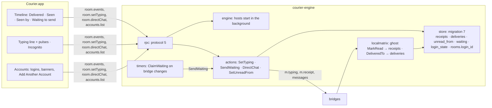

# Courier Milestone 4.4: engine reliability, receipts and typing

> **For agentic workers:** REQUIRED SUB-SKILL: Use superpowers:subagent-driven-development (recommended) or superpowers:executing-plans to implement this plan task-by-task. Steps use checkbox (`- [ ]`) syntax for tracking.

**Goal:** James can see what happened to what he sent and who is writing back: "Delivered" and "Seen" (and "Seen by" in groups) under his messages, "Ana is typing…" in the open chat while his own typing reaches the other side, Reply Privately on a group message, Mark as Unread from a message, and an Incognito mode that keeps chats unread and sends no receipts. The engine also becomes reliable the way spec §5 asks: a message sent while its network is down waits and goes when it is back, the app connects and shows chats before the five bridges have started, and a network can hold a second account. The four carried from 4.3 (Reply Privately, Mark as Unread from a message, typing to others, read receipts and "Seen") are Tasks 4, 6 and 8–10. The three that are only in the spec's definition of 4.4 are kept in tasks of their own so they can be trimmed at review: **Task 2** (chats show as each bridge becomes ready), **Task 3** (sends queue while a network is down) and **Task 5** (a second account per network). Task 3 depends on Task 2's sentinels; Task 5 touches Tasks 1, 7, 9 and 10 in named places.

**Architecture:**
- **Receipts are markers, like reads.** A person's read receipt says "read up to here"; the store keeps one row per (chat, person) and moves it forward only, as it does my own markers. "Seen" on a message of mine is "someone's marker is at or past it", worked out per page in one query. Deliveries are per message (bridgev2 only reports them in one-to-one chats). Nothing is sent back for them.
- **Typing goes both ways through bridgev2's own paths.** In: ghost `MarkTyping` → the 4.1 in-memory list → the row and now the open chat. Out: the engine queues an `m.typing` ephemeral event with `[@me]` or `[]`; bridgev2 diffs the list and calls each bridge's `HandleMatrixTyping`. The app pulses every 4 s while the text changes, so networks whose own apps time typing out keep showing it.
- **A send never fails for want of a connection.** With the chat's network starting, down or logging in, the message is stored `waiting` with an outbox row of kind `offline`, visible in the chat as "Waiting to send" with Don't Send, and the timer loop hands it over, oldest first, when the login reports connected. It is never `pending` while nothing is sending it, so a restart never calls it "may have been sent".
- **The engine serves before the bridges start.** The socket is served as soon as the store is open; the networks start one by one on a background goroutine, each reporting `STARTING` and then its bridge's own states. Chats are in the store already, so the inbox shows at once.
- **Accounts are logins.** bridgev2 already runs several logins per network and stamps each state with its `remote_id`. The store keeps states per login, each chat remembers which login it belongs to (from the bridge info's receiver), `accounts.list` lists logins, and the sign-in driver can add one beside another or replace a broken one by its ID.



**Tech Stack:** as milestone 4.3. Go 1.26, mautrix v0.31.0, util v0.10.1, the five bridges at their milestone-2 pins (whatsapp v0.2609.0, signal v0.2609.0, telegram v0.2609.0, gmessages v0.2609.0, slack v0.2609.1), mattn/go-sqlite3 with FTS5. Swift 5 mode, SwiftPM tools 5.9 mirrored in Bazel, SwiftUI with AppKit where SwiftUI falls short.

**Spec:** `docs/superpowers/specs/2026-10-15-courier-iteration-1-design.md`: §4 outgoing messages are pending first and status updates (sent, delivered, read, failed) stream back; §5 failures (network drops: sends queue as pending; session expired: a per-account banner with Reconnect; engine crash: pending messages survive); §7 part 4.4; §8 built for strangers. The interface source is the inventory in `docs/superpowers/specs/2026-10-15-beeper-desktop-inventory/`:
- `01 §4`: `ThreadListReadIcon` (the row's delivery and read tick), `TypingIndicator`, `BrandTypingIndicator`;
- `01 §5`: the message status line ("Delivered", "Seen", "Seen %s", "Seen by %1$s & %2$d other"), "Still sending...";
- `01 §7`: the message menu ("Reply Privately…", "Mark as Unread"), Incognito ("keeps chats unread even when you click on them and doesn't notify recipients you've read them", "asks whether to also hide typing");
- `02 §1.2`: "Incognito mode" (off), "Show recipients I'm typing" (on); `02 §1.3`: "Show incognito mode indicator" (on); `02 §1.5`: "Notify when someone starts typing (supported platforms only)" (off);
- `02 §1.7`: the Accounts pane's add-account flow and per-account Reconnect; `02 §2.6`: "Turn on incognito mode", "Add Account", "Accounts"; `02 §3.4.2`: the message menu order (items 5 and 8);
- `03 §1.4`: read receipts and typing come from the bridges.

The 4.1 to 4.3 plans and the code on `main` are the base. 4.1 built the in-memory typing list, typing on inbox rows, marked-unread for chats and the reconnecting mark; 4.3 built the outbox, `HandOff`, `WaitForLogin` and `ReasonNotConnected`. This plan builds on them and changes two of 4.3's rules, named in Task 3.

## Global Constraints

- **Earlier constraints:** every Global Constraint of the milestone-1 to -4.3 plans still applies: pins, hand-written AGPL headers on Go and Swift, strings in `Resources/en.lproj/Localizable.strings` via `String(localized:)`, data dir, socket, macOS 14, bundle id, no real accounts in CI, never open a real chat in Beeper while testing, Courier's own wording, no Beeper name or asset. So does what they learned: a protocol page may end before 1 MiB (`fitting`, `maxPageBytes`), WhatsApp unread marks are never sent, the engine never logs message text, names or search text, no bridge English reaches a person, a change the network refuses never looks done on this Mac, and inferred behaviour carries an `Inferred (inventory 01 §n)` comment.
- **Commands are Bazel targets.** Every step runs `bazel test …`, `bazel build …` or `bazel run …`; never `go test`, `swift test` or raw `git`. After Go file changes run `bazel run //:gazelle`; before every commit, `bazel run //:tidy`. Commit with `bazel run //tools/git:commit -- --agent <your agent> -m "<conventional message>" <paths>`. Never `git stash`.
- **Engine tests:** `bazel test //apps/desktop/courier/engine/...`, and with `--@rules_go//go/config:race` for the store, actions, timers, engine, localmatrix and rpc. **App tests:** `bazel test --config=macos-app //apps/desktop/courier/app:CourierCoreTests` (the target is `medium`; keep it so). **Everything:** `bazel query 'tests(//apps/desktop/courier/...)' | xargs bazel test --config=macos-app`.
- **No wall-clock asserts, no sleeps.** Every time-dependent test drives an injected clock: `store.SetClock`, `timers.Clock`, the actions' `now` (the store's), the app's `now:` and `sleep:` closures. Connection changes are driven, not waited for: fakenet's `SetLoggedIn` (Task 3), never `LoginDelay` (it reads `time.Since`). Concurrency tests synchronise on channels. (4.2's merge queue failed on a 60 s backfill test under race.)
- **One migration.** Migration 7 is appended to `migrations` in `engine/internal/store/migrate.go`. Migrations 1–6 are not touched; migration 6 has shipped, so its SHA-256 joins `TestShippedMigrationsAreUnchanged` (compute it from `migrations[5]` as it is on `main` before anything else changes). Add `testdata/m7.sql`, a database at `user_version = 6`; Task 1 lists its rows.
- **Protocol 5.** `protocol.json` goes to `"protocol": 5`: `Event.status` gains a value, `Account` gains logins and `login.start` gains parameters a protocol-4 engine refuses. Params stay strict. Every new method, parameter, notification kind and value has an example in `protocol/examples/`, and both conformance tests keep passing.
- **Go and Swift mirrors of one rule agree, with a test.** The typing pulse is 4 s on both sides: `actions.TypingRepeat` and `ComposerModel.typingRepeat` both equal `protocol.json`'s `conventions.typing_repeat_ms` (4000), and each side's conformance test reads the number from the file (Task 7's `TestTypingRepeatMatchesTheProtocol`, Task 8's `testTypingRepeatMatchesTheProtocol`). The `waiting` status value is named once in `protocol.json` and read by both conformance tests, as the other status values are.
- **Never log who.** Receipts, deliveries and typing carry user IDs; the engine logs none of them, nor message text, names or search text. A warning names the network and the kind of thing ("receipt", "typing"), nothing else.
- **No bridge English reaches a person.** `Account.error` stays the bridge's message on the wire; the app shows its own banner copy and keeps the bridge's text as help, as 4.1 does.
- **Outside data can't crash or hang the app or the engine.** A receipt or delivery for a message the store doesn't have is dropped; a receipt from a user the chat doesn't list is kept (members arrive late) but named by its localpart; `read_by` is capped at 50 readers per message on the wire (the newest), and the app shows one name and a count; a bridge-info receiver over 256 bytes is ignored; `login_id` on the wire is 1–256 bytes; typing names are capped as 4.1 caps them.
- **What each action reaches** is checked in the pinned sources (file:line below) and pinned by Task 5's `TestReceiptsTypingAndAccountsTableMatchTheBridges`, which fails when a bridge bump changes any cell.

| | WhatsApp | Signal | Telegram | Google Messages | Slack |
|---|---|---|---|---|---|
| My read receipts sent | yes (`handlematrix.go:296–343`; grouped by sender in groups, my own skipped) | yes (`handlematrix.go:297–347`; one message per sender, my own skipped) | yes (`handlematrix.go:943`; also reads mentions and reactions; a bot account sends none) | yes (`handlematrix.go:339–363`; needs the exact or an earlier stored message) | yes (`handlematrix.go:235–259`; marks the conversation; a bot token sends none) |
| "Seen" shown (their receipts in) | one-to-one and groups, per person (`handlewhatsapp.go:474–475`) | one-to-one and groups (`handlesignal.go:426–430`, by message ID: `:458` has no time) | one-to-one only (`handletelegram.go:1215–1219`: group receipts "only say someone read") | one-to-one (`handlegmessages.go:1247–1253`); groups only when the phone's status text reads "Read by …" (`:1259–1262`) | **never**: its receipts are my own reads from another Slack client (`handleslack.go:285–296`, sender `s.UserID`) |
| "Delivered" shown | one-to-one only (`handlewhatsapp.go:476`; bridgev2 `portal.go:3905` drops groups) | one-to-one only (`handlesignal.go:428–429`) | no (Telegram has no delivery receipts) | one-to-one (`handlegmessages.go:1236–1242`) | no |
| Typing shown (in) | 15 s, paused ends it (`handlewhatsapp.go:538–543`) | 15 s (`handlesignal.go:230–235`) | 6 s per action (`handletelegram.go:1183`), never my own other devices (`:1180`) | 15 s (`handlegmessages.go:205–208`), RCS chats with typing indicators on at the phone (`:419`) | 5 s (`handleslack.go:580–582`) |
| My typing sent (out) | composing and paused (`handlematrix.go:345–371`; presence stays off: `example-config.yaml:29`) | start and stop, to the person or the group (`handlematrix.go:349–367`) | `messages.setTyping`, cancel on stop (`handlematrix.go:1085–1114`) | **start only**: a stop is never sent (`handlematrix.go:365–367`) | start only, over RTM (`handlematrix.go:261–270`; Slack has no stop) |
| Reply Privately (a chat with a group member) | `CreateChatWithGhost` (`startchat.go:45`) | `CreateChatWithGhost` (`chatinfo.go:45`) | `ResolveIdentifier` with the user's numeric ID (`startchat.go:188–190`) | `ResolveIdentifier` with the ghost's ID, if its phone number is known (`startchat.go:76–88`) | `CreateChatWithGhost` (`startchat.go:32`) |
| A second account | a second phone number; the same number replaces the first (`login.go:392–407`, `DeleteOnConflict`); one-to-one chats are per account, groups shared (`id.go:16–28`) | yes (`login.go:221–229`) | yes (`login.go:289–295`) | yes (`login.go:420–428`); every chat is per account (`id.go:79`) | one per workspace (`slackid/id.go:116–120`) |

- **Surprises in the bridge code** (each checked in the pinned source), and what Courier does about each:
  1. **Slack's read receipts are mine.** `im_marked`, `channel_marked` and `group_marked` become read receipts whose sender is my own user (`mautrix-slack pkg/connector/handleslack.go:285–296`). Shown as "Seen", they would say a colleague read something when it was me on my phone. Courier stores them as my own marker (as today) and shows no "Seen" on Slack.
  2. **No "Delivered" in groups, anywhere.** bridgev2 ignores a delivery receipt unless the chat is one-to-one and the receipt is from the other person (`mautrix bridgev2/portal.go:3905–3907`), and only for messages not sent by a ghost (`:3918`). Courier shows "Delivered" in one-to-one chats only, and the group status line goes Sent → Seen by.
  3. **Google Messages reads group receipts out of English.** Its group "Read by" comes from parsing the phone's status text `"Read by X, Y"` (`mautrix-gmessages pkg/connector/handlegmessages.go:1259–1262`); a phone in another language gives no group Seen. Whether one-to-one receipts and typing come at all follows the phone's RCS settings (`:418–419`). Courier shows what arrives and promises nothing in its copy.
  4. **Typing stops are not always sent, and starts are sent once.** Google Messages (`handlematrix.go:365–367`) and Slack (`:261–270`) never send a stop. bridgev2 sends a start once per change of the typing list (`portal.go:1038–1053`), and the networks' own apps time it out (Telegram shows about 5 s). So Courier's app pulses `room.setTyping true` every 4 s while the text keeps changing, and the engine turns a pulse that comes 4 s or more after the last start into a stop and a start, so the other side keeps seeing it (Inferred).
  5. **Telegram has no read receipts in groups** (`handletelegram.go:1215–1219`) and no delivery receipts at all. A Telegram group message of mine never says more than "Sent".
  6. **Login states are per login, and the store kept one per network.** bridgev2 stamps each login's state with its `remote_id` (`mautrix bridgev2/userlogin.go:523`); the bridge-wide UNCONFIGURED has none (`bridge.go:402`, `userlogin.go:167`). With two accounts on one network, today's `bridge_state` row would flap between them, and `mayRelink` would read the wrong one. Migration 7 keys states by login.
  7. **Replying marks the chat read on WhatsApp and Signal whatever Courier does.** Both declare `ImplicitReadReceipts` (`mautrix-whatsapp pkg/connector/capabilities.go:20`, `mautrix-signal pkg/connector/capabilities.go:221`), so bridgev2 sends a read receipt for every message I send (`portal.go:874–881`). Incognito's "until you reply" is therefore what the bridges do anyway; Courier's copy says so.
  8. **A second WhatsApp account shares group chats with the first.** Group portals have no receiver (`mautrix-whatsapp pkg/connector/id.go:16–28`), so a group both numbers are in is one chat, and bridgev2 picks which login sends (`portal.FindPreferredLogin`). Courier shows it once, with no account tag, and lets the bridge choose (Inferred).
  9. **The socket waits for the slowest bridge today.** `main.go` starts every network (`:218`) before it serves the socket (`:268`), so with Signal loading libsignal the app sees nothing until all five are up. Task 2 serves first.
  10. **4.1's WhatsApp marked-unread inversion** (`TestWhatsAppBridgeVersionIsTheOneCheckedForUnreadMarks`) still holds at the same pin. The receipt and typing handlers above were read for similar inversions and have none.
- **Waiting sends** (spec §5 "Sends queue as pending"; decided here):
  - A new text or file message whose network is starting, not connected, or whose own login is not logged in is stored with status `waiting` and an outbox row of kind `offline`, and `message.send` answers at once. It never waits 30 s first: 4.3's `Send` waited for a login and then refused; now it queues at once. A network that is not running this session (NOT_STARTED, with a reason) or not linked at all is still refused (`-32016`, `-32010`).
  - The timer loop hands waiting messages over, oldest first per network, when a `bridge` change says a login connected (and on every pass, cheaply: it claims only chats whose login is logged in). `HandOff` that finds the network down puts the message back to `waiting` instead of failing it: `ReasonNotConnected` now means only "the network isn't running this session". This changes 4.3's `TestHandOffWhileOfflineFailsAsNotConnected` into Task 3's `TestHandOffWhileOfflineWaits`.
  - A held message whose window ends while the network is down becomes `waiting`, not failed. A scheduled message due while the network is down becomes `waiting` too; `MaxLate` applies to its due time as before, not to the wait.
  - There is no cut-off: a waiting message goes when the network is back, however long that takes. It is visible all along as "Waiting to send", with Don't Send, and `message.undo` takes it back (Inferred: WhatsApp's own app behaves this way; the person can see it waiting). This is Review Focus 1.
  - A waiting message is never `pending`, so `FailInterruptedSends` never touches it. Retry of a failed message while the network is down waits like a new one.
  - Edits, reactions, unsends, polls, timer changes and receipts are not queued: they keep 4.3's behaviour (the action waits up to `LoginWait`, then `-32018`), because an edit that goes out hours later can be wrong (Inferred).
- **Receipts** (01 §5):
  - A person's read receipt moves their marker in the chat forward to the message it names; one that names an older message changes nothing. My own receipts from other devices keep moving my marker (4.1) and never show as Seen.
  - On the wire, my message carries `read_by` (who has read it or anything after it, newest receipt first) and `delivered` (someone's device has it; one-to-one only). `InboxRow.preview_status` says the same for the row's newest message when it is mine.
  - The status line under my newest message reads Sent, Delivered, Seen (one-to-one: "Seen" or "Seen 10:42" when the receipt has a time) or "Seen by Ana" / "Seen by Ana & 2 others" (groups). Older sent messages show no line; Queued, Waiting to send, Sending… and the failed lines stay on every message in that state (Inferred, 01 §5 lists the states, not their placement).
- **Typing** (01 §4, §5; 02 §1.2):
  - The open chat shows "Ana is typing…" or "3 people are typing…" above the composer, with animated dots, from the same list the row uses.
  - My typing goes out while "Show recipients I'm typing" is on (default on) and Incognito isn't hiding it: a pulse at the first change and every 4 s while the text keeps changing, a stop 5 s after the last change, on send, on clearing the box and on leaving the chat (Inferred). Nothing goes out for a chat whose network isn't connected.
  - "Notify when someone starts typing" (default off) raises one notification per typing burst per chat ("Ana is typing…", the chat as its title), never for the open and looked-at chat, a muted one, or one in Low Priority or Hidden; the message's own notification replaces it (same thread) (Inferred).
- **Incognito** (02 §1.2, 01 §7; behind `entitlement.Incognito`, which exists on both sides):
  - While on, opening a chat marks nothing read and sends no receipt: the count and the New divider stay. The chat becomes read when I send a message in it (the networks mark it read then anyway: surprise 7), or on ⌘⇧U, Mark as Read, or Mark All as Read. Turning Incognito off sends nothing for chats already open.
  - Turning it on asks "Also hide that you're typing?" (Hide Typing / Keep Showing); Hide turns "Show recipients I'm typing" off (Inferred wording, 01 §7 "asks whether to also hide typing").
  - "Show the incognito mark in the message box" (default on) shows a small mark in the composer while Incognito is on.
- **Mark as Unread from a message** (02 §3.4.2 item 8): sets the chat's unread count to run from that message on, on this Mac only (never sent, as 4.1's chat mark). Reading the chat (⌘⇧U, Mark as Read, or a reply) clears it. After it, the app does what "After marking the open chat read or unread" says (4.1's `afterToggleRead`); with "Stay on it", the open chat is not marked read again until it is reopened or a new message arrives (Inferred).
- **Reply Privately** (02 §3.4.2 item 5): on someone else's message in a group, opens the one-to-one chat with them, creating it through the bridge when Courier has none, and starts the composer with the message quoted as a `blockquote` range (plain "> " lines where the chat's network keeps no quotes) and the caret after a blank line. A Matrix reply can't point across chats, so the quote is text (Inferred, 01 §7). It is absent in one-to-one chats and on notes.
- **A second account per network** (02 §1.7; spec §7):
  - `login.start` with `another: true` signs in beside the accounts linked; with `login_id` it signs that account in again (only in a state Reconnect fixes, else `-32013`); with neither, 4.3's rule stands for the first login. `accounts.list` lists each account's logins with their own state, name and error; the account's `state` is a summary (the login that needs the person, else the first reconnecting, else the first). Banners and Reconnect name the account when there is more than one.
  - Each chat remembers its login (`rooms.login_id`, from the bridge info's `fi.mau.receiver`); shared chats (WhatsApp groups) have none. A send goes out through the chat's own login; `Features` and `Syncs` ask that login's client. The inbox row shows the account's name as a small tag only while the network has more than one account.
  - One space per network still (sub-accounts in one space, as Beeper's Account pane lists them) (Inferred).
- **Chats show as each bridge becomes ready** (spec §7): the engine serves `hello`, `accounts.list` and the inbox as soon as the store is open. A network that hasn't started yet is `STARTING`, with no banner and no "Add a network" prompt; its chats are listed and open, and a send in one waits (above). A sign-in on it is `-32016` until it is running.
- **Inferred behaviour** is marked in a code comment wherever it is built: the 4 s pulse and 5 s stop, no cut-off for waiting sends, status-line placement, the Seen wording, the quote in Reply Privately, the incognito question's wording, the typing notification's rules, "stay on it" after Mark as Unread, one space per network, and the account summary state.

## Review Focus

1. **A message sent while the network is down goes exactly once, in order, when it is back, and never vanishes.** It shows "Waiting to send" with Don't Send the whole time, survives a quit (never "may have been sent"), goes oldest first with the chat's other waiting messages, and waits for ever if the network never returns. **Test:** Task 1 (`TestWaitingMessageSurvivesReopenAndIsClaimedOnce`, `TestClaimWaitingTakesOnlyTheLoggedInLoginsChats`), Task 3 (`TestSendWhileDownWaitsThenGoesWhenConnected`, `TestWaitingMessagesGoOldestFirst`, `TestHandOffWhileOfflineWaits`, and the timers' `TestBridgeConnectWakesTheLoopAndSendsWaiting`), Task 2's `main_test` (`TestAWaitingMessageIsNotMayHaveBeenSentAfterRestart`).
2. **"Seen" is never a lie.** Slack shows none; a receipt for an older message doesn't mark newer ones; my own other-device reads never show as Seen; a group's Seen names the readers and the count is right; a receipt for a message Courier doesn't have is dropped without error. **Test:** Task 1 (`TestReceiptMarksOnlyUpToItsMessage`, `TestReceiptForUnknownMessageIsDropped`), Task 4 (`TestOthersReceiptsAreKeptAndMineStillMoveMyMarker`, `TestDeliveredToBecomesADelivery`), Task 5's table test (the Slack row), Task 8 (`testSeenIsOnlyOnMyNewestMessageAndNamesTheReaders`).
3. **Typing never sticks and never leaks.** A stop goes out when the person stops, sends, clears the box or leaves the chat; a typing shown in Courier ends at the network's timeout even without a stop; nothing goes out while "Show recipients I'm typing" is off or Incognito hides it, or to a chat whose network is down. **Test:** Task 4 (`TestTypingRepeatsEveryFourSecondsAndStopsOnSend`, `TestTypingToADownNetworkIsNothing`), Task 8 (`testTypingPulsesEveryFourSecondsThenStops`, `testNoTypingWhileHiddenOrOffOrLeavingTheChat`), 4.1's `TestTypingExpires` (unchanged).
4. **Incognito keeps its promise.** No read and no receipt while on, until I reply or mark read by hand; turning it off sends nothing for chats I looked at while it was on; ⌘⇧U still works. **Test:** Task 9 (`testIncognitoDoesNotMarkReadUntilReplyOrCommand`, `testTurningIncognitoOffSendsNothingForChatsAlreadyOpen`).
5. **Two accounts never bleed into each other.** Each account's one-to-one chats are its own; a send goes from the chat's account; one signed-out account doesn't disable the other (its banner names it; sends on the other still go); re-linking one leaves the other's chats and state alone. **Test:** Task 3 (`TestSendUsesTheChatsOwnLogin`), Task 5 (`TestSecondLoginKeepsBothAccountsChatsApart`, `TestRelinkOneLoginLeavesTheOther`, `TestStatesAreKeptPerLogin`), Task 9 (`testBannerNamesTheSignedOutAccountAndTheOtherStaysUsable`).

---

## File structure

```
apps/desktop/courier/
  protocol/protocol.json, protocol/examples/*.json        (modify) protocol 5
  engine/internal/store/
    migrate.go, migrate_test.go     (modify) migration 7; migration 6's hash pinned
    receipts.go, receipts_test.go   SetReceipt, SetDelivered, ReceiptsFor, PreviewStatus
    store.go                        (modify) Room.LoginID; login states; NetworkChanged; status "waiting"
    inbox.go, query.go              (modify) unread_from in unreadSQL; InboxRow.LoginName, PreviewStatus
    chatstate.go                    (modify) SetUnreadFrom; SetMarkedUnread(false) clears it; DirectRoomWith
    outbox.go                       (modify) Wait, ClaimWaiting, WaitAgain; Unhold on waiting; ClaimDue skips offline
    testdata/m7.sql
  engine/internal/engine/engine.go  (modify) New, StartNetworks, Status, ErrStarting, ErrNotRunning
  engine/internal/localmatrix/
    intent.go                       (modify) ghost MarkRead → SetReceipt
    connector.go                    (modify) DeliveredTo → SetDelivered; login states per remote_id; rooms.login_id
  engine/internal/actions/
    actions.go                      (modify) dispatch queues while down; connected; Retry waits; typing stop on send
    outbox.go                       (modify) HandOff waits again; SendWaiting
    typing.go                       SetTyping, TypingRepeat
    privacy.go                      SetUnreadFrom, DirectChat
    chatstate.go, features.go       (modify) the chat's own login
  engine/internal/login/login.go    (modify) StartOptions: Another, LoginID; per-login relink
  engine/internal/networks/networks_test.go   (modify) the receipts, typing and accounts table test
  engine/internal/fakenet/fakenet.go          (modify) SetLoggedIn, LoginAs, Receipt, Typings, CreateChatWithGhost, ResolveIdentifier
  engine/internal/timers/timers.go            (modify) SendWaiting on every pass; bridge changes poke
  engine/internal/rpc/
    methods.go, server.go, organise.go, messages.go   (modify) protocol 5; accounts with logins; STARTING
    presence.go                     room.setTyping, room.setUnreadFrom, room.directChat
  engine/cmd/courier-engine/main.go (modify) serve first, start networks in the background
  app/Sources/CourierCore/
    Protocol.swift                  (modify) protocol-5 types
    Timeline.swift                  (modify) StatusLine .waiting .delivered .seen; placement
    ChatFeatures.swift, MessageMenu.swift   (modify) .markUnread, .replyPrivately
    ConversationModel.swift         (modify) typing line; incognito read rule; private reply; mark unread
    ComposerModel.swift, EngineMessageSender.swift   (modify) typing pulses; quote; setTyping, setUnreadFrom, directChat
    ComposerPreferences.swift, InboxPreferences.swift (modify) incognito, showTyping, showIncognitoMark; typingNotifications
    InboxModel.swift, AppModel.swift, LoginFlowModel.swift, NotificationPolicy.swift, NotificationCoordinator.swift, CommandSet.swift (modify)
  app/Sources/Courier/
    MessageBubble.swift, ConversationView.swift, ComposerView.swift, InboxRow.swift, AccountBanner.swift,
    AddNetworkView.swift, SpaceBar.swift, MainWindow.swift, MessagesSettingsPane.swift, InboxSettingsPane.swift, App.swift, Notifier.swift (modify)
    TypingLine.swift
  app/Tests/CourierCoreTests/, app/Tests/CourierViewTests/   new and extended tests, named in each task
  docs/m4-acceptance.md             (modify) the 4.4 section, written in Task 11
```

---

### Task 1: The store keeps receipts, unread-from, waiting sends and accounts

**Files:**
- Modify: `engine/internal/store/migrate.go` (migration 7), `migrate_test.go` (migration 6's hash), `store.go`, `inbox.go`, `query.go`, `chatstate.go`, `outbox.go`
- Create: `engine/internal/store/receipts.go`, `receipts_test.go`, `testdata/m7.sql`

**Migration 7** (exact shape):

```sql
CREATE TABLE receipts (room_id TEXT NOT NULL REFERENCES rooms(room_id) ON DELETE CASCADE, user_id TEXT NOT NULL,
  event_id TEXT NOT NULL, ts INTEGER NOT NULL, PRIMARY KEY (room_id, user_id));   -- another person's read marker: the newest message they read
CREATE TABLE deliveries (event_id TEXT NOT NULL REFERENCES events(event_id) ON DELETE CASCADE, user_id TEXT NOT NULL,
  ts INTEGER NOT NULL, PRIMARY KEY (event_id, user_id));                          -- whose device has a message of mine (one-to-one chats)
ALTER TABLE room_prefs ADD COLUMN unread_from_ts INTEGER NOT NULL DEFAULT 0;      -- Mark as Unread from a message: unread runs from (ts, seq) on; 0 = off
ALTER TABLE room_prefs ADD COLUMN unread_from_seq INTEGER NOT NULL DEFAULT 0;
ALTER TABLE rooms ADD COLUMN login_id TEXT NOT NULL DEFAULT '';                   -- the account the chat belongs to; '' = shared by every account, or not known
CREATE TABLE login_state (network TEXT NOT NULL, login_id TEXT NOT NULL, state TEXT NOT NULL,
  PRIMARY KEY (network, login_id));                                                -- '' = the bridge's own state
INSERT INTO login_state (network, login_id, state)
  SELECT network, COALESCE(json_extract(state, '$.remote_id'), ''), state FROM bridge_state WHERE json_valid(state);
DROP TABLE bridge_state;
```

**Interfaces:**
- Produces:

```go
// receipts.go
type Reader struct{ UserID string; TS time.Time }
type Receipts struct{ ReadBy []Reader; DeliveredTo []string } // ReadBy newest receipt first, at most MaxReaders
const MaxReaders = 50
func (s *Store) SetReceipt(ctx context.Context, roomID, userID, eventID string, ts time.Time) error   // moves forward only, by the event's (ts, seq); an event the store lacks is dropped (nil); publishes "receipt" {RoomID}
func (s *Store) SetDelivered(ctx context.Context, roomID, eventID, userID string, ts time.Time) error // an event the store lacks is dropped; publishes "receipt" {RoomID}
func (s *Store) ReceiptsFor(ctx context.Context, roomID string, mine []Event) (map[string]Receipts, error) // one query for the room's markers, one for these events' deliveries
// store.go
type Room struct{ …; LoginID string }
type LoginState struct{ LoginID string; State json.RawMessage }
func (s *Store) SetLoginState(ctx context.Context, network, loginID string, state json.RawMessage) error // publishes "bridge" {RoomID: network}
func (s *Store) LoginStates(ctx context.Context, network string) ([]LoginState, error)              // "" first, then by login ID
func (s *Store) NetworkChanged(network string)                                                       // publishes "bridge" {RoomID: network}
func (s *Store) SetRoomLogin(ctx context.Context, roomID, loginID string) error                      // publishes nothing
// chatstate.go
func (s *Store) SetUnreadFrom(ctx context.Context, roomID, eventID string) error // the event's (ts, seq) into room_prefs; ErrNotFound for an event not in the chat; publishes "room"
func (s *Store) DirectRoomWith(ctx context.Context, network, loginID, userID string) (roomID string, ok bool, err error) // is_direct, a member userID, login_id = loginID or ''; newest last_ts first
// outbox.go
const StatusWaiting = "waiting"
func (s *Store) Wait(ctx context.Context, e Event) error                                     // like Hold: status waiting, an outbox row of kind offline due now; indexes e
func (s *Store) ClaimWaiting(ctx context.Context, network string, loginIDs []string) ([]Event, error) // oldest first (outbox_id); chats of network whose login_id is in loginIDs or ''; waiting → pending; rows deleted
func (s *Store) WaitAgain(ctx context.Context, eventID string) (ok bool, err error)          // pending → waiting with an offline row; only my pending message
// inbox.go
type InboxRow struct{ …; PreviewStatus string } // "" unless PreviewMine: "sent", "delivered", "seen"; the row's login is Room.LoginID
```

- **`SetBridgeState` and `BridgeState` go**; their callers move to the login-state pair in Tasks 2 and 4. The store carries a chat's login ID; the rpc layer (Task 7) turns it into the account's name.
- **`unreadSQL`** gains `OR (COALESCE(p.unread_from_ts, 0) > 0 AND (u.ts, u.seq) >= (p.unread_from_ts, p.unread_from_seq))` inside the existing marker test, so the unread count, `unreadChatSQL` and the space counts all follow it. **`SetMarkedUnread(ids, false)`** also zeroes `unread_from_*` (one prefs write), so `MarkRead` clears both marks.
- **`PreviewStatus`**: for a row whose newest message is mine and sent: `seen` when a receipts row of another user is at or past it, else `delivered` when a deliveries row names it, else `sent`; "" otherwise. Two correlated subqueries on the existing joins.
- **Waiting:** `ClaimDue` leaves `offline` rows alone; `Unhold` takes a `waiting` message back as it takes a `queued` one; `Requeue` (shutdown) makes a pending message `queued` as before for `undo` and `later` rows, and `waiting` for a message that came from an `offline` row (the row kind is kept on the event's content under `store.SourceKey`'s sibling key `"fi.courier.offline": true`, written by `Wait` and stripped by every claim as the source is); `NextDue` ignores `offline` rows; `FailInterruptedSends` leaves `waiting` untouched (it selects `pending`).
- **`testdata/m7.sql`** (`user_version = 6`): rooms on two networks (one with two accounts' chats), about 20 events including three of mine sent, one held (`queued` with an `undo` row), one scheduled; a `bridge_state` row per network, one with `remote_id`; `room_prefs` rows with `marked_unread`.

- [ ] **Step 1: Pin migration 6.** Add its SHA-256 to `TestShippedMigrationsAreUnchanged` and run `bazel test //apps/desktop/courier/engine/internal/store:store_test`. Expected: PASS before any other change.
- [ ] **Step 2: Write the failing tests** in `receipts_test.go`, `outbox_test.go`, `inbox_test.go`, `chatstate_test.go`, `store_test.go`:
  - `TestMigrationFromMilestone4_3`: `m7.sql` upgrades to `user_version = 7`; the `bridge_state` row with `remote_id` lands under that login and the other under `""`; `Inbox`, `SearchMessages` and `ScheduledIn` still work; the held message is still held.
  - `TestReceiptMarksOnlyUpToItsMessage` (Review Focus 2): three messages of mine; Ana's receipt for the second gives `ReadBy` on the first two and not the third; a later receipt for the first changes nothing; Bob's receipt for the third lists both on it, Bob first.
  - `TestReceiptForUnknownMessageIsDropped` (Review Focus 2): no row, no error, nothing published.
  - `TestMyOwnReceiptIsNotAReader`: `SetRead` moves my marker and `ReceiptsFor` lists nobody.
  - `TestDeliveryIsPerMessage`, `TestReadersAreCappedAtFifty`, `TestPreviewStatusFollowsReceipts` (sent → delivered → seen; "" on someone else's newest message), `TestReceiptLookupUsesTheMarkerIndex` (`EXPLAIN QUERY PLAN` uses the primary key).
  - `TestUnreadFromCountsFromThatMessage`: five messages, read up to the fifth; `SetUnreadFrom` at the third counts 3 unread (mine among them not counted); `SetMarkedUnread(false)` clears it; a read marker past it does not.
  - `TestWaitingMessageSurvivesReopenAndIsClaimedOnce` (Review Focus 1): `Wait`; reopen; `ClaimWaiting` returns it once, pending; a second reopen returns nothing; `FailInterruptedSends` before the claim touches nothing.
  - `TestClaimWaitingTakesOnlyTheLoggedInLoginsChats` (Review Focus 1): chats of logins A, B and a shared chat; `ClaimWaiting(net, ["A"])` returns A's and the shared chat's messages, oldest first, not B's.
  - `TestClaimDueLeavesWaitingAlone`, `TestUndoTakesBackAWaitingMessage`, `TestWaitAgainPutsAPendingMessageBackToWaiting`, `TestRequeueAtQuitKeepsAnOfflineMessageWaiting`.
  - `TestLoginStatesAreKeptPerLogin` (Review Focus 5): two logins' states, each read back; `""` first.
  - `TestDirectRoomWithPrefersTheLoginsOwnChat`.
- [ ] **Step 3: Run them to verify they fail.** `bazel test //apps/desktop/courier/engine/internal/store:store_test`. Expected: FAIL, undefined `SetReceipt`.
- [ ] **Step 4: Implement.** SQL from fixed fragments; every value bound. Run gazelle.
- [ ] **Step 5: Run the store tests, also with race.** Expected: PASS, and 4.1–4.3's store tests unchanged except `TestNextDueIncludesTheOutboxAndExpiry`, which gains an `offline` row it must ignore.
- [ ] **Step 6: Commit** with `feat(courier): the store keeps read receipts, deliveries, unread-from marks, waiting sends and per-account states`.

---

### Task 2: The app connects before the networks start

**Files:**
- Modify: `engine/internal/engine/engine.go`, `engine_test.go`; `engine/cmd/courier-engine/main.go`, `main_test.go`; `engine/internal/rpc/methods.go` (`running`, `accountsList`), `server.go` (`Deps.NotStarted` removed), `server_test.go`

**Interfaces:**
- Consumes: Task 1's `NetworkChanged`, `SetLoginState`, `LoginStates`.
- Produces:

```go
func New(s *store.Store) *Engine
func (e *Engine) StartNetworks(ctx context.Context, dataDir string, m *media.Store, specs []Spec, log zerolog.Logger) map[string]error
    // in order; each host is added as it starts; the store hears NetworkChanged before and after each; returns when every spec has started or failed, or ctx ended
type Status struct{ Running, Starting bool; NotStarted string } // NotStarted: why it won't run this session; "" while starting or running
func (e *Engine) Status(name string) Status                     // an unknown name is the zero Status
var ErrStarting = errors.New("is still starting")   // HostForRoom: the chat's network hasn't started yet
var ErrNotRunning = errors.New("is not running")    // HostForRoom: the network won't run this session
func Start(...)                                     // kept: New then StartNetworks, for callers that want it synchronous
```

- **`Engine`** guards `hosts`, `order` and the per-name status with one mutex. `Stop` waits for a `StartNetworks` in flight to return, then stops the hosts started so far.
- **`main.go`** order: store, `FailInterruptedSends`, `engine.New`, actions, login driver, timers (dispatcher set), serve the socket and write the ready line, then `go eng.StartNetworks(...)`; shutdown cancels, waits for `StartNetworks`, then the existing order. The names a network starts under are known from `networks.All()` before any starts, so `hello` and `accounts.list` list them at once.
- **rpc:** `running(network)` is `Status(name).Running`; `accountsList` says `STARTING` while `Starting`, `NOT_STARTED` with `Status.NotStarted` (or 4.3's fallback text) when neither; otherwise the login states (Task 7 shapes the logins). `Deps.NotStarted` goes.

- [ ] **Step 1: Write the failing tests:**
  - engine: `TestHostsAppearAsEachStarts`: two fake specs, the first's `Start` blocked on a channel; `Status(first)` is Starting and `Status(second)` is the zero value; release; both Running, in order; `NetworkChanged` published twice per network. `TestAFailedStartIsNotStartedWithItsReason`, `TestStopDuringStartStopsWhatStarted`, `TestHostForRoomSaysStartingOrNotRunning`.
  - main: `TestHelloAnswersBeforeTheNetworksStart`: a fake network whose start blocks; `hello` and `accounts.list` answer (that account `STARTING`) before the release; after it, a `bridge` change arrives and the account is `CONNECTED`. `TestAWaitingMessageIsNotMayHaveBeenSentAfterRestart` (Review Focus 1): a `waiting` row in the store survives `FailInterruptedSends` at start untouched, while a `pending` one beside it becomes "may have been sent".
  - rpc: `TestAccountsSayStarting`, and `TestAccountsSayWhatReachesTheNetwork` updated to the new `Deps`.
- [ ] **Step 2: Run them to verify they fail.** `bazel test //apps/desktop/courier/engine/internal/engine:engine_test //apps/desktop/courier/engine/cmd/courier-engine:courier-engine_test //apps/desktop/courier/engine/internal/rpc:rpc_test`. Expected: FAIL.
- [ ] **Step 3: Implement.** Run gazelle.
- [ ] **Step 4: Run the engine suite with race.** Expected: PASS; `TestEngineServesWhileTheBackfillRuns` and `TestOneNetworkFailingDoesNotStopTheOthers` unchanged.
- [ ] **Step 5: Commit** with `feat(courier): the engine serves the app before its networks have started`.

---

### Task 3: Sends wait for their network

**Files:**
- Modify: `engine/internal/actions/actions.go`, `outbox.go`, `actions_test.go`, `send_test.go`, `outbox_test.go`; `engine/internal/timers/timers.go`, `timers_test.go`; `engine/internal/fakenet/fakenet.go`

**Interfaces:**
- Consumes: Task 1's `Wait`, `ClaimWaiting`, `WaitAgain`, `Room.LoginID`; Task 2's `ErrStarting`, `ErrNotRunning`.
- Produces:

```go
// actions
func (a *Actions) SendWaiting(ctx context.Context)   // every running network: ClaimWaiting for its logged-in logins, then HandOff each in order
// HandOff (changed): the network starting or its login not logged in → store.WaitAgain; ErrNotRunning → failed ReasonNotConnected
// Send, SendFileWith (changed): no login wait; the chat's login not logged in, or its network starting → store.Wait, answered at once
// Retry (changed): a failed message retried while the network is down waits like a new one
// timers
type Dispatcher interface { HandOff(ctx context.Context, e store.Event); SendWaiting(ctx context.Context) }
// fakenet
func (n *Network) SetLoggedIn(login *bridgev2.UserLogin, on bool)   // flips the client's IsLoggedIn and sends the login's bridge state (CONNECTED / TRANSIENT_DISCONNECT) through bridgev2
```

- **Connected** is per chat: `a.connected(ctx, h, room)` is true when a login of mine on `h` with ID `room.LoginID` (any login when `""`) has a client whose `IsLoggedIn()` is true. `WaitForLogin` stays for the actions that still wait (edits, reactions, unsends, polls, timers).
- **Timers:** `pass` calls `t.d.SendWaiting(ctx)` after `sendDue`; `pokeOnChanges` also pokes on `bridge`. Hand-offs of waiting messages run one goroutine per network, in order, so a chat's messages arrive in the order typed.
- **Errors:** `ErrNotLinked` and `ErrNotRunning` still refuse a send (`-32010`, `-32016`); `ErrNotConnected` is no longer returned by `Send`.

- [ ] **Step 1: Write the failing tests** (fakenet, injected store clock, `SetLoggedIn`):
  - `TestSendWhileDownWaitsThenGoesWhenConnected` (Review Focus 1): logged out; `Send` answers at once with status `waiting`; nothing reaches fakenet; `SetLoggedIn(true)`; the loop's pass hands it over; it arrives once and is `sent`.
  - `TestWaitingMessagesGoOldestFirst` (Review Focus 1): three sends while down arrive in order.
  - `TestHandOffWhileOfflineWaits` (Review Focus 1; replaces 4.3's `TestHandOffWhileOfflineFailsAsNotConnected`): a held message due while down becomes `waiting`, not failed; `TestHandOffOnANetworkNotRunningFailsAsNotConnected` keeps the old outcome for `ErrNotRunning`.
  - `TestSendWhileStartingWaits` (Task 2's `ErrStarting`), `TestSendOnAnUnlinkedNetworkIsRefused`, `TestRetryWhileDownWaits`, `TestEditsAndReactionsStillWaitForTheLogin` (4.3's behaviour kept), `TestSendUsesTheChatsOwnLogin` (Review Focus 5; a chat of login B waits while only A is logged in, and goes when B is).
  - timers: `TestBridgeConnectWakesTheLoopAndSendsWaiting` (Review Focus 1), `TestWaitingClaimsNothingWhileEveryLoginIsDown` (no status churn: no `status` change published across three passes).
- [ ] **Step 2: Run them to verify they fail.** `bazel test //apps/desktop/courier/engine/internal/actions:actions_test //apps/desktop/courier/engine/internal/timers:timers_test`. Expected: FAIL.
- [ ] **Step 3: Implement.** 4.3's `TestSendWaitsForALoginThatIsStillConnecting` and `TestSendGivesUpOnALoginThatNeverFinishes` are rewritten as the waiting tests above (they asserted the old rule). Run gazelle.
- [ ] **Step 4: Run the engine suite with race.** Expected: PASS.
- [ ] **Step 5: Commit** with `feat(courier): a message sent while its network is down waits and goes when it is back`.

---

### Task 4: Receipts and typing both ways

**Files:**
- Modify: `engine/internal/localmatrix/intent.go`, `connector.go`, `intent_test.go`, `connector_test.go`
- Create: `engine/internal/actions/typing.go`, `typing_test.go`
- Modify: `engine/internal/actions/actions.go` (a send stops my typing), `engine/internal/fakenet/fakenet.go`

**Interfaces:**
- Consumes: Task 1's `SetReceipt`, `SetDelivered`, `SetLoginState`, `SetRoomLogin`.
- Produces:

```go
// actions/typing.go
const TypingRepeat = 4 * time.Second            // protocol.json conventions.typing_repeat_ms
func (a *Actions) SetTyping(ctx context.Context, roomID string, typing bool) error // unknown chat: store.ErrNotFound; network down: nothing, nil
// fakenet
type TypingChange struct{ PortalID string; Typing bool }
Typings chan TypingChange                        // what HandleMatrixTyping delivered
func (n *Network) Receipt(login *bridgev2.UserLogin, chatID, senderID string, msgIDs []string, delivered bool) // queues a remote read or delivery receipt
```

- **localmatrix:** `Intent.MarkRead` from a ghost → `SetReceipt(room, ghost, event, ts)`; from me → `SetRead` as today; the bot's → nothing. `Connector.SendMessageStatus` with `len(ms.DeliveredTo) > 0` → `SetDelivered` for each user and returns without touching the status. `SendBridgeStatus` → `SetLoginState(network, string(st.RemoteID), raw)`. `applyBridgeInfo` also reads `channel["fi.mau.receiver"]` (≤ 256 bytes) into `SetRoomLogin` when it is non-empty and differs.
- **SetTyping:** queues an `EphemeralEventTyping` event (`TypingEventContent{UserIDs}` of `[@me]` or `[]`, `SourceEphemeral`, as `MarkRead` queues its receipt) through the chat's host when `connected`. A `true` within `TypingRepeat` of the last start sent is nothing; after it, a stop then a start (surprise 4). `false` sends a stop only while typing. `Send`, `SendFileWith` and `dispatch` stop my typing in that chat first. State is a map under its own mutex, by chat.

- [ ] **Step 1: Write the failing tests:**
  - localmatrix: `TestOthersReceiptsAreKeptAndMineStillMoveMyMarker` (Review Focus 2), `TestDeliveredToBecomesADelivery` (Review Focus 2; the status row stays `sent`), `TestTheBotsReceiptIsDropped`, `TestLoginStatesLandUnderTheirRemoteID`, `TestTheBridgeInfoReceiverBecomesTheChatsLogin`, `TestAnOversizedReceiverIsIgnored`.
  - actions: `TestTypingReachesTheNetworkThroughBridgev2` (fakenet `Typings` sees start then stop), `TestTypingRepeatsEveryFourSecondsAndStopsOnSend` (Review Focus 3; clock-driven: pulses at 0 s and 3 s give one start; at 4 s a stop and a start; `Send` gives a stop), `TestTypingToADownNetworkIsNothing` (Review Focus 3), `TestTypingNeverLogsWho`.
  - fakenet glue (`fakenet/glue_test.go`): `TestFakenetReceiptsAndTypingLookLikeABridges` (the fake's remote receipt reaches `SetReceipt` through bridgev2, its delivery through `SendMessageStatus`, and `Typings` sees what bridgev2 hands `HandleMatrixTyping`).
- [ ] **Step 2: Run them to verify they fail.** `bazel test //apps/desktop/courier/engine/internal/localmatrix:localmatrix_test //apps/desktop/courier/engine/internal/actions:actions_test`. Expected: FAIL.
- [ ] **Step 3: Implement.** Run gazelle.
- [ ] **Step 4: Run the engine suite with race.** Expected: PASS; `TestOnlyMyReadReceiptsMoveMyReadMarker` is extended, not weakened: ghosts' receipts now land in `receipts`, and my marker still moves only on mine.
- [ ] **Step 5: Commit** with `feat(courier): others' read receipts and deliveries are kept, and my typing reaches the network`.

---

### Task 5: A second account per network

**Files:**
- Modify: `engine/internal/login/login.go`, `login_test.go`; `engine/internal/actions/chatstate.go`, `features.go`, `actions_test.go`; `engine/internal/networks/networks_test.go`; `engine/internal/fakenet/fakenet.go`, `script.go`

**Interfaces:**
- Consumes: Task 1's `LoginStates`, `Room.LoginID`, `DirectRoomWith`.
- Produces:

```go
// login
type StartOptions struct {
	Another bool   // sign in beside the accounts linked
	LoginID string // sign this account in again (its state must allow it)
}
func (d *Driver) Start(ctx context.Context, network, flow string, o StartOptions) (Step, error)
// Another with a working account: allowed. LoginID in a working state: ErrAlreadyLinked. Neither, with a login: 4.3's rule on the first login.
// actions
func (a *Actions) loginFor(ctx context.Context, h *host.Host, roomID string) (*bridgev2.UserLogin, bool) // the chat's login (rooms.login_id), else the first logged-in login of mine
// Features, Syncs-of-a-chat and tell use loginFor; Syncs(network) stays the union
// fakenet
func (n *Network) LoginAs(ctx context.Context, br *bridgev2.Bridge, id, name string) (*bridgev2.UserLogin, error) // a second login beside Login's
func (n *Network) IncomingTo(login *bridgev2.UserLogin, chatID, senderID, msgID, body string) // Incoming, with the portal keyed to that login (a one-to-one chat of its own)
```

- **`mayRelink`** reads the named login's state from `LoginStates`; the override is that login. The sign-in that completes replaces it (bridgev2's `DeleteOnConflict`, per bridge above).
- **The table test** `TestReceiptsTypingAndAccountsTableMatchTheBridges` type-asserts each pinned client against `ReadReceiptHandlingNetworkAPI`, `TypingHandlingNetworkAPI`, `IdentifierResolvingNetworkAPI` and `GhostDMCreatingNetworkAPI`, reads each `GetCapabilities(...).ReadReceipts` on the same portals 4.3's table test builds, and pins the module versions, so a bump that changes a cell of the Global Constraints table fails here. The Signal part runs under its darwin build tag, as before.

- [ ] **Step 1: Write the failing tests:**
  - login: `TestAnotherSignsInBesideTheFirst`, `TestRelinkOneLoginLeavesTheOther` (Review Focus 5: login B's state and chats untouched while A is replaced), `TestRelinkNeedsAStateReconnectFixes`, and `TestAlreadyLinkedRefusedUnlessLoggedOut` updated to the options.
  - actions/engine: `TestSecondLoginKeepsBothAccountsChatsApart` (Review Focus 5: `IncomingTo` each login gives two chats with their own `login_id`; a shared chat has `""`), `TestFeaturesAskTheChatsOwnLogin`, `TestStatesAreKeptPerLogin` (Review Focus 5: `SetLoggedIn(B, false)` leaves A's state `CONNECTED`).
  - networks: `TestReceiptsTypingAndAccountsTableMatchTheBridges`.
- [ ] **Step 2: Run them to verify they fail.** `bazel test //apps/desktop/courier/engine/internal/login:login_test //apps/desktop/courier/engine/internal/actions:actions_test //apps/desktop/courier/engine/internal/networks:networks_test`. Expected: FAIL.
- [ ] **Step 3: Implement.** Run gazelle.
- [ ] **Step 4: Run the engine suite with race.** Expected: PASS; the networks test with Signal on macOS.
- [ ] **Step 5: Commit** with `feat(courier): a network can hold a second account, each with its own state and chats`.

---

### Task 6: Mark as Unread from a message, Reply Privately

**Files:**
- Create: `engine/internal/actions/privacy.go`, `privacy_test.go`
- Modify: `engine/internal/fakenet/fakenet.go` (`CreateChatWithGhost`, `ResolveIdentifier`)

**Interfaces:**
- Consumes: Task 1's `SetUnreadFrom`, `DirectRoomWith`; Task 5's `loginFor`.
- Produces:

```go
func (a *Actions) SetUnreadFrom(ctx context.Context, roomID, eventID string) error // on this Mac only; a note or my own message is allowed; store.ErrNotFound otherwise
func (a *Actions) DirectChat(ctx context.Context, roomID, userID string) (string, error)
// userID must be a ghost member of roomID (else store.ErrNotFound). Courier's own one-to-one chat with them on the same network
// and login (DirectRoomWith) is answered first. Else the bridge makes it: GhostDMCreatingNetworkAPI.CreateChatWithGhost, or
// IdentifierResolvingNetworkAPI.ResolveIdentifier(string(ghost.ID), true); neither is ErrNotSupported; not connected is
// ErrNotConnected. A portal without a room yet gets one through portal.CreateMatrixRoom, as bridgev2's own start-chat
// command does (bridgev2/commands/startchat.go); the answer is the store's room ID once CreateRoom has run.
```

- [ ] **Step 1: Write the failing tests:** `TestUnreadFromIsNeverSent` (nothing reaches fakenet; the count changes), `TestDirectChatFindsCourierOwnChatFirst`, `TestDirectChatCreatesOneThroughTheBridge` (fakenet makes the portal; the room is in the store, `is_direct`, with the member and the login), `TestDirectChatRefusalsNameTheReason` (not a member, not connected, no chat-starting interface), `TestDirectChatNeverLogsWho`.
- [ ] **Step 2: Run them to verify they fail.** `bazel test //apps/desktop/courier/engine/internal/actions:actions_test`. Expected: FAIL.
- [ ] **Step 3: Implement.** Run gazelle.
- [ ] **Step 4: Run the engine suite with race.** Expected: PASS.
- [ ] **Step 5: Commit** with `feat(courier): mark a chat unread from a message, and open a private chat with a group member`.

---

### Task 7: Protocol 5

**Files:**
- Modify: `protocol/protocol.json`; add examples
- Create: `engine/internal/rpc/presence.go`, `presence_test.go`
- Modify: `engine/internal/rpc/methods.go` (`toEvent`, `toEvents`, `accountsList`, `loginStart`, `messageSend`, `messageSendFile`), `organise.go` (`toRows`), `server.go` (`Protocol = 5`), `conformance_test.go`, `messages_test.go`

**Protocol changes** (Swift names them the same):
- **`hello`:** `protocol` 5; the mismatch example says `{"engine": 5}`. **`conventions`** gains `typing_repeat_ms: 4000`.
- **`Event` gains** `delivered: bool` ("someone's device has it; one-to-one chats only; my messages only") and `read_by: Reader[]` ("who has read it or anything after it, newest receipt first, at most 50; [] on others' messages"). `status` gains `waiting` ("its network is starting, down or logging in; it goes, oldest first, when it is back, and message.undo takes it back").
- **`Reader`:** `user_id`, `name` (as `typing` names people), `ts` (0 when the receipt had no time).
- **`InboxRow` gains** `login_name: string` ("" unless the network has more than one account and the chat is one account's) and `preview_status: string` (values `""`, `sent`, `delivered`, `seen`).
- **`Account` gains** `logins: Login[]`; **`Login`:** `login_id`, `remote_name`, `state` (the same values), `error`. `Account.state` is documented as the summary rule in Global Constraints; `remote_name` is the first login's.
- **`LoginStartParams` gains** `another: bool?` and `login_id: string?` (1–256 bytes; both set is `-32602`).
- **`Changed.kind` gains** `receipt` (room_id: a read receipt or delivery arrived; re-read the open chat's page).
- **`message.send` / `message.sendFile`:** the doc says a network that is starting or down answers at once with `waiting`; `-32018` leaves their error lists. **`message.undo`:** also a waiting message. **`message.retry`:** waits while the network is down.
- **New methods:**

| Method | Params | Result | Errors |
|---|---|---|---|
| `room.setTyping` | `TypingParams {room_id, typing: bool}` | `Empty` | -32020 (best effort: a network that is down is told nothing) |
| `room.setUnreadFrom` | `EventParams` | `Empty` | -32020 |
| `room.directChat` | `DirectChatParams {room_id, user_id}` | `RoomResult {room_id}` | -32016, -32018, -32020, -32023 |

- **Mapping:** `toEvents` fills `delivered` and `read_by` with one `ReceiptsFor` per page for my sent messages; names resolve as `typingNames` resolves them (members' names, then profiles, then localparts), cached per page. `toRows` fills `login_name` from the engine's logins when the network has more than one. `accountsList` builds logins from `LoginStates` (skipping `""`, which only feeds the summary when there is no login). `loginStart` passes `StartOptions`. Hand-off of `ErrStarting`/down sends never reaches the rpc layer as an error.
- **Examples:** `room.setTyping.json`, `room.setUnreadFrom.json`, `room.directChat.json`, `room.directChat-not-connected.json`, `changed-receipt.json`, `message.send-waiting.json`, `message.undo-waiting.json`, `login.start-another.json`, `login.start-relink.json`, `accounts.list-two-accounts.json`, `accounts.list-starting.json`, `room.events-receipts.json`, `inbox.list-two-accounts.json`, and `hello*.json` at 5.

- [ ] **Step 1: Write the failing tests:**
  - `TestEveryExampleRoundTrips` and `TestServerSpeaksExactlyTheProtocolsMethods` cover the new ones; `TestTypingRepeatMatchesTheProtocol` reads `conventions.typing_repeat_ms` and compares `actions.TypingRepeat`.
  - `presence_test.go`: `TestParamsValidation` (one row per `-32602`: `another` with `login_id`, an oversized `login_id`, `typing` missing), `TestErrorsMapExactly`, `TestEventsCarryDeliveredAndReadBy`, `TestReadByNamesPeopleAsTypingDoes`, `TestPagesWithFiftyReadersEndBeforeOneMiB`, `TestAccountsListLogins`, `TestRowsCarryTheAccountNameOnlyWithTwoAccounts`, `TestSendWhileDownAnswersWaiting`.
- [ ] **Step 2: Run them to verify they fail.** `bazel test //apps/desktop/courier/engine/internal/rpc:rpc_test`. Expected: FAIL.
- [ ] **Step 3: Implement** in the shape of the existing handlers (strict `decode`, `required`, sentinels).
- [ ] **Step 4: Run the engine suite with race.** Expected: PASS.
- [ ] **Step 5: Commit** with `feat(courier): protocol 5, with receipts, typing, waiting sends, private chats and accounts with logins`.

---

### Task 8: The app reads protocol 5: statuses, typing, the new actions

**Files:**
- Modify: `app/Sources/CourierCore/Protocol.swift` (every Task 7 type under the same name; `CourierProtocol.version = 5`; `EventStatus.waiting`; `Change.receipt(roomID:)`; `Account.logins`, `Login`, `InboxRow.loginName`, `previewStatus`, `Event.delivered`, `readBy`, `LoginStartParams.another`, `loginID`), `Timeline.swift`, `ChatFeatures.swift`, `MessageMenu.swift`, `ConversationModel.swift`, `ComposerModel.swift`, `EngineMessageSender.swift`, `MessageActionsModel.swift`, `InboxPresentation.swift`
- Test: `ProtocolConformanceTests` (the new examples, and `testTypingRepeatMatchesTheProtocol`), `TimelineTests`, `ChatFeaturesTests`, `ConversationModelTests`, `ComposerModelTests`, `MessageActionsModelTests` (all extended)

**Interfaces:**
- Produces:

```swift
// Timeline.swift
public enum StatusLine { …; case waiting; case delivered; case seen(by: [String], at: Int64?) }   // by: [] in a one-to-one chat
public static var waitingLabel: String { String(localized: "Waiting to send") }
public static func waitingHelp(network: String) -> String   // "It goes when %@ is back online."
public static func seenText(_ line: StatusLine, time: (Date) -> String) -> String?
    // "Seen" / "Seen 10:42" / "Seen by Ana" / "Seen by Ana & 2 others" / "Seen by Ana & 1 other"; nil for other cases
// Timeline.build (changed): Sent, Delivered and Seen only on my newest message; the other lines on every message in their state
// ChatFeatures.swift
public enum MessageAction { …; case markUnread, replyPrivately }
// available (changed): markUnread on any message that is not a note and not queued or waiting; replyPrivately on others'
// messages in a group chat (isDirect false) when the network is running; neither is ever greyed, only absent
// MessageMenu.sections (changed): section 1 gains Reply Privately… after Reply in Thread…; a new section after Bookmark holds Mark as Unread
// ConversationModel.swift
@Published public private(set) var typingLine: String?      // from the row's typing, as InboxPresentation words it
public func markUnread(from messageID: String) async      // room.setUnreadFrom, then afterToggleRead; with .nothing, no auto-read until reopened or a new message
public func replyPrivately(to messageID: String) async    // room.directChat, then appModel.open(.chat), then the target composer's startPrivateReply
// ComposerModel.swift
public static let typingRepeat: TimeInterval = 4           // conventions.typing_repeat_ms / 1000
public static let typingStopAfter: TimeInterval = 5        // Inferred
public var sendsTyping: @MainActor () -> Bool = { true }    // the preference and incognito, wired in Task 9
public func startPrivateReply(quoting message: TimelineMessage, in features: ChatFeatures) // a blockquote range, or "> " lines; caret after a blank line
// textChanged (changed): pulses setTyping(true) at the first change and every typingRepeat while changing; setTyping(false) after typingStopAfter of rest, on send, on an emptied box, and on leaving the chat
// MessageSending gains
func setTyping(roomID: String, typing: Bool) async throws
func setUnreadFrom(roomID: String, eventID: String) async throws
func directChat(roomID: String, userID: String) async throws -> String
```

- **Waiting messages** offer nothing in the menu (as queued); their status line carries Don't Send, which is `message.undo` and puts the text back as Undo does (`HeldMessages` treats `.waiting` as held, without the window).
- **`Change.receipt`** refetches the open chat's newest page as `.status` does, debounced with it.

- [ ] **Step 1: Write the failing tests:**
  - `TimelineTests`: `testSeenIsOnlyOnMyNewestMessageAndNamesTheReaders` (Review Focus 2), `testDeliveredAndSeenWording` (each string above), `testWaitingShowsOnEveryWaitingMessage`, `testOthersMessagesNeverHaveAStatusLine` (extends `testStatusLineIsOnlyOnMyMessages`).
  - `ChatFeaturesTests`: `testReplyPrivatelyOnlyInGroupsOnOthersMessages`, `testMarkUnreadOnAnyMessageButNotesAndQueued`, `testTheMenuOrderAndEveryAction` extended with both.
  - `ComposerModelTests`: `testTypingPulsesEveryFourSecondsThenStops` (Review Focus 3; the injected `now` and `sleep`), `testNoTypingWhileHiddenOrOffOrLeavingTheChat` (Review Focus 3), `testPrivateReplyQuotesAsABlockquoteOrPlainLines`.
  - `ConversationModelTests`: `testTypingLineFollowsTheRow`, `testMarkUnreadDoesWhatAfterToggleReadSays`, `testMarkUnreadWithStayStopsAutoReadUntilReopened`, `testReplyPrivatelyOpensTheChatWithTheQuote`, `testAReceiptChangeRefetchesTheNewestPage`.
  - `MessageActionsModelTests`: `testEachActionSendsItsMethod` extended; `testDontSendOnAWaitingMessageUndoes`.
  - `ProtocolConformanceTests`: the new examples; `testTypingRepeatMatchesTheProtocol`.
- [ ] **Step 2: Run them to verify they fail.** `bazel test --config=macos-app //apps/desktop/courier/app:CourierCoreTests`. Expected: FAIL.
- [ ] **Step 3: Implement.** Keep the models `@MainActor`; the views stay thin.
- [ ] **Step 4: Run the tests.** Expected: PASS, and existing tests unchanged except `testStatusLineIsOnlyOnMyMessages` (placement).
- [ ] **Step 5: Commit** with `feat(courier): the app shows delivered and seen, who is typing, waiting sends, reply privately and mark unread from a message`.

---

### Task 9: Incognito, typing settings, typing notifications, accounts and sign-in

**Files:**
- Modify: `app/Sources/CourierCore/ComposerPreferences.swift`, `InboxPreferences.swift`, `ConversationModel.swift`, `NotificationPolicy.swift`, `NotificationCoordinator.swift`, `InboxModel.swift`, `AppModel.swift`, `LoginFlowModel.swift`, `CommandSet.swift`
- Test: `ComposerPreferencesTests`, `InboxPreferencesTests`, `ConversationModelTests`, `NotificationPolicyTests`, `NotificationCoordinatorTests`, `InboxModelTests`, `LoginFlowModelTests`, `CommandSetTests` (all extended)

**Interfaces:**
- Produces:

```swift
// ComposerPreferences: incognito = false, showTyping = true, showIncognitoMark = true   (keys courier.composer.<name>)
// InboxPreferences: typingNotifications = false
// ConversationModel
// markRead (changed): skipped while preferences.incognito && isEntitled(.incognito); a send of mine in the chat (lastOutgoingID changing) marks it read then
public var incognitoIsOn: Bool   // for the composer's mark
// NotificationPolicy
public static func typingContent(room: InboxRow) -> NotificationContent   // title the chat's name, body "Ana is typing…" (row.typingLine), category .typing
public static func shouldNotifyTyping(room: InboxRow, context: Context, on: Bool) -> Bool
// NotificationCoordinator: one typing notification per burst per chat; cleared when the chat's typing empties or its message arrives
// InboxModel
public struct AccountBanner { …; public let loginID: String?; public let accountName: String? }   // set when the network has more than one account
public struct AccountStatusItem { …; public let isStarting: Bool }
// banners: one per login that needs the person; showsAddNetwork false while any account is STARTING; statusItems say Starting…
public func perform(_ banner: AccountBanner)   // reconnect passes the login
// LoginFlowModel
public struct NetworkChoice { …; public let linkedAs: [String]; public let isStarting: Bool }
public func start(network: String, flow: String, another: Bool = false, loginID: String? = nil)
// CommandSet: "Turn on incognito mode" / "Turn off incognito mode", "Add Account", "Accounts" (opens Add a Network), "Reply privately", "Mark as unread" (the message one)
```

- [ ] **Step 1: Write the failing tests:**
  - `testDefaultsMatchTheInventory` extended (both preference classes).
  - `ConversationModelTests`: `testIncognitoDoesNotMarkReadUntilReplyOrCommand` (Review Focus 4), `testTurningIncognitoOffSendsNothingForChatsAlreadyOpen` (Review Focus 4), `testIncognitoNeedsTheEntitlement`.
  - `NotificationPolicyTests`: `testTypingNotifiesOnlyWhenOnAndNotLooking`; `NotificationCoordinatorTests`: `testOneTypingNotificationPerBurstReplacedByTheMessage`.
  - `InboxModelTests`: `testBannerNamesTheSignedOutAccountAndTheOtherStaysUsable` (Review Focus 5), `testNoAddNetworkPromptWhileAccountsAreStarting`, `testStartingShowsInTheStatusStrip`, `testReconnectingStatusPerAccount` extended to two logins.
  - `LoginFlowModelTests`: `testAddAnotherAccountStartsWithAnother`, `testReconnectStartsWithTheLoginID`, `testAStartingNetworkCannotBePicked`.
  - `CommandSetTests`: `testNewCommandsHaveLedgerNames`.
- [ ] **Step 2: Run them to verify they fail.**
- [ ] **Step 3: Implement.**
- [ ] **Step 4: Run the tests.** Expected: PASS.
- [ ] **Step 5: Commit** with `feat(courier): incognito, typing settings and notifications, accounts with several logins`.

---

### Task 10: The views

**Files:**
- Create: `app/Sources/Courier/TypingLine.swift`
- Modify: `app/Sources/Courier/{MessageBubble, ConversationView, ComposerView, InboxRow, AccountBanner, AddNetworkView, SpaceBar, MainWindow, MessagesSettingsPane, InboxSettingsPane, App, Notifier}.swift`; `Resources/en.lproj/Localizable.strings`
- Test: `app/Tests/CourierViewTests/ViewSnapshotTests.swift` (extended)

**Behaviour:**
- **Status line** (01 §5): "Delivered"; "Seen" / "Seen %@" / "Seen by %@" / "Seen by %1$@ & %2$d other(s)" from `StatusLine.seenText`; "Waiting to send" with help "It goes when %@ is back online." and a "Don't Send" button; the line sits only where `Timeline.build` put it. The inbox row's tick (01 §4 `ThreadListReadIcon`): a single tick for `sent`, two for `delivered`, two filled for `seen`, after the time, only when the preview is mine.
- **Typing line** (`TypingLine`, 01 §4 `BrandTypingIndicator`): above the composer, "%@ is typing…" or "%d people are typing…" with three animated dots; absent when nobody is.
- **Composer:** the incognito mark (an eye-slash with "Incognito", help "Read receipts are off until you reply.") when `incognitoIsOn && showIncognitoMark`.
- **Message menu** (02 §3.4.2): "Reply Privately…" after "Reply in Thread…"; "Mark as Unread" in its own section after Bookmark, help "From this message. On this Mac only."
- **Settings ▸ Messages ▸ Privacy** (02 §1.2, §1.3): "Incognito mode" (help "Chats stay unread when you open them, and no one is told you read their messages, until you reply or mark the chat read (⌘⇧U)."; turning it on asks "Also hide that you're typing?" with "Hide Typing" and "Keep Showing"); "Show recipients I'm typing" (help "Networks that show typing are told while you write."); "Show the incognito mark in the message box" (greyed while Incognito is off). Incognito reads "Available with a plan" when not entitled.
- **Settings ▸ Inbox ▸ Notifications** (02 §1.5): "Notify me when someone starts typing" (help "Only on networks that send typing. Off, you're told when the message arrives.").
- **Accounts** (02 §1.7): a linked network's picker row reads "Linked as %@" (or "Linked as %1$@ and %2$@", or "Linked: %d accounts") with an "Add Another Account…" button; a starting one reads "Starting…" and can't be picked. A banner names the account when there is more than one: "%1$@ (%2$@)" as its title's network part. The status strip reads "Starting…" for a starting network. The inbox row shows `login_name` as a small tag after the network badge.
- **Notifier:** the typing category, no actions.
- **Commands** registered for ⌘J (4.7): the Task 9 list.

- [ ] **Step 1: Build.** `bazel build --config=macos-app //apps/desktop/courier/app:Courier`. Expected: success, no new warnings in `Sources/Courier`.
- [ ] **Step 2: Run the app tests.** Expected: PASS.
- [ ] **Step 3: Render and look.** Add to `ViewSnapshotTests`: `testStatusLines` (delivered, seen, seen by one, seen by many, waiting with Don't Send), `testTypingLine`, `testComposerWithTheIncognitoMark`, `testInboxRowWithTicksAndAccountTag`, `testAddNetworkWithTwoAccountsAndOneStarting`, `testPrivacySettings`, in light and dark. Run `bazel test --config=macos-app //apps/desktop/courier/app:CourierViewTests` and read every PNG under `bazel-testlogs/.../CourierViewTests/test.outputs` before the PR: green tests have shipped a broken layout before.
- [ ] **Step 4: Check by hand once** with the built app on fakenet (the engine CLI's fake network), on a temp data dir: send while the fake network is down and watch it wait and go; see Delivered and Seen appear; type and watch the fake network receive start and stop; Reply Privately from a group; Mark as Unread from a message; turn Incognito on and open an unread chat.
- [ ] **Step 5: Commit** with `feat(courier): status lines, the typing line, incognito, accounts with several logins and the privacy settings`.

---

### Task 11: Final checks and the acceptance list

- [ ] **Engine checks:** `bazel test //apps/desktop/courier/...`, plus race on the store, actions, timers, engine, localmatrix and rpc; `bazel run //:tidy` (clean); the licence check; osv-scanner on the engine; `bazel run //tools/secret-scan -- --range origin/main..HEAD`.
- [ ] **App checks:** `bazel query 'tests(//apps/desktop/courier/...)' | xargs bazel test --config=macos-app`. Run the real planner: `courier-app-macos` is selected for changes under `app/` and `protocol/`; `courier-engine-macos` for `engine/`.
- [ ] **Acceptance list:** add the 4.4 section to `apps/desktop/courier/docs/m4-acceptance.md`, in 4.3's shape, one checkbox per line:
  - **What leaves this Mac:** my read receipts (as before), my typing (new, with the setting), a private chat created through the network. Stays here: Mark as Unread from a message, Incognito, who-read-what.
  - **Before you start:** install; Settings ▸ Messages ▸ Privacy; out of the box Incognito off, typing on, the mark on, typing notifications off; the same "never in Beeper" and "never a real person's chat" rules.
  - **Check these first:** the by-hand run of Task 10 step 4, and "send with Wi-Fi off, then turn it on".
  - **The five things to check:** the Review Focus list, in plain words.
  - **What to expect on each network:** the Global Constraints table, in plain words (Seen, Delivered, typing in and out, Reply Privately, a second account), with surprises 1–5 and 7–8 as notes.
  - **`setting:general`:** Incognito mode, Show recipients I'm typing. **`setting:appearance`:** Show incognito mode indicator. **`setting:notifications`:** Notify when someone starts typing (supported platforms only).
  - **`command`:** Turn on incognito mode, Add Account, Accounts, Account ("registered; its pane is 4.6's"), listed as "registered; shown in ⌘J by 4.7".
  - **`component`:** icons-toolbar (the ticks), ThreadListReadIcon, mark_email_unread, TypingIndicator and BrandTypingIndicator (now in the chat too), AccountDisconnectedBanner (per account), AccountsBanner and AddMoreAccountsBanner (the picker's "Add Another Account…"); CompactAccountsBanner as "not applicable: a migration from another product".
  - **Not ledger rows:** the status-line placement, Don't Send, the typing line, the incognito question, Reply Privately's quote, Mark as Unread's "stay on it" rule, STARTING, the account tag and the one-space rule.
  - **Carried to later parts:** sub-account toggles, per-account notification overrides and the Accounts pane (4.6); the Account command's pane (4.6); starting a chat with someone not in a group with you (4.5); avatar read receipts (Beeper-internal only: not planned); Slack "Seen" (the network has none: not planned).
- [ ] **Commit** with `docs(courier): milestone 4.4 acceptance list`.

---

### Task 12: James's by-hand check (not for agents)

- **Setup:** install the build (`bazel run --config=macos-app //apps/desktop/courier/app:install`). Settings ▸ Messages ▸ Privacy: leave Incognito off at first.
- **One day of use**, in your own chats and never in Beeper. Tick the 4.4 section as each is seen working:
  - watch a WhatsApp message go Sent → Delivered → Seen, and a group message say "Seen by …"; see that a Telegram group message stops at Sent and a Slack one never says Seen;
  - type in a Signal chat and watch the phone show it; stop and watch it stop; have someone type to you and see the line above the box;
  - turn Wi-Fi off, send two messages, turn it on: both arrive, in order, once;
  - Reply Privately from a group on WhatsApp and on Telegram; Mark as Unread from the middle of a chat and see the count;
  - turn Incognito on, open an unread chat, check the phone shows no blue ticks, reply, and see them appear;
  - add a second account on the network where you have one (a second WhatsApp number, or a second Slack workspace), and check both accounts' chats, the tag on the rows, and that signing one out leaves the other working.
- **Try to break it:** quit while a message is waiting; sleep the Mac through a reconnect; type and switch chats mid-word; receipts from a group of fifty.
- **Record** the result in `apps/desktop/courier/docs/m4-4-result.md`, with no names, numbers or message text.
- **Done when** the 4.4 section is ticked, or each unticked row has a reason.
