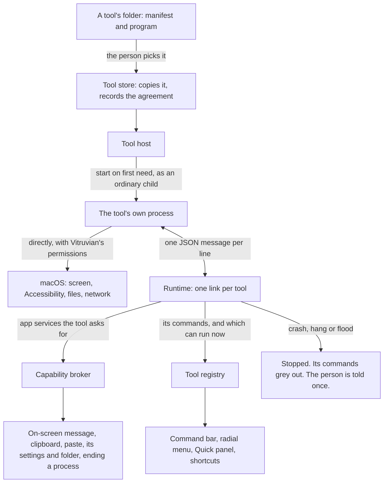

# Vitruvian sub-project 3: tools that run as their own programs — design

**Date:** 2026-10-10 · **Status:** approved by James 2026-10-10, with every
default in section 16 · **Owner:** compass
**Scope:** `apps/desktop/vitruvian`, and a new `packages/vitruvian-sdk`.
**Parents:** `2026-10-08-vitruvian-tool-platform-design.md` (sections 5 to 10,
and sub-project 3 in section 12); `2026-10-09-vitruvian-broker-and-bundled-tools-design.md`;
`2026-10-10-vitruvian-tool-permission-spikes.md`.

An earlier draft of this document confined every outside tool to a sandbox.
James decided against that on 2026-10-10. Section 3 says what replaced it.

## 1. What this is

Sub-projects 1 and 2 made a feature into a tool that lives inside the app. This
one lets a tool live outside it: a separate program, written by anyone, in any
language, that the app starts, talks to, and can stop without being disturbed.

It delivers four things:

- a **protocol**: the messages a tool and the app exchange;
- a **runtime** in the app that installs, starts, supervises and stops such
  tools;
- an **agreement sheet** and a place in Settings to see and remove them;
- an **SDK**: the protocol written down, a Swift library, a command-line
  tool, three samples, and tests any tool can be run against.

**Done when** all of these hold:

1. A sample tool, written using only what the SDK publishes, installs from a
   folder, shows its agreement sheet, and runs its commands from the command
   bar, the radial menu, the Quick panel and a shortcut.
2. That tool can do what a built-in feature can: a second sample reads the
   title of the window in front, with no permission prompt of its own.
3. Killing a tool, hanging it, or making it flood the app leaves the app
   responsive, and the person is told once.
4. A release build with no outside tool installed looks and behaves as it
   does today.
5. The by-hand checks in section 12 are recorded with the Mac and macOS
   version they were run on.

## 2. What the assessment found

Two read-only assessments ran on 2026-10-10 against `main` at `d1b2a2357`,
after the two spikes. Counts marked *search* come from text searches.

**The sub-project as first drawn is several times too big.** The parent
design gave it the runtime, the SDK, the consent screen, three kinds of island
contribution, and two features moved out as external tools. Measured:

| Piece | What it touches |
|---|---|
| Island notice | 8 files, 4 exhaustive switches. The two notice views are shared. |
| Island page | 5 files, 11 exhaustive switches, and its size is a hard-coded arm of one central switch. No page today is drawn from data. |
| Island strip | 16 files, 11 exhaustive switches, a hand-built view for each of two shapes, and a separate enum for the lock screen. |
| Screen text capture, moved out | The feature's own code is one 148-line file. It stands on a 2,157-line selection overlay shared with screenshots, the recorder and the colour picker. It has no tests of its own. |
| AI agents in the island, moved out | 21 files and 10,140 lines, 20 preferences, about 39 switch arms in 14 other files, three subprocesses, file watching across six apps' folders, and an embedded chat view. |

This is about the size of the work, not about trust, and the decision in
section 3 does not change it.

**What already fits.**

- The command bar, the radial menu, the Quick panel and shortcuts work on
  text command ids. Saved layouts keep an id they do not recognise. A tool
  with an id like `com.acme.deploys` needs no change in any of them.
- The app already runs other people's programs in three places: a script row
  in the command bar, the music adapter, and the Codex command-line tool,
  which speaks JSON lines over standard input and output. All three run with
  the app's permissions, as an outside tool now will.
- `packages/peripherals` already holds a hand-written JSON-RPC server, one
  message per line.

**What fights it.**

- Every list asks a command "can you run?" while it draws. Today that is a
  direct call on the main thread. A tool in another process cannot be asked
  that way without stalling the app.
- The tool host keys tools by Swift type. An outside tool has none.
- "Installed" for a tool whose id is not a built-in feature is always true.
- Five kinds of thing in a manifest are closed Swift lists. A manifest from
  outside can name something the app does not know.
- A tool cannot write a preference and has no folder of its own.
- A new sentence on screen costs 15 translations and about 17 lines.
- The repository's licence check enforces MIT headers outside the app. The
  parent design chose Apache-2.0 for the SDK.

## 3. The trust model: a tool is trusted like an app

**Decided by James, 2026-10-10.** A tool from outside has the same reach as a
built-in feature. No sandbox, no reduced permissions.

How: the app starts a tool the ordinary way. Spike 1 showed what that means on
macOS: the tool has every privacy permission Vitruvian has (Accessibility,
Screen Recording, and the rest), with no prompt of its own. It is also an
ordinary program running as the person: it can read and write their files and
reach the network.

This is how extensions work in VS Code and in Raycast. Installing one is
trusting it.

**What follows from it.**

- **The agreement sheet says one true thing**: this tool can do anything
  Vitruvian can. It does not offer a list of permissions to tick, because
  macOS would not hold the tool to one.
- **A bad tool is as bad as a bad app.** It can read the screen, type into
  other apps, read files and send them anywhere, and nothing shows. The only
  defence is where tools come from.
- **So there is no public store.** A tool is added by pointing at a folder,
  and later a Git address. That is deliberate, not only a consequence of
  having no Developer ID.
- **What a tool does is done in Vitruvian's name.** If a tool triggers a
  macOS permission prompt, the prompt says Vitruvian is asking. A permission
  granted for a tool's sake is granted to Vitruvian and to every tool.
- **Vitruvian's permissions still reset on each update**, as today. After an
  update a tool has them back when the app does, with nothing extra to do.
- **Nothing here changes built-in features**, the broker's rules for them, or
  the lint that holds them to the broker.

**What stays from the spikes.** The option that makes a launched program
answer for itself, and the sandbox, both work on macOS 27 with an ad hoc
build. They are not used. If a "confined" kind of tool is ever wanted, for
tools from people James does not know, the mechanism is proven and the
earlier draft of this document in the repository's history describes it.

## 4. Decisions this spec makes

Each is a default, with what it costs if it is wrong. Decision 1 is James's.

| # | Decision | Why | If wrong |
|---|---|---|---|
| 1 | **A tool is trusted like an app** (section 3). | James, 2026-10-10: outside tools get the reach of built-in ones, with no compromise. | A bad tool can do anything Vitruvian can. |
| 2 | **This sub-project is the runtime, the agreement sheet and the SDK. Nothing on the island, and no feature moved out.** | Section 2. Each island piece and each migration is as large as everything else here. | The first outside tools add commands and messages, not island content. Section 13. |
| 3 | **One message per line**, JSON-RPC 2.0, on standard input and output. The parent said length-prefixed. | It is what the Model Context Protocol uses for programs started this way, what Codex and the peripherals server already do here, and what a tool author can write in ten lines of any language. | A message containing a raw newline breaks the stream. JSON never needs one; the library never writes one. |
| 4 | **The app never waits on a tool to draw.** A tool tells the app which of its commands can run now; the app keeps the last answer. | Lists ask while drawing. | A row can be a moment out of date. Running a command the tool then refuses beeps, as a built-in one does. |
| 5 | **A tool may use the system directly, and may also ask the app.** The app offers what is better done through it: its on-screen message, the clipboard handled the way clipboard history expects, a paste, settings and a folder, ending a process with the admin prompt. | Full reach comes from decision 1. These are conveniences, so a tool behaves like a built-in feature without re-implementing it. | None. A tool that ignores them still works. |
| 6 | **A manifest lists the app services a tool calls**, and the app refuses one that is not listed. It is not a list of what the tool is allowed to do. | One code path with built-in tools, and a wrong manifest is caught the first time it runs. | A reader takes the list for a permission list. The sheet's wording (section 8) is written to prevent that. |
| 7 | **`storage` gains writing and a folder**, both per tool. | A tool with no memory is a script. Keys are held under the tool's id so two tools do not collide by accident. | None. Built-in tools keep their existing keys. |
| 8 | **A tool gets a shortcut the way part 3 built it**: its command asks for the shortcut surface and the person records one. | Already built, and already checked against every other shortcut in the app. | A tool can still register a key of its own, in its own process, outside that check. The SDK's documentation says to use the surface instead. |
| 9 | **Installing is choosing a folder.** The app copies it into its own support folder and runs the copy. | The original can move or be deleted. No Developer ID, so no signed packages. | Updating a tool is choosing its folder again. Sub-project 4 adds a Git address. The copy is for stability, not safety: a trusted tool can rewrite itself. |
| 10 | **Tool-supplied words are shown as the tool wrote them.** A manifest may carry its name in several languages; English is required. | The app cannot translate a stranger's sentence. It already shows other programs' text unlocalised: script output, process names, GitHub data. | A tool in a language the person does not read. The hub shows the publisher beside it. |
| 11 | **The SDK is MIT.** The parent design said Apache-2.0. | The repository's licence check enforces MIT headers on everything outside the app, and `packages/peripherals`, the precedent the parent names, is MIT. | No patent grant. If that matters later, the check gains an exception; nothing here depends on it. |
| 12 | **The app links the SDK's protocol types.** One definition of each message, used by both sides. `Core` imports the module by name in the file that uses it and does not re-export it. The module's Swift sources are pinned in the app's folder (`tool_protocol_pin_test`). | Two hand-kept copies drift. A GPL app may link an MIT library; the app already links one. The pin is there for two reasons: the app is released by path, so a change made only in the package would never ship in it; and every Swift test of the app is `manual`, so the presubmit planner would not otherwise list any test of the app for such a change. | A change to a message is a change in two places' build. That is the point. |

## 5. Architecture



New parts, each with one job:

- **Tool store** (`Services/Platform/External/ExternalToolStore.swift`). The
  list of installed outside tools, where their files are, and that the person
  agreed. It answers "installed?" for the broker.
- **Runtime** (`Services/Platform/External/`). One link per running tool:
  starts it, reads and writes messages, enforces deadlines and limits,
  restarts with a growing wait, and stops it.
- **Protocol types** (`packages/vitruvian-sdk`, a Swift module both sides
  link).
- **Agreement sheet and the tools section of Settings** (`UI/Settings/`).

Changed parts:

- **Tool host.** It holds "something that can start, stop, run a command and
  say what can run", with two kinds behind it: a compiled-in tool, as today,
  and a link to an outside one.
- **Broker.** "Installed" asks the tool store for an outside tool. Each
  operation an outside tool may call gets a form that takes and returns only
  values.
- **Manifest.** It can be read from JSON, and refuses what it does not know.

## 6. A tool on disk

A folder with a manifest and a program:

```
deploys/
  vitruvian-tool.json
  bin/deploys
```

```json
{
  "id": "com.acme.deploys",
  "name": { "en": "Deploys", "fr": "Déploiements" },
  "description": { "en": "Copies the address of your latest deploy." },
  "version": "1.2.0",
  "protocol": "1",
  "publisher": "Acme",
  "license": "MIT",
  "icon": "shippingbox",
  "uses": ["clipboard.write", "notify", "storage"],
  "contributes": {
    "commands": [
      { "id": "copyLatest", "title": { "en": "Copy latest deploy" }, "icon": "link",
        "surfaces": ["commandBar", "radial", "shortcut"] }
    ]
  },
  "preferences": [ { "id": "project", "type": "string", "default": "" } ],
  "activation": ["onCommand"],
  "runtime": { "kind": "external", "exec": "bin/deploys" }
}
```

Rules:

- **The id has a dot** and is at most 128 characters. An id with no dot is a
  built-in feature's and is refused.
- **`uses` names the app services the tool calls** (decision 6). For an
  outside tool it carries no reasons: there is nothing to approve one by one.
- **Unknown fields are ignored.** That is how a later protocol adds one.
- **An unknown service, surface or preference type refuses the install**,
  with a message that names it. The alternative, installing with part of the
  manifest dropped, leaves a tool that half works.
- **`exec` stays inside the folder.** A path that leaves it is refused. It
  is checked twice: by its text, and, in the app, against the real folder
  with links followed. A program that is missing, or that macOS will not
  run, is refused too.
- **The icon is an SF Symbol name.** One the Mac does not have draws as a
  plain puzzle piece, as an unknown command does today. An icon never
  refuses a manifest: with none, or one that is only spaces, the tool draws
  the puzzle piece, and a command with none takes its tool's.
- **`id`, `name`, `version`, `protocol`, `publisher` and `runtime` are
  required.** Everything else may be left out, and a tool with no
  `activation` is `onCommand`. `activation` may name `onCommand` and
  `onLaunch` only.
- **`uses` may name** `notify`, `open`, `clipboard.read`, `clipboard.write`,
  `keystrokes`, `processes` and `storage`. `hotkey` and `clipboard.rewrite`
  are built-in tools' and are refused as unknown.
- **A preference is `{ id, type, default }`.** `type` is `string`,
  `boolean`, `integer` or `number`, and the default is of that type. Since
  2026-10-12 it may also carry a `title`, text in several languages of at
  most 60 characters each with no control character. A preference with a
  title is one the person sees and can change in the tool's detail; one
  without is the tool's alone. Text saved to a preference is at most 4,096
  characters.
- **Text in several languages is a map from a language tag to text.** A
  language is its own entry, else its language without the region, else
  English.
- **Size limits**: the manifest 64 KB, 32 commands, 16 preferences. These
  keep the app's lists sane; they are not a safety measure.

Installed, it lives in the app's support folder:

```
~/Library/Application Support/<bundle id>/Tools/com.acme.deploys/     its files
~/Library/Application Support/<bundle id>/ToolData/com.acme.deploys/  a folder for what it saves
```

## 7. Starting and holding a tool

**Starting.** The app starts the tool's program as an ordinary child process,
in the tool's data folder, with the person's environment. Its standard input
and output are the link to the app. Its standard error is its log.

**When it runs** follows the manifest:

- `onCommand`: started the first time one of its commands runs. Stopped after
  two minutes with nothing asked of it.
- `onLaunch`: started with the app, kept running.

A tool that is removed or switched off in Settings is stopped at once.

**Stopping** is: say goodbye, close its input, wait two seconds, end it, wait
one more, kill it. The app does this for every running tool at quit. A tool
that started programs of its own was responsible for them, and the app ended
only the process it started. *Since 2026-10-12 the app ends those programs
with the tool, as long as they are still in the tool's process group: see
"Five loose ends of the tool platform, as closed" in section 15.*

**When it misbehaves.** Trusting a tool does not mean letting it take the app
down. These limits protect the app's responsiveness, not the person's data:

| What happens | What the app does |
|---|---|
| It exits or crashes | Its commands grey out. It is started again at the next need, after a wait that doubles from 1 second to 5 minutes. Three crashes within a minute and it stays stopped until the person starts it from Settings. |
| It does not answer within the deadline (2 seconds, 10 for the first message) | The request fails. Three in a row and it is treated as crashed. |
| It sends a line over 1 MB, or more than 200 messages a second for 5 seconds | Stopped, treated as crashed. |
| It sends something that is not a message | That line is dropped and counted. Twenty in a minute and it is stopped. |
| It writes to standard error | Kept, up to 256 KB per tool, where the person can read it in Settings. Never shown as a message. |

The person is told once per tool per launch, with one sentence, that a tool
stopped working. The command bar, the radial menu and every built-in feature
carry on.

## 8. The agreement sheet, and where tools live in Settings

This is new screen, so its layout is settled with mock-ups at the planning
step, before code. What it must do:

**Adding a tool.** The Features hub gets a section for tools from outside,
with an "Add a tool" button that opens a folder picker. The app reads the
manifest and shows one sheet before anything is copied or run:

- the tool's name, publisher, version and description, as the tool wrote them;
- the commands it adds;
- **one plain statement, in the app's words: this tool is a separate program.
  It can do anything Vitruvian can on this Mac, including reading the screen,
  controlling other apps, reading your files and using the network. Vitruvian
  does not limit or check what it does. Add it only if you trust who made it.**
- Add, and Cancel.

The sheet shows no list of permissions. A list would read as a promise the
app cannot keep.

**Afterwards.** Each installed tool has a row: name, publisher, a switch, and
a detail view with its commands, its log, where its files are, and Remove.
Remove deletes its files and, after asking, what it saved.

**When a tool changes.** Choosing the folder again for an installed id shows
the old and new version and asks once more.

**A downloaded tool.** macOS quarantines a folder downloaded from the web, and
its program will not start. The app says so and says how to clear it. It
never clears it for the person.

**The words.** The app's own sentences here are new and are written in all
15 languages: about 15 of them, counted at the planning step. Counted: 42;
the stage C plan's table lists them. Two more came on 2026-10-12, for the
alert after a removal that kept what a tool saved: 44. Two more the same
day, for the same alert when a folder could not be deleted: 46. The tool's
words are shown as given (decision 10).

**With no outside tool installed** the hub shows one quiet line and the
button. Nothing else in the app changes.

`docs/PRIVACY.md` gains a section in the change that ships this: the app's
own promises and its list of network connections stand, and cover the app
alone. A tool from outside is a separate program the person chose to add. It
has the app's permissions and makes its own connections, which the app
neither lists nor limits.

## 9. The protocol, version 1

JSON-RPC 2.0. One message per line. UTF-8. The tool's standard output carries
nothing else.

`packages/vitruvian-sdk/protocol/` is the full statement of version 1. This
section is its summary. Stage A pinned down what this section left open:

- A request id is a whole number or a string.
- A command is named by its bare id (`copyLatest`), never with its tool's.
- `shutdown` is a notice.
- Everything a tool asks of the app is a request, so it can be refused. Only
  `commands/state` and `log` are notices.
- `commands/state` carries the whole list of commands that can run now.
- A request that is simply done answers `{}`.
- A blank line is ignored. A line ends with a line feed; a carriage return
  before it stays part of the line.
- 1 MB is 1,048,576 bytes, not counting the line break.
- A value read or written through `storage`, and the extra data a refusal
  carries, are checked when a message is read, not later.

**The app starts.** It sends `initialize` with the protocol versions it
speaks, the language in use, and the path of the tool's data folder. The tool
answers with the version it picked and its own version. A tool that picks a
version the app did not offer is stopped. Nothing else may be sent first.

**What the app asks the tool:**

| Message | Meaning | Answer |
|---|---|---|
| `initialize` | as above | the version chosen |
| `command/run` | run this command | done, or refused with a reason |
| `preferences/changed` | these values changed | none (a notice) |
| `language/changed` | the person changed language | none (a notice) |
| `shutdown` | stop | none; the tool exits |

**What the tool asks the app.** Each is optional: a tool may do the same
thing itself (decision 5).

| Message | In `uses` | Meaning |
|---|---|---|
| `commands/state` | none | which of its commands can run now. A notice; sent whenever that changes. Until the first one, all can. |
| `notify/hud` | `notify` | show the app's short on-screen message, with a symbol |
| `notify/beep` | `notify` | the alert sound |
| `open/url` | `open` | open a link |
| `clipboard/readText` | `clipboard.read` | the clipboard's text, read on the app's clipboard lane |
| `clipboard/writeText` | `clipboard.write` | replace the clipboard with this text, marked as Vitruvian's so clipboard history files it correctly |
| `keystrokes/paste` | `keystrokes` | paste this text into the app in front, with the app's tuned paste |
| `keystrokes/pressMenuItem` | `keystrokes` | press the menu item with one of these key equivalents in the app in front. It takes a list; each is a character and the modifiers held with Command (`shift`, `option`, `control`) |
| `processes/terminate` | `processes` | end this process, with the app's checks and its admin prompt when needed. It takes a process id, its name and whether to force |
| `storage/get`, `storage/set` | `storage` | read or write one of the preferences the manifest declares |
| `log` | none | a line for the tool's log in Settings |

**A refusal** is a JSON-RPC error with one of the broker's reasons as its
code: not listed in `uses`, not installed, a macOS permission Vitruvian does
not have, or not available right now. A tool must cope with any request
being refused.

The codes: -32001 not listed in `uses`, -32002 not installed, -32003 a macOS
permission missing, -32004 not available right now. A tool that will not run
a command answers -32010. A message that cannot be handled at all gets one of
JSON-RPC's own five: -32700, -32600, -32601, -32602, -32603.

**Growing it.** A new message or field is added without a new version when an
old tool can ignore it. Anything an old tool would misread needs version 2,
and the app goes on offering 1. This is the parent design's section 12.1,
unchanged.

**What version 1 leaves out, for reasons of design and not of trust:**

- **Rewriting the clipboard as it changes.** The app would have to ask the
  tool three questions in the middle of a job on a lane every clipboard
  feature shares, and wait. That needs a deadline design first.
- **Binding a hotkey by itself.** Decision 8.
- **Anything on the island**, live command-bar rows for a typed query, and a
  command that takes an argument.

## 10. Inside the app: what changes

- **`ToolManifest` from JSON**, in `Core` (`ExternalToolManifest`), which
  applies the rules of section 6. The rules that need only the file are in
  the package's `ToolManifestFile.read`, so the command-line tool applies
  the same ones; `Core` adds the checks against the real folder and the
  mapping onto the app's closed lists. The closed lists stay closed:
  reading a name the app does not know is a refusal the sheet can show,
  never a crash.
- **`ToolHost`** holds hosted tools behind one small protocol (start, stop,
  run a command, which commands can run), with the compiled-in kind and the
  outside kind as its two implementations. The compiled-in kind is today's
  code, unchanged in behaviour.
- **The registry's "can it run?"** for an outside tool reads the last
  `commands/state` and whether the tool is installed, switched on and not
  stopped for misbehaving. It never sends a message.
- **Broker operations for outside tools** take and return values only, with a
  reply where today's answer at once. The compiled-in forms stay as they are.
- **`storage`**: `set`, keys held under the tool's id, and the data folder.
- **`isInstalled`** in the broker asks the tool store for an id with a dot.
  The `?? true` for an unknown id becomes `false`.
- **Lints**: the rule that the broker names no tool also covers the runtime.
  The rule that holds a migrated built-in tool to the broker is unchanged:
  it is about our own code staying honest, and an outside tool is not our
  code.

## 11. The SDK

`packages/vitruvian-sdk`, MIT, beside `packages/peripherals` and built the
same way: a hand-written `BUILD` that mirrors `Package.swift`, its own
pipeline unit.

| Piece | What it is |
|---|---|
| `protocol/` | The manifest and every message as JSON Schema, and a plain-language description of each. The source of truth. It also holds `methods.json`, the table of messages, and `examples/`. |
| `Sources/VitruvianToolProtocol` | The same messages as Swift types. The app links this. |
| `Sources/VitruvianToolKit` | A library a Swift tool is written with: declare commands, handle them, call the app. |
| `Sources/vitruvian-tool` | A command-line tool: `init` (a new tool from a template), `validate` (check a folder the way the app will), `run` (play the app's side in a terminal, so a tool can be developed without the app). |
| `samples/` | Three sample tools: one in Swift using the kit; one in plain Python using nothing, to prove the protocol does not need the kit; one that reads the front window's title directly, to prove decision 1. |
| `conformance/` | A scripted app's side that any tool can be run against. As built: Python 3 with no dependencies. It checks five things: the handshake, a command, an unknown command, the command again with every request refused, and shutdown. It also checks the params of the twelve messages a tool may send, against a table written by hand in the script. The tool it is proven against is `conformance/reference-tool`. Stage D: it reads to the end of a tool's output, with a time limit on that last read, and the Python sample, `samples/hello-python`, grew from the reference tool, which stays. |

`conformance/` and `samples/` are lower case because the repository's naming
lint wants that outside a Swift source tree.

Two tests read the same example files, one against the schemas and one
against the Swift types. Together they prove three things. Every example the
files call valid is accepted by both, and every one they call invalid is
refused by both. Every field a schema declares is used by a valid example,
and every Swift type has exactly the fields its schema declares. The table
of messages in `methods.json` is the Swift list of methods, row for row.

They do not prove that a limit written on one side only is on the other,
unless an example crosses it. So a change is made in the schema, the Swift
type and an example, in one commit.

Not in this sub-project: publishing the package anywhere, a TypeScript kit,
and versioned documentation on a website. Sub-project 4.

## 12. Testing

Automated:

- **Manifest from JSON**: every rule of section 6, including each refusal.
- **Runtime against a scripted fake tool** (no real process): the handshake,
  a version the app did not offer, an exit, no answer, a flood, a line too
  long, a line that is not a message, and that each ends as section 7 says
  with the registry showing the right state.
- **Runtime against a real child process**, on a Mac runner: the Python
  sample is started, runs a command, and is stopped; killed mid-command, the
  app's side recovers; at shutdown no process is left.
- **Broker for an outside tool**: each operation's refusals and its success;
  a service not in `uses` is refused.
- **Conformance**: the Swift sample and the Python sample both pass.
- **Release build unchanged**: with no outside tool installed, every list of
  commands is what it was.

By hand, recorded in each pull request with the Mac and macOS version:

- Add the sample tool from a folder; the sheet says what section 8 says.
- Run its command from the command bar, the radial menu, the Quick panel and
  a recorded shortcut.
- Add the sample that reads the front window's title. It works, and no
  permission prompt appears. This is the check for decision 1.
- Kill a tool from Activity Monitor while idle and while running a command.
- Switch a tool off; its commands are gone everywhere. Remove it; its files
  are deleted.
- Quit the app with a tool running; no process is left behind.
- Update the app (permissions reset, as today); once Vitruvian has them
  back, the tool does too, with nothing extra to do.

Stage D gathers these, and each stage's own checks by hand, into one
numbered list: "By hand: every check of the sub-project", in section 15.

## 13. Out of scope, and where it goes

None of these is held back for safety. Each is its own piece of work.

| Left out | Why | Where |
|---|---|---|
| Island notice | Smallest island piece: 8 files, 4 switches | The first thing after this sub-project |
| Island strip and page | Need the content vocabulary, and collapsing the island's renderers toward one first | Their own sub-project |
| Moving AI agents out | 10,000 lines, and needs all three island pieces | After the island page exists |
| Moving screen text capture out | Its own code is small; it stands on a selection overlay shared with three other tools | After a shared capture service is cut out of that overlay |
| Rewriting the clipboard as it changes | The app asks the tool mid-job on a shared lane | Needs a deadline design first |
| Install from a Git address, publishing the SDK, a TypeScript kit | | Sub-project 4 |
| A confined kind of tool, for tools from strangers | Decided against for now (section 3). The mechanism is proven. | Only if tools from people James does not know are ever wanted |

## 14. Risks

- **A bad tool.** It has everything Vitruvian has, silently. This is the
  accepted cost of decision 1. What limits it: tools are added by hand from
  a folder, the sheet says plainly what adding one means, and there is no
  store.
- **Blame.** macOS and the person see Vitruvian doing whatever a tool does.
  A tool that misbehaves makes the app look as if it did.
- **A tool can change itself after it is added.** The app runs a copy, but a
  trusted program can rewrite that copy. The app does not pretend otherwise.
- **The cost of words.** About 15 sentences in 15 languages.
- **Scope.** Section 15 cuts this into four stages. With no launcher and no
  sandbox, the risky part is now the runtime's handling of a misbehaving
  process, which is ordinary engineering and well covered by tests.

## 15. Stages

Each is its own plan and pull request.

| Stage | Builds | Can a person see it? |
|---|---|---|
| A | **Built.** The SDK package with the protocol, its Swift types and the conformance script. The manifest read from JSON, and a pin of the protocol's sources in the app. | No |
| B | **Built.** The runtime, tested against the fake tool and, on a Mac runner, a real child process. The tool host's two kinds. The broker's forms for outside tools; `storage` writing and the folder. A development switch installs one tool from a folder with no screen. | No, without the switch |
| C | **Built.** The tool store, the agreement sheet, the tools section of Settings, the privacy section. Mock-ups first. | Yes |
| D | **Built.** The tool kit, the command-line tool, the three samples, the documentation. The by-hand checks: gathered into one list, below, and run in part on 2026-10-12. | Only to a tool's author |

**What came after (2026-10-14).** Sub-project 4 of section 13 (publishing
the SDK, a TypeScript kit) became issue #3130 and a design of its own,
`docs/superpowers/specs/2026-10-12-vitruvian-tools-for-everyone-design.md`.
It was built by 2026-10-14, but for Nexus Agent as a tool, which James
moved to a separate effort of his own. Its section 11 lists every stage
with its pull requests and releases.

**Stage A, as built (2026-10-10).** Each line is marked met only where a
command that was run shows it. Run on macOS 27.0 with Xcode 27 and Swift 6.4.

| What stage A was to deliver | Met? | What shows it |
|---|---|---|
| The protocol as JSON Schema, with examples the schemas judge | Met | `bazel test //packages/vitruvian-sdk:protocol_examples_test` passes |
| The same messages and the manifest as Swift types, held to the schemas | Met | `bazel test --config=macos-app //packages/vitruvian-sdk:VitruvianToolProtocolTests` passes, 30 tests |
| A script that plays the app's side to any tool | Met, for one tool | `bazel test //packages/vitruvian-sdk:conformance_test` passes: the reference tool passes and ten broken copies are each caught. No second tool exists to run it against. |
| The app reads a manifest, with every rule of section 6 and each refusal | Met, but for one refusal | The app's `platform` suite passes with 60 new checks. `notOfferedHere`, what a newer package meets in an older app, has no test that reaches it through a file. |
| A person sees no change | Met | Nothing under the app's `Sources/` names the reader but its own file; the app's unit tests and `selftest` pass. Nothing was checked by hand, as there is no screen to check. |
| A change to the package cannot skip the app's tests | Met | With one character changed in the package, `tool_protocol_pin_test` fails, and the presubmit planner selects the app's unit for that change (run locally, not watched on CI). This needed a fix on the way: a bracket in a comment was hiding the app's test list from the planner. |
| `Package.swift` describes the same package | Partly | `swift build` of the package passes by hand. CI does not build it, and its tests were not run that way. |

None of the five "done when" items of section 1 is met by stage A alone.
They are for the whole sub-project. Stage A bears on item 4 only: a release
build runs no line of this stage.

**Stage B, as built (2026-10-11).** Each line is marked met only where a
command that was run shows it. Run on one Mac (Mac16,5, Apple M4 Max) with
macOS 27.0, Xcode 27.0 and Swift 6.4. Nothing here was run on a CI runner,
and nobody opened the app.

| What stage B was to deliver | Met? | What shows it |
|---|---|---|
| The runtime, tested against the fake tool | Met | `bazel test --config=macos-app //apps/desktop/vitruvian:unit_tests --test_arg=--suite=tool-runtime` passes with 303 checks. Run twenty times in a row with `--runs_per_test=20 --local_test_jobs=1 --nocache_test_results`: twenty passes. The plan's 24 planted regressions are in `Tests/mutation_checks.py`, each once. Each was run when its task was built and failed its check; the whole list was not run again at the end. |
| The runtime, tested against a real child process on a Mac runner | Met, but not on a runner | The same suite starts a real program, `tool_fixture`, in `ToolProcessTests`, `ExternalToolHostTests` and `ExternalToolStoreTests.aRealTool`. After every run `pgrep -fl tool_fixture` printed nothing. It ran on a developer's Mac only: no pull request is open, so the `vitruvian-desktop-macos` job has not run it. |
| The tool host's two kinds | Met | `ExternalToolHostTests`, in that suite. The `platform` suite is unchanged at 766 checks, and a full run reports `TESTS OK (49 suites)`. |
| The broker's forms for outside tools; `storage` writing and the folder | Met, but `storage` writes no file | `ExternalToolCallsTests` and `ExternalToolStoreTests.folders` and `.links`. A preference is saved in the app's own preferences under `<tool id>/<preference id>`. The data folder is made, for the person alone, and the tool runs in it; the app writes nothing there. |
| A development switch installs one tool from a folder with no screen | Met in tests, not by hand | `ExternalToolStoreTests.developmentSwitch`; `selftest` passes in a build made with the define. The three checks under "By hand" in the plan were not done: nobody has seen a tool run in the real app, seen nothing left at quit, or seen a killed tool come back. |
| A person sees no change without the switch | Met, but read the note | `selftest` passes without the define. With the `#if` taken out of `main.swift` by hand, `source_lints_test` fails on `a_release_build_adds_no_outside_tool`. The object file of `main.swift` names nothing of the tool store without the define, and names `installDevelopmentTool` with it. No file of strings changed. The note: the function that reads the hidden preference is in every build, because it is in `Services`, which has no define. A release build holds it and never calls it. |

Where stage B differs from the sections above it. Sections 7 and 12 are not
rewritten: stage C settles the first three, and they stay open until it does.

- A tool that crashed three times within a minute stays stopped until the
  app is started again. There is no Settings screen to start it from.
  Stage C: Start Again, on the tool's row in Settings.
- "The person is told once" is a line in the system log, at a tool's first
  crash in a run of the app. Stage C: also the app's short on-screen
  message, once per tool per run.
- A tool gets the environment the app has, not the login shell's. A tool
  whose first line asks for `python3` or `node` finds only what is on the
  short `PATH` macOS gives an app.
- The real child process in the tests is a small Swift program, not the
  Python sample. The Python reference tool is still held by
  `conformance_test`. It has never been started by the app.
- Removing a tool deletes nothing in this stage: `Tools/<id>/` and
  `ToolData/<id>/` both stay. Adding a tool again replaces `Tools/<id>/` and
  keeps `ToolData/<id>/`. Section 8's Remove is stage C's. Stage C: Remove
  deletes the copy, and what the tool saved when the person picks that.
- A folder is copied whole, with no limit on its size or on how many files
  it holds. This spec gives none. A link inside it is copied as a link. A
  `Tools` or `ToolData` folder that is itself a link to another place is
  refused; that check is not in the plan. Stage C: a folder may hold 256 MB
  and 10,000 things, and a larger one is refused before anything is copied.
- The store forgets its tools when the app quits. The switch adds the folder
  again at each launch. Stage C: the store remembers in
  `InstalledTools.json`, and the switch is deleted.
- Three limits are known and accepted. A tool that closes its output and
  keeps running is noticed only when three requests go unanswered. A tool's
  last line with no line break is dropped. After the final kill at quit the
  app does not wait to see the process gone.

**Stage C, as built (2026-10-11).** Each line is marked met only where a
command that was run shows it. Run on one Mac (Mac16,5, Apple M4 Max) with
macOS 27.0, Xcode 27.0 and Swift 6.4. Nothing here was run on a CI runner.
Nobody opened the app when this table was written: how a screen looks, and
which button a key presses, was not checked then. It was on 2026-10-12: see
the results under "By hand: every check of the sub-project" below.

| What stage C was to deliver | Met? | What shows it |
|---|---|---|
| The tool store | Met | `ExternalToolStoreTests.remembering`, `.switching`, `.updating`, `.heldBack`, `.unreadableRecords`, `.deleting`, `.removing` and `.goneBeforeDeleted`, in the `tool-runtime` suite: `bazel test --config=macos-app //apps/desktop/vitruvian:unit_tests --test_arg=--suite=tool-runtime` passes with 502 checks. Run twenty times in a row with `--runs_per_test=20 --local_test_jobs=1 --nocache_test_results`: twenty passes, and `pgrep -fl tool_fixture` printed nothing after. |
| The agreement sheet: what it says, and that only it adds a tool | Met | `ExternalToolScreensTests.agreement`, `.anUpdate`, `.asWritten` and `.beforeAgreeing`. `source_lints_test` passes with `only_the_agreement_sheet_consents` among its 48 rules. In the app's sources `ToolConsent(` is written once, in the sheet's Add button, and `add` is called once, from the sheet's `onAgree`. |
| The agreement sheet: how it looks, that Return and Escape cancel, that it fits a small display | Not checked: by hand | By-hand checks 2, 3 and 12. `ToolAgreementContent.defaultChoice` is `.cancel` and a planted regression holds it, but no test presses a key. That the sheet stays under 800 points is arithmetic from the line limits. |
| The tools section of Settings: what each row, the detail and the question before removal say | Met | `ExternalToolScreensTests.rows`, `.detailAndRemoval`, `.removalChoices` and `.switchAndOwnWords`. Each state of a row has a check. Each of the two removing buttons is checked against what the store then keeps or deletes. |
| The tools section of Settings: how it looks and behaves in the app | Not checked: by hand | By-hand checks 1 and 4 to 11. Three things compile and were never seen: two sheets from one card, the folder picker opening after the detail closes, and Cancel as the default button of the question before removal. |
| The privacy section | Met | `docs/PRIVACY.md` has the section "Tools you add from outside", with the words of the mock-up. No other copy of that page exists in the repository. |
| Every text in fifteen languages | Met by rule, not by a reader | `ExternalToolStringsTests`, in the same suite: 42 texts, none blank, none left in English, each format filled as the English one. Every one of the 42 is used by a view or a value. Nobody who reads the other fourteen languages has reviewed them. |
| A build with no tool added is as before, but for one card | Met in tests, not by hand | `selftest` passes. `platform` is unchanged at 766 checks, `features` at 1179 and `settings` at 474, each the same before and after the card was added. A full run reports `TESTS OK (49 suites)`. By-hand check 1 was not done. |
| The planted regressions | Met for nine, reported for the rest | `Tests/mutation_checks.py` holds the 28 entries stage C added or reworded, each once, and each quoted line is in its source exactly once. The nine for the Settings card were run through the script's own `main()` and each failed its check. The others were run by whoever built their task, and reported as failing theirs. The whole list was not run again at the end. |

Where stage C differs from the sections above it:

- The sheet lists what a tool says it uses, under a note that the list is
  the tool's and no limit. Section 8 says the sheet shows no list.
- A copy whose manifest is not the one agreed to is held back at launch:
  listed, never started, until the person updates it from its folder.
- The records and a tool's own preferences are in no settings backup.
- A folder may hold 256 MB and 10,000 things.
- A tool's preferences have no screen. `preferences/changed` and
  `language/changed` are still never sent. *Closed on 2026-10-12, but for
  `language/changed`: see "Three known gaps, as closed".*
- The app's new texts number 42, not about 15.
- Remove waits for the tool's program to be gone before it deletes
  anything: told goodbye, asked to end after half a second, killed a
  quarter of a second later. The wait is on the main thread, up to one
  second. A program still there after the kill keeps what it saved,
  whatever the person picked, and the app does not say so on screen: it
  has no text for it. *Closed on 2026-10-12: it says so, in one alert.*
- On the sheet and in a tool's detail the two lists scroll in a region 200
  points high when they hold seven rows or more. A tool's own words have
  line limits. The detail shows the newest 200 lines of a tool's log.

Limits of stage C that are known and accepted:

- Remove waits for the tool's own process only, not for a child it started.
  *Narrowed on 2026-10-12: a program the tool started is ended with the
  tool. What is left is a program that left the tool's process group.*
- "Changed" compares the manifest file, not the program.
- The translations in fourteen languages were not reviewed by a reader of
  them.
- The sheet's height bound of 800 points is arithmetic, not seen.
- A tool's preferences have no screen. *Closed on 2026-10-12.*
- A records file that cannot be read is kept until the next tool is added.
  Then it is moved aside, replacing an earlier moved-aside file.

**Stage D, as built (2026-10-12).** Each line is marked met only where a
command that was run shows it. Run on one Mac (Mac16,5, Apple M4 Max) with
macOS 27.0, Xcode 27.0 and Swift 6.4. Nothing here was run on a CI runner or
on Linux. Nobody opened the app, and no sample was added to it. Everything
is in `packages/vitruvian-sdk` but one check in the app and its tests.

| What stage D was to deliver | Met? | What shows it |
|---|---|---|
| The tool kit | Met | `bazel test --config=macos-app //packages/vitruvian-sdk:VitruvianToolKitTests` passes with 13 tests. Both Swift samples are written with it and pass the conformance script in `swift_samples_test`; `RunTests.testTheSwiftSampleRuns` puts one through `run`. |
| The command-line tool: `init` | Met in tests. The Swift template is built by a test since 2026-10-12 | `NewToolTests`, 10 of the 38 tests of `VitruvianToolCLITests`: it writes only in the folder named, refuses a folder that is not empty and a path that is a symbolic link, writes over nothing, takes a path with spaces, quotation marks and a slash at its end, and writes nothing for an id the app would refuse. `init_test` runs the built command: what it writes from the Python template passes `validate`, the conformance script and `run`. `templates_in_sync_test` compares the text the command holds with the two hello samples, byte for byte; it was seen to fail for one changed line of the held text and for one changed line of a sample. When this stage was built no test built the Swift template: that takes `swift build`. It was built once by hand, by the agent that built this stage, with Swift 6.4: `Build complete!`, three `ok` lines from `validate`, `run: OK`, five `ok` lines from the conformance script. Since 2026-10-12 `swift_template_test` does it on the Mac runner: `init --template swift` against a copy of the package, the `build.sh` it wrote as it stands, then `validate` and `run --command hello`, each with a time limit, in a folder of its own with a home and a temporary folder of its own. It needs no network. It was seen to fail for a product name changed in the template's `Package.swift`. The conformance script is still run on such a tool by hand only. Known: a clean `swift build` on Swift 6.4 leaves one empty `TemporaryDirectory.XXXXXX` folder in the Mac's real temporary folder, whatever the environment says, and the test does not delete it. |
| The command-line tool: `validate` | Met | `FolderCheckTests`. `protocol/examples/folders.json` holds 22 folders, and every verdict there is has one. The package's test and the app's `ToolFolderExamplesTests` each make all 22 and ask their own code: 23 checks in the app's `tool-runtime` suite, which passes with 525. An example whose verdict is `manifest` names the broken rule, and both sides are held to that too. |
| The command-line tool: `run` | Met in tests. Control-C in a real terminal not checked: by hand | `DeskTests` and `RunTests`, 20 of the 38: a command, each refusal, a tool that hangs, floods, dies, will not leave, or speaks out of turn, and an interrupt sent with a signal, after which the tool's process is gone and its folder deleted. `testTheCommandCanReachNothingOfThePersons` holds that the command's sources name no pasteboard, workspace, sound, script or event API. Each test that starts a process was run ten times in a row: ten passes each. By-hand check 3 is the key itself. |
| The three samples | Met in tests. In the app, not checked: by hand | `samples_test` and `swift_samples_test`: every sample's manifest against the schema, and each sample through the conformance script. For `front-window` the test printed `a command: showTitle: ran`: the Mac's test runner has Accessibility. Its refusal without Accessibility was not seen, and the title it read was not looked at. No sample has been added to the app: by-hand checks 7 to 12 and 19 to 21. |
| The documentation | Met for its examples. The prose is not checked | `packages/vitruvian-sdk/docs/writing-a-tool.md`. `guide_test` checks each of its 29 fenced blocks: 17 of messages and 1 manifest against the schemas, 4 pieces of code against the sample each is taken from, 5 of commands against the verbs, flags and targets that exist, 2 of the command's own words against its source. No block is unchecked. Six mistakes planted one at a time were each caught with the block's line, and each was undone. The guide's first tool was followed step by step with the built command, in a folder that was then removed. The numbers in its table of limits were read against `ToolLimits`, not tested. |
| The by-hand checks | Done on 2026-10-12, but for two | The list below, and the table of results under its first paragraph. Check 32 cannot be done without an administrator, and check 29 waits for a real update that resets permissions. |
| A person sees no change | Met in tests, not by hand | `platform` is unchanged at 766 checks and a full run reports `TESTS OK (49 suites)`; `selftest` passes. The app has no new text. Under the app's `Sources/` this stage changed one comment and one check: a program must be a file. |

Where stage D differs from the sections above it, and from its own plan:

- `run` does nothing on the Mac, and no flag makes it: each request is
  printed and answered as done. The clipboard it reads and writes is a piece
  of text it holds.
- `run` gives a tool the terminal's environment. `--app-path` gives it the
  short `PATH` the app has.
- `run` is one run. It does not stop an idle tool, start a crashed one again
  or count a flood, and it grants every service the manifest lists. It says
  so in one line each time it starts a tool. The plan had no such line.
- The reference tool stays, and the Python sample is beside it.
- The Swift template names the kit by a path on disk, because the package is
  published nowhere.
- The conformance script reads what a tool writes on its way out, and that
  last read has a time limit. The limit and its two tests are not in the
  plan; `conformance_test` takes about nine seconds.
- A preference still has no label and no screen. *Closed on 2026-10-12.*
- The app refuses a program that is not a regular file once links are
  followed: a named pipe or a device with the execute permission is no
  program. `validate` already said so and the app did not. This is the one
  change of behaviour in the app in this stage, it is not in the plan, and a
  planted regression in `Tests/mutation_checks.py` holds it: run through the
  script's own `main()`, it was detected.
- The example folders number 22, not 20. The two more are that named pipe,
  and a manifest that asks for protocol "2".
- `validate`'s closing sentence also names a folder inside the app's own
  support folder, which only the app can refuse.
- `init` refuses a path that is a symbolic link, never writes over a file,
  and keeps a name that happens to be one of the sample's own values. What it
  tells the person to type next is quoted for a shell when the path needs it.
  The plan's listing followed a link to an empty folder and wrote there.
- `guide_test` checks more than the plan's: a field of a manifest example
  the schema does not have, the table of the kit's calls against the kit, and
  what the guide quotes the command as saying. A message that is not in the
  protocol is reported with its line; the plan's listing stopped with an
  error there.
- The package's tests number 30, 13 and 38 for the protocol, the kit and the
  command. The plan says 30, 12 and 31.

**Three known gaps, as closed (2026-10-12).** There was no plan for this
change: each gap was closed with the smallest change that holds, test
first. Each line is marked met only where a command that was run shows it.
Run on one Mac (Mac16,5, Apple M4 Max) with macOS 27.0, Xcode 27.0 and Swift
6.4. Nothing here was run on a CI runner. Nobody opened the app: all three
are built, and none has been seen in the app.

| The gap | Met? | What shows it |
|---|---|---|
| The alert that refuses a folder had no limit on what it shows of the manifest | Met in tests, not by hand | `ToolOwnWords.oneLine`: one line, at most 120 characters, control characters as spaces, the characters that set the direction of text taken out. It is used by the refusal sentences that carry the manifest's words, the question before removal, the short message that a tool stopped working, and the agreement sheet's title and line of versions. `ExternalToolScreensTests.ownWordsInAlerts`, 8 checks; two planted regressions. By-hand check 33. |
| Removing a tool kept what it saved when its program would not stop, and nobody was told | Met in tests, not by hand | `ExternalToolStore.remove` gives back `Removal`: not added, kept as asked, deleted, or kept although deleting was asked. The last is shown once, in an alert, after the row has gone, with the folder and a button that shows it in the Finder (`ToolRemovalNotice`). Two new texts in fifteen languages; `docs/PRIVACY.md` names the exception. `ExternalToolStoreTests.saysWhatWasKept` over a tool that is no program, and one check over the real fixture, which dies when killed. No test has a real program that outlives a kill: a program the person owns cannot. Two planted regressions. By-hand check 32. |
| A tool's preferences had no screen | Met in tests, not by hand | The protocol: a preference may carry a `title` (schema, Swift reader, a named problem, nine examples, the guide; the version is still 1, and an older app ignores the field). The app: `ExternalToolStore.settings(of:)` and `setSetting(_:for:of:)`, the detail's section under the app's existing word "Settings", and `preferences/changed` sent to a running tool. `ExternalToolSettingsTests`, 36 checks, one of them against the protocol's own example of the message. Text saved to a preference is at most 4,096 characters, for the tool and the person alike. Five planted regressions. By-hand checks 30 and 31. |

What is still left of these three, and known:

- `language/changed` is still never sent. *Closed on 2026-10-12: see "Five
  loose ends of the tool platform, as closed".*
- The fourteen languages of the two new texts were written with the English
  and checked by rule. No reader of them has reviewed them.
- When what a tool saved is kept because its program would not stop, its
  preferences are kept with the folder, and nothing deletes either later.
  The person can delete the folder; the preferences stay until the tool is
  added again and removed.
- A file of a tool's data that could not be deleted, with the program gone,
  is still only a line in the system log. *Closed on 2026-10-12: see "Five
  loose ends of the tool platform, as closed".*
- The detail reads a tool's settings when it opens. A tool that changes its
  own preference while the detail is open is not followed.
- A preference's title is bounded and drawn as plain text. The agreement
  sheet does not list preferences, so a title is not part of what the
  person agrees to, beyond the manifest's bytes being the ones agreed to.

**Five loose ends of the tool platform, as closed (2026-10-12).** There was
no plan for this change either: each was first checked against the code,
then closed with the smallest change that holds, test first. Each line is
marked met only where a command that was run shows it. Run on one Mac
(Mac16,5, Apple M4 Max) with macOS 27.0, Xcode 27.0 and Swift 6.4. Nobody
opened the app.

| The loose end | Met? | What shows it |
|---|---|---|
| A command that is listed and cannot run looked clickable | Met in tests, not by hand. True of the Quick panel only | The command bar and the wheel already leave such a command out, each for a reason its code states (`CommandBarCatalog.toolEntries`: the bar records a use before it runs a row; `RadialMenuService.availableItems`: no dead slice), and tests held that before. The Quick panel kept the tile, drew it like any other, and did nothing when it was picked. It now keeps the tile in its place and draws it as a disabled button (`QuickLauncherService.isUnavailable`), which SwiftUI dims as it dims every disabled button; no click, Return or digit runs it and the panel stays open. Seven checks in the `launcher` suite and two planted regressions. How the dimmed tile looks is by-hand check 34. |
| A removed tool kept its shortcut, and nothing could clear it | Met in tests, not by hand | The premise held: the saved combination registered no key (`ToolShortcutRegistrar.wantedShortcuts`) and still refused the same keys to every other command (`ShortcutConflicts.holder`, `ToolShortcutRegistrar.assign`), with no row to clear it on. Now Remove clears the shortcuts of the tool's commands (`ExternalToolStore.remove`, `ToolShortcutRegistrar.forget`), whether or not what the tool saved is kept. A tool that is switched off, updated, or not registered this launch keeps its shortcut saved; it holds no key and refuses nobody meanwhile (`heldShortcuts`), and is a key again when the tool returns. Keys given to another tool command meanwhile stay with that command. `platform` 766 to 781 checks, `tool-runtime` 581 to 591, two planted regressions. By-hand check 35. |
| At Remove, a file that could not be deleted was only a log line | Met in tests, not by hand | The premise held: `ExternalToolStore.remove` answered `deleted` whatever `ToolFolders.delete` gave back, and it deleted the tool's preferences while the folder of what it saved stayed. It now answers `notDeleted` with each folder that is left, and the alert added for kept data says so, with its own title and sentence and the same Reveal in Finder button (`ToolRemovalNotice`). Two new texts in fifteen languages, 46 in all. A tool's preferences now go only together with the folder of what it saved; when the folder stays, for any reason, they stay, and nothing deletes either later. The record is written away before anything is deleted, so the next launch has no record of a half-deleted tool and starts nothing of it: a test relaunches over a read-only folder and sees that. `tool-runtime` 591 to 606 checks, three planted regressions. Still only a log line: a program that would not stop and a copy that could not be deleted, both at once. By-hand check 36. |
| The app never told a tool that the language changed | Met in tests, not by hand | The premise held: `ToolLink.languageChanged` and `ExternalTool.languageChanged` were there and nothing called them. Now `ExternalToolStore` hears each change of `L10n.shared.language` (`ExternalToolStore.watch`) and sends `language/changed` to every tool that is running, once, with the schema's params; the last message a test sees is the protocol's own example, whole. It is wired as `preferences/changed` is: never before `initialize` is answered, never to a tool that is stopped, switched off or held back, and it starts nothing. One addition: a tool greeted in a language that changed before it answered is told the new one once it has. `initialize` already carried the language and reads it at each start; a test now holds that for a tool started after a change. The kit already heard the notice (`onLanguageChanged`, `app.language`) and a kit test held it; the protocol's sources, the conformance script and `vitruvian-tool run` are unchanged (`run` sends no notice of either kind). `tool-runtime` 606 to 622 checks, three planted regressions. By-hand check 37. |
| At Remove and at quit only the tool's own process was ended, not programs it started | Met in tests. That a tool keeps the app's macOS permissions: not checked, by hand only | The premise held in part. The kill reached the tool's process alone, and nothing ended what a tool left running when it exited by itself, crashed or was stopped for being idle. Asking a tool to end already reached its helpers: `Process.terminate` signals the whole process group, which a run on macOS 27.0 showed. And macOS already starts a `Process` in a process group of its own, led by the child, so nothing about how a tool is started changed: still `Foundation.Process`, no spawn attribute, no `posix_spawn` of the app's own, nothing that disclaims the child. The app now looks at the child once it runs and, only when it sees the child lead its own group, kills that group with the tool and, when the tool's process is gone, kills what is left of the group, once. It never signals group 0 or 1, its own group, or a group the child is merely in; a tool it did not see lead a group is killed alone, as before. `vitruvian-tool run` does the same. Tests start the fixture tool, which starts a helper that writes a file every two milliseconds: after goodbye, a crash, a closed input, the kill, Remove, switch-off and quit the helper is gone and its file stops changing; a helper that left the group runs on and is not signalled; a watcher around the signalling sees one group signalled and no other. `tool-runtime` 622 to 654 checks, five planted regressions; the command's tests 38 to 39. By-hand checks 38 and 39. |

Limits of these five that are known and accepted:

- A program that left its tool's process group or session is not ended
  with the tool. Every program a Swift tool starts with Foundation's
  `Process` is such a one, because macOS gives it a group of its own. The
  guide says so. A program like that can still write into a data folder
  the person asked to be deleted.
- When the app itself crashes, or is killed, nothing ends a tool's
  helpers. The tool still ends, because its input closes, as before.
- A tool that starts a program and is then stopped for being idle, after
  two minutes, takes the program with it. That is new, and the guide says
  how a program that must outlive its tool leaves the group.
- Between the moment a tool's process is collected and the one sweep of
  its group, macOS could in principle give the tool's id to a new process
  that makes a group of its own. The sweep does nothing while a process
  has the id, which leaves only a process that took the id and was gone
  again within that instant. The kill of the tool's own process always had
  the same instant.
- A helper that ended while its tool still runs stays a zombie until the
  tool ends, as with any program that does not collect its children.
- A program that would not stop and a copy that could not be deleted, both
  at once, is still only a line in the system log.
- When a role, a window-layout action or a Command Bar row took a tool
  command's keys while the tool was switched off, both stay saved; the one
  that registers first has the key and the other row says so.
- On the command bar and the wheel a command that stops being able to run
  while the bar or the wheel is open can still be picked once, and then
  does nothing.

**The five "done when" items of section 1, as they stand** after the checks
by hand of 2026-10-12, which were run on the released app (3.41.0, 3.41.2 and
3.42.0) and are recorded below.

1. *A sample installs from a folder, shows its sheet, and runs from four
   places.* Met. By-hand checks 7 to 12: the Python sample was added from a
   folder after its sheet, and its command ran from the command bar, the
   Quick panel, the radial menu and a recorded shortcut.
2. *A second sample reads the front window's title with no prompt of its
   own.* Met, but for the refusal. By-hand checks 20 and 38: `front-window`
   showed the title of a Finder window, with no prompt. Check 21, with
   Accessibility switched off by the person, passed on 3.42.2: no title and
   no prompt, and the title came back when it was switched on again. What
   check 29 adds, a real update that resets permissions, has not happened.
3. *Killing, hanging or flooding a tool leaves the app responsive, and the
   person is told once.* Met for killing, by hand (checks 15 and 16: told
   once, started again, then "Stopped working" and Start Again). Hanging and
   flooding are met in tests only: the `tool-runtime` suite, against a fake
   tool and a real process.
4. *A release build with no outside tool looks and behaves as it does
   today.* Met, with stage C's one difference: the Features page of Settings
   has one more card. By-hand check 6, and the app's settings were compared
   before and after each sitting.
5. *The by-hand checks are recorded with the Mac and macOS version.* Met for
   the checks that were run; the table below says which were not.

**By hand: every check of the sub-project.** Most of these have now been
run, by an agent, from a shell: see "What was run, and where" just below.
Granting or taking away Accessibility is a security setting only a person
changes, so the checks that need that are still a person's. This is stage
B's three checks, stage C's fourteen and stage D's own in one list, with the
ones that say the same thing joined, four more for the three gaps
closed on 2026-10-12, and after those the checks for the five loose ends
closed the same day, at the end. Each is one action and what to expect,
in an order that can be done top to bottom in one sitting. Record each in
the pull request with the Mac and the macOS version, or say it was not done.

**What was run, and where.** The checks were run on 2026-10-12 against the
released app as installed in `/Applications`, on a Mac16,5 with macOS 27.0, in
dark appearance unless a check says otherwise, with "Keyboard navigation" on.
They were driven from a shell that already had Accessibility, with the dev
command described in `apps/desktop/vitruvian/AGENTS.md` ("Checking the app by
hand, from the shell"): it reads and presses the app's own controls through
the macOS Accessibility API, types keys, and takes pictures of the window. The
sentence above that no agent can do these was wrong and is kept only as
history. Nothing was added to the app that was not removed again.

| Checks | Release | Result |
|---|---|---|
| 1, 2, 4, 5 | 3.41.0 | Pass. |
| 3 | 3.41.0 | Pass with an interrupt signal. Control-C in a real terminal was not pressed. |
| 6, 7 | 3.41.0 | Pass. The card and the sheet match mock-ups (a) and (e). |
| 8 | 3.41.0, then 3.41.2 | **Failed on 3.41.0: Space added the tool**, because the keyboard was on "Add Tool". Fixed in 3.41.2 and passed there: the sheet and the update sheet open with the keyboard on Cancel; Space, Return and Escape add nothing; Tab then Space adds. |
| 9, 10, 12 | 3.41.0 | Pass. |
| 11 | 3.42.0 | Pass: the command ran from the Quick panel's tile, from a slice of the radial menu, and from a recorded shortcut (check 35). |
| 13, 14, 15, 16, 17, 18, 19 | 3.41.0 | Pass. |
| 20 | 3.41.0, then 3.42.0 | Pass. On 3.42.0 by a recorded shortcut with a Finder window in front: the message was that window's title. No prompt. |
| 21 | 3.42.2 | Pass, with the person switching Accessibility off and on. With it off, the `front-window` command showed no title and no prompt appeared for the tool or for Vitruvian. The alert sound was not heard at that moment, by a person not listening for it; a tool that refuses its own command the same way was then run with the person listening, and the alert sound played. |
| 22, 23, 24 | 3.41.0 | Pass. |
| 25 | 3.41.0, then 3.42.0 | Pass. Measured on 3.42.0: the sheet for a tool with 32 commands is 480 by 518 points, so it fits a display 900 points high. No small display was used. |
| 26 | 3.41.0 | Pass. Two lines on the sheet, one in the row, plain text. |
| 27 | 3.41.0 | Pass. Remove took about 1.1 seconds and the program was gone. |
| 28 | 3.41.0, 3.41.2, 3.42.0 | Pass after each sitting. |
| 29 | 3.42.2 | The part that can be done in a sitting passed: with Accessibility switched back on and nothing restarted, the same command showed the front window's title again, with nothing to do for the tool. After a real update that resets permissions it has not been done. |
| 30, 31 | 3.41.2 | Pass. |
| 32 | | Cannot be done without an administrator. It needs a program the app may not signal, and a person's own program always dies when killed: one that suspended its whole task was tried on macOS 27.0, and the kill signal ended it at once. Only a program of another user or of root would do. The alert is shown by tests of its words and by a stand-in. |
| 33 | 3.41.2 | Pass. |
| 34 | 3.41.2, then 3.42.0 | Pass in the island's Tools tab: the tile is dimmed, a click and its digit do nothing, and the command bar has no row. On 3.42.0, in edit mode ("Customize tools") the tile is not dimmed and has its hide button like the others, and it is dimmed again on leaving. Dragging it, the arrows with Return, and light appearance were not done. |
| 35, 36, 37, 38, 39 | 3.41.2 | Pass. Check 38 was run again on 3.42.0 as check 20. |
| 40 | 3.42.2 | Pass. The detail of a tool whose first setting is a switch opened with the keyboard on Close; Space closed it and the switch did not change. Tab went to the switch and Space then turned it on; a text setting still saved on Return. |
| A stale pick | 3.42.2 | Pass, heard by the person: with the command bar open on a tool's command, the tool was switched off and Return pressed. The bar closed, nothing ran, and the alert sound played. The first try was not heard and the second was. The wheel too, heard by the person: with the wheel open, the tool of one slice was switched off and that slice clicked; the wheel closed, nothing ran, and the alert sound played. |
| Light appearance | 3.42.0 | The card, the agreement sheet, a tool's detail and the removal question were looked at once in light appearance. Nothing was wrong. |

Three older lists of checks by hand, from the plans of the tool registry and
of the broker, were run in part on 3.42.0, with each feature installed for
the check and removed again. The Port manager lists a listening port, ends
that one process when asked, and has no end buttons while Kill Process is not
installed. Clean URL cleans a copied link by itself and from the command bar,
and leaves it alone once the feature is removed. Paste as plain text pastes a
bold copy in the style of the text around it, and a copy that is only HTML as
its words, and the clipboard keeps the rich copy afterwards. Not done: the
checks that compare with a build from before a change, the ones that need a
build with the sample tool, and anything that switches Accessibility off.

Before you start, build this branch's app, and the samples and the command:
`bazel build --config=macos-app //packages/vitruvian-sdk:sample-folders //packages/vitruvian-sdk:vitruvian-tool`.
Below, `vitruvian-tool` is `bazel-bin/packages/vitruvian-sdk/vitruvian-tool`,
the Python sample is `packages/vitruvian-sdk/samples/hello-python`, and the
two Swift samples are `bazel-bin/packages/vitruvian-sdk/built/hello-swift`
and `built/front-window`. In the folder picker, Command-Shift-G takes a
path. `Tools` and `ToolData` are under
`~/Library/Application Support/com.vitruviansoftware.vitruvian/`. Vitruvian
must already have Accessibility. Do the checks of the app in light and in
dark appearance, with stage C's mock-up page open beside it. Three checks
need a tool no sample is, `many`, `long` and `stays`: the stage D plan's
section "By hand" gives the commands that make them in `$TMPDIR`. Since
2026-10-12 a command in the repository presses the app's controls from the
shell for these checks, `bazel run --config=macos-app //apps/desktop/vitruvian:by-hand`:
`apps/desktop/vitruvian/AGENTS.md`, "Checking the app by hand, from the
shell", says how to use it and what to save first.

*The command, with no app*

1. **Run `vitruvian-tool validate` on the Python sample, then on
   `$TMPDIR/many`.** Each prints three lines that start with `ok` and exits
   with 0. The Python sample also gets one `note`, about `env python3`.
2. **Run `vitruvian-tool run` on the Python sample in a real terminal, type
   `hello` and Return, then `copyTime` and Return, then `quit`.** It first
   prints one `note` that it is not the app. Each command prints what the app
   would do and then `ran`. What was on your clipboard before is still there.
3. **Run it again, and press Control-C while it waits for you to type.** The
   prompt comes back at once, and `pgrep -fl 'hello-python/bin/tool.py'`
   prints nothing.
4. **Run `vitruvian-tool run "$TMPDIR/stays" --command hello`.** It prints
   `ran      hello`, then within about three seconds
   `NOT OK   still running 2 seconds after shutdown`, and returns.
   `pgrep -fl 'stays/bin/tool.py'` prints nothing.
5. **Run `vitruvian-tool init "$TMPDIR/swifty" --id com.example.swifty --name Swifty --publisher Example --template swift --sdk "$PWD/packages/vitruvian-sdk"`,
   then `"$TMPDIR/swifty/build.sh"`, then `vitruvian-tool run "$TMPDIR/swifty/tool" --command hello --command count`.**
   `Build complete!`, then `run: OK`. No test builds that template.

*Adding a tool*

6. **Open Settings, Features, and scroll to the end.** The last card is
   "Tools from outside", with one quiet line and the button "Add a Tool…", as
   mock-up (a). Nothing else on the page moved.
7. **Click "Add a Tool…" and choose the Python sample's folder.** The sheet
   of mock-up (e) appears, naming "Hello, in Python", its publisher, its two
   commands and that folder. Cancel is the highlighted button.
8. **Press Return on that sheet; then open it again and press Escape.** Each
   time it closes, no row appears, and `Tools` holds no folder for the tool.
   Then open it again and press Space, with "Keyboard navigation" on in
   System Settings › Keyboard: the sheet stays open or closes with nothing
   added; no row appears. The focus ring is on Cancel, not on "Add Tool".
   Press Tab until the ring is on "Add Tool": it can be reached. Do the
   same once on the sheet that updates a tool. No test presses a key: this
   check is the only proof of where the keyboard starts.
9. **Open the sheet again and click "Add Tool".** A row appears, as mock-up
   (b).
10. **Open the command bar and run "Say hello from Python".** The app's short
    message says "Hello from a Python tool", and the row says "Running". This
    is the only check that the real tool host, broker and registry are joined
    up at launch: every test builds its own.
11. **Add that command to the radial menu and the Quick panel, record a
    shortcut for it, and run it from each of the three.** The same message,
    each time.
12. **Run "Copy the time", then paste into a text field.** The time is
    pasted, and the short message said "Copied" with that time.

*A tool that stops*

13. **Quit the app with the tool having just run.**
    `pgrep -fl 'hello-python/bin/tool.py'` prints nothing.
14. **Open the app again.** The row is still there, and `pgrep` still prints
    nothing: the tool was not started as the app opened.
15. **Run "Say hello from Python", then `pkill -f 'hello-python/bin/tool.py'`.**
    The short message says once that the tool stopped working. Within a
    second or two the command is offered again, and running it works.
16. **Run the command and `pkill` it twice more, a few seconds apart, within
    a minute of check 15.** No second message. After the third kill the row
    says "Stopped working" and offers "Start Again". Click it, and the
    command works.

*Updating, switching off, and the other two samples*

17. **Click the row, then "Update from Folder…", and choose the same
    folder.** The detail of mock-up (c) closes when the picker opens; then
    the sheet of mock-up (f) appears, titled as an update, with both versions
    and without the bold "changed" line.
18. **Switch the row off, then open the command bar.** "Say hello from
    Python" is not offered. Switch it on: it is.
19. **Add `built/hello-swift`, run "Count one more" twice, quit the app,
    open it, and run it once more.** "Counted to 1", "Counted to 2", then
    "Counted to 3".
20. **Add `built/front-window`, record a shortcut for "Show the front
    window's title", bring a Finder window to the front, and press the
    shortcut.** The short message is that window's title, and no permission
    prompt appeared, for the tool or for Vitruvian. This is the check of
    decision 1.
21. **Switch Vitruvian off under Accessibility in System Settings, run "Show
    the front window's title" from the command bar, then switch it back
    on.** The app plays its alert sound and shows no title, and no prompt
    appears for the tool: the tool refused its command in plain words,
    "Accessibility is not granted to the program that started this tool".
    The app does not show a tool's reason for refusing; `vitruvian-tool run`
    prints it.
22. **Open the detail of "Hello, in Swift", click Remove, and press Return;
    then click Remove again and choose "Remove and Delete What It Saved".**
    Return closes the question of mock-up (g) with the tool still there.
    After the second, the row goes, and `Tools` and `ToolData` hold nothing
    for `dev.vitruvian.samples.hello-swift`.

*Folders the app refuses, and the edges of the screens*

23. **Copy the Python sample's folder, run
    `xattr -w com.apple.quarantine "0081;00000000;Safari;" <copy>/bin/tool.py`,
    and add the copy.** The alert of mock-up (d) says macOS has quarantined
    the folder and shows the command; nothing was added.
    `vitruvian-tool validate <copy>` gives the same reason.
24. **Change the app's language to German in Settings, General, look at the
    card, and change it back.** The app's words are German. Each tool's name
    is as the tool wrote it.
25. **Add `$TMPDIR/many` on the smallest display you have.** The statement
    and both buttons of the sheet are visible without scrolling; the list of
    32 commands scrolls.
26. **Add `$TMPDIR/long`.** The name and the publisher are cut short, and
    plain: no bold, no heading, no link. On the sheet and in the detail the
    title and the line with the publisher take two lines each at most; in
    the row they take one line each.
27. **Add `$TMPDIR/stays`, run "Say hello and stay" once, then Remove it
    with "Remove and Delete What It Saved".** The app pauses for about a
    second and the row goes. Say in the pull request whether
    `pgrep -fl 'com.example.stays/bin/tool.py'` still showed the program.

*After the sitting*

28. **Remove every tool you added, delete `$TMPDIR/many`, `long`, `stays`
    and `swifty`, and run `pgrep -fl 'bin/tool'`.** Nothing of these tools is
    running, and `Tools` and `ToolData` are empty.
29. **When the app is next updated and macOS has reset its permissions:
    grant Vitruvian Accessibility again, add `built/front-window`, and press
    its shortcut.** The title shows again, with nothing extra to do for the
    tool. This cannot be done in the sitting; say so until it has been.

*The three gaps closed on 2026-10-12. Do these before check 28.*

Checks 30, 31 and 37 need a tool no sample is, `prefs`: four preferences
with titles, one of each kind, and one with none. It starts with the app,
and shows the app's short message each time it is told a preference or the
language changed.
Make it with:

```sh
mkdir -p "$TMPDIR/prefs/bin"
cat > "$TMPDIR/prefs/vitruvian-tool.json" <<'JSON'
{
  "id": "com.example.prefs",
  "name": { "en": "Settings, by hand" },
  "version": "0.1.0",
  "protocol": "1",
  "publisher": "Example",
  "uses": ["notify", "storage"],
  "contributes": {
    "commands": [{ "id": "show", "title": { "en": "Show my settings" }, "surfaces": ["commandBar"] }]
  },
  "preferences": [
    { "id": "project", "title": { "en": "Project" }, "type": "string", "default": "web" },
    { "id": "loud", "title": { "en": "Loud" }, "type": "boolean", "default": false },
    { "id": "count", "title": { "en": "Count" }, "type": "integer", "default": 3 },
    { "id": "ratio", "title": { "en": "Ratio" }, "type": "number", "default": 0.5 },
    { "id": "hidden", "type": "string", "default": "never shown" }
  ],
  "activation": ["onLaunch"],
  "runtime": { "kind": "external", "exec": "bin/tool.py" }
}
JSON
cat > "$TMPDIR/prefs/bin/tool.py" <<'PY'
#!/usr/bin/python3
import json
import sys

asked = 0


def send(message):
    sys.stdout.write(json.dumps(message) + "\n")
    sys.stdout.flush()


def ask(method, params):
    global asked
    asked += 1
    send({"jsonrpc": "2.0", "id": "t%d" % asked, "method": method, "params": params})
    while True:
        line = sys.stdin.readline()
        if not line:
            sys.exit(0)
        message = json.loads(line)
        if message.get("method") == "shutdown":
            sys.exit(0)
        if "method" not in message and message.get("id") == "t%d" % asked:
            return message.get("result", {})


for line in sys.stdin:
    message = json.loads(line)
    method = message.get("method")
    if method == "initialize":
        send({"jsonrpc": "2.0", "id": message["id"], "result": {"protocolVersion": "1", "toolVersion": "0.1.0"}})
    elif method == "preferences/changed":
        for key, value in message["params"]["values"].items():
            ask("notify/hud", {"icon": "slider.horizontal.3", "message": "%s is now %s" % (key, json.dumps(value))})
    elif method == "language/changed":
        ask("notify/hud", {"icon": "globe", "message": "language is now %s" % message["params"]["language"]})
    elif method == "command/run" and message["params"]["command"] == "show":
        values = [json.dumps(ask("storage/get", {"key": key}).get("value")) for key in ("project", "loud", "count", "ratio")]
        ask("notify/hud", {"icon": "list.bullet", "message": " ".join(values)})
        send({"jsonrpc": "2.0", "id": message["id"], "result": {}})
    elif method == "command/run":
        send({"jsonrpc": "2.0", "id": message["id"], "error": {"code": -32602, "message": "no such command"}})
    elif method == "shutdown":
        sys.exit(0)
PY
chmod +x "$TMPDIR/prefs/bin/tool.py"
```

`vitruvian-tool validate "$TMPDIR/prefs"` prints three lines that start with
`ok`, and `vitruvian-tool run "$TMPDIR/prefs" --command show` ends with
`run: OK`: both were run when this was written. Its first line names
`/usr/bin/python3`, which is there once the Command Line Tools are.

30. **Add `$TMPDIR/prefs`, open its detail, and change each of the four
    settings: type in "Project" and press Return, turn "Loud" on, change
    "Count" and "Ratio" and press Return in each.** The detail lists the four
    under "Settings", above the command: a text field showing `web`, a switch
    that is off, and two number fields showing 3 and 0.5. After each change
    the app's short message names it, for example `project is now "api"`,
    and the row still says "Running": the tool was told, and was not started
    again. Then run "Show my settings" from the command bar: the message
    holds the four new values. Type letters into "Count" and press Return:
    the number that was there comes back, and no message is shown.
31. **Look for the fifth preference, `hidden`.** The detail shows no row for
    it: not its id, and not its value, "never shown". Close the detail, quit
    the app, open it, and open the detail again: the four values are the
    ones you set.
32. **Remove a tool whose program the app cannot end, with "Remove and Delete
    What It Saved".** The row goes, and then one alert says that what the
    tool saved was kept because its program would not stop, names the folder
    under `ToolData`, and offers "Reveal in Finder", which shows that folder.
    This cannot be done with an ordinary tool: a program you own always dies
    when it is killed, and check 27 is that case, with no alert. It takes a
    program the app may not signal, such as one that runs as another user.
    Nobody has made one for this check. If you do not, say so: the alert is
    then shown by tests of its words only.
33. **Run
    `cp -R packages/vitruvian-sdk/samples/hello-python "$TMPDIR/longname"`,
    then
    `python3 -c 'import json,sys; p=sys.argv[1]; m=json.load(open(p)); m["uses"]=["camera"*8500]; json.dump(m,open(p,"w"))' "$TMPDIR/longname/vitruvian-tool.json"`,
    and add `$TMPDIR/longname`.** The alert says the folder cannot be added,
    in one short line that ends `unknownService("cameracamera` and so on,
    cut with an ellipsis after about 120 characters. The alert is no taller
    than for any other refusal. Delete `$TMPDIR/prefs` and
    `$TMPDIR/longname` with the others in check 28.

*The five loose ends closed on 2026-10-12. Do these before check 28.*

Check 34 needs a tool no sample is, `never`: one command, on the Quick panel
and the command bar, that the tool says cannot run. It starts with the app.
Make it with:

```sh
mkdir -p "$TMPDIR/never/bin"
cat > "$TMPDIR/never/vitruvian-tool.json" <<'JSON'
{
  "id": "com.example.never",
  "name": { "en": "Never, by hand" },
  "version": "0.1.0",
  "protocol": "1",
  "publisher": "Example",
  "contributes": {
    "commands": [{ "id": "wait", "title": { "en": "Not now" }, "icon": "hourglass", "surfaces": ["quickPanel", "commandBar"] }]
  },
  "activation": ["onLaunch"],
  "runtime": { "kind": "external", "exec": "bin/tool.py" }
}
JSON
cat > "$TMPDIR/never/bin/tool.py" <<'PY'
#!/usr/bin/python3
import json
import sys


def send(message):
    sys.stdout.write(json.dumps(message) + "\n")
    sys.stdout.flush()


for line in sys.stdin:
    message = json.loads(line)
    method = message.get("method")
    if method == "initialize":
        send({"jsonrpc": "2.0", "id": message["id"], "result": {"protocolVersion": "1", "toolVersion": "0.1.0"}})
        send({"jsonrpc": "2.0", "method": "commands/state", "params": {"runnable": []}})
    elif method == "command/run":
        send({"jsonrpc": "2.0", "id": message["id"], "error": {"code": -32010, "message": "not now"}})
    elif method == "shutdown":
        sys.exit(0)
PY
chmod +x "$TMPDIR/never/bin/tool.py"
```

`vitruvian-tool validate "$TMPDIR/never"` prints three lines that start with
`ok`, and `vitruvian-tool run "$TMPDIR/never" --command wait` prints
`state    no command can run now` and ends with `run: OK`: both were run
when this was written, and so were the two for `prefs` again, with its new
branch for the language.

34. **Add `$TMPDIR/never`, open the Quick panel, and look at the tile "Not
    now". Click it, press its digit, move to it with the arrows and press
    Return. Then type "Not now" in the command bar.** The tile is in the
    grid, dimmed like a disabled button, in light and in dark appearance and
    in the island's Tools tab. Nothing happens for the click, the digit or
    Return, and the panel stays open; the tile beside it still runs by its
    own digit. The pointer over it shows no highlight. The command bar has
    no row for it. Click Edit on the panel: the tile is no longer dimmed and
    can be hidden and dragged. Delete `$TMPDIR/never` with the others in
    check 28.
35. **Add the Python sample, record Option-Shift-9 for "Say hello from
    Python" on the Shortcuts page, and press it. Switch the tool off in
    Settings, look at
    the Shortcuts page, and switch it on again. Then Remove the tool, and
    record Option-Shift-9 for any other command there.** The key shows the
    sample's message. Switched off, the tool has no row and the key does
    nothing; switched on, the row shows Option-Shift-9 again and the key
    works. After Remove the row is gone, and the other command takes
    Option-Shift-9 with no "already used" line. Add the sample again: its
    row shows no shortcut.
36. **Add the Python sample, and in a terminal run
    `touch "$D/x" && chmod 555 "$D"`, where `D` is
    `~/Library/Application Support/com.vitruviansoftware.vitruvian/ToolData/dev.vitruvian.samples.hello-python`.
    Then Remove the tool with "Remove and Delete What It Saved".** The row
    goes, and then one alert is titled "Some files of “Hello, in Python”
    could not be deleted", says the tool is removed and what is left is
    here, names that folder under `ToolData`, and offers "Reveal in
    Finder", which shows it. Quit the app and open it: the tool is not
    listed and nothing of it runs. Afterwards run `chmod 755 "$D"` and
    delete the folder by hand.
37. **With `$TMPDIR/prefs` added, as in check 30, change the app's language
    to German in Settings, General, and back.** The app's short message
    says `language is now de`, once, and then the tag of the language you
    came from, once (`en-US` for English); the tool's row says it is
    running throughout. Switch the tool off, change the language and
    change it back, and switch the tool on: no message came while it was
    off, and the change did not start it.

Checks 38 and 39 are for ending a tool together with the programs it
started. Check 39 needs a tool no sample is, `helper`: one command that
starts `/bin/sleep 611` and leaves it running. Make it with:

```sh
mkdir -p "$TMPDIR/helper/bin"
cat > "$TMPDIR/helper/vitruvian-tool.json" <<'JSON'
{
  "id": "com.example.helper",
  "name": { "en": "Helper, by hand" },
  "version": "0.1.0",
  "protocol": "1",
  "publisher": "Example",
  "contributes": {
    "commands": [{ "id": "start", "title": { "en": "Start a helper" }, "surfaces": ["commandBar"] }]
  },
  "runtime": { "kind": "external", "exec": "bin/tool.py" }
}
JSON
cat > "$TMPDIR/helper/bin/tool.py" <<'PY'
#!/usr/bin/python3
import json
import subprocess
import sys


def send(message):
    sys.stdout.write(json.dumps(message) + "\n")
    sys.stdout.flush()


for line in sys.stdin:
    message = json.loads(line)
    method = message.get("method")
    if method == "initialize":
        send({"jsonrpc": "2.0", "id": message["id"], "result": {"protocolVersion": "1", "toolVersion": "0.1.0"}})
    elif method == "command/run" and message["params"]["command"] == "start":
        nowhere = subprocess.DEVNULL
        helper = subprocess.Popen(["/bin/sleep", "611"], stdin=nowhere, stdout=nowhere, stderr=nowhere)
        send({"jsonrpc": "2.0", "method": "log", "params": {"message": "helper %d" % helper.pid}})
        send({"jsonrpc": "2.0", "id": message["id"], "result": {}})
    elif method == "command/run":
        send({"jsonrpc": "2.0", "id": message["id"], "error": {"code": -32602, "message": "no such command"}})
    elif method == "shutdown":
        sys.exit(0)
PY
chmod +x "$TMPDIR/helper/bin/tool.py"
```

`vitruvian-tool validate "$TMPDIR/helper"` prints three lines that start
with `ok`. `vitruvian-tool run "$TMPDIR/helper" --command start` ends with
`run: OK`, and `pgrep -fl 'sleep 611'` prints nothing afterwards: both were
run when this was written.

38. **On a build with this change, repeat check 20: add `built/front-window`
    and press the shortcut of "Show the front window's title".** The short
    message is the title of the window in front, with no prompt of the
    tool's own. This is the one thing about ending a tool's programs that
    no test can show: that a tool still has the app's macOS permissions.
    Nothing in how a tool is started changed, so it is expected. If it
    fails, the change must not ship.
39. **Add `$TMPDIR/helper`, run "Start a helper" from the command bar, and
    run `pgrep -fl 'sleep 611'`. Then Remove the tool, and run `pgrep`
    again. Add it again, run the command, quit the app, and run `pgrep`
    once more.** The first `pgrep` shows one `sleep 611`. After Remove, and
    after quit, it prints nothing. Add it a third time, run the command,
    and leave the app alone for a little over two minutes: `pgrep` prints
    nothing then either, because the tool was stopped for being idle and
    took its helper with it. Delete `$TMPDIR/helper` with the others in
    check 28.
40. **With "Keyboard navigation" on in System Settings, open the detail of
    a tool whose first setting is a switch, and press Space.** The switch
    does not change: the keyboard is on Close, and Space closes the
    detail. Open it again and press Tab until a field has the keyboard:
    every field and switch is still reached, and a field still saves when
    you move on from it.

## 16. Open questions

Each had a default. James accepted every one on 2026-10-10. They are
decisions now. The stage A plan is
`docs/superpowers/plans/2026-10-10-vitruvian-external-tools-stage-a.md`. It
changes this spec in two places and adds to it in others, as its table of
decisions lists; sections 4, 6, 9, 10, 11 and 15 above have been brought in
line with what stage A built. The stage B plan is
`docs/superpowers/plans/2026-10-10-vitruvian-external-tools-stage-b.md`. Its
table of decisions lists what it adds to this spec and where it differs;
section 15 says what was built. The stage C plan is
`docs/superpowers/plans/2026-10-11-vitruvian-external-tools-stage-c.md`. Its
mock-ups are
`docs/superpowers/specs/2026-10-11-vitruvian-external-tools-stage-c-mockups.html`.
Its table of decisions lists what it adds and where it differs. The stage D
plan is
`docs/superpowers/plans/2026-10-12-vitruvian-external-tools-stage-d.md`. Its
table of decisions lists what it adds and where it differs; section 15 says
what was built, and what was built that the plan's text does not have.
Three gaps the stages left were closed on 2026-10-12 with no plan of their
own; section 15, "Three known gaps, as closed", says what was built.

1. **Nothing on the island and no feature moved out in this sub-project**
   (decision 2). *Default: yes. It is about size, not trust.*
2. **MIT for the SDK**, not Apache-2.0 (decision 11). *Default: MIT, because
   the repository's licence check enforces it.*
3. **One message per line**, not length-prefixed (decision 3). *Default: yes.*
4. **The sheet shows one statement and no permission list** (section 8).
   *Default: yes.* Stage C shows the list as the tool's own statement, under
   the statement; see its decision 4.
5. **A tool records its shortcut through the app, and does not register its
   own** (decision 8). *Default: yes. The app offers no message for
   registering a key, so that a tool's shortcut is checked against every
   other one. It cannot stop a tool registering one by itself.*
6. **Remove deletes what a tool saved, after asking.** *Default: yes.*
