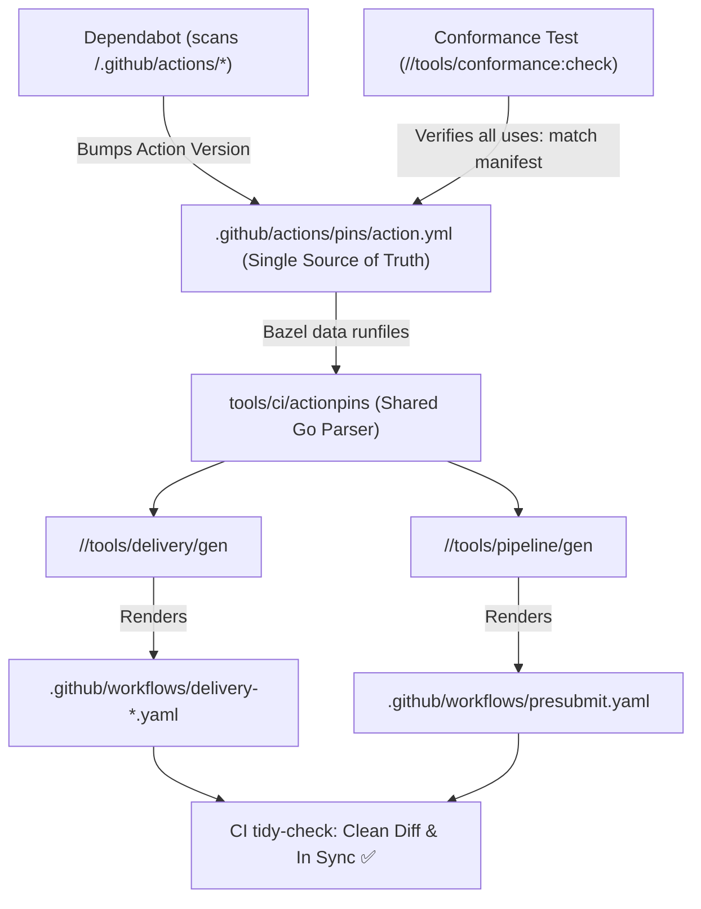

# GitHub Action Pins Single Source of Truth Design

## Problem Statement

The repository's workflow generators (`//tools/delivery/gen` and `//tools/pipeline/gen`) generate workflow files (`.github/workflows/delivery-*.yaml` and `.github/workflows/presubmit.yaml`).
Historically, GitHub Action pins (`actions/checkout`, `actions/upload-artifact`, `astral-sh/setup-uv`, `azure/setup-helm`, `google-github-actions/setup-gcloud`, `docker/setup-buildx-action`, `pulumi/actions`, `actions/cache`, `actions/setup-go`, etc.) were hardcoded as Go constants in `tools/delivery/gen/main.go` and as inline string literals in `tools/pipeline/gen/render.go`.

When Dependabot scans `.github/workflows/`, it directly bumps the `uses:` lines in the generated YAML files. When CI runs `tidy-check`, the generator runs `bazel run //tools/ci:gen` and `bazel run //tools/pipeline:gen`, overwriting Dependabot's bumps with the older pins hardcoded in Go source code. This results in stale workflow diffs and failing CI checks on PRs (as seen in PR #3114).

## Solution Overview

Create a single, authoritative composite action manifest at `.github/actions/pins/action.yml` that lists all third-party GitHub Action pins used across the monorepo's generated workflows.

Because `.github/dependabot.yml` already configures Dependabot to scan `/.github/actions/*`, Dependabot will natively discover and update `.github/actions/pins/action.yml` alongside any generated workflows in the same grouped PR.

Both `tools/delivery/gen` and `tools/pipeline/gen` will ingest this file as an input dependency via Bazel runfiles, parse the pins into a lookup map, and render the generated workflows from this single source of truth.



## Detailed Architecture

### 1. The Pin Manifest (`.github/actions/pins/action.yml`)

The manifest is formatted as a valid GitHub composite action:

```yaml
# Copyright (c) 2026 VitruvianSoftware
#
# SPDX-License-Identifier: MIT

name: "Action Pins"
description: "Single source of truth for third-party GitHub Action pins used in generated workflows."
runs:
  using: "composite"
  steps:
    - uses: actions/checkout@3d3c42e5aac5ba805825da76410c181273ba90b1 # v7.0.1
    - uses: actions/upload-artifact@cf430e030ddbb5b0abf93d22962f4752f3646cd9 # v7.0.2
    - uses: actions/setup-go@b7ad1dad31e06c5925ef5d2fc7ad053ef454303e # v7.0.0
    - uses: actions/cache@55cc8345863c7cc4c66a329aec7e433d2d1c52a9 # v6
    - uses: actions/cache/save@55cc8345863c7cc4c66a329aec7e433d2d1c52a9 # v6
    - uses: google-github-actions/setup-gcloud@aa5489c8933f4cc7a4f7d45035b3b1440c9c10db # v3.0.1
    - uses: docker/setup-buildx-action@f87e5991a6d7451dcb8d9637bfbc97413f497069 # v4.4.1
    - uses: azure/setup-helm@9bc31f4ebc9c6b171d7bfbaa5d006ae7abdb4310 # v5.0.1
    - uses: astral-sh/setup-uv@1c37ad07a6a961277cf70c0d37d6f313000f5884 # v10.3.0
    - uses: pulumi/actions@8e5e406f4007fca908480587cb9893c07090f58d # v7.0.0
```

### 2. Reusable Parser Package (`tools/ci/actionpins`)

A small, lightweight Go package `tools/ci/actionpins` that:
- Reads the manifest from runfiles or a specified file path.
- Parses each `uses: <action>@<sha> # <version>` entry.
- Exposes:
  - `Load(path string) (*Pins, error)`
  - `MustLoadDefault() *Pins` (locating `.github/actions/pins/action.yml` via Bazel runfiles or workspace root).
  - `(p *Pins) Resolve(action string) string` (e.g. `Resolve("actions/checkout")` returns `"actions/checkout@3d3c42e5aac5ba805825da76410c181273ba90b1 # v7.0.1"`). Fails fast if an action is unregistered.

### 3. Generator Integration

- **`tools/delivery/gen`**:
  - Replaces `checkoutPin`, `uploadArtifactPin`, `setupGcloudPin`, `setupBuildxPin`, `setupHelmPin`, `setupUvPin`, `cachePin`, `pulumiActionsPin` constants with calls to `pins.Resolve(...)`.
  - Declares dependency on `//tools/ci/actionpins` in `BUILD`.
  - Includes `//:pins_manifest` in `data`.
- **`tools/pipeline/gen`**:
  - Replaces inline `WriteString` calls for `actions/checkout`, `actions/setup-go`, `actions/cache/save`, and `actions/upload-artifact` with calls to `pins.Resolve(...)`.
  - Declares dependency on `//tools/ci/actionpins` in `BUILD`.
  - Includes `//:pins_manifest` in `data`.

### 4. Conformance Guard

Add a test or verification step in `tools/conformance/check.sh` (or `actionpins_test.go`) asserting that:
1. Every third-party `uses:` string emitted in `delivery-*.yaml` and `presubmit.yaml` matches an entry in `.github/actions/pins/action.yml`.
2. No generator writes an unpinned action or hardcoded SHA.

### 5. Verification Strategy

1. **Hermetic Unit Tests**:
   - `bazel test //tools/ci/actionpins/...`
   - `bazel test //tools/delivery/gen/...`
   - `bazel test //tools/pipeline/gen/...`
   - `bazel test //tools/conformance/...`
2. **Zero Drift On Main**:
   - `bazel run //tools/ci:gen` produces 0 diff.
   - `bazel run //tools/pipeline:gen -- --format=workflow --output-file=.github/workflows/presubmit.yaml` produces 0 diff.
3. **Simulated Bump Validation**:
   - Manually changing a pin in `.github/actions/pins/action.yml` and running `bazel run //tools/ci:gen` and `bazel run //tools/pipeline:gen` immediately updates the corresponding generated workflows without any manual Go code edits.
