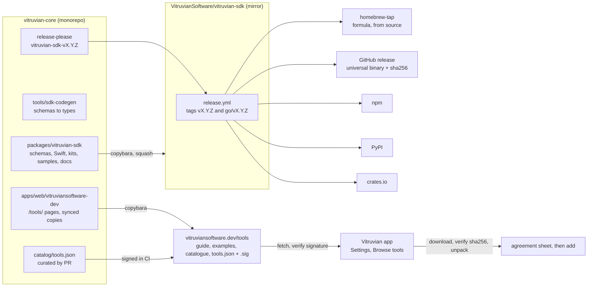

# Tools for everyone: publishing the SDK, kits in five languages, a catalogue, and a protocol that can draw

**Status:** built and shipped by 2026-10-14; issue #3130 closes with it.
James moved one part to a separate effort of his own on 2026-10-14: Nexus
Agent as a tool (stage F). Section 11 says what each stage built, with its
pull requests and releases, and what is still open.
**Tracks:** issue #3130. **Follows:** sub-projects 1 to 3 of
`2026-10-08-vitruvian-tool-platform-design.md`, built and shipped by
Vitruvian 3.42.2 (`2026-10-10-vitruvian-external-tools-design.md`, section 15).
**Decides nothing about:** a public store that is not curated, a sandbox, or
an Apple Developer ID. Those stay as decided.

## 1. What this is

Today a tool from outside can be written, checked and added to Vitruvian, but
only by someone with this repository checked out. The protocol, the Swift kit,
the `vitruvian-tool` command, three samples and a guide all live in
`packages/vitruvian-sdk`, which is published nowhere, and a tool can show the
person nothing but a short message. This design makes the platform something
other people can build on and that Vitruvian can offer tools from:

1. **The SDK is published.** A public mirror repository with tagged releases;
   `vitruvian-tool` installable with Homebrew or as a download; the kit in
   Swift, TypeScript, Python, Go and Rust, each on its registry.
2. **A place to read.** A "Tools" section of vitruviansoftware.dev, built from
   the guide that is already tested, with examples beside the tutorials.
3. **A catalogue.** A curated list of tools, on the website and inside the
   app. Listing is by a pull request James merges; each entry pins a download
   and its checksum; the app verifies what it fetched before the same
   agreement sheet as today.
4. **Protocol 2.** A tool can draw its own interface inside Vitruvian: it
   describes rows, text, fields and buttons and the app draws them natively,
   or it brings a web page for the cases the blocks cannot cover.
5. **Real tools.** Once protocol 2 can carry them, the GitHub feature, Nexus
   Agent and HomeSpeaker become tools from outside, and the catalogue has
   something worth listing.

**Done when** all of these hold, each by a command that was run or a check a
person made and recorded:

1. On a Mac with nothing of ours installed, `brew install VitruvianSoftware/tap/vitruvian-tool`
   works, and `vitruvian-tool init` makes a tool that `vitruvian-tool run` runs
   and the released app adds.
2. A new Swift package can depend on `https://github.com/VitruvianSoftware/vitruvian-sdk`
   by version, and `npm`, `pip`, `go get` and `cargo add` each fetch a kit of
   the same version. A sample in each language passes the conformance script.
3. vitruviansoftware.dev/tools has the guide, one worked example per language,
   the protocol reference, and the catalogue page; every code block on it is
   checked by a test.
4. A tool listed in the catalogue can be installed from inside the app in two
   steps: pick it, then agree on the sheet. The app refuses a download whose
   checksum is not the pinned one, and a catalogue whose signature is not ours.
5. A tool written to protocol 2 shows a page in the Dynamic Island and a page
   in Settings, drawn by the app from the tool's description, and a second
   one shows a web page from its own folder; both work from every kit.
6. The GitHub feature runs as a tool from the catalogue with nothing lost, and
   the person who had it on before the move has it on after.
7. A written path tells a contributor how to change the protocol, and the
   tests fail when a change is made on one side only.

## 2. What the assessment found

Read before writing, with the places that matter. These shape the design more
than any choice in it.

- **Nothing about the SDK is published, and it has no release machinery.**
  `packages/vitruvian-sdk` is not in `tools/copybara/copy.bara.sky`, has no
  `release-please-config.json`, and is built only by the presubmit unit
  `vitruvian-sdk`. `Package.swift` describes two libraries
  (`VitruvianToolProtocol`, `VitruvianToolKit`) and one executable
  (`vitruvian-tool`).
- **The repository already has every publishing habit this needs.** Eleven
  folders are mirrored one way to their own public repositories by Copybara
  (`copy.bara.sky`, `COMPONENTS`); a mirror's own CI is checked in under the
  source folder and runs only there. npm publishes by trusted publishing from
  the `mcp-slack` and `pulumi-library` mirrors (`tools/npm-trusted-publisher`),
  PyPI from `mcp-roborock` (`uv publish --trusted-publishing always`). There
  is one Homebrew tap, `VitruvianSoftware/homebrew-tap`, with casks and
  formulas written by the app's, gravastar-mouse's and home-speaker's publish
  scripts. The Go library tags its modules by path (`go/pkg/<n>/vX.Y.Z`).
  Nothing publishes to crates.io yet.
- **Mirrors are unwatched unless listed.** `notify-ci-issues.yaml` keeps an
  explicit `MIRRORS` list and `tools/conformance/check.sh` fails when a
  component is missing from it: four of eight mirrors were once broken for
  weeks before that check existed. A new mirror joins both lists in the same
  change that creates it.
- **The website is Jekyll on GitHub Pages**, in `apps/web/vitruviansoftware-dev`,
  mirrored to `site-vitruviansoftware-dev` and built there with the
  `github-pages` gem: safe mode, no plugins. Pages are top-level `.html` files,
  posts, and `_data/*.yml`. The downloads catalogue is `_data/downloads.yml`,
  refreshed daily by `tools/sync-downloads/sync_downloads.py`, which opens a
  pull request. The custom domain is managed in `repo-config` and dormant
  until switched on.
- **The app is ad hoc signed, in fact and not only by decision.** The delivery
  workflow imports a signing certificate when present, and none is present:
  `gh secret list` shows no `VITRUVIAN_SIGNING_*` secret and
  `/Applications/Vitruvian.app` reports `Signature=adhoc`. Every download in
  this design is quarantined by Gatekeeper on first run unless Homebrew
  built it from source or the app itself fetched it. The app already refuses
  a quarantined tool folder and shows the `xattr` command.
- **Protocol 1 has no way to draw.** `manifest.schema.json` contributes
  commands only, on four surfaces (`commandBar`, `radial`, `quickPanel`,
  `shortcut`), and a tool may send twelve messages, none of which puts
  anything on screen but a short message. The Dynamic Island's pages are a
  closed enum (`NotchModule`); its tiles and the Settings Features hub are
  not open to outside tools. The app offers `ProtocolVersion.supported`
  at the handshake and refuses a manifest whose `protocol` is not in it, so
  a second version is a list of two.
- **The candidates to move out differ by an order of magnitude.** The GitHub
  feature is 15 files, 4,300 lines: an island page, a Settings page, a REST
  client with OAuth, a Keychain token, and a call to the GravaStar mouse
  binary; no system permission. Nexus Agent is a separate app of 18,000
  Swift lines linked into Vitruvian through two libraries; inside Vitruvian
  it is 830 lines: a floating prompt window, a Settings page, island notices.
  HomeSpeaker is its own menu bar app of 8,000 lines, not linked into
  Vitruvian at all. `WKWebView` is already in the app through
  `NexusAgentUI` (Mermaid rendering), so WebKit ships today.
- **Trusted-publishing accounts are the only thing not in the repository.**
  npm and PyPI are set up for this organisation. crates.io needs an owner
  account and a trusted publisher registered once, by James. All of it is
  free.

## 3. Decisions this design makes

James made the first eight on 2026-10-12 (issue #3130). The rest are this
design's picks, each with the reason and the alternative that would change
it.

| # | Decision | Why | Not chosen |
|---|---|---|---|
| 1 | **The SDK lives in a public one-way mirror, `VitruvianSoftware/vitruvian-sdk`**, exported from `packages/vitruvian-sdk` with Copybara like `pulumi-library`: squash, the package folder becomes the repository root. | SwiftPM resolves a package from a git repository whose root holds `Package.swift` and whose tags are semver. The monorepo can be neither. Mirrors cost nothing and the habit exists. | Publishing from the monorepo by path: SwiftPM cannot. |
| 2 | **One version for the whole SDK, its own semver, protocol numbered apart.** `0.9.0` now; `1.0.0` when the five kits and the catalogue have shipped. Every kit is published at the SDK's version on every release, changed or not. | One number to tell an author: "kit 1.2 speaks protocol 1 and 2". Per-kit versions are five numbers to keep honest for no gain while one team writes them all. The protocol number moves only on a breaking wire change, as the handshake already assumes. | Per-kit versions, as `pulumi-library` does for its many packages. |
| 3 | **Releases by release-please, component `vitruvian-sdk`, in the package folder**, tag `vitruvian-sdk-vX.Y.Z` in the monorepo; the mirror's own `release.yml` reads `.release-please-manifest.json`, tags `vX.Y.Z` and `go/vX.Y.Z`, builds, and publishes. | That is exactly what `devx` and `nexus-agent` do. SwiftPM and Go need bare tags on the mirror; the monorepo must not carry a bare `v1.0.0`. | Tagging from the monorepo: it cannot write a bare tag without colliding across components. |
| 4 | **`vitruvian-tool` ships three ways:** a Homebrew formula in `homebrew-tap` that builds from source (`swift build -c release`), a universal binary as a GitHub release asset with a `.sha256` sidecar, and `cargo`/`npm`/`pip` get the *kits*, not the command. | Built from source by Homebrew, the binary carries no quarantine and needs no signature: that is the path that just works on a Mac with no Developer ID. The download is for people who will not install Homebrew; its release notes carry the `xattr -d com.apple.quarantine` line. | A cask of the binary: Gatekeeper refuses an ad hoc signed cask on first run with a worse message than a formula's build. |
| 5 | **Kits in TypeScript (`@vitruviansoftware/tool-kit`, npm), Python (`vitruvian-tool-kit`, PyPI), Go (`github.com/VitruvianSoftware/vitruvian-sdk/go`), Rust (`vitruvian-tool-kit`, crates.io)**, beside Swift. Each is one thread, synchronous, over stdio, with the kit's API shaped like the Swift one: declare commands, handle them, call the app. | James asked for breadth. Each is a thin layer: the Python sample already proves the protocol needs no kit. Rust gives single-binary tools, the shape most Mac tool authors want after Swift. | Any registry needing a paid account; none of these does. |
| 6 | **Types are generated from the schemas, by our own generator, and the output is committed and held by a drift test.** `tools/sdk-codegen` (Python, standard library plus `jsonschema`, which the repo has) reads `protocol/*.schema.json` and `methods.json` and writes one file per language. | One source of truth stays the schema. A committed output is readable in a pull request and needs no generator at an author's machine. A drift test is how `templates_in_sync_test` already keeps the `init` templates honest. | quicktype: a dependency that writes the shape it likes; and the Swift types are hand-written already and should stay so. |
| 7 | **Every kit has a sample that passes `conformance.py`, in CI, on Linux where the language runs there.** | The conformance script is the one judge that does not care what language a tool is in. It already runs the Python and Swift samples. | Per-language test harnesses only. |
| 8 | **The docs are a section of the existing website, `/tools/`, built from the files in the package by a sync script with a drift test**, the way `sync_downloads.py` writes `_data/downloads.yml`. The guide, the protocol reference, one example per language, and the catalogue page. | One site, one deploy, one domain. The guide's code is already checked by `guide_test`; copying it into the site keeps that true. Jekyll in safe mode cannot read outside the site folder, so a copy is the only way. | GitHub Pages on the SDK mirror: a second site to find. |
| 9 | **The catalogue is one file in this repository, `catalog/tools.json`, schema-checked, listed by pull request**, published as a static file on the website and signed. | James's choice: curated, each entry pinned. A file in the repository gets review, history and CI like everything else. | Submissions outside git. |
| 10 | **Each entry pins `url`, `sha256`, `size`, `version`, `protocol`, `minimumAppVersion`**, the tool's manifest fields copied for display, and the source repository. The download is a `.zip` of the tool's folder. | The app checks the checksum before anything else sees the bytes, so a replaced asset is refused. The size bounds the download. The copied fields let the catalogue draw without downloading. | A download URL alone. |
| 11 | **The catalogue file is signed in CI with an Ed25519 key, and the app verifies with the public key built in** (`CryptoKit` `Curve25519.Signing`, the signature beside the file as `tools.json.sig`). | Pinned checksums protect each download; the signature protects the list itself, so a website or Pages compromise cannot add an entry. It is twenty lines each side and costs nothing. The private key is one repository secret, used only by the publish job. | Sigstore keyless: verifying it in Swift is a project of its own. HTTPS alone: the website is a mirror built by a third party's action. |
| 12 | **In-app install is the same path as today, with the folder coming from a verified download**: fetch to a temporary folder, verify, unpack, then `ExternalToolStore.offer` and the agreement sheet, then `add`. The sheet gains one line: that the tool came from the Vitruvian catalogue, that VitruvianSoftware listed it, and that its checksum matched. Nothing else about trust changes. | James chose a catalogue and kept "trusted like an app". The sheet must say what curation is and is not: a listing, not a sandbox. One new sentence in fifteen languages. | Skipping the sheet for catalogue tools: the agreement is the one safety moment. |
| 13 | **Updates come from the catalogue.** The app compares the installed version with the catalogue's at launch and once a day; the tool's row shows "Update available"; the update goes through the existing update path, which asks again when the manifest changed. | The machinery exists (`Update from Folder…`, held-back copies, re-agreement). A daily check is one request for a small file. | Automatic updates: a tool can do anything Vitruvian can; the person decides when it changes. |
| 14 | **A download the app made is not quarantined, and the app does not clear a quarantine it did not make.** The app writes the file itself with `URLSession`, which sets no quarantine attribute; the existing refusal of quarantined folders stays for folders chosen by hand. | The app verified the bytes against a pinned checksum from a signed list; that is a stronger check than Gatekeeper's for an ad hoc world. Folders a person downloaded in a browser are still theirs to clear. | Setting quarantine on purpose: it would refuse every catalogue install. |
| 15 | **Protocol 2 is additive.** A manifest says `"protocol": "2"`; the app offers `["1", "2"]`; every protocol 1 tool keeps working unchanged. Protocol 2 adds contribution points and messages and changes nothing that exists. | The handshake and the manifest reader were built for this. Breaking protocol 1 would break the tools the catalogue just started with. | A new version that reshapes the messages. |
| 16 | **A tool describes its interface; the app draws it.** A manifest contributes `panels`: each has an id, a title per language, and a `placement` of `island`, `settings` or `window`. The tool sends `ui/render` with a tree of blocks; the app draws it in SwiftUI in its own style and theme; a person's action comes back as a `ui/event` request; the tool answers with the next tree. The block vocabulary is small and closed: `text`, `heading`, `row`, `button`, `toggle`, `field`, `list`, `progress`, `image`, `divider`, `link`, `spacer`. | James chose both ways, this one first. Native blocks look like Vitruvian, work in fifteen languages, get accessibility and the island's sizes for free, and are the same from every kit. State lives in the tool: the app keeps only the last tree, so a tool that crashes loses nothing the app owned. | Letting the tool push arbitrary SwiftUI or AppKit: it cannot cross a process. |
| 17 | **A web view is the escape hatch.** A panel may instead be `kind: "web"` with an `entry` inside the tool's folder. The app shows it in a `WKWebView` that loads only files from that folder, with a bridge `window.vitruvian.call(method, params)` that carries the same requests the tool may send, and `window.vitruvian.on(event)` for the app's notices. Remote navigation is refused; the page may use the network itself. | Web developers get their own tools; the GitHub feature's richer views fit here if blocks cannot carry them. Local-only loading keeps "the tool is the folder the person agreed to". | Loading a remote URL: the person agreed to a folder, not to whatever a server sends tomorrow. |
| 18 | **The island and Settings open to tools through the same two placements.** An island panel is a page in the island's `tools` area, listed by the tool's name; a Settings panel is a page under the tool's detail. A window is the tool's own `NSPanel`-sized window drawn by the app. No tool draws in the notch's always-on strip. | The strip is the one place a tool could nag; the pages and Settings are where a person goes on purpose. | Opening the strip too. |
| 19 | **Limits for protocol 2:** a render tree of at most 256 KB; at most four renders a second per panel, coalesced; images only from the tool's folder or inline data up to 1 MB; a web panel's bridge has the same flood rule as the stdio link. | The same shape as the protocol 1 limits: a tool cannot hold the main thread or the island. | No limits. |
| 20 | **The GitHub feature moves out first, then Nexus Agent, then HomeSpeaker.** Each ships as a catalogue tool for one release beside the built-in feature, with a migration that carries the person's settings and switch state; the built-in is removed the release after. | GitHub is the smallest with an island page: it proves the whole path. Nexus Agent needs windows and child processes, which a tool may already have. HomeSpeaker is already its own app; as a tool it gains commands and a Settings page and keeps its menu bar. | Moving all three at once. |
| 21 | **The contributor path is a document in the mirror and the monorepo, plus the drift tests that already exist.** A protocol change touches the schema, the Swift types, the examples, the generated kits and the app's pin in one change, and the tests refuse anything less. | Most of it is built; it needs writing down and the generator added to the list. | A protocol RFC process: too much for one team. |
| 22 | **Everything in this design is free.** Public repositories, GitHub Pages, trusted publishing on npm, PyPI and crates.io, one Homebrew tap. | James's standing rule. | Anything paid, including a Developer ID. |

## 4. The shape of it



Colour would add nothing here: every box is a thing that exists after the
build, and the arrows are the one direction data moves.

## 5. Publishing the SDK

### 5.1 The mirror

A new component in `copy.bara.sky`'s `COMPONENTS`: subtree
`packages/vitruvian-sdk`, repository `vitruvian-sdk`, `export_only`, squash,
as `pulumi-library` is. The export excludes `BUILD` and `**/BUILD` (the
`_monorepo_only` rule does this for every component), the `conformance/`
folder stays (an author runs it), and `Package.swift` is already written for a
package at the root. `repo-config`'s `copybara_sync` creates the repository
(public), the deploy key and the `VITRUVIAN_SDK_SYNC_SSH_KEY` secret; the
same change adds the mirror to `notify-ci-issues.yaml`'s `MIRRORS` list and
to `copybara-config-smoketest.yaml`, or `tools/conformance/check.sh` fails.

Mirror-owned files, written in the monorepo under
`packages/vitruvian-sdk/.github/workflows/` and live only there:

- `ci.yml`: on pull request and push, `swift build`, `swift test`, the
  Python conformance run of every sample, and each kit's own tests. Linux
  for the kits that run there, macOS for Swift.
- `release.yml`: on push to `main` when `.release-please-manifest.json`
  changed, read the version, refuse if the tag exists, tag `vX.Y.Z` and
  `go/vX.Y.Z`, build the universal `vitruvian-tool` on macOS, attach
  `vitruvian-tool-X.Y.Z-macos.tar.gz` and `.sha256` to a GitHub release, then
  publish each kit (section 5.3), then write the Homebrew formula.
- `cla.yml` as the other mirrors have.

### 5.2 Releases

`packages/vitruvian-sdk/release-please-config.json`: component
`vitruvian-sdk`, type `simple`, `include-component-in-tag`, extra files the
version lives in: `Sources/VitruvianToolCLI/Words.swift` (what
`vitruvian-tool --version` prints), `kits/typescript/package.json`,
`kits/python/pyproject.toml`, `kits/rust/Cargo.toml`, and
`kits/go/version.go`. A new workflow `vitruvian-sdk-release.yaml` runs
release-please for the component, as `gravastar-mouse-release.yaml` does.
Commits that cut a release are `feat(vitruvian-sdk):` and
`fix(vitruvian-sdk):`; `chore(vitruvian-sdk):` cuts none, which is what the
last four stages used on purpose.

The first release is `0.9.0`. `1.0.0` is cut when done-when items 1 to 4
hold.

### 5.3 The kits

Layout, all under `packages/vitruvian-sdk`:

```
Sources/VitruvianToolKit        Swift, as today
kits/typescript                 @vitruviansoftware/tool-kit, src/generated/*.ts
kits/python                     vitruvian_tool_kit, generated/*.py
kits/go                         module github.com/VitruvianSoftware/vitruvian-sdk/go
kits/rust                       crate vitruvian-tool-kit, src/generated/*.rs
samples/hello-typescript, hello-go, hello-rust    (hello-python exists)
```

Each kit is the Swift kit's shape in its language's idiom: `Tool.command(id,
handler)`, `tool.serve()`, and `app.notify.hud(...)`, `app.clipboard.write(...)`
and so on, one call per protocol method, synchronous, one thread reading
stdin. Each kit's generated part is the message and manifest types; its
hand-written part is the loop, the id matching, the nested read while a
handler waits, the refusal as an error value, and end-of-input as a clean
exit, which `VitruvianToolKit` already settled and `ToolTests` already
holds. Each kit has the same twelve tests, ported.

The generator, `tools/sdk-codegen`, is run by `bazel run
//tools/sdk-codegen` and checked by `//tools/sdk-codegen:in_sync_test`,
which regenerates into a temporary folder and diffs. It reads
`messages.schema.json`, `manifest.schema.json` and `methods.json` and emits
plain data types with a `to`/`from` JSON pair per language. It does not
emit the kit.

Registries, each by trusted publishing from the mirror's `release.yml`:

| Kit | Registry | How | Once, by James |
|---|---|---|---|
| TypeScript | npm | `npm publish --access public` with `id-token: write`, as `mcp-slack` does | `npm trust` for `@vitruviansoftware/tool-kit` naming repo `vitruvian-sdk`, file `release.yml` (`tools/npm-trusted-publisher/setup.sh`) |
| Python | PyPI | `uv publish --trusted-publishing always`, as `mcp-roborock` does | Register the trusted publisher for `vitruvian-tool-kit`, repo `vitruvian-sdk`, environment `pypi` |
| Rust | crates.io | `cargo publish` with crates.io trusted publishing (GitHub OIDC) | Create the crates.io account, reserve `vitruvian-tool-kit`, add the trusted publisher |
| Go | none | the `go/vX.Y.Z` tag on the mirror | nothing |
| Swift | none | the `vX.Y.Z` tag on the mirror | nothing |

`tools/npm-publish-audit/check.sh` gains the TypeScript kit's root so the
registry and the repository are compared the way they are for the others.

### 5.4 The command

`vitruvian-tool` gains `--version`, and `init --template swift` stops needing
`--sdk <path>`: the template's `Package.swift` depends on
`https://github.com/VitruvianSoftware/vitruvian-sdk` from the version the
command was built with (`--sdk` stays for working from a checkout). `init`
gains `--template typescript|python|go|rust`, each the matching sample.

The Homebrew formula, `Formula/vitruvian-tool.rb` in `homebrew-tap`, builds
from the release tarball of the mirror with `swift build -c release` and
installs the binary; the mirror's `release.yml` writes it with the narrowed
App token the app's `publish.sh` already uses. `brew install
VitruvianSoftware/tap/vitruvian-tool` then needs Xcode's command line tools
and nothing else. The GitHub asset is for the person who will not use
Homebrew: ad hoc signed, so the release notes and the docs say to run
`xattr -d com.apple.quarantine vitruvian-tool` once, and say why.

## 6. The docs section

`apps/web/vitruviansoftware-dev/tools/` holds the section:

- `index.html`: what a tool is, the trust model in two paragraphs, the three
  ways in (Homebrew, download, a kit), and links.
- `guide.html`: `packages/vitruvian-sdk/docs/writing-a-tool.md`, copied.
- `protocol.html`: `protocol/README.md`, copied, with the method table from
  `methods.json` rendered.
- `examples/<language>.html`: one worked example per language, each the
  sample's code, copied.
- `catalog.html`: the catalogue page, from `_data/tools.yml`.
- `catalog/tools.json` and `catalog/tools.json.sig`: the signed catalogue,
  served as static files.

`tools/sync-site-tools/sync.py` writes the copies and `_data/tools.yml` from
the package and from `catalog/tools.json`, and
`//tools/sync-site-tools:in_sync_test` fails when they are stale, so a guide
change cannot ship without the site. `guide_test` already checks the guide's
code blocks against the schemas and the samples; the copies are the same
bytes, so they are covered.

Jekyll runs in safe mode on the mirror, so nothing is generated at deploy
time: everything the site needs is committed.

## 7. The catalogue

### 7.1 The file

`catalog/tools.json`, schema `catalog/catalog.schema.json`:

```json
{
  "version": 1,
  "generated": "2026-11-02T10:00:00Z",
  "tools": [
    {
      "id": "dev.vitruvian.github",
      "name": { "en": "GitHub" },
      "publisher": "VitruvianSoftware",
      "summary": { "en": "Your pull requests and checks, in the island." },
      "version": "1.0.0",
      "protocol": "2",
      "minimumAppVersion": "3.45.0",
      "source": "https://github.com/VitruvianSoftware/vitruvian-tool-github",
      "download": {
        "url": "https://github.com/VitruvianSoftware/vitruvian-tool-github/releases/download/v1.0.0/github-tool-1.0.0.zip",
        "sha256": "…",
        "size": 1834021
      },
      "uses": ["notify", "open", "storage"],
      "commands": [{ "id": "openPulls", "title": { "en": "Open my pull requests" } }]
    }
  ]
}
```

A listing is a pull request that adds or changes one entry. CI checks the
schema, that `id` is a valid tool id, that the download exists and its
`sha256` and `size` match (one `HEAD` and one `GET`), that the zip holds a
`vitruvian-tool.json` whose `id`, `version` and `protocol` match the entry
and that passes `vitruvian-tool validate`, and that the manifest's `uses`
and `commands` are what the entry copies. James merges. The publish job
signs the file (section 7.3) and the site sync copies both into the site.

### 7.2 On the website

`catalog.html` lists each tool with its summary, publisher, version, what it
says it uses, a link to its source, and the download. The page says in one
line what listing means: VitruvianSoftware read the manifest and pinned the
download; the tool can still do anything Vitruvian can, as the sheet in the
app will say.

### 7.3 Signing

One Ed25519 key pair. The public key is a constant in the app and in
`catalog/README.md`; the private key is a repository secret,
`CATALOG_SIGNING_KEY`, read only by the job that signs on merge to `main`
when `catalog/tools.json` changed. The signature is over the file's bytes.
The app's verifier is `Curve25519.Signing.PublicKey.isValidSignature`.
Rotation is a new constant in a new app release and a new secret; the old
key signs nothing after that.

### 7.4 In the app

Settings › Features › Tools from outside gains a second button, "Browse
Tools…", beside "Add a Tool…". It opens a sheet listing the catalogue:
name, publisher, summary, version, and "Install", or "Installed" and
"Update" where that applies. Everything shown comes from the signed file;
nothing is fetched per tool until Install.

Install: `CatalogueInstaller` downloads to a temporary folder, checks the
size as it reads and refuses past the pinned size, computes the SHA-256,
refuses on a mismatch with a plain sentence, unpacks, checks the top-level
`vitruvian-tool.json` is the entry's id and version, then hands the folder to
`ExternalToolStore.offer` exactly as the folder picker does. The agreement
sheet shows, with its one new line for a catalogue tool. On Add Tool the
copy is made into `Tools/<id>/` and the temporary folder is deleted. A
refusal at any step leaves nothing behind.

Updates: `CatalogueWatch` fetches `tools.json` and `.sig` at launch and once
a day with `If-None-Match`, verifies, and compares versions of installed
catalogue tools. A tool whose entry is newer shows "Update available" in its
row and detail; Update runs the install path, which the store already treats
as an update (what the tool saved is kept, and the sheet asks again when the
manifest changed). A tool added from a folder is never matched to the
catalogue by id alone: only tools installed from the catalogue are watched.

What is fetched, in words a person can read on the privacy page: a small
file from vitruviansoftware.dev once a day with the list of tools, and a
tool's zip from the address in that list when the person asks for it.
Nothing is sent.

Strings: "Browse Tools…", the sheet's title and empty state, "Install",
"Installed", "Update available", the one new sentence on the agreement sheet,
and four refusals (could not fetch the list; the list is not ours; the
download did not match; the download is not the tool it says). About twelve
texts in fifteen languages, through the same table-and-test process as the
46 that exist.

## 8. Protocol 2: a tool that can draw

### 8.1 The manifest

`"protocol": "2"` and a new contribution point:

```json
"contributes": {
  "commands": [ … ],
  "panels": [
    { "id": "pulls", "title": { "en": "Pull requests" }, "placement": "island", "icon": "arrow.triangle.pull" },
    { "id": "settings", "title": { "en": "GitHub" }, "placement": "settings" },
    { "id": "detail", "title": { "en": "A pull request" }, "placement": "window", "kind": "web", "entry": "ui/detail.html" }
  ]
}
```

`kind` is `blocks` (the default) or `web`. At most eight panels; one
`island` panel per tool at most. `web` requires `entry`, a relative path
inside the folder; the manifest reader resolves it and refuses one that
leaves the folder, as it does the program.

### 8.2 Messages

Sent by the app:

| Method | Kind | When |
|---|---|---|
| `ui/open` | request | the person opened a panel; params `{ panel }`; the tool answers with the first tree (or `{}` for a web panel) |
| `ui/event` | request | the person acted: `{ panel, block, event, value? }` (`tap`, `toggle`, `submit`, `change`); the tool answers with the next tree, or `{ "keep": true }` |
| `ui/close` | notice | the panel went away |

Sent by the tool:

| Method | Kind | When |
|---|---|---|
| `ui/render` | notice | a new tree for an open panel, unprompted: `{ panel, tree }` |
| `ui/badge` | request | a count or a dot on the tool's island entry: `{ count? , dot? }`; uses `notify` |

A tree is `{ "blocks": [ … ] }`. Each block has `type`, an `id` where it
can be acted on, and the fields of its type. The twelve types and their
fields are in the schema; `text` and `heading` take a string per language or
a plain string, `field` takes `kind: text|number|secret`, `list` takes rows
of `{ id, title, subtitle?, icon?, trailing? }`, `image` takes a path inside
the folder or `data:` up to 1 MB, `link` opens a URL through the app's
`open` service and so needs that in `uses`. A block the app does not know
is drawn as its `fallback` text if given, else skipped, so a protocol 3
block degrades.

The web bridge, injected into every `web` panel: `window.vitruvian.call(method,
params)` returns a promise and carries exactly the tool-sent requests of
sections 9 of the protocol 1 spec (`notify/hud`, `clipboard/*`, `storage/*`
and the rest), subject to the same `uses`; `window.vitruvian.on("event",
handler)` delivers `preferences/changed` and `language/changed`;
`window.vitruvian.language` and `.appearance` are set before the page's
scripts run. The page is loaded with `loadFileURL(_:allowingReadAccessTo:)`
scoped to the tool's folder; navigation to anything else is refused by the
navigation delegate. Calls from the page are forwarded by the app to the
tool's process over the same stdio link as `ui/event` with `event:
"bridge"`, so the tool's process stays the one place that acts; a page that
wants the network uses it directly, as the tool is trusted to.

### 8.3 In the app

- `Core/Platform/ToolPanel.swift`: the panel descriptor and the block tree
  as `Codable` values, with the limits.
- `Services/Platform/External/ToolPanelHost.swift`: holds the last tree per
  open panel, coalesces renders to four a second, forwards events, and ends
  a panel when its tool ends. It is the one owner of `WKWebView` instances.
- `UI/ToolPanels/BlockTreeView.swift`: the SwiftUI renderer, one view per
  block type, using the Design layer's tokens and the island's sizes.
- `UI/ToolPanels/ToolWebPanel.swift`: the web view with the bridge.
- Island: `NotchModule` gains `.tool(ToolID)`; the Tools area lists a tool's
  island panel by its title and icon; opening one calls `ui/open`.
- Settings: a tool's detail gains the tool's `settings` panel inline, under
  its own settings, drawn by the same renderer.
- Window: `placement: "window"` is an `NSPanel` the app owns, sized by the
  tree, closed by the person or by the tool ending.

Mock-ups first, as Stage C did: an HTML page showing a blocks panel in the
island and in Settings, a web panel in a window, in light and dark, with the
exact strings.

### 8.4 In the kits

Each kit gains a `panels` API: `tool.panel(id, onOpen, onEvent)` returning a
handle with `render(tree)` and `badge(...)`, and a small builder for trees
so a handler reads as the layout it makes. The samples gain a fourth,
`hello-panel`, in each language, that shows a counter with a button and a
field; the conformance script gains a check that opens a panel, taps a
block, and sees a new tree.

### 8.5 Limits and refusals

Beyond section 3's decision 19: a tree with an unknown placement, an event
for a panel that is not open, or a render for a panel the manifest does not
declare is refused with `-32602`. A tool over four renders a second is
coalesced, not refused; past forty a second it is treated as a flood, as a
stdio flood is. A web panel whose page fails to load shows the app's plain
"could not be shown" text and the tool's log gets the reason.

## 9. Real tools

The order is decision 20. For each: a new repository
`VitruvianSoftware/vitruvian-tool-<name>` holding the tool (its own
licence, MIT by default, GPL where it carries code from the app), a
catalogue entry, and a migration in the app.

**GitHub, first.** Protocol 2's island panel for the pull-request page, a
settings panel for the account and the watchlist, commands for the command
bar, `storage` for the watchlist, its own Keychain item for the token (the
tool is its own program, so its own Keychain access group under ad hoc
signing: the same 0600-file fallback HomeSpeaker uses, documented), and the
GravaStar call as an `open`-free child process. The app's migration: when
the catalogue tool is installed and runs for the first time, the built-in
feature's token and watchlist are offered to it through `storage` by the
app once, and the built-in switch is turned off; the release after removes
`AppFeature.notchGitHub` and the 4,300 lines.

**Nexus Agent, second.** It is already its own app and mirror. As a tool it
contributes commands (the quick prompt), a settings panel, and an island
badge; its windows stay its own, started by the tool's process. The two
libraries Vitruvian links come out with it, and WebKit then ships only if a
web panel needs it.

**HomeSpeaker, third.** It stays a menu bar app and gains a `vitruvian-tool.json`
beside its binary: commands ("Say this", "Pause the room") and a settings
panel. Its menu bar extra stays; the tool is a second door.
Changed 2026-10-15: the tool runs on its own; see 2026-10-15-homespeaker-extension-independent-design.md.

Each move is its own spec with its own by-hand checks; this design fixes
only the order and the rule that the built-in and the tool overlap for one
release.

## 10. The contributor path

`CONTRIBUTING.md` in the package (and so in the mirror) says, in a page:

- A protocol change is one change to five things: the schema, the Swift
  types, the examples, the generated kits, and the app's pin
  (`bazel run //apps/desktop/vitruvian:pin_tool_protocol`). The tests that
  refuse less: `protocol_examples_test`, `VitruvianToolProtocolTests`,
  `sdk-codegen:in_sync_test`, each kit's generated-types test,
  `tool_protocol_pin_test`.
- Additive within a version; a breaking change is a new `protocol` number,
  and the app supports the old one for at least two minor releases of the
  app after the new one ships.
- How to propose: an issue on the mirror with the use case, then a pull
  request to the monorepo (`import-to-monorepo` is not offered for this
  component: the mirror is export-only, so the pull request is here).
- How to list a tool in the catalogue: section 7.1, as a checklist.

## 11. Stages

Each stage is its own plan, built the way the last four were, with its own
pull requests, tests, planted regressions and by-hand checks. The order is
the dependency order; James approves each plan before it is built.

| Stage | Builds | Visible to | Cuts |
|---|---|---|---|
| **A. Publish** | **Built.** The mirror and its CI; release-please for `vitruvian-sdk`; the mirror's `release.yml` with the universal binary, the formula and the Swift tag; `--version`; `init --template swift` against the published package; `CONTRIBUTING.md`; the `/tools/` section with the guide, the protocol reference and the Swift and Python examples; the first release, `0.9.0`. | A tool's author | SDK 0.9.0; no app release |
| **B. Kits** | **Built.** Part one (B1, `docs/superpowers/plans/2026-10-12-vitruvian-tools-for-everyone-stage-b1.md`): the generator, the TypeScript and Python kits, their samples, `init` for both, publishing to npm and PyPI. Part two (B2, `docs/superpowers/plans/2026-10-12-vitruvian-tools-for-everyone-stage-b2.md`): the Go and Rust kits, their samples, `init` for both, publishing to crates.io; the Go kit by the `go/vX.Y.Z` tag. `tools/sdk-codegen`; the TypeScript, Python, Go and Rust kits, samples, conformance in CI, registry publishing; `init` templates for each; the examples pages. Two plans if it reads better: B1 TypeScript and Python (registries exist), B2 Go and Rust. | A tool's author | SDK 0.10.0 |
| **C. Catalogue** | **Built.** `catalog/`, its schema and CI checks, signing, the website page, `CatalogueInstaller`, `CatalogueWatch`, "Browse Tools…", updates, the twelve strings, the privacy page. Mock-ups first. | Everyone | A minor app release |
| **D. Protocol 2** | **Built** (`docs/superpowers/plans/2026-10-12-vitruvian-tools-for-everyone-stage-d.md`), but for the four kits after Swift, which wait for B1 and B2. Mock-ups; the manifest and messages; the renderer, the web panel and the bridge; island, Settings and window placements; the kits' `panels` API and the `hello-panel` samples; the conformance check; the docs. | Everyone with a protocol 2 tool | SDK 1.0.0; a minor app release |
| **E. The GitHub tool** | **Built** (`docs/superpowers/plans/2026-10-12-vitruvian-tools-for-everyone-stage-e.md`), the removal one release after the rest (3.49), and the hand-off after 3.50.1. The tool in its own folder, exported to its own repository; its catalogue entry; the migration; then the removal a release later. | Everyone who used the GitHub feature | Two minor app releases |
| **F. Nexus Agent and HomeSpeaker** | **Built for HomeSpeaker; Nexus Agent moved to James's separate effort** (`docs/superpowers/plans/2026-10-12-vitruvian-tools-for-everyone-stage-f.md`). The kit's waker; the HomeSpeaker tool in HomeSpeaker's own folder and release, and its catalogue entry; the rest of the GitHub feature's removal (the hand-off, its keys, the Keychain store). | HomeSpeaker's users | HomeSpeaker 1.13.0 and 1.13.1; no app release of its own |

**What shipped, stage by stage.** Every pull request below is merged; each
release is published.

| Stage | Pull requests | Released |
|---|---|---|
| A | plan #3155; #3156 (the mirror's repository), #3161 | SDK 0.9.0, 2026-10-13 |
| B1 | plan #3158; #3166 | SDK 0.10.0, 2026-10-13: PyPI from this release, npm from 1.1.0 |
| B2 | plan #3157; #3176 | SDK 1.0.0, 2026-10-13: the Go tag; crates.io from 1.1.0 |
| C | plan #3159; #3164, #3169, #3177 | app 3.43.0 and 3.44.0, 2026-10-13 |
| D | plan #3160; #3182, with the panels API in all five kits | SDK 1.0.0, app 3.45.0, 2026-10-13 |
| E | plan #3183; #3192, #3191, #3193, #3202, #3207 | SDK 1.0.0 (the timer), GitHub tool 1.0.0, app 3.46.0 (the hand-off), 2026-10-13; app 3.49.0 (the feature gone), 2026-10-14 |
| F | plan #3190; #3203, #3211, #3230, #3239, #3284 | SDK 1.1.0 (the waker), HomeSpeaker 1.13.0 and 1.13.1, 2026-10-13. #3284 merged after 3.50.2 and rides the app's next release |
| A status on the closed island, and a choice | plan #3235; #3245, #3255, #3256 | SDK 1.3.0, app 3.48.0, GitHub tool 1.1.0, 2026-10-14 |
| A few words with the status | plan #3264; #3271, #3277, #3283 | SDK 1.4.0, app 3.50.0, GitHub tool 1.2.0, 2026-10-14 |

Fixes found on the way, each merged: a required check that a pull request
releases only the products its title names (#3224); the app's launch no
longer waits for the Bluetooth prompt (#3225) or freezes behind the
Keychain's (#3227); a tool whose folder is read-only can be added (#3249);
the website's tools page links the catalogue (#3266); Nexus Agent's
sparkles on the closed island keep still under Reduce Motion (#3272); a
click on the closed island goes where the wings point while Nexus runs
(#3279).

**Live on 2026-10-14.** Vitruvian 3.50.2. The SDK at 1.4.0: the Swift
package and `vitruvian-tool` from the mirror
[VitruvianSoftware/vitruvian-sdk](https://github.com/VitruvianSoftware/vitruvian-sdk)
(tags `v1.4.0` and `go/v1.4.0`, with `vitruvian-tool` attached to the
release), Homebrew as `VitruvianSoftware/tap/vitruvian-tool`, npm as
`@vitruviansoftware/tool-kit`, PyPI and crates.io as `vitruvian-tool-kit`.
The docs at https://vitruviansoftware.dev/tools/. The catalogue at
https://vitruviansoftware.dev/tools/catalog/ lists the GitHub tool 1.2.0,
the HomeSpeaker tool 1.13.1 and the reference tool 0.1.0.

**Still open on 2026-10-14.** Checks by hand, in the two later plans'
lists: a click on a red or amber mark (James); Reduce Motion on screen, a
system setting (James); the island's heights on the laptop's built-in
display; and switching the app's language while a tool's detail is open,
which cannot be done because the open sheet blocks the language setting.
Stage F's checks by hand for the HomeSpeaker tool (its plan's 13 to 17)
have no record in a pull request or in the issue.
The texts in fourteen languages have been read by no speaker of them. The
weekly mutation run, `.github/workflows/vitruvian-mutation-checks.yaml`, is
next due on Sunday 18 October 2026.

**Stage A, as built.** The plan is
`docs/superpowers/plans/2026-10-12-vitruvian-tools-for-everyone-stage-a.md`;
its table of decisions lists each choice. Where it differs from the sections
above, in one line each:

- The mirror's release writes the Homebrew formula with a deploy key that
  writes the tap and nothing else, made by `repo-config`, not with the App
  token `publish.sh` uses (section 5.4): that token's key would have had to
  sit in the public mirror.
- The formula builds from the source tarball the release attaches, not from
  GitHub's own archive of the tag.
- The first release is cut from a manifest of `0.0.0` with `initial-version`
  `0.9.0`: a manifest of `0.9.0` would have made the first release `0.9.1`.
- The mirror has no `cla.yml` (section 5.1): it takes no pull requests, and
  the export-only mirrors before it have none.
- The site's pages are at `/tools/guide/`, `/tools/protocol/` and
  `/tools/examples/<language>/`, as the site's other pages are, and the
  copies are Markdown with front matter, which Jekyll renders. The catalogue page came with stage C.

**Stage B2, as built (2026-10-13).** The plan is
`docs/superpowers/plans/2026-10-12-vitruvian-tools-for-everyone-stage-b2.md`;
its table of decisions lists each choice. Each row marked met was shown by a
command run on a MacBook Pro (Mac16,5, Apple silicon) with macOS 27.0,
Xcode 27.0 and Swift 6.4, Bazel 9.3.0.

| What stage B2 was to deliver | What shows it |
|---|---|
| The Go kit, with the Swift kit's tests ported | Met: `//packages/vitruvian-sdk/go/toolkit:toolkit_test`, 18 tests (14 of the loop, 4 of the generated types), green, also under `--config=race`. |
| The Rust kit, with the same tests | Met: `//packages/vitruvian-sdk/kits/rust:tool_test` (14) and `:protocol_test` (3), green. |
| The generated types, held to the schemas | Met: `//tools/sdk-codegen:in_sync_test`, green. |
| The samples through the conformance script on Linux and macOS | Met on macOS: `go_sample_test` and `rust_sample_test`, green. Not yet on Linux: no pull request was open when this was written, so the `build-test` and `vitruvian-sdk` jobs have not run them; the pull request's runs are that proof. |
| `init --template go` and `--template rust` | Met: `go_template_test` and `VitruvianToolCLITests`, green; the Rust template built by hand with `--sdk` on this Mac (cargo 1.92), and `build.sh`, `validate`, `run` and the conformance script all passed. |
| The guide's Go and Rust sections | Met: `guide_test`, green; the code is the samples' and the table of calls is the kits'. |
| crates.io publishing | Not yet: the first publish is by hand (section 12), then `crates-publish` in the mirror's `release.yml` publishes the next release. |
| `go get` and `cargo add` on a clean machine | Not yet: after the first release that carries the kits. |

Since then (2026-10-14): crates.io has the Rust kit from SDK 1.1.0 to
1.4.0, and the Go module is tagged up to `go/v1.4.0`. `go get` and
`cargo add` on a clean machine were not recorded.

Where B2 differs from the sections above, in one line each:

- The Go kit is at `go/` of the package, module
  `github.com/VitruvianSoftware/vitruvian-sdk/go`, not `kits/go` (section
  5.3): Go requires a module in the folder its path names, and the mirror's
  root is the package.
- The Go kit's `go.mod` says `go 1.22`, a registered version pin: the oldest
  Go an author may use, held by `go_kit_vet_test`.
- Both kits read standard input on one extra goroutine or thread, not one
  thread: neither standard library can wait on standard input with a
  deadline. Handlers still run one at a time, on the caller's thread.
- Thirteen tests were ported, not twelve: `ToolTests.swift` has thirteen.
  Each kit adds one for a closed link, and its generated-types tests.
- The Go tool `init` writes is a module named after the tool's id: the go
  command reserves the name `tool`.
- The first crates.io publish is by hand: a trusted publisher is added on a
  crate's settings page, so the crate must exist first.

**Stage C, as built.** The plan is
`docs/superpowers/plans/2026-10-12-vitruvian-tools-for-everyone-stage-c.md`,
its mock-ups `docs/superpowers/specs/2026-10-12-vitruvian-tools-for-everyone-stage-c-mockups.html`.
Where it differs from section 7:

- The app fetches the list at launch and once a day only while a tool from
  the catalog is installed, and whenever Browse Tools… opens; with none
  installed it makes no request of its own.
- The app keeps the last list that verified, with its signature and ETag,
  and refuses a signed list older than it.
- A catalog zip may hold no links, and has `vitruvian-tool.json` at its top;
  the app unpacks it with `/usr/bin/ditto` after reading its directory.
- The app's English says "catalog", as the rest of its English is American;
  the new texts number 13.
- `catalog/` at the repository's root needed one word in
  `tools/conformance/check.sh`'s list of allowed roots.
- A by-hand build can be pointed at a rehearsal catalog on the Mac
  (`bazel run //catalog:rehearse`); a release build cannot.

**Stage D, as built.** Where it differs from section 8, each a decision of
its plan:

- No `NotchModule.tool(ToolID)`. The island's pages are a closed list saved
  by name in each person's layout; a tool's island page is a tile after the
  quick tools on the Tools page, hosted there as a utility is.
- The tree types are the protocol's, in `packages/vitruvian-sdk`
  (`Panels.swift`), so the kits and the drift test share them;
  `Core/Platform/ToolPanel.swift` holds the app's descriptor, the reading of
  a page with its limits, and the web panel's rule.
- A picture written into a page counts toward its 256 KB, so an inline
  picture is at most about 190 KB of PNG, not 1 MB.
- `ui/event`'s answer may also carry `reply`, for a web page's call, and
  `open`, a window of the same tool, in answer to the person only.
- A web page's call may name a method of the tool's own, `tool/…`, as well
  as a request the app does.
- The app's new words are two: the sentence for a panel that could not be
  shown, and the switch "Show in the Dynamic Island".
- The `panels` API is built in Swift; TypeScript, Python, Go and Rust follow
  B1 and B2, with the Swift kit as the reference.

**Stage E, as built.** The plan is
`docs/superpowers/plans/2026-10-12-vitruvian-tools-for-everyone-stage-e.md`,
its mock-ups `docs/superpowers/specs/2026-10-12-vitruvian-tools-for-everyone-stage-e-mockups.html`.
Where it differs from section 9, each a decision of its plan:

- The tool is developed in the monorepo, `apps/desktop/vitruvian-tool-github`,
  and exported to `VitruvianSoftware/vitruvian-tool-github` by Copybara, as
  the SDK is; the mirror's own `release.yml` tags, builds and attaches the
  zip the catalogue pins. It is GPL-3.0-or-later, the licence gate exempting
  the folder as it does the app's.
- It is written in Swift with the Swift kit, which gained `Tool.every(seconds:)`
  for it: a tool that polls needed a timer the kit's one thread runs between
  messages.
- The token is kept in a 0600 file in the tool's data folder, never in the
  Keychain: a program signed ad hoc is a new program to the Keychain with
  every release. The app's feature hands its Keychain token over once,
  through `storage`, under a preference with no title; the tool moves it
  and clears the handed copy on its first run.
- The migration carries everything the feature kept, not the token and
  watchlist alone: the poll intervals, the mouse settings and the client ID,
  each as one of the tool's titled preferences, which the app draws in the
  tool's detail; the tool's own Settings panel is the account alone. While
  the tool is installed the feature is hidden (its page, its row, its island
  page), not only switched off; removing the tool brings it back, off.
- The mouse's ten pickers became five one-line settings in the mouse
  command's own words (`green`, `breathe orange`, `breathe blue 9`); the
  command is found on the Mac as the feature found it, not shipped in the zip.
- Signing in through the browser does not move: a custom URL scheme belongs
  to an app, and the relay is gone. The feature's island page, its place in
  a saved layout and its `h` key do not move either: the tool's page is a
  tile on the Tools page. The app's one new text says so.
- The catalogue's schema admits `"protocol": "2"`; the app's one new text is
  `movesToTool`, in fifteen languages.
- The removal (3.49) kept the hand-off one release more, reading the
  Keychain item and the feature's old preference keys, for a person who
  skipped the release that offered the tool. It went after 3.50.1, with the
  keys and the Keychain store: nothing in the app touches the Keychain now,
  and the old item stays where it was until the person deletes it. The
  store's `beforeAdding`, `added` and `removed` hooks stay, with nothing
  behind them. The app keeps shipping the `gravastar-mouse` helper the tool
  finds.

**Stage F, as built (2026-10-14).** The plan is
`docs/superpowers/plans/2026-10-12-vitruvian-tools-for-everyone-stage-f.md`,
its mock-ups `docs/superpowers/specs/2026-10-12-vitruvian-tools-for-everyone-stage-f-mockups.html`.
Half of it was built here. On 2026-10-14 James moved the Nexus Agent part
to a separate effort of his own, so its tasks are no longer this design's
to finish. Task by task:

- **Task 1, the kit's waker: shipped** (#3203, SDK 1.1.0).
  `ToolWaker.later` lets a tool hand work to the kit's thread from a
  thread of its own, which wakes the kit from its wait.
- **Tasks 8 and 9, the HomeSpeaker tool and its release: shipped** (#3211,
  HomeSpeaker 1.13.0; #3230, so a release ships its files or fails,
  1.13.1). As the plan says: a third product of HomeSpeaker's own package,
  MIT, attached to HomeSpeaker's own release in this repository as
  `HomeSpeaker-X.Y.Z-tool.zip`. It drives HomeSpeaker's program and edits
  the settings file both share. Its words are English, as HomeSpeaker's
  are. HomeSpeaker was never a feature of the app, so nothing was hidden or
  removed for it.
- **Task 10, its catalogue entry: shipped** (#3239). The catalogue pins
  1.13.1.
- **Task 11, the GitHub part: shipped.** The GitHub feature itself went in
  app 3.49.0 (#3207, stage E's last task). The hand-off it kept, its
  preference keys and the Keychain store went in #3284: nothing in the app
  touches the Keychain now, and the source lint `keychain_is_never_touched`
  keeps it so. The `vitruvian` URL scheme, unused since the GitHub feature
  went, was removed in #3290.
- **Tasks 2 to 6: moved to James's separate effort, then shipped as an
  extension that docks in the island.** What reached `main` before the
  move: the Nexus Agent tool, released from the standalone's mirror
  (#3210, nexus-agent 1.22.0), and its catalogue entry (#3237), taken off
  again while the app's own feature stayed (#3263). The hand-over (Task 5)
  came back in #3691 (app 3.72.1, SDK 1.9.0), with what the extension
  needs to take the feature's place, differing from the plan: the Agents
  page's Chat tab in the Dynamic Island (AI, then Chat) became a slot the
  extension docks its own SwiftUI window into (`contributes.slot`,
  `ui/slot`, `ui/dock`; `AgentsSlotSupport`, `AgentsSlotReporter`,
  `AgentsSlotPlace` in the app), with the Chat tab's pop-out button
  asking the extension to open its own window; a notice of the tool's own
  (`notify/notice`); a Choose… button for a setting that names a folder
  (`picker: folder`); and `Panel.onClose`, so a tool hears its panel
  close.
- **Task 11, the Nexus Agent part: built (2026-10-22), one release after
  the hand-over.** The built-in feature is gone, its fourteen files with
  it, and the app links nothing of `apps/desktop/nexus-agent`. Differing
  from the plan: the Agents page keeps its Chat tab and pop-out button,
  shown while a tool is in the Agents slot and hidden otherwise, rather
  than becoming its telemetry alone; and the hand-off reads the chat's
  model and session keys itself, the host that kept them having gone.
  The hand-off stays one release more, handing the settings once and
  hiding nothing.
- **Task 12, the hand-off goes: not started.** It ships one release after
  Task 11.
- **Task 7** is this paragraph and the row above. The mock-ups stay beside
  the plan.

**After the stages.** Two smaller plans added to protocol 2 without a new
version, each with the GitHub tool as its proof:
`docs/superpowers/plans/2026-10-13-vitruvian-tool-resting-status-and-choice.md`
(a tool's status mark on the closed island, and a choice among fixed
options) and `docs/superpowers/plans/2026-10-14-vitruvian-tool-resting-activity.md`
(a few words with the status). Each plan records its pull requests and the
checks done by hand.

The mock-ups for C and D were drawn while A and B were being built.

## 12. What James does once

- Approve the stages, or change them.
- Create the crates.io account and register the trusted publisher (stage B).
- Run `npm trust` for the new package and register the PyPI publisher
  (stage B); the scripts exist.
- Generate the catalogue signing key and store the private half as the
  repository secret (stage C): `ssh-keygen -t ed25519` is enough, with the
  public half pasted into the app.
- The by-hand checks each stage lists, in the released app, with the
  `by-hand` command for what it can reach.

## 13. Risks

| Risk | What limits it |
|---|---|
| The mirror's CI breaks and nobody sees | It joins `MIRRORS` and the smoke test in the change that creates it; `check.sh` fails otherwise. |
| An ad hoc binary from the release page is refused by Gatekeeper | Homebrew from source is the documented first way; the download's notes carry the one command. |
| A kit drifts from the protocol | Generated types with a drift test, and a sample through conformance in CI, per language. |
| The catalogue lists a bad tool | Curation is James's review; the sheet still says the tool can do anything; a listing can be removed in a pull request and the app stops offering it within a day. |
| The website or Pages is compromised | The signature: a file not signed by our key is not a catalogue. |
| A web panel loads something the person did not agree to | Local files only; remote navigation refused; the page's own network use is the tool's, which is trusted like an app. |
| Protocol 2 grows into a UI framework | Twelve block types, closed; a new type is a protocol change with the full path. |
| Moving a feature out loses someone's settings | One release of overlap and a migration tested with the real preferences shape. |
| Five languages are five kits to keep up | One generator, one conformance judge, one version. |

## 14. Open questions, with defaults

1. **Package names.** `@vitruviansoftware/tool-kit`, `vitruvian-tool-kit` (PyPI and crates.io), `github.com/VitruvianSoftware/vitruvian-sdk/go`. Default: these.
2. **Where tool repositories live.** `VitruvianSoftware/vitruvian-tool-<name>` for ours; anyone's for theirs. Default: that.
3. **Licence of the GitHub tool.** It carries code from the GPL app, so GPL-3.0-or-later; the kits it uses are MIT. Default: GPL for the tool, which the catalogue shows.
4. **Whether the island's Tools area lists every installed tool's panel or only the ones the person turned on.** Default: on by default, with a switch in the tool's detail.
5. **1.0.0.** After stage D, or after stage C? Default: after D, so 1.0 is the protocol that can draw.
