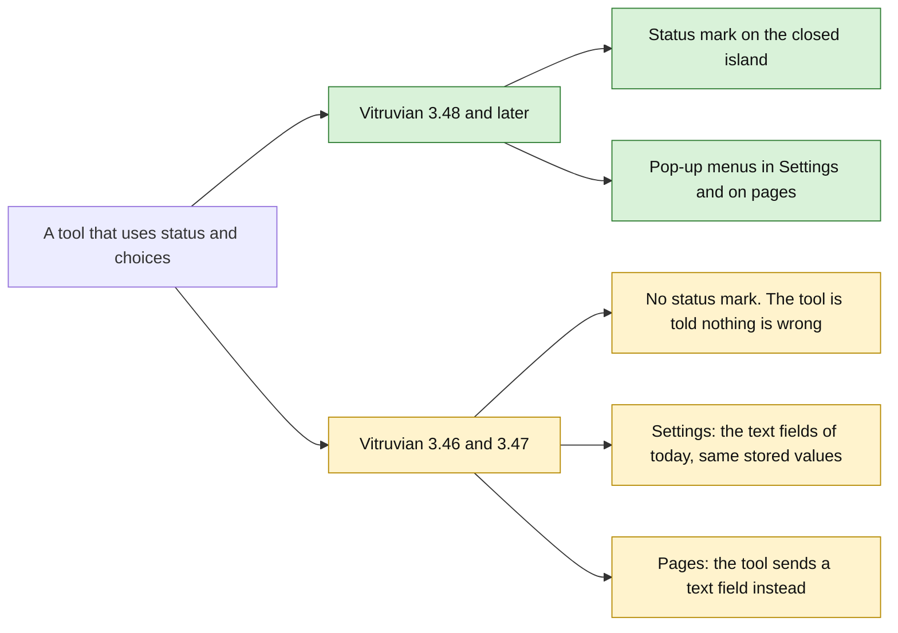
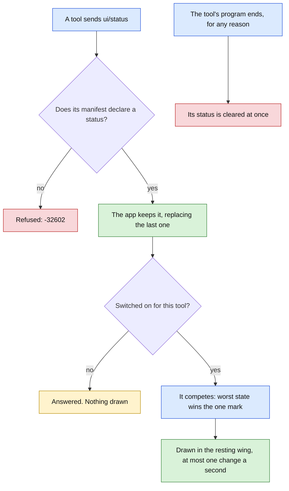
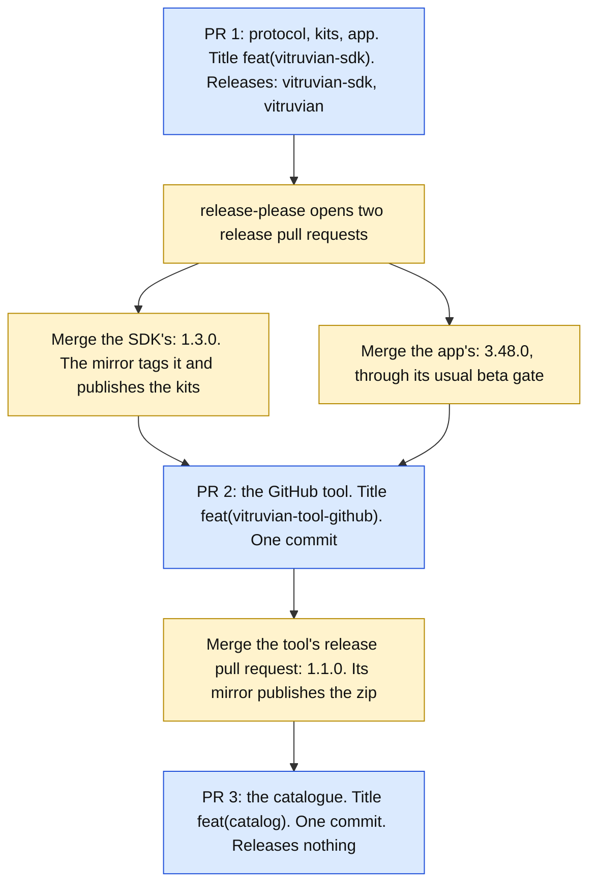

# A tool's status on the closed island, and a choice among fixed options

**Status:** draft for James's approval, 2026-10-13. Nothing here is built.
**Tracks:** issue #3130. **Follows:** `2026-10-12-vitruvian-tools-for-everyone-design.md`
(protocol 2, section 8) and stage E's plan, whose table "What the protocol lacks"
names these as gaps 1 and 4.
**Plan:** `docs/superpowers/plans/2026-10-13-vitruvian-tool-resting-status-and-choice.md`.
**Decides nothing about:** removing the built-in GitHub feature (pull request
#3207 stays on hold), top-level island pages, layout slots, shortcut keys, menu
bar items, or anything a tool draws itself.

## 1. The verdict, first

**Both can be added inside protocol 2, and no tool or app that works today
breaks.** A tool that uses them still installs and runs on Vitruvian 3.46 and
3.47: there its pickers are the text fields people have now, and it shows no
status on the closed island. Nothing needs a protocol 3, and the GitHub tool
does not need a newer `minimumAppVersion`.

**One thing in the request has to change shape.** A preference with
`"type": "choice"` cannot ship: every released app refuses the whole tool when
it sees a preference type it does not know, and tells the person the tool's
author made a mistake (section 3). The same picker is instead a normal text
preference with one extra key, `options`. An older app ignores the key and draws
a text field. The values are the same text either way, so what people have
stored today (`breathe orange`, `breathe blue 9`, `off`, `restore`) keeps
working with no migration.

What a person sees when this ships:

- **On the closed island**, beside the agent mark, a small coloured mark for a
  tool's status: green tick, breathing orange, yellow, or red warning. Clicking
  it while it is anything but green opens that tool's island page. It is the
  same size, colours and motion as the built-in GitHub mark.
- **In a tool's detail in Settings**, a pop-up menu where the tool offers a
  fixed list, and one new switch, "Show its status on the closed Dynamic
  Island".
- **On a tool's own page**, a pop-up menu block.



Green is the full feature. Amber is the reduced one an older app gives. Nothing
is red: no combination refuses the tool.

## 2. What exists today

**The built-in mark.** `NotchGitHubRestingIndicator`
(`apps/desktop/vitruvian/Sources/Vitruvian/UI/Notch/NotchAgentStrip.swift`,
lines 217 to 260) is fed by `GitHubService.shared.summary.aggregate`, which is
`GitHubReducer.aggregate`: red if any watched repository is red, else amber if
any is amber, else green if all are green, else grey. Its exact behaviour:

| # | Behaviour today | Where |
|---|---|---|
| 1 | It is drawn only inside the resting island's left wing, after the agent mark, 3 points apart. That wing exists only when "While inactive" is set to Agents and the wing is 44 points wide. | `NotchAgentStrip.swift:198-202`, `NotchView.swift:769-786`, `NotchSupport.swift:2118-2121` |
| 2 | Hidden when no repository is watched, and when the verdict is grey. | `NotchAgentStrip.swift:228-231`, `:255-256` |
| 3 | Hidden while a Nexus Agent session runs: the wing shows that instead. | `NotchAgentStrip.swift:177-191` |
| 4 | Hidden whenever the closed island shows an activity (an agent working, music) in place of its resting wings. | `NotchView.swift:769` and the strips that replace it |
| 5 | Green: `checkmark`, 8 point bold, green, still. | `NotchAgentStrip.swift:236-239` |
| 6 | Amber (checks running): `arrow.triangle.branch`, 9 point medium, orange, breathing: scale 0.9 to 1.15 and opacity 0.65 to 1.0, 0.9 seconds each way, for ever. With Reduce Motion on it is still, at the small dim end. | `:240-250` |
| 7 | Red: `exclamationmark.triangle.fill`, 8 point bold, red, still. | `:251-254` |
| 8 | Click: the whole wing is the target, not the mark. Red or amber opens the island's GitHub page. Anything else opens the Agents page on its chat tab. | `:138-146` |
| 9 | Hover: nothing of its own. No tooltip, no highlight. | no `onHover` or `.help` in the file |
| 10 | VoiceOver: nothing. The mark has no label. | no accessibility modifier on it |
| 11 | "Waiting for approval" is not shown on the island at all. Only the mouse shows it, and there it outranks every colour. | `GitHubReducer.swift:116-128`, the tool's `Mouse.swift:147-151` |

**Pickers.** `GitHubSettingsView.swift` has eleven `Picker`s (stage E's plan
says ten): two poll intervals, a colour (ten colours, line 35) and a style
(Solid or Pulsing) for each of four states, and what the mouse does when
nothing is watched (Restore Baseline or Turn Off LED). Their labels are
English only: `Text(c.capitalized)`, `Text("Solid")`. The GitHub tool replaced
the nine mouse pickers with five text settings (`mouseSuccess`,
`mouseRunning`, `mouseFailure`, `mouseApproval`, `mouseIdle`).

**How a tool's texts are localised today.** A manifest text (a name, a command
title, a preference title) is a map from language tag to text with `en`
required, and the app picks the person's language (`LocalizedText`). A text on
a page is either a plain string or the same map (`uiText`). A preference title
is at most 60 characters with no control character.

## 3. What released apps do with something they do not know

Read at the tags `vitruvian-v3.46.0`, `vitruvian-v3.46.1` and
`vitruvian-v3.47.0`. The protocol's Swift sources are byte for byte the same at
all three, and the same as `main` today. Beyond reading, the sources of 3.46.1
and of 3.47.0 were each compiled alone and fed the shapes below; both printed
the same answers. File paths are under `packages/vitruvian-sdk/Sources/VitruvianToolProtocol/`
and `apps/desktop/vitruvian/`; line numbers are the same at each tag.

| | The unknown thing | What 3.46.x and 3.47.0 do | Evidence |
|---|---|---|---|
| a | A block type in a page (`"type": "choice"`) | **Safe.** The page is drawn. The block is drawn as its `fallback` text, two lines at most, or left out when it has none. One catch: if the unknown block carries an `id` that is not a well-formed name, the whole page is refused. | `Panels.swift:227` (`default: content = .unknown(type)`), `:207`; `Sources/Vitruvian/UI/ToolPanels/BlockTreeView.swift:129-130`; test `Tests/ToolPanelTests.swift:73-84` |
| b | A preference type in a manifest (`"type": "choice"`) | **Refused.** The whole manifest is invalid, so the tool cannot be added or updated. The alert says "Its vitruvian-tool.json file has a mistake. Tell whoever made the tool". | `ToolManifestFile.swift:336` (`unknownPreferenceType`); `Sources/Vitruvian/UI/Settings/ExternalToolAgreementSheet.swift:168-169`; `Core/ExternalToolStrings.swift:271`; test `Tests/ExternalToolManifestTests.swift:160-162` |
| c | A notice (no `id`) with a method it does not know | **Ignored**, silently. It is not counted as junk and the tool keeps running. | `Sources/Vitruvian/Services/Platform/External/ToolLink.swift:382-385`; test `Tests/ToolLinkTests.swift:313-315` |
| c | A request (with `id`) with a method it does not know | **Answered with failure -32601**, "unknown method". Nothing is done and the tool keeps running. | `ToolLink.swift:332-335`; test `Tests/ToolLinkTests.swift:266-275` |
| d | A key it does not know in a manifest, at any depth | **Ignored.** A `string` preference with an extra `options` key is accepted and is a plain text setting. `contributes.status` is ignored. | The manifest's types are plain `Codable` structs (`ToolManifestFile.swift:103`, `:134`); test `Tests/ExternalToolManifestTests.swift:131-139` |
| d | A value it does not know in a closed list: a `uses` entry, a surface, a panel placement, an activation | **Refused**, like b. So nothing new may be a `uses` entry. | `ToolManifestFile.swift:293` (`unknownService`); test `Tests/ExternalToolManifestTests.swift:153-154` |
| e | An extra field in `initialize`'s params, seen from the tool's side | **Ignored** by every kit: each reads the three fields it knows by name. | Swift `Codable`; `kits/typescript/src/generated/messages.ts:199-207`; `kits/python/vitruvian_tool_kit/generated/messages.py:247-254`; `go/toolkit/protocol_gen.go:138-148`; `kits/rust/src/generated/mod.rs:303-315` (no `deny_unknown_fields`) |

What this decides:

1. **The picker block and the status message can ship as written.** Rows a and
   c are the degradation the protocol was built to give.
2. **The picker preference cannot be a new type** (row b). It is an `options`
   key on a `string` preference (row d).
3. **The declaration of a status cannot be a `uses` entry** (row d, second
   line). It is a key under `contributes`.
4. **A tool needs to know what the app has**, because a picker block that
   degrades to plain text cannot be changed by the person. The app says so in
   the hello (row e makes that safe for every tool built with a kit released so
   far).

## 4. Decisions

| # | Decision | Why |
|---|---|---|
| 1 | **Stays in protocol "2".** No new version, no new `uses` entry, no change to any existing message or field. | Section 3: every addition is one an older app ignores or answers safely. |
| 2 | **The app says what it has.** `initialize`'s params gain `features`, a list of names: `ui.status`, `ui.choice`, `preferences.options`. An app before 3.48 sends none. Every kit gains `supports(name)`. | A tool must send a text field, not a picker block, to an app that would draw only its fallback. A name is clearer than comparing app versions. |
| 3 | **The status is a request, `ui/status`,** with a fixed word for the state. The app draws it; the tool never draws. | A request is answered, so a tool written without a kit learns from -32601 that the app has no status. With a kit the call sends nothing and returns false when the app lacks `ui.status`. |
| 4 | **Five states:** `none`, `ok`, `busy`, `attention`, `failure`. | James's list. `busy` is the built-in's breathing orange; `attention` is new and is how "waiting for approval" reaches the island. |
| 5 | **The manifest declares it:** `"contributes": { "status": { "placement": "island" } }`. Protocol 2 only. A `ui/status` from a tool that did not declare it is refused with -32602. | So the agreement sheet and the tool's detail can say it before the tool runs. `placement` leaves room for another place later without a new key. |
| 6 | **It needs no `uses` entry.** | The declaration is the permission. `ui/badge` needs `notify`; a status mark makes no sound and shows no message. |
| 7 | **The person can switch it off for each tool,** in the tool's detail. Off, the tool's `ui/status` is still answered `{}` and nothing is drawn. | The tool need not know or care. Same pattern as "Show in the Dynamic Island" (`ToolRecord.showsInIsland`). |
| 8 | **One mark, the worst one.** The wing shows a single status mark. Among the built-in GitHub mark and every tool's status the most severe wins: `failure`, then `attention`, then `busy`, then `ok`. On a tie the built-in wins, then the tool added first. | The wing is 44 points and holds the agent mark too. By the numbers in the code two marks do not fit beside it (section 7). **This differs from the request**, which asked for an order and a cap: the cap is one. |
| 9 | **The mark is where the built-in one is,** under the same conditions (rows 1 to 4 of section 2). | Replacing the built-in loses nothing, and nothing new is laid out. Showing it under Battery, Music or "nothing" is an open question (section 11). |
| 10 | **A status clears when the tool's program ends,** for any reason: a crash, being stopped, switched off, updated, removed, or resting after two idle minutes. | James's rule. A tool that wants a lasting status starts with the app (`onLaunch`), as the GitHub tool does. This is unlike the badge, which stays. |
| 11 | **An optional `text`,** one short line, is the VoiceOver label and the tooltip. With none the app says its own word for the state. | The built-in has neither. The app cuts it to one line of 120 characters with the function it already uses for a tool's words. |
| 12 | **An optional `icon`,** an SF Symbol name, replaces the state's glyph. Colour, size, weight and motion stay the app's. | Without it the GitHub tool's "running" mark would change from the branch glyph to a generic one. **Adds to the request.** It can be cut without touching anything else. |
| 13 | **The click rule is the built-in's.** The wing is the target. If the mark shown is a tool's and its state is not `ok`, the click opens the island's Tools page on that tool's page. Otherwise the click does exactly what it does today. | Row 8 of section 2. A tool with no island page, or whose page the person hid, falls through to today's behaviour. |
| 14 | **No new flood rule.** The app keeps the last status a tool sent and redraws at most once a second for each tool. The link's existing limits apply (200 lines a second; five such seconds stop the tool). | A status is one small request. Nothing here needs its own counter. |
| 15 | **A picker setting is a `string` preference with `options`.** Each option is a `value` and a `title` the tool writes in each language, as it writes a preference's title. | Section 3, row b. **This differs from the request** (`"type": "choice"`). |
| 16 | **Options are how the app draws, not a rule on the value.** The app does not refuse a stored or a written value that is not among them. It shows such a value as an extra first row, as written, until the person picks another. | People have free text stored today. A value the tool wrote, or one handed over from the built-in feature, must never vanish or be rewritten silently. |
| 17 | **Limits:** at most 64 options; a `value` of at most 128 characters, no control character, unique within the list, may be empty; a `title` of at most 60 characters, as a preference title. The default must be one of the values. Only a `string` preference may have options. | A pop-up of more than a few dozen rows is the wrong control; `list` exists. The manifest's 64 KB limit is the real ceiling. |
| 18 | **A picker block, `choice`,** with `id`, `title`, `value`, `options`, `enabled`. Picking is the event `change`, which exists already, with the option's value. | No new event name, so no kit or tool that reads events has to change. |
| 19 | **Every kit** gains the status call, the picker block builder and `supports`; the generated types come from the schema; the conformance script, `vitruvian-tool run` and one sample per language cover them. | `CONTRIBUTING.md`, "A change to the protocol". |
| 20 | **The GitHub tool adopts both** as 1.1.0, and its catalogue entry keeps `"minimumAppVersion": "3.46.0"`. | The catalogue holds one entry per tool, and an app hides an entry that asks for a newer app (`CatalogueClient.swift:134-143`). Raising it would take the GitHub tool away from everyone on 3.46 and 3.47 for no gain, since 1.1.0 behaves there exactly as 1.0.1 does. **This differs from the request**, which expected a new minimum. |
| 21 | **One pull request carries the protocol, the kits and the app.** | Adding a message does not compile until the app says what it does with it (`ExternalToolCalls.swift:18-19`), and the app's pin of the protocol sources lives in the app's folder. Protocol 2 itself landed the same way (#3182). |

## 5. The status: wire shapes

The manifest says the tool has one:

```json
{
  "protocol": "2",
  "contributes": {
    "status": { "placement": "island" }
  }
}
```

The tool sets it. Each one replaces the last:

```json
{"jsonrpc": "2.0", "id": 7, "method": "ui/status",
 "params": {"state": "failure", "text": "main is red on vitruvian-core"}}
```

```json
{"jsonrpc": "2.0", "id": 7, "result": {}}
```

With a glyph of its own, and text in more than one language:

```json
{"jsonrpc": "2.0", "id": 8, "method": "ui/status",
 "params": {"state": "busy", "icon": "arrow.triangle.branch",
            "text": {"en": "Checks are running", "fr": "Vérifications en cours"}}}
```

Taking it away:

```json
{"jsonrpc": "2.0", "id": 9, "method": "ui/status", "params": {"state": "none"}}
```

| Field | Type | Rule |
|---|---|---|
| `state` | text, required | `none`, `ok`, `busy`, `attention` or `failure`. Any other word: failure -32602, and the status stays as it was. |
| `text` | `uiText`, optional | What it means, for VoiceOver and the tooltip. Shown as one line of at most 120 characters. |
| `icon` | text, optional | An SF Symbol name. One this Mac lacks, or a blank one, draws the state's own glyph. Ignored for `none`. |

How the app answers:

| Case | Answer |
|---|---|
| Declared, and shown | `{}` |
| Declared, and the person switched it off | `{}`, nothing drawn |
| The manifest declares no status | failure -32602, "the manifest declares no status" |
| Vitruvian 3.46 or 3.47 | failure -32601, "unknown method" (section 3) |

How each state is drawn. Sizes and motion are the built-in's:

| State | Glyph | Colour | Motion | The built-in it matches |
|---|---|---|---|---|
| `none` | nothing | | | grey, or nothing watched |
| `ok` | `checkmark`, 8 pt bold | green | still | green |
| `busy` | `arrow.triangle.2.circlepath`, 9 pt medium | orange | breathing, as row 6 of section 2; still with Reduce Motion | amber |
| `attention` | `exclamationmark.circle.fill`, 8 pt bold | yellow | still | not shown today |
| `failure` | `exclamationmark.triangle.fill`, 8 pt bold | red | still | red |

How each built-in behaviour maps:

| Built-in (section 2) | A tool's status |
|---|---|
| 1, 3, 4: where and when the wing exists | The same. The mark is drawn in the same place by the same view. |
| 2: hidden for grey or nothing watched | The tool sends `none`. |
| 5, 6, 7: glyph, colour, motion | The same numbers. The GitHub tool sends `icon: "arrow.triangle.branch"` with `busy`, so its running mark is identical. |
| 8: click | Decision 13: the same rule, opening the tool's island page. |
| 9: no hover | A tooltip with `text`, when there is one. New. |
| 10: no VoiceOver label | The tool's name and `text`. New. |
| 11: approval not shown | `attention`. New. |



Green is kept or drawn, amber is kept but hidden by the person, red is refused
or cleared, blue is in progress.

## 6. The picker: wire shapes

**In the manifest**, a text preference with options:

```json
{
  "id": "mouseIdle",
  "title": { "en": "Mouse when nothing is watched" },
  "type": "string",
  "default": "restore",
  "options": [
    { "value": "restore", "title": { "en": "Restore my lighting", "fr": "Rétablir mon éclairage" } },
    { "value": "off", "title": { "en": "Turn the light off", "fr": "Éteindre la lumière" } }
  ]
}
```

The app draws it in the tool's detail as a pop-up menu, in the row a text field
has today, and saves on pick. The tool is sent `preferences/changed` as for any
setting. The tool reads and writes it with `storage/get` and `storage/set`
exactly as before: the value is text.

| Rule | Problem the manifest is refused with |
|---|---|
| `options` on a preference that is not `string` | `optionsNeedString` |
| No option, or more than 64 | `optionCountOutOfRange` |
| A `value` over 128 characters or with a control character | `optionValueNotWellFormed` |
| Two options with one `value` | `duplicateOption` |
| A `title` with no `en`, blank, over 60 characters or with a control character | `noEnglish`, `blankText`, `optionTitleNotWellFormed` |
| `default` is not one of the values | `defaultNotAnOption` |

These are refusals by Vitruvian 3.48 and later only. An older app does not read
the key. No manifest in this repository has an `options` key today (all
sixteen were checked), so nothing that works now is refused.

**A stored value that is no option's** (decision 16) is shown as the first row
of the menu, as written, cut to one line, and selected. Picking an option
replaces it. Nothing else ever changes it.

**On a page**, a block:

```json
{
  "type": "choice",
  "id": "light",
  "title": "Mouse when green",
  "value": "green",
  "options": [
    { "value": "green", "title": "Green" },
    { "value": "breathe green", "title": { "en": "Pulsing green", "de": "Pulsierendes Grün" } }
  ],
  "fallback": "Mouse when green: Green"
}
```

The person picks, and the tool is sent the event that fields already send:

```json
{"jsonrpc": "2.0", "id": 31, "method": "ui/event",
 "params": {"panel": "settings", "block": "light", "event": "change", "value": "breathe green"}}
```

| Field | Type | Rule |
|---|---|---|
| `id` | text, required | As a toggle's. |
| `title` | `uiText`, optional | What is being chosen, beside the menu. |
| `value` | text, required | The selected value. One that is no option’s is drawn as an extra first row, as for a stored value above. |
| `options` | list, required | 1 to 64. Each has a `value` (text, at most 128 characters, unique) and a `title` (`uiText`, drawn as one line). |
| `enabled` | yes or no, optional | False draws it dimmed. |

A `choice` block that breaks a rule refuses the whole page, as a known block
with a bad field does today.

## 7. Why one mark

The wing is 44 points wide or absent (`NotchSupport.swift:2118-2121`). Its
content is inset from the curved end by `min(16, shoulder + 5)` points
(`NotchView.swift:753-756`), which is about 11 for a notch-height strip and 16
at most. The agent mark is 10 points, the gap 3, a status mark 9
(`NotchAgentStrip.swift:199-201`). So one mark needs 22 points of the 28 to 33
there are, and two need 34. Two do not fit at the deepest inset and barely fit
at the shallowest.

This is arithmetic on the code, not a measurement on a screen. Check 2 of the
by-hand list is there to confirm it.

## 8. Behaviour on an older app, case by case

| What the tool does | Vitruvian 3.46.x, 3.47.0 | Vitruvian 3.48+ |
|---|---|---|
| Manifest has `contributes.status` | Key ignored. Tool installs and runs. | Agreement sheet and detail say so. |
| Sends `ui/status` with a kit | The kit sends nothing and returns false: the hello had no `ui.status`. | Drawn. |
| Sends `ui/status` without a kit | Answered -32601. Harmless; a tool should stop asking. | Drawn. |
| Preference has `options` | A text field. Same stored value. | A pop-up menu. |
| Page has a `choice` block | Its `fallback` text, read-only. So a tool checks `supports("ui.choice")` and sends a `field` block instead. Each kit's builder fills in a fallback when the tool gives none. | A pop-up menu. |
| Uses `"type": "choice"` on a preference | **Tool refused.** Not offered by any kit or sample; the guide says never to. | **Tool refused** too: it is not a type. |

A tool built with a kit released before this change runs unchanged on 3.48: it
ignores `features`, and nothing it sends changed.

## 9. The GitHub tool, as the proof

**Status.** From the same summary the badge and the mouse use, on every poll
and on sign-out. The rule is the mouse's, so the island and the mouse always
agree:

| The tool's state | `state` | `icon` |
|---|---|---|
| Signed out, nothing watched, or grey | `none` | |
| A check is waiting for approval (outranks every colour, as on the mouse) | `attention` | `hand.raised.fill` |
| Red | `failure` | |
| Amber | `busy` | `arrow.triangle.branch` |
| Green | `ok` | |

`text` is one of four new sentences in the tool's `Words.swift`, in its fifteen
languages.

**Pickers.** The five mouse settings keep their ids, their type and their
defaults, and gain `options`:

| Setting | Options | Values |
|---|---|---|
| `mouseSuccess`, `mouseRunning`, `mouseFailure` | 20: each of the ten colours, solid and pulsing | `green`, `breathe green`, … |
| `mouseApproval` | 20: the same, pulsing at speed 9 | `blue`, `breathe blue 9`, … |
| `mouseIdle` | 2 | `restore`, `off` |

The ten colours are the built-in's: green, cyan, blue, purple, magenta, yellow,
orange, red, white, pink. The values are exactly what the tool parses today and
what the hand-off from the built-in feature writes (`GitHubHandoff.swift:182-187`),
so every stored value still reads. A value outside the list, such as
`breathe blue 5` or a colour typed by hand, shows as written (decision 16) and
keeps working.

**The colour titles are English only** in this release. Eighty options in
fifteen languages would take the manifest from 13.6 KB to about 68 KB, over the
65,536-byte limit every released app enforces (`ToolManifestFile.swift:262`).
The built-in pickers were English only too. `mouseIdle`'s two titles are in all
fifteen languages. Section 11, question 7.

**Versions.** The tool asks for the kit `from: "1.3.0"`. Its catalogue entry
moves to 1.1.0 with the release asset's checksum and size, and keeps
`"minimumAppVersion": "3.46.0"` (decision 20). The two poll intervals stay
number fields.

## 10. Release order



Blue is a pull request an agent opens. Amber waits for a person to merge a
release.

| Step | Title | Commits | What `release-scope` needs |
|---|---|---|---|
| PR 1 | `feat(vitruvian-sdk): a tool can show a status on the closed island and offer a choice` | One for each task. It lands squashed under this title. | It changes `packages/vitruvian-sdk` and `apps/desktop/vitruvian`, so the description carries the line `Releases: vitruvian-sdk, vitruvian`. |
| SDK release | release-please's own | | Exempt. |
| App release | release-please's own | | Exempt. |
| PR 2 | `feat(vitruvian-tool-github): the status on the closed island, and pickers for the mouse lights` | **One.** A single commit lands under its own message, so the commit's title is this title. | Only `apps/desktop/vitruvian-tool-github` changes. |
| Tool release | release-please's own | | Exempt. |
| PR 3 | `feat(catalog): the GitHub tool, 1.1.0` | **One.** | `catalog/` is no product: nothing is released. |

PR 2 waits for the SDK's release because the tool's mirror builds against the
published kit. It waits for the app's release so the by-hand checks run against
what people will have. PR 3 waits for the tool's release because it pins that
release's bytes.

## 11. Open questions, with a pick for each

1. **Should the mark show when "While inactive" is Battery, Music or nothing?**
   Pick: no, not in this change. It shows where the built-in does. Battery and
   Music have room for one mark and could follow. "Nothing" needs the resting
   island to change size, which touches the companion's walk.
2. **One mark or two?** Pick: one (section 7). If check 2 shows two fit at
   every island height, a second is a small follow-up.
3. **What colour is `attention`?** Pick: yellow. The mouse shows approval in
   blue, but blue means nothing else on the island and yellow reads as "look at
   this". Check 3 confirms yellow and orange can be told apart at 9 points.
4. **Keep `icon`?** Pick: yes (decision 12). Cut it if a tool choosing its own
   glyph is more than "the app's own style" allows.
5. **Should a status go stale?** A tool that hangs without exiting keeps its
   last mark. Pick: no timeout. The built-in has none, and a timeout would make
   a quiet, correct green disappear.
6. **Options on a number setting**, which would bring back the two poll
   interval pickers? Pick: not now. A number field does the job.
7. **Colour names in fifteen languages?** Pick: English now (section 9). The
   fix is a shape that lets several settings share one list of options; it is
   additive and can wait for a second tool that needs it.
8. **Click while `ok`?** Pick: today's behaviour, the Agents page. A green mark
   is not asking for anything.
9. **Should the tool be told the person switched its status off?** Pick: no.
   It would only tempt a tool to nag.

## 12. Not verified

- Nothing here was built or run except the probe of section 3. The app's
  drawing, the kits' calls and the generator's output are designed from reading.
- Section 7 is arithmetic. No screen was measured.
- Whether a tooltip (`.help`) shows on the closed island's panel at all, and
  whether "open on hover" opens the island before it could, is unknown. The
  VoiceOver label does not depend on it.
- Opening the Tools page and then a tool's page from a click on the closed
  island (`NotchService.select(.tools)`, then `ToolPanelHost.open`) was read,
  not run.
- How release-please words two products' changelogs from one squashed commit
  was not checked. Protocol 2 (#3182) is the precedent.
- The manifest size in section 9 is an estimate from the file's current layout.
- The fourteen other languages of the app's new texts will be written with the
  English. Nobody who reads them has reviewed them.
