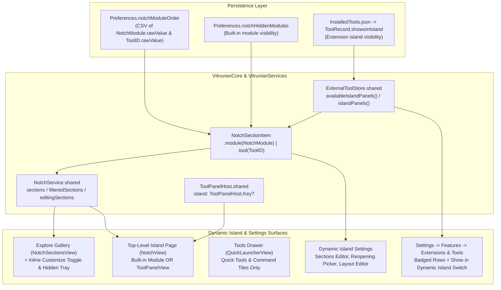

# Vitruvian Extensions & Tools Coexistence and Unified Dynamic Island Sections

- **Date:** 2026-10-14
- **Status:** built and shipped by 2026-10-14 (`UPSTREAM.md`, 2026-10-14 entries for tasks 1–4). Gate 1 review blockers and recommendations were folded in below; James approved every fix, including the `extension:<toolID>` save format for quick-access buttons.
- **Scope:** `apps/desktop/vitruvian`

## 1. Goal & Motivation

Vitruvian supports packages that run as their own programs over the JSON-RPC tool protocol (`packages/vitruvian-sdk`, Protocols 1 and 2). In practice, these packages fall into two natural categories that serve distinct user mental models:

1. **Extensions** — Rich, app-like packages (Protocol 2) that contribute interactive UI `panels` (`island`, `settings`, or `window`), resting status indicators (`contributes.status`), and badges (`ui/badge`), such as **GitHub** (`dev.vitruvian.github`) and **HomeSpeaker** (`dev.vitruvian.homespeaker`).
2. **Tools** — Lightweight, one-shot utilities and commands that run from the **Tools (`⌥⌘T` / `⌃⌘V`)** quick panel, the Command Bar, the Radial Menu, or global keyboard shortcuts, such as **Reference tool** (`dev.vitruvian.reference`) and built-in quick tools (Screenshot, Text Recognition, Color Picker, Keep Awake, etc.).

Previously:
- Protocol 2 `"placement": "island"` panels were placed inside the `Tools` (`QuickLauncherView`) sub-drawer after the quick-tool tiles, rather than in the Dynamic Island's top-level **Explore (`Sections`)** gallery (`NotchSectionsView`).
- Users could reorder quick tools inline inside the `Tools` drawer via a header customize button (`slider.horizontal.3`), but **Explore (`Sections`)** had no inline customize toggle—reordering or hiding sections required opening the separate Settings app (`Dynamic Island -> Content -> Sections`), and extension island panels could not be reordered alongside built-in sections at all.

This design establishes clean coexistence between **Extensions** and **Tools** with zero breaking changes to `packages/vitruvian-sdk`, the manifest schema (`vitruvian-tool.json`), or the wire protocol, and gives users seamless inline reordering and show/hide customization for both seeded (built-in) and contributed sections and tools.

---

## 2. Core Design Decisions

### 2.1 Zero Breaking Changes to SDK, CLI, or Wire Protocol
- Package manifests (`vitruvian-tool.json`), the CLI (`vitruvian-tool`), the SDK (`packages/vitruvian-sdk`), and `catalog/tools.json` keep their existing field names and wire format.
- Whether a package is presented as an **Extension** or a **Tool** in the UI is derived from its capabilities:
  - A package that contributes one or more `panels` (`contributes.panels` non-empty) is badged as an **Extension**.
  - A package that contributes only `commands` (Protocol 1, or Protocol 2 with no panels) is badged as a **Tool**.

### 2.2 Promote Extension Island Panels to First-Class Dynamic Island Sections

> **This reverses a written rule.** `apps/desktop/vitruvian/AGENTS.md` (around lines 680–684) says: "The island's own list of pages (`NotchModule`) is not open to tools: a tool's page is hosted on the Tools page." This design deliberately opens the island's section list to extension island panels. Task 2 rewrites that `AGENTS.md` passage in the same change that moves the pages.

- Protocol 2 panels with `"placement": "island"` are promoted out of the `Tools` (`QuickLauncherView`) sub-drawer and into the top-level **Explore (`Sections`)** gallery (`NotchSectionsView`) alongside built-in `NotchModule` sections (`Controls`, `Mixer`, `Music`, `Files`, `AI Agents`, `Watch`, `System`, `Alerts`, `Tools`, `Timer`, `Clipboard`, `Calendar`).
- `QuickLauncherView` (`Tools`, `⌥⌘T` / `⌃⌘V`) returns exclusively to quick tools and one-shot commands (`QuickLauncherService.shared.visibleTiles`). `SystemNotchIslandServices.visibleToolCount` counts `QuickLauncherService.shared.visibleTiles.count`.
- When a user opens an extension section (from Explore, from a surrounding quick-access button, upon reopening the island, or by clicking a non-green resting status mark on the closed island):
  - `ToolPanelHost.shared.open(key, in: .island)` opens the extension panel.
  - `NotchView` renders the extension's `ToolPanelView` directly as the island's top-level page (sized to `pageBudget`, with its localized panel title in the island header and the `square.grid.2x2` Explore button beside it).
  - Selecting any built-in `NotchModule` closes any open extension island panel (`services.closeToolPanel()`), and collapsing the island closes it as before.
- **One extension page at a time.** `ToolPanelHost.open` sets the island panel without closing the one already there, and returns early when the requested panel is already open (`ToolPanelHost.swift` around 258–277). So `NotchService.openExtensionSection(_:)` closes the current island panel first, then opens the new one. If the open is refused, the island stays on Explore (or returns to it).
- **The island knows which page is showing.** `NotchService` gains one published `currentSection: NotchSectionItem`. Without it, everything follows the built-in `selected` section underneath an extension page: going Camera → Explore → an extension would leave the camera running, keys would reach the hidden section, and its Explore tile would keep its checkmark. Opening an extension page sets `currentSection = .tool(id)` and stops the built-in page underneath exactly as switching between built-in pages does today.

  | Case | Behaviour |
  |---|---|
  | Escape on an extension page | Collapse, as on a built-in page |
  | Island collapses | Close the panel; a "last page" reopen setting reopens it |
  | Tool crashes, is held, switched off, uninstalled or hidden while its page is open | Watch `ToolPanelHost.island`; fall back to Explore (or the first visible section), then resize |
  | App panel or a metric opens | Close the extension page |
  | Reopening target is no longer available | First visible section, else Explore |
- **Empty state and the Explore button use the full section list.** `NotchView` decides the empty state and whether the Explore button shows by checking `service.modules.isEmpty` in five places. Those checks move to the full section list (built-in plus extension). Otherwise, with only extensions visible, the island shows "empty" and hides the Explore button, stranding the extensions.
- **Tools page after the move.** People whose Tools page held only extension pages will now see its "no tools" message there. That is expected; the pages now sit in Explore.

### 2.3 Unified Section Ordering & Single Source of Truth for Visibility
- `NotchSectionItem` (declared in `VitruvianCore`, `Core/Notch/NotchSupport.swift`) represents a top-level Dynamic Island section. It carries `rawValue` and `init?(rawValue:)` itself. Its `PanelOrderItem` conformance is declared in the **UI layer**, as `extension NotchSectionItem: PanelOrderItem {}` next to the existing `extension NotchModule: PanelOrderItem {}` (`UI/Notch/NotchView.swift:847`), because `PanelOrderItem` lives in Services (`Services/MenuPanel/PanelLayoutStore.swift:11`) and Core depends on no other app module:
  ```swift
  package enum NotchSectionItem: Hashable, Identifiable, Sendable {
      case module(NotchModule)
      case tool(ToolID)
  }
  ```
- **Storage in `Preferences.notchModuleOrder`:**
  - Built-in modules use their `NotchModule.rawValue` (none of which contain a dot, e.g. `"controls"`, `"agents"`).
  - Extension sections use their `ToolID.rawValue` (which always contains a dot, e.g. `"dev.vitruvian.github"`, enforced by `!id.isBundledForm`).
  - Ordering uses `QuickToolsSupport.tileOrder(live:saved:)` and `QuickToolsSupport.savedTileOrder(afterMoving:previous:isWellFormed:)`:
    - Existing saved `NotchModule` orders continue to work unchanged.
    - Any `NotchModule.allCases` absent from the raw string are appended in default case order before applying `tileOrder`, so newly installed extensions appear after built-in modules until the user drags them to a custom position.
    - When the user drags sections to a new order, any currently unavailable built-in module or switched-off/hidden extension in the saved order keeps its relative slot (`savedTileOrder`), so turning a feature or extension off and back on restores it to the exact spot the user left it.
    - **First save:** when nothing is saved yet, the "previous" order passed to `savedTileOrder` is the full default list, *including* hidden and unavailable built-in modules, so hidden sections keep their default positions.
    - **Uninstalled extensions are dropped.** A token is kept only if it is a `NotchModule.rawValue` or the ID of a currently installed tool. Saved positions for uninstalled extensions do not accumulate forever.
    - **Later releases:** a built-in section added in a future release lands after any extensions the user has already placed (it is appended as a missing `NotchModule` case).
    - Every surface that saves `notchModuleOrder` uses the shared helper. Today `NotchSettings.swift` (around line 352) saves `orderedModules.map(\.rawValue)`, which drops every extension ID; it switches to the helper so a reorder in Settings cannot wipe extension positions.
- **Single Source of Truth for Visibility:**
  - Built-in module visibility uses `Preferences.notchHiddenModules` **plus** each section's own on/off preference (timer, camera, calendar, notifications, agents, watch: `Preferences.notch*Enabled`), as `NotchSupport.modules(in:)` checks both, gated by feature availability via `NotchModule.isAvailable(in:)`. The show/hide logic Settings uses today (`NotchSettings.moduleBinding`) moves into one shared `NotchSupport.isModuleShown(_:in:)` / `NotchSupport.setModuleShown(_:_:in:)` so Settings and the inline editor flip the same preferences. Editing only `notchHiddenModules` would leave a hidden timer hidden.
  - Extension island section visibility continues to use `ExternalToolStore.shared.showsInIsland(id)` (`ToolRecord.showsInIsland` in `InstalledTools.json`, toggled via `ExternalToolStore.shared.setShowsInIsland(id, shown)`).
  - Hiding or showing an extension section in Explore's inline editor, in `Dynamic Island -> Content -> Sections`, or in `Settings -> Features -> Extensions & Tools -> Detail` (`Show in the Dynamic Island`) mutates the same `ExternalToolStore.setShowsInIsland(id, shown)` state, keeping all three surfaces 100% synchronized.
  - There is **no** "at least one section stays visible" guarantee in the island today (the `count > 1` gate in `PanelLayoutEditor.swift:77` belongs to the menu-bar panel editor), and extensions can disappear on their own when they crash, are switched off or are uninstalled. The inline editor hides its `minus` button on the last visible section as a nicety only; the island must cope with an empty list (see the empty-state rule in 2.2).

### 2.4 Inline Customize Toggle in Explore (`NotchSectionsView` & `NotchView`)
- Just as the `Tools` page shows a header customize button (`slider.horizontal.3` $\rightarrow$ `checkmark`), `NotchView` shows the same customize button in the island header whenever **Explore (`showingSections`)** is open (and the search query is empty).
- Toggling this button switches `NotchService.editingSections` (`@Published package var editingSections = false`).
- When `service.editingSections` is `true`:
  - `NotchSectionsView` replaces the paged/searchable gallery with an inline customization view that **reuses the Tools editor's grid exactly** (`QuickLauncherView`'s customize mode): the same column count logic (it follows the screen size, it is not a fixed 6) and **no `ScrollView`**, because drag targets need every tile in view and Explore captures the scroll wheel:
    - Visible `NotchSectionItem`s (both built-in modules and extension sections) wrapped in `PanelReorderableItem` for drag-to-reorder, each with a top-right `minus.circle.fill` button to hide the section (hidden on the last visible section).
    - If any built-in modules whose feature is on (`NotchModule.isAvailable(in:)`) or any installed extension island panels are currently hidden, a divider and a `FlowLayoutLite` **hidden tray** below the grid showing capsule pills with `plus.circle.fill` to restore them with one click (`NotchSupport.setModuleShown` / `ExternalToolStore.setShowsInIsland`).
  - While editing: Return, arrow keys and Tab do not pick sections, the scroll wheel does not page, the search field is hidden or disabled, and the island is sized to full page height so the hidden tray fits.
  - Pressing `Escape` while `editingSections` is `true` exits edit mode (`editingSections = false`) first before closing Explore or collapsing the island.
  - Leaving Explore (`showingSections = false`) or collapsing the island resets `editingSections = false`.

### 2.5 Full Parity Across Keyboard Navigation, Search, Settings & Quick Access
1. **Explore Gallery (`NotchSectionsView` & `NotchService`):**
   - `NotchService.filteredSections` returns `[NotchSectionItem]` (built-in modules + visible extension island panels in the user's unified order, filtered by `sectionQuery` against localized titles and raw IDs).
   - `highlightedSection` changes type to `NotchSectionItem?` (one state, not two synced copies; it has about 15 readers plus one test, all updated). Arrow keys, Tab/Shift-Tab, `Return`, scroll wheel paging, hover highlighting, and `ui/badge` display (count up to `99+` or dot on extension tiles) work identically across built-in and extension sections.
2. **Dynamic Island Settings (`NotchSettings.swift` & `NotchContentEditor.swift`):**
   - `Dynamic Island -> Content -> Sections` (`NotchSectionsContentEditor`) displays and reorders all available `NotchSectionItem`s (both built-in modules and installed/enabled extension island sections) and toggles their visibility (`notchHiddenModules` for built-in modules, `ExternalToolStore.setShowsInIsland` for extensions).
   - The section list is `sectionList` / `orderedModules` in `NotchSettings.swift` (around line 338); there is no `NotchSectionsContentEditor` type.
   - `When reopening` picker (`Preferences.notchHomeModule` in `NotchSettings.swift`) includes visible extension island sections alongside built-in modules, `App panel`, and `Explore`. When `Preferences.notchHomeModule` stores a `ToolID.rawValue` for a visible extension section, reopening the island opens that extension section. Today `open()` and the reopening logic only handle built-in sections, and the picker falls back to Controls for a value it does not recognise; both learn the extension case, and an unavailable extension falls back to the first visible section, else Explore.
   - **Live updates:** `ExternalToolStore` does not publish changes; `ToolRegistry`'s revision counter does. `NotchSettings` and `NotchLayoutEditor` observe `ToolRegistry.shared` and `ToolPanelHost.shared` (neither does today).
3. **Surrounding Quick-Access Buttons (`NotchQuickAction` & `NotchLayoutEditor.swift`):**
   - `NotchQuickAction` gains `.extensionPanel(ToolID)`, **serialized as `extension:<toolID>`** (e.g. `extension:dev.vitruvian.github`). A plain `ToolID.rawValue` would collide: `ToolID("control.volume")` is a valid tool ID, and today an unknown `control.x` reads back as nothing and is dropped (`NotchSupport.swift` around 1247); under a plain-ID scheme it would come back as a ghost extension button. A colon can appear in neither a tool ID nor a control name, so the two never meet. A saved `control.<unknown>` still reads back as nil (regression test).
   - Availability: `NotchQuickAction.isAvailable(in:)` lives in Core and cannot see installed extensions, so it returns `false` for `.extensionPanel`; a Services-layer lookup (`ExternalToolStore`/`ToolPanelHost`) answers availability, title and symbol for extension buttons. The layout editor's palette is a fixed list today and gains the installed extension sections from that lookup.
   - `NotchLayoutEditor`'s *"Open a section"* palette and button action menu include available extension island sections with their title and SF Symbol.
   - `NotchService.activateQuickAction(.extensionPanel(id))` opens that extension's island section.
4. **Unified "Extensions & Tools" Settings & Catalog Presentation:**
   - The Settings card on the `Features` page (`ExternalToolsSection.swift`; `FeatureHubText.swift` and `SettingsSearchSupport.swift` hold nothing about this card today and change only if the settings search index needs the new name) is titled **Extensions & Tools** (localized across all 15 languages), with subtitle and catalog sheet (`ExternalToolCatalogueSheet.swift`) updated to reflect that extensions add pages to the Dynamic Island and Settings while tools add commands.
   - Each installed row (`ExternalToolRow`) carries a `kind: Kind` (`.extensionPackage` when `listed.tool?.panels.isEmpty == false`, `.tool` otherwise) and displays a subtle pill badge (**Extension** / **Tool**, localized in all 15 languages) beside the version/publisher line so users can immediately distinguish rich extensions from command tools.
   - The rename breaks the by-hand checking tool, which finds the card by its English name (`Tools/ByHandRules.swift:148`, `Tools/ByHand.swift:361`); both update in the same change. The SDK README's mention of the old name updates too.
   - A package whose only panels are Settings or window panels gets the Extension badge but no island section; the catalog subtitle must not promise island pages. A held extension loses its manifest while held, so its badge reads Tool until it is released (accepted).
5. **Strings (all 15 languages):**
   - `NotchStrings`: Explore's customize and done labels, the hide and show button labels, and a heading for the hidden tray.
   - Extension titles in the island and in Settings are the tool's own words (the tool localizes them), never translated by the app.
   - The two new pills (`kindExtension`, `kindTool`) take `ExternalToolStringsTests`' count from 68 to 70.

### 2.6 Nits carried from Gate 1
- "Zero SDK change" holds for the wire format, but several SDK docs say island panels appear in "the Tools area"; they are updated (docs only). Editing `Panels.swift` would also need the protocol pin refreshed, so it is avoided unless necessary.
- Delete the now-unused `ToolsRailItem.page`.
- Names: the event-route entry point is `NotchLocalEventRoute.handle(_:)` (not `routeKey`); the availability check is `NotchModule.isAvailable(in:)` (not `isModuleAvailable`).

---

## 3. Architecture & Data Flow Diagram



---

## 4. Verification & Testing Strategy

1. **Behavioral Unit Tests (`//apps/desktop/vitruvian:unit_tests`):**
   - `NotchSectionItem` parsing, unified ordering (`sectionOrder`, `savedSectionOrder`), preserving positions of hidden/disabled built-in modules and switched-off extensions, and rejecting malformed tokens.
   - `ExternalToolStore.availableIslandPanels()` vs `islandPanels()`, and synchronized visibility toggling between Explore, Dynamic Island Settings, and Extension Detail.
   - `NotchService` opening an extension section, switching between an extension section and a built-in module (closing the extension panel), toggling `showingSections` and `editingSections`, keyboard navigation (`handleSectionKey`) and search filtering across mixed `[NotchSectionItem]`, `Escape` handling in `editingSections`, `reopeningDestination` with an extension section, and `activateQuickAction(.extensionPanel(id))`.
   - `ExternalToolRow.Kind` (`.extensionPackage` vs `.tool`) and localized strings across all 15 `AppLanguage`s (`ExternalToolStringsTests`).
2. **Every task runs** `unit_tests`, `selftest`, `source_lints_test` and `mutation_fixtures_test` before review. `AGENTS.md` requires a mutation check to change in the same change as the code it guards.
   - New mutation checks: Escape leaves edit mode first; the visible-section rule (empty state uses the full list); picking a built-in section closes an extension page.
   - Do not copy the `99+` badge line into a new tile. A mutation check quotes it, and a second copy fails the fixtures test; reuse `ToolIslandEntry`.
3. **Source Lints & Mutation Checks (final task):**
   - `bazel test --config=macos-app //apps/desktop/vitruvian:source_lints_test`
   - `bazel test --config=macos-app //apps/desktop/vitruvian:mutation_fixtures_test`
   - `bazel test --config=macos-app //apps/desktop/vitruvian:sources_in_sync_test`
   - `bazel test --config=macos-app //apps/desktop/vitruvian:upstream_test`
   - `bazel test --config=macos-app //apps/desktop/vitruvian:selftest`
   - `bazel run //tools/license:verify` and `bazel run //tools/conformance:check` (these are `bazel run`, not `bazel test`).
4. **By-hand check:** install the `hello-panel-swift` sample and drive the island (open from Explore, switch extension → built-in → extension, Escape, collapse and reopen, hide and restore from the inline editor). No automated test draws a view.
5. **Provenance:** each PR carries its own dated `UPSTREAM.md` entry (unless all four tasks ship as one PR). No test enforces this.
