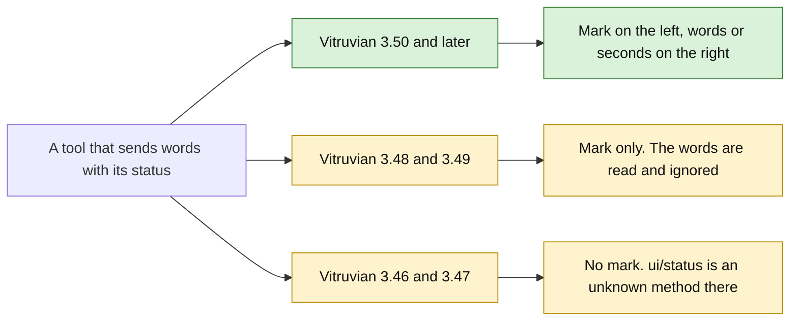
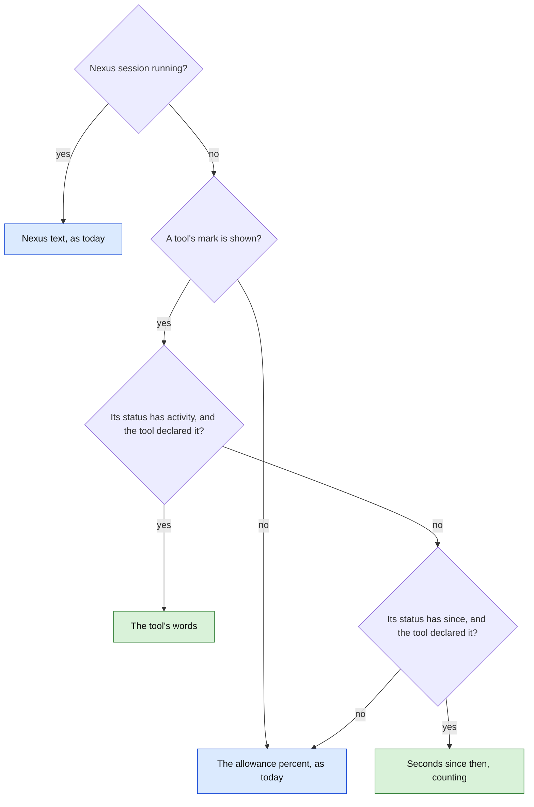
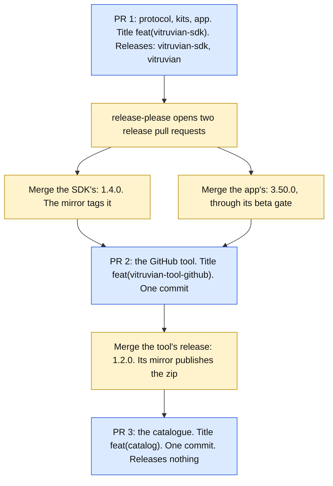

# A tool's words on the closed island

**Status:** approved by James on 2026-10-14 ("build it", every pick of section 10 as written). The protocol, the kits and the app are built in pull request #3271, without the click fix of decision 20 (out of scope for that pull request). The GitHub tool and the catalogue follow.
**Tracks:** issue #3130. **Follows:** `2026-10-13-vitruvian-tool-resting-status-and-choice-design.md`
(the status mark, shipped in SDK 1.3.0 and Vitruvian 3.48.0 by pull request #3245; the
built-in GitHub mark left the arbitration in pull request #3207, Vitruvian 3.49.0).
**Plan:** `docs/superpowers/plans/2026-10-14-vitruvian-tool-resting-activity.md`.
**Decides nothing about:** the Nexus Agent hand-over or the removal of the built-in
Nexus Agent feature (both on hold, James, 2026-10-14); a second mark; a status under
Battery, Music or "nothing"; anything a tool draws itself.

## 1. The verdict, first

**It fits inside protocol 2, and nothing that works today breaks.** A tool's status
gains two optional fields: `activity`, a few words, and `since`, a start time the app
counts seconds from. The status declaration gains one optional key, `"activity": true`.
Vitruvian 3.48 and 3.49 already read a status with these fields and simply ignore them:
this was proved by compiling their protocol sources and feeding them the new shapes
(section 3). No new message, no protocol 3, no new `minimumAppVersion`.

What a person sees on Vitruvian 3.50:

- While a tool's mark is the one on the closed island and its status carries words,
  **the right-hand wing shows those words**, or a count of seconds, in place of the
  allowance percent. It is the same place, font and size as Nexus Agent's text today.
- The left-hand wing is unchanged: the agent mark and the tool's status mark.
- VoiceOver hears the words after the status, on the island's one button.
- The agreement sheet says the tool "shows a small status mark and a few words".

**What the code forced.** The wing does not grow for the text. It is 44 points, and the
text has 28 to 33 of them. That is about six characters at full size, eight shrunk
(section 2). So the brief's "3 running" does not fit; the GitHub tool shows "3". Nexus
Agent's own text "fits" the same way: by being short ("42s"), and otherwise by shrinking
and being cut ("run_com…").



Green is the full feature. Amber is the reduced one an older app gives. Nothing is red:
no app refuses the tool.

## 2. What the built-in does today

Read on `origin/main` at `2798ee0ad` (Vitruvian 3.49.0 plus one unrelated commit).
`NotchAgentStrip.swift` is `apps/desktop/vitruvian/Sources/Vitruvian/UI/Notch/NotchAgentStrip.swift`.

| # | What Nexus Agent's text does | Where |
|---|---|---|
| 1 | **When.** Only in the closed island's resting wings: "While inactive" is Agents, each wing has its 44 points, and nothing else has taken the wings (an agent working, music, a timer, a notice, the island open). | `NotchView.swift:768`, `:783-809`; `NotchService.swift:1013-1016`; `NotchSupport.swift:2114-2117` |
| 2 | **What it replaces.** Both wings, while the session runs. Left: the agent mark and a tool's status mark give way to a `sparkles` glyph, 10 point semibold, blue to purple. Right: the allowance percent gives way to the text. | `NotchAgentStrip.swift:192-227` |
| 3 | **The text.** `activity ?? "\(elapsedSeconds)s"`: 9 point semibold monospaced, white, one line, shrinking to 70 % and then cut with an ellipsis. Drawn from a `String` variable, so no markdown. | `NotchAgentStrip.swift:201-206` |
| 4 | **Where the words come from.** The name of the tool the agent is using, nil while it writes its reply; "Using X…" while it waits for approval. | `apps/desktop/nexus-agent/macos/Sources/NexusAgentCore/NexusAgentQuickPromptSession.swift:767-779` |
| 5 | **Timing.** The session counts seconds with its own one-second timer. The wing's clock ticks every second while the session runs, every six seconds otherwise. | `NexusAgentQuickPromptSession.swift:486-489`; `NotchAgentStrip.swift:146` |
| 6 | **Motion.** The sparkles swing between 85 % and 115 %, eased over 0.8 seconds, keyed to the seconds. The text does not move. | `NotchAgentStrip.swift:198-199` |
| 7 | **Reduce Motion.** Not honoured: the wing never reads it. **A defect**, not fixed here (section 10, question 8). | no `accessibilityReduceMotion` in `NotchAgentStrip.swift` |
| 8 | **Click.** The same as at rest. If a tool's mark is not green and the island lists its page, that page opens; otherwise the Agents page, chat tab. **A defect:** while Nexus runs the tool's mark is hidden, but the click still follows it. | `NotchAgentStrip.swift:140-143`, `:150-162` |
| 9 | **VoiceOver.** The island's one button says nothing of Nexus, and leaves a tool's mark out while Nexus runs. | `Services/Platform/External/ToolPanelHost.swift:39-47` |
| 10 | **External display.** The capsule draws the same two wing views side by side, 5 points apart, inside its width. | `UI/Notch/NotchCapsuleViews.swift:209-222` |
| 11 | **Other displays.** The copies draw the same views, and name their buttons from the same function. | `Services/Notch/NotchMirrors.swift:231-238` |

**How the text fits.** It does not make room. Each wing is 44 points or absent
(`NotchSupport.swift:2114-2117`). The content is kept off the curved end by
`min(16, shoulder + 5)`, where the shoulder is `min(14, height × 0.19)`
(`NotchView.swift:752-756`, `NotchSupport.swift:223`, `:340`): about 11 points on a
notch-height strip, 16 at most. That leaves 28 to 33 points. A 9 point monospaced
character is about 5.4 points wide, so five or six fit at full size and seven or eight at
70 %. "42s" and "754s" fit; "run_command" is cut. **This is arithmetic, not a
measurement**; by-hand check 2 measures it.

## 3. What Vitruvian 3.48 and 3.49 do with the new fields

The protocol's Swift sources, `ExternalToolCalls.swift` and the manifest reader are byte
for byte the same at `vitruvian-v3.48.0`, `vitruvian-v3.49.0` and `main`
(`git diff --stat` of those paths is empty). Beyond reading, the protocol sources of each
tag were compiled alone with a small probe and fed the shapes below. Both printed the same.

| | The new thing | What 3.48.0 and 3.49.0 do | Evidence |
|---|---|---|---|
| a | `activity` and `since` on `ui/status` | **Ignored.** The status reads as if they were absent; the mark is drawn; the answer is `{}`. | `ExternalToolCalls.swift:54` reads the params with `JSONValue.decode` (`JSONValue.swift:73-75`, a plain `JSONDecoder`) into `UIStatusParams` (`Panels.swift:719-731`), whose `Codable` is synthesized and skips unknown keys. Probe: `{"state":"busy","activity":{"en":"3 run","fr":"3 en cours"},"since":1760400000.5}` read as `state=busy text=nil icon=nil` |
| b | A malformed `since` | **Ignored** too: `{"state":"busy","since":"not a number"}` reads as `state=busy`. | Probe |
| c | `"activity": true` in `contributes.status` | **Ignored.** The manifest reads with no problem. | `ToolManifestFile.swift:118-120` (`Status` holds `placement` only), `:445-447` (the only status rules); probe: `problems []` |
| d | The agreement sheet | Says the 3.48 sentence, "It shows a small status mark on the closed Dynamic Island." That is true there. | `ExternalToolAgreementSheet.swift:125` |
| e | `ui.status.activity` in the hello | Never sent: these apps name only `ui.status`, `ui.choice` and `preferences.options`. | `ExternalToolStore.swift:819-821` |

On 3.46 and 3.47 nothing changes from the 3.48 design: `ui/status` is answered -32601
and `contributes.status` is ignored. A tool built with a kit released before this
change runs unchanged on 3.50: each kit ignores a feature name it does not know.

## 4. Decisions

| # | Decision | Why |
|---|---|---|
| 1 | **Two optional fields on `ui/status`, not a new request.** | The words describe the mark, so they belong to it. One status means one winner, one pacing, one clearing, all of which exist. A separate request would need its own arbitration and clearing, and would leave the tool keeping two states in step. Section 3 shows older apps ignore the fields. |
| 2 | **`activity`: a few words. `since`: a start time.** When both are set the words win. | That is exactly the built-in's `activity ?? "\(elapsedSeconds)s"`. |
| 3 | **The app counts the seconds itself.** | A tool sending "1s", "2s", "3s" would send one message a second for nothing, and the once-a-second pacing would make the count stutter. |
| 4 | **`since` is Unix time in seconds**, a number that may have a fraction. | The tool and the app share one Mac and one clock. An absolute time is not thrown off by the pacing, and resending the same status does not restart the count. |
| 5 | **The feature's name is `ui.status.activity`.** The app names it in the hello from 3.50. | So a tool can ask, as it asks for `ui.status`. |
| 6 | **Each kit sends the two fields only to an app that named the feature.** The status still goes, without them. | What crosses the wire is what the app understands, and a test can hold it. To 3.48 and 3.49 the fields would be harmless, but silent. |
| 7 | **The tool declares it:** `"status": { "placement": "island", "activity": true }`. The agreement sheet then says "It shows a small status mark and a few words on the closed Dynamic Island." | The words take the place of the reading the person chose for that wing. The sheet should say so before the tool runs. |
| 8 | **Words from a tool that did not declare them are left out, not refused.** The mark is drawn, `{}` is answered, and the tool's log gets one line for each run of its program. | No status that is drawn today stops being drawn. It is the rule the host already has for a page of an undeclared panel ("was dropped", `ToolPanelHost.swift:304`). The conformance script fails such a tool, so an author learns it before release. |
| 9 | **Where: the right-hand wing, in place of the allowance percent.** The left-hand wing keeps the agent mark and the status mark. | It is where Nexus puts its text. The mark keeps its place and its colour, so the person still sees whose words they are. |
| 10 | **Only the shown mark's words.** If the mark that wins has none, the percent is drawn. | Words never sit beside another tool's mark. |
| 11 | **A running Nexus session outranks every tool**, as it outranks the mark today. The tools' statuses are kept and come back when it ends. | Nothing about the built-in changes. |
| 12 | **The look is Nexus's text:** 9 point semibold monospaced, white, one line, shrinking to 70 %, then cut with an ellipsis. Drawn as `Text(verbatim:)`. | Same look, so a later hand-over changes nothing on screen. No markup by construction. |
| 13 | **The app cuts `activity` to one line of 12 characters** (`ToolOwnWords.oneLine`, which also turns line breaks into spaces and takes out the characters that turn text round). The guide says: six or fewer, and a number is best. | Twelve bounds what VoiceOver reads and stops a paragraph. The width cuts further on screen. |
| 14 | **The seconds are written by Foundation** in the person's language: `Duration.UnitsFormatStyle`, seconds only, narrow. English gives "754s", exactly the built-in; French "754s", Japanese "754秒". A `since` in the future counts from 0. | Checked on this Mac (section 11). No new string to translate. |
| 15 | **No new flood rule.** A status, words included, is still drawn at most once a second for each tool. The count ticks from the wing's own clock, which runs every second while the shown mark counts, every six seconds otherwise. | The existing pacing (`ToolPanelHost.statusSeconds`) already covers a changing count. |
| 16 | **VoiceOver hears the words**, after the status's own words and a comma: "Open Dynamic Island, GitHub: Checks are running, 3". **The seconds are not said.** | The words go through `RestingStatus.words`, which names the island's button and the copies'. Seconds would rename the button every second. |
| 17 | **Reduce Motion: nothing to do.** The words do not move, and a change is drawn without animation. | The busy mark's breathing already stops with Reduce Motion. |
| 18 | **The words go with the status.** Each `ui/status` replaces all of the last one, so a status without `activity` takes the words away. They also go with `none`, when the program ends, and when the tool is forgotten. | It is the status's own rule; nothing new to clear. |
| 19 | **One switch.** "Show its status on the closed Dynamic Island" hides the mark and its words. | A second switch for a few characters is clutter. Section 10, question 4. |
| 20 | **The click rule is unchanged, with one fix:** while Nexus runs, the click opens the Agents page, as the wings show. | Section 2, row 8. The fix is one guard in `RestingStatus.opens`. |
| 21 | **The app names its features from a list of its own**, not `ProtocolFeature.allCases`. | Today a case added to the protocol makes the app claim it at once, before it draws anything (`ExternalToolStore.swift:821`). Task 1 of the plan adds the case; the app must not claim it until Task 4. |
| 22 | **The GitHub tool adopts it first.** While checks run, its words are how many. | Section 8. |
| 23 | **One pull request carries the protocol, the kits and the app.** The GitHub tool and the catalogue follow, as for the status mark. | Section 9. |

## 5. Wire shapes

The manifest says the tool has words:

```json
{
  "protocol": "2",
  "contributes": {
    "status": { "placement": "island", "activity": true }
  }
}
```

The hello from Vitruvian 3.50 names the feature:

```json
{"jsonrpc": "2.0", "id": 1, "method": "initialize",
 "params": {"protocolVersions": ["1", "2"], "language": "en", "dataFolder": "/…",
            "features": ["ui.status", "ui.choice", "preferences.options", "ui.status.activity"]}}
```

A status with words, in more than one language:

```json
{"jsonrpc": "2.0", "id": 7, "method": "ui/status",
 "params": {"state": "busy", "icon": "arrow.triangle.branch",
            "text": {"en": "Checks are running", "fr": "Vérifications en cours"},
            "activity": "3"}}
```

A status that counts seconds from a start time:

```json
{"jsonrpc": "2.0", "id": 8, "method": "ui/status",
 "params": {"state": "busy", "text": "Deploying", "since": 1760450400}}
```

Taking the words away and keeping the mark:

```json
{"jsonrpc": "2.0", "id": 9, "method": "ui/status", "params": {"state": "ok"}}
```

| Field | Type | Rule |
|---|---|---|
| `activity` | `uiText`, optional | A few words for the closed island. Cut to one line of 12 characters; drawn in at most about 30 points. Blank counts as absent. Ignored for `none`. |
| `since` | number, optional, at least 0 | Unix time in seconds. Shown as the seconds since then when there is no `activity`. A time in the future shows 0. Below 0, or not a number: failure -32602 and the status stays as it was, as for a bad `state`. |

How Vitruvian 3.50 answers:

| Case | Answer | Drawn |
|---|---|---|
| Declared, switched on | `{}` | Mark, and the words or the seconds |
| Declared, switched off | `{}` | Nothing |
| Words sent, `activity` not declared | `{}`, and one line in the tool's log for each run | Mark only |
| `since` below 0 or not a number | -32602 | As before the request |
| No `contributes.status` at all | -32602, as today | Nothing |

What the right-hand wing draws, in order:



Green is new. Blue is what is drawn today.

## 6. Where it draws, display by display

| Where | What changes |
|---|---|
| A display with a notch | The right-hand wing, beside the camera, 28 to 33 points of text. |
| An external display (the capsule) | The right-hand half of the capsule's row, in the same place the percent is today. Room was not measured: by-hand check 2. |
| Copies on other displays | The same views, so the same words. Their buttons say the same, by the same function. |
| No 44 points beside the camera | No wings, so no mark and no words, as today. |
| "While inactive" is Battery, Music or nothing | No mark and no words, as today. |
| An activity strip shows (an agent working, music, a timer) | It takes the wings' place: no mark and no words, as today. |

## 7. Behaviour on an older app, case by case

| What the tool does | 3.46.x, 3.47.x | 3.48.0, 3.49.0 | 3.50+ |
|---|---|---|---|
| Manifest has `"activity": true` | Key ignored | Key ignored; the 3.48 sentence on the agreement sheet | The new sentence |
| Sends words with a kit | Nothing sent | The status is sent without them | Drawn |
| Sends words without a kit | -32601 for the whole request | `{}`; mark drawn; words ignored | Drawn |
| Sends a bad `since` without a kit | -32601 | `{}`; ignored | -32602, status unchanged |
| Asks `supports("ui.status.activity")` | false | false | true |

## 8. Which tool proves it

**Pick: the GitHub tool.** It is listed in the catalogue, already sends a status, and its
busy state has a natural number: how many checks are running. The Nexus Agent tool would
be the closer match, but it is delisted and its hand-over is held, so nobody would see it.

| The GitHub tool's state | Its words |
|---|---|
| Busy, and checks are running | The number running across the watched repositories, as digits: "3". Over 99: "99+". |
| Any other state | None, so the percent shows |

Digits need no translation and fit at full size. The status's `text` keeps saying
"Checks are running", so VoiceOver hears "GitHub: Checks are running, 3". The data is
already there: `GitHubSummary.Repository.running`
(`apps/desktop/vitruvian-tool-github/Sources/GitHubToolCore/Models.swift:303`).

**What this does not give a later Nexus Agent tool.** A tool's mark stays beside the agent
mark in its state's colour; it cannot swap the agent mark for a gradient `sparkles` that
swings. A hand-over would show the text in the same place and look, with an orange
breathing mark instead of Nexus's sparkles. Whether that is good enough is for the
hand-over's own design.

## 9. Release order



Blue is a pull request an agent opens. Amber waits for a person to merge a release.

| Step | Title | What `release-scope` needs |
|---|---|---|
| PR 1 | `feat(vitruvian-sdk): a tool's status can carry a few words for the closed island` | It changes `packages/vitruvian-sdk` and `apps/desktop/vitruvian`, so its description carries the line `Releases: vitruvian-sdk, vitruvian`. Its `feat(desktop)` commits name `vitruvian` through the alias in `tools/release-scope/aliases.json`. |
| SDK and app releases | release-please's own | Exempt. |
| PR 2 | `feat(vitruvian-tool-github): the closed island shows how many checks are running` | **One commit** with this title. Only `apps/desktop/vitruvian-tool-github` changes. |
| Tool release | release-please's own | Exempt. |
| PR 3 | `feat(catalog): the GitHub tool, 1.2.0` | `catalog/` is no product. `minimumAppVersion` stays `3.46.0`: 1.2.0 runs on 3.46 to 3.49 exactly as 1.1.0 does. |

If another `feat` reaches the SDK or the app first, the version numbers move; the plan
uses whatever was released.

## 10. Open questions, with a pick for each

1. **Fields on `ui/status`, or a request of its own (`ui/activity`)?** Pick: fields
   (decision 1). A request of its own would be answered -32601 by 3.48 and 3.49, which is
   more honest on the wire, but the feature name already tells the tool, and the words
   would need their own winner and clearing.
2. **`since` as Unix seconds, or `elapsed` seconds counted from when the app reads it?**
   Pick: `since`. `elapsed` needs no clock, but it drifts by up to a second under the
   pacing, and a resent status restarts it.
3. **Refuse undeclared words, or leave them out?** Pick: leave them out and log
   (decision 8). Refusing would be stricter, but a status that is drawn today must not
   start being refused.
4. **A second switch for the words?** Pick: no (decision 19). Add one if James finds the
   words more intrusive than the mark.
5. **Seconds only, or minutes past 60 ("12m")?** Pick: seconds only, as the built-in.
   The app owns the format, so it can change later with no protocol change.
6. **The Nexus look (monospaced) or the system font?** Pick: monospaced, as the built-in
   (decision 12). The system font would fit about one more character.
7. **Should a tool's words show while Nexus runs, in place of the seconds?** Pick: no.
   Nexus keeps both wings, as today.
8. **Fix the built-in's sparkles for Reduce Motion here?** Pick: no. It is the built-in
   feature, unrelated to the protocol; it is flagged as a separate task.
9. **Should the island button say the seconds?** Pick: no (decision 16). If VoiceOver users
   need it, a rounded "about a minute" that changes once a minute is the follow-up.

## 11. Not verified

- **Nothing was built.** The probe of section 3 is the only thing run, plus one check of
  Foundation's narrow seconds on this Mac (macOS 27.0): en "754s", fr "754s", de "754s",
  ja "754秒", zh-Hans "754秒", ar "754ث", pt-BR "754s", tr "754sn".
- **The width.** Section 2's room is arithmetic on the code; the 5.4-point character is an
  estimate for SF Mono. No screen was measured, and the capsule's room was not worked out.
- **Text of any script.** CJK and Arabic glyphs are wider; the guide's "six characters"
  may be three or four there. By-hand check 3.
- **Renaming the island button as the words change** (at most once a second for each tool)
  costs one `refreshPresentation` each time. Its cost was not measured.
- **Whether the tooltip shows on the closed island at all** was open in the 3.48 design and
  is still open; nothing here depends on it.
- **How long after a Claude agent goes quiet the agent strip leaves the closed island.** The
  by-hand captures are taken from a script for that reason; the delay was not found in the
  code.
- **The translations** of the one new app sentence are written with the English and not
  reviewed by a speaker.
