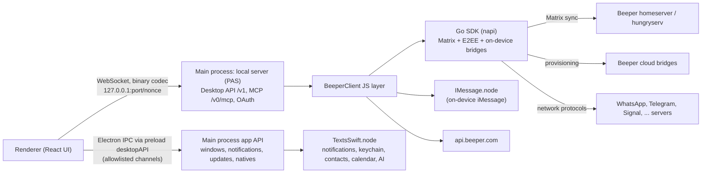

# Beeper Desktop 4.3.209 (macOS): networks, backend services, OS integration, native modules

Clean-room feature inventory taken from the shipped app package, by static reading only. The descriptions are in my own words. No code is copied, and no keys, tokens, OAuth client IDs or analytics write keys are reproduced.

**Evidence labels.** **[O] Observed** means I saw it directly in the bundle, the manifest, Info.plist, the entitlements or the UI strings. **[I] Inferred** means it is a reasonable reading of names and strings, not confirmed behaviour.

**Version context [O].** App 4.3.209. The package is named "BeeperTexts", the author field says Automattic, and the bundle ID is `com.automattic.beeper.desktop`. The minimum OS is macOS 13. The Beeper client SDK is `@beeper/beeper-client-sdk` "3.0.0-latest", a 167 MB napi binding written in Go. Electron updater code and Sentry 4.x/Electron are bundled.

---

## 0. The shape of the app in one picture

In plain terms: the UI is a web app. It talks to the Electron main process in two ways: Electron IPC for OS chores, and a local WebSocket/HTTP server for chat data. The main process hosts a JS "BeeperClient" layer on top of a large Go SDK. The SDK does the Matrix sync, the encryption and, when an account runs "on-device", the bridge to the chat network itself. [O for the transports and SDK methods; the picture itself is my synthesis.]

---

## 1. Networks

### 1.1 How a network is connected

Every chat network is reached through Matrix. Bridges translate each network into Matrix rooms. What varies is where the bridge runs. [O]

| Mode | What it means | Evidence |
|---|---|---|
| **Cloud ("Beeper Cloud")** | The bridge runs on Beeper's servers. The app only sees Matrix rooms. UI copy: messages, contacts and credentials are stored on Beeper's servers, and accounts marked with a cloud icon "pass through Beeper's servers". | [O] platform IDs such as `whatsapp` and `telegram` with provider `cloud`; UI strings |
| **On-device ("Beeper On-Device", IDs prefixed `local-`)** | The bridge runs inside the Go SDK on the Mac. The SDK contains the mautrix bridge code for each network. The UI calls this "On-device encryption... more secure, but will require reconnecting on other devices". | [O] `startBridge`, `stopBridge` and `getBridges` SDK calls; JS refuses to delete local bridges through the cloud API; mautrix module paths in the SDK strings |
| **Self-hosted** | The user's own bridges on their own Matrix setup. These show with a "(network)" suffix. | [O] provider `self-hosted`; the "Self-hosted Bridges" UI string |
| **Platform SDK** | The legacy Texts-style in-process integration. Only on-device iMessage still uses it. | [O] iMessage defined with provider `platform-sdk` and loaded from `IMessage.node` |
| **Session transfer** | Moves an account between cloud and on-device ("Encrypt Accounts on This Device"). | [O] the `session_transfer/initsession` and `finishencryption` provisioning paths in the SDK; UI strings. [I] the exact flow. |

Policy rules seen in the UI copy [O]:
- "Only one account per network can use Beeper Cloud". Extra accounts run on the device.
- When the on-device limit is reached, an account runs in the cloud instead.
- Multi-account per bridge is controlled by the flag `bridge:<id>:multi-account`. It defaults to true for `local-*` bridges.

### 1.2 Bridges compiled into the Go SDK

These module paths appear in the SDK binary's strings [O]:
- mautrix-whatsapp (whatsmeow)
- mautrix-telegram
- mautrix-signal (libsignal)
- mautrix-meta (Facebook and Instagram)
- mautrix-gmessages
- mautrix-gvoice
- mautrix-twitter
- mautrix-linkedin
- mautrix-discord
- mautrix-slack
- beeper/wechat, beeper/viber, beeper/tumblr-dms
- beeper/dummybridge (a test bridge)

`beeper/push-receiver` is also present [I: it receives app pushes that some bridges need].

**Bluesky:** the JS defines a `local-bluesky` platform, but I found no Bluesky/atproto bridge library in the SDK strings. Only an oEmbed config entry is there. [I] Bluesky may be unavailable or hidden in this build.

### 1.3 Network list, login method and connection mode

The login flow names come from the UI string table (`BridgeV2 <net> login flow ...`). Cloud-only flows are fetched from the bridge at runtime with `getBridgeLoginFlows`, so the client does not hardcode them.

| Network (display name) | Platform IDs | Modes | Login methods | Evidence |
|---|---|---|---|---|
| WhatsApp | `bridge-whatsapp`, `bridge-local-whatsapp` | cloud + local | QR scan; pairing code entered on the phone (phone number in international format) | [O] |
| Telegram | `bridge-telegram`, `bridge-local-telegram` | cloud + local | QR (preferred); phone number; bot token; manual session (marked "advanced, do not use"); **import from Telegram Desktop** (reads the local Telegram Desktop session, optionally with its local passcode) | [O] flows; SDK `extractTelegramDesktopSession`, `validateTelegramDesktopSession`, `getTelegramDesktopSessionCount`; UI strings |
| Signal | `bridge-signal`, `bridge-local-signal` | cloud + local | QR, linking as a secondary device | [O] |
| Facebook Messenger | `bridge-facebookgo`, `bridge-local-facebook` | cloud + local | Cookies from facebook.com, messenger.com or instagram.com, captured in an embedded login window; or the "Messenger iOS" mobile API | [O] flows. Injected page scripts detect a completed login and decline the optional-cookie GDPR banner. |
| Instagram | `bridge-instagramgo`, `bridge-local-instagram` | cloud + local | Same Meta flows as Facebook | [O] |
| X (Twitter) | `bridge-twitter`, `bridge-local-twitter` | cloud + local | Cookies via the embedded browser. The page script hides the Google and Apple sign-in buttons. | [O] |
| LinkedIn | `bridge-linkedin`, `bridge-local-linkedin` | cloud + local | Cookies via the embedded browser at linkedin.com/login. Hides Google, Apple and passkey sign-in and blocks the passkey-initiation request. | [O] |
| Slack | `bridge-slackgo`, `bridge-local-slack` | cloud + local | Embedded browser at slack.com/signin. Hides Google/Apple SSO and keeps workspace links in the same window. The bridge captures the session. | [O] mapBrowserLogin; [I] token+cookie capture |
| Discord | `bridge-discordgo`, `bridge-local-discord` | cloud + local | Token captured from a browser login, or QR scanned with the Discord mobile app | [O] |
| Google Messages (SMS/RCS via phone) | `bridge-gmessages`, `bridge-local-gmessages` | cloud + local | QR pairing, or Google account sign-in then tapping a matching emoji on the phone. Uses a custom user agent. | [O] |
| Google Voice | `bridge-gvoice`, `bridge-local-gvoice` | cloud + local | Cookies from voice.google.com | [O] |
| Viber | `bridge-viber`, `bridge-local-viber` | cloud + local | QR, linking as a device | [O] |
| WeChat | `bridge-wechat`, `bridge-local-wechat` | cloud + local | Approve on phone, or QR | [O] |
| Tumblr | `bridge-tumblrdms`, `bridge-local-tumblrdms` | cloud + local | Server-provided bridgev2 flow | [O] platform; [I] flow |
| Bluesky | `bridge-local-bluesky` | local only | Form: domain (default bsky.social), username, password (app password) | [O] field mapping; [I] availability, see 1.2 |
| Google Chat | `bridge-googlechat` | cloud only | Server-provided | [O] platform; [I] flow |
| LINE | `bridge-line` | cloud only | Server-provided | [O] |
| Snapchat | `bridge-snapchat` | cloud only | Server-provided | [O] |
| Grok Bot | `bridge-grokbot` | cloud only | Embedded-browser step | [O] |
| ChatGPT "Dots" | `bridge-chatgpt-dots` | cloud only | Server-provided | [O] |
| AI Chats (Beeper AI) | `bridge-ai` | cloud | Beeper AI (default provider); ChatGPT via browser device code; any OpenAI-compatible provider (Chat Completions, Responses or Codex Responses API) with base URL, API key and default model | [O] flows and fields |
| iMessage (on this Mac) | `imessage` / `local-imessage` | local (platform SDK) | No login. A macOS permissions onboarding instead: Accessibility, Contacts, Automation, Full Disk Access [I for FDA, see 4] | [O] |
| iMessage (Cloud) | `bridge-imessagecloud` | cloud | Disabled; flagged not available to add | [O] `loginMode: disabled`, `availableToAdd: false`; [I] legacy, kept so existing chats still render |
| Beeper (native chats) | `hungryserv` | cloud | Comes with the Beeper account | [O] |
| Generic Matrix bridge | `generic` | cloud / self-hosted | Server-provided | [O] |
| Dummy bridge | `bridge-local-dummy` | local | Test bridge | [O] |

**Deep-link login handoff [O].** `beeper://bridgev2-login/<network>/<base64 JSON>` pre-fills login fields for facebook, twitter, instagram, slack and discord. [I] This is how the browser extension or the website hands credentials to the app.

**Browser-assisted login [O].** "Import Logins" scans Chrome, Arc, Brave, Edge, Firefox and Safari for existing signed-in sessions (section 3.9). A separate path offers saved browser passwords to autofill embedded login windows (section 3.10).

### 1.4 Per-network capabilities

There are two layers. Both are needed to rebuild faithfully.

1. **The static platform table in the client [O].** It holds the delete mode, an attribute set, the allowed reactions, attachment size caps and a few extras.
2. **Per-room dynamic capabilities [O].** Bridges publish a `com.beeper.room_features` state per room. The client reads support levels (`rejected / dropped / unsupported / partial / full`) for each of these keys:
   - `edit` (+`edit_max_age`), `reply`, `thread`
   - `delete`, `delete_for_me`, `delete_max_age`, `delete_chat`, `delete_chat_for_everyone`, `delete_hide_placeholder`
   - `reaction`, `allowed_reactions`, `custom_emoji_reactions`
   - `read_receipts`, `formatting`, `state`
   - `disappearing_timer`, `poll`, `poll_end`
   - `message_request.accept_with_button`
   - `member_actions.{ban, invite, kick, leave, revoke_invite}`
   - `file[<msgtype>]` per type: image, file, audio, video, **voice** (`org.matrix.msc3245.voice`), gif (`fi.mau.gif`), sticker

   For example, the poll button appears only if the `enable-polls` flag is on **and** the room's `poll` level is above unsupported. **[I] The room features are the source of truth; the static table is a fallback or hint.**

Static table, in summary [O]. "Expiry" means the `supports_message_expiry` attribute, which is disappearing messages.

| Network | Delete mode | Edit | Quote/reply | Reactions | Disappearing | Start chats by | Group limits | Attachment caps | Other |
|---|---|---|---|---|---|---|---|---|---|
| WhatsApp | for everyone | yes | yes | fixed 6 (👍❤️😂😯😢🙏) | yes | phone | group creation hidden unless an internal/dev condition holds; role changes yes | image/video/audio 16 MB, files 100 MB, stickers | shares contacts, link previews, "full" E2EE label shown when on-device; detects the native macOS app |
| Telegram | for everyone | yes | yes | fixed ~75-emoji list, one per message | yes | username, phone | group create/rename/add/remove hidden | 4 GB all types, stickers | shares contacts; can't message self; visibility options |
| Signal | for everyone | yes | yes | fixed 6 | yes | phone | group creation hidden | 100 MB, no stickers | shares contacts; full E2EE label |
| Facebook | for everyone | yes | yes | fixed 6 (❤️😂😮😢😡👍), one per message | no | username | can't start new 1:1 or group | 25 MB | autofill hosts messenger.com/facebook.com |
| Instagram | unsend | yes | yes | same fixed 6 | no | username | can't start new 1:1 or group | none set statically | profile link |
| X | for me only | yes | yes | 7 (+2 disabled) | no | username | no new 1:1; group needs first message | image 5 MB, video 512 MB, no audio/files | profile link |
| LinkedIn | for everyone | no | yes | 5 professional reactions, multiple allowed | no | — | no new 1:1 | 20 MB | |
| Slack | for everyone | yes | yes | any + custom emoji, multiple | no | username | no new 1:1, no rename | 1 GB | defaults to DMs only in the inbox; "community" category |
| Discord | for everyone | yes | yes | any + custom emoji, multiple | no | username | — | 100 MB | Servers shown as sub-accounts; inbox visibility none/DMs only |
| Google Messages | for everyone | no | yes | open list | no | phone | group create hidden | files 100 MB | one-time-code detection; shares contacts; reconnect error codes |
| Google Voice | for me only | no | no | open list | no | — | hidden | 25 MB | one-time-code detection |
| Google Chat | unsend | yes | yes | open, multiple | no | email, username | no new 1:1 | 200 MB | live typing |
| Viber | for everyone | yes | yes | open list | yes | phone | no rename/add/remove | — | full E2EE label |
| WeChat | unsupported | no | yes | open list | no | — | hidden | — | shares contacts |
| Snapchat | for everyone | yes | yes | open list | no | — | hidden | — | |
| Tumblr | unsupported | no | no | open list | no | username | hidden | image 5 MB, no audio/files | |
| LINE | for everyone | no | yes | open list | no | username | needs an invite | — | no send-status |
| AI Chats | for everyone | no | no | — | yes | — | hidden | — | forwarding; inbox visibility all/none |
| Beeper native | for everyone | yes | yes | fixed 6, multiple | no | invite | — | — | link previews |
| iMessage (on-device) | unsend on newer macOS, otherwise unsupported | yes, up to 15 min (newer macOS) | yes (original message only) | tapbacks (heart, like, dislike, haha, emphasize, question); any emoji on newer macOS | no | phone, email | no rename/add/remove; no duplicate groups; new chats need a first message | files 100 MB | search, pin, mark unread (newer macOS), stop-typing indicator, OTP detection, full E2EE label; known issues: Messages.app must stay open and may flash on screen; chats don't sync to other devices |

Notes:
- "Open list" means the static reaction set is empty. [I] Any emoji is allowed, constrained by the room's `allowed_reactions`.
- Typing indicators: no network sets the "no typing indicator" attribute. [I] Typing works everywhere the bridge supports it.
- Read receipts come from room features.
- Voice notes are a file type in room features. Recording uses an in-app Opus encoder (section 4).

#### Per-network connection-mode limitations list (added from the UI-text check)

**What it does.** When you add an account and pick where it runs (in Beeper's cloud or on this
Mac), the picker shows a "Not supported:" line. The line lists the features that the network loses
in the chosen mode. [O] The lists are fixed in the app: [O]

| Network | Cloud: not supported | On-device: not supported |
|---|---|---|
| WhatsApp | online status | online status |
| Facebook Messenger | online status, polls | push notifications, online status, polls |
| Instagram | disappearing messages, online status, polls | media captions, disappearing messages, online status, polls |
| Telegram | online status | online status |
| iMessage | — | push notifications, disappearing messages |
| Google Voice | — | push notifications, deleting messages, starting a new chat |
| Google Chat | starting a new chat, disappearing messages, online status, polls | — |
| X | disappearing messages | disappearing messages |
| Slack | online status | — |
| Discord | starting a new chat, online status, polls | — |
| LinkedIn | online status | online status |
| LINE | editing messages, typing indicators, polls | — |
| Tumblr | starting a new chat, online status | starting a new chat, online status |

That the "Not supported:" label goes with these lists is [I]: the label sits in the same picker
part of the code. A rebuild
should show the same warnings.

**Evidence:** "Not supported:", "Online status", "Online status and polls", "Push notifications,
online status, and polls", "Disappearing messages, online status, and polls", "Media captions,
disappearing messages, online status, and polls", "Push notifications and disappearing messages",
"Push notifications, delete messages, and start a new chat", "Start a new chat, disappearing
messages, online status, and polls", "Start a new chat, online status, and polls", "Edit messages,
typing indicators, and polls", "Start a new chat and online status"

---

## 2. Backend services

Service URLs come from an **app manifest** fetched at launch from `<Beeper API>/app-manifest`. It is cached as `app-manifest-<env>.json` in user data, with the build-time fallback JSON as the last resort [O]. There are four environments: production, staging, dev and local, plus custom URLs [O].

| # | Service | Manifest key / host | What the client uses it for | What breaks without it | Evidence |
|---|---|---|---|---|---|
| 1 | **Beeper API** | `api.beeper.com` (per env) | App manifest; `/whoami` (user info, release channel such as INTERNAL or NIGHTLY, tags, features, legacy login token); `/user`; subscription plans and checkout link; deleting cloud bridges (`/bridge/<id>`, delete-all); desktop update feed (`/desktop/update-feed[.json]` with bundle ID, version, platform, arch, channel); sign-in; requests carry a device-ID header | Sign-in, plan/paywall state, feature gating, cloud-bridge removal, **auto-update** | [O] |
| 2 | **Matrix homeserver / hungryserv** | `matrix_url`, `matrix_server_name`, `user_url_template` (per-user server) | Everything chat: sync, send, history, media, E2EE key backup and cross-signing, device verification, account data | The whole app | [O] SDK methods, `hungryserv` bridge ID; [I] per-user URL use happens inside the SDK |
| 3 | **Cloud bridges** | `user_bridge_url_template` (per user and cluster) | Runs cloud accounts; provisioning API for login, logout, session transfer, Discord guild list | All cloud-mode accounts, and moving accounts between cloud and device | [O] provisioning paths; [I] URL composition happens in the SDK |
| 4 | **roomserv** | `roomserv_url` | Not referenced in JS. The SDK has "roomserver_rooms" strings. | [I] room list or space aggregation | [I] |
| 5 | **Sygnal / BPNS (push gateways)** | `sygnal_url`, `bpns_url` | The SDK exposes pusher APIs. I found no desktop caller. | [I] mobile push mainly; desktop notifications come from its own live sync | [O] API present; [I] unused on desktop |
| 6 | **AI services** | `ai_services_url` (derived as `ai-services.<homeserver domain>/proxy/_/v1`) | An OpenAI-compatible proxy authenticated with the Matrix access token. Used for main-process AI work: contextual "facts" extraction (reminders, dates, entities), the AI pane, AI mentions and voice transcription. If the user configures their own OpenAI key and base URL, calls go there instead. | All cloud AI features. On-device fallbacks remain: Apple Foundation Models (macOS 26+) and Apple speech recognition. | [O] |
| 7 | **GrowthBook** | `growthbook_api_url` | Not called from JS. Flag values reach the client as Matrix account data `com.beeper.feature_flags` and in the `/whoami` user info. | [I] flag evaluation happens server-side | [O] flag source; [I] GrowthBook's role |
| 8 | **Rageshake** | `rageshake_url` → `/api/submit` | Bug reports: logs, debug info, settings snapshot, active networks, machine ID. Sent with the access token. | "Report a problem" | [O] |
| 9 | **RudderStack** | `rudderstack.url`, desktop events key | Product analytics (identify and track), with an anonymous ID file. Falls back to a no-op stub if not configured. | Analytics only | [O] |
| 10 | **eventserv** | `es.beeper-tools.com` (hardcoded) | Beeper's first-party event pipeline, batched with an installation ID. Used by both JS and the Go SDK (events such as message sent and poll vote). Has an opt-out switch. | Analytics only | [O] |
| 11 | **Sentry** | ingest.sentry.io | JS errors, native crash dumps, session and performance data. Can be turned off with the `sentry_disabled` config. | Crash reporting only | [O] |
| 12 | **echobot** | `echobot_url` | Not referenced in JS | [I] a test or connectivity bot | [I] |
| 13 | **misc-assets.beeper.com** | hardcoded | Downloads the Claude Desktop extension (`.dxt`) for the MCP integration | One-click MCP install | [O] |
| 14 | **KLIPY GIF API** | api.klipy.com | GIF picker search | GIF picker | [O] |
| 15 | **Amplitude Engagement** | amplitudeengagement.com and CDN | Embedded "Help" hub (guides, chat) in an iframe | In-app help | [O] |
| 16 | **Stainless docs search** | api.stainless.com project "beeper-desktop-api" | The MCP `search_docs` tool | Docs search via MCP | [O] |
| 17 | **Chat networks themselves** | WhatsApp, Telegram, ... | Reached directly from the Mac when an account is on-device; login pages load in sandboxed embedded windows | On-device accounts | [O] |
| 18 | **Other third parties** | X guest API (tweet embeds in previews), YouTube embeds (the main process sets a Referer header for embed frames), Google/Apple sign-in, OpenAI (only with the user's own key), TMDB / Foursquare / OpenLibrary / TVMaze (AI fact enrichment; TMDB and Foursquare only run when env-var keys exist, [I] so likely dev-only) | Optional extras | [O] |

### 2.1 Feature flags and experiments

**Where values come from [O].** The client merges the `*` and `appType:desktop` sections from Matrix account data `com.beeper.feature_flags` (or from `/whoami` features). A flag can be:
- **paid**: shown when the server sends any boolean, used when true; a false value opens the upgrade paywall
- **plain**: on or off
- **internal-only**: enabled for INTERNAL-channel users
- **hidden**: needs the local `show_hidden_features` config
- **"freebie"**: a limited number of free uses of a paid feature, tracked with SDK calls and `com.beeper.freebie_usage`

| Flag | Kind | What it gates |
|---|---|---|
| `voice-transcription` | paid + freebie | Transcribing voice notes |
| `talk-to-type` | mirrors voice-transcription | Dictation in the composer |
| `ai-llm` | paid | LLM text features |
| `ai-whisper` | paid | Whisper-based transcription |
| `ai-composer-autocomplete` | paid | AI autocomplete in the composer |
| `ai-pane` | plain | AI pane / AI actions |
| `ai-in-beeper-chats` | paid | AI inside Beeper-native chats |
| `remind-later` | paid + freebie | Chat reminders and snooze |
| `scheduled-message` | paid + freebie quota | Send later |
| `undo-send` | paid | Undo send |
| `stealth-mode` | paid + freebie | Incognito mode [I: hides read receipts and typing] |
| `custom-app-icon` | paid | Alternate Dock icons |
| `quick-replies` | internal only | Quick replies |
| `browser-extension` | internal only | Browser extension pairing |
| `blasts` | internal only (+freebie) | Bulk "blast" messages |
| `local-bridges` | on when any `bridge:local-*` flag is true | On-device bridges UI |
| `sync-archive-state` | hidden | Syncing archive state |
| `archive-as-unread` | plain | Archive behaviour |
| `delete-chats` | plain | Deleting chats |
| `enable-polls` | plain | Creating and voting in polls |
| `labels-v2` | plain + freebie; upgrade-gated when `android-inbox-rewrite` is on | Labels / inbox rules |
| `android-inbox-rewrite` | plain | Cross-client inbox model [I] |
| `personal-room-overrides` | plain | Per-chat overrides |
| `nudge` | plain + local pref | "Send a nudge" (shake/flash) in Beeper chats |
| `slash-commands-available` | plain | Slash commands |
| `drafts-sync` | plain | Syncing drafts across devices |
| `deferred-recovery-code-setup` | plain | Postponing recovery-key setup |
| `message-requests-folder-available` | plain | Message Requests folder |
| `enable-checking-lapsed-subscriptions` | plain | Subscription lapse checks |
| `custom-css` | always on | Custom CSS |
| `desktop-labs-features` | always on | "🧪 Labs" tag in settings |
| `desktop:labs-beeper-connect` | always on | Beeper Connect / Desktop API settings |
| `desktop-legacy-features-toggle` | hidden | Legacy features toggle |
| `desktop-legacy-account-disable` | always off | — |

Dynamic and other keys [O]:
- `bridge:<bridgeID>:multi-account`
- `bridge:local-<network>`: enables the on-device bridge for that network
- `max-merge-chats`: a number, default 1, for merging chats across networks
- `beeper:image:encryption`
- `fallback_plan`
- Labs account-data toggles `com.beeper.labs.wa_communities_as_spaces` and `com.beeper.labs.tg_topics_as_spaces`
- A separate **SDK feature list** (`getFeatures` / `setFeatureFlag`) that can be toggled from debug tools; some entries require a restart
- An iMessage experiments file (`imessage-enabled-experiments`) passed to the native module
- A bundled CSS experiment `distinct_bubble_colors_in_groups`

---

## 3. Main process and OS integration

### 3.1 Process and thread layout [O]
- **Electron main process**: windows, OS APIs, the local server, and the BeeperClient JS layer that drives the Go SDK.
- **Worker threads**: a platform worker, a SQLite worker (better-sqlite3), and a HEIC decode worker.
- **Child helpers**: ContactsServer, the browser-session-import helper, set-icon, ffmpeg/ffprobe/opusdec, and system tools (`sips`, `afconvert`, `afplay`, `iconutil`, `xattr`, `tccutil`, `csrutil`, `mdfind`, `killall`).
- **Sub-windows**: login browser, add accounts, media viewer, edit group, chat theme, Help hub, debug app, calendar pane, menu bar.

### 3.2 Renderer ↔ main IPC [O]
- The preload exposes one object, `desktopAPI`: invoke, send, subscribe and unsubscribe, plus zoom, process metrics and a sync bootstrap. Each direction has an allowlist. Unknown channels and unknown method names are rejected.
  - **invoke**: `async-remote` (main app API), `async-remote-fn` (calls that pass callbacks), `native-remote` (native helper API), `get-machine-id`, `startup-checkpoints`
  - **send**: `renderer-ready`, `root-store-result`, `show-tray-icon-toggled`
  - **events from main**: `deep-link`, `root-store-call` (main calling into renderer stores), callback relays, `scroller-style-changed`, `system-resource-metrics`, power events (resume, suspend, lock, unlock)
- **Main app API** (method names seen): notifications (new/show/close/close-all); updater (register, check, quit-and-update, fetch feed); app icon; download file; open/save/message dialogs; devtools; Quick Look preview; window helpers (hide all, offsets, traffic-light position, full-screen state, close confirmation, focus, steal focus, saved sub-window state); open path or URL; show in Finder; clipboard (text, rich, read); fetch web content; MIME type sniffing; media decodability; image size; idle state; cancel OIDC sign-in; native theme source; tray unread state; Dock badge count; wipe storage and relaunch on logout; quit, exit, relaunch; login item get/set; media permission status and request; launch login browser window; confetti; Touch ID available/prompt (app lock); touch bar; app menu; global shortcuts; installing a platform from the manifest; contacts change listener; native popovers (sources, poll votes, connection status); context menus.
- **Native helper API**: permission checks and requests; contacts read/add/edit and open in Contacts; browser-saved credentials (list, decrypt one for autofill); browser session import (scan, availability, fields, browser-running check, quit browser, Safari access, delete imported cookies, clear cache); argv; generic HTTP fetch with device headers; image transcode and resize; EXIF orientation; audio convert and play; Opus decode; uninstalling the legacy privileged helper; restarting Notification Center; system profiler query; the "Me" contact; calendar read/add events; Apple Foundation Models availability and generation; recovery code get/set/remove in Keychain; traffic lights; Dock presence (check, remove); Lockdown Mode check; relaunch the Dock; scroller style; v3 data import; log snapshots; default mail client; protocol-handler check; Passwords app detect/open; SF Symbol rendering; data detection (dates, addresses and similar in text).
- **Chat data path**: the renderer's "bapi" talks to a **local HTTP + WebSocket server (PAS)**. It binds to 127.0.0.1 by default, on the first free port from 23373 to 23423, under a random per-launch path nonce. Messages use a binary codec [I: CBOR, since `cbor-extract` is bundled]. Files are served through a `fileproxy://` protocol that only allows app directories.

### 3.3 Local Desktop API, MCP and OAuth ("Beeper Desktop API")
The same local server hosts these [O]:
- **REST `/v1`**: info, OpenAPI spec, accounts, bridges, chats (list, get, start, search, archive, reminders), messages (list, search, send), reactions (add/remove), labels, unified search, focus the app on a chat or message, assets (upload, upload base64, download, serve), a WebSocket at `/v1/ws`, and an **app setup** flow (email login, register, verification by QR/SAS/recovery key, recovery-key reset).
- **MCP** (streamable HTTP) at `/v0/mcp`. Tools: `get_accounts`, `search`, `search_chats`, `get_chat`, `list_messages`, `search_messages`, `send_message`, `archive_chat`, `set_chat_reminder`, `clear_chat_reminder`, `focus_app`, `search_docs`.
- **OAuth 2 authorization server** (authorize, token, register, introspect, revoke, userinfo, and the well-known metadata endpoints). Third-party apps ask for access, and the user approves in the app ("A third-party app wants to access your chats..."). Users can also create access tokens by hand (shown once) and revoke connections.
- Setup helpers exist for Claude Desktop (.dxt), Claude Code, Cursor, Codex, VS Code (deep link), Raycast, and generic HTTP/stdio clients.
- **Remote Access**: the `desktop_api_remote_access` config binds the server to 0.0.0.0 and applies after a relaunch. Launch options `--pas-hostname` and `--pas-port` can override the host and port.
- [O] An OpenAI Agents SDK with MCP client transports (stdio, SSE, streamable HTTP) is bundled in the main process for AI features. [I] It is mainly there for the agents SDK; I saw no user-facing "connect external MCP server" setting.

### 3.4 Notifications, badge and tray [O]
- Notifications go through TextsSwift's UNUserNotificationCenter wrapper. Actions include show, click, **reply**, **copy one-time code**, reminder actions and mark-read. They are sent as communication notifications (entitlement present; `INSendMessageIntent` declared) with avatars resolved from the local server. A plain Electron notification path exists as a fallback.
- Custom notification sounds are symlinked into `~/Library/Sounds`.
- If notifications are blocked, a toast prompts the user. The app can restart Notification Center.
- Dock badge shows all chats, unread only, or none (a preference). The tray/menu-bar icon has an unread variant, can be hidden (`tray_icon_hidden`), and its menu offers Minimize to Menu Bar, Show Window and Quit.
- [O] The app can remove itself from the Dock, giving a menu-bar-only mode.

### 3.5 Deep links (URL scheme `beeper://`) [O]
Info.plist registers the `beeper` scheme. Single-instance lock: a second launch forwards its argument. If the second instance is a different version, the user is prompted to restart.

Supported paths:
- `auth?token=` signs in with a JWT
- `refresh-user`
- `fill-textarea?text=`
- `join-matrix-room/<id>`
- `platform-callback/<account>/...` (OAuth-style returns into a bridge, including join-room)
- `subscriptions/...`
- `otp/<code>`
- `focus?windowID=`
- `connect` (opens the Desktop API settings)
- `bridgev2-login/<network>/<payload>`
- `compose/<platform>/{id|username|email|phone}/<value>?text=&attachmentPath=`
- `select-thread/<platform>/<thread>/<sortKey>`
- `highlight-message/<platform>/<thread>/<message>`

The local server also exposes `/deeplink/...` and `/focus/...`.

### 3.6 Auto-update [O]
- Squirrel.Mac (Electron autoUpdater) is the default on macOS, with electron-updater as an alternative.
- The feed is `api.beeper.com/desktop/update-feed` with bundle ID, version, platform, arch (Rosetta-aware) and channel, plus a device-ID header.
- Includes scheduled checks, ShipIt state inspection, a deferral counter, recovery state files, and a sudo prompt to fix app-folder ownership. Debug flags allow downgrades. The app warns if it isn't in /Applications (the `no_enforce_app_location` option turns this off).

### 3.7 Launch at login, idle and power [O]
- Login item get/set and a "was opened at login" check. `launch_app_minimized` and `quit_on_close` options.
- Idle detection and an `idle_timeout` config.
- Power monitor: on resume the app resets network connections and re-checks for missed messages.
- Optional Touch ID app lock.
- Global shortcuts (configurable): focus the app, and focus the app with the command bar open.

### 3.8 Contacts, calendar and permissions [O]
- **Contacts**: the `ContactsServer` helper prints all contacts as JSON and has a listen mode that reports changes. `node-mac-contacts` handles add, edit and delete. TextsSwift ContactsManager handles editing and the "Me" card. Contacts can be opened in Contacts.app.
- **Calendar**: TextsSwift CalendarManager (EventKit) reads events in a range and adds events. This backs the calendar pane and scheduling.
- **Permissions requested** (Info.plist usage strings): Apple Events/Automation ("for iMessage"), Contacts, Calendars, Microphone (voice notes), Camera, Speech Recognition (transcribing voice notes), Notifications, Bluetooth, audio capture.
- **Entitlements**: APNs (production), communication notifications, Apple Events, JIT and unsigned memory (Electron), library validation disabled, audio input, camera, Downloads read/write, user-selected files, network client **and server**, address book, calendars, location, and a team keychain access group.
- `node-mac-permissions` can check or request accessibility, Bluetooth, calendar, camera, contacts, full-disk access, input monitoring, location, microphone, music, photos, reminders, speech and screen recording. [I] The iMessage onboarding uses accessibility and full-disk access from this set.

### 3.9 Browser session import ("Import Logins") [O]
- This is a feature for connecting chat accounts without logging in again. A bundled helper (`beeper-browser-session-import`, called with `scan` and `delete`) looks for existing signed-in sessions in Chrome, Arc, Brave, Edge, Firefox and Safari.
- The user picks the accounts. The session is handed to the bridge.
- Afterwards the app offers to remove the old browser session so it isn't "active in two places". That can mean quitting the browser, clearing Safari website data or deleting the cookies.
- Safari needs explicit data access. Encrypted browser logins can't be imported. Account limits apply.

### 3.10 Credential extraction (`credential-extractor`) [O]
- Purpose: autofill. When the user opens an embedded login window for a network, the app can list matching **saved browser passwords** for that site and decrypt the chosen one locally.
- The result is injected into the login form by a fill script. UI copy: "Beeper can use your browser logins to connect your accounts for you."
- [I] It only runs on user action in the login window.

### 3.11 Keychain [O]
- The Matrix **recovery code** is stored in the macOS Keychain under service `com.automattic.beeper.recoverycode`, in Beeper's team-scoped keychain access group, through TextsSwift. The `DONT_USE_KEYCHAIN` environment variable bypasses it.
- `keytar` is shipped but I found no reference to it in the JS bundles. [I] It is legacy or used only by a dependency.

### 3.12 Local storage [O]
The user-data directory can be overridden with `BEEPER_USER_DATA_DIR`. `BEEPER_PROFILE` adds a suffix for side-by-side profiles. [I] The default is under `~/Library/Application Support/` with the package name.

Contents:
- `index.db` (+WAL/SHM): SQLite, the chat/message index the UI reads
- `debug.db`
- `migration-version`
- `og-image-previews`: link-preview cache
- media cache
- chat wallpapers
- custom `icon.icns`
- `config.json`: local user config. Keys include server_env, desktop_api_remote_access, enable_spellcheck, hw_acceleration, idle_timeout, keybindings, launch_app_minimized, quit_on_close, tray_icon_hidden, sentry_disabled, auto_update_disabled, log_level, show_hidden_features/events, show_provider_prefix, openai_api_key/base_url
- cached app manifest
- analytics anonymous ID
- updater state files
- iMessage persistence, log and experiments files
- Telegram Desktop cleanup marker
- rolling logs, worker log, Sentry queue

The Go SDK keeps its own store in the data dir [I: SQLite, since go-sqlite3 is linked].

Logout moves logs into a snapshot folder, deletes the index and caches, and clears renderer storage, with a marker file so a failed wipe finishes on the next boot. Server-side data stays on the account ("will remain on your account and other devices").

### 3.13 Import from older Beeper (v3) [O]
- If the old Element-based Beeper app (v3) is installed, the app copies its Chromium Local Storage LevelDB to a temp folder and opens it with `classic-level`.
- It reads only three things: the account email, the Matrix device ID, and whether crypto was initialised. Then it deletes the copy.
- These values pre-fill sign-in. **No message history is imported.**

### 3.14 Other OS touches [O]
- System proxy and system certificate trust registered at startup. The SDK can set an HTTP proxy.
- Downloaded files get the macOS quarantine attribute.
- Custom app icons via the `set-icon` helper and `iconutil`, then the Dock icon cache is cleared.
- Spellcheck can be turned off.
- Embedded login windows are sandboxed with a fresh session partition each time and can be seeded with cookies.
- Sign in with Apple/Google uses `ASWebAuthenticationSession` (TextsSwift WebAuthSession) or a one-shot loopback server on 127.0.0.1.
- A legacy **privileged helper** (`com.automattic.beeper.pht`, an XPC service that only accepts Beeper-signed clients) ships in the bundle. The JS only uninstalls it. Its strings mention a "set Messages type" call. [I] It is left over from the Texts-era iMessage integration.

---

## 4. Native modules and helper binaries

| Module / binary | Purpose (from names, JS usage and strings) | Features that depend on it |
|---|---|---|
| **`@beeper/beeper-client-sdk` napi binding** (Go, about 167 MB) | The core client. Matrix sync, send and history; E2EE (cross-signing, SAS/QR verification, recovery key, key backup); media upload, download and resolution; account data; room tags, mute, read markers; message requests; bookmarks; scheduled messages and blasts; contact lists and user search; link previews; the provisioning client for cloud bridges; **the on-device bridges themselves** (see 1.2); Telegram Desktop session extraction; eventserv analytics; SDK feature flags; rageshake data; proxy settings. About 130 JS-callable methods. [O] | Essentially everything |
| **IMessage.node** (`platform-imessage`, Swift) | On-device iMessage. Reads `~/Library/Messages/chat.db` with SQLite, including the attributed-body decoder. Drives Messages.app through **Accessibility** (AX element trees) and Apple Events to send, react (tapbacks), edit and unsend. Can use a secondary Messages instance. Onboarding opens System Settings panes. Checks SIP status with `csrutil`. Can disable Messages' own notifications. Has an experiments hook. [O names/strings] [I] reading chat.db needs Full Disk Access. | The iMessage network |
| **TextsSwift.node** (framework) | Notification manager (UNUserNotificationCenter, communication notifications); **Keychain**; ContactsManager; CalendarManager (EventKit); **AudioTranscriber** (Apple speech recognition); **FoundationModelsManager** (Apple Intelligence on-device text generation, macOS 26+); WebAuthSession (Apple/Google sign-in); native popovers (sources, poll votes, connection); traffic-light positioning; Dock presence; Lockdown Mode check; 24-hour clock check; scroller style; SF Symbol rendering; data detection. [O] | Notifications, recovery-key storage, contacts editing, calendar pane, on-device transcription and AI, OIDC sign-in, native UI polish |
| **NodeAPI.framework** | Support framework for the Swift node modules [I] | TextsSwift, IMessage |
| **ContactsServer** (helper binary) | Fetches all contacts as JSON; listen mode reports `contacts_changed` [O] | Contact names and avatars, iMessage handle resolution |
| **node-mac-contacts** | Read, add, update and delete contacts [O] | "Add to contacts" |
| **node-mac-permissions** | Permission status and requests for about 15 TCC categories [O] | Onboarding, iMessage setup, microphone/camera checks |
| **credential-extractor** | Lists and decrypts browser-saved logins for a site [O] | Login-window autofill |
| **beeper-browser-session-import** (helper binary) | Scans browsers for signed-in sessions and deletes them after import [O] | "Import Logins" |
| **better-sqlite3** | Local SQLite index, run in a worker thread [O] | Chat list, search, caches |
| **classic-level** | LevelDB reader [O] | Beeper v3 import only |
| **keytar** | Keychain library; no JS reference found [I] | Unclear, likely legacy |
| **sharp** (+libvips) | Image resize and transcode, EXIF rotation [O] | Image sending, thumbnails, avatars |
| **ffmpeg / ffprobe** | Video/audio transcoding and probing, decoder discovery [O] | Sending media in formats a network accepts; voice-note conversion fallback |
| **opusdec** | Decodes Opus audio [O] | Playing or converting received voice notes |
| **OGG/WebM Opus encoder (wasm, renderer)** | Records voice notes as Opus [O] | Voice notes |
| **HEIC worker** | Decodes HEIC images [O] | iPhone photos |
| **diskusage** | Disk space query [O] | Storage overview chart and settings |
| **electron-drag-click** | macOS click-through-drag on windows [O] | Window behaviour |
| **cbor-extract, bufferutil, utf-8-validate** | Fast binary decoding and WebSocket helpers [O] [I: CBOR on the local transport] | Renderer ↔ main data transport performance |
| **set-icon** (helper binary) | Sets a custom Finder/Dock icon [O] | Custom app icon |
| **com.automattic.beeper.pht** (privileged helper, XPC) | Legacy root helper; only uninstall is wired in JS [O]/[I] | None current |

---

## 5. Biggest rebuild risks

1. **The Go SDK is the product.** Sync, encryption, verification and every on-device bridge live in one closed 167 MB binary. Rebuilding means assembling mautrix-go plus about 14 bridges yourself. Those bridges are AGPL-licensed, so embedding them in a distributed desktop app is a licensing decision, not just engineering. [O for contents; I for the licensing implication]
2. **No backend equivalent.** Cloud mode depends on Beeper's per-user homeserver (hungryserv), per-user cloud bridges, account API, flags and AI proxy. A rebuild needs its own Matrix homeserver, bridge hosting, account/subscription service and an OpenAI-compatible proxy. Alternatively, go on-device only, which drops multi-device sync of network sessions.
3. **The capability model is dynamic.** Correct behaviour comes from per-room `com.beeper.room_features` sent by the bridges, not from the static table. A rebuild that hardcodes capabilities will be wrong for edits, deletes, reactions, polls and file types.
4. **On-device iMessage is fragile.** It automates Messages.app through Accessibility and reads chat.db. That needs Accessibility, Automation and (inferred) Full Disk Access, depends on the macOS version (edit/unsend and emoji tapbacks only on newer releases), and Messages may flash on screen. Apple can break it at any OS update.
5. **Unofficial logins break, and accounts can be banned.** Cookie and token capture through scripted embedded browsers (hiding SSO and passkey buttons, redirect hacks) is brittle and may conflict with network terms of service.
6. **Sensitive local data access.** Browser session import, saved-password decryption and Telegram Desktop session extraction read other apps' credentials. Each needs careful consent UX, security review, and handling of Safari's full-disk-access requirement.
7. **The local API is an attack surface.** An OAuth server, MCP and REST on a local port, with an opt-in 0.0.0.0 remote mode, expose message read/send to other apps and to the network. It must keep the nonce, the token approval flow and the loopback default.
8. **Apple platform ties.** Communication notifications, APNs and the keychain access group are bound to Beeper's signing identity and team. A rebuild needs its own identity and entitlements, and must re-earn TCC permissions.
9. **Unknowns that need runtime capture.** roomserv, the Sygnal/BPNS roles, GrowthBook's role, echobot, the cloud-only login flows (Snapchat, LINE, Google Chat, Tumblr, Grok, ChatGPT Dots), and whether Bluesky is actually available. These are not visible statically.
