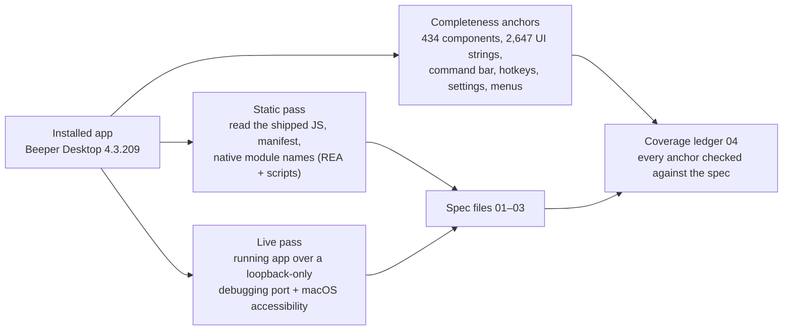

# Beeper Desktop feature inventory (4.3.209, macOS)

This is a clean-room spec of everything Beeper Desktop does: screens, settings, shortcuts, menus, chat networks, backend services and OS integration. It is the input for rebuilding an equivalent app.

It describes **behaviour**, in our own words. It contains no Beeper code, CSS or assets, and no keys or personal data.

**Status:** inventory complete for the shipped app, with known gaps listed below. Nothing has been built yet.

## How it was made

1. **Static pass.** REA analysed the whole app package (235 JS files parsed, 0 parse failures). We then read the bundle as text in three parallel slices: screens, settings and shortcuts, and networks and backend. Native modules were identified by name, exports and strings only. Their machine code was not decompiled.
2. **Live pass.** We relaunched Beeper with a debugging port bound to 127.0.0.1 and walked every settings pane, the command bar, search, the main window layout and the native menu bar. No chat was opened, because opening one sends read receipts. Nothing was sent, archived or changed. Afterwards Beeper was relaunched normally and the port confirmed closed.
3. **Coverage ledger.** The app ships two lists that work as checklists: the names of its 434 interface components and its full English text catalogue (2,647 strings). We also took everything seen live: 74 commands, 57 hotkeys, 87 settings and 28 menu items. Every item is checked against the spec text. See [04-coverage-ledger.md](04-coverage-ledger.md).

**Confidence labels used throughout:** **Observed (O)** means seen directly in the app or its files. **Inferred (I)** means a reasoned reading of names and strings that has not been confirmed in the running app. Part B of file 02 is the live walk-through. Where it disagrees with the static reading, the live result wins.

## Files

| File | What it covers |
|---|---|
| [01-screens-and-flows.md](01-screens-and-flows.md) | Every screen, window, pane, dialog and empty state, grouped into 23 feature areas. All 434 components assigned. |
| [02-settings-keyboard-menus.md](02-settings-keyboard-menus.md) | Part A (static): 152 settings, 75 shortcuts, about 130 menu items, 128 commands. Part B (live): what the running app actually shows. |
| [03-networks-backend-native.md](03-networks-backend-native.md) | The 20+ networks and how each logs in, per-network capabilities, every backend service, feature flags, OS integration, native modules and rebuild risks. |
| [04-coverage-ledger.md](04-coverage-ledger.md) and [ledger.tsv](ledger.tsv) | Proof of coverage, plus what is still open. |
| [05-gap-addendum.md](05-gap-addendum.md) | 18 behaviours found by the final UI-text check that files 01–03 don't describe yet: Bridges pane, plan limits, merged-chat network switcher, edit history, disappearing-message timers, and others. Read it alongside 01–03 until it is merged in. |

## What the app is, in one paragraph

Beeper Desktop is the old Texts.com app, now owned by Automattic. The package is still named "BeeperTexts". The window is a React web app inside Electron. Underneath, one closed 167 MB Go library does the Matrix sync, the encryption and, for "on-device" accounts, runs the open-source mautrix bridges on your Mac. Every chat network is a Matrix bridge running either on Beeper's servers ("cloud") or inside that library ("on-device"). The exception is iMessage, which drives Messages.app through macOS Accessibility. On top of chat, the app has a large layer of extras:
- reminders, send later, undo send and incognito
- labels, spaces and auto-archive rules
- AI chats, an AI side pane, AI mentions, translation and voice transcription
- a calendar pane
- a local API and MCP server for tools like Claude and Raycast

## What a rebuild has to replace

| Piece | Open-source equivalent? | Notes |
|---|---|---|
| The interface (everything in 01 and 02) | Rebuild from this spec | The bulk of the work, and the part this spec covers in full |
| Sync and encryption | mautrix-go / matrix-rust-sdk | Beeper's own library is closed |
| On-device bridges | mautrix bridges (AGPL) | Same bridges Beeper embeds. AGPL obligations apply if we distribute. |
| Cloud mode | Self-hosted homeserver + bridges | Beeper's per-user servers, account API, flags and AI proxy have no drop-in replacement |
| iMessage | None that is stable | Accessibility automation; Apple can break it |
| Server-side feature flags, subscription and paywall | Our own | 30+ flags gate features; see 03 §2.1 |

## Known gaps (not yet covered)

- **Conversation view, observed live.** The thread, composer and message menus come from static analysis only. Opening a chat would have sent read receipts, so we didn't. Next step: a test account with no real contacts.
- **Native module internals.** The iMessage engine, the Go library and the Swift helper were identified by name and exports only, not decompiled.
- **Server-side behaviour.** Cloud-only login flows (Snapchat, LINE, Google Chat, Tumblr, Grok, ChatGPT Dots) come from the server at run time. So do flag values. Four listed services (roomserv, Sygnal/BPNS push, GrowthBook, echobot) are never called by the app code, so their roles are inferred.
- **Paid and staff-only UI.** Anything gated by a Plus plan, a staff role or a server flag was seen in code, not exercised.
- **Help pane.** It did not switch in the live pass, so it is assumed to open external help.
- **Exact defaults.** Live values are this machine's current settings, not factory defaults. Static defaults are recorded where the code makes them explicit.
