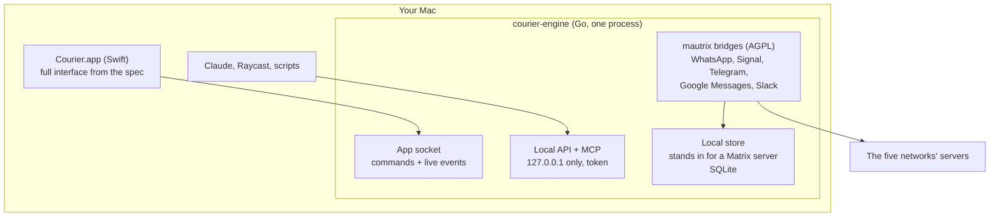

# Courier, iteration 1: a Beeper Desktop replacement for five networks

- **Date:** 2026-10-15
- **Status:** design approved section by section in chat. Waiting for James's review of this written spec. Nothing built yet.
- **Scope:** a new app at `apps/desktop/courier` (working name "Courier", easy to change)
- **Input:** the clean-room inventory in [2026-10-15-beeper-desktop-inventory/](2026-10-15-beeper-desktop-inventory/README.md). "The spec" below means that inventory.

## 1. Intent

**What James said:**
- Replace Beeper Desktop for his own daily use first. He may sell it later if it becomes a working product.
- Scope the networks to the ones he uses: WhatsApp, Signal, Telegram, Google Messages and Slack.
- Run the networks on the Mac ("on-device"), not on servers.
- Keep the full interface from the spec. Anything we can't build yet is **stubbed**, so it can be implemented later without reworking the interface.
- Keep the local API and MCP; he uses Beeper's MCP from Claude today.
- Drop Beeper's own chats. Defer AI.
- Architecture A: one embedded Go engine. Rejected alternatives: a local Matrix server (B), and an Electron interface (C).
- Cutover: run side by side with Beeper, then switch.

**Assumptions (correct these if wrong):**
- macOS only. The minimum OS is the same as the other desktop apps in this repo.
- One user, one Mac. No settings sync across devices.
- English interface first. Strings live in a catalogue, so translation is possible later.

**Success:** James uses Courier all day instead of Beeper for all five networks, his Claude MCP setup works by changing one address, and Beeper is logged out.

## 2. Architecture

| Unit | What it does | Talks to | Built or reused |
|---|---|---|---|
| **Courier.app** | The whole interface, the menu-bar icon and notifications. Starts and supervises the engine. | Engine, over a Unix domain socket at `~/Library/Application Support/Courier/engine.sock` (owner-only permissions) | Built: Swift, SwiftPM, like `apps/desktop/home-speaker` |
| **courier-engine** | A background helper inside the bundle (`Contents/Helpers`). Keeps running with the window closed. | App socket, local API, the five bridges | Built: Go, under the repo's Go and Bazel toolchain |
| **Local store** | Implements the bridges' Matrix-side interface (`bridgev2.MatrixConnector` in mautrix-go), so the bridges behave as if they post to a Matrix server. Persists chats, messages, members, receipts and typing. Feeds search. | The bridges (inbound), the socket and the API (outbound) | Built. **This is the main technical risk.** |
| **Bridges** | mautrix-whatsapp, -signal, -telegram, -gmessages, -slack, all Go, all AGPL-3.0, all actively maintained (checked 2026-10-15) | The networks | Reused unchanged, pinned versions |
| **Local API + MCP** | REST and MCP for other apps | `courier.db` through the engine | Built |

Notes:
- **No Matrix server and no Matrix encryption between app and engine.** Nothing leaves the Mac except through each network's own encryption.
- **Signal** links the Rust `libsignal` through cgo. Building it under Bazel for both CPU types is the hardest build task.
- **Slack and Google Messages** log in through a web sign-in page. Courier needs a small built-in browser window (WKWebView) that captures the session, as Beeper does. Google Messages then also asks you to match an emoji on your phone; Google ended its QR-code sign-in, and mautrix-gmessages v0.2609.0 no longer offers it. The other three (WhatsApp, Signal, Telegram) use QR codes or phone numbers.
- **One process for all bridges.** A panic while a bridge is starting is caught and confined to that network; the others start as normal. A panic later, inside a bridge's own background work, still stops the engine, because bridgev2 recovers panics in only a few places. Confining that too (for example, one process per bridge) is left for a later milestone.

## 3. Interface scope

The default is **everything in the spec**. The exceptions:

| Area | Iteration 1 |
|---|---|
| Inbox, spaces, labels, filters, sorting, multi-select, hover/double-click actions; conversation view, composer, message actions, media viewer, Chat Info, threads, merged chats, new chat/group, Blasts; search (⌘K), command bar (⌘J), every hotkey, menus, menu-bar icon; themes, bubble colours, wallpapers, chat themes, app icons, font size; calendar pane | **In, as specced** |
| Reminders, send later, undo send, incognito, low priority, auto-archive rules (Beeper "Plus" features) | **In, behind an entitlement check that always returns yes.** A future licence check slots in there. |
| Settings | **In**, minus the Beeper-account panes. Beeper Plus becomes the stubbed subscription screen. AI is a stub. Devices (the mobile app) is out. |
| Bridges pane | **Changed:** shows health, version and errors of the 5 built-in bridges, with **Restart bridge** |
| First run | **Changed:** no sign-up. It goes straight to "add a network". |
| Report a problem | **Changed:** writes a local diagnostics bundle. An upload interface is stubbed. |
| AI pane, AI chats, AI mentions, translation, transcription, Talk to Type, Honeycomb home cards | **Stubbed:** the interface is present and says "not available yet". Each sits behind a provider interface. |
| GIF search | **Stubbed** behind a GIF-provider interface. Emoji and stickers work. |
| Subscription and paywall screens | **Stubbed** (same entitlement seam) |
| Custom CSS | **Replaced by a stub** for a native custom-theme file |
| Beeper chats, joining Matrix rooms, browser login import, saved-password autofill, Beeper v3 import, analytics, crash upload | **Dropped** |

**Stub rule:** a stub is a real interface element backed by a protocol (`AIProvider`, `GIFProvider`, `EntitlementProvider`, `ReportUploader`, `ThemeFileLoader`) whose iteration-1 implementation reports "unavailable". The interface shows a calm "not available yet" state, never an error. Adding the real feature means writing one implementation, not touching views.

## 4. Data flow and storage

**Incoming:**
1. The network delivers a message to its bridge.
2. The bridge hands it to the local store.
3. The store writes `courier.db`, updates the search index, and pushes a live event over the socket.
4. The app updates the inbox and posts a macOS notification, even with the window closed.

**Outgoing:**
1. The app sends the message over the socket.
2. The engine stores it as **pending**. This drives undo send and the pending-message UI.
3. When the undo window ends, the engine passes it to the bridge.
4. Status updates (sent, delivered, read, failed) stream back to the app.

Reminders and scheduled sends are timers in the engine, so they fire with the window closed.

| Data | Location under `~/Library/Application Support/Courier/` | Notes |
|---|---|---|
| Chats, messages, reactions, read state, labels, reminders, scheduled sends | `courier.db` (SQLite, FTS5 search) | Single source of truth for the app and the API |
| Bridge state (logins, contact mapping, encryption sessions) | `bridges/<network>.db`, one per bridge | Isolated, so one corrupt bridge can't break another |
| Media | `media/`, content-hash names | Storage pane auto-delete and per-chat clear act here |
| Preferences | macOS user defaults | |
| API tokens | macOS Keychain | |

**History:** from each bridge's own backfill, whatever each network allows. Nothing is read from Beeper's files.

**At rest:** iteration 1 relies on the macOS account and FileVault. Encrypting the databases with a Keychain-held key is **required before selling** (§8).

## 5. Failures

| Failure | Behaviour |
|---|---|
| Network drops | The bridge retries. The account's space icon shows "reconnecting". Sends queue as pending. |
| Session expired or logged out | A per-account banner with **Reconnect**, which reopens that network's login. Chats stay readable. |
| Send fails | The message stays in the chat marked failed, with **Retry** and **Delete** |
| Engine crash | The app restarts it with back-off and shows "reconnecting". Pending and scheduled messages survive in the database. |
| Bridge panic | A panic while a bridge starts is confined to that network: the Bridges pane shows the error and **Restart bridge**. A panic in a bridge's background work stops the engine, which the app restarts as for an engine crash; confining that too is a later milestone. |
| Network protocol change | Bridge versions are pinned and fixes ship as app releases. The Bridges pane shows each version. |
| App and engine out of step | The socket handshake checks the protocol version. A mismatch shows an "update needed" state instead of misbehaving. |
| Adding Google Messages while Beeper holds it | Warn before pairing that this disconnects it in Beeper. Google Messages allows one web session at a time; this is known behaviour, not yet tested. |

## 6. Local API and MCP

- **Address:** 127.0.0.1, default port **23390** (changeable in Settings → Integrations), so it doesn't collide with Beeper's 23373 during side-by-side use. No remote-access mode.
- **Access:** a new client gets a token only after James approves an in-app prompt. Tokens are listed and revocable in Settings → Integrations. Sending messages is a separate per-token permission.
- **MCP tools:** the same names and arguments as Beeper's MCP: `get_accounts`, `search`, `search_chats`, `search_messages`, `get_chat`, `list_messages`, `send_message`, `archive_chat`, `set_chat_reminder`, `clear_chat_reminder`, `focus_app`. Beeper's `search_docs` becomes a stub.
- **Transports:** streamable HTTP and stdio. The Integrations pane keeps the "install to Claude Code / Cursor / VS Code / Raycast" helpers.

## 7. Milestones and testing

| # | Milestone | Done when |
|---|---|---|
| 1 | **Prove the glue:** engine skeleton, local store, WhatsApp only, driven from a test CLI | WhatsApp linked as an extra device; a message sent and received through the engine. **Kill criterion:** if the local store can't satisfy the bridges' interface, switch the engine to option B (local Matrix server). Nothing above the engine changes. |
| 2 | **All five bridges**, including the Signal build | All five linked beside Beeper, receiving live |
| 3 | **Usable app:** inbox, conversation, composer, notifications, menu-bar icon, and the built-in sign-in window (WKWebView) that both Slack and Google Messages use (moved from milestone 2) | James reads and replies all day without opening Beeper |
| 4 | **Full interface:** the rest of the spec, plus all stubs | The acceptance checklist passes (below) |
| 5 | **Local API and MCP** | Claude works against Courier with only its address changed |
| 6 | **Cutover and release** | Google Messages moved, Beeper logged out, a release through the desktop pipeline (`//tools/desktop-package`) |

**Tests:**
- **Engine:** Go tests for the local store, plus a **fake network** that behaves like a bridge. Sending, receiving, failures and reconnects run in CI with no real accounts.
- **App ↔ engine:** one shared protocol definition, with a conformance test on both sides (pattern: HomeSpeaker's JSON-RPC conformance test).
- **MCP:** a test that tool names and argument schemas match Beeper's.
- **Interface:** the inventory's coverage ledger (`ledger.tsv`) becomes the acceptance checklist. Every hotkey, setting, command and menu item in scope is checked off. Key flows get XCUITests.
- **Real networks:** checked by hand on James's accounts at each milestone. Never in CI.

## 8. Before selling (recorded now, not built now)

- **Encryption at rest:** encrypt `courier.db` and the bridge databases with a Keychain-held key.
- **Licensing:** the bundled bridges are AGPL-3.0. Selling is allowed, but buyers must be able to get the complete source. The repo is public under GPL-3.0, which is compatible.
- **Branding:** no Beeper name, icons or assets anywhere. The interface copies behaviour, not artwork.
- **Network terms:** unofficial clients break some networks' terms. Weigh this business risk before charging. Slack workspace admins can also block third-party clients.
- **Entitlements:** wire a real `EntitlementProvider` and the subscription screens.
- **Onboarding** for people who aren't James, and a support path.

## 9. Risks

1. **Local-store glue** (milestone 1, with option B as the fallback)
2. **Signal's Rust library under Bazel**, universal binary
3. **Slack session capture** in a WKWebView
4. **Interface size:** most of the total effort
5. **Bridge drift:** the public bridges may differ from Beeper's private builds. We'll learn this in milestone 2.
