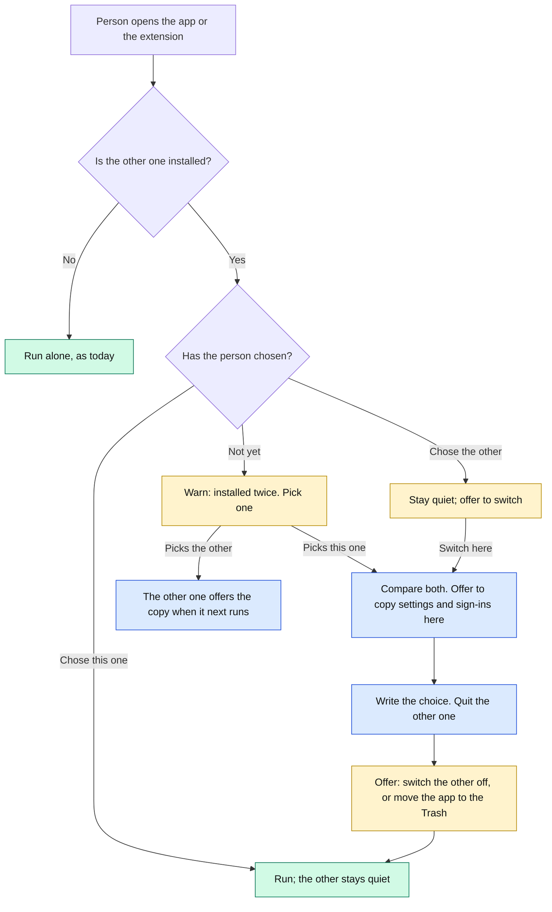

# HomeSpeaker extension without the app: Design

**Status:** proposed, 2026-10-15. Waiting for James's approval. Nothing here is built.
**Plan:** `docs/superpowers/plans/2026-10-15-homespeaker-extension-independent.md`.
**Checked against:** `origin/main` at `6a72b0af7` (HomeSpeaker 1.17.0, Vitruvian 3.53.0, SDK 1.4.0),
and the open pull request #3341 (the live-monitor work), which this builds on (section 9).

## The verdict

**It can be done, with no change to the Vitruvian app.** The extension can do everything the
standalone app does, except draw a menu bar icon, a slider and a time picker, which the tool
protocol does not have. It never needs the Keychain or the Local Network permission.

Three things change:

1. **One engine, two homes for its files.** HomeSpeaker's engine (`HomeSpeakerCore`) learns
   *where* it keeps settings, sign-ins and history. The app keeps today's files, untouched. The
   extension keeps its own in the data folder Vitruvian gives it. The extension stops starting
   the app's program and calls the engine directly.
2. **One small shared file says which one is in use.** When both are installed, whichever the
   person opens first asks them to pick. It offers to copy settings and sign-ins into the one
   they pick, quits the other, and offers to switch it off or move it to the Trash. The choice is
   remembered and can be undone from either one's Settings.
3. **Only the chosen one speaks on its own.** The Claude Code hook, the chat monitor, media pause
   and volume restore run in one place only, so nothing is said twice.

Existing users keep the app working exactly as today until they pick. Picking takes one or two
taps.



Green runs. Amber waits for the person. Blue is the switch-over itself.

## 1. What was checked, and what turned out different from the brief

Each of these was read in the code at `6a72b0af7`.

- **No Local Network permission is needed.** HomeSpeaker never uses Bonjour, mDNS or Cast. There is
  no `NWBrowser`, `NetService` or `_googlecast` anywhere. Speakers are reached through Google's
  hosted Home API over HTTPS (`GoogleHomeClient.swift:56`, `https://home.googleapis.com/mcp`). The
  only local socket is the sign-in's one-shot listener, bound to loopback only
  (`GoogleAuth.swift:350-353`, `requiredInterfaceType = .loopback`). So **do not** add
  `NSLocalNetworkUsageDescription` or `NSBonjourServices` to Vitruvian: they would only add a
  permission prompt that guards nothing. Neither app has them today.
- **Neither app uses the Keychain.** HomeSpeaker keeps its tokens in an owner-only (0600) JSON
  file, `~/Library/Application Support/HomeSpeaker/secrets.json`, under a cross-process lock
  (`SecretStore.swift:88-125`). So copying a sign-in from one to the other reads and writes a
  plain file: no Keychain prompt can happen, let alone a loop. Vitruvian's lint
  `keychain_is_never_touched` (`apps/desktop/vitruvian/bazel/source_lints.py:357-388`) stays
  green, because nothing in `apps/desktop/vitruvian` changes.
- **HomeSpeaker.app is signed ad hoc**, not with a Developer ID (`scripts/bundle.sh:69`,
  `codesign --sign -`), and not notarized. Vitruvian is Developer ID team `Q5MH753M3F` with the
  hardened runtime. That difference does not matter here, because no Keychain item is involved.
- **The closed-island mark exists.** Since Vitruvian 3.48 a tool can show one with `ui/status`,
  if its manifest declares `contributes.status` (`packages/vitruvian-sdk/docs/writing-a-tool.md:729-752`).
  The memory note "tools cannot draw the closed-island dot" is out of date.
- **The tool leans on the app in more places than the brief listed.** Besides `--say`,
  `--volume`, `--sign-in` and `--discover`, it runs the app's program for `--set-volume`,
  `--mute`, `--unmute`, `--sign-out`, `--login-item` and `--test-media-pause`
  (`HomeSpeakerToolCore/Speaker.swift:26-48, 152-162`). It also reads the app's `Info.plist` for the
  Google sign-in client (`HomeSpeakerTool/main.swift:55-58`, the app's bundle), and it points the Claude Code hook
  at the app's program (`HomeSpeakerTool.swift:179-182`).
- **Four collisions are waiting, and each one would make both speak or undo the other.**
  - **The app steals the hook back.** At every launch the app re-points any HomeSpeaker hook
    that runs another program at itself (`AgentIntegration.repairHookIfMoved`, `:436-443`). A
    hook pointed at the extension looks "moved" to it.
  - **The cross-process messages share names.** Pause media, put the volume back, signed out and
    sign-in changed all use fixed names (`MediaPause.swift:590`, `SpeakerVolume.swift:331`,
    `SignOutNotice.swift:30,80`). A message from one would be acted on by the other.
  - **Signing out of one would sign out both.** A copied Google sign-in is the same refresh
    token. Sign-out revokes it at Google (`GoogleAuth.signOut(revoke: true)`), which ends it for
    both copies.
  - **The chat monitor would run twice.** Pull request #3341 (open) keeps it in the app and has
    the tool read the app's status file. Section 9 moves it into the extension for the
    extension's side. This design decides *where* and *when* it runs.
- **Other things read the app's files.** The Android remote's `macagent` reads and rewrites
  `~/.gemini/speaker_broadcast.json`, reads the history and `secrets.json`, and runs
  `/Applications/HomeSpeaker.app/Contents/MacOS/HomeSpeaker --say` and `--volume`
  (`apps/mobile/android-remote/macagent/homespeaker.go:68-79, 547, 579`). James's own
  `~/.local/bin/speaker-broadcast` script does the same, from outside the repo. They keep working
  with the app. Section 10, question 1, asks whether they should follow the extension.
- **The vitruvian tool protocol has no secrets store and no "switch me off" message.**
  `storage/*` keeps at most 16 declared preferences in Vitruvian's `UserDefaults`. A tool cannot
  switch itself off, remove itself, or open its own Settings page
  (`packages/vitruvian-sdk/protocol/methods.json`). Each tool gets a data folder. Vitruvian keeps
  it across updates and deletes it only when the person removes the tool *and* ticks "delete
  data" (`ExternalToolStore.swift:530-600`).

## 2. Where each one keeps its files

**Decision: the app's files do not move. The extension gets its own, in its data folder.**

| | The app (unchanged) | The extension (new) |
|---|---|---|
| Settings | `~/.gemini/speaker_broadcast.json` | `<data>/settings.json` |
| Sign-ins and tokens (0600) | `~/Library/Application Support/HomeSpeaker/secrets.json` | `<data>/secrets.json` |
| Recent broadcasts | `~/.gemini/speaker_history.json` | `<data>/history.json` |
| Chat monitor status (#3341) | `~/.gemini/speaker_monitor_status.json` | `<data>/speaker_monitor_status.json` |
| Cross-process messages | `com.vitruviansoftware.homespeaker.*` | `dev.vitruvian.homespeaker.*` |
| Google sign-in client | its `Info.plist` | `google-oauth-client.json` in the tool's folder |
| "Am I alive" | a running app with its bundle id | a lock held on `<data>/running.lock` |

`<data>` is `~/Library/Application Support/com.vitruviansoftware.vitruvian/ToolData/dev.vitruvian.homespeaker/`.

- **Same file formats.** The extension's settings file has exactly the schema of
  `speaker_broadcast.json`, through the same `SpeakerConfigFile`. Its secrets have the `Secrets`
  schema, through the same `SecretStore` with its lock. Its history is a `BroadcastHistory` list.
  So copying is a plain copy, and the code that reads and writes each one is shared.
- **Why not Vitruvian's `storage/*`?** The Claude Code hook runs the extension's program from
  Claude Code, with no Vitruvian around to ask. 16 flat preferences cannot hold the speaker list.
  And it would split one settings object across two stores.
- **Why not the Keychain?** Neither side uses it today, and Vitruvian forbids the app to touch it.
  The tool's program is replaced at every update, so a Keychain item tied to it would prompt
  after each one: the reason the app chose a 0600 file (`SecretStore.swift:90-95`).
- **How the program finds `<data>`.**
  - Started by Vitruvian, it is `initialize`'s `dataFolder`, which is also its working directory.
  - Run by Claude Code as the hook, it is worked out from the program's own path:
    `…/Tools/dev.vitruvian.homespeaker/bin/tool` gives `…/ToolData/dev.vitruvian.homespeaker/`.
  - Tests set `HOMESPEAKER_DATA_FOLDER`.
  - Anywhere else, for example a build in `bazel-bin`, the command line refuses and says why.
    It never guesses the app's files.
- **Survives updates; can be undone.** Vitruvian keeps `<data>` across tool updates, and across
  a switch-off. So "switch back" finds the extension's settings where it left them.

## 3. Every capability, done by the extension alone

**S** is the standalone app today. **E** is the extension today. **After** is the extension once
this lands. The parity review from earlier today was re-checked against the code.

| Capability | S today | E today | After |
|---|---|---|---|
| Speak to Google speakers | in process | runs the app's `--say` | in process: `Announcer` over the extension's sign-in |
| Speak on this Mac, voices, preview | in process | preview in process; speech through the app | in process |
| Volume: read, set, mute, unmute | slider | typed field, through the app | in process; typed field plus **Quieter / Louder** buttons (±10). No slider: the protocol has none |
| Announce at a set volume, then put it back | in process, with a report | fixed text | in process; shows the coordinator's own report (`VolumeRestoreCoordinator.lastReport`) |
| Pause media while announcing, and its test | in process | through the app | in process. macOS asks for **Vitruvian**'s Automation permission (section 5) |
| Quiet hours on or off | toggle | toggle | toggle |
| Quiet hours times | time pickers | typed `HH:mm` | a pop-up of half hours (the `choice` block, Vitruvian 3.48+), typed field on older apps |
| Find speakers, pick the home | in process | through the app | in process |
| Google Home sign-in and sign-out | in process | through the app | in process, in the extension's own secrets |
| Google Chat access | in process | through the app | in process |
| Own Google Cloud OAuth client | Settings | Settings | Settings (unchanged; saved in the extension's secrets) |
| Import the Antigravity login | in process | into the app's secrets | into the extension's secrets |
| Slack token | Settings | into the app's secrets | into the extension's secrets. `sync-secrets` learns `--extension` |
| Open at login | the app's login item | asked the app's login item | **means Vitruvian's.** The extension starts when Vitruvian starts (`activation: onLaunch`) and stops when it quits. Settings says so in one line, in place of the switch |
| Claude Code and Antigravity hooks | the hook runs the app | the hook ran the app | the hook runs the extension's own program (section 4) |
| Recent broadcasts | menu | island, from the app's file | island, from the extension's file |
| Setup (sign in, import, find speakers) | Settings | island and Settings, through the app | island and Settings, in process |
| Status on the menu bar or island | menu bar icon | none | **closed-island mark** with `ui/status` (section 6) |
| "Speak the clipboard" from the keyboard | none | Command Bar, Quick panel | adds the `shortcut` surface: the person records keys in Vitruvian |
| Chat monitor: run, status, Start and Stop, last poll, Slack user, API or `gws`, errors | in process | with #3341: all shown, read from the **app's** monitor through its status file; nothing if the app is not running | the same rows, from the **extension's own** monitor in its process (section 9) |
| A typed value it cannot take | refused by the control | with #3341: refused with a sentence | unchanged |
| Command line (`--say`, `--volume`, …) | the app's program | none | the extension's `bin/tool` takes the same flags |
| A menu bar item | yes | no | no. The protocol has none. The island and its closed mark take its place |

**Not possible in the extension**, because of the protocol: a menu bar icon, a real slider or
time picker, and a button on the island that opens the extension's own Settings page. Where
Settings is needed, the island says how to get there: "Vitruvian Settings > Features > Tools >
HomeSpeaker".

## 4. One engine, two profiles

**Decision: `HomeSpeakerCore` gets a `HomeSpeakerProfile` that says where everything lives, and
a `HomeSpeakerEngine` built from it.** Today every service is a `.shared` singleton wired to the
app's paths. After this change:

- `HomeSpeakerProfile.app` is today's paths and names exactly. The app and its command line use
  it, so nothing an app user has changes.
- `HomeSpeakerProfile.extension(dataFolder:toolFolder:)` is section 2's table.
- `HomeSpeakerEngine(profile:)` builds, from one profile, the things that must agree:
  - the settings (`ConfigManager`);
  - the secrets (`SecretStore`);
  - the history (`BroadcastHistory`);
  - Google sign-in (`GoogleAuth`), on those secrets and the profile's client;
  - the speakers (`GoogleHomeClient`), on that sign-in;
  - the `Announcer`;
  - the media-pause and volume-restore coordinators, listening on the profile's names.

  The `.shared` singletons stay, as the app engine's parts, so no caller has to change at once.
- **The command line moves into Core.** What `Entry.swift` does with `--say`, `--announce`,
  `--claude-stop-hook`, the volume flags, `--sign-in`, `--sign-out`, `--discover` and
  `--test-media-pause` becomes `HomeSpeakerCommandLine.run(_:engine:parts:)`. The app's
  `Entry` calls it with the app engine. The extension's `bin/tool` calls it with the extension
  engine when it is given one of those flags, and runs the tool protocol otherwise. Both say the
  same words, so `macagent` and scripts could later drive either one unchanged.
- **The hook.** The hook command written into Claude Code's settings is the chosen one's program:
  `"<app>/Contents/MacOS/HomeSpeaker" --claude-stop-hook`, or
  `"<Vitruvian>/Tools/dev.vitruvian.homespeaker/bin/tool" --claude-stop-hook`. Both use the same
  flag, so `AgentIntegration.mergeHook` already keeps exactly one such hook per agent: installing
  one replaces the other.
  - `isHomeSpeakerProgram` learns to accept the extension's program.
  - `repairHookIfMoved` stops re-pointing a hook that runs the extension's program while that
    program exists.
- **Long-lived work lives in the tool's process.** It runs as long as Vitruvian does.
  - It holds the media-pause and volume-restore coordinators, as the app's process does.
  - It holds `<data>/running.lock`. A hook process can therefore tell whether anything is alive
    to put a raised volume back, which is what `VolumeRestoreRequest.canRestore` asks.
- **The Google sign-in client.** `OAuthClient.resolve` takes the shipped client as an argument
  instead of reading `Bundle.main`. Its order stays: the person's own client, then the shipped
  one, then a saved login's own client. The release writes `google-oauth-client.json` into the
  tool's folder from the same two repository secrets the app's `Info.plist` gets
  (`scripts/bundle.sh:57-60`). Google treats a desktop client's secret as not confidential
  (`GoogleAuth.swift:61-62`).

## 5. macOS permissions and identity

- **Who macOS thinks is asking.** Vitruvian starts each tool with a plain `Process` and
  deliberately keeps responsibility for it (`ProcessTransport.swift:10-15`). The tool's own
  children, such as `osascript` for media pause, inherit that. So permission prompts name
  **Vitruvian**, not HomeSpeaker.
- **Automation (media pause).** Vitruvian already has `com.apple.security.automation.apple-events`
  and an `NSAppleEventsUsageDescription` that mentions "control playback in your media apps". No
  change is needed. A grant the person gave HomeSpeaker.app does not carry over: macOS keeps
  grants per app. The first pause asks once for each player, and Settings' "Test media pause"
  is how to get the prompts out of the way.
- **Local Network.** Not needed (section 1). The sign-in's loopback listener is exempt, but that
  has not been seen on screen yet: the plan's check by hand H4.
- **Speech on this Mac.** `AVSpeechSynthesizer` needs no permission.
- **Keychain.** Not used by either. The plan adds a source check to HomeSpeaker's tests: no
  `SecItem` and no `import Security` under `Sources/`, so it stays that way.
- **Signing.** Nothing changes: the app stays ad hoc, the tool's program stays as built, and
  Vitruvian keeps its Developer ID. No identity is involved in any token.
- **The Vitruvian app needs no release.** No `Info.plist` key, entitlement or protocol change.

## 6. The mark on the closed island

The manifest declares `contributes.status: {"placement": "island"}`. Adding it changes the
manifest, so Vitruvian shows the agreement sheet again on update, with "It shows a small status
mark on the closed Dynamic Island". It is sent only to an app that names `ui.status`
(`App.supports(.status)`). One pure function maps what the tool knows to a mark. The worst row
that applies wins:

| When | State | Icon | Words (tooltip) |
|---|---|---|---|
| The other one is chosen | `none` | | (quiet on purpose) |
| Both installed, nobody has picked | `attention` | `exclamationmark.circle` | Pick which HomeSpeaker to use |
| A sign-in stopped working | `failure` | `exclamationmark.triangle` | Sign in to Google again |
| The chat monitor reports a problem (#3341's `ChatMonitorStatus.lastError`) | `failure` | `exclamationmark.triangle` | its words |
| Not set up: no sign-in, no speaker, and this Mac off | `attention` | `hifispeaker.2` | Set up HomeSpeaker |
| Speaking now | `busy` | `waveform` | Speaking |
| Quiet hours now | `ok` | `moon.zzz` | Quiet hours until 07:00 |
| Broadcasting off | `ok` | `speaker.slash.fill` | Broadcasting off |
| Broadcasting | `ok` | `dot.radiowaves.left.and.right` | Broadcasting to Kitchen |

The `ok` icons are the app's menu bar icons. No words beside the mark (`activity`) in this
design: that needs SDK 1.4 and Vitruvian 3.50, and nothing here needs it.

## 7. Both installed, step by step

### 7.1 The choice file

**`~/.gemini/speaker_door.json`** is the one file both read. It sits beside the app's settings,
in the folder the app already watches, so a running app sees a change within a second. It is
written under its own lock, merged, never replaced blind:

```json
{
  "version": 1,
  "chosen": "extension",
  "chosen_at": "2026-10-20T09:12:00Z",
  "chosen_by": "HomeSpeaker extension 1.19.0",
  "extension": {
    "program": "/Users/x/Library/Application Support/com.vitruviansoftware.vitruvian/Tools/dev.vitruvian.homespeaker/bin/tool",
    "data_folder": "/Users/x/Library/Application Support/com.vitruviansoftware.vitruvian/ToolData/dev.vitruvian.homespeaker",
    "version": "1.19.0"
  }
}
```

`chosen` is `"app"`, `"extension"`, or absent. The `extension` block is written by the extension
each time it starts. It is how the app learns the extension exists and where its files are,
without knowing Vitruvian's folders. `macagent` could use it the same way later.

### 7.2 Detection

- **The extension asks: "is the app installed?"** It looks for the app as it does today
  (`ProcessDriver.locate`): Launch Services by bundle id, then `/Applications` and
  `~/Applications`. A copy inside a `.Trash` folder does not count: Launch Services still knows
  apps in the Trash. "Is it running?" is today's `isAppRunning`, which ignores the app's
  short-lived command-line runs.
- **The app asks: "is the extension installed?"** The choice file's `extension.program` exists,
  is not in the Trash, and its version is 1.19.0 or later. An older extension cannot run alone:
  it drives the app. So the app treats it as a remote control, as today, and asks nothing.

### 7.3 Who runs while nobody has picked

**Decision: until the person picks, the app keeps doing everything it does today, and the
extension does only what the person asks by hand.** Every user who has both today had the app
first, so nothing they rely on stops. The extension leaves the hook alone and does not start the
chat monitor. Its island and Settings show the choice card above everything else.

| The other one installed? | `chosen` | This one is |
|---|---|---|
| No | anything | **active.** A stale choice of the other is cleared on the next write |
| Yes | this one | **active** |
| Yes | the other | **quiet**: no hook, no monitor, no listening; shows "switch here" |
| Yes | absent | the app: **active, asking**. The extension: **waiting, asking** |

### 7.4 The warning and the choice

The same three steps in whichever one the person opens first.

1. **Pick.** "HomeSpeaker is installed twice: the app and the Vitruvian extension. Use one, so
   nothing is said twice." Buttons: **Use the extension** and **Use the app**.
   - In the extension, a card at the top of the island and of Settings > General.
   - In the app, a small window at launch and a line at the top of the menu bar's window. Not
     only the menu: it is easy to miss.
2. **Copy what is newer?** Both sides are shown side by side, in plain words. It never shows a
   token, only whether one is there:
   - signed in to Google Home (and as whom), Google Chat access, a Slack token, an own OAuth
     client;
   - the home and the number of speakers, with the default speaker;
   - where it speaks (speakers, this Mac or both);
   - quiet hours, announce volume, pause media, speech length;
   - chat sources on or off;
   - when its settings last changed.

   Then two buttons: **Copy from the other one** and **Keep what this one has**. The suggested
   one is marked:
   - Copy, when the chosen side is not set up: no Google sign-in and no speakers.
   - Keep, when the chosen side is set up and the other is not.
   - When both are set up, the side whose settings file changed last.

   The person always taps. Nothing copies by itself.
3. **Close the other one.** Done at once, and said:
   - **Extension chosen.** The app is asked to quit (`NSRunningApplication.terminate`). Then two
     offers:
     - "Turn off the app's Open at Login", ticked by default.
     - "Move HomeSpeaker.app to the Trash", not ticked.

     The Trash is `NSWorkspace.recycle`, never a delete. When the login item offer is left
     ticked, the extension runs the app's own `--login-item disable` (there since 1.13.2): a
     login item can only be switched off by its own app. An app older than 1.13.2 cannot be
     told, so the extension says where to do it: System Settings > General > Login Items.
   - **App chosen.** The extension goes quiet by itself within five seconds (it reads the choice
     file on its five-second tick). The app then offers to remove it, but cannot do it itself:
     the protocol has no message for that. "To remove the extension: Vitruvian > Settings >
     Features > Tools from outside > HomeSpeaker > Remove". An **Open Vitruvian** button opens
     Vitruvian by its bundle id.

### 7.5 What "copy" copies

The copy reads and writes plain files, each under its own lock. The other side is left as it
was, so undo is always possible.

- **Settings:** the whole settings object, written through `SpeakerConfigFile` into the chosen
  file. Keys the engine does not know survive in the app's file, as today.
- **Sign-ins and tokens:** the whole `Secrets` value: the Google Home and Google Chat logins,
  the Slack token, and the own OAuth client. It is written with one `SecretStore.update` under
  the chosen side's lock. A login carries its own client id, so its refresh keeps working
  whichever client the chosen side ships. Then the chosen side is told its sign-ins changed.
- **History:** both lists merged by entry id, newest first, at most 30 entries.
- **Not copied, and said so:**
  - macOS permissions, which are per app (section 5);
  - the hook, which is re-pointed instead (step 4 below);
  - the login item, which is the app's alone.
- **A settings file that does not read** is never overwritten. The copy stops and says which
  file and why, as `SpeakerConfigFile` does today.

### 7.6 Saying nothing twice during the switch

The things that speak without being asked, and how each is kept to one:

1. **The Claude Code and Antigravity hooks.**
   - There is one hook per agent by construction (section 4).
   - The switch re-points any installed HomeSpeaker hook at the chosen program.
   - As a backstop, a hook run of either program does nothing when the choice file names the
     other one and the other one is installed. So a stale hook entry cannot double up.
2. **The chat monitor.** It runs only in the active one (section 7.3), in that one's own
   process. The app or the tool starts and stops it (section 9).
3. **Media pause and volume restore.** Each side listens only to its own message names. A hook
   run of the extension can never make the app pause or restore, and the other way round.
4. **The order of the switch.** First the choice file is written. A running app from 1.19 on
   stops its monitor and listeners within a second, because it watches the folder. Then the
   chosen side waits until the other has quit or gone quiet, at most five seconds, before it
   starts its own monitor. An older app cannot hear the file, so it is quit, and its login item
   is turned off, before the extension starts anything. A message may be missed in that gap.
   None is said twice.

A message the person types into one of them is spoken by that one, whichever is chosen. That is
asked for, not doubled.

### 7.7 Remembering, and undoing

- **The choice stays in the file** until the person changes it. Updates of either side keep it.
- **Undo is "switch".** Each one's Settings > General has a "Which HomeSpeaker" row: "This Mac
  uses the extension." plus **Use the app instead**, or the other way round. Switching runs the
  same three steps in the other direction, including the copy offer, so settings changed since
  the last switch come along.
- **Copy again, any time.** While both are installed, the same row offers **Copy settings from
  the app** (or from the extension), for when the person changed something in the quiet one.
- **The quiet one never revokes a shared sign-in.** Its Sign Out signs out locally only
  (`revoke: false`) while the other side holds the same refresh token. Otherwise signing out of
  the quiet one would end the active one's sign-in at Google.

## 8. Existing users and backward compatibility

- **App-only users** see nothing new. The app's files, names, command line and hook are
  unchanged. `macagent` and `speaker-broadcast` keep working.
- **Users of the app and a 1.17 or 1.18 extension** (James): the extension's data folder is empty, so
  after the update it is "waiting, asking".
  - If the extension updates first, its island asks. Until they pick, the app runs exactly as
    before.
  - If the app updates first, the app sees no extension block in the choice file, because a
    1.17 or 1.18 extension never writes one, so it asks nothing. The extension asks once it updates.
- **Extension-only users** (new) never see the app's files.
- **The phone remote and `speaker-broadcast`** stay pointed at the app. If the extension is
  chosen and the app stays installed, they still work: through the app's own command line, with
  the app's settings, which the switch copied. If the app goes to the Trash, they stop working
  until question 1 is answered. The switch says so before it moves the app.
- **No migration runs without the person.** The only automatic step is the extension writing its
  own `extension` block into the choice file.

## 9. Coordination with the live-monitor work (pull request #3341)

**Verdict: #3341 is good groundwork, and this design builds on it.** It keeps the chat monitor
inside the app, and that is the one thing that has to change for the extension to stand alone.
Nothing in #3341 needs undoing. Seven of its assumptions get a second answer for the extension;
the table below says which, and who makes each change.

**What #3341 does** (open, branch `feat/homespeaker-tool-live-monitor-and-e2e`, checks green
on 2026-10-15):

- **Status file.** The app's monitor writes `~/.gemini/speaker_monitor_status.json`
  (`ChatMonitorStatus`, `ChatMonitorStatusFile`). `believed(appRunning:)` treats a "running"
  left by a crashed app as stopped.
- **Start and Stop.** They travel as the notification
  `com.vitruviansoftware.homespeaker.chat-monitor-control` (`ChatMonitorControlNotice`, and
  `HomeSpeaker --chat-monitor start|stop`).
- **The tool's chat rows.** The tool shows running or stopped, the last poll, the Slack user,
  API or `gws`, Start and Stop, and the monitor's runtime error (`Pages.monitorRunBlocks`,
  `monitorProblemLines`, `Pages.Chat.monitor`).
- **Typed values.** The tool refuses a value it cannot take with a sentence that says why
  (`HomeSpeakerTool.Invalid`).
- **Half-spoken messages.** One line covers "heard here, the speaker failed"
  (`AnnounceOutcome.spokenLines`).
- **End-to-end test.** `tool/conformance_test.py` drives the island and all five Settings
  sections over JSON-RPC. It uses a stand-in HomeSpeaker program that never speaks.

**Reused as it is:**
- every type and page row above;
- the status file's format;
- the end-to-end harness (`Driver`, the `is_tree` limits);
- `Invalid`;
- `spokenLines`. The plan's command-line goldens (Task 4) are recorded after #3341 merges.

**What changes for the extension, and who changes it:**

| #3341 assumes | For the extension | Who, where |
|---|---|---|
| The monitor runs in HomeSpeaker.app | It runs in the extension's own process, built from the extension engine: `ChatMonitorService(configManager: engine.config, secrets: engine.secrets, home: engine.home, announcer: engine.announcer, statusFile: …)` | This work, plan Task 12 |
| The status file is `~/.gemini/speaker_monitor_status.json` | `<data>/speaker_monitor_status.json`, by #3341's own rule `ChatMonitorStatusFile.url(beside: settingsURL)`. The app's file stays where #3341 put it | This work, Task 1 (the profile names it) |
| Start and Stop are a notification to the running app | In the extension, `Parts.controlChatMonitor` calls the monitor in its own process. `bin/tool --chat-monitor` posts under the extension's name, `dev.vitruvian.homespeaker.chat-monitor-control` | This work, Tasks 2, 4 and 12 |
| "Running" is believed only while the app runs (`believed(appRunning:)`, `Pages.Chat.appRunning`, the refusal "HomeSpeaker isn't running: open it") | The owner is the extension's own process. `appRunning` becomes `ownerRunning`. The profile feeds it: the app checks its running app, the extension checks `running.lock`. The refusal goes for the extension | This work, Tasks 2 and 14 |
| `GoogleChatClient()` takes `GoogleAuth.shared` (`ChatMonitorService.swift:451`) | It must take the engine's `auth`, or the extension reads Google Chat with the app's sign-in | **Asked of the monitor session**, whose file it is: add `auth: GoogleAuth = .shared` to `ChatMonitorService.init` and pass it on. If they prefer, this work does it in PR 1 |
| The end-to-end test points `HOMESPEAKER_PROGRAM` at a stand-in program and reads `~/.gemini/speaker_broadcast.json` back | The extension never runs the app's program. The test sets `HOMESPEAKER_DATA_FOLDER` and reads back `<data>/settings.json` and `<data>/secrets.json`. `HOMESPEAKER_PROGRAM=""` stays, so the app is never found | This work, Task 13, keeping #3341's harness |
| Only the app runs a monitor | Only the active side runs one (section 7.3). A quiet app does not start its monitor, and a quiet extension stops its own | This work, Tasks 12 and 15 |

**Who owns what after #3341 merges:**

- **The monitor session**, if it carries on:
  - `ChatMonitorService.swift` and `ChatMonitorStatus.swift`, and their tests
    (`ChatMonitorStatusTests`, `MonitorRuntimeTests`);
  - the monitor's page rows: `monitorRunBlocks`, `monitorProblemLines`, `polledLine`,
    `readingViaLine` and `Pages.Chat`;
  - the driver code in `conformance_test.py`.
- **This work owns everything else** in `apps/desktop/home-speaker`. It makes only these named
  edits in the monitor session's code:
  - the `appRunning` to `ownerRunning` rename in `Pages.Chat` and `believed`;
  - the environment and read-back paths in `conformance_test.py`;
  - the `name:` argument at each `ChatMonitorControlNotice` call.

  Anything bigger is agreed first.

**What any further monitor work can rely on:**

- **Settings.**
  - Use `engine.config`. In the extension it is `<data>/settings.json`, with the same
    `SpeakerConfig` (including `chat_monitor`). The app's is unchanged.
  - Write only through `trySaveConfig()`.
- **Tokens.**
  - Use `engine.secrets` (`<data>/secrets.json` in the extension, 0600, locked) and
    `engine.auth`.
  - Never `.shared` in the extension: those are the app's files.
- **Status file and control.** `ChatMonitorStatusFile.url(beside: profile.settingsURL)` on
  either side. The control message's name is `profile.messageName(.chatMonitorControl)`.
- **Speaking and history.** Use `engine.announcer`, and `engine.history.append(...)` with
  source `"Slack"` or `"Google Chat"`.
- **When to run.** The app or the tool calls `start` and `stop` according to section 7.3. The
  monitor never reads the choice file itself.
- **Tests.**
  - Build the engine with `HomeSpeakerProfile.extension(dataFolder: <temporary folder>)`.
  - Program-level tests set `HOME` and `CFFIXED_USER_HOME` to a scratch folder,
    `HOMESPEAKER_DATA_FOLDER` inside it, and `HOMESPEAKER_PROGRAM=""`.
  - No test reaches Slack, Google or a speaker.

**Asks of the monitor session:**

1. **Land #3341 first.** This plan starts from `main` after it merges. Its version numbers
   assume #3341 releases home-speaker 1.18.0 and this work's third pull request releases 1.19.0.
2. **The `auth:` parameter** on `ChatMonitorService`, as in the table, or say this work should
   add it.
3. **New cross-process messages and files take a name or a URL**, as
   `ChatMonitorControlNotice.post(name:)` already does. Never a fixed app path.
4. **No new tool behaviour that depends on the app running** (`isAppRunning`). From 1.19.0 the
   extension's monitor does not need the app.
5. **A user-visible monitor change after #3341 lands after this work's third pull request**, or
   is rebased on it. Otherwise a release could run the extension's monitor on the app's files.

## 10. Open questions for James

1. **Should the phone remote and `speaker-broadcast` follow the extension when it is chosen?**
   Today both talk to the app's files and program.
   *Recommended: yes, in a short follow-up after 1.19.0.* `macagent` reads the choice file and
   uses the chosen side's settings, history and program. The extension's `bin/tool` already
   takes the same flags. `speaker-broadcast` is your script, outside the repo, and needs the
   same two-line change. Until then, the switch warns before the app goes to the Trash.
2. **Until someone picks, should the app keep running as today?**
   *Recommended: yes* (section 7.3). Everyone with both today had the app first. The other
   choice, nobody speaking until they pick, would silence the Claude Code hook for anyone who
   updates the extension and does not open it.
3. **Copy the Google sign-in, or ask for a fresh one?** A copy shares the refresh token, so the
   quiet side must never revoke it (section 7.7).
   *Recommended: copy.* There is no second browser trip. The rule "the quiet side signs out
   locally only" is small and has a test.
4. **Should the tool protocol get a "switch me off" request**, so the app can switch the
   extension off itself rather than send the person to Vitruvian's Settings?
   *Recommended: not now.* The extension goes quiet by itself, which is what matters. The
   request would need an SDK release, every kit and a Vitruvian release.

## 11. Not in this design

- The chat monitor's own behaviour and its end-to-end harness: #3341's (section 9).
- `macagent` and `speaker-broadcast` following the extension (question 1).
- Retiring the standalone app.
- Words beside the closed-island mark (`activity`).
- A protocol request to switch a tool off (question 4).

## 12. Not verified

Distrust these first.

- **Nothing here was compiled or run.** Every type name for code to be written is a design.
- **That the sign-in's loopback listener needs no Local Network permission when the tool runs
  under Vitruvian.** It is loopback-only, and Apple exempts loopback. Never seen on screen: the
  plan's check H4.
- **That macOS names Vitruvian in the Automation prompt** for `osascript` started by the tool.
  It follows from `ProcessTransport.swift:10-15`. The plan's check H5.
- **That a 3.45 to 3.47 Vitruvian accepts a manifest with `contributes.status`.** The catalogue
  entry should say `minimumAppVersion` 3.48.0 to be safe.
- **That `FileManager`'s Application Support folder follows `CFFIXED_USER_HOME`** in a test. The
  tests set `HOMESPEAKER_DATA_FOLDER` anyway, and one test checks the folder is under the scratch
  home.
- **Whether an app updated by hand while still running** keeps the old program until it quits.
  The switch quits it either way.
